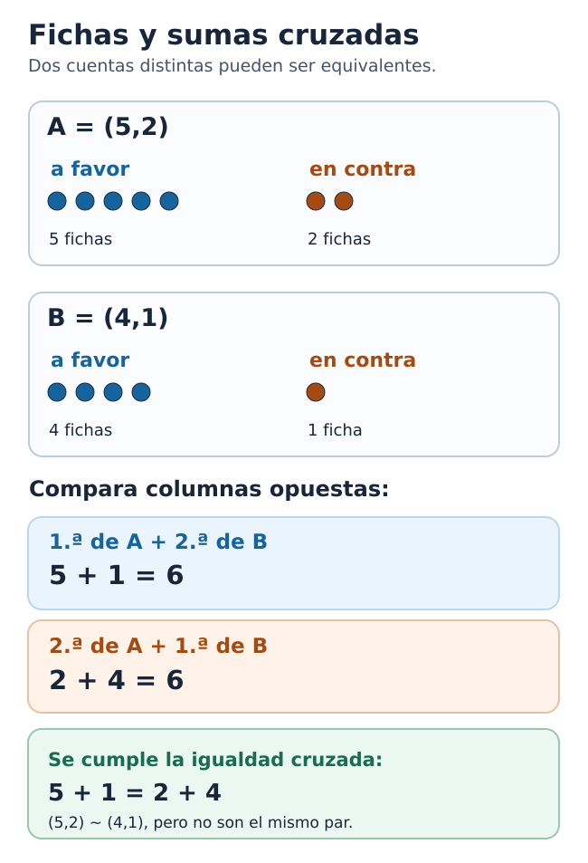
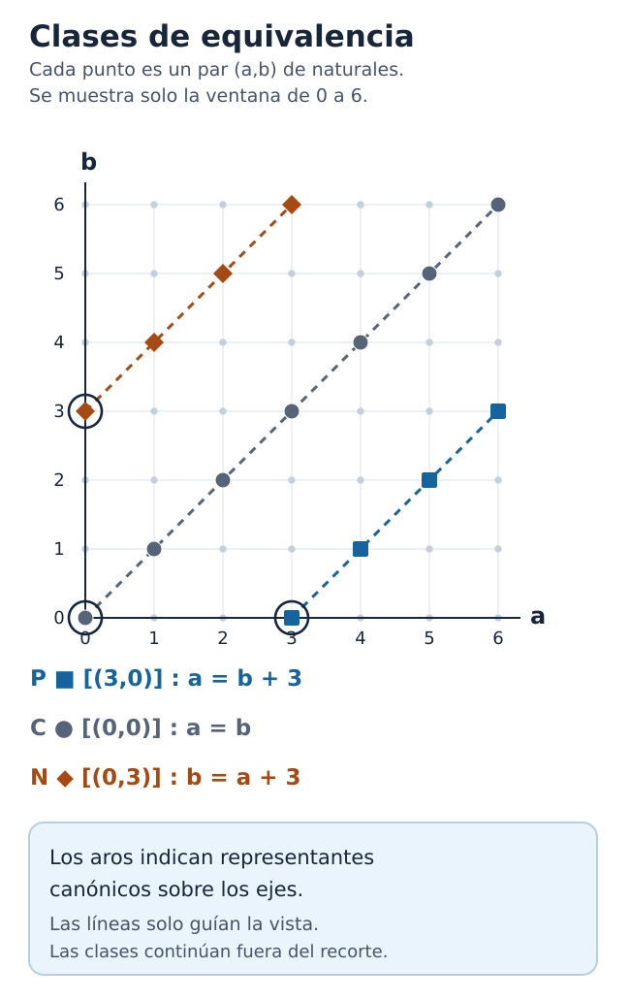
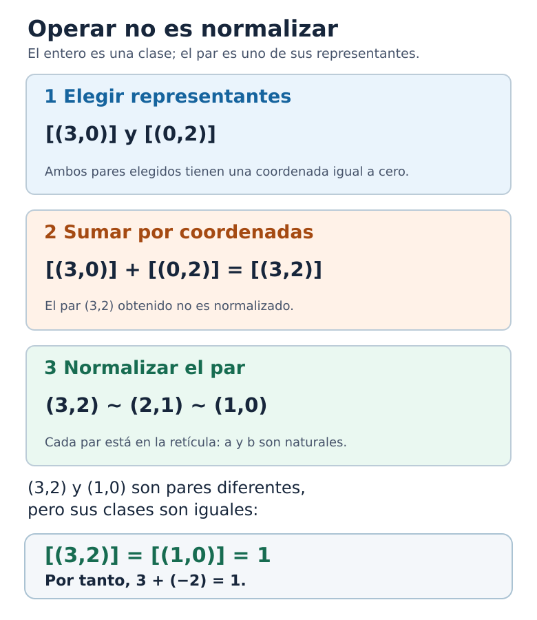

*Una clase sobre diferencias formales, equivalencias y nuevos objetos matemáticos*

::: {.callout-note title="Punto de partida y objetivo"}
No hace falta conocer números negativos ni teoría de conjuntos avanzada. Utilizaremos la suma de naturales, pares ordenados y una ley sencilla: si $u+t=v+t$, entonces $u=v$. Aprenderemos qué problema resuelven los enteros, por qué varios pares pueden representar uno solo, cómo encontrar su representante más simple y por qué las operaciones que definimos no dependen de la escritura elegida.
:::

A lo largo de la clase distinguiremos tres preguntas: **qué queremos representar**, **cuándo dos representaciones cuentan como iguales** y **cómo operamos con los objetos obtenidos**. Conviene no adelantar la respuesta de una pregunta utilizando conceptos que solo aparecerán después.

## 1. Una resta que todavía no podemos hacer

Supongamos que conocemos únicamente los números naturales:

$$
\mathbb N=\{0,1,2,3,\ldots\}.
$$

Sabemos sumarlos y multiplicarlos. Si contamos con tres objetos y recibimos otros dos, sabemos expresar lo ocurrido mediante $3+2=5$. También podemos plantear una pregunta inversa: si ahora tenemos cinco objetos y antes teníamos tres, ¿cuántos recibimos? Buscamos un natural $x$ tal que $3+x=5$ y encontramos $x=2$.

Pero ¿qué sucede si buscamos un natural $x$ que satisfaga

$$
5+x=2\,?
$$

No hay ninguno. Sumar un natural a $5$ nunca produce $2$. Esta observación parece trivial, pero revela una limitación estructural de la aritmética que conocemos: **en los naturales no siempre podemos deshacer una suma**.

No queremos resolver el problema escribiendo simplemente el símbolo $-3$ y suponiendo que ya sabemos qué significa. Queremos explicar de dónde puede salir ese nuevo número y por qué sus operaciones obedecerán reglas coherentes.

El propósito de la clase es construir un conjunto $\mathbb Z$ en el que toda ecuación

$$
x+b=a
$$

con $a,b$ enteros tenga una solución única $x$, y hacerlo partiendo de los naturales y sus operaciones. Al final podremos reconocer el resultado de $2-5$; al comienzo, en cambio, **la resta general no estará disponible**.

> **Pregunta de partida.** ¿Cómo podemos representar el resultado de una resta sin utilizar una resta que todavía no hemos definido?

## 2. En lugar de restar, guardemos dos números

Una posibilidad consiste en anotar los dos datos de la operación que querríamos efectuar. En vez de escribir $5-2$, escribamos el par ordenado $(5,2)$. En vez de escribir $2-5$, escribamos $(2,5)$.

Todavía no afirmamos que estos pares *sean* enteros. Son objetos conocidos: elementos del producto cartesiano $\mathbb N\times\mathbb N$. Los llamaremos **diferencias formales**. La primera coordenada registra una cantidad y la segunda, la cantidad que desearíamos retirar. El orden importa: $(5,2)$ y $(2,5)$ no son la misma anotación y, como veremos, tampoco describirán el mismo entero.

Una manera de visualizar el par es pensar en una cuenta con dos columnas: **a favor** y **en contra**. Todavía no necesitamos saber calcular balances negativos; basta registrar ambos tipos de fichas sin mezclarlos. El par $(0,3)$, por ejemplo, indica tres fichas en contra y ninguna a favor. Esta es una imagen de trabajo, no una definición alternativa del número.

Podemos imaginar fichas de dos clases: fichas que aportan una unidad y fichas que la compensan. El par $(5,2)$ registra cinco fichas del primer tipo y dos del segundo. Si añadimos una ficha de cada clase, el balance intuitivo no cambia. Por eso $(5,2)$ y $(6,3)$ deberían describir la misma situación.

La misma idea aparece en los siguientes pares:

$$
(3,0),\qquad(4,1),\qquad(5,2),\qquad(6,3).
$$

Aunque son cuatro pares distintos, nos gustaría considerarlos cuatro maneras de representar **un mismo número**.

Aquí nace una pregunta más profunda que la inicial. Ya no se trata de calcular una diferencia: necesitamos decidir **cuándo dos representaciones distintas cuentan como iguales**.

## 3. La igualdad que no necesita resta

Pensemos primero en dos ejemplos:

- $(5,2)$ y $(4,1)$ deberían representar lo mismo.
- $(5,2)$ y $(4,2)$ no deberían representar lo mismo.

Podríamos comparar sus restas, pero estaríamos utilizando precisamente la operación que tratamos de construir. Necesitamos un criterio formulado únicamente mediante sumas de naturales.

¿Cómo comparamos dos cuentas sin efectuar restas? Si una cuenta registra $a$ fichas a favor y $b$ en contra, y otra registra $c$ a favor y $d$ en contra, podemos **agregar a los dos lados de la comparación las fichas que figuran en contra de la cuenta opuesta**. Así obtenemos dos totales hechos solo de cantidades naturales: $a+d$ y $c+b$. Si coinciden, las dos cuentas tienen el mismo balance formal.

Con $(5,2)$ y $(4,1)$, el procedimiento compara $5+1$ con $4+2$. En ambos casos da $6$. Este razonamiento sugiere una regla general: dos pares han de representar lo mismo cuando sus sumas cruzadas coincidan. Ahora adoptamos esa regla como **definición**, que después pondremos a prueba. Definimos

$$
\boxed{(a,b)\sim(c,d)\quad\Longleftrightarrow\quad a+d=b+c.}
$$

Se lee: «$(a,b)$ es equivalente a $(c,d)$ si y solo si $a+d=b+c$».

Comprobemos los ejemplos. Para $(5,2)$ y $(4,1)$ calculamos

$$
5+1=2+4=6.
$$

Luego $(5,2)\sim(4,1)$. En cambio, comparar $(5,2)$ y $(4,2)$ exigiría $5+2=2+4$, lo cual es falso.

{#fig-ma-art-0018-f01 width="100%"}

**Figura F01 — Fichas y sumas cruzadas.** Las dos cuentas no son el mismo par, pero producen totales cruzados iguales. La primera coordenada de A se compara con la segunda de B, y la segunda de A con la primera de B. La figura motiva la relación $\sim$; no demuestra por sí sola que sea una equivalencia.

::: {.callout-note title="Descripción accesible de F01"}
La cuenta A es $(5,2)$: cinco fichas a favor y dos en contra. La cuenta B es $(4,1)$: cuatro a favor y una en contra. Las dos comparaciones son $5+1=6$ y $2+4=6$. Por ello $(5,2)\sim(4,1)$, aunque los pares son distintos.
:::

**Por qué es una buena definición.** Si agregamos el mismo natural $t$ a ambas coordenadas de un par, obtenemos uno equivalente:

$$
(a,b)\sim(a+t,b+t),
$$

porque $a+(b+t)=b+(a+t)$. El criterio capta así la idea de añadir cantidades compensadas, sin recurrir a números negativos. Esta operación de agregar el mismo $t$ ofrece una **forma de producir representantes equivalentes**. No es, sin embargo, una exigencia de igualdad coordenada a coordenada: $(5,2)$ y $(4,1)$ no son el mismo par, aunque satisfacen la regla.

::: {.callout-tip title="Comprueba la definición"}
¿Son equivalentes $(2,5)$ y $(4,7)$? Comprueba ambas sumas cruzadas. Después prueba con $(2,5)$ y $(4,6)$: un solo cambio en una coordenada puede romper la equivalencia.
:::

Sin embargo, no alcanza con que una regla parezca razonable. Si pretendemos utilizarla como una nueva noción de igualdad, debemos demostrar que realmente es una **relación de equivalencia**.

### Tres verificaciones necesarias

**Reflexividad.** Todo par es equivalente a sí mismo, ya que $a+b=b+a$.

**Simetría.** Si $(a,b)\sim(c,d)$, entonces $a+d=b+c$. La misma igualdad, leída en sentido inverso, muestra que $(c,d)\sim(a,b)$.

**Transitividad.** Supongamos que

$$
(a,b)\sim(c,d),\qquad(c,d)\sim(e,f).
$$

Esto significa

$$
a+d=b+c,\qquad c+f=d+e.
$$

Al sumar ambas igualdades y reordenar los sumandos obtenemos

$$
a+f+(c+d)=b+e+(c+d).
$$

La ley de cancelación de los naturales permite concluir que $a+f=b+e$. Por tanto, $(a,b)\sim(e,f)$.

Hemos probado las tres propiedades. Ya podemos utilizar $\sim$ para agrupar pares que representan una misma diferencia formal.

## 4. Una clase no es un par

Tomemos $(3,0)$. Su **clase de equivalencia** consiste en todos los pares equivalentes a él:

$$
[(3,0)]=\{(3,0),(4,1),(5,2),(6,3),\ldots\}.
$$

Del mismo modo,

$$
[(0,0)]=\{(0,0),(1,1),(2,2),(3,3),\ldots\},
$$

mientras que

$$
[(0,3)]=\{(0,3),(1,4),(2,5),(3,6),\ldots\}.
$$

Una clase de equivalencia no es uno de los pares de la lista: **es el conjunto completo de todos ellos**. Esa distinción es central.

::: {.callout-warning title="Dos igualdades que no dicen lo mismo"}
La afirmación $(3,0)=(5,2)$ es falsa: sus coordenadas son diferentes. La afirmación $[(3,0)]=[(5,2)]$ es verdadera: ambos pares pertenecen a la misma clase. Los corchetes cambian el objeto del que hablamos.
:::

::: {.callout-tip title="Un control antes del cociente"}
¿Es $(8,5)$ un elemento de $[(3,0)]$? ¿Es $(8,5)$ **igual** al par $(3,0)$? Justifica por qué las respuestas son diferentes.
:::

Por ejemplo, $(3,0)$ y $(5,2)$ son pares diferentes, pero sus clases son iguales:

$$
[(3,0)]=[(5,2)].
$$

Ahora sí podemos dar el paso decisivo. Llamaremos **números enteros** a esas clases de equivalencia:

$$
\boxed{\mathbb Z=(\mathbb N\times\mathbb N)/\sim.}
$$

El símbolo de cociente indica que hemos reunido en un solo objeto matemático todas las representaciones que la relación declara equivalentes. No hemos añadido misteriosamente números nuevos a los naturales: los hemos **construido como conjuntos determinados por una regla**.

Conviene distinguir tres niveles:

1. **Par:** $(5,2)$, un elemento de $\mathbb N\times\mathbb N$.
2. **Clase:** $[(5,2)]$, el conjunto de todos los pares equivalentes a $(5,2)$.
3. **Entero:** el objeto $[(5,2)]$ considerado como elemento del nuevo conjunto $\mathbb Z$.

En esta construcción, clase y entero son el mismo objeto; lo que no debemos confundir es ese objeto con uno cualquiera de sus representantes.

## 5. Las diagonales de una cuadrícula

La construcción tiene una interpretación geométrica especialmente esclarecedora.

Imaginemos una cuadrícula cuyos puntos tienen coordenadas naturales. Cada punto representa un par $(a,b)$: desplazarse hacia la derecha incrementa $a$; desplazarse hacia arriba incrementa $b$.

Partamos del punto $(3,0)$. Los puntos equivalentes son

$$
(3,0),\ (4,1),\ (5,2),\ (6,3),\ldots
$$

Cuando avanzamos una casilla a la derecha y otra hacia arriba, agregamos la misma cantidad a las dos coordenadas. Por eso todos esos puntos se encuentran sobre una misma diagonal ascendente.

Sucede lo mismo con cada clase de equivalencia: **los puntos de la retícula que se encuentran sobre una misma diagonal forman una clase**. La línea continua que los une sirve solamente como guía geométrica: sus demás puntos no son pares de naturales y, por tanto, no pertenecen a ninguna clase de nuestro cociente.

{#fig-ma-art-0018-f02 width="100%"}

**Figura F02 — Ventana de la retícula de pares.** Los cuadrados `P` satisfacen $a=b+3$; los círculos `C` satisfacen $a=b$; los rombos `N` satisfacen $b=a+3$. Los tres puntos rodeados sobre los ejes son representantes canónicos. Cada clase contiene infinitos pares: solamente mostramos los que están dentro de la ventana $0\le a,b\le6$. Los segmentos discontinuos son guías visuales, no puntos adicionales de las clases.

::: {.callout-note title="Descripción accesible de F02"}
En una retícula $7\times7$, horizontal $a$ y vertical $b$, los cuatro cuadrados `P` corresponden a $(3,0),(4,1),(5,2),(6,3)$; los siete círculos `C` corresponden a $(0,0)$ hasta $(6,6)$ por la diagonal principal; los cuatro rombos `N` corresponden a $(0,3),(1,4),(2,5),(3,6)$. Se rodean los puntos $(3,0)$, $(0,0)$ y $(0,3)$ como representantes normalizados. Ninguna clase termina en el límite de la retícula dibujada.
:::

| Clase indicada en la figura | Algunos pares de la clase |
|---|---|
| `P` | $(3,0),(4,1),(5,2),(6,3),\ldots$ |
| `C` | $(0,0),(1,1),(2,2),(3,3),\ldots$ |
| `N` | $(0,3),(1,4),(2,5),(3,6),\ldots$ |

Podemos registrar una pequeña región de esta retícula sin recurrir todavía a un dibujo. En la tabla, las columnas son los valores de $a$ y las filas, los de $b$. Las letras señalan **tres clases diferentes**, no tres puntos individuales: `P` es la clase de $(3,0)$, `C` la de $(0,0)$ y `N` la de $(0,3)$. Un punto marcado con `·` pertenece a alguna otra clase.

| $b\backslash a$ | 0 | 1 | 2 | 3 | 4 | 5 |
|:---:|:---:|:---:|:---:|:---:|:---:|:---:|
| 5 | · | · | N | · | · | C |
| 4 | · | N | · | · | C | · |
| 3 | N | · | · | C | · | · |
| 2 | · | · | C | · | · | P |
| 1 | · | C | · | · | P | · |
| 0 | C | · | · | P | · | · |

Lee una diagonal `P` desde $(3,0)$ hasta $(5,2)$; otra `N` desde $(0,3)$ hasta $(2,5)$. La tabla es finita, pero cada diagonal continúa sin límite. Esta representación permite ver la clase de equivalencia como un conjunto de puntos, **no como el trazo geométrico considerado por sí mismo**.

Una diagonal no es un único punto. Esa es precisamente la razón por la cual necesitábamos clases y no simples pares.

::: {.callout-tip title="Leer la cuadrícula"}
Sin realizar ninguna resta, explica por qué el punto $(4,4)$ está en la diagonal `C` y por qué $(4,2)$ no está en la diagonal `P`. La respuesta debe usar la condición de equivalencia.
:::

Y hay un detalle más importante todavía: **cada diagonal del primer cuadrante toca exactamente uno de los dos ejes**, salvo la diagonal del cero, que toca ambos en el origen. Ese punto del borde nos permitirá dar un nombre sencillo y único a cada entero.

## 6. ¿Por qué podemos elegir un representante único?

Sabemos que un entero admite infinitos representantes. ¿Podemos escoger uno que sea especialmente sencillo, siguiendo siempre la misma regla?

Sí. Dado un par $(a,b)$, comparemos sus coordenadas. Como $a$ y $b$ son naturales, solo puede ocurrir una de estas tres cosas.

### Primer caso: $a>b$

Existe un natural positivo $n$ tal que $a=b+n$. Entonces

$$
(a,b)\sim(n,0),
$$

pues $a+0=b+n$. Por ejemplo,

$$
(5,2)\sim(3,0).
$$

Hemos encontrado un representante situado sobre el eje horizontal.

### Segundo caso: $a=b$

Entonces

$$
(a,a)\sim(0,0),
$$

porque $a+0=a+0$. Todos los pares con coordenadas iguales pertenecen a la misma clase, que llamaremos **cero**.

### Tercer caso: $a<b$

Existe un natural positivo $n$ tal que $b=a+n$. Entonces

$$
(a,b)\sim(0,n),
$$

pues $a+n=b+0$. Por ejemplo,

$$
(2,5)\sim(0,3).
$$

Esta vez el representante se encuentra sobre el eje vertical.

En resumen, todo entero tiene un representante de exactamente una de estas formas:

$$
\boxed{(n,0)\ (n>0),\qquad(0,0),\qquad(0,n)\ (n>0).}
$$

**¿Por qué decimos «exactamente uno»?** Si $(n,0)\sim(m,0)$, la definición obliga a $n=m$. Ocurre lo mismo si $(0,n)\sim(0,m)$. Finalmente, para que $(n,0)$ fuese equivalente a $(0,m)$ necesitaríamos $n+m=0$, imposible con $n,m>0$.

Por tanto, cada clase tiene **un único representante con al menos una coordenada igual a cero**. No significa que tenga un único representante en total: ya sabemos que contiene infinitos.

A ese par especial lo llamamos *representante canónico* o *representante normalizado*. «Canónico» no significa «más verdadero» que los demás; significa que existe una regla inequívoca para escogerlo.

Observa que hemos demostrado **dos cosas diferentes**: toda clase **tiene** al menos un representante de la forma anunciada y **no puede tener dos** representantes distintos de esa forma. La primera parte se obtuvo comparando $a$ y $b$; la segunda, mediante la condición de equivalencia. La existencia sola no garantiza la unicidad.

Por ejemplo, en la clase de $(2,7)$, el representante normalizado es $(0,5)$. El par $(1,6)$ pertenece a la misma clase, pero no es normalizado; el par $(0,4)$ sí tiene la forma requerida, pero pertenece a otra clase. Estos dos contrastes muestran por qué importan ambas condiciones.

### Una precisión sobre las convenciones

Nuestra construcción toma $0\in\mathbb N$. Por eso los representantes normalizados aparecen sobre los ejes, donde una coordenada es $0$. Si se adopta la convención $\mathbb N^+=\{1,2,3,\ldots\}$, el procedimiento análogo elige $(n+1,1)$, $(1,1)$ y $(1,n+1)$, respectivamente, con $n>0$ en los casos no nulos. Los dos cocientes no son literalmente el mismo conjunto, pero describen la **misma estructura aritmética**: la aplicación $[(a,b)]\mapsto[(a+1,b+1)]$ está bien definida y establece una correspondencia que preserva las operaciones. Así distinguimos el objeto construido y la convención empleada para representarlo.

## 7. Ahora aparecen el cero y los negativos

Ya podemos dar nombres a algunas clases:

$$
\begin{aligned}
0&:=[(0,0)],\\
1&:=[(1,0)],\\
2&:=[(2,0)],\\
3&:=[(3,0)],\\
-1&:=[(0,1)],\\
-2&:=[(0,2)],\\
-3&:=[(0,3)].
\end{aligned}
$$

Hay una precisión que suele quedar oculta por la notación. El natural $3$ y el entero $[(3,0)]$ no son, como conjuntos, el mismo objeto. La correspondencia

$$
\iota:\mathbb N\longrightarrow\mathbb Z,\qquad \iota(n)=[(n,0)],
$$

es inyectiva: si $[(m,0)]=[(n,0)]$, la igualdad cruzada exige $m+0=0+n$, es decir, $m=n$. Una vez definida la suma, se comprueba además que $\iota(m)+\iota(n)=\iota(m+n)$; tras definir el producto en §9, obtendremos también $\iota(m)\iota(n)=\iota(mn)$. Estas propiedades justifican identificar un natural con su imagen en los enteros. Cuando escribimos $3$ para la clase $[(3,0)]$, adoptamos esa convención, no afirmamos que $\mathbb N$ sea literalmente un subconjunto de $\mathbb Z$.

La columna de los números con signo negativo no es una lista de resultados que hayamos supuesto de antemano. Cada uno acaba de recibir una definición precisa en términos de clases de pares de naturales.

Por ejemplo, el objeto que llamamos $-3$ es

$$
[(0,3)]=\{(0,3),(1,4),(2,5),\ldots\}.
$$

Y el que llamamos $3$ es

$$
[(3,0)]=\{(3,0),(4,1),(5,2),\ldots\}.
$$

Son clases distintas: $(3,0)$ y $(0,3)$ no son equivalentes, porque la igualdad cruzada requeriría $3+3=0+0$.

El paso decisivo no fue «agregar un signo menos» a los naturales. Fue introducir una noción de equivalencia entre pares y demostrar que sus clases tienen la estructura que esperamos de los enteros.

## 8. Cómo aprenden a sumar nuestras clases

Hasta ahora construimos los objetos. Falta enseñarles a operar.

Comencemos por la suma. Es natural proponer que se sumen las primeras coordenadas entre sí y las segundas también:

$$
\boxed{[(a,b)]+[(c,d)]:=[(a+c,b+d)].}
$$

Por ejemplo, para sumar el entero que ahora llamamos $3$ y el que llamamos $-2$, calculamos

$$
[(3,0)]+[(0,2)]=[(3,2)]=[(1,0)]=1.
$$

La fórmula funciona con el ejemplo. Advierte un detalle: aunque los sumandos elegidos estaban normalizados, el par resultante $(3,2)$ no lo está. **Operar** y **normalizar** son tareas distintas. El resultado ya es una clase válida; normalizar el par a $(1,0)$ nos ayuda a reconocerlo como el entero $1$.

{#fig-ma-art-0018-f03 width="100%"}

**Figura F03 — Sumar y normalizar son procedimientos diferentes.** La suma de clases se calcula mediante representantes: $[(3,0)]+[(0,2)]=[(3,2)]$. El par $(3,2)$ puede sustituirse por el representante equivalente $(1,0)$; no se afirma que sean pares iguales. Es la **clase** la que conserva su identidad.

::: {.callout-note title="Descripción accesible de F03"}
Tres pasos: se escogen los pares canónicos $(3,0)$ y $(0,2)$; se suman coordenada a coordenada para obtener el par $(3,2)$; se observa que $(3,2)\sim(2,1)\sim(1,0)$, todos con coordenadas naturales. Finalmente $[(3,2)]=[(1,0)]$, que se denota por el entero $1$.
:::

Tenemos una obligación matemática más seria.

**El resultado no debe depender de los representantes que utilicemos.** El número $3$ también puede representarse por $(5,2)$; $-2$, por $(1,3)$. Si repetimos la suma, encontramos

$$
[(5,2)]+[(1,3)]=[(6,5)]=[(1,0)].
$$

La respuesta es la misma. ¿Será así siempre?

Sí. Si $(a,b)\sim(a',b')$ y $(c,d)\sim(c',d')$, sabemos que

$$
a+b'=b+a',\qquad c+d'=d+c'.
$$

Sumando ambas igualdades y reordenando obtenemos

$$
(a+c)+(b'+d')=(b+d)+(a'+c').
$$

Esta igualdad afirma justamente que

$$
(a+c,b+d)\sim(a'+c',b'+d').
$$

Hemos demostrado que la suma está **bien definida**: cambiar la representación de los sumandos no cambia el entero obtenido.

Para introducir el **opuesto**, queremos intercambiar las dos coordenadas. Antes hay que verificar que hacerlo no depende del representante: si $(a,b)\sim(c,d)$, tenemos $a+d=b+c$; al leer la misma igualdad en orden inverso obtenemos $b+c=a+d$, que significa $(b,a)\sim(d,c)$. Por tanto, el intercambio respeta la equivalencia y define una operación legítima sobre clases:

$$
-[(a,b)]:=[(b,a)].
$$

En efecto,

$$
[(a,b)]+[(b,a)]=[(a+b,a+b)]=[(0,0)]=0.
$$

Así recuperamos la posibilidad de resolver ecuaciones aditivas que faltaba al comienzo: la solución de $x+b=a$ es $x=a+(-b)$, ahora dentro de $\mathbb Z$.

## 9. Y también pueden multiplicar

La multiplicación parece menos inmediata. Ya hemos definido el opuesto y la suma de enteros; por eso podemos pensar en el par $(a,b)$ como una representación del entero que, **una vez identificados los naturales con sus imágenes**, escribiremos $a-b$. Al anticipar la distributividad que deseamos demostrar para el producto, aparece la siguiente **pista**, que todavía no utilizaremos como prueba de las propiedades del nuevo producto:

$$
(a-b)(c-d)=ac+bd-ad-bc.
$$

Esta identidad solo nos sirve aquí como **motivación**: todavía no debemos utilizar una resta general de naturales para *definir* la operación.

Agrupemos los términos que aparecen con signo positivo y los que aparecen con signo negativo. Eso nos propone una fórmula hecha exclusivamente con sumas y productos naturales:

$$
\boxed{[(a,b)]\cdot[(c,d)]:=[(ac+bd,ad+bc)].}
$$

Probémosla con dos casos:

$$
[(0,2)]\cdot[(3,0)]=[(0,6)]=-6,
$$

$$
[(0,2)]\cdot[(0,3)]=[(6,0)]=6.
$$

Aparecen las reglas conocidas de signos. Pero no son reglas impuestas al nuevo sistema: se siguen de la manera en que hemos definido el producto.

También aquí debemos verificar que elegir otros representantes no altera la clase del resultado. La demostración vuelve a utilizar únicamente la distributividad y la conmutatividad de los naturales. Supongamos primero $(a,b)\sim(a',b')$, es decir, $a+b'=a'+b$, y mantengamos fijo el segundo factor $(c,d)$. Para demostrar que los pares producto son equivalentes, debemos verificar la igualdad cruzada

$$
(ac+bd)+(a'd+b'c)=(ad+bc)+(a'c+b'd).
$$

La izquierda se reagrupa como $c(a+b')+d(b+a')$ y la derecha como $d(a+b')+c(b+a')$. Puesto que $a+b'=b+a'$, ambas expresiones coinciden por conmutatividad y distributividad. Así, cambiar el representante del primer factor no altera la clase del producto. La fórmula es simétrica en ambos factores, pues la suma y el producto naturales son conmutativos; por ello el mismo argumento sirve para modificar el segundo. Cambiar sucesivamente ambos representantes y aplicar la transitividad de $\sim$ demuestra que la multiplicación está **bien definida**.

Las restantes leyes —asociatividad, conmutatividad, distributividad, existencia de $0$ y $1$— requieren comprobaciones generales mediante las operaciones naturales y la relación de equivalencia. Para ver el tipo de tarea que falta, observa la asociatividad de la suma: sumar tres pares por la izquierda da

$$
\big((a,b)+(c,d)\big)+(e,f)=(a+c+e,b+d+f),
$$

mientras que agrupar los dos últimos produce

$$
(a,b)+\big((c,d)+(e,f)\big)=(a+c+e,b+d+f).
$$

La asociatividad natural hace coincidir los pares resultantes; por tanto, también sus clases. La demostración completa de las leyes algebraicas corresponde al tratamiento formal; aquí hemos visto en qué consisten las verificaciones y por qué no debemos darlas por ciertas solo porque los ejemplos funcionan.

## 10. Qué hemos construido en realidad

Volvamos al problema inicial:

$$
5+x=2.
$$

En los naturales no existía solución. En los enteros construidos, la solución es la clase $[(0,3)]$, que ahora sabemos llamar $-3$. Comprobémoslo sin confiar simplemente en el lenguaje habitual:

$$
[(5,0)]+[(0,3)]=[(5,3)]=[(2,0)].
$$

La última igualdad se verifica porque $(5,3)\sim(2,0)$: en efecto, $5+0=3+2$.

La ecuación tiene ahora sentido y está resuelta. ¿Por qué la solución es única? Si dos enteros $x$ e $y$ satisfacen $5+x=2$ y $5+y=2$, entonces $5+x=5+y$. Sumando a ambos lados el opuesto de $5$ y usando las leyes aditivas del nuevo sistema se obtiene $x=y$. La existencia proviene de los opuestos y la unicidad, de la cancelación aditiva. **Estas leyes generales no se deducen de un solo ejemplo**: su verificación para todas las clases forma parte de la demostración formal desarrollada en el capítulo 2 del *Tratado moderno de Análisis* (`TA-0005`).

Pero la enseñanza principal va más allá de los enteros. Hemos aprendido una manera general de construir objetos matemáticos:

1. Identificar una operación o un problema que el sistema actual no permite resolver.
2. Inventar representaciones utilizando objetos ya disponibles.
3. Determinar cuándo dos representaciones deben considerarse equivalentes.
4. Formar las clases de equivalencia, que serán los nuevos objetos.
5. Definir operaciones entre esas clases y demostrar que no dependen de los representantes elegidos.

Este patrón reaparecerá al construir los números racionales a partir de pares que representan fracciones y, con variaciones importantes, al estudiar otras ampliaciones numéricas.

Hay además una distinción conceptual que vale la pena conservar: **un número puede estar perfectamente definido aunque admita muchas maneras de representarlo**. La unicidad que importa no siempre pertenece a la representación; puede pertenecer al objeto definido por todas ellas.

### Cuatro errores que esta construcción nos ayuda a evitar

- **Confundir igualdad de pares con equivalencia.** $(3,0)$ y $(4,1)$ son diferentes como pares; sus clases son iguales.
- **Creer que una clase contiene un solo par.** Contiene infinitos; solo el representante normalizado es único bajo la condición fijada.
- **Restar en $\mathbb N$ antes de haber construido la operación general.** La igualdad cruzada evita precisamente esa circularidad.
- **Creer que todo resultado de una operación ya estará normalizado.** $(3,0)+(0,2)=(3,2)$ en el nivel de pares; al pasar a clases, su valor puede representarse también por $(1,0)$.

No hay que memorizar estas advertencias como reglas aisladas. Cada una corresponde a una distinción que encontramos necesaria durante la construcción.

## 11. Comprueba lo que has comprendido

Intenta resolver estas preguntas antes de leer las orientaciones.

**1. Misma clase.** ¿Son equivalentes $(8,5)$ y $(6,3)$? No calcules sus restas: usa la definición.

**2. Forma normal.** Encuentra el representante canónico de la clase $[(2,7)]$.

**3. El cero.** Explica por qué $(47,47)$ representa el mismo entero que $(0,0)$.

**4. Opuestos.** Calcula $[(2,5)]+[(4,1)]$ y reduce el resultado a su forma normal.

**5. Un representante desconocido.** ¿Qué natural $x$ hace que $(x,3)\sim(5,2)$?

**6. La pregunta esencial — ERR.** ¿Por qué es incorrecto decir que una clase de equivalencia tiene «un solo representante»? ¿Qué afirmación de unicidad sí hemos demostrado?

**7. Construye un no-ejemplo — NEX.** Propón un par $(c,d)$ con $c,d\in\mathbb N$ que **no** pertenezca a la clase $[(3,0)]$ y compruébalo con sumas cruzadas.

**8. Reconstruye la regla — PRF-R.** Un compañero afirma: «Para probar que $(a,b)\sim(c,d)$ hay que verificar $a+b=c+d$». Construye dos pares que hagan falsa su propuesta, pero sean equivalentes según nuestra definición.

**9. Cambia la convención — VAR.** Si los naturales comienzan en $1$, ¿cuál es el representante distinguido del entero que aquí llamamos $-2$? ¿Por qué ya no podemos usar $(0,2)$?

**10. Pregunta de transferencia — LINK.** Imagina que un nuevo tipo de objeto tiene varias representaciones. ¿Qué dos propiedades tendrías que comprobar antes de definir una operación con esas representaciones para que el resultado no dependa del nombre escogido?

### Orientaciones y respuestas

**1.** Sí: $8+3=5+6=11$.

**2.** Como $7=2+5$, obtenemos $(2,7)\sim(0,5)$.

**3.** Porque $47+0=47+0$. En general, todo $(a,a)$ pertenece a la clase del cero.

**4.** La suma es $[(6,6)]=[(0,0)]=0$.

**5.** La equivalencia exige $x+2=3+5=8$, de donde $x=6$.

**6.** Cada clase tiene infinitos representantes. Lo único es su representante **normalizado**, caracterizado en nuestra convención por tener al menos una coordenada igual a cero.

**7.** Por ejemplo, $(3,1)\not\sim(3,0)$, ya que $3+0\neq1+3$.

**8.** Sirven $(3,0)$ y $(4,1)$: son equivalentes porque $3+1=0+4$, aunque $3+0\neq4+1$. La suma directa de coordenadas no es el criterio correcto.

**9.** El representante distinguido es $(1,3)$: ahora la primera coordenada mínima es $1$, y $(0,2)$ ya no pertenece al producto cartesiano de naturales positivos.

**10.** Primero, disponer de una relación de equivalencia que identifique las representaciones del mismo objeto; segundo, probar que la operación propuesta sobre representaciones conserva esa equivalencia al reemplazar cualquiera de sus argumentos. Solo entonces define una operación independiente de los representantes.

## Para continuar

La próxima pregunta natural es esta: si los enteros permiten restar sin restricciones, ¿cómo construir un sistema en el que podamos **dividir por todo número distinto de cero**? La respuesta nos llevará a otra construcción mediante pares y clases de equivalencia: los números racionales.

---

*Vinculación matemática de la colección «Comprender las matemáticas»:* **Tratado moderno de Análisis**, capítulo 2, «Los números enteros» (`TA-0005`), especialmente el teorema de forma normal con signo (`TA-THM-00025`). Este artículo es una exposición pedagógica original; no sustituye las demostraciones del tratado.
