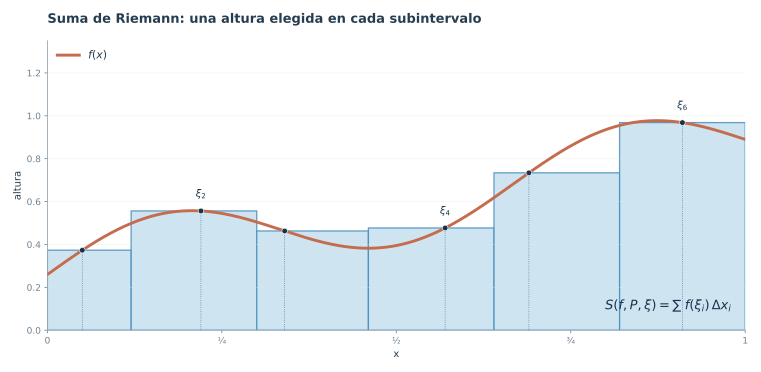
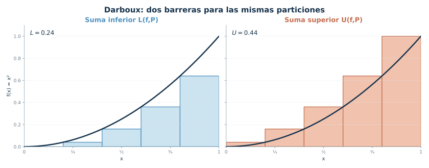
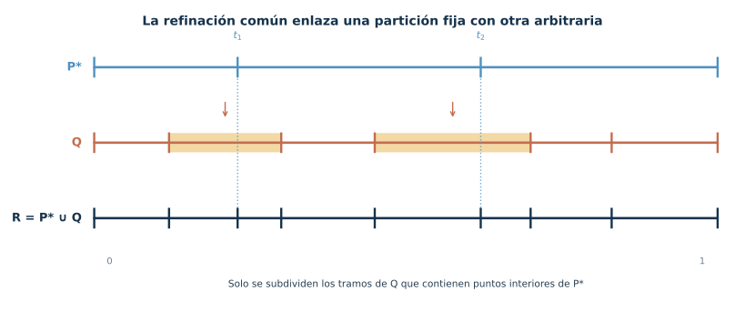
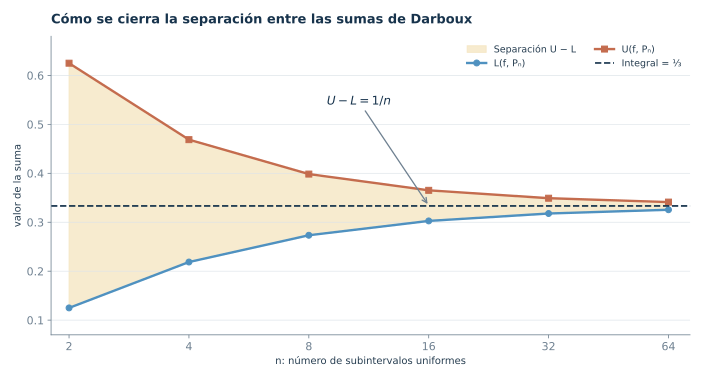
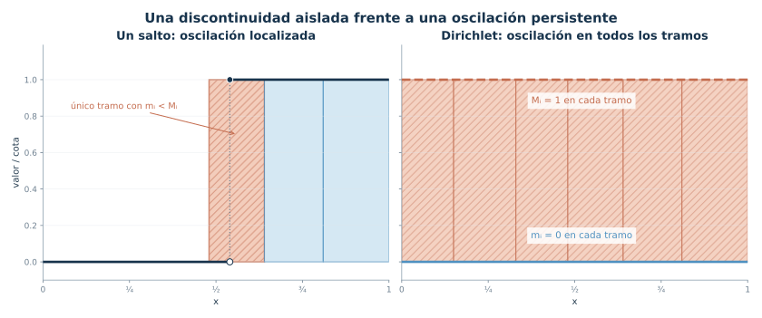

## De las sumas etiquetadas al control de la oscilación

Imaginemos que queremos integrar una función en un intervalo. Dividimos el dominio en tramos pequeños y en cada tramo escogemos un punto donde medir la altura. Al multiplicar esa altura por la anchura del tramo, obtenemos una contribución; la suma de todas ellas pretende aproximar la integral. Pero la elección del punto de muestra parece introducir una arbitrariedad: ¿qué impide que, con la misma partición, unas elecciones produzcan un resultado y otras produzcan otro?

La formulación de Riemann responde exigiendo que *todas* las sumas suficientemente finas se aproximen a un número único. Darboux propone examinar directamente los valores extremos que puede aportar cada tramo. En lugar de escoger puntos, reúne las contribuciones más pequeñas y más grandes compatibles con cada subintervalo. Si la separación entre esos dos límites se puede hacer arbitrariamente pequeña, la arbitrariedad ha desaparecido.

Los procedimientos parecen distintos y en la práctica se prestan a demostraciones de naturaleza diferente. El resultado de este artículo establece que, para una función real acotada en un intervalo compacto, **son dos caracterizaciones de la misma integrabilidad y asignan el mismo valor**. La dificultad matemática está en demostrarlo, especialmente al pasar de una partición particularmente conveniente a *cualquier* partición suficientemente fina.

## 1. Una partición y muchas sumas

Trabajaremos en un intervalo $[a,b]$, con $a<b$, y con una función **acotada** $f:[a,b]\to\mathbb R$. Esta hipótesis significa que existe $M\geq0$ tal que $|f(x)|\leq M$ para todo $x\in[a,b]$. La acotación asegura que los supremos e ínfimos utilizados más adelante sean números reales finitos. Consideraremos siempre particiones finitas.

Una **partición** de $[a,b]$ es una colección ordenada de puntos

$$
P=\{a=x_0<x_1<\cdots<x_n=b\}.
$$

El subintervalo $I_i=[x_{i-1},x_i]$ tiene longitud $\Delta x_i=x_i-x_{i-1}>0$. La **malla** de la partición, que escribiremos $\|P\|$, es la longitud del tramo más largo:

$$
\|P\|=\max_{1\leq i\leq n}\Delta x_i.
$$

Para obtener una suma etiquetada elegimos libremente un punto $\xi_i\in I_i$ en cada subintervalo. La suma de Riemann correspondiente es

$$
S(f,P,\xi)=\sum_{i=1}^{n}f(\xi_i)\,\Delta x_i.
$$

No hay obligación de usar extremos izquierdos, derechos o puntos medios, ni de conservar una regla de elección al cambiar de partición. Ésa es la generalidad que debe soportar la definición.

*Figura 1. Cada rectángulo tiene base $\Delta x_i$ y altura $f(\xi_i)$. La curva permanece fija, pero al variar las etiquetas pueden variar las alturas y, por tanto, el valor de la suma.*

El dibujo sugiere dos aproximaciones distintas que no debemos confundir: **hacer más corta la base de los rectángulos** y **seleccionar una altura apropiada**. La definición de Riemann no permite compensar una mala elección de etiquetas con otra favorable: exige que las sumas funcionen para todas ellas tan pronto como la malla sea suficientemente pequeña.

::: {.callout-note title="Definición · Integrabilidad según Riemann"}
La función $f$ es **integrable según Riemann** en $[a,b]$ si existe $I\in\mathbb R$ tal que para cada $\varepsilon>0$ existe $\delta>0$ con la propiedad siguiente: **para toda** partición $P$ de $[a,b]$ cuya malla satisfaga $\|P\|<\delta$ y **para toda** elección de etiquetas $\xi_i\in I_i$, se tiene

$$
|S(f,P,\xi)-I|<\varepsilon.
$$
El número $I$ se denota por $\int_a^b f(x)\,dx$.
:::

La alternancia de cuantificadores forma parte de la definición. Encontrar una sucesión particular de sumas que converja es insuficiente: incluso una función no integrable puede dar lugar a numerosas sucesiones convergentes de sumas, dependiendo de cómo se escojan las etiquetas.

El número $I$, si existe, es único. En efecto, si $I$ y $J$ cumplieran la definición, para cada $\varepsilon>0$ podríamos elegir una partición lo bastante fina y una misma suma $S$ tal que $|I-S|<\varepsilon$ y $|S-J|<\varepsilon$. La desigualdad triangular daría $|I-J|<2\varepsilon$ para todo $\varepsilon>0$; luego $I=J$.

## 2. Encerrar las sumas sin elegir etiquetas

Darboux reemplaza las etiquetas por las cotas de $f$ en cada tramo. Definimos

$$
m_i=\inf_{x\in I_i} f(x),\qquad
M_i=\sup_{x\in I_i} f(x).
$$

Estos números existen y son finitos por la acotación de $f$. **No es necesario que se alcancen**: si $f$ no es continua, puede no haber un punto del subintervalo donde tome su ínfimo o su supremo.

Por ejemplo, la función $g:[0,1]\to\mathbb R$ definida mediante $g(x)=x$ para $0\leq x<1$ y $g(1)=0$ tiene supremo $1$, pero no existe un punto donde alcance ese valor. Darboux puede utilizar $\sup g=1$ sin postular un máximo que no existe. Esta distinción entre *cota extrema* y *valor alcanzado* evita una hipótesis de continuidad que no forma parte del problema.

La **suma inferior** y la **suma superior** de Darboux relativas a $P$ son

$$
L(f,P)=\sum_{i=1}^{n}m_i\,\Delta x_i,
\qquad
U(f,P)=\sum_{i=1}^{n}M_i\,\Delta x_i.
$$

Como $m_i\leq f(\xi_i)\leq M_i$ y $\Delta x_i>0$, toda suma de Riemann sobre esa partición queda atrapada entre ambas:

$$
\boxed{L(f,P)\leq S(f,P,\xi)\leq U(f,P).}
$$

La amplitud del encierro puede medirse exactamente:

$$
U(f,P)-L(f,P)
=\sum_{i=1}^{n}(M_i-m_i)\,\Delta x_i.
$$

El factor $M_i-m_i$ es la **oscilación de $f$ en $I_i$**; multiplicarlo por la longitud del tramo proporciona la contribución de ese intervalo a la indeterminación de la suma. Si la función oscila mucho en pocos tramos muy cortos, todavía puede resultar integrable. Si mantiene una oscilación considerable en todos los tramos, la separación no desaparece.

*Figura 2. Para $f(x)=x^2$ y una misma partición uniforme de cinco tramos, la suma inferior es $0{,}24$ y la superior es $0{,}44$. La curva queda entre ambas aproximaciones.*

Aquí la diferencia $U-L$ es la suma de las franjas que separan los rectángulos superiores de los inferiores. Podemos entenderla como un **presupuesto total de indeterminación**: cada tramo aporta oscilación multiplicada por anchura. Los colores no codifican áreas positivas de la función en general, sino las cotas numéricas de las sumas; el argumento conserva su validez cuando $f$ toma valores negativos.

Los adjetivos *superior* e *inferior* son relativos al orden de los números. No suponen que $f$ sea positiva ni que las sumas representen áreas geométricas positivas. Para $f(x)=-1$ en $[a,b]$, ambas sumas valen $-(b-a)$.

### Refinar una partición

Una partición $R$ **refina** a $P$ si contiene todos los puntos de $P$. Al partir un tramo en otros más pequeños, el ínfimo en cada nuevo tramo no puede ser menor que el ínfimo original, mientras que el supremo no puede ser mayor que el original. Tras multiplicar por las longitudes y sumar, obtenemos

$$
\boxed{L(f,P)\leq L(f,R)\leq U(f,R)\leq U(f,P).}
$$

Dos particiones cualesquiera $P$ y $Q$ tienen una **refinación común**: basta ordenar la unión $R=P\cup Q$ de sus puntos. En particular,

$$
L(f,P)\leq L(f,R)\leq U(f,R)\leq U(f,Q).
$$

Esta desigualdad se cumple para *cualquier* par de particiones. Será decisiva cuando pasemos de las sumas particulares a los extremos globales.

## 3. Las integrales inferior y superior de Darboux

Entre todas las sumas inferiores buscamos la cota superior óptima; entre todas las superiores, la cota inferior óptima. Así aparecen dos números:

$$
\underline{\mathcal I}(f)=\sup_P L(f,P),
\qquad
\overline{\mathcal I}(f)=\inf_P U(f,P),
$$

con el supremo y el ínfimo tomados sobre **todas** las particiones finitas de $[a,b]$. Como $|f|\leq M$, todas las sumas están entre $-M(b-a)$ y $M(b-a)$, por lo que los extremos globales existen en $\mathbb R$.

El argumento de refinación común anterior prueba que cada suma inferior está por debajo de cada suma superior. En consecuencia,

$$
\underline{\mathcal I}(f)\leq\overline{\mathcal I}(f).
$$

::: {.callout-note title="Definición · Integrabilidad según Darboux"}
La función acotada $f:[a,b]\to\mathbb R$ es **integrable según Darboux** si sus integrales inferior y superior coinciden:

$$
\underline{\mathcal I}(f)=\overline{\mathcal I}(f).
$$
Su valor común se llama integral de Darboux de $f$.
:::

La igualdad no exige encontrar una partición que consiga exactamente el supremo o el ínfimo. De hecho, una sola partición puede conservar una separación positiva aunque la función sea integrable. El criterio operativo siguiente elimina esa dificultad.

::: {.callout-tip title="Teorema · Criterio de Darboux"}
Una función acotada $f:[a,b]\to\mathbb R$ es integrable según Darboux si y sólo si, para todo $\varepsilon>0$, existe una partición finita $P$ tal que

$$
\boxed{U(f,P)-L(f,P)<\varepsilon.}
$$
:::

**Demostración.** Supongamos primero que las integrales inferior y superior coinciden en un número $D$. Por la propiedad del supremo, podemos encontrar una partición $P_1$ para la cual $L(f,P_1)>D-\varepsilon/2$. Por la del ínfimo, existe otra partición $P_2$ tal que $U(f,P_2)<D+\varepsilon/2$. Su refinación común $P=P_1\cup P_2$ satisface

$$
D-\frac{\varepsilon}{2}
<L(f,P)\leq U(f,P)
<D+\frac{\varepsilon}{2},
$$

y, por tanto, $U(f,P)-L(f,P)<\varepsilon$.

Recíprocamente, supongamos que para cada $\varepsilon>0$ existe una partición $P$ con esa separación. Por las definiciones de supremo e ínfimo,

$$
0\leq\overline{\mathcal I}(f)-\underline{\mathcal I}(f)
\leq U(f,P)-L(f,P)<\varepsilon.
$$

Puesto que la diferencia entre las dos integrales globales es un número no negativo menor que cualquier $\varepsilon>0$, necesariamente vale cero. $\square$

Con Darboux basta, por ahora, encontrar **una partición favorable para cada precisión solicitada**. Riemann, en cambio, exige controlar **toda partición suficientemente fina**. ¿De dónde sale ese salto lógico?

### Una cota práctica cuando la función es lipschitziana

El criterio de Darboux puede dar algo más que la existencia de la integral: permite estimar la separación de las sumas. Supongamos que existe una constante $K\geq0$ tal que

$$
|f(x)-f(y)|\leq K|x-y|\qquad(x,y\in[a,b]).
$$

Se dice entonces que $f$ es **lipschitziana**. En un subintervalo $I_i$, ninguna diferencia entre valores de $f$ puede exceder $K\Delta x_i$, por lo que $M_i-m_i\leq K\Delta x_i$. Resulta

$$
\begin{aligned}
U(f,P)-L(f,P)
&\leq K\sum_{i=1}^{n}(\Delta x_i)^2\\
&\leq K\|P\|\sum_{i=1}^{n}\Delta x_i\\
&=K(b-a)\|P\|.
\end{aligned}
$$

La última expresión tiende a cero cuando disminuye la malla. Toda función lipschitziana en un intervalo compacto es, por tanto, integrable según Darboux y según Riemann. Además, esta estimación vale para **cualquier** partición: no depende de que sus intervalos tengan la misma longitud.

La hipótesis es suficiente, no necesaria. Una función con salto, como la que estudiaremos en la sección 5, puede ser integrable sin ser lipschitziana.

## 4. El teorema de equivalencia

::: {.callout-tip title="Teorema · Equivalencia de Riemann y Darboux"}
Sea $f:[a,b]\to\mathbb R$ una función acotada y $a<b$. Son equivalentes:

1. $f$ es integrable según Riemann.
2. $f$ es integrable según Darboux: $\underline{\mathcal I}(f)=\overline{\mathcal I}(f)$.
3. Para cada $\varepsilon>0$ existe una partición $P$ tal que $U(f,P)-L(f,P)<\varepsilon$.

Cuando se cumplen, los valores de ambas integrales coinciden.
:::

La equivalencia entre las afirmaciones segunda y tercera ya está demostrada. Restan las dos implicaciones que conectan Darboux con las sumas etiquetadas de Riemann.

### 4.1. De Riemann a Darboux: las sumas extremas son límites de sumas etiquetadas

Fijemos una partición $P$. Las sumas inferior y superior son, respectivamente, el ínfimo y el supremo de **todas las sumas etiquetadas relativas a esa partición**:

$$
L(f,P)=\inf_{\xi}S(f,P,\xi),
\qquad
U(f,P)=\sup_{\xi}S(f,P,\xi).
$$

La desigualdad $L\leq S\leq U$ ya prueba una dirección de estas igualdades. Para la otra, tomemos $\eta>0$. Por la definición de supremo, en cada $I_i$ puede elegirse un $\xi_i$ tal que

$$
f(\xi_i)>M_i-\frac{\eta}{b-a}.
$$

Como $\sum_i\Delta x_i=b-a$, al sumar se obtiene $S(f,P,\xi)>U(f,P)-\eta$. Así, el supremo de las sumas etiquetadas alcanza por aproximación el valor $U(f,P)$. Una elección análoga, acercándose a cada ínfimo $m_i$, prueba la igualdad para $L(f,P)$. No hemos supuesto que $f$ tome sus valores extremos.

Supongamos ahora que $f$ es integrable según Riemann y que su integral vale $I$. Dado $\varepsilon>0$, la definición de Riemann proporciona $\delta>0$ tal que toda suma sobre toda partición de malla menor que $\delta$ satisface

$$
I-\frac{\varepsilon}{4}<S(f,P,\xi)<I+\frac{\varepsilon}{4}.
$$

Elijamos una de esas particiones. Al tomar el ínfimo y el supremo sobre las etiquetas resulta

$$
I-\frac{\varepsilon}{4}\leq L(f,P)
\leq U(f,P)\leq I+\frac{\varepsilon}{4}.
$$

Luego $U(f,P)-L(f,P)\leq\varepsilon/2<\varepsilon$. Se cumple el criterio de Darboux y existe un valor común $D$. Además, para las particiones suficientemente finas, tanto $D$ como cualquier suma etiquetada están comprendidos entre $L(f,P)$ y $U(f,P)$. Por tanto, $|S(f,P,\xi)-D|<\varepsilon$ cuando la malla es bastante pequeña. La unicidad del límite de Riemann obliga a que $D=I$.

### 4.2. De Darboux a Riemann: controlar todas las particiones finas

La implicación inversa exige un argumento adicional. Supongamos que $f$ es integrable según Darboux y llamemos $D$ a su integral. Elegimos $M\geq0$ tal que $|f|\leq M$. Para una precisión $\varepsilon>0$, el criterio de Darboux nos da una partición fija

$$
P_*=\{a=t_0<t_1<\cdots<t_n=b\}
$$

que cumple

$$
U(f,P_*)-L(f,P_*)<\frac{\varepsilon}{2}.
$$

La partición $P_*$ puede tener intervalos de tamaños muy desiguales. Ahora consideremos **una partición arbitraria** $Q$ y formemos la refinación común $R=P_*\cup Q$. El refinamiento siempre satisface las desigualdades que derivaremos a continuación.

*Figura 3. En esta configuración ilustrativa, dos puntos interiores de $P_*$ caen dentro de tramos de $Q$ (resaltados). Al añadir esos puntos se forma $R$, y los demás tramos de $Q$ permanecen iguales.*

Es importante advertir que **malla pequeña no significa refinamiento**. Aunque subdividamos el intervalo en tramos diminutos, sus extremos no tienen por qué coincidir con los puntos $t_1,\ldots,t_{n-1}$ fijados previamente. La refinación común resuelve esa falta de coincidencia y permite medir su costo: como máximo se afectan $n-1$ tramos de $Q$, cuya longitud total no supera $(n-1)\|Q\|$.

La diferencia que aparece al refinar esos tramos está controlada por la acotación global de $f$. Eso convierte un error localizado cerca de los puntos de $P_*$ en una estimación válida para todas las particiones suficientemente finas. En particular, por el refinamiento de $P_*$ se tiene

$$
U(f,R)-L(f,R)\leq U(f,P_*)-L(f,P_*).
$$

Necesitamos estimar cuánto pueden diferir las sumas sobre $Q$ de las sumas sobre $R$. Cada intervalo de $Q$ que no contiene un punto interior de $P_*$ en su interior queda sin modificar al formar $R$; por tanto, su contribución tampoco cambia. Los intervalos potencialmente afectados son a lo sumo $n-1$, pues $P_*$ posee exactamente $n-1$ puntos interiores. Su longitud total no excede $(n-1)\|Q\|$.

En un intervalo de longitud $\ell$, cualquier suma superior o inferior de una función comprendida entre $-M$ y $M$ tiene valor entre $-M\ell$ y $M\ell$. Al subdividir dicho intervalo, la diferencia entre la contribución antigua y la nueva es a lo sumo $2M\ell$. Sumando sólo los intervalos afectados obtenemos

$$
\begin{aligned}
0&\leq U(f,Q)-U(f,R)\leq 2M(n-1)\|Q\|,\\
0&\leq L(f,R)-L(f,Q)\leq 2M(n-1)\|Q\|.
\end{aligned}
$$

Al descomponer la separación de Darboux sobre $Q$ en tres términos,

$$
\begin{aligned}
U(f,Q)-L(f,Q)
={}&[U(f,Q)-U(f,R)]\\
&+[U(f,R)-L(f,R)]\\
&+[L(f,R)-L(f,Q)],
\end{aligned}
$$

se llega a la estimación

$$
\boxed{
0\leq U(f,Q)-L(f,Q)
\leq U(f,P_*)-L(f,P_*)+4M(n-1)\|Q\|.
}
$$

El primer término es pequeño porque escogimos bien $P_*$. El segundo puede hacerse pequeño **sin imponer ninguna relación especial entre $Q$ y $P_*$**: basta que la malla de $Q$ sea suficientemente fina. Por ejemplo, la elección

$$
\delta=\frac{\varepsilon}{8(M+1)n}>0
$$

asegura que, si $\|Q\|<\delta$, entonces $4M(n-1)\|Q\|<\varepsilon/2$. En consecuencia,

$$
U(f,Q)-L(f,Q)<\varepsilon
\qquad\text{para toda }Q\text{ con }\|Q\|<\delta.
$$

La integral de Darboux $D$ está entre $L(f,Q)$ y $U(f,Q)$ para **toda** partición $Q$, y cualquier suma etiquetada $S(f,Q,\xi)$ también lo está. De modo que

$$
|S(f,Q,\xi)-D|
\leq U(f,Q)-L(f,Q)<\varepsilon.
$$

Esta desigualdad verifica la definición de Riemann con independencia de la partición y de las etiquetas. Así, $f$ es integrable según Riemann y su integral vale $D$. $\square$

La demostración revela la diferencia entre las formulaciones: la existencia de una partición Darboux favorable no equivale, por una mera sustitución de palabras, al control universal requerido por Riemann. La estimación obtenida mediante la refinación común **es el puente que faltaba**.

## Laboratorio interactivo: de las sumas a la integral {#laboratorio-interactivo}

Experimenta con una misma función y distintas particiones: modifica las etiquetas, compara las sumas inferior, etiquetada y superior, observa su convergencia y construye una refinación común. El laboratorio permite comprobar numéricamente las desigualdades demostradas, sin sustituir las demostraciones matemáticas.

::: {.column-page}
<iframe src="../assets/labs/ma-art-0026/index.html" title="Laboratorio interactivo de las integrales de Darboux y Riemann" loading="lazy" style="display:block;width:100%;max-width:1400px;min-height:1370px;margin:0 auto;border:1px solid #dbe5e2;border-radius:12px;background:white;" referrerpolicy="strict-origin-when-cross-origin"></iframe>
:::

[**Abrir el laboratorio a pantalla completa**](../assets/labs/ma-art-0026/index.html){target="_blank" rel="noopener"} · [**Versión autónoma sin conexión**](../assets/labs/ma-art-0026/laboratorio.html){target="_blank" rel="noopener"}

El programa calcula los supremos e ínfimos mediante expresiones analíticas para las funciones seleccionadas, no mediante un muestreo que pudiera confundir máximos numéricos con extremos matemáticos. Para la indicadora de los racionales se muestran las familias de sumas y sus cotas, sin simular una curva gráfica.

## 5. Tres funciones, tres comportamientos

### Una función continua: $f(x)=x^2$

En $[0,1]$ tomemos la partición uniforme $P_n=\{0,1/n,\ldots,1\}$. Como $x^2$ es creciente, su ínfimo y su supremo en el $i$-ésimo intervalo se alcanzan en sus extremos. Por tanto,

$$
\begin{aligned}
L(f,P_n)&=\frac{1}{n^3}\sum_{i=1}^{n}(i-1)^2,\\
U(f,P_n)&=\frac{1}{n^3}\sum_{i=1}^{n}i^2.
\end{aligned}
$$

La diferencia se simplifica telescópicamente:

$$
U(f,P_n)-L(f,P_n)
=\frac{1}{n^3}\sum_{i=1}^{n}\bigl(i^2-(i-1)^2\bigr)
=\frac1n\longrightarrow0.
$$

El criterio de Darboux demuestra la integrabilidad. Además, usando la identidad de la suma de cuadrados,

$$
\begin{aligned}
L(f,P_n)&=\frac13-\frac{1}{2n}+\frac{1}{6n^2},\\
U(f,P_n)&=\frac13+\frac{1}{2n}+\frac{1}{6n^2}.
\end{aligned}
$$

Como la integral común está atrapada entre ambas para todo $n$, necesariamente

$$
\int_0^1 x^2\,dx=\frac13.
$$

No hemos utilizado ninguna primitiva: el valor se deduce de las sumas que definen la integral.

*Figura 4. Las sumas inferior y superior de $x^2$ se aproximan por ambos lados a $1/3$. Con $n$ tramos uniformes, la separación exacta es $1/n$: se reduce a la mitad al duplicar $n$.*

Esta figura diferencia dos afirmaciones: **conocer el valor** de la integral y **cuantificar cuánto puede apartarse de él** una suma. Para $x^2$, la fórmula exacta $U(f,P_n)-L(f,P_n)=1/n$ proporciona la segunda información, y toda suma etiquetada de esa partición se encuentra entre las dos curvas de la figura.

### Una discontinuidad: $h=\mathbf1_{[c,b]}$

Sea $c\in(a,b)$ y definamos $h(x)=0$ si $x<c$ y $h(x)=1$ si $x\geq c$. La función salta en $c$, pero es constante fuera de ese punto de transición. Para cualquier partición $P$, sólo el subintervalo que contiene $c$ en su interior, o el subintervalo que termina en $c$, puede tener oscilación $1$; todos los demás tienen oscilación cero. Por ello,

$$
0\leq U(h,P)-L(h,P)\leq\|P\|.
$$

Las particiones con malla arbitrariamente pequeña prueban la integrabilidad de Darboux y, por el teorema, la de Riemann. El valor es $b-c$: en el tramo a la derecha de $c$ la función vale $1$ y en el de la izquierda vale $0$; las posibles discrepancias de las sumas quedan confinadas a un tramo de longitud a lo sumo $\|P\|$.

Esta función muestra que **ser integrable no significa ser continua**.

### Oscilación persistente: la indicadora de los racionales

En $[0,1]$, consideremos

$$
q(x)=\begin{cases}
1,&x\in\mathbb Q,\\
0,&x\notin\mathbb Q.
\end{cases}
$$

Cada subintervalo de longitud positiva contiene racionales e irracionales. De ahí que $m_i=0$ y $M_i=1$ para todo $i$, sin importar la partición. Por consiguiente,

$$
L(q,P)=0,\qquad U(q,P)=1
\qquad\text{para toda partición }P.
$$

La separación nunca disminuye; $q$ no es integrable según Darboux y tampoco según Riemann. Las sumas etiquetadas confirman el diagnóstico: escoger sólo etiquetas racionales da siempre $S=1$, mientras que elegir sólo irracionales da siempre $S=0$, **incluso para la misma partición y con malla tan pequeña como se quiera**. Ambas familias producen sucesiones convergentes. Ninguna establece la integrabilidad de Riemann porque falla la independencia respecto de las etiquetas.

*Figura 5. A la izquierda, la oscilación de una función escalonada sólo aporta una franja de incertidumbre en el tramo que contiene el salto. A la derecha no se dibuja una supuesta «curva de Dirichlet»: las franjas representan las cotas $m_i=0$ y $M_i=1$ de **cada** subintervalo.*

La comparación aclara por qué contar discontinuidades, sin estudiar su distribución ni su efecto sobre las sumas, resulta insuficiente. Una discontinuidad aislada puede concentrarse en intervalos de longitud total arbitrariamente pequeña; una oscilación de amplitud $1$ presente en todos los intervalos conserva una separación total igual a $b-a$, por fina que sea la partición.

## 6. Qué distingue a los métodos y qué comparten

| Aspecto | Riemann | Darboux |
|---|---|---|
| Datos de cada tramo | Un punto de muestra $\xi_i$ y el valor $f(\xi_i)$ | Ínfimo $m_i$ y supremo $M_i$ de la función |
| Expresión básica | $S(f,P,\xi)$ | $L(f,P)$ y $U(f,P)$ |
| Exigencia definitoria | Todas las sumas de toda partición suficientemente fina se acercan a $I$ | El supremo global de sumas inferiores iguala al ínfimo global de sumas superiores |
| Criterio de prueba | Control del error uniforme en particiones y etiquetas | Existencia de una partición con $U-L$ arbitrariamente pequeño |
| Funciones integrables acotadas en $[a,b]$ | Exactamente las mismas | Exactamente las mismas |
| Valor asignado | $\int_a^b f(x)\,dx$ | El valor común $\underline{\mathcal I}=\overline{\mathcal I}$ |

Puede pensarse que Riemann examina **todas las elecciones posibles** de altura y que Darboux construye directamente el intervalo numérico que las contiene. La interpretación es útil siempre que recordemos que las integrales de Darboux se obtienen tomando extremos sobre *todas las particiones*, no usando sólo una de ellas.

Hay también una diferencia pedagógica importante. Riemann hace visible la acumulación mediante contribuciones $f(\xi_i)\Delta x_i$, que pueden representar desplazamiento, masa o trabajo según el problema. Darboux concentra la atención en lo que falta para garantizar un valor único: el producto de oscilación por longitud. En muchas demostraciones de integrabilidad este segundo enfoque es más económico.

## 7. Una frontera posterior: el criterio de Lebesgue

La equivalencia que hemos probado **no** afirma que todas las teorías de la integral sean equivalentes. Para funciones acotadas en un intervalo compacto, un resultado posterior —el **criterio de Lebesgue para la integrabilidad de Riemann**— afirma que una función es integrable según Riemann si y sólo si su conjunto de puntos de discontinuidad tiene medida de Lebesgue cero. Este teorema utiliza conceptos de teoría de la medida y no se demuestra aquí.

El criterio explica los ejemplos: $x^2$ es continua en todo $[0,1]$; la función escalonada es discontinua en un solo punto; la indicadora de los racionales es discontinua en cada punto. La función de Thomae, que vale $1/n$ en un racional $m/n$ reducido con $n\geq1$ y $0$ en los irracionales, ofrece un contraste más sutil: es discontinua en todos los racionales y continua en todos los irracionales, y sin embargo es integrable según Riemann, con integral cero.

Es posible demostrar ese último resultado sin recurrir al criterio de Lebesgue. Para cada $N$, hay sólo un número finito de racionales de $[0,1]$ cuyo denominador reducido es a lo sumo $N$. Podemos rodearlos por una colección de intervalos de longitud total tan pequeña como queramos; en los demás tramos de una partición apropiada, el supremo de la función no supera $1/(N+1)$, y el ínfimo es siempre cero porque los irracionales son densos. La diferencia $U-L$ puede hacerse arbitrariamente pequeña.

La integral de Lebesgue va más lejos: cambia la construcción misma de la integral y admite, por ejemplo, la indicadora de los racionales como función integrable con valor cero. Ese paso corresponde a otra teoría. Las integrales de Riemann y Darboux, en el marco establecido aquí, comparten exactamente la misma frontera de integrabilidad.

## 8. Nota histórica

La investigación de Bernhard Riemann sobre la representación de funciones mediante series trigonométricas procede de su trabajo de habilitación de 1854 y fue publicada en 1867. Allí examinó la noción de integral definida y las condiciones bajo las cuales puede aplicarse a funciones mucho menos regulares que las tratadas por el cálculo elemental. Gaston Darboux publicó en 1875 su *Mémoire sur les fonctions discontinues*, donde desarrolló instrumentos que permiten tratar la integrabilidad mediante sumas inferiores y superiores. La terminología actual reúne esos desarrollos dentro de una exposición sistemática que hace explícita su equivalencia.

Las fechas corresponden a los registros de la publicación de Riemann conservada por la ETH-Bibliothek y al registro bibliográfico de Darboux en Numdam. La exposición y la demostración del presente artículo están expresadas en notación contemporánea; no se presentan como traducciones literales de los trabajos originales.

## 9. Ejercicios con soluciones

### Ejercicio 1. Las sumas de una función constante

Sea $f(x)=k$ para todo $x\in[a,b]$, donde $k\in\mathbb R$. Calcula las sumas de Riemann y las dos sumas de Darboux para cualquier partición. Explica por qué no necesitas hacer tender la malla a cero.

**Solución.** En cada tramo, $f(\xi_i)=m_i=M_i=k$. Por tanto,

$$
S(f,P,\xi)=L(f,P)=U(f,P)
=k\sum_{i=1}^{n}\Delta x_i=k(b-a).
$$

La igualdad es exacta para toda partición y todas las etiquetas; no hay error de aproximación que reducir.

### Ejercicio 2. Una función creciente

Prueba que toda función **acotada y monótona creciente** $f:[a,b]\to\mathbb R$ es integrable según Riemann.

**Solución.** Dividamos $[a,b]$ en $n$ subintervalos de igual longitud $\Delta=(b-a)/n$. Para la partición uniforme, la monotonía implica $m_i=f(x_{i-1})$ y $M_i=f(x_i)$, aunque pueda haber saltos. Así,

$$
\begin{aligned}
U(f,P_n)-L(f,P_n)
&=\Delta\sum_{i=1}^{n}\bigl(f(x_i)-f(x_{i-1})\bigr)\\
&=\frac{b-a}{n}\bigl(f(b)-f(a)\bigr)
\longrightarrow0.
\end{aligned}
$$

El criterio de Darboux prueba la integrabilidad y el teorema de equivalencia da la integrabilidad de Riemann. Para una función decreciente se intercambian los papeles de los extremos y se obtiene la misma conclusión.

### Ejercicio 3. El problema de una etiqueta favorable

Una persona divide $[0,1]$ en $n$ partes iguales, toma en cada tramo una etiqueta irracional y observa que la suma de la función indicadora de los racionales vale cero para todo $n$. Concluye que la integral de Riemann existe y es cero. ¿Qué cuantificador ha omitido?

**Solución.** Ha comprobado sólo una secuencia de particiones etiquetadas. La definición requiere que **todas** las etiquetas y **todas** las particiones suficientemente finas produzcan sumas próximas al mismo número. En cada una de las particiones elegidas se pueden tomar, en cambio, etiquetas racionales, con lo que la suma es $1$. La conclusión es inválida.

### Ejercicio 4. El refinamiento común

Sean $P$ y $Q$ particiones de $[a,b]$. Demuestra que $L(f,P)\leq U(f,Q)$ y explica por qué no basta comparar $L(f,P)$ y $U(f,P)$.

**Solución.** La unión ordenada $R=P\cup Q$ refina a las dos particiones. De la monotonía por refinamiento resulta

$$
L(f,P)\leq L(f,R)\leq U(f,R)\leq U(f,Q).
$$

La comparación entre particiones distintas permite tomar después el supremo sobre todas las sumas inferiores y el ínfimo sobre todas las superiores. Comparar sólo las dos sumas asociadas a una partición no justificaría por sí mismo la desigualdad entre los dos extremos globales.

### Ejercicio 5. Añadir una discontinuidad puntual

Sea $f(x)=x$ en $[0,1]$, excepto en $x=1/2$, donde $f(1/2)=7$. Determina si la función es integrable según Riemann y calcula su integral.

**Solución.** Escribamos $f(x)=x+g(x)$, con $g(x)=\frac{13}{2}\mathbf1_{\{1/2\}}(x)$. Para cualquier partición, la función $g$ sólo puede oscilar en uno o dos tramos que contienen $1/2$ (si el punto coincide con una división, pertenece a dos subintervalos cerrados). La suma total de sus longitudes no supera $2\|P\|$, de modo que

$$
0\leq U(g,P)-L(g,P)\leq13\|P\|.
$$

Así, $g$ es integrable y su integral vale cero. Puesto que $x$ es integrable y la integral es lineal, $f$ también lo es, con

$$
\int_0^1f(x)\,dx=\int_0^1x\,dx+0=\frac12.
$$

Cambiar el valor de una función integrable en un único punto no altera su integral.

### Ejercicio 6. Recuperar la cota universal

Sea $P_*$ una partición con $n-1$ puntos interiores y sea $Q$ otra partición de malla $h$. Suponiendo $|f|\leq M$, reproduce la estimación

$$
U(f,Q)-L(f,Q)
\leq U(f,P_*)-L(f,P_*)+4M(n-1)h.
$$

¿Por qué la cota sigue siendo válida aunque $Q$ no refina a $P_*$?

**Solución.** La unión $R=P_*\cup Q$ sí refina a ambas. Cada punto interior de $P_*$ puede obligarnos a subdividir, a lo sumo, un intervalo de $Q$, y la longitud total de los intervalos modificados es a lo sumo $(n-1)h$. En esos intervalos, cada una de las diferencias $U(f,Q)-U(f,R)$ y $L(f,R)-L(f,Q)$ está acotada por $2M(n-1)h$. Finalmente, $U(f,R)-L(f,R)\leq U(f,P_*)-L(f,P_*)$ por refinamiento. La suma de las tres cotas da el resultado. No se exige que $Q$ contenga los puntos de $P_*$: precisamente para eliminar esa exigencia se introduce $R$.

## 10. Fuentes y correspondencia editorial

**Antecedente en Matemática Abierta.** [¿Cuándo deja una integral de ser un área?](como-leer-una-integral.qmd), sección 2, «Nota conceptual — Darboux y Riemann: dos criterios para una misma integral»; auditoría interna `MA-ART-0016 - Auditoria Darboux Riemann M06A.md` (9 de octubre de 2026, antes de la renumeración del artículo). El presente texto amplía las demostraciones, desarrolla las aplicaciones y se concibe como un artículo autónomo. Las dos piezas pueden enlazarse recíprocamente sin sustituirse.

**Textos matemáticos de control.** [Philip Gressman, «Riemann versus Darboux Integration», *Advanced Analysis*, University of Pennsylvania](https://www2.math.upenn.edu/~gressman/analysis/07-darboux.html); apuntes de análisis real de la [University of Illinois Chicago, «Darboux and Riemann integrals»](https://homepages.math.uic.edu/~jwood/analysis/m313revnotes.pdf); Charles C. Pugh, *Real Mathematical Analysis*, capítulo sobre integración de Riemann, para la comparación de ambos criterios. Las referencias ayudan a contrastar la formulación del teorema, la acotación y el tratamiento de las particiones arbitrarias; la prueba aquí escrita se desarrolla de manera autocontenida.

**Fuentes históricas primarias.** Bernhard Riemann, [*Ueber die Darstellbarkeit einer Function durch eine trigonometrische Reihe* (edición de 1867, ETH-Bibliothek)](https://www.e-rara.ch/zut/content/titleinfo/13665454); Gaston Darboux, [«Mémoire sur les fonctions discontinues», *Annales scientifiques de l’École Normale Supérieure*, 2.ª serie, 4 (1875), pp. 57–112, DOI: 10.24033/asens.122](https://archive.numdam.org/item/ASENS_1875_2_4__57_0/).

**Alcance editorial.** Se ha establecido la equivalencia para funciones **acotadas** $f:[a,b]\to\mathbb R$ con $a<b$ y particiones finitas. Las integrales impropias, las integrales de Riemann–Stieltjes y las extensiones a funciones no acotadas requieren definiciones adicionales y quedan fuera del teorema formulado. La mención del criterio de Lebesgue es una referencia conceptual, no una demostración de dicho criterio.

**Material gráfico y laboratorio.** Las cinco figuras SVG originales se publican en `assets/articles/ma-art-0026/`, y el laboratorio interactivo está disponible en `assets/labs/ma-art-0026/`. Los gráficos 1–4 muestran funciones y particiones concretas; el panel derecho de la figura 5 representa las cotas superiores e inferiores de la función de Dirichlet, no una gráfica puntual de esa función. La versión web se deriva de la fuente maestra MA-ART-0026 en la bóveda editorial.
