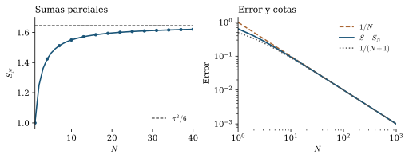
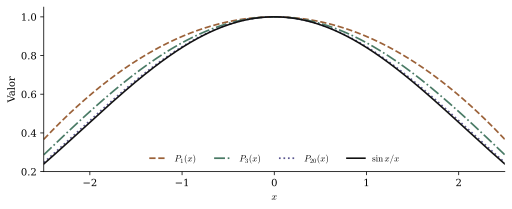

La [prueba histórica de Euler](euler-basilea-prueba-historica.qmd) puede leerse también como documento independiente.

Sumar los primeros cuadrados recíprocos no parece una operación relacionada con los círculos. Los términos se obtienen elevando un entero al cuadrado y tomando su inverso:

$$
1+\frac14+\frac19+\frac1{16}+\frac1{25}+\cdots.
$$

Después de diez términos llevamos aproximadamente $1{,}549768$; después de cien, $1{,}634984$. La suma sigue creciendo, cada vez más despacio. En 1735, Leonhard Euler dio a conocer su valor exacto:

$$
\boxed{\displaystyle\sum_{n=1}^{\infty}\frac1{n^2}=\frac{\pi^2}{6}}.
$$

La aparición de $\pi$ es lo que vuelve memorable el resultado. El problema propone una operación con enteros; la respuesta contiene la constante de la circunferencia. Para comprender ese encuentro hay que seguir la idea que hizo posible el cálculo: las raíces del seno guardan información sobre sus coeficientes, como ocurre con las raíces de un polinomio. Esa idea permite calcular la suma, pero también obliga a examinar qué sucede cuando una factorización tiene infinitos factores.

## Una suma que existe y cuesta calcular

Una suma infinita necesita una definición. Escribimos

$$
S_N=\sum_{n=1}^{N}\frac1{n^2}
$$

y preguntamos si la sucesión $S_1,S_2,S_3,\ldots$ tiene un límite finito. Como todos los términos son positivos, las sumas parciales crecen. Para probar que convergen basta encontrar una cota superior.

Cuando $n\geq2$ se cumple

$$
\frac1{n^2}\leq\frac1{n(n-1)}=\frac1{n-1}-\frac1n.
$$

La comparación resulta útil porque los términos de la derecha se cancelan al sumarlos:

$$
S_N\leq 1+\sum_{n=2}^{N}\left(\frac1{n-1}-\frac1n\right)
=2-\frac1N<2.
$$

Las sumas parciales son crecientes y están acotadas. Por la completitud de los números reales tienen un límite, que llamaremos $S$. Hemos probado que existe antes de intentar averiguar cuánto vale.

La misma clase de comparación permite medir lo que falta después de $N$ términos. Como $x\mapsto x^{-2}$ es decreciente,

$$
\int_{N+1}^{\infty}\frac{dx}{x^2}
\leq\sum_{n=N+1}^{\infty}\frac1{n^2}
\leq\int_N^{\infty}\frac{dx}{x^2}.
$$

Por tanto,

$$
\frac1{N+1}\leq S-S_N\leq\frac1N. \tag{1}
$$

Esta desigualdad explica la lentitud del cálculo directo. Con mil términos todavía falta aproximadamente una milésima; para garantizar un error menor que una millonésima basta tomar más de un millón de términos. El término añadido al final es del orden de $N^{-2}$, pero quedan infinitos términos y su contribución conjunta es del orden de $N^{-1}$.

<figure id="fig-basilea-convergencia" class="ma-basilea-figure">
<picture>
  <source media="(max-width: 600px)" srcset="../assets/articles/ma-art-0020/convergencia-mobile.svg">
  
</picture>
<figcaption>Figura 1. Las sumas parciales y su error. Las cotas de (1) muestran la velocidad de convergencia.</figcaption>
</figure>

La convergencia distingue este problema del de la serie armónica $\sum 1/n$, que diverge. Sin embargo, conocer la existencia del límite y disponer de buenas aproximaciones deja abierta la pregunta por su expresión exacta.

## De Mengoli a la memoria de Euler

El problema pertenece a la investigación sobre series que se desarrolló durante el siglo XVII. Pietro Mengoli lo estudió en ese contexto; su libro *Novae quadraturae arithmeticae, seu de additione fractionum*, de 1650, trata sumas de fracciones y problemas cercanos. Jakob Bernoulli volvió sobre la suma de los cuadrados recíprocos en sus trabajos sobre series de 1689, sin encontrar su valor exacto. El nombre de Basilea conserva la asociación con la ciudad de los Bernoulli y de Euler. [1]

El cálculo de Euler se conoce por la memoria *De summis serierum reciprocarum*, catalogada como E41. Conviene distinguir dos fechas: el trabajo fue presentado a la Academia de San Petersburgo el 5 de diciembre de 1735 y se publicó en 1740, en el volumen 7 de los *Commentarii academiae scientiarum Petropolitanae*, páginas 123–134. El año del descubrimiento y el año de impresión no coinciden. [2, 3]

La memoria presenta primero el cálculo a partir de los arcos cuyo seno vale $1$ (§§3–11). Después, en los §§16–18, Euler considera los ceros del seno, agrupa sus raíces opuestas y relaciona los coeficientes con sumas de potencias de los recíprocos. Expondremos ambos recorridos antes de desarrollar la justificación moderna mediante productos finitos. [3]

Euler continuó trabajando sobre la cuestión. Una memoria posterior, E63, escrita en 1741 y publicada en 1743, ofrece otra vía basada en el arco seno y una ecuación diferencial. Su historia contiene, por tanto, varias demostraciones y reelaboraciones. No se agota en la breve comparación de coeficientes que suele reproducirse. [4]

## Lo que las raíces cuentan sobre un polinomio

Consideremos primero una situación finita. Un polinomio de grado dos, con raíces no nulas $a$ y $b$ y valor $1$ en el origen, puede escribirse como

$$
P(x)=\left(1-\frac{x}{a}\right)\left(1-\frac{x}{b}\right)
=1-\left(\frac1a+\frac1b\right)x+\frac{x^2}{ab}.
$$

La factorización permite leer la suma $1/a+1/b$ en el coeficiente de $x$. Con tres o más factores sucede algo semejante: para obtener el término lineal hay que escoger el término lineal de un factor y el $1$ de todos los demás.

Si las raíces aparecen en parejas $a,-a$, conviene agruparlas:

$$
\left(1-\frac{x}{a}\right)\left(1+\frac{x}{a}\right)
=1-\frac{x^2}{a^2}.
$$

Así, para un producto de $N$ parejas,

$$
P_N(x)=\prod_{n=1}^{N}\left(1-\frac{x^2}{a_n^2}\right),
$$

el coeficiente de $x^2$ es

$$
-\sum_{n=1}^{N}\frac1{a_n^2}.
$$

Ya tenemos una forma de producir cuadrados recíprocos. Hace falta encontrar una función cuyas raíces sean múltiplos enteros de una misma cantidad y cuyo desarrollo cerca del origen conozcamos. El seno reúne ambas propiedades.

Medimos los ángulos en radianes. En esta unidad, las derivadas sucesivas del seno en el origen dan

$$
\sin x=x-\frac{x^3}{3!}+\frac{x^5}{5!}-\cdots.
$$

La fórmula de Taylor justifica esta igualdad: sus restos tienden a cero porque las derivadas del seno y del coseno están acotadas por $1$, y $|x|^{m+1}/(m+1)!$ tiende a cero para cada $x$ fijo. Al dividir por $x$ obtenemos la función

$$
f(x)=
\begin{cases}
\sin x/x,&x\ne0,\\
1,&x=0,
\end{cases}
\qquad
f(x)=1-\frac{x^2}{6}+\frac{x^4}{120}-\cdots.
\tag{2}
$$

Definir $f(0)=1$ elimina la aparente singularidad del cociente. Sus ceros son $\pm\pi,\pm2\pi,\pm3\pi,\ldots$. Cada pareja sugiere un factor $1-x^2/(n^2\pi^2)$.

## La comparación que resuelve el problema

Si la regla de los polinomios pudiera extenderse a este caso, tendríamos

$$
\frac{\sin x}{x}
=\prod_{n=1}^{\infty}\left(1-\frac{x^2}{n^2\pi^2}\right).
\tag{3}
$$

El término constante sería $1$ y el coeficiente de $x^2$ resultaría

$$
-\frac1{\pi^2}\left(1+\frac14+\frac19+\cdots\right).
$$

Pero el desarrollo de Taylor (2) dice que ese coeficiente es $-1/6$. Al igualarlos,

$$
-\frac16=-\frac1{\pi^2}\sum_{n=1}^{\infty}\frac1{n^2},
$$

y la suma buscada es $\pi^2/6$.

En este cálculo se ve de dónde procede $\pi$: los ceros del seno están separados por $\pi$ radianes. Sus cuadrados entran en los denominadores de los factores, mientras que el coeficiente cuadrático del desarrollo en el origen aporta el número $1/6$.

Queda un punto esencial. Conocer los ceros y el valor en el origen no determina una función arbitraria. Para cualquier constante real $c$, las funciones

$$
f(x)\quad\text{y}\quad e^{cx^2}f(x)
$$

tienen los mismos ceros y valen $1$ en el origen, pero sus coeficientes cuadráticos son, respectivamente, $-1/6$ y $c-1/6$. La información sobre los ceros, por sí sola, no prueba (3). Además, el símbolo de producto infinito debe representar un límite existente. Vamos a justificar ambas cosas sin presuponer el valor de $S$.

## La prueba histórica en el orden de E41

En la memoria de 1735, la suma aparece primero al estudiar los arcos cuyo seno vale $1$. El producto construido con los ceros del seno llega después. Seguir ese orden permite ver cómo una pregunta sobre los valores de una función trigonométrica condujo a Euler hacia una suma aritmética. Esta lectura conserva las letras principales de E41 y explica sus operaciones; está basada en los §§3–11 y 16–18 del texto latino reproducido por Ian Bruce, contrastado con la traducción de Jordan Bell. [3, 10]

### Los distintos arcos que tienen un mismo seno

Euler trabaja con una circunferencia de radio $1$. Llama $s$ a la longitud del arco y $y$ a su seno. En radianes, su ecuación es

$$
y=s-\frac{s^3}{1\cdot2\cdot3}
+\frac{s^5}{1\cdot2\cdot3\cdot4\cdot5}-\cdots.
$$

En lugar de dar el arco y calcular el seno, fija $y$ y busca todos los arcos correspondientes. Para $y\ne0$ reordena la ecuación:

$$
1-\frac{s}{y}+\frac{s^3}{3!y}-\frac{s^5}{5!y}+\cdots=0.
$$

Si sus raíces son $A,B,C,\ldots$, Euler la trata como una ecuación algebraica de infinitas dimensiones y escribe la factorización

$$
1-\frac{s}{y}+\frac{s^3}{3!y}-\cdots
=\left(1-\frac{s}{A}\right)
\left(1-\frac{s}{B}\right)
\left(1-\frac{s}{C}\right)\cdots.
$$

Para leer los coeficientes, pongamos $a=1/A$, $b=1/B$, $c=1/C$, etcétera. Euler llama $\alpha$ a la suma de esos recíprocos y $\beta$ a la suma de sus productos tomados dos a dos. El coeficiente de $s$ y la ausencia de un término en $s^2$ le dan

$$
\alpha=a+b+c+\cdots=\frac1y,
\qquad
\beta=ab+ac+bc+\cdots=0.
$$

Para una colección finita, elevar la primera suma al cuadrado produce los cuadrados individuales y dos veces cada producto de elementos distintos. De allí sale la identidad que Euler aplica a su colección infinita:

$$
Q:=a^2+b^2+c^2+\cdots=\alpha^2-2\beta=\frac1{y^2}.
$$

Es el caso inicial de las identidades de Newton utilizadas en el §8. La suma de cuadrados que buscábamos ha aparecido al combinar dos coeficientes de la ecuación del seno.

### El caso de seno igual a uno y los denominadores impares

En el §10 Euler toma $y=1$. Designa por $p$ la semicircunferencia del círculo de radio $1$, de modo que $p=\pi$, y por $q$ un cuarto de la circunferencia completa, es decir, $q=\pi/2$. Los arcos cuyo seno es $1$ son

$$
q,\ -3q,\ 5q,\ -7q,\ 9q,\ldots.
$$

Cada raíz es doble: en un máximo del seno la primera derivada se anula, mientras que la segunda no se anula. Esta explicación de la multiplicidad completa la lectura de las parejas de términos que figuran en la memoria. Contando esas multiplicidades, los recíprocos de las raíces son

$$
\frac1q,\ \frac1q,\ -\frac1{3q},\ -\frac1{3q},\
\frac1{5q},\ \frac1{5q},\ldots.
$$

Por tanto, la suma de sus cuadrados es

$$
Q=\frac2{q^2}\left(1+\frac1{3^2}+\frac1{5^2}+\cdots\right).
$$

Como antes se había obtenido $Q=1/y^2$, al poner $y=1$ resulta $Q=1$. Entonces

$$
1+\frac1{3^2}+\frac1{5^2}+\cdots
=\frac{q^2}{2}=\frac{\pi^2}{8}.
$$

Este es el cálculo del §11. Si llamamos $S$ a la suma sobre todos los enteros positivos, los índices pares contribuyen

$$
\frac1{2^2}+\frac1{4^2}+\frac1{6^2}+\cdots=\frac14S.
$$

La suma sobre los impares es, por ello, $S-S/4=3S/4$. La igualdad anterior da $3S/4=\pi^2/8$, y finalmente

$$
S=\frac43\,\frac{\pi^2}{8}=\frac{\pi^2}{6}.
$$

La memoria presenta así una solución antes de introducir la factorización construida con los ceros. En el §10 Euler también observa que la suma de los recíprocos, sin elevarlos al cuadrado, reproduce la serie de Leibniz para $\pi/4$. Esa coincidencia le sirve como comprobación de su procedimiento. El control de convergencia que exige hoy el paso de coeficientes a sumas infinitas pertenece a la justificación analítica; las identidades algebraicas finitas no lo proporcionan automáticamente.

### El caso de seno igual a cero

En el §16 Euler vuelve sobre $y=0$. No puede sustituir ese valor en la ecuación dividida por $y$: debe regresar a la ecuación inicial del seno. Escribe entonces

$$
0=s-\frac{s^3}{3!}+\frac{s^5}{5!}-\frac{s^7}{7!}+\cdots.
$$

La raíz $s=0$ se elimina al dividir por $s$. Permanecen las raíces $p,-p,2p,-2p,\ldots$, y la expresión resultante es

$$
1-\frac{s^2}{3!}+\frac{s^4}{5!}-\cdots.
$$

Euler asigna a cada raíz su factor lineal y reúne los factores correspondientes a raíces opuestas:

$$
\left(1-\frac{s}{np}\right)\left(1+\frac{s}{np}\right)
=1-\frac{s^2}{n^2p^2}.
$$

De ese modo obtiene la igualdad

$$
1-\frac{s^2}{3!}+\frac{s^4}{5!}-\cdots
=\left(1-\frac{s^2}{p^2}\right)
\left(1-\frac{s^2}{4p^2}\right)
\left(1-\frac{s^2}{9p^2}\right)\cdots.
$$

En el §17 compara el término cuadrático. Su magnitud es $1/(1\cdot2\cdot3)$, mientras que la suma de las magnitudes aportadas por los factores es

$$
\frac1{p^2}+\frac1{4p^2}+\frac1{9p^2}+\cdots=\frac16.
$$

Como $p=\pi$, la suma de Basilea vuelve a ser $\pi^2/6$. Euler continúa con los productos tomados dos a dos y tres a tres. Si $a_n=1/(n^2p^2)$, los coeficientes le proporcionan

$$
\alpha=\sum_n a_n=\frac1{3!},\qquad
\beta=\sum_{i<j}a_i a_j=\frac1{5!},\qquad
\gamma=\sum_{i<j<k}a_i a_j a_k=\frac1{7!}.
$$

Aplicando las identidades de Newton del §8, calcula

$$
\sum_n a_n^2=\alpha^2-2\beta=\frac1{90},
\qquad
\sum_n a_n^3=\alpha^3-3\alpha\beta+3\gamma=\frac1{945}.
$$

Al restituir los factores $p^4$ y $p^6$, aparecen $\sum n^{-4}=\pi^4/90$ y $\sum n^{-6}=\pi^6/945$. En el §18 enumera los resultados hasta la potencia duodécima. La prueba histórica comprende tanto la identificación de la suma de cuadrados como un procedimiento para seguir calculando otras sumas.

El paso que requiere una justificación adicional es la factorización infinita y el uso de sus coeficientes. La demostración que sigue establece directamente el producto del seno mediante identidades finitas y controla el límite. Así queda visible qué razonamiento pertenece a la memoria de Euler y cómo puede completarse con herramientas actuales.

## De una factorización finita al producto del seno

### Una identidad con un número impar de factores

Tomemos un entero impar $m=2r+1$, con $r\geq1$. La fórmula de De Moivre permite expresar $\sin(mt)/\sin t$ como un polinomio en $u=\sin^2t$. En efecto, al desarrollar la parte imaginaria de $(\cos t+i\sin t)^m$ y dividir por $\sin t$ resulta

$$
\frac{\sin(mt)}{\sin t}=P_r(\sin^2t),
\qquad
P_r(u)=\sum_{j=0}^{r}(-1)^j\binom{m}{2j+1}u^j(1-u)^{r-j}.
$$

El grado de $P_r$ es a lo sumo $r$ y su término constante es $m$. Para $k=1,\ldots,r$, el valor $t=k\pi/m$ anula el numerador sin anular el denominador. Por tanto, los números

$$
u_k=\sin^2\left(\frac{k\pi}{m}\right)
$$

son raíces de $P_r$. Son $r$ raíces distintas, porque $k\pi/m$ recorre ángulos del intervalo $(0,\pi/2)$, donde el seno es estrictamente creciente. Un polinomio no nulo de grado a lo sumo $r$ con esas $r$ raíces queda determinado, salvo un factor constante. Su valor en $u=0$ fija ese factor y da

$$
\frac{\sin(mt)}{m\sin t}
=\prod_{k=1}^{r}\left(1-\frac{\sin^2t}{\sin^2(k\pi/m)}\right).
\tag{4}
$$

Esta es una identidad finita. No hemos utilizado productos infinitos ni la suma que queremos calcular. Los puntos donde el cociente presenta una singularidad removible se interpretan por continuidad.

Sustituimos $t=x/m$:

$$
\frac{\sin x}{m\sin(x/m)}
=\prod_{k=1}^{r}\left(1-\frac{\sin^2(x/m)}{\sin^2(k\pi/m)}\right).
\tag{5}
$$

Cuando $m$ crece por valores impares, el miembro izquierdo tiende a $\sin x/x$, con el valor $1$ en $x=0$. Para cada $k$ fijo,

$$
\frac{\sin^2(x/m)}{\sin^2(k\pi/m)}
\longrightarrow\frac{x^2}{k^2\pi^2}.
$$

La forma del producto de Euler aparece ya en cada factor. Falta controlar los factores cuyo índice también crece con $m$.

### Por qué los factores lejanos no alteran el límite

Fijemos un intervalo $|x|\leq R$. Para $1\leq k\leq r$ tenemos $0\leq k\pi/m<\pi/2$. La concavidad del seno en ese intervalo implica $\sin y\geq2y/\pi$; además, $|\sin(x/m)|\leq |x|/m$. En consecuencia,

$$
0\leq a_{m,k}(x):=\frac{\sin^2(x/m)}{\sin^2(k\pi/m)}
\leq\frac{R^2}{4k^2}. \tag{6}
$$

La cota es independiente de $m$. Su suma converge por la comparación telescópica de la primera sección, que solo demostró convergencia y no usó $\pi^2/6$.

Necesitamos una estimación elemental para productos. Al desarrollar un producto finito y tomar valores absolutos,

$$
\left|\prod_j(1+b_j)-1\right|
\leq\prod_j(1+|b_j|)-1
\leq\exp\left(\sum_j|b_j|\right)-1.
\tag{7}
$$

Aplicada a los factores con $k>K$, (6) y (7) muestran que su producto difiere de $1$ en una cantidad a lo sumo

$$
\exp\left(\frac{R^2}{4}\sum_{k>K}\frac1{k^2}\right)-1.
$$

Esta cantidad tiende a cero cuando $K$ crece, uniformemente en $m$ y en $|x|\leq R$. Los productos de los primeros $K$ factores están también acotados uniformemente: sus valores absolutos no superan $\exp((R^2/4)\sum_{k\geq1}k^{-2})$.

El producto propuesto por Euler admite el mismo control, usando $|x^2/(k^2\pi^2)|\leq R^2/(k^2\pi^2)$. Sus productos parciales forman así una sucesión uniformemente de Cauchy en cada intervalo acotado. Existe, por tanto, su límite.

Podemos comparar ambos productos separando los primeros $K$ factores del resto. Para $K$ fijo, los primeros factores de (5) convergen uniformemente a los correspondientes factores de (3), por el límite $\sin y/y\to1$. Los restos de ambos productos están tan cerca de $1$ como deseemos si elegimos $K$ suficientemente grande. Las cotas anteriores impiden que al multiplicar por los primeros factores el error deje de ser pequeño. Primero elegimos $K$; después hacemos crecer $m$. Esto prueba que el límite del miembro derecho de (5) es precisamente el producto de (3).

El miembro izquierdo converge uniformemente a $f(x)$: puede escribirse como $f(x)/f(x/m)$, y el denominador tiende uniformemente a $1$. Hemos demostrado

$$
f(x)=\prod_{n=1}^{\infty}\left(1-\frac{x^2}{n^2\pi^2}\right)
$$

para todo $x$ real, con convergencia uniforme en intervalos acotados. La fórmula coincide con el producto clásico del seno recogido en DLMF 4.22.1. [5]

<figure id="fig-basilea-producto" class="ma-basilea-figure">
<picture>
  <source media="(max-width: 600px)" srcset="../assets/articles/ma-art-0020/producto_seno-mobile.svg">
  
</picture>
<figcaption>Figura 2. El seno dividido por x y los productos de Euler con 1, 3 y 20 factores.</figcaption>
</figure>

### Cómo comparar el término cuadrático con rigor

La convergencia uniforme de funciones reales no basta, por sí sola, para intercambiar límites y derivadas. Podemos evitar esa dificultad controlando directamente el error del término cuadrático.

Si $|x|\leq\pi/2$, todos los números $u_n=x^2/(n^2\pi^2)$ están entre $0$ y $1/4$. Para $0\leq u\leq1/4$,

$$
0\leq-\log(1-u)-u
=\int_0^u\frac{t}{1-t}\,dt
\leq\frac23u^2.
\tag{8}
$$

La serie de los logaritmos converge, y la suma de los errores de (8) queda acotada por una constante multiplicada por $x^4\sum n^{-4}$. Esta última serie converge porque $n^{-4}\leq n^{-2}$. Para cada $x$ de ese intervalo, los productos parciales positivos tienen un límite positivo: son las exponenciales de una serie convergente de logaritmos. Podemos escribir

$$
\log f(x)
=-\frac{x^2}{\pi^2}\sum_{n=1}^{\infty}\frac1{n^2}+O(x^4).
$$

La notación $O(x^4)$ significa aquí que el valor absoluto del resto está acotado por $C|x|^4$ para $x$ suficientemente próximo a cero, con una constante $C$ independiente de $x$. Al exponenciar obtenemos

$$
f(x)=1-\frac{x^2}{\pi^2}S+O(x^4).
$$

Por Taylor también sabemos que $f(x)=1-x^2/6+O(x^4)$. Restamos ambas expresiones, dividimos por $x^2$ para $x\ne0$ y hacemos $x\to0$. El resultado es

$$
\frac{S}{\pi^2}=\frac16.
$$

La intuición de Euler queda justificada. La prueba usó la convergencia de la serie, una identidad trigonométrica finita y estimaciones del resto; ninguna de ellas dependía del valor que acabamos de obtener.

## Una comprobación desde la identidad finita

La misma identidad (4) permite llegar al resultado sin construir primero todo el producto infinito. Es una forma breve de verificar el núcleo del razonamiento.

Cerca de $t=0$, el cociente de su miembro izquierdo tiene el desarrollo

$$
\frac{\sin(mt)}{m\sin t}
=\frac{1-m^2t^2/6+O(t^4)}{1-t^2/6+O(t^4)}
=1-\frac{m^2-1}{6}t^2+O(t^4).
$$

En el producto finito del miembro derecho, $\sin^2t=t^2+O(t^4)$, de modo que el coeficiente cuadrático es $-\sum_{k=1}^{r}\csc^2(k\pi/m)$. Aquí $\csc y=1/\sin y$. Por igualdad de coeficientes,

$$
\sum_{k=1}^{r}\frac1{m^2\sin^2(k\pi/m)}
=\frac{m^2-1}{6m^2},\qquad m=2r+1.
$$

Para cada $k$ fijo el sumando tiende a $1/(k^2\pi^2)$, y está acotado por $1/(4k^2)$. Extendemos la suma con términos cero para $k>r$. Una cabeza finita converge término a término; la cola queda uniformemente controlada por la cola de $\sum1/(4k^2)$. Por ello podemos pasar al límite en la suma y obtenemos otra vez

$$
\frac1{\pi^2}\sum_{k=1}^{\infty}\frac1{k^2}=\frac16.
$$

Las dos demostraciones comparten su fundamento finito. Una conserva toda la factorización del seno; la otra conserva solo el coeficiente que necesita el problema de Basilea.

## Más allá de los cuadrados recíprocos

La notación actual reúne estas sumas en la función

$$
\zeta(s)=\sum_{n=1}^{\infty}\frac1{n^s},\qquad s>1.
$$

El problema de Basilea calcula $\zeta(2)$. La factorización del seno contiene información sobre todos los valores $\zeta(2k)$.

Para verlo, tomamos logaritmos cuando $|x|<\pi$ y usamos $\log(1-u)=-\sum_{k\geq1}u^k/k$:

$$
\log\frac{\sin x}{x}
=-\sum_{k=1}^{\infty}\frac{\zeta(2k)}{k\pi^{2k}}x^{2k}.
\tag{9}
$$

El intercambio de las dos sumas está justificado por convergencia absoluta. En cualquier intervalo $|x|\leq\rho<\pi$, la suma de los valores absolutos queda acotada por

$$
\frac{\rho^2}{\pi^2(1-\rho^2/\pi^2)}\sum_{n=1}^{\infty}\frac1{n^2}<\infty.
$$

Escribamos $f(x)=1+ax^2+bx^4+cx^6+O(x^8)$, con $a=-1/6$, $b=1/120$ y $c=-1/5040$. El desarrollo de $\log(1+v)$ da

$$
\log f(x)=ax^2+\left(b-\frac{a^2}{2}\right)x^4
+\left(c-ab+\frac{a^3}{3}\right)x^6+O(x^8).
$$

Las cuentas son

$$
b-\frac{a^2}{2}=\frac1{120}-\frac1{72}=-\frac1{180},
$$

$$
c-ab+\frac{a^3}{3}
=-\frac1{5040}+\frac1{720}-\frac1{648}=-\frac1{2835}.
$$

Comparando con (9),

$$
\frac{\zeta(4)}{2\pi^4}=\frac1{180},\qquad
\frac{\zeta(6)}{3\pi^6}=\frac1{2835}.
$$

Por tanto,

$$
\zeta(4)=\frac{\pi^4}{90},\qquad
\zeta(6)=\frac{\pi^6}{945}.
$$

### La fórmula general y los números de Bernoulli

Podemos organizar todos estos cálculos con los números de Bernoulli. Se definen mediante la serie convergente cerca del origen

$$
\frac{t}{e^t-1}=\sum_{n=0}^{\infty}B_n\frac{t^n}{n!},
\qquad |t|<2\pi.
$$

Sus primeros valores son $B_0=1$, $B_1=-1/2$, $B_2=1/6$, $B_4=-1/30$ y $B_6=1/42$. Los índices impares mayores que uno tienen valor cero; esto se deduce de que $t/(e^t-1)+t/2$ es una función par. La definición y esta propiedad están recogidas en DLMF §24.2. [6]

Derivando la serie de potencias (9) dentro de su radio de convergencia y multiplicando por $x$ obtenemos

$$
x\cot x=1-2\sum_{k=1}^{\infty}\frac{\zeta(2k)}{\pi^{2k}}x^{2k}.
\tag{10}
$$

Por otra parte, las expresiones exponenciales del seno y del coseno dan

$$
x\cot x=ix+\frac{2ix}{e^{2ix}-1}.
$$

En esta igualdad $i^2=-1$. Sustituimos $t=2ix$ en la serie generadora de Bernoulli. El término $B_1(2ix)=-ix$ cancela el $ix$ exterior, y los restantes términos impares desaparecen:

$$
x\cot x
=1+\sum_{k=1}^{\infty}\frac{(-1)^k2^{2k}B_{2k}}{(2k)!}x^{2k}.
$$

La comparación con (10) produce la fórmula

$$
\boxed{\displaystyle
\zeta(2k)=(-1)^{k+1}\frac{B_{2k}(2\pi)^{2k}}{2(2k)!}},
\qquad k\geq1.
\tag{11}
$$

Así, cada valor de $\zeta$ en un entero positivo par es un múltiplo racional de la potencia correspondiente de $\pi$. La fórmula está registrada en DLMF 25.6.2 en una forma equivalente, con $|B_{2k}|$. [7] El uso de la serie generadora aquí organiza la derivación en lenguaje moderno; no atribuye esa presentación a la memoria E41.

La simetría de las raíces $\pm n\pi$ explica por qué este procedimiento entrega potencias pares. Al agrupar las raíces desaparecen las potencias impares de $x$. El argumento no proporciona una fórmula semejante para $\zeta(3)$: su ausencia de esta expansión señala una limitación del método.

## Los primos y la frecuencia de los números coprimos

La misma suma tiene una interpretación aritmética. Para un conjunto finito de primos, multiplicar las series geométricas

$$
\prod_{p\leq y}\left(1+\frac1{p^2}+\frac1{p^4}+\cdots\right)
$$

produce exactamente los términos $1/n^2$ cuyos denominadores $n$ tienen todos sus factores primos menores o iguales que $y$. Cada entero aparece una sola vez, por la unicidad de la factorización prima. Al aumentar $y$ acabamos incorporando todos los enteros. Como los términos son positivos y la serie converge,

$$
\zeta(2)=\prod_p\left(1-\frac1{p^2}\right)^{-1},
\qquad
\prod_p\left(1-\frac1{p^2}\right)=\frac6{\pi^2}.
\tag{12}
$$

El producto está tomado sobre todos los primos. Es el caso $s=2$ del producto de Euler para la función zeta; su forma general y su dominio de convergencia se recogen en DLMF 27.4.3. [8]

El inverso de la suma de Basilea mide la frecuencia de parejas de enteros coprimos. Hay que precisar la elección aleatoria: para cada $N$ escogemos independientemente $a,b$ de manera uniforme entre $1$ y $N$, y después hacemos $N\to\infty$. No existe una distribución uniforme sobre todos los enteros positivos.

Para un conjunto finito de primos $p\leq y$, la proporción límite de parejas que no tienen ninguno de esos primos como divisor común es

$$
\prod_{p\leq y}\left(1-\frac1{p^2}\right).
$$

En efecto, módulo un primo $p$ hay $p^2$ parejas de residuos y solo una tiene ambos componentes divisibles por $p$. El teorema chino del resto combina las condiciones para primos distintos. Como los residuos módulo el producto de esos primos se distribuyen asintóticamente de manera uniforme en $\{1,\ldots,N\}$, sus proporciones se multiplican.

Todavía podría ocurrir que ambos enteros compartieran un primo mayor que $y$. La proporción de esas parejas está acotada por la suma de las proporciones correspondientes a cada primo:

$$
\sum_{y<p\leq N}\frac{\lfloor N/p\rfloor^2}{N^2}
\leq\sum_{n>y}\frac1{n^2}.
$$

El símbolo $\lfloor u\rfloor$ designa el mayor entero menor o igual que $u$. La última cola tiende a cero independientemente de $N$. Podemos, por tanto, pasar primero al límite $N\to\infty$ para un conjunto finito de primos y después hacer $y\to\infty$. Concluimos que

$$
\lim_{N\to\infty}\frac{\#\{(a,b)\in\{1,\ldots,N\}^2:\gcd(a,b)=1\}}{N^2}
=\frac6{\pi^2}\approx0{,}607927.
$$

Aproximadamente el $60{,}79\%$ de las parejas son coprimas en este sentido preciso. El paso de un producto finito de condiciones al límite exige controlar los primos restantes; la convergencia de la serie de Basilea proporciona justamente ese control.

## La energía de una serie de Fourier

La aparición de cuadrados recíprocos también puede entenderse mediante la descomposición de una función en oscilaciones. Esta conexión utiliza un teorema posterior, la identidad de Parseval, y ofrece una lectura distinta del mismo número.

Consideremos $g(x)=x$ en $(-\pi,\pi)$, extendida periódicamente con período $2\pi$. Como es impar, sus coeficientes de coseno y su término constante son cero. Los coeficientes de seno son

$$
b_n=\frac1\pi\int_{-\pi}^{\pi}x\sin(nx)\,dx
=\frac2\pi\int_0^{\pi}x\sin(nx)\,dx.
$$

Integramos por partes:

$$
\begin{aligned}
\int_0^{\pi}x\sin(nx)\,dx
&=\left[-\frac{x\cos(nx)}n\right]_0^{\pi}
+\frac1n\int_0^{\pi}\cos(nx)\,dx\\
&=-\frac{\pi(-1)^n}{n}.
\end{aligned}
$$

Por ello $b_n=2(-1)^{n+1}/n$. La identidad de Parseval, para la normalización de Fourier que estamos usando, afirma que

$$
\frac1\pi\int_{-\pi}^{\pi}|g(x)|^2\,dx
=\frac{a_0^2}{2}+\sum_{n=1}^{\infty}(a_n^2+b_n^2).
$$

Se aplica a funciones de cuadrado integrable, entre ellas esta función lineal en un intervalo acotado. Su fundamento es la ortogonalidad y completitud del sistema trigonométrico en ese espacio: los cuadrados de los coeficientes suman la norma cuadrática total. La normalización y las hipótesis usadas aquí figuran en DLMF 1.8.2 y 1.8.5. [9] En nuestro caso obtenemos

$$
\frac1\pi\int_{-\pi}^{\pi}x^2\,dx
=4\sum_{n=1}^{\infty}\frac1{n^2}.
$$

La integral de la izquierda vale $2\pi^2/3$, de modo que se recupera $\sum1/n^2=\pi^2/6$. Los valores elegidos en los extremos no afectan la integral ni los coeficientes; el salto de la extensión periódica tampoco impide aplicar Parseval.

Esta demostración toma Parseval como teorema previo. Su interés aquí es mostrar qué representa la suma: la energía cuadrática de una función cuyos coeficientes oscilatorios decrecen como $1/n$. Al elevar esos coeficientes al cuadrado aparecen los términos $1/n^2$.

## Qué enseña la solución de Euler

El cálculo permite obtener inmediatamente otras sumas. Los índices pares aportan una cuarta parte del total; los impares aportan el resto:

$$
\sum_{n=1}^{\infty}\frac1{(2n)^2}=\frac{\pi^2}{24},
\qquad
\sum_{n=1}^{\infty}\frac1{(2n-1)^2}=\frac{\pi^2}{8}.
$$

Restando la contribución par de la impar,

$$
1-\frac14+\frac19-\frac1{16}+\cdots=\frac{\pi^2}{12}.
$$

La convergencia absoluta justifica estas separaciones. En cada caso se aprovecha una estructura sencilla del conjunto de índices para reutilizar una suma ya conocida.

La consecuencia conceptual alcanza más lejos. La factorización del seno relaciona su comportamiento cerca del origen con la distribución completa de sus ceros. El coeficiente $-1/6$, que puede calcularse mediante unas pocas derivadas, determina una suma extendida sobre todos los múltiplos positivos de $\pi$. A su vez, la factorización prima de los enteros transforma esa suma en un producto sobre primos y en una densidad de parejas coprimas. Fourier la interpreta como una norma cuadrática.

El ejemplo $e^{cx^2}f(x)$ mostró por qué era necesario demostrar la factorización. Esa dificultad conduce hacia una pregunta general del análisis: qué información adicional sobre una función permite reconstruirla a partir de sus ceros. La teoría de productos de funciones enteras desarrollará esa pregunta con herramientas más amplias. En el caso del seno, la identidad finita (4) y el control de sus colas bastaron para resolverla.

La fuerza del argumento de Euler está en haber encontrado una representación donde la suma se vuelve visible. El número $\pi^2/6$ aparece al reunir dos descripciones del seno: su desarrollo en el origen y sus ceros, espaciados por la geometría del círculo.

## Fuentes y referencias

**[1]** Christian Genest y Julien Fageot. «Euler et le problème de Bâle». *Accromath*, 16.2, 2021. Referencia para el contexto de Mengoli, los Bernoulli y la denominación del problema. El artículo menciona antecedentes de 1644; aquí se ha identificado expresamente el libro de Mengoli de 1650, sin equiparar su fecha con la del primer planteamiento. <https://accromath.uqam.ca/2021/10/euler-et-le-probleme-de-bale/>

**[2]** Euler Archive. Ficha E41 de *De summis serierum reciprocarum*. University of the Pacific. Datos de composición, publicación y localización bibliográfica. <https://scholarlycommons.pacific.edu/euler-works/41/>

**[3]** Leonhard Euler. *De summis serierum reciprocarum*. Presentado en 1735; publicado en *Commentarii academiae scientiarum Petropolitanae*, 7, 1740, pp. 123–134. E41. Consulta del texto mediante la traducción inglesa de Jordan Bell, *On the sums of series of reciprocals*, especialmente §§3–11 y 16–18. La exposición matemática de este artículo es una elaboración propia en notación moderna, no una traducción de esa memoria. <https://arxiv.org/abs/math/0506415>

**[4]** Leonhard Euler. *Démonstration de la somme de cette suite 1 + 1/4 + 1/9 + 1/16 + …*. E63. Escrita en 1741; publicada en *Journal littéraire d'Allemagne, de Suisse et du Nord*, 2, 1743, pp. 115–127. Datos y descripción del método en Euler Archive. <https://scholarlycommons.pacific.edu/euler-works/63/>

**[5]** NIST Digital Library of Mathematical Functions. §4.22, «Infinite Products and Partial Fractions», fórmula 4.22.1. Referencia de control para el producto del seno. <https://dlmf.nist.gov/4.22.E1>

**[6]** NIST Digital Library of Mathematical Functions. §24.2, «Definitions and Generating Functions», fórmulas 24.2.1–24.2.2 y tabla 24.2.1. Convención de los números de Bernoulli. <https://dlmf.nist.gov/24.2>

**[7]** NIST Digital Library of Mathematical Functions. §25.6, «Integer Arguments», fórmulas 25.6.1–25.6.2. Valores de la función zeta en enteros pares. <https://dlmf.nist.gov/25.6>

**[8]** NIST Digital Library of Mathematical Functions. §27.4, «Euler Products and Dirichlet Series», fórmula 27.4.3. Producto de Euler para $\operatorname{Re}s>1$. <https://dlmf.nist.gov/27.4.E3>

**[9]** NIST Digital Library of Mathematical Functions. §1.8, «Fourier Series», fórmulas 1.8.2 y 1.8.5. Coeficientes de Fourier e identidad de Parseval para funciones de cuadrado integrable. <https://dlmf.nist.gov/1.8>

**[10]** Leonhard Euler. Texto latino de *De summis serierum reciprocarum*, reproducido por Ian Bruce en las páginas digitales 10–17 de *Concerning the sums of series of reciprocals*. Se consultó la reproducción latina, además del control inglés de Bell. La lectura histórica desarrolla el argumento y conserva sus letras principales; no se presenta como edición diplomática ni como traducción íntegra de la memoria. <https://www.17centurymaths.com/contents/euler/e041tr.pdf>

Fuentes electrónicas consultadas el 17 de octubre de 2026.
