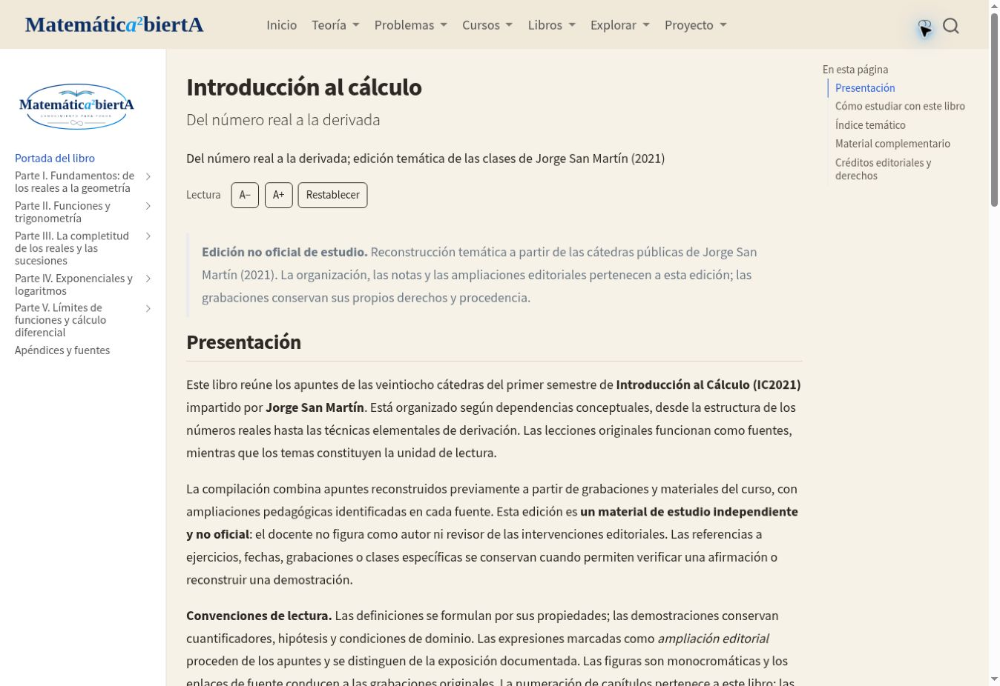
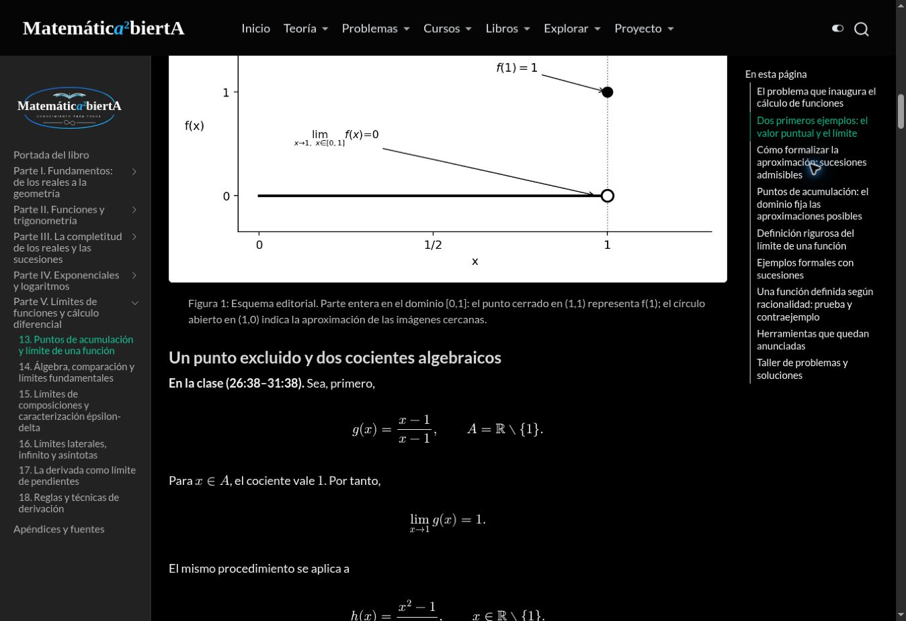

# IC2021 — Informe de integración y validación

Edición temática no oficial de apuntes elaborados a partir de las clases de Jorge San Martín (2021). Trabajo sobre el PR #352 existente; no se fusiona ni despliega en producción.

## Auditoría del repositorio

- Base principal auditada: `49532a6990b5d31058cf57f7fb2615b0e7c11946` (`main`). La rama de trabajo existente partía del mismo repositorio y conservaba 20 páginas iniciales del libro.
- Proyecto global `type: website`, Quarto 1.10.18, MathJax, búsqueda y navegación anterior/siguiente. Se conserva esta arquitectura; un proyecto anidado no sería renderizado como parte del sitio global.
- Estilo heredado: `styles.scss`, `paper.scss`, `brand.scss` y `assets/books/reader.css`. El nuevo libro no modifica estos recursos compartidos.
- `publish.yml` publica en `gh-pages` al recibir un push en `main`. Este trabajo solo actualiza la rama `feat/introduccion-calculo-sanmartin-quarto-20261101` del PR #352.
- Ruta final solicitada y compatible: `/libros/otros/introduccion-al-calculo/`. La ruta más larga del primer borrador se reemplazó antes de su publicación; no había publicación de producción que redirigir.
- Integración limitada a la sidebar nombrada, los dos catálogos, las fuentes/recursos del libro, sus scripts, registros y pruebas. Se conservan otras obras y PR abiertos.

## Fuente de verdad e integridad

Maestro corregido: SHA-256 `1a66001fdbecd197f645a44b3094b33e8694efe20212c40140d5d9456d16476a`. Coincide byte por byte con la copia recuperada de la conversación. ZIP base original SHA-256 `0c27bae1aeb06250c52aeb73d1e0019c75d15790eda8e8c61bf89df2a34c9e9e`, conservado mediante once partes versionadas.

Se localizaron en Google Drive la carpeta `San Martín - Introducción al Cálculo` y sus subcarpetas `figuras`, `fuentes` y `Libro IC2021 - Quarto`. El paquete inicial contenía 175 PNG, mientras que el maestro citaba 177. Las dos figuras faltantes se recuperaron sin modificación del ZIP original `IC21_Catedra_12_1_Completo_BN.zip`:

- `figuras/IC2021_Catedra_12_1/01_valor_y_limite.png`.
- `figuras/IC2021_Catedra_12_1/03_puntos_de_acumulacion.png`.

El registro de recuperación conserva nombres, identidad del paquete y hashes. El materializador genera además un ZIP completo descargable con el maestro y las 177 figuras, manteniendo intacto el ZIP inicial.

## Índice final

### Parte I. Fundamentos: de los reales a la geometría

1. [La estructura algebraica de los números reales](../../libros/otros/introduccion-al-calculo/capitulo-01.qmd)
2. [Orden, desigualdades e inecuaciones](../../libros/otros/introduccion-al-calculo/capitulo-02.qmd)
3. [Coordenadas, distancias y rectas](../../libros/otros/introduccion-al-calculo/capitulo-03.qmd)
4. [Cónicas y curvas cuadráticas](../../libros/otros/introduccion-al-calculo/capitulo-04.qmd)

### Parte II. Funciones y trigonometría

5. [El lenguaje de las funciones](../../libros/otros/introduccion-al-calculo/capitulo-05.qmd)
6. [El círculo trigonométrico y sus identidades](../../libros/otros/introduccion-al-calculo/capitulo-06.qmd)
7. [Identidades trigonométricas y resolución de triángulos](../../libros/otros/introduccion-al-calculo/capitulo-07.qmd)
8. [Funciones trigonométricas inversas y ecuaciones](../../libros/otros/introduccion-al-calculo/capitulo-08.qmd)

### Parte III. La completitud de los reales y las sucesiones

9. [Supremos, naturales y propiedad arquimediana](../../libros/otros/introduccion-al-calculo/capitulo-09.qmd)
10. [Sucesiones y convergencia](../../libros/otros/introduccion-al-calculo/capitulo-10.qmd)
11. [Comparaciones, velocidad y monotonía de sucesiones](../../libros/otros/introduccion-al-calculo/capitulo-11.qmd)

### Parte IV. Exponenciales y logaritmos

12. [La función exponencial y su inversa logarítmica](../../libros/otros/introduccion-al-calculo/capitulo-12.qmd)

### Parte V. Límites de funciones y cálculo diferencial

13. [Puntos de acumulación y límite de una función](../../libros/otros/introduccion-al-calculo/capitulo-13.qmd)
14. [Álgebra, comparación y límites fundamentales](../../libros/otros/introduccion-al-calculo/capitulo-14.qmd)
15. [Límites de composiciones y caracterización épsilon-delta](../../libros/otros/introduccion-al-calculo/capitulo-15.qmd)
16. [Límites laterales, infinito y asíntotas](../../libros/otros/introduccion-al-calculo/capitulo-16.qmd)
17. [La derivada como límite de pendientes](../../libros/otros/introduccion-al-calculo/capitulo-17.qmd)
18. [Reglas y técnicas de derivación](../../libros/otros/introduccion-al-calculo/capitulo-18.qmd)

Portada con presentación y orientación de estudio; apéndices con concordancia, referencias audiovisuales, material complementario y criterios editoriales. El índice principal muestra partes y capítulos; las secciones permanecen en el índice local de cada página.

## Registro de transformaciones editoriales

1. Separación reproducible de los 18 capítulos sin suprimir ni reordenar sus cuerpos.
2. Títulos de capítulo trasladados al YAML; encabezados internos rebajados un nivel, conservando todos sus textos.
3. Índice web nuevo de cinco partes y 18 capítulos, con búsqueda, navegación local y secuencial.
4. Anclas `fig-ic2021-cNN-fNN` y texto alternativo explícito para las 177 figuras. Se conservan pies, proporciones, atributos de tamaño y PNG originales. El texto alternativo usa el pie sin delimitadores matemáticos; en un pie breve se agrega «Esquema matemático».
5. Recuperación de los dos recursos ausentes del ZIP base; ninguna sustitución de fórmulas por imágenes.
6. Créditos de edición no oficial, separación de aportes editoriales y derechos de vídeos externos. No se agregan capturas de pizarra ni se atribuyen ampliaciones al docente.
7. Descarga reproducible completa. No se añade un enlace a un PDF definitivo sin un archivo publicable confirmado.
8. No se retiran pasajes matemáticos por parecer duplicados: el maestro corregido conserva autoridad. La transformación no introduce cambios de fórmulas, demostraciones, ejemplos, ejercicios ni soluciones.

## Validación

| Control | Evidencia / resultado |
|---|---|
| Compilación completa | Quarto 1.10.18; 20 páginas HTML, sin errores |
| Fidelidad matemática | 9.344 nodos matemáticos conservados en orden mediante AST Pandoc; 970 secciones internas |
| Estructura | Cinco partes, 18 capítulos, portada y apéndices |
| Figuras | 177 referencias únicas; 177 PNG con SHA-256, pies, alt y anclas; cotejo HTML por figura |
| Integración gráfica | Control MA-FIG PASS; 91 pruebas de regresión del sistema de figuras PASS |
| Estilo de lectura | Herencia CSS canónica PASS |
| Enlaces internos | Rutas y fragmentos del libro renderizado PASS |
| Fuentes audiovisuales | 30 vídeos únicos responden HTTP 200 mediante YouTube oEmbed; títulos guardados en el registro |
| Navegador | CI comprueba 20 páginas en 390, 768 y 1440 píxeles; consultar el estado final del workflow |
| Revisión visual | Portada y capítulos de geometría/límites inspeccionados; planchas de contacto de los 177 originales revisadas |

El cotejo de AST cuenta las fórmulas del cuerpo y de los pies. Excluye el contenido alternativo duplicado de las imágenes, que es una representación textual accesible; no excluye las fórmulas de sus pies visibles. Los inventarios de términos como «Teorema» o «Ejercicio» son recuentos de marcadores, no una nueva numeración académica.

Los enlaces audiovisuales conservan sus marcas temporales originales. La respuesta oEmbed acredita disponibilidad del vídeo y su título, no el cotejo de cada segundo enlazado.

## Límites y autorización

La fidelidad certificada corresponde al maestro. Sigue pendiente la auditoría audiovisual integral de las 28 clases indicada en la fuente. Los esquemas suministrados son elaboraciones editoriales de los apuntes; los materiales oficiales y grabaciones enlazados conservan sus derechos. No se declara al profesor autor o revisor de las intervenciones editoriales.

No se ha fusionado el PR, modificado `main`, cambiado DNS ni publicado en producción. La autorización expresa del usuario sigue siendo necesaria para ese paso.

## Recursos y regeneración

- [Inventario completo de capítulos, encabezados, marcadores y 177 figuras](../../data/sanmartin-web-inventory.json).
- [Disponibilidad y títulos de los 30 vídeos](../../data/sanmartin-audiovisual-check.json).
- [Registros individuales de figuras](../../data/ma-fig-manifests/).
- [Instrucciones reproducibles y actualización del maestro](../../libros/otros/introduccion-al-calculo/README.md).
- Workflow: `.github/workflows/sanmartin-quarto-qa.yml`; artefacto `ic2021-complete-preview-and-qa` con HTML completo, informe y capturas en los tres tamaños.

