[Índice del libro](../para-matematicos/analisis-para-matematicos.html) · [Ejercicios de este capítulo](#ejercicios-0)

*De los racionales a la recta completa*

[]{#MA-SEC-ANM-01-000-010}

Los números reales suelen entrar en un curso de análisis como si ya estuvieran esperándonos. Escribimos $\mathbb R$, dibujamos una recta, colocamos sobre ella números racionales e irracionales y empezamos a hablar de límites, continuidad o derivadas. La notación funciona tan bien y la imagen de la recta es tan familiar que resulta fácil olvidar una pregunta anterior a todas esas técnicas:

> **¿Por qué tenemos derecho a suponer que existe un sistema numérico con todas las propiedades que atribuimos a los números reales?**

La pregunta no es filosófica en un sentido vago. Es una pregunta matemática muy concreta. Podemos escribir una lista de propiedades que quisiéramos que cumpliera un sistema numérico; otra cosa es demostrar que esas propiedades son compatibles y que hay, efectivamente, algún objeto matemático que las satisface todas a la vez.

Ése será el problema fundacional de este capítulo.

Nuestro punto de partida no será una definición ya terminada de $\mathbb R$. Tampoco reconstruiremos toda la aritmética desde los axiomas de la teoría de conjuntos. Tomaremos como disponibles los lenguajes elementales de conjuntos y funciones, junto con los sistemas $\mathbb N$, $\mathbb Z$ y $\mathbb Q$ y su aritmética usual. A partir de ahí construiremos, paso a paso, un sistema que satisfaga las exigencias que queremos imponer a los reales.

Esto es lo que aquí significa una **construcción acotada**: construiremos explícitamente el nuevo objeto, pero no convertiremos el capítulo en una reconstrucción de toda la matemática desde ZF/ZFC. Trabajaremos dentro del marco clásico habitual; no estamos usando la palabra «constructivo» en el sentido técnico de la matemática constructivista.

La estrategia será deliberadamente lenta. Primero fijaremos la especificación: qué tendría que cumplir un candidato a «sistema de números reales». Después veremos por qué los racionales no bastan. Sólo entonces tendrá sentido preguntarnos cómo reparar exactamente ese defecto.

Hay además una segunda cuestión que quedará esperando detrás de la primera. Incluso si logramos construir un sistema con las propiedades deseadas, todavía habrá que preguntarse si otro sistema construido de manera distinta podría representar una estructura esencialmente diferente. No abriremos todavía ese problema. Primero debemos resolver el más básico:

$$
\boxed{\text{¿existe algún sistema que merezca llamarse sistema de números reales?}}
$$

## 0.1. ¿Existen los números reales?

[]{#MA-SEC-ANM-01-000-001}

Para responder a una pregunta de existencia necesitamos saber antes qué estamos buscando. Decir simplemente «queremos construir $\mathbb R$» no sirve, porque el símbolo $\mathbb R$ ya presupone el objeto cuya existencia queremos justificar.

Así que, por el momento, olvidemos ese símbolo y llamemos $F$ a un candidato desconocido. No sabemos todavía si existe. Lo único que podemos hacer es redactar una lista de requisitos.

### Primera exigencia: una aritmética suficientemente rica

Queremos poder sumar, restar, multiplicar y dividir por elementos no nulos. No basta con que esas operaciones estén definidas de cualquier manera: deben obedecer las leyes algebraicas que hacen posible la aritmética ordinaria.

La estructura adecuada es la de **cuerpo**. Esto significa, entre otras cosas, que en $F$ tenemos dos operaciones,

$$
+,\qquad \cdot,
$$

dos elementos distinguidos,

$$
0,\qquad 1,
$$

con $0\ne1$, y que se cumplen las leyes habituales de asociatividad, conmutatividad y distributividad. Cada elemento tiene un opuesto aditivo, y cada elemento distinto de cero tiene un inverso multiplicativo.

No necesitamos volver a enumerar aquí todos los axiomas como una lista aislada. Lo importante es reconocer lo que esta primera exigencia garantiza: si nuestro candidato existe, su aritmética tendrá la misma arquitectura básica que la aritmética racional.

Pero un cuerpo, por sí solo, todavía no se parece necesariamente a una recta.

### Segunda exigencia: un orden compatible con la aritmética

Queremos poder comparar dos elementos de $F$. Para cualesquiera $x,y\in F$, debe tener sentido preguntar si

$$
x<y,\qquad x=y,\qquad y<x.
$$

Ese orden debe ser lineal: dos elementos siempre son comparables. Y, además, debe cooperar con las operaciones.

Las compatibilidades fundamentales son:

$$
x\le y
\quad\Longrightarrow\quad
x+z\le y+z
$$

para todo $z\in F$, y

$$
0\le x,\qquad 0\le y
\quad\Longrightarrow\quad
0\le xy.
$$

Estas dos reglas condensan una enorme cantidad de aritmética ordenada. La primera dice que trasladar dos números por la misma cantidad no cambia cuál es menor. La segunda dice que el producto de dos elementos no negativos sigue siendo no negativo.

Un cuerpo equipado con un orden lineal compatible de esta manera se llama **cuerpo ordenado**.

Hasta aquí ya tenemos una estructura bastante rica. Podemos hacer álgebra y podemos hablar de izquierda y derecha en una representación ordenada. Sin embargo, todavía falta exactamente la propiedad que hará posible gran parte del análisis.

### Tercera exigencia: que las barreras necesarias existan dentro del sistema

Supongamos que $A\subseteq F$ es un conjunto no vacío y que está acotado superiormente. Esto significa que existe algún $u\in F$ tal que

$$
a\le u
$$

para todo $a\in A$.

Podemos entonces preguntar si existe una **menor cota superior**: una cota $s$ que siga estando por encima de todos los elementos de $A$, pero que no pueda reemplazarse por ninguna cota superior más pequeña.

Formalmente, queremos un elemento $s\in F$ tal que:

1. para todo $a\in A$,
   $$
   a\le s;
   $$
2. si $u\in F$ es cualquier cota superior de $A$, entonces
   $$
   s\le u.
   $$

Si ese elemento existe, lo llamamos **supremo** de $A$ y escribimos

$$
s=\sup A.
$$

Ahora podemos formular la tercera exigencia:

> Todo subconjunto no vacío de $F$ que esté acotado superiormente debe poseer un supremo en $F$.

Ésta es la forma de completitud que utilizaremos en este capítulo. Más precisamente, se trata de **completitud de orden mediante la propiedad del supremo**.

No estamos hablando todavía de sucesiones de Cauchy ni de convergencia. Esas formulaciones aparecerán mucho más adelante. Aquí la completitud significa algo muy concreto: cuando el orden exige una mejor barrera para un conjunto no vacío y acotado superiormente, esa barrera existe dentro del propio sistema.

### La especificación completa

Podemos reunir ahora las tres exigencias.

Buscamos un sistema $F$ que sea:

$$
\boxed{
\text{cuerpo}
+
\text{orden lineal compatible}
+
\text{propiedad del supremo}.
}
$$

A una estructura así la llamaremos **cuerpo ordenado completo**.

Hay además una exigencia de continuidad histórica y aritmética que pronto tendremos que precisar: queremos que los números racionales aparezcan dentro de nuestro sistema sin perder su aritmética ni su orden. Pero incluso la frase «los racionales están dentro de $F$» necesita una formulación rigurosa. ¿Significa inclusión literal? ¿Significa que hay una copia de $\mathbb Q$ que conserva la estructura? Ésa será precisamente la pregunta de la sección siguiente.

Por ahora basta con registrar la especificación central:

$$
\boxed{\text{Queremos un cuerpo ordenado completo que prolongue la aritmética racional.}}
$$

La figura [C00-F01](#fig-anm-c00-f01) concentra esta lectura en un único mapa visual.

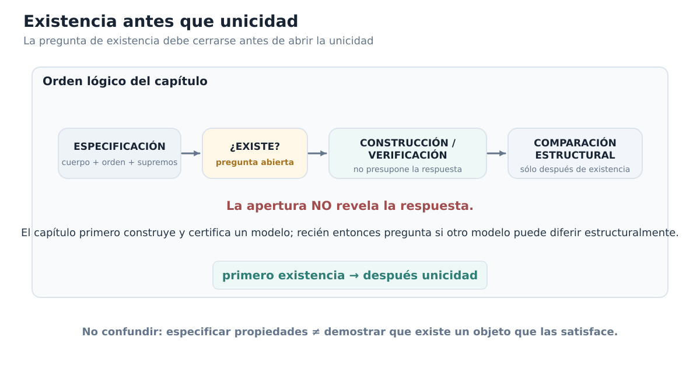{#fig-anm-c00-f01 fig-alt="Mapa lógico con cuatro etapas: especificación, pregunta de existencia, construcción/verificación y comparación estructural; la apertura deja explícitamente la respuesta sin revelar."}

### Especificar no es demostrar que existe

Aquí aparece el paso lógico que suele quedar oculto.

Hemos descrito con bastante precisión qué queremos. Eso no demuestra que podamos tenerlo.

En matemáticas es posible escribir sistemas de condiciones incompatibles. Por ejemplo, podríamos pedir un número $x$ que satisficiera simultáneamente

$$
x<0
$$

y

$$
x>1.
$$

La frase está perfectamente formada, pero no por eso existe un objeto que la satisfaga.

Con una estructura axiomática ocurre lo mismo a otra escala. Podemos enumerar propiedades deseables y estudiar qué consecuencias tendrían **si** algún sistema las cumpliera. Pero mientras no construyamos al menos un modelo, sigue abierta la cuestión de si todas esas propiedades pueden coexistir.

Por eso la afirmación

> «Sea $F$ un cuerpo ordenado completo»

tiene dos usos muy distintos.

En una demostración posterior, cuando la existencia ya esté establecida, puede funcionar como una hipótesis perfectamente legítima. En este punto del libro, en cambio, no podemos usarla para resolver la pregunta fundacional. Si queremos justificar la existencia de los reales, necesitamos exhibir un sistema y demostrar que cumple lo que acabamos de exigir.

La distinción puede resumirse así:

$$
\boxed{
\text{definir la clase de objetos que buscamos}
\;\not\Rightarrow\;
\text{probar que esa clase contiene algún objeto}.
}
$$

Ésta será una regla importante durante todo el capítulo. Cada vez que introduzcamos una nueva construcción, preguntaremos no sólo qué pretende representar, sino qué falta todavía por verificar antes de poder afirmar que hemos construido realmente un cuerpo ordenado completo.

### ¿Por qué no basta con los racionales?

Una reacción natural sería pensar que quizá ya tenemos lo que necesitamos. Después de todo, $\mathbb Q$ posee una aritmética muy rica y un orden perfectamente bien comportado. Podemos sumar, restar, multiplicar, dividir por elementos no nulos y comparar racionales.

Entonces, antes de inventar nada nuevo, la pregunta correcta es:

> **¿Satisface ya $\mathbb Q$ nuestra especificación?**

No responderemos todavía. Hacerlo bien requiere localizar una familia racional concreta para la cual la propiedad del supremo falle dentro de $\mathbb Q$, y esa demostración merece una sección propia.

Lo importante aquí es advertir cómo ha cambiado el problema. Ya no estamos preguntando vagamente si a los racionales «les faltan números». Tenemos un criterio exacto que podemos auditar:

1. ¿es $\mathbb Q$ un cuerpo?;
2. ¿está linealmente ordenado de manera compatible con su aritmética?;
3. ¿todo subconjunto racional no vacío y acotado superiormente tiene un supremo racional?

Las dos primeras preguntas tienen respuesta afirmativa. La tercera será el punto decisivo.

### Una segunda pregunta queda en espera

Aunque todavía no podamos responder la pregunta de existencia, conviene distinguirla de otra que aparecerá más adelante.

Supongamos, sólo de manera hipotética, que lográramos construir un cuerpo ordenado completo $F$. Y supongamos que otra construcción produjera un cuerpo ordenado completo $G$.

Aun entonces habría que decidir qué significa que ambos representen «los mismos números reales».

No exigiríamos necesariamente que $F$ y $G$ fueran literalmente el mismo conjunto. Dos realizaciones matemáticas pueden tener elementos subyacentes distintos y, sin embargo, poseer exactamente la misma estructura relevante. La noción precisa que permitirá comparar esos modelos será la de **isomorfismo de cuerpos ordenados**.

Pero no abriremos todavía esa investigación. Sería prematuro discutir cuántos modelos puede haber cuando aún no hemos demostrado que haya siquiera uno.

El orden lógico del capítulo será, por tanto:

$$
\boxed{
\text{primero existencia;}
\qquad
\text{después, y sólo después, comparación estructural}.
}
$$

En este momento sólo la primera pregunta está activa:

$$
\boxed{\text{¿Existe algún cuerpo ordenado completo?}}
$$

### Antes de seguir

#### Microcontrol 1

[]{#MA-MIC-ANM-01-000-001}

¿Por qué escribir una lista de axiomas para un cuerpo ordenado completo no demuestra, por sí solo, que exista uno?

[]{#MA-MSOL-ANM-01-000-001}

<details class="anm-solution">
<summary>Ver solución del microcontrol 1</summary>

**Respuesta.**

Porque una **especificación** sólo describe qué propiedades debería satisfacer un objeto si existiera. Una lista de condiciones puede incluso ser incompatible. Para demostrar existencia hace falta exhibir al menos un modelo concreto y verificar que cumple simultáneamente todas las condiciones exigidas.

En símbolos, el paso inválido sería confundir

$$
\text{«si }F\text{ existe y satisface los axiomas, entonces tiene tales propiedades»}
$$

con

$$
\exists F\;\bigl(F\text{ satisface esos axiomas}\bigr).
$$

Definir la clase buscada no produce por sí solo un elemento de esa clase.

**Fundamento en la sección 0.1.**

Hemos descrito con bastante precisión qué queremos. Eso no demuestra que podamos tenerlo.

En matemáticas es posible escribir sistemas de condiciones incompatibles. Por ejemplo, podríamos pedir un número $x$ que satisficiera simultáneamente

$$
x<0
$$

y

$$
x>1.
$$

La frase está perfectamente formada, pero no por eso existe un objeto que la satisfaga.

Con una estructura axiomática ocurre lo mismo a otra escala. Podemos enumerar propiedades deseables y estudiar qué consecuencias tendrían **si** algún sistema las cumpliera. Pero mientras no construyamos al menos un modelo, sigue abierta la cuestión de si todas esas propiedades pueden coexistir.

</details>

#### Microcontrol 2

[]{#MA-MIC-ANM-01-000-002}

¿Qué parte de la especificación pertenece al álgebra, cuál al orden y cuál a la completitud?

[]{#MA-MSOL-ANM-01-000-002}

<details class="anm-solution">
<summary>Ver solución del microcontrol 2</summary>

La especificación se divide en tres capas.

- **Álgebra:** $F$ debe ser un **cuerpo**: posee suma y producto, $0$ y $1$, opuestos, inversos multiplicativos para elementos no nulos y las leyes algebraicas correspondientes.
- **Orden:** $F$ debe llevar un **orden lineal compatible** con las operaciones; en particular, trasladar una desigualdad por la misma cantidad preserva el orden y el producto de dos elementos no negativos sigue siendo no negativo.
- **Completitud:** todo subconjunto no vacío de $F$ acotado superiormente debe tener un **supremo en $F$**.

Las dos primeras capas producen un cuerpo ordenado. La tercera añade la propiedad del supremo y da un cuerpo ordenado completo.

</details>

#### Microcontrol 3

[]{#MA-MIC-ANM-01-000-003}

Si $A\subseteq F$ tiene una cota superior, ¿qué condición adicional debe satisfacer una cota $s$ para ser $\sup A$?

[]{#MA-MSOL-ANM-01-000-003}

<details class="anm-solution">
<summary>Ver solución del microcontrol 3</summary>

**Respuesta.**

Si $s$ ya es una cota superior de $A$, falta que sea la **menor** de todas ellas. Es decir, debe cumplirse

$$
\forall u\in F,
\qquad
\bigl(u\text{ es cota superior de }A\bigr)
\Longrightarrow
s\le u.
$$

Junto con

$$
a\le s
\qquad(a\in A),
$$

esta condición caracteriza exactamente

$$
\boxed{s=\sup A}.
$$

**Fundamento en la sección 0.1.**

Hasta aquí ya tenemos una estructura bastante rica. Podemos hacer álgebra y podemos hablar de izquierda y derecha en una representación ordenada. Sin embargo, todavía falta exactamente la propiedad que hará posible gran parte del análisis.

Supongamos que $A\subseteq F$ es un conjunto no vacío y que está acotado superiormente. Esto significa que existe algún $u\in F$ tal que

$$
a\le u
$$

para todo $a\in A$.

Podemos entonces preguntar si existe una **menor cota superior**: una cota $s$ que siga estando por encima de todos los elementos de $A$, pero que no pueda reemplazarse por ninguna cota superior más pequeña.

</details>

#### Microcontrol 4

[]{#MA-MIC-ANM-01-000-004}

¿En qué se diferencian las afirmaciones «$A$ está acotado superiormente» y «$A$ tiene supremo en $F$»?

[]{#MA-MSOL-ANM-01-000-004}

<details class="anm-solution">
<summary>Ver solución del microcontrol 4</summary>

**Respuesta.**

Decir que $A$ está **acotado superiormente** significa sólo que existe algún $u\in F$ tal que

$$
a\le u
\qquad(a\in A).
$$

Decir que $A$ **tiene supremo en $F$** exige mucho más: debe existir una cota superior $s\in F$ que sea menor o igual que cualquier otra cota superior.

Por tanto,

$$
\text{acotado superiormente}
\not\Rightarrow
\text{tener supremo}
$$

sin una hipótesis adicional de completitud. Precisamente la propiedad del supremo exige que esa implicación sí valga para todo subconjunto no vacío y acotado superiormente.

**Fundamento en la sección 0.1.**

> Todo subconjunto no vacío de $F$ que esté acotado superiormente debe poseer un supremo en $F$.

Ésta es la forma de completitud que utilizaremos en este capítulo. Más precisamente, se trata de **completitud de orden mediante la propiedad del supremo**.

No estamos hablando todavía de sucesiones de Cauchy ni de convergencia. Esas formulaciones aparecerán mucho más adelante. Aquí la completitud significa algo muy concreto: cuando el orden exige una mejor barrera para un conjunto no vacío y acotado superiormente, esa barrera existe dentro del propio sistema.

</details>

#### Microcontrol 5

[]{#MA-MIC-ANM-01-000-005}

¿Por qué la frase «$\mathbb Q$ está contenido en $F$» necesitará una explicación estructural y no sólo una notación de inclusión?

[]{#MA-MSOL-ANM-01-000-005}

<details class="anm-solution">
<summary>Ver solución del microcontrol 5</summary>

La notación

$$
\mathbb Q\subseteq F
$$

no debería tomarse de entrada como inclusión literal de conjuntos. Lo que necesitamos es una **copia estructural** de $\mathbb Q$ dentro de $F$: una aplicación inyectiva que preserve la aritmética y el orden racionales.

Sólo después de construir y verificar esa incrustación podremos identificar por convenio cada racional con su imagen y usar una notación de inclusión sin perder información estructural.

La cuestión, por tanto, no es sólo dónde están los elementos, sino qué operaciones y relaciones se conservan al incorporarlos en el sistema mayor.

</details>

#### Microcontrol 6

[]{#MA-MIC-ANM-01-000-006}

Si algún día construimos dos candidatos $F$ y $G$, ¿por qué no sería razonable exigir desde el comienzo que sean literalmente el mismo conjunto?

[]{#MA-MSOL-ANM-01-000-006}

<details class="anm-solution">
<summary>Ver solución del microcontrol 6</summary>

Dos construcciones pueden usar objetos subyacentes distintos y, sin embargo, realizar exactamente la misma estructura matemática. Exigir desde el comienzo

$$
F=G
$$

como igualdad literal de conjuntos sería imponer una coincidencia de representación que no forma parte de la especificación.

La pregunta adecuada es estructural: si ambos resultan ser cuerpos ordenados completos, habrá que investigar si existe una correspondencia que conserve las operaciones y el orden, es decir, un **isomorfismo de cuerpos ordenados**.

En §0.1 esta cuestión queda sólo planteada. El orden lógico del capítulo sigue siendo

$$
\boxed{\text{primero existencia; después comparación estructural}.}
$$

</details>
La sección siguiente se ocupará de la quinta pregunta. Antes de decidir cómo construir un sistema nuevo, necesitamos comprender con precisión qué significa **extender** un sistema numérico sin destruir la estructura que ya posee. Ese análisis nos llevará desde $\mathbb N$ hasta $\mathbb Q$ y dejará preparado el lenguaje con el que, más adelante, podremos preguntar qué significa que los racionales estén incorporados en un sistema mayor.

### Ejercicios de la sección 0.1

[]{#ejercicios-0}

#### Ejercicio 1. Auditar una especificación antes de usarla

[]{#MA-EX-ANM-01-000-001}

Sea $F$ un candidato desconocido equipado con dos operaciones y una relación de orden. Considera las cuatro expresiones siguientes, donde $A\subseteq F$:

1. $A\le u$.
2. Para todo $x\in F$ existe $y\in F$ tal que $xy=1$.
3. Si $A\ne\varnothing$ y existe $u\in F$ tal que $a\le u$ para todo $a\in A$, entonces existe $s\in F$ que es menor o igual que toda cota superior de $A$ y que, a la vez, satisface $a\le s$ para todo $a\in A$.
4. $\sup A\in A$.

Para cada expresión, decide cuál de las siguientes descripciones es la más adecuada:

- está mal tipada o mal cuantificada y necesita reparación;
- está bien formada, pero afirma más de lo que exige la especificación de un cuerpo ordenado completo;
- expresa correctamente una parte de la especificación.

Reescribe correctamente las expresiones 1 y 2. En la expresión 4 no supongas que el supremo deba pertenecer al conjunto sólo porque exista.

[]{#MA-SOL-ANM-01-000-001}

<details class="anm-solution">
<summary>Ver solución del ejercicio 1</summary>

La primera expresión,

$$
A\le u,
$$

mezcla dos tipos de objeto. $A$ es un conjunto y $u$ es un elemento de $F$; la relación $\le$ del cuerpo compara elementos de $F$, no directamente un subconjunto con un elemento.

La reparación correcta es escribir

$$
\forall a\in A,\qquad a\le u.
$$

Eso expresa que $u$ es una cota superior de $A$.

La segunda expresión afirma que

$$
\forall x\in F\;\exists y\in F:\ xy=1.
$$

El problema está en $x=0$. Si $F$ es un cuerpo, $0$ no tiene inverso multiplicativo. La cuantificación correcta es

$$
\forall x\in F,\qquad
x\ne0\Longrightarrow
\exists y\in F:\ xy=1.
$$

Equivalentemente,

$$
\forall x\in F\setminus\{0\}\;\exists y\in F:\ xy=1.
$$

Ésta es una condición algebraica propia de un cuerpo.

La tercera expresión sí captura la propiedad del supremo. Sus hipótesis dicen que $A$ es no vacío y está acotado superiormente. La conclusión exige un elemento $s\in F$ que cumple simultáneamente

$$
\forall a\in A,\qquad a\le s,
$$

y

$$
\forall v\in F,\qquad
\left(
\forall a\in A,\ a\le v
\right)
\Longrightarrow
s\le v.
$$

La primera condición dice que $s$ es cota superior; la segunda, que es menor o igual que cualquier otra cota superior. Eso es exactamente decir que $s=\sup A$.

La cuarta expresión,

$$
\sup A\in A,
$$

está bien formada una vez que se ha establecido que $\sup A$ existe, pero **no forma parte de la definición de supremo**. La propiedad del supremo exige que $\sup A$ pertenezca al sistema $F$, no que pertenezca al subconjunto $A$.

Por tanto:

- 1: mal tipada; debe cuantificarse sobre los elementos de $A$;
- 2: mal cuantificada; debe excluirse $x=0$;
- 3: formulación correcta de la exigencia de completitud;
- 4: bien formada cuando el supremo existe, pero añade una condición que la especificación no exige.

Antes de preguntar si una estructura existe, la especificación debe estar escrita con dominios, cuantificadores y tipos correctos.

</details>

#### Ejercicio 2. Una existencia demostrada suponiendo que ya existe

[]{#MA-EX-ANM-01-000-002}

Un estudiante propone la siguiente demostración:

> «Definimos los números reales como los elementos de un cuerpo ordenado completo. Sea entonces $F$ un cuerpo ordenado completo. Por definición, $F$ es un cuerpo, su orden es compatible con las operaciones y todo subconjunto no vacío acotado superiormente tiene supremo en $F$. Por tanto, $F$ cumple exactamente las propiedades pedidas. Luego existe al menos un cuerpo ordenado completo.»

Audita el argumento.

1. Localiza la primera presuposición que impide que esto sea una prueba de existencia.
2. Explica qué afirmación condicional sí sería legítimo deducir si se permitiera comenzar con «sea $F$ un cuerpo ordenado completo».
3. Explica qué clase de trabajo matemático faltaría para convertir la especificación en una auténtica prueba de existencia.

No construyas todavía ningún modelo concreto.

[]{#MA-SOL-ANM-01-000-002}

<details class="anm-solution">
<summary>Ver solución del ejercicio 2</summary>

El argumento no demuestra existencia porque introduce desde el comienzo el objeto cuya existencia debía justificar:

> «Sea $F$ un cuerpo ordenado completo».

Esa frase es legítima en un razonamiento **condicional** acerca de una estructura que suponemos dada. No es legítima como paso que permita concluir que tal estructura existe.

Después de introducir la hipótesis, el estudiante sólo desarrolla lo que ya está contenido en ella. De

$$
F\text{ es un cuerpo ordenado completo}
$$

puede deducirse correctamente que $F$ satisface los axiomas de cuerpo, posee un orden lineal compatible con las operaciones y tiene la propiedad del supremo.

Pero eso sólo establece una afirmación de la forma

$$
\boxed{
\text{si existe un }F\text{ con esa estructura, entonces }F\text{ cumple esas propiedades}.
}
$$

No permite eliminar el «si».

El salto inválido aparece cuando se pretende pasar de la hipótesis

$$
F\text{ es un cuerpo ordenado completo}
$$

a la conclusión existencial

$$
\exists F\;
\bigl(F\text{ es un cuerpo ordenado completo}\bigr).
$$

La hipótesis ya presupone un testigo de esa existencia; usarla para producir el mismo testigo es circular.

Para una prueba auténtica haría falta:

1. definir un objeto matemático concreto $M$ sin asumir previamente que sea un cuerpo ordenado completo;
2. definir sobre $M$ las operaciones y el orden pertinentes;
3. demostrar los axiomas de cuerpo;
4. demostrar que el orden es lineal y compatible con las operaciones;
5. demostrar la propiedad del supremo.

Sólo entonces $M$ sería un testigo de la afirmación existencial.

Una especificación dice qué tendría que cumplir un modelo; una prueba de existencia debe producir al menos un modelo y verificarlo.

</details>

#### Ejercicio 3. Qué tendría que certificar un modelo

[]{#MA-EX-ANM-01-000-003}

Supón que una construcción futura entrega un objeto concreto $M$ junto con operaciones $+$, $\cdot$ y una relación $\le$. Un informe de verificación se divide en cuatro etapas:

- **I. Construcción:** $M$ y sus operaciones están definidos como objetos matemáticos concretos.
- **II. Álgebra:** con esas operaciones, $M$ satisface los axiomas de cuerpo.
- **III. Orden:** $\le$ es un orden lineal compatible con la suma y el producto.
- **IV. Completitud:** todo subconjunto no vacío de $M$ acotado superiormente posee un supremo en $M$.

Responde:

1. ¿Por qué la etapa I, por sí sola, no resuelve la pregunta de existencia planteada en §0.1?
2. ¿Por qué las etapas I–III todavía no bastan?
3. Explica por qué completar I–IV sí permite concluir que existe al menos un cuerpo ordenado completo.
4. Si otra construcción produjera después un objeto $N$ que también superara I–IV, ¿qué nueva pregunta quedaría abierta sin volver a poner en duda la existencia?

Tu respuesta debe separar con claridad **construir**, **verificar** y **comparar estructuras**.

[]{#MA-SOL-ANM-01-000-003}

<details class="anm-solution">
<summary>Ver solución del ejercicio 3</summary>

La etapa I garantiza que tenemos un objeto concreto sobre el que podemos trabajar. Eso es indispensable, pero no basta. Un conjunto equipado con operaciones cualesquiera puede fallar las leyes algebraicas, el orden o la completitud.

Por eso

$$
\text{CONSTRUCCIÓN}
\not\Longrightarrow
\text{CUERPO ORDENADO COMPLETO}.
$$

La etapa II añade la estructura algebraica: sabemos que $M$ es un cuerpo. La etapa III añade un orden lineal compatible con esa aritmética. Después de I–III podemos concluir que $M$ es un **cuerpo ordenado**.

Todavía falta la exigencia decisiva de §0.1. Ser cuerpo ordenado no garantiza, por sí solo, que todo subconjunto no vacío y acotado superiormente tenga una menor cota superior dentro del mismo sistema. Por tanto,

$$
\text{I}+\text{II}+\text{III}
\not\Longrightarrow
\text{completitud}.
$$

La etapa IV cierra exactamente esa brecha. Una vez verificadas I–IV, $M$ es un cuerpo, está linealmente ordenado de manera compatible y posee la propiedad del supremo. Por la especificación de §0.1,

$$
M\text{ es un cuerpo ordenado completo}.
$$

Como $M$ fue construido concretamente, ya disponemos de un testigo para

$$
\exists F\;
\bigl(F\text{ es un cuerpo ordenado completo}\bigr).
$$

Así se cierra una prueba de existencia:

$$
\boxed{
\text{construir un candidato}
\longrightarrow
\text{verificar toda la especificación}
\longrightarrow
\text{obtener un testigo de existencia}.
}
$$

Si otra construcción produjera después un objeto $N$ que también superara I–IV, la existencia no volvería a estar en cuestión. La nueva pregunta sería de **comparación estructural**: habría que decidir en qué sentido $M$ y $N$ representan la misma estructura o podrían diferir esencialmente.

Las tareas quedan separadas:

- **construir** proporciona un candidato concreto;
- **verificar** demuestra que pertenece a la clase especificada;
- **comparar estructuras** pregunta cómo se relacionan dos candidatos ya verificados.

La comparación sólo tiene sentido una vez que la existencia ha sido resuelta.

</details>
## 0.2. Extender sin perder estructura: de $\mathbb N$ a $\mathbb Q$

[]{#MA-SEC-ANM-01-000-002}

La sección anterior dejó pendiente una frase que solemos escribir sin pensarlo demasiado:

$$
\mathbb Q\subseteq F.
$$

A primera vista parece una afirmación inocente: queremos que el sistema numérico que eventualmente construyamos «contenga» a los racionales. Pero, si estamos tratando de justificar desde el principio qué significa construir una nueva estructura numérica, la palabra **contener** merece una explicación.

No siempre dos sistemas numéricos han sido construidos de modo que uno sea literalmente un subconjunto del otro. Incluso cuando elegimos implementaciones conjuntistas que permiten escribir una inclusión literal, esa inclusión concreta no es lo que realmente importa para el álgebra y el orden. Lo esencial es que los números antiguos puedan aparecer dentro del sistema nuevo **sin que cambien las relaciones y operaciones que ya tenían**.

Ésa es la idea de una **incrustación estructural**.

### Una copia que conserva lo importante

Supongamos que $A$ y $B$ son dos sistemas dotados de cierta estructura y que queremos representar a $A$ dentro de $B$. Una aplicación

$$
\iota:A\longrightarrow B
$$

será una incrustación, al nivel estructural que corresponda, si cumple dos requisitos generales:

1. es **inyectiva**, de modo que elementos distintos de $A$ siguen siendo distintos después de transportarlos a $B$;
2. conserva las operaciones y relaciones relevantes de $A$.

La palabra «relevantes» importa. No todos los sistemas poseen exactamente la misma clase de estructura. $\mathbb N$ no es un cuerpo y $\mathbb Z$ tampoco. Por eso sería incorrecto llamar uniformemente «incrustaciones de cuerpos» a todas las flechas de la cadena

$$
\mathbb N\hookrightarrow\mathbb Z\hookrightarrow\mathbb Q.
$$

Lo correcto es preguntar, en cada etapa, **qué estructura existe ya y qué debe preservarse al pasar al sistema mayor**.

Por ejemplo, si una incrustación entre dos sistemas ordenados con suma y producto se denota por $\iota$, esperamos relaciones como

$$
\iota(m+n)=\iota(m)+\iota(n),
$$

$$
\iota(mn)=\iota(m)\iota(n),
$$

y, para el orden,

$$
m<n
\quad\Longleftrightarrow\quad
\iota(m)<\iota(n).
$$

También queremos que los elementos distinguidos se transporten correctamente cuando formen parte de la estructura:

$$
\iota(0)=0,
\qquad
\iota(1)=1.
$$

Así, la imagen $\iota(A)$ dentro de $B$ no es sólo una colección de puntos que lleva las mismas etiquetas. Es una **copia estructural** de $A$.

### Primer paso: de $\mathbb N$ a $\mathbb Z$

Los naturales sirven muy bien para contar y multiplicar cantidades no negativas. Pero su aritmética tiene una limitación inmediata: la resta no siempre puede resolverse dentro de $\mathbb N$.

Por ejemplo, la ecuación

$$
x+3=1
$$

no tiene solución natural.

Los enteros amplían el sistema incorporando opuestos aditivos. La idea importante para nosotros no es reconstruir aquí $\mathbb Z$ como clases de pares de naturales; esa construcción pertenece a un nivel fundacional más profundo que estamos tomando como disponible. Lo que sí necesitamos entender es cómo los naturales sobreviven dentro de los enteros.

Existe una aplicación canónica

$$
\iota_{\mathbb N\mathbb Z}:\mathbb N\longrightarrow\mathbb Z
$$

que envía cada natural al entero correspondiente. Bajo la notación usual escribimos simplemente

$$
0\mapsto0,
\quad
1\mapsto1,
\quad
2\mapsto2,
\quad\ldots
$$

pero lo que debemos recordar es la estructura que esa escritura comprime. Para $m,n\in\mathbb N$:

$$
\iota_{\mathbb N\mathbb Z}(m+n)
=
\iota_{\mathbb N\mathbb Z}(m)+\iota_{\mathbb N\mathbb Z}(n),
$$

$$
\iota_{\mathbb N\mathbb Z}(mn)
=
\iota_{\mathbb N\mathbb Z}(m)\,\iota_{\mathbb N\mathbb Z}(n),
$$

y

$$
m<n
\quad\Longleftrightarrow\quad
\iota_{\mathbb N\mathbb Z}(m)<\iota_{\mathbb N\mathbb Z}(n).
$$

La aplicación es inyectiva. Por tanto, $\mathbb N$ no desaparece cuando pasamos a $\mathbb Z$: reaparece como una copia estructural dentro del sistema mayor.

El sistema nuevo resuelve además problemas que antes no podían plantearse internamente. En $\mathbb Z$ la ecuación anterior sí tiene solución:

$$
x=-2.
$$

Podemos resumir la transición así:

$$
\boxed{
\mathbb N
\overset{\iota_{\mathbb N\mathbb Z}}{\hookrightarrow}
\mathbb Z
\qquad
\text{preservando suma, producto y orden, y añadiendo opuestos aditivos.}
}
$$

### Segundo paso: de $\mathbb Z$ a $\mathbb Q$

Los enteros reparan el problema de la resta, pero todavía no permiten resolver toda división.

La ecuación

$$
2x=1
$$

no tiene solución entera.

Los racionales amplían el sistema incorporando cocientes. De nuevo, no necesitamos reconstruir aquí $\mathbb Q$ como clases de equivalencia de pares de enteros. Basta recordar la forma canónica en que los enteros se representan entre los racionales:

$$
\iota_{\mathbb Z\mathbb Q}:\mathbb Z\longrightarrow\mathbb Q,
\qquad
n\longmapsto\frac n1.
$$

Esta vez la estructura disponible en el dominio es más rica: $\mathbb Z$ es un anillo ordenado. La aplicación conserva la suma,

$$
\iota_{\mathbb Z\mathbb Q}(m+n)
=
\iota_{\mathbb Z\mathbb Q}(m)
+
\iota_{\mathbb Z\mathbb Q}(n),
$$

el producto,

$$
\iota_{\mathbb Z\mathbb Q}(mn)
=
\iota_{\mathbb Z\mathbb Q}(m)
\iota_{\mathbb Z\mathbb Q}(n),
$$

el cero y la unidad,

$$
\iota_{\mathbb Z\mathbb Q}(0)=0,
\qquad
\iota_{\mathbb Z\mathbb Q}(1)=1,
$$

y el orden:

$$
m<n
\quad\Longleftrightarrow\quad
\frac m1<\frac n1.
$$

Además es inyectiva. Por eso podemos decir con precisión que $\mathbb Z$ se incrusta como anillo ordenado en $\mathbb Q$.

El nuevo sistema permite resolver, entre muchas otras, la ecuación

$$
2x=1,
$$

porque ahora

$$
x=\frac12
$$

pertenece al dominio.

La segunda ampliación puede resumirse así:

$$
\boxed{
\mathbb Z
\overset{\iota_{\mathbb Z\mathbb Q}}{\hookrightarrow}
\mathbb Q
\qquad
\text{preservando la estructura de anillo ordenado y añadiendo cocientes.}
}
$$

### Una ampliación no borra el sistema anterior

Estas dos etapas comparten una misma forma lógica. Primero tenemos un sistema en el que cierta operación no siempre puede resolverse. Después construimos o adoptamos un sistema más amplio en el que esa operación sí puede realizarse, pero exigimos que la aritmética anterior permanezca reconocible.

Podemos verlo como una cadena:

$$
\mathbb N
\hookrightarrow
\mathbb Z
\hookrightarrow
\mathbb Q.
$$

Cada flecha significa algo más fuerte que «hay una función de un conjunto a otro». Significa que la estructura disponible antes de la ampliación se transporta sin colapsos.

Ésta es precisamente la función de la inyectividad. Si dos elementos distintos $a,b\in A$ fueran enviados al mismo punto,

$$
\iota(a)=\iota(b),
$$

el sistema mayor habría perdido la capacidad de distinguirlos. Ya no tendríamos una copia fiel del sistema original.

Y ésta es la función de las identidades de preservación. Si, por ejemplo,

$$
\iota(a+b)\ne\iota(a)+\iota(b),
$$

entonces calcular primero en $A$ y transportar el resultado no coincidiría con transportar los datos y calcular después en $B$. La vieja aritmética habría cambiado durante el traslado.

Una buena incrustación evita ambos problemas.

### Incrustar no significa identificar literalmente

Ahora podemos precisar por qué la notación

$$
\mathbb N\subseteq\mathbb Z\subseteq\mathbb Q
$$

es útil y, al mismo tiempo, conceptualmente peligrosa si se toma demasiado literalmente.

Supongamos que tenemos una incrustación

$$
\iota:A\hookrightarrow B.
$$

Su imagen es el subconjunto

$$
\iota(A)=\{\iota(a):a\in A\}\subseteq B.
$$

Como $\iota$ es inyectiva y preserva la estructura pertinente, $A$ y $\iota(A)$ son estructuralmente indistinguibles para las operaciones y relaciones que estamos considerando. Podemos entonces adoptar una convención muy cómoda: **identificar $A$ con su imagen**.

Después de hacer esa identificación, dejamos de escribir constantemente $\iota(a)$ y escribimos simplemente $a$. La flecha

$$
A\hookrightarrow B
$$

queda comprimida en la notación familiar

$$
A\subseteq B.
$$

Pero el orden lógico es importante:

$$
\boxed{
\text{primero construimos una incrustación}
\;\longrightarrow\;
\text{después identificamos el dominio con su imagen}.
}
$$

No al revés.

Esto explica por qué una implementación conjuntista concreta no es esencial. En una construcción posible de los enteros, un entero puede estar representado por una clase de equivalencia de pares de naturales; en una construcción posible de los racionales, un racional puede estar representado por una clase de equivalencia de pares de enteros. En ese nivel, el objeto llamado $2\in\mathbb N$ no tiene por qué ser literalmente el mismo conjunto que el objeto que representa $2\in\mathbb Z$ o $2\in\mathbb Q$.

Sin embargo, las incrustaciones canónicas permiten transportar el $2$ natural al $2$ entero y después al $2$ racional preservando toda la estructura relevante. Para el trabajo matemático ordinario, identificamos esas copias y escribimos simplemente

$$
2.
$$

La notación inclusiva es, por tanto, una **economía estructural**.

La figura [C00-F02](#fig-anm-c00-f02) concentra esta lectura en un único mapa visual.

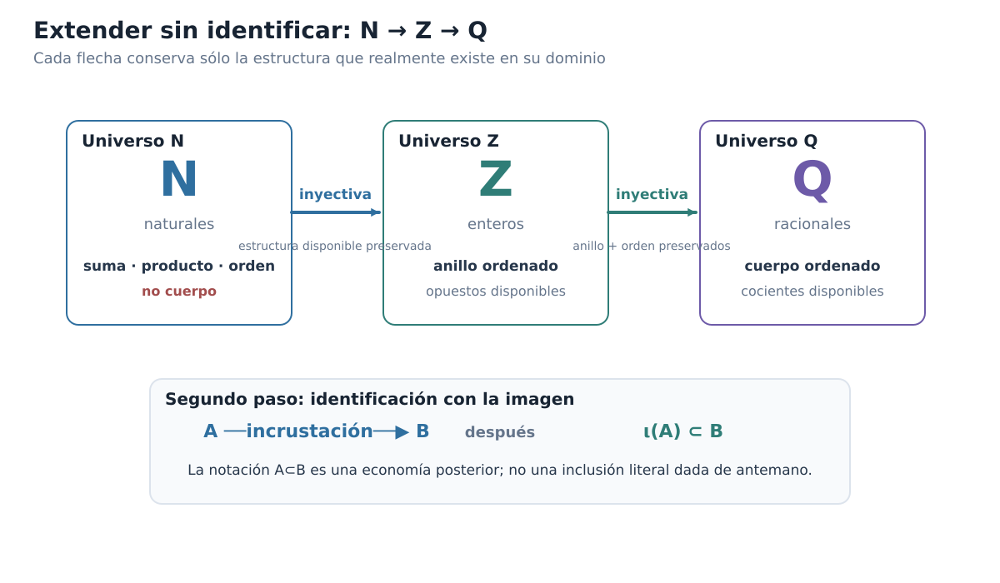{#fig-anm-c00-f02 fig-alt="Tres universos separados N, Z y Q con flechas inyectivas rotuladas por la estructura preservada y un segundo panel que distingue incrustación, imagen e identificación."}

### El diagrama que realmente debemos leer

Cuando escribamos en adelante

$$
\mathbb N\subseteq\mathbb Z\subseteq\mathbb Q,
$$

conviene que mentalmente veamos detrás el diagrama más preciso

$$
\mathbb N
\overset{\iota_{\mathbb N\mathbb Z}}{\hookrightarrow}
\mathbb Z
\overset{\iota_{\mathbb Z\mathbb Q}}{\hookrightarrow}
\mathbb Q,
$$

seguido de dos identificaciones con las imágenes correspondientes.

Esto nos permite distinguir tres afirmaciones que suelen confundirse:

1. **hay una aplicación** entre dos sistemas;
2. **hay una incrustación estructural**, es decir, una aplicación inyectiva que conserva la estructura pertinente;
3. **adoptamos la convención de identificar el sistema menor con su imagen** y, sólo entonces, usamos notación de inclusión.

La segunda afirmación es matemática. La tercera es una decisión notacional sustentada por la segunda.

### ¿Y qué ocurrirá con los racionales?

La pregunta que motivó esta sección puede formularse ahora con mucha más precisión.

En §0.1 dijimos que buscamos un sistema que prolongue la aritmética racional. Ya sabemos qué debe significar la palabra «prolongar»: no bastará con encontrar dentro del sistema nuevo algunos elementos que llamemos racionales. Tendrá que existir una copia de $\mathbb Q$ que conserve su suma, su producto, su cero, su unidad y su orden.

Pero no construiremos todavía esa flecha. Hacerlo antes de tener un candidato concreto sería adelantarnos al problema.

Por ahora sólo hemos establecido el lenguaje con el que podremos formular la exigencia cuando llegue el momento.

Lo que sí podemos hacer inmediatamente es mirar el último sistema de la cadena que ya poseemos:

$$
\mathbb Q.
$$

Los racionales son un cuerpo ordenado. Por tanto, satisfacen las dos primeras exigencias de §0.1. La pregunta decisiva es si satisfacen también la tercera:

$$
\boxed{
\text{¿todo subconjunto no vacío de }\mathbb Q
\text{ acotado superiormente posee un supremo racional?}
}
$$

Si la respuesta fuera afirmativa, quizá no necesitaríamos ampliar nada más. Si fuera negativa, la cadena

$$
\mathbb N\hookrightarrow\mathbb Z\hookrightarrow\mathbb Q
$$

no habría terminado todavía.

### Antes de seguir

#### Microcontrol 7

[]{#MA-MIC-ANM-01-000-007}

¿Por qué la inyectividad es indispensable si queremos considerar a $A$ como una copia dentro de $B$?

[]{#MA-MSOL-ANM-01-000-007}

<details class="anm-solution">
<summary>Ver solución del microcontrol 7</summary>

**Respuesta.**

La inyectividad impide que dos elementos distintos del sistema original se vuelvan indistinguibles después del transporte. Si existieran $a
e b$ con

$$
\iota(a)=\iota(b),
$$

entonces la imagen en $B$ ya no permitiría recuperar la diferencia entre $a$ y $b$. El sistema mayor habría **colapsado información** del sistema menor.

Por eso, para considerar a $A$ como una copia dentro de $B$, necesitamos que

$$
a
e b\Longrightarrow \iota(a)
e\iota(b).
$$

La preservación de operaciones y relaciones sólo produce una copia fiel cuando los elementos distintos siguen siendo distintos.

**Fundamento en la sección 0.2.**

Ésta es precisamente la función de la inyectividad. Si dos elementos distintos $a,b\in A$ fueran enviados al mismo punto,

$$
\iota(a)=\iota(b),
$$

el sistema mayor habría perdido la capacidad de distinguirlos. Ya no tendríamos una copia fiel del sistema original.

Y ésta es la función de las identidades de preservación. Si, por ejemplo,

$$
\iota(a+b)\ne\iota(a)+\iota(b),
$$

entonces calcular primero en $A$ y transportar el resultado no coincidiría con transportar los datos y calcular después en $B$. La vieja aritmética habría cambiado durante el traslado.

</details>

#### Microcontrol 8

[]{#MA-MIC-ANM-01-000-008}

¿Qué significa que una incrustación conserve la suma? Explica la igualdad $\iota(a+b)=\iota(a)+\iota(b)$ como dos caminos que deben dar el mismo resultado.

[]{#MA-MSOL-ANM-01-000-008}

<details class="anm-solution">
<summary>Ver solución del microcontrol 8</summary>

**Respuesta.**

La igualdad

$$
\iota(a+b)=\iota(a)+\iota(b)
$$

dice que podemos proceder de dos maneras sin cambiar el resultado.

1. **Calcular primero en $A$:** formar $a+b$ y luego transportarlo mediante $\iota$.
2. **Transportar primero a $B$:** tomar $\iota(a)$ y $\iota(b)$ y sumarlos usando la suma de $B$.

La condición de preservación afirma que ambos caminos terminan en el mismo elemento de $B$. Así, la suma antigua no cambia al pasar al sistema mayor.

**Fundamento en la sección 0.2.**

el sistema mayor habría perdido la capacidad de distinguirlos. Ya no tendríamos una copia fiel del sistema original.

Y ésta es la función de las identidades de preservación. Si, por ejemplo,

$$
\iota(a+b)\ne\iota(a)+\iota(b),
$$

entonces calcular primero en $A$ y transportar el resultado no coincidiría con transportar los datos y calcular después en $B$. La vieja aritmética habría cambiado durante el traslado.

Una buena incrustación evita ambos problemas.

Ahora podemos precisar por qué la notación

$$
\mathbb N\subseteq\mathbb Z\subseteq\mathbb Q
$$

</details>

#### Microcontrol 9

[]{#MA-MIC-ANM-01-000-009}

¿Qué nueva clase de ecuaciones puede resolverse al pasar de $\mathbb N$ a $\mathbb Z$? ¿Y al pasar de $\mathbb Z$ a $\mathbb Q$?

[]{#MA-MSOL-ANM-01-000-009}

<details class="anm-solution">
<summary>Ver solución del microcontrol 9</summary>

**Respuesta.**

Al pasar de $\mathbb N$ a $\mathbb Z$ aparecen los **opuestos aditivos**, de modo que se pueden resolver ecuaciones que exigen una diferencia negativa. Por ejemplo,

$$
x+3=1
$$

no tiene solución en $\mathbb N$, pero en $\mathbb Z$ tiene la solución

$$
x=-2.
$$

Al pasar de $\mathbb Z$ a $\mathbb Q$ aparecen los **cocientes** necesarios para divisiones que no se resuelven enteramente. Por ejemplo,

$$
2x=1
$$

no tiene solución en $\mathbb Z$, pero en $\mathbb Q$ tiene

$$
x=\frac12.
$$

Cada ampliación añade soluciones nuevas sin borrar la aritmética que ya estaba disponible.

**Fundamento en la sección 0.2.**

Los naturales sirven muy bien para contar y multiplicar cantidades no negativas. Pero su aritmética tiene una limitación inmediata: la resta no siempre puede resolverse dentro de $\mathbb N$.

Por ejemplo, la ecuación

$$
x+3=1
$$

no tiene solución natural.

Los enteros amplían el sistema incorporando opuestos aditivos. La idea importante para nosotros no es reconstruir aquí $\mathbb Z$ como clases de pares de naturales; esa construcción pertenece a un nivel fundacional más profundo que estamos tomando como disponible. Lo que sí necesitamos entender es cómo los naturales sobreviven dentro de los enteros.

</details>

#### Microcontrol 10

[]{#MA-MIC-ANM-01-000-010}

¿Por qué es incorrecto llamar «incrustación de cuerpos» a la flecha $\mathbb N\hookrightarrow\mathbb Z$?

[]{#MA-MSOL-ANM-01-000-010}

<details class="anm-solution">
<summary>Ver solución del microcontrol 10</summary>

**Respuesta.**

Porque ni $\mathbb N$ ni $\mathbb Z$ son cuerpos. En $\mathbb N$ ni siquiera todos los elementos poseen opuesto aditivo dentro del sistema, y en $\mathbb Z$ un entero no nulo como $2$ no tiene inverso multiplicativo entero.

La flecha

$$
\mathbb N\hookrightarrow\mathbb Z
$$

sí es una incrustación de la estructura disponible en $\mathbb N$: preserva suma, producto, orden y los elementos distinguidos pertinentes. Lo incorrecto es atribuir al dominio y al codominio una estructura de cuerpo que no poseen.

**Fundamento en la sección 0.2.**

La palabra «relevantes» importa. No todos los sistemas poseen exactamente la misma clase de estructura. $\mathbb N$ no es un cuerpo y $\mathbb Z$ tampoco. Por eso sería incorrecto llamar uniformemente «incrustaciones de cuerpos» a todas las flechas de la cadena

$$
\mathbb N\hookrightarrow\mathbb Z\hookrightarrow\mathbb Q.
$$

Lo correcto es preguntar, en cada etapa, **qué estructura existe ya y qué debe preservarse al pasar al sistema mayor**.

Por ejemplo, si una incrustación entre dos sistemas ordenados con suma y producto se denota por $\iota$, esperamos relaciones como

</details>

#### Microcontrol 11

[]{#MA-MIC-ANM-01-000-011}

Explica la diferencia entre $A\hookrightarrow B$, $\iota(A)\subseteq B$ y la convención de escribir $A\subseteq B$ después de identificar $A$ con $\iota(A)$.

[]{#MA-MSOL-ANM-01-000-011}

<details class="anm-solution">
<summary>Ver solución del microcontrol 11</summary>

Las tres expresiones corresponden a pasos distintos.

- $A\hookrightarrow B$ indica que existe una **incrustación estructural** $\iota:A\to B$: una aplicación inyectiva que conserva la estructura pertinente.
- $\iota(A)\subseteq B$ es una **inclusión literal de conjuntos**: la imagen de la aplicación es realmente un subconjunto de $B$.
- Escribir después $A\subseteq B$ es una **convención de identificación**: reemplazamos notacionalmente $A$ por la copia $\iota(A)$ porque ambas son estructuralmente equivalentes para lo que estamos estudiando.

El orden lógico es, por tanto,

$$
A\xhookrightarrow{\ \iota\ }B
\longrightarrow
\iota(A)\subseteq B
\longrightarrow
\text{identificar }A\text{ con }\iota(A).
$$

La última escritura no debe confundirse con una inclusión literal que estuviera dada desde el comienzo.

</details>

#### Microcontrol 12

[]{#MA-MIC-ANM-01-000-012}

¿Qué propiedades tendría que conservar una futura copia de $\mathbb Q$ dentro de un sistema candidato para que pudiéramos decir que éste prolonga la aritmética racional?

[]{#MA-MSOL-ANM-01-000-012}

<details class="anm-solution">
<summary>Ver solución del microcontrol 12</summary>

**Respuesta.**

Como $\mathbb Q$ es ya un cuerpo ordenado, una futura incrustación

$$
\iota_{\mathbb Q}:\mathbb Q\longrightarrow F
$$

debe ser inyectiva y conservar la estructura racional pertinente. En particular, para $p,q\in\mathbb Q$, deberá satisfacer

$$
\iota_{\mathbb Q}(p+q)
=
\iota_{\mathbb Q}(p)+\iota_{\mathbb Q}(q),
$$

$$
\iota_{\mathbb Q}(pq)
=
\iota_{\mathbb Q}(p)\,\iota_{\mathbb Q}(q),
$$

$$
\iota_{\mathbb Q}(0)=0,
\qquad
\iota_{\mathbb Q}(1)=1,
$$

y deberá preservar y reflejar el orden:

$$
p<q
\quad\Longleftrightarrow\quad
\iota_{\mathbb Q}(p)<\iota_{\mathbb Q}(q).
$$

Sólo después de verificar esa copia estructural estará justificada la economía notacional de escribir $\mathbb Q\subseteq F$.

**Fundamento en la sección 0.2.**

el producto,

$$
\iota_{\mathbb Z\mathbb Q}(mn)
=
\iota_{\mathbb Z\mathbb Q}(m)
\iota_{\mathbb Z\mathbb Q}(n),
$$

el cero y la unidad,

$$
\iota_{\mathbb Z\mathbb Q}(0)=0,
\qquad
\iota_{\mathbb Z\mathbb Q}(1)=1,
$$

y el orden:

$$
m<n
\quad\Longleftrightarrow\quad
\frac m1<\frac n1.
$$

Además es inyectiva. Por eso podemos decir con precisión que $\mathbb Z$ se incrusta como anillo ordenado en $\mathbb Q$.

</details>
Ya estamos en condiciones de hacer la primera prueba real del capítulo. No construiremos todavía un sistema nuevo. Antes examinaremos si el último sistema disponible, $\mathbb Q$, satisface la especificación completa. La próxima sección localizará con precisión el punto en que falla.

### Ejercicios de la sección 0.2

#### Ejercicio 4. Qué significa realmente cada flecha

[]{#MA-EX-ANM-01-000-004}

Considera la cadena

$$
\mathbb N
\xhookrightarrow{\ \iota_{\mathbb N\mathbb Z}\ }
\mathbb Z
\xhookrightarrow{\ \iota_{\mathbb Z\mathbb Q}\ }
\mathbb Q.
$$

Un informe preliminar describe ambas flechas diciendo simplemente:

> «Son inclusiones de cuerpos que conservan toda la estructura».

Repara esa descripción.

1. Para la flecha $\mathbb N\to\mathbb Z$, enumera qué datos de la estructura disponible en $\mathbb N$ deben preservarse según §0.2.
2. Para la flecha $\mathbb Z\to\mathbb Q$, enumera qué datos adicionales están disponibles en el dominio y deben preservarse.
3. Explica por qué no está autorizado llamar «inclusión literal» a ninguna de las dos flechas antes de identificar el dominio con su imagen.
4. Explica por qué la expresión «inclusiones de cuerpos» está mal tipada para la cadena completa.

El objetivo es producir una descripción estructuralmente correcta, no sólo corregir vocabulario.

[]{#MA-SOL-ANM-01-000-004}

<details class="anm-solution">
<summary>Ver solución del ejercicio 4</summary>

La frase «inclusiones de cuerpos que conservan toda la estructura» falla por dos razones distintas: atribuye a los dominios más estructura de la que tienen y transforma demasiado pronto una incrustación en una inclusión literal.

Para

$$
\iota_{\mathbb N\mathbb Z}:\mathbb N\longrightarrow\mathbb Z,
$$

la sección exige conservar la estructura que ya está disponible en $\mathbb N$. En particular:

$$
\iota_{\mathbb N\mathbb Z}(m+n)
=
\iota_{\mathbb N\mathbb Z}(m)+\iota_{\mathbb N\mathbb Z}(n),
$$

$$
\iota_{\mathbb N\mathbb Z}(mn)
=
\iota_{\mathbb N\mathbb Z}(m)\,
\iota_{\mathbb N\mathbb Z}(n),
$$

y

$$
m<n
\iff
\iota_{\mathbb N\mathbb Z}(m)
<
\iota_{\mathbb N\mathbb Z}(n).
$$

Además, los elementos distinguidos $0$ y $1$ se transportan a los correspondientes $0$ y $1$ de $\mathbb Z$. La aplicación debe ser inyectiva para que números naturales distintos no se colapsen.

En cambio, para

$$
\iota_{\mathbb Z\mathbb Q}:\mathbb Z\longrightarrow\mathbb Q,
$$

el dominio ya tiene estructura de anillo ordenado. Por eso deben conservarse suma, producto, $0$, $1$ y orden, además de la inyectividad.

No es correcto comenzar diciendo que las flechas son inclusiones literales. Lo que tenemos primero es una aplicación inyectiva que preserva la estructura pertinente. Su imagen

$$
\iota(A)\subseteq B
$$

sí es literalmente un subconjunto del codominio. Sólo después de verificar que $A$ y $\iota(A)$ son copias estructurales podemos adoptar la convención de identificar ambos y escribir

$$
A\subseteq B.
$$

Finalmente, la expresión «inclusiones de cuerpos» está mal tipada porque ni $\mathbb N$ ni $\mathbb Z$ son cuerpos. La descripción correcta es, esquemáticamente,

$$
\boxed{
\mathbb N
\hookrightarrow
\mathbb Z
\hookrightarrow
\mathbb Q
}
$$

donde cada flecha preserva exactamente la estructura disponible en su dominio; en particular, la segunda puede describirse como una incrustación de anillos ordenados.

</details>

#### Ejercicio 5. Construir la flecha directa de $\mathbb N$ a $\mathbb Q$

[]{#MA-EX-ANM-01-000-005}

Usa únicamente las dos incrustaciones canónicas de §0.2 para construir una aplicación

$$
\iota_{\mathbb N\mathbb Q}:\mathbb N\longrightarrow\mathbb Q.
$$

1. Defínela como composición de las dos flechas conocidas.
2. Escribe explícitamente las imágenes de $0,1,2,3$.
3. Muestra que, para $m,n\in\mathbb N$,

$$
\iota_{\mathbb N\mathbb Q}(m+n)
=
\iota_{\mathbb N\mathbb Q}(m)
+
\iota_{\mathbb N\mathbb Q}(n),
$$

y

$$
\iota_{\mathbb N\mathbb Q}(mn)
=
\iota_{\mathbb N\mathbb Q}(m)\,
\iota_{\mathbb N\mathbb Q}(n).
$$

4. Explica por qué la aplicación es inyectiva y por qué conserva el orden.
5. Indica qué identificación notacional permite, después de estas verificaciones, escribir cómodamente $\mathbb N\subseteq\mathbb Q$.

No uses inclusión literal como punto de partida: debe aparecer sólo al final como convención sustentada por la construcción.

[]{#MA-SOL-ANM-01-000-005}

<details class="anm-solution">
<summary>Ver solución del ejercicio 5</summary>

Definimos

$$
\iota_{\mathbb N\mathbb Q}
=
\iota_{\mathbb Z\mathbb Q}
\circ
\iota_{\mathbb N\mathbb Z}.
$$

Bajo las representaciones canónicas de §0.2,

$$
\iota_{\mathbb N\mathbb Z}(n)=n
$$

como entero correspondiente, y luego

$$
\iota_{\mathbb Z\mathbb Q}(n)=\frac n1.
$$

Por tanto,

$$
\boxed{
\iota_{\mathbb N\mathbb Q}(n)=\frac n1.
}
$$

En particular,

$$
0\mapsto\frac01,
\qquad
1\mapsto\frac11,
\qquad
2\mapsto\frac21,
\qquad
3\mapsto\frac31.
$$

Para la suma,

$$
\begin{aligned}
\iota_{\mathbb N\mathbb Q}(m+n)
&=
\iota_{\mathbb Z\mathbb Q}
\bigl(
\iota_{\mathbb N\mathbb Z}(m+n)
\bigr)\\
&=
\iota_{\mathbb Z\mathbb Q}
\bigl(
\iota_{\mathbb N\mathbb Z}(m)
+
\iota_{\mathbb N\mathbb Z}(n)
\bigr)\\
&=
\iota_{\mathbb N\mathbb Q}(m)
+
\iota_{\mathbb N\mathbb Q}(n).
\end{aligned}
$$

El mismo razonamiento produce

$$
\iota_{\mathbb N\mathbb Q}(mn)
=
\iota_{\mathbb N\mathbb Q}(m)\,
\iota_{\mathbb N\mathbb Q}(n).
$$

La composición de dos aplicaciones inyectivas es inyectiva: si

$$
\iota_{\mathbb N\mathbb Q}(m)
=
\iota_{\mathbb N\mathbb Q}(n),
$$

la inyectividad de $\iota_{\mathbb Z\mathbb Q}$ permite concluir

$$
\iota_{\mathbb N\mathbb Z}(m)
=
\iota_{\mathbb N\mathbb Z}(n),
$$

y luego la inyectividad de $\iota_{\mathbb N\mathbb Z}$ da $m=n$.

Para el orden, si $m<n$, la primera incrustación produce

$$
\iota_{\mathbb N\mathbb Z}(m)
<
\iota_{\mathbb N\mathbb Z}(n),
$$

y la segunda conserva esa relación, de modo que

$$
\iota_{\mathbb N\mathbb Q}(m)
<
\iota_{\mathbb N\mathbb Q}(n).
$$

La reflexión del orden se obtiene recorriendo las equivalencias en sentido contrario.

Después de estas verificaciones, identificamos $\mathbb N$ con la imagen

$$
\iota_{\mathbb N\mathbb Q}(\mathbb N)
=
\left\{
\frac n1:n\in\mathbb N
\right\}
\subseteq\mathbb Q.
$$

Sólo entonces la escritura

$$
\mathbb N\subseteq\mathbb Q
$$

funciona como una economía notacional sustentada por la incrustación.

</details>

#### Ejercicio 6. La composición de incrustaciones vuelve a ser una incrustación

[]{#MA-EX-ANM-01-000-006}

Sean $A,B,C$ sistemas ordenados con suma y producto, y supón que

$$
\iota:A\hookrightarrow B,
\qquad
\kappa:B\hookrightarrow C
$$

son aplicaciones inyectivas que conservan suma, producto y orden en el sentido de

$$
a<a'
\iff
\iota(a)<\iota(a'),
$$

y análogamente para $\kappa$.

Demuestra que la composición

$$
\kappa\circ\iota:A\longrightarrow C
$$

también es una incrustación al mismo nivel estructural.

Tu prueba debe verificar por separado:

1. inyectividad;
2. preservación de la suma;
3. preservación del producto;
4. preservación y reflexión del orden.

Concluye explicando por qué este resultado justifica leer la cadena

$$
\mathbb N\hookrightarrow\mathbb Z\hookrightarrow\mathbb Q
$$

también como una vía estructural directa de $\mathbb N$ hacia $\mathbb Q$.

[]{#MA-SOL-ANM-01-000-006}

<details class="anm-solution">
<summary>Ver solución del ejercicio 6</summary>

Sea

$$
\lambda=\kappa\circ\iota.
$$

Primero probemos que $\lambda$ es inyectiva. Supongamos que

$$
\lambda(a)=\lambda(a').
$$

Entonces

$$
\kappa(\iota(a))
=
\kappa(\iota(a')).
$$

Como $\kappa$ es inyectiva,

$$
\iota(a)=\iota(a').
$$

Y como $\iota$ también es inyectiva,

$$
a=a'.
$$

Para la suma,

$$
\begin{aligned}
\lambda(a+a')
&=
\kappa(\iota(a+a'))\\
&=
\kappa(\iota(a)+\iota(a'))\\
&=
\kappa(\iota(a))
+
\kappa(\iota(a'))\\
&=
\lambda(a)+\lambda(a').
\end{aligned}
$$

Análogamente,

$$
\begin{aligned}
\lambda(aa')
&=
\kappa(\iota(aa'))\\
&=
\kappa(\iota(a)\iota(a'))\\
&=
\kappa(\iota(a))
\kappa(\iota(a'))\\
&=
\lambda(a)\lambda(a').
\end{aligned}
$$

Para el orden, encadenamos las equivalencias:

$$
a<a'
\iff
\iota(a)<\iota(a')
\iff
\kappa(\iota(a))
<
\kappa(\iota(a')).
$$

Es decir,

$$
a<a'
\iff
\lambda(a)<\lambda(a').
$$

Por tanto, $\lambda$ es inyectiva, conserva suma y producto y preserva y refleja el orden. Es una incrustación al mismo nivel estructural.

Aplicado a

$$
\mathbb N
\hookrightarrow
\mathbb Z
\hookrightarrow
\mathbb Q,
$$

el resultado muestra que las dos flechas canónicas determinan una incrustación compuesta

$$
\mathbb N\hookrightarrow\mathbb Q.
$$

La cadena no es sólo una sucesión de inclusiones visuales: las compatibilidades estructurales se transmiten a través de la composición.

</details>

#### Ejercicio 7. Una aplicación inyectiva no basta

[]{#MA-EX-ANM-01-000-007}

Un estudiante propone

$$
f:\mathbb Z\longrightarrow\mathbb Q,
\qquad
f(n)=2n,
$$

y afirma:

> «Como $f$ es inyectiva y conserva el orden, podemos usarla para identificar $\mathbb Z$ con una copia de sí misma dentro de $\mathbb Q$ exactamente del mismo modo que con la incrustación canónica».

Audita la afirmación.

1. Comprueba que $f$ es inyectiva.
2. Determina si conserva el orden.
3. Determina si conserva la suma.
4. Comprueba qué ocurre con $1$ y con el producto.
5. Decide con precisión qué parte de la estructura de $\mathbb Z$ sí transporta fielmente $f$ y por qué no sirve como la incrustación de anillos ordenados requerida en §0.2.
6. Explica qué error conceptual cometeríamos si, a partir de la mera inyectividad, escribiéramos sin más $\mathbb Z\subseteq\mathbb Q$ identificando $n$ con $2n$.

[]{#MA-SOL-ANM-01-000-007}

<details class="anm-solution">
<summary>Ver solución del ejercicio 7</summary>

Consideremos

$$
f(n)=2n.
$$

Es inyectiva, porque si

$$
f(m)=f(n),
$$

entonces

$$
2m=2n,
$$

y por tanto $m=n$.

También preserva y refleja el orden:

$$
m<n
\iff
2m<2n.
$$

La suma sí se conserva:

$$
f(m+n)
=
2(m+n)
=
2m+2n
=
f(m)+f(n).
$$

Hasta aquí, la aplicación transporta fielmente la estructura aditiva ordenada.

Pero falla al intentar preservar la estructura de anillo usada en §0.2. En primer lugar,

$$
f(1)=2\ne1.
$$

Además,

$$
f(mn)=2mn,
$$

mientras que

$$
f(m)f(n)
=
(2m)(2n)
=
4mn.
$$

En general,

$$
f(mn)\ne f(m)f(n).
$$

Por tanto, $f$ no preserva ni la unidad ni el producto. No es la incrustación de anillos ordenados que necesitamos para representar la aritmética entera dentro de $\mathbb Q$.

El diagnóstico preciso es:

$$
\boxed{
\text{inyectividad}
+
\text{orden}
+
\text{suma}
\not\Rightarrow
\text{incrustación de anillos ordenados}.
}
$$

La identificación de un sistema con su imagen sólo está justificada respecto de la estructura que la aplicación realmente conserva. Si identificáramos sin más el entero $n$ con el racional $2n$, la suma y el orden sobrevivirían, pero la multiplicación y la unidad dejarían de coincidir con las del sistema original.

Por eso la mera inyectividad no basta para autorizar la notación inclusiva en el sentido estructural requerido por §0.2: antes hay que comprobar exactamente qué operaciones, relaciones y elementos distinguidos se transportan sin alteración.

</details>
## 0.3. El obstáculo: $\mathbb Q$ no está completo

[]{#MA-SEC-ANM-01-000-003}

La cadena

$$
\mathbb N\hookrightarrow\mathbb Z\hookrightarrow\mathbb Q
$$

nos ha llevado hasta un sistema numérico muy poderoso. Los racionales forman un cuerpo ordenado: podemos sumar, restar, multiplicar, dividir por elementos no nulos y comparar cualquier par de números. Además, entre dos racionales distintos siempre hay otro racional.

A primera vista podría parecer que ya tenemos todo lo necesario. Pero la especificación de §0.1 incluía una tercera exigencia que todavía no hemos auditado:

> **¿Todo subconjunto no vacío de $\mathbb Q$ que esté acotado superiormente posee un supremo racional?**

Para responder no basta con decir que «faltan irracionales». Esa frase supone demasiado pronto que ya sabemos qué objetos faltan. Necesitamos exhibir, usando sólo aritmética racional, un conjunto para el cual la mejor barrera requerida por el orden no exista dentro de $\mathbb Q$.

### Un conjunto racional que exige una frontera

Consideremos

$$
S_2=\{q\in\mathbb Q:q\ge0,\ q^2<2\}.
$$

Todo lo que aparece en esta definición pertenece a $\mathbb Q$. No hemos introducido ningún número real nuevo ni hemos supuesto la existencia de un elemento cuyo cuadrado sea $2$.

Primero verifiquemos las dos hipótesis que harían aplicable la propiedad del supremo si $\mathbb Q$ fuera completo.

El conjunto no es vacío, porque

$$
1\in S_2.
$$

También está acotado superiormente. En efecto, $2$ es una cota superior: si $q\in S_2$ y ocurriera $q\ge2$, entonces, como $q\ge0$,

$$
q^2\ge4>2,
$$

contradiciendo la condición $q^2<2$. Por tanto todo $q\in S_2$ satisface $q<2$.

Así tenemos, enteramente dentro de los racionales,

$$
S_2\ne\varnothing
\qquad\text{y}\qquad
S_2\text{ está acotado superiormente en }\mathbb Q.
$$

Si $\mathbb Q$ satisficiera nuestra tercera exigencia, debería existir un racional

$$
s=\sup_{\mathbb Q}S_2.
$$

Vamos a demostrar que tal $s$ no puede existir.

### Qué tendría que satisfacer un supuesto supremo racional

Supongamos, para obtener una contradicción, que existe

$$
s\in\mathbb Q
$$

que es el supremo de $S_2$ dentro de $\mathbb Q$.

Como $1\in S_2$, necesariamente

$$
s\ge1.
$$

Y como $2$ es una cota superior,

$$
s\le2.
$$

En particular, $s>0$. Ahora comparemos $s^2$ con $2$.

Hay tres posibilidades:

$$
s^2<2,
\qquad
s^2=2,
\qquad
s^2>2.
$$

Mostraremos que las tres son imposibles.

### Si $s^2<2$, todavía podemos avanzar hacia la derecha

Supongamos primero

$$
s^2<2.
$$

Como $s$ es racional, también lo es

$$
\delta=\frac{2-s^2}{2s+2}.
$$

Además $\delta>0$. Como $s\ge1$, tenemos $2-s^2\le1$ y $2s+2\ge4$, de modo que

$$
0<\delta<1.
$$

Consideremos el racional $s+\delta$. Claramente

$$
s+\delta>s.
$$

Veamos, sin aproximaciones decimales, que sigue perteneciendo a $S_2$. Tenemos

$$
(s+\delta)^2
=s^2+2s\delta+\delta^2.
$$

Como $0<\delta<1$, se cumple $\delta^2<\delta$. Por tanto

$$
(s+\delta)^2
< s^2+(2s+1)\delta.
$$

Pero

$$
(2s+1)\delta
=(2-s^2)\frac{2s+1}{2s+2}
<2-s^2,
$$

porque

$$
\frac{2s+1}{2s+2}<1.
$$

Así,

$$
(s+\delta)^2<2.
$$

Como $s+\delta>0$, obtenemos

$$
s+\delta\in S_2.
$$

Esto contradice que $s$ sea una cota superior de $S_2$, pues hemos encontrado un elemento del conjunto estrictamente mayor que $s$.

Luego no puede ocurrir

$$
s^2<2.
$$

### Si $s^2>2$, podemos mejorar la cota hacia la izquierda

Supongamos ahora

$$
s^2>2.
$$

Definamos el racional positivo

$$
\delta=\frac{s^2-2}{4s}.
$$

Como $s>0$, tenemos $\delta>0$. Además $\delta<s$, pues

$$
s^2-2<4s^2.
$$

Por tanto

$$
t=s-\delta
$$

es un racional positivo y satisface $t<s$.

Calculemos su cuadrado:

$$
\begin{aligned}
t^2
&=(s-\delta)^2\\
&=s^2-2s\delta+\delta^2\\
&>s^2-2s\delta\\
&=s^2-\frac{s^2-2}{2}\\
&=\frac{s^2+2}{2}\\
&>2.
\end{aligned}
$$

Ahora tomemos cualquier $q\in S_2$. Si ocurriera $q\ge t$, como ambos son no negativos tendríamos

$$
q^2\ge t^2>2,
$$

lo cual contradice $q^2<2$. Por tanto

$$
q<t
$$

para todo $q\in S_2$.

Eso significa que $t$ es también una cota superior de $S_2$. Pero

$$
t<s,
$$

contradiciendo que $s$ sea la **menor** cota superior.

Luego tampoco puede ocurrir

$$
s^2>2.
$$

### ¿Podría ocurrir $s^2=2$?

Sólo queda la posibilidad

$$
s^2=2.
$$

Pero ningún racional tiene cuadrado igual a $2$.

Para comprobarlo, supongamos que

$$
s=\frac mn
$$

con $m,n\in\mathbb Z$, $n>0$ y la fracción escrita en términos mínimos. Si $s^2=2$, entonces

$$
m^2=2n^2.
$$

De aquí $m^2$ es par, luego $m$ es par. Escribamos

$$
m=2k.
$$

Sustituyendo,

$$
4k^2=2n^2,
$$

y por tanto

$$
n^2=2k^2.
$$

Así $n^2$ es par y, en consecuencia, $n$ también es par. Pero entonces $m$ y $n$ tienen al menos el factor común $2$, contradiciendo que $m/n$ estuviera en términos mínimos.

Por tanto

$$
\boxed{\text{no existe }s\in\mathbb Q\text{ tal que }s^2=2.}
$$

### La contradicción está cerrada

Las tres posibilidades para $s^2$ han quedado descartadas:

- si $s^2<2$, existe un racional mayor que $s$ que todavía pertenece a $S_2$;
- si $s^2>2$, existe una cota superior racional de $S_2$ menor que $s$;
- si $s^2=2$, contradicimos la aritmética racional elemental.

Luego el supuesto inicial era imposible:

$$
\boxed{S_2\text{ no posee supremo en }\mathbb Q.}
$$

Y, como $S_2$ es no vacío y está acotado superiormente, concluimos:

$$
\boxed{\mathbb Q\text{ no es completo en el sentido de la propiedad del supremo}.}
$$

Éste es el primer resultado negativo verdaderamente estructural del capítulo.

### Densidad no significa completitud

Vale la pena detenernos en una posible confusión. Los racionales son densos: entre dos racionales distintos siempre podemos encontrar otro racional. Sin embargo, acabamos de demostrar que $S_2$ no tiene supremo racional.

No hay contradicción. Las dos propiedades responden preguntas diferentes.

La densidad dice, esquemáticamente,

$$
p<q
\quad\Longrightarrow\quad
\exists r\in\mathbb Q:\ p<r<q.
$$

Es una afirmación sobre lo que ocurre **entre dos puntos que ya pertenecen al sistema**.

La completitud mediante supremos dice algo distinto: si un conjunto no vacío está acotado superiormente, debe existir **dentro del sistema** la mejor de todas sus cotas superiores.

Así puede ocurrir que haya racionales arbitrariamente intercalados y, aun así, falte exactamente la frontera que una familia racional necesita.

Ésta es la razón por la que no conviene representar $\mathbb Q$ como una recta con un agujero grande y visible. Su defecto no es macroscópico. Podemos acercarnos racionalmente tanto como queramos a ciertas fronteras y, sin embargo, la frontera requerida no pertenece al sistema.

La figura [C00-F03](#fig-anm-c00-f03) concentra esta lectura en un único mapa visual.

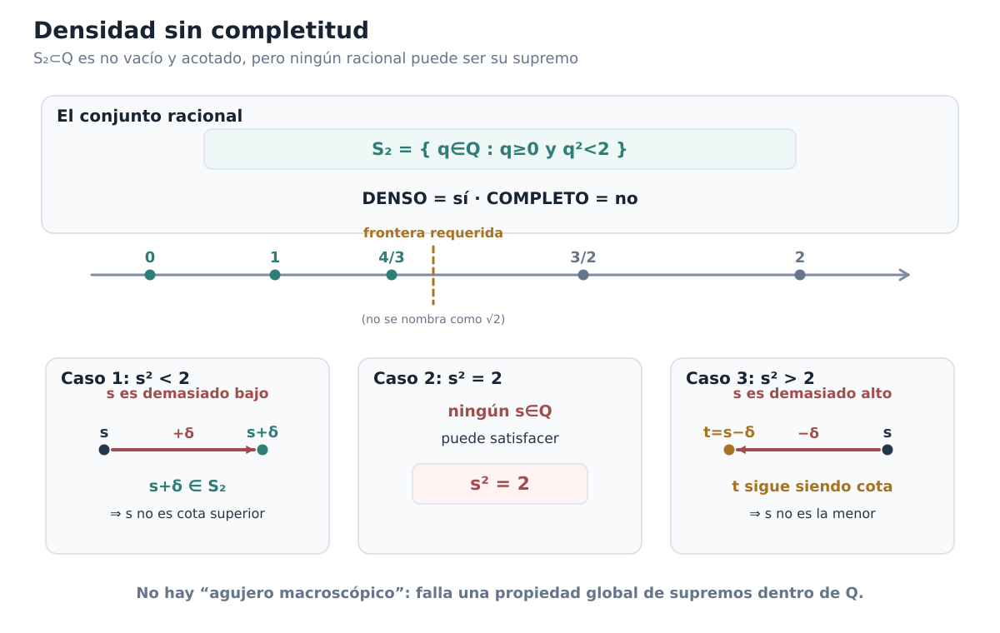{#fig-anm-c00-f03 fig-alt="Recta racional conceptual para S₂ y tres paneles: si s²<2 se avanza a la derecha dentro de S₂; si s²=2 no hay racional; si s²>2 se encuentra una cota superior menor."}

### El defecto está localizado

La comparación con la especificación de §0.1 queda ahora muy limpia.

Los racionales satisfacen:

$$
\boxed{\text{estructura de cuerpo ordenado}.}
$$

Pero fallan en:

$$
\boxed{\text{propiedad del supremo}.}
$$

Por tanto, si queremos justificar la existencia de los números reales, no necesitamos abandonar la aritmética racional ni sustituirla por otra irreconocible. Necesitamos **extenderla sin perderla** y, al mismo tiempo, añadir las fronteras que $\mathbb Q$ no puede contener por sí solo.

La pregunta constructiva aparece ahora de manera natural:

$$
\boxed{
\text{Si una frontera no pertenece a }\mathbb Q,
\text{ ¿podemos describir su posición usando sólo información racional?}
}
$$

No responderemos aún con un nombre. La sección siguiente construirá el objeto que hace posible esa idea.

### Antes de seguir

#### Microcontrol 13

[]{#MA-MIC-ANM-01-000-013}

Verifica directamente que $1\in S_2$ y que $2$ es una cota superior de $S_2$ en $\mathbb Q$.

[]{#MA-MSOL-ANM-01-000-013}

<details class="anm-solution">
<summary>Ver solución del microcontrol 13</summary>

**Respuesta.**

Por definición,

$$
S_2=\{q\in\mathbb Q:q\ge 0,\ q^2<2\}.
$$

Para comprobar que no es vacío basta exhibir un elemento. Como

$$
1\ge0,
\qquad
1^2=1<2,
$$

tenemos

$$
1\in S_2.
$$

Ahora veamos que $2$ es una cota superior. Si $q\in S_2$ y suponemos $q\ge2$, entonces $q\ge0$ y por monotonía del cuadrado en los no negativos,

$$
q^2\ge4>2,
$$

contradiciendo $q^2<2$. Luego todo $q\in S_2$ satisface $q<2$, y en particular $q\le2$. Por tanto,

$$
\boxed{S_2\ne\varnothing\quad\text{y}\quad 2\text{ es una cota superior de }S_2.}
$$

**Fundamento en la sección 0.3.**

El conjunto no es vacío, porque

$$
1\in S_2.
$$

También está acotado superiormente. En efecto, $2$ es una cota superior: si $q\in S_2$ y ocurriera $q\ge2$, entonces, como $q\ge0$,

$$
q^2\ge4>2,
$$

contradiciendo la condición $q^2<2$. Por tanto todo $q\in S_2$ satisface $q<2$.

Así tenemos, enteramente dentro de los racionales,

$$
S_2\ne\varnothing
\qquad\text{y}\qquad
S_2\text{ está acotado superiormente en }\mathbb Q.
$$

</details>

#### Microcontrol 14

[]{#MA-MIC-ANM-01-000-014}

¿Por qué no basta con demostrar que ningún racional satisface $s^2=2$ para concluir inmediatamente que $S_2$ no tiene supremo racional? ¿Qué aportan los dos argumentos de perturbación?

[]{#MA-MSOL-ANM-01-000-014}

<details class="anm-solution">
<summary>Ver solución del microcontrol 14</summary>

Demostrar que ningún racional satisface $s^2=2$ descarta sólo **una** de las tres posibilidades para un supuesto supremo racional $s$:

$$
s^2<2,
\qquad
s^2=2,
\qquad
s^2>2.
$$

Pero la definición de supremo no exige, por sí sola, que $s^2=2$. Para excluir realmente la existencia de $s=\sup_{\mathbb Q}S_2$ hay que mostrar también que los otros dos casos contradicen alguna propiedad esencial del supremo.

- Si $s^2<2$, la perturbación hacia la derecha produce un racional $s+\delta>s$ que aún pertenece a $S_2$.
- Si $s^2>2$, la perturbación hacia la izquierda produce una cota superior racional $t=s-\delta<s$.

Los dos argumentos de perturbación son, por tanto, los que enlazan la aritmética de $s^2$ con las dos condiciones definitorias del supremo: **ser cota superior** y **ser la menor cota superior**.

</details>

#### Microcontrol 15

[]{#MA-MIC-ANM-01-000-015}

En el caso $s^2<2$, identifica exactamente qué propiedad del supuesto supremo contradice el racional $s+\delta$.

[]{#MA-MSOL-ANM-01-000-015}

<details class="anm-solution">
<summary>Ver solución del microcontrol 15</summary>

**Respuesta.**

En ese caso se construye un racional $\delta>0$ tal que

$$
s+\delta>s
$$

y, al mismo tiempo,

$$
(s+\delta)^2<2.
$$

Como $s+\delta>0$, se sigue que

$$
s+\delta\in S_2.
$$

Esto contradice la primera obligación de un supremo: **ser una cota superior** del conjunto. En efecto, si $s$ fuera cota superior, ningún elemento de $S_2$ podría ser estrictamente mayor que $s$.

Así, el caso $s^2<2$ falla porque

$$
\boxed{s\text{ no puede ser cota superior de }S_2.}
$$

**Fundamento en la sección 0.3.**

Consideremos

$$
S_2=\{q\in\mathbb Q:q\ge0,\ q^2<2\}.
$$

Todo lo que aparece en esta definición pertenece a $\mathbb Q$. No hemos introducido ningún número real nuevo ni hemos supuesto la existencia de un elemento cuyo cuadrado sea $2$.

Primero verifiquemos las dos hipótesis que harían aplicable la propiedad del supremo si $\mathbb Q$ fuera completo.

El conjunto no es vacío, porque

$$
1\in S_2.
$$

También está acotado superiormente. En efecto, $2$ es una cota superior: si $q\in S_2$ y ocurriera $q\ge2$, entonces, como $q\ge0$,

</details>

#### Microcontrol 16

[]{#MA-MIC-ANM-01-000-016}

En el caso $s^2>2$, identifica exactamente qué propiedad del supuesto supremo contradice el racional $t=s-\delta$.

[]{#MA-MSOL-ANM-01-000-016}

<details class="anm-solution">
<summary>Ver solución del microcontrol 16</summary>

**Respuesta.**

En este caso se construye un racional positivo

$$
t=s-\delta<s
$$

con

$$
t^2>2.
$$

Si $q\in S_2$ y ocurriera $q\ge t$, entonces, como $q,t\ge0$,

$$
q^2\ge t^2>2,
$$

contradiciendo $q^2<2$. Por tanto todo $q\in S_2$ satisface $q<t$, de modo que $t$ es también una cota superior de $S_2$.

Pero $t<s$. Esto contradice la segunda obligación del supremo: **ser la menor de todas las cotas superiores**.

Por eso el caso $s^2>2$ falla porque

$$
\boxed{s\text{ no puede ser la menor cota superior de }S_2.}
$$

**Fundamento en la sección 0.3.**

Ahora tomemos cualquier $q\in S_2$. Si ocurriera $q\ge t$, como ambos son no negativos tendríamos

$$
q^2\ge t^2>2,
$$

lo cual contradice $q^2<2$. Por tanto

$$
q<t
$$

para todo $q\in S_2$.

Eso significa que $t$ es también una cota superior de $S_2$. Pero

$$
t<s,
$$

</details>

#### Microcontrol 17

[]{#MA-MIC-ANM-01-000-017}

Explica con tus palabras la diferencia lógica entre densidad y completitud.

[]{#MA-MSOL-ANM-01-000-017}

<details class="anm-solution">
<summary>Ver solución del microcontrol 17</summary>

La **densidad** de $\mathbb Q$ afirma que entre dos racionales distintos siempre existe otro racional:

$$
p<q
\Longrightarrow
\exists r\in\mathbb Q:\ p<r<q.
$$

Es una propiedad local del orden entre puntos que ya pertenecen al sistema.

La **completitud por supremos**, en cambio, exige que todo subconjunto no vacío y acotado superiormente posea dentro del sistema una menor cota superior.

Por eso un orden puede ser denso y, sin embargo, incompleto. El conjunto $S_2$ muestra exactamente esa situación: podemos encontrar racionales cada vez más cercanos a la frontera que determina la condición $q^2<2$, pero esa frontera requerida no aparece como supremo racional.

En síntesis,

$$
\boxed{\text{densidad llena intervalos entre puntos; completitud garantiza ciertas fronteras.}}
$$

</details>

#### Microcontrol 18

[]{#MA-MIC-ANM-01-000-018}

¿Por qué esta demostración no necesita suponer de antemano la existencia de un número real cuyo cuadrado sea $2$?

[]{#MA-MSOL-ANM-01-000-018}

<details class="anm-solution">
<summary>Ver solución del microcontrol 18</summary>

El conjunto

$$
S_2=\{q\in\mathbb Q:q\ge0,\ q^2<2\}
$$

se define usando únicamente racionales, su orden y su multiplicación. La demostración trabaja siempre con elementos racionales: un supuesto $s\in\mathbb Q$, las perturbaciones racionales $s+\delta$ y $s-\delta$, y el argumento elemental de que ningún cociente de enteros en términos mínimos puede tener cuadrado igual a $2$.

Por tanto no necesitamos introducir antes un objeto llamado $\sqrt2$ ni suponer que exista en algún sistema mayor. La conclusión obtenida es más elemental y precisamente constructiva para el argumento del capítulo:

$$
\boxed{S_2\text{ es no vacío y acotado superiormente, pero no tiene supremo en }\mathbb Q.}
$$

Sólo después de localizar esta falla queda justificada la búsqueda de una ampliación que añada la frontera ausente sin perder la estructura racional.

</details>
Hemos llegado al punto en que la necesidad de una construcción ya no es una intuición. Es una consecuencia demostrada: el último sistema de nuestra cadena disponible, $\mathbb Q$, posee la aritmética y el orden que queremos conservar, pero no la completitud que necesitamos añadir. El siguiente paso será diseñar una manera de representar una frontera ausente **sin usar todavía el punto que falta**.

### Ejercicios de la sección 0.3

#### Ejercicio 8. Construir un racional que escape por la derecha

[]{#MA-EX-ANM-01-000-008}

Trabaja únicamente en $\mathbb Q$ y considera

$$
S_2=\{q\in\mathbb Q:q\ge0,\ q^2<2\}.
$$

1. Verifica que $S_2$ es no vacío y que $2$ es una cota superior racional.
2. Sea $s\in\mathbb Q$ tal que $1\le s$ y $s^2<2$. Define

$$
\delta=\frac{2-s^2}{4s+4}.
$$

Demuestra que $\delta\in\mathbb Q$, que $0<\delta<1$ y que

$$
u=s+\delta
$$

satisface $u>s$ y $u\in S_2$.
3. Explica qué propiedad impediría que un racional $s$ con $s^2<2$ fuera una cota superior de $S_2$.

La construcción debe justificarse mediante desigualdades racionales; no introduzcas $\sqrt2$ ni ningún modelo de $\mathbb R$.

[]{#MA-SOL-ANM-01-000-008}

<details class="anm-solution">
<summary>Ver solución del ejercicio 8</summary>

El conjunto

$$
S_2=\{q\in\mathbb Q:q\ge0,\ q^2<2\}
$$

es no vacío porque

$$
1\in S_2.
$$

Además, $2$ es una cota superior racional. En efecto, si $q\in S_2$ y $q\ge2$, entonces $q\ge0$ y

$$
q^2\ge4>2,
$$

contradicción. Por tanto todo $q\in S_2$ satisface $q<2$.

Ahora sea $s\in\mathbb Q$ con $1\le s$ y $s^2<2$, y definamos

$$
\delta=\frac{2-s^2}{4s+4}.
$$

Numerador y denominador son racionales, y el denominador es no nulo; luego $\delta\in\mathbb Q$. Como $2-s^2>0$ y $4s+4>0$,

$$
\delta>0.
$$

Además, de $s\ge1$ y $s^2<2$ obtenemos

$$
0<2-s^2\le1,
\qquad
4s+4\ge8,
$$

de modo que

$$
0<\delta\le\frac18<1.
$$

Sea

$$
u=s+\delta.
$$

Claramente $u>s$ y $u\in\mathbb Q$. Falta probar que $u^2<2$. Como $0<\delta<1$,

$$
\delta^2<\delta.
$$

Por tanto

$$
\begin{aligned}
u^2
&=(s+\delta)^2\\
&=s^2+2s\delta+\delta^2\\
&<s^2+(2s+1)\delta.
\end{aligned}
$$

Ahora

$$
(2s+1)\delta
=(2-s^2)\frac{2s+1}{4s+4}.
$$

Como

$$
0<\frac{2s+1}{4s+4}<1,
$$

se sigue que

$$
(2s+1)\delta<2-s^2.
$$

Así,

$$
u^2< s^2+(2-s^2)=2.
$$

Además $u>0$, de modo que $u\in S_2$.

Hemos construido racionalmente

$$
\boxed{s<u\in S_2.}
$$

Por eso ningún racional $s$ con $s^2<2$ puede ser una cota superior de $S_2$: siempre podemos fabricar un elemento del conjunto que queda estrictamente a su derecha.

*Referencia visual.* Véase la figura [C00-F03](analisis-para-matematicos-capitulo-0-construir-los-numeros-reales.html#fig-anm-c00-f03) del texto principal, **Densidad sin completitud**, como síntesis posterior de este argumento.

</details>

#### Ejercicio 9. Mejorar una cota que queda demasiado a la derecha

[]{#MA-EX-ANM-01-000-009}

Sea $s\in\mathbb Q$ con $s>0$ y $s^2>2$. Define

$$
\delta=\frac{s^2-2}{4s},
\qquad
t=s-\delta.
$$

Demuestra, en este orden, que:

1. $\delta>0$ y $0<t<s$;
2. $t^2>2$;
3. todo $q\in S_2$ satisface $q<t$;
4. por tanto $t$ es una cota superior racional de $S_2$ estrictamente menor que $s$.

Concluye qué propiedad del supremo viola cualquier candidato racional $s$ con $s^2>2$.

[]{#MA-SOL-ANM-01-000-009}

<details class="anm-solution">
<summary>Ver solución del ejercicio 9</summary>

Sea $s\in\mathbb Q$, $s>0$ y $s^2>2$. Definimos

$$
\delta=\frac{s^2-2}{4s},
\qquad
t=s-\delta.
$$

Como $s^2-2>0$ y $4s>0$,

$$
\delta>0.
$$

También

$$
s^2-2<4s^2,
$$

pues esto equivale a

$$
0<3s^2+2,
$$

que es cierto. Al dividir por $4s>0$ obtenemos

$$
\delta<s.
$$

Por tanto

$$
0<t=s-\delta<s.
$$

Calculemos:

$$
\begin{aligned}
t^2
&=(s-\delta)^2\\
&=s^2-2s\delta+\delta^2\\
&>s^2-2s\delta\\
&=s^2-\frac{s^2-2}{2}\\
&=\frac{s^2+2}{2}\\
&>2.
\end{aligned}
$$

Ahora sea $q\in S_2$. Si $q\ge t$, entonces $q\ge0$ y $t>0$, de modo que

$$
q^2\ge t^2>2,
$$

contradiciendo la definición de $S_2$. Por consiguiente,

$$
q<t
$$

para todo $q\in S_2$.

Esto dice exactamente que $t$ es una cota superior racional de $S_2$. Pero además

$$
t<s.
$$

Así, cualquier supuesto supremo racional $s$ con $s^2>2$ dejaría de ser la menor cota superior, porque acabamos de construir otra cota superior estrictamente menor.

*Referencia visual.* Véase la figura [C00-F03](analisis-para-matematicos-capitulo-0-construir-los-numeros-reales.html#fig-anm-c00-f03) del texto principal, **Densidad sin completitud**, como síntesis posterior de este argumento.

</details>

#### Ejercicio 10. Ningún candidato racional sobrevive

[]{#MA-EX-ANM-01-000-010}

Demuestra que $S_2$ no posee supremo en $\mathbb Q$.

Tu demostración debe organizarse como una prueba por contradicción:

1. supón que existe $s=\sup_{\mathbb Q}S_2$;
2. deduce de manera explícita que $1\le s\le2$;
3. separa los tres casos

$$
s^2<2,
\qquad
s^2=2,
\qquad
s^2>2;
$$

4. usa las construcciones de los ejercicios 8 y 9 para descartar los casos estrictos;
5. descarta $s^2=2$ mediante un argumento enteramente racional basado en una fracción $m/n$ escrita en términos mínimos;
6. concluye con precisión qué propiedad de $\mathbb Q$ falla.

No está permitido invocar la existencia previa de un número real cuyo cuadrado sea $2$.

[]{#MA-SOL-ANM-01-000-010}

<details class="anm-solution">
<summary>Ver solución del ejercicio 10</summary>

Supongamos, para obtener una contradicción, que existe

$$
s=\sup_{\mathbb Q}S_2.
$$

Como $1\in S_2$, toda cota superior de $S_2$ debe satisfacer $s\ge1$. Y como $2$ es una cota superior racional,

$$
s\le2.
$$

Luego

$$
1\le s\le2.
$$

En particular $s>0$. Por tricotomía, exactamente uno de los tres casos siguientes debe ocurrir.

Si $s^2<2$, el ejercicio 8 construye un racional $u$ tal que

$$
s<u\in S_2.
$$

Eso contradice que $s$ sea cota superior.

Si $s^2>2$, el ejercicio 9 construye un racional $t$ tal que

$$
t<s
$$

y $t$ sigue siendo cota superior de $S_2$. Eso contradice que $s$ sea la menor cota superior.

Queda el caso

$$
s^2=2.
$$

Escribamos

$$
s=\frac mn
$$

con $m,n\in\mathbb Z$, $n>0$ y $m/n$ en términos mínimos. Entonces

$$
m^2=2n^2.
$$

Así $m^2$ es par, luego $m$ es par. Escribamos $m=2k$. Sustituyendo,

$$
4k^2=2n^2,
$$

y por tanto

$$
n^2=2k^2.
$$

Entonces $n$ también es par. Esto contradice que $m/n$ estuviera en términos mínimos.

Por consiguiente, ningún racional satisface $s^2=2$.

Los tres casos son imposibles. Por tanto,

$$
\boxed{S_2\text{ no posee supremo en }\mathbb Q.}
$$

Como $S_2$ es no vacío y está acotado superiormente, hemos encontrado un contraejemplo directo a la propiedad del supremo dentro de $\mathbb Q$. En consecuencia,

$$
\boxed{\mathbb Q\text{ no es completo para la propiedad del supremo}.}
$$

Toda la prueba ha permanecido en aritmética racional.

*Referencia visual.* Véase la figura [C00-F03](analisis-para-matematicos-capitulo-0-construir-los-numeros-reales.html#fig-anm-c00-f03) del texto principal, **Densidad sin completitud**, como síntesis posterior de este argumento.

</details>

#### Ejercicio 11. Una prueba que introduce demasiado pronto la frontera

[]{#MA-EX-ANM-01-000-011}

Un estudiante escribe:

> «En $\mathbb R$ existe $\sqrt2$. Todo $q\in S_2$ cumple $q<\sqrt2$, y como los racionales son densos podemos aproximarnos racionalmente a $\sqrt2$ tanto como queramos desde abajo. Por tanto $\sqrt2$ es el supremo de $S_2$. Como $\sqrt2\notin\mathbb Q$, el conjunto $S_2$ no tiene supremo racional.»

Audita el argumento dentro del punto del capítulo en que nos encontramos.

1. Identifica la primera afirmación que no está disponible todavía.
2. Explica por qué la apelación a «aproximarse racionalmente a $\sqrt2$» también presupone un marco que aún no hemos construido.
3. Distingue qué conclusión matemática sería válida si ya dispusiéramos de $\mathbb R$ de la cuestión fundacional que §0.3 está intentando resolver sin circularidad.
4. Repara la estrategia indicando cómo reemplazar la referencia a $\sqrt2$ por un análisis puramente racional de un supuesto $s=\sup_{\mathbb Q}S_2$.

No basta con decir «es circular»: localiza exactamente qué objeto y qué propiedad se han usado antes de estar disponibles.

[]{#MA-SOL-ANM-01-000-011}

<details class="anm-solution">
<summary>Ver solución del ejercicio 11</summary>

El primer paso ilegítimo es la frase

> «En $\mathbb R$ existe $\sqrt2$».

En el punto actual del capítulo todavía estamos intentando justificar la existencia de un cuerpo ordenado completo que pueda desempeñar el papel de los números reales. Introducir $\mathbb R$ como estructura ya disponible y, dentro de ella, el elemento $\sqrt2$, presupone precisamente una parte del resultado que la construcción posterior debe establecer.

Hay una segunda anticipación en la frase «podemos aproximarnos racionalmente a $\sqrt2$ tanto como queramos desde abajo». La densidad demostrada hasta aquí para $\mathbb Q$ tiene la forma

$$
p<q,
\quad p,q\in\mathbb Q
\Longrightarrow
\exists r\in\mathbb Q:
 p<r<q.
$$

Hablar de racionales entre un racional y $\sqrt2$ exige haber situado ya $\sqrt2$ en un sistema ordenado común con $\mathbb Q$. Ese marco todavía no está disponible como premisa de §0.3.

Si $\mathbb R$ ya estuviera construido y se hubiera demostrado que $\sqrt2$ existe en él, el argumento externo podría servir para identificar la frontera de $S_2$ en ese sistema. Pero ésa es una afirmación posterior. No puede usarse para justificar, desde dentro de $\mathbb Q$, por qué necesitamos construir una extensión completa.

La reparación consiste en no nombrar ninguna frontera externa. Se toma un candidato arbitrario

$$
s\in\mathbb Q
$$

para ser $\sup_{\mathbb Q}S_2$ y se estudian las únicas tres posibilidades para $s^2$:

$$
s^2<2,
\qquad
s^2=2,
\qquad
s^2>2.
$$

- En el primer caso se construye racionalmente $u>s$ con $u\in S_2$.
- En el tercero se construye racionalmente una cota superior $t<s$.
- En el caso central se demuestra, mediante paridad y una fracción irreducible, que ningún racional puede satisfacer $s^2=2$.

Así se obtiene la contradicción sin usar $\mathbb R$, sin usar $\sqrt2$ como objeto ya existente y sin recurrir a una noción externa de aproximación.

El problema no es que la conclusión del estudiante sea falsa; el problema es que su ruta lógica gasta antes de tiempo el objeto cuya necesidad estamos intentando demostrar.

</details>

#### Ejercicio 12. Denso, pero no completo

[]{#MA-EX-ANM-01-000-012}

Refuta la afirmación:

> «Todo cuerpo ordenado denso es completo para la propiedad del supremo.»

Tu contraejemplo debe ser $\mathbb Q$ y debe incluir tres piezas.

1. Demuestra directamente que $\mathbb Q$ es denso: dados $p<q$ racionales, construye un racional estrictamente entre ambos.
2. Usa $S_2$ y el resultado del ejercicio 10 para demostrar que $\mathbb Q$ no satisface la propiedad del supremo.
3. Considera además

$$
A=\{q\in\mathbb Q:q<1\}.
$$

Demuestra que $A$ no tiene máximo, pero sí tiene supremo racional, y explica por qué este contraste impide confundir «no tener máximo» con «no tener supremo».

Cierra distinguiendo en una frase qué controla la densidad y qué controla la completitud.

[]{#MA-SOL-ANM-01-000-012}

<details class="anm-solution">
<summary>Ver solución del ejercicio 12</summary>

Tomemos dos racionales $p<q$. El punto medio

$$
r=\frac{p+q}{2}
$$

es racional y satisface

$$
p<r<q.
$$

Por tanto $\mathbb Q$ es denso en el sentido pertinente: entre dos racionales distintos siempre hay otro racional.

Sin embargo, el ejercicio 10 mostró que

$$
S_2=\{q\in\mathbb Q:q\ge0,\ q^2<2\}
$$

es no vacío, está acotado superiormente en $\mathbb Q$ y no posee supremo racional. Luego $\mathbb Q$ no es completo para la propiedad del supremo.

Así, $\mathbb Q$ es ya el contraejemplo solicitado a la implicación

$$
\text{densidad}
\Longrightarrow
\text{completitud}.
$$

Conviene separar todavía otra confusión. Consideremos

$$
A=\{q\in\mathbb Q:q<1\}.
$$

El conjunto $A$ no tiene máximo. En efecto, si $q\in A$, entonces

$$
q<\frac{q+1}{2}<1,
$$

y el número $(q+1)/2$ es racional y pertenece a $A$. Por tanto ningún elemento de $A$ puede ser el mayor.

No obstante,

$$
\sup_{\mathbb Q}A=1.
$$

El número $1$ es una cota superior de $A$. Además, si $u<1$ fuera otra cota superior racional, entonces

$$
r=\frac{u+1}{2}
$$

sería racional y cumpliría

$$
u<r<1.
$$

Así $r\in A$ y $r>u$, contradiciendo que $u$ fuera cota superior. Luego ninguna cota superior puede ser menor que $1$.

Tenemos entonces dos fenómenos distintos dentro del mismo sistema:

$$
A\text{ no tiene máximo, pero sí supremo racional},
$$

mientras que

$$
S_2\text{ no tiene supremo racional}.
$$

Por eso «no tener máximo» no equivale a «no tener supremo».

La distinción final es:

$$
\boxed{
\text{densidad: qué ocurre entre puntos ya presentes;}
\qquad
\text{completitud: si existen dentro del sistema las fronteras exigidas.}
}
$$

</details>
## 0.4. Construir una frontera sin tener el punto

[]{#MA-SEC-ANM-01-000-004}

La sección anterior terminó con una situación incómoda. El conjunto

$$
S_2=\{q\in\mathbb Q:q\ge0,\ q^2<2\}
$$

está formado enteramente por racionales, es no vacío y está acotado superiormente, pero no tiene supremo en $\mathbb Q$. Sabemos, por tanto, qué clase de objeto falta: necesitamos incorporar una frontera que el orden racional exige, aunque esa frontera no sea todavía un elemento de nuestro sistema.

¿Cómo podemos construir algo que represente esa posición **sin suponer de antemano que el punto ya existe**?

La idea de Dedekind consiste en cambiar la pregunta. En vez de intentar nombrar directamente la frontera ausente, preguntaremos:

> **¿Qué racionales quedarían a su izquierda?**

Esa información sí vive por completo dentro de $\mathbb Q$. Si logramos caracterizar qué propiedades debe tener el conjunto de todos esos racionales, podremos usar el propio conjunto como código de la posición que buscamos.

### De una frontera a su lado izquierdo

Imaginemos por un momento una posición determinada por un racional $c$. Sin introducir todavía ninguna notación especial, el conjunto natural de racionales que quedan antes de $c$ es

$$
L_c=\{q\in\mathbb Q:q<c\}.
$$

Este conjunto tiene cuatro rasgos simples.

Primero, no es vacío. Por ejemplo,

$$
c-1\in L_c.
$$

Segundo, no contiene a todos los racionales, porque

$$
c\notin L_c.
$$

Tercero, si un racional pertenece a $L_c$, entonces todo racional menor también pertenece. En efecto, si

$$
q<c
\qquad\text{y}\qquad
r<q,
$$

entonces, por transitividad del orden,

$$
r<c.
$$

Finalmente, $L_c$ no tiene un elemento mayor que todos los demás. Si $q\in L_c$, entonces $q<c$ y el racional

$$
r=\frac{q+c}{2}
$$

satisface

$$
q<r<c.
$$

Por tanto $r\in L_c$ y $r>q$.

Estas propiedades no dependen de dibujar una recta real ni de poseer ya un objeto situado en la frontera. Se expresan exclusivamente mediante pertenencia, subconjuntos y el orden de $\mathbb Q$.

Eso sugiere tomar esas propiedades como definición.

### Definición: cortadura de Dedekind

> **Definición.** Una **cortadura de Dedekind** es un subconjunto propio $A\subsetneq\mathbb Q$ que satisface:
>
> 1. $A\ne\varnothing$;
> 2. si $q\in A$ y $r<q$, entonces $r\in A$;
> 3. $A$ no tiene máximo: para todo $q\in A$ existe $r\in A$ tal que $q<r$.

La segunda condición suele describirse diciendo que $A$ es **cerrado hacia abajo**. Una vez que un racional entra en $A$, todos los racionales menores entran con él.

La tercera condición merece más atención. No es un adorno técnico. Es la condición que decide de qué lado de una frontera racional colocamos la frontera misma.

### Por qué prohibimos un máximo

Supongamos otra vez que $c\in\mathbb Q$. Si sólo exigiéramos que el conjunto fuera no vacío, propio y cerrado hacia abajo, entonces los dos conjuntos

$$
\{q\in\mathbb Q:q<c\}
$$

y

$$
\{q\in\mathbb Q:q\le c\}
$$

serían admisibles.

Los dos describen la misma separación intuitiva de los racionales alrededor de $c$, pero serían dos objetos distintos. El segundo contiene un máximo, precisamente $c$; el primero no.

La convención de exigir **ausencia de máximo** elimina esa duplicación. Cuando la frontera corresponde a un racional, la codificamos siempre mediante los racionales estrictamente menores que ella.

Así, una cortadura no es «la frontera más todo lo que queda a la izquierda». Es solamente el lado izquierdo, sin último elemento.

Este detalle será crucial más adelante: queremos que una posición tenga un solo código.

### Una cortadura cuya frontera no hemos construido

El ejemplo racional $L_c$ podría dar la impresión de que las cortaduras sólo sirven para volver a escribir racionales que ya conocemos. Pero el problema de §0.3 apunta exactamente en la dirección contraria.

Consideremos ahora el subconjunto

$$
A_2=\{q\in\mathbb Q:q<0\ \text{o}\ q^2<2\}.
$$

Esta definición usa únicamente números racionales, desigualdades racionales y multiplicación racional. No hemos introducido ningún número cuyo cuadrado sea $2$.

Vamos a comprobar que $A_2$ es una cortadura.

Es no vacío, porque

$$
0\in A_2.
$$

Es propio, porque

$$
2\notin A_2:
\qquad
2\not<0
\quad\text{y}\quad
2^2=4\not<2.
$$

Veamos ahora la clausura hacia abajo. Sea $q\in A_2$ y sea $r<q$.

Si $q<0$, entonces también $r<0$, de modo que $r\in A_2$.

Si $q\ge0$, la pertenencia $q\in A_2$ obliga a que

$$
q^2<2.
$$

Si $r<0$, ya sabemos que $r\in A_2$. Si, en cambio,

$$
0\le r<q,
$$

entonces

$$
r^2<q^2<2,
$$

y nuevamente $r\in A_2$.

Por tanto $A_2$ es cerrado hacia abajo.

Falta demostrar que no tiene máximo. Tomemos $q\in A_2$.

Si $q<0$, basta considerar

$$
r=\frac q2.
$$

Como $q<0$, tenemos

$$
q<\frac q2<0,
$$

de modo que $r\in A_2$ y $r>q$.

Queda el caso $q\ge0$. Entonces $q^2<2$. Definamos

$$
\delta=\frac{2-q^2}{2q+3}.
$$

El número $\delta$ es racional y positivo. Además,

$$
0<\delta<1,
$$

porque $2-q^2\le2$ y $2q+3\ge3$. Por tanto $\delta^2<\delta$. Ahora

$$
\begin{aligned}
(q+\delta)^2
&=q^2+2q\delta+\delta^2\\
&<q^2+(2q+1)\delta\\
&=q^2+(2-q^2)\frac{2q+1}{2q+3}\\
&<q^2+(2-q^2)\\
&=2.
\end{aligned}
$$

Así,

$$
q+\delta\in A_2
\qquad\text{y}\qquad
q+\delta>q.
$$

Ningún elemento de $A_2$ puede ser máximo.

Hemos demostrado, sin introducir ningún irracional preexistente, que

$$
\boxed{A_2\text{ es una cortadura de Dedekind}.}
$$

Éste es el punto conceptual decisivo. En §0.3 encontramos una frontera que $\mathbb Q$ necesitaba pero no podía proporcionar como elemento. Ahora hemos construido, usando sólo racionales, un objeto que registra exactamente un **lado izquierdo racional** asociado a esa frontera.

No diremos todavía que $A_2$ «es» un número real. Por ahora es un subconjunto de $\mathbb Q$ con propiedades precisas. Primero construiremos el sistema formado por todos esos objetos y veremos qué estructura posee.

### El nuevo dominio: todas las cortaduras

Denotemos por

$$
\mathcal D
=
\{A\subseteq\mathbb Q:A\text{ es una cortadura de Dedekind}\}.
$$

Cada elemento de $\mathcal D$ es, por definición, un **conjunto de racionales**.

Desde el punto de vista conjuntista, no hay aquí una nueva suposición misteriosa. Todo subconjunto de $\mathbb Q$ pertenece al conjunto potencia $\mathcal P(\mathbb Q)$, y la propiedad de ser cortadura selecciona algunos de esos subconjuntos. En el marco clásico que adoptamos al comienzo del capítulo podemos escribir

$$
\boxed{\mathcal D\subseteq\mathcal P(\mathbb Q)}
$$

y considerar $\mathcal D$ como un conjunto bien definido. Una formalización axiomática completa expresaría esta selección mediante los principios usuales de teoría de conjuntos; no necesitamos abrir aquí una reconstrucción de ZF/ZFC.

La pregunta cambia entonces de forma. Ya no preguntamos dónde está una frontera ausente en una recta que todavía no poseemos. Tenemos un nuevo dominio concreto, $\mathcal D$, y podemos preguntar qué relaciones y operaciones admite.

La primera estructura aparece inmediatamente.

### Ordenar posiciones por inclusión

Si una posición queda más a la derecha que otra, debería dejar **más racionales** a su izquierda. En el lenguaje de cortaduras, «tener más racionales a la izquierda» significa simplemente contener al otro conjunto.

Esto motiva la definición

$$
A\le_{\mathcal D}B
\quad\Longleftrightarrow\quad
A\subseteq B.
$$

Y, para el orden estricto,

$$
A<_{\mathcal D}B
\quad\Longleftrightarrow\quad
A\subsetneq B.
$$

La inclusión ya es reflexiva y transitiva. Además, si

$$
A\subseteq B
\qquad\text{y}\qquad
B\subseteq A,
$$

entonces $A=B$. Por tanto $\le_{\mathcal D}$ es al menos un orden parcial.

Pero necesitamos algo más: queremos poder comparar **cualesquiera dos** cortaduras. Sorprendentemente, la clausura hacia abajo fuerza exactamente esa comparabilidad.

> **Proposición.** Si $A,B\in\mathcal D$, entonces
>
> $$
> A\subseteq B
> \qquad\text{o}\qquad
> B\subseteq A.
> $$
>
> En consecuencia, la inclusión define un orden lineal sobre $\mathcal D$.

**Demostración.** Si $A\subseteq B$, no hay nada que probar. Supongamos entonces que

$$
A\not\subseteq B.
$$

Existe por tanto algún

$$
a\in A\setminus B.
$$

Tomemos un elemento cualquiera $b\in B$. No puede ocurrir que $a<b$, porque entonces, como $b\in B$ y $B$ es cerrado hacia abajo, tendríamos $a\in B$, contradicción. Tampoco puede ocurrir $a=b$, porque $a\notin B$ y $b\in B$.

Por la tricotomía del orden racional, necesariamente

$$
b<a.
$$

Pero $a\in A$ y $A$ es cerrado hacia abajo, de modo que

$$
b\in A.
$$

Como $b\in B$ era arbitrario, concluimos

$$
B\subseteq A.
$$

Así, para cualesquiera $A,B\in\mathcal D$, una de las dos inclusiones se cumple. Junto con reflexividad, antisimetría y transitividad, esto demuestra que $\le_{\mathcal D}$ es un orden lineal. $\square$

La prueba merece ser leída estructuralmente. No hemos comparado supuestos puntos frontera. Hemos comparado **información racional**. Si un racional pertenece a $A$ pero no a $B$, la clausura hacia abajo obliga a que todos los racionales de $B$ queden por debajo de ese testigo y, por tanto, también pertenezcan a $A$.

### Una posición codificada desde la izquierda

Podemos resumir la idea construida hasta aquí así:

$$
\boxed{
\text{posición buscada}
\quad\rightsquigarrow\quad
\text{conjunto de racionales que quedan a su izquierda}.
}
$$

La flecha no significa todavía que hayamos construido los números reales. Sólo hemos encontrado un tipo de objeto capaz de registrar posiciones que $\mathbb Q$ no puede contener como elementos.

Cuanto mayor es una cortadura por inclusión, más racionales registra a su izquierda y, por tanto, más a la derecha queda la posición codificada.

Es importante mantener los tipos separados:

$$
A\in\mathcal D,
\qquad
A\subseteq\mathbb Q,
\qquad
q\in\mathbb Q.
$$

Una cortadura no es un racional, ni es todavía un «punto de la recta real» previamente existente. Es un conjunto de racionales con una estructura de orden que acabamos de construir.

La figura [C00-F04](#fig-anm-c00-f04) concentra esta lectura en un único mapa visual.

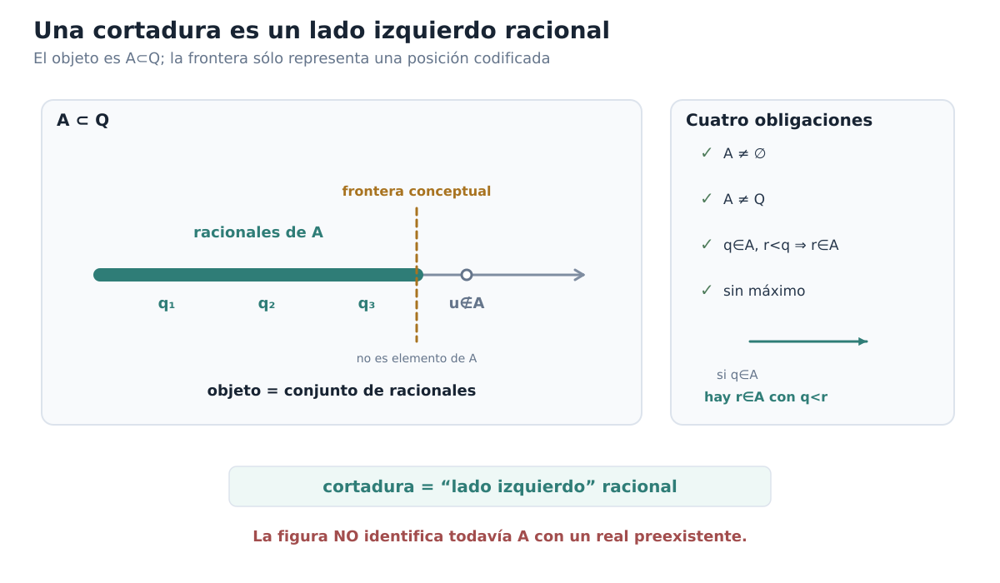{#fig-anm-c00-f04 fig-alt="Recta racional con una región izquierda marcada como A, frontera conceptual excluida y lista de las cuatro obligaciones: no vacío, propio, clausura inferior y ausencia de máximo."}

### Lo que todavía falta

Tenemos un conjunto $\mathcal D$ y hemos demostrado que sus elementos están linealmente ordenados por inclusión. Esto ya reproduce una parte esencial de la idea de posición, pero está muy lejos de cerrar nuestra especificación inicial.

Todavía no sabemos sumar dos cortaduras. No sabemos multiplicarlas. No hemos construido un cero, un uno, opuestos ni inversos. Mucho menos hemos demostrado que $\mathcal D$ sea completo.

Antes de intentar esa aritmética necesitamos resolver una cuestión más básica. El sistema nuevo debe **extender sin destruir** al sistema racional, tal como $\mathbb Z$ extendía a $\mathbb N$ y $\mathbb Q$ extendía a $\mathbb Z$.

La pregunta inmediata es, por tanto:

$$
\boxed{
\text{¿cómo reconocemos dentro de }\mathcal D
\text{ una copia fiel de }\mathbb Q\text{?}
}
$$

La respuesta comenzará observando que cada racional ya determina una cortadura natural. Construiremos esa correspondencia en la sección siguiente y comprobaremos primero que preserva el orden; la certificación algebraica completa tendrá que esperar hasta que hayamos definido las operaciones de $\mathcal D$.

### Antes de seguir

#### Microcontrol 19

[]{#MA-MIC-ANM-01-000-019}

Verifica directamente que, para cada $c\in\mathbb Q$, el conjunto $L_c=\{q\in\mathbb Q:q<c\}$ es una cortadura de Dedekind.

[]{#MA-MSOL-ANM-01-000-019}

<details class="anm-solution">
<summary>Ver solución del microcontrol 19</summary>

**Respuesta.**

Sea
$$
L_c=\{q\in\mathbb Q:q<c\},
\qquad c\in\mathbb Q.
$$

- **No vacío:** $c-1<c$, luego $c-1\in L_c$.
- **Propio:** $c\notin L_c$, así que $L_c\ne\mathbb Q$.
- **Cerrado hacia abajo:** si $q\in L_c$ y $r<q$, entonces $r<q<c$, por transitividad; por tanto $r\in L_c$.
- **Sin máximo:** si $q\in L_c$, entonces
  $$
  r=\frac{q+c}{2}
  $$
  satisface $q<r<c$. Así, $r\in L_c$ y $r>q$.

Por consiguiente,
$$
\boxed{L_c\text{ es una cortadura de Dedekind}.}
$$

**Fundamento en la sección 0.4.**

porque $2-q^2\le2$ y $2q+3\ge3$. Por tanto $\delta^2<\delta$. Ahora

$$
\begin{aligned}
(q+\delta)^2
&=q^2+2q\delta+\delta^2\\
&<q^2+(2q+1)\delta\\
&=q^2+(2-q^2)\frac{2q+1}{2q+3}\\
&<q^2+(2-q^2)\\
&=2.
\end{aligned}
$$

Así,

$$
q+\delta\in A_2
\qquad\text{y}\qquad
q+\delta>q.
$$

Ningún elemento de $A_2$ puede ser máximo.

Hemos demostrado, sin introducir ningún irracional preexistente, que

$$
\boxed{A_2\text{ es una cortadura de Dedekind}.}
$$

</details>

#### Microcontrol 20

[]{#MA-MIC-ANM-01-000-020}

Explica por qué $\{q\in\mathbb Q:q\le c\}$ queda excluido por la condición «sin máximo» y qué duplicación evitaríamos de no imponerla.

[]{#MA-MSOL-ANM-01-000-020}

<details class="anm-solution">
<summary>Ver solución del microcontrol 20</summary>

**Respuesta.**

El conjunto
$$
\{q\in\mathbb Q:q\le c\}
$$
tiene máximo: el propio racional $c$. Por eso queda excluido por la condición «sin máximo».

Si suprimiéramos esa condición, serían admisibles a la vez
$$
\{q\in\mathbb Q:q<c\}
\qquad\text{y}\qquad
\{q\in\mathbb Q:q\le c\}.
$$
Son conjuntos distintos, pero ambos codificarían intuitivamente la misma frontera racional $c$. La cláusula «sin máximo» fija una convención única: una frontera racional se representa por los racionales estrictamente menores que ella.

**Fundamento en la sección 0.4.**

Supongamos otra vez que $c\in\mathbb Q$. Si sólo exigiéramos que el conjunto fuera no vacío, propio y cerrado hacia abajo, entonces los dos conjuntos

$$
\{q\in\mathbb Q:q<c\}
$$

y

$$
\{q\in\mathbb Q:q\le c\}
$$

serían admisibles.

Los dos describen la misma separación intuitiva de los racionales alrededor de $c$, pero serían dos objetos distintos. El segundo contiene un máximo, precisamente $c$; el primero no.

La convención de exigir **ausencia de máximo** elimina esa duplicación. Cuando la frontera corresponde a un racional, la codificamos siempre mediante los racionales estrictamente menores que ella.

</details>

#### Microcontrol 21

[]{#MA-MIC-ANM-01-000-021}

En la comprobación de $A_2$, ¿por qué hay que separar los casos $q<0$ y $q\ge0$ al demostrar que no existe máximo?

[]{#MA-MSOL-ANM-01-000-021}

<details class="anm-solution">
<summary>Ver solución del microcontrol 21</summary>

**Respuesta.**

Para demostrar que $A_2$ no tiene máximo debemos, dado $q\in A_2$, encontrar otro elemento de $A_2$ estrictamente mayor.

Si $q<0$, basta tomar
$$
r=\frac q2,
$$
pues $q<r<0$, de modo que $r\in A_2$.

Si $q\ge0$, en cambio, $q/2\le q$ y no sirve. En ese caso, de $q\in A_2$ se sigue $q^2<2$, y esa desigualdad permite construir una perturbación racional positiva $\delta$ con
$$
(q+\delta)^2<2.
$$
Entonces $q+\delta\in A_2$ y $q+\delta>q$.

Los casos se separan porque la razón que garantiza la pertenencia —negatividad o desigualdad cuadrática— es distinta en cada región.

**Fundamento en la sección 0.4.**

de modo que $r\in A_2$ y $r>q$.

Queda el caso $q\ge0$. Entonces $q^2<2$. Definamos

$$
\delta=\frac{2-q^2}{2q+3}.
$$

El número $\delta$ es racional y positivo. Además,

$$
0<\delta<1,
$$

porque $2-q^2\le2$ y $2q+3\ge3$. Por tanto $\delta^2<\delta$. Ahora

$$
\begin{aligned}
(q+\delta)^2
&=q^2+2q\delta+\delta^2\\
&<q^2+(2q+1)\delta\\
&=q^2+(2-q^2)\frac{2q+1}{2q+3}\\
&<q^2+(2-q^2)\\
&=2.
\end{aligned}
$$

</details>

#### Microcontrol 22

[]{#MA-MIC-ANM-01-000-022}

¿En qué paso de la prueba de linealidad usamos que el orden de $\mathbb Q$ satisface tricotomía?

[]{#MA-MSOL-ANM-01-000-022}

<details class="anm-solution">
<summary>Ver solución del microcontrol 22</summary>

**Respuesta.**

Partimos de $A\not\subseteq B$ y elegimos $a\in A\setminus B$. Para un $b\in B$ arbitrario, no puede ocurrir $a<b$, porque la clausura hacia abajo de $B$ implicaría $a\in B$. Tampoco puede ocurrir $a=b$.

Es exactamente aquí donde usamos la **tricotomía** del orden racional: entre $a<b$, $a=b$ y $b<a$, descartadas las dos primeras posibilidades, necesariamente
$$
b<a.
$$
Como $a\in A$ y $A$ es cerrado hacia abajo, $b\in A$. Al ser $b\in B$ arbitrario,
$$
B\subseteq A.
$$

**Fundamento en la sección 0.4.**

**Demostración.** Si $A\subseteq B$, no hay nada que probar. Supongamos entonces que

$$
A\not\subseteq B.
$$

Existe por tanto algún

$$
a\in A\setminus B.
$$

Tomemos un elemento cualquiera $b\in B$. No puede ocurrir que $a<b$, porque entonces, como $b\in B$ y $B$ es cerrado hacia abajo, tendríamos $a\in B$, contradicción. Tampoco puede ocurrir $a=b$, porque $a\notin B$ y $b\in B$.

Por la tricotomía del orden racional, necesariamente

$$
b<a.
$$

</details>

#### Microcontrol 23

[]{#MA-MIC-ANM-01-000-023}

Si $A\subsetneq B$, ¿qué interpretación tiene esa inclusión en términos de los racionales situados «a la izquierda» de las posiciones codificadas?

[]{#MA-MSOL-ANM-01-000-023}

<details class="anm-solution">
<summary>Ver solución del microcontrol 23</summary>

La inclusión
$$
A\subsetneq B
$$
dice que todo racional registrado como situado a la izquierda de la posición codificada por $A$ también está a la izquierda de la posición codificada por $B$, y además existe al menos un racional que pertenece a $B$ pero no a $A$.

Por tanto $B$ registra **más racionales a su izquierda** que $A$. Ésta es la lectura que motiva
$$
A<_{\mathcal D}B
\quad\Longleftrightarrow\quad
A\subsetneq B:
$$
la posición codificada por $B$ queda estrictamente más a la derecha que la codificada por $A$. Esta interpretación usa sólo los códigos racionales y no presupone puntos reales ya construidos.

</details>

#### Microcontrol 24

[]{#MA-MIC-ANM-01-000-024}

¿Por qué la existencia del conjunto $\mathcal D\subseteq\mathcal P(\mathbb Q)$ no demuestra todavía que hayamos construido un cuerpo ordenado completo?

[]{#MA-MSOL-ANM-01-000-024}

<details class="anm-solution">
<summary>Ver solución del microcontrol 24</summary>

**Respuesta.**

La inclusión
$$
\mathcal D\subseteq\mathcal P(\mathbb Q)
$$
justifica que $\mathcal D$ es un conjunto bien definido. Además, §0.4 le da un orden lineal por inclusión.

Pero todavía falta definir y verificar suma y producto, cero y uno, opuestos e inversos multiplicativos, las leyes de cuerpo, la compatibilidad con el orden y la propiedad del supremo.

Por tanto, de $\mathcal D\subseteq\mathcal P(\mathbb Q)$ no se sigue que $\mathcal D$ sea un cuerpo ordenado completo. En §0.4 hemos construido **el dominio y su orden**; la estructura algebraica y la completitud todavía deben demostrarse.

**Fundamento en la sección 0.4.**

Una cortadura no es un racional, ni es todavía un «punto de la recta real» previamente existente. Es un conjunto de racionales con una estructura de orden que acabamos de construir.

La figura [C00-F04](#fig-anm-c00-f04) concentra esta lectura en un único mapa visual.

Tenemos un conjunto $\mathcal D$ y hemos demostrado que sus elementos están linealmente ordenados por inclusión. Esto ya reproduce una parte esencial de la idea de posición, pero está muy lejos de cerrar nuestra especificación inicial.

Todavía no sabemos sumar dos cortaduras. No sabemos multiplicarlas. No hemos construido un cero, un uno, opuestos ni inversos. Mucho menos hemos demostrado que $\mathcal D$ sea completo.

</details>
Ya tenemos el primer objeto nuevo del capítulo. No nació de dibujar un punto ausente, sino de registrar qué racionales deberían quedar antes de él. El próximo paso será comprobar que los racionales mismos reaparecen dentro de este lenguaje sin perder su orden.

### Ejercicios de la sección 0.4

#### Ejercicio 13. Auditar las cuatro condiciones de una cortadura

[]{#MA-EX-ANM-01-000-013}

Para un subconjunto $A\subseteq\mathbb Q$, considera por separado estas cuatro exigencias:

1. $A\ne\varnothing$;
2. $A\subsetneq\mathbb Q$;
3. si $q\in A$ y $r<q$, entonces $r\in A$;
4. $A$ no tiene máximo.

Analiza los siguientes subconjuntos de $\mathbb Q$:

$$
\begin{aligned}
B_1&=\{q\in\mathbb Q:q<3\},\\
B_2&=\{q\in\mathbb Q:q\le3\},\\
B_3&=\mathbb Q,\\
B_4&=\varnothing,\\
B_5&=\{q\in\mathbb Q:q<0\ \text{o}\ 1<q<2\}.
\end{aligned}
$$

Para cada $A_i$:

1. determina cuáles de las cuatro condiciones satisface;
2. cuando una condición falle, exhibe un testigo concreto del fallo;
3. decide cuáles son cortaduras de Dedekind.

Cierra escribiendo correctamente los tipos de los objetos involucrados cuando $A\in\mathcal D$ y $q\in A$: distingue entre $A\in\mathcal D$, $A\subseteq\mathbb Q$, $q\in A$ y $q\in\mathbb Q$.

[]{#MA-SOL-ANM-01-000-013}

<details class="anm-solution">
<summary>Ver solución del ejercicio 13</summary>

Recordemos las cuatro condiciones separadas:

$$
A\ne\varnothing,\qquad
A\subsetneq\mathbb Q,
$$

clausura hacia abajo y ausencia de máximo.

Para

$$
B_1=\{q\in\mathbb Q:q<3\},
$$

las cuatro se cumplen. Es no vacío, por ejemplo $0\in B_1$; es propio porque $3\notin B_1$; si $q<3$ y $r<q$, entonces $r<3$; y si $q<3$, el racional

$$
r=\frac{q+3}{2}
$$

satisface

$$
q<r<3.
$$

Por tanto $r\in B_1$ y $B_1$ no tiene máximo. Así,

$$
B_1\in\mathcal D.
$$

Para

$$
B_2=\{q\in\mathbb Q:q\le3\},
$$

las tres primeras condiciones se cumplen, pero la cuarta falla: $3\in B_2$ y todo $q\in B_2$ satisface $q\le3$. Por tanto $3$ es máximo de $B_2$. Luego $B_2\notin\mathcal D$.

Para

$$
B_3=\mathbb Q,
$$

fallan la segunda condición y sólo ésa entre las cuatro: $B_3$ no es un subconjunto propio de $\mathbb Q$. Es no vacío, está cerrado hacia abajo y no tiene máximo, porque dado cualquier racional $q$, también $q+1\in\mathbb Q$ y $q<q+1$. Así $B_3\notin\mathcal D$.

Para

$$
B_4=\varnothing,
$$

falla la no vaciedad. La clausura hacia abajo y la ausencia de máximo son verdaderas de manera vacía, y $\varnothing\subsetneq\mathbb Q$, pero una cortadura debe contener al menos un racional. Por tanto $B_4\notin\mathcal D$.

Finalmente,

$$
B_5=\{q\in\mathbb Q:q<0\ \text{o}\ 1<q<2\}
$$

es no vacío y propio. Tampoco tiene máximo: los racionales del intervalo $(1,2)$ pueden aumentarse permaneciendo por debajo de $2$. Sin embargo, no está cerrado hacia abajo. Por ejemplo,

$$
\frac32\in B_5,
$$

pero

$$
\frac12<\frac32
$$

y

$$
\frac12\notin B_5.
$$

Luego $B_5\notin\mathcal D$.

La clasificación es entonces:

$$
\boxed{
B_1\in\mathcal D,
\qquad
B_2,B_3,B_4,B_5\notin\mathcal D.
}
$$

El control de tipos es igualmente importante. Si $A\in\mathcal D$, entonces

$$
A\subseteq\mathbb Q.
$$

Si además $q\in A$, entonces necesariamente

$$
q\in\mathbb Q.
$$

Pero $A$ mismo no es un racional: es un conjunto de racionales. Por eso las expresiones correctas distinguen

$$
A\in\mathcal D,
\qquad
A\subseteq\mathbb Q,
\qquad
q\in A,
\qquad
q\in\mathbb Q.
$$

*Referencia visual.* Véase la figura [C00-F04](analisis-para-matematicos-capitulo-0-construir-los-numeros-reales.html#fig-anm-c00-f04) del texto principal, **Una cortadura es un lado izquierdo racional**, como síntesis posterior de este argumento.

</details>

#### Ejercicio 14. Construir la cortadura determinada por un racional

[]{#MA-EX-ANM-01-000-014}

Sea $c\in\mathbb Q$. Define

$$
c^*=\{q\in\mathbb Q:q<c\}.
$$

Demuestra directamente que $c^*$ es una cortadura de Dedekind.

Tu prueba debe verificar por separado:

1. no vaciedad;
2. que $c^*\subsetneq\mathbb Q$;
3. clausura hacia abajo;
4. ausencia de máximo.

Para la última condición, construye a partir de un $q\in c^*$ un racional $r$ tal que

$$
q<r<c.
$$

Explica finalmente por qué

$$
\{q\in\mathbb Q:q\le c\}
$$

no puede usarse como segundo código admisible para la misma frontera racional.

No demuestres todavía que $c\mapsto c^*$ preserva el orden; eso corresponde a la sección siguiente.

[]{#MA-SOL-ANM-01-000-014}

<details class="anm-solution">
<summary>Ver solución del ejercicio 14</summary>

Sea $c\in\mathbb Q$ y definamos

$$
c^*=\{q\in\mathbb Q:q<c\}.
$$

**No vaciedad.** Como $c-1<c$,

$$
c-1\in c^*.
$$

Por tanto $c^*\ne\varnothing$.

**Subconjunto propio.** Por definición,

$$
c\notin c^*.
$$

Así,

$$
c^*\subsetneq\mathbb Q.
$$

**Clausura hacia abajo.** Si $q\in c^*$ y $r<q$, entonces

$$
q<c.
$$

Por transitividad,

$$
r<q<c,
$$

y por tanto $r<c$. Luego $r\in c^*$.

**Ausencia de máximo.** Sea $q\in c^*$. Entonces $q<c$. Definimos

$$
r=\frac{q+c}{2}.
$$

Como $q<c$,

$$
q<\frac{q+c}{2}<c.
$$

Además $r\in\mathbb Q$. Por tanto

$$
q<r
\qquad\text{y}\qquad
r\in c^*.
$$

Ningún elemento de $c^*$ puede ser máximo.

Hemos verificado las cuatro condiciones, así que

$$
\boxed{c^*\in\mathcal D.}
$$

Consideremos ahora

$$
B_c=\{q\in\mathbb Q:q\le c\}.
$$

Este conjunto contiene a $c$, y $c$ es su máximo. Por ello falla exactamente la condición de ausencia de máximo. Si admitiéramos tanto $c^*$ como $B_c$, una misma frontera racional quedaría codificada por dos conjuntos distintos.

La convención de excluir máximos fuerza un único código del lado izquierdo:

$$
\boxed{c^*=\{q\in\mathbb Q:q<c\}.}
$$

Todavía no hemos probado que la aplicación $c\mapsto c^*$ preserve el orden; aquí sólo hemos construido y verificado que cada racional determina una cortadura.

</details>

#### Ejercicio 15. Reparar $S_2$ hasta obtener una cortadura

[]{#MA-EX-ANM-01-000-015}

Recuerda el conjunto de §0.3

$$
S_2=\{q\in\mathbb Q:q\ge0,\ q^2<2\}.
$$

1. Demuestra que $S_2$ **no** es una cortadura de Dedekind localizando una condición concreta que falla.
2. Define

$$
A_2=\{q\in\mathbb Q:q<0\ \text{o}\ q^2<2\}.
$$

Demuestra que $A_2$ sí es una cortadura.
3. En la prueba de ausencia de máximo, trata separadamente:
   - $q<0$;
   - $q\ge0$.

En el segundo caso puedes usar

$$
\delta=\frac{2-q^2}{2q+3}.
$$

Debes justificar que $q+\delta\in A_2$ y $q+\delta>q$.

4. Explica por qué esta construcción sigue usando únicamente objetos racionales y no introduce de manera encubierta una frontera real preexistente.

[]{#MA-SOL-ANM-01-000-015}

<details class="anm-solution">
<summary>Ver solución del ejercicio 15</summary>

Partimos de

$$
S_2=\{q\in\mathbb Q:q\ge0,\ q^2<2\}.
$$

El conjunto no es una cortadura porque falla la clausura hacia abajo. En efecto,

$$
1\in S_2,
$$

pero

$$
-2<1
$$

y

$$
-2\notin S_2,
$$

ya que $-2$ no satisface $q\ge0$.

Para reparar ese defecto definimos

$$
A_2=\{q\in\mathbb Q:q<0\ \text{o}\ q^2<2\}.
$$

Verifiquemos las cuatro condiciones.

**No vaciedad.** Tenemos

$$
0\in A_2
$$

porque $0^2<2$.

**Subconjunto propio.** El racional $2$ no pertenece a $A_2$, pues

$$
2\not<0
\qquad\text{y}\qquad
2^2=4\not<2.
$$

Así $A_2\subsetneq\mathbb Q$.

**Clausura hacia abajo.** Sea $q\in A_2$ y $r<q$.

Si $q<0$, entonces $r<0$, de modo que $r\in A_2$.

Si $q\ge0$, la pertenencia $q\in A_2$ implica $q^2<2$. Si $r<0$, nuevamente $r\in A_2$. Si

$$
0\le r<q,
$$

entonces

$$
r^2<q^2<2,
$$

y también $r\in A_2$.

Por tanto $A_2$ es cerrado hacia abajo.

**Ausencia de máximo.** Sea $q\in A_2$.

Si $q<0$, tomamos

$$
r=\frac q2.
$$

Como $q<0$,

$$
q<\frac q2<0,
$$

de modo que $r\in A_2$ y $r>q$.

Si $q\ge0$, entonces $q^2<2$. Definimos

$$
\delta=\frac{2-q^2}{2q+3}.
$$

El numerador y el denominador son racionales y positivos, por lo que

$$
\delta\in\mathbb Q,
\qquad
\delta>0.
$$

Además,

$$
2-q^2\le2
\qquad\text{y}\qquad
2q+3\ge3,
$$

de donde

$$
0<\delta<1.
$$

Así $\delta^2<\delta$. Entonces

$$
\begin{aligned}
(q+\delta)^2
&=q^2+2q\delta+\delta^2\\
&<q^2+(2q+1)\delta\\
&=q^2+(2-q^2)\frac{2q+1}{2q+3}\\
&<q^2+(2-q^2)\\
&=2.
\end{aligned}
$$

Por tanto

$$
q+\delta\in A_2
\qquad\text{y}\qquad
q+\delta>q.
$$

En ambos casos todo elemento de $A_2$ admite otro elemento de $A_2$ estrictamente mayor. Luego $A_2$ no tiene máximo.

Concluimos:

$$
\boxed{A_2\in\mathcal D.}
$$

La construcción no ha introducido ninguna frontera externa. $A_2$ es literalmente un subconjunto de $\mathbb Q$, definido mediante desigualdades y operaciones racionales. Incluso el avance $q\mapsto q+\delta$ permanece enteramente dentro de $\mathbb Q$.

*Referencia visual.* Véase la figura [C00-F04](analisis-para-matematicos-capitulo-0-construir-los-numeros-reales.html#fig-anm-c00-f04) del texto principal, **Una cortadura es un lado izquierdo racional**, como síntesis posterior de este argumento.

</details>

#### Ejercicio 16. La inclusión ordena linealmente todas las cortaduras

[]{#MA-EX-ANM-01-000-016}

Sean $A,B\in\mathcal D$. Demuestra que

$$
A\subseteq B
\qquad\text{o}\qquad
B\subseteq A.
$$

Organiza la prueba a partir del caso no trivial $A\not\subseteq B$:

1. elige $a\in A\setminus B$;
2. toma un $b\in B$ arbitrario;
3. demuestra que no pueden ocurrir $a<b$ ni $a=b$;
4. usa la tricotomía de $\mathbb Q$ para concluir $b<a$;
5. usa la clausura hacia abajo de $A$ para obtener $b\in A$.

Concluye que la relación

$$
A\le_{\mathcal D}B
\iff
A\subseteq B
$$

es un orden lineal sobre $\mathcal D$, indicando además por qué reflexividad, antisimetría y transitividad provienen de la inclusión de conjuntos.

[]{#MA-SOL-ANM-01-000-016}

<details class="anm-solution">
<summary>Ver solución del ejercicio 16</summary>

Sean $A,B\in\mathcal D$.

Si

$$
A\subseteq B,
$$

ya tenemos una de las dos comparaciones requeridas.

Supongamos entonces

$$
A\not\subseteq B.
$$

Existe algún

$$
a\in A\setminus B.
$$

Tomemos un elemento arbitrario $b\in B$.

No puede ocurrir $a<b$. Si ocurriera, como $b\in B$ y $B$ es cerrado hacia abajo, tendríamos

$$
a\in B,
$$

contradiciendo $a\notin B$.

Tampoco puede ocurrir

$$
a=b,
$$

porque $b\in B$ y $a\notin B$.

Como el orden de $\mathbb Q$ satisface tricotomía, sólo queda

$$
b<a.
$$

Ahora $a\in A$ y $A$ es cerrado hacia abajo. Por tanto

$$
b\in A.
$$

El elemento $b\in B$ era arbitrario, así que

$$
B\subseteq A.
$$

Hemos probado que para cualesquiera $A,B\in\mathcal D$,

$$
\boxed{
A\subseteq B
\quad\text{o}\quad
B\subseteq A.
}
$$

Definimos

$$
A\le_{\mathcal D}B
\iff
A\subseteq B.
$$

La inclusión de conjuntos es reflexiva:

$$
A\subseteq A;
$$

es antisimétrica:

$$
A\subseteq B
\ \text{y}\
B\subseteq A
\Longrightarrow
A=B;
$$

y es transitiva:

$$
A\subseteq B
\ \text{y}\
B\subseteq C
\Longrightarrow
A\subseteq C.
$$

La comparabilidad que acabamos de demostrar añade la propiedad que faltaba. Por tanto,

$$
\boxed{\le_{\mathcal D}\text{ es un orden lineal sobre }\mathcal D.}
$$

El paso estructural decisivo es que la clausura hacia abajo convierte un único testigo $a\in A\setminus B$ en información sobre todos los elementos de $B$.

*Referencia visual.* Véase la figura [C00-F04](analisis-para-matematicos-capitulo-0-construir-los-numeros-reales.html#fig-anm-c00-f04) del texto principal, **Una cortadura es un lado izquierdo racional**, como síntesis posterior de este argumento.

</details>

#### Ejercicio 17. Situar $A_2$ entre dos cortaduras racionales

[]{#MA-EX-ANM-01-000-017}

Usa la notación

$$
c^*=\{q\in\mathbb Q:q<c\}
$$

y la cortadura

$$
A_2=\{q\in\mathbb Q:q<0\ \text{o}\ q^2<2\}.
$$

1. Demuestra las inclusiones estrictas

$$
1^*\subsetneq A_2\subsetneq 2^*.
$$

Debes exhibir un racional que pruebe la estricta inclusión en cada caso.
2. Supón, para obtener una contradicción, que existe $c\in\mathbb Q$ tal que

$$
A_2=c^*.
$$

Demuestra primero que $c>0$. Después separa los tres casos

$$
c^2<2,\qquad c^2=2,\qquad c^2>2,
$$

y usa sólo resultados disponibles hasta §0.4 para descartar cada uno.
3. Concluye que $A_2$ es una cortadura situada estrictamente entre dos cortaduras racionales, pero no coincide con $c^*$ para ningún racional $c$.

No interpretes todavía esta conclusión como una identificación con un número real previamente existente.

[]{#MA-SOL-ANM-01-000-017}

<details class="anm-solution">
<summary>Ver solución del ejercicio 17</summary>

Recordemos

$$
1^*=\{q\in\mathbb Q:q<1\},
\qquad
2^*=\{q\in\mathbb Q:q<2\},
$$

y

$$
A_2=\{q\in\mathbb Q:q<0\ \text{o}\ q^2<2\}.
$$

Primero probemos

$$
1^*\subseteq A_2.
$$

Sea $q<1$. Si $q<0$, entonces $q\in A_2$. Si $0\le q<1$, entonces

$$
q^2<1<2,
$$

así que también $q\in A_2$.

La inclusión es estricta. Por ejemplo,

$$
\frac43>1
$$

y

$$
\left(\frac43\right)^2=\frac{16}{9}<2.
$$

Por tanto

$$
\frac43\in A_2\setminus1^*,
$$

y así

$$
1^*\subsetneq A_2.
$$

Ahora probemos

$$
A_2\subseteq2^*.
$$

Sea $q\in A_2$. Si $q<0$, ciertamente $q<2$. Si $q\ge0$, entonces $q^2<2$. No puede ocurrir $q\ge2$, pues eso implicaría

$$
q^2\ge4>2.
$$

Luego $q<2$, y por tanto $q\in2^*$.

La inclusión también es estricta. En efecto,

$$
\frac32<2,
$$

de modo que

$$
\frac32\in2^*,
$$

pero

$$
\left(\frac32\right)^2=\frac94>2,
$$

y $\frac32\not<0$. Así,

$$
\frac32\notin A_2.
$$

Concluimos

$$
\boxed{
1^*\subsetneq A_2\subsetneq2^*.
}
$$

Falta demostrar que $A_2$ no es una cortadura racional.

Supongamos, para obtener una contradicción, que existe $c\in\mathbb Q$ tal que

$$
A_2=c^*.
$$

Como

$$
0\in A_2=c^*,
$$

por la definición de $c^*$ tenemos

$$
0<c.
$$

Ahora aplicamos tricotomía a $c^2$ y $2$.

Si

$$
c^2<2,
$$

entonces, como $c>0$,

$$
c\in A_2.
$$

Pero

$$
c\notin c^*
$$

por definición. Esto contradice $A_2=c^*$.

Si

$$
c^2=2,
$$

contradecimos el resultado de §0.3 según el cual ningún racional tiene cuadrado igual a $2$.

Finalmente, supongamos

$$
c^2>2.
$$

Como $c>0$, la perturbación racional de §0.3 produce un racional $t$ tal que

$$
0<t<c
\qquad\text{y}\qquad
t^2>2.
$$

De $t<c$ obtenemos

$$
t\in c^*.
$$

Pero $t>0$ y $t^2>2$, por lo que

$$
t\notin A_2.
$$

Nuevamente contradicción.

Los tres casos son imposibles. Por tanto,

$$
\boxed{
A_2\ne c^*
\quad\text{para todo }c\in\mathbb Q.
}
$$

La conclusión disponible en §0.4 es estrictamente estructural:

$$
\boxed{
1^*\subsetneq A_2\subsetneq2^*
\quad\text{y}\quad
A_2\text{ no es una cortadura racional}.
}
$$

Esto sitúa a $A_2$ en el orden por inclusión sin identificarla todavía con ningún número real previamente existente.

</details>
## 0.5. Una copia de $\mathbb Q$ dentro del nuevo sistema

[]{#MA-SEC-ANM-01-000-005}

En §0.4 construimos un nuevo dominio, $\mathcal D$, cuyos elementos son cortaduras de Dedekind. Sabemos además que $\mathcal D$ está linealmente ordenado por inclusión. Pero la construcción sólo será útil para nuestro problema original si el sistema racional que ya conocemos reaparece dentro de ella sin perder su orden.

La situación es análoga a la de §0.2. Cuando pasamos de $\mathbb Z$ a $\mathbb Q$, no nos conformamos con encontrar dentro del sistema mayor objetos que pudiéramos etiquetar informalmente como enteros. Construimos una aplicación inyectiva que conservaba la estructura disponible. Ahora debemos hacer lo mismo con los racionales y las cortaduras.

La diferencia es que todavía no hemos definido suma ni producto en $\mathcal D$. Por tanto, en esta sección sólo podemos aspirar a una primera certificación:

$$
\boxed{
\mathbb Q
\longrightarrow
\mathcal D
\qquad
\text{preservando exactamente el orden.}
}
$$

La certificación algebraica tendrá que esperar.

### La cortadura determinada por un racional

En la sección anterior apareció ya una familia natural de cortaduras. Para cada $q\in\mathbb Q$, definimos

$$
q^*=\{r\in\mathbb Q:r<q\}.
$$

El símbolo $q^*$ no significa una nueva operación sobre racionales. Es simplemente un nombre para el subconjunto de $\mathbb Q$ formado por todos los racionales estrictamente menores que $q$.

Antes de usarlo como elemento de $\mathcal D$, debemos comprobar que satisface la definición completa de cortadura.

> **Proposición.** Para todo $q\in\mathbb Q$, el conjunto
>
> $$
> q^*=\{r\in\mathbb Q:r<q\}
> $$
>
> es una cortadura de Dedekind.

**Demostración.** Verificamos las cuatro condiciones.

Primero, $q^*$ no es vacío. Por ejemplo,

$$
q-1<q,
$$

luego

$$
q-1\in q^*.
$$

Segundo, $q^*$ es propio. El propio $q$ no pertenece a $q^*$, porque $q<q$ es falso. Por tanto

$$
q^*\ne\mathbb Q.
$$

Tercero, $q^*$ es cerrado hacia abajo. Si $r\in q^*$ y $s<r$, entonces

$$
s<r<q,
$$

y por transitividad

$$
s<q.
$$

Así $s\in q^*$.

Cuarto, $q^*$ no tiene máximo. Si $r\in q^*$, entonces $r<q$. El racional

$$
t=\frac{r+q}{2}
$$

satisface

$$
r<t<q.
$$

Por tanto $t\in q^*$ y $t>r$. Ningún elemento de $q^*$ puede ser el último.

Hemos verificado todas las condiciones, de modo que

$$
\boxed{q^*\in\mathcal D\qquad\text{para todo }q\in\mathbb Q.}
$$

$\square$

La ausencia de máximo vuelve a desempeñar aquí un papel preciso. La posición racional $q$ queda codificada por los racionales **estrictamente** menores que $q$, no por un conjunto que incluya también a $q$. Así todas las posiciones racionales obedecen la misma convención que fijamos al definir las cortaduras.

### La aplicación racional

Podemos definir ahora

$$
\iota_{\mathbb Q}:\mathbb Q\longrightarrow\mathcal D,
\qquad
\iota_{\mathbb Q}(q)=q^*.
$$

La pregunta decisiva es si esta aplicación conserva la disposición de los racionales. Si $p<q$, esperamos que todos los racionales situados a la izquierda de $p$ estén también a la izquierda de $q$, pero no al revés. En el lenguaje de $\mathcal D$, eso debería expresarse como

$$
p^*\subsetneq q^*.
$$

No es sólo una intuición. Es una equivalencia exacta.

> **Proposición.** Para cualesquiera $p,q\in\mathbb Q$,
>
> $$
> \boxed{
> p<q
> \quad\Longleftrightarrow\quad
> p^*\subsetneq q^*.
> }
> $$

**Demostración.** Supongamos primero que

$$
p<q.
$$

Si $r\in p^*$, entonces $r<p$, y por transitividad

$$
r<p<q.
$$

Por tanto $r\in q^*$. Hemos demostrado

$$
p^*\subseteq q^*.
$$

La inclusión es estricta porque

$$
p<q
$$

implica

$$
p\in q^*,
$$

mientras que

$$
p\notin p^*.
$$

Luego

$$
p^*\subsetneq q^*.
$$

Para la implicación recíproca, supongamos

$$
p^*\subsetneq q^*.
$$

Como la inclusión es estricta, existe algún racional

$$
r\in q^*\setminus p^*.
$$

De $r\in q^*$ obtenemos

$$
r<q.
$$

Y de $r\notin p^*$ obtenemos que no es cierto $r<p$. Por tricotomía en $\mathbb Q$,

$$
p\le r.
$$

Así

$$
p\le r<q,
$$

y en particular

$$
p<q.
$$

Quedan demostradas ambas implicaciones. $\square$

Esta proposición concentra exactamente la relación que buscábamos. La aplicación $\iota_{\mathbb Q}$ no sólo **preserva** el orden estricto; también lo **refleja**:

$$
p<q
\quad\Longleftrightarrow\quad
\iota_{\mathbb Q}(p)<_{\mathcal D}\iota_{\mathbb Q}(q).
$$

En otras palabras, mirar las imágenes dentro de $\mathcal D$ permite recuperar por completo el orden racional original.

### La inyectividad no necesita una prueba separada larga

La preservación y reflexión del orden ya contienen casi toda la información necesaria para demostrar que no colapsamos racionales distintos.

Supongamos

$$
p^*=q^*.
$$

Si $p<q$, la proposición anterior obligaría a

$$
p^*\subsetneq q^*,
$$

contradicción. Si $q<p$, obtendríamos análogamente

$$
q^*\subsetneq p^*,
$$

también imposible. Por tricotomía sólo queda

$$
p=q.
$$

Por tanto

$$
\boxed{
\iota_{\mathbb Q}\text{ es inyectiva.}
}
$$

Hemos obtenido así una **incrustación de órdenes lineales**:

$$
\boxed{
\iota_{\mathbb Q}:\mathbb Q\hookrightarrow\mathcal D,
\qquad
q\longmapsto q^*,
}
$$

con

$$
p<q
\quad\Longleftrightarrow\quad
p^*\subsetneq q^*.
$$

No hemos hecho todavía ninguna afirmación sobre suma o producto en $\mathcal D$.

### Cómo reaparecen las posiciones racionales

Algunos ejemplos ayudan a leer la construcción:

$$
0^*=\{r\in\mathbb Q:r<0\},
$$

$$
1^*=\{r\in\mathbb Q:r<1\},
$$

y

$$
\left(\frac32\right)^*
=
\left\{r\in\mathbb Q:r<\frac32\right\}.
$$

Como

$$
0<1<\frac32,
$$

la proposición anterior se traduce exactamente en

$$
0^*\subsetneq1^*\subsetneq\left(\frac32\right)^*.
$$

La geometría del orden racional se ha convertido en una geometría de inclusión entre conjuntos.

Podemos volver incluso a la cortadura $A_2$ de §0.4. Recordemos

$$
A_2=\{q\in\mathbb Q:q<0\ \text{o}\ q^2<2\}.
$$

Sin introducir ninguna frontera real preexistente, podemos situarla entre dos posiciones racionales conocidas:

$$
\boxed{1^*\subsetneq A_2\subsetneq2^*.}
$$

En efecto, si $r<1$, entonces o bien $r<0$, o bien $0\le r<1$, y en este último caso $r^2<1<2$; por tanto $r\in A_2$. Además

$$
1\in A_2
\qquad\text{pero}\qquad
1\notin1^*,
$$

así que la primera inclusión es estricta.

Por otro lado, todo $r\in A_2$ satisface $r<2$. Si $r<0$, esto es inmediato; si $r\ge0$ y $r^2<2$, no puede ocurrir $r\ge2$, porque entonces $r^2\ge4$. Por consiguiente

$$
A_2\subseteq2^*.
$$

La inclusión vuelve a ser estricta, pues

$$
\frac32<2,
$$

de modo que

$$
\frac32\in2^*,
$$

pero

$$
\left(\frac32\right)^2=\frac94>2,
$$

y por tanto

$$
\frac32\notin A_2.
$$

Así $A_2$ ocupa, dentro del orden de $\mathcal D$, una posición estrictamente intermedia entre $1^*$ y $2^*$. Ésta es ya una manifestación concreta de que $\mathcal D$ contiene más posiciones ordenadas que las provenientes directamente de racionales.

No necesitamos todavía dar un nombre numérico a la posición codificada por $A_2$. La relación de orden basta.

### Copia, imagen e identificación

Conviene recuperar ahora la distinción de §0.2.

La aplicación

$$
\iota_{\mathbb Q}:\mathbb Q\hookrightarrow\mathcal D
$$

produce la imagen

$$
\iota_{\mathbb Q}(\mathbb Q)
=
\{q^*:q\in\mathbb Q\}
\subseteq\mathcal D.
$$

Como $\iota_{\mathbb Q}$ es inyectiva y conserva y refleja el orden, $\mathbb Q$ y $\iota_{\mathbb Q}(\mathbb Q)$ son indistinguibles **como conjuntos linealmente ordenados**. En ese sentido preciso, ya podemos decir que $\mathcal D$ contiene una copia ordenada de los racionales.

Pero todavía no debemos afirmar algo más fuerte de lo que hemos demostrado.

En $\mathbb Q$ disponemos de suma y producto. En $\mathcal D$, por ahora, sólo hemos construido el orden por inclusión. Aún no existen en nuestro desarrollo operaciones

$$
\mathcal D\times\mathcal D\longrightarrow\mathcal D
$$

que podamos comparar con la aritmética racional.

Por eso el certificado actual es

$$
\boxed{
\text{INJECTIVE = VERIFIED}
\qquad
\text{ORDER = PRESERVED AND REFLECTED}
}
$$

mientras que permanece pendiente

$$
\boxed{
\text{ORDERED-FIELD EMBEDDING = NOT YET CERTIFIED}.
}
$$

Sólo después de definir suma y producto en $\mathcal D$ podremos preguntar y demostrar si

$$
p^*+q^*=(p+q)^*
$$

y

$$
p^*q^*=(pq)^*.
$$

Esas igualdades no se usan aquí: son obligaciones futuras.

Por la misma razón, aunque podemos trabajar sin ambigüedad con la imagen $\iota_{\mathbb Q}(\mathbb Q)\subseteq\mathcal D$, aplazaremos la abreviatura no cualificada

$$
\mathbb Q\subseteq\mathcal D
$$

hasta haber certificado también la estructura de cuerpo. Queremos que la notación inclusiva signifique al final exactamente lo mismo que significó en §0.2: una identificación sustentada por toda la estructura que pretendemos conservar, no sólo por una semejanza parcial.

La figura [C00-F05](#fig-anm-c00-f05) concentra esta lectura en un único mapa visual.

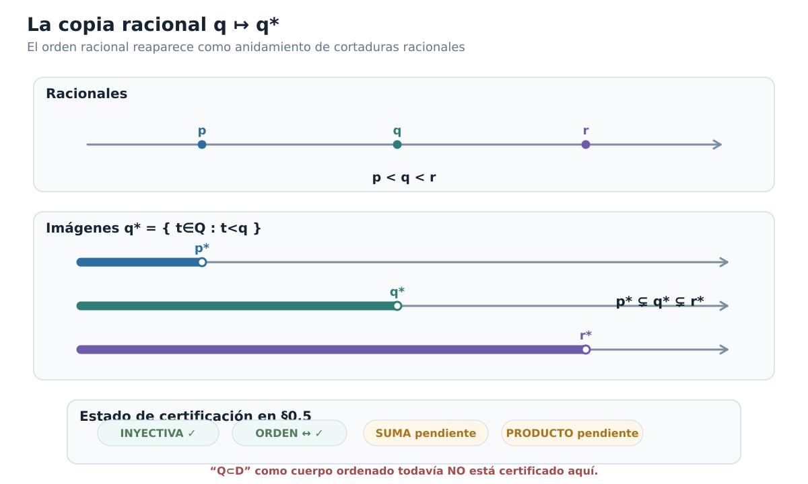{#fig-anm-c00-f05 fig-alt="Dos paneles muestran racionales p<q<r y sus cortaduras racionales anidadas; una banda final separa inyectividad y orden ya verificados de suma y producto todavía pendientes."}

### Lo que hemos ganado y lo que falta

La construcción ha superado ya una prueba importante. El nuevo dominio no coloca los racionales en un rincón irreconocible ni altera su orden. Cada racional $q$ determina canónicamente una cortadura $q^*$, y la posición relativa de dos racionales queda reproducida exactamente por la inclusión de sus cortaduras.

Podemos resumir el resultado de esta sección como

$$
\boxed{
\mathbb Q
\overset{\iota_{\mathbb Q}}{\hookrightarrow}
(\mathcal D,\subseteq)
\qquad
\text{como orden lineal.}
}
$$

Esto resuelve sólo la parte **ordinal** de la extensión. Para convertir $\mathcal D$ en un candidato serio a sistema de números reales necesitamos transportar también la aritmética.

La siguiente pregunta es inevitable:

$$
\boxed{
\text{¿cómo podemos sumar dos lados izquierdos racionales}
\\
\text{de modo que el resultado vuelva a ser una cortadura?}
}
$$

Ése será el primer paso hacia la estructura algebraica de $\mathcal D$.

### Antes de seguir

#### Microcontrol 25

[]{#MA-MIC-ANM-01-000-025}

Demuestra directamente que $(-2)^*\subsetneq0^*\subsetneq3^*$ sin apelar a la proposición general.

[]{#MA-MSOL-ANM-01-000-025}

<details class="anm-solution">
<summary>Ver solución del microcontrol 25</summary>

**Respuesta.**

Por definición,

$$
(-2)^*=\{r\in\mathbb Q:r<-2\},
\qquad
0^*=\{r\in\mathbb Q:r<0\},
\qquad
3^*=\{r\in\mathbb Q:r<3\}.
$$

Si $r\in(-2)^*$, entonces $r<-2<0$, de modo que $r\in0^*$. Por tanto,

$$
(-2)^*\subseteq0^*.
$$

La inclusión es estricta porque, por ejemplo,

$$
-1\in0^*
\qquad\text{pero}\qquad
-1\notin(-2)^*.
$$

Análogamente, si $r\in0^*$, entonces $r<0<3$, así que $r\in3^*$ y

$$
0^*\subseteq3^*.
$$

La inclusión es estricta porque

$$
1\in3^*
\qquad\text{pero}\qquad
1\notin0^*.
$$

Así, sin usar la proposición general,

$$
\boxed{(-2)^*\subsetneq0^*\subsetneq3^*.}
$$

**Fundamento en la sección 0.5.**

Sin introducir ninguna frontera real preexistente, podemos situarla entre dos posiciones racionales conocidas:

$$
\boxed{1^*\subsetneq A_2\subsetneq2^*.}
$$

En efecto, si $r<1$, entonces o bien $r<0$, o bien $0\le r<1$, y en este último caso $r^2<1<2$; por tanto $r\in A_2$. Además

$$
1\in A_2
\qquad\text{pero}\qquad
1\notin1^*,
$$

así que la primera inclusión es estricta.

Por otro lado, todo $r\in A_2$ satisface $r<2$. Si $r<0$, esto es inmediato; si $r\ge0$ y $r^2<2$, no puede ocurrir $r\ge2$, porque entonces $r^2\ge4$. Por consiguiente

$$
A_2\subseteq2^*.
$$

</details>

#### Microcontrol 26

[]{#MA-MIC-ANM-01-000-026}

Si $p^*\subsetneq q^*$, ¿por qué un elemento de $q^*\setminus p^*$ permite concluir $p<q$?

[]{#MA-MSOL-ANM-01-000-026}

<details class="anm-solution">
<summary>Ver solución del microcontrol 26</summary>

**Respuesta.**

La inclusión estricta garantiza que existe algún

$$
r\in q^*\setminus p^*.
$$

De $r\in q^*$ obtenemos

$$
r<q.
$$

En cambio, $r\notin p^*$ significa que no se cumple $r<p$. Por tricotomía del orden racional, de $\neg(r<p)$ se sigue

$$
p\le r.
$$

Combinando ambas desigualdades,

$$
p\le r<q,
$$

y por tanto

$$
\boxed{p<q.}
$$

El elemento de la diferencia funciona como un testigo racional que queda a la izquierda de $q$ pero no a la izquierda de $p$.

**Fundamento en la sección 0.5.**

Podemos volver incluso a la cortadura $A_2$ de §0.4. Recordemos

$$
A_2=\{q\in\mathbb Q:q<0\ \text{o}\ q^2<2\}.
$$

Sin introducir ninguna frontera real preexistente, podemos situarla entre dos posiciones racionales conocidas:

$$
\boxed{1^*\subsetneq A_2\subsetneq2^*.}
$$

En efecto, si $r<1$, entonces o bien $r<0$, o bien $0\le r<1$, y en este último caso $r^2<1<2$; por tanto $r\in A_2$. Además

$$
1\in A_2
\qquad\text{pero}\qquad
1\notin1^*,
$$

así que la primera inclusión es estricta.

</details>

#### Microcontrol 27

[]{#MA-MIC-ANM-01-000-027}

Explica por qué la equivalencia $p<q\Longleftrightarrow p^*\subsetneq q^*$ contiene más información que la sola implicación $p<q\Rightarrow p^*\subsetneq q^*$.

[]{#MA-MSOL-ANM-01-000-027}

<details class="anm-solution">
<summary>Ver solución del microcontrol 27</summary>

**Respuesta.**

La implicación

$$
p<q
\Longrightarrow
p^*\subsetneq q^*
$$

dice que $\iota_{\mathbb Q}$ **preserva** el orden: una desigualdad racional verdadera sigue siendo visible después del transporte.

La equivalencia completa

$$
p<q
\Longleftrightarrow
p^*\subsetneq q^*
$$

añade la dirección recíproca. Por tanto también podemos **recuperar** el orden racional mirando sólo las imágenes:

$$
p^*\subsetneq q^*
\Longrightarrow
p<q.
$$

Eso es reflexión del orden. Así, la equivalencia certifica que dentro de la imagen no aparecen comparaciones estrictas nuevas que no correspondan a una comparación racional original.

**Fundamento en la sección 0.5.**

y en particular

$$
p<q.
$$

Quedan demostradas ambas implicaciones. $\square$

Esta proposición concentra exactamente la relación que buscábamos. La aplicación $\iota_{\mathbb Q}$ no sólo **preserva** el orden estricto; también lo **refleja**:

$$
p<q
\quad\Longleftrightarrow\quad
\iota_{\mathbb Q}(p)<_{\mathcal D}\iota_{\mathbb Q}(q).
$$

En otras palabras, mirar las imágenes dentro de $\mathcal D$ permite recuperar por completo el orden racional original.

La preservación y reflexión del orden ya contienen casi toda la información necesaria para demostrar que no colapsamos racionales distintos.

</details>

#### Microcontrol 28

[]{#MA-MIC-ANM-01-000-028}

¿Cómo se deduce la inyectividad de $\iota_{\mathbb Q}$ a partir de la preservación y reflexión del orden?

[]{#MA-MSOL-ANM-01-000-028}

<details class="anm-solution">
<summary>Ver solución del microcontrol 28</summary>

**Respuesta.**

Supongamos

$$
p^*=q^*.
$$

Si $p<q$, la equivalencia de orden obligaría a

$$
p^*\subsetneq q^*,
$$

lo que contradice $p^*=q^*$.

Si $q<p$, obtendríamos del mismo modo

$$
q^*\subsetneq p^*,
$$

otra contradicción.

Por tricotomía sólo queda

$$
p=q.
$$

Así,

$$
\boxed{p^*=q^*\Longrightarrow p=q,}
$$

y por tanto $\iota_{\mathbb Q}$ es inyectiva. La igualdad de imágenes no puede ocultar dos racionales distintos porque cualquier desigualdad entre ellos produciría una inclusión estricta entre sus cortaduras.

**Fundamento en la sección 0.5.**

En otras palabras, mirar las imágenes dentro de $\mathcal D$ permite recuperar por completo el orden racional original.

La preservación y reflexión del orden ya contienen casi toda la información necesaria para demostrar que no colapsamos racionales distintos.

Supongamos

$$
p^*=q^*.
$$

Si $p<q$, la proposición anterior obligaría a

$$
p^*\subsetneq q^*,
$$

contradicción. Si $q<p$, obtendríamos análogamente

</details>

#### Microcontrol 29

[]{#MA-MIC-ANM-01-000-029}

Verifica con detalle las inclusiones $1^*\subsetneq A_2\subsetneq2^*$ sin introducir un número cuyo cuadrado sea $2$.

[]{#MA-MSOL-ANM-01-000-029}

<details class="anm-solution">
<summary>Ver solución del microcontrol 29</summary>

Recordemos

$$
A_2=\{r\in\mathbb Q:r<0\ \text{o}\ r^2<2\}.
$$

Primero probamos

$$
1^*\subsetneq A_2.
$$

Si $r\in1^*$, entonces $r<1$. Si $r<0$, ya pertenece a $A_2$. Si $0\le r<1$, entonces

$$
r^2<1<2,
$$

de modo que también $r\in A_2$. Por tanto $1^*\subseteq A_2$.

La inclusión es estricta porque

$$
1\in A_2
\qquad\text{pero}\qquad
1\notin1^*.
$$

Ahora probamos

$$
A_2\subsetneq2^*.
$$

Sea $r\in A_2$. Si $r<0$, entonces $r<2$. Si $r\ge0$ y $r^2<2$, no puede ocurrir $r\ge2$, pues eso daría $r^2\ge4>2$. Luego siempre $r<2$, y por tanto $r\in2^*$.

La inclusión es estricta porque

$$
\frac32\in2^*
$$

pero

$$
\left(\frac32\right)^2=\frac94>2,
$$

y además $\frac32\not<0$, así que $\frac32\notin A_2$.

Concluimos, usando sólo aritmética racional,

$$
\boxed{1^*\subsetneq A_2\subsetneq2^*.}
$$

No fue necesario introducir ningún número cuyo cuadrado sea $2$.

</details>

#### Microcontrol 30

[]{#MA-MIC-ANM-01-000-030}

¿Por qué todavía no podemos llamar a $\iota_{\mathbb Q}$ «incrustación de cuerpos ordenados»?

[]{#MA-MSOL-ANM-01-000-030}

<details class="anm-solution">
<summary>Ver solución del microcontrol 30</summary>

Hasta §0.5 hemos definido en $\mathcal D$ el orden por inclusión, y hemos demostrado que

$$
\iota_{\mathbb Q}(q)=q^*
$$

es inyectiva y preserva y refleja ese orden.

Pero todavía no hemos definido en $\mathcal D$ una suma ni un producto. Por tanto expresiones como

$$
p^*+q^*
\qquad\text{o}\qquad
p^*q^*
$$

aún no forman parte de la estructura disponible en esta sección.

Una incrustación de cuerpos ordenados debe conservar, además del orden, las operaciones de cuerpo y los elementos distinguidos correspondientes. Como esa verificación algebraica todavía no puede formularse plenamente, el certificado correcto es sólo

$$
\boxed{\text{incrustación de órdenes lineales}.}
$$

La certificación como incrustación de cuerpos ordenados queda pendiente hasta definir y verificar la aritmética de cortaduras.

</details>

#### Microcontrol 31

[]{#MA-MIC-ANM-01-000-031}

¿Qué dos identidades tendrán que verificarse más adelante para demostrar que la suma y el producto racionales se conservan dentro de $\mathcal D$?

[]{#MA-MSOL-ANM-01-000-031}

<details class="anm-solution">
<summary>Ver solución del microcontrol 31</summary>

Para que la copia racional conserve también la aritmética habrá que definir primero suma y producto en $\mathcal D$ y demostrar, para todos $p,q\in\mathbb Q$,

$$
\boxed{p^*+q^*=(p+q)^*}
$$

y

$$
\boxed{p^*q^*=(pq)^*.}
$$

La primera identidad certificará que sumar dentro de $\mathcal D$ y luego identificar el resultado con una cortadura racional coincide con sumar primero en $\mathbb Q$.

La segunda hará lo mismo para el producto.

Sólo después de esas verificaciones, junto con los elementos distinguidos y los inversos pertinentes, podrá elevarse la certificación de $\iota_{\mathbb Q}$ desde una incrustación ordenada a una incrustación de cuerpos ordenados.

</details>
La copia racional ya está situada en el nuevo orden. Ahora debemos darle al resto de $\mathcal D$ una aritmética compatible con ella.

### Ejercicios de la sección 0.5

#### Ejercicio 18. Construir la aplicación racional hacia $\mathcal D$

[]{#MA-EX-ANM-01-000-018}

Para cada $q\in\mathbb Q$, recuerda la cortadura racional

$$
q^*=\{r\in\mathbb Q:r<q\}.
$$

Usa el resultado de §0.4 según el cual $q^*\in\mathcal D$ para construir formalmente

$$
\iota_{\mathbb Q}:\mathbb Q\longrightarrow\mathcal D,
\qquad
\iota_{\mathbb Q}(q)=q^*.
$$

1. Explica por qué la fórmula define realmente una aplicación con codominio $\mathcal D$.
2. Escribe explícitamente como subconjuntos de $\mathbb Q$ las imágenes de $-\frac32$, $0$ y $\frac74$.
3. Para un $q\in\mathbb Q$, distingue con tipos correctos los cuatro objetos o relaciones
   $q$, $q^*$, $q\in\mathbb Q$ y $q^*\in\mathcal D$.
4. Define la imagen

$$
\mathcal Q^*=\iota_{\mathbb Q}(\mathbb Q)
$$

y expresa correctamente su relación conjuntista con $\mathcal D$.

En este ejercicio no afirmes todavía que $\mathbb Q$ sea literalmente un subconjunto de $\mathcal D$: construye primero la aplicación y su imagen.

[]{#MA-SOL-ANM-01-000-018}

<details class="anm-solution">
<summary>Ver solución del ejercicio 18</summary>

Para cada $q\in\mathbb Q$ definimos

$$
q^*=\{r\in\mathbb Q:r<q\}.
$$

En §0.4 ya se verificó que este subconjunto satisface las cuatro condiciones de una cortadura de Dedekind. Por tanto,

$$
q^*\in\mathcal D
$$

para todo $q\in\mathbb Q$.

Eso garantiza que la regla

$$
\iota_{\mathbb Q}(q)=q^*
$$

tiene efectivamente valores en $\mathcal D$. Luego queda bien definida la aplicación

$$
\boxed{
\iota_{\mathbb Q}:\mathbb Q\longrightarrow\mathcal D,
\qquad
q\longmapsto q^*.
}
$$

Las tres imágenes pedidas son

$$
\iota_{\mathbb Q}\left(-\frac32\right)
=
\left(-\frac32\right)^*
=
\left\{r\in\mathbb Q:r<-\frac32\right\},
$$

$$
\iota_{\mathbb Q}(0)
=
0^*
=
\{r\in\mathbb Q:r<0\},
$$

y

$$
\iota_{\mathbb Q}\left(\frac74\right)
=
\left(\frac74\right)^*
=
\left\{r\in\mathbb Q:r<\frac74\right\}.
$$

Los tipos deben mantenerse separados. Si $q\in\mathbb Q$, entonces

$$
q
$$

es un racional, mientras que

$$
q^*
$$

es un subconjunto de $\mathbb Q$ que, además, pertenece al nuevo dominio:

$$
q^*\subseteq\mathbb Q,
\qquad
q^*\in\mathcal D.
$$

No tendría sentido escribir $q\in\mathcal D$ sólo por haber construido $q^*$, ni confundir la pertenencia

$$
q^*\in\mathcal D
$$

con la inclusión

$$
q^*\subseteq\mathbb Q.
$$

La imagen de la aplicación es

$$
\mathcal Q^*
=
\iota_{\mathbb Q}(\mathbb Q)
=
\{q^*:q\in\mathbb Q\}.
$$

Como todos los $q^*$ son elementos de $\mathcal D$,

$$
\boxed{\mathcal Q^*\subseteq\mathcal D.}
$$

En este punto hemos construido una aplicación desde $\mathbb Q$ hacia $\mathcal D$ y un subconjunto concreto $\mathcal Q^*$ de $\mathcal D$. Todavía no hemos identificado literalmente $\mathbb Q$ con esa imagen.

*Referencia visual.* Véase la figura [C00-F05](analisis-para-matematicos-capitulo-0-construir-los-numeros-reales.html#fig-anm-c00-f05) del texto principal, **La copia racional q↦q***, como síntesis posterior de este argumento.

</details>

#### Ejercicio 19. Recuperar exactamente el orden racional

[]{#MA-EX-ANM-01-000-019}

Sean $p,q\in\mathbb Q$. Demuestra la equivalencia

$$
p<q
\quad\Longleftrightarrow\quad
p^*\subsetneq q^*.
$$

Tu prueba debe incluir ambos sentidos.

1. Si $p<q$, demuestra primero $p^*\subseteq q^*$ y exhibe un testigo concreto de que la inclusión es estricta.
2. Si $p^*\subsetneq q^*$, elige un racional $r\in q^*\setminus p^*$ y usa únicamente el orden de $\mathbb Q$ para concluir $p<q$.
3. Deduce como corolario que

$$
p\le q
\quad\Longleftrightarrow\quad
p^*\subseteq q^*.
$$

4. Usa la equivalencia estricta para demostrar que $\iota_{\mathbb Q}$ es inyectiva.

La conclusión debe dejar claro que la aplicación no sólo preserva el orden: también permite recuperarlo desde las imágenes.

[]{#MA-SOL-ANM-01-000-019}

<details class="anm-solution">
<summary>Ver solución del ejercicio 19</summary>

Supongamos primero

$$
p<q.
$$

Sea $r\in p^*$. Por definición,

$$
r<p.
$$

Como $p<q$, la transitividad del orden racional da

$$
r<q.
$$

Por tanto $r\in q^*$. Hemos probado

$$
p^*\subseteq q^*.
$$

La inclusión es estricta porque el propio $p$ sirve como testigo:

$$
p<q
\Longrightarrow
p\in q^*,
$$

mientras que

$$
p\notin p^*
$$

porque $p<p$ es falso. Así,

$$
p^*\subsetneq q^*.
$$

Probemos ahora el recíproco. Supongamos

$$
p^*\subsetneq q^*.
$$

Entonces existe

$$
r\in q^*\setminus p^*.
$$

De $r\in q^*$ obtenemos

$$
r<q.
$$

De $r\notin p^*$ sabemos que no ocurre $r<p$. Como el orden de $\mathbb Q$ es lineal,

$$
p\le r.
$$

Por tanto

$$
p\le r<q,
$$

y de aquí

$$
p<q.
$$

Queda demostrado

$$
\boxed{
p<q
\quad\Longleftrightarrow\quad
p^*\subsetneq q^*.
}
$$

Para el orden no estricto, si $p\le q$, entonces o bien $p=q$, en cuyo caso $p^*=q^*$, o bien $p<q$, en cuyo caso $p^*\subsetneq q^*$. En ambos casos,

$$
p^*\subseteq q^*.
$$

Recíprocamente, si $p^*\subseteq q^*$ y fuera $q<p$, la equivalencia estricta ya demostrada produciría

$$
q^*\subsetneq p^*,
$$

incompatible con $p^*\subseteq q^*$. Luego $p\le q$. Por tanto,

$$
\boxed{
p\le q
\quad\Longleftrightarrow\quad
p^*\subseteq q^*.
}
$$

Finalmente, supongamos

$$
\iota_{\mathbb Q}(p)
=
\iota_{\mathbb Q}(q).
$$

Esto significa

$$
p^*=q^*.
$$

Si $p<q$, tendríamos $p^*\subsetneq q^*$; si $q<p$, tendríamos $q^*\subsetneq p^*$. Ambas posibilidades contradicen la igualdad. Por tricotomía,

$$
p=q.
$$

Así,

$$
\boxed{\iota_{\mathbb Q}\text{ es inyectiva}.}
$$

La equivalencia de órdenes contiene más que una simple preservación: el orden de los racionales puede reconstruirse mirando únicamente las inclusiones entre sus imágenes.

*Referencia visual.* Véase la figura [C00-F05](analisis-para-matematicos-capitulo-0-construir-los-numeros-reales.html#fig-anm-c00-f05) del texto principal, **La copia racional q↦q***, como síntesis posterior de este argumento.

</details>

#### Ejercicio 20. Una certificación algebraica demasiado temprana

[]{#MA-EX-ANM-01-000-020}

Un informe afirma:

> «Como $q\mapsto q^*$ es inyectiva y preserva el orden, ya hemos demostrado que $\mathbb Q$ está incrustado en $\mathcal D$ como cuerpo ordenado. Por tanto, para todos $p,q\in\mathbb Q$ podemos usar desde ahora
> $p^*+q^*=(p+q)^*$ y $p^*q^*=(pq)^*$. En consecuencia, escribiremos sin más $\mathbb Q\subseteq\mathcal D$.»

Audita el informe en el punto exacto del capítulo en que estamos.

1. Separa las afirmaciones que ya están demostradas de las que todavía no están disponibles.
2. Explica por qué la inyectividad y la preservación/reflexión del orden sólo certifican una **incrustación de órdenes lineales**.
3. Identifica qué operaciones sobre $\mathcal D$ tendrían que estar definidas antes de que las dos identidades algebraicas del informe tengan siquiera sentido dentro de la construcción.
4. Explica qué verificaciones adicionales serían necesarias para elevar el certificado a una incrustación de cuerpos ordenados.
5. Formula la certificación en dos tiempos que debe respetar el capítulo.

No refutes las identidades futuras: diagnostica por qué todavía no pueden usarse como resultados.

[]{#MA-SOL-ANM-01-000-020}

<details class="anm-solution">
<summary>Ver solución del ejercicio 20</summary>

El informe mezcla un resultado ya probado con conclusiones que pertenecen a etapas posteriores.

Hasta §0.5 sabemos que:

1. para cada $q\in\mathbb Q$, la cortadura $q^*$ pertenece a $\mathcal D$;
2. la aplicación

$$
\iota_{\mathbb Q}(q)=q^*
$$

está bien definida;
3. es inyectiva;
4. preserva y refleja el orden:

$$
p<q
\iff
p^*\subsetneq q^*.
$$

Eso certifica una incrustación de conjuntos linealmente ordenados:

$$
\boxed{
\iota_{\mathbb Q}:
(\mathbb Q,<)
\hookrightarrow
(\mathcal D,<_{\mathcal D}).
}
$$

No certifica todavía una incrustación de cuerpos ordenados.

La razón es estructural. En este punto del capítulo aún no hemos definido operaciones

$$
+_{\mathcal D}:
\mathcal D\times\mathcal D\longrightarrow\mathcal D
$$

ni

$$
\cdot_{\mathcal D}:
\mathcal D\times\mathcal D\longrightarrow\mathcal D.
$$

Por tanto, escribir

$$
p^*+q^*
$$

o

$$
p^*q^*
$$

como operaciones ya disponibles en $\mathcal D$ adelanta definiciones que todavía no forman parte de la construcción.

Después de definir esas operaciones habría que demostrar, además, que la imagen racional es compatible con ellas. En particular, deberán verificarse identidades del tipo

$$
p^*+_{\mathcal D}q^*=(p+q)^*
$$

y

$$
p^*\cdot_{\mathcal D}q^*=(pq)^*,
$$

junto con la correspondencia de los elementos neutros y las demás propiedades necesarias para la estructura de cuerpo ordenado.

Así aparecen dos etapas distintas.

La primera, ya cerrada, es:

$$
\boxed{
\text{ETAPA ORDINAL:}
\quad
\text{inyectividad}
+
\text{orden preservado y reflejado}.
}
$$

La segunda permanece pendiente:

$$
\boxed{
\text{ETAPA ALGEBRAICA:}
\quad
\text{operaciones definidas}
+
\text{aritmética racional preservada}.
}
$$

Sólo después de completar la segunda etapa estará justificado afirmar que la copia racional está incrustada como **cuerpo ordenado**.

Por eso tampoco conviene usar todavía la abreviatura no cualificada

$$
\mathbb Q\subseteq\mathcal D
$$

si se pretende que esa notación arrastre toda la estructura algebraica de $\mathbb Q$. Lo demostrado por ahora es, con precisión,

$$
\mathcal Q^*
=
\iota_{\mathbb Q}(\mathbb Q)
\subseteq\mathcal D
$$

y

$$
\mathbb Q
\cong
\mathcal Q^*
$$

como órdenes lineales.

El defecto del informe no consiste en que las identidades algebraicas futuras sean falsas. Consiste en tratarlas como disponibles antes de haber definido y certificado las operaciones que aparecen en ellas.

</details>

#### Ejercicio 21. La copia racional como orden, no todavía como cuerpo

[]{#MA-EX-ANM-01-000-021}

Sea

$$
\mathcal Q^*=\{q^*:q\in\mathbb Q\}\subseteq\mathcal D.
$$

Define una aplicación

$$
\rho:\mathcal Q^*\longrightarrow\mathbb Q,
\qquad
\rho(q^*)=q.
$$

Demuestra que $\rho$ es el inverso de $\iota_{\mathbb Q}$ cuando restringimos el codominio de esta última a $\mathcal Q^*$.

Tu prueba debe mostrar:

1. que $\rho$ está bien definida;
2. que

$$
\rho\circ\iota_{\mathbb Q}
=
\operatorname{id}_{\mathbb Q};
$$

3. que

$$
\iota_{\mathbb Q}\circ\rho
=
\operatorname{id}_{\mathcal Q^*};
$$

4. que para $p,q\in\mathbb Q$,

$$
p<q
\quad\Longleftrightarrow\quad
p^*<_{\mathcal D}q^*;
$$

5. que, si $p^*<_{\mathcal D}q^*$, existe una cortadura racional $r^*\in\mathcal Q^*$ tal que

$$
p^*<_{\mathcal D}r^*<_{\mathcal D}q^*.
$$

Concluye exactamente en qué sentido $\mathcal Q^*$ es una copia de $\mathbb Q$ dentro de $\mathcal D$ y qué estructura sigue todavía sin certificar.

[]{#MA-SOL-ANM-01-000-021}

<details class="anm-solution">
<summary>Ver solución del ejercicio 21</summary>

Sea

$$
\mathcal Q^*=\{q^*:q\in\mathbb Q\}.
$$

Queremos definir

$$
\rho:\mathcal Q^*\longrightarrow\mathbb Q,
\qquad
\rho(q^*)=q.
$$

La primera obligación es probar que esta regla está bien definida. Un mismo elemento de $\mathcal Q^*$ podría, en principio, presentarse como $p^*$ y como $q^*$. Pero si

$$
p^*=q^*,
$$

la inyectividad de $\iota_{\mathbb Q}$ demostrada en el ejercicio 19 implica

$$
p=q.
$$

Por tanto la regla asigna un único racional a cada elemento de $\mathcal Q^*$.

Ahora sea $q\in\mathbb Q$. Entonces

$$
(\rho\circ\iota_{\mathbb Q})(q)
=
\rho(q^*)
=
q.
$$

Por consiguiente,

$$
\boxed{
\rho\circ\iota_{\mathbb Q}
=
\operatorname{id}_{\mathbb Q}.
}
$$

En sentido contrario, sea $A\in\mathcal Q^*$. Por definición de la imagen existe un $q\in\mathbb Q$ tal que

$$
A=q^*.
$$

Entonces

$$
(\iota_{\mathbb Q}\circ\rho)(A)
=
\iota_{\mathbb Q}(\rho(q^*))
=
\iota_{\mathbb Q}(q)
=
q^*
=
A.
$$

Luego

$$
\boxed{
\iota_{\mathbb Q}\circ\rho
=
\operatorname{id}_{\mathcal Q^*}.
}
$$

Así $\iota_{\mathbb Q}$, considerada como aplicación

$$
\mathbb Q\longrightarrow\mathcal Q^*,
$$

es biyectiva y $\rho$ es su inversa.

Para el orden, recordemos que

$$
A<_{\mathcal D}B
\iff
A\subsetneq B.
$$

El ejercicio 19 estableció

$$
p<q
\iff
p^*\subsetneq q^*.
$$

Por tanto,

$$
\boxed{
p<q
\quad\Longleftrightarrow\quad
p^*<_{\mathcal D}q^*.
}
$$

La biyección preserva y refleja el orden. En consecuencia,

$$
\boxed{
(\mathbb Q,<)
\cong
(\mathcal Q^*,<_{\mathcal D})
}
$$

como órdenes lineales.

Podemos incluso transportar la densidad racional sin introducir ninguna operación nueva en $\mathcal D$. Supongamos

$$
p^*<_{\mathcal D}q^*.
$$

Entonces $p<q$. En $\mathbb Q$ tomamos, por ejemplo,

$$
r=\frac{p+q}{2}.
$$

Se cumple

$$
p<r<q.
$$

Al aplicar la equivalencia de orden dos veces obtenemos

$$
p^*\subsetneq r^*\subsetneq q^*,
$$

es decir,

$$
\boxed{
p^*<_{\mathcal D}r^*<_{\mathcal D}q^*.
}
$$

Además $r^*\in\mathcal Q^*$ por construcción.

Por tanto $\mathcal Q^*$ reproduce exactamente el orden racional, incluida su densidad interna. Éste es el sentido preciso en que $\mathcal D$ contiene una **copia ordenada** de $\mathbb Q$.

Lo que todavía no hemos certificado es la estructura de cuerpo. No hay aún, en el desarrollo del capítulo, suma y producto definidos sobre todas las cortaduras y verificados contra la aritmética racional. Así, el cierre correcto de §0.5 es

$$
\boxed{
\text{ORDER ISOMORPHISM = VERIFIED}
\qquad
\text{ORDERED-FIELD EMBEDDING = PENDING}.
}
$$

</details>
## 0.6. Dar aritmética a las cortaduras I: suma y opuesto

[]{#MA-SEC-ANM-01-000-006}

En §0.5 conseguimos que los racionales reaparecieran dentro de $\mathcal D$ sin perder su orden. Pero un sistema de números reales no puede limitarse a ordenar posiciones: debe permitir operar con ellas.

La primera pregunta algebraica es la más natural:

$$
\boxed{
\text{dados }A,B\in\mathcal D,
\text{ ¿cómo construir una cortadura que represente su suma?}
}
$$

La idea debe nacer de la aritmética racional que ya poseemos. Si $a\in A$ y $b\in B$ son racionales situados a la izquierda de las posiciones codificadas por $A$ y $B$, entonces $a+b$ debería quedar a la izquierda de la posición suma. Esto sugiere definir el nuevo lado izquierdo usando precisamente todas esas sumas racionales.

### Sumar dos cortaduras

Para $A,B\in\mathcal D$, definimos

$$
\boxed{
A+B
=
\{a+b:a\in A,\ b\in B\}.
}
$$

Equivalentemente, para $x\in\mathbb Q$,

$$
x\in A+B
\quad\Longleftrightarrow\quad
\exists a\in A\ \exists b\in B:
x=a+b.
$$

La fórmula es sencilla. Lo que todavía no sabemos es si el conjunto obtenido vuelve a pertenecer a $\mathcal D$. Esa verificación es parte de la definición efectiva de la operación: no basta con escribir una regla y esperar que el resultado sea una cortadura.

> **Proposición.** Si $A,B\in\mathcal D$, entonces $A+B\in\mathcal D$.

**Demostración.** Verificamos las cuatro condiciones de cortadura.

Como $A$ y $B$ son no vacíos, podemos elegir

$$
a_0\in A,
\qquad
b_0\in B.
$$

Entonces

$$
a_0+b_0\in A+B,
$$

de modo que $A+B$ no es vacío.

Para ver que es propio, elijamos racionales exteriores

$$
u\notin A,
\qquad
v\notin B.
$$

Todo elemento de una cortadura está estrictamente por debajo de cualquier racional exterior. En efecto, si $a\in A$ y $u\notin A$, no puede ocurrir $u\le a$, porque la clausura hacia abajo obligaría a $u\in A$. Por tanto

$$
a<u.
$$

Análogamente, $b<v$ para todo $b\in B$. Así, para cualesquiera $a\in A$ y $b\in B$,

$$
a+b<u+v.
$$

En particular,

$$
u+v\notin A+B,
$$

y por tanto $A+B\ne\mathbb Q$.

Comprobemos la clausura hacia abajo. Sea

$$
x=a+b\in A+B
$$

y sea $y<x$. Definimos

$$
a'=y-b.
$$

Como $y<a+b$, tenemos

$$
a'<a.
$$

La clausura inferior de $A$ implica $a'\in A$, y entonces

$$
y=a'+b\in A+B.
$$

Finalmente, $A+B$ no tiene máximo. Si

$$
x=a+b\in A+B,
$$

la ausencia de máximo en $A$ proporciona $a'\in A$ con

$$
a<a'.
$$

Entonces

$$
x=a+b<a'+b,
$$

y $a'+b\in A+B$.

Las cuatro condiciones quedan verificadas. Por tanto

$$
\boxed{A+B\in\mathcal D.}
$$

$\square$

La suma es, pues, una operación interna bien definida:

$$
+:\mathcal D\times\mathcal D\longrightarrow\mathcal D.
$$

### La suma racional reaparece exactamente

La definición no sólo produce una operación. Debe ser compatible con la copia de $\mathbb Q$ construida en §0.5.

Tomemos $p,q\in\mathbb Q$. Afirmamos que

$$
\boxed{
p^*+q^*=(p+q)^*.
}
$$

Si $x\in p^*+q^*$, existen $a<p$ y $b<q$ tales que

$$
x=a+b.
$$

Entonces

$$
x=a+b<p+q,
$$

de modo que

$$
x\in(p+q)^*.
$$

Así,

$$
p^*+q^*\subseteq(p+q)^*.
$$

Para la inclusión contraria, sea

$$
x<p+q.
$$

Definamos

$$
\varepsilon=\frac{p+q-x}{2}>0,
$$

y tomemos

$$
a=p-\varepsilon,
\qquad
b=q-\varepsilon.
$$

Entonces $a<p$, $b<q$ y

$$
a+b
=
p+q-2\varepsilon
=
x.
$$

Por tanto $a\in p^*$, $b\in q^*$ y

$$
x\in p^*+q^*.
$$

Concluimos

$$
\boxed{
p^*+q^*=(p+q)^*.
}
$$

Ésta es la primera certificación algebraica de la aplicación racional:

$$
\iota_{\mathbb Q}(p+q)
=
\iota_{\mathbb Q}(p)+\iota_{\mathbb Q}(q).
$$

Todavía no hemos certificado el producto, de modo que la incrustación de **cuerpos** sigue pendiente.

### Asociatividad y conmutatividad

La suma de cortaduras hereda estas dos leyes de la suma racional, pero conviene verificar por qué.

Para $A,B,C\in\mathcal D$, un racional $x$ pertenece a $(A+B)+C$ exactamente cuando existen

$$
a\in A,\qquad b\in B,\qquad c\in C
$$

tales que

$$
x=(a+b)+c.
$$

Por asociatividad en $\mathbb Q$,

$$
(a+b)+c=a+(b+c),
$$

y esta última expresión caracteriza precisamente la pertenencia a $A+(B+C)$. Por extensionalidad,

$$
\boxed{(A+B)+C=A+(B+C).}
$$

Del mismo modo,

$$
x=a+b=b+a
$$

muestra que

$$
\boxed{A+B=B+A.}
$$

No estamos trasladando mecánicamente las leyes de $\mathbb Q$: estamos usando la definición de la nueva operación para reducir la igualdad de cortaduras a igualdades racionales entre sus testigos.

### El cero aditivo

La cortadura racional asociada a $0$ es

$$
0^*=\{r\in\mathbb Q:r<0\}.
$$

Afirmamos que actúa como neutro para la nueva suma.

Sea $x\in A+0^*$. Entonces

$$
x=a+b
$$

para algún $a\in A$ y algún $b<0$. Por tanto

$$
x<a.
$$

Como $A$ es cerrado hacia abajo,

$$
x\in A.
$$

Así,

$$
A+0^*\subseteq A.
$$

Para la inclusión contraria, sea $x\in A$. Como $A$ no tiene máximo, existe $a\in A$ con

$$
x<a.
$$

Definamos

$$
b=x-a.
$$

Entonces $b<0$, es decir, $b\in0^*$, y

$$
x=a+b.
$$

Por tanto $x\in A+0^*$. Hemos probado

$$
A\subseteq A+0^*.
$$

En consecuencia,

$$
\boxed{A+0^*=A.}
$$

Por conmutatividad,

$$
0^*+A=A.
$$

Podemos escribir

$$
0_{\mathcal D}:=0^*
$$

si queremos enfatizar su función dentro del nuevo sistema. Pero no es un objeto elegido arbitrariamente: es exactamente la cortadura que ya representa al racional $0$.

### Por qué el opuesto no es un simple reflejo

La suma fue relativamente directa. El opuesto contiene el primer obstáculo serio.

Si imagináramos una cortadura como una región situada a la izquierda de una frontera, podríamos sentir la tentación de «reflejarla» respecto de cero. Pero hay que recordar que una cortadura no contiene su frontera.

Consideremos el corte racional

$$
q^*=\{r\in\mathbb Q:r<q\}.
$$

Su complemento es

$$
\mathbb Q\setminus q^*
=
\{r\in\mathbb Q:r\ge q\}.
$$

Si simplemente negáramos sus elementos obtendríamos

$$
\{-r:r\notin q^*\}
=
\{s\in\mathbb Q:s\le -q\}.
$$

Este conjunto tiene máximo, precisamente $-q$. Por tanto **no es una cortadura**.

El dibujo de un reflejo capta una intención geométrica, pero no la definición correcta. Debemos volver a imponer la convención de lado izquierdo **sin punto final**.

La forma adecuada es tomar todos los racionales que quedan estrictamente por debajo de algún negativo de un punto exterior de $A$.

> **Definición.** Para $A\in\mathcal D$, definimos su **opuesto** por
>
> $$
> \boxed{
> -A
> =
> \{q\in\mathbb Q:
> \exists s\notin A\text{ tal que }q<-s\}.
> }
> $$

Esta definición puede leerse como la clausura inferior de los negativos del complemento de $A$.

### El opuesto vuelve a ser una cortadura

> **Proposición.** Si $A\in\mathcal D$, entonces $-A\in\mathcal D$.

**Demostración.** Como $A$ es propio, existe algún racional

$$
s\notin A.
$$

Entonces

$$
-s-1<-s,
$$

de modo que

$$
-s-1\in -A.
$$

Así $-A$ no es vacío.

Como $A$ no es vacío, tomemos $a\in A$. Afirmamos que

$$
-a\notin -A.
$$

Si ocurriera lo contrario, existiría $s\notin A$ tal que

$$
-a<-s,
$$

es decir,

$$
s<a.
$$

Pero $a\in A$ y $A$ es cerrado hacia abajo, por lo que $s\in A$, contradicción. Por tanto $-A$ es propio.

La clausura hacia abajo es inmediata. Si $q\in-A$, existe $s\notin A$ con

$$
q<-s.
$$

Si $p<q$, entonces

$$
p<q<-s,
$$

y el mismo $s$ demuestra que $p\in-A$.

Finalmente, tomemos $q\in-A$. Existe $s\notin A$ tal que

$$
q<-s.
$$

Por densidad de $\mathbb Q$, el racional

$$
q'=\frac{q-s}{2}
$$

satisface

$$
q<q'<-s.
$$

Así $q'\in-A$ y $q'>q$. Por tanto $-A$ no tiene máximo.

Concluimos

$$
\boxed{-A\in\mathcal D.}
$$

$\square$

Obsérvese el detalle técnico:

$$
\frac{q-s}{2}
=
\frac{q+(-s)}{2}.
$$

Es simplemente el punto medio racional entre $q$ y $-s$; no interviene ninguna aritmética real todavía.

### Un lema para aproximarnos a la frontera desde dentro

Para demostrar que $-A$ es realmente el inverso aditivo de $A$ necesitaremos una propiedad que conviene aislar.

> **Lema de aproximación racional.** Si $A\in\mathcal D$ y $h\in\mathbb Q$ satisface $h>0$, entonces existe $a\in A$ tal que
>
> $$
> a+h\notin A.
> $$

**Demostración.** Elijamos

$$
a_0\in A
\qquad\text{y}\qquad
u\notin A.
$$

Como $a_0<u$, la propiedad arquimediana de $\mathbb Q$ permite elegir $n\in\mathbb N$ tal que

$$
nh>u-a_0.
$$

Entonces

$$
a_0+nh>u.
$$

Ese racional no puede pertenecer a $A$: si perteneciera, la clausura hacia abajo y $u<a_0+nh$ obligarían a $u\in A$.

Por tanto, en la lista finita

$$
a_0,\ a_0+h,\ a_0+2h,\ldots,a_0+nh
$$

el primer término pertenece a $A$ y el último no. Existe entonces un primer índice $k\ge1$ para el que

$$
a_0+kh\notin A.
$$

Por minimalidad,

$$
a:=a_0+(k-1)h\in A,
$$

mientras que

$$
a+h=a_0+kh\notin A.
$$

Esto demuestra el lema. $\square$

El lema formaliza una intuición importante: por pequeño que sea un paso racional positivo $h$, no puede ocurrir que podamos avanzar indefinidamente dentro de una cortadura en saltos de tamaño $h$. En algún punto, uno de esos saltos cruza su frontera codificada.

### El opuesto es realmente el inverso aditivo

Ya podemos demostrar la identidad central.

> **Proposición.** Para todo $A\in\mathcal D$,
>
> $$
> \boxed{A+(-A)=0^*.}
> $$

**Demostración.** Empecemos por una inclusión.

Sea

$$
x=a+b\in A+(-A),
$$

con $a\in A$ y $b\in-A$. Por definición de $-A$, existe $s\notin A$ tal que

$$
b<-s.
$$

Como $a\in A$ y $s\notin A$, necesariamente

$$
a<s.
$$

Por tanto

$$
x=a+b<a-s<0.
$$

Así $x\in0^*$, y hemos probado

$$
A+(-A)\subseteq0^*.
$$

Para la inclusión contraria, tomemos

$$
x\in0^*.
$$

Entonces $x<0$. Definamos

$$
h=-\frac{x}{2}>0.
$$

Por el lema de aproximación racional, existe $a\in A$ tal que

$$
a+h\notin A.
$$

Escribamos

$$
s=a+h
$$

y

$$
b=x-a.
$$

Como $x=-2h$,

$$
b=-2h-a.
$$

Luego

$$
b<-h-a=-s.
$$

Tenemos $s\notin A$, así que la desigualdad $b<-s$ demuestra

$$
b\in-A.
$$

Finalmente,

$$
x=a+b,
$$

con $a\in A$ y $b\in-A$. Por tanto

$$
x\in A+(-A).
$$

Hemos obtenido

$$
0^*\subseteq A+(-A).
$$

Las dos inclusiones dan

$$
\boxed{A+(-A)=0^*.}
$$

$\square$

Ahora sí la notación $-A$ está justificada algebraicamente: no sólo hemos construido otra cortadura, sino la única que, al sumarse con $A$, produce el neutro aditivo.

### La estructura aditiva de $\mathcal D$

Podemos reunir lo demostrado.

Para cualesquiera $A,B,C\in\mathcal D$:

$$
(A+B)+C=A+(B+C),
$$

$$
A+B=B+A,
$$

$$
A+0^*=A,
$$

y existe $-A\in\mathcal D$ tal que

$$
A+(-A)=0^*.
$$

Por tanto

$$
\boxed{
(\mathcal D,+,0^*)
\text{ es un grupo abeliano}.
}
$$

La unicidad del opuesto se deduce ahora como en cualquier grupo. Si $B$ y $C$ satisfacen

$$
A+B=0^*
\qquad\text{y}\qquad
A+C=0^*,
$$

entonces

$$
B
=
B+0^*
=
B+(A+C)
=
(B+A)+C
=
0^*+C
=
C.
$$

En particular, la definición complicada del opuesto no genera ambigüedad: cada cortadura tiene un único inverso aditivo.

### El orden es compatible con la suma

Nos falta verificar que la nueva aritmética respeta el orden por inclusión.

Si

$$
A\subseteq B,
$$

entonces cualquier elemento de $A+C$ tiene la forma $a+c$ con $a\in A\subseteq B$ y $c\in C$. Por tanto

$$
A+C\subseteq B+C.
$$

Así la suma preserva el orden.

Una vez disponibles los opuestos, podemos demostrar también la recíproca. Si

$$
A+C\subseteq B+C,
$$

sumamos $-C$ a ambos lados. La monotonía recién demostrada da

$$
(A+C)+(-C)
\subseteq
(B+C)+(-C).
$$

Por asociatividad,

$$
A+(C+(-C))
\subseteq
B+(C+(-C)),
$$

y como

$$
C+(-C)=0^*,
$$

obtenemos

$$
A\subseteq B.
$$

Por consiguiente,

$$
\boxed{
A\subseteq B
\quad\Longleftrightarrow\quad
A+C\subseteq B+C.
}
$$

Y para el orden estricto,

$$
\boxed{
A\subsetneq B
\quad\Longleftrightarrow\quad
A+C\subsetneq B+C.
}
$$

La traducción por una cortadura conserva y refleja la posición relativa, exactamente como esperamos de un grupo ordenado.

Podemos resumir el estado alcanzado:

$$
\boxed{
(\mathcal D,+,\le_{\mathcal D})
\text{ es un grupo abeliano linealmente ordenado}.
}
$$

### El opuesto racional también coincide

La compatibilidad con la copia racional puede afinarse todavía más. Para $q\in\mathbb Q$,

$$
\boxed{
-(q^*)=(-q)^*.
}
$$

En efecto, si $x\in-(q^*)$, existe $s\notin q^*$ con

$$
x<-s.
$$

La condición $s\notin q^*$ significa $s\ge q$. Entonces

$$
-s\le -q,
$$

y por tanto

$$
x<-q.
$$

Así $x\in(-q)^*$.

Recíprocamente, si $x<-q$, tomamos $s=q$. Como $q\notin q^*$ y

$$
x<-q=-s,
$$

la definición del opuesto da

$$
x\in-(q^*).
$$

Por tanto la copia racional conserva ya toda su estructura aditiva:

$$
\boxed{
\begin{aligned}
(p+q)^*&=p^*+q^*,\\
0_{\mathcal D}&=0^*,\\
(-q)^*&=-(q^*).
\end{aligned}
}
$$

El certificado parcial de §0.5 ha crecido:

```text
INJECTIVE = VERIFIED
ORDER = PRESERVED_AND_REFLECTED
ADDITION = PRESERVED
ZERO = PRESERVED
ADDITIVE_INVERSES = PRESERVED
MULTIPLICATION = NOT_YET_DEFINED
ORDERED_FIELD_EMBEDDING = NOT_YET_CERTIFIED
```

Todavía no podemos llamar a $\iota_{\mathbb Q}$ una incrustación de cuerpos ordenados. Falta construir el producto en $\mathcal D$, demostrar sus leyes, identificar la unidad y construir los inversos multiplicativos.

La figura [C00-F06](#fig-anm-c00-f06) concentra esta lectura en un único mapa visual.

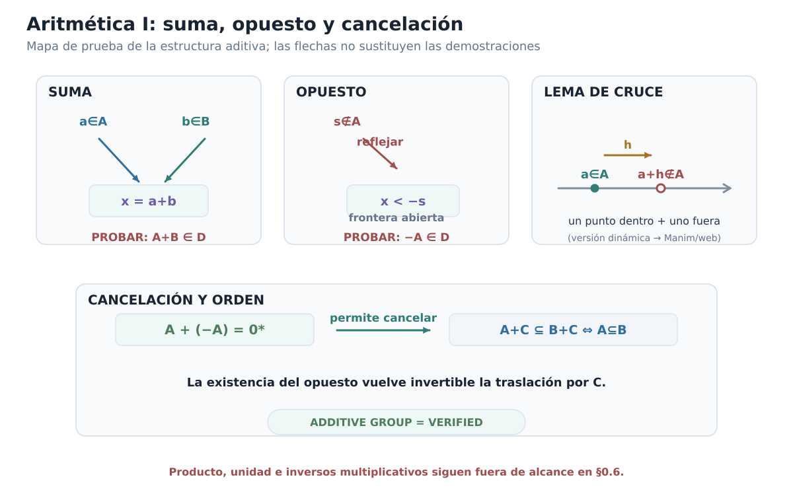{#fig-anm-c00-f06 fig-alt="Mapa de prueba con cuatro módulos: suma a+b, opuesto mediante s fuera de A y x<−s, un inset del lema de cruce a∈A y a+h∉A, y cancelación usando C+(−C)=0*."}

### Lo que hemos construido

El paso de §0.5 a §0.6 es sustancial. Allí $\mathcal D$ era sólo un conjunto linealmente ordenado que contenía una copia ordenada de $\mathbb Q$. Ahora sus elementos pueden sumarse, poseen un cero y un opuesto, y la suma es compatible con el orden.

Además, cuando restringimos esta suma a las cortaduras racionales, recuperamos exactamente la suma que ya conocíamos en $\mathbb Q$.

Pero un cuerpo necesita más.

Todavía debemos responder:

$$
\boxed{
\text{¿cómo multiplicar cortaduras y cómo invertir una cortadura no nula?}
}
$$

El producto será más delicado que la suma porque el signo importa. Primero tendremos que entender qué significa positividad dentro de $\mathcal D$, definir el producto en el sector positivo y sólo después extenderlo coherentemente a todos los casos.

### Antes de seguir

#### Microcontrol 32

[]{#MA-MIC-ANM-01-000-032}

En la prueba de clausura de $A+B$, explica por qué cualquier racional exterior $u\notin A$ domina estrictamente a todo $a\in A$.

[]{#MA-MSOL-ANM-01-000-032}

<details class="anm-solution">
<summary>Ver solución del microcontrol 32</summary>

**Respuesta.**

Sean $A\in\mathcal D$, $u\notin A$ y $a\in A$. Queremos justificar que necesariamente

$$
a<u.
$$

Si ocurriera $u\le a$, la clausura hacia abajo de $A$ se aplicaría a $a\in A$ y daría

$$
u\in A,
$$

contradiciendo $u\notin A$. Por tanto $u\le a$ es imposible.

Como $a$ y $u$ son racionales comparables, sólo queda

$$
\boxed{a<u.}
$$

Ésta es exactamente la propiedad usada al probar que $A+B$ es propio: si $u\notin A$ y $v\notin B$, entonces todo $a+b\in A+B$ satisface

$$
a+b<u+v,
$$

de modo que $u+v\notin A+B$.

**Fundamento en la sección 0.6.**

Entonces

$$
a_0+b_0\in A+B,
$$

de modo que $A+B$ no es vacío.

Para ver que es propio, elijamos racionales exteriores

$$
u\notin A,
\qquad
v\notin B.
$$

Todo elemento de una cortadura está estrictamente por debajo de cualquier racional exterior. En efecto, si $a\in A$ y $u\notin A$, no puede ocurrir $u\le a$, porque la clausura hacia abajo obligaría a $u\in A$. Por tanto

$$
a<u.
$$

</details>

#### Microcontrol 33

[]{#MA-MIC-ANM-01-000-033}

Demuestra de nuevo $p^*+q^*=(p+q)^*$ buscando explícitamente, para $x<p+q$, dos racionales $a<p$ y $b<q$ cuya suma sea exactamente $x$.

[]{#MA-MSOL-ANM-01-000-033}

<details class="anm-solution">
<summary>Ver solución del microcontrol 33</summary>

**Respuesta.**

Queremos demostrar

$$
p^*+q^*=(p+q)^*.
$$

Si $x\in p^*+q^*$, existen $a<p$ y $b<q$ con $x=a+b$. Entonces

$$
x=a+b<p+q,
$$

y por tanto $x\in(p+q)^*$.

Para la inclusión contraria, supongamos

$$
x<p+q.
$$

La diferencia $p+q-x$ es racional y positiva. Tomemos

$$
\varepsilon=\frac{p+q-x}{2}>0,
$$

y definamos

$$
a=p-\varepsilon,
\qquad
b=q-\varepsilon.
$$

Entonces

$$
a<p,
\qquad
b<q,
$$

de modo que $a\in p^*$ y $b\in q^*$. Además,

$$
a+b
=p+q-2\varepsilon
=p+q-(p+q-x)
=x.
$$

Así $x\in p^*+q^*$. Las dos inclusiones dan

$$
\boxed{p^*+q^*=(p+q)^*.}
$$

La elección simétrica de $\varepsilon$ reparte exactamente entre los dos sumandos el margen que separa a $x$ de $p+q$.

**Fundamento en la sección 0.6.**

Todavía no hemos certificado el producto, de modo que la incrustación de **cuerpos** sigue pendiente.

La suma de cortaduras hereda estas dos leyes de la suma racional, pero conviene verificar por qué.

Para $A,B,C\in\mathcal D$, un racional $x$ pertenece a $(A+B)+C$ exactamente cuando existen

$$
a\in A,\qquad b\in B,\qquad c\in C
$$

tales que

$$
x=(a+b)+c.
$$

Por asociatividad en $\mathbb Q$,

</details>

#### Microcontrol 34

[]{#MA-MIC-ANM-01-000-034}

¿Por qué el conjunto $\{-s:s\notin A\}$ no sirve en general como definición de $-A$? Examina el caso $A=q^*$.

[]{#MA-MSOL-ANM-01-000-034}

<details class="anm-solution">
<summary>Ver solución del microcontrol 34</summary>

Consideremos primero

$$
\{-s:s\notin A\}.
$$

Para ver el problema basta tomar una cortadura racional $A=q^*$. Entonces

$$
s\notin q^*
\quad\Longleftrightarrow\quad
s\ge q.
$$

Por tanto

$$
\{-s:s\notin q^*\}
=
\{t\in\mathbb Q:t\le -q\}.
$$

Este conjunto tiene máximo, precisamente $-q$. En consecuencia viola la condición de que una cortadura no tenga máximo.

Así, el simple reflejo del complemento produce un lado izquierdo **cerrado en la frontera**. La definición correcta

$$
-A
=
\{r\in\mathbb Q:\exists s\notin A\text{ con }r<-s\}
$$

vuelve a abrir esa frontera: no toma sólo los puntos $-s$, sino todos los racionales estrictamente menores que alguno de ellos.

En el caso racional esto recupera exactamente $(-q)^*$, pero sin introducir un punto final en la cortadura.

</details>

#### Microcontrol 35

[]{#MA-MIC-ANM-01-000-035}

En el lema de aproximación racional, ¿dónde se usa la propiedad arquimediana de $\mathbb Q$?

[]{#MA-MSOL-ANM-01-000-035}

<details class="anm-solution">
<summary>Ver solución del microcontrol 35</summary>

En el lema partimos de

$$
a_0\in A,
\qquad
u\notin A,
\qquad
h>0.
$$

Como todo elemento de $A$ queda estrictamente por debajo de todo racional exterior,

$$
a_0<\nu,
$$

y por tanto $\nu-a_0>0$.

La propiedad arquimediana de $\mathbb Q$ se usa exactamente para elegir un natural $n$ tal que

$$
nh>\nu-a_0.
$$

De aquí obtenemos

$$
a_0+nh>\nu.
$$

Ese término ya no puede pertenecer a $A$, pues si perteneciera, la clausura hacia abajo y $\nu<a_0+nh$ obligarían a $\nu\in A$.

Por tanto la lista finita

$$
a_0,
a_0+h,
\ldots,
a_0+nh
$$

empieza dentro de $A$ y termina fuera. Sólo después de este paso arquimediano tiene sentido escoger el **primer** índice en que se sale de la cortadura.

La propiedad arquimediana no se usa para identificar una frontera; se usa únicamente para garantizar que una cantidad finita de pasos de tamaño $h$ termina atravesándola.

</details>

#### Microcontrol 36

[]{#MA-MIC-ANM-01-000-036}

Sigue con detalle la inclusión $0^*\subseteq A+(-A)$ e identifica para qué se introduce $h=-x/2$.

[]{#MA-MSOL-ANM-01-000-036}

<details class="anm-solution">
<summary>Ver solución del microcontrol 36</summary>

Sea

$$
x\in0^*.
$$

Entonces $x<0$. Debemos escribir $x$ como suma de un elemento de $A$ y uno de $-A$.

Definimos

$$
h=-\frac{x}{2}>0.
$$

Esta elección tiene dos funciones simultáneas:

$$
x=-2h
$$

y el lema de aproximación puede aplicarse porque $h>0$.

El lema proporciona $a\in A$ tal que

$$
a+h\notin A.
$$

Escribamos

$$
s=a+h
$$

y

$$
b=x-a.
$$

Como $x=-2h$,

$$
b=-2h-a<-h-a=-s.
$$

Además $s\notin A$. Por la definición de $-A$, estas dos condiciones implican

$$
b\in-A.
$$

Finalmente,

$$
x=a+b,
$$

con $a\in A$ y $b\in-A$. Por tanto

$$
\boxed{x\in A+(-A).}
$$

Como $x<0$ era arbitrario,

$$
\boxed{0^*\subseteq A+(-A).}
$$

El factor $1/2$ crea exactamente el margen estricto necesario: $b$ queda no sólo en $-s$, sino estrictamente por debajo de $-s$.

</details>

#### Microcontrol 37

[]{#MA-MIC-ANM-01-000-037}

Demuestra que $A\subseteq B$ si y sólo si $A+C\subseteq B+C$ usando el opuesto de $C$.

[]{#MA-MSOL-ANM-01-000-037}

<details class="anm-solution">
<summary>Ver solución del microcontrol 37</summary>

**Respuesta.**

Supongamos primero

$$
A\subseteq B.
$$

Si $x\in A+C$, entonces $x=a+c$ para ciertos $a\in A$ y $c\in C$. Como $A\subseteq B$, también $a\in B$, y por tanto

$$
x\in B+C.
$$

Así,

$$
A+C\subseteq B+C.
$$

Para la recíproca, supongamos

$$
A+C\subseteq B+C.
$$

La monotonía ya demostrada permite sumar $-C$ a ambos lados:

$$
(A+C)+(-C)
\subseteq
(B+C)+(-C).
$$

Por asociatividad,

$$
A+(C+(-C))
\subseteq
B+(C+(-C)).
$$

Como

$$
C+(-C)=0^*
$$

y $0^*$ es el neutro aditivo, obtenemos

$$
A\subseteq B.
$$

Por consiguiente,

$$
\boxed{A\subseteq B\iff A+C\subseteq B+C.}
$$

La posibilidad de cancelar $C$ depende precisamente de que ya hayamos construido su opuesto aditivo.

**Fundamento en la sección 0.6.**

entonces cualquier elemento de $A+C$ tiene la forma $a+c$ con $a\in A\subseteq B$ y $c\in C$. Por tanto

$$
A+C\subseteq B+C.
$$

Así la suma preserva el orden.

Una vez disponibles los opuestos, podemos demostrar también la recíproca. Si

$$
A+C\subseteq B+C,
$$

sumamos $-C$ a ambos lados. La monotonía recién demostrada da

$$
(A+C)+(-C)
\subseteq
(B+C)+(-C).
$$

</details>

#### Microcontrol 38

[]{#MA-MIC-ANM-01-000-038}

Verifica directamente que $-(q^*)=(-q)^*$.

[]{#MA-MSOL-ANM-01-000-038}

<details class="anm-solution">
<summary>Ver solución del microcontrol 38</summary>

**Respuesta.**

Queremos probar directamente

$$
-(q^*)=(-q)^*.
$$

Sea $x\in-(q^*)$. Por definición existe $s\notin q^*$ tal que

$$
x<-s.
$$

La condición $s\notin q^*$ equivale a $s\ge q$. Al cambiar de signo,

$$
-s\le -q.
$$

Por tanto

$$
x<-s\le -q,
$$

de modo que $x<-q$ y

$$
x\in(-q)^*.
$$

Esto prueba

$$
-(q^*)\subseteq(-q)^*.
$$

Recíprocamente, si $x\in(-q)^*$, entonces $x<-q$. Tomamos

$$
s=q.
$$

Como $q\notin q^*$ y $x<-q=-s$, la definición de $-(q^*)$ da

$$
x\in-(q^*).
$$

Así,

$$
\boxed{-(q^*)=(-q)^*.}
$$

La construcción del opuesto en $\mathcal D$ reproduce exactamente el opuesto racional sobre la copia $q\mapsto q^*$.

**Fundamento en la sección 0.6.**

Recíprocamente, si $x<-q$, tomamos $s=q$. Como $q\notin q^*$ y

$$
x<-q=-s,
$$

la definición del opuesto da

$$
x\in-(q^*).
$$

Por tanto la copia racional conserva ya toda su estructura aditiva:

$$
\boxed{
\begin{aligned}
(p+q)^*&=p^*+q^*,\\
0_{\mathcal D}&=0^*,\\
(-q)^*&=-(q^*).
\end{aligned}
}
$$

El certificado parcial de §0.5 ha crecido:

</details>

#### Microcontrol 39

[]{#MA-MIC-ANM-01-000-039}

¿Qué parte exacta de la estructura de cuerpo falta todavía antes de poder certificar $\mathbb Q\hookrightarrow\mathcal D$ como incrustación de cuerpos ordenados?

[]{#MA-MSOL-ANM-01-000-039}

<details class="anm-solution">
<summary>Ver solución del microcontrol 39</summary>

Al terminar §0.6 ya están certificadas para la copia racional la inyectividad, el orden, la suma, el cero y los opuestos. Lo que falta es la **estructura multiplicativa** necesaria para que $\mathcal D$ sea un cuerpo ordenado y para que $\iota_{\mathbb Q}$ sea un homomorfismo de cuerpos ordenados.

En concreto, todavía habrá que:

- definir un producto interno $\mathcal D\times\mathcal D\to\mathcal D$ y probar su clausura;
- verificar asociatividad y conmutatividad del producto;
- identificar una unidad multiplicativa, que deberá corresponder a $1^*$;
- construir inversos multiplicativos para las cortaduras no nulas;
- verificar la distributividad respecto de la suma;
- comprobar la compatibilidad del producto con el orden;
- demostrar sobre la copia racional la identidad pendiente
  $$
  p^*q^*=(pq)^*.
  $$

Sólo cuando esas obligaciones estén demostradas podrá concluirse que $\mathcal D$ posee estructura de cuerpo ordenado y que

$$
\iota_{\mathbb Q}:\mathbb Q\hookrightarrow\mathcal D
$$

conserva toda la estructura de cuerpo ordenado.

Por tanto, al cierre de §0.6 el certificado correcto sigue siendo

$$
\boxed{
\text{estructura aditiva completa; estructura multiplicativa todavía pendiente}.
}
$$

</details>
La estructura aditiva está cerrada. En la próxima sección construiremos la multiplicación, la unidad y los inversos multiplicativos; sólo entonces podremos decidir si $\mathcal D$ es realmente un cuerpo ordenado.

### Ejercicios de la sección 0.6

#### Ejercicio 22. Construir una suma que permanezca dentro de $\mathcal D$

[]{#MA-EX-ANM-01-000-022}

Sean $A,B\in\mathcal D$. Define

$$
A+B=\{a+b:a\in A,\ b\in B\}.
$$

Demuestra que esta fórmula determina una operación interna

$$
+:\mathcal D\times\mathcal D\longrightarrow\mathcal D.
$$

Tu demostración debe verificar por separado las cuatro condiciones de cortadura para $A+B$.

1. Prueba que $A+B\ne\varnothing$.
2. Para demostrar que $A+B\ne\mathbb Q$, elige $u\notin A$ y $v\notin B$ y demuestra primero el hecho auxiliar
   $a<u$ para todo $a\in A$ y $b<v$ para todo $b\in B$.
3. Demuestra la clausura hacia abajo de $A+B$ sin apelar a ninguna noción geométrica de frontera.
4. Demuestra que $A+B$ no tiene máximo.

Cierra explicando por qué escribir una fórmula para $A+B$ no habría bastado, por sí solo, para definir una operación en $\mathcal D$.

[]{#MA-SOL-ANM-01-000-022}

<details class="anm-solution">
<summary>Ver solución del ejercicio 22</summary>

Sean $A,B\in\mathcal D$ y definamos

$$
A+B=\{a+b:a\in A,\ b\in B\}.
$$

Debemos demostrar que $A+B$ vuelve a ser una cortadura.

**No vaciedad.** Como $A$ y $B$ son no vacíos, existen

$$
a_0\in A,
\qquad
b_0\in B.
$$

Entonces

$$
a_0+b_0\in A+B,
$$

de modo que $A+B\ne\varnothing$.

**Propiedad de ser propio.** Como $A\subsetneq\mathbb Q$ y $B\subsetneq\mathbb Q$, podemos elegir

$$
u\notin A,
\qquad
v\notin B.
$$

Afirmamos que todo $a\in A$ satisface $a<u$. Si ocurriera $u\le a$, entonces, como $a\in A$ y $A$ es cerrado hacia abajo, tendríamos $u\in A$, contradicción. Por tanto

$$
a<u
$$

para todo $a\in A$. Del mismo modo,

$$
b<v
$$

para todo $b\in B$.

Así, para cualesquiera $a\in A$ y $b\in B$,

$$
a+b<u+v.
$$

En consecuencia,

$$
u+v\notin A+B.
$$

Luego $A+B\ne\mathbb Q$.

**Clausura hacia abajo.** Sea

$$
x=a+b\in A+B
$$

y sea $y<x$. Definamos

$$
a'=y-b.
$$

Como $y<a+b$,

$$
a'<a.
$$

La clausura hacia abajo de $A$ da $a'\in A$, y entonces

$$
y=a'+b\in A+B.
$$

**Ausencia de máximo.** Sea

$$
x=a+b\in A+B.
$$

Como $A$ no tiene máximo, existe $a'\in A$ con $a<a'$. Por tanto

$$
x=a+b<a'+b,
$$

y $a'+b\in A+B$. Ningún elemento de $A+B$ es máximo.

Las cuatro condiciones se cumplen. Por tanto

$$
\boxed{A+B\in\mathcal D.}
$$

Así la regla define realmente

$$
+:\mathcal D\times\mathcal D\longrightarrow\mathcal D.
$$

La última observación es lógica: una fórmula puede producir un subconjunto de $\mathbb Q$ sin producir una cortadura. Para definir una operación interna en $\mathcal D$ hacía falta demostrar la clausura del codominio.

*Referencia visual.* Véase la figura [C00-F06](analisis-para-matematicos-capitulo-0-construir-los-numeros-reales.html#fig-anm-c00-f06) del texto principal, **Aritmética I: suma, opuesto y cancelación**, como síntesis posterior de este argumento.

</details>

#### Ejercicio 23. Recuperar la suma racional y localizar el cero

[]{#MA-EX-ANM-01-000-023}

Sean $p,q\in\mathbb Q$.

1. Demuestra, por doble inclusión, que

$$
p^*+q^*=(p+q)^*.
$$

En la inclusión difícil, si $x<p+q$, construye explícitamente $a<p$ y $b<q$ tales que $x=a+b$.
2. Deduce que

$$
\iota_{\mathbb Q}(p+q)
=
\iota_{\mathbb Q}(p)+\iota_{\mathbb Q}(q).
$$

3. Demuestra directamente que

$$
A+0^*=A
$$

para toda $A\in\mathcal D$.
4. Usando la definición de la suma y la aritmética racional, demuestra que la suma de cortaduras es conmutativa y asociativa.

Concluye qué parte de la estructura aditiva racional está ya certificada y qué parte de la estructura de cuerpo sigue pendiente.

[]{#MA-SOL-ANM-01-000-023}

<details class="anm-solution">
<summary>Ver solución del ejercicio 23</summary>

Sean $p,q\in\mathbb Q$.

Primero probemos

$$
p^*+q^*\subseteq(p+q)^*.
$$

Si $x\in p^*+q^*$, existen $a<p$ y $b<q$ con $x=a+b$. Entonces

$$
x=a+b<p+q,
$$

de modo que $x\in(p+q)^*$.

Para la inclusión recíproca, sea $x<p+q$. Definimos

$$
\varepsilon=\frac{p+q-x}{2}>0
$$

y

$$
a=p-\varepsilon,
\qquad
b=q-\varepsilon.
$$

Entonces $a<p$ y $b<q$, por lo que

$$
a\in p^*,
\qquad
b\in q^*.
$$

Además,

$$
a+b=p+q-2\varepsilon=x.
$$

Así $x\in p^*+q^*$. Concluimos

$$
\boxed{p^*+q^*=(p+q)^*.}
$$

Como $\iota_{\mathbb Q}(r)=r^*$,

$$
\boxed{
\iota_{\mathbb Q}(p+q)
=
\iota_{\mathbb Q}(p)+\iota_{\mathbb Q}(q).
}
$$

Ahora probemos que $0^*$ es neutro aditivo. Si $x\in A+0^*$, existen $a\in A$ y $b<0$ con

$$
x=a+b<a.
$$

La clausura hacia abajo de $A$ da $x\in A$. Por tanto

$$
A+0^*\subseteq A.
$$

Recíprocamente, sea $x\in A$. Como $A$ no tiene máximo, existe $a\in A$ con $x<a$. Definimos

$$
b=x-a<0.
$$

Entonces $b\in0^*$ y

$$
x=a+b\in A+0^*.
$$

Así

$$
\boxed{A+0^*=A.}
$$

Por conmutatividad, también $0^*+A=A$.

La conmutatividad se obtiene directamente: si $x=a+b$ con $a\in A$ y $b\in B$, entonces

$$
x=b+a\in B+A.
$$

Intercambiando $A$ y $B$ se obtiene la igualdad

$$
\boxed{A+B=B+A.}
$$

Para la asociatividad, $x\in(A+B)+C$ si y sólo si existen $a\in A$, $b\in B$, $c\in C$ tales que

$$
x=(a+b)+c.
$$

Por asociatividad en $\mathbb Q$,

$$
(a+b)+c=a+(b+c),
$$

y esta última forma caracteriza la pertenencia a $A+(B+C)$. Por extensionalidad,

$$
\boxed{(A+B)+C=A+(B+C).}
$$

Al finalizar este ejercicio ya sabemos que la suma de cortaduras es interna, asociativa y conmutativa, que $0^*$ es su neutro y que la copia racional conserva la suma. Falta todavía construir y verificar los inversos aditivos, y toda la estructura multiplicativa continúa fuera de alcance.

*Referencia visual.* Véase la figura [C00-F06](analisis-para-matematicos-capitulo-0-construir-los-numeros-reales.html#fig-anm-c00-f06) del texto principal, **Aritmética I: suma, opuesto y cancelación**, como síntesis posterior de este argumento.

</details>

#### Ejercicio 24. Construir el opuesto sin introducir un punto final

[]{#MA-EX-ANM-01-000-024}

Sea $A\in\mathcal D$.

Considera primero el conjunto ingenuo

$$
N(A)=\{-s:s\notin A\}.
$$

1. Examina el caso $A=q^*$ y demuestra que $N(q^*)$ no es una cortadura.
2. Define entonces

$$
-A
=
\{x\in\mathbb Q:
\exists s\notin A\text{ tal que }x<-s\}.
$$

Demuestra que $-A\in\mathcal D$ verificando las cuatro condiciones de cortadura.
3. Demuestra que, para todo $q\in\mathbb Q$,

$$
-(q^*)=(-q)^*.
$$

Explica por qué la desigualdad estricta en la definición de $-A$ es estructuralmente necesaria y no un detalle notacional.

[]{#MA-SOL-ANM-01-000-024}

<details class="anm-solution">
<summary>Ver solución del ejercicio 24</summary>

Consideremos primero

$$
N(A)=\{-s:s\notin A\}.
$$

Si $A=q^*$, entonces

$$
s\notin q^*
\quad\Longleftrightarrow\quad
s\ge q.
$$

Por tanto

$$
N(q^*)
=
\{-s:s\ge q\}
=
\{t\in\mathbb Q:t\le -q\}.
$$

Este conjunto tiene máximo, a saber $-q$. Luego no es una cortadura.

La reparación consiste en tomar la clausura inferior estricta:

$$
-A
=
\{x\in\mathbb Q:
\exists s\notin A\text{ tal que }x<-s\}.
$$

Verifiquemos las cuatro condiciones.

**No vaciedad.** Como $A$ es propio, existe $s\notin A$. Entonces

$$
-s-1<-s,
$$

de modo que $-s-1\in-A$.

**Propiedad de ser propio.** Como $A$ no es vacío, tomemos $a\in A$. Afirmamos que $-a\notin-A$. Si $-a\in-A$, existiría $s\notin A$ con

$$
-a<-s,
$$

equivalentemente $s<a$. La clausura hacia abajo de $A$ implicaría $s\in A$, contradicción.

**Clausura hacia abajo.** Si $x\in-A$, existe $s\notin A$ con $x<-s$. Si $y<x$, entonces

$$
y<x<-s,
$$

y el mismo $s$ demuestra que $y\in-A$.

**Ausencia de máximo.** Sea $x\in-A$. Existe $s\notin A$ con $x<-s$. El racional

$$
x'=\frac{x-s}{2}
=
\frac{x+(-s)}{2}
$$

satisface

$$
x<x'<-s.
$$

Así $x'\in-A$ y $x'>x$.

Por tanto

$$
\boxed{-A\in\mathcal D.}
$$

Finalmente, para $A=q^*$, si $x\in-(q^*)$, existe $s\notin q^*$ con $x<-s$. La condición $s\notin q^*$ equivale a $s\ge q$, luego

$$
-s\le -q
$$

y por tanto $x<-q$. Así $x\in(-q)^*$.

Recíprocamente, si $x<-q$, tomamos $s=q$. Como $q\notin q^*$ y $x<-q=-s$, obtenemos $x\in-(q^*)$.

Luego

$$
\boxed{-(q^*)=(-q)^*.}
$$

La desigualdad estricta es indispensable: excluye el punto extremo que haría aparecer un máximo. La definición conserva la convención esencial de toda cortadura: lado izquierdo sin punto final.

*Referencia visual.* Véase la figura [C00-F06](analisis-para-matematicos-capitulo-0-construir-los-numeros-reales.html#fig-anm-c00-f06) del texto principal, **Aritmética I: suma, opuesto y cancelación**, como síntesis posterior de este argumento.

</details>

#### Ejercicio 25. Trazar la prueba de que el opuesto es un inverso aditivo

[]{#MA-EX-ANM-01-000-025}

Sea $A\in\mathcal D$.

Primero demuestra el lema siguiente:

> Si $h\in\mathbb Q$ y $h>0$, existe $a\in A$ tal que $a+h\notin A$.

Tu prueba debe señalar exactamente dónde se usa la propiedad arquimediana de $\mathbb Q$.

Después usa ese lema para demostrar

$$
A+(-A)=0^*.
$$

Organiza la prueba por doble inclusión y, en la inclusión

$$
0^*\subseteq A+(-A),
$$

explica por qué para $x<0$ conviene introducir

$$
h=-\frac{x}{2}.
$$

Finalmente demuestra la equivalencia de traslación

$$
A\subseteq B
\quad\Longleftrightarrow\quad
A+C\subseteq B+C
$$

para $A,B,C\in\mathcal D$, y deduce la versión estricta.

Cierra con una lista breve de dependencias: qué parte usa clausura hacia abajo, qué parte usa existencia de racionales exteriores, qué parte usa arquimedianidad y qué parte usa ya la existencia del opuesto.

[]{#MA-SOL-ANM-01-000-025}

<details class="anm-solution">
<summary>Ver solución del ejercicio 25</summary>

Comenzamos con el lema.

Sea $h\in\mathbb Q$, $h>0$. Elegimos

$$
a_0\in A
\qquad\text{y}\qquad
u\notin A.
$$

Como $a_0\in A$ y $u\notin A$, necesariamente $a_0<u$.

La propiedad arquimediana de $\mathbb Q$ se usa exactamente ahora: existe $n\in\mathbb N$ tal que

$$
nh>u-a_0.
$$

Por tanto

$$
a_0+nh>u.
$$

Ese racional no puede pertenecer a $A$, porque si perteneciera, la clausura hacia abajo y $u<a_0+nh$ obligarían a $u\in A$.

En la lista finita

$$
a_0,\ a_0+h,\ a_0+2h,\ldots,a_0+nh
$$

el primer término pertenece a $A$ y el último no. Sea $k\ge1$ el primer índice con

$$
a_0+kh\notin A.
$$

Entonces, por minimalidad,

$$
a:=a_0+(k-1)h\in A,
$$

mientras que

$$
a+h\notin A.
$$

Queda demostrado el lema.

Ahora probemos

$$
A+(-A)=0^*.
$$

Sea $x\in A+(-A)$. Existen $a\in A$ y $b\in-A$ con $x=a+b$. Por definición de $-A$, existe $s\notin A$ tal que

$$
b<-s.
$$

Como $a\in A$ y $s\notin A$, tenemos $a<s$. Luego

$$
x=a+b<a-s<0.
$$

Por tanto $x\in0^*$, y así

$$
A+(-A)\subseteq0^*.
$$

Para la otra inclusión, sea $x\in0^*$, es decir, $x<0$. Definimos

$$
h=-\frac{x}{2}>0.
$$

Esta elección hace que

$$
x=-2h,
$$

lo que permitirá fabricar un sumando que quede estrictamente por debajo del negativo de un racional exterior.

Por el lema existe $a\in A$ tal que

$$
a+h\notin A.
$$

Sea

$$
s=a+h
$$

y definamos

$$
b=x-a.
$$

Como $x=-2h$,

$$
b=-2h-a<-h-a=-s.
$$

Dado que $s\notin A$, la desigualdad $b<-s$ implica $b\in-A$. Finalmente,

$$
x=a+b
$$

con $a\in A$ y $b\in-A$, por lo que $x\in A+(-A)$.

Así,

$$
0^*\subseteq A+(-A),
$$

y por tanto

$$
\boxed{A+(-A)=0^*.}
$$

Pasemos a la traslación del orden.

Si $A\subseteq B$, cualquier elemento de $A+C$ tiene forma $a+c$ con $a\in A\subseteq B$ y $c\in C$. Por tanto

$$
A+C\subseteq B+C.
$$

Recíprocamente, supongamos

$$
A+C\subseteq B+C.
$$

La monotonía recién demostrada permite sumar $-C$ a ambos lados:

$$
(A+C)+(-C)
\subseteq
(B+C)+(-C).
$$

Por asociatividad y por $C+(-C)=0^*$,

$$
A+0^*\subseteq B+0^*.
$$

Luego

$$
A\subseteq B.
$$

Así,

$$
\boxed{
A\subseteq B
\quad\Longleftrightarrow\quad
A+C\subseteq B+C.
}
$$

Como la traslación tiene inversa —sumar $-C$— también conserva y refleja desigualdad estricta:

$$
\boxed{
A\subsetneq B
\quad\Longleftrightarrow\quad
A+C\subsetneq B+C.
}
$$

El balance de dependencias es:

- **clausura hacia abajo:** permite comparar elementos interiores con racionales exteriores y justificar pasos del lema;
- **existencia de racionales exteriores:** se usa para elegir $u\notin A$ y para la definición del opuesto;
- **arquimedianidad de $\mathbb Q$:** se usa exactamente para elegir $n$ con $nh>u-a_0$;
- **existencia del opuesto ya verificado:** se usa para invertir una traslación y recuperar $A\subseteq B$ desde $A+C\subseteq B+C$.

La prueba no usa producto ni ninguna propiedad de completitud.

*Nota visual.* El barrido racional por pasos de tamaño $h$ queda diferido a la versión Manim/web; la figura [C00-F06](analisis-para-matematicos-capitulo-0-construir-los-numeros-reales.html#fig-anm-c00-f06) ofrece únicamente el contexto estático del lema de cruce.

</details>

#### Ejercicio 26. Auditar un cierre aditivo demasiado rápido

[]{#MA-EX-ANM-01-000-026}

Un informe afirma:

> «Definimos $A+B=\{a+b:a\in A,\ b\in B\}$ y $-A=\{-a:a\in A\}$. Como ambas fórmulas usan sólo racionales, sus resultados pertenecen automáticamente a $\mathcal D$. Además, como $A+(-A)$ representa intuitivamente cero, ya tenemos un grupo ordenado. Por tanto podemos cancelar $C$ en $A+C\subseteq B+C$ y concluir $A\subseteq B$.»

Audita el informe.

1. Localiza la primera inferencia inválida.
2. Explica por qué una fórmula con valores racionales no garantiza que el resultado sea una cortadura.
3. Demuestra con un ejemplo racional que $\{-a:a\in A\}$ no puede ser la definición correcta del opuesto.
4. Explica qué verificaciones deben preceder a la afirmación $A+(-A)=0^*$.
5. Explica por qué la cancelación usada al final sólo queda justificada después de construir y verificar el inverso aditivo.
6. Reordena el argumento en una cadena lógica correcta que termine exactamente en

$$
(\mathcal D,+,\le_{\mathcal D})
\text{ es un grupo abeliano linealmente ordenado}.
$$

No uses producto, unidad multiplicativa ni inversos multiplicativos.

[]{#MA-SOL-ANM-01-000-026}

<details class="anm-solution">
<summary>Ver solución del ejercicio 26</summary>

La primera inferencia inválida aparece inmediatamente después de escribir las fórmulas. De que

$$
A+B\subseteq\mathbb Q
$$

o de que un conjunto esté formado por racionales no se sigue que sea una cortadura. Para pertenecer a $\mathcal D$ deben verificarse no vaciedad, propiedad de ser propio, clausura hacia abajo y ausencia de máximo.

El segundo error está en la fórmula

$$
-A=\{-a:a\in A\}.
$$

Tomemos, por ejemplo,

$$
A=0^*=\{a\in\mathbb Q:a<0\}.
$$

Entonces

$$
\{-a:a\in0^*\}
=
\{r\in\mathbb Q:r>0\}.
$$

Este conjunto no es cerrado hacia abajo: $1$ pertenece a él, pero $-1<1$ y $-1$ no pertenece. Por tanto no es una cortadura.

Incluso la variante

$$
\{-s:s\notin A\}
$$

falla en general: para $A=q^*$ produce $\{t:t\le -q\}$, que tiene máximo.

La definición correcta es

$$
-A
=
\{x\in\mathbb Q:
\exists s\notin A\text{ tal que }x<-s\},
$$

y antes de usarla algebraicamente hay que demostrar que $-A\in\mathcal D$.

Tampoco basta la intuición para afirmar

$$
A+(-A)=0^*.
$$

Antes deben estar disponibles:

1. la clausura de la suma en $\mathcal D$;
2. la construcción correcta de $-A$ y su clausura;
3. el lema de aproximación racional;
4. las dos inclusiones
   $A+(-A)\subseteq0^*$ y $0^*\subseteq A+(-A)$.

La cancelación del último paso del informe también estaba adelantada. Para pasar de

$$
A+C\subseteq B+C
$$

a

$$
A\subseteq B
$$

necesitamos traducir por $-C$. Esa maniobra sólo es legítima después de haber probado que $-C$ existe como cortadura y que

$$
C+(-C)=0^*.
$$

La cadena lógica correcta es, por tanto,

$$
\boxed{
\begin{aligned}
&\text{definir suma}\\
&\Longrightarrow \text{probar clausura}\\
&\Longrightarrow \text{probar asociatividad y conmutatividad}\\
&\Longrightarrow \text{identificar }0^*\\
&\Longrightarrow \text{construir y cerrar }-A\\
&\Longrightarrow \text{probar }A+(-A)=0^*\\
&\Longrightarrow \text{obtener el grupo abeliano}\\
&\Longrightarrow \text{probar compatibilidad por traslaciones}.
\end{aligned}
}
$$

Sólo entonces está justificado concluir

$$
\boxed{
(\mathcal D,+,\le_{\mathcal D})
\text{ es un grupo abeliano linealmente ordenado}.
}
$$

El estado algebraico sigue siendo parcial: la multiplicación, la unidad multiplicativa y los inversos multiplicativos todavía no forman parte del sistema construido.

</details>
## 0.7. Dar aritmética a las cortaduras II: producto e inverso

[]{#MA-SEC-ANM-01-000-007}

La suma pudo construirse directamente a partir de sumas racionales. Para el producto aparece una dificultad nueva: **el signo importa**.

Si intentáramos copiar sin más la receta aditiva y definiéramos un producto usando todos los números $ab$ con $a\in A$ y $b\in B$, fracasaríamos incluso antes de estudiar las leyes algebraicas. Toda cortadura contiene racionales negativos arbitrariamente pequeños. Si $a$ y $b$ son muy negativos, el producto $ab$ puede ser positivo y arbitrariamente grande. El conjunto generado de esa manera dejaría de representar la frontera que buscamos.

La salida correcta será gradual:

$$
\boxed{
\text{producto positivo}
\longrightarrow
\text{todos los signos}
\longrightarrow
\text{unidad}
\longrightarrow
\text{inversos}
\longrightarrow
\text{leyes de cuerpo}.
}
$$

No vamos a suponer ninguna multiplicación real previa. Cada paso se construirá usando únicamente la aritmética racional y la estructura aditiva de $\mathcal D$ obtenida en §0.6.

### Positividad dentro de $\mathcal D$

Recordemos que

$$
0^*=\{q\in\mathbb Q:q<0\}.
$$

Como el orden de $\mathcal D$ es la inclusión, diremos que una cortadura $A$ es **estrictamente positiva** cuando

$$
0^*\subsetneq A.
$$

Esta condición tiene dos formas equivalentes muy útiles.

> **Lema.** Para $A\in\mathcal D$, son equivalentes:
>
> 1. $0^*<_{\mathcal D}A$;
> 2. $0\in A$;
> 3. existe $a\in A$ con $a>0$.

**Demostración.** Si $0^*\subsetneq A$, existe $x\in A\setminus0^*$. Entonces $x\ge0$. Si $x=0$, ya tenemos $0\in A$; si $x>0$, la clausura hacia abajo de $A$ da igualmente $0\in A$.

Si $0\in A$, la ausencia de máximo proporciona $a\in A$ con $0<a$.

Finalmente, si $a\in A$ y $a>0$, todo $q<0$ satisface $q<a$, luego $q\in A$. Así $0^*\subseteq A$, y la inclusión es estricta porque $a\in A\setminus0^*$. $\square$

Escribiremos

$$
A_{>0}:=\{a\in A:a>0\}.
$$

Cuando $A>0^*$, el lema garantiza que $A_{>0}$ no es vacío.

### El producto de dos cortaduras positivas

Sean $A,B>0^*$. Definimos primero

$$
\boxed{
A\cdot_+B
=
\{x\in\mathbb Q:
\exists a\in A_{>0}\ \exists b\in B_{>0}
\text{ tales que }x<ab\}.
}
$$

La desigualdad estricta $x<ab$ es deliberada. No tomamos sólo los productos $ab$; tomamos todo el lado racional situado por debajo de alguno de esos productos.

> **Proposición.** Si $A,B>0^*$, entonces $A\cdot_+B$ es una cortadura estrictamente positiva.

**Demostración.** Como $A$ y $B$ son positivos, existen $a\in A$ y $b\in B$ con $a,b>0$. Entonces

$$
0<ab,
$$

de modo que $0\in A\cdot_+B$. El conjunto es no vacío y, una vez verificada la condición de cortadura, será positivo.

Para probar que es propio, elijamos racionales exteriores

$$
u\notin A,
\qquad
v\notin B.
$$

Como $A$ y $B$ contienen racionales positivos, todo racional exterior está por encima de esos elementos y, en particular,

$$
u>0,
\qquad
v>0.
$$

Si $a\in A_{>0}$ y $b\in B_{>0}$, entonces

$$
a<u,
\qquad
b<v,
$$

y por compatibilidad del orden racional con el producto positivo,

$$
ab<ub<uv.
$$

Por tanto ningún par de testigos puede satisfacer $uv<ab$. Así

$$
uv\notin A\cdot_+B,
$$

y el conjunto es propio.

La clausura hacia abajo es inmediata: si $x<ab$ y $y<x$, entonces

$$
y<x<ab,
$$

y los mismos $a,b$ prueban $y\in A\cdot_+B$.

Para la ausencia de máximo, si $x\in A\cdot_+B$, existen $a\in A_{>0}$ y $b\in B_{>0}$ con $x<ab$. Por densidad de $\mathbb Q$ existe $y$ tal que

$$
x<y<ab.
$$

Los mismos testigos muestran $y\in A\cdot_+B$. Ningún elemento puede ser máximo.

Hemos obtenido una cortadura y, como contiene $0$, es estrictamente positiva. Por tanto

$$
\boxed{A\cdot_+B\in\mathcal D\quad\text{y}\quad A\cdot_+B>0^*.}
$$

$\square$

### El producto racional positivo reaparece

Antes de extender el producto a signos arbitrarios, comprobemos que la nueva regla hace lo correcto sobre los racionales positivos.

> **Proposición.** Si $p,q\in\mathbb Q$ y $p,q>0$, entonces
>
> $$
> \boxed{p^*\cdot_+q^*=(pq)^*.}
> $$

**Demostración.** Si $x\in p^*\cdot_+q^*$, existen

$$
0<a<p,
\qquad
0<b<q,
$$

con $x<ab$. Como

$$
ab<pb<pq,
$$

tenemos $x<pq$, luego $x\in(pq)^*$.

Recíprocamente, sea $x<pq$. Si $x\le0$, elegimos racionales

$$
0<a<p,
\qquad
0<b<q.
$$

Entonces $x\le0<ab$, de modo que $x\in p^*\cdot_+q^*$.

Supongamos ahora

$$
0<x<pq.
$$

Como $q>0$,

$$
\frac{x}{q}<p.
$$

Por densidad de $\mathbb Q$ elegimos $a$ con

$$
\frac{x}{q}<a<p.
$$

Entonces $a>0$ y $x<aq$, por lo que

$$
\frac xa<q.
$$

Otra aplicación de la densidad proporciona $b$ tal que

$$
\frac xa<b<q.
$$

Así $0<a<p$, $0<b<q$ y $x<ab$. Por tanto $x\in p^*\cdot_+q^*$.

La doble inclusión prueba

$$
\boxed{p^*\cdot_+q^*=(pq)^*.}
$$

$\square$

### Extender el producto a todos los signos

En §0.6 demostramos que $(\mathcal D,+,0^*)$ es un grupo abeliano ordenado. De ahí obtenemos inmediatamente dos hechos.

Primero, el opuesto es involutivo:

$$
\boxed{-(-A)=A.}
$$

En efecto, $A$ y $-(-A)$ son ambos inversos aditivos de $-A$, y el inverso aditivo es único.

Segundo, el opuesto invierte el signo. Si $A<0^*$, al sumar $-A$ a ambos lados obtenemos

$$
0^*<-A.
$$

Análogamente,

$$
A>0^*
\quad\Longleftrightarrow\quad
-A<0^*.
$$

Como el orden de $\mathcal D$ es lineal, toda cortadura cae exactamente en uno de los tres casos

$$
A<0^*,
\qquad
A=0^*,
\qquad
A>0^*.
$$

Ya podemos definir el producto general.

> **Definición.** Para $A,B\in\mathcal D$, definimos
>
> $$
> \boxed{
> A\cdot B=
> \begin{cases}
> 0^*,&A=0^*\text{ o }B=0^*,\\[1ex]
> A\cdot_+B,&A>0^*,\ B>0^*,\\[1ex]
> (-A)\cdot_+(-B),&A<0^*,\ B<0^*,\\[1ex]
> -\bigl(A\cdot_+(-B)\bigr),&A>0^*>B,\\[1ex]
> -\bigl((-A)\cdot_+B\bigr),&B>0^*>A.
> \end{cases}
> }
> $$

Los cinco casos son exhaustivos y disjuntos. En cada aparición de $\cdot_+$ los argumentos son estrictamente positivos, y por la proposición anterior el resultado vuelve a ser una cortadura. Por tanto

$$
\boxed{
\cdot:\mathcal D\times\mathcal D\longrightarrow\mathcal D
}
$$

es una operación bien definida.

La regla de signos queda incorporada en la propia definición: el producto de dos cortaduras no nulas del mismo signo es positivo; el de signos opuestos es negativo.

Éste es uno de los puntos donde usamos explícitamente el marco clásico fijado al comienzo del capítulo: el orden lineal permite decidir conceptualmente entre los tres casos de signo. No estamos afirmando que esa separación constituya un algoritmo efectivo para una representación arbitraria de cortaduras.

### El producto racional se conserva para todos los signos

La verificación positiva ya está hecha. Los otros signos se reducen a ella mediante

$$
-(q^*)=(-q)^*.
$$

Si $p,q<0$, entonces $-p,-q>0$ y

$$
\begin{aligned}
p^*\cdot q^*
&=(-p)^*\cdot_+(-q)^*\\
&=((-p)(-q))^*\\
&=(pq)^*.
\end{aligned}
$$

Si $p>0>q$, entonces

$$
\begin{aligned}
p^*\cdot q^*
&=-\bigl(p^*\cdot_+(-q)^*\bigr)\\
&=-\bigl(p(-q)\bigr)^*\\
&=(pq)^*.
\end{aligned}
$$

El caso $q>0>p$ es simétrico, y si alguno es cero ambos miembros son $0^*$.

Por tanto, para **todos** $p,q\in\mathbb Q$,

$$
\boxed{
 p^*\cdot q^*=(pq)^*.
}
$$

La segunda gran obligación algebraica de la copia racional queda cerrada.

### La unidad multiplicativa

Definimos

$$
1_{\mathcal D}:=1^*.
$$

Como $0<1$, §0.5 da

$$
0^*<1^*.
$$

En particular,

$$
0^*\ne1^*.
$$

Veamos primero cómo actúa $1^*$ sobre una cortadura positiva $A$.

> **Proposición.** Si $A>0^*$, entonces
>
> $$
> \boxed{A\cdot_+1^*=A=1^*\cdot_+A.}
> $$

**Demostración.** Sea $x\in A\cdot_+1^*$. Existen $a\in A$ y $b\in\mathbb Q$ con

$$
0<a,
\qquad
0<b<1,
\qquad
x<ab.
$$

Como $ab<a$, tenemos $x<a$, y la clausura hacia abajo de $A$ da $x\in A$. Así

$$
A\cdot_+1^*\subseteq A.
$$

Para la inclusión inversa, sea $x\in A$. Si $x\le0$, elegimos cualquier $a\in A$ positivo y cualquier racional $b$ con $0<b<1$; entonces $x<ab$, de modo que $x\in A\cdot_+1^*$.

Si $x>0$, la ausencia de máximo proporciona $a\in A$ con $x<a$. Entonces

$$
0<\frac xa<1.
$$

Por densidad elegimos $b$ tal que

$$
\frac xa<b<1.
$$

Así $b\in1^*$, $b>0$ y $x<ab$. Por tanto $x\in A\cdot_+1^*$.

La identidad por la izquierda se obtiene con los mismos testigos, intercambiados. $\square$

Si $A=0^*$, la identidad es inmediata por definición del producto general. Si $A<0^*$, entonces $-A>0^*$ y

$$
A\cdot1^*
=
-\bigl((-A)\cdot_+1^*\bigr)
=
-(-A)
=
A.
$$

Análogamente $1^*\cdot A=A$. Hemos demostrado

$$
\boxed{A\cdot1^*=A=1^*\cdot A\qquad(A\in\mathcal D).}
$$

### Construir el recíproco positivo

La unidad no basta: para obtener un cuerpo, toda cortadura no nula debe poseer inverso multiplicativo.

Comencemos otra vez en el sector positivo. Sea $A>0^*$. Los racionales positivos exteriores $s\notin A$ quedan por encima de todos los racionales positivos interiores de $A$. Sus recíprocos, por tanto, apuntan hacia la frontera inversa.

Definimos

$$
\boxed{
A^{-1,+}
=
\left\{
q\in\mathbb Q:
q\le0
\text{ o }
\exists s>0\;
\bigl(s\notin A\ \text{y}\ q<s^{-1}\bigr)
\right\}.
}
$$

> **Proposición.** Si $A>0^*$, entonces $A^{-1,+}$ es una cortadura estrictamente positiva.

**Demostración.** Como $0\le0$, tenemos

$$
0\in A^{-1,+}.
$$

Así el conjunto es no vacío.

Como $A$ es positiva, existe $a\in A$ con $a>0$. Afirmamos que

$$
a^{-1}\notin A^{-1,+}.
$$

No pertenece por la primera cláusula porque $a^{-1}>0$. Si perteneciera por la segunda, existiría $s>0$ con

$$
s\notin A
\qquad\text{y}\qquad
a^{-1}<s^{-1}.
$$

Para racionales positivos, invertir revierte el orden; por tanto

$$
s<a.
$$

Pero $a\in A$ y $A$ es cerrado hacia abajo, así que $s\in A$, contradicción. El conjunto es propio.

La clausura hacia abajo se verifica directamente. Si $q\le0$ y $r<q$, entonces $r\le0$. Si, en cambio, $q<s^{-1}$ para algún $s>0$ exterior y $r<q$, entonces

$$
r<q<s^{-1},
$$

y el mismo $s$ demuestra $r\in A^{-1,+}$.

Falta la ausencia de máximo. Si $q<0$, entonces

$$
q<0\in A^{-1,+}.
$$

Si $q=0$, como $A$ es propio existe $s\notin A$; además $s>0$, pues $0\in A$ y cualquier $s\le0$ pertenecería a $A$. Por densidad elegimos

$$
0<r<s^{-1}.
$$

Entonces $r\in A^{-1,+}$ y $r>q$.

Finalmente, si $q>0$ pertenece a $A^{-1,+}$, existe $s>0$, $s\notin A$, con

$$
q<s^{-1}.
$$

Por densidad elegimos

$$
q<r<s^{-1}.
$$

El mismo $s$ muestra $r\in A^{-1,+}$.

Así $A^{-1,+}$ es una cortadura. Como contiene $0$, es estrictamente positiva. $\square$

### El recíproco positivo cumple la ley del inverso

La construcción anterior sólo merece llamarse recíproco si su producto con $A$ es exactamente $1^*$.

> **Teorema.** Si $A>0^*$, entonces
>
> $$
> \boxed{
> A\cdot_+A^{-1,+}=1^*=A^{-1,+}\cdot_+A.
> }
> $$

**Demostración.** Probemos primero

$$
A\cdot_+A^{-1,+}\subseteq1^*.
$$

Sea $x\in A\cdot_+A^{-1,+}$. Existen $a\in A$, $a>0$, y $b\in A^{-1,+}$, $b>0$, tales que

$$
x<ab.
$$

Como $b>0$, su pertenencia al recíproco no puede venir de la cláusula $b\le0$. Existe entonces $s>0$, $s\notin A$, con

$$
b<s^{-1}.
$$

Todo elemento de $A$ está estrictamente por debajo de todo racional exterior, de modo que

$$
a<s.
$$

Por tanto

$$
x<ab<a\,s^{-1}=\frac as<1.
$$

Así $x\in1^*$.

Para la inclusión inversa, sea

$$
x<1.
$$

Si $x\le0$, basta elegir $a\in A$ positivo y $b\in A^{-1,+}$ positivo; entonces $x<ab$, y por tanto $x\in A\cdot_+A^{-1,+}$.

Supongamos

$$
0<x<1.
$$

Elijamos $c\in A$ con $c>0$. Como $(1-x)c>0$, por densidad de $\mathbb Q$ elegimos

$$
0<h<(1-x)c.
$$

Aplicamos ahora el lema de aproximación racional de §0.6: existe $a\in A$ tal que

$$
s:=a+h\notin A.
$$

Como $c\in A$ y $s\notin A$, necesariamente $c<s=a+h$, de donde

$$
a>c-h>0.
$$

Además,

$$
(1-x)(c-h)-xh=(1-x)c-h>0.
$$

Como $a>c-h$ y $1-x>0$,

$$
(1-x)a>xh.
$$

Reordenando,

$$
a>x(a+h)=xs.
$$

Por tanto

$$
\frac xa<\frac1s.
$$

La densidad racional permite elegir $b$ con

$$
\frac xa<b<\frac1s.
$$

Tenemos $b>0$, y como $s>0$, $s\notin A$ y $b<s^{-1}$,

$$
b\in A^{-1,+}.
$$

Además $x<ab$. Luego

$$
x\in A\cdot_+A^{-1,+}.
$$

Así $1^*\subseteq A\cdot_+A^{-1,+}$, y la igualdad queda demostrada.

La igualdad con los factores intercambiados se obtiene con los mismos testigos, usando la conmutatividad de la multiplicación racional $ab=ba$ dentro de la definición de $\cdot_+$. $\square$

El punto técnico más delicado ha sido obtener simultáneamente un racional interior $a$ y uno exterior $s=a+h$ suficientemente próximos para que entre $x/a$ y $1/s$ quede espacio racional. Ése es exactamente el motivo por el que el lema de aproximación de §0.6 era necesario.

### El inverso de una cortadura no nula

Sea ahora $A\ne0^*$. Por tricotomía, $A$ es positiva o negativa. Definimos

$$
\boxed{
A^{-1}
=
\begin{cases}
A^{-1,+},&A>0^*,\\[1ex]
-\bigl((-A)^{-1,+}\bigr),&A<0^*.
\end{cases}
}
$$

Si $A>0^*$, la ley del inverso ya está demostrada. Supongamos $A<0^*$ y pongamos

$$
B=-A>0^*.
$$

Entonces

$$
A^{-1}=-B^{-1,+}.
$$

Los dos factores $A$ y $A^{-1}$ son negativos. Por la definición signada del producto y la involutividad del opuesto,

$$
\begin{aligned}
A\cdot A^{-1}
&=(-A)\cdot_+(-A^{-1})\\
&=B\cdot_+B^{-1,+}\\
&=1^*.
\end{aligned}
$$

El producto en el orden inverso se demuestra igual. Por tanto

$$
\boxed{
A\cdot A^{-1}=1^*=A^{-1}\cdot A
\qquad(A\ne0^*).
}
$$

Todo elemento no nulo de $\mathcal D$ posee ya inverso multiplicativo.

### Conmutatividad y asociatividad del producto

Para el producto positivo, la conmutatividad es inmediata a partir de los testigos:

$$
x<ab
\quad\Longleftrightarrow\quad
x<ba.
$$

Por tanto

$$
\boxed{A\cdot_+B=B\cdot_+A}
$$

para $A,B>0^*$.

La asociatividad requiere una verificación ligeramente más cuidadosa porque la definición usa desigualdades, no productos frontera exactos.

> **Proposición.** Si $A,B,C>0^*$, entonces
>
> $$
> \boxed{(A\cdot_+B)\cdot_+C=A\cdot_+(B\cdot_+C).}
> $$

**Demostración.** Sea

$$
x\in(A\cdot_+B)\cdot_+C.
$$

Existen $u>0$ y $c\in C_{>0}$ tales que

$$
u\in A\cdot_+B,
\qquad
x<uc.
$$

A su vez existen $a\in A_{>0}$ y $b\in B_{>0}$ con

$$
u<ab.
$$

Como $c>0$,

$$
x<uc<abc.
$$

Si $x\le0$, elegimos por densidad cualquier $v$ con

$$
0<v<bc.
$$

Entonces $v\in B\cdot_+C$ y $x<0<av$, de modo que $x\in A\cdot_+(B\cdot_+C)$.

Si $x>0$, de $x<abc$ obtenemos

$$
\frac xa<bc.
$$

Por densidad elegimos

$$
\frac xa<v<bc.
$$

Entonces $v>0$, $v\in B\cdot_+C$ y $x<av$. Así

$$
(A\cdot_+B)\cdot_+C
\subseteq
A\cdot_+(B\cdot_+C).
$$

Para la inclusión inversa, partimos de

$$
x\in A\cdot_+(B\cdot_+C).
$$

Existen $a\in A_{>0}$ y $v>0$ con

$$
v\in B\cdot_+C,
\qquad
x<av.
$$

Escogemos $b\in B_{>0}$ y $c\in C_{>0}$ tales que $v<bc$. Así

$$
x<av<abc.
$$

Si $x\le0$, elegimos $u$ con $0<u<ab$ y obtenemos $x<0<uc$. Si $x>0$, elegimos por densidad

$$
\frac xc<u<ab.
$$

En ambos casos $u\in A\cdot_+B$ y $x<uc$, por lo que

$$
x\in(A\cdot_+B)\cdot_+C.
$$

La doble inclusión prueba la asociatividad positiva. $\square$

Para extender estas leyes a todos los signos, cada cortadura no nula puede escribirse como una **parte positiva** acompañada de un signo: si $A>0^*$ usamos $A$; si $A<0^*$ usamos $-A>0^*$. La definición del producto dice exactamente que el núcleo positivo se multiplica mediante $\cdot_+$ y aparece un opuesto exterior si y sólo si hay un número impar de factores negativos.

De aquí se obtiene, sin dejar casos sin cubrir:

$$
\boxed{A\cdot B=B\cdot A}
$$

y

$$
\boxed{(A\cdot B)\cdot C=A\cdot(B\cdot C)}
$$

para cualesquiera $A,B,C\in\mathcal D$: si alguno es cero, ambos miembros son $0^*$; si ninguno es cero, los dos lados poseen el mismo signo y el mismo núcleo positivo, iguales por conmutatividad y asociatividad de $\cdot_+$.

### La distributividad positiva

Nos falta la ley que conecta las dos operaciones.

> **Proposición.** Si $A,B,C>0^*$, entonces
>
> $$
> \boxed{A\cdot_+(B+C)=(A\cdot_+B)+(A\cdot_+C).}
> $$

**Demostración.** Primero observemos que $B+C$ es positiva: como $0\in B$ y $0\in C$,

$$
0=0+0\in B+C.
$$

Sea

$$
x\in A\cdot_+(B+C).
$$

Existen $a\in A_{>0}$ y $u\in(B+C)_{>0}$ tales que

$$
x<au.
$$

Por definición de suma,

$$
u=b_0+c_0
$$

para ciertos $b_0\in B$ y $c_0\in C$. Como $u>0$, podemos reemplazar esta representación por otra

$$
u=b+c
$$

con $b\in B_{>0}$ y $c\in C_{>0}$. En efecto, si ya $b_0,c_0>0$ no hay nada que hacer. Si, por ejemplo, $b_0\le0$, entonces $c_0>0$. Elegimos algún $d\in B$ positivo y luego un racional

$$
0<b<\min\{u,d\}.
$$

Así $b\in B$, y definiendo $c=u-b$ tenemos $c>0$ y, como $b>b_0$,

$$
c=u-b<u-b_0=c_0,
$$

por lo que $c\in C$. El otro caso es simétrico.

Tenemos entonces

$$
x<a(b+c)=ab+ac.
$$

Como $x-ac<ab$, por densidad elegimos $y$ con

$$
x-ac<y<ab.
$$

Definimos

$$
z=x-y.
$$

Entonces $y\in A\cdot_+B$, mientras que

$$
z=x-y<ac
$$

implica $z\in A\cdot_+C$. Como $x=y+z$,

$$
x\in(A\cdot_+B)+(A\cdot_+C).
$$

Esto prueba una inclusión.

Recíprocamente, sea

$$
x\in(A\cdot_+B)+(A\cdot_+C).
$$

Existen $y,z$ tales que

$$
x=y+z,
\qquad
y\in A\cdot_+B,
\qquad
z\in A\cdot_+C.
$$

Podemos escoger

$$
a_1,a_2\in A_{>0},
\qquad
b\in B_{>0},
\qquad
c\in C_{>0}
$$

con

$$
y<a_1b,
\qquad
z<a_2c.
$$

Sea $m=\max\{a_1,a_2\}$. Como $m\in A$ y $A$ no tiene máximo, existe $a\in A$ con

$$
m<a.
$$

Entonces $a>0$, $a_1<a$ y $a_2<a$. Como $b,c>0$,

$$
\begin{aligned}
x
&=y+z\\
&<a_1b+a_2c\\
&<ab+ac\\
&=a(b+c).
\end{aligned}
$$

Además $b+c\in B+C$ y $b+c>0$. Por tanto

$$
x\in A\cdot_+(B+C).
$$

La doble inclusión demuestra la distributividad positiva. $\square$

### Reglas de signo y distributividad general

De la definición signada del producto se deducen, para cualesquiera $A,B\in\mathcal D$,

$$
\boxed{(-A)\cdot B=-(A\cdot B),}
$$

$$
\boxed{A\cdot(-B)=-(A\cdot B),}
$$

y

$$
\boxed{(-A)\cdot(-B)=A\cdot B.}
$$

Si alguno de los factores es cero, las identidades son inmediatas. Si ambos son no nulos, la tricotomía de signos reduce cada miembro al mismo producto positivo, con exactamente el mismo número de opuestos exteriores. La involutividad $-(-A)=A$ cierra los casos.

Ahora fijemos $A>0^*$ y permitamos que $B,C$ tengan cualquier signo. Si $B=0^*$ o $C=0^*$, la identidad se reduce, respectivamente, a $AC=0^*+AC$ o $AB=AB+0^*$, por la definición del producto con cero y la identidad aditiva. Podemos suponer entonces que ambos son no nulos. Si $B$ y $C$ son ambos positivos, ya tenemos la distributividad. Si ambos son negativos, escribimos

$$
B=-B_0,
\qquad
C=-C_0
$$

con $B_0,C_0>0^*$. Entonces

$$
B+C=-(B_0+C_0),
$$

y las reglas de signo junto con la distributividad positiva producen

$$
A(B+C)=AB+AC.
$$

Queda el caso de signos opuestos. Supongamos, por ejemplo,

$$
B>0^*>C,
$$

y pongamos $C_0=-C>0^*$. Por linealidad del orden, exactamente una de las tres relaciones

$$
B=C_0,
\qquad
C_0<B,
\qquad
B<C_0
$$

se cumple.

Si $B=C_0$, entonces $B+C=0^*$ y ambos miembros de la distributividad son $0^*$.

Si $C_0<B$, definimos

$$
D=B-C_0=B+(-C_0).
$$

Por compatibilidad del orden con las traslaciones, $D>0^*$ y

$$
C_0+D=B.
$$

La distributividad positiva da

$$
AB=AC_0+AD.
$$

Cancelando $AC_0$ en el grupo aditivo,

$$
AD=AB-AC_0=AB+AC.
$$

Pero $D=B+C$. Luego

$$
A(B+C)=AB+AC.
$$

Si $B<C_0$, definimos

$$
D=C_0-B>0^*.
$$

Entonces $C_0=B+D$, de modo que la distributividad positiva da

$$
AC_0=AB+AD.
$$

Tras cancelar $AB$ obtenemos

$$
AB-AC_0=-AD.
$$

Como $B+C=-D$ y $AC=-AC_0$, esto vuelve a ser exactamente

$$
A(B+C)=AB+AC.
$$

El caso $B<0^*<C$ se obtiene intercambiando $B$ y $C$ y usando la conmutatividad de la suma.

Así, para **todo** $A>0^*$ y todos $B,C\in\mathcal D$,

$$
A(B+C)=AB+AC.
$$

Si ahora $A<0^*$, escribimos $A=-A_0$ con $A_0>0^*$. Entonces

$$
\begin{aligned}
A(B+C)
&=-\bigl(A_0(B+C)\bigr)\\
&=-(A_0B+A_0C)\\
&=(-A_0B)+(-A_0C)\\
&=AB+AC.
\end{aligned}
$$

Si $A=0^*$ la identidad es inmediata. Hemos demostrado la distributividad general:

$$
\boxed{A(B+C)=AB+AC.}
$$

La distributividad por la derecha se sigue de la conmutatividad del producto:

$$
\boxed{(B+C)A=BA+CA.}
$$

No quedan casos de signo abiertos.

### Compatibilidad del orden con el producto

La compatibilidad con la suma ya quedó demostrada en §0.6:

$$
A\le_{\mathcal D}B
\quad\Longrightarrow\quad
A+C\le_{\mathcal D}B+C.
$$

Para la multiplicación basta verificar la positividad del producto de elementos no negativos. Si

$$
0^*\le A,
\qquad
0^*\le B,
$$

cada factor es cero o estrictamente positivo. Si alguno es cero,

$$
AB=0^*.
$$

Si ambos son positivos, la construcción de $\cdot_+$ demostró que

$$
AB>0^*.
$$

Por tanto

$$
\boxed{
0^*\le A,\ 0^*\le B
\quad\Longrightarrow\quad
0^*\le AB.
}
$$

Ésta es exactamente la compatibilidad multiplicativa que exige un cuerpo ordenado.

### Ya tenemos un cuerpo ordenado

Podemos reunir todas las verificaciones.

De §0.6 sabemos que

$$
(\mathcal D,+,0^*)
$$

es un grupo abeliano.

En esta sección hemos demostrado que:

- el producto es una operación interna en $\mathcal D$;
- es conmutativo y asociativo;
- $1^*$ es unidad y $1^*\ne0^*$;
- todo $A\ne0^*$ posee un inverso multiplicativo $A^{-1}$;
- el producto distribuye respecto de la suma;
- el orden lineal por inclusión es compatible con suma y producto de elementos no negativos.

Por tanto

$$
\boxed{
(\mathcal D,+,\cdot,\le_{\mathcal D})
\text{ es un cuerpo ordenado}.
}
$$

Éste es el primer cierre estructural completo de la construcción.

Pero **todavía no** hemos demostrado completitud. No podemos cerrar aún la pregunta de existencia formulada en §0.1, porque nuestra especificación pedía un **cuerpo ordenado completo**, no sólo un cuerpo ordenado.

### La copia racional queda finalmente certificada como cuerpo ordenado

Regresemos ahora a la aplicación construida en §0.5:

$$
\iota_{\mathbb Q}(q)=q^*.
$$

Ya habíamos probado:

$$
p<q
\quad\Longleftrightarrow\quad
p^*\subsetneq q^*,
$$

la inyectividad, y en §0.6:

$$
(p+q)^*=p^*+q^*,
\qquad
0_{\mathcal D}=0^*,
\qquad
(-q)^*=-(q^*).
$$

Ahora añadimos

$$
(pq)^*=p^*\cdot q^*,
$$

y por definición

$$
1_{\mathcal D}=1^*.
$$

Así quedan preservados suma, producto, cero, uno y orden. En consecuencia,

$$
\boxed{
\iota_{\mathbb Q}:\mathbb Q\hookrightarrow\mathcal D
\text{ es una incrustación de cuerpos ordenados}.
}
$$

La identificación habitual queda ahora plenamente autorizada: cuando no haya peligro de confundir objetos con sus códigos, podremos escribir

$$
\mathbb Q\subseteq\mathcal D
$$

entendiendo que hemos identificado cada racional $q$ con su imagen $q^*$.

También los inversos racionales se conservan. Si $q\ne0$, entonces

$$
q^*\cdot(q^{-1})^*=(qq^{-1})^*=1^*.
$$

Por unicidad del inverso multiplicativo,

$$
\boxed{(q^{-1})^*=(q^*)^{-1}.}
$$

El certificado pendiente de §0.5 queda, por fin, completo:

```text
RATIONAL_EMBEDDING = ORDERED_FIELD_EMBEDDING_ESTABLISHED
INJECTIVE = VERIFIED
ORDER = PRESERVED_AND_REFLECTED
ADDITION = PRESERVED
MULTIPLICATION = PRESERVED
ZERO_ONE = PRESERVED
ADDITIVE_MULTIPLICATIVE_INVERSES = PRESERVED
```

La figura [C00-F11](#fig-anm-c00-f11) reúne ahora la arquitectura multiplicativa completa, ya demostrada, y hace visible dónde intervienen el cono positivo, los signos y el inverso.

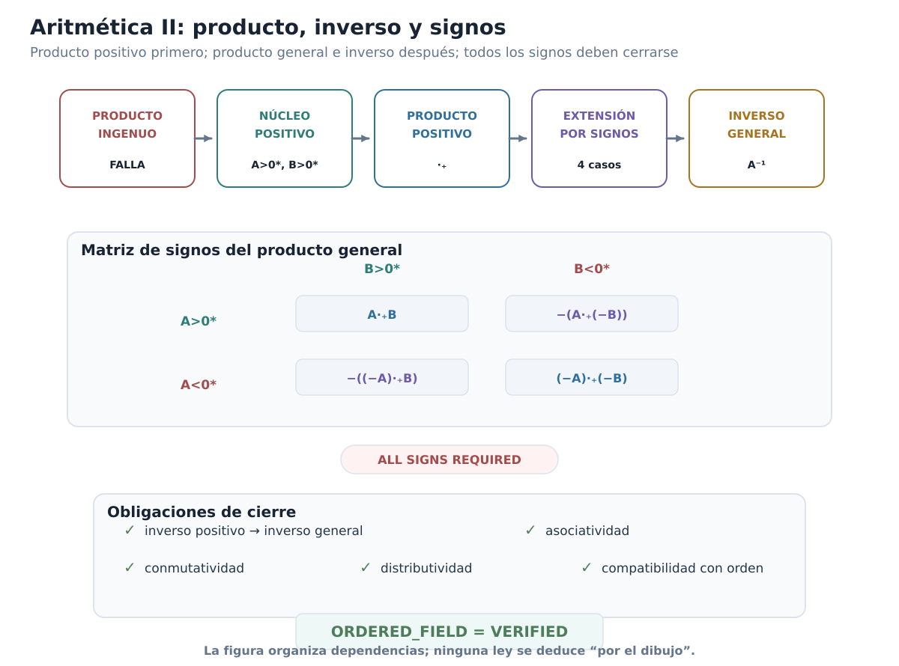{#fig-anm-c00-f11 fig-alt="Diagrama de flujo desde producto ingenuo hasta inverso general, matriz 2×2 de signos y lista de obligaciones: inversos, asociatividad, conmutatividad, distributividad y compatibilidad con el orden."}

### Qué falta para responder «sí existen»

La construcción ha avanzado mucho. Tenemos un cuerpo ordenado concreto, formado enteramente por subconjuntos racionales, y dentro de él aparece una copia fiel de $\mathbb Q$.

Sin embargo, la especificación de §0.1 contenía una última exigencia:

$$
\boxed{\text{toda parte no vacía y acotada superiormente debe tener supremo}.}
$$

No hemos demostrado todavía esa propiedad para $\mathcal D$.

El próximo paso será sorprendentemente sencillo de formular. Si $\mathscr A\subseteq\mathcal D$ es una familia no vacía de cortaduras, el candidato natural a reunir toda la información racional situada a la izquierda de sus miembros es

$$
\bigcup_{A\in\mathscr A}A.
$$

La pregunta decisiva será si esa unión es otra cortadura y, cuando la familia está acotada superiormente, si es precisamente su menor cota superior.

### Antes de seguir

#### Microcontrol 40

[]{#MA-MIC-ANM-01-000-040}

Explica por qué $\{ab:a\in A,b\in B\}$ no puede usarse como producto ingenuo de dos cortaduras arbitrarias.

[]{#MA-MSOL-ANM-01-000-040}

<details class="anm-solution">
<summary>Ver solución del microcontrol 40</summary>

El conjunto

$$
\{ab:a\in A,\ b\in B\}
$$

no puede ser la definición general del producto. Toda cortadura es no vacía y cerrada hacia abajo, de modo que contiene racionales negativos de magnitud arbitrariamente grande. En efecto, si $a_0\in A$ y $b_0\in B$, podemos elegir un natural $n$ suficientemente grande para que

$$
-n<a_0,
\qquad
-n<b_0.
$$

Entonces $-n\in A\cap B$, y el producto de esos dos testigos es

$$
(-n)(-n)=n^2.
$$

Como $n^2$ puede hacerse arbitrariamente grande, el conjunto de productos ingenuos contiene racionales positivos sin cota superior. En particular, no puede representar una cortadura propia situada a la izquierda de una frontera finita.

El problema no es la multiplicación racional, sino haber ignorado el signo de los testigos. Por eso §0.7 construye primero el producto de las **partes positivas** y sólo después extiende la regla a todos los signos.

</details>

#### Microcontrol 41

[]{#MA-MIC-ANM-01-000-041}

Demuestra las equivalencias $A>0^*\Longleftrightarrow0\in A\Longleftrightarrow\exists a\in A$ con $a>0$.

[]{#MA-MSOL-ANM-01-000-041}

<details class="anm-solution">
<summary>Ver solución del microcontrol 41</summary>

**Respuesta.**

Queremos probar

$$
A>0^*
\quad\Longleftrightarrow\quad
0\in A
\quad\Longleftrightarrow\quad
\exists a\in A:\ a>0.
$$

Si $A>0^*$, entonces $0^*\subsetneq A$. Existe, por tanto, $x\in A\setminus0^*$. Como $x\notin0^*$, tenemos $x\ge0$. Si $x=0$, ya está probado que $0\in A$; si $x>0$, la clausura hacia abajo de $A$ vuelve a dar $0\in A$.

Si $0\in A$, la ausencia de máximo proporciona un $a\in A$ con

$$
0<a.
$$

Finalmente, si existe $a\in A$ con $a>0$, todo racional $q<0$ satisface $q<a$, y la clausura hacia abajo implica $q\in A$. Luego

$$
0^*\subseteq A.
$$

La inclusión es estricta porque $a\in A$ pero $a\notin0^*$. Así $0^*\subsetneq A$, es decir, $A>0^*$.

**Fundamento en la sección 0.7.**

> **Lema.** Para $A\in\mathcal D$, son equivalentes:
>
> 1. $0^*<_{\mathcal D}A$;
> 2. $0\in A$;
> 3. existe $a\in A$ con $a>0$.

**Demostración.** Si $0^*\subsetneq A$, existe $x\in A\setminus0^*$. Entonces $x\ge0$. Si $x=0$, ya tenemos $0\in A$; si $x>0$, la clausura hacia abajo de $A$ da igualmente $0\in A$.

Si $0\in A$, la ausencia de máximo proporciona $a\in A$ con $0<a$.

Finalmente, si $a\in A$ y $a>0$, todo $q<0$ satisface $q<a$, luego $q\in A$. Así $0^*\subseteq A$, y la inclusión es estricta porque $a\in A\setminus0^*$. $\square$

</details>

#### Microcontrol 42

[]{#MA-MIC-ANM-01-000-042}

En la clausura de $A\cdot_+B$, ¿por qué un racional exterior $u\notin A$ debe ser positivo cuando $A>0^*$?

[]{#MA-MSOL-ANM-01-000-042}

<details class="anm-solution">
<summary>Ver solución del microcontrol 42</summary>

**Respuesta.**

Supongamos $A>0^*$ y $u\notin A$. Por la equivalencia anterior,

$$
0\in A.
$$

Si $u<0$, entonces $u\in0^*\subseteq A$, contradicción. Si $u=0$, también tendríamos $u\in A$.

Por tanto las posibilidades $u\le0$ quedan excluidas y necesariamente

$$
\boxed{u>0.}
$$

Este hecho es el que permite comparar productos conservando el sentido del orden: para $a\in A_{>0}$ y un exterior $u\notin A$, tenemos $0<a<u$, y al multiplicar por cantidades positivas la desigualdad sigue orientada de la misma manera.

**Fundamento en la sección 0.7.**

Así quedan preservados suma, producto, cero, uno y orden. En consecuencia,

$$
\boxed{
\iota_{\mathbb Q}:\mathbb Q\hookrightarrow\mathcal D
\text{ es una incrustación de cuerpos ordenados}.
}
$$

La identificación habitual queda ahora plenamente autorizada: cuando no haya peligro de confundir objetos con sus códigos, podremos escribir

$$
\mathbb Q\subseteq\mathcal D
$$

entendiendo que hemos identificado cada racional $q$ con su imagen $q^*$.

También los inversos racionales se conservan. Si $q\ne0$, entonces

$$
q^*\cdot(q^{-1})^*=(qq^{-1})^*=1^*.
$$

</details>

#### Microcontrol 43

[]{#MA-MIC-ANM-01-000-043}

Verifica directamente $p^*\cdot_+q^*=(pq)^*$ para $p,q>0$ y localiza dónde se usa la densidad de $\mathbb Q$.

[]{#MA-MSOL-ANM-01-000-043}

<details class="anm-solution">
<summary>Ver solución del microcontrol 43</summary>

Sean $p,q>0$. Debemos probar

$$
p^*\cdot_+q^*=(pq)^*.
$$

Si $x\in p^*\cdot_+q^*$, existen $0<a<p$ y $0<b<q$ con $x<ab$. Como

$$
ab<pb<pq,
$$

se sigue $x<pq$, es decir, $x\in(pq)^*$.

Para la recíproca, sea $x<pq$. Si $x\le0$, cualquier elección racional $0<a<p$ y $0<b<q$ da

$$
x\le0<ab,
$$

y por tanto $x\in p^*\cdot_+q^*$.

Supongamos ahora $0<x<pq$. Como $q>0$,

$$
\frac{x}{q}<p.
$$

Aquí aparece la primera aplicación de la densidad de $\mathbb Q$: elegimos

$$
\frac{x}{q}<a<p.
$$

Entonces $a>0$ y $x<aq$, de modo que

$$
\frac{x}{a}<q.
$$

La segunda aplicación de la densidad permite escoger

$$
\frac{x}{a}<b<q.
$$

Así $0<a<p$, $0<b<q$ y $x<ab$. Por consiguiente $x\in p^*\cdot_+q^*$.

La densidad se usa exactamente para insertar testigos racionales estrictamente dentro de las dos fronteras racionales y, al mismo tiempo, mantener su producto por encima de $x$.

</details>

#### Microcontrol 44

[]{#MA-MIC-ANM-01-000-044}

Recorre los cinco casos de la definición del producto general y comprueba que todos los argumentos enviados a $\cdot_+$ son positivos.

[]{#MA-MSOL-ANM-01-000-044}

<details class="anm-solution">
<summary>Ver solución del microcontrol 44</summary>

La definición separa exhaustivamente los signos de $A$ y $B$.

- Si $A=0^*$ o $B=0^*$, se define $AB=0^*$ y no aparece $\cdot_+$.
- Si $A>0^*$ y $B>0^*$, se usa directamente $A\cdot_+B$: ambos argumentos son positivos.
- Si $A<0^*$ y $B<0^*$, entonces $-A>0^*$ y $-B>0^*$; por eso $(-A)\cdot_+(-B)$ está bien definido.
- Si $A>0^*>B$, entonces $A>0^*$ y, como $B<0^*$, tenemos $-B>0^*$. Así $A\cdot_+(-B)$ recibe dos argumentos positivos; el opuesto exterior fija el signo negativo del resultado.
- Si $B>0^*>A$, entonces $B>0^*$ y $-A>0^*$. Por tanto $(-A)\cdot_+B$ vuelve a recibir dos argumentos positivos, y el opuesto exterior vuelve a producir el signo correcto.

La tricotomía del orden de $\mathcal D$ garantiza que no falta ningún caso y que dos casos no pueden aplicarse simultáneamente.

</details>

#### Microcontrol 45

[]{#MA-MIC-ANM-01-000-045}

¿Por qué la definición de $A^{-1,+}$ incluye automáticamente todos los racionales $q\le0$?

[]{#MA-MSOL-ANM-01-000-045}

<details class="anm-solution">
<summary>Ver solución del microcontrol 45</summary>

Si $A>0^*$, su recíproco debe ser también una cortadura **estrictamente positiva**. Toda cortadura positiva contiene $0$ y, por clausura hacia abajo, contiene todos los racionales negativos.

Por eso la definición

$$
A^{-1,+}
=
\left\{
q\in\mathbb Q:
q\le0
\text{ o }
\exists s>0\,(s\notin A\text{ y }q<s^{-1})
\right\}
$$

incluye desde el comienzo la región $q\le0$. Esta cláusula cumple dos funciones: garantiza inmediatamente que

$$
0\in A^{-1,+},
$$

y fija toda la parte izquierda no positiva sin obligarnos a producir, para cada uno de esos racionales, un testigo exterior $s$ específico.

La información nueva sobre la frontera inversa está sólo en la segunda cláusula, que controla los racionales positivos mediante recíprocos de puntos exteriores de $A$.

</details>

#### Microcontrol 46

[]{#MA-MIC-ANM-01-000-046}

En la prueba $A\cdot_+A^{-1,+}=1^*$, explica qué papel cumplen el lema de aproximación racional y la elección de $h<(1-x)c$.

[]{#MA-MSOL-ANM-01-000-046}

<details class="anm-solution">
<summary>Ver solución del microcontrol 46</summary>

En la inclusión difícil

$$
1^*\subseteq A\cdot_+A^{-1,+},
$$

tomamos $0<x<1$ y elegimos primero $c\in A$ con $c>0$.

La condición

$$
0<h<(1-x)c
$$

hace que $h$ sea un paso racional positivo **suficientemente pequeño**. El lema de aproximación de §0.6 puede entonces aplicarse y produce un $a\in A$ tal que

$$
s:=a+h\notin A.
$$

Así obtenemos simultáneamente un punto interior $a$ y un punto exterior $s$ separados exactamente por $h$.

Como $c\in A$ y $s\notin A$, tenemos $c<s=a+h$, luego

$$
a>c-h>0.
$$

Además,

$$
(1-x)(c-h)-xh=(1-x)c-h>0.
$$

Como $a>c-h$ y $1-x>0$,

$$
(1-x)a>xh.
$$

Esto equivale a

$$
a>x(a+h)=xs,
$$

y, como $a,s>0$,

$$
\frac{x}{a}<\frac1s.
$$

Ahora la densidad racional permite elegir $b$ entre esos dos números. La desigualdad $b<1/s$ coloca $b$ en $A^{-1,+}$, mientras que $x/a<b$ da $x<ab$.

Por tanto, el lema fabrica el par interior–exterior cercano y la elección de $h<(1-x)c$ garantiza exactamente el margen necesario para que el intervalo

$$
\left(\frac{x}{a},\frac1s\right)
$$

sea no vacío.

</details>

#### Microcontrol 47

[]{#MA-MIC-ANM-01-000-047}

Reconstruye la asociatividad positiva mostrando por qué la desigualdad $x<abc$ permite fabricar el testigo intermedio necesario en cada agrupación.

[]{#MA-MSOL-ANM-01-000-047}

<details class="anm-solution">
<summary>Ver solución del microcontrol 47</summary>

Supongamos primero que, después de desplegar los testigos de

$$
(A\cdot_+B)\cdot_+C,
$$

hemos llegado a

$$
x<abc
$$

con $a\in A_{>0}$, $b\in B_{>0}$ y $c\in C_{>0}$.

Para demostrar que $x\in A\cdot_+(B\cdot_+C)$ necesitamos un racional positivo $v\in B\cdot_+C$ con $x<av$.

- Si $x\le0$, basta escoger por densidad $0<v<bc$. Entonces $v\in B\cdot_+C$ y $x<0<av$.
- Si $x>0$, de $x<abc$ obtenemos $x/a<bc$. Por densidad elegimos
  $$
  \frac{x}{a}<v<bc.
  $$
  Entonces $v\in B\cdot_+C$ y $x<av$.

En la dirección inversa se hace exactamente lo mismo con un testigo $u\in A\cdot_+B$: si $x\le0$, tomamos $0<u<ab$; si $x>0$, usamos

$$
\frac{x}{c}<u<ab.
$$

Así, la desigualdad $x<abc$ no se usa como si $abc$ fuera un elemento-frontera del producto. Se usa para abrir un **intervalo racional no vacío** en el que la densidad permite insertar el testigo intermedio requerido por la otra agrupación.

</details>

#### Microcontrol 48

[]{#MA-MIC-ANM-01-000-048}

En la distributividad con signos opuestos, ¿por qué es necesario comparar $B$ con $-C$ antes de aplicar la distributividad positiva?

[]{#MA-MSOL-ANM-01-000-048}

<details class="anm-solution">
<summary>Ver solución del microcontrol 48</summary>

Supongamos

$$
B>0^*>C.
$$

Entonces $C_0:=-C$ es positivo. El signo de la suma

$$
B+C=B-C_0
$$

no puede decidirse sólo sabiendo que $B$ es positivo y $C$ negativo: depende de cuál de las dos magnitudes positivas, $B$ o $C_0$, sea mayor.

Por linealidad hay exactamente tres posibilidades:

$$
B=C_0,
\qquad
C_0<B,
\qquad
B<C_0.
$$

En el primer caso $B+C=0^*$. En el segundo,

$$
D:=B-C_0>0^*,
\qquad
C_0+D=B,
$$

y podemos aplicar la distributividad **positiva** a $C_0+D$. En el tercero,

$$
D:=C_0-B>0^*,
\qquad
B+D=C_0,
$$

y de nuevo disponemos de una suma de cortaduras positivas a la que sí se aplica el resultado ya demostrado.

La comparación $B$ frente a $-C$ sirve, por tanto, para convertir el caso de signos opuestos en uno de tres problemas cuyo término residual $D$ es positivo. Sin esa comparación no sabríamos qué expresión positiva está autorizada para invocar la distributividad ya probada.

</details>

#### Microcontrol 49

[]{#MA-MIC-ANM-01-000-049}

Enumera exactamente qué propiedades hacen ahora de $\mathcal D$ un cuerpo ordenado y cuál sigue faltando para que sea un sistema de números reales según §0.1.

[]{#MA-MSOL-ANM-01-000-049}

<details class="anm-solution">
<summary>Ver solución del microcontrol 49</summary>

Al terminar §0.7 están verificadas exactamente las propiedades siguientes.

- **Estructura aditiva:** $(\mathcal D,+,0^*)$ es un grupo abeliano.
- **Producto interno:** $A\cdot B\in\mathcal D$ para todos $A,B\in\mathcal D$.
- **Leyes multiplicativas:** el producto es asociativo y conmutativo.
- **Unidad:** $1^*$ satisface $A1^*=A=1^*A$ y $1^*\ne0^*$.
- **Inversos:** todo $A\ne0^*$ posee $A^{-1}$ con
  $$
  AA^{-1}=1^*=A^{-1}A.
  $$
- **Distributividad:** $A(B+C)=AB+AC$ y, por conmutatividad, también $(B+C)A=BA+CA$.
- **Orden:** la inclusión es un orden lineal; la suma preserva el orden y el producto de dos elementos no negativos es no negativo.

Éstas son precisamente las obligaciones algebraicas y de orden necesarias para concluir

$$
\boxed{(\mathcal D,+,\cdot,\le_{\mathcal D})\text{ es un cuerpo ordenado}.}
$$

La propiedad que todavía falta es la **completitud**: aún no se ha probado que toda familia no vacía de cortaduras acotada superiormente tenga supremo en $\mathcal D$. Por eso el cuerpo ordenado ya construido todavía no satisface toda la especificación de §0.1.

</details>

#### Microcontrol 50

[]{#MA-MIC-ANM-01-000-050}

Explica por qué sólo ahora queda plenamente justificada la abreviatura $\mathbb Q\subseteq\mathcal D$.

[]{#MA-MSOL-ANM-01-000-050}

<details class="anm-solution">
<summary>Ver solución del microcontrol 50</summary>

En §0.5 sabíamos que

$$
q\longmapsto q^*
$$

era inyectiva y preservaba y reflejaba el orden. En §0.6 añadimos la conservación de la suma, el cero y los opuestos. Eso todavía no bastaba para una incrustación de **cuerpos**.

Al terminar §0.7 están verificadas también

$$
(pq)^*=p^*\cdot q^*,
\qquad
1_{\mathcal D}=1^*,
$$

y, para $q\ne0$,

$$
(q^{-1})^*=(q^*)^{-1}.
$$

Por tanto la aplicación

$$
\iota_{\mathbb Q}:\mathbb Q\to\mathcal D,
\qquad
q\mapsto q^*,
$$

es ya una **incrustación de cuerpos ordenados**: es inyectiva y conserva suma, producto, $0$, $1$ y orden.

Sólo ahora está justificada la identificación estructural de cada racional con su imagen. La abreviatura

$$
\boxed{\mathbb Q\subseteq\mathcal D}
$$

no afirma una inclusión literal preexistente entre los objetos de ambas construcciones; significa que, desde este punto, trabajaremos identificando $\mathbb Q$ con la copia isomorfa $\iota_{\mathbb Q}(\mathbb Q)$ contenida en $\mathcal D$.

</details>
La aritmética está cerrada. Falta comprobar si el nuevo cuerpo ordenado tiene la propiedad que motivó toda la construcción: la completitud.

### Ejercicios de la sección 0.7

#### Ejercicio 27. Construir el núcleo positivo del producto

[]{#MA-EX-ANM-01-000-027}

La receta aditiva sugiere primero el conjunto ingenuo

$$
P(A,B)=\{ab:a\in A,\ b\in B\}.
$$

1. Toma $A=B=1^*$ y demuestra que $P(1^*,1^*)$ contiene racionales positivos arbitrariamente grandes. Explica por qué eso impide que esta receta sea, en general, un producto de cortaduras.
2. Para $A\in\mathcal D$, demuestra las equivalencias

$$
0^*\subsetneq A
\quad\Longleftrightarrow\quad
0\in A
\quad\Longleftrightarrow\quad
\exists a\in A\text{ con }a>0.
$$

3. Si $A,B>0^*$, define

$$
A_{>0}=\{a\in A:a>0\},
$$

y construye el candidato

$$
A\cdot_+B
=
\{x\in\mathbb Q:\exists a\in A_{>0}\ \exists b\in B_{>0}\text{ con }x<ab\}.
$$

4. Demuestra ya, a partir de la definición, que $A\cdot_+B$ es no vacío, contiene $0$ y es cerrado hacia abajo.

No declares todavía que $A\cdot_+B\in\mathcal D$: las dos condiciones restantes deben demostrarse en el ejercicio siguiente.

[]{#MA-SOL-ANM-01-000-027}

<details class="anm-solution">
<summary>Ver solución del ejercicio 27</summary>

La receta ingenua ya falla para la cortadura racional $1^*$.

Sea

$$
1^*=\{q\in\mathbb Q:q<1\}.
$$

Para cada entero positivo $N$ tenemos

$$
-N\in1^*.
$$

Por tanto

$$
N^2=(-N)(-N)\in P(1^*,1^*).
$$

Así $P(1^*,1^*)$ contiene racionales positivos arbitrariamente grandes. Una cortadura propia no puede tener esa propiedad: si $C\in\mathcal D$ y $u\notin C$, todo $c\in C$ satisface $c<u$. Por tanto $P(1^*,1^*)$ no puede ser una cortadura. El problema proviene de multiplicar racionales negativos muy alejados de la frontera.

Pasemos a la positividad. Supongamos primero

$$
0^*\subsetneq A.
$$

Existe entonces $x\in A\setminus0^*$. Así $x\ge0$. Si $x=0$, ya tenemos $0\in A$; si $x>0$, como $0<x$ y $A$ es cerrado hacia abajo, también $0\in A$.

Si $0\in A$, la ausencia de máximo produce $a\in A$ con

$$
0<a.
$$

Finalmente, si existe $a\in A$ con $a>0$, todo $q<0$ satisface $q<a$, y la clausura hacia abajo da $q\in A$. Por tanto

$$
0^*\subseteq A.
$$

La inclusión es estricta porque $a\in A\setminus0^*$. Hemos demostrado

$$
\boxed{
0^*<_{\mathcal D}A
\Longleftrightarrow
0\in A
\Longleftrightarrow
\exists a\in A\text{ con }a>0.
}
$$

Si $A,B>0^*$, los conjuntos $A_{>0}$ y $B_{>0}$ son no vacíos. Definimos

$$
A\cdot_+B
=
\{x\in\mathbb Q:\exists a\in A_{>0}\ \exists b\in B_{>0}\text{ con }x<ab\}.
$$

Elijamos $a\in A_{>0}$ y $b\in B_{>0}$. Como $ab>0$,

$$
0<ab,
$$

de modo que $0\in A\cdot_+B$. En particular, el conjunto es no vacío y ya contiene el cero racional.

Para la clausura hacia abajo, sea $x\in A\cdot_+B$. Existen $a,b>0$ con $a\in A$, $b\in B$ y

$$
x<ab.
$$

Si $y<x$, entonces

$$
y<x<ab,
$$

y los mismos testigos $a,b$ muestran que $y\in A\cdot_+B$.

Hasta aquí tenemos no vaciedad, presencia de $0$ y clausura inferior. Aún falta demostrar que el conjunto es propio y que carece de máximo; por eso todavía no declaramos clausura en $\mathcal D$.

*Referencia visual.* Véase la figura [C00-F11](analisis-para-matematicos-capitulo-0-construir-los-numeros-reales.html#fig-anm-c00-f11) del texto principal, **Aritmética II: producto, inverso y signos**, como síntesis posterior de este argumento.

</details>

#### Ejercicio 28. Cerrar el producto positivo y recuperar el producto racional

[]{#MA-EX-ANM-01-000-028}

Sean $A,B>0^*$ y usa la operación $A\cdot_+B$ construida en el ejercicio 27.

1. Demuestra que $A\cdot_+B$ es propio. Tu prueba debe elegir racionales exteriores $u\notin A$ y $v\notin B$ y justificar por qué necesariamente $u,v>0$.
2. Demuestra que $A\cdot_+B$ no tiene máximo.
3. Concluye que

$$
A\cdot_+B\in\mathcal D
\qquad\text{y}\qquad
A\cdot_+B>0^*.
$$

4. Sean ahora $p,q\in\mathbb Q$ con $p,q>0$. Demuestra por doble inclusión que

$$
p^*\cdot_+q^*=(pq)^*.
$$

En la inclusión difícil, separa los casos $x\le0$ y $0<x<pq$, y localiza exactamente dónde interviene la densidad de $\mathbb Q$.

[]{#MA-SOL-ANM-01-000-028}

<details class="anm-solution">
<summary>Ver solución del ejercicio 28</summary>

Sean $A,B>0^*$. Como $A$ y $B$ son cortaduras propias, existen racionales

$$
u\notin A,
\qquad
v\notin B.
$$

Además $0\in A$ y $0\in B$. Si $u\le0$, la clausura hacia abajo aplicada a $0\in A$ obligaría a $u\in A$ cuando $u<0$, y para $u=0$ ya sabemos que $0\in A$. Por tanto

$$
u>0.
$$

Análogamente, $v>0$.

Todo $a\in A$ satisface $a<u$, pues de $u\le a$ y $a\in A$ se seguiría $u\in A$. Del mismo modo, todo $b\in B$ cumple $b<v$. Para $a\in A_{>0}$ y $b\in B_{>0}$,

$$
ab<ub<uv.
$$

Así ningún par de testigos puede satisfacer $uv<ab$. Luego

$$
uv\notin A\cdot_+B,
$$

y $A\cdot_+B$ es propio.

Para la ausencia de máximo, sea $x\in A\cdot_+B$. Existen $a\in A_{>0}$ y $b\in B_{>0}$ con

$$
x<ab.
$$

Por densidad de $\mathbb Q$, existe $y\in\mathbb Q$ tal que

$$
x<y<ab.
$$

Los mismos $a,b$ prueban $y\in A\cdot_+B$. Por tanto ningún elemento es máximo.

Junto con el ejercicio 27, quedan verificadas las cuatro condiciones de cortadura, y además $0\in A\cdot_+B$. Por consiguiente,

$$
\boxed{
A\cdot_+B\in\mathcal D
\quad\text{y}\quad
A\cdot_+B>0^*.
}
$$

Ahora sean $p,q>0$ racionales.

Si $x\in p^*\cdot_+q^*$, existen $0<a<p$ y $0<b<q$ tales que

$$
x<ab.
$$

Como

$$
ab<pb<pq,
$$

tenemos $x<pq$, es decir,

$$
x\in(pq)^*.
$$

Así

$$
p^*\cdot_+q^*\subseteq(pq)^*.
$$

Para la inclusión inversa, sea $x<pq$.

Si $x\le0$, elegimos cualesquiera racionales $a,b$ con

$$
0<a<p,
\qquad
0<b<q.
$$

Entonces $x\le0<ab$, y por tanto $x\in p^*\cdot_+q^*$.

Supongamos ahora

$$
0<x<pq.
$$

Como $q>0$,

$$
\frac{x}{q}<p.
$$

Por densidad elegimos $a\in\mathbb Q$ con

$$
\frac{x}{q}<a<p.
$$

Entonces $a>0$ y $x<aq$, de modo que

$$
\frac xa<q.
$$

Una segunda aplicación de la densidad proporciona $b$ con

$$
\frac xa<b<q.
$$

Así $0<a<p$, $0<b<q$ y $x<ab$. Por tanto

$$
x\in p^*\cdot_+q^*.
$$

La doble inclusión da

$$
\boxed{p^*\cdot_+q^*=(pq)^*.}
$$

La densidad de $\mathbb Q$ se gasta exactamente en la ausencia de máximo del producto y, para la inclusión racional inversa, en la elección sucesiva de $a$ y $b$.

*Referencia visual.* Véase la figura [C00-F11](analisis-para-matematicos-capitulo-0-construir-los-numeros-reales.html#fig-anm-c00-f11) del texto principal, **Aritmética II: producto, inverso y signos**, como síntesis posterior de este argumento.

</details>

#### Ejercicio 29. Trazar el paso del producto positivo a todos los signos

[]{#MA-EX-ANM-01-000-029}

Usa la estructura aditiva de §0.6 y el producto positivo de los ejercicios 27–28.

1. Explica por qué

$$
-(-A)=A
$$

y por qué $A<0^*$ implica $-A>0^*$.
2. Define un producto $A\cdot B$ para $A,B\in\mathcal D$ mediante los cinco casos: cero, dos positivos, dos negativos y los dos órdenes posibles de signos opuestos. Debes escribir explícitamente la definición por casos y verificar que cada aparición de $\cdot_+$ recibe argumentos estrictamente positivos.
3. Demuestra que, para todos $p,q\in\mathbb Q$,

$$
p^*\cdot q^*=(pq)^*.
$$

No omitas los casos de signos negativos ni los casos con cero.
4. Demuestra primero para $A>0^*$ que

$$
A\cdot_+1^*=A,
$$

y extiende después el resultado a todo $A\in\mathcal D$ para obtener

$$
A\cdot1^*=A=1^*\cdot A.
$$

Cierra con un mapa de dependencias que indique qué parte usa el opuesto de §0.6, qué parte usa la identidad racional positiva del ejercicio 28 y qué parte usa ausencia de máximo.

[]{#MA-SOL-ANM-01-000-029}

<details class="anm-solution">
<summary>Ver solución del ejercicio 29</summary>

En §0.6, el opuesto de una cortadura quedó caracterizado como su inverso aditivo. Como $A$ y $-(-A)$ son ambos inversos aditivos de $-A$, la unicidad del inverso da

$$
\boxed{-(-A)=A.}
$$

Si $A<0^*$, sumamos $-A$ a ambos lados. La compatibilidad del orden con traslaciones produce

$$
0^*<-A.
$$

Así una cortadura negativa se transforma en positiva al tomar su opuesto.

Definimos el producto general por

$$
A\cdot B=
\begin{cases}
0^*,&A=0^*\text{ o }B=0^*,\\[1ex]
A\cdot_+B,&A>0^*,\ B>0^*,\\[1ex]
(-A)\cdot_+(-B),&A<0^*,\ B<0^*,\\[1ex]
-\bigl(A\cdot_+(-B)\bigr),&A>0^*>B,\\[1ex]
-\bigl((-A)\cdot_+B\bigr),&B>0^*>A.
\end{cases}
$$

La tricotomía respecto de $0^*$ hace que los cinco casos sean exhaustivos y disjuntos. En las ramas con $\cdot_+$, los argumentos son positivos por construcción: los factores ya son positivos o han sido reemplazados por su opuesto. Como $\cdot_+$ produce una cortadura positiva y el opuesto de una cortadura vuelve a pertenecer a $\mathcal D$, el producto general es interno.

Probemos ahora la compatibilidad racional.

Si $p,q>0$, el resultado es el ejercicio 28:

$$
p^*\cdot q^*=(pq)^*.
$$

Si $p,q<0$, entonces $-p,-q>0$ y, usando $-(p^*)=(-p)^*$,

$$
\begin{aligned}
p^*\cdot q^*
&=(-p)^*\cdot_+(-q)^*\\
&=((-p)(-q))^*\\
&=(pq)^*.
\end{aligned}
$$

Si $p>0>q$,

$$
\begin{aligned}
p^*\cdot q^*
&=-\bigl(p^*\cdot_+(-q)^*\bigr)\\
&=-\bigl(p(-q)\bigr)^*\\
&=(pq)^*.
\end{aligned}
$$

El caso $q>0>p$ es simétrico. Si alguno de los racionales es cero, ambos lados son $0^*$. Luego

$$
\boxed{p^*\cdot q^*=(pq)^*\qquad(p,q\in\mathbb Q).}
$$

Veamos la unidad. Supongamos primero $A>0^*$.

Si $x\in A\cdot_+1^*$, existen $a\in A$, $a>0$, y $b$ con $0<b<1$ tales que

$$
x<ab<a.
$$

La clausura inferior de $A$ da $x\in A$. Así

$$
A\cdot_+1^*\subseteq A.
$$

Recíprocamente, sea $x\in A$. Si $x\le0$, elegimos $a\in A$ positivo y $b\in\mathbb Q$ con $0<b<1$; entonces $x<ab$.

Si $x>0$, la ausencia de máximo de $A$ proporciona $a\in A$ con $x<a$. Entonces

$$
0<\frac xa<1.
$$

Por densidad elegimos $b$ con

$$
\frac xa<b<1.
$$

Así $x<ab$ y $x\in A\cdot_+1^*$. Por tanto

$$
A\cdot_+1^*=A.
$$

La igualdad $1^*\cdot_+A=A$ se obtiene simétricamente.

Si $A=0^*$, la identidad es inmediata por definición. Si $A<0^*$, entonces $-A>0^*$ y

$$
A\cdot1^*
=-\bigl((-A)\cdot_+1^*\bigr)
=-(-A)
=A.
$$

Análogamente por la izquierda. Luego

$$
\boxed{A\cdot1^*=A=1^*\cdot A.}
$$

El mapa de dependencias es:

- **opuesto de §0.6:** permite convertir factores negativos en positivos y volver a colocar el signo;
- **producto racional positivo:** permite extender $p^*q^*=(pq)^*$ a todos los signos;
- **ausencia de máximo:** se usa para aproximar desde dentro un $x>0$ al demostrar que $1^*$ actúa como unidad.

*Referencia visual.* Véase la figura [C00-F11](analisis-para-matematicos-capitulo-0-construir-los-numeros-reales.html#fig-anm-c00-f11) del texto principal, **Aritmética II: producto, inverso y signos**, como síntesis posterior de este argumento.

</details>

#### Ejercicio 30. Construir y verificar el inverso multiplicativo

[]{#MA-EX-ANM-01-000-030}

Sea $A>0^*$. Define

$$
A^{-1,+}
=
\left\{
q\in\mathbb Q:
q\le0
\text{ o }
\exists s>0\;\bigl(s\notin A\text{ y }q<s^{-1}\bigr)
\right\}.
$$

1. Demuestra que $A^{-1,+}$ es una cortadura estrictamente positiva.
2. Demuestra por doble inclusión que

$$
A\cdot_+A^{-1,+}=1^*.
$$

3. Para la inclusión $1^*\subseteq A\cdot_+A^{-1,+}$, trata por separado $x\le0$ y $0<x<1$. En el segundo caso debes usar el lema de aproximación racional de §0.6 para obtener un par

$$
a\in A,
\qquad
s=a+h\notin A
$$

suficientemente próximo.
4. Si $A\ne0^*$, define $A^{-1}$ para ambos signos y demuestra

$$
A\cdot A^{-1}=1^*=A^{-1}\cdot A.
$$

> **Pista conceptual.** Para $0<x<1$, busca primero un $c\in A$ positivo y elige $h$ tan pequeño que $h<(1-x)c$. El objetivo es forzar $x/a<1/s$ para poder insertar un racional entre ambos.

[]{#MA-SOL-ANM-01-000-030}

<details class="anm-solution">
<summary>Ver solución del ejercicio 30</summary>

Sea $A>0^*$. Consideremos

$$
A^{-1,+}
=
\left\{
q\in\mathbb Q:
q\le0
\text{ o }
\exists s>0\;\bigl(s\notin A\text{ y }q<s^{-1}\bigr)
\right\}.
$$

Como $0\le0$,

$$
0\in A^{-1,+}.
$$

El conjunto es no vacío y, una vez cerrado como cortadura, será positivo.

Para demostrar que es propio, tomemos $a\in A$ con $a>0$. Afirmamos que

$$
a^{-1}\notin A^{-1,+}.
$$

No satisface la cláusula $q\le0$. Si satisficiera la segunda, existiría $s>0$, $s\notin A$, tal que

$$
a^{-1}<s^{-1}.
$$

Como ambos son positivos, invertir revierte el orden y tendríamos

$$
s<a.
$$

Pero $a\in A$ y $A$ es cerrado hacia abajo, luego $s\in A$, contradicción.

La clausura hacia abajo es directa. Si $q\le0$ y $r<q$, entonces $r\le0$. Si $q<s^{-1}$ para algún exterior positivo $s$ y $r<q$, el mismo $s$ muestra

$$
r<q<s^{-1}.
$$

Para la ausencia de máximo distinguimos tres casos. Si $q<0$, entonces $q<0$ y $0\in A^{-1,+}$. Si $q=0$, elegimos $s\notin A$; necesariamente $s>0$ porque $0\in A$ y todo racional no positivo pertenece a $A$. Por densidad existe

$$
0<r<s^{-1},
$$

y $r\in A^{-1,+}$. Si $q>0$, su pertenencia proporciona $s>0$, $s\notin A$, con $q<s^{-1}$; de nuevo por densidad elegimos

$$
q<r<s^{-1}.
$$

Por tanto $A^{-1,+}$ es una cortadura y, como contiene $0$,

$$
\boxed{A^{-1,+}>0^*.}
$$

Probemos ahora

$$
A\cdot_+A^{-1,+}=1^*.
$$

Sea $x\in A\cdot_+A^{-1,+}$. Existen $a\in A$, $a>0$, y $b\in A^{-1,+}$, $b>0$, con

$$
x<ab.
$$

Como $b>0$, su pertenencia proviene de un $s>0$, $s\notin A$, tal que

$$
b<s^{-1}.
$$

Todo elemento de $A$ está por debajo de todo exterior, así que $a<s$. Luego

$$
x<ab<a\,s^{-1}=\frac as<1.
$$

Por tanto

$$
A\cdot_+A^{-1,+}\subseteq1^*.
$$

Para la otra inclusión, sea $x<1$.

Si $x\le0$, elegimos $a\in A$ positivo y un $b\in A^{-1,+}$ positivo. Entonces $x<ab$, de modo que $x$ pertenece al producto.

Supongamos ahora

$$
0<x<1.
$$

Elegimos $c\in A$ con $c>0$. Como $(1-x)c>0$, tomamos un racional

$$
0<h<(1-x)c.
$$

Por el lema de aproximación racional de §0.6 existe $a\in A$ tal que

$$
s:=a+h\notin A.
$$

Como $c\in A$ y $s\notin A$, necesariamente $c<s=a+h$. Además $h<(1-x)c<c$, así que

$$
a>c-h>0.
$$

Tenemos

$$
(1-x)(c-h)-xh=(1-x)c-h>0.
$$

Como $a>c-h$,

$$
(1-x)a>xh.
$$

Equivalente a

$$
a>x(a+h)=xs.
$$

Por tanto

$$
\frac xa<\frac1s.
$$

Por densidad elegimos $b\in\mathbb Q$ con

$$
\frac xa<b<\frac1s.
$$

Entonces $b>0$, y como $s>0$, $s\notin A$ y $b<s^{-1}$,

$$
b\in A^{-1,+}.
$$

Además $x<ab$. Por tanto $x\in A\cdot_+A^{-1,+}$.

Hemos demostrado

$$
\boxed{A\cdot_+A^{-1,+}=1^*.}
$$

La igualdad con los factores intercambiados se obtiene de la simetría de la definición de $\cdot_+$, pues $ab=ba$ en $\mathbb Q$.

Para $A\ne0^*$ definimos

$$
A^{-1}
=
\begin{cases}
A^{-1,+},&A>0^*,\\[1ex]
-\bigl((-A)^{-1,+}\bigr),&A<0^*.
\end{cases}
$$

Si $A>0^*$, la ley del inverso ya está probada. Si $A<0^*$, ponemos

$$
B=-A>0^*.
$$

Entonces

$$
A^{-1}=-B^{-1,+},
$$

y, usando la rama de dos factores negativos,

$$
\begin{aligned}
A\cdot A^{-1}
&=(-A)\cdot_+(-A^{-1})\\
&=B\cdot_+B^{-1,+}\\
&=1^*.
\end{aligned}
$$

El mismo argumento en el orden inverso da

$$
\boxed{
A\cdot A^{-1}=1^*=A^{-1}\cdot A
\qquad(A\ne0^*).
}
$$

El lema de aproximación de §0.6 es el mecanismo que fabrica, para un $x<1$, un interior $a$ y un exterior $s$ suficientemente próximos como para abrir el intervalo racional

$$
\left(\frac xa,\frac1s\right).
$$

*Referencia visual.* Véase la figura [C00-F11](analisis-para-matematicos-capitulo-0-construir-los-numeros-reales.html#fig-anm-c00-f11) del texto principal, **Aritmética II: producto, inverso y signos**, como síntesis posterior de este argumento.

</details>

#### Ejercicio 31. Un producto correcto para positivos que no forma un cuerpo

[]{#MA-EX-ANM-01-000-031}

Para mostrar que el sector positivo no determina por sí solo toda la estructura de cuerpo, define una operación $\star$ sobre $\mathcal D$ así:

$$
A\star B=
\begin{cases}
0^*,&A=0^*\text{ o }B=0^*,\\
A\cdot_+B,&A>0^*,\ B>0^*,\\
-\bigl((-A)\cdot_+(-B)\bigr),&A<0^*,\ B<0^*,\\
-\bigl(A\cdot_+(-B)\bigr),&A>0^*>B,\\
-\bigl((-A)\cdot_+B\bigr),&B>0^*>A.
\end{cases}
$$

La única rama deliberadamente alterada respecto del producto correcto es la de dos factores negativos.

1. Explica por qué $\star$ sigue siendo una operación interna en $\mathcal D$ y coincide con $\cdot_+$ cuando ambos factores son positivos.
2. Calcula

$$
(-1)^*\star(-1)^*.
$$

3. Usa los tres elementos $(-1)^*,(-1)^*,1^*$ para demostrar directamente que $\star$ no es distributiva respecto de la suma ya construida.
4. Explica por qué este ejemplo refuta la inferencia «si el producto funciona para positivos, el resto de las leyes de cuerpo queda automáticamente determinado».

> **Pista conceptual.** Compara $(-1)^*\star\bigl((-1)^*+1^*\bigr)$ con $\bigl((-1)^*\star(-1)^*\bigr)+\bigl((-1)^*\star1^*\bigr)$.

[]{#MA-SOL-ANM-01-000-031}

<details class="anm-solution">
<summary>Ver solución del ejercicio 31</summary>

La operación $\star$ es interna. En la rama positiva, $A\cdot_+B\in\mathcal D$ por el ejercicio 28. En las ramas con signo negativo, primero se aplica $\cdot_+$ a cortaduras positivas y luego se toma el opuesto, operación que ya sabemos que conserva $\mathcal D$. La rama con cero devuelve $0^*$.

Además, si $A,B>0^*$,

$$
A\star B=A\cdot_+B.
$$

Por tanto $\star$ coincide exactamente con el producto correcto en todo el sector positivo.

Tomemos ahora

$$
A=B=(-1)^*.
$$

Como $(-1)^*<0^*$ y

$$
-((-1)^*)=1^*,
$$

la rama deliberadamente alterada da

$$
\begin{aligned}
(-1)^*\star(-1)^*
&=-\bigl(1^*\cdot_+1^*\bigr)\\
&=-1^*\\
&=(-1)^*.
\end{aligned}
$$

Ya esto contradice el comportamiento racional que debería tener un producto de cuerpos, pues $(-1)(-1)=1$.

Veamos además el fallo directo de distributividad sugerido en la pista. Como la suma racional ya está preservada,

$$
(-1)^*+1^*=0^*.
$$

Por tanto

$$
(-1)^*\star\bigl((-1)^*+1^*\bigr)
=
(-1)^*\star0^*
=
0^*.
$$

En cambio,

$$
(-1)^*\star(-1)^*=(-1)^*.
$$

Para el producto de signos opuestos, la definición de $\star$ coincide con la regla correcta, de modo que

$$
(-1)^*\star1^*=(-1)^*.
$$

Así el miembro derecho de la distributividad sería

$$
(-1)^*+(-1)^*=(-2)^*.
$$

Como

$$
(-2)^*\ne0^*,
$$

obtenemos

$$
\boxed{
(-1)^*\star\bigl((-1)^*+1^*\bigr)
\ne
\bigl((-1)^*\star(-1)^*\bigr)
+
\bigl((-1)^*\star1^*\bigr).
}
$$

Por tanto $\star$ no es distributiva.

El contraejemplo aísla exactamente el punto lógico: conocer el producto en el cono positivo no determina por sí solo las reglas de signo ni garantiza que la extensión respete las leyes de anillo. Los casos negativos y mixtos deben definirse y verificarse explícitamente.

</details>

#### Ejercicio 32. Cerrar el cuerpo ordenado sin confundirlo con completitud

[]{#MA-EX-ANM-01-000-032}

Trabaja con el producto correcto $\cdot$ y los inversos construidos en los ejercicios anteriores. Organiza el cierre multiplicativo mediante una estrategia de **núcleo positivo + regla de signos**.

1. Demuestra la conmutatividad y la asociatividad de $\cdot_+$ para cortaduras positivas. En la asociatividad, construye explícitamente el testigo intermedio que permite pasar de una agrupación a la otra.
2. Extiende conmutatividad y asociatividad a todos los signos explicando por qué ambos lados tienen el mismo signo y el mismo núcleo positivo.
3. Demuestra la distributividad positiva

$$
A\cdot_+(B+C)
=
(A\cdot_+B)+(A\cdot_+C)
$$

para $A,B,C>0^*$.
4. Extiende la distributividad a signos arbitrarios. En el caso $B>0^*>C$, explica por qué hay que comparar $B$ con $-C$ y cómo la cancelación en el grupo aditivo reduce el problema al caso positivo.
5. Demuestra la compatibilidad multiplicativa del orden:

$$
0^*\le A,\ 0^*\le B
\quad\Longrightarrow\quad
0^*\le A\cdot B.
$$

6. Reúne todo lo demostrado en §§0.6–0.7 y justifica que

$$
(\mathcal D,+,\cdot,\le_{\mathcal D})
$$

es un cuerpo ordenado.
7. Demuestra que

$$
\iota_{\mathbb Q}:\mathbb Q\hookrightarrow\mathcal D,
\qquad q\mapsto q^*,
$$

queda ahora certificada como incrustación de cuerpos ordenados.
8. Explica con precisión por qué **todavía no** puede concluirse que la pregunta de existencia de §0.1 está cerrada.

> **Pista conceptual.** Para evitar una explosión de casos, separa cada cortadura no nula en un signo y una parte positiva. Para la distributividad con signos opuestos, compara primero $B$ y $-C$ dentro del orden lineal de $\mathcal D$.

[]{#MA-SOL-ANM-01-000-032}

<details class="anm-solution">
<summary>Ver solución del ejercicio 32</summary>

Empecemos por el núcleo positivo.

La conmutatividad de $\cdot_+$ es inmediata: para $A,B>0^*$,

$$
x<ab
\quad\Longleftrightarrow\quad
x<ba,
$$

de modo que

$$
\boxed{A\cdot_+B=B\cdot_+A.}
$$

Probemos la asociatividad positiva. Sea

$$
x\in(A\cdot_+B)\cdot_+C.
$$

Existen $u>0$ y $c\in C_{>0}$ tales que

$$
u\in A\cdot_+B,
\qquad
x<uc.
$$

A su vez existen $a\in A_{>0}$ y $b\in B_{>0}$ con

$$
u<ab.
$$

Por tanto

$$
x<uc<abc.
$$

Si $x\le0$, elegimos $v\in\mathbb Q$ con

$$
0<v<bc.
$$

Entonces $v\in B\cdot_+C$ y $x<0<av$, de modo que $x\in A\cdot_+(B\cdot_+C)$.

Si $x>0$, de $x<abc$ obtenemos

$$
\frac xa<bc.
$$

Por densidad elegimos

$$
\frac xa<v<bc.
$$

Entonces $v\in B\cdot_+C$ y $x<av$. Así

$$
(A\cdot_+B)\cdot_+C
\subseteq
A\cdot_+(B\cdot_+C).
$$

La inclusión inversa es simétrica: partiendo de $x<av<abc$, si $x\le0$ elegimos $0<u<ab$; si $x>0$, elegimos

$$
\frac xc<u<ab.
$$

Entonces $u\in A\cdot_+B$ y $x<uc$. Concluimos

$$
\boxed{(A\cdot_+B)\cdot_+C=A\cdot_+(B\cdot_+C).}
$$

Para extender conmutatividad y asociatividad a todos los signos, observemos que toda cortadura no nula puede escribirse como una parte positiva acompañada de un signo: si $A>0^*$ usamos $A$; si $A<0^*$ usamos $-A>0^*$. La definición del producto multiplica las partes positivas mediante $\cdot_+$ y coloca un opuesto exterior exactamente cuando aparece un número impar de factores negativos.

Por tanto, en cualquiera de las dos agrupaciones de tres factores no nulos, el signo final es el mismo y el núcleo positivo es el mismo por asociatividad de $\cdot_+$. Si aparece un cero, ambos lados son $0^*$. Así

$$
\boxed{A\cdot B=B\cdot A}
$$

y

$$
\boxed{(A\cdot B)\cdot C=A\cdot(B\cdot C)}
$$

para todos $A,B,C\in\mathcal D$.

Pasemos a la distributividad positiva. Sean $A,B,C>0^*$. Entonces $B+C>0^*$ porque $0\in B$ y $0\in C$, luego $0=0+0\in B+C$.

Sea

$$
x\in A\cdot_+(B+C).
$$

Existen $a\in A_{>0}$ y $u\in(B+C)_{>0}$ con

$$
x<au.
$$

Escribimos $u=b_0+c_0$ con $b_0\in B$, $c_0\in C$. Podemos obtener otra representación

$$
u=b+c
$$

con $b\in B_{>0}$ y $c\in C_{>0}$. Si ambos testigos originales son positivos, no hay nada que hacer. Si, por ejemplo, $b_0\le0$, entonces $c_0>0$. Elegimos $d\in B$ positivo y un racional

$$
0<b<\min\{u,d\}.
$$

Así $b\in B$, $b>b_0$ y, poniendo $c=u-b$, tenemos $c>0$ y

$$
c=u-b<u-b_0=c_0,
$$

por lo que $c\in C$. El otro caso es simétrico.

Ahora

$$
x<a(b+c)=ab+ac.
$$

Como

$$
x-ac<ab,
$$

por densidad elegimos $y$ con

$$
x-ac<y<ab.
$$

Sea $z=x-y$. Entonces

$$
y\in A\cdot_+B,
\qquad
z<ac,
$$

de modo que $z\in A\cdot_+C$ y $x=y+z$. Por tanto

$$
A\cdot_+(B+C)
\subseteq
(A\cdot_+B)+(A\cdot_+C).
$$

Para la inclusión inversa, sea

$$
x=y+z
$$

con $y\in A\cdot_+B$ y $z\in A\cdot_+C$. Elegimos

$$
a_1,a_2\in A_{>0},
\qquad
b\in B_{>0},
\qquad
c\in C_{>0}
$$

tales que

$$
y<a_1b,
\qquad
z<a_2c.
$$

Sea $m=\max\{a_1,a_2\}$. Como $m$ es uno de los dos elementos de $A$ y $A$ no tiene máximo, existe $a\in A$ con $m<a$. Entonces

$$
\begin{aligned}
x
&=y+z\\
&<a_1b+a_2c\\
&<ab+ac\\
&=a(b+c).
\end{aligned}
$$

Como $b+c>0$ y $b+c\in B+C$,

$$
x\in A\cdot_+(B+C).
$$

Concluimos

$$
\boxed{
A\cdot_+(B+C)
=(A\cdot_+B)+(A\cdot_+C)
}
$$

para cortaduras positivas.

La definición por signos implica

$$
(-A)B=-(AB),
\qquad
A(-B)=-(AB),
\qquad
(-A)(-B)=AB.
$$

Fijemos primero $A>0^*$ y permitamos signos arbitrarios para $B,C$.

Si $B,C>0^*$, ya tenemos distributividad. Si ambos son negativos, escribimos

$$
B=-B_0,
\qquad
C=-C_0,
$$

con $B_0,C_0>0^*$. Entonces

$$
B+C=-(B_0+C_0),
$$

y las reglas de signo reducen la igualdad al caso positivo.

Supongamos ahora

$$
B>0^*>C
$$

y pongamos $C_0=-C>0^*$. Por linealidad del orden, exactamente uno de los tres casos

$$
B=C_0,
\qquad
C_0<B,
\qquad
B<C_0
$$

ocurre.

Si $B=C_0$, entonces $B+C=0^*$ y ambos lados de la distributividad son $0^*$.

Si $C_0<B$, definimos

$$
D=B-C_0>0^*.
$$

Entonces $C_0+D=B$. La distributividad positiva da

$$
AB=AC_0+AD.
$$

Cancelando $AC_0$ en el grupo aditivo,

$$
AD=AB-AC_0=AB+AC.
$$

Como $D=B+C$,

$$
A(B+C)=AB+AC.
$$

Si $B<C_0$, ponemos

$$
D=C_0-B>0^*.
$$

Entonces $C_0=B+D$, y la distributividad positiva produce

$$
AC_0=AB+AD.
$$

Por cancelación,

$$
AB-AC_0=-AD.
$$

Pero $B+C=-D$ y $AC=-AC_0$, así que nuevamente

$$
A(B+C)=AB+AC.
$$

El caso $B<0^*<C$ es simétrico.

Por tanto la distributividad vale para $A>0^*$ y todos $B,C$. Si $A<0^*$, escribimos $A=-A_0$ con $A_0>0^*$ y usamos las reglas de signo:

$$
\begin{aligned}
A(B+C)
&=-A_0(B+C)\\
&=-(A_0B+A_0C)\\
&=AB+AC.
\end{aligned}
$$

Para $A=0^*$ es inmediata. Hemos probado

$$
\boxed{A(B+C)=AB+AC}
$$

para todos $A,B,C\in\mathcal D$. La distributividad por la derecha sigue de la conmutatividad del producto.

La compatibilidad multiplicativa del orden también queda cerrada. Si

$$
0^*\le A,
\qquad
0^*\le B,
$$

cada factor es cero o positivo. Si alguno es cero, $AB=0^*$. Si ambos son positivos, el ejercicio 28 mostró

$$
AB=A\cdot_+B>0^*.
$$

Luego

$$
\boxed{
0^*\le A,\ 0^*\le B
\Longrightarrow
0^*\le AB.
}
$$

Ya podemos reunir las verificaciones. De §0.6 tenemos un grupo abeliano aditivo y un orden lineal compatible con traslaciones. En §0.7 hemos establecido:

- cierre del producto;
- conmutatividad y asociatividad;
- unidad $1^*$ con $1^*\ne0^*$;
- inverso multiplicativo para todo $A\ne0^*$;
- distributividad;
- compatibilidad del orden con productos no negativos.

Por tanto

$$
\boxed{
(\mathcal D,+,\cdot,\le_{\mathcal D})
\text{ es un cuerpo ordenado}.
}
$$

La copia racional queda ahora certificada al nivel algebraico completo. Ya sabíamos que $q\mapsto q^*$ es inyectiva y preserva y refleja el orden. En §0.6 se probó

$$
(p+q)^*=p^*+q^*,
\qquad
0_{\mathcal D}=0^*,
$$

y ahora tenemos

$$
(pq)^*=p^*\cdot q^*,
\qquad
1_{\mathcal D}=1^*.
$$

Así

$$
\boxed{
\iota_{\mathbb Q}:\mathbb Q\hookrightarrow\mathcal D
\text{ es una incrustación de cuerpos ordenados}.
}
$$

Sin embargo, esto todavía no responde por completo la pregunta de existencia de §0.1. Allí se pidió un **cuerpo ordenado completo**. Hasta este punto sólo se ha demostrado que $\mathcal D$ es un cuerpo ordenado. Falta probar que toda familia no vacía de cortaduras acotada superiormente posee un supremo en $\mathcal D$.

Por eso el cierre correcto es

$$
\boxed{
\text{CUERPO ORDENADO = VERIFICADO}
\qquad
\text{COMPLETITUD = PENDIENTE}.
}
$$

No es legítimo convertir el primer certificado en el segundo sin una prueba adicional.

</details>
## 0.8. Sí existen: el supremo como unión

[]{#MA-SEC-ANM-01-000-008}

Volvamos a la pregunta con la que comenzó el capítulo.

En §0.1 no preguntamos simplemente si podíamos fabricar un conjunto más grande que $\mathbb Q$. Pedimos algo mucho más preciso: un sistema que fuera a la vez un cuerpo ordenado y que además tuviera la propiedad del supremo.

Después de §0.7 ya poseemos la primera mitad:

$$
\boxed{
(\mathcal D,+,\cdot,\le_{\mathcal D})
\text{ es un cuerpo ordenado}.
}
$$

También sabemos que contiene una copia de $\mathbb Q$ como subcuerpo ordenado, mediante

$$
q\longmapsto q^*.
$$

Pero la pregunta de existencia sigue incompleta mientras no respondamos:

> **Ya tenemos un cuerpo ordenado que contiene una copia de $\mathbb Q$. ¿Es completo?**

Éste es el último requisito de la especificación inicial.

Y aquí la construcción por cortaduras revela la razón profunda por la que el orden por inclusión era tan natural.

### Si queremos una frontera superior, reunamos toda la información situada a la izquierda

Sea

$$
\mathscr A\subseteq\mathcal D
$$

una familia **no vacía** de cortaduras y supongamos que está **acotada superiormente** en $\mathcal D$.

Esto significa que existe alguna cortadura

$$
U\in\mathcal D
$$

tal que

$$
A\subseteq U
\qquad
\text{para todo }A\in\mathscr A.
$$

Recordemos que en $\mathcal D$ el orden es la inclusión. Por tanto decir que $U$ es una cota superior no introduce una noción nueva: significa exactamente que $U$ contiene toda la información racional contenida en cada miembro de $\mathscr A$.

Si buscamos la **menor** cortadura con esa propiedad, parece natural no añadir ninguna información racional innecesaria. Debemos reunir solamente los racionales que ya aparecen en alguno de los miembros de la familia.

Esto conduce al candidato

$$
\boxed{
S=\bigcup_{A\in\mathscr A}A.
}
$$

Equivalentemente,

$$
q\in S
\quad\Longleftrightarrow\quad
\text{existe }A\in\mathscr A\text{ tal que }q\in A.
$$

La fórmula es sencilla. Pero todavía no podemos llamarla supremo.

Primero hay dos tareas distintas:

1. demostrar que $S$ vuelve a ser una cortadura, es decir, que $S\in\mathcal D$;
2. demostrar que $S$ es realmente la menor cota superior de $\mathscr A$.

No confundiremos ambas.

### Primer bloque: la unión vuelve a ser una cortadura

> **Proposición.** Sea $\mathscr A\subseteq\mathcal D$ no vacía y acotada superiormente. Entonces
>
> $$
> S=\bigcup_{A\in\mathscr A}A
> $$
>
> es una cortadura de Dedekind.

**Demostración.** Debemos verificar, una vez más, las cuatro condiciones de la definición.

#### 1. La unión no es vacía

Como $\mathscr A$ no es vacía, existe algún

$$
A_0\in\mathscr A.
$$

Y como $A_0$ es una cortadura, tampoco es vacía. Por tanto existe algún racional

$$
q\in A_0.
$$

Pero $A_0$ es uno de los conjuntos cuya unión forma $S$, luego

$$
q\in S.
$$

Así

$$
\boxed{S\ne\varnothing.}
$$

No hemos elegido un elemento de cada cortadura de la familia. Sólo hemos utilizado un miembro $A_0$ de la familia y un elemento suyo. No aparece aquí ninguna función de elección global.

#### 2. La unión no es todo $\mathbb Q$

Aquí se usa exactamente la hipótesis de acotación superior.

Sea $U\in\mathcal D$ una cota superior de $\mathscr A$. Entonces

$$
A\subseteq U
\qquad
\text{para todo }A\in\mathscr A.
$$

Si $q\in S$, por definición de unión existe $A\in\mathscr A$ tal que $q\in A$. Como $A\subseteq U$,

$$
q\in U.
$$

Luego

$$
S\subseteq U.
$$

Pero $U$ es una cortadura, así que

$$
U\ne\mathbb Q.
$$

Por consiguiente $S$ tampoco puede ser todo $\mathbb Q$. En efecto, si $S=\mathbb Q$, de

$$
S\subseteq U\subseteq\mathbb Q
$$

se seguiría $U=\mathbb Q$, contradicción.

Por tanto

$$
\boxed{S\ne\mathbb Q.}
$$

Obsérvese dónde se gastó la hipótesis de acotación: precisamente para impedir que la unión creciera hasta ocupar todos los racionales.

#### 3. La unión es cerrada hacia abajo

Sea

$$
q\in S
$$

y tomemos un racional $r<q$.

Como $q\in S$, existe alguna cortadura

$$
A\in\mathscr A
$$

tal que

$$
q\in A.
$$

Pero $A$ es cerrada hacia abajo. De $r<q$ y $q\in A$ obtenemos

$$
r\in A.
$$

Entonces, por definición de unión,

$$
r\in S.
$$

Así $S$ es cerrada hacia abajo.

#### 4. La unión no tiene máximo

Sea nuevamente

$$
q\in S.
$$

Existe $A\in\mathscr A$ con $q\in A$.

Como $A$ no tiene máximo, existe un racional $r\in A$ tal que

$$
q<r.
$$

Y como $A\subseteq S$,

$$
r\in S.
$$

Por tanto ningún elemento de $S$ puede ser máximo.

Hemos comprobado las cuatro condiciones:

$$
S\ne\varnothing,
\qquad
S\ne\mathbb Q,
$$

$S$ es cerrada hacia abajo y $S$ no tiene máximo. Luego

$$
\boxed{
S=\bigcup_{A\in\mathscr A}A\in\mathcal D.
}
$$

$\square$

Éste es el primer cierre. La unión no es sólo un subconjunto de $\mathbb Q$: es nuevamente un **elemento del mismo sistema ordenado** que estamos construyendo.

### Segundo bloque: la unión es el supremo

Ahora sí podemos preguntar qué posición ocupa $S$ dentro del orden de $\mathcal D$.

> **Teorema.** Si $\mathscr A\subseteq\mathcal D$ es no vacía y está acotada superiormente, entonces
>
> $$
> \boxed{
> \sup_{\mathcal D}\mathscr A
> =
> \bigcup_{A\in\mathscr A}A.
> }
> $$

**Demostración.** Un supremo debe satisfacer dos propiedades:

1. ser cota superior;
2. estar por debajo de cualquier otra cota superior.

Verifiquemos ambas.

#### La unión es una cota superior

Sea $A\in\mathscr A$.

Todo elemento de $A$ pertenece, por definición, a la unión de todos los miembros de $\mathscr A$. Por tanto

$$
A\subseteq S.
$$

Como el orden de $\mathcal D$ es la inclusión,

$$
A\le_{\mathcal D}S.
$$

Esto vale para todo $A\in\mathscr A$. Así $S$ es una cota superior de la familia.

#### La unión es la menor cota superior

Sea ahora $V\in\mathcal D$ cualquier cota superior de $\mathscr A$.

Entonces

$$
A\subseteq V
\qquad
\text{para todo }A\in\mathscr A.
$$

Tomemos un racional cualquiera

$$
q\in S.
$$

Por definición de unión existe algún $A\in\mathscr A$ con

$$
q\in A.
$$

Como $V$ es cota superior,

$$
A\subseteq V,
$$

y por tanto

$$
q\in V.
$$

Hemos demostrado

$$
S\subseteq V.
$$

En el orden de $\mathcal D$ esto significa

$$
S\le_{\mathcal D}V.
$$

Por tanto $S$ es menor o igual que cualquier cota superior de $\mathscr A$.

Las dos condiciones juntas prueban

$$
\boxed{
S=\sup_{\mathcal D}\mathscr A.
}
$$

$\square$

La identidad merece quedar aislada:

$$
\boxed{
\sup_{\mathcal D}\mathscr A
=
\bigcup\mathscr A.
}
$$

No es una analogía ni una regla mnemotécnica. Es literalmente la fórmula del supremo en el modelo de Dedekind.

### Por qué la fórmula es tan natural

Una cortadura codifica una posición mediante todos los racionales que quedan a su izquierda.

Si $\mathscr A$ es una familia de posiciones y queremos una posición que quede por encima de todas ellas, deberá contener todos los racionales que aparecen a la izquierda de cualquiera de sus miembros. Eso obliga a incluir

$$
\bigcup\mathscr A.
$$

Pero si añadimos un racional que no aparece en ninguno de los miembros, estaremos introduciendo información que no es necesaria para ser cota superior.

Por eso la unión cumple simultáneamente las dos exigencias:

$$
\boxed{
\text{contiene a todos}
\quad+\quad
\text{no contiene más de lo necesario}.
}
$$

En el orden por inclusión, esas dos frases son exactamente

$$
\text{cota superior}
\quad+\quad
\text{menor cota superior}.
$$

La completitud no ha sido añadida desde fuera. Ha emergido de la propia forma en que codificamos las posiciones.

### La propiedad del supremo queda demostrada

La familia $\mathscr A$ fue arbitraria, salvo por las dos hipótesis que aparecen en la definición de completitud:

$$
\mathscr A\ne\varnothing
$$

y

$$
\mathscr A\text{ está acotada superiormente}.
$$

Hemos demostrado que para toda familia de ese tipo existe un elemento de $\mathcal D$ que es su supremo.

Por tanto

$$
\boxed{
(\mathcal D,\le_{\mathcal D})
\text{ satisface la propiedad del supremo}.
}
$$

En el lenguaje del estado interno del capítulo:

```text
SUPREMUM_PROPERTY = VERIFIED
```

Conviene notar algo fundacionalmente preciso. Para una familia $\mathscr A$ ya dada como conjunto, el candidato anterior es simplemente su unión conjuntista. No hemos supuesto ningún «supremo real» previo para construirla. Tampoco hemos usado el axioma de elección. Y la fórmula extensional

$$
\sup_{\mathcal D}\mathscr A=\bigcup\mathscr A
$$

no debe confundirse con la afirmación de que exista un algoritmo capaz de calcular el supremo a partir de una presentación arbitraria de una familia. Aquí estamos demostrando existencia matemática dentro del marco clásico fijado al comienzo del capítulo.

### El cierre que faltaba

Ahora podemos juntar por primera vez los dos certificados necesarios.

De §0.7:

```text
ORDERED_FIELD = VERIFIED
```

De la prueba recién terminada:

```text
SUPREMUM_PROPERTY = VERIFIED
```

Por definición de cuerpo ordenado completo, obtenemos:

> **Teorema de existencia.**
>
> La estructura de cortaduras de Dedekind
>
> $$
> (\mathcal D,+,\cdot,\le_{\mathcal D})
> $$
>
> es un cuerpo ordenado completo.

Es decir,

$$
\boxed{
\mathcal D
\text{ es un cuerpo ordenado completo}.
}
$$

Además, por §0.7,

$$
\iota_{\mathbb Q}:\mathbb Q\hookrightarrow\mathcal D
$$

es una incrustación de cuerpos ordenados.

Por tanto hemos construido explícitamente un sistema que satisface toda la especificación de §0.1.

La pregunta inicial recibe, por fin, una respuesta matemática:

$$
\boxed{\text{SÍ: los sistemas de números reales existen}.}
$$

Más precisamente,

$$
\boxed{
\text{existe al menos un cuerpo ordenado completo}
\text{ que contiene una copia ordenada de }\mathbb Q.
}
$$

Ésta es una afirmación de existencia, no una convención terminológica.

Hasta ahora habíamos hablado de $\mathcal D$ como un candidato construido a partir de cortaduras. Desde este momento queda autorizado decir:

$$
\boxed{
\mathcal D\text{ es un modelo de los números reales}.
}
$$

No estamos afirmando que «un número real sea, por esencia, un conjunto de racionales». Estamos diciendo que los conjuntos racionales llamados cortaduras, con las operaciones y el orden que construimos, realizan exactamente la estructura que pedíamos.

La diferencia es importante:

$$
\boxed{
\text{modelo concreto}
\neq
\text{ontología obligatoria}.
}
$$

Las cortaduras han demostrado que la especificación es realizable: existe una estructura que la satisface.

### La cortadura que antes era sólo una frontera codificada

Podemos mirar retrospectivamente a $A_2$.

En §0.4 construimos

$$
A_2=\{q\in\mathbb Q:q<0\ \text{o}\ q^2<2\}
$$

sin presuponer ningún irracional. Demostramos que era una cortadura y que no coincidía con ninguna cortadura racional $q^*$.

En aquel momento nos negamos deliberadamente a llamarla «número real»: aún no habíamos probado que el sistema de todas las cortaduras tuviera la estructura requerida.

Ahora la situación ha cambiado. Como

$$
A_2\in\mathcal D
$$

y $\mathcal D$ es un modelo de los reales, $A_2$ es legítimamente un elemento de un sistema de números reales; además no pertenece a la copia racional

$$
\iota_{\mathbb Q}(\mathbb Q).
$$

No necesitamos identificar todavía qué operación algebraica especial satisface $A_2$. Lo importante para el arco de existencia es más básico: la «posición faltante» de §0.3 ya vive dentro de un cuerpo ordenado completo que hemos construido sin asumir previamente los reales.

### La figura lógica del cierre de existencia

La figura [C00-F07](#fig-anm-c00-f07) concentra esta lectura en un único mapa visual.

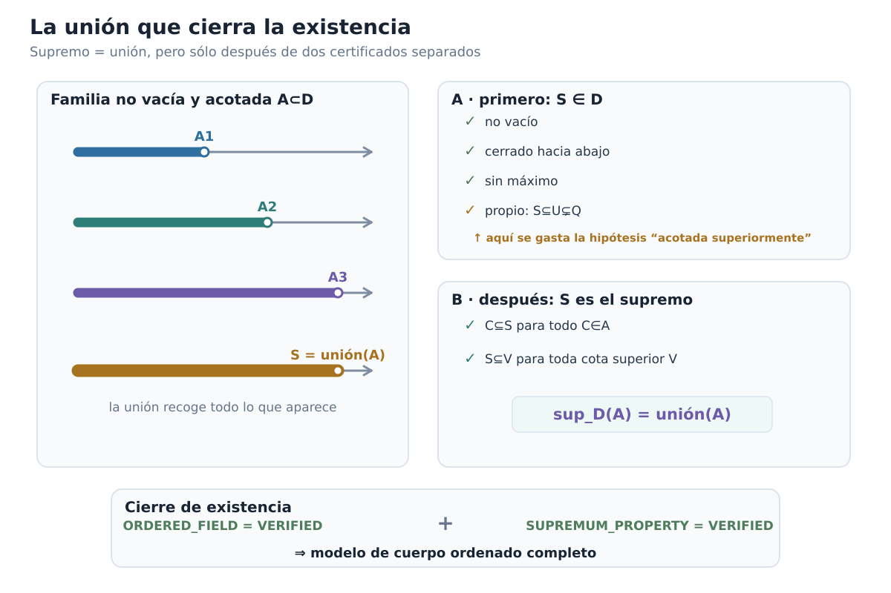{#fig-anm-c00-f07 fig-alt="Familia de cortaduras y su unión, con dos paneles de certificación: primero S pertenece a D —señalando dónde se usa la acotación— y después S es el supremo; al final se combinan cuerpo ordenado y propiedad del supremo."}

El orden de lectura de este cierre debe quedar muy claro:

$$
\boxed{
\begin{array}{c}
\mathcal D\text{ es cuerpo ordenado}\\
+\\
\text{toda familia no vacía y acotada tiene supremo}\\
\hline
\mathcal D\text{ es cuerpo ordenado completo}\\
\Downarrow\\
\text{existe un modelo de los números reales}.
\end{array}
}
$$

La unión no prueba por sí sola la existencia de los reales. La unión completa una construcción algebraica y ordenada que ya habíamos verificado.

El estado narrativo cambia aquí:

```text
EXISTENCE_QUESTION = CLOSED
```

### Pero aparece inmediatamente una nueva pregunta

Hemos construido **un** cuerpo ordenado completo.

¿Eso basta para hablar de **los** números reales?

Podría ocurrir, al menos en principio, que otra persona siguiera una construcción completamente distinta y obtuviera otro cuerpo ordenado completo, con elementos literalmente diferentes de nuestras cortaduras.

Entonces tendríamos que preguntar si ambos sistemas representan realmente la misma estructura matemática o si la especificación de §0.1 admite varias estructuras esencialmente distintas.

Éste es un problema diferente del que acabamos de resolver.

La pregunta de existencia era:

$$
\boxed{\text{¿hay al menos uno?}}
$$

La respuesta es sí.

La nueva pregunta es:

$$
\boxed{
\text{si hay dos, ¿pueden ser esencialmente diferentes?}
}
$$

Dicho de otra manera:

> **Hemos construido uno. ¿Pero hemos construido los reales, o sólo unos reales posibles?**

Para responder tendremos que abandonar por un momento la implementación concreta mediante cortaduras y estudiar cuerpos ordenados completos arbitrarios. El puente entre modelos volverá a ser el sistema racional que ambos deben contener.

### Antes de seguir

#### Microcontrol 51

[]{#MA-MIC-ANM-01-000-051}

Sea $\mathscr A\subseteq\mathcal D$ no vacía. Explica por qué la unión $\bigcup\mathscr A$ es automáticamente cerrada hacia abajo, incluso antes de usar la hipótesis de acotación superior.

[]{#MA-MSOL-ANM-01-000-051}

<details class="anm-solution">
<summary>Ver solución del microcontrol 51</summary>

**Respuesta.**

Sea

$$
S=\bigcup_{A\in\mathscr A}A.
$$

Supongamos $q\in S$ y $r<q$. Por definición de unión existe alguna cortadura $A\in\mathscr A$ tal que $q\in A$. Como toda cortadura es cerrada hacia abajo,

$$
r<q\in A
\quad\Longrightarrow\quad
r\in A.
$$

Entonces $r\in S$.

Por tanto,

$$
\boxed{q\in S,\ r<q\Longrightarrow r\in S.}
$$

La hipótesis de que $\mathscr A$ esté acotada superiormente no interviene aquí: la clausura inferior se hereda localmente de un único miembro de la familia que contiene a $q$.

**Fundamento en la sección 0.8.**

una familia **no vacía** de cortaduras y supongamos que está **acotada superiormente** en $\mathcal D$.

Esto significa que existe alguna cortadura

$$
U\in\mathcal D
$$

tal que

$$
A\subseteq U
\qquad
\text{para todo }A\in\mathscr A.
$$

Recordemos que en $\mathcal D$ el orden es la inclusión. Por tanto decir que $U$ es una cota superior no introduce una noción nueva: significa exactamente que $U$ contiene toda la información racional contenida en cada miembro de $\mathscr A$.

Si buscamos la **menor** cortadura con esa propiedad, parece natural no añadir ninguna información racional innecesaria. Debemos reunir solamente los racionales que ya aparecen en alguno de los miembros de la familia.

</details>

#### Microcontrol 52

[]{#MA-MIC-ANM-01-000-052}

¿En qué paso exacto se necesita que $\mathscr A$ esté acotada superiormente?

[]{#MA-MSOL-ANM-01-000-052}

<details class="anm-solution">
<summary>Ver solución del microcontrol 52</summary>

**Respuesta.**

La acotación superior se necesita en la verificación de que

$$
S=\bigcup\mathscr A
$$

es una cortadura **propia**, es decir, que

$$
S\ne\mathbb Q.
$$

Si $U\in\mathcal D$ es una cota superior de $\mathscr A$, entonces

$$
A\subseteq U
\qquad(A\in\mathscr A).
$$

De aquí se obtiene

$$
S\subseteq U.
$$

Como $U$ es una cortadura,

$$
U\ne\mathbb Q.
$$

Luego tampoco puede ocurrir $S=\mathbb Q$.

Así, la hipótesis de acotación se gasta exactamente para impedir que la unión de todos los miembros de $\mathscr A$ crezca hasta ocupar todo $\mathbb Q$.

**Fundamento en la sección 0.8.**

Aquí se usa exactamente la hipótesis de acotación superior.

Sea $U\in\mathcal D$ una cota superior de $\mathscr A$. Entonces

$$
A\subseteq U
\qquad
\text{para todo }A\in\mathscr A.
$$

Si $q\in S$, por definición de unión existe $A\in\mathscr A$ tal que $q\in A$. Como $A\subseteq U$,

$$
q\in U.
$$

Luego

$$
S\subseteq U.
$$

</details>

#### Microcontrol 53

[]{#MA-MIC-ANM-01-000-053}

¿Por qué una cota superior $U$ de $\mathscr A$ garantiza $\bigcup\mathscr A\subseteq U$?

[]{#MA-MSOL-ANM-01-000-053}

<details class="anm-solution">
<summary>Ver solución del microcontrol 53</summary>

**Respuesta.**

Sea $U$ una cota superior de $\mathscr A$. En el orden de $\mathcal D$, esto significa

$$
A\subseteq U
\qquad
\text{para todo }A\in\mathscr A.
$$

Tomemos $q\in\bigcup\mathscr A$. Por definición de unión existe algún $A\in\mathscr A$ con

$$
q\in A.
$$

Como $A\subseteq U$, se sigue que

$$
q\in U.
$$

El racional $q$ era arbitrario, luego

$$
\boxed{\bigcup\mathscr A\subseteq U.}
$$

La inclusión es simplemente la traducción conjuntista de que $U$ domina simultáneamente a todos los miembros de la familia.

**Fundamento en la sección 0.8.**

Esto vale para todo $A\in\mathscr A$. Así $S$ es una cota superior de la familia.

Sea ahora $V\in\mathcal D$ cualquier cota superior de $\mathscr A$.

Entonces

$$
A\subseteq V
\qquad
\text{para todo }A\in\mathscr A.
$$

Tomemos un racional cualquiera

$$
q\in S.
$$

Por definición de unión existe algún $A\in\mathscr A$ con

</details>

#### Microcontrol 54

[]{#MA-MIC-ANM-01-000-054}

Demuestra directamente que $\bigcup\mathscr A$ no tiene máximo usando sólo que cada miembro de $\mathscr A$ no tiene máximo.

[]{#MA-MSOL-ANM-01-000-054}

<details class="anm-solution">
<summary>Ver solución del microcontrol 54</summary>

**Respuesta.**

Sea

$$
q\in S=\bigcup_{A\in\mathscr A}A.
$$

Entonces existe algún $A\in\mathscr A$ tal que $q\in A$. Como $A$ es una cortadura, no tiene máximo. Por tanto existe un racional $r\in A$ con

$$
q<r.
$$

Pero $A\subseteq S$, de modo que también

$$
r\in S.
$$

Así, cada elemento $q$ de $S$ admite otro elemento de $S$ estrictamente mayor. Por consiguiente,

$$
\boxed{S\text{ no tiene máximo}.}
$$

No hace falta coordinar simultáneamente todos los miembros de la familia: basta trabajar en la cortadura concreta que testimonia la pertenencia de $q$ a la unión.

**Fundamento en la sección 0.8.**

Si $q\in S$, por definición de unión existe $A\in\mathscr A$ tal que $q\in A$. Como $A\subseteq U$,

$$
q\in U.
$$

Luego

$$
S\subseteq U.
$$

Pero $U$ es una cortadura, así que

$$
U\ne\mathbb Q.
$$

Por consiguiente $S$ tampoco puede ser todo $\mathbb Q$. En efecto, si $S=\mathbb Q$, de

</details>

#### Microcontrol 55

[]{#MA-MIC-ANM-01-000-055}

Separa con tus propias palabras las dos afirmaciones «$S$ es una cortadura» y «$S$ es el supremo». ¿Por qué ninguna de ellas contiene automáticamente a la otra?

[]{#MA-MSOL-ANM-01-000-055}

<details class="anm-solution">
<summary>Ver solución del microcontrol 55</summary>

La afirmación

$$
S\in\mathcal D
$$

es un certificado de **tipado**: dice que $S$ satisface las cuatro condiciones de una cortadura y, por tanto, es un elemento legítimo del sistema ordenado $\mathcal D$.

La afirmación

$$
S=\sup_{\mathcal D}\mathscr A
$$

es un certificado de **posición en el orden**: exige que

$$
A\subseteq S
\qquad(A\in\mathscr A)
$$

y que, para toda cota superior $V$,

$$
S\subseteq V.
$$

Probar que $S$ es una cortadura no demuestra esas dos propiedades de orden: una cortadura cualquiera puede no dominar a la familia. Y antes de poder presentar $S$ como supremo en $\mathcal D$ debemos saber que $S$ pertenece efectivamente a $\mathcal D$.

Por eso el manuscrito separa los bloques:

$$
\boxed{S\in\mathcal D}
\qquad\text{y después}\qquad
\boxed{S=\sup_{\mathcal D}\mathscr A}.
$$

</details>

#### Microcontrol 56

[]{#MA-MIC-ANM-01-000-056}

Si $V$ es otra cota superior, explica por qué cada $q\in S$ debe pertenecer a $V$.

[]{#MA-MSOL-ANM-01-000-056}

<details class="anm-solution">
<summary>Ver solución del microcontrol 56</summary>

**Respuesta.**

Sea $V\in\mathcal D$ otra cota superior de $\mathscr A$. Entonces

$$
A\subseteq V
\qquad(A\in\mathscr A).
$$

Tomemos $q\in S$. Como

$$
S=\bigcup_{A\in\mathscr A}A,
$$

existe algún $A\in\mathscr A$ con $q\in A$. Al ser $V$ cota superior,

$$
A\subseteq V,
$$

por lo que $q\in V$.

Así,

$$
\boxed{S\subseteq V.}
$$

En el orden por inclusión esto equivale a

$$
S\le_{\mathcal D}V,
$$

y prueba que $S$ es menor o igual que cualquier otra cota superior.

**Fundamento en la sección 0.8.**

Como el orden de $\mathcal D$ es la inclusión,

$$
A\le_{\mathcal D}S.
$$

Esto vale para todo $A\in\mathscr A$. Así $S$ es una cota superior de la familia.

Sea ahora $V\in\mathcal D$ cualquier cota superior de $\mathscr A$.

Entonces

$$
A\subseteq V
\qquad
\text{para todo }A\in\mathscr A.
$$

Tomemos un racional cualquiera

</details>

#### Microcontrol 57

[]{#MA-MIC-ANM-01-000-057}

¿Por qué la identidad $\sup_{\mathcal D}\mathscr A=\bigcup\mathscr A$ no presupone la existencia previa de números reales?

[]{#MA-MSOL-ANM-01-000-057}

<details class="anm-solution">
<summary>Ver solución del microcontrol 57</summary>

La identidad

$$
\sup_{\mathcal D}\mathscr A
=
\bigcup\mathscr A
$$

se demuestra enteramente dentro de la construcción por cortaduras.

- Cada $A\in\mathscr A$ es un subconjunto de $\mathbb Q$.
- $\bigcup\mathscr A$ es la unión conjuntista ordinaria de esos subconjuntos racionales.
- Después se verifica que esa unión es una cortadura.
- Finalmente se comprueba, usando inclusión de conjuntos, que es cota superior y menor que cualquier otra cota superior.

En ningún paso se parte de un número real previamente existente ni de un supremo tomado en un sistema real externo. Precisamente la demostración establece que el objeto construido por unión **satisface la definición** de supremo dentro de $\mathcal D$.

Por tanto la fórmula es una conclusión de la construcción, no una importación de la completitud que estamos intentando demostrar.

</details>

#### Microcontrol 58

[]{#MA-MIC-ANM-01-000-058}

¿Qué dos certificados distintos se combinan para concluir que $\mathcal D$ es un cuerpo ordenado completo?

[]{#MA-MSOL-ANM-01-000-058}

<details class="anm-solution">
<summary>Ver solución del microcontrol 58</summary>

**Respuesta.**

El primer certificado proviene de §0.7:

```text
ORDERED_FIELD = VERIFIED
```

Es decir,

$$
(\mathcal D,+,\cdot,\le_{\mathcal D})
$$

es un cuerpo ordenado.

El segundo certificado es el resultado central de §0.8:

```text
SUPREMUM_PROPERTY = VERIFIED
```

Toda familia no vacía de cortaduras acotada superiormente posee un supremo en $\mathcal D$, dado por su unión.

Al combinar ambos obtenemos exactamente la especificación de §0.1:

$$
\boxed{
\text{cuerpo ordenado}
+
\text{propiedad del supremo}
=
\text{cuerpo ordenado completo}.
}
$$

Por tanto

$$
\boxed{\mathcal D\text{ es un cuerpo ordenado completo}.}
$$

**Fundamento en la sección 0.8.**

Ahora podemos juntar por primera vez los dos certificados necesarios.

De §0.7:

```text
ORDERED_FIELD = VERIFIED
```

De la prueba recién terminada:

```text
SUPREMUM_PROPERTY = VERIFIED
```

Por definición de cuerpo ordenado completo, obtenemos:

> **Teorema de existencia.**
>
> La estructura de cortaduras de Dedekind
>
> $$
> (\mathcal D,+,\cdot,\le_{\mathcal D})
> $$
>
> es un cuerpo ordenado completo.

</details>

#### Microcontrol 59

[]{#MA-MIC-ANM-01-000-059}

¿Por qué sólo ahora queda autorizado llamar a $\mathcal D$ «un modelo de los números reales»?

[]{#MA-MSOL-ANM-01-000-059}

<details class="anm-solution">
<summary>Ver solución del microcontrol 59</summary>

Antes de §0.8 habíamos construido un dominio de cortaduras, un orden y finalmente una estructura de cuerpo ordenado. Pero la especificación inicial exigía además la propiedad del supremo.

Ahora sabemos simultáneamente que

$$
\mathcal D
$$

es un cuerpo ordenado y que toda familia no vacía y acotada superiormente tiene supremo en él. Por tanto $\mathcal D$ satisface **todas** las condiciones que habíamos fijado para el sistema buscado.

Eso autoriza la afirmación

$$
\boxed{\mathcal D\text{ es un modelo de los números reales}.}
$$

«Modelo» significa aquí una realización concreta de la estructura especificada. No significa que un número real deba ser, por esencia, una cortadura de Dedekind.

</details>

#### Microcontrol 60

[]{#MA-MIC-ANM-01-000-060}

Explica la diferencia entre «hemos demostrado que existe un modelo» y «hemos demostrado que el modelo es único».

[]{#MA-MSOL-ANM-01-000-060}

<details class="anm-solution">
<summary>Ver solución del microcontrol 60</summary>

Haber demostrado existencia significa haber probado

$$
\boxed{\text{existe al menos un cuerpo ordenado completo con una copia ordenada de }\mathbb Q.}
$$

La construcción de $\mathcal D$ proporciona ese ejemplo concreto.

La unicidad plantea una afirmación diferente. Si $F$ y $G$ fueran dos cuerpos ordenados completos construidos de maneras posiblemente distintas, habría que demostrar que no representan estructuras esencialmente diferentes, es decir, establecer una comparación estructural adecuada entre ambos.

Nada en la mera existencia de $\mathcal D$ demuestra por sí solo ese resultado. Por tanto, al cierre de §0.8 tenemos

$$
\boxed{\text{EXISTENCIA: resuelta}}
$$

pero la cuestión de unicidad queda como un problema nuevo que todavía debe demostrarse.

</details>

#### Microcontrol 61

[]{#MA-MIC-ANM-01-000-061}

¿Por qué la existencia de $A_2\in\mathcal D$ muestra ahora algo más fuerte que lo que sabíamos de $A_2$ al terminar §0.4?

[]{#MA-MSOL-ANM-01-000-061}

<details class="anm-solution">
<summary>Ver solución del microcontrol 61</summary>

En §0.4 habíamos construido

$$
A_2
=
\{q\in\mathbb Q:q<0\text{ o }q^2<2\}
$$

y demostrado dos cosas: que $A_2$ es una cortadura y que no coincide con ninguna cortadura racional $q^*$.

En ese punto todavía no estaba justificado llamarla número real, porque aún no habíamos probado que el sistema $\mathcal D$ tuviera toda la estructura exigida.

Ahora sí sabemos que

$$
\mathcal D
$$

es un cuerpo ordenado completo. Como

$$
A_2\in\mathcal D,
$$

$A_2$ es legítimamente un elemento de **un modelo de los números reales**. Además, como no es ningún $q^*$,

$$
A_2\notin\iota_{\mathbb Q}(\mathbb Q).
$$

Por tanto la antigua «frontera codificada» se ha convertido en un elemento no racional del modelo completo construido, sin haber supuesto previamente la existencia de irracionales.

</details>
La existencia está resuelta. El próximo problema ya no consiste en fabricar un candidato, sino en determinar cuánto depende la estructura obtenida del modo concreto en que la construimos.

### Ejercicios de la sección 0.8

#### Ejercicio 33. Demostrar que la unión vuelve a ser una cortadura

[]{#MA-EX-ANM-01-000-033}

Sea $\mathscr A\subseteq\mathcal D$ una familia no vacía y acotada superiormente. Define

$$
S=\bigcup_{A\in\mathscr A}A.
$$

Demuestra que $S\in\mathcal D$ verificando por separado las cuatro condiciones de una cortadura.

1. Para la no vaciedad, usa únicamente que $\mathscr A\ne\varnothing$ y que cada miembro de $\mathscr A$ es no vacío.
2. Para demostrar que $S\ne\mathbb Q$, toma una cota superior $U\in\mathcal D$ de $\mathscr A$ y prueba primero

$$
S\subseteq U.
$$

3. Demuestra la clausura hacia abajo de $S$ siguiendo un elemento $q\in S$ hasta alguna cortadura $A\in\mathscr A$ que lo contenga.
4. Demuestra que $S$ no tiene máximo usando la ausencia de máximo del mismo miembro $A$.
5. Cierra indicando con precisión en cuál de las cuatro verificaciones se usa la hipótesis de acotación superior y en cuál se usa que la familia sea no vacía.

No llames todavía a $S$ «supremo»: en este ejercicio sólo debes probar que el candidato pertenece al dominio $\mathcal D$.

[]{#MA-SOL-ANM-01-000-033}

<details class="anm-solution">
<summary>Ver solución del ejercicio 33</summary>

Sea

$$
S=\bigcup_{A\in\mathscr A}A.
$$

Debemos verificar las cuatro condiciones de una cortadura.

**No vaciedad.** Como $\mathscr A\ne\varnothing$, existe $A_0\in\mathscr A$. Como $A_0\in\mathcal D$, tenemos $A_0\ne\varnothing$, de modo que existe $q\in A_0$. Entonces $q\in S$. Por tanto

$$
S\ne\varnothing.
$$

Aquí se usa exactamente la no vaciedad de la familia.

**Subconjunto propio.** Como $\mathscr A$ está acotada superiormente, existe $U\in\mathcal D$ tal que

$$
A\subseteq U
\qquad
\text{para todo }A\in\mathscr A.
$$

Si $q\in S$, existe $A\in\mathscr A$ con $q\in A$. Entonces $q\in U$. Por tanto

$$
S\subseteq U.
$$

Pero $U$ es una cortadura y, en particular,

$$
U\subsetneq\mathbb Q.
$$

Luego también

$$
S\subsetneq\mathbb Q.
$$

Éste es el único punto de las cuatro verificaciones donde necesitamos la hipótesis de acotación superior.

**Clausura hacia abajo.** Sea $q\in S$ y sea $r<q$. De $q\in S$ se sigue que existe $A\in\mathscr A$ con $q\in A$. Como $A$ es cerrada hacia abajo,

$$
r\in A.
$$

Entonces $r\in S$.

**Ausencia de máximo.** Sea $q\in S$. Elegimos nuevamente $A\in\mathscr A$ con $q\in A$. Como $A$ no tiene máximo, existe $r\in A$ tal que

$$
q<r.
$$

Como $A\subseteq S$, también $r\in S$. Así ningún elemento de $S$ es máximo.

Las cuatro condiciones quedan verificadas:

$$
\boxed{
S=\bigcup_{A\in\mathscr A}A\in\mathcal D.
}
$$

La trazabilidad de hipótesis es precisa:

- $\mathscr A\ne\varnothing$ se gasta para obtener un primer elemento de $S$;
- la acotación superior se gasta para impedir $S=\mathbb Q$;
- la clausura hacia abajo y la ausencia de máximo se heredan localmente del miembro de la familia que contiene al racional considerado.

Todavía no hemos demostrado que $S$ sea supremo: sólo que el candidato vive dentro del dominio ordenado correcto.

*Referencia visual.* Véase la figura [C00-F07](analisis-para-matematicos-capitulo-0-construir-los-numeros-reales.html#fig-anm-c00-f07) del texto principal, **La unión que cierra la existencia**, como síntesis posterior de este argumento.

</details>

#### Ejercicio 34. Separar «ser cortadura» de «ser supremo»

[]{#MA-EX-ANM-01-000-034}

Mantén las hipótesis del ejercicio 33 y supón ya demostrado que

$$
S=\bigcup_{A\in\mathscr A}A\in\mathcal D.
$$

Traza ahora, como una segunda prueba independiente, que

$$
S=\sup_{\mathcal D}\mathscr A.
$$

Tu argumento debe distinguir explícitamente las dos obligaciones de un supremo.

1. Demuestra que $S$ es cota superior de $\mathscr A$.
2. Sea $V\in\mathcal D$ una cota superior arbitraria de $\mathscr A$. Demuestra que $S\subseteq V$.
3. Traduce ambas inclusiones al orden $\le_{\mathcal D}$.
4. Explica por qué la prueba de que $S$ es la menor cota superior no reemplaza la prueba previa de que $S\in\mathcal D$.
5. Haz un inventario de hipótesis: señala cuáles se gastaron para garantizar que $S$ fuera un elemento de $\mathcal D$ y cuáles se usan directamente en la caracterización de menor cota superior.

El cierre debe ser la identidad

$$
\boxed{
\sup_{\mathcal D}\mathscr A
=
\bigcup_{A\in\mathscr A}A.
}
$$

[]{#MA-SOL-ANM-01-000-034}

<details class="anm-solution">
<summary>Ver solución del ejercicio 34</summary>

Partimos ahora del resultado ya establecido

$$
S=\bigcup_{A\in\mathscr A}A\in\mathcal D.
$$

Esto permite formular la pregunta de orden: ¿es $S$ la menor cota superior?

**Primera obligación: $S$ es cota superior.** Sea $A\in\mathscr A$. Por definición de unión,

$$
A\subseteq S.
$$

Como el orden de $\mathcal D$ es la inclusión,

$$
A\le_{\mathcal D}S.
$$

Esto vale para todo $A\in\mathscr A$. Por tanto $S$ es una cota superior de la familia.

**Segunda obligación: $S$ es menor que cualquier otra cota superior.** Sea $V\in\mathcal D$ una cota superior de $\mathscr A$. Entonces

$$
A\subseteq V
\qquad
\text{para todo }A\in\mathscr A.
$$

Tomemos $q\in S$. Por definición de unión existe $A\in\mathscr A$ tal que $q\in A$. Como $A\subseteq V$,

$$
q\in V.
$$

Por tanto

$$
S\subseteq V,
$$

es decir,

$$
S\le_{\mathcal D}V.
$$

Las dos obligaciones prueban

$$
\boxed{
S=\sup_{\mathcal D}\mathscr A.
}
$$

Sustituyendo la definición de $S$,

$$
\boxed{
\sup_{\mathcal D}\mathscr A
=
\bigcup_{A\in\mathscr A}A.
}
$$

Las dos pruebas no son intercambiables. Para que $S$ pueda ser un supremo **en $\mathcal D$**, primero debe estar demostrado que $S\in\mathcal D$. El argumento de menor cota superior compara conjuntos por inclusión, pero por sí solo no certifica que la unión sea una cortadura.

El inventario de hipótesis queda así:

- la no vaciedad y la acotación superior de $\mathscr A$ son necesarias en el ejercicio 33 para garantizar $S\in\mathcal D$;
- una vez que $S\in\mathcal D$, la condición $A\subseteq S$ proviene puramente de la definición de unión;
- para demostrar minimalidad se toma una cota superior arbitraria $V$ y se usa exactamente la condición $A\subseteq V$ para todo $A\in\mathscr A$.

La arquitectura lógica es, por tanto,

$$
\boxed{
S\in\mathcal D
\quad\Longrightarrow\quad
\text{podemos preguntar si }S=\sup_{\mathcal D}\mathscr A,
}
$$

no al revés.

*Referencia visual.* Véase la figura [C00-F07](analisis-para-matematicos-capitulo-0-construir-los-numeros-reales.html#fig-anm-c00-f07) del texto principal, **La unión que cierra la existencia**, como síntesis posterior de este argumento.

</details>

#### Ejercicio 35. Localizar exactamente por qué hace falta una cota superior

[]{#MA-EX-ANM-01-000-035}

Para cada $n\in\mathbb N$, considera la cortadura racional

$$
n^*=\{q\in\mathbb Q:q<n\},
$$

y la familia

$$
\mathscr N=\{n^*:n\in\mathbb N\}\subseteq\mathcal D.
$$

1. Demuestra que $\mathscr N$ es no vacía.
2. Usa la propiedad arquimediana de $\mathbb Q$ para demostrar

$$
\bigcup_{n\in\mathbb N}n^*=\mathbb Q.
$$

3. Concluye que esa unión no es una cortadura.
4. Demuestra que $\mathscr N$ no puede estar acotada superiormente en $\mathcal D$.
5. Vuelve a la demostración del ejercicio 33 y localiza el paso exacto que se rompe para $\mathscr N$.

Concluye por qué la afirmación

> «la unión de cualquier familia no vacía de cortaduras es otra cortadura»

es falsa, aunque la unión siga siendo no vacía, cerrada hacia abajo y sin máximo en este ejemplo.

[]{#MA-SOL-ANM-01-000-035}

<details class="anm-solution">
<summary>Ver solución del ejercicio 35</summary>

La familia

$$
\mathscr N=\{n^*:n\in\mathbb N\}
$$

es no vacía porque, por ejemplo, $0^*\in\mathscr N$.

Probemos ahora que su unión es todo $\mathbb Q$. Sea $q\in\mathbb Q$. Por la propiedad arquimediana de $\mathbb Q$, existe $n\in\mathbb N$ tal que

$$
q<n.
$$

Entonces, por definición de cortadura racional,

$$
q\in n^*.
$$

Como $n^*$ es uno de los miembros de $\mathscr N$,

$$
q\in\bigcup_{n\in\mathbb N}n^*.
$$

Así

$$
\mathbb Q
\subseteq
\bigcup_{n\in\mathbb N}n^*.
$$

La inclusión inversa es automática porque cada $n^*$ es un subconjunto de $\mathbb Q$. Por tanto

$$
\boxed{
\bigcup_{n\in\mathbb N}n^*=\mathbb Q.
}
$$

Pero $\mathbb Q$ no es una cortadura: falla la condición de ser un subconjunto propio de sí mismo. En consecuencia, la unión de una familia no vacía de cortaduras no tiene por qué pertenecer a $\mathcal D$.

Esto también demuestra que $\mathscr N$ no está acotada superiormente en $\mathcal D$. Si existiera $U\in\mathcal D$ con

$$
n^*\subseteq U
\qquad
\text{para todo }n\in\mathbb N,
$$

entonces, tomando uniones,

$$
\mathbb Q
=
\bigcup_{n\in\mathbb N}n^*
\subseteq U.
$$

Como siempre $U\subseteq\mathbb Q$, seguiría $U=\mathbb Q$, contradicción con $U\in\mathcal D$.

La falla se localiza exactamente en el segundo bloque de la prueba del ejercicio 33. Allí elegíamos una cota superior $U$ y obteníamos

$$
S\subseteq U\subsetneq\mathbb Q.
$$

Para $\mathscr N$ no existe tal $U$. Sin ese cerco, la unión crece hasta llenar todos los racionales.

Es instructivo observar que las otras propiedades no son el problema: $\mathbb Q$ es no vacío, está cerrado hacia abajo respecto de su propio orden y no tiene máximo. Falla exactamente la propiedad de ser un subconjunto propio de $\mathbb Q$.

Por tanto,

$$
\boxed{
\text{UNIÓN DE CORTADURAS}
\not\Longrightarrow
\text{CORTADURA}
}
$$

sin la hipótesis de acotación superior.

*Referencia visual.* Véase la figura [C00-F07](analisis-para-matematicos-capitulo-0-construir-los-numeros-reales.html#fig-anm-c00-f07) del texto principal, **La unión que cierra la existencia**, como síntesis posterior de este argumento.

</details>

#### Ejercicio 36. Cerrar la pregunta de existencia sin confundir modelo con esencia

[]{#MA-EX-ANM-01-000-036}

Reúne los dos certificados obtenidos hasta ahora:

$$
\text{ORDERED FIELD = VERIFIED}
$$

en §§0.6–0.7, y la propiedad del supremo demostrada en los ejercicios 33–34.

1. Demuestra que

$$
(\mathcal D,+,\cdot,\le_{\mathcal D})
$$

es un cuerpo ordenado completo.
2. Explica por qué esto constituye una prueba de existencia de al menos un sistema de números reales en el sentido fijado en §0.1.
3. Incorpora la incrustación

$$
\iota_{\mathbb Q}:\mathbb Q\hookrightarrow\mathcal D,
\qquad q\mapsto q^*,
$$

y precisa qué estructura conserva.
4. Explica en qué sentido está autorizado decir que $\mathcal D$ es **un modelo de los números reales** y por qué de ello no se sigue que «un número real sea por esencia una cortadura».
5. Retoma

$$
A_2=\{q\in\mathbb Q:q<0\text{ o }q^2<2\}.
$$

Explica qué afirmación nueva queda autorizada acerca de $A_2$ después del cierre de completitud y qué afirmación sobre unicidad de modelos sigue todavía sin demostrarse.

> **Pista conceptual.** La prueba de existencia no requiere identificar una ontología única: basta exhibir una estructura concreta que satisfaga toda la especificación.

[]{#MA-SOL-ANM-01-000-036}

<details class="anm-solution">
<summary>Ver solución del ejercicio 36</summary>

El cierre exige combinar dos certificados lógicamente distintos.

De §§0.6–0.7 sabemos que

$$
\boxed{
(\mathcal D,+,\cdot,\le_{\mathcal D})
\text{ es un cuerpo ordenado}.
}
$$

De los ejercicios 33–34 sabemos que toda familia $\mathscr A\subseteq\mathcal D$ no vacía y acotada superiormente tiene un supremo en $\mathcal D$, concretamente

$$
\boxed{
\sup_{\mathcal D}\mathscr A
=
\bigcup_{A\in\mathscr A}A.
}
$$

Por definición, un cuerpo ordenado que satisface la propiedad del supremo es un cuerpo ordenado completo. Luego

$$
\boxed{
(\mathcal D,+,\cdot,\le_{\mathcal D})
\text{ es un cuerpo ordenado completo}.
}
$$

Esto resuelve la pregunta de existencia de §0.1. No hemos supuesto de antemano un sistema de reales: construimos $\mathcal D$ como una colección concreta de subconjuntos de $\mathbb Q$, definimos en ella las operaciones y el orden y verificamos toda la especificación. Así existe al menos un testigo de la afirmación

$$
\exists F\;
\bigl(F\text{ es un cuerpo ordenado completo}\bigr).
$$

Además, la aplicación

$$
\iota_{\mathbb Q}:\mathbb Q\longrightarrow\mathcal D,
\qquad
q\longmapsto q^*,
$$

ya fue certificada como incrustación de cuerpos ordenados. Es inyectiva, preserva y refleja el orden, y conserva suma, producto, $0$ y $1$. Por tanto $\mathcal D$ no sólo satisface la especificación abstracta: contiene una copia estructural fiel de $\mathbb Q$.

Éste es el sentido preciso de afirmar

$$
\boxed{\mathcal D\text{ es un modelo de los números reales}.}
$$

La palabra «modelo» expresa que la estructura concreta realiza todos los axiomas y propiedades exigidos. No afirma que todo número real deba ser ontológicamente, en cualquier presentación posible, un conjunto de racionales. Las cortaduras proporcionan una **realización concreta** de la estructura.

Consideremos ahora

$$
A_2=\{q\in\mathbb Q:q<0\text{ o }q^2<2\}.
$$

En §0.4 sólo podíamos afirmar que $A_2$ era una cortadura no racional. Ahora sabemos además que

$$
A_2\in\mathcal D
$$

y que $\mathcal D$ es un modelo de los reales. Por tanto $A_2$ es legítimamente un elemento de un sistema de números reales, y sigue fuera de la copia racional $\iota_{\mathbb Q}(\mathbb Q)$.

Lo que **no** se ha demostrado todavía es que cualquier otro cuerpo ordenado completo sea estructuralmente el mismo que $\mathcal D$. La existencia responde

$$
\text{«¿hay al menos un modelo?»}
$$

pero no responde aún

$$
\text{«¿son todos los modelos esencialmente el mismo?»}
$$

Esa segunda pregunta queda abierta para las secciones siguientes.

*Referencias visuales.* Véanse las figuras [C00-F01](analisis-para-matematicos-capitulo-0-construir-los-numeros-reales.html#fig-anm-c00-f01) (**Existencia antes que unicidad**) y [C00-F07](analisis-para-matematicos-capitulo-0-construir-los-numeros-reales.html#fig-anm-c00-f07) (**La unión que cierra la existencia**) del texto principal para sintetizar, respectivamente, las capas de este cierre.

</details>

#### Ejercicio 37. Auditar un cierre de existencia que mezcla cuatro niveles

[]{#MA-EX-ANM-01-000-037}

Un informe propone:

> «En §0.7 demostramos que $\mathcal D$ es un cuerpo ordenado; por tanto ya es completo. Además, la unión de cualquier familia de cortaduras es una cortadura, así que toda familia tiene supremo. En consecuencia $\mathcal D$ es literalmente $\mathbb R$. Como ya encontramos un modelo, cualquier otro cuerpo ordenado completo debe ser igual a $\mathcal D$.»

Audita el informe sin usar resultados de §§0.9–0.10.

1. Localiza la primera inferencia inválida y refútala usando un resultado ya disponible del capítulo.
2. Refuta la segunda inferencia mediante la familia $\mathscr N=\{n^*:n\in\mathbb N\}$ del ejercicio 35.
3. Formula correctamente el teorema de unión, incluyendo todas sus hipótesis.
4. Explica la diferencia entre las afirmaciones

$$
\mathcal D\text{ es un modelo de los números reales}
$$

y

$$
\mathcal D\text{ es literalmente el único conjunto posible de números reales}.
$$

5. Repara el informe hasta obtener exactamente la conclusión disponible al terminar §0.8: existencia de un cuerpo ordenado completo con una copia ordenada de $\mathbb Q$, sin afirmar todavía unicidad estructural.

> **Pista conceptual.** Distingue cuatro puertas: cuerpo ordenado, propiedad del supremo, existencia de un modelo y unicidad del modelo. Ninguna debe sustituirse por la siguiente sin prueba.

[]{#MA-SOL-ANM-01-000-037}

<details class="anm-solution">
<summary>Ver solución del ejercicio 37</summary>

El informe contiene varias inferencias inválidas y conviene detenerse en la primera.

La primera es

> «$\mathcal D$ es un cuerpo ordenado; por tanto ya es completo».

Ser cuerpo ordenado no implica completitud. Ya tenemos dentro del propio capítulo un contraejemplo: $\mathbb Q$ es un cuerpo ordenado y, sin embargo, el conjunto

$$
S_2=\{q\in\mathbb Q:q\ge0,\ q^2<2\}
$$

es no vacío, está acotado superiormente y no posee supremo racional. Por tanto

$$
\boxed{
\text{CUERPO ORDENADO}
\not\Longrightarrow
\text{COMPLETO}.
}
$$

La segunda afirmación defectuosa es

> «la unión de cualquier familia de cortaduras es una cortadura».

El ejercicio 35 da un contraejemplo explícito:

$$
\mathscr N=\{n^*:n\in\mathbb N\},
$$

para el cual

$$
\bigcup\mathscr N=\mathbb Q.
$$

Como $\mathbb Q\notin\mathcal D$, la unión no es una cortadura.

El teorema correcto exige ambas hipótesis:

$$
\boxed{
\mathscr A\subseteq\mathcal D,
\quad
\mathscr A\ne\varnothing,
\quad
\mathscr A\text{ acotada superiormente}
}
$$

implican

$$
\boxed{
\bigcup\mathscr A\in\mathcal D
\quad\text{y}\quad
\sup_{\mathcal D}\mathscr A=\bigcup\mathscr A.
}
$$

Con ese teorema sí queda demostrada la propiedad del supremo de $\mathcal D$. Combinada con el resultado de §0.7, podemos concluir correctamente que $\mathcal D$ es un cuerpo ordenado completo.

El siguiente salto del informe confunde **modelo** con **igualdad literal**. Decir

$$
\mathcal D\text{ es un modelo de los números reales}
$$

significa que la estructura construida satisface la especificación de cuerpo ordenado completo y contiene la copia racional pertinente. No significa que hayamos establecido que cualquier presentación legítima de los reales tenga exactamente los mismos elementos conjuntistas que $\mathcal D$.

La última frase añade todavía una afirmación de unicidad que §0.8 no ha demostrado. De la existencia de un modelo no se deduce que cualquier otro modelo sea literalmente igual, ni siquiera hemos demostrado todavía en esta sección qué relación estructural precisa debe unirlos.

La reparación completa del informe es:

$$
\boxed{
\begin{array}{c}
\mathcal D\text{ es un cuerpo ordenado}\\
+\\
\text{toda familia no vacía y acotada superiormente en }\mathcal D\\
\text{tiene supremo, dado por su unión}\\
\hline
\mathcal D\text{ es un cuerpo ordenado completo}.
\end{array}
}
$$

Además,

$$
\iota_{\mathbb Q}:\mathbb Q\hookrightarrow\mathcal D
$$

es una incrustación de cuerpos ordenados. Por tanto existe al menos un cuerpo ordenado completo que contiene una copia ordenada de $\mathbb Q$; en ese sentido,

$$
\boxed{\mathcal D\text{ es un modelo de los números reales}.}
$$

La pregunta de existencia queda cerrada. La pregunta de unicidad estructural queda abierta y no debe anticiparse con resultados de §§0.9–0.10.

</details>
## 0.9. ¿Podría haber otros reales?

[]{#MA-SEC-ANM-01-000-009}

La pregunta de existencia ya está cerrada.

Construimos un cuerpo ordenado completo concreto, $\mathcal D$, formado por cortaduras de Dedekind. Por tanto sabemos que la especificación de §0.1 es realizable.

Pero una construcción concreta nunca responde por sí sola a una pregunta de **unicidad estructural**.

Podríamos haber elegido otra representación de las posiciones faltantes. Podríamos haber construido objetos cuyos elementos no fueran subconjuntos de $\mathbb Q$. Incluso podríamos encontrar un cuerpo ordenado completo cuyo conjunto subyacente no se pareciera en absoluto a $\mathcal D$.

La pregunta que queda es entonces:

$$
\boxed{
\text{¿todos los cuerpos ordenados completos}
\\
\text{representan esencialmente la misma estructura?}
}
$$

No intentaremos responderla comparando directamente dos codificaciones. Eso volvería a privilegiar las cortaduras.

Abandonaremos ahora la implementación concreta.

Sea

$$
F=(F,+,\cdot,0_F,1_F,\le_F)
$$

un **cuerpo ordenado completo arbitrario**.

No suponemos que sus elementos sean cortaduras. No suponemos que $F=\mathcal D$. No suponemos siquiera que sepamos cómo fueron construidos sus elementos.

Usaremos únicamente:

1. las leyes de cuerpo;
2. el orden compatible;
3. la propiedad del supremo.

La estrategia será descubrir cuánto de la estructura de $F$ queda forzado por esas tres propiedades.

El hilo conductor será el mismo sistema que nos acompañó durante toda la construcción:

$$
\boxed{\mathbb Q.}
$$

Si cualquier cuerpo ordenado completo contiene una copia canónica y densa de los racionales, entonces los racionales pueden funcionar como un **lenguaje común** para describir posiciones en modelos distintos.

Ésa será la idea central de esta sección.

### Primer paso: un cuerpo ordenado no puede tener característica positiva

La unidad de un cuerpo ordenado satisface

$$
0_F<1_F.
$$

Por invariancia del orden bajo traslación,

$$
0_F<1_F<1_F+1_F<1_F+1_F+1_F<\cdots.
$$

Formalmente, definamos los numerales de $F$ mediante

$$
\nu_F(0)=0_F,
\qquad
\nu_F(n+1)=\nu_F(n)+1_F.
$$

Por inducción,

$$
m<n
\quad\Longrightarrow\quad
\nu_F(m)<\nu_F(n).
$$

En particular,

$$
n>0
\quad\Longrightarrow\quad
\nu_F(n)>0_F,
$$

de modo que

$$
\nu_F(n)\ne0_F.
$$

Por tanto no existe entero positivo $n$ tal que

$$
\underbrace{1_F+\cdots+1_F}_{n\text{ veces}}=0_F.
$$

Esto demuestra:

$$
\boxed{\operatorname{char}F=0.}
$$

La conclusión es más importante de lo que parece. Significa que los numerales naturales no colapsan dentro de $F$ y que podemos prolongar esa copia a los enteros y luego a los racionales.

### La copia canónica de $\mathbb Z$

Los enteros no se introducen en $F$ mediante una identificación literal. Construimos una aplicación.

Si un entero está representado por la diferencia formal $m-n$, definimos

$$
\jmath_{\mathbb Z}^F(m-n)
=
\nu_F(m)-\nu_F(n).
$$

La definición es independiente de la representación.

En efecto, si

$$
m-n=p-q
$$

como enteros, entonces

$$
m+q=n+p.
$$

Aplicando la compatibilidad aditiva de $\nu_F$,

$$
\nu_F(m)+\nu_F(q)
=
\nu_F(n)+\nu_F(p),
$$

y tras trasladar términos obtenemos

$$
\nu_F(m)-\nu_F(n)
=
\nu_F(p)-\nu_F(q).
$$

Así queda bien definida una aplicación

$$
\jmath_{\mathbb Z}^F:\mathbb Z\longrightarrow F.
$$

Además preserva suma, producto, cero, uno y opuesto. La preservación y reflexión del orden se deducen del hecho de que los numerales preservan estrictamente el orden y de la aritmética ordenada de $F$.

En particular,

$$
\jmath_{\mathbb Z}^F
$$

es inyectiva.

Éste es otro modo de leer la característica cero: dentro de cualquier cuerpo ordenado aparece canónicamente una copia ordenada de $\mathbb Z$.

### La copia canónica de $\mathbb Q$

Ahora podemos incorporar divisiones.

Sea

$$
q=\frac ab\in\mathbb Q,
\qquad
a,b\in\mathbb Z,
\qquad
b\ne0.
$$

Definimos

$$
\boxed{
\iota_F(q)
=
\jmath_{\mathbb Z}^F(a)
\bigl(\jmath_{\mathbb Z}^F(b)\bigr)^{-1}.
}
$$

El inverso existe porque $b\ne0$ y $\jmath_{\mathbb Z}^F$ es inyectiva.

Debemos verificar que el valor no depende de la fracción elegida.

Si

$$
\frac ab=\frac cd,
$$

entonces

$$
ad=bc
$$

en $\mathbb Z$. Aplicando la multiplicatividad de $\jmath_{\mathbb Z}^F$,

$$
\jmath_{\mathbb Z}^F(a)\jmath_{\mathbb Z}^F(d)
=
\jmath_{\mathbb Z}^F(b)\jmath_{\mathbb Z}^F(c).
$$

Como los denominadores tienen imágenes no nulas, podemos multiplicar por sus inversos y obtenemos

$$
\jmath_{\mathbb Z}^F(a)
\bigl(\jmath_{\mathbb Z}^F(b)\bigr)^{-1}
=
\jmath_{\mathbb Z}^F(c)
\bigl(\jmath_{\mathbb Z}^F(d)\bigr)^{-1}.
$$

Por tanto $\iota_F$ está bien definida.

Las mismas fórmulas racionales muestran que

$$
\iota_F(p+q)=\iota_F(p)+\iota_F(q),
$$

$$
\iota_F(pq)=\iota_F(p)\iota_F(q),
$$

$$
\iota_F(0)=0_F,
\qquad
\iota_F(1)=1_F.
$$

Y el orden también se conserva y refleja:

$$
\boxed{
p<q
\quad\Longleftrightarrow\quad
\iota_F(p)<\iota_F(q).
}
$$

En consecuencia,

$$
\boxed{
\iota_F:\mathbb Q\hookrightarrow F
}
$$

es una incrustación de cuerpos ordenados.

No hemos usado completitud para construir esta copia. Todo cuerpo ordenado contiene ya una copia canónica de $\mathbb Q$.

Más aún, esa copia no depende de una elección arbitraria. Una incrustación de cuerpos ordenados $\mathbb Q\to F$ debe enviar $1$ a $1_F$, por lo que fija los numerales, después los enteros y finalmente las fracciones. Así, si existe una incrustación racional, es ésta.

Por eso podemos hablar con propiedad de **la** copia canónica de $\mathbb Q$ en $F$.

A partir de ahora mantendremos visible la aplicación $\iota_F$ cuando sea importante distinguir universos.

### Dónde empieza a trabajar la completitud

Hasta aquí sólo hemos usado que $F$ es un cuerpo ordenado.

Ahora gastaremos por primera vez la hipótesis adicional:

$$
\boxed{F\text{ es completo}.}
$$

La consecuencia inmediata será la propiedad arquimediana.

> **Teorema.** Todo cuerpo ordenado completo es arquimediano.

**Demostración.** Supongamos, por contradicción, que los numerales de $F$ estuvieran acotados superiormente. Es decir, que el conjunto

$$
N_F=\{\nu_F(n):n\in\mathbb N\}
$$

tuviera alguna cota superior.

Como $N_F$ es no vacío y $F$ es completo, existiría

$$
s=\sup N_F.
$$

Puesto que

$$
s-1_F<s,
$$

el elemento $s-1_F$ no puede ser también cota superior de $N_F$: de serlo, sería una cota superior estrictamente menor que el supremo.

Por tanto existe algún $n\in\mathbb N$ tal que

$$
s-1_F<\nu_F(n).
$$

Sumando $1_F$,

$$
s<\nu_F(n)+1_F
=
\nu_F(n+1).
$$

Pero $\nu_F(n+1)\in N_F$, contradiciendo que $s$ sea cota superior.

Luego los numerales no están acotados superiormente. Equivalentemente, para todo $x\in F$ existe $n\in\mathbb N$ tal que

$$
x<\nu_F(n).
$$

Por tanto

$$
\boxed{F\text{ es arquimediano}.}
$$

$\square$

Aquí la completitud tuvo un gasto preciso: produjo el supremo de la supuesta colección acotada de numerales. Sin ese supremo, la contradicción no podría formularse de esta manera.

### No saltaremos directamente a «los racionales son densos»

La arquimedianidad nos dice que los enteros alcanzan cualquier escala. Todavía necesitamos convertir esa propiedad global en una herramienta de **localización**.

Primero localizaremos cualquier elemento entre dos enteros consecutivos.

> **Lema de localización entera.** Para todo $x\in F$ existe $m\in\mathbb Z$ tal que
>
> $$
> \boxed{
> \iota_F(m-1)\le x<\iota_F(m).
> }
> $$

Aquí usamos $\iota_F(m)$, para $m\in\mathbb Z$, como abreviatura de

$$
\iota_F\bigl(\iota_{\mathbb Z\mathbb Q}(m)\bigr),
$$

es decir, de la composición

$$
\mathbb Z
\overset{\iota_{\mathbb Z\mathbb Q}}{\hookrightarrow}
\mathbb Q
\overset{\iota_F}{\hookrightarrow}
F.
$$

No se trata de una restricción literal salvo después de la identificación notacional explicada en §0.2.

**Demostración.** Por arquimedianidad podemos elegir $n\in\mathbb N$ tal que

$$
|x|<\nu_F(n).
$$

Si fuese necesario aumentar $n$, podemos suponer $n>0$.

Entonces

$$
-\nu_F(n)<x<\nu_F(n).
$$

Consideremos el conjunto de naturales

$$
K=
\left\{
k\in\mathbb N:
x<-\nu_F(n)+\nu_F(k)
\right\}.
$$

Este conjunto no es vacío. Por ejemplo, si tomamos $k=2n+1$, entonces

$$
-\nu_F(n)+\nu_F(2n+1)
=
\nu_F(n+1)
>
x.
$$

Por el buen orden de $\mathbb N$, $K$ tiene un elemento mínimo; llamémoslo $k_0$.

No puede ser $k_0=0$, porque

$$
-\nu_F(n)<x.
$$

Por tanto

$$
k_0=k+1
$$

para algún $k\in\mathbb N$.

La minimalidad de $k_0$ implica que $k\notin K$, es decir, no ocurre

$$
x<-\nu_F(n)+\nu_F(k).
$$

Por totalidad del orden,

$$
-\nu_F(n)+\nu_F(k)\le x.
$$

En cambio, como $k_0\in K$,

$$
x<
-\nu_F(n)+\nu_F(k+1).
$$

Definamos el entero

$$
m=-n+(k+1).
$$

Entonces su predecesor es

$$
m-1=-n+k,
$$

y las dos desigualdades anteriores se escriben exactamente como

$$
\iota_F(m-1)\le x<\iota_F(m).
$$

$\square$

Éste es el eslabón que no debe quedar oculto detrás de la palabra «arquimediano».

La propiedad arquimediana dice que la rejilla entera llega suficientemente lejos; el lema anterior dice algo más operativo: **todo elemento queda atrapado en una celda de anchura uno de esa rejilla**.

### De la rejilla entera a la rejilla racional

Ahora podemos refinar la escala.

Sean

$$
x<y
$$

en $F$.

Queremos encontrar un racional $q$ cuya imagen quede estrictamente entre ambos.

La diferencia

$$
y-x
$$

es positiva. Por tanto $(y-x)^{-1}>0$. La arquimedianidad proporciona $n\in\mathbb N$ tal que

$$
(y-x)^{-1}<\nu_F(n).
$$

Esta desigualdad obliga a $n>0$. Como ambos miembros son positivos, al invertir se revierte el orden:

$$
0<\nu_F(n)^{-1}<y-x.
$$

La compatibilidad de la copia racional con los inversos identifica

$$
\nu_F(n)^{-1}
=
\iota_F\!\left(\frac1n\right).
$$

Así,

$$
0<\iota_F\!\left(\frac1n\right)<y-x.
$$

Multipliquemos $x$ por el entero positivo $\iota_F(n)$. El lema de localización entera proporciona un entero $m$ tal que

$$
\iota_F(m-1)
\le
x\,\iota_F(n)
<
\iota_F(m).
$$

Como $\iota_F(n)>0$, dividimos por ella y obtenemos

$$
\iota_F\!\left(\frac{m-1}{n}\right)
\le
x
<
\iota_F\!\left(\frac mn\right).
$$

La primera desigualdad también implica

$$
\iota_F(m)
\le
x\,\iota_F(n)+1_F,
$$

y, dividiendo otra vez por $\iota_F(n)$,

$$
\iota_F\!\left(\frac mn\right)
\le
x+\iota_F\!\left(\frac1n\right)
<
x+(y-x)
=
y.
$$

Por tanto, para

$$
q=\frac mn\in\mathbb Q,
$$

tenemos

$$
\boxed{
x<\iota_F(q)<y.
}
$$

Hemos demostrado:

> **Teorema de densidad racional.** Para cualesquiera $x,y\in F$ con $x<y$, existe $q\in\mathbb Q$ tal que
>
> $$
> \boxed{x<\iota_F(q)<y.}
> $$

La cadena lógica queda ahora visible:

$$
\boxed{
\text{completitud}
\Rightarrow
\text{arquimedianidad}
\Rightarrow
\text{localización entera}
\Rightarrow
\text{localización racional}
\Rightarrow
\text{densidad de }\iota_F(\mathbb Q).
}
$$

No hemos usado ninguna imagen intuitiva de «racionales muy juntos». La densidad se dedujo de propiedades estructurales precisas.

La figura [C00-F08](#fig-anm-c00-f08) concentra esta lectura en un único mapa visual.

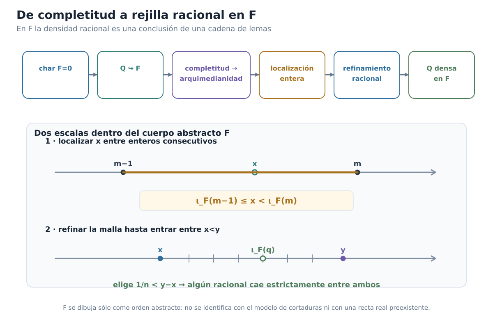{#fig-anm-c00-f08 fig-alt="Cadena de seis nodos desde char F=0 hasta Q densa en F y dos escalas del cuerpo abstracto: primero localizar x entre enteros consecutivos y luego refinar con una malla racional entre x e y."}

### La información racional situada debajo de un elemento

Ya estamos preparados para el objeto que permitirá comparar modelos.

Sea

$$
x\in F.
$$

Definimos su **traza racional inferior**:

$$
\boxed{
A_x
=
\{q\in\mathbb Q:\iota_F(q)<x\}.
}
$$

Es importante mantener los tipos separados:

$$
x\in F,
\qquad
q\in\mathbb Q,
\qquad
A_x\subseteq\mathbb Q.
$$

La traza no vive en $F$. Es un subconjunto de los racionales que registra cuáles elementos de la rejilla racional canónica quedan por debajo de $x$.

Si esta información es suficientemente rica para reconstruir $x$, entonces tendremos un lenguaje común independiente de la implementación concreta de $F$.

Pero antes debemos demostrar que $A_x$ tiene exactamente la forma de una cortadura.

### La traza racional es una cortadura de Dedekind

> **Proposición.** Para todo $x\in F$, el conjunto
>
> $$
> A_x=\{q\in\mathbb Q:\iota_F(q)<x\}
> $$
>
> es una cortadura de Dedekind de $\mathbb Q$.

**Demostración.**

#### 1. $A_x$ es no vacío

Como

$$
x-1_F<x,
$$

la densidad racional proporciona $q_-\in\mathbb Q$ tal que

$$
x-1_F
<
\iota_F(q_-)
<
x.
$$

Por definición,

$$
q_-\in A_x.
$$

Así $A_x\ne\varnothing$.

#### 2. $A_x$ es propio

Como

$$
x<x+1_F,
$$

la densidad racional proporciona $q_+\in\mathbb Q$ tal que

$$
x
<
\iota_F(q_+)
<
x+1_F.
$$

Entonces no puede cumplirse $\iota_F(q_+)<x$. Por tanto

$$
q_+\notin A_x,
$$

y así

$$
A_x\ne\mathbb Q.
$$

#### 3. $A_x$ es cerrado hacia abajo

Sea $q\in A_x$ y sea $p<q$ racional.

Como $\iota_F$ preserva estrictamente el orden,

$$
\iota_F(p)<\iota_F(q).
$$

Y como $q\in A_x$,

$$
\iota_F(q)<x.
$$

Por transitividad,

$$
\iota_F(p)<x.
$$

Luego

$$
p\in A_x.
$$

#### 4. $A_x$ no tiene máximo

Sea $q\in A_x$. Entonces

$$
\iota_F(q)<x.
$$

Por densidad racional existe $r\in\mathbb Q$ tal que

$$
\iota_F(q)
<
\iota_F(r)
<
x.
$$

Como $\iota_F$ refleja el orden,

$$
q<r.
$$

Y como $\iota_F(r)<x$,

$$
r\in A_x.
$$

Por tanto ningún elemento de $A_x$ es máximo.

Hemos verificado las cuatro condiciones. Así

$$
\boxed{
A_x\in\mathcal D.
}
$$

$\square$

La construcción por cortaduras reaparece aquí de una manera nueva. Ya no estamos usando $\mathcal D$ para **fabricar** los reales. Estamos usando la noción de cortadura como un **código racional de posición** que puede asociarse a un elemento de cualquier cuerpo ordenado completo.

### ¿La traza recuerda realmente al elemento?

Ahora llega el punto decisivo.

La traza $A_x$ registra todos los racionales cuyas imágenes están por debajo de $x$. ¿Podrían dos posiciones diferentes compartir exactamente la misma información racional?

Antes de comparar dos modelos, demostraremos algo más básico: dentro de un mismo modelo, la traza permite reconstruir al elemento.

Consideremos el subconjunto de $F$

$$
\iota_F(A_x)
=
\{\iota_F(q):q\in A_x\}.
$$

Es no vacío porque $A_x$ lo es.

Además está acotado superiormente por $x$, ya que para todo $q\in A_x$,

$$
\iota_F(q)<x.
$$

Aquí gastamos nuevamente la completitud de $F$. Existe por tanto

$$
s
=
\sup_F\iota_F(A_x).
$$

Afirmamos que

$$
\boxed{s=x.}
$$

Como $x$ es una cota superior de $\iota_F(A_x)$, por minimalidad del supremo,

$$
s\le x.
$$

Supongamos que la desigualdad fuese estricta:

$$
s<x.
$$

Por densidad racional existiría $q\in\mathbb Q$ tal que

$$
s<\iota_F(q)<x.
$$

La segunda desigualdad implica

$$
q\in A_x.
$$

Entonces

$$
\iota_F(q)\in\iota_F(A_x),
$$

pero la primera desigualdad afirma

$$
s<\iota_F(q),
$$

contradiciendo que $s$ sea una cota superior de ese conjunto.

Por tanto no puede ocurrir $s<x$. Como ya sabemos $s\le x$, concluimos

$$
s=x.
$$

Así obtenemos la fórmula de reconstrucción:

$$
\boxed{
x
=
\sup_F
\{\iota_F(q):q\in A_x\}.
}
$$

La interpretación es fundamental:

$$
\boxed{
\text{un elemento de }F
\text{ queda determinado por los racionales que están debajo de él}.
}
$$

La figura [C00-F09](#fig-anm-c00-f09) concentra esta lectura en un único mapa visual.

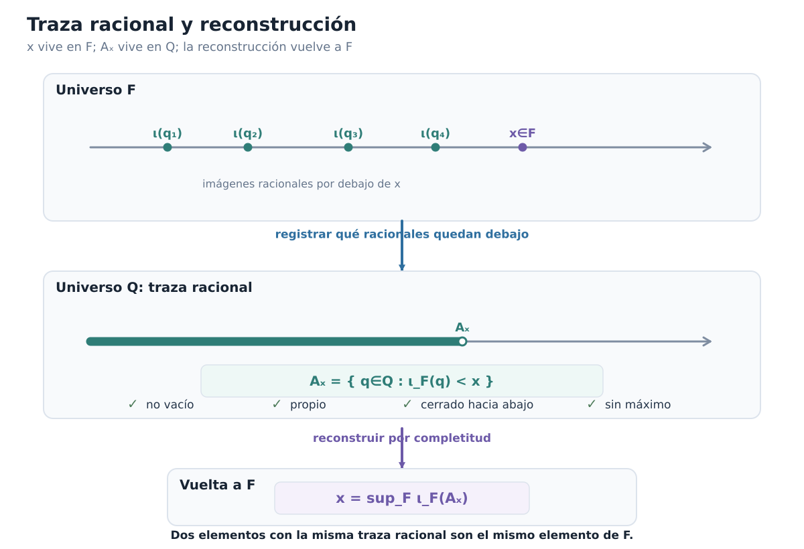{#fig-anm-c00-f09 fig-alt="Panel superior con x y varias imágenes racionales dentro de F, panel central con la cortadura Aₓ en Q y sus cuatro propiedades, y retorno a F mediante x=sup_F ι_F(Aₓ)."}

### Dos elementos distintos no pueden tener la misma traza

La fórmula anterior tiene una consecuencia inmediata.

Si

$$
A_x=A_y,
$$

entonces

$$
\iota_F(A_x)=\iota_F(A_y),
$$

y por reconstrucción

$$
x
=
\sup_F\iota_F(A_x)
=
\sup_F\iota_F(A_y)
=
y.
$$

Por tanto la aplicación

$$
x\longmapsto A_x
$$

es inyectiva.

También el orden queda registrado por las trazas.

Si

$$
x\le y,
$$

entonces todo racional situado debajo de $x$ está también debajo de $y$, de modo que

$$
A_x\subseteq A_y.
$$

Y si

$$
x<y,
$$

la densidad racional proporciona un $q$ con

$$
x<\iota_F(q)<y.
$$

Ese racional pertenece a $A_y$ pero no a $A_x$. Por tanto

$$
A_x\subsetneq A_y.
$$

Así la posición en $F$ puede leerse enteramente a través de información racional:

$$
\boxed{
x<y
\quad\Longrightarrow\quad
A_x\subsetneq A_y.
}
$$

Para la recíproca no necesitamos introducir todavía el transporte entre modelos. Si $A_x\subseteq A_y$, entonces

$$
\iota_F(A_x)\subseteq\iota_F(A_y).
$$

Por reconstrucción,

$$
y=\sup_F\iota_F(A_y),
$$

de modo que $y$ es una cota superior de $\iota_F(A_x)$. Pero también

$$
x=\sup_F\iota_F(A_x).
$$

Por la minimalidad del supremo,

$$
x\le y.
$$

En consecuencia,

$$
\boxed{
x\le y
\quad\Longleftrightarrow\quad
A_x\subseteq A_y.
}
$$

Y, combinando esta equivalencia con la inyectividad de $x\mapsto A_x$,

$$
\boxed{
x<y
\quad\Longleftrightarrow\quad
A_x\subsetneq A_y.
}
$$

La traza racional no es una mera etiqueta. Conserva toda la posición ordenada del elemento.

### El lenguaje común entre modelos

Ya podemos ver por qué hemos hecho todo este trabajo.

Sea $F$ cualquier cuerpo ordenado completo.

A cada elemento

$$
x\in F
$$

le hemos asociado una cortadura

$$
A_x\subseteq\mathbb Q.
$$

Y hemos demostrado que $x$ se recupera exactamente a partir de esa información:

$$
x
=
\sup_F\iota_F(A_x).
$$

Nada de esta descripción depende de que $F$ esté construido mediante cortaduras.

Por tanto, si mañana tomamos otro cuerpo ordenado completo $G$, podremos repetir exactamente el mismo procedimiento:

$$
y\in G
\longmapsto
A_y\subseteq\mathbb Q.
$$

Los elementos de $F$ y $G$ pueden ser objetos conjuntistas completamente diferentes. Pero sus **trazas racionales viven en el mismo conjunto $\mathbb Q$**.

Ése es el puente que necesitábamos.

$$
\boxed{
\mathbb Q
\text{ es el lenguaje común para comparar modelos completos distintos}.
}
$$

El objetivo ya no será comparar directamente $x\in F$ con un supuesto elemento correspondiente de $G$.

La estrategia será:

1. registrar la posición de $x$ mediante $A_x\subseteq\mathbb Q$;
2. transportar esa misma información racional a $G$;
3. reconstruir allí la posición correspondiente mediante un supremo.

Éste será el mecanismo de la última sección.

El estado narrativo permanece:

```text
UNIQUENESS_QUESTION = OPEN
```

Pero ahora disponemos de todas las piezas conceptuales para atacarla.

### Antes de seguir

#### Microcontrol 62

[]{#MA-MIC-ANM-01-000-062}

¿Por qué un cuerpo ordenado debe tener característica cero?

[]{#MA-MSOL-ANM-01-000-062}

<details class="anm-solution">
<summary>Ver solución del microcontrol 62</summary>

**Respuesta.**

En un cuerpo ordenado se tiene $0_F<1_F$. Sumando $1_F$ repetidamente y usando la invariancia del orden por traslación obtenemos, para $n>0$,

$$
0_F<1_F<2\cdot1_F<\cdots<n\cdot1_F.
$$

En particular,

$$
n\cdot1_F\ne0_F
$$

para todo entero positivo $n$. Pero la característica de un cuerpo sería positiva precisamente si existiera un mínimo $n>0$ con $n\cdot1_F=0_F$. Por tanto

$$
\boxed{\operatorname{char}F=0.}
$$

El orden impide que los numerales positivos colapsen en el cero.

**Fundamento en la sección 0.9.**

de modo que

$$
\nu_F(n)\ne0_F.
$$

Por tanto no existe entero positivo $n$ tal que

$$
\underbrace{1_F+\cdots+1_F}_{n\text{ veces}}=0_F.
$$

Esto demuestra:

$$
\boxed{\operatorname{char}F=0.}
$$

La conclusión es más importante de lo que parece. Significa que los numerales naturales no colapsan dentro de $F$ y que podemos prolongar esa copia a los enteros y luego a los racionales.

</details>

#### Microcontrol 63

[]{#MA-MIC-ANM-01-000-063}

Explica por qué la definición de $\jmath_{\mathbb Z}^F(m-n)$ no depende de la diferencia formal elegida.

[]{#MA-MSOL-ANM-01-000-063}

<details class="anm-solution">
<summary>Ver solución del microcontrol 63</summary>

**Respuesta.**

Supongamos que el mismo entero admite dos representaciones

$$
m-n=p-q.
$$

Entonces, en $\mathbb Z$,

$$
m+q=n+p.
$$

Los numerales en $F$ respetan la suma, así que

$$
\nu_F(m)+\nu_F(q)=\nu_F(n)+\nu_F(p).
$$

Trasladando términos dentro del grupo aditivo de $F$,

$$
\nu_F(m)-\nu_F(n)=\nu_F(p)-\nu_F(q).
$$

Por tanto ambas diferencias formales producen el mismo elemento de $F$, y la definición

$$
\boxed{\jmath_{\mathbb Z}^F(m-n)=\nu_F(m)-\nu_F(n)}
$$
es independiente del representante escogido.

**Fundamento en la sección 0.9.**

Esto demuestra:

$$
\boxed{\operatorname{char}F=0.}
$$

La conclusión es más importante de lo que parece. Significa que los numerales naturales no colapsan dentro de $F$ y que podemos prolongar esa copia a los enteros y luego a los racionales.

Los enteros no se introducen en $F$ mediante una identificación literal. Construimos una aplicación.

Si un entero está representado por la diferencia formal $m-n$, definimos

$$
\jmath_{\mathbb Z}^F(m-n)
=
\nu_F(m)-\nu_F(n).
$$

La definición es independiente de la representación.

</details>

#### Microcontrol 64

[]{#MA-MIC-ANM-01-000-064}

Para $q=a/b$, ¿qué propiedad garantiza que $\iota_F(q)$ no depende del representante racional?

[]{#MA-MSOL-ANM-01-000-064}

<details class="anm-solution">
<summary>Ver solución del microcontrol 64</summary>

**Respuesta.**

Si

$$
\frac ab=\frac cd,
\qquad b,d\ne0,
$$
entonces

$$
ad=bc
$$
en $\mathbb Z$. La multiplicatividad de $\jmath_{\mathbb Z}^F$ da

$$
\jmath(a)\jmath(d)=\jmath(b)\jmath(c).
$$

Como $b,d\ne0$ y $\jmath_{\mathbb Z}^F$ es inyectiva, $\jmath(b)$ y $\jmath(d)$ son no nulos y poseen inversos en $F$. Multiplicando por esos inversos, obtenemos

$$
\jmath(a)\jmath(b)^{-1}=\jmath(c)\jmath(d)^{-1}.
$$

Así el valor

$$
\boxed{\iota_F(a/b)=\jmath(a)\jmath(b)^{-1}}
$$

no depende de la fracción elegida. La propiedad decisiva es la **igualdad por productos cruzados**, transportada por la multiplicatividad, junto con la no anulación de los denominadores.

**Fundamento en la sección 0.9.**

Ahora podemos incorporar divisiones.

Sea

$$
q=\frac ab\in\mathbb Q,
\qquad
a,b\in\mathbb Z,
\qquad
b\ne0.
$$

Definimos

$$
\boxed{
\iota_F(q)
=
\jmath_{\mathbb Z}^F(a)
\bigl(\jmath_{\mathbb Z}^F(b)\bigr)^{-1}.
}
$$

El inverso existe porque $b\ne0$ y $\jmath_{\mathbb Z}^F$ es inyectiva.

Debemos verificar que el valor no depende de la fracción elegida.

</details>

#### Microcontrol 65

[]{#MA-MIC-ANM-01-000-065}

¿En qué momento exacto de esta sección se usa por primera vez la completitud de $F$?

[]{#MA-MSOL-ANM-01-000-065}

<details class="anm-solution">
<summary>Ver solución del microcontrol 65</summary>

**Respuesta.**

La completitud no se usa para construir la copia canónica de $\mathbb Q$: característica cero, enteros y racionales aparecen en cualquier cuerpo ordenado.

El primer gasto de completitud ocurre al demostrar que $F$ es arquimediano. Se supone por contradicción que

$$
N_F=\{\nu_F(n):n\in\mathbb N\}
$$
está acotado superiormente. Entonces, y sólo entonces, la completitud permite formar

$$
\boxed{s=\sup N_F.}
$$

Ese supremo es la herramienta que produce la contradicción.

**Fundamento en la sección 0.9.**

Hasta aquí sólo hemos usado que $F$ es un cuerpo ordenado.

Ahora gastaremos por primera vez la hipótesis adicional:

$$
\boxed{F\text{ es completo}.}
$$

La consecuencia inmediata será la propiedad arquimediana.

> **Teorema.** Todo cuerpo ordenado completo es arquimediano.

**Demostración.** Supongamos, por contradicción, que los numerales de $F$ estuvieran acotados superiormente. Es decir, que el conjunto

$$
N_F=\{\nu_F(n):n\in\mathbb N\}
$$

</details>

#### Microcontrol 66

[]{#MA-MIC-ANM-01-000-066}

Reconstruye la contradicción que demuestra que un cuerpo ordenado completo es arquimediano.

[]{#MA-MSOL-ANM-01-000-066}

<details class="anm-solution">
<summary>Ver solución del microcontrol 66</summary>

**Respuesta.**

Supongamos que $N_F$ está acotado superiormente y sea

$$
s=\sup N_F.
$$

Como

$$
s-1_F<s,
$$

$s-1_F$ no puede ser una cota superior de $N_F$, pues sería una cota superior menor que el supremo. Por tanto existe $n\in\mathbb N$ tal que

$$
s-1_F<\nu_F(n).
$$

Sumando $1_F$ a ambos lados,

$$
s<\nu_F(n)+1_F=\nu_F(n+1).
$$

Pero $\nu_F(n+1)\in N_F$, lo que contradice que $s$ sea cota superior. Luego $N_F$ no está acotado superiormente y

$$
\boxed{F\text{ es arquimediano}.}
$$

**Fundamento en la sección 0.9.**

el elemento $s-1_F$ no puede ser también cota superior de $N_F$: de serlo, sería una cota superior estrictamente menor que el supremo.

Por tanto existe algún $n\in\mathbb N$ tal que

$$
s-1_F<\nu_F(n).
$$

Sumando $1_F$,

$$
s<\nu_F(n)+1_F
=
\nu_F(n+1).
$$

Pero $\nu_F(n+1)\in N_F$, contradiciendo que $s$ sea cota superior.

Luego los numerales no están acotados superiormente. Equivalentemente, para todo $x\in F$ existe $n\in\mathbb N$ tal que

</details>

#### Microcontrol 67

[]{#MA-MIC-ANM-01-000-067}

En el lema de localización entera, ¿por qué no basta con saber simplemente que existe algún entero mayor que $x$?

[]{#MA-MSOL-ANM-01-000-067}

<details class="anm-solution">
<summary>Ver solución del microcontrol 67</summary>

**Respuesta.**

Saber solamente que existe un entero $m$ con

$$
x<\iota_F(m)
$$

da una cota superior entera, pero no dice cuál es la primera celda de la rejilla entera que contiene a $x$. Para el refinamiento racional posterior necesitamos simultáneamente un extremo entero por debajo y otro inmediatamente por encima:

$$
\boxed{\iota_F(m-1)\le x<\iota_F(m).}
$$

La información adicional de que $m$ es el **primer** entero de cierta lista que queda por encima de $x$ es lo que produce la desigualdad inferior con $m-1$.

**Fundamento en la sección 0.9.**

Entonces su predecesor es

$$
m-1=-n+k,
$$

y las dos desigualdades anteriores se escriben exactamente como

$$
\iota_F(m-1)\le x<\iota_F(m).
$$

$\square$

Éste es el eslabón que no debe quedar oculto detrás de la palabra «arquimediano».

La propiedad arquimediana dice que la rejilla entera llega suficientemente lejos; el lema anterior dice algo más operativo: **todo elemento queda atrapado en una celda de anchura uno de esa rejilla**.

</details>

#### Microcontrol 68

[]{#MA-MIC-ANM-01-000-068}

Explica el papel del mínimo de $K$ en la producción de
$$
m-1\le x<m.
$$

[]{#MA-MSOL-ANM-01-000-068}

<details class="anm-solution">
<summary>Ver solución del microcontrol 68</summary>

**Respuesta.**

Se define

$$
K=\{k\in\mathbb N:x<-\nu_F(n)+\nu_F(k)\}.
$$

La arquimedianidad garantiza que $K$ es no vacío. Por el buen orden de $\mathbb N$, existe un mínimo $k_0$. Como $k_0\ne0$, escribimos $k_0=k+1$.

La minimalidad tiene dos consecuencias complementarias:

- $k_0\in K$, luego
  $$
  x<-\nu_F(n)+\nu_F(k+1);
  $$
- $k\notin K$, luego, por totalidad del orden,
  $$
  -\nu_F(n)+\nu_F(k)\le x.
  $$

Si definimos $m=-n+(k+1)$, estas dos desigualdades se convierten exactamente en

$$
\boxed{\iota_F(m-1)\le x<\iota_F(m).}
$$

El mínimo convierte una cota cualquiera en una **celda entera consecutiva**.

**Fundamento en la sección 0.9.**

Este conjunto no es vacío. Por ejemplo, si tomamos $k=2n+1$, entonces

$$
-\nu_F(n)+\nu_F(2n+1)
=
\nu_F(n+1)
>
x.
$$

Por el buen orden de $\mathbb N$, $K$ tiene un elemento mínimo; llamémoslo $k_0$.

No puede ser $k_0=0$, porque

$$
-\nu_F(n)<x.
$$

Por tanto

$$
k_0=k+1
$$

</details>

#### Microcontrol 69

[]{#MA-MIC-ANM-01-000-069}

Para $x<y$, ¿por qué elegir $1/n<y-x$ y localizar $nx$ produce un racional entre ambos?

[]{#MA-MSOL-ANM-01-000-069}

<details class="anm-solution">
<summary>Ver solución del microcontrol 69</summary>

**Respuesta.**

Sean $x<y$. La arquimedianidad permite elegir $n>0$ con

$$
\iota_F\!\left(\frac1n\right)<y-x.
$$

Aplicamos la localización entera a $x\,\iota_F(n)$ y obtenemos $m\in\mathbb Z$ tal que

$$
\iota_F(m-1)\le x\,\iota_F(n)<\iota_F(m).
$$

Como $\iota_F(n)>0$, al dividir por ella obtenemos

$$
\iota_F\!\left(\frac{m-1}{n}\right)\le x<\iota_F\!\left(\frac mn\right).
$$

Además, de la desigualdad izquierda de la localización se deduce

$$
\iota_F\!\left(\frac mn\right)\le x+\iota_F\!\left(\frac1n\right)<y.
$$

Por tanto, para $q=m/n$,

$$
\boxed{x<\iota_F(q)<y.}
$$

El paso $1/n<y-x$ hace que la malla racional sea más fina que la separación entre $x$ e $y$.

**Fundamento en la sección 0.9.**

es positiva. Por tanto $(y-x)^{-1}>0$. La arquimedianidad proporciona $n\in\mathbb N$ tal que

$$
(y-x)^{-1}<\nu_F(n).
$$

Esta desigualdad obliga a $n>0$. Como ambos miembros son positivos, al invertir se revierte el orden:

$$
0<\nu_F(n)^{-1}<y-x.
$$

La compatibilidad de la copia racional con los inversos identifica

$$
\nu_F(n)^{-1}
=
\iota_F\!\left(\frac1n\right).
$$

Así,

</details>

#### Microcontrol 70

[]{#MA-MIC-ANM-01-000-070}

Verifica las cuatro condiciones que hacen de $A_x$ una cortadura y señala en cuáles se usa la densidad racional.

[]{#MA-MSOL-ANM-01-000-070}

<details class="anm-solution">
<summary>Ver solución del microcontrol 70</summary>

Para

$$
A_x=\{q\in\mathbb Q:\iota_F(q)<x\}
$$

verificamos:

- **No vacío:** como $x-1_F<x$, por densidad existe $q_-$ con $x-1_F<\iota_F(q_-)<x$. Entonces $q_-\in A_x$.
- **Propio:** como $x<x+1_F$, por densidad existe $q_+$ con $x<\iota_F(q_+)<x+1_F$. Entonces $q_+\notin A_x$.
- **Cerrado hacia abajo:** si $p<q$ y $q\in A_x$, la preservación del orden da $\iota_F(p)<\iota_F(q)<x$, luego $p\in A_x$.
- **Sin máximo:** si $q\in A_x$, entonces $\iota_F(q)<x$; por densidad existe $r$ con $\iota_F(q)<\iota_F(r)<x$. La reflexión del orden da $q<r$, y $r\in A_x$.

Así

$$
\boxed{A_x\in\mathcal D.}
$$

La densidad se usa en las condiciones **no vacío**, **propio** y **sin máximo**; la clausura hacia abajo sólo usa que $\iota_F$ preserva el orden.

</details>

#### Microcontrol 71

[]{#MA-MIC-ANM-01-000-071}

¿Dónde se gasta la completitud por segunda vez al reconstruir $x$ desde $A_x$?

[]{#MA-MSOL-ANM-01-000-071}

<details class="anm-solution">
<summary>Ver solución del microcontrol 71</summary>

**Respuesta.**

El conjunto

$$
\iota_F(A_x)=\{\iota_F(q):q\in A_x\}
$$
es no vacío y está acotado superiormente por $x$. La completitud se usa por segunda vez para asegurar que existe

$$
s=\sup_F\iota_F(A_x).
$$

Como $x$ es cota superior, $s\le x$. Si $s<x$, la densidad racional produciría $q$ con

$$
s<\iota_F(q)<x.
$$

Entonces $q\in A_x$, de modo que $\iota_F(q)\in\iota_F(A_x)$, contradiciendo que $s$ sea cota superior. Por tanto

$$
\boxed{x=\sup_F\iota_F(A_x).}
$$

La completitud no fabrica la traza; garantiza que la información racional contenida en ella puede volver a reunirse en un elemento de $F$.

**Fundamento en la sección 0.9.**

contradiciendo que $s$ sea una cota superior de ese conjunto.

Por tanto no puede ocurrir $s<x$. Como ya sabemos $s\le x$, concluimos

$$
s=x.
$$

Así obtenemos la fórmula de reconstrucción:

$$
\boxed{
x
=
\sup_F
\{\iota_F(q):q\in A_x\}.
}
$$

La interpretación es fundamental:

$$
\boxed{
\text{un elemento de }F
\text{ queda determinado por los racionales que están debajo de él}.
}
$$

</details>

#### Microcontrol 72

[]{#MA-MIC-ANM-01-000-072}

¿Por qué la igualdad $A_x=A_y$ obliga a $x=y$?

[]{#MA-MSOL-ANM-01-000-072}

<details class="anm-solution">
<summary>Ver solución del microcontrol 72</summary>

**Respuesta.**

Si

$$
A_x=A_y,
$$
entonces también

$$
\iota_F(A_x)=\iota_F(A_y).
$$

Aplicando la fórmula de reconstrucción a ambos elementos,

$$
x=\sup_F\iota_F(A_x)
=\sup_F\iota_F(A_y)=y.
$$

Por tanto

$$
\boxed{A_x=A_y\Longrightarrow x=y.}
$$

La traza racional determina al elemento de manera inyectiva: dos posiciones distintas no pueden tener exactamente los mismos racionales por debajo.

**Fundamento en la sección 0.9.**

contradiciendo que $s$ sea una cota superior de ese conjunto.

Por tanto no puede ocurrir $s<x$. Como ya sabemos $s\le x$, concluimos

$$
s=x.
$$

Así obtenemos la fórmula de reconstrucción:

$$
\boxed{
x
=
\sup_F
\{\iota_F(q):q\in A_x\}.
}
$$

La interpretación es fundamental:

$$
\boxed{
\text{un elemento de }F
\text{ queda determinado por los racionales que están debajo de él}.
}
$$

</details>

#### Microcontrol 73

[]{#MA-MIC-ANM-01-000-073}

Explica por qué $\mathbb Q$ puede servir como interfaz común entre dos cuerpos ordenados completos cuyos elementos sean literalmente distintos.

[]{#MA-MSOL-ANM-01-000-073}

<details class="anm-solution">
<summary>Ver solución del microcontrol 73</summary>

Sean $F$ y $G$ cuerpos ordenados completos. Cada uno contiene su copia canónica de $\mathbb Q$,

$$
\iota_F:\mathbb Q\hookrightarrow F,
\qquad
\iota_G:\mathbb Q\hookrightarrow G.
$$

Para $x\in F$, su posición queda codificada por

$$
A_x=\{q\in\mathbb Q:\iota_F(q)<x\}\subseteq\mathbb Q.
$$

Análogamente, un elemento de $G$ posee una traza que también es un subconjunto del **mismo** conjunto $\mathbb Q$. Así, aunque los elementos de $F$ y $G$ sean objetos literalmente distintos, sus posiciones pueden describirse mediante datos que viven en un dominio común.

Además, en cada modelo completo la traza determina al elemento mediante un supremo. Por eso la estrategia de comparación puede ser

$$
\boxed{\text{elemento}\to\text{traza racional}\to\text{reconstrucción en el otro modelo}.}
$$

En §0.9 esto prepara el puente; todavía no construye el transporte $F\to G$, que pertenece a §0.10.

</details>
Ya no dependemos de la codificación por cortaduras para hablar de la posición de un real abstracto. La posición puede registrarse racionalmente en cualquier modelo completo. La pregunta final es ahora concreta:

> **Si $F$ y $G$ asignan la misma información racional a sus elementos, ¿podemos reconstruir uno dentro del otro?**

### Ejercicios de la sección 0.9

#### Ejercicio 38. Separar universos y construir la copia racional canónica

[]{#MA-EX-ANM-01-000-038}

Sea

$$
F=(F,+,\cdot,0_F,1_F,\le_F)
$$

un cuerpo ordenado arbitrario. No supongas todavía que sea completo.

1. Define los numerales de $F$ mediante

$$
\nu_F(0)=0_F,\qquad \nu_F(n+1)=\nu_F(n)+1_F,
$$

y demuestra que $m<n$ implica $\nu_F(m)<\nu_F(n)$. Deduce que $F$ tiene característica cero.
2. Escribe correctamente los tipos de las aplicaciones

$$
\nu_F,\qquad \jmath_{\mathbb Z}^F,\qquad \iota_F,
$$

donde la segunda debe representar enteros y la tercera racionales dentro de $F$.
3. Para $m,n\in\mathbb N$, define

$$
\jmath_{\mathbb Z}^F(m-n)=\nu_F(m)-\nu_F(n)
$$

y explica qué debe verificarse para que la definición no dependa de la representación del entero.
4. Para $a,b\in\mathbb Z$ con $b\ne0$, define

$$
\iota_F\!\left(\frac ab\right)
=
\jmath_{\mathbb Z}^F(a)
\bigl(\jmath_{\mathbb Z}^F(b)\bigr)^{-1}.
$$

Justifica por qué el inverso existe y qué igualdad debe usarse para comprobar que el valor no depende del representante $a/b$.
5. Explica por qué, aun después de estas verificaciones, la escritura $\mathbb Q\subseteq F$ es una identificación notacional con la imagen de $\iota_F$ y no una igualdad literal impuesta entre conjuntos.

Cierra indicando qué parte de esta construcción requiere completitud de $F$.

[]{#MA-SOL-ANM-01-000-038}

<details class="anm-solution">
<summary>Ver solución del ejercicio 38</summary>

Partimos sólo de que $F$ es un cuerpo ordenado. En particular,

$$
0_F<1_F.
$$

Definimos

$$
\nu_F(0)=0_F,\qquad \nu_F(n+1)=\nu_F(n)+1_F.
$$

Por inducción, $n>0$ implica $\nu_F(n)>0_F$. Si $m<n$, existe $k>0$ con $n=m+k$, y entonces

$$
\nu_F(n)=\nu_F(m)+\nu_F(k)>\nu_F(m).
$$

Por tanto los numerales preservan estrictamente el orden. En particular, ningún $n>0$ satisface $\nu_F(n)=0_F$, así que

$$
\boxed{\operatorname{char}F=0}.
$$

Los tipos son

$$
\nu_F:\mathbb N\longrightarrow F,
$$

$$
\jmath_{\mathbb Z}^F:\mathbb Z\longrightarrow F,
$$

y

$$
\iota_F:\mathbb Q\longrightarrow F.
$$

Para un entero presentado como $m-n$, definimos

$$
\jmath_{\mathbb Z}^F(m-n)=\nu_F(m)-\nu_F(n).
$$

Si $m-n=p-q$, entonces $m+q=n+p$. La aditividad de los numerales da

$$
\nu_F(m)+\nu_F(q)=\nu_F(n)+\nu_F(p),
$$

y, trasladando términos,

$$
\nu_F(m)-\nu_F(n)=\nu_F(p)-\nu_F(q).
$$

Así la definición no depende de la representación. La característica cero impide que enteros distintos colapsen, por lo que $\jmath_{\mathbb Z}^F$ es inyectiva.

Para $a/b\in\mathbb Q$, con $b\ne0$, definimos

$$
\iota_F\!\left(\frac ab\right)
=
\jmath_{\mathbb Z}^F(a)
\bigl(\jmath_{\mathbb Z}^F(b)\bigr)^{-1}.
$$

Como $b\ne0$ y $\jmath_{\mathbb Z}^F$ es inyectiva,

$$
\jmath_{\mathbb Z}^F(b)\ne0_F,
$$

de modo que el inverso existe. Si

$$
\frac ab=\frac cd,
$$

entonces $ad=bc$. Aplicando la multiplicatividad de la copia entera,

$$
\jmath_{\mathbb Z}^F(a)\jmath_{\mathbb Z}^F(d)
=
\jmath_{\mathbb Z}^F(b)\jmath_{\mathbb Z}^F(c).
$$

Multiplicando por los inversos de las imágenes de $b$ y $d$, obtenemos el mismo valor para ambas fracciones. Por tanto $\iota_F$ está bien definida. Las leyes de cuerpo muestran que conserva suma, producto, $0$ y $1$, y el orden se conserva y refleja. En consecuencia,

$$
\boxed{\iota_F:\mathbb Q\hookrightarrow F}
$$

es una incrustación de cuerpos ordenados.

Después de esta certificación podemos identificar notacionalmente $\mathbb Q$ con la imagen $\iota_F(\mathbb Q)$ cuando resulte cómodo. Eso no afirma una igualdad literal entre los conjuntos subyacentes: la afirmación estructural primaria es la existencia de la incrustación canónica.

Nada de esta construcción ha usado completitud. La copia canónica de $\mathbb Q$ existe en todo cuerpo ordenado.

*Referencia visual.* Véase la figura [C00-F08](analisis-para-matematicos-capitulo-0-construir-los-numeros-reales.html#fig-anm-c00-f08) del texto principal, **De completitud a rejilla racional en F**, como síntesis posterior de este argumento.

</details>

#### Ejercicio 39. La completitud obliga a la arquimedianidad

[]{#MA-EX-ANM-01-000-039}

Supón ahora que $F$ es un cuerpo ordenado completo y considera

$$
N_F=\{\nu_F(n):n\in\mathbb N\}.
$$

Demuestra que $F$ es arquimediano. Organiza la prueba por contradicción.

1. Supón que $N_F$ está acotado superiormente y usa completitud para definir

$$
s=\sup_F N_F.
$$

2. Explica por qué $s-1_F$ no puede ser una cota superior de $N_F$.
3. Deduce que existe $n\in\mathbb N$ con

$$
s-1_F<\nu_F(n),
$$

y obtiene una contradicción sumando $1_F$.
4. Concluye que para todo $x\in F$ existe $n\in\mathbb N$ tal que

$$
x<\nu_F(n).
$$

5. Señala el único paso de la demostración en el que se gasta la completitud y explica por qué el argumento no demuestra que **todo** cuerpo ordenado sea arquimediano.

[]{#MA-SOL-ANM-01-000-039}

<details class="anm-solution">
<summary>Ver solución del ejercicio 39</summary>

Supongamos, para obtener una contradicción, que

$$
N_F=\{\nu_F(n):n\in\mathbb N\}
$$

está acotado superiormente. Es no vacío porque $0_F=\nu_F(0)\in N_F$.

Aquí se gasta la completitud. Existe

$$
s=\sup_F N_F.
$$

Como $1_F>0_F$,

$$
s-1_F<s.
$$

El elemento $s-1_F$ no puede ser una cota superior de $N_F$: si lo fuera, sería una cota superior estrictamente menor que el supremo. Por tanto existe $n\in\mathbb N$ tal que

$$
s-1_F<\nu_F(n).
$$

Sumando $1_F$,

$$
s<\nu_F(n)+1_F=\nu_F(n+1).
$$

Pero $\nu_F(n+1)\in N_F$, contradicción con que $s$ sea cota superior. Luego $N_F$ no está acotado superiormente.

Así, ningún $x\in F$ puede ser cota superior de $N_F$. Por tanto para todo $x\in F$ existe $n\in\mathbb N$ con

$$
\boxed{x<\nu_F(n)}.
$$

Ésta es la forma arquimediana que usaremos.

La completitud intervino exactamente en la existencia de $s=\sup_F N_F$ bajo la hipótesis de acotación. El resto utiliza sólo orden y estructura aditiva. Por ello el resultado correcto es

$$
\boxed{\text{cuerpo ordenado completo}\Longrightarrow\text{arquimediano}},
$$

no la falsa inferencia «todo cuerpo ordenado es arquimediano».

*Referencia visual.* Véase la figura [C00-F08](analisis-para-matematicos-capitulo-0-construir-los-numeros-reales.html#fig-anm-c00-f08) del texto principal, **De completitud a rejilla racional en F**, como síntesis posterior de este argumento.

</details>

#### Ejercicio 40. Trazar el camino desde la arquimedianidad hasta la densidad racional

[]{#MA-EX-ANM-01-000-040}

Sea $F$ un cuerpo ordenado completo y usa su incrustación racional canónica

$$
\iota_F:\mathbb Q\hookrightarrow F.
$$

Reconstruye sin saltos la cadena

$$
\text{arquimedianidad}
\Longrightarrow
\text{localización entera}
\Longrightarrow
\text{localización racional}
\Longrightarrow
\text{densidad de }\iota_F(\mathbb Q).
$$

1. Para $x\in F$, demuestra que existe $m\in\mathbb Z$ tal que

$$
\iota_F(m-1)\le x<\iota_F(m).
$$

Debes construir un conjunto $K\subseteq\mathbb N$, tomar su mínimo y explicar por qué la minimalidad produce simultáneamente las dos desigualdades.
2. Sean $x<y$ en $F$. Usa la arquimedianidad aplicada a $(y-x)^{-1}$ para elegir $n\in\mathbb N$, $n>0$, de modo que

$$
0<\iota_F\!\left(\frac1n\right)<y-x.
$$

3. Aplica la localización entera a $x\,\iota_F(n)$ y construye un entero $m$ para el cual

$$
\iota_F\!\left(\frac{m-1}{n}\right)\le x<\iota_F\!\left(\frac mn\right).
$$

4. Demuestra que el mismo $q=m/n$ satisface

$$
\boxed{x<\iota_F(q)<y}.
$$

5. Cierra con un mapa de dependencias que indique dónde se usa: orden de $F$, arquimedianidad, buen orden de $\mathbb N$, estructura de cuerpo e incrustación racional. No invoques una intuición geométrica de «racionales muy juntos».

> **Pista conceptual.** La arquimedianidad da escala; el mínimo de $K$ convierte esa escala en una celda entera; dividir una celda suficientemente fina produce la posición racional intermedia.

[]{#MA-SOL-ANM-01-000-040}

<details class="anm-solution">
<summary>Ver solución del ejercicio 40</summary>

Primero localizamos cualquier elemento entre enteros consecutivos. Sea $x\in F$. Por arquimedianidad existen $n_1,n_2\in\mathbb N$ tales que

$$
x<\iota_F(n_1),
\qquad
-x<\iota_F(n_2).
$$

Tomamos, por ejemplo,

$$
n=n_1+n_2+1.
$$

Entonces $n>0$ y

$$
-\iota_F(n)<x<\iota_F(n).
$$

Definimos

$$
K=\{k\in\mathbb N:x<-\iota_F(n)+\iota_F(k)\}.
$$

El conjunto $K$ no es vacío. Para $k=2n+1$,

$$
-\iota_F(n)+\iota_F(2n+1)=\iota_F(n+1)>x.
$$

Por el buen orden de $\mathbb N$, $K$ tiene mínimo; llamémoslo $k_0$. No puede ser $0$, porque $-\iota_F(n)<x$. Escribimos

$$
k_0=k+1.
$$

La minimalidad implica $k\notin K$, de modo que

$$
-\iota_F(n)+\iota_F(k)\le x.
$$

Como $k+1\in K$,

$$
x<-\iota_F(n)+\iota_F(k+1).
$$

Definimos

$$
m=-n+(k+1)\in\mathbb Z.
$$

Entonces $m-1=-n+k$, y obtenemos

$$
\boxed{\iota_F(m-1)\le x<\iota_F(m)}.
$$

Ésta es la localización entera.

Sean ahora $x<y$. La diferencia $y-x$ es positiva. Aplicamos la arquimedianidad a $(y-x)^{-1}$. Existe $n\in\mathbb N$ tal que

$$
(y-x)^{-1}<\iota_F(n).
$$

Necesariamente $n>0$. Al invertir elementos positivos se invierte el orden, así que

$$
0<\iota_F(n)^{-1}<y-x.
$$

Como $\iota_F$ preserva inversos,

$$
\boxed{0<\iota_F\!\left(\frac1n\right)<y-x}.
$$

Aplicamos la localización entera a $x\,\iota_F(n)$. Existe $m\in\mathbb Z$ tal que

$$
\iota_F(m-1)\le x\,\iota_F(n)<\iota_F(m).
$$

Como $\iota_F(n)>0$, dividimos por ella:

$$
\iota_F\!\left(\frac{m-1}{n}\right)
\le x<
\iota_F\!\left(\frac mn\right).
$$

De la desigualdad izquierda antes de dividir se obtiene también

$$
\iota_F(m)\le x\,\iota_F(n)+1_F.
$$

Dividiendo otra vez por $\iota_F(n)$,

$$
\iota_F\!\left(\frac mn\right)
\le x+\iota_F\!\left(\frac1n\right)
< x+(y-x)=y.
$$

Para

$$
q=\frac mn\in\mathbb Q,
$$

queda

$$
\boxed{x<\iota_F(q)<y}.
$$

Así la copia canónica de $\mathbb Q$ es densa en $F$.

El mapa de dependencias es preciso:

- el orden permite comparar, trasladar e invertir desigualdades positivas;
- la arquimedianidad proporciona escalas enteras suficientemente grandes;
- el buen orden de $\mathbb N$ produce el mínimo de $K$;
- la estructura de cuerpo permite formar $(y-x)^{-1}$ y dividir por $n>0$;
- la incrustación racional traduce numerales, enteros, fracciones e inversos entre $\mathbb Q$ y $F$.

No se ha supuesto densidad por analogía geométrica: se la ha deducido estructuralmente.

*Referencia visual.* Véase la figura [C00-F08](analisis-para-matematicos-capitulo-0-construir-los-numeros-reales.html#fig-anm-c00-f08) del texto principal, **De completitud a rejilla racional en F**, como síntesis posterior de este argumento.

</details>

#### Ejercicio 41. Convertir una posición abstracta en una cortadura racional

[]{#MA-EX-ANM-01-000-041}

Para $x\in F$, define

$$
A_x=\{q\in\mathbb Q:\iota_F(q)<x\}.
$$

1. Escribe los tipos correctos de $x$, $q$, $\iota_F(q)$ y $A_x$. Explica por qué $A_x$ es un subconjunto de $\mathbb Q$ y no un subconjunto de $F$.
2. Demuestra que $A_x$ es una cortadura de Dedekind verificando las cuatro condiciones: no vaciedad, propiedad de ser subconjunto propio, clausura hacia abajo y ausencia de máximo.
3. En cada una de las cuatro verificaciones, identifica si interviene la densidad racional demostrada en el ejercicio 40 o sólo la preservación del orden por $\iota_F$.
4. Como variación, toma $c\in\mathbb Q$ y $x=\iota_F(c)$. Demuestra que

$$
\boxed{A_{\iota_F(c)}=c^*}.
$$

Explica qué muestra esta identidad acerca de la compatibilidad entre la traza racional de un modelo abstracto y las cortaduras racionales construidas antes.

> **Pista conceptual.** Para probar que $A_x$ es no vacío y propio, busca racionales entre $x-1_F$ y $x$, y entre $x$ y $x+1_F$.

[]{#MA-SOL-ANM-01-000-041}

<details class="anm-solution">
<summary>Ver solución del ejercicio 41</summary>

Sea $x\in F$ y definamos

$$
A_x=\{q\in\mathbb Q:\iota_F(q)<x\}.
$$

Los tipos son

$$
x\in F,
\qquad
q\in\mathbb Q,
\qquad
\iota_F(q)\in F,
\qquad
A_x\subseteq\mathbb Q.
$$

La desigualdad que define $A_x$ ocurre en $F$, entre $\iota_F(q)$ y $x$; pero los objetos registrados son los racionales $q$. Por eso $A_x$ vive en $\mathbb Q$, no en $F$.

**No vaciedad.** Como

$$
x-1_F<x,
$$

la densidad racional proporciona $q_-\in\mathbb Q$ tal que

$$
x-1_F<\iota_F(q_-)<x.
$$

Entonces $q_-\in A_x$.

**Subconjunto propio.** Como

$$
x<x+1_F,
$$

la densidad racional proporciona $q_+\in\mathbb Q$ con

$$
x<\iota_F(q_+)<x+1_F.
$$

Por tanto $q_+\notin A_x$ y $A_x\ne\mathbb Q$.

**Clausura hacia abajo.** Si $q\in A_x$ y $p<q$, entonces

$$
\iota_F(p)<\iota_F(q)<x,
$$

por preservación estricta del orden. Luego $p\in A_x$. Aquí no se usa densidad.

**Ausencia de máximo.** Si $q\in A_x$, entonces $\iota_F(q)<x$. Por densidad racional existe $r\in\mathbb Q$ con

$$
\iota_F(q)<\iota_F(r)<x.
$$

Como $\iota_F$ refleja el orden, $q<r$, y además $r\in A_x$. Por tanto $A_x$ no tiene máximo.

Así,

$$
\boxed{A_x\in\mathcal D}.
$$

La densidad se usa en no vaciedad, propiedad de ser subconjunto propio y ausencia de máximo; la clausura hacia abajo usa sólo preservación del orden.

Tomemos ahora $c\in\mathbb Q$ y $x=\iota_F(c)$. Entonces

$$
\begin{aligned}
q\in A_{\iota_F(c)}
&\iff \iota_F(q)<\iota_F(c)\\
&\iff q<c.
\end{aligned}
$$

Por tanto

$$
\boxed{A_{\iota_F(c)}=\{q\in\mathbb Q:q<c\}=c^*}.
$$

La traza racional de un racional abstractamente incrustado reproduce exactamente la cortadura racional canónica. La compatibilidad aparece sin identificar a $F$ con el modelo concreto de Dedekind.

*Referencia visual.* Véase la figura [C00-F09](analisis-para-matematicos-capitulo-0-construir-los-numeros-reales.html#fig-anm-c00-f09) del texto principal, **Traza racional y reconstrucción**, como síntesis posterior de este argumento.

</details>

#### Ejercicio 42. Reconstruir un elemento desde su traza y recuperar el orden

[]{#MA-EX-ANM-01-000-042}

Sea $F$ un cuerpo ordenado completo y, para cada $x\in F$, usa la cortadura

$$
A_x=\{q\in\mathbb Q:\iota_F(q)<x\}.
$$

1. Demuestra que

$$
\iota_F(A_x)=\{\iota_F(q):q\in A_x\}
$$

es no vacío y está acotado superiormente por $x$.
2. Usa completitud para definir

$$
s=\sup_F\iota_F(A_x)
$$

y demuestra que

$$
\boxed{x=\sup_F\iota_F(A_x)}.
$$

En el paso decisivo, si supones $s<x$, debes producir mediante densidad racional un elemento de $\iota_F(A_x)$ estrictamente mayor que $s$.
3. Deduce que

$$
A_x=A_y\Longrightarrow x=y.
$$

4. Demuestra la equivalencia

$$
\boxed{x\le y\quad\Longleftrightarrow\quad A_x\subseteq A_y}
$$

y deduce también

$$
\boxed{x<y\quad\Longleftrightarrow\quad A_x\subsetneq A_y}.
$$

5. Explica por qué estos resultados convierten a $\mathbb Q$ en un lenguaje común para registrar posiciones dentro de cualquier cuerpo ordenado completo, pero **no** construyas todavía una aplicación entre dos modelos distintos.

> **Pista conceptual.** La traza determina a $x$ porque cualquier hueco entre su supremo y $x$ contendría una imagen racional que la propia traza habría tenido que registrar.

[]{#MA-SOL-ANM-01-000-042}

<details class="anm-solution">
<summary>Ver solución del ejercicio 42</summary>

Sea

$$
B_x=\iota_F(A_x)=\{\iota_F(q):q\in A_x\}\subseteq F.
$$

Como $A_x$ es una cortadura, $B_x$ es no vacío. Además, si $q\in A_x$, entonces

$$
\iota_F(q)<x,
$$

de modo que $x$ es una cota superior de $B_x$.

Aquí se gasta nuevamente la completitud de $F$: existe

$$
s=\sup_F B_x.
$$

Como $x$ es cota superior,

$$
s\le x.
$$

Supongamos $s<x$. Por densidad racional existe $q\in\mathbb Q$ tal que

$$
s<\iota_F(q)<x.
$$

La segunda desigualdad implica $q\in A_x$, de modo que $\iota_F(q)\in B_x$. Pero la primera afirma que un elemento de $B_x$ es mayor que su cota superior $s$, contradicción. Por tanto $s<x$ es imposible y

$$
\boxed{x=\sup_F\iota_F(A_x)}.
$$

Si $A_x=A_y$, entonces sus imágenes racionales coinciden y la reconstrucción da

$$
x=\sup_F\iota_F(A_x)=\sup_F\iota_F(A_y)=y.
$$

Así $x\mapsto A_x$ es inyectiva.

Si $x\le y$ y $q\in A_x$, entonces

$$
\iota_F(q)<x\le y,
$$

y por tanto $q\in A_y$. Luego

$$
x\le y\Longrightarrow A_x\subseteq A_y.
$$

Recíprocamente, si $A_x\subseteq A_y$, entonces

$$
\iota_F(A_x)\subseteq\iota_F(A_y).
$$

Como

$$
y=\sup_F\iota_F(A_y),
$$

$y$ es una cota superior de $\iota_F(A_x)$. Pero

$$
x=\sup_F\iota_F(A_x),
$$

así que $x\le y$. Por tanto

$$
\boxed{x\le y\iff A_x\subseteq A_y}.
$$

Si $x<y$, la densidad racional produce $q$ con

$$
x<\iota_F(q)<y.
$$

Entonces $q\in A_y\setminus A_x$, de modo que

$$
A_x\subsetneq A_y.
$$

Recíprocamente, si $A_x\subsetneq A_y$, la equivalencia no estricta da $x\le y$, y no puede ocurrir $x=y$ porque entonces las trazas serían iguales. Por tanto

$$
\boxed{x<y\iff A_x\subsetneq A_y}.
$$

Cada posición $x\in F$ queda así codificada por un subconjunto $A_x\subseteq\mathbb Q$, y tanto el elemento como su orden se recuperan desde esa información racional. Ésta es la razón por la que $\mathbb Q$ puede servir como lenguaje común entre modelos completos cuyos elementos sean literalmente distintos.

El límite de §0.9 debe permanecer visible: todavía no hemos definido ninguna aplicación

$$
F\longrightarrow G
$$

entre dos modelos completos. Sólo hemos construido el código racional que permitirá ese transporte en §0.10.

</details>
## 0.10. Únicos hasta isomorfismo

Estamos en condiciones de responder la última pregunta del capítulo.

En §0.8 demostramos **existencia**: el modelo de Dedekind $\mathcal D$ es un cuerpo ordenado completo.

En §0.9 dejamos de mirar su codificación particular y tomamos un cuerpo ordenado completo arbitrario $F$. Allí demostramos que cada elemento

$$
x\in F
$$

queda determinado por su traza racional inferior

$$
A_x
=
\{q\in\mathbb Q:\iota_F(q)<x\},
$$

y que puede reconstruirse mediante

$$
x
=
\sup_F\iota_F(A_x).
$$

Ahora tomemos dos cuerpos ordenados completos arbitrarios:

$$
F
\qquad\text{y}\qquad
G.
$$

Cada uno contiene su copia racional canónica:

$$
\iota_F:\mathbb Q\hookrightarrow F,
\qquad
\iota_G:\mathbb Q\hookrightarrow G.
$$

Queremos construir una correspondencia

$$
F\longrightarrow G
$$

sin mirar cómo fueron construidos sus elementos.

La idea ya está preparada. Para $x\in F$:

1. registramos su posición mediante $A_x\subseteq\mathbb Q$;
2. interpretamos esos mismos racionales dentro de $G$;
3. tomamos allí la frontera que determina esa información.

Es decir,

$$
\boxed{
F
\longrightarrow
A_x\subseteq\mathbb Q
\longrightarrow
\iota_G(A_x)\subseteq G
\longrightarrow
\sup_G
\longrightarrow
G.
}
$$

Éste será el transporte canónico entre los dos modelos.

### Antes de escribir el supremo: buena definición

Sería un error escribir inmediatamente

$$
\phi(x)=\sup_G\iota_G(A_x)
$$

sin verificar las hipótesis que permiten tomar ese supremo.

Fijemos

$$
x\in F.
$$

Por §0.9, $A_x$ es una cortadura de Dedekind. En particular,

$$
A_x\ne\varnothing
\qquad\text{y}\qquad
A_x\ne\mathbb Q.
$$

La imagen

$$
\iota_G(A_x)
=
\{\iota_G(q):q\in A_x\}
$$

es no vacía: basta tomar cualquier $r\in A_x$; entonces

$$
\iota_G(r)\in\iota_G(A_x).
$$

Debemos además exhibir una cota superior.

Como $A_x$ es propio, existe algún racional

$$
u\notin A_x.
$$

Afirmamos que todo $q\in A_x$ satisface

$$
q<u.
$$

En efecto, si $q=u$, tendríamos $u\in A_x$. Y si $u<q$, como $q\in A_x$ y $A_x$ es cerrado hacia abajo, también obtendríamos $u\in A_x$. Ambas posibilidades son imposibles. Por tricotomía racional queda

$$
q<u.
$$

Como $\iota_G$ preserva el orden,

$$
\iota_G(q)<\iota_G(u)
\qquad
(q\in A_x).
$$

Por tanto

$$
\iota_G(u)
$$

es una cota superior de $\iota_G(A_x)$.

Ahora sí hemos verificado:

$$
\iota_G(A_x)\ne\varnothing
$$

y

$$
\iota_G(A_x)\text{ está acotado superiormente en }G.
$$

Aquí aparece el primer gasto de completitud de esta sección. Como $G$ es completo, existe el supremo de ese conjunto.

Podemos definir, legítimamente,

$$
\boxed{
\phi:F\longrightarrow G,
\qquad
\phi(x)
=
\sup_G\{\iota_G(q):q\in A_x\}.
}
$$

No estamos escogiendo uno entre varios candidatos. El supremo, cuando existe, es único. El valor $\phi(x)$ queda determinado por la estructura.

### El transporte conserva exactamente la traza racional

La propiedad decisiva de $\phi$ es más fuerte que una simple monotonicidad.

> **Proposición.** Para todo $x\in F$,
>
> $$
> \boxed{
> A_{\phi(x)}^{\,G}=A_x^{\,F}.
> }
> $$

Los superíndices sólo recuerdan en qué cuerpo se calcula cada traza.

**Demostración.** Escribamos

$$
S_x=\iota_G(A_x)
$$

y

$$
\phi(x)=\sup_G S_x.
$$

Probemos primero

$$
A_x\subseteq A_{\phi(x)}.
$$

Sea $q\in A_x$. Como $A_x$ no tiene máximo, existe $r\in A_x$ con

$$
q<r.
$$

La copia racional de $G$ preserva el orden:

$$
\iota_G(q)<\iota_G(r).
$$

Además,

$$
\iota_G(r)\in S_x,
$$

de modo que

$$
\iota_G(r)\le\sup_GS_x=\phi(x).
$$

Así

$$
\iota_G(q)<\phi(x),
$$

y por definición

$$
q\in A_{\phi(x)}.
$$

Por tanto

$$
A_x\subseteq A_{\phi(x)}.
$$

Para la inclusión inversa, sea

$$
q\in A_{\phi(x)}.
$$

Entonces

$$
\iota_G(q)<\phi(x).
$$

Supongamos que $q\notin A_x$. Como acabamos de observar al demostrar la acotación, todo $r\in A_x$ satisface

$$
r<q.
$$

Por tanto

$$
\iota_G(r)<\iota_G(q)
\qquad
(r\in A_x).
$$

Así $\iota_G(q)$ es una cota superior de $S_x$. Por minimalidad del supremo,

$$
\phi(x)=\sup_GS_x\le\iota_G(q),
$$

contradicción con

$$
\iota_G(q)<\phi(x).
$$

Luego necesariamente

$$
q\in A_x.
$$

Hemos obtenido la segunda inclusión y, por tanto,

$$
\boxed{
A_{\phi(x)}=A_x.
}
$$

$\square$

Este resultado explica exactamente qué hace $\phi$. No transporta la representación conjuntista de $x$; transporta su **posición racional**.

### El orden queda transportado sin deformación

En §0.9 demostramos que, en cualquier cuerpo ordenado completo,

$$
x\le y
\quad\Longleftrightarrow\quad
A_x\subseteq A_y
$$

y

$$
x<y
\quad\Longleftrightarrow\quad
A_x\subsetneq A_y.
$$

Usando la identidad de trazas recién obtenida,

$$
\begin{aligned}
x\le y
&\Longleftrightarrow
A_x\subseteq A_y\\
&\Longleftrightarrow
A_{\phi(x)}\subseteq A_{\phi(y)}\\
&\Longleftrightarrow
\phi(x)\le\phi(y).
\end{aligned}
$$

Del mismo modo,

$$
\boxed{
x<y
\quad\Longleftrightarrow\quad
\phi(x)<\phi(y).
}
$$

Por tanto $\phi$ preserva y refleja el orden.

En particular es inyectiva: si

$$
\phi(x)=\phi(y),
$$

las dos imágenes tienen la misma traza; pero

$$
A_{\phi(x)}=A_x,
\qquad
A_{\phi(y)}=A_y,
$$

de modo que $A_x=A_y$, y §0.9 da

$$
x=y.
$$

### La función simétrica proporciona la inversa

Todavía no hemos demostrado que todo elemento de $G$ sea imagen de alguno de $F$.

No lo haremos por cardinalidad ni escogiendo preimágenes.

Repetimos exactamente la misma construcción con los cuerpos intercambiados:

$$
\boxed{
\psi:G\longrightarrow F,
\qquad
\psi(y)
=
\sup_F\{\iota_F(q):q\in A_y^{\,G}\}.
}
$$

La buena definición de $\psi$ gasta ahora la completitud de $F$, del mismo modo que la de $\phi$ gastó la completitud de $G$.

Además,

$$
\boxed{
A_{\psi(y)}^{\,F}=A_y^{\,G}.
}
$$

Tomemos $x\in F$. Entonces

$$
A_{\psi(\phi(x))}^{\,F}
=
A_{\phi(x)}^{\,G}
=
A_x^{\,F}.
$$

Como la traza determina al elemento dentro de $F$,

$$
\boxed{\psi(\phi(x))=x.}
$$

Simétricamente, para todo $y\in G$,

$$
\boxed{\phi(\psi(y))=y.}
$$

Así,

$$
\boxed{
\psi=\phi^{-1}.
}
$$

En particular,

$$
\boxed{
\phi:F\longrightarrow G
\text{ es biyectiva}.
}
$$

La sobreyectividad no proviene de contar elementos ni de una elección sobre fibras. La preimagen de $y$ está dada canónicamente por $\psi(y)$.

Además, como $\psi$ se construye por el mismo procedimiento, también preserva y refleja el orden. Por tanto $\phi$ ya es un isomorfismo de los órdenes lineales subyacentes.

Falta demostrar que conserva la aritmética.

### Primero: el transporte fija la copia racional

Sea $q\in\mathbb Q$.

La traza racional de $\iota_F(q)$ es

$$
A_{\iota_F(q)}
=
\{r\in\mathbb Q:r<q\}
=
q^*.
$$

En efecto,

$$
r\in A_{\iota_F(q)}
\Longleftrightarrow
\iota_F(r)<\iota_F(q)
\Longleftrightarrow
r<q.
$$

De la misma manera,

$$
A_{\iota_G(q)}=q^*.
$$

Pero $\phi$ conserva la traza:

$$
A_{\phi(\iota_F(q))}
=
A_{\iota_F(q)}
=
q^*
=
A_{\iota_G(q)}.
$$

La traza determina al elemento en $G$. Por tanto

$$
\boxed{
\phi(\iota_F(q))=\iota_G(q)
\qquad(q\in\mathbb Q).
}
$$

Es decir,

$$
\boxed{
\phi\circ\iota_F=\iota_G.
}
$$

En particular,

$$
\boxed{
\phi(0_F)=0_G,
\qquad
\phi(1_F)=1_G.
}
$$

### Leer una suma mediante racionales

Para demostrar que $\phi$ conserva la suma evitaremos intentar calcular directamente el supremo de $A_{x+y}$.

Primero caracterizaremos esa traza usando sólo $A_x$ y $A_y$.

> **Lema.** Sean $x,y\in F$ y $q\in\mathbb Q$. Entonces
>
> $$
> \boxed{
> q\in A_{x+y}
> \Longleftrightarrow
> \exists r\in A_x\;\exists s\in A_y:
> q<r+s.
> }
> $$

**Demostración.** Supongamos primero

$$
q\in A_{x+y}.
$$

Entonces

$$
\iota_F(q)<x+y.
$$

Trasladando $-y$,

$$
\iota_F(q)-y<x.
$$

La copia racional es densa en $F$, de modo que existe $r\in\mathbb Q$ con

$$
\iota_F(q)-y
<
\iota_F(r)
<
x.
$$

La segunda desigualdad dice

$$
r\in A_x.
$$

La primera equivale a

$$
\iota_F(q)-\iota_F(r)<y.
$$

Aplicando de nuevo densidad, existe $s\in\mathbb Q$ tal que

$$
\iota_F(q)-\iota_F(r)
<
\iota_F(s)
<
y.
$$

Entonces

$$
s\in A_y
$$

y

$$
\iota_F(q)
<
\iota_F(r)+\iota_F(s)
=
\iota_F(r+s).
$$

Como $\iota_F$ refleja el orden,

$$
q<r+s.
$$

Esto prueba la implicación directa.

Recíprocamente, supongamos que existen

$$
r\in A_x,
\qquad
s\in A_y,
\qquad
q<r+s.
$$

Entonces

$$
\iota_F(r)<x,
\qquad
\iota_F(s)<y.
$$

Sumando,

$$
\iota_F(r)+\iota_F(s)<x+y.
$$

Además,

$$
\iota_F(q)
<
\iota_F(r+s)
=
\iota_F(r)+\iota_F(s).
$$

Por transitividad,

$$
\iota_F(q)<x+y,
$$

es decir,

$$
q\in A_{x+y}.
$$

$\square$

El lado derecho del criterio depende solamente de las dos trazas racionales.

Como

$$
A_{\phi(x)}=A_x,
\qquad
A_{\phi(y)}=A_y,
$$

el mismo criterio aplicado en $G$ da, para todo $q\in\mathbb Q$,

$$
q\in A_{x+y}
\Longleftrightarrow
q\in A_{\phi(x)+\phi(y)}.
$$

Por otro lado,

$$
A_{\phi(x+y)}=A_{x+y}.
$$

Luego

$$
A_{\phi(x+y)}
=
A_{\phi(x)+\phi(y)}.
$$

La traza determina al elemento en $G$. Concluimos

$$
\boxed{
\phi(x+y)=\phi(x)+\phi(y).
}
$$

La preservación del cero implica ahora automáticamente la del opuesto. Como

$$
x+(-x)=0_F,
$$

aplicamos $\phi$:

$$
\phi(x)+\phi(-x)=0_G.
$$

Por unicidad del inverso aditivo,

$$
\boxed{
\phi(-x)=-\phi(x).
}
$$

Así también se conserva la resta.

### Leer el producto cuando los factores son no negativos

La multiplicación exige una precaución adicional: el orden del producto se comporta limpiamente al trabajar primero con factores no negativos.

Sean

$$
0_F\le x,
\qquad
0_F\le y.
$$

Para $q\in\mathbb Q$ tenemos la siguiente caracterización.

> **Lema.**
>
> $$
> \boxed{
> \begin{aligned}
> q\in A_{xy}
> \Longleftrightarrow{}&
> q<0\\
> &\text{o existen }r,s\in\mathbb Q
> \text{ tales que}\\
> &0<r,\quad 0<s,\quad
> r\in A_x,\quad s\in A_y,\quad q<rs.
> \end{aligned}
> }
> $$

**Demostración.** Supongamos primero

$$
q\in A_{xy},
$$

de modo que

$$
\iota_F(q)<xy.
$$

Si $q<0$, ya estamos en la primera alternativa.

Supongamos entonces

$$
q\ge0.
$$

Como $x,y\ge0$ y

$$
0\le\iota_F(q)<xy,
$$

el producto $xy$ es positivo; por tanto $x>0$ y $y>0$.

Multiplicando la desigualdad

$$
\iota_F(q)<xy
$$

por $y^{-1}>0$, obtenemos

$$
\iota_F(q)y^{-1}<x.
$$

Por densidad racional existe $r\in\mathbb Q$ tal que

$$
\iota_F(q)y^{-1}
<
\iota_F(r)
<
x.
$$

Como el extremo izquierdo es no negativo,

$$
r>0,
$$

y además

$$
r\in A_x.
$$

La primera desigualdad da

$$
\iota_F(q)<\iota_F(r)y.
$$

Como $\iota_F(r)>0$, multiplicamos por su inverso:

$$
\iota_F(q)\iota_F(r)^{-1}<y.
$$

Aplicando otra vez densidad, existe $s\in\mathbb Q$ con

$$
\iota_F(q)\iota_F(r)^{-1}
<
\iota_F(s)
<
y.
$$

Entonces

$$
s>0,
\qquad
s\in A_y,
$$

y

$$
\iota_F(q)
<
\iota_F(r)\iota_F(s)
=
\iota_F(rs).
$$

Por reflexión del orden,

$$
q<rs.
$$

Recíprocamente, si $q<0$, entonces

$$
\iota_F(q)<0_F\le xy,
$$

de modo que $q\in A_{xy}$.

Si existen $r,s>0$ con

$$
r\in A_x,
\qquad
s\in A_y,
\qquad
q<rs,
$$

entonces

$$
0<\iota_F(r)<x,
\qquad
0<\iota_F(s)<y.
$$

La monotonía del producto por factores positivos da

$$
\iota_F(r)\iota_F(s)<xy.
$$

Y de $q<rs$ obtenemos

$$
\iota_F(q)
<
\iota_F(rs)
=
\iota_F(r)\iota_F(s).
$$

Por transitividad,

$$
\iota_F(q)<xy.
$$

Así $q\in A_{xy}$.

$\square$

Como $\phi$ preserva el orden y el cero,

$$
x,y\ge0
\quad\Longrightarrow\quad
\phi(x),\phi(y)\ge0.
$$

El criterio anterior depende únicamente de $A_x$ y $A_y$. Usando otra vez

$$
A_{\phi(x)}=A_x,
\qquad
A_{\phi(y)}=A_y,
$$

concluimos

$$
A_{\phi(xy)}
=
A_{\phi(x)\phi(y)}.
$$

Por reconstrucción desde la traza,

$$
\boxed{
\phi(xy)=\phi(x)\phi(y)
\qquad
(x,y\ge0).
}
$$

### El producto para todos los signos

No dejaremos la multiplicatividad restringida al cono positivo.

Sean $x,y\in F$ arbitrarios.

Si ambos son no negativos, el resultado ya está probado.

Supongamos

$$
x<0\le y.
$$

Entonces $-x>0$ y

$$
xy=-((-x)y).
$$

Usando la preservación del opuesto y el caso no negativo,

$$
\begin{aligned}
\phi(xy)
&=
-\phi((-x)y)\\
&=
-\bigl(\phi(-x)\phi(y)\bigr)\\
&=
-\bigl((-\phi(x))\phi(y)\bigr)\\
&=
\phi(x)\phi(y).
\end{aligned}
$$

El caso

$$
x\ge0>y
$$

es simétrico.

Finalmente, si

$$
x<0,
\qquad
y<0,
$$

entonces

$$
-x>0,
\qquad
-y>0,
$$

y

$$
xy=(-x)(-y).
$$

Por tanto

$$
\begin{aligned}
\phi(xy)
&=
\phi((-x)(-y))\\
&=
\phi(-x)\phi(-y)\\
&=
(-\phi(x))(-\phi(y))\\
&=
\phi(x)\phi(y).
\end{aligned}
$$

Hemos cerrado todos los casos:

$$
\boxed{
\phi(xy)=\phi(x)\phi(y)
\qquad
\text{para todos }x,y\in F.
}
$$

Como además

$$
\phi(1_F)=1_G,
$$

los inversos también se preservan. Si $x\ne0_F$,

$$
xx^{-1}=1_F,
$$

luego

$$
\phi(x)\phi(x^{-1})=1_G.
$$

La inyectividad y la preservación de cero garantizan $\phi(x)\ne0_G$, y por unicidad del inverso,

$$
\boxed{
\phi(x^{-1})=\phi(x)^{-1}.
}
$$

La figura [C00-F12](#fig-anm-c00-f12) resume por qué la misma traza racional obliga a transportar también la aritmética, una vez cerrados suma, producto y todos los casos de signo.

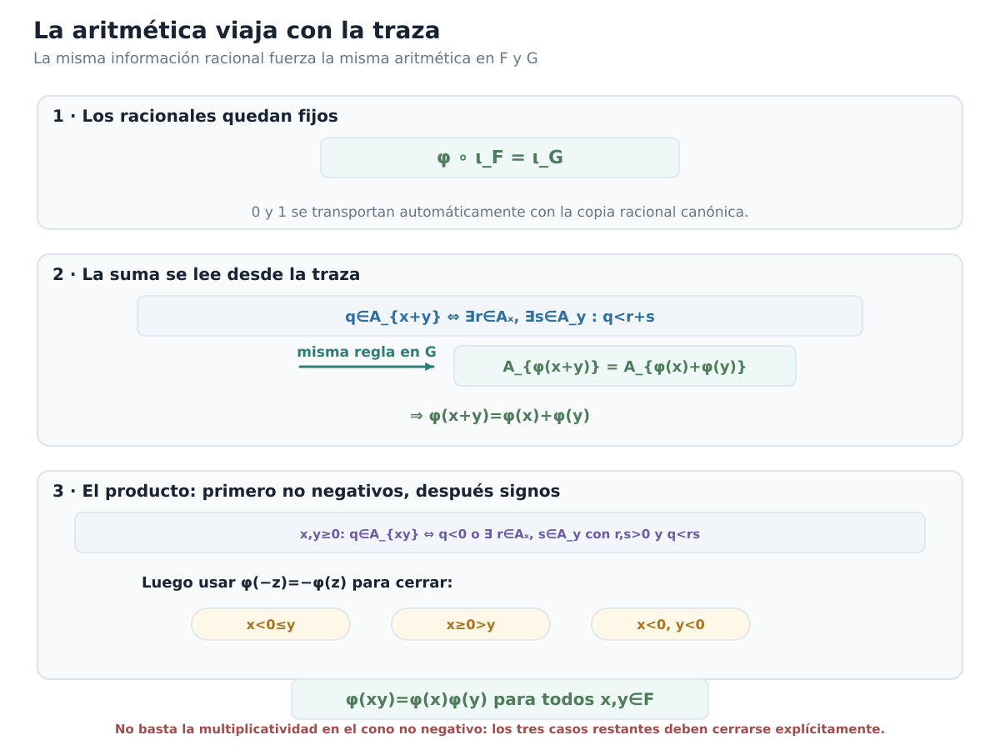{#fig-anm-c00-f12 fig-alt="Tres paneles: racionales fijos, caracterización de la suma por trazas y caracterización del producto en no negativos seguida por tres casos de signo y conclusión de multiplicatividad total."}

### Ya tenemos un isomorfismo de cuerpos ordenados

Podemos reunir el tablero de obligaciones.

La función

$$
\phi:F\longrightarrow G
$$

es:

- bien definida;
- biyectiva;
- preserva y refleja el orden;
- preserva $0$ y $1$;
- preserva la suma;
- preserva los opuestos;
- preserva el producto para todos los signos;
- preserva inversos;
- satisface
  $$
  \phi\circ\iota_F=\iota_G.
  $$

Por tanto

$$
\boxed{
\phi:F\longrightarrow G
\text{ es un isomorfismo de cuerpos ordenados}.
}
$$

La existencia de un isomorfismo está demostrada.

Pero todavía debemos responder una última cuestión: ¿podría existir otro?

### Cualquier isomorfismo ordenado está obligado a fijar los racionales

Sea

$$
T:F\longrightarrow G
$$

un isomorfismo de cuerpos ordenados cualquiera.

La composición

$$
T\circ\iota_F:\mathbb Q\longrightarrow G
$$

es también una incrustación de cuerpos ordenados: $T$ preserva $0$, $1$, suma, producto y orden.

Pero en §0.9 demostramos que la copia racional en un cuerpo ordenado es **canónica y única**.

Por tanto

$$
\boxed{
T\circ\iota_F=\iota_G.
}
$$

Así todo isomorfismo de cuerpos ordenados entre $F$ y $G$ fija automáticamente la copia racional, en el sentido estructural correcto.

### La traza fuerza la unicidad punto por punto

Fijemos $x\in F$.

Para cualquier $q\in\mathbb Q$,

$$
\begin{aligned}
q\in A_x
&\Longleftrightarrow
\iota_F(q)<x\\
&\Longleftrightarrow
T(\iota_F(q))<T(x)\\
&\Longleftrightarrow
\iota_G(q)<T(x)\\
&\Longleftrightarrow
q\in A_{T(x)}.
\end{aligned}
$$

Por tanto

$$
\boxed{
A_{T(x)}=A_x.
}
$$

Pero el transporte canónico también satisface

$$
\boxed{
A_{\phi(x)}=A_x.
}
$$

Luego

$$
A_{T(x)}=A_{\phi(x)}.
$$

La traza racional determina al elemento de $G$. En consecuencia,

$$
T(x)=\phi(x).
$$

Como esto vale para todo $x\in F$,

$$
\boxed{
T=\phi.
}
$$

Hemos demostrado la conclusión fuerte:

> **Teorema de unicidad.** Si $F$ y $G$ son cuerpos ordenados completos, existe un único isomorfismo de cuerpos ordenados
>
> $$
> \boxed{
> \phi:F\longrightarrow G.
> }
> $$

Ese isomorfismo es el transporte canónico determinado por las trazas racionales.

Tomando $F=G$, obtenemos además una rigidez importante:

$$
\boxed{
\text{todo automorfismo de cuerpo ordenado de }F
\text{ es la identidad}.
}
$$

En efecto, necesariamente fija la copia racional y, por la misma prueba, fija cada traza y por tanto cada elemento.

### Qué significa realmente «únicos»

Podemos cerrar ahora la distinción que quedó pendiente desde §0.1.

Sean $F$ y $G$ dos sistemas que satisfacen la especificación de los números reales.

No hemos demostrado

$$
F=G
$$

como conjuntos.

Sus elementos pueden ser objetos literalmente distintos. Un modelo puede estar construido con cortaduras; otro podría usar una codificación completamente diferente.

Lo que hemos probado es:

```text
LITERAL_EQUALITY = NOT_REQUIRED
EXISTS_AN_ORDERED_FIELD_ISOMORPHISM = YES
UNIQUE_ORDERED_FIELD_ISOMORPHISM = YES
```

Es decir,

$$
\boxed{
F\cong G
\quad
\text{mediante un único isomorfismo de cuerpos ordenados}.
}
$$

La estructura no depende de la implementación.

También conviene distinguir otra idea:

$$
\boxed{
\text{canónico por unicidad}
\neq
\text{computable}.
}
$$

La fórmula de $\phi$ mediante trazas racionales y supremos determina una función matemática única. Eso no afirma que, dada una representación arbitraria de elementos de $F$ y $G$, exista automáticamente un algoritmo que calcule sus imágenes.

Nuestra cuestión aquí era estructural, y esa cuestión queda completamente resuelta.

### El cierre de las dos preguntas

Podemos volver finalmente a la apertura del capítulo.

Primera pregunta:

$$
\boxed{\text{¿existe un cuerpo ordenado completo?}}
$$

Respuesta de §§0.4–0.8:

$$
\boxed{\text{sí}.}
$$

Las cortaduras de Dedekind proporcionan uno.

Segunda pregunta:

$$
\boxed{
\text{si existen dos, ¿pueden ser esencialmente distintos?}
}
$$

Respuesta de §§0.9–0.10:

$$
\boxed{\text{no}.}
$$

Cualesquiera dos cuerpos ordenados completos están relacionados por un único isomorfismo de cuerpos ordenados.

Podemos condensar el resultado central del capítulo:

$$
\boxed{
\text{EXISTENCIA}
+
\text{UNICIDAD HASTA ÚNICO ISOMORFISMO}
=
\text{JUSTIFICACIÓN ESTRUCTURAL DE }\mathbb R.
}
$$

Desde el punto de vista matemático, esto es lo que autoriza hablar de **los números reales** sin convertir una construcción concreta en una definición ontológica obligatoria.

Las cortaduras son una realización.

La estructura de cuerpo ordenado completo es lo que todas las realizaciones comparten.

La figura [C00-F10](#fig-anm-c00-f10) concentra esta lectura en un único mapa visual.

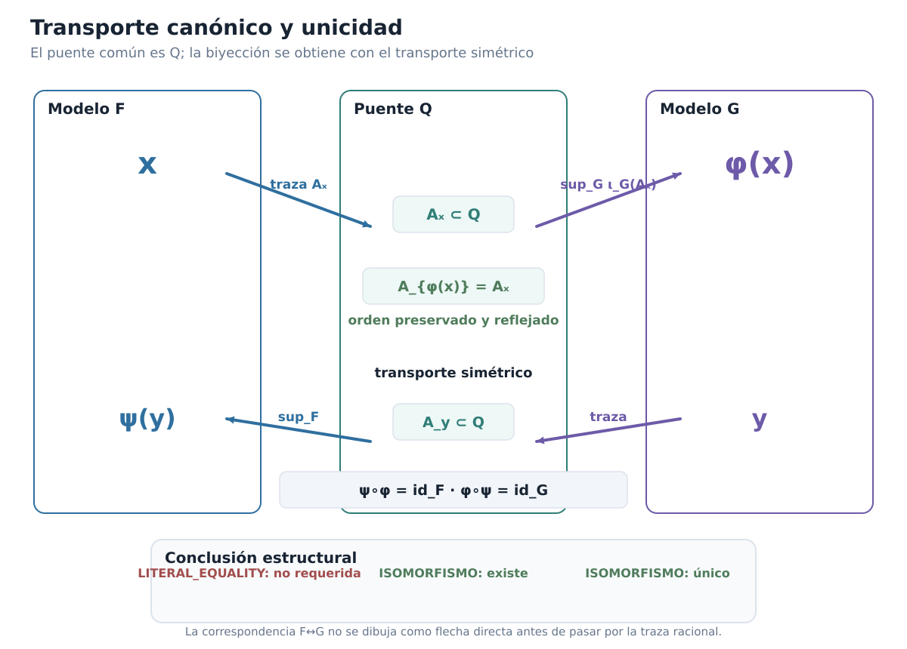{#fig-anm-c00-f10 fig-alt="Tres universos F, Q y G muestran x→Aₓ→φ(x) y el transporte simétrico y→A_y→ψ(y); un panel final distingue igualdad literal, existencia de isomorfismo y unicidad."}

El estado narrativo final es:

```text
EXISTENCE_QUESTION = CLOSED
UNIQUENESS_QUESTION = CLOSED
REAL_NUMBER_STRUCTURE = CANONICAL_UP_TO_UNIQUE_ORDERED_FIELD_ISOMORPHISM
```

### Antes de cerrar el manuscrito del capítulo

#### Microcontrol 74

[]{#MA-MIC-ANM-01-000-074}

¿Por qué no está bien definida $\phi(x)=\sup_G\iota_G(A_x)$ hasta comprobar no vaciedad y acotación de $\iota_G(A_x)$?

[]{#MA-MSOL-ANM-01-000-074}

<details class="anm-solution">
<summary>Ver solución del microcontrol 74</summary>

**Respuesta.**

La expresión

$$
\phi(x)=\sup_G\iota_G(A_x)
$$

sólo tiene sentido si el conjunto del que tomamos el supremo satisface las hipótesis de completitud: debe ser no vacío y estar acotado superiormente en $G$.

Como $A_x$ es una cortadura, $A_x\ne\varnothing$, luego $\iota_G(A_x)\ne\varnothing$. Además, como $A_x\ne\mathbb Q$, podemos elegir $u\notin A_x$. Para todo $q\in A_x$ se tiene $q<u$: si $q=u$ o $u<q$, la clausura inferior de $A_x$ obligaría a $u\in A_x$. Por tanto

$$
\iota_G(q)<\iota_G(u)
\qquad(q\in A_x),
$$

y $\iota_G(u)$ es una cota superior. Sólo después de estas dos verificaciones queda legítimamente definida

$$
\boxed{\phi(x)=\sup_G\iota_G(A_x).}
$$

**Fundamento en la sección 0.10.**

Ahora sí hemos verificado:

$$
\iota_G(A_x)\ne\varnothing
$$

y

$$
\iota_G(A_x)\text{ está acotado superiormente en }G.
$$

Aquí aparece el primer gasto de completitud de esta sección. Como $G$ es completo, existe el supremo de ese conjunto.

Podemos definir, legítimamente,

$$
\boxed{
\phi:F\longrightarrow G,
\qquad
\phi(x)
=
\sup_G\{\iota_G(q):q\in A_x\}.
}
$$

</details>

#### Microcontrol 75

[]{#MA-MIC-ANM-01-000-075}

¿Dónde se usa exactamente la completitud de $G$ al construir $\phi$?

[]{#MA-MSOL-ANM-01-000-075}

<details class="anm-solution">
<summary>Ver solución del microcontrol 75</summary>

**Respuesta.**

La completitud de $G$ se gasta una vez comprobado que

$$
\iota_G(A_x)\ne\varnothing
$$

y que este conjunto posee una cota superior en $G$. Entonces la propiedad del supremo garantiza la existencia de

$$
\boxed{\sup_G\iota_G(A_x).}
$$

Nada anterior en la construcción de $A_x$ o de la copia racional de $G$ necesita completitud. La hipótesis adicional de que $G$ es completo se usa precisamente para convertir la información racional transportada en un elemento concreto de $G$.

**Fundamento en la sección 0.10.**

Ahora sí hemos verificado:

$$
\iota_G(A_x)\ne\varnothing
$$

y

$$
\iota_G(A_x)\text{ está acotado superiormente en }G.
$$

Aquí aparece el primer gasto de completitud de esta sección. Como $G$ es completo, existe el supremo de ese conjunto.

Podemos definir, legítimamente,

$$
\boxed{
\phi:F\longrightarrow G,
\qquad
\phi(x)
=
\sup_G\{\iota_G(q):q\in A_x\}.
}
$$

</details>

#### Microcontrol 76

[]{#MA-MIC-ANM-01-000-076}

Demuestra que $A_{\phi(x)}=A_x$ y explica por qué la ausencia de máximo de $A_x$ es necesaria para una de las inclusiones.

[]{#MA-MSOL-ANM-01-000-076}

<details class="anm-solution">
<summary>Ver solución del microcontrol 76</summary>

**Respuesta.**

Sea

$$
S_x=\iota_G(A_x),
\qquad
\phi(x)=\sup_G S_x.
$$

Para probar $A_x\subseteq A_{\phi(x)}$, tomamos $q\in A_x$. Como $A_x$ **no tiene máximo**, existe $r\in A_x$ con $q<r$. Entonces

$$
\iota_G(q)<\iota_G(r)\le\phi(x),
$$

por lo que $\iota_G(q)<\phi(x)$ y $q\in A_{\phi(x)}$. La ausencia de máximo es exactamente lo que convierte la desigualdad no estricta $\iota_G(r)\le\phi(x)$ en una desigualdad estricta para $q$.

Para la otra inclusión, supongamos $q\in A_{\phi(x)}$ pero $q\notin A_x$. Todo $r\in A_x$ satisface $r<q$, luego $\iota_G(q)$ es cota superior de $S_x$. Por minimalidad del supremo,

$$
\phi(x)\le\iota_G(q),
$$

contradiciendo $\iota_G(q)<\phi(x)$. Por tanto

$$
\boxed{A_{\phi(x)}=A_x.}
$$

**Fundamento en la sección 0.10.**

Luego necesariamente

$$
q\in A_x.
$$

Hemos obtenido la segunda inclusión y, por tanto,

$$
\boxed{
A_{\phi(x)}=A_x.
}
$$

$\square$

Este resultado explica exactamente qué hace $\phi$. No transporta la representación conjuntista de $x$; transporta su **posición racional**.

En §0.9 demostramos que, en cualquier cuerpo ordenado completo,

</details>

#### Microcontrol 77

[]{#MA-MIC-ANM-01-000-077}

¿Por qué la igualdad de trazas implica que $\phi$ preserva y refleja el orden?

[]{#MA-MSOL-ANM-01-000-077}

<details class="anm-solution">
<summary>Ver solución del microcontrol 77</summary>

**Respuesta.**

En §0.9 se demostró, dentro de cualquier cuerpo ordenado completo,

$$
x\le y
\Longleftrightarrow
A_x\subseteq A_y,
$$

y análogamente para el orden estricto mediante inclusión estricta.

Como

$$
A_{\phi(x)}=A_x,
\qquad
A_{\phi(y)}=A_y,
$$

tenemos

$$
x\le y
\Longleftrightarrow
A_x\subseteq A_y
\Longleftrightarrow
A_{\phi(x)}\subseteq A_{\phi(y)}
\Longleftrightarrow
\phi(x)\le\phi(y).
$$

Por tanto $\phi$ preserva y refleja el orden. En particular,

$$
\boxed{x<y\Longleftrightarrow\phi(x)<\phi(y).}
$$

**Fundamento en la sección 0.10.**

Hemos obtenido la segunda inclusión y, por tanto,

$$
\boxed{
A_{\phi(x)}=A_x.
}
$$

$\square$

Este resultado explica exactamente qué hace $\phi$. No transporta la representación conjuntista de $x$; transporta su **posición racional**.

En §0.9 demostramos que, en cualquier cuerpo ordenado completo,

$$
x\le y
\quad\Longleftrightarrow\quad
A_x\subseteq A_y
$$

y

</details>

#### Microcontrol 78

[]{#MA-MIC-ANM-01-000-078}

Explica por qué la construcción simétrica $\psi:G\to F$ demuestra sobreyectividad sin elegir preimágenes.

[]{#MA-MSOL-ANM-01-000-078}

<details class="anm-solution">
<summary>Ver solución del microcontrol 78</summary>

**Respuesta.**

Intercambiamos los papeles de los cuerpos y definimos

$$
\psi:G\to F,
\qquad
\psi(y)=\sup_F\iota_F(A_y^G).
$$

La misma prueba da

$$
A_{\psi(y)}^F=A_y^G.
$$

Entonces, para $x\in F$,

$$
A_{\psi(\phi(x))}^F
=A_{\phi(x)}^G
=A_x^F,
$$

y la reconstrucción desde la traza fuerza

$$
\psi(\phi(x))=x.
$$

Simétricamente,

$$
\phi(\psi(y))=y
\qquad(y\in G).
$$

Así

$$
\boxed{\psi=\phi^{-1}},
$$

y $\phi$ es sobreyectiva. No se eligió una preimagen entre varias: la preimagen de $y$ está canónicamente determinada como $\psi(y)$.

**Fundamento en la sección 0.10.**

Simétricamente, para todo $y\in G$,

$$
\boxed{\phi(\psi(y))=y.}
$$

Así,

$$
\boxed{
\psi=\phi^{-1}.
}
$$

En particular,

$$
\boxed{
\phi:F\longrightarrow G
\text{ es biyectiva}.
}
$$

La sobreyectividad no proviene de contar elementos ni de una elección sobre fibras. La preimagen de $y$ está dada canónicamente por $\psi(y)$.

</details>

#### Microcontrol 79

[]{#MA-MIC-ANM-01-000-079}

¿Por qué $\phi(\iota_F(q))=\iota_G(q)$ para todo racional $q$?

[]{#MA-MSOL-ANM-01-000-079}

<details class="anm-solution">
<summary>Ver solución del microcontrol 79</summary>

**Respuesta.**

Para $q\in\mathbb Q$,

$$
A_{\iota_F(q)}
=\{r\in\mathbb Q:r<q\}
=q^*,
$$

porque $\iota_F$ preserva y refleja el orden. Del mismo modo,

$$
A_{\iota_G(q)}=q^*.
$$

Como $\phi$ conserva la traza,

$$
A_{\phi(\iota_F(q))}
=A_{\iota_F(q)}
=q^*
=A_{\iota_G(q)}.
$$

La traza determina al elemento en $G$, luego

$$
\boxed{\phi(\iota_F(q))=\iota_G(q).}
$$

Equivalente:

$$
\boxed{\phi\circ\iota_F=\iota_G.}
$$

En particular, $\phi(0_F)=0_G$ y $\phi(1_F)=1_G$.

**Fundamento en la sección 0.10.**

La traza determina al elemento en $G$. Por tanto

$$
\boxed{
\phi(\iota_F(q))=\iota_G(q)
\qquad(q\in\mathbb Q).
}
$$

Es decir,

$$
\boxed{
\phi\circ\iota_F=\iota_G.
}
$$

En particular,

$$
\boxed{
\phi(0_F)=0_G,
\qquad
\phi(1_F)=1_G.
}
$$

Para demostrar que $\phi$ conserva la suma evitaremos intentar calcular directamente el supremo de $A_{x+y}$.

</details>

#### Microcontrol 80

[]{#MA-MIC-ANM-01-000-080}

Reconstruye la caracterización racional de $A_{x+y}$ y señala las dos aplicaciones de densidad.

[]{#MA-MSOL-ANM-01-000-080}

<details class="anm-solution">
<summary>Ver solución del microcontrol 80</summary>

**Respuesta.**

Para $q\in\mathbb Q$,

$$
\boxed{
q\in A_{x+y}
\Longleftrightarrow
\exists r\in A_x\;\exists s\in A_y:\ q<r+s.
}
$$

Si $q\in A_{x+y}$, entonces

$$
\iota_F(q)-y<x.
$$

**Primera aplicación de densidad:** elegimos $r\in\mathbb Q$ con

$$
\iota_F(q)-y<\iota_F(r)<x.
$$

Así $r\in A_x$ y

$$
\iota_F(q)-\iota_F(r)<y.
$$

**Segunda aplicación de densidad:** elegimos $s\in\mathbb Q$ con

$$
\iota_F(q)-\iota_F(r)<\iota_F(s)<y.
$$

Entonces $s\in A_y$ y $q<r+s$.

La recíproca usa sólo preservación de suma y orden de la copia racional: si $r\in A_x$, $s\in A_y$ y $q<r+s$, entonces

$$
\iota_F(q)<\iota_F(r)+\iota_F(s)<x+y.
$$

**Fundamento en la sección 0.10.**

La composición

$$
T\circ\iota_F:\mathbb Q\longrightarrow G
$$

es también una incrustación de cuerpos ordenados: $T$ preserva $0$, $1$, suma, producto y orden.

Pero en §0.9 demostramos que la copia racional en un cuerpo ordenado es **canónica y única**.

Por tanto

$$
\boxed{
T\circ\iota_F=\iota_G.
}
$$

Así todo isomorfismo de cuerpos ordenados entre $F$ y $G$ fija automáticamente la copia racional, en el sentido estructural correcto.

</details>

#### Microcontrol 81

[]{#MA-MIC-ANM-01-000-081}

¿Por qué la caracterización de $A_{xy}$ se formula primero para $x,y\ge0$?

[]{#MA-MSOL-ANM-01-000-081}

<details class="anm-solution">
<summary>Ver solución del microcontrol 81</summary>

La multiplicación interactúa con el orden de forma uniforme sólo cuando controlamos los signos. Si

$$
0\le x,
\qquad
0\le y,
$$

entonces multiplicar o dividir desigualdades por $x$, $y$ o por racionales positivos no invierte el orden.

Eso permite caracterizar $A_{xy}$ mediante testigos racionales positivos:

$$
q\in A_{xy}
\Longleftrightarrow
q<0
\text{ o }
\exists r,s>0:
r\in A_x,
\ s\in A_y,
\ q<rs.
$$

Sin fijar primero los signos, una multiplicación por un factor negativo podría invertir desigualdades y el mismo criterio dejaría de ser válido. Por eso el argumento se establece primero en el cono no negativo y después se extiende algebraicamente al resto de los casos.

</details>

#### Microcontrol 82

[]{#MA-MIC-ANM-01-000-082}

Recorre los tres casos adicionales de signo necesarios para extender la multiplicatividad a todo $F$.

[]{#MA-MSOL-ANM-01-000-082}

<details class="anm-solution">
<summary>Ver solución del microcontrol 82</summary>

**Respuesta.**

El caso $x,y\ge0$ ya está probado. Quedan tres posibilidades.

1. Si $x<0\le y$, entonces $-x>0$ y
   $$
   xy=-((-x)y).
   $$
   Por preservación del opuesto y multiplicatividad en no negativos,
   $$
   \phi(xy)=\phi(x)\phi(y).
   $$
2. Si $x\ge0>y$, el argumento es simétrico usando $-y>0$.
3. Si $x<0$ y $y<0$, entonces $-x,-y>0$ y
   $$
   xy=(-x)(-y).
   $$
   Por el caso positivo y $\phi(-z)=-\phi(z)$,
   $$
   \phi(xy)=(-\phi(x))(-\phi(y))=\phi(x)\phi(y).
   $$

Así

$$
\boxed{\phi(xy)=\phi(x)\phi(y)}
$$

para todos $x,y\in F$.

**Fundamento en la sección 0.10.**

Por unicidad del inverso aditivo,

$$
\boxed{
\phi(-x)=-\phi(x).
}
$$

Así también se conserva la resta.

La multiplicación exige una precaución adicional: el orden del producto se comporta limpiamente al trabajar primero con factores no negativos.

Sean

$$
0_F\le x,
\qquad
0_F\le y.
$$

Para $q\in\mathbb Q$ tenemos la siguiente caracterización.

</details>

#### Microcontrol 83

[]{#MA-MIC-ANM-01-000-083}

¿Por qué cualquier isomorfismo de cuerpos ordenados $T:F\to G$ debe enviar la copia racional canónica de $F$ a la de $G$?

[]{#MA-MSOL-ANM-01-000-083}

<details class="anm-solution">
<summary>Ver solución del microcontrol 83</summary>

**Respuesta.**

Sea

$$
T:F\to G
$$

un isomorfismo de cuerpos ordenados. Entonces

$$
T\circ\iota_F:\mathbb Q\to G
$$

es otra incrustación de cuerpos ordenados: preserva $0$, $1$, suma, producto y orden.

Pero §0.9 demostró que la incrustación racional en un cuerpo ordenado es única: debe enviar $1$ a $1_G$, con lo que fija numerales, enteros y fracciones. Por tanto

$$
\boxed{T\circ\iota_F=\iota_G.}
$$

Todo isomorfismo posible coincide sobre la copia racional canónica.

**Fundamento en la sección 0.10.**

es también una incrustación de cuerpos ordenados: $T$ preserva $0$, $1$, suma, producto y orden.

Pero en §0.9 demostramos que la copia racional en un cuerpo ordenado es **canónica y única**.

Por tanto

$$
\boxed{
T\circ\iota_F=\iota_G.
}
$$

Así todo isomorfismo de cuerpos ordenados entre $F$ y $G$ fija automáticamente la copia racional, en el sentido estructural correcto.

Fijemos $x\in F$.

Para cualquier $q\in\mathbb Q$,

</details>

#### Microcontrol 84

[]{#MA-MIC-ANM-01-000-084}

Explica por qué conservar la misma traza racional fuerza $T(x)=\phi(x)$.

[]{#MA-MSOL-ANM-01-000-084}

<details class="anm-solution">
<summary>Ver solución del microcontrol 84</summary>

**Respuesta.**

Para $q\in\mathbb Q$,

$$
q\in A_x
\Longleftrightarrow
\iota_F(q)<x.
$$

Como $T$ preserva y refleja el orden y satisface $T(\iota_F(q))=\iota_G(q)$,

$$
q\in A_x
\Longleftrightarrow
\iota_G(q)<T(x)
\Longleftrightarrow
q\in A_{T(x)}.
$$

Luego

$$
A_{T(x)}=A_x.
$$

El transporte canónico también satisface

$$
A_{\phi(x)}=A_x.
$$

Por tanto $A_{T(x)}=A_{\phi(x)}$. Como la traza racional determina al elemento de $G$,

$$
\boxed{T(x)=\phi(x).}
$$

Esto vale para todo $x$, así que $T=\phi$.

**Fundamento en la sección 0.10.**

Además, como $\psi$ se construye por el mismo procedimiento, también preserva y refleja el orden. Por tanto $\phi$ ya es un isomorfismo de los órdenes lineales subyacentes.

Falta demostrar que conserva la aritmética.

Sea $q\in\mathbb Q$.

La traza racional de $\iota_F(q)$ es

$$
A_{\iota_F(q)}
=
\{r\in\mathbb Q:r<q\}
=
q^*.
$$

En efecto,

$$
r\in A_{\iota_F(q)}
\Longleftrightarrow
\iota_F(r)<\iota_F(q)
\Longleftrightarrow
r<q.
$$

</details>

#### Microcontrol 85

[]{#MA-MIC-ANM-01-000-085}

Distingue cuidadosamente:
- igualdad literal;
- existencia de un isomorfismo;
- existencia de un único isomorfismo de cuerpos ordenados.

[]{#MA-MSOL-ANM-01-000-085}

<details class="anm-solution">
<summary>Ver solución del microcontrol 85</summary>

Son tres afirmaciones distintas.

- **Igualdad literal:** $F=G$ significa que ambos modelos son exactamente el mismo conjunto con las mismas operaciones. No se exige ni se demuestra.
- **Existencia de un isomorfismo:** $F\cong G$ afirma que existe una biyección que preserva las operaciones y el orden. Esto demuestra equivalencia estructural.
- **Existencia de un único isomorfismo de cuerpos ordenados:** además de existir, esa correspondencia está completamente forzada por la estructura; cualquier isomorfismo $T:F\to G$ coincide con $\phi$.

El resultado del capítulo es la tercera afirmación:

$$
\boxed{\text{entre dos cuerpos ordenados completos existe un único isomorfismo de cuerpos ordenados}.}
$$

</details>

#### Microcontrol 86

[]{#MA-MIC-ANM-01-000-086}

¿Por qué la unicidad estructural no implica por sí sola computabilidad del transporte?

[]{#MA-MSOL-ANM-01-000-086}

<details class="anm-solution">
<summary>Ver solución del microcontrol 86</summary>

**Respuesta.**

La construcción

$$
x\mapsto A_x\mapsto \iota_G(A_x)\mapsto\sup_G\iota_G(A_x)
$$

determina matemáticamente un único valor $\phi(x)$. Eso es una afirmación de **existencia y unicidad** dentro de la teoría.

Un algoritmo, en cambio, requiere representaciones efectivas de los elementos, procedimientos para decidir o enumerar la información racional relevante y un método computable para obtener el supremo correspondiente.

Nada de la prueba estructural proporciona automáticamente esos datos para representaciones arbitrarias de $F$ y $G$. Por tanto

$$
\boxed{\text{canónico por unicidad}\ne\text{computable por sí solo}.}
$$

**Fundamento en la sección 0.10.**

Es decir,

$$
\boxed{
F\cong G
\quad
\text{mediante un único isomorfismo de cuerpos ordenados}.
}
$$

La estructura no depende de la implementación.

También conviene distinguir otra idea:

$$
\boxed{
\text{canónico por unicidad}
\neq
\text{computable}.
}
$$

La fórmula de $\phi$ mediante trazas racionales y supremos determina una función matemática única. Eso no afirma que, dada una representación arbitraria de elementos de $F$ y $G$, exista automáticamente un algoritmo que calcule sus imágenes.

Nuestra cuestión aquí era estructural, y esa cuestión queda completamente resuelta.

</details>

#### Microcontrol 87

[]{#MA-MIC-ANM-01-000-087}

Explica en qué sentido las cortaduras de Dedekind son una realización de los reales, pero no su «esencia conjuntista».

[]{#MA-MSOL-ANM-01-000-087}

<details class="anm-solution">
<summary>Ver solución del microcontrol 87</summary>

Las cortaduras de Dedekind proporcionan un modelo concreto

$$
\mathcal D
$$

que satisface la especificación de cuerpo ordenado completo. Por eso prueban **existencia**.

Pero §0.10 muestra que cualquier otro cuerpo ordenado completo $F$ está relacionado con $\mathcal D$ —y con cualquier otro modelo $G$— por un único isomorfismo de cuerpos ordenados. Los elementos subyacentes pueden ser objetos conjuntistas completamente distintos.

Por tanto lo que queda fijado matemáticamente no es una codificación concreta, sino la estructura compartida:

$$
\boxed{
\text{cuerpo ordenado completo, canónico hasta único isomorfismo}.
}
$$

Las cortaduras son una realización especialmente útil de esa estructura; no son una afirmación de que los reales deban ser, «por esencia», subconjuntos de $\mathbb Q$.

</details>
Con esto, el arco matemático del capítulo queda completo. Construimos un modelo, demostramos que satisface la especificación y después demostramos que cualquier otro modelo con la misma especificación posee exactamente la misma estructura.

A partir del capítulo siguiente podremos trabajar con $\mathbb R$ sin ocultar qué justifica ese símbolo: existe un cuerpo ordenado completo y su estructura está determinada, hasta único isomorfismo, por esas propiedades.

## Lectura complementaria

[*La construcción de los reales*](https://matematicaabierta.cl/libros/otros/la-construccion-de-los-reales.html) ofrece otra ruta de demostración de la unicidad mediante operaciones con conjuntos y supremos, y desarrolla operaciones sobre cortaduras mediante recintos racionales. Puede leerse después de este capítulo para comparar estrategias y estudiar sus comprobaciones adicionales. La [guía de lectura](https://matematicaabierta.cl/blog/la-construccion-de-los-reales-existencia-unicidad-y-dos-caminos.html) explica la relación entre ambas exposiciones y da acceso al libro completo, con sus 78 ejercicios resueltos.

## Lectura complementaria

[*La construcción de los reales*](../otros/la-construccion-de-los-reales.html) ofrece otra ruta de demostración de la unicidad mediante operaciones con conjuntos y supremos, y desarrolla operaciones sobre cortaduras mediante recintos racionales. Puede leerse después de este capítulo para comparar estrategias y estudiar sus comprobaciones adicionales. La [guía de lectura](../../blog/la-construccion-de-los-reales-existencia-unicidad-y-dos-caminos.html) explica la relación entre ambas exposiciones y da acceso al libro completo, con sus 78 ejercicios resueltos.

### Ejercicios de la sección 0.10

#### Ejercicio 43. Antes del transporte: demostrar que el supremo existe

[]{#MA-EX-ANM-01-000-043}

Sean $F$ y $G$ cuerpos ordenados completos, con incrustaciones racionales canónicas

$$
\iota_F:\mathbb Q\hookrightarrow F,
\qquad
\iota_G:\mathbb Q\hookrightarrow G.
$$

Para $x\in F$, sea

$$
A_x^F=\{q\in\mathbb Q:\iota_F(q)<x\}.
$$

Queremos definir

$$
\phi(x)=\sup_G\iota_G(A_x^F).
$$

No uses esa fórmula hasta haber verificado que el supremo está autorizado.

1. Escribe los tipos correctos de $x$, $A_x^F$, $\iota_G(A_x^F)$ y del eventual valor $\phi(x)$.
2. Demuestra que $\iota_G(A_x^F)$ es no vacío.
3. Como $A_x^F$ es una cortadura, elige $u\in\mathbb Q\setminus A_x^F$ y demuestra que

$$
q<u
\qquad(q\in A_x^F).
$$

4. Deduce que $\iota_G(u)$ es una cota superior de $\iota_G(A_x^F)$.
5. Señala exactamente dónde se usa la completitud de $G$ y, sólo entonces, define

$$
\boxed{\phi:F\longrightarrow G,
\qquad
\phi(x)=\sup_G\{\iota_G(q):q\in A_x^F\}.}
$$

6. Explica por qué la definición no contiene una elección arbitraria de representante ni de cota superior.

[]{#MA-SOL-ANM-01-000-043}

<details class="anm-solution">
<summary>Ver solución del ejercicio 43</summary>

Los universos deben mantenerse separados. Tenemos

$$
x\in F,
\qquad
A_x^F\subseteq\mathbb Q,
$$

mientras que

$$
\iota_G(A_x^F)
=
\{\iota_G(q):q\in A_x^F\}
\subseteq G.
$$

Si el supremo existe, entonces

$$
\phi(x)\in G.
$$

La no vaciedad es inmediata porque §0.9 ya demostró que $A_x^F$ es una cortadura. Elijamos

$$
r\in A_x^F.
$$

Entonces

$$
\iota_G(r)\in\iota_G(A_x^F),
$$

así que la imagen no es vacía.

Para la acotación superior usamos que la cortadura es propia. Elijamos

$$
u\in\mathbb Q\setminus A_x^F.
$$

Afirmamos que todo $q\in A_x^F$ satisface $q<u$. Si $q=u$, tendríamos $u\in A_x^F$. Si $u<q$, como $q\in A_x^F$ y la cortadura es cerrada hacia abajo, también tendríamos $u\in A_x^F$. Ambas posibilidades contradicen la elección de $u$. Por tricotomía,

$$
q<u.
$$

Como $\iota_G$ preserva el orden,

$$
\iota_G(q)<\iota_G(u)
\qquad(q\in A_x^F).
$$

Por tanto $\iota_G(u)$ es una cota superior de $\iota_G(A_x^F)$.

Hasta aquí no hemos usado completitud de $G$. Ahora sí: el conjunto es no vacío y está acotado superiormente, así que la propiedad del supremo de $G$ garantiza la existencia de

$$
\sup_G\iota_G(A_x^F).
$$

Sólo después de verificar esas hipótesis queda legítimamente definida

$$
\boxed{
\phi:F\longrightarrow G,
\qquad
\phi(x)=\sup_G\{\iota_G(q):q\in A_x^F\}.
}
$$

No se elige una cota superior especial para definir el valor: una cota sólo certifica la hipótesis de acotación. Tampoco se elige entre varios supremos, porque el supremo de un subconjunto, cuando existe, es único. Así, $\phi(x)$ queda forzado por $x$ y por las estructuras de $F$ y $G$.

*Referencia visual.* Véase la figura [C00-F10](analisis-para-matematicos-capitulo-0-construir-los-numeros-reales.html#fig-anm-c00-f10) del texto principal, **Transporte canónico y unicidad**, como síntesis posterior de este argumento.

</details>

#### Ejercicio 44. El transporte conserva exactamente la traza racional

[]{#MA-EX-ANM-01-000-044}

Mantén la definición de $\phi$ del ejercicio 43. Para distinguir universos escribe

$$
A_x^F=\{q\in\mathbb Q:\iota_F(q)<x\},
$$

y, para $y\in G$,

$$
A_y^G=\{q\in\mathbb Q:\iota_G(q)<y\}.
$$

1. Demuestra la identidad central

$$
\boxed{A_{\phi(x)}^G=A_x^F}
$$

por doble inclusión. En la inclusión $A_x^F\subseteq A_{\phi(x)}^G$ debes usar que $A_x^F$ no tiene máximo.
2. Usa la caracterización del orden por inclusión de trazas obtenida en §0.9 para demostrar

$$
\boxed{x\le y\iff\phi(x)\le\phi(y)}
$$

y

$$
\boxed{x<y\iff\phi(x)<\phi(y)}.
$$

3. Deduce que $\phi$ es inyectiva.
4. Explica por qué el argumento demuestra más que monotonicidad: la posición racional de cada elemento queda transportada sin alteración.

> **Pista conceptual.** Para la inclusión inversa, si $q<\phi(x)$ pero $q\notin A_x^F$, muestra que $\iota_G(q)$ sería una cota superior de $\iota_G(A_x^F)$ menor que su supremo.

[]{#MA-SOL-ANM-01-000-044}

<details class="anm-solution">
<summary>Ver solución del ejercicio 44</summary>

Escribamos

$$
S_x=\iota_G(A_x^F),
\qquad
\phi(x)=\sup_GS_x.
$$

Primero probemos

$$
A_x^F\subseteq A_{\phi(x)}^G.
$$

Sea $q\in A_x^F$. Como $A_x^F$ no tiene máximo, existe $r\in A_x^F$ con

$$
q<r.
$$

Entonces

$$
\iota_G(q)<\iota_G(r).
$$

Además $\iota_G(r)\in S_x$, así que

$$
\iota_G(r)\le\sup_GS_x=\phi(x).
$$

Por tanto

$$
\iota_G(q)<\phi(x),
$$

y $q\in A_{\phi(x)}^G$.

Para la inclusión inversa, sea

$$
q\in A_{\phi(x)}^G.
$$

Entonces

$$
\iota_G(q)<\phi(x).
$$

Supongamos, buscando contradicción, que $q\notin A_x^F$. Como $A_x^F$ es una cortadura, para todo $r\in A_x^F$ debe cumplirse $r<q$: no puede ser $r=q$, y tampoco puede ocurrir $q<r$, pues la clausura hacia abajo forzaría $q\in A_x^F$.

Luego

$$
\iota_G(r)<\iota_G(q)
\qquad(r\in A_x^F).
$$

Así $\iota_G(q)$ sería una cota superior de $S_x$. La minimalidad del supremo daría

$$
\phi(x)=\sup_GS_x\le\iota_G(q),
$$

contradiciendo $\iota_G(q)<\phi(x)$. Por tanto $q\in A_x^F$.

Concluimos

$$
\boxed{A_{\phi(x)}^G=A_x^F}.
$$

Ahora sean $x,y\in F$. Por §0.9,

$$
x\le y
\iff
A_x^F\subseteq A_y^F.
$$

Usando la identidad de trazas,

$$
A_x^F\subseteq A_y^F
\iff
A_{\phi(x)}^G\subseteq A_{\phi(y)}^G
\iff
\phi(x)\le\phi(y).
$$

Así,

$$
\boxed{x\le y\iff\phi(x)\le\phi(y)}.
$$

La misma cadena con inclusiones estrictas produce

$$
\boxed{x<y\iff\phi(x)<\phi(y)}.
$$

En particular, si $\phi(x)=\phi(y)$, sus trazas son iguales; por la identidad anterior,

$$
A_x^F=A_y^F.
$$

La reconstrucción de §0.9 fuerza $x=y$. Luego $\phi$ es inyectiva.

El resultado es más fuerte que decir que $\phi$ es creciente: para cada $x$, el subconjunto de racionales situado debajo de $x$ es exactamente el mismo subconjunto que queda debajo de $\phi(x)$ en $G$. Se transporta la posición racional completa.

*Referencia visual.* Véase la figura [C00-F10](analisis-para-matematicos-capitulo-0-construir-los-numeros-reales.html#fig-anm-c00-f10) del texto principal, **Transporte canónico y unicidad**, como síntesis posterior de este argumento.

</details>

#### Ejercicio 45. Construir la inversa sin cardinalidad ni elección de preimágenes

[]{#MA-EX-ANM-01-000-045}

Intercambia ahora los papeles de $F$ y $G$ y define, cuando esté justificado,

$$
\psi:G\longrightarrow F,
\qquad
\psi(y)=\sup_F\{\iota_F(q):q\in A_y^G\}.
$$

1. Traza la buena definición de $\psi$ y señala el gasto de completitud de $F$.
2. Demuestra

$$
A_{\psi(y)}^F=A_y^G.
$$

3. Para $x\in F$, calcula la traza de $\psi(\phi(x))$ y usa la reconstrucción desde trazas para demostrar

$$
\boxed{\psi(\phi(x))=x}.
$$

4. Demuestra simétricamente

$$
\boxed{\phi(\psi(y))=y}
$$

para todo $y\in G$.
5. Concluye que $\psi=\phi^{-1}$ y que $\phi$ es biyectiva.
6. Resume en un mapa de dependencias por qué la sobreyectividad obtenida aquí no usa cardinalidad de $F$ y $G$, ni una elección arbitraria de preimágenes.

> **Pista conceptual.** No busques un preimagen de $y$ por tanteo: reconstruye en $F$ el elemento que tenga exactamente la misma traza racional que $y$.

[]{#MA-SOL-ANM-01-000-045}

<details class="anm-solution">
<summary>Ver solución del ejercicio 45</summary>

Para $y\in G$, la traza

$$
A_y^G\subseteq\mathbb Q
$$

es una cortadura. Por el mismo argumento del ejercicio 43,

$$
\iota_F(A_y^G)
$$

es no vacío y está acotado superiormente en $F$. Aquí se gasta la completitud de $F$, que permite definir

$$
\boxed{
\psi(y)=\sup_F\{\iota_F(q):q\in A_y^G\}.
}
$$

Repitiendo literalmente el argumento de recuperación de traza del ejercicio 44 con $F$ y $G$ intercambiados, obtenemos

$$
\boxed{A_{\psi(y)}^F=A_y^G}.
$$

Sea ahora $x\in F$. Entonces

$$
\begin{aligned}
A_{\psi(\phi(x))}^F
&=A_{\phi(x)}^G\\
&=A_x^F.
\end{aligned}
$$

Dentro de $F$, la traza racional determina al elemento. Por tanto

$$
\boxed{\psi(\phi(x))=x}.
$$

Simétricamente, para $y\in G$,

$$
\begin{aligned}
A_{\phi(\psi(y))}^G
&=A_{\psi(y)}^F\\
&=A_y^G,
\end{aligned}
$$

y la reconstrucción en $G$ da

$$
\boxed{\phi(\psi(y))=y}.
$$

Así,

$$
\boxed{\psi=\phi^{-1}}.
$$

En particular, $\phi$ es biyectiva.

La dependencia completa es:

$$
\begin{array}{c}
\text{traza en }F\\
\downarrow\\
\text{completitud de }G\Rightarrow\phi\\
\downarrow\\
\text{misma traza en }G
\end{array}
\qquad
\begin{array}{c}
\text{traza en }G\\
\downarrow\\
\text{completitud de }F\Rightarrow\psi\\
\downarrow\\
\text{misma traza en }F.
\end{array}
$$

La composición recupera las trazas originales y, por tanto, los elementos originales. No se ha contado la cardinalidad de ningún modelo ni se ha escogido un preimagen de cada $y$ entre posibles candidatos: $\psi(y)$ está determinado canónicamente por la traza de $y$.

*Referencia visual.* Véase la figura [C00-F10](analisis-para-matematicos-capitulo-0-construir-los-numeros-reales.html#fig-anm-c00-f10) del texto principal, **Transporte canónico y unicidad**, como síntesis posterior de este argumento.

</details>

#### Ejercicio 46. Tres atajos que no producen un isomorfismo de cuerpos ordenados

[]{#MA-EX-ANM-01-000-046}

Refuta cada uno de los siguientes atajos.

1. **«Biyectiva y ordenada basta».** En un cuerpo ordenado completo $F$, considera

$$
\tau:F\longrightarrow F,
\qquad
\tau(x)=x+1_F.
$$

Demuestra que $\tau$ es biyectiva y preserva y refleja el orden, pero no es un homomorfismo de cuerpos.
2. **«Misma cardinalidad da sobreyectividad».** Explica por qué, aun si dos conjuntos tienen la misma cardinalidad, una aplicación inyectiva concreta entre ellos no tiene por qué ser sobreyectiva. Exhibe un ejemplo elemental explícito.
3. **«Multiplicatividad para no negativos basta».** Explica por qué demostrar

$$
\phi(xy)=\phi(x)\phi(y)
\qquad(x,y\ge0)
$$

no cubre los casos con uno o dos factores negativos.
4. Para cada atajo, indica cuál es la obligación correcta que debe reemplazarlo dentro de la prueba de unicidad de §0.10.

> **Pista conceptual.** Un isomorfismo de cuerpos ordenados debe conservar simultáneamente estructura algebraica, orden y elementos distinguidos; ninguna de esas capas se recupera automáticamente de las otras.

[]{#MA-SOL-ANM-01-000-046}

<details class="anm-solution">
<summary>Ver solución del ejercicio 46</summary>

Consideremos primero

$$
\tau(x)=x+1_F.
$$

Su inversa es

$$
\tau^{-1}(y)=y-1_F,
$$

así que $\tau$ es biyectiva. Además,

$$
x<y
\iff
x+1_F<y+1_F,
$$

por compatibilidad del orden con traslaciones. Por tanto preserva y refleja el orden.

Sin embargo,

$$
\tau(0_F)=1_F\ne0_F,
$$

y también

$$
\tau(x+y)=x+y+1_F,
$$

mientras que

$$
\tau(x)+\tau(y)=x+y+2_F.
$$

Por tanto no preserva cero ni suma. Mucho menos es un isomorfismo de cuerpos. La lección es

$$
\boxed{
\text{isomorfismo de órdenes}
\not\Rightarrow
\text{isomorfismo de cuerpos ordenados}.
}
$$

El segundo atajo confunde una propiedad de los conjuntos con una propiedad de una aplicación concreta. Por ejemplo, $\mathbb N$ tiene la misma cardinalidad que sí mismo, pero

$$
f:\mathbb N\longrightarrow\mathbb N,
\qquad
f(n)=n+1
$$

es inyectiva y no es sobreyectiva, porque $0$ no pertenece a su imagen. Por tanto, aun con igual cardinalidad, la sobreyectividad de una aplicación concreta necesita una prueba propia.

En §0.10 esa obligación se satisface construyendo explícitamente

$$
\psi:G\to F
$$

y demostrando que es inversa de $\phi$.

El tercer atajo deja casos lógicos abiertos. La afirmación

$$
\phi(xy)=\phi(x)\phi(y)
\qquad(x,y\ge0)
$$

sólo controla el cono no negativo. No contiene los casos

$$
x<0\le y,
\qquad
x\ge0>y,
\qquad
x<0,
\ y<0.
$$

Para cerrarlos se necesita primero la preservación del opuesto y luego la regla de signos. Por ejemplo, si $x<0\le y$,

$$
xy=-((-x)y),
$$

y el caso se reduce al producto de dos elementos no negativos sólo después de saber que

$$
\phi(-x)=-\phi(x).
$$

Las obligaciones correctas son, por tanto:

- para la biyectividad: construir y verificar una inversa;
- para la estructura de cuerpo: demostrar preservación de $0$, $1$, suma y producto;
- para la multiplicación: cerrar explícitamente todos los signos;
- para el orden: preservarlo y reflejarlo, sin confundir esa capa con la algebraica.

Ningún atajo sustituye esas verificaciones.

</details>

#### Ejercicio 47. Recuperar toda la aritmética desde las trazas

[]{#MA-EX-ANM-01-000-047}

Trabaja con el transporte canónico biyectivo $\phi:F\to G$ de los ejercicios 43–45.

1. Demuestra primero que, para todo $q\in\mathbb Q$,

$$
\boxed{\phi(\iota_F(q))=\iota_G(q)}.
$$

Deduce

$$
\phi(0_F)=0_G,
\qquad
\phi(1_F)=1_G.
$$

2. Demuestra la caracterización racional de la suma:

$$
\boxed{
q\in A_{x+y}^F
\iff
\exists r\in A_x^F\;\exists s\in A_y^F:
q<r+s.
}
$$

Usa densidad racional en los dos pasos necesarios de la implicación directa.
3. Como $\phi$ conserva trazas, deduce de esa caracterización

$$
\boxed{\phi(x+y)=\phi(x)+\phi(y)}
$$

y luego

$$
\phi(-x)=-\phi(x).
$$

4. Para $x,y\ge0$, demuestra la caracterización

$$
\boxed{
q\in A_{xy}^F
\iff
q<0
\ \text{o}\
\exists r,s>0:
\bigl(r\in A_x^F,
\ s\in A_y^F,
\ q<rs\bigr).
}
$$

5. Deduce

$$
\phi(xy)=\phi(x)\phi(y)
\qquad(x,y\ge0).
$$

6. Cierra **todos** los casos de signo y demuestra

$$
\boxed{\phi(xy)=\phi(x)\phi(y)}
$$

para $x,y\in F$ arbitrarios.
7. Deduce finalmente la preservación de inversos para $x\ne0_F$.

> **Pista conceptual.** No calcules directamente los supremos de $A_{x+y}$ o $A_{xy}$. Caracteriza primero esas trazas por racionales; después usa que igualdad de trazas implica igualdad de elementos.

[]{#MA-SOL-ANM-01-000-047}

<details class="anm-solution">
<summary>Ver solución del ejercicio 47</summary>

Primero fijamos la copia racional. Sea $q\in\mathbb Q$. Por §0.9,

$$
A_{\iota_F(q)}^F=q^*,
\qquad
A_{\iota_G(q)}^G=q^*.
$$

Como $\phi$ conserva trazas,

$$
A_{\phi(\iota_F(q))}^G
=A_{\iota_F(q)}^F
=q^*
=A_{\iota_G(q)}^G.
$$

La traza determina al elemento de $G$, así que

$$
\boxed{\phi(\iota_F(q))=\iota_G(q)}.
$$

En particular,

$$
\boxed{\phi(0_F)=0_G,
\qquad
\phi(1_F)=1_G.}
$$

Ahora caractericemos la suma. Supongamos

$$
q\in A_{x+y}^F.
$$

Entonces

$$
\iota_F(q)<x+y,
$$

y al trasladar $-y$,

$$
\iota_F(q)-y<x.
$$

Por densidad racional existe $r\in\mathbb Q$ tal que

$$
\iota_F(q)-y<\iota_F(r)<x.
$$

La segunda desigualdad dice $r\in A_x^F$. La primera equivale a

$$
\iota_F(q)-\iota_F(r)<y.
$$

Aplicando de nuevo densidad, elegimos $s\in\mathbb Q$ con

$$
\iota_F(q)-\iota_F(r)<\iota_F(s)<y.
$$

Entonces $s\in A_y^F$ y

$$
\iota_F(q)<\iota_F(r+s).
$$

La reflexión del orden da

$$
q<r+s.
$$

Recíprocamente, si $r\in A_x^F$, $s\in A_y^F$ y $q<r+s$, entonces

$$
\iota_F(r)<x,
\qquad
\iota_F(s)<y.
$$

Sumando,

$$
\iota_F(r+s)<x+y.
$$

Además

$$
\iota_F(q)<\iota_F(r+s),
$$

de modo que $\iota_F(q)<x+y$ y $q\in A_{x+y}^F$.

Por tanto

$$
\boxed{
q\in A_{x+y}^F
\iff
\exists r\in A_x^F\;\exists s\in A_y^F:
q<r+s.
}
$$

El lado derecho depende sólo de $A_x^F$ y $A_y^F$. Como

$$
A_{\phi(x)}^G=A_x^F,
\qquad
A_{\phi(y)}^G=A_y^F,
$$

la misma caracterización en $G$ da

$$
A_{\phi(x+y)}^G
=A_{x+y}^F
=A_{\phi(x)+\phi(y)}^G.
$$

La traza determina al elemento, luego

$$
\boxed{\phi(x+y)=\phi(x)+\phi(y)}.
$$

Aplicando esto a $x+(-x)=0_F$,

$$
\phi(x)+\phi(-x)=0_G,
$$

y por unicidad del inverso aditivo,

$$
\boxed{\phi(-x)=-\phi(x)}.
$$

Pasemos al producto. Supongamos $x,y\ge0_F$.

Si $q\in A_{xy}^F$ y $q<0$, estamos en la primera alternativa. Supongamos $q\ge0$. Entonces

$$
0\le\iota_F(q)<xy,
$$

por lo que $x>0$ y $y>0$. Multiplicando por $y^{-1}>0$,

$$
\iota_F(q)y^{-1}<x.
$$

Por densidad elegimos $r\in\mathbb Q$ con

$$
\iota_F(q)y^{-1}<\iota_F(r)<x.
$$

Como el extremo izquierdo es no negativo, $r>0$; además $r\in A_x^F$. La primera desigualdad da

$$
\iota_F(q)<\iota_F(r)y.
$$

Multiplicando por $\iota_F(r)^{-1}>0$,

$$
\iota_F(q)\iota_F(r)^{-1}<y.
$$

Por densidad elegimos $s\in\mathbb Q$ con

$$
\iota_F(q)\iota_F(r)^{-1}<\iota_F(s)<y.
$$

Entonces $s>0$, $s\in A_y^F$ y

$$
\iota_F(q)<\iota_F(rs),
$$

de donde $q<rs$.

Recíprocamente, si $q<0$, entonces

$$
\iota_F(q)<0_F\le xy,
$$

y $q\in A_{xy}^F$.

Si existen $r,s>0$ con $r\in A_x^F$, $s\in A_y^F$ y $q<rs$, entonces

$$
0<\iota_F(r)<x,
\qquad
0<\iota_F(s)<y.
$$

La compatibilidad del producto con el orden da

$$
\iota_F(r)\iota_F(s)<xy,
$$

y como

$$
\iota_F(q)<\iota_F(rs)
=\iota_F(r)\iota_F(s),
$$

obtenemos $q\in A_{xy}^F$.

Así,

$$
\boxed{
q\in A_{xy}^F
\iff
q<0
\ \text{o}\
\exists r,s>0:
(r\in A_x^F,
\ s\in A_y^F,
\ q<rs).
}
$$

Este criterio depende sólo de las trazas. Por tanto, para $x,y\ge0$,

$$
A_{\phi(xy)}^G
=A_{\phi(x)\phi(y)}^G,
$$

y

$$
\boxed{\phi(xy)=\phi(x)\phi(y)}.
$$

Quedan los signos.

Si $x<0\le y$, entonces

$$
xy=-((-x)y).
$$

Como $-x>0$,

$$
\begin{aligned}
\phi(xy)
&=-\phi((-x)y)\\
&=-\bigl(\phi(-x)\phi(y)\bigr)\\
&=-\bigl((-\phi(x))\phi(y)\bigr)\\
&=\phi(x)\phi(y).
\end{aligned}
$$

El caso $x\ge0>y$ es simétrico. Si $x<0$ y $y<0$, entonces

$$
xy=(-x)(-y),
$$

y

$$
\begin{aligned}
\phi(xy)
&=\phi((-x)(-y))\\
&=\phi(-x)\phi(-y)\\
&=(-\phi(x))(-\phi(y))\\
&=\phi(x)\phi(y).
\end{aligned}
$$

Por tanto

$$
\boxed{
\phi(xy)=\phi(x)\phi(y)
\qquad(x,y\in F).
}
$$

Finalmente, si $x\ne0_F$, entonces

$$
xx^{-1}=1_F.
$$

Aplicando $\phi$,

$$
\phi(x)\phi(x^{-1})=1_G.
$$

Como $\phi$ es inyectiva y preserva cero, $\phi(x)\ne0_G$. Por unicidad del inverso,

$$
\boxed{\phi(x^{-1})=\phi(x)^{-1}}.
$$

Toda la aritmética queda así transportada desde la información racional, sin calcular directamente los supremos que definen las imágenes.

*Referencia visual.* Véase la figura [C00-F12](analisis-para-matematicos-capitulo-0-construir-los-numeros-reales.html#fig-anm-c00-f12) del texto principal, **La aritmética viaja con la traza**, como síntesis posterior de este argumento.

</details>

#### Ejercicio 48. Cerrar la unicidad estructural de los números reales

[]{#MA-EX-ANM-01-000-048}

Sean $F$ y $G$ cuerpos ordenados completos y sea

$$
\phi:F\longrightarrow G
$$

el transporte canónico construido en esta sección.

1. Reúne los resultados anteriores para demostrar que $\phi$ es un isomorfismo de cuerpos ordenados.
2. Sea ahora

$$
T:F\longrightarrow G
$$

un isomorfismo de cuerpos ordenados arbitrario. Demuestra que

$$
T\circ\iota_F=\iota_G.
$$

3. Para $x\in F$, prueba que

$$
A_{T(x)}^G=A_x^F.
$$

4. Compara esa identidad con $A_{\phi(x)}^G=A_x^F$ y demuestra que

$$
\boxed{T(x)=\phi(x)}
$$

para todo $x\in F$. Concluye

$$
\boxed{T=\phi}.
$$

5. Formula el teorema final: entre cualesquiera dos cuerpos ordenados completos existe un **único** isomorfismo de cuerpos ordenados. Deduce que todo automorfismo de cuerpo ordenado de un cuerpo ordenado completo es la identidad.
6. Distingue con precisión:
   - igualdad literal $F=G$;
   - existencia de algún isomorfismo $F\cong G$;
   - existencia de un único isomorfismo de cuerpos ordenados.
7. Explica por qué «canónico por unicidad» no significa automáticamente «computable».
8. Cierra el arco del capítulo explicando cómo

$$
\boxed{
\text{EXISTENCIA}
+
\text{UNICIDAD HASTA ÚNICO ISOMORFISMO}
}
$$

justifica estructuralmente hablar de **los números reales** sin imponer una codificación conjuntista particular.

> **Pista conceptual.** Todo isomorfismo ordenado debe fijar la copia racional canónica; una vez fijados los racionales, las trazas racionales fuerzan punto por punto la imagen de cada elemento.

[]{#MA-SOL-ANM-01-000-048}

<details class="anm-solution">
<summary>Ver solución del ejercicio 48</summary>

Por los ejercicios 43–47, $\phi:F\to G$ es biyectiva, preserva y refleja el orden, satisface

$$
\phi(0_F)=0_G,
\qquad
\phi(1_F)=1_G,
$$

preserva suma y producto, y por tanto es un isomorfismo de cuerpos ordenados:

$$
\boxed{\phi:F\xrightarrow{\sim}G}.
$$

Falta demostrar que es el único.

Sea

$$
T:F\longrightarrow G
$$

un isomorfismo de cuerpos ordenados cualquiera. La composición

$$
T\circ\iota_F:\mathbb Q\longrightarrow G
$$

es una incrustación de cuerpos ordenados: preserva $0$, $1$, suma, producto y orden. Pero §0.9 demostró que la incrustación racional en un cuerpo ordenado es canónica y única. Por tanto

$$
\boxed{T\circ\iota_F=\iota_G}.
$$

Sea $x\in F$ y $q\in\mathbb Q$. Entonces

$$
\begin{aligned}
q\in A_x^F
&\iff \iota_F(q)<x\\
&\iff T(\iota_F(q))<T(x)\\
&\iff \iota_G(q)<T(x)\\
&\iff q\in A_{T(x)}^G.
\end{aligned}
$$

Así,

$$
\boxed{A_{T(x)}^G=A_x^F}.
$$

Por construcción del transporte canónico,

$$
A_{\phi(x)}^G=A_x^F.
$$

Luego

$$
A_{T(x)}^G=A_{\phi(x)}^G.
$$

La traza racional determina al elemento de $G$, de modo que

$$
T(x)=\phi(x).
$$

Como $x$ era arbitrario,

$$
\boxed{T=\phi}.
$$

Por tanto:

$$
\boxed{
\text{si }F\text{ y }G\text{ son cuerpos ordenados completos,}
\\
\text{existe un único isomorfismo de cuerpos ordenados }F\to G.
}
$$

Tomando $F=G$, todo automorfismo de cuerpo ordenado de $F$ debe coincidir con el transporte canónico de $F$ a sí mismo. La identidad es uno de esos isomorfismos, luego por unicidad

$$
\boxed{\operatorname{Aut}_{\mathrm{ord\text{-}field}}(F)=\{\operatorname{id}_F\}}.
$$

Ahora separamos las tres afirmaciones.

**Igualdad literal.**

$$
F=G
$$

significa que ambos son el mismo conjunto equipado con exactamente las mismas operaciones y relación. El capítulo no exige ni demuestra esto para dos realizaciones arbitrarias.

**Existencia de isomorfismo.**

$$
F\cong G
$$

significa que existe una biyección que conserva la estructura de cuerpo ordenado. Esto ya dice que las dos realizaciones tienen la misma estructura abstracta.

**Único isomorfismo de cuerpos ordenados.** Aquí hemos demostrado algo más fuerte: la estructura obliga a una sola correspondencia posible, determinada por la copia racional y por las trazas.

Por eso el transporte es **canónico por unicidad**: no depende de elegir coordenadas, representantes o una biyección conveniente. Sin embargo, canonicidad no es sinónimo de computabilidad. La definición

$$
\phi(x)=\sup_G\iota_G(A_x^F)
$$

determina matemáticamente un único elemento, pero no proporciona por sí sola un algoritmo efectivo para calcularlo a partir de cualquier codificación imaginable de $F$ y $G$.

El arco del capítulo queda entonces cerrado en dos etapas.

Primero, las cortaduras de Dedekind construyeron un testigo concreto:

$$
\boxed{\text{existe un cuerpo ordenado completo}.}
$$

Después, el argumento abstracto con trazas racionales demuestra:

$$
\boxed{\text{cualesquiera dos cuerpos ordenados completos son únicamente isomorfos}.}
$$

En conjunto,

$$
\boxed{
\text{EXISTENCIA}
+
\text{UNICIDAD HASTA ÚNICO ISOMORFISMO}
=
\text{JUSTIFICACIÓN ESTRUCTURAL DE }\mathbb R.
}
$$

Las cortaduras son una realización concreta. Lo que autoriza a hablar de **los números reales** sin imponer esa realización como ontología obligatoria es la estructura compartida: cuerpo ordenado completo, determinada hasta único isomorfismo.

*Referencias visuales.* Véanse las figuras [C00-F10](analisis-para-matematicos-capitulo-0-construir-los-numeros-reales.html#fig-anm-c00-f10) (**Transporte canónico y unicidad**) y [C00-F12](analisis-para-matematicos-capitulo-0-construir-los-numeros-reales.html#fig-anm-c00-f12) (**La aritmética viaja con la traza**) del texto principal para sintetizar, respectivamente, las capas de este cierre.

</details>

[Índice del libro](../para-matematicos/analisis-para-matematicos.html) · [Ejercicios de este capítulo](#ejercicios-0)

[← Prefacio](../para-matematicos/analisis-para-matematicos.html#prefacio) · [Capítulo 1 →](analisis-para-matematicos-capitulo-1-recta-real-ordenada-y-metrica.html)
