[Índice del libro](../para-matematicos/analisis-para-matematicos.html) · [Ejercicios de este capítulo](#ejercicios-1)

[]{#MA-SEC-ANM-01-001-008}

A esta altura ya hemos usado la recta real tantas veces que cuesta verla como un objeto que merezca explicación. Dibujamos puntos sobre ella, resolvemos desigualdades, hablamos de intervalos, seguimos el movimiento de una variable y, si alguien escribe $x<y$, casi sentimos que la posición de ambos números está delante de nosotros. La recta se ha vuelto tan familiar que muchas ideas distintas terminan fundiéndose en una sola imagen.

Pero justamente ahí aparece una buena pregunta: **¿qué estamos usando realmente cada vez que razonamos sobre la recta?**

A veces necesitamos saber qué número está antes que otro; otras veces no nos importa quién está a la izquierda, sino cuánto separa a dos puntos; en otros argumentos hacemos operaciones algebraicas y sólo después interpretamos geométricamente lo que obtuvimos. Todo ocurre sobre los mismos números reales, pero no todo pertenece a la misma estructura.

Ese será nuestro punto de partida. No vamos a reconstruir $\mathbb R$ desde sus fundamentos ni a repetir las técnicas elementales que ya manejamos. Vamos a hacer algo más útil para el análisis: tomar la recta que ya conocemos y preguntarnos qué información contiene cada una de las maneras habituales de mirarla.

La pregunta que guiará el capítulo es:

> **¿Qué información obtenemos al saber dónde está un punto en el orden de la recta y qué información obtenemos al saber a qué distancia está de otro?**

No intentemos responderla demasiado rápido. Si lo hiciéramos, probablemente diríamos que ambas cosas son más o menos lo mismo, porque en la recta los intervalos, las desigualdades y las distancias parecen encajar de manera casi automática. Y es verdad que encajan extraordinariamente bien; lo interesante será descubrir **por qué** encajan y, antes de eso, aprender a distinguir las piezas.

Empezaremos separando las distintas estructuras que solemos superponer en un mismo dibujo. Después veremos cómo el orden produce intervalos, cómo el valor absoluto deja de ser una regla algebraica algo misteriosa cuando lo leemos como distancia y, finalmente, por qué una condición métrica puede transformarse en una condición de intervalo. Ese ir y venir entre lenguajes será una de las herramientas básicas del análisis.

## 1.1. La misma recta, varias estructuras

Escribamos simplemente $\mathbb R$ y hagamos una pausa. ¿Qué hemos escrito?

La respuesta obvia es «los números reales», pero eso todavía deja abierta la pregunta importante. Sobre esos números podemos sumar y multiplicar; podemos decidir si uno es menor que otro; podemos colocarlos sobre una recta y medir separaciones. El conjunto de puntos es el mismo, pero las preguntas que hacemos no lo son.

Desde el punto de vista **algebraico**, nos interesan operaciones como $x+y$, $xy$ o $x-y$. Desde el punto de vista **ordenado**, nos interesan relaciones como $x<y$ o $x\le y$. Y desde el punto de vista **métrico**, la pregunta típica ya no es «¿cuál viene antes?», sino «¿qué tan lejos están?».

Pensemos en tres puntos reales $x$, $y$ y $z$ y supongamos que sabemos que

$$
x<y<z.
$$

¿Qué hemos aprendido exactamente? Sabemos que $y$ queda entre $x$ y $z$ en la orientación habitual de la recta; sabemos cuál aparece primero y cuál después. Pero no sabemos si $x$ y $y$ están casi pegados o enormemente separados, ni tampoco si $y$ está mucho más cerca de $x$ que de $z$. El orden nos ha dado bastante información, pero no esa información.

Probemos ahora el experimento contrario. Imaginemos que conocemos las separaciones entre los tres puntos, pero ocultamos las etiquetas «izquierda» y «derecha». Podemos seguir diciendo qué pares están más cerca, cuáles más lejos e incluso comparar longitudes, pero algo se ha perdido: la distancia, por sí sola, no nos dice hacia qué lado está cada punto.

Una reflexión hace esta diferencia especialmente visible. Partamos otra vez de

$$
x<y<z.
$$

y reflejemos toda la configuración respecto del origen. La orientación cambia: lo que estaba a la izquierda pasa a la derecha y viceversa. Sin embargo, las separaciones permanecen iguales. Más adelante demostraremos este hecho con una fórmula muy sencilla; ahora lo que nos interesa es la idea que el experimento descubre.

La figura [C01-F01](#fig-anm-c01-f01) concentra esta lectura en una sola comparación.

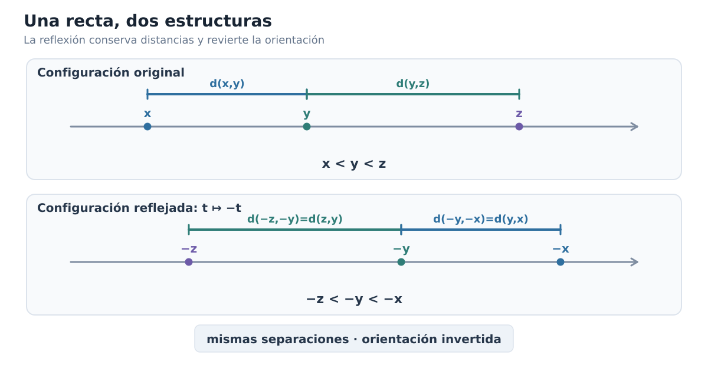{#fig-anm-c01-f01 fig-alt="Dos rectas numéricas comparan una configuración x<y<z con su reflejo. Las distancias correspondientes se mantienen, mientras el orden de izquierda a derecha se invierte."}

Así aparece nuestra primera conclusión estructural: **el orden sabe algo que la distancia no sabe**, porque distingue una orientación. Pero conviene no exagerar la separación. En $\mathbb R$, orden y distancia están tan bien coordinados que muchas veces podremos traducir exactamente una descripción en la otra. Los intervalos surgirán del orden y, unas páginas después, veremos que ciertas condiciones de distancia describen precisamente esos mismos intervalos.

Ésa es una de las razones por las que la recta real es un lugar tan cómodo para aprender análisis: varias estructuras distintas cooperan de una manera excepcionalmente estrecha.

### ¿Qué pregunta estamos haciendo?

Podemos convertir todo esto en un pequeño hábito. Cuando aparezca una afirmación sobre números reales, antes de manipular símbolos preguntémonos qué clase de información está pidiendo.

Si escribimos

$$
x<y,
$$

estamos comparando posiciones: la estructura relevante es el **orden**.

Si preguntamos cuánto separa a $x$ de $y$, estamos haciendo una pregunta **métrica**.

Si calculamos $x+y$, $xy$ o $x-y$, estamos usando la estructura **algebraica**.

Por supuesto, los argumentos interesantes empiezan cuando estas capas se mezclan. Una expresión algebraica puede aparecer dentro de una desigualdad; esa desigualdad puede describir una región de la recta; y esa misma región podrá terminar siendo descrita por una condición de distancia. Cuando lleguemos a ese punto, la traducción parecerá natural, pero será natural porque habremos entendido qué aporta cada estructura.

### Una precaución con los dibujos

Hay otra cuestión que vale la pena aclarar desde ahora. Dibujamos la recta horizontalmente y colocamos los números crecientes de izquierda a derecha; después de años de hacerlo, casi parece que «izquierda» y «derecha» pertenecieran físicamente a $\mathbb R$. Pero no es así: forman parte de nuestra representación de su orden.

Esto no vuelve engañosos a los dibujos. Al contrario, los vuelve más interesantes, porque obliga a preguntar qué está haciendo exactamente cada elemento de una figura. Si una reflexión conserva las separaciones pero invierte la orientación, el dibujo puede hacernos ver el fenómeno de inmediato; lo que no puede hacer, por sí solo, es convertir esa observación en una afirmación universal demostrada.

Usaremos muchas figuras de esta manera. Primero nos permitirán ver algo; después preguntaremos qué es exactamente lo que estamos viendo; finalmente buscaremos una formulación que pueda demostrarse. Una buena figura no reemplaza el argumento: nos ayuda a encontrarlo y, una vez encontrado, nos ayuda a comprender por qué funciona.

### Probemos la distinción

Antes de avanzar, hagamos una pequeña prueba de lectura. En cada una de las afirmaciones siguientes, intentemos reconocer qué estructura está actuando en primer plano —aunque en algunos casos aparezca más de una—:

#### Microcontrol 1

[]{#MA-MIC-ANM-01-001-001}

$x<y$.

[]{#MA-MSOL-ANM-01-001-001}

Ver solución del microcontrol 1

La estructura que actúa en primer plano es el **orden**. La relación $x<y$ afirma que $x$ precede a $y$ en el orden usual de $\mathbb R$; no especifica cuánto los separa ni exige realizar una operación algebraica entre ellos.

#### Microcontrol 2

[]{#MA-MIC-ANM-01-001-002}

«$y$ está entre $x$ y $z$».

[]{#MA-MSOL-ANM-01-001-002}

Ver solución del microcontrol 2

La estructura principal vuelve a ser el **orden**. Decir que $y$ está entre $x$ y $z$ significa, sin elegir de antemano una orientación,

$$
\min\{x,z\}\le y\le\max\{x,z\}.
$$

Más adelante esta relación podrá reconocerse también mediante distancias, pero en este punto del capítulo su contenido primario es posicional: indica dónde está $y$ respecto de los extremos.

#### Microcontrol 3

[]{#MA-MIC-ANM-01-001-003}

«$x$ y $y$ están separados por la misma cantidad que $u$ y $v$».

[]{#MA-MSOL-ANM-01-001-003}

Ver solución del microcontrol 3

Aquí la estructura relevante es la **métrica**, porque la afirmación compara separaciones. Cuando introduzcamos formalmente la distancia estándar de la recta, la frase se escribirá como

$$
d(x,y)=d(u,v),
$$

es decir,

$$
|x-y|=|u-v|.
$$

La orientación de cada par no importa: sólo se compara cuánto separa a sus puntos.

#### Microcontrol 4

[]{#MA-MIC-ANM-01-001-004}

$x+y=z$.

[]{#MA-MSOL-ANM-01-001-004}

Ver solución del microcontrol 4

La estructura que aparece en primer plano es la **algebraica**. La igualdad relaciona los tres números mediante la operación de suma. Por sí sola no afirma cuál es mayor ni menor, ni cuánto separa a un par de puntos en la recta.

#### Microcontrol 5

[]{#MA-MIC-ANM-01-001-005}

«al reflejar una configuración, cambian izquierda y derecha pero no las separaciones».

[]{#MA-MSOL-ANM-01-001-005}

Ver solución del microcontrol 5

En esta afirmación intervienen conjuntamente **orden** y **métrica**. La reflexión intercambia la orientación: lo que estaba a la izquierda pasa a la derecha y el orden se invierte. Al mismo tiempo, las separaciones permanecen iguales, de modo que la información métrica se conserva.

La propia reflexión puede describirse algebraicamente mediante $x\mapsto -x$, pero la afirmación que estamos leyendo compara dos efectos distintos: **cambio de orientación** y **conservación de distancias**. Ésa es precisamente la distinción estructural que §1.1 quería hacer visible.

No hace falta formalizar todavía todas estas frases. Si logramos distinguir qué pregunta corresponde al orden, cuál a la distancia y cuál al álgebra, ya hemos conseguido lo que necesitábamos de esta primera sección.

Ahora sí podemos empezar a estudiar una de esas estructuras por separado. En la sección siguiente nos concentraremos en el orden: veremos qué significa estar a la izquierda, a la derecha o entre dos puntos, y de esa relación tan elemental surgirán los intervalos que utilizaremos una y otra vez en el resto del libro.

### Ejercicios de la sección 1.1

[]{#ejercicios-1}

#### Ejercicio 1. Lo que el orden no dice

[]{#MA-EX-ANM-01-001-001}

Un estudiante afirma:

> Si $x<y<z$, entonces $y$ está a la misma distancia de $x$ que de $z$.

Decide si la afirmación es correcta. Si es falsa, da dos ternas numéricas con el mismo patrón de orden $x<y<z$: una en la que las dos separaciones sean iguales y otra en la que no lo sean. Explica qué información proporciona realmente el orden.

[]{#MA-SOL-ANM-01-001-001}

Ver solución del ejercicio 1

La afirmación es falsa. Saber que

$$
x<y<z
$$

nos informa de la posición relativa de los tres puntos: $x$ está a la izquierda de $y$, $y$ está a la izquierda de $z$ y, por tanto, $y$ queda entre los extremos. No nos dice cuánto separa a cada par.

Por ejemplo, con

$$
x=0,\qquad y=2,\qquad z=4,
$$

se cumple $0<2<4$ y las separaciones desde $y$ a los extremos son ambas $2$.

En cambio, con

$$
x=0,\qquad y=1,\qquad z=4,
$$

seguimos teniendo $0<1<4$, pero ahora $y$ está a $1$ unidad de $x$ y a $3$ unidades de $z$.

El patrón de orden es idéntico en las dos ternas; las separaciones no. **El orden determina quién está antes, después o entre quiénes, pero no determina por sí solo las distancias.**

#### Ejercicio 2. Reflejar no destruye toda la información

[]{#MA-EX-ANM-01-001-002}

Considera los tres puntos $-2$, $1$ y $5$ sobre la recta real y después su imagen al reflejarlos respecto del origen.

1. Escribe los tres puntos reflejados y ordénalos de menor a mayor.
2. Compara, antes y después de la reflexión, las separaciones entre cada par de puntos.
3. Un estudiante concluye: «Como cambió el orden izquierda–derecha, cambió también toda la información geométrica». Diagnostica con precisión qué parte de esa conclusión es falsa.

No basta con responder «la reflexión conserva distancias»: muestra la comparación numérica que sostiene tu diagnóstico.

[]{#MA-SOL-ANM-01-001-002}

Ver solución del ejercicio 2

Al reflejar respecto del origen, cada número cambia de signo:

$$
-2\mapsto2,\qquad 1\mapsto-1,\qquad 5\mapsto-5.
$$

Antes de la reflexión el orden es

$$
-2<1<5,
$$

mientras que, después de reflejar, los puntos ordenados de menor a mayor son

$$
-5<-1<2.
$$

La orientación de la configuración se ha invertido. Comparemos ahora las separaciones entre pares:

$$
|1-(-2)|=3,\qquad |5-1|=4,\qquad |5-(-2)|=7.
$$

Después de reflejar:

$$
|-1-2|=3,\qquad |-5-(-1)|=4,\qquad |-5-2|=7.
$$

Las tres separaciones permanecen exactamente iguales.

Por tanto, la conclusión del estudiante mezcla dos clases de información. Es correcto decir que cambió la información de **orientación**: izquierda y derecha se intercambiaron. Es falso concluir que cambió toda la información geométrica: las **separaciones entre los puntos** se conservaron.

La lección es precisamente la de §1.1: una transformación puede alterar lo que ve el orden sin alterar lo que ve la distancia.

#### Ejercicio 3. Un orden fijo, separaciones variables

[]{#MA-EX-ANM-01-001-003}

Fija los extremos $0$ y $1$, y coloca entre ellos un punto $t$ con $0<t<1$.

1. Explica por qué el patrón de orden $0<t<1$ no cambia al variar $t$ dentro de $(0,1)$.
2. Compara la separación de $t$ respecto de $0$ con su separación respecto de $1$ en los tres casos $0<t<\tfrac12$, $t=\tfrac12$ y $\tfrac12<t<1$.
3. Resume qué permanece y qué cambia cuando $t$ recorre el intervalo $(0,1)$.

El objetivo no es resolver una desigualdad aislada, sino usar una familia completa para distinguir información de orden e información métrica.

[]{#MA-SOL-ANM-01-001-003}

Ver solución del ejercicio 3

Mientras $t$ satisfaga

$$
0<t<1,
$$

su posición de orden no cambia: permanece estrictamente entre $0$ y $1$. Variar $t$ dentro del intervalo no altera ese patrón.

Las separaciones a los extremos son

$$
t-0=t
$$

y

$$
1-t.
$$

Ahora comparamos esas dos cantidades.

Si $0<t<\tfrac12$, entonces

$$
t<1-t,
$$

así que $t$ está más cerca de $0$ que de $1$.

Si $t=\tfrac12$, entonces

$$
t=1-t=\frac12,
$$

y las separaciones son iguales.

Si $\tfrac12<t<1$, entonces

$$
1-t<t,
$$

por lo que $t$ está más cerca de $1$ que de $0$.

Así, al variar $t$ permanece la información de orden

$$
0<t<1,
$$

pero cambia la información métrica: las dos separaciones varían continuamente y puede cambiar incluso cuál de los dos extremos está más cerca.

Este ejemplo muestra por qué no debemos leer una relación de orden como si contuviera automáticamente información cuantitativa sobre distancias.

#### Ejercicio 4. Tres capas sobre los mismos números

[]{#MA-EX-ANM-01-001-004}

Supón que tres números reales $a,b,c$ satisfacen simultáneamente

$$
a+b=c
$$

y

$$
a<b.
$$

Alguien sostiene que esos dos datos bastan para decidir cuál de $a$ o $b$ está más cerca de $c$.

1. Construye un ejemplo que satisfaga las dos condiciones y en el que $b$ esté más cerca de $c$ que $a$.
2. Construye otro ejemplo que satisfaga las mismas dos condiciones y en el que $a$ esté más cerca de $c$ que $b$.
3. Identifica qué parte de la información usada en el problema es algebraica, cuál pertenece al orden y cuál es métrica.
4. Explica por qué los dos primeros datos, aun tomados conjuntamente, no determinan por sí solos la tercera clase de información.

[]{#MA-SOL-ANM-01-001-004}

Ver solución del ejercicio 4

**Estrategia.** Necesitamos conservar simultáneamente las dos condiciones

$$
a+b=c,\qquad a<b,
$$

pero hacer que cambie cuál de $a$ o $b$ queda más cerca de $c$. Esto probará que la información algebraica y de orden dada no determina por sí sola la comparación métrica.

Para el primer caso podemos tomar

$$
a=1,\qquad b=2,\qquad c=3.
$$

Se cumple

$$
a+b=1+2=3=c
$$

y también $a<b$. Las separaciones respecto de $c$ son

$$
|c-a|=|3-1|=2,
$$

mientras que

$$
|c-b|=|3-2|=1.
$$

Por tanto, $b$ está más cerca de $c$ que $a$.

Para invertir la comparación, tomemos

$$
a=-5,\qquad b=-2,\qquad c=-7.
$$

De nuevo,

$$
a+b=-5+(-2)=-7=c
$$

y $a<b$. Pero ahora

$$
|c-a|=|-7-(-5)|=2,
$$

y

$$
|c-b|=|-7-(-2)|=5.
$$

Así que en esta segunda configuración $a$ está más cerca de $c$ que $b$.

Podemos separar ahora las tres capas del problema:

- $a+b=c$ es información **algebraica**, porque relaciona los números mediante una operación;
- $a<b$ es información de **orden**, porque decide su posición relativa;
- comparar $|c-a|$ y $|c-b|$ es información **métrica**, porque pregunta por separaciones.

Los dos ejemplos satisfacen exactamente la misma clase de condición algebraica y la misma relación de orden, pero producen respuestas métricas opuestas. Por eso aquellas dos capas no bastan para determinar ésta.

La idea transferible es que **usar los mismos números no convierte en equivalentes las estructuras que colocamos sobre ellos**. Antes de concluir algo, conviene identificar qué clase de información tenemos y qué clase de información estamos intentando obtener.

## 1.2. Orden: izquierda, derecha y estar entre

En la sección anterior vimos que el orden y la distancia responden preguntas distintas. Ahora vamos a concentrarnos, por un momento, sólo en el orden. Esto significa que todavía no preguntaremos cuánto separa a dos puntos; nos bastará con saber cuál aparece antes, cuál después y qué significa que uno quede entre otros dos.

Empecemos con algo que parece demasiado sencillo para merecer atención. Si escribimos

$$
x<y,
$$

decimos que $x$ es menor que $y$. En la representación habitual de la recta real, esto significa que $x$ queda a la izquierda de $y$. Si escribimos $x\le y$, permitimos además el caso $x=y$.

Hasta aquí no hay ninguna novedad técnica. Lo importante es advertir que estas relaciones ya organizan la recta: en cuanto fijamos dos números distintos, uno queda antes que el otro, y esa comparación nos permite comenzar a hablar de regiones delimitadas por puntos.

### ¿Qué significa realmente «estar entre»?

Tomemos tres números reales. Si escribimos

$$
x\le y\le z,
$$

es natural decir que $y$ está entre $x$ y $z$. Pero hay un pequeño problema escondido en esa frase: hemos supuesto que $x$ está a la izquierda de $z$. ¿Qué ocurriría si los extremos aparecieran en el orden contrario?

No queremos que la expresión «$y$ está entre $x$ y $z$» dependa del orden en que decidamos nombrar los extremos. Por eso conviene formularla de una manera que no privilegie ninguna orientación.

Diremos que **$y$ está entre $x$ y $z$** cuando

$$
\min\{x,z\}\le y\le \max\{x,z\}.
$$

Esta fórmula hace exactamente lo que necesitamos. Si $x\le z$, se reduce a

$$
x\le y\le z;
$$

si $z\le x$, se convierte en

$$
z\le y\le x.
$$

En ambos casos expresa la misma idea geométrica: $y$ pertenece al tramo de la recta delimitado por $x$ y $z$, y permitimos que coincida con uno de los extremos.

¿Por qué molestarnos en escribirlo así? Porque más adelante aparecerá una caracterización de «estar entre» que ya no estará formulada con desigualdades, sino con distancias. Cuando comparemos ambas formulaciones necesitaremos una definición de «entre» que no haya incorporado accidentalmente una orientación.

### De dos fronteras a un intervalo

Supongamos ahora que elegimos dos números $a$ y $b$ con

$$
a<b.
$$

¿Qué puntos quedan estrictamente entre ellos? Exactamente aquellos $x$ que satisfacen

$$
a<x<b.
$$

A este conjunto lo llamamos **intervalo abierto** de extremos $a$ y $b$, y escribimos

$$
(a,b)=\{x\in\mathbb R:a<x<b\}.
$$

Los paréntesis nos recuerdan que los extremos no pertenecen al conjunto. En efecto, $a$ no satisface $a<a<b$, y $b$ tampoco satisface $a<b<b$.

Pero quizá queramos incluir ambos extremos. Entonces cambiamos las desigualdades estrictas por desigualdades no estrictas:

$$
[a,b]=\{x\in\mathbb R:a\le x\le b\}.
$$

Éste es el **intervalo cerrado** de extremos $a$ y $b$.

Entre ambas posibilidades quedan dos casos mixtos:

$$
[a,b)=\{x\in\mathbb R:a\le x<b\},
$$

y

$$
(a,b]=\{x\in\mathbb R:a<x\le b\}.
$$

No hay que memorizar cuatro dibujos separados. La notación está diciendo exactamente qué ocurre en cada frontera: un corchete incluye el extremo correspondiente; un paréntesis lo excluye.

La figura [C01-F02](#fig-anm-c01-f02) concentra esta lectura en una sola comparación.

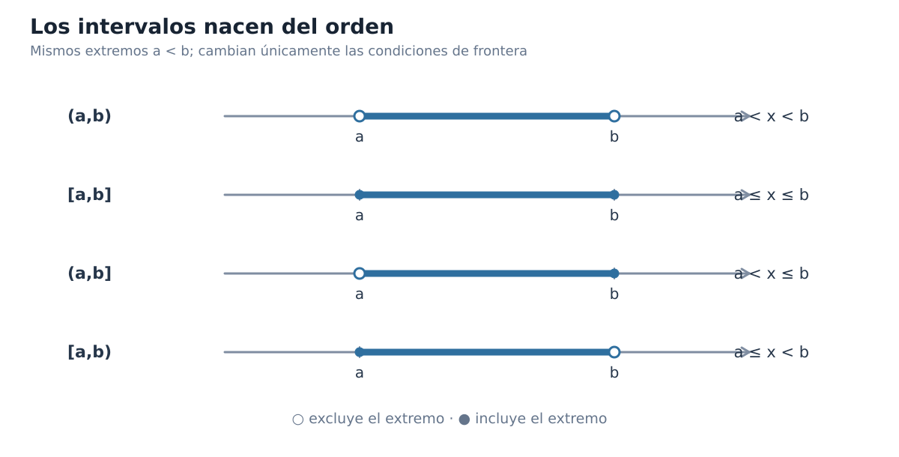{#fig-anm-c01-f02 fig-alt="Cuatro rectas alineadas muestran (a,b), [a,b], (a,b] y [a,b), con extremos abiertos o cerrados y sus desigualdades equivalentes."}

Conviene detenernos en una posible confusión. Acabamos de usar las palabras «abierto» y «cerrado», pero todavía no estamos hablando de conjuntos abiertos y cerrados en sentido topológico. Por ahora son simplemente los nombres tradicionales de estos tipos de intervalo. La teoría general que explica esas palabras vendrá más adelante.

### Traducir en ambos sentidos

La notación de intervalos es útil porque comprime información, pero no queremos que se convierta en un código que sólo sepamos leer de izquierda a derecha. Debemos poder pasar con soltura de desigualdades a intervalos y de intervalos a desigualdades.

Por ejemplo,

$$
x\in(-2,5]
$$

significa exactamente

$$
-2<x\le 5.
$$

Y si sabemos que

$$
3\le x<7,
$$

podemos expresar la misma condición diciendo

$$
x\in[3,7).
$$

Parece una traducción elemental, y lo es, pero tiene una importancia que irá creciendo. Muy pronto aparecerán condiciones expresadas mediante valor absoluto y distancia, y querremos reconocer qué región de la recta describen. Si la traducción entre orden e intervalo no es automática, la traducción posterior entre distancia e intervalo tampoco lo será.

Probemos un caso ligeramente menos inmediato. ¿Qué conjunto describe la condición

$$
x<4?
$$

No hay una frontera izquierda finita. Queremos todos los reales que quedan a la izquierda de $4$, de modo que escribimos

$$
(-\infty,4).
$$

Del mismo modo,

$$
x\ge -1
$$

describe la semirrecta

$$
[-1,\infty).
$$

Los símbolos $-\infty$ y $\infty$ no representan puntos reales que puedan incluirse en el conjunto. Por eso siempre aparecen acompañados por paréntesis, nunca por corchetes.

### Los intervalos nacen del orden

Ya podemos ver la idea estructural de esta sección. Un intervalo no es, en primer lugar, una figura sombreada sobre una recta; es el conjunto de puntos que satisfacen ciertas relaciones de orden respecto de una o dos fronteras.

Por eso

$$
(a,b)
$$

no es una notación independiente de

$$
a<x<b.
$$

Ambas expresiones dicen lo mismo en lenguajes distintos: la primera nombra el conjunto; la segunda describe mediante el orden qué significa pertenecer a él.

Éste es nuestro primer puente sistemático entre dos representaciones de una misma condición. Más adelante añadiremos una tercera. Cuando aprendamos a interpretar $|x-a|$ como una distancia, veremos que algunas regiones que ahora describimos mediante desigualdades también pueden describirse diciendo simplemente que un punto está suficientemente cerca de otro.

Antes de llegar allí, conviene conservar una imagen muy sencilla: **el orden coloca fronteras; los intervalos reúnen los puntos que quedan entre ellas**.

### Antes de seguir

Comprobemos que la traducción funciona en ambas direcciones. Sin resolver nada nuevo, intentemos leer cada expresión en el otro lenguaje:

#### Microcontrol 6

[]{#MA-MIC-ANM-01-001-006}

$x\in(-3,2)$.

[]{#MA-MSOL-ANM-01-001-006}

Ver solución del microcontrol 6

La notación de intervalo indica que $x$ queda estrictamente entre $-3$ y $2$. Como ambos extremos aparecen con paréntesis, ninguno pertenece al conjunto. Por tanto,

$$
\boxed{-3<x<2}.
$$

#### Microcontrol 7

[]{#MA-MIC-ANM-01-001-007}

$x\in[0,5)$.

[]{#MA-MSOL-ANM-01-001-007}

Ver solución del microcontrol 7

El corchete en $0$ incluye el extremo izquierdo y el paréntesis en $5$ excluye el derecho. La condición equivalente de orden es

$$
\boxed{0\le x<5}.
$$

#### Microcontrol 8

[]{#MA-MIC-ANM-01-001-008}

$-1<x\le 4$.

[]{#MA-MSOL-ANM-01-001-008}

Ver solución del microcontrol 8

La desigualdad estricta en $-1$ excluye ese extremo; la desigualdad no estricta en $4$ lo incluye. En notación de intervalo,

$$
\boxed{x\in(-1,4]}.
$$

#### Microcontrol 9

[]{#MA-MIC-ANM-01-001-009}

$x>6$.

[]{#MA-MSOL-ANM-01-001-009}

Ver solución del microcontrol 9

La condición selecciona todos los reales situados estrictamente a la derecha de $6$. El punto $6$ queda excluido y no existe una frontera real superior. Por tanto,

$$
\boxed{x\in(6,\infty)}.
$$

El símbolo $\infty$ siempre aparece con paréntesis porque no es un número real que pueda pertenecer al intervalo.

#### Microcontrol 10

[]{#MA-MIC-ANM-01-001-010}

$x\le 0$.

[]{#MA-MSOL-ANM-01-001-010}

Ver solución del microcontrol 10

La condición contiene todos los reales situados a la izquierda de $0$ y también al propio $0$. En consecuencia,

$$
\boxed{x\in(-\infty,0]}.
$$

De nuevo, $-\infty$ lleva paréntesis porque no es un punto de $\mathbb R$; el corchete aparece sólo en el extremo real $0$, que sí está incluido.

El objetivo no es practicar mecánicamente desigualdades. Queremos que intervalo y condición de orden empiecen a sentirse como dos maneras de mirar el mismo objeto.

Con esto tenemos preparada la siguiente pregunta. El orden nos permite decir que un punto queda entre dos fronteras, pero todavía no hemos introducido una manera sistemática de hablar de **cuánto** se separa de ellas o de un punto elegido. Para eso necesitaremos reinterpretar una operación que ya conocemos bien: el valor absoluto.

### Ejercicios de la sección 1.2

#### Ejercicio 5. Una condición, tres escrituras

[]{#MA-EX-ANM-01-001-005}

Sea

$$
-4\le x<3.
$$

1. Escribe el conjunto de valores posibles de $x$ en notación de intervalo.
2. Describe la misma región con palabras, indicando qué ocurre en cada extremo.
3. Decide si cada uno de los puntos $-4$, $0$ y $3$ pertenece al conjunto y justifica tu respuesta a partir de la desigualdad original, no sólo de la notación del intervalo.

[]{#MA-SOL-ANM-01-001-005}

Ver solución del ejercicio 5

La desigualdad

$$
-4\le x<3
$$

selecciona todos los reales situados desde $-4$ hasta $3$, incluyendo el extremo izquierdo pero excluyendo el derecho. Por tanto,

$$
x\in[-4,3).
$$

En palabras: tomamos todos los puntos entre $-4$ y $3$; $-4$ pertenece al conjunto porque se permite la igualdad $x=-4$, mientras que $3$ no pertenece porque la condición exige $x<3$.

Comprobemos los tres puntos pedidos directamente en la desigualdad:

- para $x=-4$, se cumple $-4\le-4<3$, así que $-4$ pertenece;
- para $x=0$, se cumple $-4\le0<3$, así que $0$ pertenece;
- para $x=3$, la segunda desigualdad se convierte en $3<3$, que es falsa; por tanto, $3$ no pertenece.

La notación de intervalo no añade información nueva: comprime exactamente las mismas decisiones de inclusión y exclusión que ya estaban en los signos de desigualdad.

#### Ejercicio 6. Dos fronteras, cuatro regiones

[]{#MA-EX-ANM-01-001-006}

Fija números reales $a<b$. Para cada una de las condiciones siguientes:

1. escríbela como pertenencia a un intervalo;
2. indica qué extremos quedan incluidos;
3. explica qué cambia —y qué no cambia— al pasar de una línea a la siguiente.

$$
a<x<b,
$$

$$
a\le x<b,
$$

$$
a<x\le b,
$$

$$
a\le x\le b.
$$

No trates los cuatro casos como reglas independientes: organiza tu respuesta a partir de la información que codifican $<$ y $\le$ en cada frontera.

[]{#MA-SOL-ANM-01-001-006}

Ver solución del ejercicio 6

Las cuatro traducciones son

$$
a<x<b
\iff
x\in(a,b),
$$

$$
a\le x<b
\iff
x\in[a,b),
$$

$$
a<x\le b
\iff
x\in(a,b],
$$

$$
a\le x\le b
\iff
x\in[a,b].
$$

El centro de la descripción no cambia: en los cuatro casos estamos seleccionando puntos situados entre las mismas dos fronteras $a$ y $b$. Lo único que cambia es si admitimos o no cada frontera.

En el extremo izquierdo:

- $a<x$ excluye $a$;
- $a\le x$ incluye $a$.

En el extremo derecho:

- $x<b$ excluye $b$;
- $x\le b$ incluye $b$.

Así, paréntesis y corchetes no son cuatro convenciones desconectadas. Cada símbolo registra localmente la decisión que ya tomó la desigualdad correspondiente.

#### Ejercicio 7. ¿Puede incluirse el infinito?

[]{#MA-EX-ANM-01-001-007}

Un estudiante escribe

$$
[2,\infty]
$$

para representar todos los números reales $x$ tales que $x\ge2$, y explica: «Uso corchete en $\infty$ porque quiero incluir todos los valores hacia la derecha».

1. Diagnostica el error.
2. Escribe la notación correcta.
3. Explica por qué el símbolo $\infty$ no se comporta como un extremo real ordinario del intervalo.
4. Da la notación correcta para la condición $x<2$ y compárala con la anterior.

[]{#MA-SOL-ANM-01-001-007}

Ver solución del ejercicio 7

La escritura

$$
[2,\infty]
$$

es incorrecta en la notación usual de intervalos reales. El problema no está en querer «incluir todos los valores hacia la derecha», sino en tratar $\infty$ como si fuera un número real situado al final de la recta.

La condición

$$
x\ge2
$$

se escribe correctamente como

$$
[2,\infty).
$$

El corchete en $2$ indica que $2$ pertenece al conjunto. En cambio, $\infty$ no es un punto de $\mathbb R$ que pueda pertenecer o no pertenecer al intervalo; es un símbolo que expresa que la región no tiene una frontera real superior. Por eso se escribe siempre paréntesis junto a $\infty$ o $-\infty$.

De manera análoga,

$$
x<2
$$

se representa por

$$
(-\infty,2).
$$

Aquí $2$ queda excluido por la desigualdad estricta y, nuevamente, $-\infty$ no es un número real que pueda incluirse.

La idea que corrige el error es ésta: **los corchetes deciden si pertenece un extremo real; $\pm\infty$ no son extremos reales del conjunto.**

#### Ejercicio 8. El mismo tramo sin elegir orientación

[]{#MA-EX-ANM-01-001-008}

Sean $p,q\in\mathbb R$, sin suponer cuál de los dos es menor, y considera la condición

$$
\min\{p,q\}\le x\le\max\{p,q\}.
$$

1. Describe verbalmente qué región de la recta selecciona.
2. Escribe esa región como intervalo usando sólo $\min\{p,q\}$ y $\max\{p,q\}$.
3. Reescribe la condición en los dos casos posibles: $p\le q$ y $q\le p$.
4. Explica por qué la formulación con mínimo y máximo permite hablar del tramo entre $p$ y $q$ sin decidir de antemano cuál está a la izquierda.

[]{#MA-SOL-ANM-01-001-008}

Ver solución del ejercicio 8

La condición

$$
\min\{p,q\}\le x\le\max\{p,q\}
$$

selecciona todos los puntos del tramo cerrado comprendido entre $p$ y $q$, incluyendo ambos extremos. Sin decidir cuál de los dos está a la izquierda, podemos escribirlo como

$$
x\in[\min\{p,q\},\max\{p,q\}].
$$

Ahora separemos los dos órdenes posibles.

Si

$$
p\le q,
$$

entonces

$$
\min\{p,q\}=p,
\qquad
\max\{p,q\}=q,
$$

y la condición se reduce a

$$
p\le x\le q.
$$

Si, en cambio,

$$
q\le p,
$$

entonces

$$
\min\{p,q\}=q,
\qquad
\max\{p,q\}=p,
$$

y obtenemos

$$
q\le x\le p.
$$

Por tanto, la formulación con mínimo y máximo encapsula en una sola expresión los dos órdenes posibles de los extremos. Su ventaja no es meramente abreviar: permite hablar del tramo entre $p$ y $q$ de una forma que no depende del orden en que hayamos nombrado esos puntos.

#### Ejercicio 9. Dos formas equivalentes de «estar entre»

[]{#MA-EX-ANM-01-001-009}

Sean $x,y,z\in\mathbb R$. Demuestra que

$$
\min\{x,z\}\le y\le\max\{x,z\}
$$

si y sólo si se cumple al menos una de las dos cadenas

$$
x\le y\le z
$$

o

$$
z\le y\le x.
$$

Tu demostración debe cubrir explícitamente los dos órdenes posibles entre $x$ y $z$ y explicar por qué no hace falta una tercera posibilidad.

[]{#MA-SOL-ANM-01-001-009}

Ver solución del ejercicio 9

**Estrategia.** La expresión con mínimo y máximo está diseñada precisamente para evitar elegir una orientación. Para demostrar la equivalencia, basta separar los dos órdenes posibles entre los extremos $x$ y $z$.

Supongamos primero que

$$
\min\{x,z\}\le y\le\max\{x,z\}.
$$

Como el orden de los reales es total, entre $x$ y $z$ sólo pueden darse dos posibilidades:

$$
x\le z
$$

o

$$
z\le x.
$$

Si $x\le z$, entonces

$$
\min\{x,z\}=x,
\qquad
\max\{x,z\}=z,
$$

de modo que nuestra hipótesis se convierte en

$$
x\le y\le z.
$$

Si $z\le x$, obtenemos en cambio

$$
\min\{x,z\}=z,
\qquad
\max\{x,z\}=x,
$$

y por tanto

$$
z\le y\le x.
$$

Esto prueba una dirección.

Para la conversa, supongamos primero que

$$
x\le y\le z.
$$

Entonces necesariamente $x\le z$, por lo que

$$
\min\{x,z\}=x,
\qquad
\max\{x,z\}=z.
$$

Así,

$$
\min\{x,z\}\le y\le\max\{x,z\}.
$$

El caso

$$
z\le y\le x
$$

es análogo: ahora $z\le x$, de modo que el mínimo es $z$ y el máximo es $x$, y se obtiene la misma desigualdad con mínimo y máximo.

Hemos demostrado, por tanto,

$$
\boxed{
\min\{x,z\}\le y\le\max\{x,z\}
\iff
\bigl(x\le y\le z\bigr)\ \text{o}\ \bigl(z\le y\le x\bigr).
}
$$

No hace falta una tercera posibilidad porque el orden de $\mathbb R$ compara siempre dos números reales: para $x$ y $z$, uno satisface $x\le z$ o el otro satisface $z\le x$ —y si son iguales, ambos casos son compatibles.

La idea transferible es que la fórmula con $\min$ y $\max$ no introduce una nueva noción de «estar entre»: comprime en una expresión simétrica los dos órdenes posibles de los extremos.

## 1.3. Valor absoluto: distancia al origen

Hasta ahora hemos usado el orden para decidir dónde queda un punto respecto de otros. Pero al final de la sección anterior dejamos abierta una pregunta distinta: una vez que sabemos que un punto está a la izquierda o a la derecha, ¿cómo expresamos **cuánto** se ha alejado de un punto de referencia?

Comencemos por el punto de referencia más familiar: el origen.

El valor absoluto ya no es nuevo para nosotros. Sabemos calcular, por ejemplo,

$$
|5|=5
\qquad\text{y}\qquad
|-5|=5.
$$

Lo que nos interesa ahora no es repetir esa regla, sino preguntarnos qué está midiendo. Los números $5$ y $-5$ ocupan lados opuestos del origen, de modo que el orden distingue perfectamente sus posiciones; sin embargo, ambos están a la misma separación de $0$. El valor absoluto conserva justamente esa información y deja de lado la orientación.

Ésta es la lectura que queremos fijar:

$$
|x|=\text{distancia de }x\text{ al origen}.
$$

Dicho de otro modo, $x$ nos dice a qué lado del origen estamos y cuánto nos hemos desplazado con signo; $|x|$ conserva únicamente el tamaño de ese desplazamiento.

### La definición por casos, vista de nuevo

Recordemos brevemente la definición conocida:

$$
|x|=
\begin{cases}
x,&x\ge 0,\\
-x,&x<0.
\end{cases}
$$

¿Por qué aparecen exactamente esos dos casos? Si $x\ge0$, el número $x$ ya expresa una separación no negativa respecto de $0$, así que no hay nada que corregir. Si $x<0$, en cambio, el número $x$ lleva incorporada la orientación hacia el lado negativo; para obtener solamente la magnitud de la separación necesitamos cambiar su signo, y por eso aparece $-x$.

Así, la definición por casos deja de parecer una receta arbitraria. Está haciendo una tarea geométrica muy precisa: producir siempre una cantidad no negativa que mida cuán lejos está $x$ de $0$.

Esto explica inmediatamente por qué

$$
|x|\ge0
$$

para todo $x\in\mathbb R$, y también por qué

$$
|x|=0
$$

sólo cuando $x=0$. No son propiedades desconectadas que haya que memorizar; son exactamente lo que esperaríamos de una medida de separación respecto del origen.

### Una misma distancia, dos posiciones

Tomemos ahora un número $r>0$ y preguntemos qué significa

$$
|x|=r.
$$

Si pensamos sólo algebraicamente, podemos resolver la ecuación y obtener

$$
x=r
\qquad\text{o}\qquad
x=-r.
$$

Pero la lectura geométrica dice algo más sencillo: buscamos los puntos cuya distancia al origen es exactamente $r$. En una recta hay dos, uno a cada lado de $0$.

La orientación distingue esos dos puntos; la distancia al origen no.

Lo mismo ocurre si cambiamos la igualdad por una desigualdad. La condición

$$
|x|<r
$$

pide todos los puntos cuya separación del origen es menor que $r$. Si miramos la recta, esos puntos son precisamente los que quedan entre $-r$ y $r$:

$$
-r<x<r.
$$

En cambio,

$$
|x|>r
$$

selecciona los puntos que quedan a más de $r$ unidades del origen, es decir,

$$
x<-r
\qquad\text{o}\qquad
x>r.
$$

Aquí reaparece el puente que comenzamos a construir en §1.2. Una expresión con valor absoluto puede describir una región de la recta, y esa misma región puede expresarse mediante relaciones de orden. Por ahora estamos trabajando con el origen como centro; más adelante haremos esta traducción de manera sistemática para un centro cualquiera.

### ¿Tiene algo especial el origen?

Ésta es una buena pregunta, porque hasta este momento podría parecer que el valor absoluto estuviera esencialmente ligado a $0$. Pero supongamos que queremos medir la separación entre un punto $x$ y otro punto fijo $a$.

La cantidad

$$
x-a
$$

nos dice el desplazamiento de $a$ hacia $x$ con orientación: es positiva si $x$ queda a la derecha de $a$, negativa si queda a la izquierda y cero si ambos puntos coinciden. Si queremos conservar sólo el tamaño de ese desplazamiento, hacemos exactamente lo mismo que antes:

$$
|x-a|.
$$

Así, $|x-a|$ mide la distancia de $x$ al punto $a$.

Esta observación es sencilla, pero cambia bastante nuestra manera de leer el valor absoluto. El origen deja de ocupar una posición privilegiada. La expresión $|x|$ no es más que el caso $a=0$ de una idea más general:

$$
|x-a|=\text{distancia de }x\text{ al centro }a.
$$

La figura [C01-F03](#fig-anm-c01-f03) concentra esta lectura en una sola comparación.

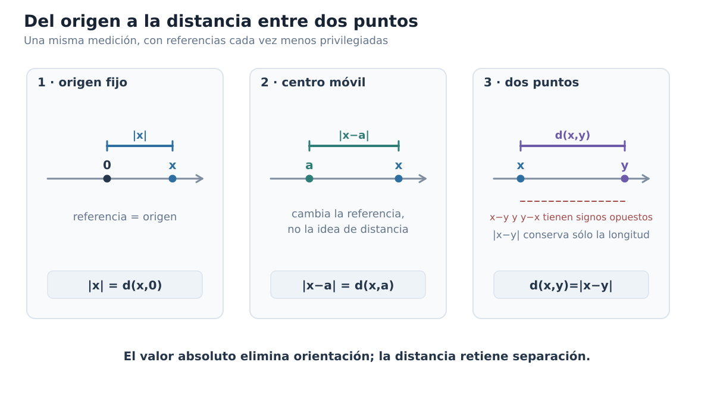{#fig-anm-c01-f03 fig-alt="Tres paneles muestran la distancia de x al origen, la distancia de x a un centro a y la distancia entre dos puntos x e y; el tercer panel distingue resta orientada de longitud no orientada."}

Probemos con un ejemplo. Si elegimos $a=3$, entonces los puntos $7$ y $-1$ están en lados distintos de $3$, pero

$$
|7-3|=4
\qquad\text{y}\qquad
|-1-3|=4.
$$

Ambos están a cuatro unidades del centro elegido. De nuevo, la expresión sin valor absoluto recuerda la orientación —$7-3=4$ mientras que $-1-3=-4$—, pero el valor absoluto retiene solamente la separación.

### Cambiar el centro no cambia la idea

Podemos mirar esta operación como una especie de recentrado conceptual. Cuando trabajamos con $|x|$, preguntamos por la posición de $x$ respecto de $0$; cuando trabajamos con $|x-a|$, hacemos exactamente la misma pregunta, pero tomando $a$ como referencia.

Conviene ser precisos aquí: no estamos afirmando que restar $a$ mueva físicamente el punto $x$ sobre la recta. Lo que cambia es la referencia desde la que describimos su posición. El número $x-a$ es el desplazamiento orientado desde $a$ hasta $x$; el número $|x-a|$ es el tamaño de ese desplazamiento.

Este modo de leer las barras de valor absoluto será mucho más útil en análisis que recordarlas sólo como una definición por casos. Cuando aparezca una condición como

$$
|x-a|<r,
$$

querremos leerla primero en palabras: «$x$ está a menos de $r$ unidades de $a$». Después podremos preguntarnos qué intervalo describe. Esa traducción completa llegará en §1.7; por ahora basta con reconocer qué está midiendo la expresión.

### Antes de seguir

Detengámonos en cuatro preguntas rápidas.

#### Microcontrol 11

[]{#MA-MIC-ANM-01-001-011}

Si $|x|=6$, ¿qué sabemos sobre la posición de $x$?

[]{#MA-MSOL-ANM-01-001-011}

Ver solución del microcontrol 11

La condición dice que $x$ está exactamente a $6$ unidades del origen. En la recta hay dos puntos con esa separación, uno a cada lado de $0$:

$$
\boxed{x=6\quad\text{o}\quad x=-6}.
$$

El valor absoluto determina la distancia al origen, pero no la orientación: saber $|x|=6$ no permite elegir entre derecha e izquierda.

#### Microcontrol 12

[]{#MA-MIC-ANM-01-001-012}

Si $|x|<2$, ¿en qué parte de la recta puede estar $x$?

[]{#MA-MSOL-ANM-01-001-012}

Ver solución del microcontrol 12

La desigualdad pide los puntos cuya distancia al origen es menor que $2$. Por tanto, $x$ debe quedar estrictamente entre los dos puntos situados a distancia $2$ del origen:

$$
\boxed{-2<x<2}.
$$

Equivalentemente,

$$
\boxed{x\in(-2,2)}.
$$

Los extremos no pertenecen porque en $x=\pm2$ la distancia al origen vale exactamente $2$, no menos que $2$.

#### Microcontrol 13

[]{#MA-MIC-ANM-01-001-013}

¿Qué diferencia de información hay entre $x-a$ y $|x-a|$?

[]{#MA-MSOL-ANM-01-001-013}

Ver solución del microcontrol 13

La cantidad $x-a$ es un **desplazamiento orientado** desde $a$ hasta $x$: su signo indica de qué lado de $a$ queda $x$, y su magnitud indica cuánto se ha desplazado.

En cambio, $|x-a|$ conserva sólo el tamaño de ese desplazamiento. Es siempre no negativo y representa la **separación** entre $x$ y $a$.

Así, al pasar de $x-a$ a $|x-a|$ conservamos cuánto separa a los puntos, pero perdemos la información izquierda–derecha.

#### Microcontrol 14

[]{#MA-MIC-ANM-01-001-014}

Si $|x-a|=0$, ¿qué debe ocurrir?

[]{#MA-MSOL-ANM-01-001-014}

Ver solución del microcontrol 14

Una distancia sólo puede ser cero cuando los dos puntos coinciden. Algebraicamente,

$$
|x-a|=0
\iff
x-a=0
\iff
\boxed{x=a}.
$$

Por tanto, el único punto situado a distancia cero del centro $a$ es el propio $a$.

La idea que necesitamos conservar es simple: **el valor absoluto convierte un desplazamiento orientado en una separación no negativa**. En el origen esto aparece como $|x|$; respecto de un centro arbitrario aparece como $|x-a|$.

En la siguiente sección daremos un paso pequeño pero decisivo: dejaremos de hablar informalmente de «la distancia entre dos puntos» y convertiremos esta idea en una función con nombre y propiedades precisas.

### Ejercicios de la sección 1.3

#### Ejercicio 10. Una distancia con centro desplazado

[]{#MA-EX-ANM-01-001-010}

Interpreta geométricamente la ecuación

$$
|x-3|=5.
$$

1. Exprésala en palabras como una condición de distancia respecto de un centro.
2. Determina todos los valores de $x$.
3. Explica por qué aparecen exactamente dos soluciones y qué relación geométrica tienen con el centro $3$.

No empieces resolviendo por casos: comienza identificando qué está midiendo $|x-3|$.

[]{#MA-SOL-ANM-01-001-010}

Ver solución del ejercicio 10

La expresión

$$
|x-3|
$$

mide la separación entre $x$ y el centro $3$. Por tanto,

$$
|x-3|=5
$$

significa: «$x$ está exactamente a $5$ unidades de $3$».

En una recta hay dos puntos a esa distancia del centro: uno a la derecha y otro a la izquierda. Son

$$
x=3+5=8
$$

y

$$
x=3-5=-2.
$$

Podemos comprobarlo directamente:

$$
|8-3|=5,
\qquad
|-2-3|=|-5|=5.
$$

Aparecen exactamente dos soluciones porque una distancia positiva no registra orientación. Los desplazamientos $5$ y $-5$ son distintos, pero sus valores absolutos coinciden.

#### Ejercicio 11. Del valor absoluto a una región de la recta

[]{#MA-EX-ANM-01-001-011}

Considera la condición

$$
|x+2|<4.
$$

1. Identifica el centro respecto del cual se está midiendo la separación.
2. Describe la condición en palabras.
3. Determina la región de la recta que satisface la desigualdad y escríbela mediante desigualdades de orden.
4. Comprueba directamente si $x=-6$, $x=-2$ y $x=2$ satisfacen la condición original.

La verificación final debe hacerse sustituyendo en $|x+2|<4$, no sólo mirando la región obtenida.

[]{#MA-SOL-ANM-01-001-011}

Ver solución del ejercicio 11

Primero reescribimos

$$
|x+2|=|x-(-2)|.
$$

Así vemos que el centro es $-2$. La condición

$$
|x+2|<4
$$

significa que $x$ está a menos de $4$ unidades de $-2$.

Los puntos situados exactamente a $4$ unidades del centro son

$$
-2-4=-6
$$

y

$$
-2+4=2.
$$

Como la desigualdad es estricta, la región buscada queda entre esas dos fronteras sin incluirlas:

$$
-6<x<2.
$$

Comprobemos ahora los tres puntos pedidos en la condición original.

Para $x=-6$,

$$
|-6+2|=|-4|=4,
$$

que no es menor que $4$. Por tanto, $-6$ no pertenece.

Para $x=-2$,

$$
|-2+2|=0<4,
$$

así que $-2$ sí pertenece.

Para $x=2$,

$$
|2+2|=4,
$$

y tampoco pertenece.

La lectura geométrica y la desigualdad de orden describen la misma región, pero la comprobación directa confirma que no hemos perdido la información sobre la frontera.

#### Ejercicio 12. Desplazamiento no es lo mismo que distancia

[]{#MA-EX-ANM-01-001-012}

Un estudiante afirma:

> Como $|x-a|$ es la distancia entre $x$ y $a$, podemos quitar siempre las barras y escribir $|x-a|=x-a$.

1. Explica qué confusión conceptual contiene la afirmación.
2. Da un ejemplo con $x<a$ en el que la igualdad propuesta falle.
3. Indica qué información conserva $x-a$ que desaparece al pasar a $|x-a|$.
4. Formula una condición precisa bajo la cual sí se cumple $|x-a|=x-a$.

[]{#MA-SOL-ANM-01-001-012}

Ver solución del ejercicio 12

La afirmación confunde **desplazamiento orientado** con **distancia**. La cantidad

$$
x-a
$$

puede ser positiva, negativa o cero: su signo indica a qué lado de $a$ se encuentra $x$. En cambio,

$$
|x-a|
$$

es siempre no negativa y conserva sólo el tamaño del desplazamiento.

Tomemos, por ejemplo,

$$
x=1,
\qquad
 a=4.
$$

Entonces $x<a$ y

$$
x-a=1-4=-3,
$$

mientras que

$$
|x-a|=|-3|=3.
$$

Por tanto,

$$
|x-a|\ne x-a.
$$

Al pasar de $x-a$ a $|x-a|$ perdemos la orientación: ya no sabemos si $x$ está a la izquierda o a la derecha de $a$.

La igualdad

$$
|x-a|=x-a
$$

sí se cumple exactamente cuando

$$
x-a\ge0,
$$

es decir, cuando

$$
x\ge a.
$$

El valor absoluto no «se quita» por costumbre; se elimina sólo después de controlar el signo de la expresión interior.

#### Ejercicio 13. Dos puntos simétricos respecto de un centro

[]{#MA-EX-ANM-01-001-013}

Fija un centro $a\in\mathbb R$ y un número $t>0$. Considera los puntos

$$
x_+=a+t,
\qquad
x_-=a-t.
$$

1. Calcula $x_+-a$ y $x_--a$.
2. Calcula $|x_+-a|$ y $|x_--a|$.
3. Explica qué cambia y qué permanece al sustituir $t$ por otro número positivo.
4. Explica por qué conocer sólo la distancia al centro no permite decidir a qué lado de $a$ se encuentra el punto.

Tu respuesta debe distinguir explícitamente **desplazamiento orientado** y **separación**.

[]{#MA-SOL-ANM-01-001-013}

Ver solución del ejercicio 13

Tenemos

$$
x_+-a=(a+t)-a=t
$$

y

$$
x_--a=(a-t)-a=-t.
$$

Los desplazamientos tienen el mismo tamaño y signos opuestos. Al tomar valor absoluto,

$$
|x_+-a|=|t|=t
$$

y

$$
|x_--a|=|-t|=t,
$$

porque $t>0$.

Así, ambos puntos están exactamente a distancia $t$ del centro $a$, aunque uno se encuentre a la derecha y el otro a la izquierda.

Si sustituimos $t$ por otro número positivo $s$, las posiciones pasan a ser

$$
a+s
\qquad\text{y}\qquad
 a-s,
$$

y la distancia común al centro pasa de $t$ a $s$. Lo que permanece es la simetría respecto de $a$: los desplazamientos siguen siendo opuestos y las separaciones siguen siendo iguales.

Por eso conocer únicamente

$$
|x-a|=t
$$

no permite decidir de qué lado del centro está $x$. La distancia conserva el tamaño; el signo del desplazamiento conserva la orientación.

#### Ejercicio 14. Un centro común para dos puntos equidistantes

[]{#MA-EX-ANM-01-001-014}

Sean $x,y,a\in\mathbb R$ y supón que

$$
|x-a|=|y-a|.
$$

1. Muestra que necesariamente ocurre una de estas dos posibilidades:

$$
x=y
$$

o

$$
x+y=2a.
$$

2. Si además $x\ne y$, concluye que

$$
a=\frac{x+y}{2}.
$$

3. Interpreta geométricamente el resultado: ¿qué papel desempeña $a$ cuando dos puntos distintos están a la misma distancia de él?

No uses resultados posteriores del capítulo: basta trabajar con la definición del valor absoluto y álgebra elemental.

[]{#MA-SOL-ANM-01-001-014}

Ver solución del ejercicio 14

**Estrategia.** La igualdad de valores absolutos puede ocurrir porque las cantidades interiores son iguales o porque son opuestas. Eso corresponde exactamente a las dos posibilidades geométricas: los puntos coinciden o quedan a lados opuestos del centro con la misma separación.

Partimos de

$$
|x-a|=|y-a|.
$$

Para justificar ese paso sin usar resultados posteriores, sean $u,v\in\mathbb R$ con $|u|=|v|$. Al elevar al cuadrado obtenemos

$$
u^2=v^2,
$$

y por tanto

$$
(u-v)(u+v)=0.
$$

Así, necesariamente

$$
u=v
\qquad\text{o}\qquad
u=-v.
$$

Aplicamos esto a

$$
u=x-a,
\qquad
v=y-a.
$$

En el primer caso,

$$
x-a=y-a,
$$

y por tanto

$$
x=y.
$$

En el segundo caso,

$$
x-a=-(y-a).
$$

Desarrollando,

$$
x-a=-y+a,
$$

de donde

$$
x+y=2a.
$$

Hemos probado que necesariamente

$$
x=y
\qquad\text{o}\qquad
x+y=2a.
$$

Si además sabemos que $x\ne y$, el primer caso queda excluido y sólo puede ocurrir

$$
x+y=2a.
$$

Dividiendo por $2$,

$$
\boxed{a=\frac{x+y}{2}}.
$$

Geométricamente, $a$ es el punto medio entre $x$ e $y$: los dos puntos distintos se encuentran a lados opuestos de $a$ y a la misma separación de él.

Este problema conecta tres lenguajes del capítulo. La igualdad de valores absolutos expresa información métrica; la ecuación $x+y=2a$ la traduce algebraicamente; y la interpretación final sitúa a $a$ entre los dos puntos de manera simétrica.

## 1.4. Distancia entre dos puntos reales

En §1.3 dejamos de pensar el valor absoluto únicamente como una regla por casos y empezamos a leer $|x-a|$ como la separación entre $x$ y un centro elegido $a$. El paso siguiente es casi inevitable: si el punto de referencia puede ser cualquiera, ¿por qué seguir tratándolo como un centro fijo? Tomemos dos puntos reales $x$ e $y$ y hagamos que ambos puedan variar.

La resta

$$
x-y
$$

sigue registrando un desplazamiento orientado: es positiva si $x$ queda a la derecha de $y$, negativa si queda a la izquierda y cero si coinciden. Pero si queremos medir solamente cuánto separa a los dos puntos, la orientación vuelve a ser información sobrante. Por eso definimos

$$
d(x,y)=|x-y|.
$$

Llamaremos a $d$ la **distancia estándar** —o **métrica estándar**— de la recta real. Por ahora este nombre sólo se refiere a esta función concreta sobre $\mathbb R$; la teoría abstracta de espacios métricos llegará mucho más adelante.

La definición merece una primera comprobación. Si intercambiamos los puntos, la resta cambia de signo:

$$
y-x=-(x-y),
$$

pero su valor absoluto no cambia. Así que

$$
d(x,y)=|x-y|=|y-x|=d(y,x).
$$

Esto coincide con la geometría que esperamos: recorrer el segmento desde $x$ hasta $y$ o desde $y$ hasta $x$ cambia el sentido del recorrido, no su longitud.

La tercera escena de la figura [C01-F03](#fig-anm-c01-f03) ya anticipaba esta simetría: $x-y$ y $y-x$ cambian de signo al invertir el sentido, mientras $|x-y|$ conserva la misma longitud.

### ¿Qué debe cumplir una distancia?

Antes de seguir calculando ejemplos, conviene preguntarnos por qué esta función merece realmente el nombre de distancia. En la recta hay cuatro propiedades que esperamos de cualquier medición razonable entre puntos: que nunca produzca longitudes negativas, que sólo dé cero cuando los puntos coinciden, que no dependa del sentido en que medimos y que ir directamente de un punto a otro nunca sea más largo que obligarnos a pasar por un tercero.

Para $x,y,z\in\mathbb R$, la función

$$
d(x,y)=|x-y|
$$

satisface:

1. **No negatividad:**
   $$
   d(x,y)\ge0.
   $$
2. **Identidad de los puntos a distancia cero:**
   $$
   d(x,y)=0\iff x=y.
   $$
3. **Simetría:**
   $$
   d(x,y)=d(y,x).
   $$
4. **Desigualdad triangular:**
   $$
   d(x,z)\le d(x,y)+d(y,z).
   $$

Las tres primeras casi se leen directamente en la definición, pero vale la pena justificar las cuatro porque serán parte de la infraestructura del análisis posterior.

**Demostración.** La no negatividad sigue de $|x-y|\ge0$. Además,

$$
d(x,y)=0
\iff |x-y|=0
\iff x-y=0
\iff x=y,
$$

de modo que la distancia sólo se anula cuando los dos puntos coinciden. La simetría ya la vimos:

$$
d(x,y)=|x-y|=|-(y-x)|=|y-x|=d(y,x).
$$

Queda la cuarta propiedad. Aquí necesitamos una propiedad elemental del valor absoluto. Para cualquier número real $u$,

$$
-|u|\le u\le |u|.
$$

Si escribimos esta desigualdad para $u$ y para $v$ y sumamos miembro a miembro, obtenemos

$$
-(|u|+|v|)\le u+v\le |u|+|v|.
$$

Como $|u|+|v|\ge0$, estas dos desigualdades dicen precisamente que

$$
|u+v|\le |u|+|v|.
$$

Ahora basta elegir

$$
u=x-y,
\qquad
v=y-z.
$$

Entonces $u+v=x-z$, y por tanto

$$
|x-z|\le |x-y|+|y-z|,
$$

o, en el lenguaje que acabamos de introducir,

$$
d(x,z)\le d(x,y)+d(y,z).
$$

Eso demuestra las cuatro propiedades. $\square$

La última desigualdad es tan importante que recibirá atención propia en la sección siguiente. Allí dejaremos de verla sólo como una consecuencia algebraica de las barras de valor absoluto y preguntaremos qué dice geométricamente sobre una ruta que va de $x$ a $z$ pasando por $y$.

### Una primera estimación: cuánto puede cambiar una distancia

La desigualdad triangular permite obtener casi de inmediato otra estimación muy útil. Escribamos

$$
x=(x-y)+y.
$$

Aplicando la desigualdad triangular al valor absoluto,

$$
|x|\le |x-y|+|y|,
$$

de donde

$$
|x|-|y|\le |x-y|.
$$

Si intercambiamos $x$ e $y$, obtenemos también

$$
|y|-|x|\le |x-y|.
$$

Las dos desigualdades juntas equivalen a

$$
\bigl||x|-|y|\bigr|\le |x-y|.
$$

Ésta es la **desigualdad triangular inversa**. Su lectura es especialmente instructiva: la diferencia entre las distancias de $x$ e $y$ al origen nunca puede ser mayor que la distancia entre $x$ e $y$.

Por ejemplo, si dos puntos están separados por apenas $0.01$, sus distancias al origen no pueden diferir en $3$ ni en $100$; a lo sumo pueden diferir en $0.01$. La desigualdad convierte una intuición geométrica bastante natural en una estimación exacta.

No conviene memorizarla como una segunda fórmula independiente. Lo importante es reconocer de dónde salió: tomamos la desigualdad triangular, aislamos una diferencia y repetimos el argumento con los puntos intercambiados. Ese patrón de razonamiento —obtener control sobre una diferencia a partir de una desigualdad ya conocida— reaparecerá muchas veces en análisis.

### La orientación desaparece, la separación permanece

Volvamos por un momento a la definición

$$
d(x,y)=|x-y|.
$$

La resta $x-y$ distingue orientación; la distancia no. Si $x<y$, entonces $x-y<0$ y $y-x>0$, pero

$$
|x-y|=|y-x|.
$$

Esto nos permite precisar una idea que apareció ya en §1.1: conocer una distancia no nos dice cuál de los dos puntos está a la izquierda. La métrica registra **separación**, mientras que el orden registra **orientación y posición relativa**. En la recta ambas estructuras cooperan estrechamente, pero no contienen la misma información.

### Antes de seguir

Comprobemos que la nueva notación está haciendo trabajo conceptual y no sólo abreviando barras de valor absoluto.

#### Microcontrol 15

[]{#MA-MIC-ANM-01-001-015}

¿Por qué $d(2,7)=d(7,2)$ aunque $2-7$ y $7-2$ tengan signos distintos?

[]{#MA-MSOL-ANM-01-001-015}

Ver solución del microcontrol 15

Porque la distancia elimina la orientación mediante el valor absoluto:

$$
d(2,7)=|2-7|=|-5|=5,
$$

mientras que

$$
d(7,2)=|7-2|=|5|=5.
$$

Las restas tienen signos opuestos, pero el valor absoluto conserva sólo su magnitud. Por eso

$$
\boxed{d(2,7)=d(7,2)}.
$$

Ésta es la **simetría** de la distancia: cambiar el sentido del recorrido no cambia su longitud.

#### Microcontrol 16

[]{#MA-MIC-ANM-01-001-016}

Si $d(x,y)=0$, ¿qué podemos concluir y qué propiedad acabamos de usar?

[]{#MA-MSOL-ANM-01-001-016}

Ver solución del microcontrol 16

Podemos concluir que los dos puntos coinciden:

$$
\boxed{x=y}.
$$

En efecto,

$$
d(x,y)=0\iff |x-y|=0\iff x-y=0\iff x=y.
$$

La propiedad utilizada es la **identidad de los puntos a distancia cero**: la distancia entre dos puntos vale cero si y sólo si son el mismo punto.

#### Microcontrol 17

[]{#MA-MIC-ANM-01-001-017}

¿Qué afirma en palabras $d(x,z)\le d(x,y)+d(y,z)$?

[]{#MA-MSOL-ANM-01-001-017}

Ver solución del microcontrol 17

Afirma que ir directamente de $x$ a $z$ nunca requiere más longitud que ir de $x$ a $z$ pasando primero por $y$.

La cantidad $d(x,z)$ mide la ruta directa, mientras que

$$
d(x,y)+d(y,z)
$$

suma las longitudes de los dos tramos de la ruta quebrada $x\to y\to z$. La **desigualdad triangular** dice, por tanto, que introducir un punto intermedio no puede acortar la distancia directa entre los extremos.

#### Microcontrol 18

[]{#MA-MIC-ANM-01-001-018}

¿Qué controla la desigualdad $\bigl||x|-|y|\bigr|\le |x-y|$?

[]{#MA-MSOL-ANM-01-001-018}

Ver solución del microcontrol 18

Controla cuánto pueden diferir las distancias de $x$ e $y$ al origen. La cantidad

$$
\bigl||x|-|y|\bigr|
$$

mide la diferencia entre esas dos distancias, y la desigualdad afirma que esa diferencia nunca supera la separación entre los propios puntos:

$$
\boxed{\bigl||x|-|y|\bigr|\le d(x,y)}.
$$

Así, si $x$ e $y$ están muy cerca, sus distancias al origen también deben ser cercanas. Éste es el contenido geométrico de la **desigualdad triangular inversa**.

Con esto ya tenemos una noción de distancia suficientemente precisa para empezar a razonar geométricamente con ella. En §1.5 volveremos a la desigualdad triangular, pero la pregunta será distinta: **¿cuándo el camino que pasa por un tercer punto no añade ninguna longitud?** La respuesta nos devolverá, de manera inesperadamente exacta, a la noción de «estar entre» que formulamos usando el orden.

### Ejercicios de la sección 1.4

#### Ejercicio 15. Tres propiedades que salen de la definición

[]{#MA-EX-ANM-01-001-015}

Sea

$$
d(x,y)=|x-y|.
$$

Demuestra directamente, para cualesquiera $x,y\in\mathbb R$, las tres propiedades siguientes:

1. $d(x,y)\ge0$;
2. $d(x,y)=0\iff x=y$;
3. $d(x,y)=d(y,x)$.

En cada caso indica qué propiedad elemental del valor absoluto estás usando. No cites estas afirmaciones como propiedades ya conocidas de una métrica: el objetivo es recuperarlas desde la definición concreta de $d$.

[]{#MA-SOL-ANM-01-001-015}

Ver solución del ejercicio 15

Partimos siempre de

$$
d(x,y)=|x-y|.
$$

Para la **no negatividad**, usamos que el valor absoluto de cualquier número real es no negativo. Como $x-y\in\mathbb R$,

$$
d(x,y)=|x-y|\ge0.
$$

Para la **identidad de los puntos a distancia cero**, recordamos que

$$
|u|=0\iff u=0.
$$

Aplicándolo a $u=x-y$,

$$
\begin{aligned}
d(x,y)=0
&\iff |x-y|=0\\
&\iff x-y=0\\
&\iff x=y.
\end{aligned}
$$

Finalmente, para la **simetría**, usamos que $|-u|=|u|$:

$$
\begin{aligned}
d(y,x)
&=|y-x|\\
&=|-(x-y)|\\
&=|x-y|\\
&=d(x,y).
\end{aligned}
$$

Las tres propiedades no se han supuesto a partir de una teoría abstracta de métricas: se han derivado de propiedades elementales del valor absoluto y de la definición concreta de $d$ sobre $\mathbb R$.

#### Ejercicio 16. Reconstruir la desigualdad triangular

[]{#MA-EX-ANM-01-001-016}

Sean $x,y,z\in\mathbb R$. Sin comenzar citando la desigualdad triangular para $d$, demuestra

$$
d(x,z)\le d(x,y)+d(y,z).
$$

Puedes usar el hecho elemental

$$
-|u|\le u\le |u|
$$

para todo $u\in\mathbb R$.

Tu argumento debe mostrar explícitamente:

1. cómo obtener $|u+v|\le |u|+|v|$;
2. qué elecciones de $u$ y $v$ producen $x-z$;
3. cómo se traduce el resultado final al lenguaje de $d$.

[]{#MA-SOL-ANM-01-001-016}

Ver solución del ejercicio 16

**Estrategia.** Queremos controlar $|x-z|$. La identidad

$$
x-z=(x-y)+(y-z)
$$

sugiere que primero necesitamos una desigualdad para el valor absoluto de una suma.

Para cualquier $u\in\mathbb R$,

$$
-|u|\le u\le |u|,
$$

y para cualquier $v\in\mathbb R$,

$$
-|v|\le v\le |v|.
$$

Sumando miembro a miembro,

$$
-(|u|+|v|)\le u+v\le |u|+|v|.
$$

Como $|u|+|v|\ge0$, esta doble desigualdad equivale a

$$
|u+v|\le |u|+|v|.
$$

Elegimos ahora

$$
u=x-y,
\qquad
v=y-z.
$$

Entonces

$$
u+v=(x-y)+(y-z)=x-z.
$$

Sustituyendo en la desigualdad anterior,

$$
|x-z|\le |x-y|+|y-z|.
$$

Por definición de $d$,

$$
\boxed{d(x,z)\le d(x,y)+d(y,z)}.
$$

La idea transferible es que la desigualdad triangular aparece al **descomponer un desplazamiento total en dos desplazamientos parciales** y controlar el valor absoluto de su suma.

#### Ejercicio 17. De la desigualdad triangular a una cota inversa

[]{#MA-EX-ANM-01-001-017}

Demuestra que, para cualesquiera $x,y\in\mathbb R$,

$$
\bigl||x|-|y|\bigr|\le d(x,y).
$$

No uses la desigualdad triangular inversa como un resultado ya disponible. Parte de la desigualdad triangular ordinaria y obtén primero dos desigualdades de una sola dirección. Después explica por qué ambas pueden condensarse en una sola expresión con valor absoluto.

[]{#MA-SOL-ANM-01-001-017}

Ver solución del ejercicio 17

Partimos de la identidad

$$
x=(x-y)+y.
$$

Aplicando la desigualdad triangular al valor absoluto,

$$
|x|\le |x-y|+|y|.
$$

Restamos $|y|$ en ambos lados:

$$
|x|-|y|\le |x-y|.
$$

Ahora intercambiamos $x$ e $y$. Del mismo argumento obtenemos

$$
|y|-|x|\le |y-x|.
$$

Como $|y-x|=|x-y|$,

$$
|y|-|x|\le |x-y|.
$$

Las dos desigualdades dicen que la diferencia $|x|-|y|$ está acotada por $|x-y|$ tanto por arriba como por abajo:

$$
-|x-y|\le |x|-|y|\le |x-y|.
$$

Esto equivale a

$$
\bigl||x|-|y|\bigr|\le |x-y|.
$$

Finalmente, $|x-y|=d(x,y)$, de modo que

$$
\boxed{\bigl||x|-|y|\bigr|\le d(x,y)}.
$$

La desigualdad controla cuánto pueden diferir las distancias de dos puntos al origen a partir de la distancia que hay entre esos mismos puntos.

#### Ejercicio 18. Una igualdad demasiado fuerte

[]{#MA-EX-ANM-01-001-018}

Un estudiante razona así:

$$
x-z=(x-y)+(y-z),
$$

por lo tanto

$$
|x-z|=|x-y|+|y-z|,
$$

y concluye que

$$
d(x,z)=d(x,y)+d(y,z)
$$

para todos los reales $x,y,z$.

1. Identifica exactamente qué paso no está justificado.
2. Sustituye la igualdad falsa por la afirmación correcta que sí vale siempre.
3. Da un contraejemplo numérico a la igualdad propuesta y verifica ambos lados.
4. Explica por qué el contraejemplo no contradice la desigualdad correcta.

No intentes todavía caracterizar cuándo sí hay igualdad; esa pregunta pertenece a la sección siguiente.

[]{#MA-SOL-ANM-01-001-018}

Ver solución del ejercicio 18

El primer paso

$$
x-z=(x-y)+(y-z)
$$

es correcto. El error aparece al pasar de ahí a

$$
|(x-y)+(y-z)|=|x-y|+|y-z|.
$$

Para números reales $u$ y $v$, no vale en general

$$
|u+v|=|u|+|v|.
$$

Lo que siempre vale es la desigualdad

$$
|u+v|\le |u|+|v|.
$$

Por tanto, la afirmación universal correcta es

$$
\boxed{d(x,z)\le d(x,y)+d(y,z)}.
$$

Como contraejemplo a la igualdad tomemos

$$
x=0,
\qquad y=3,
\qquad z=1.
$$

Entonces

$$
d(x,z)=|0-1|=1,
$$

mientras que

$$
d(x,y)+d(y,z)=|0-3|+|3-1|=3+2=5.
$$

Así,

$$
1\ne5,
$$

pero sí se cumple

$$
1\le5.
$$

El contraejemplo destruye la igualdad universal, no la desigualdad triangular. Determinar exactamente cuándo aparece igualdad requiere una pregunta adicional que se estudiará en la sección siguiente.

#### Ejercicio 19. Mover el punto de referencia en la desigualdad inversa

[]{#MA-EX-ANM-01-001-019}

Fija $x,y,a\in\mathbb R$.

1. Aplica la desigualdad triangular inversa a los números $x-a$ e $y-a$ y demuestra

$$
\bigl||x-a|-|y-a|\bigr|\le |x-y|.
$$

2. Toma ahora $x=1$ y $y=5$. Calcula el lado izquierdo para $a=-2$, $a=3$ y $a=8$.
3. Compara los tres resultados con $|x-y|$.
4. Explica qué cantidad cambia al mover $a$ y qué cota permanece inalterada.

El objetivo es ver que cambiar el punto de referencia modifica las dos distancias individuales, pero no la cota universal que controla cuánto pueden diferir.

[]{#MA-SOL-ANM-01-001-019}

Ver solución del ejercicio 19

Aplicamos la desigualdad triangular inversa a los números

$$
u=x-a,
\qquad
v=y-a.
$$

Obtenemos

$$
\bigl||u|-|v|\bigr|\le |u-v|.
$$

Sustituyendo,

$$
\bigl||x-a|-|y-a|\bigr|
\le
|(x-a)-(y-a)|.
$$

El lado derecho se simplifica a

$$
|x-y|,
$$

por lo que

$$
\boxed{\bigl||x-a|-|y-a|\bigr|\le |x-y|}.
$$

Tomemos ahora $x=1$ y $y=5$. La cota derecha es siempre

$$
|x-y|=|1-5|=4.
$$

Si $a=-2$,

$$
\bigl||1-(-2)|-|5-(-2)|\bigr|
=|3-7|=4.
$$

Si $a=3$,

$$
\bigl||1-3|-|5-3|\bigr|
=|2-2|=0.
$$

Si $a=8$,

$$
\bigl||1-8|-|5-8|\bigr|
=|7-3|=4.
$$

Al variar $a$, cambian las distancias individuales $|x-a|$ y $|y-a|$, y también puede cambiar la diferencia entre ellas. Lo que no cambia es la cota universal

$$
\bigl||x-a|-|y-a|\bigr|\le4.
$$

El punto de referencia puede desplazarse, pero la separación fija entre $x$ e $y$ sigue controlando cuánto pueden diferir sus distancias a ese punto.

#### Ejercicio 20. Encadenar estimaciones de distancia

[]{#MA-EX-ANM-01-001-020}

Sean $x,y,z,w\in\mathbb R$. Demuestra que

$$
d(x,w)\le d(x,y)+d(y,z)+d(z,w).
$$

Tu prueba debe usar la desigualdad triangular dos veces y mostrar con claridad dónde se aplica cada vez.

Después deduce que, si para cierto $r\ge0$ se cumplen

$$
d(x,y)\le r,
\qquad
d(y,z)\le r,
\qquad
d(z,w)\le r,
$$

entonces

$$
d(x,w)\le3r.
$$

Explica qué enseña este resultado sobre la acumulación de varios errores o desplazamientos pequeños.

[]{#MA-SOL-ANM-01-001-020}

Ver solución del ejercicio 20

Aplicamos primero la desigualdad triangular pasando por $z$:

$$
d(x,w)\le d(x,z)+d(z,w).
$$

Ahora controlamos $d(x,z)$ pasando por $y$:

$$
d(x,z)\le d(x,y)+d(y,z).
$$

Sustituyendo esta segunda cota en la primera,

$$
\begin{aligned}
d(x,w)
&\le d(x,z)+d(z,w)\\
&\le d(x,y)+d(y,z)+d(z,w).
\end{aligned}
$$

Por tanto,

$$
\boxed{d(x,w)\le d(x,y)+d(y,z)+d(z,w)}.
$$

Si además

$$
d(x,y)\le r,
\qquad d(y,z)\le r,
\qquad d(z,w)\le r,
$$

entonces

$$
\begin{aligned}
d(x,w)
&\le d(x,y)+d(y,z)+d(z,w)\\
&\le r+r+r\\
&=3r.
\end{aligned}
$$

Así,

$$
\boxed{d(x,w)\le3r}.
$$

La idea importante es que los errores parciales pueden **acumularse por suma**. Si cada tramo introduce como máximo un error $r$, tres tramos producen una cota global de $3r$. La desigualdad triangular permite pasar de controles locales a un control total sin conocer la orientación de cada desplazamiento.

#### Ejercicio 21. Transportar una cota a un punto cercano

[]{#MA-EX-ANM-01-001-021}

Sean $m,M,\varepsilon\ge0$ con $m\le M$. Supón que dos números reales $x$ e $y$ satisfacen

$$
m\le |x|\le M
$$

y

$$
d(x,y)\le\varepsilon.
$$

Demuestra que

$$
\max\{0,m-\varepsilon\}\le |y|\le M+\varepsilon.
$$

Tu argumento debe indicar qué parte proviene de la desigualdad triangular y qué parte de la desigualdad triangular inversa.

Después analiza si las dos cotas pueden alcanzarse exactamente:

1. construye un ejemplo que alcance la cota superior;
2. si $m\ge\varepsilon$, construye un ejemplo que alcance $m-\varepsilon$;
3. si $m<\varepsilon$, explica por qué la cota inferior se convierte en $0$ y da un ejemplo que la alcance.

Interpreta el resultado como una regla de propagación de error: conocer cuánto puede cambiar un punto permite controlar cuánto puede cambiar su distancia al origen.

[]{#MA-SOL-ANM-01-001-021}

Ver solución del ejercicio 21

**Cómo pensar este problema.** Sabemos dos cosas diferentes: $|x|$ está controlado entre $m$ y $M$, y $y$ está a distancia a lo sumo $\varepsilon$ de $x$. La desigualdad triangular permitirá obtener la cota superior para $|y|$; la triangular inversa permitirá obtener la inferior.

Como

$$
y=(y-x)+x,
$$

la desigualdad triangular da

$$
|y|\le |y-x|+|x|.
$$

Usando

$$
|y-x|=d(x,y)\le\varepsilon
$$

y

$$
|x|\le M,
$$

obtenemos

$$
|y|\le\varepsilon+M.
$$

Así,

$$
|y|\le M+\varepsilon.
$$

Para la cota inferior usamos la desigualdad triangular inversa:

$$
\bigl||x|-|y|\bigr|\le |x-y|\le\varepsilon.
$$

En particular,

$$
|x|-|y|\le\varepsilon,
$$

de donde

$$
|y|\ge |x|-\varepsilon.
$$

Como $|x|\ge m$,

$$
|y|\ge m-\varepsilon.
$$

Además $|y|\ge0$. Juntando ambas cotas inferiores,

$$
|y|\ge\max\{0,m-\varepsilon\}.
$$

Por tanto,

$$
\boxed{\max\{0,m-\varepsilon\}\le |y|\le M+\varepsilon}.
$$

Veamos ahora que las cotas pueden ser exactas.

Para alcanzar la cota superior, tomemos

$$
x=M,
\qquad y=M+\varepsilon.
$$

Entonces $|x|=M$ y

$$
d(x,y)=\varepsilon,
$$

mientras que

$$
|y|=M+\varepsilon.
$$

Si $m\ge\varepsilon$, tomemos

$$
x=m,
\qquad y=m-\varepsilon.
$$

Entonces $|x|=m$, $d(x,y)=\varepsilon$ y

$$
|y|=m-\varepsilon.
$$

Si $m<\varepsilon$, la expresión $m-\varepsilon$ es negativa, pero una distancia al origen nunca puede ser negativa; por eso la mejor cota uniforme que obtenemos es $0$. Esta cota se alcanza, por ejemplo, tomando

$$
x=m,
\qquad y=0.
$$

En ese caso

$$
d(x,y)=m<\varepsilon
$$

y

$$
|y|=0.
$$

El resultado expresa una regla de propagación de error: si $y$ está a lo sumo $\varepsilon$ de $x$, entonces su distancia al origen puede diferir de la de $x$ en no más de $\varepsilon$. A partir de una banda conocida para $|x|$ obtenemos automáticamente una banda ampliada, y óptima en general, para $|y|$.

## 1.5. La desigualdad triangular y la geometría de «estar entre»

En §1.4 demostramos que la distancia estándar satisface

$$
d(x,z)\le d(x,y)+d(y,z).
$$

Algebraicamente, la desigualdad ya está resuelta. Pero si nos quedáramos sólo con la demostración, perderíamos una parte importante de lo que esta fórmula está diciendo. En la recta, podemos leer los dos lados como longitudes de dos recorridos distintos: el lado izquierdo mide el trayecto directo de $x$ a $z$; el lado derecho mide lo que recorremos si obligamos al camino a pasar primero por $y$.

La pregunta interesante ya no es entonces «¿por qué el camino directo no es más largo?», sino otra más fina:

> **¿Cuándo pasar por $y$ no añade ninguna longitud?**

Tomemos un ejemplo sencillo. Si $x=1$, $y=4$ y $z=7$, entonces

$$
d(1,7)=6
$$

y, al mismo tiempo,

$$
d(1,4)+d(4,7)=3+3=6.
$$

No hemos pagado ninguna longitud extra por pasar por $4$, porque $4$ ya estaba en el trayecto entre $1$ y $7$. En cambio, si obligamos al recorrido a pasar por $y=10$, obtenemos

$$
d(1,10)+d(10,7)=9+3=12,
$$

que es estrictamente mayor que la distancia directa $d(1,7)=6$. Para visitar $10$ tenemos que sobrepasar $7$ y luego retroceder.

Esta diferencia entre **avanzar sin retroceso** y **salirse del segmento para volver** contiene toda la geometría del caso de igualdad.

La figura [C01-F05](#fig-anm-c01-f05) concentra esta lectura en una sola comparación.

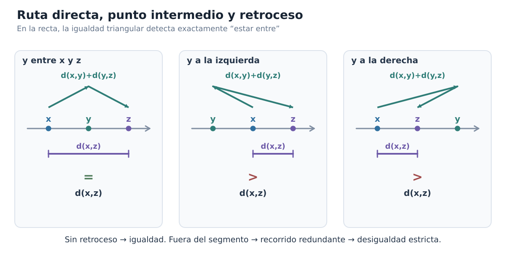{#fig-anm-c01-f05 fig-alt="Tres paneles comparan el caso y entre x y z con y situado a la izquierda o a la derecha. La ruta pasando por y tiene la misma longitud sólo en el primer caso y es mayor en los otros dos."}

### Cuando $y$ está entre los extremos

Recordemos nuestra definición de §1.2: $y$ está entre $x$ y $z$ cuando

$$
\min\{x,z\}\le y\le \max\{x,z\}.
$$

Supongamos primero que $x\le y\le z$. Entonces las diferencias $y-x$ y $z-y$ son no negativas, de modo que

$$
d(x,y)=y-x
$$

y

$$
d(y,z)=z-y.
$$

Al sumarlas,

$$
d(x,y)+d(y,z)=(y-x)+(z-y)=z-x=d(x,z).
$$

Si el orden de los extremos es el contrario, $z\le y\le x$, ocurre exactamente lo mismo con los papeles de $x$ y $z$ intercambiados. Por tanto, siempre que $y$ esté entre los extremos,

$$
d(x,z)=d(x,y)+d(y,z).
$$

Los casos $y=x$ o $y=z$ están incluidos. Si, por ejemplo, $y=x$, entonces $d(x,y)=0$ y la igualdad se reduce simplemente a $d(x,z)=d(x,z)$. Esto importa porque nuestra noción de «estar entre» permite coincidir con los extremos.

### ¿Y si aparece la igualdad?

La dirección anterior era la más fácil de imaginar: si $y$ está entre $x$ y $z$, las longitudes se concatenan sin retroceso. Lo más interesante es la conversa. Supongamos ahora que sabemos que

$$
d(x,z)=d(x,y)+d(y,z).
$$

¿Estamos obligados a concluir que $y$ está entre $x$ y $z$? En la recta real, sí.

Como la afirmación no cambia si intercambiamos $x$ y $z$, podemos estudiar el caso $x\le z$. Queremos ver dónde puede estar $y$. Hay tres posibilidades: a la izquierda de $x$, entre $x$ y $z$, o a la derecha de $z$.

Ya sabemos qué ocurre en el caso intermedio. Veamos qué pasa si $y<x$. Entonces

$$
d(x,y)=x-y,
\qquad
d(y,z)=z-y,
$$

y por tanto

$$
d(x,y)+d(y,z)=x+z-2y.
$$

Como $y<x$, tenemos $x-y>0$, y de hecho

$$
d(x,y)+d(y,z)=(z-x)+2(x-y)>z-x=d(x,z).
$$

Aparece longitud extra: para ir de $x$ a $z$ pasando por un punto situado a la izquierda de $x$, primero debemos retroceder y luego desandar ese retroceso.

Si, en cambio, $y>z$, obtenemos de manera análoga

$$
d(x,y)+d(y,z)=(z-x)+2(y-z)>z-x=d(x,z).
$$

También aquí aparece un recorrido redundante, ahora por haber sobrepasado $z$.

Así que la igualdad sólo puede ocurrir en el caso que quedaba: $x\le y\le z$. Al devolver la simetría entre los extremos, obtenemos la caracterización completa:

$$
\boxed{
 d(x,z)=d(x,y)+d(y,z)
 \iff
 \min\{x,z\}\le y\le \max\{x,z\}.
}
$$

Éste es uno de los primeros lugares del capítulo donde orden y distancia se encuentran de manera exacta. La frase «$y$ está entre $x$ y $z$» pertenece al lenguaje del orden; la igualdad de distancias pertenece al lenguaje métrico. En la recta real, ambas descripciones expresan la misma situación.

### Desigualdad estricta fuera del segmento

La caracterización anterior nos permite decir algo un poco más fuerte sin hacer una nueva demostración. Si $y$ **no** está entre $x$ y $z$, entonces la igualdad es imposible y la desigualdad triangular se vuelve estricta:

$$
d(x,z)<d(x,y)+d(y,z).
$$

En la recta, por tanto, la desigualdad triangular no es sólo una cota. También detecta si el punto intermedio pertenece o no al tramo determinado por los extremos.

Conviene advertir desde ahora que esta lectura tan precisa depende de la geometría unidimensional de $\mathbb R$. Más adelante, cuando trabajemos con espacios métricos abstractos, no podremos suponer sin demostración que la igualdad triangular caracteriza una noción única de «estar entre». Aquí sí podemos hacerlo porque el orden lineal de la recta controla completamente la posición relativa de tres puntos.

### Qué nos enseñó realmente la igualdad

Volvamos a la pregunta inicial. ¿Cuándo pasar por $y$ no añade longitud? Exactamente cuando $y$ ya se encuentra entre los extremos. En cualquier otro caso, el recorrido contiene una ida y vuelta innecesaria.

Podemos resumirlo así:

- **orden:** $y$ está entre $x$ y $z$;
- **métrica:** $d(x,z)=d(x,y)+d(y,z)$;
- **geometría:** el recorrido $x\to y\to z$ no contiene retroceso.

Tres lenguajes distintos, una misma configuración.

### Antes de seguir

Probemos si la caracterización ya resulta natural.

#### Microcontrol 19

[]{#MA-MIC-ANM-01-001-019}

Si $x=-2$, $z=5$ y $y=1$, ¿esperamos igualdad o desigualdad estricta?

[]{#MA-MSOL-ANM-01-001-019}

Ver solución del microcontrol 19

Esperamos **igualdad**, porque $1$ está entre $-2$ y $5$. En efecto,

$$
d(-2,5)=7,
$$

y

$$
d(-2,1)+d(1,5)=3+4=7.
$$

Por tanto,

$$
\boxed{d(-2,5)=d(-2,1)+d(1,5)}.
$$

La ruta que pasa por $y=1$ no contiene retroceso: recorre exactamente el mismo tramo que la ruta directa.

#### Microcontrol 20

[]{#MA-MIC-ANM-01-001-020}

Si $x=-2$, $z=5$ y $y=8$, ¿dónde aparece el recorrido extra?

[]{#MA-MSOL-ANM-01-001-020}

Ver solución del microcontrol 20

Aquí $y=8$ queda a la derecha de $z=5$. Para pasar por $8$ desde $-2$ debemos sobrepasar el destino $5$ y después regresar desde $8$ hasta $5$.

La distancia directa es

$$
d(-2,5)=7,
$$

mientras que la ruta forzada mide

$$
d(-2,8)+d(8,5)=10+3=13.
$$

El exceso es

$$
13-7=6=2(8-5).
$$

Esos $6$ corresponden exactamente al tramo de longitud $3$ entre $5$ y $8$, recorrido una vez al sobrepasar $5$ y otra al regresar. Por eso la desigualdad es estricta.

#### Microcontrol 21

[]{#MA-MIC-ANM-01-001-021}

Si $d(x,z)=d(x,y)+d(y,z)$, ¿qué podemos afirmar sobre la posición de $y$ sin saber cuál de $x$ o $z$ está a la izquierda?

[]{#MA-MSOL-ANM-01-001-021}

Ver solución del microcontrol 21

Podemos afirmar que $y$ está **entre** $x$ y $z$. La formulación que no presupone orientación es

$$
\boxed{\min\{x,z\}\le y\le\max\{x,z\}}.
$$

Ésta es precisamente la caracterización del caso de igualdad de la desigualdad triangular en la recta: la ruta $x\to y\to z$ no añade longitud si y sólo si $y$ pertenece al tramo cerrado determinado por los extremos.

#### Microcontrol 22

[]{#MA-MIC-ANM-01-001-022}

¿Por qué los casos $y=x$ y $y=z$ deben formar parte de la caracterización?

[]{#MA-MSOL-ANM-01-001-022}

Ver solución del microcontrol 22

Porque «estar entre» incluye los extremos del tramo cerrado. Si $y=x$, entonces

$$
d(x,y)=0,
\qquad
d(y,z)=d(x,z),
$$

y por tanto

$$
d(x,z)=d(x,y)+d(y,z).
$$

Si $y=z$, ocurre simétricamente:

$$
d(y,z)=0,
\qquad
d(x,y)=d(x,z).
$$

Así, en ambos extremos sigue habiendo igualdad. Excluir $y=x$ o $y=z$ haría falsa la equivalencia correcta

$$
\boxed{
d(x,z)=d(x,y)+d(y,z)
\iff
\min\{x,z\}\le y\le\max\{x,z\}
}.
$$

La desigualdad triangular comenzó como una propiedad algebraica de la distancia. Ahora vemos que, en la recta, también es una afirmación sobre **posición**. En la sección siguiente cambiaremos de pregunta una vez más: fijaremos un centro y un margen positivo, y estudiaremos qué conjunto de puntos queda a una distancia menor que ese margen.

### Ejercicios de la sección 1.5

#### Ejercicio 22. Igualdad sin retroceso

[]{#MA-EX-ANM-01-001-022}

Sean $x,y,z\in\mathbb R$. Demuestra directamente que, si $y$ está entre $x$ y $z$, entonces

$$
d(x,z)=d(x,y)+d(y,z).
$$

Tu prueba debe cubrir explícitamente los dos órdenes posibles

$$
x\le y\le z
$$

y

$$
z\le y\le x,
$$

incluyendo los casos en que $y$ coincide con uno de los extremos. Explica al final por qué la suma de las dos distancias parciales no contiene recorrido redundante.

[]{#MA-SOL-ANM-01-001-022}

Ver solución del ejercicio 22

Supongamos primero que

$$
x\le y\le z.
$$

Entonces $y-x\ge0$ y $z-y\ge0$, así que

$$
d(x,y)=|x-y|=y-x
$$

y

$$
d(y,z)=|y-z|=z-y.
$$

Al sumar,

$$
\begin{aligned}
d(x,y)+d(y,z)
&=(y-x)+(z-y)\\
&=z-x.
\end{aligned}
$$

Como $x\le z$,

$$
d(x,z)=|x-z|=z-x,
$$

y por tanto

$$
d(x,z)=d(x,y)+d(y,z).
$$

Ahora supongamos el orden contrario,

$$
z\le y\le x.
$$

Entonces

$$
d(x,y)=x-y,
\qquad
d(y,z)=y-z,
$$

y

$$
d(x,y)+d(y,z)=(x-y)+(y-z)=x-z=d(x,z).
$$

Los casos $y=x$ o $y=z$ están incluidos: una de las dos distancias parciales se vuelve $0$ y la otra coincide con $d(x,z)$.

Geométricamente, cuando $y$ está entre los extremos, la ruta $x\to y\to z$ avanza a lo largo del mismo segmento sin sobrepasar ningún extremo y sin desandar ningún tramo. Por eso la suma de las longitudes parciales coincide exactamente con la longitud directa.

#### Ejercicio 23. La igualdad obliga al punto intermedio

[]{#MA-EX-ANM-01-001-023}

Supón que $x,y,z\in\mathbb R$ satisfacen

$$
d(x,z)=d(x,y)+d(y,z).
$$

Demuestra que

$$
\min\{x,z\}\le y\le\max\{x,z\}.
$$

Organiza la prueba suponiendo primero $x\le z$ y examinando las tres regiones posibles para $y$: $y<x$, $x\le y\le z$ y $y>z$. En los dos casos exteriores debes exhibir explícitamente la longitud extra que hace imposible la igualdad.

[]{#MA-SOL-ANM-01-001-023}

Ver solución del ejercicio 23

Supongamos

$$
d(x,z)=d(x,y)+d(y,z).
$$

Como la situación es simétrica en $x$ y $z$, podemos estudiar primero el caso

$$
x\le z.
$$

Hay tres regiones posibles para $y$.

Si $y<x$, entonces

$$
d(x,y)=x-y,
\qquad
d(y,z)=z-y.
$$

Por tanto,

$$
\begin{aligned}
d(x,y)+d(y,z)
&=(x-y)+(z-y)\\
&=(z-x)+2(x-y).
\end{aligned}
$$

Como $y<x$, tenemos $x-y>0$, luego

$$
d(x,y)+d(y,z)>z-x=d(x,z),
$$

lo que contradice la igualdad supuesta.

Si $y>z$, de manera análoga,

$$
d(x,y)=y-x,
\qquad
d(y,z)=y-z,
$$

y

$$
\begin{aligned}
d(x,y)+d(y,z)
&=(y-x)+(y-z)\\
&=(z-x)+2(y-z)\\
&>z-x=d(x,z).
\end{aligned}
$$

También es imposible.

La única región restante es

$$
x\le y\le z.
$$

Si inicialmente $z\le x$, el mismo razonamiento con los extremos intercambiados produce

$$
z\le y\le x.
$$

En ambos casos,

$$
\boxed{\min\{x,z\}\le y\le\max\{x,z\}}.
$$

La igualdad triangular excluye exactamente los puntos que obligarían a salir del segmento y regresar.

#### Ejercicio 24. Estar entre no significa ser el punto medio

[]{#MA-EX-ANM-01-001-024}

Un estudiante afirma:

> Si $d(x,z)=d(x,y)+d(y,z)$, entonces $y$ es necesariamente el punto medio entre $x$ y $z$.

1. Diagnostica el error y da un contraejemplo numérico.
2. Formula la conclusión correcta que sí se deduce de la igualdad triangular en $\mathbb R$.
3. Añade una condición métrica que, junto con la igualdad triangular, sí obligue a que $y$ sea el punto medio de $x$ y $z$.
4. Justifica esa afirmación sin usar resultados posteriores del capítulo.

[]{#MA-SOL-ANM-01-001-024}

Ver solución del ejercicio 24

La afirmación es falsa. La igualdad

$$
d(x,z)=d(x,y)+d(y,z)
$$

sólo obliga a que $y$ esté entre $x$ y $z$; no obliga a que divida el segmento en dos partes iguales.

Por ejemplo, tomemos

$$
x=0,
\qquad y=1,
\qquad z=4.
$$

Entonces

$$
d(0,4)=4
$$

y

$$
d(0,1)+d(1,4)=1+3=4,
$$

así que hay igualdad triangular. Sin embargo, el punto medio de $0$ y $4$ es $2$, no $1$.

La conclusión correcta es

$$
\boxed{d(x,z)=d(x,y)+d(y,z)
\iff
\min\{x,z\}\le y\le\max\{x,z\}}.
$$

Para obligar además a que $y$ sea el punto medio, basta exigir

$$
d(x,y)=d(y,z).
$$

Veamos por qué. Supongamos, por ejemplo, que $x\le y\le z$. Entonces

$$
d(x,y)=y-x
$$

y

$$
d(y,z)=z-y.
$$

La igualdad de ambas distancias da

$$
y-x=z-y,
$$

de donde

$$
2y=x+z
$$

y por tanto

$$
\boxed{y=\frac{x+z}{2}}.
$$

Si $z\le y\le x$, el mismo cálculo conduce a la misma fórmula.

Así, **estar entre** significa ausencia de retroceso; **ser punto medio** añade una segunda condición: las dos partes del recorrido deben tener la misma longitud.

#### Ejercicio 25. Medir exactamente el retroceso

[]{#MA-EX-ANM-01-001-025}

Fija dos puntos $x<z$ y define, para $y\in\mathbb R$,

$$
E(y)=d(x,y)+d(y,z)-d(x,z).
$$

1. Demuestra que

$$
E(y)=
\begin{cases}
2(x-y),&y<x,\\
0,&x\le y\le z,\\
2(y-z),&y>z.
\end{cases}
$$

2. Explica por qué $E(y)\ge0$ para todo $y$.
3. Determina exactamente para qué valores de $y$ se cumple $E(y)=0$.
4. Interpreta geométricamente el factor $2$ que aparece cuando $y$ queda fuera del segmento $[x,z]$.

[]{#MA-SOL-ANM-01-001-025}

Ver solución del ejercicio 25

Como $x<z$, tenemos

$$
d(x,z)=z-x.
$$

Estudiemos los tres lugares posibles de $y$.

Si $y<x$, entonces

$$
d(x,y)=x-y
$$

y

$$
d(y,z)=z-y.
$$

Por tanto,

$$
\begin{aligned}
E(y)
&=(x-y)+(z-y)-(z-x)\\
&=2x-2y\\
&=2(x-y).
\end{aligned}
$$

Si $x\le y\le z$, entonces

$$
d(x,y)=y-x,
\qquad
d(y,z)=z-y,
$$

y

$$
E(y)=(y-x)+(z-y)-(z-x)=0.
$$

Finalmente, si $y>z$, entonces

$$
d(x,y)=y-x,
\qquad
d(y,z)=y-z,
$$

y

$$
\begin{aligned}
E(y)
&=(y-x)+(y-z)-(z-x)\\
&=2y-2z\\
&=2(y-z).
\end{aligned}
$$

Así,

$$
\boxed{
E(y)=
\begin{cases}
2(x-y),&y<x,\\
0,&x\le y\le z,\\
2(y-z),&y>z.
\end{cases}}
$$

Cada expresión es no negativa en la región donde se utiliza, de modo que $E(y)\ge0$ para todo $y$. Además,

$$
E(y)=0
\iff
x\le y\le z.
$$

El factor $2$ tiene una interpretación precisa. Si $y<x$, para visitar $y$ desde $x$ recorremos una distancia $x-y$ hacia la izquierda y luego debemos recorrer de nuevo esa misma distancia para regresar hasta $x$ antes de continuar hacia $z$. Ese desvío se paga dos veces. Lo mismo ocurre, simétricamente, cuando $y>z$.

Por eso $E(y)$ mide exactamente la longitud adicional causada por el retroceso.

La figura [C01-F11](#fig-anm-c01-f11) concentra esta lectura en una sola comparación.

![El exceso $E(y)$ es cero sobre $[x,z]$ y crece linealmente con pendiente de magnitud $2$ cuando $y$ sale del segmento.](../../assets/books/anm/C01/C01-F11.svg){#fig-anm-c01-f11 fig-alt="Gráfico por tramos de E(y): una meseta igual a cero entre x y z y dos ramas lineales crecientes hacia afuera."}

#### Ejercicio 26. Cuatro puntos y una ruta sin retroceso

[]{#MA-EX-ANM-01-001-026}

Supón que $x,z\in\mathbb R$ satisfacen $x\le z$. Demuestra que

$$
d(x,z)=d(x,y)+d(y,w)+d(w,z)
$$

si y sólo si

$$
x\le y\le w\le z.
$$

Tu prueba debe explicar por qué, si la igualdad total se cumple, las dos desigualdades

$$
d(x,z)\le d(x,y)+d(y,z)
$$

y

$$
d(y,z)\le d(y,w)+d(w,z)
$$

han de convertirse simultáneamente en igualdades. Interpreta el resultado como una extensión del principio «igualdad triangular = ausencia de retroceso».

[]{#MA-SOL-ANM-01-001-026}

Ver solución del ejercicio 26

**Cómo pensar este problema.** La igualdad total compara la ruta directa $x\to z$ con una ruta que visita dos puntos intermedios. Conviene insertar primero una ruta menos refinada y formar una cadena de desigualdades. Si el primer y el último término terminan siendo iguales, ninguna desigualdad intermedia puede haber sido estricta.

Supongamos primero que

$$
x\le y\le w\le z.
$$

Entonces todos los desplazamientos sucesivos son no negativos y

$$
\begin{aligned}
d(x,y)+d(y,w)+d(w,z)
&=(y-x)+(w-y)+(z-w)\\
&=z-x\\
&=d(x,z).
\end{aligned}
$$

Esto prueba una dirección.

Para la conversa, supongamos que

$$
d(x,z)=d(x,y)+d(y,w)+d(w,z).
$$

Por desigualdad triangular,

$$
d(x,z)\le d(x,y)+d(y,z).
$$

Y aplicando otra vez la desigualdad triangular, ahora entre $y$ y $z$ pasando por $w$,

$$
d(y,z)\le d(y,w)+d(w,z).
$$

Sumando $d(x,y)$ a esta última desigualdad obtenemos

$$
d(x,y)+d(y,z)
\le
d(x,y)+d(y,w)+d(w,z).
$$

Por tanto,

$$
d(x,z)
\le
d(x,y)+d(y,z)
\le
d(x,y)+d(y,w)+d(w,z).
$$

Pero el primer y el último término son iguales por hipótesis. Luego las dos desigualdades intermedias deben ser igualdades:

$$
d(x,z)=d(x,y)+d(y,z)
$$

y

$$
d(y,z)=d(y,w)+d(w,z).
$$

La caracterización de igualdad triangular de §1.5 nos dice entonces que $y$ está entre $x$ y $z$, y que $w$ está entre $y$ y $z$.

Como además $x\le z$, la primera condición implica

$$
x\le y\le z.
$$

Y, dado que $y\le z$, la segunda implica

$$
y\le w\le z.
$$

Juntando ambas,

$$
\boxed{x\le y\le w\le z}.
$$

La igualdad total caracteriza exactamente una ruta cuyos puntos visitados aparecen en orden monotónico: nunca hay que retroceder para alcanzar el siguiente punto.

#### Ejercicio 27. Lo que las distancias revelan —y lo que no

[]{#MA-EX-ANM-01-001-027}

Sean $a,b,c\in\mathbb R$ tres puntos distintos. Supón que sólo conocemos las tres distancias

$$
d(a,b),\qquad d(b,c),\qquad d(a,c).
$$

1. Demuestra que uno de los tres puntos está entre los otros dos y que la distancia entre los dos extremos es la suma de las otras dos distancias.
2. Explica cómo determinar, a partir de las tres distancias etiquetadas, cuál de $a,b,c$ es el punto intermedio.
3. Para

$$
d(a,b)=2,\qquad d(a,c)=3,\qquad d(b,c)=5,
$$

identifica el punto intermedio y justifica la respuesta.
4. Demuestra que, aun conociendo las tres distancias, no podemos decidir qué extremo está a la izquierda y cuál a la derecha: construye a partir de una realización cualquiera otra realización con las mismas distancias y orientación opuesta.

El objetivo es precisar hasta dónde la información métrica permite recuperar la estructura de orden y qué parte de la orientación sigue perdiéndose.

[]{#MA-SOL-ANM-01-001-027}

Ver solución del ejercicio 27

**Cómo pensar este problema.** En una recta, entre tres puntos distintos uno y sólo uno queda entre los otros dos. La igualdad triangular permite reconocer ese punto usando únicamente distancias. Pero las distancias son insensibles a una reflexión, de modo que no pueden decidir la orientación izquierda–derecha completa.

Ordenemos temporalmente los tres valores reales. Como son distintos, existe un orden estricto de la forma

$$
r<s<t,
$$

donde $r,s,t$ son los tres puntos $a,b,c$ en algún orden.

Como $s$ está entre $r$ y $t$, la igualdad triangular da

$$
d(r,t)=d(r,s)+d(s,t).
$$

Además, $d(r,t)$ es la mayor de las tres distancias, porque

$$
d(r,t)=t-r,
$$

mientras que

$$
d(r,s)=s-r<t-r
$$

y

$$
d(s,t)=t-s<t-r.
$$

Así, para tres puntos distintos, la mayor distancia es exactamente la suma de las otras dos.

Esto también permite identificar el punto intermedio a partir de las distancias etiquetadas. Por ejemplo,

$$
d(a,c)=d(a,b)+d(b,c)
$$

si y sólo si $b$ está entre $a$ y $c$. Análogamente,

$$
d(a,b)=d(a,c)+d(c,b)
$$

identifica a $c$ como punto intermedio, y

$$
d(b,c)=d(b,a)+d(a,c)
$$

identifica a $a$ como punto intermedio.

En el ejemplo

$$
d(a,b)=2,
\qquad d(a,c)=3,
\qquad d(b,c)=5,
$$

la mayor distancia es $d(b,c)=5$, y

$$
5=2+3=d(b,a)+d(a,c).
$$

Por tanto,

$$
\boxed{a\text{ está entre }b\text{ y }c}.
$$

Queda la orientación. Supongamos que $(a,b,c)$ es una realización concreta de esas distancias. Consideremos la configuración reflejada

$$
(-a,-b,-c).
$$

Para cualquier par $u,v\in\{a,b,c\}$,

$$
\begin{aligned}
d(-u,-v)
&=|-u-(-v)|\\
&=|-(u-v)|\\
&=|u-v|\\
&=d(u,v).
\end{aligned}
$$

Todas las distancias etiquetadas se conservan. Sin embargo, si por ejemplo

$$
a<b<c,
$$

entonces

$$
-a>-b>-c,
$$

de modo que la orientación se invierte.

La conclusión es doble. Las distancias sí permiten recuperar **qué punto está entre los otros dos**; pero no permiten decidir **qué extremo está a la izquierda y cuál a la derecha**. La métrica recupera betweenness, no orientación.

## 1.6. Bolas métricas: ventanas alrededor de un punto

En la sección anterior dejamos tres puntos libres y preguntamos qué ocurría al obligar a una ruta a pasar por uno de ellos. Ahora fijaremos sólo uno. Elegimos un punto $a\in\mathbb R$ y queremos reunir todos los puntos que estén **suficientemente cerca** de él.

La palabra «suficientemente» necesita, naturalmente, una medida. Elijamos un número $r>0$ y exijamos que la distancia desde $x$ hasta $a$ sea menor que $r$. Esto conduce a la definición

$$
B(a,r)=\{x\in\mathbb R:d(x,a)<r\}.
$$

Llamaremos a $B(a,r)$ la **bola abierta de centro $a$ y radio $r$** en la recta real.

Hay dos datos que conviene mantener separados desde el comienzo. El **centro** $a$ decide alrededor de qué punto estamos midiendo; el **radio** $r$ decide cuánta separación estamos dispuestos a admitir. La condición $r>0$ no es decorativa: un radio positivo expresa un margen real de cercanía alrededor del centro.

### ¿Qué forma tiene una bola en la recta?

El nombre «bola» puede sugerir un disco o una esfera, pero aquí nuestros puntos viven en $\mathbb R$. No deberíamos adivinar la forma del conjunto a partir de la palabra; debemos leer la definición.

Un punto $x$ pertenece a $B(a,r)$ exactamente cuando

$$
d(x,a)<r.
$$

Como la distancia estándar es $d(x,a)=|x-a|$, esto equivale a

$$
|x-a|<r.
$$

En §1.3 vimos que una desigualdad de valor absoluto centrada en el origen describe todos los puntos situados entre dos fronteras simétricas. Aplicando esa misma lectura al desplazamiento $x-a$, obtenemos

$$
-r<x-a<r.
$$

Sumando $a$ en los tres miembros,

$$
a-r<x<a+r.
$$

Pero ésta es precisamente la condición de pertenencia al intervalo $(a-r,a+r)$. Hemos demostrado, por tanto, que

$$
\boxed{B(a,r)=(a-r,a+r)}.
$$

La igualdad de conjuntos merece leerse en ambas direcciones. Si $x$ está a menos de $r$ unidades de $a$, entonces queda entre $a-r$ y $a+r$; y si queda entre esas dos fronteras, entonces su distancia a $a$ es menor que $r$.

La figura [C01-F06](#fig-anm-c01-f06) concentra esta lectura en una sola comparación.

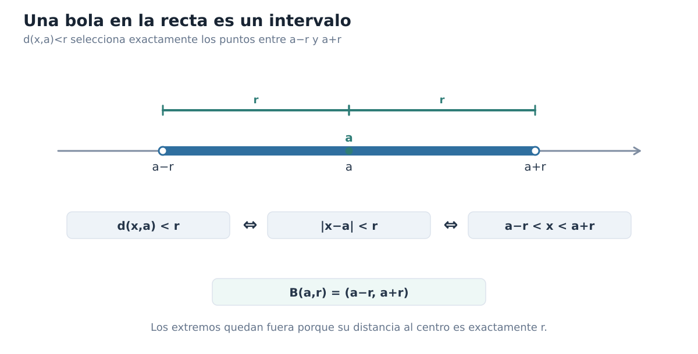{#fig-anm-c01-f06 fig-alt="Recta numérica centrada en a con extremos abiertos a-r y a+r, ambos a distancia r del centro, y cadena de equivalencias entre distancia, valor absoluto y desigualdad doble."}

### El centro localiza; el radio controla el margen

La identidad

$$
B(a,r)=(a-r,a+r)
$$

nos permite ver con mucha claridad qué hace cada parámetro.

Si mantenemos fijo $r$ y cambiamos $a$, ambos extremos se desplazan en la misma cantidad. La bola se traslada a lo largo de la recta sin cambiar su tamaño. Por ejemplo,

$$
B(0,2)=(-2,2)
$$

mientras que

$$
B(5,2)=(3,7).
$$

El radio sigue siendo $2$; sólo hemos cambiado el punto alrededor del cual medimos.

Si, en cambio, mantenemos fijo el centro y variamos $r$, ocurre otra cosa. Con centro $a$,

$$
B(a,1)=(a-1,a+1),
$$

$$
B(a,2)=(a-2,a+2),
$$

y, más generalmente, un radio mayor permite una separación mayor en ambos sentidos. El intervalo se ensancha simétricamente respecto del centro.

La figura [C01-F07](#fig-anm-c01-f07) concentra esta lectura en una sola comparación.

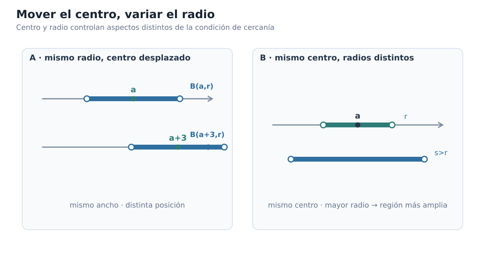{#fig-anm-c01-f07 fig-alt="Dos paneles: el primero compara dos bolas de igual radio y centros distintos; el segundo compara dos bolas del mismo centro y radios diferentes."}

Por eso resulta útil pensar en la bola como una **ventana** alrededor de $a$: mover $a$ desplaza la ventana; aumentar $r$ la abre; disminuir $r$ la estrecha. Pero conviene conservar la jerarquía correcta. «Ventana» es una imagen; la definición matemática es

$$
B(a,r)=\{x\in\mathbb R:d(x,a)<r\}.
$$

### Por qué exigimos $r>0$

Podría parecer que la condición $r>0$ es una formalidad. Veamos qué ocurre si la abandonamos.

Si $r=0$, la condición sería

$$
d(x,a)<0,
$$

que ningún punto puede satisfacer porque las distancias nunca son negativas. Si $r<0$, con mayor razón tampoco existe ningún $x$ cuya distancia no negativa a $a$ sea menor que ese número negativo.

Así, los radios no positivos no producen una región de cercanía alrededor del centro. Para la noción que queremos usar, el radio debe ser estrictamente positivo.

### Una primera lectura de tolerancia

La notación de bolas nos permite condensar una idea que aparecerá una y otra vez en análisis. Supongamos que $a$ es un valor de referencia y que aceptamos un error menor que $r$. Decir

$$
x\in B(a,r)
$$

significa que $x$ permanece dentro de ese margen:

$$
d(x,a)<r.
$$

En la recta, ya sabemos además que esto equivale a quedar entre las dos fronteras $a-r$ y $a+r$. Todavía no vamos a sistematizar todas las traducciones posibles —eso será precisamente el trabajo de §1.7—, pero ya podemos ver la idea que las sostiene: **una tolerancia positiva alrededor de un centro define una región precisa de puntos admitidos**.

### Antes de seguir

Comprobemos que centro, radio y conjunto no se mezclen entre sí.

#### Microcontrol 23

[]{#MA-MIC-ANM-01-001-023}

¿Qué cambia en $B(a,r)$ si sustituimos $a$ por $a+3$ y mantenemos fijo $r$?

[]{#MA-MSOL-ANM-01-001-023}

Ver solución del microcontrol 23

La bola original es

$$
B(a,r)=(a-r,a+r).
$$

Al cambiar el centro a $a+3$ obtenemos

$$
B(a+3,r)=((a+3)-r,(a+3)+r).
$$

Es decir,

$$
\boxed{B(a+3,r)=(a-r+3,a+r+3)}.
$$

Ambos extremos se desplazan $3$ unidades hacia la derecha. El radio no cambia, de modo que la anchura de la bola permanece igual: sólo se traslada toda la región.

#### Microcontrol 24

[]{#MA-MIC-ANM-01-001-024}

¿Qué cambia si dejamos fijo $a$ y duplicamos $r$?

[]{#MA-MSOL-ANM-01-001-024}

Ver solución del microcontrol 24

Con radio $r$ tenemos

$$
B(a,r)=(a-r,a+r).
$$

Al duplicarlo,

$$
\boxed{B(a,2r)=(a-2r,a+2r)}.
$$

El centro $a$ permanece fijo, pero cada frontera queda ahora al doble de distancia del centro. La ventana se ensancha simétricamente en ambas direcciones.

#### Microcontrol 25

[]{#MA-MIC-ANM-01-001-025}

¿Por qué $a-r$ y $a+r$ quedan a la misma distancia del centro?

[]{#MA-MSOL-ANM-01-001-025}

Ver solución del microcontrol 25

Calculamos sus separaciones respecto de $a$:

$$
d(a-r,a)=|(a-r)-a|=|-r|=r,
$$

y

$$
d(a+r,a)=|(a+r)-a|=|r|=r,
$$

porque $r>0$.

Por tanto,

$$
\boxed{d(a-r,a)=d(a+r,a)=r}.
$$

Los dos puntos son simétricos respecto del centro: uno está a la izquierda y el otro a la derecha, pero ambos tienen la misma separación.

#### Microcontrol 26

[]{#MA-MIC-ANM-01-001-026}

¿Por qué esos dos puntos no pertenecen a $B(a,r)$?

[]{#MA-MSOL-ANM-01-001-026}

Ver solución del microcontrol 26

La definición exige una desigualdad estricta:

$$
x\in B(a,r)
\iff
d(x,a)<r.
$$

Pero para los dos extremos acabamos de obtener

$$
d(a-r,a)=d(a+r,a)=r.
$$

Como $r<r$ es falso,

$$
\boxed{a-r\notin B(a,r)\qquad\text{y}\qquad a+r\notin B(a,r)}.
$$

Ésta es precisamente la razón por la que la bola abierta corresponde al intervalo abierto $(a-r,a+r)$.

#### Microcontrol 27

[]{#MA-MIC-ANM-01-001-027}

¿Qué falla si intentamos usar $r=0$ como radio de una bola abierta?

[]{#MA-MSOL-ANM-01-001-027}

Ver solución del microcontrol 27

Si escribiéramos $B(a,0)$ mediante la misma condición, obtendríamos

$$
B(a,0)=\{x\in\mathbb R:d(x,a)<0\}.
$$

Pero toda distancia es no negativa:

$$
d(x,a)\ge0.
$$

Por eso ningún punto puede satisfacer $d(x,a)<0$, ni siquiera el propio centro. Así,

$$
\boxed{B(a,0)=\varnothing}
$$

si se extiende formalmente la fórmula a $r=0$.

Lo que falla no es la lógica de la desigualdad, sino la interpretación que buscamos: un radio nulo no produce una región abierta de cercanía alrededor de $a$. Por eso en C01 exigimos siempre $r>0$.

Hemos llegado así a una primera traducción exacta entre dos estructuras de la recta:

$$
\text{distancia menor que }r
\quad\longleftrightarrow\quad
\text{estar entre }a-r\text{ y }a+r.
$$

En la sección siguiente convertiremos esta observación en un pequeño sistema de traducción. Compararemos no sólo $<$, sino también $\le$, $>$ y $\ge$, y aprenderemos a pasar deliberadamente entre distancia, valor absoluto, desigualdad e intervalo.

### Ejercicios de la sección 1.6

#### Ejercicio 28. Leer una bola en cuatro lenguajes

[]{#MA-EX-ANM-01-001-028}

Considera la bola

$$
B(2,3).
$$

1. Escríbela usando la definición $d(x,2)<3$.
2. Reescribe la condición mediante valor absoluto.
3. Exprésala como una doble desigualdad de orden.
4. Escríbela como intervalo.
5. Decide si pertenecen a la bola los puntos $-1$, $2$ y $5$, justificando cada caso desde la condición de distancia.

El objetivo es seguir una misma región a través de varias representaciones, no memorizar el intervalo final.

[]{#MA-SOL-ANM-01-001-028}

Ver solución del ejercicio 28

Por definición,

$$
B(2,3)=\{x\in\mathbb R:d(x,2)<3\}.
$$

Como

$$
d(x,2)=|x-2|,
$$

la misma condición es

$$
|x-2|<3.
$$

Esto equivale a

$$
-3<x-2<3,
$$

y sumando $2$ en los tres miembros obtenemos

$$
-1<x<5.
$$

Por tanto,

$$
\boxed{B(2,3)=(-1,5)}.
$$

Ahora comprobamos los puntos desde la condición métrica:

- para $x=-1$,
  $$
  d(-1,2)=|-1-2|=3,
  $$
  y como necesitamos una distancia estrictamente menor que $3$, $-1\notin B(2,3)$;
- para $x=2$,
  $$
  d(2,2)=0<3,
  $$
  luego $2\in B(2,3)$;
- para $x=5$,
  $$
  d(5,2)=|5-2|=3,
  $$
  así que $5\notin B(2,3)$.

Los extremos del intervalo quedan fuera precisamente porque la bola usa la desigualdad estricta $d(x,2)<3$.

#### Ejercicio 29. Recuperar centro y radio desde un intervalo

[]{#MA-EX-ANM-01-001-029}

Sea $u<v$. Demuestra que el intervalo abierto

$$
(u,v)
$$

puede escribirse como una bola $B(a,r)$ con

$$
a=\frac{u+v}{2},
\qquad
r=\frac{v-u}{2}.
$$

Después:

1. verifica la fórmula para el intervalo $(-5,1)$;
2. explica geométricamente por qué $a$ es el centro del intervalo;
3. explica por qué $r>0$ se deduce de $u<v$.

No basta con sustituir en una fórmula: muestra que $a-r=u$ y $a+r=v$.

[]{#MA-SOL-ANM-01-001-029}

Ver solución del ejercicio 29

Queremos elegir $a$ y $r$ de modo que

$$
B(a,r)=(a-r,a+r)=(u,v).
$$

Esto exige

$$
a-r=u,
\qquad
a+r=v.
$$

Sumando ambas ecuaciones,

$$
2a=u+v,
$$

de donde

$$
\boxed{a=\frac{u+v}{2}}.
$$

Restando la primera ecuación de la segunda,

$$
2r=v-u,
$$

y por tanto

$$
\boxed{r=\frac{v-u}{2}}.
$$

Podemos verificar directamente:

$$
\begin{aligned}
a-r
&=\frac{u+v}{2}-\frac{v-u}{2}\\
&=\frac{2u}{2}=u,
\end{aligned}
$$

y

$$
\begin{aligned}
a+r
&=\frac{u+v}{2}+\frac{v-u}{2}\\
&=\frac{2v}{2}=v.
\end{aligned}
$$

Así,

$$
\boxed{(u,v)=B\!\left(\frac{u+v}{2},\frac{v-u}{2}\right)}.
$$

Para $(-5,1)$,

$$
a=\frac{-5+1}{2}=-2,
\qquad
r=\frac{1-(-5)}{2}=3,
$$

de modo que

$$
(-5,1)=B(-2,3).
$$

Geométricamente, $a$ es el punto medio entre los extremos y $r$ es la mitad de la longitud total del intervalo. Finalmente, como $u<v$, tenemos $v-u>0$, y por tanto

$$
r=\frac{v-u}{2}>0.
$$

La positividad del radio no es una condición añadida después: está contenida en el hecho de que el intervalo tenga dos extremos distintos con $u<v$.

#### Ejercicio 30. Mismo centro, radios distintos

[]{#MA-EX-ANM-01-001-030}

Fija $a\in\mathbb R$ y números $0<r<s$.

1. Demuestra que

$$
B(a,r)\subset B(a,s).
$$

2. Prueba que la inclusión es estricta construyendo explícitamente un punto que pertenezca a $B(a,s)$ pero no a $B(a,r)$.
3. Interpreta el resultado usando la imagen de una ventana centrada en $a$: ¿qué permanece y qué cambia cuando aumenta el radio?

Tu prueba de la inclusión debe partir de la condición de distancia, no sólo de un dibujo.

[]{#MA-SOL-ANM-01-001-030}

Ver solución del ejercicio 30

Supongamos

$$
0<r<s.
$$

Sea $x\in B(a,r)$. Entonces, por definición,

$$
d(x,a)<r.
$$

Como $r<s$,

$$
d(x,a)<r<s,
$$

y por tanto

$$
d(x,a)<s.
$$

Así,

$$
x\in B(a,s).
$$

Hemos probado

$$
B(a,r)\subseteq B(a,s).
$$

Para ver que la inclusión es estricta, tomemos

$$
x=a+\frac{r+s}{2}.
$$

Como $r<s$,

$$
r<\frac{r+s}{2}<s.
$$

Además,

$$
d(x,a)=\left|a+\frac{r+s}{2}-a\right|=\frac{r+s}{2}.
$$

Por tanto,

$$
x\notin B(a,r)
$$

pero

$$
x\in B(a,s).
$$

Luego

$$
\boxed{B(a,r)\subsetneq B(a,s)}.
$$

El centro no ha cambiado: ambas bolas están organizadas alrededor del mismo punto $a$. Lo que cambia es el margen admitido. Aumentar el radio ensancha simétricamente la ventana en ambos lados del centro.

#### Ejercicio 31. Mover el centro: cuándo dos bolas se encuentran

[]{#MA-EX-ANM-01-001-031}

Fija $r>0$ y sean $a,b\in\mathbb R$. Considera las dos bolas de igual radio

$$
B(a,r)
\qquad\text{y}\qquad
B(b,r).
$$

Demuestra que

$$
B(a,r)\cap B(b,r)\ne\varnothing
\iff
d(a,b)<2r.
$$

Después analiza por separado los casos

$$
d(a,b)=2r
$$

y

$$
d(a,b)>2r.
$$

Explica qué ocurre geométricamente con los dos intervalos cuando desplazamos uno de los centros alejándolo del otro, manteniendo fijo el radio.

[]{#MA-SOL-ANM-01-001-031}

Ver solución del ejercicio 31

Como ambas bolas tienen radio $r$,

$$
B(a,r)=(a-r,a+r)
$$

y

$$
B(b,r)=(b-r,b+r).
$$

Supongamos primero, sin pérdida de generalidad, que $a\le b$. Entonces

$$
d(a,b)=b-a.
$$

Los dos intervalos tienen intersección no vacía exactamente cuando el extremo izquierdo de la segunda bola queda estrictamente a la izquierda del extremo derecho de la primera:

$$
b-r<a+r.
$$

Reordenando,

$$
b-a<2r.
$$

Como $b-a=d(a,b)$,

$$
B(a,r)\cap B(b,r)\ne\varnothing
\iff
d(a,b)<2r.
$$

Si $b\le a$, el mismo argumento intercambiando los centros produce la misma condición, ahora con $a-b=d(a,b)$. Por tanto, en todos los casos,

$$
\boxed{B(a,r)\cap B(b,r)\ne\varnothing
\iff
d(a,b)<2r}.
$$

Si

$$
d(a,b)=2r,
$$

los dos intervalos llegan exactamente hasta un mismo punto fronterizo, pero ese punto no pertenece a ninguna de las dos bolas en el lado correspondiente porque ambas son abiertas. Por eso la intersección sigue siendo vacía.

Si

$$
d(a,b)>2r,
$$

queda un espacio positivo entre los dos intervalos y también son disjuntos.

Geométricamente, mantener fijo $r$ conserva el ancho de ambas ventanas; mover los centros sólo modifica su posición relativa. Se solapan cuando la separación entre centros es menor que la suma de los dos radios, que aquí vale $2r$.

La figura [C01-F12](#fig-anm-c01-f12) concentra esta lectura en una sola comparación.

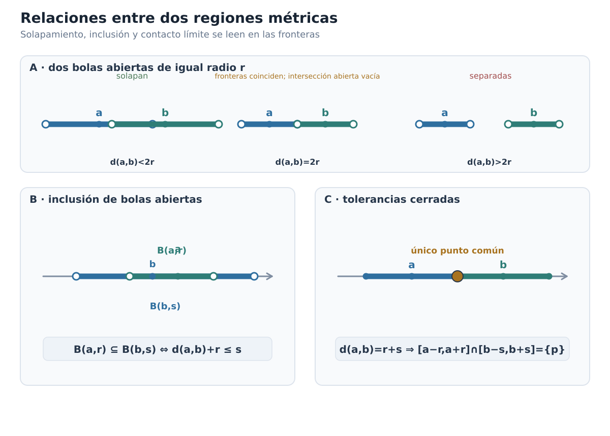{#fig-anm-c01-f12 fig-alt="Figura multipanel: bolas abiertas de igual radio que se solapan, tocan fronteras o se separan; una bola abierta incluida en otra; y dos intervalos cerrados que se tocan en un único punto."}

#### Ejercicio 32. Cuándo una bola cabe dentro de otra

[]{#MA-EX-ANM-01-001-032}

Sean $a,b\in\mathbb R$ y $r,s>0$. Demuestra que

$$
B(a,r)\subseteq B(b,s)
\iff
d(a,b)+r\le s.
$$

Tu prueba debe conectar dos perspectivas:

1. la representación por intervalos

$$
B(a,r)=(a-r,a+r),
\qquad
B(b,s)=(b-s,b+s);
$$

2. la interpretación métrica de $d(a,b)$ como separación entre los centros.

Explica al final por qué la condición dice exactamente que el radio de la bola grande debe alcanzar desde $b$ hasta el punto más lejano de la bola pequeña.

No uses conceptos topológicos posteriores: trabaja sólo con distancia, valor absoluto, orden e intervalos.

[]{#MA-SOL-ANM-01-001-032}

Ver solución del ejercicio 32

**Cómo pensar este problema.** La inclusión de dos bolas en la recta puede leerse primero como inclusión de intervalos. Eso convierte una afirmación sobre todos los puntos de una bola en dos comparaciones entre extremos. Después esas dos comparaciones se condensan en una sola condición sobre la distancia entre los centros.

Tenemos

$$
B(a,r)=(a-r,a+r)
$$

y

$$
B(b,s)=(b-s,b+s).
$$

La inclusión

$$
(a-r,a+r)\subseteq(b-s,b+s)
$$

se cumple si y sólo si el extremo izquierdo de la bola pequeña no queda a la izquierda del extremo izquierdo de la grande y su extremo derecho no queda a la derecha del extremo derecho de la grande. Es decir,

$$
b-s\le a-r
$$

y

$$
a+r\le b+s.
$$

Reescribimos la primera desigualdad como

$$
b-a\le s-r,
$$

y la segunda como

$$
a-b\le s-r.
$$

Tener ambas simultáneamente equivale a

$$
|a-b|\le s-r.
$$

Como

$$
d(a,b)=|a-b|,
$$

obtenemos

$$
d(a,b)\le s-r,
$$

que es lo mismo que

$$
\boxed{d(a,b)+r\le s}.
$$

Esto prueba la necesidad.

Para la suficiencia, supongamos ahora que

$$
d(a,b)+r\le s.
$$

Entonces

$$
|a-b|\le s-r.
$$

En particular,

$$
a-b\le s-r
$$

y

$$
b-a\le s-r.
$$

Estas dos desigualdades equivalen a

$$
a+r\le b+s
$$

y

$$
b-s\le a-r.
$$

Por tanto,

$$
(a-r,a+r)\subseteq(b-s,b+s),
$$

y así

$$
B(a,r)\subseteq B(b,s).
$$

Hemos demostrado

$$
\boxed{B(a,r)\subseteq B(b,s)
\iff
d(a,b)+r\le s}.
$$

La fórmula tiene una lectura geométrica directa. Desde el centro $b$ debemos recorrer primero la separación $d(a,b)$ hasta llegar al centro de la bola pequeña y disponer todavía de un margen $r$ para alcanzar cualquiera de sus puntos. La suma $d(a,b)+r$ representa exactamente ese alcance máximo; para que toda la bola pequeña quepa dentro de la grande, dicho alcance no puede superar $s$.

El panel de inclusión de la figura [C01-F12](#fig-anm-c01-f12) muestra esta misma condición como comparación de fronteras: el alcance total desde $b$ hasta el extremo más lejano de la bola pequeña no puede sobrepasar el radio $s$.

## 1.7. Traducir entre orden, distancia y tolerancia

En §1.6 apareció una equivalencia que merece algo más que una mirada pasajera. Para $r>0$ vimos que

$$
B(a,r)=\{x\in\mathbb R:d(x,a)<r\}=(a-r,a+r).
$$

Esta igualdad reúne varias maneras de describir exactamente el mismo conjunto. Una habla de **distancia**; otra, de **valor absoluto**; otra, de **orden**; y otra, de **pertenencia a una región de la recta**. A partir de ahora conviene aprender a cambiar de una a otra deliberadamente.

La cadena fundamental es

$$
\boxed{
|x-a|<r
\iff d(x,a)<r
\iff a-r<x<a+r
\iff x\in(a-r,a+r)
}
$$

para todo $a,x\in\mathbb R$ y todo $r>0$.

No hay cuatro hechos distintos aquí. Hay una sola condición expresada en cuatro lenguajes.

### Leer la cadena de izquierda a derecha

Supongamos que comenzamos con

$$
|x-a|<r.
$$

La expresión $|x-a|$ mide la separación entre $x$ y $a$, de modo que podemos leer inmediatamente

$$
d(x,a)<r.
$$

La desigualdad dice que $x$ está a menos de $r$ unidades del centro. En la recta, esto significa que no ha alcanzado ninguna de las dos fronteras situadas exactamente a distancia $r$:

$$
a-r<x<a+r.
$$

Y esa condición de orden es precisamente la pertenencia al intervalo

$$
x\in(a-r,a+r).
$$

Cada paso cambia la representación, no el conjunto de puntos admitidos.

### Leerla también de derecha a izquierda

La traducción sólo está realmente dominada cuando podemos recorrerla en sentido contrario. Si sabemos que

$$
x\in(a-r,a+r),
$$

entonces

$$
a-r<x<a+r.
$$

Restando $a$ en los tres miembros obtenemos

$$
-r<x-a<r,
$$

que equivale a

$$
|x-a|<r,
$$

y, por definición de la distancia estándar,

$$
d(x,a)<r.
$$

La utilidad de este recorrido inverso aparecerá constantemente: a veces un problema estará formulado mediante una región de la recta, pero lo que necesitaremos para argumentar será una estimación de distancia; otras veces ocurrirá exactamente al revés.

### ¿Qué cambia si admitimos la frontera?

Consideremos ahora

$$
|x-a|\le r.
$$

La única diferencia es que permitimos que la separación sea exactamente $r$. Las dos fronteras $a-r$ y $a+r$ pasan entonces a formar parte del conjunto. La cadena correspondiente es

$$
\boxed{
|x-a|\le r
\iff d(x,a)\le r
\iff a-r\le x\le a+r
\iff x\in[a-r,a+r]
}
$$

De $<$ a $\le$ no cambia el centro ni cambia el radio: cambia únicamente la decisión sobre la frontera.

Esta observación parece elemental, pero conviene hacerla explícita porque en análisis la diferencia entre «menor que» y «menor o igual que» puede determinar qué puntos pertenecen a un conjunto y cuáles quedan fuera.

### De puntos cercanos a puntos lejanos

¿Qué ocurre si invertimos la comparación y preguntamos por puntos cuya distancia al centro sea **mayor** que $r$?

La condición

$$
|x-a|>r
$$

ya no selecciona los puntos situados entre las dos fronteras, sino los que quedan fuera de ellas. Algebraicamente,

$$
|x-a|>r
\iff x<a-r\quad\text{o}\quad x>a+r.
$$

En términos métricos y de regiones,

$$
\boxed{
|x-a|>r
\iff d(x,a)>r
\iff x<a-r\ \text{o}\ x>a+r
\iff x\in(-\infty,a-r)\cup(a+r,\infty)
}
$$

Aquí aparece una diferencia geométrica importante: la región ya no es un único intervalo, sino la unión de dos semirrectas. Para estar a más de $r$ unidades de $a$, el punto debe haber cruzado una de las dos fronteras.

Si permitimos además la igualdad, obtenemos

$$
\boxed{
|x-a|\ge r
\iff d(x,a)\ge r
\iff x\le a-r\ \text{o}\ x\ge a+r
\iff x\in(-\infty,a-r]\cup[a+r,\infty)
}
$$

De nuevo, la diferencia entre $>$ y $\ge$ sólo decide si los puntos frontera —aquellos cuya distancia a $a$ es exactamente $r$— quedan excluidos o incluidos.

La figura [C01-F08](#fig-anm-c01-f08) concentra esta lectura en una sola comparación.

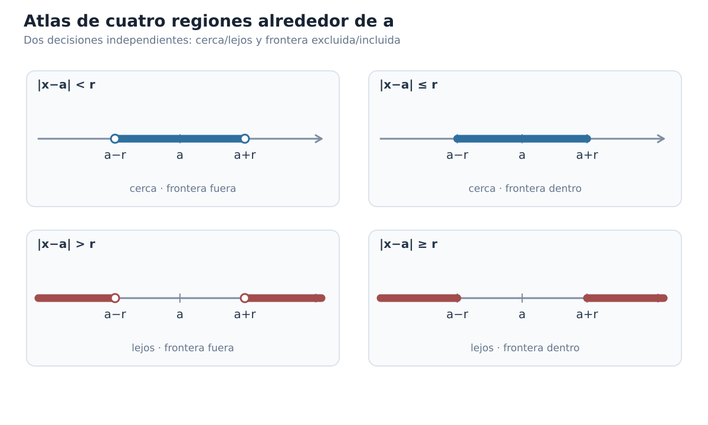{#fig-anm-c01-f08 fig-alt="Matriz de cuatro rectas con las regiones definidas por |x-a|<r, |x-a|<=r, |x-a|>r y |x-a|>=r, manteniendo fijos a y r."}

### Dos decisiones que conviene separar

Las cuatro condiciones anteriores pueden organizarse mediante dos preguntas independientes.

La primera es:

> **¿Queremos puntos más cercanos que $r$ o puntos más lejanos que $r$?**

La segunda es:

> **¿Admitimos los puntos situados exactamente a distancia $r$?**

La primera decisión determina si seleccionamos la región entre $a-r$ y $a+r$ o la región situada fuera de esas dos marcas. La segunda determina si las marcas mismas se incluyen.

Por eso las cuatro posibilidades no forman una lista arbitraria que haya que memorizar. Surgen al combinar dos elecciones conceptuales muy simples:

- cerca / lejos;
- frontera excluida / frontera incluida.

### La tolerancia como lenguaje de análisis

La palabra **tolerancia** permite anticipar por qué estas traducciones serán útiles más adelante. Si $a$ es un valor de referencia y $r>0$ es el error máximo que estamos dispuestos a tolerar estrictamente, entonces

$$
d(x,a)<r
$$

significa que $x$ está dentro de ese margen. En la recta podemos decir exactamente lo mismo escribiendo

$$
a-r<x<a+r.
$$

La primera formulación enfatiza **cuánto puede separarse** $x$ de $a$; la segunda muestra **dónde puede estar** $x$ en el orden de la recta.

Esta dualidad será central cuando aparezcan definiciones de aproximación y límite. No necesitamos introducirlas todavía. Lo importante aquí es reconocer la infraestructura que esas definiciones utilizarán: una condición de cercanía puede leerse como una desigualdad, como una distancia o como una región alrededor de un punto.

### Traducir sin perder información

Probemos algunas traducciones en ambas direcciones. Supongamos siempre que $r>0$.

#### Microcontrol 28

[]{#MA-MIC-ANM-01-001-028}

Si $d(x,a)\le r$, ¿qué intervalo describe la condición?

[]{#MA-MSOL-ANM-01-001-028}

Ver solución del microcontrol 28

Como

$$
d(x,a)=|x-a|,
$$

la desigualdad

$$
d(x,a)\le r
$$

significa que $x$ puede estar a lo sumo a distancia $r$ del centro $a$. Por tanto,

$$
a-r\le x\le a+r,
$$

y el conjunto correspondiente es

$$
\boxed{x\in[a-r,a+r]}.
$$

Los extremos se incluyen porque la comparación es $\le$.

#### Microcontrol 29

[]{#MA-MIC-ANM-01-001-029}

Si $x\in(a-r,a+r)$, ¿qué desigualdad de distancia satisface $x$?

[]{#MA-MSOL-ANM-01-001-029}

Ver solución del microcontrol 29

La pertenencia al intervalo abierto equivale a

$$
a-r<x<a+r.
$$

Restando $a$,

$$
-r<x-a<r,
$$

lo que equivale a

$$
|x-a|<r.
$$

En lenguaje de distancia,

$$
\boxed{d(x,a)<r}.
$$

Así, el intervalo abierto alrededor de $a$ describe exactamente los puntos situados a menos de $r$ unidades del centro.

#### Microcontrol 30

[]{#MA-MIC-ANM-01-001-030}

Si $x\in(-\infty,a-r)\cup(a+r,\infty)$, ¿qué podemos afirmar sobre $|x-a|$?

[]{#MA-MSOL-ANM-01-001-030}

Ver solución del microcontrol 30

La unión indica que $x$ queda fuera de las dos fronteras $a-r$ y $a+r$:

$$
x<a-r
\qquad\text{o}\qquad
x>a+r.
$$

En ambos casos, la separación respecto del centro es estrictamente mayor que $r$. Por tanto,

$$
\boxed{|x-a|>r}.
$$

Equivalentemente, $d(x,a)>r$: el punto está fuera de la región de radio $r$ alrededor de $a$.

#### Microcontrol 31

[]{#MA-MIC-ANM-01-001-031}

Si $|x-a|\ge r$, ¿qué ocurre con los puntos $a-r$ y $a+r$?

[]{#MA-MSOL-ANM-01-001-031}

Ver solución del microcontrol 31

Ambos puntos satisfacen la condición, porque están exactamente a distancia $r$ del centro:

$$
|a-r-a|=|-r|=r,
$$

y

$$
|a+r-a|=|r|=r.
$$

Como la desigualdad permite la igualdad,

$$
\boxed{a-r\text{ y }a+r\text{ pertenecen al conjunto}}.
$$

Ésta es la diferencia precisa entre $|x-a|>r$ y $|x-a|\ge r$: la segunda incluye las dos fronteras.

#### Microcontrol 32

[]{#MA-MIC-ANM-01-001-032}

Si reemplazamos $r$ por un número mayor, ¿qué sucede con la región descrita por $d(x,a)<r$? ¿Y con la descrita por $d(x,a)>r$?

[]{#MA-MSOL-ANM-01-001-032}

Ver solución del microcontrol 32

Supongamos $0<r<s$.

Para la condición de cercanía,

$$
d(x,a)<r \Longrightarrow d(x,a)<s,
$$

por lo que

$$
\boxed{\{x:d(x,a)<r\}\subseteq\{x:d(x,a)<s\}}.
$$

Al aumentar el radio, la región interior **crece**: admitimos puntos más alejados del centro.

En cambio, para la condición exterior,

$$
d(x,a)>s \Longrightarrow d(x,a)>r,
$$

de modo que

$$
\boxed{\{x:d(x,a)>s\}\subseteq\{x:d(x,a)>r\}}.
$$

Al aumentar el umbral, la región exterior **se contrae**: para permanecer fuera hay que estar todavía más lejos de $a$.

Las dos familias responden de manera opuesta al mismo cambio de parámetro: aumentar $r$ ensancha la región «más cerca que $r$» y reduce la región «más lejos que $r$».

La pregunta que debe acompañar cada traducción es siempre la misma: **¿qué conjunto de puntos describe realmente esta expresión?** Si podemos responderla sin depender de una regla memorizada, hemos adquirido la herramienta que necesitamos.

Podemos condensar toda la sección en este pequeño diccionario:

$$
\begin{array}{ccl}
 d(x,a)<r &\longleftrightarrow& a-r<x<a+r,\\
 d(x,a)\le r &\longleftrightarrow& a-r\le x\le a+r,\\
 d(x,a)>r &\longleftrightarrow& x<a-r\ \text{o}\ x>a+r,\\
 d(x,a)\ge r &\longleftrightarrow& x\le a-r\ \text{o}\ x\ge a+r.
\end{array}
$$

Pero el diccionario es sólo el resultado final. La idea importante es más estructural: **en la recta real, orden y distancia pueden traducirse uno en otro con una precisión excepcional**.

En §1.8 utilizaremos esta compatibilidad para cerrar el capítulo con una pregunta distinta: cuando trasladamos, escalamos o reflejamos la recta, ¿qué parte de la información de orden y qué parte de la información métrica permanece intacta?

### Ejercicios de la sección 1.7

#### Ejercicio 33. Una tolerancia escondida dentro de una expresión lineal

[]{#MA-EX-ANM-01-001-033}

Considera la condición

$$
|2x-5|<3.
$$

1. Reescríbela en la forma $|x-a|<r$, identificando el centro $a$ y el radio $r$.
2. Exprésala como una desigualdad de distancia $d(x,a)<r$.
3. Tradúcela a una doble desigualdad de orden.
4. Escribe el conjunto solución como intervalo.
5. Explica por qué dividir toda la desigualdad por $2$ no cambia el sentido de la comparación.

El objetivo es reconocer primero la estructura de tolerancia y sólo después resolver la desigualdad.

[]{#MA-SOL-ANM-01-001-033}

Ver solución del ejercicio 33

Partimos de

$$
|2x-5|<3.
$$

Factorizamos $2$ dentro del valor absoluto:

$$
|2x-5|
=
\left|2\left(x-\frac52\right)\right|
=
2\left|x-\frac52\right|.
$$

Como $2>0$, dividir ambos lados de la desigualdad por $2$ conserva el sentido de la comparación. Obtenemos

$$
\left|x-\frac52\right|<\frac32.
$$

Así, el centro es

$$
a=\frac52
$$

y el radio es

$$
r=\frac32.
$$

En lenguaje de distancia,

$$
d\left(x,\frac52\right)<\frac32.
$$

Traducimos ahora a orden:

$$
\frac52-\frac32<x<\frac52+\frac32,
$$

es decir,

$$
1<x<4.
$$

Por tanto,

$$
\boxed{x\in(1,4)}.
$$

El paso decisivo no fue «resolver una desigualdad con valor absoluto» de forma mecánica, sino reconocer que la expresión escondía una condición de tolerancia alrededor del centro $5/2$.

#### Ejercicio 34. Estar lejos de un centro

[]{#MA-EX-ANM-01-001-034}

Traduce completamente la condición

$$
|3x+6|\ge 9
$$

hasta obtener:

1. una condición de distancia respecto de un centro;
2. una disyunción de desigualdades de orden;
3. una unión de regiones de la recta.

Después decide si los puntos $-5$, $-2$ y $1$ pertenecen al conjunto solución, justificando cada respuesta desde la condición original.

[]{#MA-SOL-ANM-01-001-034}

Ver solución del ejercicio 34

Comenzamos con

$$
|3x+6|\ge9.
$$

Factorizamos $3$:

$$
|3(x+2)|\ge9.
$$

Como $|3|=3$,

$$
3|x+2|\ge9,
$$

y dividiendo por $3>0$,

$$
|x+2|\ge3.
$$

Esto es

$$
|x-(-2)|\ge3,
$$

de modo que, en lenguaje métrico,

$$
\boxed{d(x,-2)\ge3}.
$$

Estar al menos a $3$ unidades de $-2$ significa quedar en una de las dos regiones exteriores:

$$
x\le-2-3
\qquad\text{o}\qquad
x\ge-2+3.
$$

Por tanto,

$$
\boxed{x\le-5\quad\text{o}\quad x\ge1}.
$$

En notación de regiones,

$$
\boxed{(-\infty,-5]\cup[1,\infty)}.
$$

Comprobemos los tres puntos en la condición original.

Para $x=-5$,

$$
|3(-5)+6|=|-9|=9,
$$

así que $-5$ pertenece.

Para $x=-2$,

$$
|3(-2)+6|=0<9,
$$

por lo que $-2$ no pertenece.

Para $x=1$,

$$
|3(1)+6|=9,
$$

así que $1$ pertenece.

Los dos extremos se incluyen porque la comparación original es $\ge$, no $>$.

#### Ejercicio 35. Una rama desaparecida

[]{#MA-EX-ANM-01-001-035}

Un estudiante afirma que, para $r>0$,

$$
|x-a|>r
\iff
x>a+r.
$$

1. Explica qué parte de la región solución ha desaparecido.
2. Da un contraejemplo numérico a la equivalencia propuesta.
3. Escribe la equivalencia correcta en lenguaje de orden.
4. Exprésala como unión de intervalos.
5. Explica por qué el error es fácil de cometer si se piensa en $x-a$ como desplazamiento orientado y no en $|x-a|$ como distancia.

[]{#MA-SOL-ANM-01-001-035}

Ver solución del ejercicio 35

La equivalencia propuesta es falsa porque conserva sólo la región situada a la derecha del centro. La condición

$$
|x-a|>r
$$

no pregunta si el desplazamiento $x-a$ es grande y positivo, sino si su **tamaño** es mayor que $r$. Eso puede ocurrir a cualquiera de los dos lados de $a$.

Por ejemplo, tomemos

$$
a=0,
\qquad
r=2,
\qquad
x=-3.
$$

Entonces

$$
|x-a|=|-3|=3>2,
$$

pero

$$
x=-3\not>2=a+r.
$$

Así, el punto satisface la condición original y queda excluido por la supuesta equivalencia.

La traducción correcta es

$$
|x-a|>r
\iff
x<a-r\quad\text{o}\quad x>a+r.
$$

Como unión de intervalos,

$$
\boxed{x\in(-\infty,a-r)\cup(a+r,\infty)}.
$$

El error proviene de tratar $x-a$ como si sólo importara su signo positivo. El valor absoluto elimina la orientación y conserva la separación: una distancia mayor que $r$ puede alcanzarse alejándose hacia la derecha o hacia la izquierda.

#### Ejercicio 36. Entre dos umbrales de distancia

[]{#MA-EX-ANM-01-001-036}

Sean $a\in\mathbb R$ y $0<r<s$. Considera la condición

$$
r<d(x,a)\le s.
$$

1. Reescríbela mediante valor absoluto.
2. Traduce la condición a desigualdades de orden.
3. Describe el conjunto solución como unión de intervalos.
4. Indica cuáles de los cuatro puntos $a-s$, $a-r$, $a+r$ y $a+s$ pertenecen al conjunto.
5. Explica por qué la región obtenida tiene dos componentes separadas por una zona central excluida.

[]{#MA-SOL-ANM-01-001-036}

Ver solución del ejercicio 36

La condición es

$$
r<d(x,a)\le s,
$$

con $0<r<s$. Como $d(x,a)=|x-a|$,

$$
r<|x-a|\le s.
$$

Podemos leerla como la intersección de dos requisitos:

$$
|x-a|>r
$$

y

$$
|x-a|\le s.
$$

El primero exige

$$
x<a-r
\qquad\text{o}\qquad
x>a+r,
$$

mientras que el segundo exige

$$
a-s\le x\le a+s.
$$

Al combinar ambas condiciones obtenemos dos regiones:

$$
a-s\le x<a-r
$$

o

$$
a+r<x\le a+s.
$$

Por tanto,

$$
\boxed{
\{x:r<d(x,a)\le s\}
=
[a-s,a-r)\cup(a+r,a+s]
}.
$$

Revisemos las cuatro fronteras:

- $a-s$ pertenece, porque su distancia a $a$ es exactamente $s$ y se permite $\le s$;
- $a-r$ no pertenece, porque su distancia es exactamente $r$ y se exige $>r$;
- $a+r$ tampoco pertenece por la misma razón;
- $a+s$ sí pertenece.

La zona central

$$
[a-r,a+r]
$$

queda excluida porque allí la distancia al centro no supera $r$. Por eso el conjunto solución se parte en dos componentes: estamos seleccionando puntos que están **suficientemente lejos** de $a$, pero no **demasiado lejos**.

#### Ejercicio 37. Dos tolerancias simultáneas

[]{#MA-EX-ANM-01-001-037}

Sean $a,b\in\mathbb R$ y $r,s>0$. Estudia el conjunto de puntos que satisfacen simultáneamente

$$
d(x,a)\le r
$$

y

$$
d(x,b)\le s.
$$

1. Traduce ambas condiciones a intervalos cerrados.
2. Escribe su intersección usando $\max$ y $\min$.
3. Demuestra que existe al menos un punto que satisface ambas tolerancias si y sólo si

$$
d(a,b)\le r+s.
$$

4. Interpreta la condición final como comparación entre la separación de los centros y los márgenes de tolerancia disponibles.

*Pista conceptual.* Antes de manipular valores absolutos, piensa qué significa que dos intervalos cerrados centrados en $a$ y $b$ tengan un punto común.

[]{#MA-SOL-ANM-01-001-037}

Ver solución del ejercicio 37

**Cómo pensar este problema.** Cada desigualdad de distancia describe un intervalo cerrado. Pedir que ambas se cumplan a la vez significa tomar la intersección de esos dos intervalos. La cuestión de existencia se convierte entonces en preguntar cuándo esos intervalos alcanzan a tocarse.

Las dos condiciones equivalen a

$$
a-r\le x\le a+r
$$

y

$$
b-s\le x\le b+s.
$$

Por tanto, los puntos que satisfacen ambas son

$$
[a-r,a+r]\cap[b-s,b+s].
$$

Cuando la intersección no es vacía, puede escribirse como

$$
\boxed{
\left[
\max\{a-r,b-s\},
\min\{a+r,b+s\}
\right]
}.
$$

Esta expresión representa un intervalo no vacío exactamente cuando

$$
\max\{a-r,b-s\}
\le
\min\{a+r,b+s\}.
$$

Equivalente y geométricamente más transparente es exigir que ninguno de los intervalos quede completamente a un lado del otro:

$$
a-r\le b+s
$$

y

$$
b-s\le a+r.
$$

Estas desigualdades se reescriben como

$$
a-b\le r+s
$$

y

$$
b-a\le r+s.
$$

Tener ambas simultáneamente equivale a

$$
|a-b|\le r+s.
$$

Como $d(a,b)=|a-b|$,

$$
\boxed{
[a-r,a+r]\cap[b-s,b+s]\ne\varnothing
\iff
d(a,b)\le r+s
}.
$$

La interpretación es inmediata: los dos márgenes disponibles, $r$ desde $a$ y $s$ desde $b$, deben alcanzar conjuntamente a cubrir la separación entre los centros. Si

$$
d(a,b)=r+s,
$$

los intervalos se tocan en un solo punto, que pertenece a ambos porque las dos tolerancias usan $\le$.

El panel de contacto cerrado de la figura [C01-F12](#fig-anm-c01-f12) contrasta este caso con el contacto de bolas abiertas: aquí el punto de tangencia sí pertenece a ambas regiones porque las desigualdades no son estrictas.

#### Ejercicio 38. Una familia que no crece por inclusión

[]{#MA-EX-ANM-01-001-038}

Fija $a\in\mathbb R$ y, para cada $t>0$, define

$$
A_t=\{x\in\mathbb R:t<d(x,a)\le 2t\}.
$$

1. Traduce $A_t$ a una unión de intervalos.
2. Sean $0<t<s$. Demuestra que, en general, ni $A_t\subseteq A_s$ ni $A_s\subseteq A_t$.
3. Caracteriza exactamente cuándo $A_t\cap A_s$ es vacío y cuándo no lo es.
4. Si la intersección es no vacía, descríbela mediante una condición sobre $d(x,a)$.
5. Explica por qué aquí «aumentar el parámetro» no produce una familia anidada como ocurría con las bolas $B(a,r)$.

*Pista conceptual.* En vez de mirar primero los puntos $x$, mira los valores posibles de la distancia $d(x,a)$. Para $A_t$ esos valores forman un intervalo de tolerancias, no una región del tipo $d(x,a)<t$.

[]{#MA-SOL-ANM-01-001-038}

Ver solución del ejercicio 38

**Cómo pensar este problema.** La condición no selecciona todos los puntos hasta una distancia máxima, como una bola. Selecciona una **banda de distancias**: demasiado cerca queda fuera y demasiado lejos también. Por eso mover $t$ desplaza simultáneamente los dos umbrales y destruye la monotonía por inclusión.

Por definición,

$$
A_t=\{x:t<d(x,a)\le2t\}.
$$

Aplicando la traducción del ejercicio anterior con umbral interior $t$ y exterior $2t$,

$$
\boxed{
A_t=[a-2t,a-t)\cup(a+t,a+2t]
}.
$$

Ahora sean $0<t<s$.

Para ver que $A_t\not\subseteq A_s$, elegimos una distancia $q$ tal que

$$
t<q<\min\{s,2t\}.
$$

Tal $q$ existe porque tanto $s$ como $2t$ son mayores que $t$. Tomemos, por ejemplo,

$$
x=a+q.
$$

Entonces

$$
t<d(x,a)=q\le2t,
$$

por lo que $x\in A_t$, pero $q<s$, de modo que $x\notin A_s$.

Para ver que $A_s\not\subseteq A_t$, basta tomar

$$
x=a+2s.
$$

Entonces

$$
s<2s\le2s,
$$

así que $x\in A_s$. Como $s>t$,

$$
2s>2t,
$$

de modo que $x\notin A_t$.

Por tanto, para todo $0<t<s$,

$$
\boxed{A_t\not\subseteq A_s
\quad\text{y}\quad
A_s\not\subseteq A_t}.
$$

Para estudiar la intersección conviene mirar las **distancias posibles**. Un punto pertenece a $A_t\cap A_s$ exactamente cuando su distancia $\rho=d(x,a)$ satisface a la vez

$$
t<\rho\le2t
$$

y

$$
s<\rho\le2s.
$$

Como $t<s$, la condición conjunta se reduce a

$$
s<\rho\le2t.
$$

Existe tal $\rho$ si y sólo si

$$
s<2t.
$$

Así,

$$
\boxed{A_t\cap A_s=\varnothing
\iff
s\ge2t}.
$$

Y cuando $s<2t$,

$$
\boxed{
A_t\cap A_s
=
\{x:s<d(x,a)\le2t\}
}.
$$

Si se desea volver al lenguaje de regiones de la recta,

$$
A_t\cap A_s
=
[a-2t,a-s)\cup(a+s,a+2t].
$$

La diferencia con las bolas es estructural. En una bola $B(a,r)$ sólo hay un umbral superior: aumentar $r$ admite todos los puntos anteriores y algunos nuevos. En $A_t$, en cambio, aumentar $t$ mueve hacia afuera tanto el umbral interior como el exterior. Algunos puntos nuevos entran por fuera, mientras otros que antes eran admisibles quedan demasiado cerca y salen por dentro. Por eso la familia no es anidada.

La figura [C01-F13](#fig-anm-c01-f13) concentra esta lectura en una sola comparación.

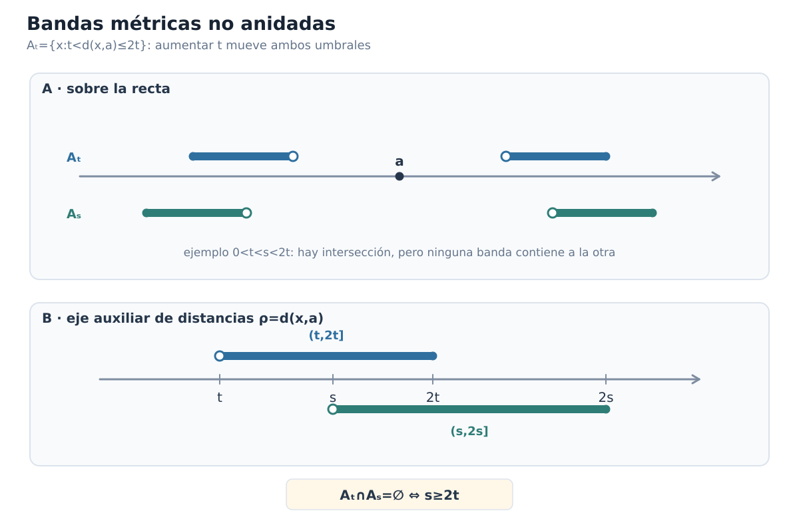{#fig-anm-c01-f13 fig-alt="Dos paneles comparan las bandas métricas A_t y A_s en la recta y los intervalos de distancias (t,2t] y (s,2s] en un eje auxiliar."}

## 1.8. Qué ve el orden y qué ve la distancia

Hemos pasado buena parte del capítulo traduciendo entre dos maneras de describir la recta. El orden nos dice qué punto queda antes, después o entre otros; la distancia nos dice cuánto separa a dos puntos. En $\mathbb R$ ambas estructuras cooperan tan bien que es fácil olvidar que no contienen exactamente la misma información.

Para cerrar el capítulo vamos a someter la recta a algunas transformaciones muy simples y preguntar, en cada caso, qué permanece y qué cambia.

Partamos de dos puntos con

$$
x<y.
$$

Nos interesarán dos datos distintos:

- su orden relativo;
- su distancia $d(x,y)$.

La pregunta será siempre la misma: **después de transformar ambos puntos, ¿qué ha ocurrido con cada uno de esos datos?**

### Trasladar la recta

Empecemos sumando el mismo número $c$ a todos los puntos:

$$
x\longmapsto x+c.
$$

Si $x<y$, entonces

$$
x+c<y+c.
$$

La traslación preserva, por tanto, el orden. Pero también preserva exactamente la distancia, porque

$$
\begin{aligned}
d(x+c,y+c)
&=|(x+c)-(y+c)|\\
&=|x-y|\\
&=d(x,y).
\end{aligned}
$$

Nada se ha estirado, comprimido ni reflejado. Toda la configuración se ha desplazado como un bloque rígido a lo largo de la recta.

Esta primera transformación conserva simultáneamente las dos estructuras que hemos estudiado: conserva la orientación del orden y conserva todas las distancias.

### Escalar la recta

Consideremos ahora

$$
x\longmapsto \lambda x,
$$

donde $\lambda\in\mathbb R$. Para la distancia obtenemos una fórmula que vale para cualquier $\lambda$:

$$
\begin{aligned}
d(\lambda x,\lambda y)
&=|\lambda x-\lambda y|\\
&=|\lambda(x-y)|\\
&=|\lambda|\,|x-y|\\
&=|\lambda|\,d(x,y).
\end{aligned}
$$

La consecuencia es clara: una escala no conserva necesariamente las distancias, pero las transforma de una manera perfectamente controlada. Todas se multiplican por el mismo factor $|\lambda|$.

¿Qué ocurre con el orden? Aquí el signo de $\lambda$ sí importa.

Si $\lambda>0$, de $x<y$ obtenemos

$$
\lambda x<\lambda y.
$$

La orientación se conserva, mientras que las distancias se multiplican por $\lambda$.

Si $\lambda<0$, en cambio,

$$
\lambda x>\lambda y.
$$

La orientación se invierte, aunque las distancias siguen escalándose por el factor positivo $|\lambda|$.

Este contraste merece atención: el signo de $\lambda$ es decisivo para el orden, pero la distancia sólo registra su valor absoluto.

### La reflexión como caso decisivo

Tomemos ahora $\lambda=-1$. La transformación es

$$
x\longmapsto -x.
$$

Por la fórmula anterior,

$$
d(-x,-y)=|-1|\,d(x,y)=d(x,y).
$$

Así que la reflexión preserva **exactamente** todas las distancias.

Sin embargo, si

$$
x<y,
$$

entonces

$$
-x>-y.
$$

La izquierda y la derecha se intercambian.

La figura [C01-F09](#fig-anm-c01-f09) concentra esta lectura en una sola comparación.

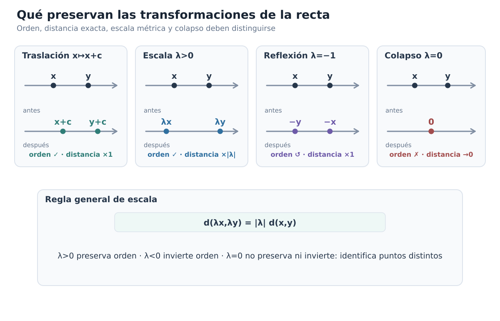{#fig-anm-c01-f09 fig-alt="Cuatro paneles muestran una traslación, una escala positiva, una reflexión y el caso lambda cero, indicando en cada caso qué ocurre con el orden y con las distancias."}

Éste es el ejemplo que termina de separar las dos estructuras. Si conociéramos únicamente todas las distancias entre los puntos de una configuración, no podríamos distinguir esa configuración de su imagen reflejada. Las separaciones serían idénticas, aunque la orientación hubiese cambiado por completo.

La aplicación $x\mapsto -x$ es, por ello, una **isometría** de la recta: preserva todas las distancias. Pero es una isometría que invierte la orientación.

### El caso degenerado $\lambda=0$

Queda un caso que conviene no esconder dentro de la fórmula general. Si $\lambda=0$, todos los puntos son enviados al mismo lugar:

$$
x\longmapsto 0.
$$

La ley métrica sigue siendo algebraicamente correcta:

$$
d(0,0)=0=|0|\,d(x,y).
$$

Pero ahora todas las distancias han colapsado a cero.

Tampoco podemos decir que el orden se preserve o se invierta. Si $x<y$, ambos puntos tienen la misma imagen, $0$. Por tanto, ya no aparece ninguna desigualdad estricta entre sus imágenes: no tenemos ni $0<0$ ni $0>0$.

El caso $\lambda=0$ no es una inversión del orden: es un **colapso**. Puntos distintos dejan de distinguirse después de la transformación.

Esta distinción será útil cada vez que interpretemos una fórmula de transformación. Una identidad algebraica puede seguir siendo válida en un caso degenerado aunque la interpretación geométrica cambie radicalmente.

### Tres preguntas diferentes

Podemos ahora organizar lo aprendido sin confundir tres preguntas que parecen similares.

La primera es:

> **¿Se preservan exactamente las distancias?**

Para una traslación, sí. Para una escala $x\mapsto\lambda x$, esto ocurre exactamente cuando

$$
|\lambda|=1.
$$

En la recta real, los casos son $\lambda=1$ y $\lambda=-1$: identidad y reflexión.

La segunda pregunta es:

> **¿Cómo cambian las distancias?**

Para cualquier escala,

$$
d(\lambda x,\lambda y)=|\lambda|d(x,y).
$$

Si $|\lambda|>1$, se amplían; si $0<|\lambda|<1$, se contraen; si $\lambda=0$, colapsan a cero.

La tercera pregunta es:

> **¿Qué ocurre con el orden?**

- una traslación lo preserva;
- una escala con $\lambda>0$ lo preserva;
- una escala con $\lambda<0$ lo invierte;
- una escala con $\lambda=0$ no lo preserva ni lo invierte: destruye toda distinción estricta entre los puntos.

Estas respuestas no son intercambiables. Saber qué sucede con las distancias no determina por sí solo qué sucede con la orientación.

### Volvamos al comienzo

En §1.1 empezamos con una observación: sobre la misma recta podemos hacer preguntas algebraicas, de orden y métricas. Después fuimos construyendo puentes entre ellas. Los intervalos surgieron del orden; el valor absoluto se convirtió en distancia; la desigualdad triangular relacionó distancia y posición; las bolas resultaron ser intervalos; y una condición de tolerancia pudo escribirse indistintamente mediante distancia o desigualdades.

Ahora podemos precisar la conclusión que entonces apenas intuíamos.

La métrica estándar de $\mathbb R$ permite decir **cuánto separa** a los puntos. El orden permite decir **cómo están orientados y situados unos respecto de otros**. En la recta ambas estructuras son extraordinariamente compatibles, pero una no se reduce a la otra.

La reflexión lo muestra de la manera más limpia:

$$
d(-x,-y)=d(x,y),
$$

mientras que

$$
x<y\iff -x>-y.
$$

La distancia permanece; la orientación cambia.

### Antes de cerrar el capítulo

Comprobemos que las distinciones estén claras.

#### Microcontrol 33

[]{#MA-MIC-ANM-01-001-033}

Si trasladamos todos los puntos por $c$, ¿qué ocurre con el orden y con las distancias?

[]{#MA-MSOL-ANM-01-001-033}

Ver solución del microcontrol 33

Ambas estructuras se preservan. Si $x<y$, entonces

$$
x+c<y+c,
$$

de modo que la orientación del orden no cambia. Además,

$$
d(x+c,y+c)=|(x+c)-(y+c)|=|x-y|=d(x,y).
$$

Por tanto, una traslación desplaza toda la configuración como un bloque rígido: **conserva el orden y conserva exactamente todas las distancias**.

#### Microcontrol 34

[]{#MA-MIC-ANM-01-001-034}

Si $\lambda=3$, ¿qué ocurre con una distancia de longitud $2$? ¿Y con el orden?

[]{#MA-MSOL-ANM-01-001-034}

Ver solución del microcontrol 34

La ley de escala es

$$
d(\lambda x,\lambda y)=|\lambda|d(x,y).
$$

Si $\lambda=3$ y la distancia inicial vale $2$, la nueva distancia es

$$
3\cdot2=6.
$$

Como $3>0$, una desigualdad $x<y$ se transforma en

$$
3x<3y.
$$

Así, las distancias se **triplican** y el orden se **preserva**.

#### Microcontrol 35

[]{#MA-MIC-ANM-01-001-035}

Si $\lambda=-3$, ¿qué cambia respecto del caso anterior?

[]{#MA-MSOL-ANM-01-001-035}

Ver solución del microcontrol 35

La magnitud del factor de escala sigue siendo $|-3|=3$, de modo que una distancia de longitud $2$ vuelve a convertirse en

$$
3\cdot2=6.
$$

Lo que cambia es la orientación. Si $x<y$, al multiplicar por un número negativo obtenemos

$$
-3x>-3y.
$$

Por tanto, **las distancias se triplican igual que antes, pero el orden se invierte**. La métrica registra $|\lambda|$; el orden, en cambio, distingue el signo de $\lambda$.

#### Microcontrol 36

[]{#MA-MIC-ANM-01-001-036}

¿Por qué $x\mapsto -x$ preserva distancias y, sin embargo, invierte el orden?

[]{#MA-MSOL-ANM-01-001-036}

Ver solución del microcontrol 36

Para la distancia,

$$
d(-x,-y)=|-x-(-y)|=|-(x-y)|=|x-y|=d(x,y).
$$

Por eso la reflexión es una isometría: no cambia ninguna separación.

Pero si $x<y$, al multiplicar por $-1$ la desigualdad cambia de sentido:

$$
-x>-y.
$$

La reflexión muestra así que **preservar distancias no equivale a preservar orientación**: la métrica permanece intacta mientras izquierda y derecha se intercambian.

#### Microcontrol 37

[]{#MA-MIC-ANM-01-001-037}

¿Por qué $\lambda=0$ no debe clasificarse como una transformación que «invierte» el orden?

[]{#MA-MSOL-ANM-01-001-037}

Ver solución del microcontrol 37

Porque invertir el orden exigiría que de $x<y$ resultara una desigualdad estricta opuesta entre las imágenes. Sin embargo, con $\lambda=0$ tenemos

$$
x\longmapsto0,
\qquad
y\longmapsto0.
$$

Los dos puntos distintos adquieren la misma imagen. No se cumple ni

$$
0<0
$$

ni

$$
0>0.
$$

Por tanto, $\lambda=0$ **no invierte el orden: lo colapsa**. También todas las distancias pasan a cero, pues

$$
d(0,0)=0.
$$

#### Microcontrol 38

[]{#MA-MIC-ANM-01-001-038}

¿Qué información podemos perder aunque conozcamos todas las distancias de una configuración?

[]{#MA-MSOL-ANM-01-001-038}

Ver solución del microcontrol 38

Podemos perder la **orientación izquierda–derecha**. Una configuración y su reflejo respecto del origen tienen exactamente las mismas distancias, porque

$$
d(-x,-y)=d(x,y)
$$

para cualquier par de puntos. Sin embargo, toda desigualdad estricta se invierte:

$$
x<y\iff -x>-y.
$$

Así, conocer todas las separaciones permite recuperar mucha información métrica —por ejemplo, qué puntos están entre otros mediante igualdades de distancias—, pero no permite distinguir una configuración de su imagen reflejada. **La métrica no determina por sí sola una orientación de la recta.**

Con esto queda establecida la infraestructura que necesitábamos al comienzo del análisis: intervalos, valor absoluto, distancia, bolas y traducciones de tolerancia viven sobre una misma recta, pero pertenecen a estructuras que conviene distinguir incluso cuando trabajan juntas.

El resto del libro explotará una y otra vez esa cooperación. En particular, muchas afirmaciones analíticas podrán expresarse como condiciones de orden, como condiciones de distancia o como restricciones sobre regiones de la recta. Saber cambiar de lenguaje sin confundir qué información aporta cada uno será una de nuestras herramientas permanentes.

### Ejercicios de la sección 1.8

#### Ejercicio 39. Preservar distancias no significa preservar orientación

[]{#MA-EX-ANM-01-001-039}

Sea $F:\mathbb R\to\mathbb R$ una aplicación que preserva todas las distancias:

$$
d(F(x),F(y))=d(x,y)
$$

para cualesquiera $x,y\in\mathbb R$.

Un estudiante concluye:

> Si $x<y$, entonces necesariamente $F(x)<F(y)$, porque una aplicación que preserva distancias conserva toda la geometría de la recta.

1. Diagnostica la afirmación mediante un contraejemplo explícito.
2. Demuestra, sin embargo, que $F$ sí preserva la relación «estar entre»: si $y$ está entre $x$ y $z$, entonces $F(y)$ está entre $F(x)$ y $F(z)$.
3. Explica con precisión qué información métrica se conserva y qué información de orientación puede perderse.

No supongas que $F$ es lineal o afín.

[]{#MA-SOL-ANM-01-001-039}

Ver solución del ejercicio 39

La conclusión del estudiante es falsa. Basta considerar la reflexión

$$
F(x)=-x.
$$

Para cualesquiera $x,y\in\mathbb R$,

$$
\begin{aligned}
d(F(x),F(y))
&=d(-x,-y)\\
&=|-x-(-y)|\\
&=|-(x-y)|\\
&=|x-y|\\
&=d(x,y).
\end{aligned}
$$

Así, $F$ preserva todas las distancias. Sin embargo, si $x<y$, entonces

$$
-x>-y,
$$

por lo que la orientación se invierte.

Veamos ahora qué estructura sí queda forzada por las distancias. Supongamos que $y$ está entre $x$ y $z$. Por la caracterización de §1.5,

$$
d(x,z)=d(x,y)+d(y,z).
$$

Como $F$ preserva todas las distancias,

$$
\begin{aligned}
d(F(x),F(z))
&=d(x,z)\\
&=d(x,y)+d(y,z)\\
&=d(F(x),F(y))+d(F(y),F(z)).
\end{aligned}
$$

Aplicando de nuevo la caracterización de igualdad triangular en $\mathbb R$, concluimos que

$$
F(y)
$$

está entre $F(x)$ y $F(z)$.

Por tanto, una isometría conserva separaciones y también la relación no orientada de estar entre. Lo que las distancias no determinan es **qué dirección llamamos izquierda y cuál derecha**. Una reflexión conserva toda la información métrica y de betweenness, pero cambia globalmente la orientación.

#### Ejercicio 40. Trasladar y escalar en una sola transformación

[]{#MA-EX-ANM-01-001-040}

Para $\lambda,c\in\mathbb R$, define

$$
T_{\lambda,c}(x)=\lambda x+c.
$$

1. Demuestra que

$$
d(T_{\lambda,c}(x),T_{\lambda,c}(y))=|\lambda|\,d(x,y).
$$

2. Clasifica completamente los valores de $\lambda$ para los cuales $T_{\lambda,c}$:
   - preserva exactamente todas las distancias;
   - preserva el orden estricto;
   - invierte el orden estricto;
   - colapsa puntos distintos.
3. Determina todas las transformaciones de esta familia que preservan simultáneamente todas las distancias y el orden.
4. Determina todas las que preservan todas las distancias e invierten el orden.
5. Explica por qué el parámetro $c$ no interviene ni en el factor de escala de las distancias ni en el sentido de la orientación.

*Pista conceptual.* Separa el efecto de sumar $c$ del efecto de multiplicar por $\lambda$.

[]{#MA-SOL-ANM-01-001-040}

Ver solución del ejercicio 40

**Cómo pensar este problema.** La transformación combina dos operaciones ya conocidas: primero multiplicamos por $\lambda$ y después trasladamos por $c$. La traslación no altera ni las distancias ni el sentido del orden; toda la clasificación dependerá, por tanto, de $\lambda$.

Para cualesquiera $x,y\in\mathbb R$,

$$
\begin{aligned}
d(T_{\lambda,c}(x),T_{\lambda,c}(y))
&=|\lambda x+c-(\lambda y+c)|\\
&=|\lambda(x-y)|\\
&=|\lambda|\,|x-y|\\
&=|\lambda|\,d(x,y).
\end{aligned}
$$

Por tanto, las distancias se preservan exactamente si y sólo si

$$
|\lambda|=1,
$$

es decir,

$$
\lambda=1
\qquad\text{o}\qquad
\lambda=-1.
$$

Ahora examinemos el orden. Si $x<y$:

- cuando $\lambda>0$, multiplicar por $\lambda$ conserva la desigualdad y sumar $c$ tampoco la altera, de modo que
  $$
  T_{\lambda,c}(x)<T_{\lambda,c}(y);
  $$
- cuando $\lambda<0$, la multiplicación invierte la desigualdad y la traslación conserva esa nueva orientación:
  $$
  T_{\lambda,c}(x)>T_{\lambda,c}(y);
  $$
- cuando $\lambda=0$,
  $$
  T_{0,c}(x)=c
  $$
  para todo $x$, de modo que todos los puntos colapsan en uno solo.

La clasificación completa es entonces:

$$
\begin{array}{c|c|c}
\text{condición sobre }\lambda & \text{distancias} & \text{orden estricto}\\
\hline
\lambda>0 & \times\lambda & \text{preservado}\\
\lambda<0 & \times|\lambda| & \text{invertido}\\
\lambda=0 & \text{colapsan a }0 & \text{ni preservado ni invertido}
\end{array}
$$

Para preservar **simultáneamente todas las distancias y el orden**, necesitamos

$$
|\lambda|=1
$$

y

$$
\lambda>0.
$$

Luego necesariamente

$$
\boxed{\lambda=1},
$$

por lo que las transformaciones buscadas son exactamente

$$
\boxed{T(x)=x+c}.
$$

Para preservar todas las distancias e invertir el orden necesitamos

$$
|\lambda|=1
$$

y

$$
\lambda<0,
$$

así que

$$
\boxed{\lambda=-1}
$$

y las transformaciones son

$$
\boxed{T(x)=-x+c}.
$$

El parámetro $c$ desaparece al restar dos imágenes:

$$
(\lambda x+c)-(\lambda y+c)=\lambda(x-y).
$$

Por eso no modifica la separación relativa ni el sentido de la orientación: sólo desplaza toda la configuración rígidamente.

#### Ejercicio 41. Componer transformaciones: escala y orientación

[]{#MA-EX-ANM-01-001-041}

Sean

$$
S(x)=\lambda x+c,
\qquad
T(x)=\mu x+d,
$$

con $\lambda,\mu\ne0$.

1. Calcula $T\circ S$ y demuestra que su factor de escala métrica es $|\mu\lambda|$.
2. Prueba que $T\circ S$ preserva el orden si $\mu\lambda>0$ y lo invierte si $\mu\lambda<0$.
3. Explica por qué dos transformaciones que invierten la orientación producen, al componerse, una transformación que la preserva.
4. Para $p\in\mathbb R$, define la reflexión respecto del punto $p$ por

$$
R_p(x)=2p-x.
$$

Demuestra que

$$
R_q\circ R_p(x)=x+2(q-p).
$$

5. Interpreta el resultado: ¿por qué la composición de dos reflexiones de la recta es una traslación? ¿Qué ocurre cuando $p=q$?

*Pista conceptual.* En la composición, los factores de escala se multiplican y los signos registran cuántas inversiones de orientación se han acumulado.

[]{#MA-SOL-ANM-01-001-041}

Ver solución del ejercicio 41

**Cómo pensar este problema.** Cada transformación lleva dos datos estructurales: un factor métrico positivo, $|\lambda|$ o $|\mu|$, y un signo que decide la orientación. Al componer, ambos datos se multiplican.

Calculamos primero:

$$
\begin{aligned}
(T\circ S)(x)
&=T(\lambda x+c)\\
&=\mu(\lambda x+c)+d\\
&=\mu\lambda x+(\mu c+d).
\end{aligned}
$$

Así, $T\circ S$ vuelve a ser una transformación afín y su coeficiente lineal es $\mu\lambda$.

Para las distancias,

$$
\begin{aligned}
d((T\circ S)(x),(T\circ S)(y))
&=|\mu\lambda|\,d(x,y)\\
&=|\mu|\,|\lambda|\,d(x,y).
\end{aligned}
$$

Por tanto, el factor total de escala métrica es el producto de los factores individuales.

Como $\lambda$ y $\mu$ son no nulos, el signo de $\mu\lambda$ decide la orientación:

$$
\mu\lambda>0
\quad\Longrightarrow\quad
T\circ S\text{ preserva el orden},
$$

mientras que

$$
\mu\lambda<0
\quad\Longrightarrow\quad
T\circ S\text{ invierte el orden}.
$$

Si ambas transformaciones invierten orientación, entonces $\lambda<0$ y $\mu<0$, de modo que

$$
\mu\lambda>0.
$$

Dos inversiones sucesivas restauran, por tanto, la orientación original.

Pasemos a las reflexiones respecto de puntos. Para

$$
R_p(x)=2p-x
$$

y

$$
R_q(x)=2q-x,
$$

obtenemos

$$
\begin{aligned}
(R_q\circ R_p)(x)
&=R_q(2p-x)\\
&=2q-(2p-x)\\
&=x+2(q-p).
\end{aligned}
$$

Luego

$$
\boxed{R_q\circ R_p(x)=x+2(q-p)}.
$$

La composición de dos reflexiones es, por tanto, una traslación. Cada reflexión invierte la orientación, pero las dos inversiones se cancelan. Métricamente, cada una tiene factor $1$, así que la composición también preserva exactamente las distancias.

Si $p=q$, entonces

$$
2(q-p)=0,
$$

y obtenemos

$$
R_p\circ R_p(x)=x.
$$

Reflejar dos veces respecto del mismo punto devuelve cada punto a su posición original.

La conclusión transferible es que la orientación se comporta multiplicativamente mediante el signo, mientras que el cambio de escala métrica se comporta multiplicativamente mediante el valor absoluto.

#### Ejercicio 42. Clasificar todas las isometrías de la recta

[]{#MA-EX-ANM-01-001-042}

Sea $F:\mathbb R\to\mathbb R$ una aplicación que preserva todas las distancias:

$$
d(F(x),F(y))=d(x,y)
$$

para cualesquiera $x,y\in\mathbb R$.

Demuestra que existe un número $c\in\mathbb R$ tal que necesariamente ocurre exactamente una de las dos formas

$$
F(x)=x+c
$$

para todo $x$, o bien

$$
F(x)=-x+c
$$

para todo $x$.

En otras palabras: demuestra que **toda isometría de la recta es una traslación o una reflexión seguida de una traslación**.

Después deduce que toda isometría de $\mathbb R$ o bien preserva todas las desigualdades estrictas, o bien las invierte todas.

*Pista conceptual.* Empieza eliminando $F(0)$ mediante una traslación. Si consigues una isometría $G$ con $G(0)=0$, entonces $|G(x)|=|x|$ para todo $x$. El paso difícil es demostrar que la elección del signo no puede cambiar de un punto a otro.

[]{#MA-SOL-ANM-01-001-042}

Ver solución del ejercicio 42

**Cómo pensar este problema.** No sabemos que $F$ sea lineal, afín, continua ni monótona. Sólo conocemos todas sus distancias. El primer paso es normalizarla para que fije el origen; después veremos que cada punto sólo puede ir a una de dos posiciones, y finalmente habrá que demostrar que esas elecciones no pueden hacerse de manera independiente.

Sea

$$
c=F(0)
$$

y definamos

$$
G(x)=F(x)-c.
$$

Restar la misma constante a todas las imágenes no cambia sus distancias, de modo que $G$ sigue siendo una isometría. Además,

$$
G(0)=F(0)-c=0.
$$

Como $G$ preserva la distancia al origen,

$$
|G(x)|
=d(G(x),0)
=d(G(x),G(0))
=d(x,0)
=|x|.
$$

Por tanto, para cada $x$ individualmente,

$$
G(x)=x
\qquad\text{o}\qquad
G(x)=-x.
$$

Hasta aquí parecería posible elegir el signo de forma distinta en puntos diferentes. Vamos a demostrar que no.

Tomemos un punto $a>0$. Como $|G(a)|=a$, sólo hay dos casos.

#### Caso 1: $G(a)=a$

Sea $x>0$. Si ocurriera $G(x)=-x$, entonces, usando que $G$ preserva distancias,

$$
|x-a|
=d(x,a)
=d(G(x),G(a))
=|-x-a|
=x+a.
$$

Pero para $x,a>0$ se tiene

$$
|x-a|<x+a,
$$

contradicción. Por tanto,

$$
G(x)=x
$$

para todo $x>0$.

Sea ahora $x<0$ y escribamos $u=-x>0$. Ya sabemos que

$$
G(u)=u.
$$

Además $|G(x)|=u$, así que $G(x)$ es $u$ o $-u$. Si $G(x)=u$, entonces

$$
d(G(x),G(u))=0,
$$

mientras que

$$
d(x,u)=|-u-u|=2u>0,
$$

lo cual contradice la preservación de distancias. Así,

$$
G(x)=-u=x.
$$

Junto con $G(0)=0$, concluimos

$$
G(x)=x
$$

para todo $x\in\mathbb R$.

Por consiguiente,

$$
F(x)=G(x)+c=x+c.
$$

#### Caso 2: $G(a)=-a$

El argumento es simétrico. Si $x>0$ y supusiéramos $G(x)=x$, entonces

$$
d(G(x),G(a))=|x-(-a)|=x+a,
$$

mientras que

$$
d(x,a)=|x-a|<x+a,
$$

contradicción. Luego

$$
G(x)=-x
$$

para todo $x>0$.

Si $x<0$, escribimos otra vez $u=-x>0$. Como

$$
G(u)=-u,
$$

y $G(x)$ sólo puede ser $u$ o $-u$, la posibilidad $G(x)=-u$ haría

$$
d(G(x),G(u))=0
$$

aunque

$$
d(x,u)=2u>0.
$$

Por tanto,

$$
G(x)=u=-x.
$$

También en $x=0$ vale $G(0)=-0$. Así,

$$
G(x)=-x
$$

para todo real $x$, y por consiguiente

$$
F(x)=-x+c.
$$

Hemos demostrado la clasificación completa:

$$
\boxed{
F(x)=x+c
\quad\text{o}\quad
F(x)=-x+c
}
$$

con una sola de las dos formas válida globalmente.

La primera familia preserva el orden estricto:

$$
x<y\Longrightarrow x+c<y+c.
$$

La segunda lo invierte:

$$
x<y\Longrightarrow -x+c>-y+c.
$$

Por tanto, toda isometría de la recta posee una orientación global coherente: o preserva todas las desigualdades estrictas o las invierte todas.

Este resultado cierra el hilo conceptual del capítulo. Las distancias determinan la geometría de la recta **hasta una elección global de orientación**. Una vez fijado dónde está el origen de la imagen y cuál de las dos orientaciones elegimos, no queda libertad adicional.

La figura [C01-F14](#fig-anm-c01-f14) concentra esta lectura en una sola comparación.

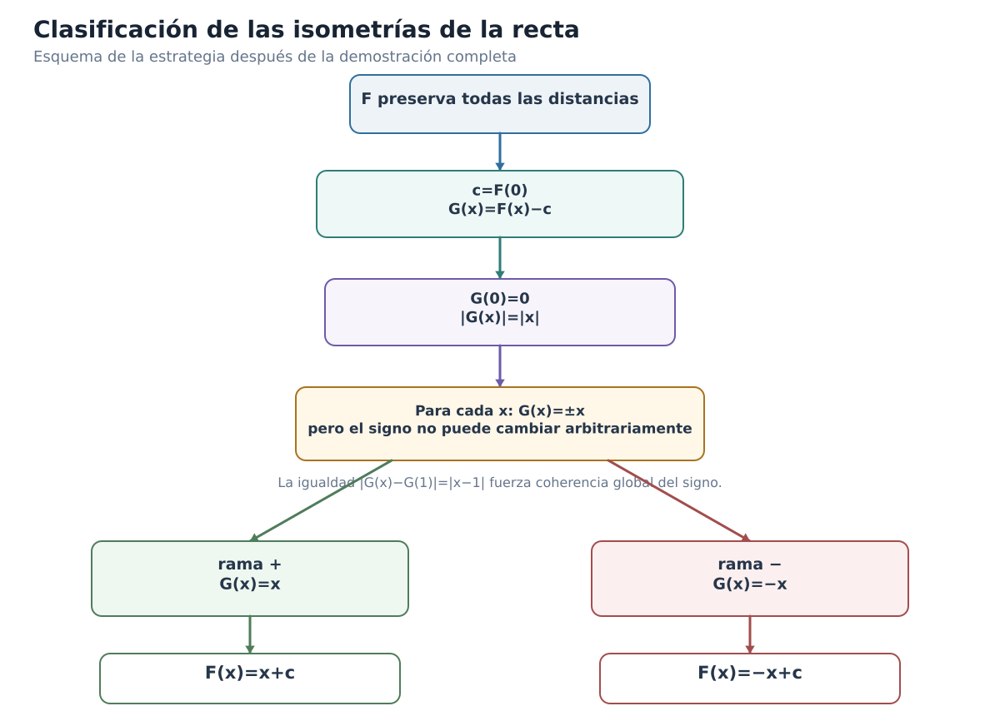{#fig-anm-c01-f14 fig-alt="Diagrama de flujo de la prueba: se define G(x)=F(x)-F(0), se obtiene G(0)=0 y |G(x)|=|x|, se fuerza un signo global y aparecen las dos formas F(x)=x+c o F(x)=-x+c."}

[Índice del libro](../para-matematicos/analisis-para-matematicos.html) · [Ejercicios de este capítulo](#ejercicios-1)

[← Capítulo 0](analisis-para-matematicos-capitulo-0-construir-los-numeros-reales.html) · [Capítulo 2 →](analisis-para-matematicos-capitulo-2-cotas-extremos-y-barreras.html)
