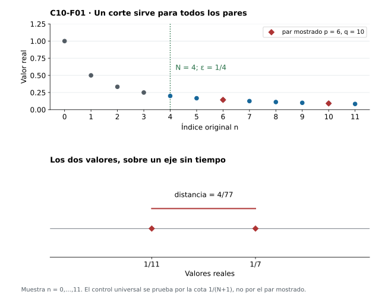
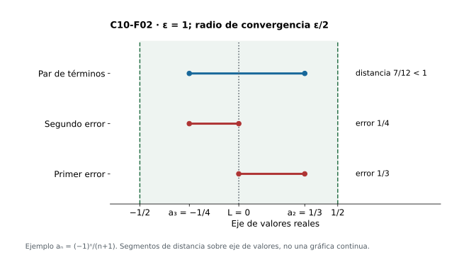
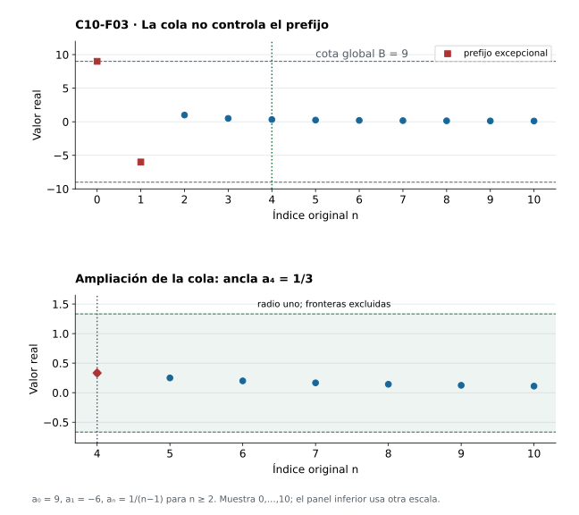
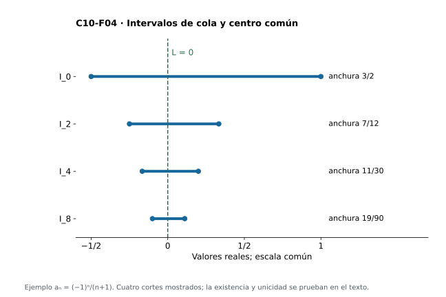
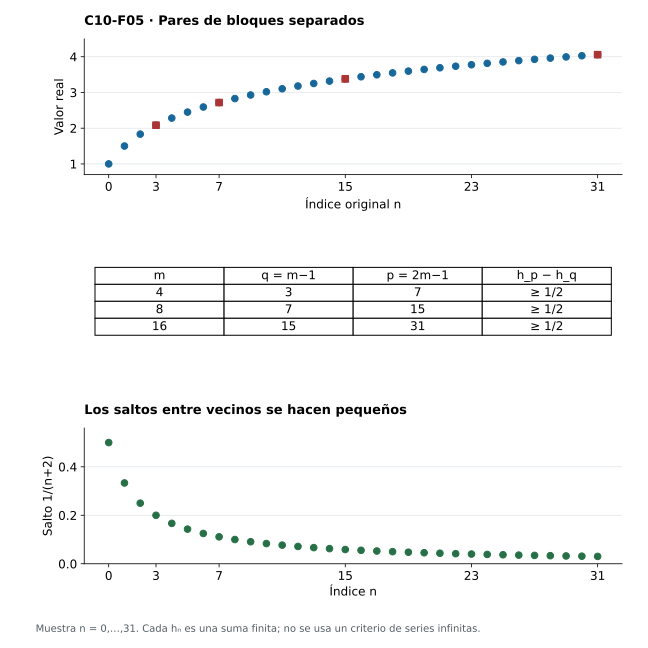
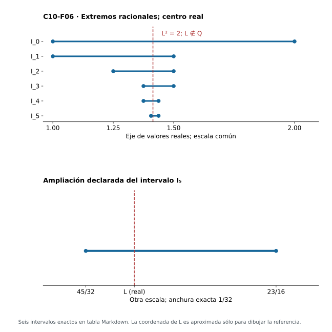
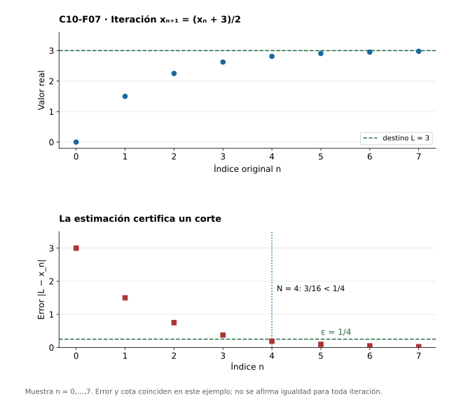

[Índice del libro](../para-matematicos/analisis-para-matematicos.html) · [Ejercicios de este capítulo](#ejercicios-10)

Tomemos una suma que podemos prolongar tanto como queramos: empezamos con $1$, añadimos $1/4$, después $1/9$, $1/16$, y continuamos tomando los recíprocos de los cuadrados de los enteros. Para no suponer que la expresión infinita representa ya un número, trabajaremos por ahora únicamente con sumas finitas. Escribamos

$$
s_n=\sum_{k=1}^{n+1}\frac1{k^2},\qquad n=0,1,2,\ldots.
$$

Conocemos exactamente el significado de cada término $s_n$ y podemos calcular tantos como necesitemos. La pregunta aparece cuando dejamos de mirar un término concreto: ¿se acercan estas sumas a algún número real a medida que prolongamos el cálculo? Si conociéramos de antemano el valor $L$ de ese posible resultado, intentaríamos demostrar que $|s_n-L|$ se hace arbitrariamente pequeño. Pero sería extraño que para justificar la existencia del destino tuviéramos que empezar por conocerlo.

Al pasar de $s_n$ a $s_{n+1}$ solo agregamos $1/(n+2)^2$, una cantidad que tiende a cero. Ese dato es alentador, aunque todavía no resuelve el problema. Entre dos sumas $s_q$ y $s_p$, con $p>q$, se acumulan $p-q$ sumandos nuevos; por pequeños que sean individualmente, no podemos ignorar que su cantidad puede ser enorme. Si queremos averiguar si las aproximaciones se estabilizan, necesitamos una estimación que siga siendo válida incluso cuando $p$ se aleje indefinidamente de $q$.

La resta elimina la parte común de ambas sumas y deja precisamente el bloque que debemos controlar:

$$
s_p-s_q=\sum_{k=q+2}^{p+1}\frac1{k^2}.
$$

¿Cómo acotar ese bloque sin tener que saber de antemano cuántos sumandos contendrá? Podemos buscar una expresión ligeramente mayor que $1/k^2$ y que tenga la ventaja de cancelarse al sumar términos consecutivos. Para $k\ge2$ se cumple $k(k-1)<k^2$, de donde

$$
\frac1{k^2}\le\frac1{k(k-1)}
=\frac1{k-1}-\frac1k.
$$

La elección de esa fracción tiene un motivo preciso: en una suma de diferencias consecutivas, casi todos los términos desaparecen por cancelación. En consecuencia, para cualesquiera $p>q\ge0$,

$$
\begin{aligned}
0\le s_p-s_q
&\le\sum_{k=q+2}^{p+1}\left(\frac1{k-1}-\frac1k\right)\\
&=\frac1{q+1}-\frac1{p+1}
<\frac1{q+1}.
\end{aligned}
$$

No hemos utilizado una suma infinita ni la existencia de un límite. Hemos controlado un bloque finito de longitud arbitraria mediante una cantidad que depende solamente de dónde empieza. Si fijamos $q$ y seguimos prolongando la suma, la diferencia nunca sobrepasa $1/(q+1)$; y si avanzamos el comienzo del bloque, esa cota se hace tan pequeña como queramos. En particular, para todos los índices $p,q\ge N$, intercambiándolos si fuera necesario, obtenemos

$$
|s_p-s_q|<\frac1{N+1}.
$$

Recibida una precisión $\varepsilon>0$, la propiedad arquimediana nos permite escoger $N$ con $1/(N+1)<\varepsilon$. Desde ese momento, dos sumas cualesquiera de la cola difieren menos que $\varepsilon$, aunque sus índices estén muy separados. Hemos descubierto así una forma de reconocer la estabilización de un procedimiento a partir de sus propias aproximaciones, sin haber calculado el número al que se dirigen. Queda una dificultad genuina: ¿por qué ese control mutuo garantiza que hay un número real al que todas ellas se acercan? La respuesta requerirá precisamente la completitud de $\mathbb R$.

## 10.1. Comparar términos sin nombrar un límite

[]{#MA-SEC-ANM-01-010-001}

La estimación anterior aprovechó una propiedad especial de las sumas de recíprocos: pudimos dominar un bloque entero mediante una cancelación algebraica. Pero la idea que apareció al final no depende de esa fórmula. Tiene sentido para cualquier sucesión real, incluso si sus términos no son sumas, si cambian de signo o si no conocemos ninguna expresión sencilla para su posible límite: dada una precisión, queremos encontrar un índice a partir del cual todos los valores de la sucesión queden próximos entre sí.

El requisito decisivo está en el orden de las elecciones. Podemos tener que avanzar más cuando pedimos una tolerancia menor, pero el lugar al que lleguemos debe servir para **cualquier par** de índices posteriores. Un corte que hubiera que modificar cada vez que se elige un par no controlaría ninguna cola completa. Esa dependencia queda recogida en la siguiente definición.

**Definición.** Una sucesión real $a:\mathbb N\to\mathbb R$, donde $\mathbb N=\{0,1,2,\ldots\}$, es **de Cauchy** si

$$
\forall\varepsilon>0\;\exists N\in\mathbb N\;\forall p,q\in\mathbb N:\quad
p,q\ge N\ \Longrightarrow\ |a_p-a_q|<\varepsilon.
$$

Leída en el orden de sus cuantificadores, la afirmación dice lo siguiente: alguien fija primero una tolerancia positiva $\varepsilon$; nosotros encontramos un índice $N$, que puede depender de ella; después se eligen libremente $p$ y $q$, con la única condición de que ambos sean al menos $N$. Debemos garantizar entonces la desigualdad escrita. Es la distancia entre los **valores** $a_p$ y $a_q$ la que se hace pequeña; los índices pueden estar separados por una cantidad arbitrariamente grande. También pueden coincidir, pues $|a_p-a_p|=0$, y podemos intercambiarlos porque $|a_p-a_q|=|a_q-a_p|$. Por eso basta a menudo demostrar la estimación para $p>q\ge N$ y añadir el caso de igualdad. Comprobar únicamente parejas consecutivas no es suficiente: los desplazamientos pequeños pueden acumularse, como veremos al estudiar las sumas armónicas en §10.5.

En la sucesión $s_n$ con la que iniciamos el capítulo, el control de todos los pares nació de una suma telescópica. A veces es posible obtenerlo sin sumar nada, simplemente encerrando los valores tardíos en un intervalo pequeño. Consideremos $a_n=1/(n+1)$. Si $p,q\ge N$, ambos términos son positivos y no exceden $1/(N+1)$; por tanto, pertenecen al intervalo $(0,1/(N+1)]$, y su distancia satisface

$$
|a_p-a_q|\le\frac1{N+1}.
$$

Para que esta cota sea estrictamente menor que una tolerancia $\varepsilon>0$, basta elegir un natural $N$ con $N+1>1/\varepsilon$. La propiedad arquimediana garantiza que podemos hacerlo. Una sola elección controla todos los pares de la cola, tanto si los índices están próximos como si uno de ellos es muchísimo mayor que el otro.

La figura 10.1 muestra, para $\varepsilon=1/4$, un corte posible: $N=4$. Todos los valores posteriores quedan en la franja $(0,1/5]$, más estrecha que la tolerancia pedida. Entre los términos de índices $6$ y $10$, por ejemplo, hay una distancia $|1/7-1/11|=4/77$; comprobar ese par puede ayudarnos a leer la figura, pero es la estimación del intervalo la que demuestra la afirmación para los infinitos pares restantes.

{#fig-anm-c10-f01 fig-alt="Arriba, términos discretos 1/(n+1) y corte cuatro; dos rombos marcan índices seis y diez. Debajo, un eje de valores sitúa 1/11 y 1/7 con un segmento de distancia 4/77. No aparece un centro de convergencia."}

Los dos ejemplos han exigido estimaciones distintas. En el primero, la cancelación de una suma finita controló cuánto podían separarse dos resultados parciales; en el segundo, bastó observar que toda la cola cabía en un intervalo de longitud pequeña. Ninguno de los dos razonamientos tuvo que partir de un candidato a límite. Esta libertad es especialmente útil cuando el procedimiento que produce los términos resulta más fácil de describir que su resultado final.

La definición tampoco exige que una sucesión sea monótona ni que todos sus términos sean diferentes. Una sucesión constante $a_n=c$ es de Cauchy desde $N=0$, puesto que cualquier distancia entre sus términos vale cero. En cambio, $a_n=(-1)^n$ no lo es: después de cualquier corte $N$, los índices $N$ y $N+1$ ofrecen valores separados por dos unidades, de modo que la tolerancia fija $\varepsilon=1$ nunca puede satisfacerse. No es el cambio de signo lo que causa el fracaso; una alternancia de amplitud decreciente sí puede ser de Cauchy, como comprobaremos en la sección siguiente.

Hay, por último, una distinción entre afirmar que existe un corte y saber calcularlo. La definición de Cauchy expresa una condición matemática: para toda precisión debe existir algún índice que funcione. En nuestros ejemplos hemos hecho algo más, porque las desigualdades permiten dar un corte suficiente a partir de $\varepsilon$. En otras situaciones podremos demostrar la existencia de esos índices sin disponer de una regla efectiva para encontrarlos a partir de los datos disponibles. Cuando estudiemos la acumulación de errores en §10.8 veremos cómo una estimación concreta puede proporcionar ambas cosas: la existencia de un límite y un modo de certificar cuán cerca estamos de él.

### Ejercicios de la sección 10.1

[]{#ejercicios-10}

#### Ejercicio 1. Dos índices universales

[]{#MA-EX-ANM-01-010-001}

Compara la definición de Cauchy con la condición: para todo $\varepsilon>0$ y todo $p$, existe $q\ge p$ con $|a_p-a_q|<\varepsilon$. ¿La segunda impone control?

[]{#MA-SOL-ANM-01-010-001}

Ver solución del ejercicio 1

La definición de Cauchy exige un corte antes de todos los pares posteriores. La segunda condición es verdadera para cualquier sucesión tomando $q=p$, con distancia cero. No impone Cauchy: $(-1)^n$ la satisface y no es de Cauchy.

En la segunda condición el testigo $q$ puede elegirse después de conocer $p$, y nada exige que sea diferente de él. La elección $q=p$ hace que el enunciado sea verdadero para toda sucesión. En Cauchy, en cambio, tras fijar el corte la desigualdad debe valer para cualquier elección de ambos índices. En la alternancia, los índices consecutivos $N,N+1$ tienen distancia dos; así se ve concretamente el control que falta en la condición propuesta.

#### Ejercicio 2. Un corte recíproco

[]{#MA-EX-ANM-01-010-002}

Prueba directamente que $a_n=1/(n+1)$ es de Cauchy, dando un corte que incluya el índice cero cuando sirva.

[]{#MA-SOL-ANM-01-010-002}

Ver solución del ejercicio 2

Los términos posteriores a $N$ están en $(0,1/(N+1)]$, luego cualquier distancia es a lo sumo $1/(N+1)$. Para $\varepsilon>0$ tomar el mínimo natural con $N+1>1/\varepsilon$; existe por arquimedianidad y garantiza distancia menor que $\varepsilon$. Si $\varepsilon\ge1$, podemos tomar directamente $N=0$, porque todas las distancias son estrictamente menores que uno. Si $\varepsilon<1$, cero no sirve: una distancia $1-1/(n+1)$ lo bastante tardía alcanza esa tolerancia. No es necesario proponer un destino.

Después de la prueba, puede retomarse la [figura 10.1](analisis-para-matematicos-capitulo-10-cauchy-converger-sin-conocer-el-destino.html#fig-anm-c10-f01) para contrastar el mecanismo con el ejemplo del capítulo.

El corte cero requiere un examen separado porque la cota del diámetro es no estricta. Si ambos valores están en $(0,1]$, su distancia es estrictamente menor que uno, incluso cuando uno de ellos es el valor uno. Para $0<\varepsilon<1$, escogemos un natural $q$ con $1/(q+1)\le1-\varepsilon$: el par $0,q$ tiene distancia al menos $\varepsilon$ y demuestra que ese corte no sirve. Un corte posterior con $1/(N+1)<\varepsilon$ evita el problema para todos los pares a la vez.

#### Ejercicio 3. Constantes y repetición

[]{#MA-EX-ANM-01-010-003}

Prueba que toda sucesión constante es de Cauchy y explica por qué no se exigen valores distintos.

[]{#MA-SOL-ANM-01-010-003}

Ver solución del ejercicio 3

Si $a_n=c$ para todos los índices, $|a_p-a_q|=0$ para todo par. El corte cero sirve para toda tolerancia positiva. La sucesión sigue siendo una función aunque repita un valor; Cauchy controla distancias, no inyectividad.

Leamos todos los cuantificadores: recibimos una tolerancia positiva arbitraria, respondemos con $N=0$ y consideramos cualesquiera $p,q\ge0$. La igualdad de los valores da distancia cero, que satisface la desigualdad estricta por la positividad de la tolerancia. Esto prueba la condición completa. Repetir valores no impide ser una función: lo exigido es un valor único para cada índice, no un índice único para cada valor.

#### Ejercicio 4. Simetría de los pares

[]{#MA-EX-ANM-01-010-004}

Prueba que en la definición basta exigir el control para $p>q\ge N$, además de recordar el caso de igualdad.

[]{#MA-SOL-ANM-01-010-004}

Ver solución del ejercicio 4

Para pares iguales la distancia es cero. Para $p<q$, intercambiar los índices usa $|a_p-a_q|=|a_q-a_p|$ y reduce al caso comprobado. El corte es el mismo y no se altera el orden de cuantificadores. Esta reducción no permite limitar la separación a un desplazamiento fijo.

Después de la prueba, puede retomarse la [figura 10.1](analisis-para-matematicos-capitulo-10-cauchy-converger-sin-conocer-el-destino.html#fig-anm-c10-f01) para contrastar el mecanismo con el ejemplo del capítulo.

La implicación desde la definición completa es inmediata, porque los pares con $p>q$ son una parte de los pares permitidos. Para la implicación inversa, fijamos el corte entregado por la condición reducida y clasificamos cualquier par posterior según $p>q$, $p=q$ o $p<q$. Cada caso cumple la desigualdad con ese mismo corte. Es necesario que el control reducido abarque todos los pares ordenados, no sólo los consecutivos.

#### Ejercicio 5. Una escala discreta de tolerancias

[]{#MA-EX-ANM-01-010-005}

Demuestra que basta probar: para todo entero $k\ge1$ existe $N_k$ que controla todos los pares posteriores con distancia menor que $1/k$.

[]{#MA-SOL-ANM-01-010-005}

Ver solución del ejercicio 5

La condición de Cauchy implica cada una de esas condiciones al usar $\varepsilon=1/k$. Recíprocamente, dada $\varepsilon>0$, arquimedianidad da $k\ge1$ con $1/k<\varepsilon$; el corte de esa condición controla cualquier par posterior con distancia menor que $\varepsilon$. No se intercambia el índice universal de par con el corte.

No necesitamos que los cortes $N_k$ formen una sucesión creciente. Para una tolerancia concreta basta seleccionar un entero $k>1/\varepsilon$ y conservar únicamente el corte asociado a él. Entonces $p,q\ge N_k$ implica $|a_p-a_q|<1/k<\varepsilon$. La escala discreta funciona porque contiene tolerancias arbitrariamente pequeñas. Una lista finita de tolerancias no tendría esa propiedad y dejaría sin comprobar precisiones menores que todas ellas.

## 10.2. Del destino común al control interno

[]{#MA-SEC-ANM-01-010-002}

En los ejemplos anteriores hemos conseguido controlar las diferencias entre términos sin recurrir al valor de un límite. Podemos preguntarnos ahora qué sucede cuando ese valor sí se conoce. Si los términos de una sucesión se acercan a un mismo número $L$, parece razonable que también terminen acercándose unos a otros; pero necesitamos convertir esa intuición en una estimación válida para cualquier par de índices tardíos. La desigualdad triangular nos proporciona el camino: compararemos cada término con $L$ y dejaremos que ambos errores contribuyan a la distancia que queremos acotar.

Supongamos, entonces, que $a_n\to L$. Si queremos medir la distancia entre $a_p$ y $a_q$, podemos pasar algebraicamente por $L$:

$$
a_p-a_q=(a_p-L)+(L-a_q).
$$

La desigualdad triangular nos da la estimación adecuada,

$$
|a_p-a_q|\le |a_p-L|+|a_q-L|.
$$

La elección de $L$ como punto intermedio no es una ilustración añadida a la prueba; es lo que convierte la distancia que queremos controlar en dos distancias de las que ya sabemos algo. La convergencia nos permite hacer pequeño cada error $|a_n-L|$. Como tenemos **dos** de esos errores, debemos reservar para cada uno una parte de la tolerancia total.

**Proposición. Toda sucesión real convergente es de Cauchy.**

**Demostración.** Sea $a_n\to L$ y fijemos $\varepsilon>0$. Para asegurar una distancia final menor que $\varepsilon$, apliquemos la definición de convergencia con la tolerancia $\varepsilon/2$. Existe, pues, un índice $N$ tal que

$$
|a_n-L|<\frac\varepsilon2\qquad\text{para todo }n\ge N.
$$

La condición vale para cualquier índice posterior, de manera que podemos aplicarla **dos veces sin cambiar de corte**: una con $n=p$ y otra con $n=q$. Así, si $p,q\ge N$,

$$
|a_p-a_q|\le |a_p-L|+|a_q-L|
<\frac\varepsilon2+\frac\varepsilon2=\varepsilon.
$$

Hemos encontrado un único corte para todos los pares de la cola, tal como pide la definición de Cauchy. $\square$

La prueba muestra por qué una ventana de radio $r$ alrededor de $L$ no tiene, en general, diámetro $r$. Si dos términos se encuentran a lados opuestos del centro, uno puede estar casi a distancia $r$ por la izquierda y otro casi a distancia $r$ por la derecha; entre ellos habrá entonces una separación cercana a $2r$. Por ejemplo, $L-3r/4$ y $L+3r/4$ pertenecen ambos a $(L-r,L+r)$ y, sin embargo, distan $3r/2>r$. Pedimos por eso una ventana de radio $\varepsilon/2$ cuando buscamos una separación menor que $\varepsilon$. La figura 10.2 permite seguir sobre el eje de valores cómo se suman dos errores respecto de un mismo centro.

{#fig-anm-c10-f02 fig-alt="Tres filas en un eje común muestran los términos menos un cuarto y un tercio, el centro cero, los errores respectivos y la distancia siete doceavos. Las fronteras de la ventana medio están excluidas."}

También merece atención lo que *no* hemos utilizado. El límite $L$ existía por hipótesis; nuestra tarea consistía únicamente en comparar términos. El razonamiento seguiría siendo correcto en un espacio donde no toda sucesión de Cauchy convergiera, pues ninguna de las desigualdades anteriores necesita construir un límite. Será la dirección contraria la que nos obligue a utilizar la completitud.

Volvamos ahora a la sucesión alternante, pero con amplitud decreciente: $b_n=(-1)^n/(n+1)$. A diferencia de $(-1)^n$, sus oscilaciones se hacen cada vez menores. Como $|b_n|=1/(n+1)\to0$, sabemos que converge a cero; la proposición asegura entonces que es de Cauchy. Podemos comprobarlo directamente para ver que el cambio de signo no altera la esencia de la definición. Si $p,q\ge N$,

$$
\begin{aligned}
|b_p-b_q|
&=\left|\frac{(-1)^p}{p+1}-\frac{(-1)^q}{q+1}\right|\\
&\le\frac1{p+1}+\frac1{q+1}
\le\frac2{N+1}.
\end{aligned}
$$

La estimación vale tanto para índices de la misma paridad como para índices de paridades contrarias, y el corte $N+1>2/\varepsilon$ garantiza Cauchy. Se trata de una sucesión no monótona con el mismo comportamiento de concentración que la sucesión positiva de los recíprocos. No necesitamos separar todas las posibles combinaciones de signos para demostrarlo: tomar valores absolutos deja una cota válida para todas.

Queda una cuestión considerablemente más difícil. Hemos empezado con un límite y, gracias a él, hemos obtenido control entre términos. Si empezamos **solo** con esas distancias pequeñas, ¿de dónde saldrá el número $L$? Escribir un símbolo para el supuesto límite no basta para crearlo. Antes de responder, usaremos Cauchy para encerrar la sucesión en una región acotada y después aprovecharemos los extremos de las colas para construir el candidato.

### Ejercicios de la sección 10.2

#### Ejercicio 6. Dos errores

[]{#MA-EX-ANM-01-010-006}

Demuestra convergente implica Cauchy e identifica dónde se reparte la tolerancia.

[]{#MA-SOL-ANM-01-010-006}

Ver solución del ejercicio 6

Si $a_n\to L$, para $\varepsilon>0$ escoger un corte que haga $|a_n-L|<\varepsilon/2$ en toda la cola. Para $p,q$ posteriores, la desigualdad triangular da $|a_p-a_q|\le|a_p-L|+|a_q-L|<\varepsilon$. La división en dos errores se hace antes de fijar $p,q$. El límite viene dado por hipótesis; no se utiliza completitud.

Después de la prueba, puede retomarse la [figura 10.2](analisis-para-matematicos-capitulo-10-cauchy-converger-sin-conocer-el-destino.html#fig-anm-c10-f02) para contrastar el mecanismo con el ejemplo del capítulo.

Introducimos el destino como punto intermedio: $a_p-a_q=(a_p-L)+(L-a_q)$. Cada diferencia está controlada por la convergencia, siempre que ambos índices estén en su cola. Repartir el presupuesto en mitades permite sumar las dos cotas y conservar la tolerancia requerida. No podemos concluir distancia menor que $\varepsilon$ si sólo sabemos que cada error es menor que $\varepsilon$: eso daría únicamente una distancia menor que $2\varepsilon$.

#### Ejercicio 7. Alternancia amortiguada

[]{#MA-EX-ANM-01-010-007}

Prueba Cauchy directamente para $a_n=(-1)^n/(n+1)$ y compara el corte con el de la sucesión positiva.

[]{#MA-SOL-ANM-01-010-007}

Ver solución del ejercicio 7

$|a_p-a_q|\le1/(p+1)+1/(q+1)\le2/(N+1)$ para pares posteriores a $N$. Tomar cualquier natural con $N+1>2/\varepsilon$ garantiza control. Para términos positivos bastaba $N+1>1/\varepsilon$; aquí pueden sumarse las magnitudes de signos opuestos. Ambos son cortes suficientes, sin afirmar optimalidad.

Después de la prueba, puede retomarse la [figura 10.2](analisis-para-matematicos-capitulo-10-cauchy-converger-sin-conocer-el-destino.html#fig-anm-c10-f02) para contrastar el mecanismo con el ejemplo del capítulo.

Cuando los índices tienen paridades opuestas, los valores quedan a ambos lados de cero y su distancia es la suma de sus magnitudes. La triangular proporciona una sola cota que también sirve cuando las paridades coinciden. Por eso $2/(N+1)$ es un presupuesto seguro. Escogido $N$ con esa cota menor que la tolerancia, el argumento ya no depende de cuáles sean los dos índices. No se necesita obtener el mejor corte para demostrar Cauchy.

#### Ejercicio 8. Radio no es diámetro

[]{#MA-EX-ANM-01-010-008}

Si todos los términos de una cola están en $(L-r,L+r)$, prueba que sus distancias son menores que $2r$. Da dos puntos de esa ventana separados por más de $r$.

[]{#MA-SOL-ANM-01-010-008}

Ver solución del ejercicio 8

Por triangular, dos errores menores que $r$ suman menos que $2r$. Los puntos $L-3r/4$ y $L+3r/4$ pertenecen a la ventana y están separados por $3r/2>r$. Una ventana de radio $r$ no proporciona automáticamente tolerancia de Cauchy $r$.

Después de la prueba, puede retomarse la [figura 10.2](analisis-para-matematicos-capitulo-10-cauchy-converger-sin-conocer-el-destino.html#fig-anm-c10-f02) para contrastar el mecanismo con el ejemplo del capítulo.

Cada punto de la ventana satisface $|x-L|<r$. Para dos puntos $x,y$, la triangular da $|x-y|\le|x-L|+|y-L|<2r$. Los puntos propuestos tienen errores individuales $3r/4$, pero distancia $3r/2$. Por tanto, el radio mide distancia al centro y el diámetro mide separación entre puntos. Para transformar una ventana en un control de Cauchy con tolerancia $\varepsilon$, basta usar radio $\varepsilon/2$.

#### Ejercicio 9. Transportar un corte conocido

[]{#MA-EX-ANM-01-010-009}

Supón que $|a_n-L|\le C/(n+1)$ para todos los índices y $C\ge0$. Da un corte de Cauchy para cada tolerancia.

[]{#MA-SOL-ANM-01-010-009}

Ver solución del ejercicio 9

Si $C=0$, la sucesión es constante $L$ y sirve cero. Si $C>0$, para $p,q\ge N$ la distancia es a lo sumo $2C/(N+1)$. Cualquier $N$ con $N+1>2C/\varepsilon$ garantiza la condición. La cota no estricta inicial se convierte en estricta al escoger el corte.

La estimación frente a $L$ entrega dos errores, cada uno a lo sumo $C/(N+1)$, y por eso la distancia entre términos es a lo sumo $2C/(N+1)$. La propiedad arquimediana permite escoger $N$ haciendo esa última cantidad estrictamente menor que $\varepsilon$. Si $C=0$, la hipótesis implica $|a_n-L|=0$ para todo $n$: todos los términos son $L$ y ninguna división por $C$ resulta necesaria.

#### Ejercicio 10. Una recíproca pendiente

[]{#MA-EX-ANM-01-010-010}

Explica qué obligación falta después de demostrar que una convergente es de Cauchy. ¿La desigualdad triangular por sí sola la resuelve?

[]{#MA-SOL-ANM-01-010-010}

Ver solución del ejercicio 10

Falta demostrar que cada sucesión con control interno tiene un destino dentro del codominio. La desigualdad triangular relaciona distancias con un centro ya dado; no crea ese centro. La prueba de §10.4 lo construirá por completitud. El contraste racional de §10.7 mostrará por qué esa obligación no es meramente formal.

Demostrar «si converge, es de Cauchy» parte de un número $L$ que ya existe. La recíproca parte únicamente de distancias entre términos y debe producir ese número. Por ejemplo, las bisecciones racionales de §10.7 satisfacen el control interno, aunque su destino no pertenece a los racionales. La construcción real funciona porque permite tomar los extremos y supremos necesarios dentro del codominio. La completitud resuelve una obligación de existencia que la triangular no aborda.

## 10.3. Encerrar una cola y recuperar la acotación

[]{#MA-SEC-ANM-01-010-003}

Una sucesión de Cauchy controla las distancias entre sus términos tardíos, pero no parece ofrecer una cota respecto de cero. La diferencia entre ambas cosas puede desconcertar: si todos los valores posteriores a un corte se encuentran próximos unos a otros, podrían estar agrupados cerca de un número grande, y la definición no nos dice cuál es ese número. Sin embargo, para demostrar acotación no necesitamos descubrir un centro privilegiado. Podemos **escoger uno de los propios términos** como referencia; el control de Cauchy ya asegura que el resto de la cola no se alejará demasiado de él.

Fijemos, por ejemplo, la tolerancia $1$. Puesto que la condición vale para *toda* tolerancia positiva, debe existir un índice $N_0$ tal que $|a_p-a_q|<1$ siempre que $p,q\ge N_0$. Tomemos $q=N_0$. Ahora $a_{N_0}$ deja de ser una variable: es un número real fijo que podemos usar como ancla para medir los demás valores. La desigualdad triangular da

$$
|a_n|\le|a_n-a_{N_0}|+|a_{N_0}|<1+|a_{N_0}|
\qquad(n\ge N_0).
$$

Es una cota de toda la cola. Aún no es, necesariamente, una cota de la sucesión completa: podrían existir términos muy grandes antes de $N_0$. Pero solo hay **finitos** términos anteriores al corte y podemos incorporarlos a una cota global.

**Proposición. Toda sucesión de Cauchy de números reales es acotada.**

**Demostración.** La estimación anterior proporciona una cota $1+|a_{N_0}|$ para todos los términos con índice $n\ge N_0$. Si $N_0>0$, consideramos la lista finita de magnitudes anteriores y definimos

$$
B=\max\bigl\{|a_{N_0}|+1,|a_0|,\ldots,|a_{N_0-1}|\bigr\}.
$$

Entonces $|a_n|\le B$ para cualquier $n\in\mathbb N$, tanto si se encuentra antes del corte como después de él. Si $N_0=0$, no hay prefijo anterior y basta tomar $B=1+|a_0|$. En ambos casos la sucesión es acotada. $\square$

El número $1$ no tiene nada de especial; elegimos esa tolerancia porque basta una región de anchura fija para demostrar acotación. Tampoco hizo falta la completitud de $\mathbb R$: una desigualdad y el máximo de una lista finita resolvieron todo. La implicación contraria, en cambio, falla. Los términos de $(-1)^n$ permanecen en $[-1,1]$, pero ninguna cola se concentra en un intervalo arbitrariamente estrecho.

La separación entre cola y prefijo puede parecer un detalle técnico hasta que consideramos una sucesión que comienza con $a_0=9$, $a_1=-6$ y continúa según $a_n=1/(n-1)$ para $n\ge2$. Su cola recíproca tiene valores pequeños y se concentra, sin que eso reduzca en absoluto los dos términos que aparecieron al principio. La figura 10.3 muestra las dos escalas: el corte permite controlar la parte tardía, mientras que el prefijo debe incorporarse a la cota global por separado. Esa distinción volverá a aparecer cuando estudiemos propiedades que dependen únicamente de lo que sucede a partir de un cierto índice.

{#fig-anm-c10-f03 fig-alt="Panel superior distingue los términos iniciales nueve y menos seis del resto recíproco, con corte cuatro. Panel inferior amplía la cola, marca el ancla un tercio y su ventana abierta de radio uno, sin reutilizar la escala del prefijo."}

Con la acotación ya podemos construir algo más útil que una ventana alrededor de un término escogido arbitrariamente. Para cada $N$ consideremos el conjunto de los valores que todavía quedan,

$$
T_N=\{a_n:n\ge N\}.
$$

Es no vacío, pues contiene $a_N$, y es acotado porque toda la sucesión lo es. Por la propiedad del supremo, tanto su extremo superior como su extremo inferior existen en $\mathbb R$. Los denotaremos por

$$
\ell_N=\inf T_N,\qquad u_N=\sup T_N,\qquad
I_N=[\ell_N,u_N].
$$

Los extremos son barreras: todos los términos de la cola están entre ellos, pero no tienen por qué ser valores efectivamente alcanzados. Para $a_n=1/(n+1)$, por ejemplo, $u_N=1/(N+1)$ y $\ell_N=0$. El cero pertenece al intervalo $I_N$, aunque ningún término de la sucesión sea cero. Esta pequeña diferencia entre *pertenecer al intervalo que contiene la cola* y *ser un valor de la cola* será decisiva cuando queramos construir un límite nuevo.

Al aumentar el índice $N$ descartamos términos; nunca añadimos otros. Por eso $T_{N+1}\subseteq T_N$. Una cola más pequeña no puede tener un ínfimo inferior al de la cola anterior ni un supremo superior al de ella; en símbolos,

$$
\ell_N\le\ell_{N+1}\le u_{N+1}\le u_N.
$$

Los intervalos $I_N$ están, por tanto, encajados. Cada nuevo intervalo es una región en la que quedan encerrados *todos* los términos suficientemente tardíos. Para convertirlos en una construcción del límite falta mostrar que esas regiones se estrechan de verdad y no se estabilizan, por ejemplo, en un intervalo grande.

La condición de Cauchy nos da exactamente ese estrechamiento, pero debemos justificar con cuidado el paso de una estimación sobre términos a otra sobre sus extremos. Fijemos $\eta>0$ y escojamos un corte $N_0$ tal que $|a_p-a_q|<\eta$ para todos $p,q\ge N_0$. Tomemos cualquier $N\ge N_0$ y fijemos un valor $y\in T_N$. Todos los demás valores $x\in T_N$ satisfacen $x-y<\eta$, de modo que $y+\eta$ es cota superior de la cola. Por la definición de supremo, $u_N\le y+\eta$.

Esta última desigualdad vale para **cualquier** $y$ de la cola, no solo para el primero que elegimos. Al reordenarla obtenemos $u_N-\eta\le y$ para todo $y\in T_N$. Así $u_N-\eta$ es una cota inferior y, puesto que $\ell_N$ es la mayor de esas cotas, tenemos $u_N-\eta\le\ell_N$. Hemos deducido

$$
0\le u_N-\ell_N\le\eta\qquad(N\ge N_0).
$$

¿Por qué hemos obtenido $\le\eta$ y no $<\eta$ si todas las diferencias de términos eran estrictas? Porque supremo e ínfimo pueden ser puntos frontera no alcanzados: las distancias individuales pueden ser todas menores que una cantidad y tener precisamente esa cantidad como supremo. Los recíprocos ofrecen un ejemplo en su cola inicial: todos los pares distan menos de uno, aunque el intervalo de extremos es $[0,1]$ y tiene anchura uno. Para garantizar anchura **estrictamente** menor que una precisión $\varepsilon$, basta aplicar Cauchy con $\eta=\varepsilon/2$; entonces $u_N-\ell_N\le\varepsilon/2<\varepsilon$.

Ya contamos con los ingredientes del argumento principal. La sucesión queda dentro de una familia de intervalos cerrados encajados, cuyas anchuras pueden hacerse tan pequeñas como queramos. Necesitamos demostrar que existe un real común a todos ellos. Ese paso es donde la completitud dejará de ser una propiedad de fondo para intervenir en la construcción misma del destino.

### Ejercicios de la sección 10.3

#### Ejercicio 11. Ancla y prefijo

[]{#MA-EX-ANM-01-010-011}

Reconstruye la prueba de acotación de una sucesión de Cauchy y trata por separado el corte cero.

[]{#MA-SOL-ANM-01-010-011}

Ver solución del ejercicio 11

Con tolerancia uno obtener $N_0$, fijar el índice ancla en $N_0$ y deducir $|a_n|<|a_{N_0}|+1$ para $n\ge N_0$. Si $N_0=0$, esa cota es global. Si $N_0>0$, el máximo de ella y las finitas magnitudes anteriores acota toda la sucesión. El conjunto del máximo es no vacío y no se usa completitud.

Después de la prueba, puede retomarse la [figura 10.3](analisis-para-matematicos-capitulo-10-cauchy-converger-sin-conocer-el-destino.html#fig-anm-c10-f03) para contrastar el mecanismo con el ejemplo del capítulo.

Fijado el ancla $a_{N_0}$, la triangular da $|a_n|\le|a_n-a_{N_0}|+|a_{N_0}|<1+|a_{N_0}|$ para toda la cola. El prefijo contiene sólo los índices $0,\ldots,N_0-1$. Si existe, ponemos $B=\max\{1+|a_{N_0}|,|a_0|,\ldots,|a_{N_0-1}|\}$. Cada término queda cubierto por una de esas dos partes y satisface $|a_n|\le B$. Tomar el máximo de una lista finita requiere orden lineal, no completitud.

#### Ejercicio 12. La cota no basta

[]{#MA-EX-ANM-01-010-012}

Da una sucesión real acotada que no sea de Cauchy y prueba ambas afirmaciones.

[]{#MA-SOL-ANM-01-010-012}

Ver solución del ejercicio 12

$a_n=(-1)^n$ tiene magnitud uno. Para cualquier corte, $p=N,q=N+1$ dan distancia dos. La tolerancia fija uno impide la condición de Cauchy en cualquier cola. La acotación sólo evita escape; no obliga a proximidad mutua.

Para probar acotación basta observar $-1\le a_n\le1$. Para negar Cauchy necesitamos otra comprobación: fijamos $\varepsilon_0=1$ antes de recibir el corte. Los índices consecutivos posteriores tienen signos opuestos, de modo que $|a_N-a_{N+1}|=2\ge\varepsilon_0$. La misma tolerancia falla en todas las colas. Hemos probado por separado las dos propiedades pedidas, sin deducir una de la apariencia del gráfico.

#### Ejercicio 13. Intervalos de cola

[]{#MA-EX-ANM-01-010-013}

Para $a_n=1/(n+1)$, calcula $I_N$ y sus anchuras. ¿Son intervalos de valores alcanzados?

[]{#MA-SOL-ANM-01-010-013}

Ver solución del ejercicio 13

$I_N=[0,1/(N+1)]$ y su anchura es $1/(N+1)$. El extremo superior se alcanza en $N$; el inferior cero no es término. El intervalo encierra toda la cola y también valores que ésta nunca toma. Los extremos se calculan por optimalidad y arquimedianidad.

Después de la prueba, puede retomarse la [figura 10.4](analisis-para-matematicos-capitulo-10-cauchy-converger-sin-conocer-el-destino.html#fig-anm-c10-f04) para contrastar el mecanismo con el ejemplo del capítulo.

El mayor valor de la cola es $a_N=1/(N+1)$. Cero es una cota inferior, y ninguna cota positiva es válida: para cualquier $b>0$, arquimedianidad permite encontrar $n\ge N$ con $1/(n+1)<b$. Por tanto el ínfimo es cero. El intervalo cerrado une ambos extremos, pero la sucesión sólo toma los valores recíprocos discretos; por ejemplo, cero nunca aparece. Un intervalo de extremos es una envolvente y no el conjunto exacto de valores.

#### Ejercicio 14. Ancho no estricto

[]{#MA-EX-ANM-01-010-014}

Prueba que si todos los pares de una cola tienen distancia menor que $\eta$, entonces su intervalo de extremos tiene anchura a lo sumo $\eta$.

[]{#MA-SOL-ANM-01-010-014}

Ver solución del ejercicio 14

Para cada valor fijo $y$ de la cola, todos sus valores $x$ cumplen $x<y+\eta$. Tomando supremo, $u_N\le y+\eta$. Así $u_N-\eta$ acota inferiormente todos los $y$, y $u_N-\eta\le\ell_N$. Restar da anchura a lo sumo $\eta$. No se supone que existan valores extremos alcanzados.

Después de la prueba, puede retomarse la [figura 10.4](analisis-para-matematicos-capitulo-10-cauchy-converger-sin-conocer-el-destino.html#fig-anm-c10-f04) para contrastar el mecanismo con el ejemplo del capítulo.

La justificación se hace en dos pasos porque los extremos pueden no alcanzarse. Con $y$ fijo, $y+\eta$ es una cota superior de la cola, luego su supremo no la supera. Al reorganizar esa desigualdad obtenemos $u_N-\eta\le y$ para todo valor de la cola; así $u_N-\eta$ es cota inferior y no supera su ínfimo. Este paso sólo conserva desigualdad no estricta: que cada valor quede estrictamente antes de una barrera no obliga a que su supremo quede estrictamente antes.

#### Ejercicio 15. La igualdad puede sobrevivir

[]{#MA-EX-ANM-01-010-015}

Construye una sucesión de Cauchy cuya cola de corte cero tenga todas sus distancias menores que uno y anchura exactamente uno.

[]{#MA-SOL-ANM-01-010-015}

Ver solución del ejercicio 15

Tomar $a_n=1/(n+1)$. Todos sus valores son positivos y a lo sumo uno, de modo que cada distancia es menor que uno. El supremo es uno y el ínfimo cero, luego anchura uno. La sucesión es de Cauchy por el control recíproco. Se verifica que pasar a extremos puede perder la desigualdad estricta.

Después de la prueba, puede retomarse la [figura 10.4](analisis-para-matematicos-capitulo-10-cauchy-converger-sin-conocer-el-destino.html#fig-anm-c10-f04) para contrastar el mecanismo con el ejemplo del capítulo.

Para dos valores $x,y\in(0,1]$, si $x\ge y$ tenemos $x-y<x\le1$, y en el otro orden usamos simetría. Así todos los pares tienen distancia menor que uno. Sin embargo, el valor uno está presente y los valores se acercan arbitrariamente a cero, por lo que el intervalo de extremos es $[0,1]$. La anchura uno puede ser el supremo de las distancias aunque ninguna distancia individual valga uno.

## 10.4. La completitud construye el destino

[]{#MA-SEC-ANM-01-010-004}

Los intervalos $I_N$ se van estrechando alrededor de lo que parecería un punto de llegada. El dibujo sugiere que debería haber un real atrapado en todos ellos, pero una demostración no puede dar por existente un punto solo porque las regiones que lo rodearían se hacen pequeñas. En especial, no conocemos todavía ningún $L$ al que podamos aplicar la definición de convergencia. Tenemos que **construirlo con las herramientas disponibles**, y la herramienta que garantiza la existencia de extremos de conjuntos acotados es la completitud de $\mathbb R$.

Podríamos pensar en tomar un extremo inferior de algún intervalo y declararlo candidato, pero el intervalo escogido puede ser todavía demasiado ancho. Además, sus extremos cambiarán al avanzar el corte. En cambio, los extremos inferiores $\ell_N$ forman una familia ordenada que no desciende: cada nueva cola puede subir la barrera inferior, nunca bajarla. Tiene sentido buscar la barrera inferior más alta compatible con todas las colas. La propiedad del supremo permite dar a esa intuición una formulación exacta.

**Teorema (criterio de Cauchy en $\mathbb R$).** Una sucesión $a:\mathbb N\to\mathbb R$ converge a algún número real si y solo si es de Cauchy para la distancia usual.

**Demostración.** La dirección que parte de la convergencia ya quedó probada en §10.2. Supongamos ahora que $(a_n)$ es de Cauchy. Por §10.3, es acotada y, para cada $N$, posee un intervalo de cola $I_N=[\ell_N,u_N]$. El conjunto de todos sus extremos inferiores,

$$
E=\{\ell_N:N\in\mathbb N\},
$$

no es vacío, porque contiene $\ell_0$, y está acotado superiormente por cualquier cota superior global de la sucesión. Por completitud tiene un supremo. Definamos

$$
L=\sup E.
$$

Acabamos de obtener un número real que no habíamos supuesto existente. La definición de supremo garantiza que $\ell_N\le L$ para todo $N$. La dificultad verdadera empieza aquí: aún debemos demostrar que $L$ no haya quedado *por encima* del extremo superior de algún intervalo.

Es tentador responder que $\ell_N\le u_N$; por supuesto que es cierto, pero **no es suficiente**. Esa desigualdad compara los extremos de *una misma* cola, mientras que $L$ reúne la información de *todas* las colas. Para concluir $L\le u_N$ necesitamos demostrar que $u_N$ es cota superior de **todos** los $\ell_M$, incluso cuando $M$ sea distinto de $N$.

Fijemos, pues, dos índices arbitrarios $M,N$ y tomemos $r=\max\{M,N\}$. El término $a_r$ pertenece a las dos colas $T_M$ y $T_N$. Como $\ell_M$ es cota inferior de la primera y $u_N$ es cota superior de la segunda, podemos encadenar

$$
\ell_M\le a_r\le u_N.
$$

Ahora $N$ permanece fijo y $M$ puede variar sin restricción. La desigualdad dice que $u_N$ domina **cada** elemento del conjunto $E$; por ser $L$ su supremo, concluimos $L\le u_N$. Con la otra mitad de la estimación obtenida antes, resulta

$$
\ell_N\le L\le u_N\qquad\text{para todo }N\in\mathbb N.
$$

Éste era el obstáculo de existencia: hemos probado que los intervalos no solo se estrechan, sino que contienen todos al **mismo número real**. Todavía nos falta verificar que los términos de la sucesión se acercan a él. Para una tolerancia arbitraria $\varepsilon>0$, la condición de Cauchy y la estimación de §10.3 permiten escoger $N$ con $u_N-\ell_N\le\varepsilon/2$. Todos los términos posteriores y el propio $L$ pertenecen a $I_N$, y la distancia entre dos puntos de ese intervalo no supera su anchura. Por consiguiente,

$$
|a_n-L|\le u_N-\ell_N\le\frac\varepsilon2<\varepsilon
\qquad(n\ge N).
$$

Ésta es exactamente la definición de $a_n\to L$. Hemos construido un límite real a partir del control interno y verificado que es, en efecto, el destino de la sucesión. $\square$

La distinción entre las dos direcciones del teorema es importante. Cuando partimos de una convergencia, el límite $L$ ya estaba dado y una desigualdad triangular bastó para comparar dos términos. Cuando partimos de Cauchy, no había tal número: utilizamos dos veces la completitud —primero para formar los extremos reales de las colas y después para tomar el supremo de los extremos inferiores—. La elección $r=\max\{M,N\}$ fue el paso que permitió reunir esas construcciones sin suponer una intersección que aún debíamos demostrar. No fue necesario invocar Bolzano–Weierstrass ni el teorema de convergencia monótona.

Podemos comprobar el significado geométrico del resultado con la sucesión alternante $(-1)^n/(n+1)$. Sus intervalos de cola van estrechándose y todos contienen cero; en este ejemplo conocemos ese punto y la figura 10.4 lo muestra. La prueba del teorema funciona de manera más general: si ignoramos cuál es el centro, la fórmula $L=\sup\{\ell_N\}$ proporciona uno y las anchuras decrecientes obligan a que sea el límite. La figura ilustra un mecanismo matemático, pero no sustituye el argumento de existencia.

{#fig-anm-c10-f04 fig-alt="Cuatro segmentos cerrados en un eje de valores común: [−1/2,1], [−1/4,1/3], [−1/6,1/5] y [−1/10,1/9]. Una línea en cero atraviesa todos; etiquetas identifican cortes cero, dos, cuatro y ocho."}

También podemos probar que la intersección de todos los $I_N$ no tiene otro punto. Si $L'$ perteneciera a cada uno de ellos y fuese distinto de $L$, su distancia $d=|L-L'|$ sería positiva. Sin embargo, podríamos escoger un intervalo de cola de anchura menor que $d/2$; al contener ambos puntos, su anchura tendría que ser al menos $d$, lo que es imposible. Por tanto, $L'=L$. Hemos identificado así un único centro, aunque la unicidad del límite también podría recuperarse directamente del capítulo 6.

Lo que acabamos de demostrar es un criterio de **existencia**, no necesariamente una fórmula para evaluar $L$ ni una medida de la rapidez de aproximación. Esa diferencia se hará visible en el ejemplo racional del §10.7 y en las cotas de error del §10.8. Antes veremos hasta qué punto podemos negar la condición de Cauchy y cómo se comporta al operar con sucesiones.

### Ejercicios de la sección 10.4

#### Ejercicio 16. Comparar cortes distintos

[]{#MA-EX-ANM-01-010-016}

Prueba $\ell_M\le u_N$ para cualesquiera cortes $M,N$ y explica por qué se necesita en la construcción del destino.

[]{#MA-SOL-ANM-01-010-016}

Ver solución del ejercicio 16

El índice $r=\max\{M,N\}$ pertenece a ambas colas y da $\ell_M\le a_r\le u_N$. Por ello cada $u_N$ acota a todo el conjunto de inferiores. Esto permite deducir $\sup_M\ell_M\le u_N$. La desigualdad de extremos con el mismo corte no proporciona por sí sola esa cota de todo el conjunto.

Después de la prueba, puede retomarse la [figura 10.4](analisis-para-matematicos-capitulo-10-cauchy-converger-sin-conocer-el-destino.html#fig-anm-c10-f04) para contrastar el mecanismo con el ejemplo del capítulo.

El punto común a ambas colas funciona como puente: pertenece a la cola de $M$, por lo que está por encima de $\ell_M$, y pertenece a la de $N$, por lo que está por debajo de $u_N$. Manteniendo $N$ fijo y variando $M$, comprobamos que $u_N$ es una cota de todos los inferiores. Sólo entonces podemos tomar el supremo de ese conjunto y situarlo por debajo de cada $u_N$.

#### Ejercicio 17. Existencia y comprobación

[]{#MA-EX-ANM-01-010-017}

Construye $L$ para una sucesión de Cauchy sin invocar convergencia monótona ni Bolzano–Weierstrass y verifica el límite.

[]{#MA-SOL-ANM-01-010-017}

Ver solución del ejercicio 17

Por acotación existen extremos reales de cada cola. El conjunto no vacío de inferiores es acotado superiormente y tiene supremo $L$ por completitud. La comparación entre cortes da $\ell_N\le L\le u_N$ para todo $N$. Dada $\varepsilon>0$, usar Cauchy con $\varepsilon/2$ para obtener anchura a lo sumo $\varepsilon/2$ en una cola. Todos sus términos y $L$ están en ese intervalo, de modo que $|a_n-L|\le\varepsilon/2<\varepsilon$.

Después de la prueba, puede retomarse la [figura 10.4](analisis-para-matematicos-capitulo-10-cauchy-converger-sin-conocer-el-destino.html#fig-anm-c10-f04) para contrastar el mecanismo con el ejemplo del capítulo.

La acotación global obtenida antes garantiza que cada cola es no vacía y tiene extremos reales. El conjunto de inferiores contiene $\ell_0$ y, por la comparación cruzada, está acotado por $u_0$. Su supremo $L$ existe. Para cualquier $N$, $\ell_N\le L$ por definición de supremo y $L\le u_N$ por la cota cruzada. El intervalo estrecho contiene así tanto el destino construido como todos los términos posteriores. La última estimación verifica, en vez de presuponer, que ese destino es el límite.

#### Ejercicio 18. Intersección única

[]{#MA-EX-ANM-01-010-018}

Demuestra que la intersección de los intervalos de cola de una sucesión real de Cauchy es un singleton.

[]{#MA-SOL-ANM-01-010-018}

Ver solución del ejercicio 18

El real $L$ construido pertenece a todos los intervalos. Si $x,y$ estuvieran en la intersección y su distancia fuera $d>0$, Cauchy con tolerancia $d/2$ daría un intervalo de anchura a lo sumo $d/2$ que contiene a ambos. Eso contradice su distancia $d$. Por tanto sólo contiene a $L$.

Después de la prueba, puede retomarse la [figura 10.4](analisis-para-matematicos-capitulo-10-cauchy-converger-sin-conocer-el-destino.html#fig-anm-c10-f04) para contrastar el mecanismo con el ejemplo del capítulo.

La existencia no se obtiene únicamente de que las anchuras se hagan pequeñas: usamos primero el $L$ real construido y verificamos su pertenencia a cada intervalo. Para unicidad, cualquier par de puntos de un intervalo está separado a lo sumo por su anchura. Si dos puntos de la intersección fueran distintos, un intervalo más estrecho que su distancia no podría contenerlos a ambos. La intersección no es vacía y tiene a lo sumo un elemento, luego es exactamente $\{L\}$.

#### Ejercicio 19. Recuperar el criterio desde anchuras

[]{#MA-EX-ANM-01-010-019}

Para una sucesión real acotada, prueba que es de Cauchy si y sólo si $u_N-\ell_N\to0$, sin usar el criterio de convergencia.

[]{#MA-SOL-ANM-01-010-019}

Ver solución del ejercicio 19

Cauchy con tolerancia $\varepsilon/2$ fuerza anchura a lo sumo $\varepsilon/2$ en todos los cortes posteriores, por §10.3; así las anchuras tienden a cero. Recíprocamente, dada $\varepsilon>0$, escoger un corte con anchura menor que $\varepsilon$. Todo par posterior está en su intervalo, por lo que su distancia es a lo sumo la anchura y menor que $\varepsilon$. Se compara control de pares y geometría sin usar aún existencia de límite.

Después de la prueba, puede retomarse la [figura 10.4](analisis-para-matematicos-capitulo-10-cauchy-converger-sin-conocer-el-destino.html#fig-anm-c10-f04) para contrastar el mecanismo con el ejemplo del capítulo.

En la dirección de Cauchy a anchuras, el corte para $\varepsilon/2$ controla también todas las colas que empiezan más tarde, porque son subconjuntos de esa cola. El lema de extremos da anchuras a lo sumo $\varepsilon/2<\varepsilon$. En la otra dirección sólo hace falta una cola cuya anchura sea menor que la tolerancia pedida; cualquier par de términos de esa cola queda dentro de sus extremos. Ninguna de las dos direcciones usa un límite de los términos.

#### Ejercicio 20. Conocer una extracción basta con Cauchy

[]{#MA-EX-ANM-01-010-020}

Supón que $a$ es de Cauchy y que $a_{\varphi(k)}\to L$, donde $\varphi:\mathbb N\to\mathbb N$ es estrictamente creciente. Demuestra directamente $a_n\to L$.

[]{#MA-SOL-ANM-01-010-020}

Ver solución del ejercicio 20

Una inducción da $\varphi(k)\ge k$. Para $\varepsilon>0$, tomar el corte $N_1$ de Cauchy con tolerancia $\varepsilon/2$ y el corte $K$ de la extracción para la misma tolerancia respecto de $L$. Fijar $k=\max\{K,N_1\}$, así $\varphi(k)\ge N_1$ y $|a_{\varphi(k)}-L|<\varepsilon/2$. Para todo $n\ge N_1$, $|a_n-L|\le|a_n-a_{\varphi(k)}|+|a_{\varphi(k)}-L|<\varepsilon$. Se necesita una extracción ya dada, no BW.

El término extraído que sirve de ancla se escoge una sola vez para la tolerancia dada, antes de considerar el índice arbitrario $n$. Su índice original es suficientemente tardío para aplicar Cauchy, y su valor es suficientemente cercano a $L$ por convergencia de la extracción. La triangular conecta cualquier término posterior con ese ancla. Cauchy elimina así las excursiones que una subsucesión convergente podría dejar sin observar en una sucesión general.

## 10.5. Negar Cauchy: encontrar pares separados

[]{#MA-SEC-ANM-01-010-005}

Ya sabemos cómo usar Cauchy para demostrar convergencia en $\mathbb R$. Para demostrar que una sucesión *no* converge, podemos buscar un defecto en ese control. No hace falta probar que sus términos crecen sin límite ni descubrir todas sus posibles oscilaciones: bastará encontrar una separación positiva que reaparezca por mucho que avancemos en la sucesión. La dificultad suele estar menos en calcular una distancia que en demostrar que podemos encontrarla **después de cualquier corte**.

Neguemos con cuidado la definición. Ser de Cauchy significaba que para cada $\varepsilon>0$ existía un índice $N$ que controlaba todos los pares posteriores. Si la propiedad falla, debe haber al menos una tolerancia positiva para la cual *ningún* corte logra ese control. Recibido cualquier $N$, tendremos entonces que exhibir dos índices $p,q\ge N$ cuya distancia alcance o supere esa tolerancia. Escribimos

$$
\exists\varepsilon_0>0\;\forall N\in\mathbb N\;\exists p,q\ge N:
\quad |a_p-a_q|\ge\varepsilon_0.
$$

Hay dos detalles que conviene entender, pues de ellos depende que el razonamiento funcione. El número $\varepsilon_0$ debe elegirse **antes** de recibir $N$ y mantenerse fijo; si lo redujéramos después de cada corte, podríamos encontrar distancias positivas en una sucesión que, sin embargo, sí es de Cauchy. Por otra parte, la negación de $|a_p-a_q|<\varepsilon_0$ es $|a_p-a_q|\ge\varepsilon_0$, con igualdad incluida. Para refutar una condición estricta no necesitamos superar estrictamente la barrera: basta alcanzarla.

La alternancia $a_n=(-1)^n$ permite verlo sin cálculos largos. Elegimos $\varepsilon_0=1$. Cualquiera que sea el corte $N$, tomamos $p=N$ y $q=N+1$. Ambos pertenecen a la cola y

$$
|a_p-a_q|=2\ge1.
$$

Así queda negado Cauchy con una tolerancia que no ha cambiado. Para $a_n=n$ podemos utilizar exactamente la misma pareja y obtener distancia uno. La primera sucesión permanece acotada y la segunda crece sin límite, pero la condición de Cauchy fracasa por la misma razón verificable: siempre encontramos pares demasiado separados.

La condición de Cauchy sí obliga a que los saltos vecinos tiendan a cero. Dada $\varepsilon>0$, su corte $N$ controla todos los pares posteriores y, en particular, $(n+1,n)$ para cada $n\ge N$. Así $|a_{n+1}-a_n|<\varepsilon$ desde ese corte. Lo que queda por decidir es si esa consecuencia basta para recuperar el control de todos los pares.

El ejemplo verdaderamente instructivo es menos evidente. Pensemos en una sucesión que, a partir de cierto momento, avance mediante pasos cada vez más pequeños. ¿No debería acabar estabilizándose? El tamaño de un paso aislado no decide lo que ocurre después de muchos pasos. Si damos una cantidad suficientemente grande de pasos pequeños en una misma dirección, todavía podemos recorrer una distancia considerable. La condición $|a_{n+1}-a_n|\to0$ mira únicamente los saltos; la condición de Cauchy mira la distancia acumulada entre dos posiciones arbitrarias.

Construyamos una sucesión que exhiba esa diferencia sin recurrir a una serie infinita. Definamos las sumas **finitas**

$$
h_n=\sum_{j=1}^{n+1}\frac1j,
\qquad n\in\mathbb N.
$$

Cada término se obtiene añadiendo a la suma anterior un recíproco nuevo. En consecuencia,

$$
h_{n+1}-h_n=\frac1{n+2}\longrightarrow0.
$$

Si observáramos solamente estos incrementos, veríamos un progreso cada vez más lento. Pero para aplicar Cauchy no basta comparar $h_n$ con $h_{n+1}$: debemos comparar, por ejemplo, una suma con otra que contenga muchos términos adicionales. Elijamos un bloque que comienza después de $m$ sumandos y contiene otros $m$. Su distancia acumulada es

$$
\begin{aligned}
h_{2m-1}-h_{m-1}
&=\frac1{m+1}+\frac1{m+2}+\cdots+\frac1{2m}\\
&\ge m\cdot\frac1{2m}=\frac12.
\end{aligned}
$$

La razón de la última cota merece leerse despacio: hay exactamente $m$ sumandos y ninguno es menor que $1/(2m)$. Cada uno, considerado por separado, puede ser diminuto cuando $m$ crece, pero **el número de sumandos crece al mismo tiempo**. Por eso la suma del bloque conserva una separación de al menos medio.

Tenemos ya la tolerancia fija que buscábamos: $\varepsilon_0=1/2$. Si alguien propone un corte $N$, respondemos con $m=N+1$. Entonces $m-1=N$ y $2m-1=2N+1$ son índices posteriores al corte, mientras sus valores distan por lo menos $1/2$. Como esta elección puede repetirse después de cualquier $N$, la sucesión $(h_n)$ no es de Cauchy; en virtud del criterio probado en §10.4, tampoco converge en $\mathbb R$. Todo lo utilizado ha sido aritmética de sumas finitas, de modo que no hay ninguna dependencia oculta de la teoría de series del capítulo siguiente.

Podemos ir un poco más lejos. Fijemos de antemano un desplazamiento entero $r\ge1$ y comparemos $h_n$ con $h_{n+r}$. La diferencia contiene solo $r$ sumandos y satisface

$$
0<h_{n+r}-h_n
=\sum_{j=n+2}^{n+r+1}\frac1j
\le\frac r{n+2}\longrightarrow0.
$$

Así, para **cada** $r$ fijo, esas distancias también tienden a cero. No hay contradicción con lo que acabamos de probar: el corte necesario para controlar $h_{n+r}-h_n$ puede depender de $r$. La definición de Cauchy exige elegir el corte antes de conocer cuánto se separarán los índices; nuestros bloques de longitud creciente aprovechan precisamente esa diferencia de cuantificadores.

{#fig-anm-c10-f05 fig-alt="Arriba, sumas finitas h_n y tres pares de índices tres/siete, siete/quince y quince/treinta y uno, con distancias de al menos medio. Abajo, los saltos 1/(n+2) disminuyen en la misma muestra temporal."}

El ejemplo da una pauta útil para leer y construir contraejemplos. Cuando una hipótesis controla objetos vecinos o un número fijo de operaciones, conviene preguntar si una acumulación suficientemente larga podría escapar de ese control. Aquí el escape queda cuantificado por la desigualdad $h_{2m-1}-h_{m-1}\ge1/2$, que muestra por qué ningún corte es suficiente.

### Ejercicios de la sección 10.5

#### Ejercicio 21. Negación exacta

[]{#MA-EX-ANM-01-010-021}

Escribe la negación de Cauchy y úsala para $a_n=(-1)^n$.

[]{#MA-SOL-ANM-01-010-021}

Ver solución del ejercicio 21

Existe $\varepsilon_0>0$ tal que para cada $N$ existen $p,q\ge N$ con $|a_p-a_q|\ge\varepsilon_0$. Para la alternancia escoger $\varepsilon_0=1$ y los índices $N,N+1$, cuya distancia es dos. La tolerancia se fija primero; los testigos se escogen después del corte.

Negamos sucesivamente los cuantificadores de la definición: «para todo $\varepsilon$ existe $N$ para todos $p,q$» se convierte en «existe $\varepsilon_0$ para todo $N$ existen $p,q$». También cambia $<\varepsilon_0$ por $\ge\varepsilon_0$. La alternancia proporciona testigos que dependen del corte, pero la tolerancia queda fija. Una sola pareja separada sólo descartaría ciertos cortes; la construcción para cada $N$ descarta todas las colas posibles.

#### Ejercicio 22. Tolerancia móvil

[]{#MA-EX-ANM-01-010-022}

¿Niega Cauchy que para cada corte haya dos términos distintos? Da un ejemplo que decida.

[]{#MA-SOL-ANM-01-010-022}

Ver solución del ejercicio 22

No. $1/(n+1)$ tiene términos distintos después de cada corte, pero es de Cauchy. La distancia de los testigos puede hacerse tan pequeña como se quiera al mover el corte; no hay una tolerancia positiva fija que todas las colas infrinjan.

En la sucesión recíproca, $a_N\ne a_{N+1}$ después de cualquier corte. Sus distancias, sin embargo, no están separadas de cero por una constante positiva. De hecho, todos los valores de una cola están en un intervalo cuya anchura $1/(N+1)$ tiende a cero. La propiedad de ser distintos conserva información cualitativa, mientras Cauchy exige un control cuantitativo que permita cualquier precisión. Distinguirse no impide acercarse arbitrariamente.

#### Ejercicio 23. Bloques separados

[]{#MA-EX-ANM-01-010-023}

Prueba que $h_n=\sum_{j=1}^{n+1}1/j$ no es de Cauchy aunque $h_{n+1}-h_n\to0$.

[]{#MA-SOL-ANM-01-010-023}

Ver solución del ejercicio 23

El salto es $1/(n+2)$ y tiende a cero. Para $m\ge1$, la diferencia $h_{2m-1}-h_{m-1}$ contiene $m$ sumandos, cada uno al menos $1/(2m)$, y por tanto es al menos $1/2$. Dado $N$, tomar $m=N+1$ deja ambos índices posteriores. La tolerancia fija $1/2$ niega Cauchy. Todas las sumas usadas son finitas.

Después de la prueba, puede retomarse la [figura 10.5](analisis-para-matematicos-capitulo-10-cauchy-converger-sin-conocer-el-destino.html#fig-anm-c10-f05) para contrastar el mecanismo con el ejemplo del capítulo.

El salto vecino se calcula cancelando el prefijo común de las dos sumas parciales, lo que deja $1/(n+2)$. Para pares lejanos, la cancelación deja un bloque entero y cada aporte pequeño se suma a los demás. El bloque de longitud $m$ entre los extremos indicados tiene denominadores no mayores que $2m$ y suma al menos $m/(2m)$. Este contraste demuestra que controlar un aporte nuevo no controla la separación entre dos acumulados arbitrariamente tardíos.

#### Ejercicio 24. Vecindad de longitud fija

[]{#MA-EX-ANM-01-010-024}

Prueba que para cada natural fijo $r$, $h_{n+r}-h_n\to0$ en el ejemplo anterior. ¿Por qué sigue fallando Cauchy?

[]{#MA-SOL-ANM-01-010-024}

Ver solución del ejercicio 24

Si $r=0$ la diferencia es cero. Si $r>0$, contiene $r$ sumandos con denominadores al menos $n+2$, luego $0\le h_{n+r}-h_n\le r/(n+2)\to0$. El corte suficiente puede depender de $r$. Cauchy exige un único corte para todas las separaciones posibles, y los bloques con longitud creciente mantienen distancia al menos $1/2$.

Después de la prueba, puede retomarse la [figura 10.5](analisis-para-matematicos-capitulo-10-cauchy-converger-sin-conocer-el-destino.html#fig-anm-c10-f05) para contrastar el mecanismo con el ejemplo del capítulo.

Para $r>0$ y $\varepsilon>0$, un corte con $N+2>r/\varepsilon$ garantiza $h_{n+r}-h_n\le r/(n+2)<\varepsilon$ para $n\ge N$. Ese corte es válido después de fijar $r$. La condición de Cauchy invierte esa dependencia: el corte debe servir antes de escoger la distancia entre los índices. Los bloques armónicos con separación creciente muestran que esa exigencia adicional no se deduce de los límites para cada $r$ fijo.

#### Ejercicio 25. Acotada con saltos pequeños

[]{#MA-EX-ANM-01-010-025}

Construye una sucesión acotada con saltos que tienden a cero y que no sea de Cauchy. Sugerencia: concatena para $m=1,2,\ldots$ los bloques $0,1/m,\ldots,1,(m-1)/m,\ldots,0$.

[]{#MA-SOL-ANM-01-010-025}

Ver solución del ejercicio 25

Concatenar los bloques de la sugerencia y reindexar desde cero. Todos los valores están en $[0,1]$. Dentro del bloque $m$, cada salto es $1/m$; entre bloques ambos valores de unión son cero y el salto es cero. Dada $\varepsilon>0$, después de los finitos bloques con $m$ pequeño todos los saltos son menores que $\varepsilon$. Pero cada bloque tardío contiene cero y uno; después de cualquier corte se puede elegir un bloque completo y dos índices con distancia uno. La tolerancia fija uno niega Cauchy. La acotación no repara el fallo de controlar sólo vecinos.

Cada bloque contiene $2m+1$ valores, y sólo hay finitos índices en los bloques anteriores a cualquiera dado. Por eso, para hacer pequeños todos los saltos posteriores, basta descartar los primeros bloques hasta que $1/m<\varepsilon$; la unión entre bloques introduce un salto cero. Para negar Cauchy escogemos un bloque completo que empiece después del corte propuesto. Sus posiciones con valores cero y uno proporcionan dos testigos de distancia uno, aunque sus muchos saltos individuales sean pequeños.

## 10.6. Conservar el control al operar

[]{#MA-SEC-ANM-01-010-006}

El criterio de Cauchy nos permite saber que una sucesión real converge sin calcular su límite. Sería una ventaja limitada si, en cuanto sumáramos o multiplicáramos dos de esas sucesiones, tuviéramos que abandonar el criterio y descubrir primero sus destinos. Podemos trabajar directamente con las distancias y averiguar qué propiedades se conservan bajo las operaciones conocidas. Las demostraciones también mostrarán por qué algunas operaciones necesitan hipótesis adicionales.

Sean $a$ y $b$ dos sucesiones de Cauchy. Si consideramos su suma, la distancia entre los términos de índices $p$ y $q$ se escribe como la diferencia de dos sumas. Agrupar los incrementos correspondientes permite estimarla mediante la desigualdad triangular:

$$
|(a_p+b_p)-(a_q+b_q)|
\le |a_p-a_q|+|b_p-b_q|.
$$

Para que esa suma sea menor que $\varepsilon$, podemos exigir que cada diferencia sea menor que $\varepsilon/2$. La condición de Cauchy da un corte $N_a$ para la primera sucesión y otro $N_b$ para la segunda; no tenemos por qué esperar que coincidan. Tomamos $N=\max\{N_a,N_b\}$ y ambas estimaciones valen después de ese único corte. Por tanto, $a+b$ es de Cauchy. La resta se trata del mismo modo, pues cambiar el signo de un incremento no altera su valor absoluto. Si multiplicamos por un escalar $c\ne0$, pedimos a la sucesión original la tolerancia $\varepsilon/|c|$; para $c=0$ obtenemos una sucesión constante y no hay división alguna que realizar.

El producto exige una maniobra que vale la pena comprender. No disponemos de una desigualdad que compare directamente $a_pb_p$ y $a_qb_q$ en términos solo de $|a_p-a_q|$ y $|b_p-b_q|$, porque los valores de cada factor también influyen en el producto. Para separar las dos variaciones podemos imaginar que cambiamos **un factor a la vez**: pasamos de $a_pb_p$ a $a_pb_q$, y después a $a_qb_q$. Algebraicamente, introducimos y retiramos el producto intermedio $a_pb_q$:

$$
a_pb_p-a_qb_q=a_p(b_p-b_q)+b_q(a_p-a_q).
$$

Ya reconocemos dos diferencias pequeñas, pero están acompañadas por $a_p$ y $b_q$. Ésta es la razón de haber demostrado antes que toda sucesión de Cauchy es acotada. Podemos elegir $A,B\ge0$ tales que $|a_n|\le A$ y $|b_n|\le B$ para todos los índices; entonces

$$
|a_pb_p-a_qb_q|
\le A|b_p-b_q|+B|a_p-a_q|.
$$

Para convertir la desigualdad en una prueba completa, fijemos $\varepsilon>0$. Escojamos un corte de $b$ para la tolerancia $\varepsilon/[2(A+1)]$ y otro de $a$ para $\varepsilon/[2(B+1)]$. Después del máximo de ambos cortes tendremos

$$
|a_pb_p-a_qb_q|
\le\frac\varepsilon2\frac A{A+1}
+\frac\varepsilon2\frac B{B+1}
<\varepsilon.
$$

Añadimos $1$ a los denominadores porque $A$ o $B$ podrían ser cero, y necesitamos tolerancias bien definidas en todos los casos. Si $A=B=0$, ambas sucesiones son nulas y la primera comparación de la cadena es una igualdad; la desigualdad final sigue siendo estricta porque $\varepsilon>0$. El argumento muestra algo general: las diferencias pequeñas pueden transportarse a un producto cuando los valores que las multiplican están uniformemente acotados. El producto de dos sucesiones reales de Cauchy es, por tanto, de Cauchy, sin que hayamos tenido que calcular ninguno de sus límites.

En los recíprocos aparece otro fenómeno. La identidad algebraica

$$
\left|\frac1{a_p}-\frac1{a_q}\right|
=\frac{|a_p-a_q|}{|a_pa_q|}
$$

sugiere que una diferencia pequeña en el numerador debería producir una diferencia pequeña entre recíprocos. Pero eso solo es seguro si el denominador no se acerca demasiado a cero. Supongamos que existe $N_0$ y una constante $c>0$ tales que $|a_n|\ge c$ para todo $n\ge N_0$. Entonces los recíprocos están definidos en esa cola y

$$
\left|\frac1{a_p}-\frac1{a_q}\right|
\le\frac{|a_p-a_q|}{c^2}
\qquad(p,q\ge N_0).
$$

Pedimos ahora a $a$ un corte de Cauchy para la tolerancia $c^2\varepsilon$ y lo combinamos con $N_0$. El mismo control demuestra que los recíprocos de la cola son de Cauchy. Si algún término anterior fuese cero, no podríamos definir $1/a_n$ para *todos* los índices; podemos trabajar con la cola reindexada, o prolongarla asignando valores reales arbitrarios al prefijo.

La condición $|a_n|\ge c>0$ es más fuerte que pedir únicamente $a_n\ne0$. Los recíprocos $a_n=1/(n+1)$, por ejemplo, son positivos y forman una sucesión de Cauchy, pero sus inversos $1/a_n=n+1$ no son de Cauchy: después de cualquier corte, dos vecinos siguen separados por una unidad. La inversión amplifica las distancias cerca del cero, y por eso la hipótesis sobre el denominador no es una precaución de notación, sino una condición matemática necesaria.

Otras operaciones se controlan con menos esfuerzo. La desigualdad triangular inversa,

$$
\bigl||a_p|-|a_q|\bigr|\le |a_p-a_q|,
$$

permite usar el mismo corte de Cauchy para la sucesión de magnitudes. La implicación inversa no es cierta: los valores absolutos de $(-1)^n$ son constantemente uno, aunque la sucesión original oscile entre dos valores separados. Por otra parte, si $a$ es de Cauchy y una perturbación $e_n=b_n-a_n$ converge a cero, entonces $e$ es de Cauchy por §10.2 y $b=a+e$ también lo es. El criterio real de §10.4 garantiza límites para ambas, y el álgebra de límites demuestra que coinciden.

Sumar una constante $c$ conserva exactamente las distancias, pues $|(a_p+c)-(a_q+c)|=|a_p-a_q|$. Para suprimir y reindexar un prefijo de longitud $r\in\mathbb N$, ponemos $b_k=a_{k+r}$. Un corte $N$ de Cauchy para $a$ sirve también como corte suficiente para $b$, ya que $p,q\ge N$ implican $p+r,q+r\ge N$. En la dirección inversa, si $K$ controla $b$, los índices originales $n,m\ge K+r$ se escriben como $n=p+r,m=q+r$ con $p,q\ge K$. Por tanto, descartar ese prefijo conserva la condición en ambas direcciones.

Cambiar finitos términos tampoco altera Cauchy. Podemos escoger el corte después del último índice modificado y todas las comparaciones posteriores serán iguales a las anteriores. Cuando trabajamos con aproximaciones numéricas, este hecho permite separar las decisiones provisionales de los primeros pasos de aquello que verdaderamente determina el comportamiento de la sucesión a largo plazo.

### Ejercicios de la sección 10.6

#### Ejercicio 26. Álgebra por distancias

[]{#MA-EX-ANM-01-010-026}

Prueba directamente que suma, diferencia y escala real de sucesiones de Cauchy son de Cauchy, tratando el escalar cero.

[]{#MA-SOL-ANM-01-010-026}

Ver solución del ejercicio 26

Para suma y diferencia, triangular acota su diferencia de términos por la suma de las diferencias de cada factor; tomar máximo de cortes con tolerancia $\varepsilon/2$. Para escalar no cero, usar la tolerancia $\varepsilon/|c|$, ya que la nueva distancia es $|c|$ veces la original. Si $c=0$, la sucesión es constante y sirve corte cero.

Para la diferencia se escribe $(a_p-b_p)-(a_q-b_q)=(a_p-a_q)-(b_p-b_q)$ y se aplica la misma triangular que para la suma. El máximo de los dos cortes asegura que los dos controles estén disponibles simultáneamente. Para escala $c\ne0$, la identidad $|ca_p-ca_q|=|c||a_p-a_q|$ indica exactamente la precisión que hay que pedir. Todos estos argumentos actúan directamente sobre pares y no necesitan conocer los límites de las sucesiones.

#### Ejercicio 27. Producto sin conocer destinos

[]{#MA-EX-ANM-01-010-027}

Prueba que el producto de dos sucesiones reales de Cauchy es de Cauchy usando sus cotas globales.

[]{#MA-SOL-ANM-01-010-027}

Ver solución del ejercicio 27

Por acotación, fijar $A,B\ge0$ con magnitudes de $a,b$ a lo sumo esos números. La identidad $a_pb_p-a_qb_q=a_p(b_p-b_q)+b_q(a_p-a_q)$ da cota $A|b_p-b_q|+B|a_p-a_q|$. Escoger cortes con tolerancias $\varepsilon/[2(A+1)]$ para $b$ y $\varepsilon/[2(B+1)]$ para $a$. Después del máximo la cota es a lo sumo la suma de dos cantidades menores que $\varepsilon/2$, con casos de cota cero igualmente controlados. No se requiere signo positivo de términos.

Añadir y restar $a_pb_q$ separa la diferencia del producto en una diferencia de $b$ multiplicada por $a_p$ y una diferencia de $a$ multiplicada por $b_q$. Las cotas globales controlan esos multiplicadores. Los denominadores $A+1$ y $B+1$ son positivos incluso cuando una cota es cero. El máximo de los cortes garantiza las dos estimaciones y deja un margen respecto de $\varepsilon$. Esta prueba explica por qué diferencias pequeñas necesitan multiplicadores acotados.

#### Ejercicio 28. Recíprocos y prefijo

[]{#MA-EX-ANM-01-010-028}

Sea $a$ de Cauchy y $|a_n|\ge c>0$ para $n\ge N_0$. Prueba que la sucesión $b_k=1/a_{k+N_0}$ es de Cauchy. ¿Qué ocurre con términos cero anteriores?

[]{#MA-SOL-ANM-01-010-028}

Ver solución del ejercicio 28

Los recíprocos de esta cola están definidos. Para un corte original $H$ que controle $a$ con tolerancia $c^2\varepsilon$, tomar un corte nuevo $K=\max\{H,N_0\}$. Si $p,q\ge K$, sus índices originales $p+N_0,q+N_0$ superan ambos cortes y la distancia de recíprocos es a lo sumo la distancia de términos dividida por $c^2$, menor que $\varepsilon$. Los ceros previos no afectan a esta cola reindexada, pero impedirían definir recíprocos en todos los índices de $a$.

Para dos índices reindexados tardíos, la identidad es
$$|b_p-b_q|=\frac{|a_{p+N_0}-a_{q+N_0}|}{|a_{p+N_0}a_{q+N_0}|}\le\frac{|a_{p+N_0}-a_{q+N_0}|}{c^2}.$$
El corte elegido asegura el control del numerador y que se aplique la cota inferior positiva del denominador. La reindexación comienza precisamente donde los recíprocos están definidos; no asignamos un valor artificial a los recíprocos de ceros anteriores.

#### Ejercicio 29. Diferencia de Cauchy no es error nulo

[]{#MA-EX-ANM-01-010-029}

Si $a,b$ son de Cauchy y $a-b$ también lo es, ¿deben tener el mismo límite? ¿Qué condición basta?

[]{#MA-SOL-ANM-01-010-029}

Ver solución del ejercicio 29

No. Las constantes $a_n=0$ y $b_n=1$ son de Cauchy y su diferencia constante menos uno también, con destinos distintos. Basta que $a_n-b_n\to0$: ambos tienen límites reales por el criterio y la regla de resta de C06 da diferencia de límites cero. Ser de Cauchy para la diferencia sólo asegura que ésta tiene algún límite, no que sea cero.

La hipótesis de que $a-b$ sea de Cauchy no añade aquí una restricción: ya se sigue del cierre por diferencias de dos sucesiones de Cauchy. Si sus límites son $A$ y $B$, la diferencia converge a $A-B$, que puede ser cualquier real. Para forzar $A=B$ hace falta que esa diferencia tienda específicamente a cero. Las constantes del contraejemplo permiten verificar todos estos hechos sin cálculos de cortes complicados.

#### Ejercicio 30. Valor absoluto no tiene recíproca

[]{#MA-EX-ANM-01-010-030}

Prueba que $a$ de Cauchy implica $|a|$ de Cauchy y muestra que la vuelta falla.

[]{#MA-SOL-ANM-01-010-030}

Ver solución del ejercicio 30

La triangular inversa $\big||a_p|-|a_q|\big|\le|a_p-a_q|$ permite usar el mismo corte. Para la vuelta, $a_n=(-1)^n$ no es de Cauchy, mientras $|a_n|=1$ es constante. La operación olvida el signo y puede borrar separaciones.

La operación valor absoluto es capaz de juntar dos valores opuestos: uno y menos uno tienen la misma magnitud. La triangular inversa demuestra que nunca aumenta la separación, por lo que transporta un control de Cauchy en la dirección indicada. Pero juntar valores destruye información y puede convertir una sucesión oscilante en una constante. El contraejemplo comprueba que no podemos reconstruir el control de los signos a partir del control de las magnitudes.

## 10.7. La distancia permanece; el codominio cambia

[]{#MA-SEC-ANM-01-010-007}

En el criterio de Cauchy demostramos que las colas cuya separación interna se hace arbitrariamente pequeña terminan acercándose a un número **real**. ¿Por qué era necesario nombrar ese conjunto en el enunciado? Los cálculos de distancias también tienen sentido entre números racionales, y nada cambia en el valor de $|p-q|$ cuando consideramos esos mismos racionales dentro de $\mathbb R$. Lo que puede cambiar es la existencia de un número del propio conjunto al que lleguen las aproximaciones.

Podemos expresar esto con la inclusión usual $\iota:\mathbb Q\hookrightarrow\mathbb R$. Una sucesión $q:\mathbb N\to\mathbb Q$ tiene exactamente las mismas distancias entre términos que la sucesión real $\iota\circ q$. Los cortes que prueban Cauchy para una prueban Cauchy para la otra. Pero si decimos que la sucesión converge **en $\mathbb Q$**, estamos exigiendo que su destino sea racional; si decimos que converge **en $\mathbb R$**, permitimos un destino real. La condición sobre las distancias no menciona dónde debe encontrarse ese destino, de modo que la diferencia entre ambos conjuntos solo puede manifestarse cuando intentemos construirlo.

Construyamos una sucesión racional que ponga en evidencia el problema. Queremos aproximar un número positivo cuyo cuadrado sea dos, aunque todavía no vamos a suponer que tal número existe. Sabemos, por simple aritmética, que $1^2<2<2^2$. Podemos conservar dos números racionales que acoten la solución esperada y reducir sucesivamente el intervalo entre ellos, sin tener que escribir la raíz que buscamos.

Antes conviene resolver una cuestión: **ningún número racional tiene cuadrado dos**. Si $s/t$ fuese tal número y la fracción estuviese reducida, con $s,t\in\mathbb Z$ y $t>0$, tendríamos $s^2=2t^2$. El cuadrado de un impar es impar; por tanto $s=2v$ para algún entero $v$. Al sustituir, $4v^2=2t^2$, de donde $t^2=2v^2$ y $t$ también es par. Esto contradice que el numerador y el denominador no tengan factores comunes. Esa demostración no construye ninguna raíz real: únicamente afirma que, si la raíz existe, no será racional.

Empecemos con $l_0=1$ y $u_0=2$. Calculamos el punto medio $t_0=3/2$ y su cuadrado $9/4$. Como $9/4>2$, el punto medio queda del lado superior y podemos sustituir el extremo $2$ por $3/2$, conservando el intervalo $[1,3/2]$. El nuevo punto medio es $5/4$, cuyo cuadrado $25/16$ es menor que dos; ahora sustituimos el extremo inferior y obtenemos $[5/4,3/2]$. Un paso más nos lleva al punto medio $11/8$, con cuadrado $121/64<2$, y al intervalo $[11/8,3/2]$. Cada decisión es un cálculo exacto con racionales, realizado sin conocer la respuesta final.

Formalmente, dados $l_n,u_n\in\mathbb Q$ con $l_n^2<2<u_n^2$, ponemos $t_n=(l_n+u_n)/2$. Si $t_n^2<2$, definimos $l_{n+1}=t_n$ y $u_{n+1}=u_n$; si $t_n^2>2$, conservamos $l_n$ y ponemos $u_{n+1}=t_n$. El caso de igualdad no ocurre por la irracionalidad que acabamos de demostrar. La inducción verifica tanto el encajamiento como las desigualdades

$$
1\le l_n<u_n\le2,\qquad
l_n^2<2<u_n^2,\qquad
u_n-l_n=2^{-n}.
$$

El detalle que nos interesa ahora es que la anchura se reduce a la mitad *independientemente de cuál de los extremos hayamos sustituido*. Si $p,q\ge N$, tanto $l_p$ como $l_q$ están en el intervalo cerrado $[l_N,u_N]$ y, por eso,

$$
|l_p-l_q|\le u_N-l_N=2^{-N}.
$$

La cota depende solo del inicio de la cola, nunca de la separación entre los índices. Además $2^{-N}$ tiende a cero: la inducción da $2^N\ge N+1$, de manera que $2^{-N}\le1/(N+1)$, y los recíprocos tienden a cero. Así hemos probado que $(l_n)$ es de Cauchy utilizando exclusivamente las reglas de la bisección. El mismo razonamiento sirve para $(u_n)$.

El criterio demostrado en §10.4 nos permite tratar $(l_n)$ como sucesión *real* y obtener un límite $L\in\mathbb R$. Puesto que $u_n-l_n=2^{-n}\to0$, las reglas de límites del capítulo 6 garantizan que también $u_n\to L$. Los dos extremos se acercan, pues, al mismo punto, y las desigualdades que preservamos durante toda la construcción nos dicen algo sobre él. Al pasar al límite en

$$
l_n^2<2<u_n^2,
$$

las desigualdades estrictas pueden hacerse no estrictas. Por continuidad de los productos de sucesiones convergentes, obtenemos $L^2\le2$ y $2\le L^2$; por consiguiente,

$$
L^2=2.
$$

Como $L\in[1,2]$, es positivo. También es el único real positivo con ese cuadrado: si $x,y>0$ y $x^2=y^2$, entonces $(x-y)(x+y)=0$, y $x+y>0$ fuerza $x=y$. Hemos **construido** el número positivo que llamamos $\sqrt2$ partiendo de intervalos racionales, y ahora sabemos por qué la construcción lo determina de manera única.

{#fig-anm-c10-f06 fig-alt="Seis intervalos racionales cerrados y una ampliación declarada del último muestran extremos cada vez más próximos al real positivo con cuadrado dos. La tabla Markdown conserva los extremos exactos; el centro se representa como referencia real, sin afirmar que sea un término racional."}

| $n$ | Extremo inferior racional | Extremo superior racional | Anchura |
|---|---|---|---|
| 0 | $1$ | $2$ | $1$ |
| 1 | $1$ | $3/2$ | $1/2$ |
| 2 | $5/4$ | $3/2$ | $1/4$ |
| 3 | $11/8$ | $3/2$ | $1/8$ |
| 4 | $11/8$ | $23/16$ | $1/16$ |
| 5 | $45/32$ | $23/16$ | $1/32$ |

Supongamos ahora que esta misma sucesión racional tuviera un límite $r$ **en $\mathbb Q$**. Al considerar sus términos dentro de $\mathbb R$, las distancias no cambian, así que también convergería a $r$ como sucesión real. Pero ya hemos probado que converge a $L$, y la unicidad del límite real obligaría $r=L$. Eso es imposible porque $L^2=2$ y acabamos de demostrar que ningún racional tiene ese cuadrado. Hemos encontrado, por tanto, una sucesión de Cauchy en $\mathbb Q$ que no converge en $\mathbb Q$.

El fracaso no está en las aproximaciones: los intervalos se estrechan correctamente, y las distancias satisfacen la definición de Cauchy con cortes explícitos. Tampoco está en haber elegido un algoritmo inadecuado: hemos podido demostrar que existe un destino real y determinar una propiedad exacta de él. El problema es que **ese destino falta en el conjunto racional**. Diremos que un subconjunto de $\mathbb R$, con su distancia usual, es *secuencialmente completo* cuando toda sucesión de Cauchy con valores en ese conjunto converge a un elemento del mismo conjunto. El criterio demuestra que $\mathbb R$ posee esta propiedad; nuestro ejemplo demuestra que $\mathbb Q$ no. La pertenencia del límite también importa en conjuntos más sencillos: $1/(n+1)$ toma sus valores en $(0,1]$ y es de Cauchy, pero converge en $\mathbb R$ a cero. La unicidad del límite impide que tenga otro destino dentro de $(0,1]$, de modo que ese conjunto tampoco es secuencialmente completo.

**Raíces generales: reunir una herramienta ya demostrada.** El ejercicio 30 de C07 y su solución construyeron la raíz de cualquier parámetro positivo. Recuperemos aquí el argumento para que la herramienta quede disponible en el manuscrito, sin depender de que el lector haya resuelto ese ejercicio. Sea $\rho>0$, tomemos $x_0=\rho+1$ y definamos $x_{n+1}=(x_n+\rho/x_n)/2$. La positividad y las identidades finitas
$$x_{n+1}^2-\rho=\frac{(x_n^2-\rho)^2}{4x_n^2},\qquad
x_n-x_{n+1}=\frac{x_n^2-\rho}{2x_n}$$
conservan $x_n^2>\rho$ y hacen decrecer estrictamente la sucesión, porque $x_0^2-\rho=\rho^2+\rho+1>0$. Con $m=\min\{1,\rho\}>0$, se tiene $m^2\le\rho$; por ello $x_n\le m$ contradiría $x_n^2>\rho$. C07 da un límite $L\ge m>0$. Las reglas de C06 permiten pasar al límite en la recurrencia, incluido el cociente, y dan $L=(L+\rho/L)/2$, luego $L^2=\rho$.

Si $u,v>0$ tienen ese cuadrado, $(u-v)(u+v)=0$ y $u+v>0$ fuerzan $u=v$. Para $\rho=0$, la única raíz no negativa es cero. Así queda definida para todo $\rho\ge0$ una única raíz no negativa $\sqrt\rho$. Su orden también está acreditado: si $0\le\rho\le\sigma$ pero $\sqrt\rho>\sqrt\sigma$, la comparación de cuadrados no negativos daría $\rho>\sigma$, contradicción. Este resultado sólo usa monotonía, completitud y álgebra de límites anteriores; no continuidad de funciones, valor intermedio ni derivadas. La continuidad de la función raíz se probará después en su lugar correspondiente.

El ejercicio complementario resuelto 10.41 retoma esta construcción con el parámetro $\lambda$ y desarrolla los casos necesarios para justificar la cota inferior positiva.

### Ejercicios de la sección 10.7

#### Ejercicio 31. Tres pasos racionales

[]{#MA-EX-ANM-01-010-031}

Calcula los intervalos de bisección de §10.7 para $n=0,1,2,3$ y comprueba los cuadrados de sus extremos.

[]{#MA-SOL-ANM-01-010-031}

Ver solución del ejercicio 31

Los intervalos son $[1,2]$, $[1,3/2]$, $[5/4,3/2]$, $[11/8,3/2]$. Los puntos medios $3/2$, $5/4$, $11/8$ tienen cuadrados $9/4>2$, $25/16<2$, $121/64<2$, respectivamente. Así se elige cada mitad correcta, las anchuras son uno, medio, cuarto y octavo, y los extremos siguen encerrando el valor dos entre sus cuadrados.

Después de la prueba, puede retomarse la [figura 10.6](analisis-para-matematicos-capitulo-10-cauchy-converger-sin-conocer-el-destino.html#fig-anm-c10-f06) para contrastar el mecanismo con el ejemplo del capítulo.

Los extremos inferiores tienen cuadrados $1$, $1$, $25/16$ y $121/64$, todos menores que dos; los superiores tienen cuadrados $4$, $9/4$, $9/4$ y $9/4$, todos mayores que dos. En cada paso el punto medio es racional y su cuadrado determina cuál extremo sustituir. Las longitudes se reducen a la mitad sin usar todavía la existencia de una raíz. La bisección construye primero datos racionales verificables y deja para después la cuestión de su destino.

#### Ejercicio 32. Cauchy racional sin raíz presupuesta

[]{#MA-EX-ANM-01-010-032}

Demuestra que los extremos inferiores de esa bisección son de Cauchy antes de construir su límite real.

[]{#MA-SOL-ANM-01-010-032}

Ver solución del ejercicio 32

Los intervalos están encajados y tienen anchura $2^{-N}$. Para $p,q\ge N$, los extremos inferiores posteriores pertenecen a $[l_N,u_N]$, luego su distancia es a lo sumo $2^{-N}$. Escoger por arquimedianidad $N$ con $2^{-N}<\varepsilon$ garantiza todos los pares. La existencia de una raíz real aún no se ha usado: sólo extremos racionales y anchuras conocidas.

Después de la prueba, puede retomarse la [figura 10.6](analisis-para-matematicos-capitulo-10-cauchy-converger-sin-conocer-el-destino.html#fig-anm-c10-f06) para contrastar el mecanismo con el ejemplo del capítulo.

La pertenencia de ambos extremos inferiores tardíos al mismo intervalo se sigue del encajamiento, no de conocer su valor límite. Como la anchura inicial es uno y cada paso la divide por dos, la longitud del intervalo de corte $N$ es $2^{-N}$. Ésta domina la distancia entre cualquier par posterior. Que $2^{-N}\to0$ permite escoger el corte para cada tolerancia; así la prueba de Cauchy precede a la construcción de una raíz real.

#### Ejercicio 33. El destino no es racional

[]{#MA-EX-ANM-01-010-033}

Prueba que el límite real de los extremos inferiores tiene cuadrado dos y no puede ser límite en $\mathbb Q$.

[]{#MA-SOL-ANM-01-010-033}

Ver solución del ejercicio 33

El criterio real proporciona $l_n\to L$, y $u_n-l_n=2^{-n}\to0$ da $u_n\to L$. Por regla de producto y orden, $l_n^2<2<u_n^2$ implica $L^2\le2\le L^2$. Si un racional reducido $s/t$ tuviera cuadrado dos, $s^2=2t^2$ obligaría a que $s$ y luego $t$ fueran pares, contradicción. Un límite racional de $l$ también sería un límite real y por unicidad igual a $L$, imposible.

Después de la prueba, puede retomarse la [figura 10.6](analisis-para-matematicos-capitulo-10-cauchy-converger-sin-conocer-el-destino.html#fig-anm-c10-f06) para contrastar el mecanismo con el ejemplo del capítulo.

Las dos sucesiones de extremos tienen el mismo límite porque su diferencia es una anchura que tiende a cero. Las desigualdades estrictas de sus cuadrados pasan al límite como desigualdades no estrictas, y juntas fuerzan $L^2=2$. La prueba de irracionalidad descarta un límite dentro de $\mathbb Q$. Si alguien propusiera un límite racional distinto, su inclusión en los reales conservaría las distancias y la unicidad lo identificaría con $L$, produciendo la misma contradicción.

#### Ejercicio 34. Un intervalo retiene el destino

[]{#MA-EX-ANM-01-010-034}

Prueba que toda sucesión de Cauchy con valores en $[A,B]$, con $A\le B$ reales, converge a un punto de ese mismo intervalo. Contrasta con $(0,1)$.

[]{#MA-SOL-ANM-01-010-034}

Ver solución del ejercicio 34

El criterio real proporciona un límite $L$. Las cotas $A\le a_n\le B$ pasan al límite por C06, luego $A\le L\le B$. En $(0,1)$, la sucesión $1/(n+2)$ es de Cauchy y converge en $\mathbb R$ a cero, fuera del conjunto; unicidad impide otro destino interior. La pertenencia del límite al codominio no se sigue sólo de proximidad.

El intervalo cerrado retiene el destino porque las dos desigualdades que lo definen se conservan al pasar al límite. Para el intervalo abierto, las desigualdades estrictas pueden convertirse en igualdad: $0<1/(n+2)<1$ en cada índice, pero el límite es cero. Este ejemplo muestra concretamente dónde se pierde pertenencia. Para $A=B$, toda la sucesión es igual a ese valor y la conclusión para el intervalo cerrado sigue siendo válida.

#### Ejercicio 35. Conjunto finito

[]{#MA-EX-ANM-01-010-035}

Demuestra que una sucesión con valores en un conjunto real finito no vacío es de Cauchy si y sólo si es eventualmente constante.

[]{#MA-SOL-ANM-01-010-035}

Ver solución del ejercicio 35

Si el conjunto tiene un único valor, la afirmación es inmediata. Si tiene varios, sea $\delta>0$ la mínima distancia entre dos valores distintos, existente por finitud. Cauchy con tolerancia $\delta$ fuerza que todos los términos posteriores sean iguales entre sí, pues distintos darían distancia al menos $\delta$. Así la cola es constante. Recíprocamente, una cola constante tiene todas sus distancias cero y prueba Cauchy.

Si el conjunto tiene al menos dos elementos, la lista de distancias entre elementos distintos es finita, no vacía y contiene sólo números positivos. Su mínimo $\delta$ es por tanto positivo. Un corte de Cauchy con tolerancia $\delta$ prohíbe cualquier pareja de valores distintos en la cola. Fijando el término del corte, todos los posteriores deben coincidir con él. En la recíproca, el corte donde empieza la constancia funciona para todas las tolerancias positivas.

## 10.8. Estimar el error antes de conocer la respuesta

[]{#MA-SEC-ANM-01-010-008}

El criterio de Cauchy responde una pregunta de existencia, pero en un cálculo efectivo necesitamos algo más. Saber que los términos se acercan a un límite no nos dice por sí solo cuántos pasos debemos dar para garantizar, por ejemplo, un error menor que una milésima. Como el límite puede ser desconocido, sería especialmente útil obtener esa garantía a partir de cantidades que sí sabemos medir: las diferencias entre términos sucesivos.

El ejemplo de las sumas finitas de recíprocos nos advirtió de un peligro. Que cada salto sea pequeño no garantiza que la suma de muchos saltos sea pequeña. Para controlar el recorrido entre dos índices cualesquiera necesitamos una estimación sobre **todo el bloque de incrementos**. Una manera de lograrlo es que los saltos decrezcan con una razón geométrica común, de modo que los aportes posteriores sean cada vez menores de una forma suficientemente fuerte como para controlar su acumulación.

Supongamos que existen constantes $C\ge0$ y $0<\rho<1$ tales que

$$
|a_{n+1}-a_n|\le C\rho^n\qquad(n\ge0).
$$

Tomemos dos índices $p>q$. La diferencia $a_p-a_q$ se puede descomponer exactamente como una suma *finita* de los saltos desde $q$ hasta $p-1$; los términos intermedios se cancelan. La desigualdad triangular permite sumar las cotas conocidas de cada salto y obtenemos

$$
\begin{aligned}
|a_p-a_q|
&\le\sum_{j=q}^{p-1}|a_{j+1}-a_j|\\
&\le C\sum_{j=q}^{p-1}\rho^j
=\frac{C\rho^q(1-\rho^{p-q})}{1-\rho}
\le\frac{C\rho^q}{1-\rho}.
\end{aligned}
$$

La igualdad geométrica se comprueba sin series infinitas: multiplicamos la suma finita por $1-\rho$ y se cancelan todos los términos interiores, quedando $\rho^q-\rho^p$. El beneficio de la cota final es que **ya no contiene $p$**. Podemos comparar con $a_q$ un término que esté cien posiciones más adelante o uno que esté un millón de posiciones más adelante, y ambos quedarán sujetos al mismo presupuesto de distancia $C\rho^q/(1-\rho)$.

Debemos justificar que ese presupuesto termina siendo pequeño. Como $0<\rho<1$, escribamos $\rho^{-1}=1+t$ para algún $t>0$. La desigualdad elemental $(1+t)^N\ge1+Nt$, que se prueba por inducción, proporciona

$$
0<\rho^N\le\frac1{1+Nt}\longrightarrow0.
$$

Si $C=0$, todos los saltos son cero y la sucesión es constante. Cuando $C>0$, dada una tolerancia $\varepsilon>0$ podemos escoger un corte $N$ tal que $C\rho^N/(1-\rho)<\varepsilon$. Para $p>q\ge N$, la estimación anterior da $|a_p-a_q|<\varepsilon$. Los casos $p<q$ y $p=q$ se resuelven respectivamente por simetría y por distancia cero. Hemos demostrado Cauchy y, gracias a la completitud de $\mathbb R$, la existencia de algún límite $L$.

La misma desigualdad contiene una información que no habíamos pedido todavía. Fijemos $q$ y permitamos que $p$ crezca. El miembro derecho no depende de $p$, mientras que $a_p\to L$. El paso al límite, justificado por el álgebra de límites y la continuidad del valor absoluto ya estudiadas, conserva la cota no estricta:

$$
\boxed{|L-a_q|\le\frac{C\rho^q}{1-\rho}}
$$

Antes de demostrar la existencia de $L$ solo podíamos hablar de la distancia entre dos aproximaciones; después de demostrarla, esa misma cota nos dice a qué distancia máxima puede quedar una aproximación del destino, aunque no sepamos calcular el destino. El procedimiento tiene dos fases lógicas diferentes: primero certifica convergencia y luego transforma una estimación entre términos en una **estimación del error**. No afirmamos que esta cota sea siempre el error exacto; es una garantía suficiente que podemos evaluar con los datos $C$, $\rho$ y $q$.

Veamos cómo aparece este mecanismo en un algoritmo iterativo. Sea $F:\mathbb R\to\mathbb R$ una función que satisface, para alguna constante $0<\rho<1$,

$$
|F(x)-F(y)|\le\rho|x-y|\qquad(x,y\in\mathbb R).
$$

La desigualdad dice que, al aplicar $F$ a dos puntos, la nueva distancia no supera la fracción $\rho$ de la anterior. Partimos de un $x_0$ cualquiera y definimos $x_{n+1}=F(x_n)$. Como $F$ está definida en toda la recta, ningún paso queda fuera de su dominio. Llamemos $D=|x_1-x_0|$ al tamaño del primer salto. Al aplicar la condición a los pares $(x_{n+1},x_n)$ obtenemos

$$
|x_{n+2}-x_{n+1}|
=|F(x_{n+1})-F(x_n)|
\le\rho|x_{n+1}-x_n|.
$$

La inducción comienza con $|x_1-x_0|=D$ y proporciona $|x_{n+1}-x_n|\le D\rho^n$ para todo $n$. No hemos supuesto que exista un punto fijo ni que conozcamos la forma de los iterados. La estimación de saltos prueba ahora que $x_n$ converge a algún $L\in\mathbb R$ y que

$$
|L-x_n|\le\frac{D\rho^n}{1-\rho}.
$$

Una cuestión permanece abierta: que los iterados converjan no significa automáticamente que el destino satisfaga $F(L)=L$. Tenemos que verificar esa ecuación. Aquí sabemos que $L$ pertenece al dominio de $F$, porque el dominio es toda $\mathbb R$; podemos, por tanto, comparar $F(L)$ con $F(x_n)$ y aprovechar que $F(x_n)=x_{n+1}$. La desigualdad triangular da

$$
\begin{aligned}
|F(L)-L|
&\le|F(L)-F(x_n)|+|x_{n+1}-L|\\
&\le\rho|L-x_n|+|x_{n+1}-L|.
\end{aligned}
$$

Los dos términos de la derecha tienden a cero. La distancia $|F(L)-L|$, en cambio, es un número fijo no negativo, independiente de $n$, que queda por debajo de cantidades arbitrariamente pequeñas; solo puede ser cero. Así $F(L)=L$. Tampoco puede existir otro punto fijo $M$: la condición contractiva daría

$$
|L-M|=|F(L)-F(M)|\le\rho|L-M|,
$$

lo que, al ser $1-\rho>0$, obliga a $L=M$. Hemos demostrado existencia, unicidad y error de aproximación de un punto fijo directamente a partir de una desigualdad de distancias, sin invocar un teorema general de espacios métricos.

El ejemplo $F(x)=(x+3)/2$ permite ver simultáneamente lo que garantiza el método y lo que puede aportar una fórmula especial. Se cumple $|F(x)-F(y)|=|x-y|/2$, de modo que $\rho=1/2$. Si empezamos en $x_0=0$, el primer paso es $x_1=3/2$ y $D=3/2$. La teoría demuestra que los iterados convergen a un punto fijo único y que su error satisface $|L-x_n|\le3\,2^{-n}$. Después podemos identificar el destino resolviendo $L=(L+3)/2$, que da $L=3$. En este caso incluso obtenemos por inducción $x_n=3(1-2^{-n})$, y comprobamos que la cota de error es exacta. Para garantizar error menor que $1/4$ basta avanzar hasta $n=4$, ya que $3/16<1/4$.

{#fig-anm-c10-f07 fig-alt="Arriba, iterados cero, uno y medio, nueve cuartos y valores posteriores hacia tres. Abajo, los errores geométricos decrecen con una frontera abierta en un cuarto y un corte vertical en cuatro, cuyo error es tres dieciseisavos."}

En otros procedimientos tal vez no encontremos ninguna fórmula cómoda para los términos ni para el punto fijo. La desigualdad de los saltos seguirá siendo útil: hace posible afirmar que el límite existe y calcular cuántas iteraciones bastan para alcanzar una precisión prescrita. Allí se aprecia la utilidad práctica del criterio de Cauchy: la convergencia se establece desde las relaciones internas de la sucesión y la completitud asegura que las aproximaciones tienen un destino en la recta real.

### Ejercicios de la sección 10.8

#### Ejercicio 36. Saltos geométricos

[]{#MA-EX-ANM-01-010-036}

Supón $|a_{n+1}-a_n|\le5\,2^{-n}$. Prueba existencia de límite y da un corte que asegure error menor que $\varepsilon$.

[]{#MA-SOL-ANM-01-010-036}

Ver solución del ejercicio 36

La estimación de §10.8 con $C=5,\rho=1/2$ da $|a_p-a_q|\le10\,2^{-q}$ para $p>q$. Escoger $N$ con $10\,2^{-N}<\varepsilon$ garantiza Cauchy. Completitud real aporta $L$ y el paso al límite en el primer índice da $|L-a_n|\le10\,2^{-n}$. El mismo corte suficiente asegura error estricto al límite.

Después de la prueba, puede retomarse la [figura 10.7](analisis-para-matematicos-capitulo-10-cauchy-converger-sin-conocer-el-destino.html#fig-anm-c10-f07) para contrastar el mecanismo con el ejemplo del capítulo.

Para $p>q$, telescopamos la diferencia y sumamos las cotas de los saltos:
$$|a_p-a_q|\le5\sum_{j=q}^{p-1}2^{-j}=10\,2^{-q}(1-2^{-(p-q)})\le10\,2^{-q}.$$
Con $q\ge N$, la cota no supera $10\,2^{-N}$. Una vez obtenido el límite, dejamos $p\to\infty$ manteniendo $q=n$ fijo. Queda una cota de error que tiende a cero. El índice $N$ debe hacerla estrictamente menor que la tolerancia, no sólo menor o igual.

#### Ejercicio 37. Sumar antes de tomar un límite

[]{#MA-EX-ANM-01-010-037}

Prueba la identidad geométrica finita usada en §10.8 y explica por qué no presupone una serie convergente.

[]{#MA-SOL-ANM-01-010-037}

Ver solución del ejercicio 37

Para $p>q$, multiplicar $S=\rho^q+\cdots+\rho^{p-1}$ por $1-\rho$ deja $S-\rho S=\rho^q-\rho^p$ tras cancelar términos. Como $1-\rho\ne0$, $S=\rho^q(1-\rho^{p-q})/(1-\rho)$. Todas las operaciones son finitas; el control de pares y luego Cauchy construyen el límite de la sucesión, sin asignar valor a una suma infinita.

Después de la prueba, puede retomarse la [figura 10.7](analisis-para-matematicos-capitulo-10-cauchy-converger-sin-conocer-el-destino.html#fig-anm-c10-f07) para contrastar el mecanismo con el ejemplo del capítulo.

La cancelación se comprueba comparando los exponentes: la suma original empieza en $q$ y termina en $p-1$; la multiplicada por $\rho$ empieza en $q+1$ y termina en $p$. Sólo sobreviven el primer aporte de la original y el último de la multiplicada. Como $0<\rho<1$, la división por $1-\rho$ está permitida. La fórmula proporciona una cota de cualquier bloque finito; la existencia de un límite es una conclusión posterior de ese control.

#### Ejercicio 38. Error exacto en una iteración

[]{#MA-EX-ANM-01-010-038}

Para $x_0=0$ y $x_{n+1}=(x_n+3)/2$, demuestra $x_n=3(1-2^{-n})$ y compara su error con la cota general.

[]{#MA-SOL-ANM-01-010-038}

Ver solución del ejercicio 38

En cero la fórmula da cero. Si vale en $n$, entonces $(3(1-2^{-n})+3)/2=3(1-2^{-(n+1)})$, lo que cierra inducción. Su límite es tres y el error exacto $3\,2^{-n}$. La contracción tiene $\rho=1/2$ y $D=3/2$, por lo que la cota general $D\rho^n/(1-\rho)$ coincide aquí con el error exacto. No todas las iteraciones saturan esa cota.

Después de la prueba, puede retomarse la [figura 10.7](analisis-para-matematicos-capitulo-10-cauchy-converger-sin-conocer-el-destino.html#fig-anm-c10-f07) para contrastar el mecanismo con el ejemplo del capítulo.

La sustitución en la recurrencia muestra que el error respecto de tres se divide por dos en cada paso: $3-x_{n+1}=(3-x_n)/2$. Con error inicial tres obtenemos $3-x_n=3\,2^{-n}$ por inducción. El destino tres es además punto fijo porque $(3+3)/2=3$. La comparación con la cota general acredita en este caso igualdad, pero la prueba general sólo promete una cota superior y no impone que todas las estimaciones sean exactas.

#### Ejercicio 39. Iterar dentro de un intervalo

[]{#MA-EX-ANM-01-010-039}

Sea $F:[A,B]\to[A,B]$ con $A\le B$ y $|F(x)-F(y)|\le\rho|x-y|$, $0<\rho<1$. Prueba que desde cualquier $x_0\in[A,B]$ la iteración converge a un único punto fijo en ese intervalo.

[]{#MA-SOL-ANM-01-010-039}

Ver solución del ejercicio 39

La imagen en el mismo intervalo permite definir todos los iterados por recursión. Con $D=|x_1-x_0|$, la inducción de §10.8 da saltos a lo sumo $D\rho^n$, por lo que es de Cauchy y converge en $\mathbb R$. Las cotas $A\le x_n\le B$ pasan al límite y retienen $L$ en el dominio de $F$. La desigualdad $|F(L)-L|\le\rho|L-x_n|+|x_{n+1}-L|$ prueba que es fijo. Dos puntos fijos cumplen distancia a lo sumo $\rho$ veces sí misma, luego coinciden. Si $A=B$, la iteración es constante y la conclusión sigue.

Después de la prueba, puede retomarse la [figura 10.7](analisis-para-matematicos-capitulo-10-cauchy-converger-sin-conocer-el-destino.html#fig-anm-c10-f07) para contrastar el mecanismo con el ejemplo del capítulo.

Hay que verificar la pertenencia del límite antes de escribir $F(L)$, pues la función sólo está dada en $[A,B]$. Primero la invariancia mantiene todos los iterados en ese intervalo; luego Cauchy aporta un límite real; finalmente las cotas del intervalo pasan al límite. Ya con $L$ en el dominio, la condición contractiva controla $F(L)-F(x_n)$ y la recurrencia sustituye $F(x_n)$ por $x_{n+1}$. La unicidad viene de $(1-\rho)|L-M|\le0$ para dos puntos fijos.

#### Ejercicio 40. La misma contracción con codominio incompleto

[]{#MA-EX-ANM-01-010-040}

En $X=\mathbb Q\cap[1,2]$, define $F(x)=(x+2/x)/2$. Prueba que $F:X\to X$ contrae distancias con factor $1/2$ pero no tiene punto fijo en $X$. Explica qué falla al trasladar el resultado anterior.

[]{#MA-SOL-ANM-01-010-040}

Ver solución del ejercicio 40

Es racional para todo racional no cero. Para $1\le x\le2$, $F(x)-1=(x^2-2x+2)/(2x)=((x-1)^2+1)/(2x)>0$ y $2-F(x)=(4x-x^2-2)/(2x)\ge1/(2x)>0$, pues $4x-x^2-2=2-(x-2)^2\ge1$ en ese intervalo. Así $F(x)\in X$. Además $|F(x)-F(y)|=|x-y|\,|1-2/(xy)|/2$. Como $1\le xy\le4$, $1/2\le2/(xy)\le2$ y el último factor absoluto es a lo sumo uno, dando contracción por $1/2$. Un punto fijo resolvería $x^2=2$, imposible en $\mathbb Q$. Los iterados son de Cauchy y convergen en $\mathbb R$; el centro real no tiene por qué pertenecer a $X$. Falta completitud del codominio, y por eso no se puede evaluar allí $F(L)$ como una función sobre $X$.

Después de la prueba, puede retomarse la [figura 10.6](analisis-para-matematicos-capitulo-10-cauchy-converger-sin-conocer-el-destino.html#fig-anm-c10-f06) para contrastar el mecanismo con el ejemplo del capítulo.

La identidad para las distancias se obtiene de $1/x-1/y=(y-x)/(xy)$. Sobre $[1,2]$ el producto $xy$ está entre uno y cuatro, lo que controla uniformemente el factor de la diferencia. La contracción asegura Cauchy de los iterados, pero el límite obtenido en los reales tiene cuadrado dos y queda fuera de $X$. Evaluar $F$ en ese real requeriría extender la función a otro dominio. El fracaso no está en la estimación contractiva, sino en retener el límite en el codominio original.

[Índice del libro](../para-matematicos/analisis-para-matematicos.html) · [Ejercicios de este capítulo](#ejercicios-10)

[← Capítulo 9](analisis-para-matematicos-capitulo-9-limite-superior-e-inferior-las-envolventes-de-una-cola.html) · [Capítulo 11 →](analisis-para-matematicos-capitulo-11-series-como-laboratorio-de-convergencia.html)
