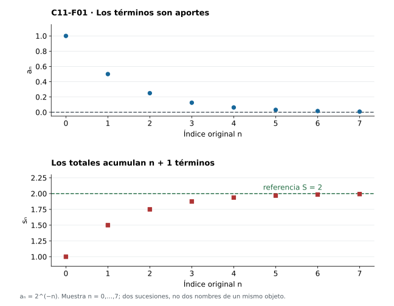
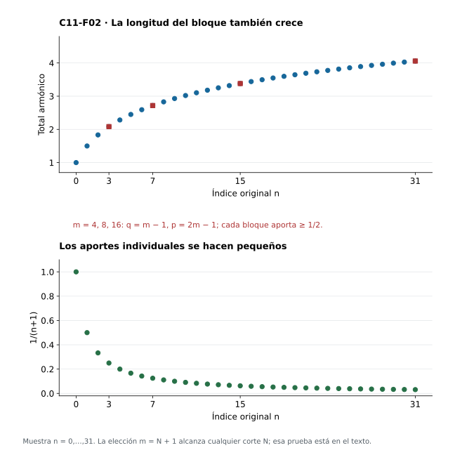
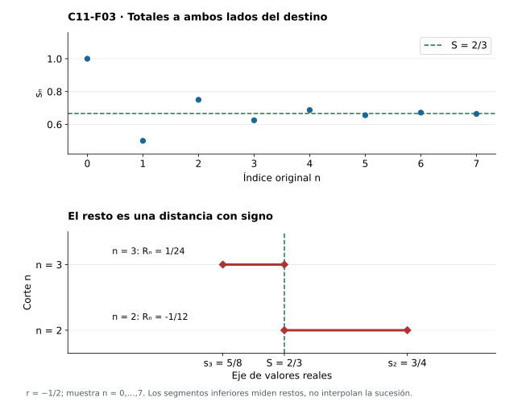
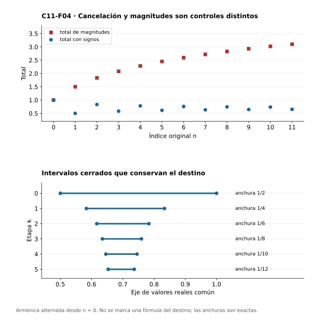
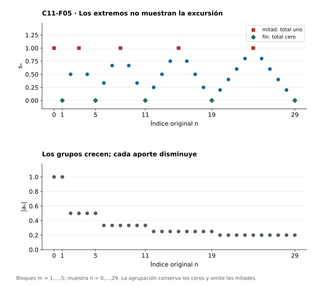
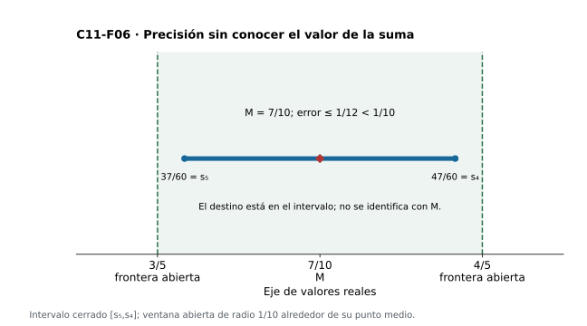

[Índice del libro](../para-matematicos/analisis-para-matematicos.html) · [Ejercicios de este capítulo](#ejercicios-11)

Una sucesión de aportes puede tender a cero y seguir acumulando cantidades apreciables. Queremos decidir cuándo el proceso de sumación tiene un destino real, qué controla los bloques que aún faltan y cómo certificar una aproximación sin conocer la suma exacta. Las sumas parciales serán el puente entre acumulación y los límites de C06 y C10.

Trabajaremos con sucesiones reales e índices desde cero. Seleccionaremos mecanismos de convergencia por lo que permiten ver: fórmulas finitas, barreras positivas, control de magnitudes, cancelación alternada y conservación de los índices al agrupar. Cada mecanismo se prueba antes de emplearlo. El objetivo es reconocer qué hipótesis convierte una intuición de acumulación en un control uniforme de toda la cola.

## 11.1. De los términos a las sumas parciales

[]{#MA-SEC-ANM-01-011-001}

Los aportes $1,1/2,1/4,\ldots$ disminuyen; los totales $1,3/2,7/4,\ldots$ aumentan. Son dos sucesiones reales diferentes. Para estudiar lo que se acumula necesitamos construir la segunda a partir de la primera y decidir después si tiene un destino real.

Dada $a:\mathbb N\to\mathbb R$, con $\mathbb N=\{0,1,2,\ldots\}$, definimos su **sucesión de sumas parciales** $s=\operatorname{PS}(a)$ mediante

$$
s_0=a_0,\qquad s_{n+1}=s_n+a_{n+1}.
$$

Cada paso suma dos reales y determina un único real; la recursión define $s$ en todos los naturales y una inducción prueba su unicidad. Escribimos $s_n=\sum_{k=0}^n a_k$: contiene $n+1$ términos, no $n$. Una suma con ningún término se toma igual a cero cuando aparezca un bloque vacío.

La **serie de términos $a$** es este proceso de sumación. Decimos que converge si $s_n\to S$ para algún $S\in\mathbb R$, y entonces llamamos a $S$ su suma y escribimos

$$
\sum_{n=0}^{\infty}a_n=S.
$$

Antes de demostrar convergencia, el símbolo de serie designa el proceso que estamos estudiando; no afirma que ya exista ese real. El límite es único por C06. Una serie divergente puede tener sumas parciales no acotadas o puede oscilar dentro de una región acotada.

**Recuperar los aportes.** La construcción conserva toda la información de $a$, pues

$$
a_0=s_0,\qquad a_{n+1}=s_{n+1}-s_n.
$$

La primera igualdad es la condición inicial; la segunda se obtiene restando $s_n$ en la recursión. Por ello $\operatorname{PS}(a)=\operatorname{PS}(b)$ implica $a=b$. En cambio, tener la misma suma real no obliga a tener los mismos términos: $(1,0,0,\ldots)$ y $(1/2,1/2,0,\ldots)$ generan procesos diferentes que convergen ambos a uno.

Para $a_n=(-1)^n$, las sumas parciales son $s_{2k}=1$ y $s_{2k+1}=0$, como se verifica por parejas. La sucesión $s$ está acotada, pero no converge: después de cualquier corte hay sumas parciales de ambos valores. Para $a_n=0$ todos los totales valen cero. Incluso cuando término y total tienen el mismo valor en un índice, siguen cumpliendo papeles distintos.

En el ejemplo inicial $a_n=2^{-n}$, una inducción en la recursión da $s_n=2-2^{-n}$. Además $2^n\ge n+1$ por inducción, luego $2^{-n}\le1/(n+1)$. Para cualquier $\varepsilon>0$, elegir $N+1>1/\varepsilon$ hace tanto $|a_n|$ como $|s_n-2|$ menores que $\varepsilon$ para $n\ge N$. Así los dos destinos mostrados quedan probados directamente, antes de desarrollar la identidad geométrica general.

{#fig-anm-c11-f01 fig-alt="Los aportes geométricos disminuyen hacia cero mientras los totales aumentan hacia dos. En el índice n se han acumulado n+1 términos: los paneles representan dos sucesiones distintas."}

La figura compara aportes y totales en el mismo índice. Leer un punto en el panel de términos no permite inferir el destino del panel de acumulación; éste es el objeto al que aplicaremos Cauchy.

### Antes de seguir

#### Microcontrol 1

[]{#MA-MIC-ANM-01-011-001}

¿Cuántos términos contiene $s_n=\sum_{k=0}^n a_k$?

[]{#MA-MSOL-ANM-01-011-001}

Ver solución del microcontrol 1

$n+1$, porque los índices van de cero a $n$ inclusive.

Escribamos los primeros casos: $s_0=a_0$ contiene un término, $s_1=a_0+a_1$ contiene dos y $s_2$ contiene tres. En general, contar los enteros desde cero hasta $n$ da $n-0+1=n+1$. El índice final identifica el último término incluido, no el número de sumandos. Esta diferencia importa al calcular un resto: lo que queda después de $s_n$ comienza en $a_{n+1}$.

#### Microcontrol 2

[]{#MA-MIC-ANM-01-011-002}

¿Cuál es el término inicial de $\operatorname{PS}(a)$?

[]{#MA-MSOL-ANM-01-011-002}

Ver solución del microcontrol 2

$s_0=a_0$; no es automáticamente cero.

La definición $s_n=\sum_{k=0}^n a_k$ se aplica también cuando $n=0$: el único índice permitido es cero. Por tanto, el primer total ya incorpora el primer aporte. El total vacío sería cero, pero corresponde a no incorporar ningún término; no es $s_0$ en esta convención. Por ejemplo, para $a_n=1/(n+1)$ tenemos $s_0=1$, lo que permite detectar inmediatamente un desplazamiento incorrecto de los índices.

#### Microcontrol 3

[]{#MA-MIC-ANM-01-011-003}

¿Qué condición permite llamar suma real a $\sum_{n=0}^{\infty}a_n$?

[]{#MA-MSOL-ANM-01-011-003}

Ver solución del microcontrol 3

Que la sucesión de sumas parciales converja a un real $S$; entonces el símbolo de suma designa ese límite único.

Primero construimos cada $s_n$ mediante una suma finita, sin asumir que exista una suma infinita. Después debemos demostrar que hay $S\in\mathbb R$ tal que, para cada $\varepsilon>0$, existe $N$ con $|s_n-S|<\varepsilon$ para todos los $n\ge N$. Sólo entonces definimos la suma de la serie como $S$. La unicidad del límite garantiza que la notación designa un único número y no depende de cuál prueba de convergencia utilicemos.

#### Microcontrol 4

[]{#MA-MIC-ANM-01-011-004}

¿Cómo se recupera $a_{n+1}$ a partir de dos totales?

[]{#MA-MSOL-ANM-01-011-004}

Ver solución del microcontrol 4

$a_{n+1}=s_{n+1}-s_n$, por la recursión.

Los totales consecutivos comparten todos los aportes iniciales:
$$s_{n+1}=a_0+\cdots+a_n+a_{n+1},\qquad s_n=a_0+\cdots+a_n.$$
Al restar, esos términos comunes se cancelan y permanece exactamente el aporte nuevo. Para recuperar toda la sucesión hay que añadir el caso inicial $a_0=s_0$; la regla de diferencias recupera los términos desde $a_1$ en adelante. Conocer todos los totales permite así reconstruir todos los aportes.

#### Microcontrol 5

[]{#MA-MIC-ANM-01-011-005}

¿Tener la misma suma implica tener los mismos términos?

[]{#MA-MSOL-ANM-01-011-005}

Ver solución del microcontrol 5

No. $(1,0,0,\ldots)$ y $(1/2,1/2,0,\ldots)$ tienen suma uno y distintos términos y procesos.

Para la primera sucesión, todos los totales son uno. Para la segunda, el primer total es $1/2$ y todos los siguientes son uno. Las dos sucesiones de totales convergen al mismo número, aunque sus primeros valores y sus términos sean diferentes. La operación de tomar el límite conserva el destino y puede perder información del recorrido. No hay contradicción con la recuperación por diferencias: ésta exige conocer todos los totales, no únicamente su límite.

#### Microcontrol 6

[]{#MA-MIC-ANM-01-011-006}

¿Qué totales produce $a_n=(-1)^n$?

[]{#MA-MSOL-ANM-01-011-006}

Ver solución del microcontrol 6

$s_{2k}=1$ y $s_{2k+1}=0$, al cancelar parejas consecutivas.

Cada pareja de aportes consecutivos vale $1+(-1)=0$. El total $s_{2k+1}$ comprende $2k+2$ términos, que forman $k+1$ parejas completas; por eso vale cero. El total $s_{2k}$ comprende $2k+1$ términos: después de cancelar $k$ parejas queda un aporte igual a uno. La distinción entre índices pares e impares deriva del número de términos incluidos y permite comprobar la fórmula también en $s_0=1$.

#### Microcontrol 7

[]{#MA-MIC-ANM-01-011-007}

¿La acotación de esos totales garantiza convergencia?

[]{#MA-MSOL-ANM-01-011-007}

Ver solución del microcontrol 7

No. Después de cualquier corte hay totales separados por uno, de modo que falla Cauchy.

Todos los totales pertenecen a $\{0,1\}$, así que están acotados. Sin embargo, fijemos $\varepsilon_0=1/2$. Después de cualquier corte $N$ podemos escoger un índice par y otro impar; sus totales difieren en uno, mayor que esa tolerancia. Ninguna cola satisface la condición de Cauchy y, en consecuencia, los totales no convergen. Acotación limita el tamaño de los valores; convergencia exige además que sus separaciones se hagan arbitrariamente pequeñas.

#### Microcontrol 8

[]{#MA-MIC-ANM-01-011-008}

¿Son $a$, $\operatorname{PS}(a)$ y su suma el mismo tipo de objeto?

[]{#MA-MSOL-ANM-01-011-008}

Ver solución del microcontrol 8

No. $a$ y $\operatorname{PS}(a)$ son funciones $\mathbb N\to\mathbb R$ con papeles diferentes; su suma, si existe, es un número real.

La sucesión $a$ registra aportes individuales, mientras $\operatorname{PS}(a)$ registra lo acumulado hasta cada índice. Ambas tienen infinitos valores organizados por $n$. En cambio, si los acumulados convergen, su suma es un solo real $S$. Por ejemplo, para $a=(1,0,0,\ldots)$, los aportes cambian al inicio, los totales son constantemente uno y la suma es el número uno. Distinguir esos objetos evita aplicar a los aportes una propiedad que sólo se ha demostrado para los totales.

### Ejercicios de la sección 11.1

[]{#ejercicios-11}

#### Ejercicio 1. Aportes y totales

[]{#MA-EX-ANM-01-011-001}

Calcula $s_0,s_1,s_2,s_3$ para $a_n=2^{-n}$. Distingue ambos objetos.

[]{#MA-SOL-ANM-01-011-001}

Ver solución del ejercicio 1

Los términos son $1,1/2,1/4,1/8$ y los totales $1,3/2,7/4,15/8$. $a$ y $s$ son sucesiones reales distintas; $s_n$ acumula $n+1$ valores de $a$.

Después del argumento, la [figura 11.1](analisis-para-matematicos-capitulo-11-series-como-laboratorio-de-convergencia.html#fig-anm-c11-f01) permite contrastar el mecanismo con el ejemplo del capítulo.

#### Ejercicio 2. Recuperar una serie

[]{#MA-EX-ANM-01-011-002}

Si se prescribe $s_n=(n+1)/(n+2)$, encuentra la única sucesión de términos que produce esos totales y decide convergencia.

[]{#MA-SOL-ANM-01-011-002}

Ver solución del ejercicio 2

$a_0=s_0=1/2$. Para $n\ge1$, $a_n=s_n-s_{n-1}=(n+1)/(n+2)-n/(n+1)=1/((n+1)(n+2))$. La recursión verifica los totales, y su recuperación demuestra unicidad. Como $s_n=1-1/(n+2)\to1$, la serie tiene suma uno. La misma fórmula también da el término inicial si se evalúa en cero.

#### Ejercicio 3. Misma suma, distinto proceso

[]{#MA-EX-ANM-01-011-003}

Construye dos sucesiones distintas de soporte finito con la misma suma y prueba que sus procesos son distintos.

[]{#MA-SOL-ANM-01-011-003}

Ver solución del ejercicio 3

Tomemos $a=(1,0,0,\ldots)$ y $b=(0,1,0,\ldots)$. Sus totales son $s_n=1$ en todo índice y $t_0=0$, $t_n=1$ para $n\ge1$. Ambas sumas valen uno, pero $a_0\ne b_0$ y $s_0\ne t_0$. Igualdad numérica de sumas no implica igualdad de funciones.

Después del argumento, la [figura 11.1](analisis-para-matematicos-capitulo-11-series-como-laboratorio-de-convergencia.html#fig-anm-c11-f01) permite contrastar el mecanismo con el ejemplo del capítulo.

#### Ejercicio 4. Una transformación reversible

[]{#MA-EX-ANM-01-011-004}

Prueba que toda sucesión real $s$ es el proceso de sumación de una única sucesión real $a$.

[]{#MA-SOL-ANM-01-011-004}

Ver solución del ejercicio 4

Definamos $a_0=s_0$ y $a_{n+1}=s_{n+1}-s_n$. Si $u=\operatorname{PS}(a)$, entonces $u_0=s_0$. Suponiendo $u_n=s_n$, la recursión da $u_{n+1}=s_n+s_{n+1}-s_n=s_{n+1}$. Inducción prueba $u=s$. Si otro $b$ produce $s$, la recuperación de §11.1 fuerza $b_0=a_0$ y $b_{n+1}=a_{n+1}$. Es una correspondencia entre sucesiones, sin exigir convergencia.

Después del argumento, la [figura 11.1](analisis-para-matematicos-capitulo-11-series-como-laboratorio-de-convergencia.html#fig-anm-c11-f01) permite contrastar el mecanismo con el ejemplo del capítulo.

#### Ejercicio 5. Totales acotados y término nulo

[]{#MA-EX-ANM-01-011-005}

Construye una serie con términos que tienden a cero y sumas parciales acotadas que no convergen.

[]{#MA-SOL-ANM-01-011-005}

Ver solución del ejercicio 5

Prescribamos bloques: para cada $m\ge1$, $m$ términos $1/m$ seguidos de $m$ términos $-1/m$. El bloque ocupa $m(m-1)\le n\le m(m+1)-1$; sus extremos consecutivos cubren todos los naturales. Los totales van de cero a uno y regresan a cero, así que están en $[0,1]$. Dada $\varepsilon>0$, tomar $M$ con $1/M<\varepsilon$ hace $|a_n|\le1/M<\varepsilon$ desde el comienzo del bloque $M$. Los totales de mitad y final de cada bloque son uno y cero en índices arbitrariamente grandes; falla Cauchy con tolerancia $1/2$.

Después del argumento, la [figura 11.5](analisis-para-matematicos-capitulo-11-series-como-laboratorio-de-convergencia.html#fig-anm-c11-f05) permite contrastar el mecanismo con el ejemplo del capítulo.

## 11.2. Cauchy mide bloques completos

[]{#MA-SEC-ANM-01-011-002}

Dos totales tardíos difieren en lo que se sumó entre sus cortes. Si $p>q$, la recursión y una inducción sobre $p-q$ dan la identidad finita

$$
s_p-s_q=\sum_{k=q+1}^{p}a_k.
$$

El bloque empieza en $q+1$ porque $a_q$ ya forma parte de $s_q$. El caso $p=q+1$ es la recursión; al prolongar el extremo superior se añade $a_{p+1}$ a ambos miembros. Esta identidad traduce la pregunta sobre dos sumas parciales a una pregunta sobre cualquier acumulación tardía.

**Criterio de Cauchy para series reales.** La serie de $a$ converge si y sólo si

$$
\forall\varepsilon>0\ \exists N\in\mathbb N\ \forall p,q\in\mathbb N:
\quad p>q\ge N\ \Longrightarrow\
\left|\sum_{k=q+1}^{p}a_k\right|<\varepsilon.
$$

Por definición, la serie converge cuando converge $s$. C10 equivale esa convergencia real a que $|s_p-s_q|<\varepsilon$ para todos $p,q\ge N$, y la identidad demuestra una dirección. Recíprocamente, si los bloques ordenados cumplen el control, los pares con $p>q$ quedan controlados; si $q>p$, intercambiamos los índices y usamos simetría del valor absoluto; si $p=q$, la distancia es cero. Así $s$ es de Cauchy y C10 aporta un destino real. La completitud se usa en esta última existencia, no en la identidad finita.

El corte se escoge antes que los dos extremos; debe funcionar para bloques de cualquier longitud. Permitir un corte distinto para cada longitud fija debilitaría el enunciado.

**Condición necesaria.** Si una serie converge, entonces $a_n\to0$. En efecto, para $n\ge N+1$, el bloque con $q=n-1$ y $p=n$ tiene un término y da $|a_n|<\varepsilon$. Este argumento muestra también la limitación: controlar bloques de longitud uno no controla todos los bloques.

La serie de $a_n=1/(n+1)$ lo muestra. Sus términos tienden a cero. Para cualquier corte $N$, pongamos $m=N+1$, $q=m-1$ y $p=2m-1$. Ambos índices están después del corte y

$$
s_{2m-1}-s_{m-1}=\sum_{j=m+1}^{2m}\frac1j\ge m\frac1{2m}=\frac12.
$$

La tolerancia fija $1/2$ contradice el criterio. La longitud del bloque crece: muchos aportes pequeños pueden acumular una cantidad que no desaparece. Esta prueba de divergencia usa sumas finitas, no un valor supuesto de una suma infinita.

{#fig-anm-c11-f02 fig-alt="Los bloques de m aportes armónicos entre los denominadores m+1 y 2m conservan suma al menos un medio. Los términos individuales se reducen, pero la longitud del bloque puede crecer."}

| m | q = m−1 | p = 2m−1 | Cota inferior exacta del bloque |
|---|---|---|---|
| 4 | 3 | 7 | ≥ $1/2$ |
| 8 | 7 | 15 | ≥ $1/2$ |
| 16 | 15 | 31 | ≥ $1/2$ |

La muestra exhibe algunos bloques; la elección $m=N+1$ prueba que existen después de todo corte. La figura por sí sola no extiende un cálculo finito a todos los índices.

### Antes de seguir

#### Microcontrol 9

[]{#MA-MIC-ANM-01-011-009}

¿Por qué el bloque $s_p-s_q$ empieza en $q+1$?

[]{#MA-MSOL-ANM-01-011-009}

Ver solución del microcontrol 9

Porque $s_q$ ya contiene $a_q$; los nuevos términos son $a_{q+1},\ldots,a_p$.

Escribimos ambas sumas antes de restarlas: $s_p=a_0+\cdots+a_q+a_{q+1}+\cdots+a_p$ y $s_q=a_0+\cdots+a_q$. El prefijo hasta $q$, incluido ese índice, desaparece. Queda $\sum_{k=q+1}^p a_k$, que tiene $p-q$ términos. Si el bloque empezara en $q$, contaríamos otra vez un aporte que ya formaba parte del total anterior. La identidad sólo involucra sumas finitas y no requiere convergencia.

#### Microcontrol 10

[]{#MA-MIC-ANM-01-011-010}

¿En qué orden se eligen tolerancia, corte y extremos de bloque?

[]{#MA-MSOL-ANM-01-011-010}

Ver solución del microcontrol 10

Primero $\varepsilon>0$, después un único $N$ que puede depender de ella, y luego todos $p>q\ge N$.

El criterio dice que, recibida una precisión, debe existir una cola en la que cualquier bloque tenga suma de valor absoluto menor que esa precisión. El corte se fija antes de escoger dónde termina el bloque. Puede depender de $\varepsilon$ y de la serie, pero debe servir para todos los $p>q\ge N$. Este orden es exactamente el que convierte el control de bloques en la condición de Cauchy de los totales.

#### Microcontrol 11

[]{#MA-MIC-ANM-01-011-011}

¿Puede el corte depender de la longitud del bloque?

[]{#MA-MSOL-ANM-01-011-011}

Ver solución del microcontrol 11

No en el criterio: debe controlar simultáneamente todas las longitudes.

Si para cada longitud se permitiera escoger un corte distinto, sólo controlaríamos por separado bloques de tamaño fijo. Eso es más débil. En la armónica, un bloque de longitud $L$ situado después de $q$ tiene suma a lo sumo $L/(q+2)$ y se hace pequeño con $q$ para cada $L$ fijo. Aun así, bloques cuya longitud crece con su posición pueden conservar una suma al menos $1/2$. El criterio exige un control simultáneo de esas longitudes arbitrarias.

#### Microcontrol 12

[]{#MA-MIC-ANM-01-011-012}

¿Cómo se cubre el caso $p=q$ al recuperar Cauchy?

[]{#MA-MSOL-ANM-01-011-012}

Ver solución del microcontrol 12

La distancia entre el mismo total y sí mismo es cero, menor que cualquier tolerancia positiva.

El criterio de bloques se enuncia para $p>q$. Para comprobar Cauchy con cualquier par tardío, quedan dos casos: si $p=q$, $|s_p-s_q|=0<\varepsilon$; si $p<q$, intercambiamos los extremos y usamos $|s_p-s_q|=|s_q-s_p|$. Así los casos no incluidos literalmente en el criterio se reducen a una identidad trivial o a la simetría. No hacen falta nuevos cortes ni nuevas hipótesis.

#### Microcontrol 13

[]{#MA-MIC-ANM-01-011-013}

¿Dónde se usa completitud en el criterio de bloques?

[]{#MA-MSOL-ANM-01-011-013}

Ver solución del microcontrol 13

En pasar de Cauchy de $s$ a existencia de un límite real, mediante C10; no en la identidad de sumas finitas.

La identidad $s_p-s_q=\sum_{k=q+1}^p a_k$ traduce una condición sobre bloques en una condición sobre distancias entre totales. Esa traducción es puramente algebraica. Una vez probado que $(s_n)$ es de Cauchy, usamos la completitud de $\mathbb R$ para obtener un límite dentro del mismo espacio. En un espacio incompleto, el control de pares seguiría teniendo sentido, pero no aseguraría que su destino exista en ese espacio.

#### Microcontrol 14

[]{#MA-MIC-ANM-01-011-014}

¿Por qué convergencia de la serie implica $a_n\to0$?

[]{#MA-MSOL-ANM-01-011-014}

Ver solución del microcontrol 14

Para $n\ge N+1$, el bloque de un término entre $n-1$ y $n$ da $|a_n|<\varepsilon$.

Dada $\varepsilon>0$, el criterio proporciona un corte $N$ válido para todos los bloques tardíos. Para $n\ge N+1$ escogemos $q=n-1$ y $p=n$, de modo que $q\ge N$. El bloque contiene únicamente $a_n$, luego $|a_n|=|s_n-s_{n-1}|<\varepsilon$. Hemos obtenido un corte para los términos, posiblemente desplazado en una unidad. Esto prueba una condición necesaria; no demuestra que el control de un solo aporte baste para todos los bloques.

#### Microcontrol 15

[]{#MA-MIC-ANM-01-011-015}

¿Qué pares de cortes niegan Cauchy en la armónica?

[]{#MA-MSOL-ANM-01-011-015}

Ver solución del microcontrol 15

Para cualquier $N$, tomar $m=N+1$, $q=m-1$ y $p=2m-1$ da una diferencia al menos $1/2$.

En la armónica indexada desde cero, $s_n=\sum_{k=0}^n1/(k+1)$. Los índices elegidos dan
$$s_{2m-1}-s_{m-1}=\sum_{j=m+1}^{2m}\frac1j\ge m\frac1{2m}=\frac12.$$
Hay exactamente $m$ sumandos y cada uno es al menos $1/(2m)$. Con $m=N+1$, ambos extremos están después del corte propuesto. La misma tolerancia $1/2$ falla para cualquier $N$, lo que verifica la negación de Cauchy con testigos explícitos.

#### Microcontrol 16

[]{#MA-MIC-ANM-01-011-016}

¿El término nulo es una condición suficiente?

[]{#MA-MSOL-ANM-01-011-016}

Ver solución del microcontrol 16

No. $1/(n+1)\to0$, pero sus bloques largos anteriores mantienen suma al menos $1/2$ después de cada corte.

Que los términos tiendan a cero sólo hace pequeños los bloques de un término. En la armónica, cada aporte $1/(n+1)$ tiende a cero, pero los bloques entre $m+1$ y $2m$ reúnen suficientes aportes para sumar al menos $1/2$. Por eso la condición necesaria no se puede invertir. Conviene comprobar primero el término nulo: si falla, la serie diverge; si se cumple, aún debemos encontrar otro argumento que controle la acumulación.

### Ejercicios de la sección 11.2

#### Ejercicio 6. Identidad de bloques

[]{#MA-EX-ANM-01-011-006}

Prueba por inducción que $s_p-s_q=\sum_{j=q+1}^pa_j$ cuando $p>q$.

[]{#MA-SOL-ANM-01-011-006}

Ver solución del ejercicio 6

Fijemos $q$. Para $p=q+1$, la recursión da la identidad. Si vale para $p$, entonces $s_{p+1}-s_q=(s_p-s_q)+a_{p+1}=\sum_{j=q+1}^{p+1}a_j$. La inducción sobre $p-q\ge1$ cubre todos los extremos; no interviene una suma infinita.

#### Ejercicio 7. La longitud no puede elegir el corte

[]{#MA-EX-ANM-01-011-007}

En la armónica $a_n=1/(n+1)$, muestra que los bloques de cualquier longitud fija tienden a cero al alejar su inicio. Explica por qué la serie diverge.

[]{#MA-SOL-ANM-01-011-007}

Ver solución del ejercicio 7

Para un natural fijo $r\ge1$, $0\le\sum_{j=q+1}^{q+r}1/(j+1)\le r/(q+2)\to0$. El corte de esta estimación depende de $r$. Cauchy exige uno solo para todas las longitudes. Tomando $q=m-1$, $p=2m-1$, se obtiene un bloque al menos $1/2$ después de cualquier corte, así que no converge.

Después del argumento, la [figura 11.2](analisis-para-matematicos-capitulo-11-series-como-laboratorio-de-convergencia.html#fig-anm-c11-f02) permite contrastar el mecanismo con el ejemplo del capítulo.

#### Ejercicio 8. Términos que no desaparecen

[]{#MA-EX-ANM-01-011-008}

Descarta convergencia de las series con términos $a_n=(-1)^n$ y $b_n=(n+1)/(n+2)$.

[]{#MA-SOL-ANM-01-011-008}

Ver solución del ejercicio 8

En la primera, $|a_n|=1$ en cada índice; en la segunda, $b_n\ge1/2$. Ninguna sucesión de términos tiende a cero, y la condición necesaria de §11.2 descarta ambas convergencias. No hace falta calcular sus totales para aplicar esa condición.

#### Ejercicio 9. Acumulación en potencias de dos

[]{#MA-EX-ANM-01-011-009}

Prueba $s_{2^m-1}\ge1+m/2$ para las sumas parciales armónicas, con $m\in\mathbb N$.

[]{#MA-SOL-ANM-01-011-009}

Ver solución del ejercicio 9

En la notación de denominadores, $s_{2^m-1}=\sum_{j=1}^{2^m}1/j$. Para cada $i=1,\ldots,m$, el bloque $j=2^{i-1}+1,\ldots,2^i$ tiene $2^{i-1}$ términos, cada uno al menos $1/2^i$, de modo que aporta al menos $1/2$. Añadiendo el término $j=1$ resulta la cota, también válida para $m=0$. Es una partición finita; prueba que los totales carecen de barrera superior.

Después del argumento, la [figura 11.2](analisis-para-matematicos-capitulo-11-series-como-laboratorio-de-convergencia.html#fig-anm-c11-f02) permite contrastar el mecanismo con el ejemplo del capítulo.

#### Ejercicio 10. Reparar una falsa prueba

[]{#MA-EX-ANM-01-011-010}

Diagnostica: «Como $a_n\to0$, cada término de un bloque tardío es menor que $\varepsilon$; por tanto su suma es menor que $\varepsilon$». Repara el argumento cuando todo bloque tiene longitud a lo sumo $M\ge1$.

[]{#MA-SOL-ANM-01-011-010}

Ver solución del ejercicio 10

Una suma de muchos términos puede exceder $\varepsilon$, y los signos tampoco autorizan ignorar magnitudes. Si la longitud está acotada por $M$, basta hacer $|a_j|<\varepsilon/M$ en la cola. La triangular finita da magnitud del bloque menor que $r\varepsilon/M\le\varepsilon$ para $1\le r\le M$; el bloque vacío vale cero. Esto controla sólo bloques de esas longitudes, no el criterio completo sin otra hipótesis.

Después del argumento, la [figura 11.2](analisis-para-matematicos-capitulo-11-series-como-laboratorio-de-convergencia.html#fig-anm-c11-f02) permite contrastar el mecanismo con el ejemplo del capítulo.

## 11.3. Fórmulas finitas y restos exactos

[]{#MA-SEC-ANM-01-011-003}

Una fórmula para el total finito puede resolver simultáneamente existencia y error. La estrategia consiste en simplificar $s_n$ antes de tomar límites; manipular una supuesta suma infinita invertiría ese orden.

Si $a_n=c_n-c_{n+1}$, una inducción cancela términos consecutivos y entrega

$$
s_n=c_0-c_{n+1}.
$$

Por C06, si $c_n\to C$, entonces la serie converge y su suma es $c_0-C$. Recíprocamente, si $s_n\to S$, la misma identidad da $c_{n+1}\to c_0-S$, y la sucesión completa $c$ tiene ese límite: un único término inicial no altera el control eventual. Cuando convergen, el **resto** en el corte $n$ es el real

$$
R_n=S-s_n=c_{n+1}-C.
$$

Por ejemplo, $a_n=1/((n+1)(n+2))=1/(n+1)-1/(n+2)$ produce $s_n=1-1/(n+2)$, suma uno y resto $1/(n+2)$. No se requiere un criterio nuevo para cada fracción: se reconoce una diferencia finita y se reutiliza un límite conocido.

Para la serie geométrica $a_n=r^n$, las potencias naturales satisfacen $r^0=1$ y $r^{n+1}=r^nr$; en particular usamos $0^0=1$ como convención de exponente cero. Al restar la suma finita multiplicada por $r$, o por inducción, obtenemos

$$
(1-r)s_n=1-r^{n+1}.
$$

Si $|r|<1$, las potencias $r^{n+1}$ tienden a cero. Para $0<\rho=|r|<1$, escribimos $\rho^{-1}=1+t$ con $t>0$; la inducción da $(1+t)^n\ge1+nt$, por lo que $\rho^n\le1/(1+nt)\to0$ por arquimedianidad. Si $r=0$, el primer término vale uno y los siguientes cero. Como $1-r\ne0$, C06 aplicado a la identidad finita demuestra

$$
S=\frac1{1-r},\qquad R_n=\frac{r^{n+1}}{1-r},\qquad
|R_n|=\frac{|r|^{n+1}}{|1-r|}.
$$

La estimación precisa usa $|1-r|$; para razones negativas puede ser mejor que reemplazarlo por $1-|r|$. La serie geométrica converge exactamente para $|r|<1$. Si $|r|\ge1$, sus términos no tienden a cero: $|r^n|\ge1$ en cada índice, y la condición necesaria de §11.2 descarta convergencia. Esto incluye $r=1$ y $r=-1$ sin dividir por cero.

{#fig-anm-c11-f03 fig-alt="La geométrica de razón menos un medio alterna sus totales alrededor de dos tercios. La identidad finita determina el resto con signo, no sólo una cota de su magnitud."}

Para $r=-1/2$, el total alterna alrededor de $2/3$ y su error exacto es $(2/3)2^{-(n+1)}$. El valor numérico del destino aparece después de la identidad y de la prueba del límite de las potencias.

### Antes de seguir

#### Microcontrol 17

[]{#MA-MIC-ANM-01-011-017}

¿Qué total produce $a_n=c_n-c_{n+1}$?

[]{#MA-MSOL-ANM-01-011-017}

Ver solución del microcontrol 17

$s_n=c_0-c_{n+1}$ por cancelación finita, demostrable por inducción.

La suma finita es $(c_0-c_1)+(c_1-c_2)+\cdots+(c_n-c_{n+1})$. Cada término interior aparece una vez con signo positivo y otra con signo negativo. Sólo sobreviven $c_0$ y $-c_{n+1}$. También podemos verificarlo por inducción: para $n=0$ es la definición; al añadir $c_{n+1}-c_{n+2}$ a $c_0-c_{n+1}$ obtenemos $c_0-c_{n+2}$. La cancelación ocurre antes de tomar cualquier límite.

#### Microcontrol 18

[]{#MA-MIC-ANM-01-011-018}

¿Cuál es el resto telescópico si $c_n\to C$?

[]{#MA-MSOL-ANM-01-011-018}

Ver solución del microcontrol 18

La suma es $c_0-C$ y $R_n=c_{n+1}-C$.

De la identidad finita $s_n=c_0-c_{n+1}$ y de $c_{n+1}\to C$ obtenemos $s_n\to c_0-C$. Definido $S=c_0-C$, restamos el total conocido:
$$R_n=S-s_n=(c_0-C)-(c_0-c_{n+1})=c_{n+1}-C.$$
El resto conserva el signo de esa diferencia y su magnitud es $|c_{n+1}-C|$. La fórmula no presupone que $c_n$ sea positivo ni que se aproxime a $C$ desde un lado determinado.

#### Microcontrol 19

[]{#MA-MIC-ANM-01-011-019}

¿Cuál es la suma de $1/((n+1)(n+2))$?

[]{#MA-MSOL-ANM-01-011-019}

Ver solución del microcontrol 19

Uno: $s_n=1-1/(n+2)\to1$.

Descomponemos cada aporte mediante
$$\frac1{(n+1)(n+2)}=\frac1{n+1}-\frac1{n+2}.$$
Es una telescópica con $c_n=1/(n+1)$, $c_0=1$ y $c_n\to0$. La suma parcial vale $1-1/(n+2)$, de modo que la suma es uno y el resto exacto es $1/(n+2)$. Para garantizar error menor que $\varepsilon$, basta escoger un índice con $n+2>1/\varepsilon$. Así la identidad da tanto el destino como un certificado de aproximación.

#### Microcontrol 20

[]{#MA-MIC-ANM-01-011-020}

¿Qué identidad geométrica es válida antes de cualquier límite?

[]{#MA-MSOL-ANM-01-011-020}

Ver solución del microcontrol 20

$(1-r)\sum_{k=0}^nr^k=1-r^{n+1}$, para todo real $r$ y natural $n$.

Si $G_n=1+r+\cdots+r^n$, entonces $rG_n=r+r^2+\cdots+r^{n+1}$. Restar estas dos sumas cancela todos los términos interiores y da $G_n-rG_n=1-r^{n+1}$. La identidad vale incluso para $r=1$, donde ambos miembros son cero. Lo que requiere $r\ne1$ es el paso adicional de dividir por $1-r$. Separar identidad y división evita atribuir a una fórmula condiciones que pertenecen sólo a un paso posterior.

#### Microcontrol 21

[]{#MA-MIC-ANM-01-011-021}

¿Para qué razones reales converge la geométrica?

[]{#MA-MSOL-ANM-01-011-021}

Ver solución del microcontrol 21

Exactamente para $|r|<1$; fuera de ese intervalo los términos no tienden a cero.

Si $|r|<1$, las potencias $r^{n+1}$ tienden a cero y la fórmula finita da $s_n=(1-r^{n+1})/(1-r)\to1/(1-r)$. Si $|r|\ge1$, en cambio, $|r^n|\ge1$ para todos los índices, de modo que los aportes no tienden a cero. La condición necesaria ya excluye la convergencia. Esto incluye los dos extremos: $r=1$ acumula unos y $r=-1$ produce totales alternados.

#### Microcontrol 22

[]{#MA-MIC-ANM-01-011-022}

¿Qué ocurre con la geométrica de razón cero?

[]{#MA-MSOL-ANM-01-011-022}

Ver solución del microcontrol 22

Con $r^0=1$, sus términos son uno y luego ceros, así que su suma es uno.

La convención de potencias fija $r^0=1$ para cualquier base de esta serie; para la razón cero, todos los términos con exponente positivo son cero. Por eso $s_n=1$ para cada $n$, y no hay error al aproximar su suma con ningún total. El caso merece comprobarse directamente porque algunas estimaciones posteriores usan cocientes o logaritmos que no tienen sentido con base cero, aunque la serie misma sea perfectamente válida.

#### Microcontrol 23

[]{#MA-MIC-ANM-01-011-023}

¿Cuál es el resto exacto cuando $|r|<1$?

[]{#MA-MSOL-ANM-01-011-023}

Ver solución del microcontrol 23

$R_n=r^{n+1}/(1-r)$, después de probar $S=1/(1-r)$.

Primero obtenemos el límite $S=1/(1-r)$ usando $|r|<1$. Después restamos la fórmula del total:
$$S-s_n=\frac1{1-r}-\frac{1-r^{n+1}}{1-r}=\frac{r^{n+1}}{1-r}.$$
Por tanto $|R_n|=|r|^{n+1}/|1-r|$. Como $1-r>0$ en el intervalo considerado, el signo del resto es el de $r^{n+1}$; para una razón negativa puede alternar. No conviene sustituir sin justificación el resto firmado por su magnitud.

#### Microcontrol 24

[]{#MA-MIC-ANM-01-011-024}

¿Es correcto dividir por $1-r$ para estudiar $r=1$?

[]{#MA-MSOL-ANM-01-011-024}

Ver solución del microcontrol 24

No. Para $r=1$, $s_n=n+1$ y la condición del término nulo ya descarta convergencia.

Cuando $r=1$, el denominador $1-r$ es cero, por lo que la fórmula obtenida mediante división no puede usarse. El cálculo directo resulta sencillo: se suman $n+1$ aportes iguales a uno y $s_n=n+1$. Además, la sucesión de aportes es constantemente uno y no tiende a cero. Cualquiera de esos argumentos excluye una suma real finita; la identidad sin dividir permanece válida, pero sólo expresa $0=0$.

### Ejercicios de la sección 11.3

#### Ejercicio 11. Telescopaje y corte

[]{#MA-EX-ANM-01-011-011}

Para $a_n=1/((n+1)(n+2))$, calcula el total, suma y resto; encuentra un corte que garantice error menor que $1/100$.

[]{#MA-SOL-ANM-01-011-011}

Ver solución del ejercicio 11

La descomposición $a_n=1/(n+1)-1/(n+2)$ da $s_n=1-1/(n+2)$. La suma es uno y el resto $1/(n+2)$. Error estrictamente menor que $1/100$ equivale a $n+2>100$; basta $n=99$ y todos los cortes posteriores. $n=98$ sólo da igualdad con la tolerancia.

Después del argumento, la [figura 11.3](analisis-para-matematicos-capitulo-11-series-como-laboratorio-de-convergencia.html#fig-anm-c11-f03) permite contrastar el mecanismo con el ejemplo del capítulo.

#### Ejercicio 12. Razón negativa

[]{#MA-EX-ANM-01-011-012}

Calcula la suma y resto de la geométrica $r=-1/2$. Encuentra un corte que certifique error menor que $1/100$.

[]{#MA-SOL-ANM-01-011-012}

Ver solución del ejercicio 12

Por §11.3, $S=2/3$ y $R_n=(2/3)(-1/2)^{n+1}$. Su magnitud es $1/(3\cdot2^n)$. Para $n=6$ vale $1/192<1/100$, y para $n=5$ vale $1/96>1/100$; por ello seis es el primer corte suficiente en la cota exacta. Hasta él se suman siete términos.

Después del argumento, la [figura 11.3](analisis-para-matematicos-capitulo-11-series-como-laboratorio-de-convergencia.html#fig-anm-c11-f03) permite contrastar el mecanismo con el ejemplo del capítulo.

#### Ejercicio 13. Todos los casos geométricos

[]{#MA-EX-ANM-01-011-013}

Clasifica la convergencia de $\sum r^n$ para todos los reales $r$, incluyendo cero y ambos extremos.

[]{#MA-SOL-ANM-01-011-013}

Ver solución del ejercicio 13

Si $|r|<1$, la identidad finita y $r^{n+1}\to0$ dan suma $1/(1-r)$. En cero se usa $r^0=1$: suma uno. Para $|r|\ge1$, $|r^n|\ge1$, por lo que falla el término nulo. En particular $r=1$ tiene totales $n+1$, y $r=-1$ totales uno/cero; ambas divergen.

Después del argumento, la [figura 11.3](analisis-para-matematicos-capitulo-11-series-como-laboratorio-de-convergencia.html#fig-anm-c11-f03) permite contrastar el mecanismo con el ejemplo del capítulo.

#### Ejercicio 14. La diferencia puede sumar sin magnitudes

[]{#MA-EX-ANM-01-011-014}

Para $c_n=(-1)^n/(n+1)$, prueba convergencia de la serie $a_n=c_n-c_{n+1}$ y decide si la serie de magnitudes $|a_n|$ converge.

[]{#MA-SOL-ANM-01-011-014}

Ver solución del ejercicio 14

$c_n\to0$, así que por telescopaje $s_n=1-c_{n+1}\to1$. Además $a_n=(-1)^n[1/(n+1)+1/(n+2)]$, luego $|a_n|\ge1/(n+1)$. Si sus magnitudes tuvieran totales acotados, los armónicos quedarían acotados por comparación finita, contradiciendo 11.9. La serie original converge y la de magnitudes diverge. La prueba sólo usa telescopaje y la acumulación armónica ya establecida; no necesita el criterio alternado ni el de convergencia absoluta.

#### Ejercicio 15. Telescopar no crea destino

[]{#MA-EX-ANM-01-011-015}

Sea $a_n=c_n-c_{n+1}$. Prueba que su serie converge si y sólo si $c_n$ converge, y relaciona ambos límites.

[]{#MA-SOL-ANM-01-011-015}

Ver solución del ejercicio 15

Siempre $s_n=c_0-c_{n+1}$. Si $c_n\to C$, la serie tiene suma $c_0-C$. Si $s_n\to S$, entonces $c_{n+1}=c_0-s_n\to c_0-S$; para $n\ge1$ se traslada el corte en una unidad, y el término $c_0$ no afecta el límite. Así $c_n\to c_0-S$. El telescopaje proporciona una equivalencia, no convergencia automática.

## 11.4. Acumulación positiva y barreras

[]{#MA-SEC-ANM-01-011-004}

Cuando $a_n\ge0$, cada nuevo aporte mueve el total hacia la derecha: $s_{n+1}-s_n=a_{n+1}\ge0$. El control de cancelaciones desaparece y la cuestión se reduce a encontrar una barrera superior para todos los totales.

**Barrera positiva.** Una serie de términos no negativos converge si y sólo si sus sumas parciales están acotadas superiormente. La necesidad se sigue de C06. Para probar suficiencia desde las bases de completitud, sea

$$
S=\sup\{s_n:n\in\mathbb N\}.
$$

El conjunto es no vacío y tiene cota superior por hipótesis, de modo que el supremo real existe por C03, la base de completitud heredada en C10. Dada $\varepsilon>0$, $S-\varepsilon$ no puede ser cota superior: existe $N$ con $S-\varepsilon<s_N\le S$. La no negatividad asegura que para todo $n\ge N$, $s_N\le s_n\le S$, luego $|S-s_n|<\varepsilon$. Hemos reconstruido el mecanismo de monotonía y barrera sin necesitar importar otro criterio de series.

Si los totales no tienen cota superior, exceden finalmente cualquier real $M$: existe $N$ con $s_N>M$, y todos los posteriores son mayores que $M$. Esta es una descripción de divergencia hacia arriba; no asigna a la serie una suma real llamada infinito.

**Comparación directa.** Si $0\le a_n\le b_n$ en todos los índices y la serie de $b$ converge, entonces la de $a$ también converge y sus sumas cumplen $0\le S_a\le S_b$. Las desigualdades se conservan al sumar finitamente, de modo que $0\le s_n\le t_n\le S_b$. La barrera positiva aporta $S_a$ y C06 conserva el orden al pasar al límite. También podemos comparar desde un índice fijo: se aplica el mismo argumento a las colas reindexadas, dejando el prefijo como una suma real finita. En ese caso, la desigualdad entre sumas completas requiere considerar sus prefijos y no se afirma automáticamente.

El ejemplo $a_n=1/(n+2)^2$ queda dominado por

$$
0\le\frac1{(n+2)^2}\le\frac1{(n+1)(n+2)}.
$$

La serie de la derecha tiene suma uno por §11.3, así que $\sum a_n$ converge con suma entre cero y uno. Incluso su resto se controla: para $p>n$ sumamos la comparación sólo en el bloque $n+1,\ldots,p$ y luego tomamos $p\to\infty$. El telescopaje entrega

$$
0\le S_a-s_n\le\frac1{n+2}.
$$

Encontrar una barrera puede probar existencia sin calcular el valor exacto del destino. El bloque posterior da además un certificado de error.

### Antes de seguir

#### Microcontrol 25

[]{#MA-MIC-ANM-01-011-025}

¿Qué hipótesis hace crecientes las sumas parciales?

[]{#MA-MSOL-ANM-01-011-025}

Ver solución del microcontrol 25

$a_n\ge0$: el incremento $s_{n+1}-s_n=a_{n+1}$ es no negativo.

Para todo $n$, el paso de $s_n$ a $s_{n+1}$ añade exactamente $a_{n+1}$. Si ese aporte es no negativo, el nuevo total no puede ser menor que el anterior. Se obtiene $s_n\le s_{n+1}$, que significa crecimiento en sentido no estricto: un aporte cero puede dejar el total igual. La hipótesis para todos los términos es la formulación habitual de una serie no negativa; el aporte inicial fija el punto de partida.

#### Microcontrol 26

[]{#MA-MIC-ANM-01-011-026}

¿Qué cota basta para una serie no negativa?

[]{#MA-MSOL-ANM-01-011-026}

Ver solución del microcontrol 26

Una cota superior real común a todas sus sumas parciales.

No necesitamos conocer la suma ni encontrar una cota óptima. Basta exhibir un real $B$ con $s_n\le B$ para cada $n$. Los aportes no negativos hacen creciente la sucesión de totales, y el teorema de convergencia monótona garantiza entonces un límite real. La cota debe controlar los acumulados: acotar cada aporte por separado no basta, como muestra la serie de unos, cuyos términos están acotados y cuyos totales crecen sin límite.

#### Microcontrol 27

[]{#MA-MIC-ANM-01-011-027}

¿Qué conjunto se usa para construir el destino por supremo?

[]{#MA-MSOL-ANM-01-011-027}

Ver solución del microcontrol 27

$\{s_n:n\in\mathbb N\}$, no vacío y acotado superiormente.

Tomamos el conjunto de valores efectivamente alcanzados por los totales. Contiene $s_0$, así que no es vacío; la cota común $B$ garantiza que está acotado superiormente. La completitud permite definir $S=\sup\{s_n:n\in\mathbb N\}$. Elegir el conjunto de aportes $\{a_n\}$ respondería a otra pregunta: su supremo controla el tamaño individual, no lo acumulado. El destino se construye como la menor barrera de los totales.

#### Microcontrol 28

[]{#MA-MIC-ANM-01-011-028}

¿Cómo se encuentra un total cercano por debajo del supremo?

[]{#MA-MSOL-ANM-01-011-028}

Ver solución del microcontrol 28

$S-\varepsilon$ no es cota superior, por lo que existe $N$ con $s_N>S-\varepsilon$.

Como $\varepsilon>0$, tenemos $S-\varepsilon<S$. Si todos los totales fueran menores o iguales que $S-\varepsilon$, éste sería una cota superior más pequeña que el supremo, contradicción. Por eso algún total $s_N$ supera esa barrera. A la vez $s_N\le S$, pues $S$ sí es cota superior. Obtenemos así un primer total dentro de la franja $(S-\varepsilon,S]$, sin asumir previamente la convergencia.

#### Microcontrol 29

[]{#MA-MIC-ANM-01-011-029}

¿Por qué todos los totales posteriores siguen cerca?

[]{#MA-MSOL-ANM-01-011-029}

Ver solución del microcontrol 29

La no negatividad da $s_N\le s_n\le S$ para $n\ge N$.

La monotonía garantiza que, una vez alcanzada la franja, los totales posteriores no retroceden: $s_n\ge s_N>S-\varepsilon$. La propiedad de cota superior impide que sobrepasen $S$. Combinando ambas,
$$S-\varepsilon<s_n\le S\quad(n\ge N),$$
de donde $|S-s_n|=S-s_n<\varepsilon$. La prueba necesita los dos controles: acercarse una vez a la barrera no bastaría si luego los totales pudieran volver a alejarse.

#### Microcontrol 30

[]{#MA-MIC-ANM-01-011-030}

¿Qué conclusión da $0\le a_n\le b_n$ si la serie de $b$ converge?

[]{#MA-MSOL-ANM-01-011-030}

Ver solución del microcontrol 30

La serie de $a$ converge y $0\le S_a\le S_b$ si la comparación vale desde el inicio.

Sumando la comparación término a término obtenemos $0\le s_n^a\le s_n^b$. Como la serie de $b$ tiene aportes no negativos y converge a $S_b$, todos sus totales son menores o iguales que $S_b$. Ésta es una cota común para los totales de $a$, que también son crecientes. Por convergencia monótona existe $S_a$; al pasar al límite en las desigualdades queda $0\le S_a\le S_b$.

#### Microcontrol 31

[]{#MA-MIC-ANM-01-011-031}

¿Una comparación eventual conserva automáticamente el orden de sumas completas?

[]{#MA-MSOL-ANM-01-011-031}

Ver solución del microcontrol 31

No. Los prefijos pueden modificar esas sumas; la comparación garantiza convergencia de las colas.

La comparación de colas no controla lo añadido antes del corte. Por ejemplo, $a=(100,0,0,\ldots)$ y $b=(0,0,0,\ldots)$ cumplen $0\le a_n\le b_n$ para $n\ge1$, pero sus sumas son cien y cero. Ambas convergen, aunque el orden de las sumas completas se invierte. El argumento eventual permite demostrar convergencia de las colas y luego añadir un prefijo finito; para comparar sumas completas hay que incluir explícitamente ese prefijo.

#### Microcontrol 32

[]{#MA-MIC-ANM-01-011-032}

¿Qué resto garantiza la comparación para $a_n=1/(n+2)^2$?

[]{#MA-MSOL-ANM-01-011-032}

Ver solución del microcontrol 32

$0\le S_a-s_n\le1/(n+2)$, comparando el bloque posterior con la serie telescópica.

Para $k\ge0$ tenemos $1/(k+2)^2\le1/((k+1)(k+2))$. Si $p>n$, al sumar sólo el bloque posterior resulta
$$0\le s_p-s_n\le\sum_{k=n+1}^p\left(\frac1{k+1}-\frac1{k+2}\right)=\frac1{n+2}-\frac1{p+2}.$$
La comparación prueba primero la convergencia de la serie no negativa. Después dejamos $p\to\infty$ y obtenemos la cota del resto $0\le S_a-s_n\le1/(n+2)$. La cota no afirma un valor exacto de la suma.

### Ejercicios de la sección 11.4

#### Ejercicio 16. Dónde se usa la barrera

[]{#MA-EX-ANM-01-011-016}

Reconstruye desde el supremo la convergencia de una serie no negativa con totales acotados superiormente.

[]{#MA-SOL-ANM-01-011-016}

Ver solución del ejercicio 16

Sea $S=\sup\{s_n\}$, real por no vacuidad y cota. Dada $\varepsilon>0$, existe $N$ con $s_N>S-\varepsilon$ por optimalidad del supremo. La no negatividad hace $s_N\le s_n\le S$ para todo $n\ge N$, así que $|s_n-S|<\varepsilon$. Completitud construye $S$ y el signo mantiene cerca toda la cola.

#### Ejercicio 17. Comparar y estimar

[]{#MA-EX-ANM-01-011-017}

Prueba convergencia de $\sum1/(n+2)^2$ y una cota de resto usando el telescopaje de §11.3.

[]{#MA-SOL-ANM-01-011-017}

Ver solución del ejercicio 17

Para todo $n$, $0\le1/(n+2)^2\le1/((n+1)(n+2))$. Sus totales están entre cero y los telescópicos, por tanto entre cero y uno. La barrera positiva prueba existencia de $S$. Para $p>n$, comparar sólo la cola da $0\le s_p-s_n\le1/(n+2)-1/(p+2)$. Al tomar $p\to\infty$, $0\le S-s_n\le1/(n+2)$.

#### Ejercicio 18. Comparación eventual

[]{#MA-EX-ANM-01-011-018}

Sea $a_0=100$ y $a_n=2^{-n}$ para $n\ge1$, y sea $b_n=2^{-n}$ en todos los índices. Compara las convergencias y las sumas.

[]{#MA-SOL-ANM-01-011-018}

Ver solución del ejercicio 18

Coinciden desde uno y difieren en $a_0-b_0=99$. La geométrica de $b$ tiene suma dos, así que los totales de $a$ son los de $b$ más 99 y su suma es 101. La comparación eventual no da $S_a\le S_b$; conserva convergencia pero debe incorporar el prefijo.

#### Ejercicio 19. Una barrera para series con signos

[]{#MA-EX-ANM-01-011-019}

Explica por qué la prueba positiva no se aplica a una serie arbitraria cuyas sumas parciales son acotadas superiormente; aporta un contraejemplo.

[]{#MA-SOL-ANM-01-011-019}

Ver solución del ejercicio 19

El supremo puede existir, pero tras encontrar un total cercano no sabemos que los posteriores sean mayores. Para $a_n=(-1)^n$, el supremo de los totales es uno y éstos alternan uno/cero; no se conserva cercanía al supremo. Falta la no negatividad de los incrementos.

Después del argumento, la [figura 11.1](analisis-para-matematicos-capitulo-11-series-como-laboratorio-de-convergencia.html#fig-anm-c11-f01) permite contrastar el mecanismo con el ejemplo del capítulo.

#### Ejercicio 20. Barrera sin fórmula de suma

[]{#MA-EX-ANM-01-011-020}

Para cualquier sucesión $0\le\theta_n\le1$, prueba convergencia de $a_n=\theta_n/((n+1)(n+2))$ y estima su resto sin identificar su suma.

[]{#MA-SOL-ANM-01-011-020}

Ver solución del ejercicio 20

La comparación finita con $b_n=1/((n+1)(n+2))$ acota todos los totales por uno y prueba convergencia por §11.4. Comparando bloques y tomando el límite del extremo posterior resulta $0\le S-s_n\le1/(n+2)$. Se conserva uniformidad en la elección de $\theta$, pero no se afirma que las diferentes sucesiones tengan la misma suma.

Después del argumento, la [figura 11.1](analisis-para-matematicos-capitulo-11-series-como-laboratorio-de-convergencia.html#fig-anm-c11-f01) permite contrastar el mecanismo con el ejemplo del capítulo.

## 11.5. Control absoluto de la acumulación

[]{#MA-SEC-ANM-01-011-005}

Con signos variables, una cota superior de $s_n$ no impide que los totales bajen u oscilen. Un control más fuerte suma las magnitudes y, mediante la desigualdad triangular, protege cualquier bloque independientemente de sus cancelaciones.

La serie de $a$ **converge absolutamente** cuando converge la serie de $|a_n|$. Si la original converge y la de magnitudes diverge, la convergencia es **condicional**. Este segundo término sólo se aplica cuando existe la suma de la original.

Escribamos $u_n=\sum_{k=0}^n|a_k|$. Una inducción basada en la desigualdad triangular prueba

$$
|s_n|\le u_n,\qquad
|s_p-s_q|\le u_p-u_q=\sum_{k=q+1}^p|a_k|\quad(p>q).
$$

En la inducción del bloque, añadir el siguiente término aumenta el lado derecho en su magnitud; el caso inicial de un término es igualdad. Estas estimaciones son finitas y no suponen convergencia.

**La convergencia absoluta implica convergencia.** Si $u_n\to A$, Cauchy aplicado a $u$ proporciona, para cada $\varepsilon>0$, un único corte que controla todos sus bloques. Como $u$ crece, $u_p-u_q=|u_p-u_q|<\varepsilon$ después de ese corte. La estimación anterior controla entonces $|s_p-s_q|$, y C10 garantiza $s_n\to S\in\mathbb R$. Completitud aparece en esa garantía de destino. Tomando límites en $|s_n|\le u_n$, mediante $||s_n|-|S||\le|s_n-S|$ y el orden de C06, resulta $|S|\le A$.

Hay una versión de error más útil que la desigualdad global. Fijado $n$, en todos los bloques posteriores $|s_p-s_n|\le u_p-u_n$; al tomar $p\to\infty$ obtenemos

$$
|R_n|=|S-s_n|\le A-u_n.
$$

Si $|a_n|\le C\rho^n$ con $C\ge0$ y $0<\rho<1$, la comparación de magnitudes con la geométrica prueba convergencia absoluta y

$$
|R_n|\le\frac{C\rho^{n+1}}{1-\rho}.
$$

Para $C=0$, todos los términos son cero. Para $C>0$, se escoge el corte usando el límite de $\rho^n$ ya probado; el número de términos sumados hasta $n$ sigue siendo $n+1$. Los signos pueden depender arbitrariamente del índice porque el control absoluto trabaja antes de toda cancelación.

La serie $a_n=(-1)^n$ muestra que acotación de $s$ no basta. La afirmación recíproca, que toda serie convergente sea absoluta, requiere otro examen: el próximo mecanismo conservará cancelaciones y permitirá un ejemplo condicional.

### Antes de seguir

#### Microcontrol 33

[]{#MA-MIC-ANM-01-011-033}

¿Qué significa convergencia absoluta?

[]{#MA-MSOL-ANM-01-011-033}

Ver solución del microcontrol 33

Que converge la serie de términos $|a_n|$.

Construimos los nuevos totales $u_n=\sum_{k=0}^n|a_k|$. Convergencia absoluta significa que esos totales tienen un límite real finito $A$. No significa simplemente que los aportes estén acotados ni que $|a_n|\to0$. Al sustituir cada aporte por su magnitud desaparecen las cancelaciones de signos; el criterio exige que incluso esa acumulación sin compensaciones permanezca controlada. Por eso proporciona un control más fuerte que la convergencia de la serie original.

#### Microcontrol 34

[]{#MA-MIC-ANM-01-011-034}

¿Qué condición adicional exige llamar condicional a una convergencia?

[]{#MA-MSOL-ANM-01-011-034}

Ver solución del microcontrol 34

La original converge, mientras la serie de magnitudes diverge.

Hay dos obligaciones distintas: probar que los totales originales convergen y probar que los totales de magnitudes no convergen a un real finito. No basta demostrar la segunda, porque la serie original podría divergir también. La armónica alternada cumple ambas: el criterio de alternancia proporciona una suma, mientras sus magnitudes forman la armónica divergente. Si convergen las magnitudes, la convergencia es absoluta; si sólo converge la original, es condicional.

#### Microcontrol 35

[]{#MA-MIC-ANM-01-011-035}

¿Qué desigualdad domina un bloque con signos?

[]{#MA-MSOL-ANM-01-011-035}

Ver solución del microcontrol 35

$|\sum_{k=q+1}^pa_k|\le\sum_{k=q+1}^p|a_k|$ por triangular finita.

La desigualdad triangular para dos sumandos se extiende por inducción a cualquier suma finita: al incorporar un aporte nuevo, $|B+a_k|\le|B|+|a_k|$. Aplicándola al bloque completo obtenemos la cota por su suma de magnitudes. El lado izquierdo permite cancelaciones; el derecho mide todo lo acumulado sin cancelarlas. Ésta es una estimación válida antes de conocer la existencia de cualquiera de las dos sumas infinitas.

#### Microcontrol 36

[]{#MA-MIC-ANM-01-011-036}

¿Por qué un corte para las magnitudes sirve para la original?

[]{#MA-MSOL-ANM-01-011-036}

Ver solución del microcontrol 36

La suma del bloque de magnitudes es no negativa y domina la distancia de los totales originales; el mismo corte prueba Cauchy.

La convergencia de $u_n=\sum_{k=0}^n|a_k|$ asegura que es de Cauchy. Dada $\varepsilon>0$, elegimos $N$ con $u_p-u_q<\varepsilon$ para $p>q\ge N$. La triangular finita da
$$|s_p-s_q|\le\sum_{k=q+1}^p|a_k|=u_p-u_q<\varepsilon.$$
El mismo corte controla todos los bloques originales. Cauchy y la completitud de los reales proporcionan entonces su suma, incluso si sus aportes cambian arbitrariamente de signo.

#### Microcontrol 37

[]{#MA-MIC-ANM-01-011-037}

¿Se necesita sumar primero la original para aplicar control absoluto?

[]{#MA-MSOL-ANM-01-011-037}

Ver solución del microcontrol 37

No. Se dominan bloques finitos y se obtiene existencia del límite mediante C10.

Asumir de entrada que existe $S$ para demostrar la convergencia sería circular. La prueba trabaja primero con $s_p-s_q$, que siempre está definido porque ambos son sumas finitas. La comparación con bloques de magnitudes hace de Cauchy a la sucesión $s$. Sólo al final invocamos la completitud para obtener un límite $S$. Este orden permite usar el criterio precisamente cuando todavía desconocemos el destino y quizá no podamos calcularlo explícitamente.

#### Microcontrol 38

[]{#MA-MIC-ANM-01-011-038}

¿Qué relación hay entre las sumas $S$ y $A$ de la original y las magnitudes?

[]{#MA-MSOL-ANM-01-011-038}

Ver solución del microcontrol 38

$|S|\le A$, al pasar al límite en $|s_n|\le u_n$.

Para cada $n$, la triangular finita proporciona $|s_n|\le u_n$. Ya sabemos que $s_n\to S$ y $u_n\to A$. La triangular inversa implica $\bigl||s_n|-|S|\bigr|\le|s_n-S|$, de modo que $|s_n|\to|S|$. Al pasar al límite, el orden conserva la desigualdad no estricta y da $|S|\le A$. Puede haber desigualdad estricta porque los aportes con signos opuestos pueden compensarse.

#### Microcontrol 39

[]{#MA-MIC-ANM-01-011-039}

¿Qué cota de error proporciona $u_n\to A$?

[]{#MA-MSOL-ANM-01-011-039}

Ver solución del microcontrol 39

$|S-s_n|\le A-u_n$, tomando el límite del extremo posterior del bloque.

Fijemos $n$ y dejemos variable el extremo posterior $p>n$. La estimación finita dice $|s_p-s_n|\le u_p-u_n$. Cuando $p\to\infty$, el miembro izquierdo tiende a $|S-s_n|$ y el derecho a $A-u_n$. El orden pasa al límite y conserva la cota. La cantidad $A-u_n$ es no negativa y tiende a cero, por lo que sirve como presupuesto de error para aproximar la suma original, independientemente de sus signos.

#### Microcontrol 40

[]{#MA-MIC-ANM-01-011-040}

¿Qué error asegura $|a_n|\le C\rho^n$ con $0<\rho<1$?

[]{#MA-MSOL-ANM-01-011-040}

Ver solución del microcontrol 40

$|S-s_n|\le C\rho^{n+1}/(1-\rho)$; para $C=0$ el error es cero.

La hipótesis presupone $C\ge0$. Para $p>n$, comparamos el bloque de magnitudes con una suma geométrica finita y obtenemos
$$\sum_{k=n+1}^p|a_k|\le C\sum_{k=n+1}^p\rho^k\le\frac{C\rho^{n+1}}{1-\rho}.$$
La misma comparación demuestra convergencia absoluta. Al pasar al límite posterior, la cota domina el resto. Para un error estrictamente menor que $\varepsilon$, escogemos $n$ haciendo esa expresión menor que $\varepsilon$; si $C=0$, todos los aportes son cero.

### Ejercicios de la sección 11.5

#### Ejercicio 21. Triangular finita

[]{#MA-EX-ANM-01-011-021}

Prueba la desigualdad $|\sum_{j=q+1}^pa_j|\le\sum_{j=q+1}^p|a_j|$ sin suponer convergencia.

[]{#MA-SOL-ANM-01-011-021}

Ver solución del ejercicio 21

Para longitud uno es igualdad. Si vale hasta $p$, la triangular da $|\sum_{j=q+1}^{p+1}a_j|\le|\sum_{j=q+1}^pa_j|+|a_{p+1}|\le\sum_{j=q+1}^{p+1}|a_j|$. Inducción sobre la longitud cubre todos los bloques finitos.

#### Ejercicio 22. Signos libres

[]{#MA-EX-ANM-01-011-022}

Sea $\sigma_n\in\{-1,1\}$ en cada índice. Prueba convergencia absoluta de $a_n=\sigma_n2^{-n}$ y estima el resto.

[]{#MA-SOL-ANM-01-011-022}

Ver solución del ejercicio 22

Las magnitudes son $2^{-n}$ y su serie geométrica tiene suma dos. Por §11.5, la original converge absolutamente. La cola de magnitudes posterior a $n$ tiene suma $2^{-n}$, por tanto $|S-s_n|\le2^{-n}$. La estimación es independiente de cómo cambian los signos.

Después del argumento, la [figura 11.4](analisis-para-matematicos-capitulo-11-series-como-laboratorio-de-convergencia.html#fig-anm-c11-f04) permite contrastar el mecanismo con el ejemplo del capítulo.

#### Ejercicio 23. Orden de las hipótesis

[]{#MA-EX-ANM-01-011-023}

Diagnostica: «Como $|s_n|\le u_n$ y $u_n$ converge, $s_n$ converge». Escribe una prueba correcta de convergencia absoluta implica convergencia.

[]{#MA-SOL-ANM-01-011-023}

Ver solución del ejercicio 23

Una cota de valores sólo da acotación. Para reparar, usar $|s_p-s_q|\le u_p-u_q$. Si $u$ converge, es Cauchy; para $p>q$ tardíos, su incremento no negativo es menor que la tolerancia. El mismo corte controla los bloques originales y C10 produce un límite real de $s$.

Después del argumento, la [figura 11.4](analisis-para-matematicos-capitulo-11-series-como-laboratorio-de-convergencia.html#fig-anm-c11-f04) permite contrastar el mecanismo con el ejemplo del capítulo.

#### Ejercicio 24. Sumas y restos

[]{#MA-EX-ANM-01-011-024}

Si las series de $a$ y $|a|$ tienen sumas $S,A$, demuestra $|S|\le A$ y $|S-s_n|\le A-u_n$.

[]{#MA-SOL-ANM-01-011-024}

Ver solución del ejercicio 24

La triangular finita da $|s_p|\le u_p$; la desigualdad inversa de valor absoluto y C06 permiten pasar al límite, dando $|S|\le A$. Fijado $n$, para todos $p>n$ vale $|s_p-s_n|\le u_p-u_n$; al tomar el límite de $p$, el lado izquierdo tiende a $|S-s_n|$ y el derecho a $A-u_n$. El orden de límites da la cota solicitada.

#### Ejercicio 25. Localizar igualdad

[]{#MA-EX-ANM-01-011-025}

Supón que la serie de $a$ converge absolutamente. Prueba que $|S|=A$ si y sólo si todos los términos tienen un signo común, permitiendo ceros.

[]{#MA-SOL-ANM-01-011-025}

Ver solución del ejercicio 25

Si todos son no negativos, $S=A$; si todos son no positivos, $S=-A$, por identidades finitas y límites. Para la recíproca definamos $p_n=(|a_n|+a_n)/2\ge0$ y $m_n=(|a_n|-a_n)/2\ge0$. Sus totales convergen a $P=(A+S)/2$ y $M=(A-S)/2$ por álgebra de límites; $P,M\ge0$. La igualdad $|S|=A$ fuerza $M=0$ si $S\ge0$, o $P=0$ si $S\le0$. Una serie no negativa de suma cero tiene cada término cero, pues cada término es menor o igual a un total posterior, que es a lo sumo cero. Así en el primer caso $m_n=0$ y $a_n\ge0$; en el segundo $p_n=0$ y $a_n\le0$. Si $A=0$, todos los términos son cero y ambas descripciones sirven.

## 11.6. Alternancia: encerrar sin sumar magnitudes

[]{#MA-SEC-ANM-01-011-006}

Supongamos $0\le b_{n+1}\le b_n$ y $b_n\to0$, y tomemos $a_n=(-1)^nb_n$. La alternancia fija los signos, el decrecimiento impide que la segunda magnitud de una pareja supere la primera y el límite cero hará pequeño cualquier bloque tardío. Debemos mostrar cómo cooperan esas tres condiciones.

**Lema de bloque alternado.** Si $c_0\ge c_1\ge\cdots\ge c_m\ge0$, entonces

$$
0\le c_0-c_1+c_2-\cdots+(-1)^mc_m\le c_0.
$$

La cota inferior se obtiene agrupando $(c_0-c_1)+(c_2-c_3)+\cdots$, con un último término no negativo si sobra. Para la superior, escribimos $c_0-(c_1-c_2)-(c_3-c_4)-\cdots$, y restamos también el último término si el índice final es impar. Cada diferencia entre magnitudes contiguas es no negativa. Las dos formas son reorganizaciones de una suma finita, no de una serie infinita.

**Criterio alternado.** La serie de $(-1)^nb_n$ converge. En un bloque desde $q+1$ hasta $p$, sacar el signo inicial y aplicar el lema da

$$
0\le(-1)^{q+1}(s_p-s_q)\le b_{q+1},\qquad
|s_p-s_q|\le b_{q+1}.
$$

Dada $\varepsilon>0$, elegimos $N$ tal que $b_j<\varepsilon$ para $j\ge N$. Si $p>q\ge N$, también $q+1\ge N$; la estimación vale para cualquier longitud del bloque y prueba Cauchy. C10 proporciona $S\in\mathbb R$. Hemos probado Leibniz directamente desde bloques, sin reunir dos límites de paridades mediante un resultado no explicado.

Fijado $n$, tomamos $p\to\infty$ en el control con signo para obtener

$$
0\le(-1)^{n+1}R_n\le b_{n+1},\qquad |R_n|\le b_{n+1}.
$$

Si $n$ es par, $s_{n+1}\le S\le s_n$; si $n$ es impar, $s_n\le S\le s_{n+1}$. En particular, los intervalos $[s_{2k+1},s_{2k}]$ contienen el destino. Sus extremos inferiores crecen porque $s_{2k+3}-s_{2k+1}=b_{2k+2}-b_{2k+3}\ge0$; los superiores decrecen porque $s_{2k+2}-s_{2k}=-b_{2k+1}+b_{2k+2}\le0$. La anchura es $b_{2k+1}$ y tiende a cero. Estos intervalos reinterpretan un destino cuya existencia ya se ha demostrado.

Para $b_n=1/(n+1)$, la serie alternada converge y $|R_n|\le1/(n+2)$. La serie de magnitudes es la armónica divergente de §11.2: la convergencia es condicional. No precisamos calcular $S$ ni identificarlo con un logaritmo para probar o estimar la convergencia.

{#fig-anm-c11-f04 fig-alt="La cancelación mantiene los totales alternados en intervalos que se estrechan, aunque los totales de magnitudes crezcan sin barrera. Los extremos de paridad encierran la suma y la anchura es la siguiente magnitud."}

| k | Extremo inferior $s_{2k+1}$ | Extremo superior $s_{2k}$ | Anchura |
|---|---|---|---|
| 0 | 1/2 | 1 | 1/2 |
| 1 | 7/12 | 5/6 | 1/4 |
| 2 | 37/60 | 47/60 | 1/6 |
| 3 | 533/840 | 319/420 | 1/8 |
| 4 | 1627/2520 | 1879/2520 | 1/10 |
| 5 | 18107/27720 | 20417/27720 | 1/12 |

La figura conserva un eje de valores común para los intervalos y separa términos de sumas parciales. La anchura permite un error garantizado aunque el destino carezca todavía de una fórmula.

**Una hipótesis que no se puede borrar.** La alternancia y el término nulo sin decrecimiento no bastan. Sea $d_k=1/(k+1)$, $b_{2k}=2d_k$ y $b_{2k+1}=d_k$. Entonces $b_n\to0$ y los signos alternan, pero cada pareja aporta $d_k$. Las sumas parciales de índice $2m+1$ son $\sum_{k=0}^m d_k$, no acotadas por §11.4 y la divergencia armónica. La serie original tampoco converge, pues una extracción de una sucesión convergente tendría el mismo límite por el control ε–N. La monotonía impedía esa acumulación repetida del desequilibrio.

### Antes de seguir

#### Microcontrol 41

[]{#MA-MIC-ANM-01-011-041}

¿Qué tres condiciones se imponen a la alternancia?

[]{#MA-MSOL-ANM-01-011-041}

Ver solución del microcontrol 41

Los términos son $(-1)^nb_n$, las magnitudes son no negativas y decrecientes, y $b_n\to0$.

Escribimos $a_n=(-1)^nb_n$ con $b_n\ge0$, $b_{n+1}\le b_n$ y $b_n\to0$. La primera condición identifica las magnitudes; la segunda permite controlar las cancelaciones por parejas; la tercera hace que la cota de los bloques tienda a cero. Cada hipótesis tiene una función en la prueba. Aquí decreciente significa no creciente: se permiten igualdades, e incluso que desde algún índice todas las magnitudes sean cero.

#### Microcontrol 42

[]{#MA-MIC-ANM-01-011-042}

¿Qué cota tiene un bloque alternado que empieza en $q+1$?

[]{#MA-MSOL-ANM-01-011-042}

Ver solución del microcontrol 42

$|s_p-s_q|\le b_{q+1}$ para $p>q$, por el lema de emparejamiento.

Multipliquemos el bloque por el signo de su primer aporte. Queda $T=b_{q+1}-b_{q+2}+b_{q+3}-\cdots$. Al agrupar desde el comienzo en parejas, cada diferencia es no negativa y cualquier aporte final también lo es, luego $T\ge0$. Agrupando desde el segundo término, el resto sustrae cantidades no negativas a $b_{q+1}$, luego $T\le b_{q+1}$. Por tanto el valor absoluto del bloque es a lo sumo su primera magnitud, cualquiera que sea su longitud.

#### Microcontrol 43

[]{#MA-MIC-ANM-01-011-043}

¿Qué hipótesis permite emparejar diferencias no negativas?

[]{#MA-MSOL-ANM-01-011-043}

Ver solución del microcontrol 43

El decrecimiento $b_{n+1}\le b_n$.

Si $b_j\ge b_{j+1}$, la pareja $b_j-b_{j+1}$ aporta una cantidad no negativa. Este hecho permite encerrar el bloque alternado entre cero y su primera magnitud. Alternar signos sin ordenar magnitudes no garantiza esa propiedad: una magnitud negativa en el segundo lugar puede ser mayor que la primera y hacer fallar el encierro. La monotonía proporciona el control algebraico de las compensaciones; que las magnitudes tiendan a cero tiene otro papel.

#### Microcontrol 44

[]{#MA-MIC-ANM-01-011-044}

¿Qué hipótesis hace pequeño el control del bloque?

[]{#MA-MSOL-ANM-01-011-044}

Ver solución del microcontrol 44

$b_n\to0$ permite un único corte con $b_{q+1}<\varepsilon$ para todos los bloques tardíos.

Dada $\varepsilon>0$, la convergencia de $b_n$ a cero proporciona $N$ tal que $b_j<\varepsilon$ para todo $j\ge N$. Si $p>q\ge N$, el primer índice del bloque es $q+1\ge N$ y el lema da $|s_p-s_q|\le b_{q+1}<\varepsilon$. Este único corte sirve para todos los extremos posteriores. Ya tenemos Cauchy de los totales, y la completitud garantiza la existencia de la suma real.

#### Microcontrol 45

[]{#MA-MIC-ANM-01-011-045}

¿Qué error y signo tiene el resto?

[]{#MA-MSOL-ANM-01-011-045}

Ver solución del microcontrol 45

$0\le(-1)^{n+1}(S-s_n)\le b_{n+1}$, así que el resto tiene el signo del próximo término salvo que sea cero.

Para cada bloque posterior al total $s_n$, el encierro firmado da $0\le(-1)^{n+1}(s_p-s_n)\le b_{n+1}$. Fijamos $n$ y dejamos $p\to\infty$; el orden se conserva y obtenemos el encierro del resto. Si $n$ es par, el próximo aporte es negativo y $S\le s_n$; si es impar, es positivo y $S\ge s_n$. En ambos casos el error absoluto no supera $b_{n+1}$; un resto cero no tiene signo positivo ni negativo.

#### Microcontrol 46

[]{#MA-MIC-ANM-01-011-046}

¿Qué intervalo contiene la suma entre los cortes $2k$ y $2k+1$?

[]{#MA-MSOL-ANM-01-011-046}

Ver solución del microcontrol 46

$[s_{2k+1},s_{2k}]$, de anchura $b_{2k+1}$.

El control del signo dice que $s_{2k}$ queda por encima de $S$ y $s_{2k+1}$ por debajo. Además, los dos totales difieren en el aporte de índice $2k+1$:
$$s_{2k}-s_{2k+1}=b_{2k+1}.$$
Así ambos extremos forman un intervalo que contiene la suma y cuya anchura está calculada. Como $b_{2k+1}\to0$, esos intervalos ofrecen aproximaciones cada vez más precisas. Ningún extremo tiene por qué coincidir exactamente con la suma.

#### Microcontrol 47

[]{#MA-MIC-ANM-01-011-047}

¿Por qué la armónica alternada es condicional?

[]{#MA-MSOL-ANM-01-011-047}

Ver solución del microcontrol 47

La alternancia decreciente prueba convergencia, mientras la serie de magnitudes es la armónica divergente.

Aquí $b_n=1/(n+1)$ es no negativo, no creciente y tiende a cero, por lo que el criterio alternado prueba la convergencia de $\sum(-1)^n/(n+1)$. Al tomar magnitudes obtenemos $\sum1/(n+1)$, cuyos bloques tardíos mantienen separaciones de al menos $1/2$ y cuya divergencia ya está acreditada. Se cumplen las dos condiciones de convergencia condicional. No hace falta identificar numéricamente la suma para establecer esta clasificación.

#### Microcontrol 48

[]{#MA-MIC-ANM-01-011-048}

¿Qué falla si se alternan $2/(k+1)$ y $1/(k+1)$ por parejas?

[]{#MA-MSOL-ANM-01-011-048}

Ver solución del microcontrol 48

Las magnitudes tienden a cero, pero no decrecen globalmente y cada pareja aporta $1/(k+1)$; los totales de fin de pareja son armónicos no acotados.

Los aportes de la pareja $k$ son $2/(k+1)$ y $-1/(k+1)$; su suma es $1/(k+1)$. Las magnitudes de ambos tienden a cero, pero entre parejas pueden aumentar: el paso de $1/(k+1)$ a $2/(k+2)$ aumenta para $k>0$. Los totales al final de cada pareja son las sumas parciales armónicas. Si convergieran todos los totales, también convergería esa subsucesión, lo que contradice su divergencia. El ejemplo muestra por qué no se puede suprimir la monotonía del criterio.

### Ejercicios de la sección 11.6

#### Ejercicio 26. Lema alternado

[]{#MA-EX-ANM-01-011-026}

Prueba que una suma finita alternada de magnitudes decrecientes no negativas está entre cero y la primera magnitud.

[]{#MA-SOL-ANM-01-011-026}

Ver solución del ejercicio 26

Para la cota inferior agrupar pares $c_0-c_1$, $c_2-c_3$, etc., dejando el último término positivo si sobra. Todos los sumandos son no negativos. Para la superior, escribir $c_0-(c_1-c_2)-(c_3-c_4)-\cdots$ y restar el último término si el índice final es impar. Las cantidades restadas son no negativas. Ambas escrituras provienen de la misma suma finita.

Después del argumento, la [figura 11.4](analisis-para-matematicos-capitulo-11-series-como-laboratorio-de-convergencia.html#fig-anm-c11-f04) permite contrastar el mecanismo con el ejemplo del capítulo.

#### Ejercicio 27. Un corte alternado

[]{#MA-EX-ANM-01-011-027}

Para $a_n=(-1)^n/(n+1)$, prueba convergencia y encuentra un corte que garantice error menor que $1/100$.

[]{#MA-SOL-ANM-01-011-027}

Ver solución del ejercicio 27

Las magnitudes decrecen y tienden a cero, así que el criterio probado en §11.6 aporta un real $S$. Su resto satisface $|S-s_n|\le1/(n+2)$. Tomar $n=99$ hace esta cota $1/101<1/100$ y controla todo corte posterior. No se calcula $S$ para certificar esa precisión.

Después del argumento, la [figura 11.4](analisis-para-matematicos-capitulo-11-series-como-laboratorio-de-convergencia.html#fig-anm-c11-f04) permite contrastar el mecanismo con el ejemplo del capítulo.

#### Ejercicio 28. El signo del resto

[]{#MA-EX-ANM-01-011-028}

Para una serie $(-1)^nb_n$ bajo las hipótesis de §11.6, demuestra que $s_n$ queda por encima de la suma si $n$ es par y por debajo si es impar.

[]{#MA-SOL-ANM-01-011-028}

Ver solución del ejercicio 28

El control finito $0\le(-1)^{n+1}(s_p-s_n)\le b_{n+1}$ pasa al límite con $n$ fijo. Para $n$ par, $0\le-(S-s_n)$, así que $S\le s_n$; para $n$ impar, $0\le S-s_n$, así que $s_n\le S$. Las desigualdades son débiles: puede haber igualdad si desaparece el resto.

Después del argumento, la [figura 11.4](analisis-para-matematicos-capitulo-11-series-como-laboratorio-de-convergencia.html#fig-anm-c11-f04) permite contrastar el mecanismo con el ejemplo del capítulo.

#### Ejercicio 29. Borrar el decrecimiento

[]{#MA-EX-ANM-01-011-029}

Construye una serie de signos alternados y términos nulos que diverja; explica la hipótesis que falla.

[]{#MA-SOL-ANM-01-011-029}

Ver solución del ejercicio 29

Tomemos $a_{2k}=2/(k+1)$ y $a_{2k+1}=-1/(k+1)$. Ambas paridades de magnitudes tienden a cero, así que $a_n\to0$ por un corte común. Cada pareja suma $1/(k+1)$, y los totales $s_{2m+1}$ son armónicos no acotados. Por tanto la serie diverge. Las magnitudes no decrecen: para $k\ge1$, $2/(k+2)>1/(k+1)$. La desigualdad de parejas del lema no puede aplicarse.

Después del argumento, la [figura 11.4](analisis-para-matematicos-capitulo-11-series-como-laboratorio-de-convergencia.html#fig-anm-c11-f04) permite contrastar el mecanismo con el ejemplo del capítulo.

#### Ejercicio 30. Alternancia eventual

[]{#MA-EX-ANM-01-011-030}

Supón que desde un índice $m$ los términos son $a_{m+k}=\eta(-1)^kb_k$, con $\eta\in\{-1,1\}$ y $b_k$ decreciente no negativa hacia cero. Prueba convergencia y estima el error en cortes $n\ge m$.

[]{#MA-SOL-ANM-01-011-030}

Ver solución del ejercicio 30

Aplique §11.6 a la cola reindexada, con un signo global $\eta$ que no altera las magnitudes de bloques. La serie de términos $(-1)^kb_k$ tiene suma $T$; la cola con el signo global tiene suma $\eta T$, y añadir el prefijo finito $P_m$ da $S=P_m+\eta T$. En el corte original $n\ge m$, la siguiente magnitud es $b_{n-m+1}$, por lo que $|S-s_n|\le b_{n-m+1}$. El resto tiene el signo de $\eta(-1)^{n-m+1}$ salvo cero. No se exige comportamiento alternado del prefijo.

## 11.7. Agrupar términos y conservar el recorrido

[]{#MA-SEC-ANM-01-011-007}

Agrupar términos consecutivos conserva los totales en los extremos de cada grupo, pero deja de mostrar los totales intermedios. Para precisar esta operación, sea $\phi:\mathbb N\to\mathbb N$ estrictamente creciente y definamos

$$
g_0=\sum_{j=0}^{\phi(0)}a_j,\qquad
g_k=\sum_{j=\phi(k-1)+1}^{\phi(k)}a_j\quad(k\ge1).
$$

Cada grupo es finito y no vacío. Una inducción y la partición de sumas finitas demuestran que sus sumas parciales son $t_k=s_{\phi(k)}$. Si la serie original converge a $S$, también converge la agrupada a $S$: la inducción da $\phi(k)\ge k$, de modo que el mismo corte ε–N controla $s_{\phi(k)}$. No se permutan términos.

La recíproca falla. Agrupar $(1,-1,1,-1,\ldots)$ por parejas produce $g_k=0$ y $t_k=0$, pero el proceso original alterna entre uno y cero. Hemos seleccionado una extracción convergente, no demostrado convergencia del recorrido completo.

**Qué información falta.** Para cada $n>\phi(0)$ existe un único $k\ge1$ con $\phi(k-1)<n\le\phi(k)$: basta tomar el menor índice cuyo extremo alcanza $n$, que existe porque $\phi(k)\ge k$. Si $t_k\to S$ y las distancias interiores a ese extremo tienden uniformemente a cero, los índices omitidos recuperan el mismo destino. En términos precisos, si para todo $\varepsilon>0$ existe $K$ tal que

$$
k\ge K,\quad \phi(k-1)<n\le\phi(k)
\quad\Longrightarrow\quad |s_n-s_{\phi(k)}|<\varepsilon,
$$

entonces $s_n\to S$. Para probarlo, hacemos menores que $\varepsilon/2$ tanto la distancia interior como $|t_k-S|$, con un corte común $K\ge1$. Todo $n\ge\phi(K-1)+1$ pertenece a un grupo con $k\ge K$; la desigualdad triangular da $|s_n-S|<\varepsilon$.

Una condición suficiente fácil de verificar es que los grupos tengan longitud acotada y $a_n\to0$. Si las longitudes son a lo sumo un natural $M\ge1$, entonces $s_{\phi(k)}-s_n$ suma a lo sumo $M$ términos del propio grupo. Dada $\varepsilon>0$, escogemos $J$ con $|a_j|<\varepsilon/M$ para $j\ge J$. Para $k\ge\max\{1,J\}$, $\phi(k-1)+1\ge k\ge J$; todos los términos interiores pertenecen a esa cola y su suma de magnitudes es menor que $\varepsilon$ cuando el bloque no es vacío. Si es vacío, la distancia es cero. La condición anterior queda probada. No negatividad no interviene: el control es absoluto y finito.

El límite cero del término por sí solo tampoco permite cualquier longitud de grupo. En el bloque número $m\ge1$, pongamos $m$ aportes $1/m$ seguidos de $m$ aportes $-1/m$. El bloque empieza en el índice $m(m-1)$ y termina en $m(m+1)-1$. Esos intervalos particionan $\mathbb N$. Los términos tienden a cero; los totales de fin de bloque son cero, mientras los totales tras la mitad positiva valen uno. Agrupar cada bloque produce suma cero, pero la serie original diverge. El grupo puede acumular una excursión fija aunque cada aporte sea pequeño.

{#fig-anm-c11-f05 fig-alt="Cada grupo termina con total cero, pero su mitad alcanza uno. Los términos se hacen pequeños y los grupos más largos: conservar sólo sus extremos borra excursiones que impiden convergencia."}

El dibujo muestra el recorrido que la agrupación ocultaría. El control de longitudes de grupo es una manera de impedir que esos índices intermedios se alejen del destino.

### Antes de seguir

#### Microcontrol 49

[]{#MA-MIC-ANM-01-011-049}

¿Qué son las sumas parciales de la serie agrupada?

[]{#MA-MSOL-ANM-01-011-049}

Ver solución del microcontrol 49

$t_k=s_{\phi(k)}$: los totales originales en los extremos de los grupos consecutivos.

Cada grupo reúne un bloque consecutivo de aportes y la agrupación comienza con el prefijo inicial correspondiente. Al sumar los primeros grupos, cada aporte desde cero hasta $\phi(k)$ aparece exactamente una vez; por asociatividad de sumas finitas, el resultado es $s_{\phi(k)}$. La agrupación selecciona ciertos totales del recorrido original. No permuta los aportes ni salta ninguno, pero deja de mostrar lo sucedido dentro de cada bloque.

#### Microcontrol 50

[]{#MA-MIC-ANM-01-011-050}

¿Por qué convergencia original implica convergencia agrupada?

[]{#MA-MSOL-ANM-01-011-050}

Ver solución del microcontrol 50

$\phi(k)\ge k$ por inducción, de modo que el mismo control eventual alcanza los extremos de grupo y conserva el límite.

Los extremos $\phi(k)$ forman una sucesión estrictamente creciente de naturales. Como $\phi(0)\ge0$ y cada aumento es al menos uno, por inducción $\phi(k)\ge k$. Si $s_n\to S$, recibida $\varepsilon$ escogemos un corte $N$ para los totales originales. Cuando $k\ge N$, también $\phi(k)\ge N$, luego $|t_k-S|=|s_{\phi(k)}-S|<\varepsilon$. Así la agrupación conserva la suma con un corte explícito.

#### Microcontrol 51

[]{#MA-MIC-ANM-01-011-051}

¿Puede fallar la recíproca?

[]{#MA-MSOL-ANM-01-011-051}

Ver solución del microcontrol 51

Sí. Parejas $(1,-1)$ dan grupos cero, pero los totales originales alternan uno y cero.

Para $a_n=(-1)^n$, agrupar cada pareja consecutiva produce aportes agrupados $1-1=0$. Todos los totales agrupados valen cero, por lo que convergen. Los originales, en cambio, valen uno en los índices pares y cero en los impares. La agrupación sólo observa los finales impares y oculta los totales intermedios iguales a uno. Por tanto, convergencia de una subsucesión de totales no obliga a converger al recorrido completo.

#### Microcontrol 52

[]{#MA-MIC-ANM-01-011-052}

¿Qué índices deja de mostrar la agrupación?

[]{#MA-MSOL-ANM-01-011-052}

Ver solución del microcontrol 52

Los índices interiores entre dos extremos sucesivos, donde pueden producirse excursiones.

Entre $\phi(k-1)$ y $\phi(k)$ puede haber muchos totales que la serie agrupada no registra. Un bloque puede partir de un valor, alejarse mucho mientras se incorporan sus primeros aportes y volver cerca del destino al terminar. Los finales de grupo describen únicamente el regreso. Para recuperar convergencia de todos los totales necesitamos controlar también la máxima separación dentro de cada grupo, no sólo la distancia de sus finales al límite.

#### Microcontrol 53

[]{#MA-MIC-ANM-01-011-053}

¿Qué condición interior recupera la convergencia completa?

[]{#MA-MSOL-ANM-01-011-053}

Ver solución del microcontrol 53

Que las distancias de todos los totales de cada grupo a su extremo tiendan uniformemente a cero, además de convergencia de los extremos.

Supongamos $s_{\phi(k)}\to S$ y que el máximo de $|s_n-s_{\phi(k)}|$ entre los índices del grupo $k$ tiende a cero. Dada $\varepsilon$, escogemos grupos suficientemente tardíos para que tanto ese máximo como $|s_{\phi(k)}-S|$ sean menores que $\varepsilon/2$. Entonces todo total de esos grupos satisface
$$|s_n-S|\le|s_n-s_{\phi(k)}|+|s_{\phi(k)}-S|<\varepsilon.$$
Como los grupos consecutivos cubren la cola, esto prueba la convergencia completa.

#### Microcontrol 54

[]{#MA-MIC-ANM-01-011-054}

¿Qué dos hipótesis bastan para ese control interior?

[]{#MA-MSOL-ANM-01-011-054}

Ver solución del microcontrol 54

$a_n\to0$ y una cota natural común $M$ para la longitud de cada grupo.

Si cada grupo tiene a lo sumo $M$ aportes y $a_n\to0$, podemos hacer simultáneamente pequeñas todas las magnitudes de una cola. La diferencia entre un total interior y el final de su grupo es una suma de a lo sumo $M$ aportes, por lo que la triangular finita la hace pequeña. El número común $M$ evita acumular una cantidad creciente de errores pequeños. Para concluir convergencia original se necesita además que converjan los finales de grupo.

#### Microcontrol 55

[]{#MA-MIC-ANM-01-011-055}

¿Cómo se usa la cota $M$?

[]{#MA-MSOL-ANM-01-011-055}

Ver solución del microcontrol 55

Se hacen los términos menores que $\varepsilon/M$; cualquier distancia interior suma a lo sumo $M$ magnitudes y resulta menor que $\varepsilon$.

Los grupos son no vacíos, así que una cota natural de sus longitudes puede tomarse con $M\ge1$. Elegimos una cola donde $|a_j|<\varepsilon/M$. Cualquier separación interior suma, en valor absoluto, a lo sumo $M$ de esas magnitudes y queda por debajo de $\varepsilon$; si no hay aportes entre los dos extremos, la distancia es cero. Al combinar este control con el error de los finales de grupo se reparten las tolerancias, por ejemplo usando $\varepsilon/(2M)$ para los aportes.

#### Microcontrol 56

[]{#MA-MIC-ANM-01-011-056}

¿Qué muestra el bloque de $m$ aportes $1/m$ y $m$ aportes $-1/m$?

[]{#MA-MSOL-ANM-01-011-056}

Ver solución del microcontrol 56

Términos que tienden a cero y extremos de grupo cero pueden coexistir con totales interiores uno; sin controlar longitud o excursión, la agrupación oculta divergencia.

El bloque $m$ empieza con $m$ aportes de $1/m$ y termina con $m$ de $-1/m$. Al completar su mitad positiva, el total ha aumentado en uno; al finalizar el bloque vuelve a cero. Cuando $m$ crece, cada aporte tiene magnitud $1/m\to0$, pero las longitudes $2m$ no están acotadas. Hay totales interiores arbitrariamente tardíos iguales a uno y finales iguales a cero, lo que impide Cauchy. Agrupar cada bloque completo ocultaría todas esas excursiones.

### Ejercicios de la sección 11.7

#### Ejercicio 31. Extremos de grupos

[]{#MA-EX-ANM-01-011-031}

Prueba la identidad $t_k=s_{\phi(k)}$ para los grupos consecutivos de §11.7.

[]{#MA-SOL-ANM-01-011-031}

Ver solución del ejercicio 31

Para $k=0$, $t_0=g_0=s_{\phi(0)}$. Si vale para $k-1$, sumar el bloque desde $\phi(k-1)+1$ hasta $\phi(k)$ da $t_k=s_{\phi(k-1)}+[s_{\phi(k)}-s_{\phi(k-1)}]=s_{\phi(k)}$. Inducción prueba la identidad sin reordenar términos.

Después del argumento, la [figura 11.5](analisis-para-matematicos-capitulo-11-series-como-laboratorio-de-convergencia.html#fig-anm-c11-f05) permite contrastar el mecanismo con el ejemplo del capítulo.

#### Ejercicio 32. Una agrupación engañosa

[]{#MA-EX-ANM-01-011-032}

Agrupa por parejas la serie $(-1)^n$ y compara su convergencia con la original.

[]{#MA-SOL-ANM-01-011-032}

Ver solución del ejercicio 32

Con $\phi(k)=2k+1$, cada grupo es $1-1=0$, así que la serie agrupada tiene suma cero. La original tiene totales par uno e impar cero y no es Cauchy. La agrupación sólo conserva una extracción de sus totales y no suministra control de los índices pares omitidos.

Después del argumento, la [figura 11.5](analisis-para-matematicos-capitulo-11-series-como-laboratorio-de-convergencia.html#fig-anm-c11-f05) permite contrastar el mecanismo con el ejemplo del capítulo.

#### Ejercicio 33. Grupos de longitud acotada

[]{#MA-EX-ANM-01-011-033}

Prueba que si $a_n\to0$, los grupos tienen longitud a lo sumo $M\ge1$ y la serie agrupada converge, entonces la original converge a la misma suma.

[]{#MA-SOL-ANM-01-011-033}

Ver solución del ejercicio 33

Escojamos $J$ con $|a_j|<\varepsilon/(2M)$ para $j\ge J$ y un corte $K\ge\max\{1,J\}$ de grupos con $|t_k-S|<\varepsilon/2$. Para $k\ge K$, todo índice del grupo es al menos $\phi(k-1)+1\ge k\ge J$. La diferencia de un total interior al extremo suma a lo sumo $M$ magnitudes, luego es menor que $\varepsilon/2$ o cero. Todo $n\ge\phi(K-1)+1$ pertenece a esos grupos, así que $|s_n-S|\le|s_n-t_k|+|t_k-S|<\varepsilon$.

Después del argumento, la [figura 11.5](analisis-para-matematicos-capitulo-11-series-como-laboratorio-de-convergencia.html#fig-anm-c11-f05) permite contrastar el mecanismo con el ejemplo del capítulo.

#### Ejercicio 34. Longitud no necesaria

[]{#MA-EX-ANM-01-011-034}

Construye una serie convergente agrupada en bloques de longitud no acotada y explica por qué eso no contradice la condición suficiente de grupos cortos.

[]{#MA-SOL-ANM-01-011-034}

Ver solución del ejercicio 34

La geométrica $a_n=2^{-n}$ converge a dos. Tomemos $\phi(k)=(k+1)^2-1$: el grupo inicial tiene un término y el grupo $k\ge1$ tiene longitud $2k+1$, no acotada. Por la dirección directa de §11.7, la agrupada conserva suma dos. La cota de longitud es suficiente para recuperar convergencia a partir de extremos y término nulo, no necesaria para toda agrupación de una serie ya convergente.

#### Ejercicio 35. Excursiones que se reducen

[]{#MA-EX-ANM-01-011-035}

En el bloque $m\ge1$, coloca $m$ términos $h_m/m$ y luego $m$ términos $-h_m/m$, donde $0\le h_m\le1$. Demuestra que la serie converge si y sólo si $h_m\to0$, y decide su suma.

[]{#MA-SOL-ANM-01-011-035}

Ver solución del ejercicio 35

El bloque ocupa $m(m-1)\le n\le m(m+1)-1$. Sus totales empiezan en cero, suben a $h_m$ y vuelven a cero. Si $h_m\to0$, todo total de los bloques tardíos está entre cero y $h_m$, así que converge a cero por un corte en el comienzo de un bloque. Si la serie converge, los totales finales cero fuerzan suma cero por una extracción con índices crecientes; los totales de mitad son $h_m$ y deben tender también a cero. Por tanto la equivalencia y suma quedan establecidas. Además $|a_n|\le1/m\to0$ en todo caso: ese control por sí solo no decide el resultado.

Después del argumento, la [figura 11.5](analisis-para-matematicos-capitulo-11-series-como-laboratorio-de-convergencia.html#fig-anm-c11-f05) permite contrastar el mecanismo con el ejemplo del capítulo.

## 11.8. Elegir un control y certificar el error

[]{#MA-SEC-ANM-01-011-008}

La primera decisión ante una serie consiste en identificar qué sucesión de totales estamos estudiando y qué mecanismo controla sus bloques. Una fórmula telescópica puede dar el resto exacto; una comparación no negativa produce una barrera; el control absoluto garantiza estabilidad sin seguir los signos; el control alternado preserva cancelaciones y entrega un intervalo. Cada mecanismo responde a una dificultad concreta.

Un certificado útil separa existencia de precisión. Primero se prueba que $s_n\to S$; luego una cota $|S-s_n|\le E_n$ permite decidir si el total calculado cumple la tolerancia. Para asegurar error estrictamente menor que $\varepsilon$ se escoge $E_n<\varepsilon$, no sólo $E_n\le\varepsilon$. Si conocemos $L_n\le S\le U_n$, podemos usar el punto medio $M_n=(L_n+U_n)/2$ como aproximación, con

$$
|S-M_n|\le\frac{U_n-L_n}{2}.
$$

La prueba es finita: restar $M_n$ a las dos desigualdades deja fronteras simétricas. El punto medio es un real construido con dos totales; puede ser una mejor aproximación aunque no sea una suma parcial de la serie.

En la armónica alternada de §11.6, $L_k=s_{2k+1}$, $U_k=s_{2k}$ y $U_k-L_k=1/(2k+2)$. El punto medio tiene error a lo sumo $1/(4k+4)$. Con $k=2$, $s_4=47/60$, $s_5=37/60$, y por tanto

$$
\frac{37}{60}\le S\le\frac{47}{60},\qquad
M_2=\frac7{10},\qquad |S-M_2|\le\frac1{12}<\frac1{10}.
$$

El cálculo usa seis términos para construir ambos extremos; no convierte $7/10$ en el valor exacto de $S$. La precisión se certifica sin usar una fórmula del destino.

{#fig-anm-c11-f06 fig-alt="El intervalo entre s_5 y s_4 contiene la suma de la armónica alternada. Su punto medio, siete décimos, tiene error a lo sumo un doceavo, menor que un décimo, sin afirmar que sea la suma exacta."}

La mitad de la anchura controla el error del punto medio; la anchura completa controla el de un extremo. Se conserva el origen de cada número para no confundir total, aproximación y suma.

Las operaciones entre series también requieren una traducción finita. Si las series de $a,b$ convergen a $A,B$ y $\alpha,\beta\in\mathbb R$, una inducción da

$$
\sum_{j=0}^n(\alpha a_j+\beta b_j)
=\alpha\sum_{j=0}^na_j+\beta\sum_{j=0}^nb_j.
$$

El álgebra de C06 prueba entonces convergencia y suma $\alpha A+\beta B$. No basta conocer $a_n\to0$ y $b_n\to0$. Si eliminamos un prefijo de longitud $m$, la cola reindexada $c_k=a_{m+k}$ tiene totales $s_{m+n}-P_m$, donde $P_m=\sum_{j=0}^{m-1}a_j$ y $P_0=0$. Su suma es $S-P_m$ cuando la original converge; recíprocamente, convergencia de la cola permite añadir el prefijo. Igual comportamiento de convergencia no significa igualdad numérica de las sumas.

El laboratorio deja varias maneras de controlar una acumulación, cada una con hipótesis identificables. Una lista finita de valores no decide por sí sola una convergencia infinita; la prueba debe alcanzar todos los bloques posteriores. A la vez, una estimación explícita puede convertir esa prueba en un corte utilizable cuando los términos y los datos de la cota pueden evaluarse. La definición de convergencia sola no proporciona ese procedimiento efectivo.

### Antes de seguir

#### Microcontrol 57

[]{#MA-MIC-ANM-01-011-057}

¿Basta $E_n\le\varepsilon$ para certificar error estrictamente menor que $\varepsilon$?

[]{#MA-MSOL-ANM-01-011-057}

Ver solución del microcontrol 57

No. Si sólo sabemos $|S-s_n|\le E_n$, es suficiente exigir $E_n<\varepsilon$.

Las desigualdades se encadenan como $|S-s_n|\le E_n$. Si sólo imponemos $E_n\le\varepsilon$, concluimos error menor o igual que $\varepsilon$, y la igualdad puede ocurrir. Para obtener el requisito estricto, basta exigir $E_n<\varepsilon$. Otra opción es buscar $E_n\le\varepsilon/2$, que deja un margen. La distinción no es tipográfica: un certificado debe implicar exactamente la tolerancia prometida.

#### Microcontrol 58

[]{#MA-MIC-ANM-01-011-058}

¿Qué error tiene el punto medio de un intervalo certificado?

[]{#MA-MSOL-ANM-01-011-058}

Ver solución del microcontrol 58

Si $L_n\le S\le U_n$, su punto medio tiene error a lo sumo $(U_n-L_n)/2$.

Sea $m_n=(L_n+U_n)/2$ y $h_n=(U_n-L_n)/2$. Del encierro $L_n\le S\le U_n$, al restar $m_n$ obtenemos $-h_n\le S-m_n\le h_n$. Por tanto $|S-m_n|\le h_n$. El promedio equilibra las distancias a las dos fronteras y reduce a la mitad el peor error que se obtiene usando un extremo. La conclusión requiere que el intervalo esté certificado; un intervalo construido sólo a partir de observaciones no proporciona esa garantía.

#### Microcontrol 59

[]{#MA-MIC-ANM-01-011-059}

¿Debe ese punto medio ser una suma parcial?

[]{#MA-MSOL-ANM-01-011-059}

Ver solución del microcontrol 59

No. Es un real construido como promedio de dos fronteras y puede no coincidir con ningún total.

Las sumas parciales pertenecen a la lista específica $s_0,s_1,\ldots$, mientras que el promedio es una operación nueva sobre dos fronteras. Por ejemplo, en la geométrica con razón $1/2$ los totales iniciales son $1$ y $3/2$; su promedio $5/4$ no es ningún total, porque los posteriores son al menos $3/2$. Ese ejemplo distingue los objetos; para certificar una aproximación a la suma hay que usar fronteras que además la encierren.

#### Microcontrol 60

[]{#MA-MIC-ANM-01-011-060}

¿Qué intervalo se obtiene con $s_4$ y $s_5$ en la armónica alternada?

[]{#MA-MSOL-ANM-01-011-060}

Ver solución del microcontrol 60

$[37/60,47/60]$, cuyo punto medio es $7/10$ y cuyo semiancho es $1/12$.

Calculamos con la indexación desde cero:
$$s_4=1-\frac12+\frac13-\frac14+\frac15=\frac{47}{60},\qquad s_5=s_4-\frac16=\frac{37}{60}.$$
La alternancia sitúa la suma entre estos dos totales. Su promedio es $(47+37)/120=7/10$ y su semianchura es $(47-37)/120=1/12$. Queda certificado $|S-7/10|\le1/12$. No se ha usado una fórmula externa para el valor exacto de la suma.

#### Microcontrol 61

[]{#MA-MIC-ANM-01-011-061}

¿Ese cálculo demuestra que la suma vale $7/10$?

[]{#MA-MSOL-ANM-01-011-061}

Ver solución del microcontrol 61

No. Demuestra $|S-7/10|\le1/12$, una aproximación con error certificado.

El certificado permite que $S$ sea cualquier punto del intervalo $[37/60,47/60]$ compatible con los demás datos; el promedio es sólo una elección de aproximante. Una cota positiva de error no fuerza igualdad. Para demostrar $S=7/10$ necesitaríamos un argumento adicional que hiciera cero esa diferencia o la acotara por toda tolerancia positiva. El intervalo finito aporta información útil sobre precisión, aunque no determine exactamente el número.

#### Microcontrol 62

[]{#MA-MIC-ANM-01-011-062}

¿Qué permite sumar linealmente dos series convergentes?

[]{#MA-MSOL-ANM-01-011-062}

Ver solución del microcontrol 62

La identidad de sumas finitas y el álgebra de límites de C06 dan suma $\alpha A+\beta B$.

Si $a$ y $b$ tienen totales $s_n^a\to A$ y $s_n^b\to B$, la suma finita de los aportes $\alpha a_k+\beta b_k$ es $\alpha s_n^a+\beta s_n^b$. El álgebra de límites lleva esos totales a $\alpha A+\beta B$. Para ver el control explícito, acotamos el error por $|\alpha||s_n^a-A|+|\beta||s_n^b-B|$ y escogemos un único corte que haga pequeños ambos sumandos. Las identidades infinitas resultan de identidades finitas verificadas previamente.

#### Microcontrol 63

[]{#MA-MIC-ANM-01-011-063}

¿Qué suma tiene la cola reindexada que elimina $m$ términos?

[]{#MA-MSOL-ANM-01-011-063}

Ver solución del microcontrol 63

$S-P_m$, con $P_m=\sum_{j=0}^{m-1}a_j$ y $P_0=0$.

Si $c_k=a_{k+m}$, su total es $t_n=\sum_{k=0}^n a_{k+m}=s_{n+m}-P_m$, donde $P_m$ contiene exactamente los aportes eliminados, desde cero hasta $m-1$. Como $s_{n+m}\to S$, el álgebra de límites da $t_n\to S-P_m$. Para $m=0$ el prefijo es vacío, $P_0=0$, y recuperamos la serie original. Eliminar finitos términos conserva la convergencia, pero generalmente modifica el valor de la suma.

#### Microcontrol 64

[]{#MA-MIC-ANM-01-011-064}

¿Una muestra finita de totales demuestra convergencia?

[]{#MA-MSOL-ANM-01-011-064}

Ver solución del microcontrol 64

No. La prueba debe controlar todos los bloques después de un corte; la muestra sólo ilustra valores seleccionados.

Una lista finita de totales no informa sobre todos los valores posteriores. Incluso si esos totales parecen estabilizados, podemos conservar el prefijo observado y elegir después aportes constantes iguales a uno: los nuevos totales crecerán sin límite. También podemos elegir después aportes cero, obteniendo convergencia. Ambas continuaciones coinciden en toda la muestra. La demostración debe usar una regla o estimación que controle una cola completa; las tablas y gráficos ayudan a explorar esa regla, pero no la sustituyen.

### Ejercicios de la sección 11.8

#### Ejercicio 36. Una tolerancia estricta

[]{#MA-EX-ANM-01-011-036}

Para $\sum2^{-n}$, encuentra el primer índice de corte que garantiza error estrictamente menor que $1/16$, y el número de términos utilizados.

[]{#MA-SOL-ANM-01-011-036}

Ver solución del ejercicio 36

El resto exacto es $2^{-n}$. Se necesita $2^{-n}<1/16=2^{-4}$, así que el primer índice es $n=5$ y se suman seis términos. En $n=4$ el error es exactamente la tolerancia.

Después del argumento, la [figura 11.3](analisis-para-matematicos-capitulo-11-series-como-laboratorio-de-convergencia.html#fig-anm-c11-f03) permite contrastar el mecanismo con el ejemplo del capítulo.

#### Ejercicio 37. Certificado sin suma conocida

[]{#MA-EX-ANM-01-011-037}

En la armónica alternada, usa $s_4,s_5$ para obtener un intervalo y una aproximación de error menor que $1/10$.

[]{#MA-SOL-ANM-01-011-037}

Ver solución del ejercicio 37

La prueba de §11.6 da $s_5\le S\le s_4$. Sumando finitamente, $s_4=47/60$ y $s_5=37/60$. El punto medio es $7/10$ y el semiancho $1/12<1/10$. Por tanto $|S-7/10|\le1/12$; no se identifica $S$ con ese punto medio.

Después del argumento, la [figura 11.6](analisis-para-matematicos-capitulo-11-series-como-laboratorio-de-convergencia.html#fig-anm-c11-f06) permite contrastar el mecanismo con el ejemplo del capítulo.

#### Ejercicio 38. Linealidad con dominio de validez

[]{#MA-EX-ANM-01-011-038}

Prueba linealidad de la suma para dos series convergentes. Muestra por qué no permite asignar sumas a dos series divergentes.

[]{#MA-SOL-ANM-01-011-038}

Ver solución del ejercicio 38

La identidad finita de §11.8 da totales $\alpha s_n+\beta t_n$. C06, con $s_n\to A$ y $t_n\to B$, prueba suma $\alpha A+\beta B$. Las hipótesis no se borran: las series de términos uno y menos uno divergen, pero su suma término a término es la serie cero convergente. No existen dos sumas reales previas que puedan sumarse en ese ejemplo.

#### Ejercicio 39. Cambiar sólo un prefijo

[]{#MA-EX-ANM-01-011-039}

Si $a$ y $b$ coinciden para $n\ge m$, demuestra equivalencia de convergencia y relaciona sus sumas, incluyendo $m=0$.

[]{#MA-SOL-ANM-01-011-039}

Ver solución del ejercicio 39

Para todo $n\ge m$, sus totales difieren en $D=\sum_{j=0}^{m-1}(a_j-b_j)$; en $m=0$ la suma vacía es cero. Si un proceso converge, el otro converge sumando o restando la constante $D$ en su cola. Cuando ambas sumas existen, $S_a-S_b=D$. Los términos pueden ser distintos y tener convergencia equivalente sin igualdad de sumas.

#### Ejercicio 40. Dos mecanismos en una sola serie

[]{#MA-EX-ANM-01-011-040}

Sea $a_n=(-1)^n/(n+1)+e_n$ con $|e_n|\le2^{-n}$. Prueba convergencia, una cota de resto y que la convergencia es condicional.

[]{#MA-SOL-ANM-01-011-040}

Ver solución del ejercicio 40

La alternada tiene suma $B$ y error a lo sumo $1/(n+2)$. La perturbación geométricamente dominada converge absolutamente a $E$, con error a lo sumo $2^{-n}$. Linealidad da suma $S=B+E$, y triangular da $|S-s_n|\le1/(n+2)+2^{-n}$. Para demostrar que no es absoluta, la triangular implica $1/(n+1)\le|a_n|+|e_n|$. Si la serie de $|a_n|$ convergiera, sus totales y los de $|e_n|$ estarían acotados; sumando esta desigualdad, los totales armónicos quedarían acotados, contradicción. La original converge y sus magnitudes no, de modo que es condicional.

Después del argumento, la [figura 11.4](analisis-para-matematicos-capitulo-11-series-como-laboratorio-de-convergencia.html#fig-anm-c11-f04) permite contrastar el mecanismo con el ejemplo del capítulo.

[Índice del libro](../para-matematicos/analisis-para-matematicos.html) · [Ejercicios de este capítulo](#ejercicios-11)

[← Capítulo 10](analisis-para-matematicos-capitulo-10-cauchy-converger-sin-conocer-el-destino.html) · [Capítulo 12 →](analisis-para-matematicos-capitulo-12-que-hace-una-funcion.html)
