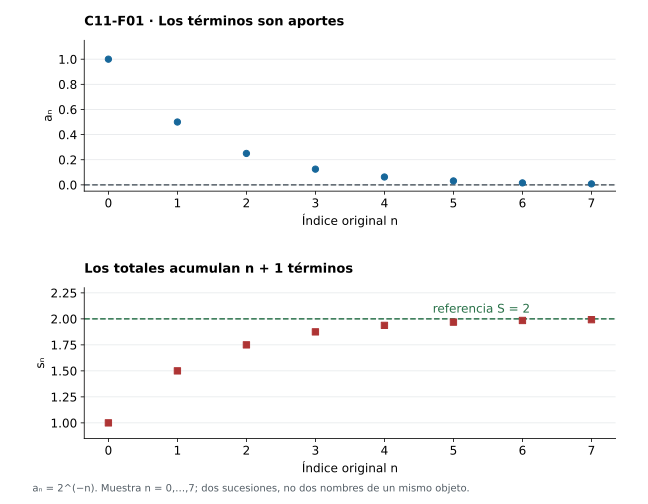
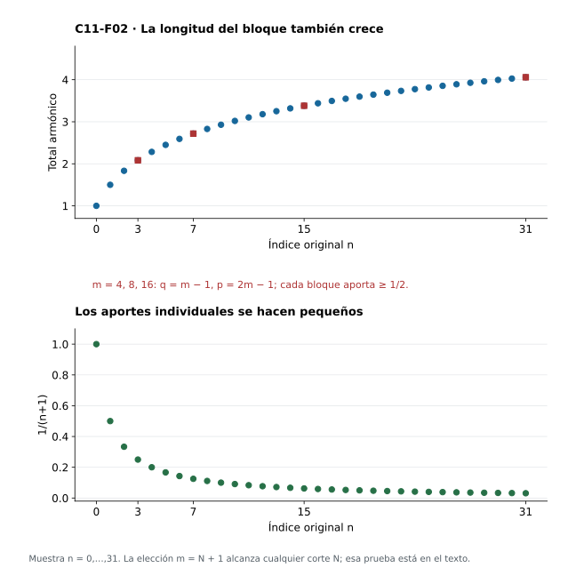
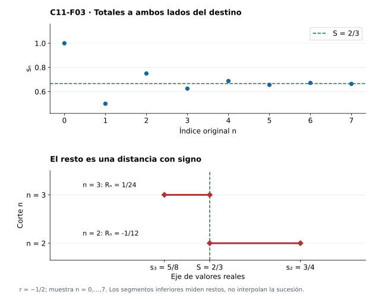
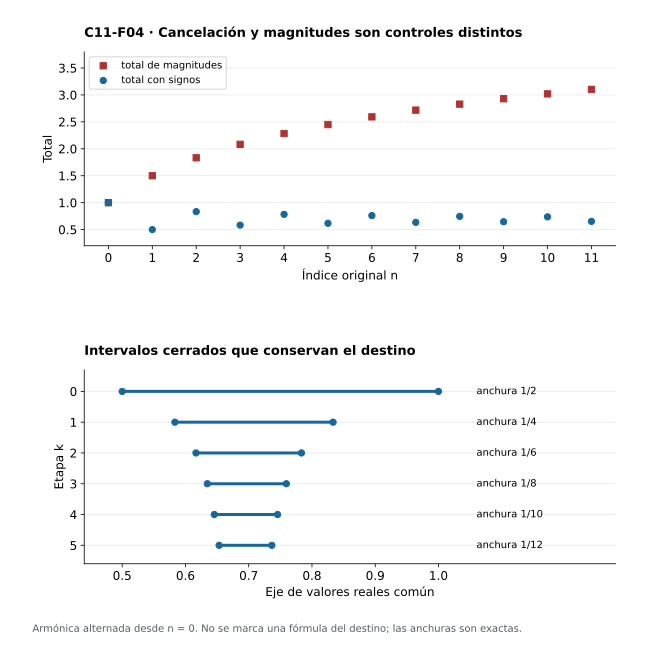
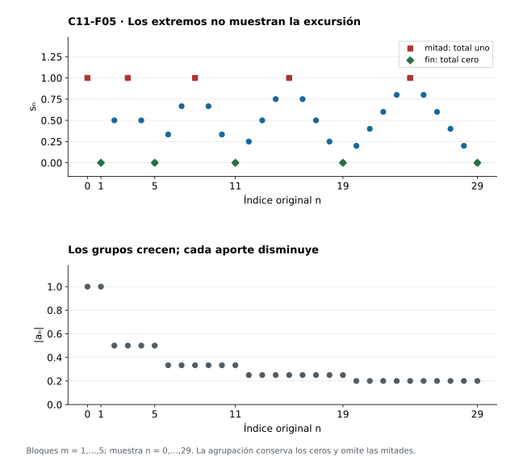
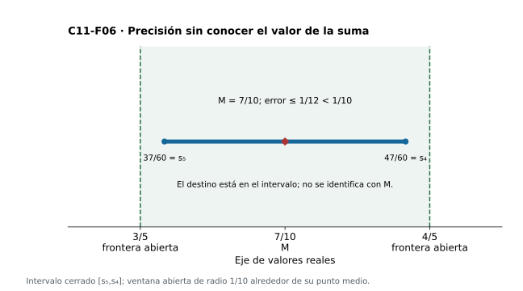

[Índice del libro](../para-matematicos/analisis-para-matematicos.html) · [Ejercicios de este capítulo](#ejercicios-11)

Si vamos añadiendo $1,1/2,1/4,1/8,\ldots$, cada aporte es menor que el anterior y los totales se acercan a dos. Al añadir $1,1/2,1/3,1/4,\ldots$ también disminuyen los aportes, pero los totales superan cualquier barrera. La diferencia entre ambos procesos no puede leerse en el hecho de que los términos tiendan a cero: necesitamos controlar lo que pueden acumular muchos términos juntos.

En C10 aprendimos a reconocer la convergencia comparando dos términos tardíos de una sucesión. Para una acumulación, esos dos términos serán los totales calculados hasta dos índices distintos; su diferencia recogerá exactamente los aportes añadidos entre ambos. Esa identidad finita permite trasladar el criterio de Cauchy al problema de sumar indefinidamente sin dar por existente la suma que buscamos.

## 11.1. De los términos a las sumas parciales

[]{#MA-SEC-ANM-01-011-001}

Los primeros totales de los aportes geométricos son $1,3/2,7/4,15/8$. El aporte de índice $3$ vale $1/8$, mientras que el total de ese mismo índice vale $15/8$: el primero registra lo que acabamos de añadir y el segundo incorpora todo lo anterior. La pregunta por una suma infinita se refiere al comportamiento de los totales. Para formularla debemos construir esa nueva sucesión a partir de los aportes.

Dada $a:\mathbb N\to\mathbb R$, con $\mathbb N=\{0,1,2,\ldots\}$, definimos su **sucesión de sumas parciales** $s=\operatorname{PS}(a)$ mediante

$$
s_0=a_0,\qquad s_{n+1}=s_n+a_{n+1}.
$$

La condición inicial ya incorpora $a_0$; $s_0$ no es el total vacío. Una vez conocido $s_n$, la regla siguiente determina un único real $s_{n+1}$, de modo que la recursión produce una sucesión en todos los naturales. Si otra sucesión satisficiera las mismas reglas, coincidiría en cero y cada coincidencia obligaría a la del índice siguiente: la inducción prueba su unicidad. La abreviatura $s_n=\sum_{k=0}^n a_k$ contiene $n+1$ aportes. Reservamos el valor cero para una suma sin términos, que aparecerá al eliminar un prefijo de longitud cero o al comparar un total consigo mismo.

La **serie de términos $a$** es este proceso de sumación. Decimos que converge si $s_n\to S$ para algún $S\in\mathbb R$, y entonces llamamos a $S$ su suma y escribimos

$$
\sum_{n=0}^{\infty}a_n=S.
$$

Mientras no hayamos probado que los totales convergen, el símbolo de serie nombra el proceso y deja abierta la existencia de ese real. Si existe, C06 garantiza su unicidad. Por eso podemos estudiar una serie divergente sin asignarle una suma: sus totales siguen estando definidos en cada índice, aunque crezcan sin barrera o persistan en oscilar.

Conocer todos los totales permite además reconstruir cada aporte. El primero está dado por la condición inicial; para los demás basta restar dos totales consecutivos:

$$
a_0=s_0,\qquad a_{n+1}=s_{n+1}-s_n.
$$

La resta elimina el prefijo que ambos totales comparten y deja sólo el aporte nuevo. En consecuencia, $\operatorname{PS}(a)=\operatorname{PS}(b)$ obliga a que $a=b$. Si sólo conocemos el límite de los totales, hemos perdido esa información: $(1,0,0,\ldots)$ y $(1/2,1/2,0,\ldots)$ suman uno, pero sus primeros totales son distintos. Una sucesión de aportes, su sucesión de totales y el real al que éstos convergen cumplen funciones diferentes; los dos primeros objetos son funciones $\mathbb N\to\mathbb R$ y el tercero es un número.

En $a_n=(-1)^n$, cada pareja consecutiva suma cero. Hasta el índice $2k+1$ hay $k+1$ parejas completas, por lo que $s_{2k+1}=0$; hasta $2k$ quedan $k$ parejas y un uno, por lo que $s_{2k}=1$. Los totales están acotados y, sin embargo, después de cualquier corte hay dos de ellos separados por uno. La tolerancia fija $1/2$ impide Cauchy. Estar en una región acotada no decide la convergencia de una acumulación. Para $a_n=0$, la recursión da $s_n=0$ en cada índice.

Para los aportes $a_n=2^{-n}$ podemos identificar el destino antes de disponer de un criterio general. En cero, $s_0=1=2^{-0}$. Si $s_n=2-2^{-n}$, al añadir $2^{-(n+1)}$ queda $s_{n+1}=2-2^{-(n+1)}$. La inducción prueba $s_n=2-2^{-n}$. Otra inducción da $2^n\ge n+1$, de donde $2^{-n}\le1/(n+1)$. Dada $\varepsilon>0$, elegir $N+1>1/\varepsilon$ controla tanto $|a_n|$ como $|s_n-2|$ para $n\ge N$. Los aportes tienden a cero y los totales a dos, como distingue la figura 11.1.

{#fig-anm-c11-f01 fig-alt="Arriba se muestran ocho términos geométricos que decrecen; abajo, ocho sumas parciales que aumentan. Los puntos conservan sus índices y las líneas horizontales marcan referencias cero y dos; no se unen términos."}

### Antes de seguir

#### Microcontrol 1

[]{#MA-MIC-ANM-01-011-001}

¿Cuántos términos contiene $s_n=\sum_{k=0}^n a_k$?

[]{#MA-MSOL-ANM-01-011-001}

Ver solución del microcontrol 1

$n+1$, porque los índices van de cero a $n$ inclusive.

Escribamos los primeros casos: $s_0=a_0$ contiene un término, $s_1=a_0+a_1$ contiene dos y $s_2$ contiene tres. En general, contar los enteros desde cero hasta $n$ da $n-0+1=n+1$. El índice final identifica el último término incluido, no el número de sumandos. Esta diferencia importa al calcular un resto: lo que queda después de $s_n$ comienza en $a_{n+1}$.

#### Microcontrol 2

[]{#MA-MIC-ANM-01-011-002}

¿Cuál es el término inicial de $\operatorname{PS}(a)$?

[]{#MA-MSOL-ANM-01-011-002}

Ver solución del microcontrol 2

$s_0=a_0$; no es automáticamente cero.

La definición $s_n=\sum_{k=0}^n a_k$ se aplica también cuando $n=0$: el único índice permitido es cero. Por tanto, el primer total ya incorpora el primer aporte. El total vacío sería cero, pero corresponde a no incorporar ningún término; no es $s_0$ en esta convención. Por ejemplo, para $a_n=1/(n+1)$ tenemos $s_0=1$, lo que permite detectar inmediatamente un desplazamiento incorrecto de los índices.

#### Microcontrol 3

[]{#MA-MIC-ANM-01-011-003}

¿Qué condición permite llamar suma real a $\sum_{n=0}^{\infty}a_n$?

[]{#MA-MSOL-ANM-01-011-003}

Ver solución del microcontrol 3

Que la sucesión de sumas parciales converja a un real $S$; entonces el símbolo de suma designa ese límite único.

Primero construimos cada $s_n$ mediante una suma finita, sin asumir que exista una suma infinita. Después debemos demostrar que hay $S\in\mathbb R$ tal que, para cada $\varepsilon>0$, existe $N$ con $|s_n-S|<\varepsilon$ para todos los $n\ge N$. Sólo entonces definimos la suma de la serie como $S$. La unicidad del límite garantiza que la notación designa un único número y no depende de cuál prueba de convergencia utilicemos.

#### Microcontrol 4

[]{#MA-MIC-ANM-01-011-004}

¿Cómo se recupera $a_{n+1}$ a partir de dos totales?

[]{#MA-MSOL-ANM-01-011-004}

Ver solución del microcontrol 4

$a_{n+1}=s_{n+1}-s_n$, por la recursión.

Los totales consecutivos comparten todos los aportes iniciales:
$$s_{n+1}=a_0+\cdots+a_n+a_{n+1},\qquad s_n=a_0+\cdots+a_n.$$
Al restar, esos términos comunes se cancelan y permanece exactamente el aporte nuevo. Para recuperar toda la sucesión hay que añadir el caso inicial $a_0=s_0$; la regla de diferencias recupera los términos desde $a_1$ en adelante. Conocer todos los totales permite así reconstruir todos los aportes.

#### Microcontrol 5

[]{#MA-MIC-ANM-01-011-005}

¿Tener la misma suma implica tener los mismos términos?

[]{#MA-MSOL-ANM-01-011-005}

Ver solución del microcontrol 5

No. $(1,0,0,\ldots)$ y $(1/2,1/2,0,\ldots)$ tienen suma uno y distintos términos y procesos.

Para la primera sucesión, todos los totales son uno. Para la segunda, el primer total es $1/2$ y todos los siguientes son uno. Las dos sucesiones de totales convergen al mismo número, aunque sus primeros valores y sus términos sean diferentes. La operación de tomar el límite conserva el destino y puede perder información del recorrido. No hay contradicción con la recuperación por diferencias: ésta exige conocer todos los totales, no únicamente su límite.

#### Microcontrol 6

[]{#MA-MIC-ANM-01-011-006}

¿Qué totales produce $a_n=(-1)^n$?

[]{#MA-MSOL-ANM-01-011-006}

Ver solución del microcontrol 6

$s_{2k}=1$ y $s_{2k+1}=0$, al cancelar parejas consecutivas.

Cada pareja de aportes consecutivos vale $1+(-1)=0$. El total $s_{2k+1}$ comprende $2k+2$ términos, que forman $k+1$ parejas completas; por eso vale cero. El total $s_{2k}$ comprende $2k+1$ términos: después de cancelar $k$ parejas queda un aporte igual a uno. La distinción entre índices pares e impares deriva del número de términos incluidos y permite comprobar la fórmula también en $s_0=1$.

#### Microcontrol 7

[]{#MA-MIC-ANM-01-011-007}

¿La acotación de esos totales garantiza convergencia?

[]{#MA-MSOL-ANM-01-011-007}

Ver solución del microcontrol 7

No. Después de cualquier corte hay totales separados por uno, de modo que falla Cauchy.

Todos los totales pertenecen a $\{0,1\}$, así que están acotados. Sin embargo, fijemos $\varepsilon_0=1/2$. Después de cualquier corte $N$ podemos escoger un índice par y otro impar; sus totales difieren en uno, mayor que esa tolerancia. Ninguna cola satisface la condición de Cauchy y, en consecuencia, los totales no convergen. Acotación limita el tamaño de los valores; convergencia exige además que sus separaciones se hagan arbitrariamente pequeñas.

#### Microcontrol 8

[]{#MA-MIC-ANM-01-011-008}

¿Son $a$, $\operatorname{PS}(a)$ y su suma el mismo tipo de objeto?

[]{#MA-MSOL-ANM-01-011-008}

Ver solución del microcontrol 8

No. $a$ y $\operatorname{PS}(a)$ son funciones $\mathbb N\to\mathbb R$ con papeles diferentes; su suma, si existe, es un número real.

La sucesión $a$ registra aportes individuales, mientras $\operatorname{PS}(a)$ registra lo acumulado hasta cada índice. Ambas tienen infinitos valores organizados por $n$. En cambio, si los acumulados convergen, su suma es un solo real $S$. Por ejemplo, para $a=(1,0,0,\ldots)$, los aportes cambian al inicio, los totales son constantemente uno y la suma es el número uno. Distinguir esos objetos evita aplicar a los aportes una propiedad que sólo se ha demostrado para los totales.

### Ejercicios de la sección 11.1

[]{#ejercicios-11}

#### Ejercicio 1. Aportes y totales

[]{#MA-EX-ANM-01-011-001}

Calcula $s_0,s_1,s_2,s_3$ para $a_n=2^{-n}$. Distingue ambos objetos.

[]{#MA-SOL-ANM-01-011-001}

Ver solución del ejercicio 1

Los términos son $1,1/2,1/4,1/8$ y los totales $1,3/2,7/4,15/8$. $a$ y $s$ son sucesiones reales distintas; $s_n$ acumula $n+1$ valores de $a$.

Después del argumento, la [figura 11.1](analisis-para-matematicos-capitulo-11-series-como-laboratorio-de-convergencia.html#fig-anm-c11-f01) permite contrastar el mecanismo con el ejemplo del capítulo.

Calculemos acumulando un aporte cada vez: $s_0=1$, $s_1=1+1/2=3/2$, $s_2=3/2+1/4=7/4$ y $s_3=7/4+1/8=15/8$. La fórmula de los aportes indica lo que se añade; la de los totales indica lo que ya se ha reunido. Así, aunque $a_3=1/8$ sea pequeño, $s_3=15/8$ no lo es. La convergencia de la serie pregunta por el destino de los totales, no por el de los aportes.

#### Ejercicio 2. Recuperar una serie

[]{#MA-EX-ANM-01-011-002}

Si se prescribe $s_n=(n+1)/(n+2)$, encuentra la única sucesión de términos que produce esos totales y decide convergencia.

[]{#MA-SOL-ANM-01-011-002}

Ver solución del ejercicio 2

$a_0=s_0=1/2$. Para $n\ge1$, $a_n=s_n-s_{n-1}=(n+1)/(n+2)-n/(n+1)=1/((n+1)(n+2))$. La recursión verifica los totales, y su recuperación demuestra unicidad. Como $s_n=1-1/(n+2)\to1$, la serie tiene suma uno. La misma fórmula también da el término inicial si se evalúa en cero.

Al restar los dos cocientes, el numerador común es $(n+1)^2-n(n+2)=1$. Eso justifica la fórmula, en vez de limitarse a anunciarla. Para comprobar existencia, sumamos los términos recuperados: los recíprocos consecutivos se cancelan y dejan $1-1/(n+2)$, exactamente el total prescrito. Para comprobar unicidad, cualquier sucesión que produzca esos mismos totales debe tener el mismo primer aporte y las mismas diferencias posteriores. El límite de los totales es uno, aunque cada aporte tienda a cero.

#### Ejercicio 3. Misma suma, distinto proceso

[]{#MA-EX-ANM-01-011-003}

Construye dos sucesiones distintas de soporte finito con la misma suma y prueba que sus procesos son distintos.

[]{#MA-SOL-ANM-01-011-003}

Ver solución del ejercicio 3

Tomemos $a=(1,0,0,\ldots)$ y $b=(0,1,0,\ldots)$. Sus totales son $s_n=1$ en todo índice y $t_0=0$, $t_n=1$ para $n\ge1$. Ambas sumas valen uno, pero $a_0\ne b_0$ y $s_0\ne t_0$. Igualdad numérica de sumas no implica igualdad de funciones.

Después del argumento, la [figura 11.1](analisis-para-matematicos-capitulo-11-series-como-laboratorio-de-convergencia.html#fig-anm-c11-f01) permite contrastar el mecanismo con el ejemplo del capítulo.

El soporte de cada sucesión es finito: sólo tiene un índice con aporte distinto de cero. Por eso, tras incorporar ese aporte, los totales permanecen iguales a uno y convergen a uno. Sin embargo, basta comparar el índice cero para mostrar que tanto los aportes como sus procesos son diferentes. La suma conserva un número final, pero no indica en qué momento se incorporó cada aporte. Conocer todos los totales contiene más información que conocer únicamente su límite.

#### Ejercicio 4. Una transformación reversible

[]{#MA-EX-ANM-01-011-004}

Prueba que toda sucesión real $s$ es el proceso de sumación de una única sucesión real $a$.

[]{#MA-SOL-ANM-01-011-004}

Ver solución del ejercicio 4

Definamos $a_0=s_0$ y $a_{n+1}=s_{n+1}-s_n$. Si $u=\operatorname{PS}(a)$, entonces $u_0=s_0$. Suponiendo $u_n=s_n$, la recursión da $u_{n+1}=s_n+s_{n+1}-s_n=s_{n+1}$. Inducción prueba $u=s$. Si otro $b$ produce $s$, la recuperación de §11.1 fuerza $b_0=a_0$ y $b_{n+1}=a_{n+1}$. Es una correspondencia entre sucesiones, sin exigir convergencia.

Después del argumento, la [figura 11.1](analisis-para-matematicos-capitulo-11-series-como-laboratorio-de-convergencia.html#fig-anm-c11-f01) permite contrastar el mecanismo con el ejemplo del capítulo.

La prueba tiene dos obligaciones. Para existencia, construimos $a$ y demostramos por inducción que su proceso de sumación coincide con $s$ en cada índice. Para unicidad, partimos de cualquier otra candidata y usamos las identidades $a_0=s_0$ y $a_{n+1}=s_{n+1}-s_n$, que son forzadas por los totales. No se necesita que $s$ tenga límite: la transformación entre aportes y totales es reversible incluso cuando la serie diverge.

#### Ejercicio 5. Totales acotados y término nulo

[]{#MA-EX-ANM-01-011-005}

Construye una serie con términos que tienden a cero y sumas parciales acotadas que no convergen.

[]{#MA-SOL-ANM-01-011-005}

Ver solución del ejercicio 5

Prescribamos bloques: para cada $m\ge1$, $m$ términos $1/m$ seguidos de $m$ términos $-1/m$. El bloque ocupa $m(m-1)\le n\le m(m+1)-1$; sus extremos consecutivos cubren todos los naturales. Los totales van de cero a uno y regresan a cero, así que están en $[0,1]$. Dada $\varepsilon>0$, tomar $M$ con $1/M<\varepsilon$ hace $|a_n|\le1/M<\varepsilon$ desde el comienzo del bloque $M$. Los totales de mitad y final de cada bloque son uno y cero en índices arbitrariamente grandes; falla Cauchy con tolerancia $1/2$.

Después del argumento, la [figura 11.5](analisis-para-matematicos-capitulo-11-series-como-laboratorio-de-convergencia.html#fig-anm-c11-f05) permite contrastar el mecanismo con el ejemplo del capítulo.

El primer bloque tiene dos aportes; los primeros $m-1$ bloques contienen $2(1+\cdots+(m-1))=m(m-1)$ aportes, lo que explica la posición inicial del bloque $m$. Su mitad positiva eleva el total a uno y su mitad negativa lo devuelve a cero. Para negar Cauchy, recibido un corte escogemos un bloque posterior completo y comparamos sus totales de mitad y final. Su separación es uno. Los saltos individuales se hacen pequeños, pero el número creciente de aportes permite mantener una excursión de tamaño fijo.

## 11.2. Cauchy mide bloques completos

[]{#MA-SEC-ANM-01-011-002}

Para comparar dos totales, restemos primero la parte que ya estaba sumada en ambos. Si $p>q$, la diferencia debe contener los aportes de índices $q+1,\ldots,p$, exactamente los que se añadieron después del corte $q$. La recursión permite demostrarlo sin hablar todavía de convergencia:

$$
s_p-s_q=\sum_{k=q+1}^{p}a_k.
$$

Con $p=q+1$ la igualdad es la propia regla de construcción. Fijado $q$, si vale hasta $p$, entonces $s_{p+1}-s_q=(s_p-s_q)+a_{p+1}$ prolonga el bloque hasta $p+1$. La inducción sobre su longitud $p-q$ prueba todos los casos. El índice inicial importa: incluir $a_q$ contaría dos veces un aporte que ya estaba incorporado en $s_q$.

**Criterio de Cauchy para series reales.** La serie de $a$ converge si y sólo si

$$
\forall\varepsilon>0\ \exists N\in\mathbb N\ \forall p,q\in\mathbb N:
\quad p>q\ge N\ \Longrightarrow\
\left|\sum_{k=q+1}^{p}a_k\right|<\varepsilon.
$$

La definición de serie convergente pregunta por la convergencia de $s$. Según C10, en $\mathbb R$ eso equivale a controlar $|s_p-s_q|$ después de un único corte. La identidad de bloques sustituye esa diferencia por una suma finita cuando $p>q$. Si los bloques satisfacen la condición escrita, los pares en el otro orden se reducen a éstos por $|s_p-s_q|=|s_q-s_p|$, y los pares iguales tienen distancia cero. Por tanto todos los pares tardíos satisfacen Cauchy y la completitud, a través de C10, proporciona un destino real. La identidad finita traduce el control; la completitud garantiza existencia.

El corte se elige después de recibir la tolerancia y antes de escoger los dos extremos del bloque. Debe servir aunque la longitud $p-q$ sea enorme. Para apreciar la diferencia, fijemos una longitud $r\ge1$ en la armónica: un bloque desde $q+1$ hasta $q+r$ tiene suma a lo sumo $r/(q+2)$ y se hace pequeño al avanzar $q$. El corte que da $N+2>r/\varepsilon$ depende de $r$. El criterio de Cauchy exige un corte que funcione antes de saber qué longitud habrá que controlar.

**Condición necesaria.** Si una serie converge, entonces $a_n\to0$. Para comprobarlo, recibamos $\varepsilon>0$ y tomemos el corte $N$ del criterio de bloques. Si $n\ge N+1$, podemos elegir $q=n-1$ y $p=n$: los extremos cumplen $p>q\ge N$ y el bloque sólo contiene $a_n$, así que $|a_n|<\varepsilon$. El corte de los términos se ha desplazado una unidad. Hemos probado una consecuencia de controlar todos los bloques; los bloques de un término por sí solos todavía no controlan los más largos.

Volvamos a los aportes $a_n=1/(n+1)$, que tienden a cero. Para poner a prueba todos los bloques necesitamos permitir que su longitud aumente con su posición. Dado un corte $N$, tomemos $m=N+1$, $q=m-1=N$ y $p=2m-1=2N+1$. Al restar los totales, quedan los $m$ denominadores desde $m+1$ hasta $2m$: ninguno de sus recíprocos es menor que $1/(2m)$. Por tanto,

$$
s_{2m-1}-s_{m-1}=\sum_{j=m+1}^{2m}\frac1j\ge m\frac1{2m}=\frac12.
$$

La misma tolerancia $1/2$ falla después de cada corte, aunque cada aporte individual se haga pequeño. Los bloques conservan una separación porque su número de términos crece al mismo tiempo que éstos disminuyen. Así la serie armónica diverge por una estimación sobre sumas finitas; no se ha presupuesto el valor de ninguna expresión infinita.

{#fig-anm-c11-f02 fig-alt="Totales armónicos discretos con tres pares de cortes destacados muestran incrementos de al menos un medio; una anotación identifica sus índices. Debajo, los términos individuales decrecen. El criterio exige todos los bloques, no sólo los términos."}

| m | q = m−1 | p = 2m−1 | Cota inferior exacta del bloque |
|---|---|---|---|
| 4 | 3 | 7 | ≥ $1/2$ |
| 8 | 7 | 15 | ≥ $1/2$ |
| 16 | 15 | 31 | ≥ $1/2$ |

### Antes de seguir

#### Microcontrol 9

[]{#MA-MIC-ANM-01-011-009}

¿Por qué el bloque $s_p-s_q$ empieza en $q+1$?

[]{#MA-MSOL-ANM-01-011-009}

Ver solución del microcontrol 9

Porque $s_q$ ya contiene $a_q$; los nuevos términos son $a_{q+1},\ldots,a_p$.

Escribimos ambas sumas antes de restarlas: $s_p=a_0+\cdots+a_q+a_{q+1}+\cdots+a_p$ y $s_q=a_0+\cdots+a_q$. El prefijo hasta $q$, incluido ese índice, desaparece. Queda $\sum_{k=q+1}^p a_k$, que tiene $p-q$ términos. Si el bloque empezara en $q$, contaríamos otra vez un aporte que ya formaba parte del total anterior. La identidad sólo involucra sumas finitas y no requiere convergencia.

#### Microcontrol 10

[]{#MA-MIC-ANM-01-011-010}

¿En qué orden se eligen tolerancia, corte y extremos de bloque?

[]{#MA-MSOL-ANM-01-011-010}

Ver solución del microcontrol 10

Primero $\varepsilon>0$, después un único $N$ que puede depender de ella, y luego todos $p>q\ge N$.

El criterio dice que, recibida una precisión, debe existir una cola en la que cualquier bloque tenga suma de valor absoluto menor que esa precisión. El corte se fija antes de escoger dónde termina el bloque. Puede depender de $\varepsilon$ y de la serie, pero debe servir para todos los $p>q\ge N$. Este orden es exactamente el que convierte el control de bloques en la condición de Cauchy de los totales.

#### Microcontrol 11

[]{#MA-MIC-ANM-01-011-011}

¿Puede el corte depender de la longitud del bloque?

[]{#MA-MSOL-ANM-01-011-011}

Ver solución del microcontrol 11

No en el criterio: debe controlar simultáneamente todas las longitudes.

Si para cada longitud se permitiera escoger un corte distinto, sólo controlaríamos por separado bloques de tamaño fijo. Eso es más débil. En la armónica, un bloque de longitud $L$ situado después de $q$ tiene suma a lo sumo $L/(q+2)$ y se hace pequeño con $q$ para cada $L$ fijo. Aun así, bloques cuya longitud crece con su posición pueden conservar una suma al menos $1/2$. El criterio exige un control simultáneo de esas longitudes arbitrarias.

#### Microcontrol 12

[]{#MA-MIC-ANM-01-011-012}

¿Cómo se cubre el caso $p=q$ al recuperar Cauchy?

[]{#MA-MSOL-ANM-01-011-012}

Ver solución del microcontrol 12

La distancia entre el mismo total y sí mismo es cero, menor que cualquier tolerancia positiva.

El criterio de bloques se enuncia para $p>q$. Para comprobar Cauchy con cualquier par tardío, quedan dos casos: si $p=q$, $|s_p-s_q|=0<\varepsilon$; si $p<q$, intercambiamos los extremos y usamos $|s_p-s_q|=|s_q-s_p|$. Así los casos no incluidos literalmente en el criterio se reducen a una identidad trivial o a la simetría. No hacen falta nuevos cortes ni nuevas hipótesis.

#### Microcontrol 13

[]{#MA-MIC-ANM-01-011-013}

¿Dónde se usa completitud en el criterio de bloques?

[]{#MA-MSOL-ANM-01-011-013}

Ver solución del microcontrol 13

En pasar de Cauchy de $s$ a existencia de un límite real, mediante C10; no en la identidad de sumas finitas.

La identidad $s_p-s_q=\sum_{k=q+1}^p a_k$ traduce una condición sobre bloques en una condición sobre distancias entre totales. Esa traducción es puramente algebraica. Una vez probado que $(s_n)$ es de Cauchy, usamos la completitud de $\mathbb R$ para obtener un límite dentro del mismo espacio. En un espacio incompleto, el control de pares seguiría teniendo sentido, pero no aseguraría que su destino exista en ese espacio.

#### Microcontrol 14

[]{#MA-MIC-ANM-01-011-014}

¿Por qué convergencia de la serie implica $a_n\to0$?

[]{#MA-MSOL-ANM-01-011-014}

Ver solución del microcontrol 14

Para $n\ge N+1$, el bloque de un término entre $n-1$ y $n$ da $|a_n|<\varepsilon$.

Dada $\varepsilon>0$, el criterio proporciona un corte $N$ válido para todos los bloques tardíos. Para $n\ge N+1$ escogemos $q=n-1$ y $p=n$, de modo que $q\ge N$. El bloque contiene únicamente $a_n$, luego $|a_n|=|s_n-s_{n-1}|<\varepsilon$. Hemos obtenido un corte para los términos, posiblemente desplazado en una unidad. Esto prueba una condición necesaria; no demuestra que el control de un solo aporte baste para todos los bloques.

#### Microcontrol 15

[]{#MA-MIC-ANM-01-011-015}

¿Qué pares de cortes niegan Cauchy en la armónica?

[]{#MA-MSOL-ANM-01-011-015}

Ver solución del microcontrol 15

Para cualquier $N$, tomar $m=N+1$, $q=m-1$ y $p=2m-1$ da una diferencia al menos $1/2$.

En la armónica indexada desde cero, $s_n=\sum_{k=0}^n1/(k+1)$. Los índices elegidos dan
$$s_{2m-1}-s_{m-1}=\sum_{j=m+1}^{2m}\frac1j\ge m\frac1{2m}=\frac12.$$
Hay exactamente $m$ sumandos y cada uno es al menos $1/(2m)$. Con $m=N+1$, ambos extremos están después del corte propuesto. La misma tolerancia $1/2$ falla para cualquier $N$, lo que verifica la negación de Cauchy con testigos explícitos.

#### Microcontrol 16

[]{#MA-MIC-ANM-01-011-016}

¿El término nulo es una condición suficiente?

[]{#MA-MSOL-ANM-01-011-016}

Ver solución del microcontrol 16

No. $1/(n+1)\to0$, pero sus bloques largos anteriores mantienen suma al menos $1/2$ después de cada corte.

Que los términos tiendan a cero sólo hace pequeños los bloques de un término. En la armónica, cada aporte $1/(n+1)$ tiende a cero, pero los bloques entre $m+1$ y $2m$ reúnen suficientes aportes para sumar al menos $1/2$. Por eso la condición necesaria no se puede invertir. Conviene comprobar primero el término nulo: si falla, la serie diverge; si se cumple, aún debemos encontrar otro argumento que controle la acumulación.

### Ejercicios de la sección 11.2

#### Ejercicio 6. Identidad de bloques

[]{#MA-EX-ANM-01-011-006}

Prueba por inducción que $s_p-s_q=\sum_{j=q+1}^pa_j$ cuando $p>q$.

[]{#MA-SOL-ANM-01-011-006}

Ver solución del ejercicio 6

Fijemos $q$. Para $p=q+1$, la recursión da la identidad. Si vale para $p$, entonces $s_{p+1}-s_q=(s_p-s_q)+a_{p+1}=\sum_{j=q+1}^{p+1}a_j$. La inducción sobre $p-q\ge1$ cubre todos los extremos; no interviene una suma infinita.

El índice $q$ permanece fijo durante la inducción y la variable es la longitud $p-q$. La base tiene un solo aporte nuevo: $s_{q+1}-s_q=a_{q+1}$. En el paso inductivo, incorporar $a_{p+1}$ prolonga el bloque y el total exactamente de la misma manera. Así la identidad vale para cada $q$ y todos los extremos posteriores. La suma comienza en $q+1$ porque $a_q$ ya estaba incluido en el total que se resta.

#### Ejercicio 7. La longitud no puede elegir el corte

[]{#MA-EX-ANM-01-011-007}

En la armónica $a_n=1/(n+1)$, muestra que los bloques de cualquier longitud fija tienden a cero al alejar su inicio. Explica por qué la serie diverge.

[]{#MA-SOL-ANM-01-011-007}

Ver solución del ejercicio 7

Para un natural fijo $r\ge1$, $0\le\sum_{j=q+1}^{q+r}1/(j+1)\le r/(q+2)\to0$. El corte de esta estimación depende de $r$. Cauchy exige uno solo para todas las longitudes. Tomando $q=m-1$, $p=2m-1$, se obtiene un bloque al menos $1/2$ después de cualquier corte, así que no converge.

Después del argumento, la [figura 11.2](analisis-para-matematicos-capitulo-11-series-como-laboratorio-de-convergencia.html#fig-anm-c11-f02) permite contrastar el mecanismo con el ejemplo del capítulo.

Para una longitud fijada $r$ y una tolerancia positiva, basta escoger $N$ con $N+2>r/\varepsilon$. Entonces todo bloque de longitud $r$ iniciado después de $N$ tiene suma menor que $\varepsilon$. Pero la negación de Cauchy permite escoger la longitud después del corte: con $m=N+1$, el bloque de denominadores $m+1,\ldots,2m$ tiene $m$ aportes de tamaño al menos $1/(2m)$. Su suma no baja de $1/2$. La dependencia del corte respecto de la longitud es precisamente lo que impide el criterio completo.

#### Ejercicio 8. Términos que no desaparecen

[]{#MA-EX-ANM-01-011-008}

Descarta convergencia de las series con términos $a_n=(-1)^n$ y $b_n=(n+1)/(n+2)$.

[]{#MA-SOL-ANM-01-011-008}

Ver solución del ejercicio 8

En la primera, $|a_n|=1$ en cada índice; en la segunda, $b_n\ge1/2$. Ninguna sucesión de términos tiende a cero, y la condición necesaria de §11.2 descarta ambas convergencias. No hace falta calcular sus totales para aplicar esa condición.

Si una serie convergiera, la diferencia de dos totales consecutivos tendría que tender a cero, por lo que sus aportes desaparecerían. Aquí la primera sucesión mantiene magnitud uno. La segunda mantiene una cota inferior $1/2$, así que ninguna cola puede satisfacer, por ejemplo, la tolerancia $1/4$ respecto de cero. Hemos hecho fallar una condición necesaria. Eso basta para descartar ambas series, aunque sus comportamientos de totales sean distintos.

#### Ejercicio 9. Acumulación en potencias de dos

[]{#MA-EX-ANM-01-011-009}

Prueba $s_{2^m-1}\ge1+m/2$ para las sumas parciales armónicas, con $m\in\mathbb N$.

[]{#MA-SOL-ANM-01-011-009}

Ver solución del ejercicio 9

En la notación de denominadores, $s_{2^m-1}=\sum_{j=1}^{2^m}1/j$. Para cada $i=1,\ldots,m$, el bloque $j=2^{i-1}+1,\ldots,2^i$ tiene $2^{i-1}$ términos, cada uno al menos $1/2^i$, de modo que aporta al menos $1/2$. Añadiendo el término $j=1$ resulta la cota, también válida para $m=0$. Es una partición finita; prueba que los totales carecen de barrera superior.

Después del argumento, la [figura 11.2](analisis-para-matematicos-capitulo-11-series-como-laboratorio-de-convergencia.html#fig-anm-c11-f02) permite contrastar el mecanismo con el ejemplo del capítulo.

Los bloques duplican sus extremos: después del aporte inicial uno, reunimos denominadores $2$, luego $3,4$, después $5,\ldots,8$, y así sucesivamente. Cada grupo aporta al menos medio, porque duplica su cantidad de sumandos mientras divide por dos la cota inferior de cada uno. Para cualquier barrera $B$, arquimedianidad permite escoger $m$ con $1+m/2>B$. El total correspondiente la supera. No estamos asignando un valor a una suma infinita: todos los bloques y totales usados son finitos.

#### Ejercicio 10. Reparar una falsa prueba

[]{#MA-EX-ANM-01-011-010}

Diagnostica: «Como $a_n\to0$, cada término de un bloque tardío es menor que $\varepsilon$; por tanto su suma es menor que $\varepsilon$». Repara el argumento cuando todo bloque tiene longitud a lo sumo $M\ge1$.

[]{#MA-SOL-ANM-01-011-010}

Ver solución del ejercicio 10

Una suma de muchos términos puede exceder $\varepsilon$, y los signos tampoco autorizan ignorar magnitudes. Si la longitud está acotada por $M$, basta hacer $|a_j|<\varepsilon/M$ en la cola. La triangular finita da magnitud del bloque menor que $r\varepsilon/M\le\varepsilon$ para $1\le r\le M$; el bloque vacío vale cero. Esto controla sólo bloques de esas longitudes, no el criterio completo sin otra hipótesis.

Después del argumento, la [figura 11.2](analisis-para-matematicos-capitulo-11-series-como-laboratorio-de-convergencia.html#fig-anm-c11-f02) permite contrastar el mecanismo con el ejemplo del capítulo.

La reparación debe pedir control del valor absoluto, porque «menor que $\varepsilon$» como desigualdad firmada no controla aportes negativos grandes. Si un bloque tiene $r\le M$ términos, hacemos cada magnitud menor que $\varepsilon/M$. La triangular da una suma de magnitudes estrictamente menor que $r\varepsilon/M\le\varepsilon$. El factor $M$ reparte el presupuesto entre el máximo número de errores permitidos. Si las longitudes no están acotadas, esta elección no controla todos los bloques.

## 11.3. Fórmulas finitas y restos exactos

[]{#MA-SEC-ANM-01-011-003}

En algunas series podemos calcular cada total y dejar que una fórmula finita resuelva el problema del límite. Las cancelaciones deben producirse en ese cálculo, donde sólo intervienen finitos reales; una supuesta suma infinita no puede usarse como si ya fuera un número antes de demostrar que existe.

Si $a_n=c_n-c_{n+1}$, las primeras sumas son $c_0-c_1$, $(c_0-c_1)+(c_1-c_2)=c_0-c_2$, y así sucesivamente. Cada valor interior aparece una vez con cada signo. La misma cancelación se justifica por inducción: si el total de corte $n$ es $c_0-c_{n+1}$, añadir $c_{n+1}-c_{n+2}$ produce $c_0-c_{n+2}$ en el corte siguiente. En general,

$$
s_n=c_0-c_{n+1}.
$$

La identidad reduce la convergencia de la serie a la de $c$. Si $c_n\to C$, las reglas de C06 dan $s_n\to c_0-C$. En la otra dirección, si $s_n\to S$, entonces $c_{n+1}=c_0-s_n\to c_0-S$. Un corte $N$ para esta última sucesión se convierte en el corte $N+1$ de $c$, de modo que también converge la sucesión completa. La cancelación no crea un destino cuando $c$ carece de él. Una vez probada la convergencia, llamamos **resto** a $R_n=S-s_n$ y obtenemos

$$
R_n=S-s_n=c_{n+1}-C.
$$

La fracción $1/((n+1)(n+2))$ permite esta cancelación porque $1/(n+1)-1/(n+2)$ tiene numerador $(n+2)-(n+1)=1$ sobre el mismo denominador. Sus totales son $s_n=1-1/(n+2)$, luego la suma es uno y el resto exacto $1/(n+2)$. Si se pide error menor que $1/100$, necesitamos $n+2>100$: $n=99$ sirve y utiliza cien aportes; $n=98$ sólo da igualdad con la tolerancia.

Para los aportes geométricos $a_n=r^n$, con $r\in\mathbb R$, usamos $r^0=1$ y $r^{n+1}=r^nr$. Esta convención fija también $0^0=1$ en el término de exponente cero de la serie. Escribamos $s_n=1+r+\cdots+r^n$ y multipliquemos por $r$: los términos interiores coinciden con los de $rs_n=r+\cdots+r^{n+1}$. Restar las dos sumas finitas deja

$$
(1-r)s_n=1-r^{n+1}.
$$

La identidad vale para todo $r$, incluido $r=1$, donde sólo dice $0=0$. Si $|r|<1$, podemos dividir por $1-r$ y estudiar la potencia restante. Para $0<\rho=|r|<1$, pongamos $\rho^{-1}=1+t$ con $t>0$. La inducción en $(1+t)^n\ge1+nt$ da $0<\rho^n\le1/(1+nt)\to0$ por arquimedianidad; por ello también $r^{n+1}\to0$. Para $r=0$, el primer aporte es uno y los demás cero, así que todos los totales son uno. Las reglas de límites aplicadas a la fórmula finita proporcionan

$$
S=\frac1{1-r},\qquad R_n=\frac{r^{n+1}}{1-r},\qquad
|R_n|=\frac{|r|^{n+1}}{|1-r|}.
$$

El denominador del error exacto es $|1-r|$. Si $r<0$, ese valor es $1+|r|$, mayor que $1-|r|$, y conservarlo mejora la estimación. Fuera de $(-1,1)$, las magnitudes $|r^n|\ge1$ no tienden a cero y la condición necesaria descarta convergencia. En $r=1$, los totales son $n+1$; en $r=-1$, alternan entre uno y cero. La geométrica converge exactamente para $|r|<1$, con los extremos tratados sin efectuar ninguna división prohibida.

{#fig-anm-c11-f03 fig-alt="Ocho totales discretos a ambos lados de dos tercios; debajo, segmentos en un eje de valores desde s_2 y s_3 al destino. Los restos tienen signos alternados y valores exactos menos un doceavo y un veinticuatroavo."}

Con $r=-1/2$, la suma es $2/3$ y el resto firmado $(2/3)(-1/2)^{n+1}$ cambia de signo con la paridad. Por ejemplo, $s_2=3/4$ está por encima de la suma y deja resto $-1/12$, mientras $s_3=5/8$ queda por debajo y deja $1/24$, como muestra la figura. Su magnitud es $(2/3)2^{-(n+1)}=1/(3\cdot2^n)$. En $n=5$ vale $1/96$ y en $n=6$ vale $1/192$, de modo que el primer corte con error menor que $1/100$ es seis. Podemos afirmar esa minimalidad porque conocemos el error exacto.

### Antes de seguir

#### Microcontrol 17

[]{#MA-MIC-ANM-01-011-017}

¿Qué total produce $a_n=c_n-c_{n+1}$?

[]{#MA-MSOL-ANM-01-011-017}

Ver solución del microcontrol 17

$s_n=c_0-c_{n+1}$ por cancelación finita, demostrable por inducción.

La suma finita es $(c_0-c_1)+(c_1-c_2)+\cdots+(c_n-c_{n+1})$. Cada término interior aparece una vez con signo positivo y otra con signo negativo. Sólo sobreviven $c_0$ y $-c_{n+1}$. También podemos verificarlo por inducción: para $n=0$ es la definición; al añadir $c_{n+1}-c_{n+2}$ a $c_0-c_{n+1}$ obtenemos $c_0-c_{n+2}$. La cancelación ocurre antes de tomar cualquier límite.

#### Microcontrol 18

[]{#MA-MIC-ANM-01-011-018}

¿Cuál es el resto telescópico si $c_n\to C$?

[]{#MA-MSOL-ANM-01-011-018}

Ver solución del microcontrol 18

La suma es $c_0-C$ y $R_n=c_{n+1}-C$.

De la identidad finita $s_n=c_0-c_{n+1}$ y de $c_{n+1}\to C$ obtenemos $s_n\to c_0-C$. Definido $S=c_0-C$, restamos el total conocido:
$$R_n=S-s_n=(c_0-C)-(c_0-c_{n+1})=c_{n+1}-C.$$
El resto conserva el signo de esa diferencia y su magnitud es $|c_{n+1}-C|$. La fórmula no presupone que $c_n$ sea positivo ni que se aproxime a $C$ desde un lado determinado.

#### Microcontrol 19

[]{#MA-MIC-ANM-01-011-019}

¿Cuál es la suma de $1/((n+1)(n+2))$?

[]{#MA-MSOL-ANM-01-011-019}

Ver solución del microcontrol 19

Uno: $s_n=1-1/(n+2)\to1$.

Descomponemos cada aporte mediante
$$\frac1{(n+1)(n+2)}=\frac1{n+1}-\frac1{n+2}.$$
Es una telescópica con $c_n=1/(n+1)$, $c_0=1$ y $c_n\to0$. La suma parcial vale $1-1/(n+2)$, de modo que la suma es uno y el resto exacto es $1/(n+2)$. Para garantizar error menor que $\varepsilon$, basta escoger un índice con $n+2>1/\varepsilon$. Así la identidad da tanto el destino como un certificado de aproximación.

#### Microcontrol 20

[]{#MA-MIC-ANM-01-011-020}

¿Qué identidad geométrica es válida antes de cualquier límite?

[]{#MA-MSOL-ANM-01-011-020}

Ver solución del microcontrol 20

$(1-r)\sum_{k=0}^nr^k=1-r^{n+1}$, para todo real $r$ y natural $n$.

Si $G_n=1+r+\cdots+r^n$, entonces $rG_n=r+r^2+\cdots+r^{n+1}$. Restar estas dos sumas cancela todos los términos interiores y da $G_n-rG_n=1-r^{n+1}$. La identidad vale incluso para $r=1$, donde ambos miembros son cero. Lo que requiere $r\ne1$ es el paso adicional de dividir por $1-r$. Separar identidad y división evita atribuir a una fórmula condiciones que pertenecen sólo a un paso posterior.

#### Microcontrol 21

[]{#MA-MIC-ANM-01-011-021}

¿Para qué razones reales converge la geométrica?

[]{#MA-MSOL-ANM-01-011-021}

Ver solución del microcontrol 21

Exactamente para $|r|<1$; fuera de ese intervalo los términos no tienden a cero.

Si $|r|<1$, las potencias $r^{n+1}$ tienden a cero y la fórmula finita da $s_n=(1-r^{n+1})/(1-r)\to1/(1-r)$. Si $|r|\ge1$, en cambio, $|r^n|\ge1$ para todos los índices, de modo que los aportes no tienden a cero. La condición necesaria ya excluye la convergencia. Esto incluye los dos extremos: $r=1$ acumula unos y $r=-1$ produce totales alternados.

#### Microcontrol 22

[]{#MA-MIC-ANM-01-011-022}

¿Qué ocurre con la geométrica de razón cero?

[]{#MA-MSOL-ANM-01-011-022}

Ver solución del microcontrol 22

Con $r^0=1$, sus términos son uno y luego ceros, así que su suma es uno.

La convención de potencias fija $r^0=1$ para cualquier base de esta serie; para la razón cero, todos los términos con exponente positivo son cero. Por eso $s_n=1$ para cada $n$, y no hay error al aproximar su suma con ningún total. El caso merece comprobarse directamente porque algunas estimaciones posteriores usan cocientes o logaritmos que no tienen sentido con base cero, aunque la serie misma sea perfectamente válida.

#### Microcontrol 23

[]{#MA-MIC-ANM-01-011-023}

¿Cuál es el resto exacto cuando $|r|<1$?

[]{#MA-MSOL-ANM-01-011-023}

Ver solución del microcontrol 23

$R_n=r^{n+1}/(1-r)$, después de probar $S=1/(1-r)$.

Primero obtenemos el límite $S=1/(1-r)$ usando $|r|<1$. Después restamos la fórmula del total:
$$S-s_n=\frac1{1-r}-\frac{1-r^{n+1}}{1-r}=\frac{r^{n+1}}{1-r}.$$
Por tanto $|R_n|=|r|^{n+1}/|1-r|$. Como $1-r>0$ en el intervalo considerado, el signo del resto es el de $r^{n+1}$; para una razón negativa puede alternar. No conviene sustituir sin justificación el resto firmado por su magnitud.

#### Microcontrol 24

[]{#MA-MIC-ANM-01-011-024}

¿Es correcto dividir por $1-r$ para estudiar $r=1$?

[]{#MA-MSOL-ANM-01-011-024}

Ver solución del microcontrol 24

No. Para $r=1$, $s_n=n+1$ y la condición del término nulo ya descarta convergencia.

Cuando $r=1$, el denominador $1-r$ es cero, por lo que la fórmula obtenida mediante división no puede usarse. El cálculo directo resulta sencillo: se suman $n+1$ aportes iguales a uno y $s_n=n+1$. Además, la sucesión de aportes es constantemente uno y no tiende a cero. Cualquiera de esos argumentos excluye una suma real finita; la identidad sin dividir permanece válida, pero sólo expresa $0=0$.

### Ejercicios de la sección 11.3

#### Ejercicio 11. Telescopaje y corte

[]{#MA-EX-ANM-01-011-011}

Para $a_n=1/((n+1)(n+2))$, calcula el total, suma y resto; encuentra un corte que garantice error menor que $1/100$.

[]{#MA-SOL-ANM-01-011-011}

Ver solución del ejercicio 11

La descomposición $a_n=1/(n+1)-1/(n+2)$ da $s_n=1-1/(n+2)$. La suma es uno y el resto $1/(n+2)$. Error estrictamente menor que $1/100$ equivale a $n+2>100$; basta $n=99$ y todos los cortes posteriores. $n=98$ sólo da igualdad con la tolerancia.

Después del argumento, la [figura 11.3](analisis-para-matematicos-capitulo-11-series-como-laboratorio-de-convergencia.html#fig-anm-c11-f03) permite contrastar el mecanismo con el ejemplo del capítulo.

La identidad telescópica se obtiene restando recíprocos: $1/(n+1)-1/(n+2)=1/((n+1)(n+2))$. Después de sumar hasta $n$, sobreviven el primer recíproco uno y el último $-1/(n+2)$. Para el error estricto, $n+2>100$ equivale a $n>98$. El primer natural posible es 99 y el total usa cien aportes, desde el índice cero hasta el 99. Con 99 aportes, el índice final sería 98 y el error sería exactamente $1/100$.

#### Ejercicio 12. Razón negativa

[]{#MA-EX-ANM-01-011-012}

Calcula la suma y resto de la geométrica $r=-1/2$. Encuentra un corte que certifique error menor que $1/100$.

[]{#MA-SOL-ANM-01-011-012}

Ver solución del ejercicio 12

Por §11.3, $S=2/3$ y $R_n=(2/3)(-1/2)^{n+1}$. Su magnitud es $1/(3\cdot2^n)$. Para $n=6$ vale $1/192<1/100$, y para $n=5$ vale $1/96>1/100$; por ello seis es el primer corte suficiente en la cota exacta. Hasta él se suman siete términos.

Después del argumento, la [figura 11.3](analisis-para-matematicos-capitulo-11-series-como-laboratorio-de-convergencia.html#fig-anm-c11-f03) permite contrastar el mecanismo con el ejemplo del capítulo.

La fórmula finita da $s_n=(1-(-1/2)^{n+1})/(1+1/2)$. Al tomar el límite obtenemos $S=2/3$ y, al restar, el resto firmado. Su magnitud vale $(2/3)2^{-(n+1)}=1/(3\cdot2^n)$. Comparar los índices cinco y seis decide el primer corte porque esta magnitud disminuye al aumentar el índice. El signo del resto cambia con la paridad; ese cambio no modifica la certificación del error absoluto.

#### Ejercicio 13. Todos los casos geométricos

[]{#MA-EX-ANM-01-011-013}

Clasifica la convergencia de $\sum r^n$ para todos los reales $r$, incluyendo cero y ambos extremos.

[]{#MA-SOL-ANM-01-011-013}

Ver solución del ejercicio 13

Si $|r|<1$, la identidad finita y $r^{n+1}\to0$ dan suma $1/(1-r)$. En cero se usa $r^0=1$: suma uno. Para $|r|\ge1$, $|r^n|\ge1$, por lo que falla el término nulo. En particular $r=1$ tiene totales $n+1$, y $r=-1$ totales uno/cero; ambas divergen.

Después del argumento, la [figura 11.3](analisis-para-matematicos-capitulo-11-series-como-laboratorio-de-convergencia.html#fig-anm-c11-f03) permite contrastar el mecanismo con el ejemplo del capítulo.

Dentro de $(-1,1)$ las potencias tienden a cero y la identidad finita determina el límite de los totales. La razón cero se comprueba directamente: el aporte de exponente cero es uno y todos los posteriores son cero. Fuera del intervalo, incluida su frontera, las magnitudes de los aportes son al menos uno. Esto descarta convergencia antes de intentar dividir o calcular un destino. En particular, la fórmula con denominador $1-r$ no puede usarse para $r=1$.

#### Ejercicio 14. La diferencia puede sumar sin magnitudes

[]{#MA-EX-ANM-01-011-014}

Para $c_n=(-1)^n/(n+1)$, prueba convergencia de la serie $a_n=c_n-c_{n+1}$ y decide si la serie de magnitudes $|a_n|$ converge.

[]{#MA-SOL-ANM-01-011-014}

Ver solución del ejercicio 14

$c_n\to0$, así que por telescopaje $s_n=1-c_{n+1}\to1$. Además $a_n=(-1)^n[1/(n+1)+1/(n+2)]$, luego $|a_n|\ge1/(n+1)$. Si sus magnitudes tuvieran totales acotados, los armónicos quedarían acotados por comparación finita, contradiciendo 11.9. La serie original converge y la de magnitudes diverge. La prueba sólo usa telescopaje y la acumulación armónica ya establecida; no necesita el criterio alternado ni el de convergencia absoluta.

Los signos de $c_n$ y $c_{n+1}$ son opuestos; restarlos suma sus magnitudes y mantiene el signo de $c_n$. Por eso $|a_n|=1/(n+1)+1/(n+2)$. La cancelación telescópica controla los totales originales mediante $c_{n+1}\to0$, pero al tomar magnitudes esa cancelación desaparece. Las sumas de magnitudes dominan las armónicas y no pueden permanecer acotadas. Este ejemplo permite separar los dos tipos de convergencia sin utilizar un criterio que se presenta más adelante.

#### Ejercicio 15. Telescopar no crea destino

[]{#MA-EX-ANM-01-011-015}

Sea $a_n=c_n-c_{n+1}$. Prueba que su serie converge si y sólo si $c_n$ converge, y relaciona ambos límites.

[]{#MA-SOL-ANM-01-011-015}

Ver solución del ejercicio 15

Siempre $s_n=c_0-c_{n+1}$. Si $c_n\to C$, la serie tiene suma $c_0-C$. Si $s_n\to S$, entonces $c_{n+1}=c_0-s_n\to c_0-S$; para $n\ge1$ se traslada el corte en una unidad, y el término $c_0$ no afecta el límite. Así $c_n\to c_0-S$. El telescopaje proporciona una equivalencia, no convergencia automática.

Para la vuelta, conocer $s_n\to S$ da el límite de $c_{n+1}$ por la identidad $c_{n+1}=c_0-s_n$. Si ese control funciona desde $n\ge N$, el control de $c_j$ funciona desde $j\ge N+1$. El valor inicial no afecta la convergencia porque queda fuera de una cola suficientemente tardía. El telescopaje reduce el problema a otra sucesión; si ésta oscila o carece de destino, la cancelación algebraica por sí sola no lo remedia.

## 11.4. Acumulación positiva y barreras

[]{#MA-SEC-ANM-01-011-004}

Si todos los aportes son no negativos, los totales sólo pueden aumentar o permanecer iguales: $s_{n+1}-s_n=a_{n+1}\ge0$. En esta situación, una barrera superior tiene más fuerza que en una sucesión oscilante. Una vez que un total se acerca a la menor barrera posible, los siguientes no pueden retroceder ni sobrepasarla.

**Barrera positiva.** Una serie de términos no negativos converge si y sólo si sus sumas parciales están acotadas superiormente. La necesidad se sigue de C06. Para probar suficiencia desde las bases de completitud, sea

$$
S=\sup\{s_n:n\in\mathbb N\}.
$$

El conjunto contiene $s_0$ y está acotado superiormente por hipótesis, de modo que C03 asegura un supremo real. Dada $\varepsilon>0$, el número $S-\varepsilon$ es menor que la menor cota superior y no puede acotar todos los totales: existe $N$ con $S-\varepsilon<s_N\le S$. La no negatividad conserva ese acercamiento, pues $s_N\le s_n\le S$ para $n\ge N$. Así $|S-s_n|=S-s_n<\varepsilon$. La completitud construye la barrera y el signo de los aportes mantiene toda la cola cerca de ella.

Si, por el contrario, los totales no están acotados superiormente, dado cualquier real $M$ existe $N$ con $s_N>M$; la monotonía obliga a que todos los posteriores también excedan $M$. Esa divergencia hacia arriba describe el comportamiento de los totales. La definición de suma utilizada aquí exige un real y no asigna al proceso un nuevo número llamado infinito.

**Comparación directa.** Si $0\le a_n\le b_n$ en todos los índices y la serie de $b$ converge, entonces la de $a$ también converge y sus sumas cumplen $0\le S_a\le S_b$. Para demostrarlo, llamemos $s_n,t_n$ a los totales respectivos. Sumar las desigualdades finitas da $0\le s_n\le t_n\le S_b$, donde la última cota usa que los totales no negativos de $b$ crecen hacia $S_b$. La barrera positiva proporciona $S_a$, y el paso al límite conserva el orden. Si la comparación sólo vale desde un índice $m$, se aplica a las colas reindexadas y luego se añaden sus prefijos finitos; éstos pueden alterar el orden de las sumas completas. Por ejemplo, $(100,0,0,\ldots)$ y la sucesión nula coinciden desde uno, pero sus sumas son cien y cero. Una comparación eventual prueba convergencia de las colas, sin imponer por sí sola $S_a\le S_b$.

Para los aportes $a_n=1/(n+2)^2$ no disponemos de una cancelación exacta como la anterior. Podemos usarla como barrera: los denominadores son positivos y $(n+2)^2\ge(n+1)(n+2)$, por lo que

$$
0\le\frac1{(n+2)^2}\le\frac1{(n+1)(n+2)}.
$$

La serie que domina tiene suma uno por telescopaje. Los totales de $a$ quedan entre cero y uno, y por tanto existe $S_a$. Para estimar lo que falta, apliquemos la misma comparación sólo al bloque posterior al corte $n$. Si $p>n$, obtenemos $0\le s_p-s_n\le1/(n+2)-1/(p+2)$. En este punto ya conocemos la existencia de $S_a$; mantener $n$ fijo y tomar $p\to\infty$ permite concluir

$$
0\le S_a-s_n\le\frac1{n+2}.
$$

La comparación ha resuelto dos obligaciones distintas: primero proporcionó una barrera común para demostrar existencia y después una cota del bloque posterior para medir el error. Ninguno de esos pasos necesita una fórmula para $S_a$.

### Antes de seguir

#### Microcontrol 25

[]{#MA-MIC-ANM-01-011-025}

¿Qué hipótesis hace crecientes las sumas parciales?

[]{#MA-MSOL-ANM-01-011-025}

Ver solución del microcontrol 25

$a_n\ge0$: el incremento $s_{n+1}-s_n=a_{n+1}$ es no negativo.

Para todo $n$, el paso de $s_n$ a $s_{n+1}$ añade exactamente $a_{n+1}$. Si ese aporte es no negativo, el nuevo total no puede ser menor que el anterior. Se obtiene $s_n\le s_{n+1}$, que significa crecimiento en sentido no estricto: un aporte cero puede dejar el total igual. La hipótesis para todos los términos es la formulación habitual de una serie no negativa; el aporte inicial fija el punto de partida.

#### Microcontrol 26

[]{#MA-MIC-ANM-01-011-026}

¿Qué cota basta para una serie no negativa?

[]{#MA-MSOL-ANM-01-011-026}

Ver solución del microcontrol 26

Una cota superior real común a todas sus sumas parciales.

No necesitamos conocer la suma ni encontrar una cota óptima. Basta exhibir un real $B$ con $s_n\le B$ para cada $n$. Los aportes no negativos hacen creciente la sucesión de totales, y el teorema de convergencia monótona garantiza entonces un límite real. La cota debe controlar los acumulados: acotar cada aporte por separado no basta, como muestra la serie de unos, cuyos términos están acotados y cuyos totales crecen sin límite.

#### Microcontrol 27

[]{#MA-MIC-ANM-01-011-027}

¿Qué conjunto se usa para construir el destino por supremo?

[]{#MA-MSOL-ANM-01-011-027}

Ver solución del microcontrol 27

$\{s_n:n\in\mathbb N\}$, no vacío y acotado superiormente.

Tomamos el conjunto de valores efectivamente alcanzados por los totales. Contiene $s_0$, así que no es vacío; la cota común $B$ garantiza que está acotado superiormente. La completitud permite definir $S=\sup\{s_n:n\in\mathbb N\}$. Elegir el conjunto de aportes $\{a_n\}$ respondería a otra pregunta: su supremo controla el tamaño individual, no lo acumulado. El destino se construye como la menor barrera de los totales.

#### Microcontrol 28

[]{#MA-MIC-ANM-01-011-028}

¿Cómo se encuentra un total cercano por debajo del supremo?

[]{#MA-MSOL-ANM-01-011-028}

Ver solución del microcontrol 28

$S-\varepsilon$ no es cota superior, por lo que existe $N$ con $s_N>S-\varepsilon$.

Como $\varepsilon>0$, tenemos $S-\varepsilon<S$. Si todos los totales fueran menores o iguales que $S-\varepsilon$, éste sería una cota superior más pequeña que el supremo, contradicción. Por eso algún total $s_N$ supera esa barrera. A la vez $s_N\le S$, pues $S$ sí es cota superior. Obtenemos así un primer total dentro de la franja $(S-\varepsilon,S]$, sin asumir previamente la convergencia.

#### Microcontrol 29

[]{#MA-MIC-ANM-01-011-029}

¿Por qué todos los totales posteriores siguen cerca?

[]{#MA-MSOL-ANM-01-011-029}

Ver solución del microcontrol 29

La no negatividad da $s_N\le s_n\le S$ para $n\ge N$.

La monotonía garantiza que, una vez alcanzada la franja, los totales posteriores no retroceden: $s_n\ge s_N>S-\varepsilon$. La propiedad de cota superior impide que sobrepasen $S$. Combinando ambas,
$$S-\varepsilon<s_n\le S\quad(n\ge N),$$
de donde $|S-s_n|=S-s_n<\varepsilon$. La prueba necesita los dos controles: acercarse una vez a la barrera no bastaría si luego los totales pudieran volver a alejarse.

#### Microcontrol 30

[]{#MA-MIC-ANM-01-011-030}

¿Qué conclusión da $0\le a_n\le b_n$ si la serie de $b$ converge?

[]{#MA-MSOL-ANM-01-011-030}

Ver solución del microcontrol 30

La serie de $a$ converge y $0\le S_a\le S_b$ si la comparación vale desde el inicio.

Sumando la comparación término a término obtenemos $0\le s_n^a\le s_n^b$. Como la serie de $b$ tiene aportes no negativos y converge a $S_b$, todos sus totales son menores o iguales que $S_b$. Ésta es una cota común para los totales de $a$, que también son crecientes. Por convergencia monótona existe $S_a$; al pasar al límite en las desigualdades queda $0\le S_a\le S_b$.

#### Microcontrol 31

[]{#MA-MIC-ANM-01-011-031}

¿Una comparación eventual conserva automáticamente el orden de sumas completas?

[]{#MA-MSOL-ANM-01-011-031}

Ver solución del microcontrol 31

No. Los prefijos pueden modificar esas sumas; la comparación garantiza convergencia de las colas.

La comparación de colas no controla lo añadido antes del corte. Por ejemplo, $a=(100,0,0,\ldots)$ y $b=(0,0,0,\ldots)$ cumplen $0\le a_n\le b_n$ para $n\ge1$, pero sus sumas son cien y cero. Ambas convergen, aunque el orden de las sumas completas se invierte. El argumento eventual permite demostrar convergencia de las colas y luego añadir un prefijo finito; para comparar sumas completas hay que incluir explícitamente ese prefijo.

#### Microcontrol 32

[]{#MA-MIC-ANM-01-011-032}

¿Qué resto garantiza la comparación para $a_n=1/(n+2)^2$?

[]{#MA-MSOL-ANM-01-011-032}

Ver solución del microcontrol 32

$0\le S_a-s_n\le1/(n+2)$, comparando el bloque posterior con la serie telescópica.

Para $k\ge0$ tenemos $1/(k+2)^2\le1/((k+1)(k+2))$. Si $p>n$, al sumar sólo el bloque posterior resulta
$$0\le s_p-s_n\le\sum_{k=n+1}^p\left(\frac1{k+1}-\frac1{k+2}\right)=\frac1{n+2}-\frac1{p+2}.$$
La comparación prueba primero la convergencia de la serie no negativa. Después dejamos $p\to\infty$ y obtenemos la cota del resto $0\le S_a-s_n\le1/(n+2)$. La cota no afirma un valor exacto de la suma.

### Ejercicios de la sección 11.4

#### Ejercicio 16. Dónde se usa la barrera

[]{#MA-EX-ANM-01-011-016}

Reconstruye desde el supremo la convergencia de una serie no negativa con totales acotados superiormente.

[]{#MA-SOL-ANM-01-011-016}

Ver solución del ejercicio 16

Sea $S=\sup\{s_n\}$, real por no vacuidad y cota. Dada $\varepsilon>0$, existe $N$ con $s_N>S-\varepsilon$ por optimalidad del supremo. La no negatividad hace $s_N\le s_n\le S$ para todo $n\ge N$, así que $|s_n-S|<\varepsilon$. Completitud construye $S$ y el signo mantiene cerca toda la cola.

El conjunto de totales contiene $s_0$ y tiene una cota superior común, así que la completitud permite tomar su supremo real. La optimalidad asegura un total por encima de $S-\varepsilon$: de lo contrario, esa cantidad menor que $S$ sería otra cota superior. Después, la monotonía conserva el acercamiento y la cota $S$ impide sobrepasar la barrera. Ambas hipótesis cumplen funciones diferentes: una construye el destino y la otra retiene la cola dentro de la franja de precisión.

#### Ejercicio 17. Comparar y estimar

[]{#MA-EX-ANM-01-011-017}

Prueba convergencia de $\sum1/(n+2)^2$ y una cota de resto usando el telescopaje de §11.3.

[]{#MA-SOL-ANM-01-011-017}

Ver solución del ejercicio 17

Para todo $n$, $0\le1/(n+2)^2\le1/((n+1)(n+2))$. Sus totales están entre cero y los telescópicos, por tanto entre cero y uno. La barrera positiva prueba existencia de $S$. Para $p>n$, comparar sólo la cola da $0\le s_p-s_n\le1/(n+2)-1/(p+2)$. Al tomar $p\to\infty$, $0\le S-s_n\le1/(n+2)$.

La comparación término a término vale porque $(n+2)^2\ge(n+1)(n+2)>0$, y al invertir denominadores positivos se invierte el orden. La serie telescópica ofrece una barrera uno para los totales, lo que demuestra primero la existencia de la suma buscada. Sólo después podemos dejar el extremo posterior $p$ tender a infinito en la comparación de bloques. Así obtenemos un resto certificado sin conocer una fórmula para $S$. La misma cota sirve para todos los cortes con $n+2>1/\varepsilon$.

#### Ejercicio 18. Comparación eventual

[]{#MA-EX-ANM-01-011-018}

Sea $a_0=100$ y $a_n=2^{-n}$ para $n\ge1$, y sea $b_n=2^{-n}$ en todos los índices. Compara las convergencias y las sumas.

[]{#MA-SOL-ANM-01-011-018}

Ver solución del ejercicio 18

Coinciden desde uno y difieren en $a_0-b_0=99$. La geométrica de $b$ tiene suma dos, así que los totales de $a$ son los de $b$ más 99 y su suma es 101. La comparación eventual no da $S_a\le S_b$; conserva convergencia pero debe incorporar el prefijo.

Los prefijos iniciales difieren en cien menos uno, es decir, 99. Desde el segundo aporte las dos sucesiones son idénticas, por lo que cada total de $a$ es el correspondiente total geométrico de $b$ más esa constante. Al pasar al límite, la diferencia 99 se conserva: las sumas son 101 y dos. Comparar únicamente la cola no compara el total acumulado antes de ella. Una modificación finita conserva convergencia, pero puede cambiar la suma en una cantidad arbitraria.

#### Ejercicio 19. Una barrera para series con signos

[]{#MA-EX-ANM-01-011-019}

Explica por qué la prueba positiva no se aplica a una serie arbitraria cuyas sumas parciales son acotadas superiormente; aporta un contraejemplo.

[]{#MA-SOL-ANM-01-011-019}

Ver solución del ejercicio 19

El supremo puede existir, pero tras encontrar un total cercano no sabemos que los posteriores sean mayores. Para $a_n=(-1)^n$, el supremo de los totales es uno y éstos alternan uno/cero; no se conserva cercanía al supremo. Falta la no negatividad de los incrementos.

Después del argumento, la [figura 11.1](analisis-para-matematicos-capitulo-11-series-como-laboratorio-de-convergencia.html#fig-anm-c11-f01) permite contrastar el mecanismo con el ejemplo del capítulo.

Tener un supremo de los totales sólo dice que existe una menor cota superior. Para identificarlo con el límite hace falta que, después de aproximarse a él, los totales no retrocedan. La serie alternada de unos produce un total igual al supremo en cada índice par y un total cero en cada índice impar. Así ningún corte asegura cercanía permanente a uno. La no negatividad de los aportes es la hipótesis que proporcionaba monotonía en la prueba positiva.

#### Ejercicio 20. Barrera sin fórmula de suma

[]{#MA-EX-ANM-01-011-020}

Para cualquier sucesión $0\le\theta_n\le1$, prueba convergencia de $a_n=\theta_n/((n+1)(n+2))$ y estima su resto sin identificar su suma.

[]{#MA-SOL-ANM-01-011-020}

Ver solución del ejercicio 20

La comparación finita con $b_n=1/((n+1)(n+2))$ acota todos los totales por uno y prueba convergencia por §11.4. Comparando bloques y tomando el límite del extremo posterior resulta $0\le S-s_n\le1/(n+2)$. Se conserva uniformidad en la elección de $\theta$, pero no se afirma que las diferentes sucesiones tengan la misma suma.

Después del argumento, la [figura 11.1](analisis-para-matematicos-capitulo-11-series-como-laboratorio-de-convergencia.html#fig-anm-c11-f01) permite contrastar el mecanismo con el ejemplo del capítulo.

Multiplicar el aporte telescópico positivo por una cantidad entre cero y uno lo mantiene entre cero y ese aporte original. Por eso todos los totales son crecientes y no superan uno. La comparación de bloques da una cota de resto independiente de las elecciones de $\theta_n$. No obstante, esas elecciones cambian la suma: si todas valen cero, la suma es cero; si todas valen uno, es uno. Una garantía uniforme de error no implica que los destinos coincidan.

## 11.5. Control absoluto de la acumulación

[]{#MA-SEC-ANM-01-011-005}

Cuando los signos varían, los totales pueden retroceder y una barrera superior deja de retenerlos cerca de un destino. Podemos exigir un control que sobreviva incluso al borrar todas las cancelaciones: sumar las magnitudes de los aportes. La desigualdad triangular relacionará ese nuevo proceso, no negativo, con las distancias entre los totales originales.

La serie de $a$ **converge absolutamente** cuando converge la serie de $|a_n|$. Si la original converge y la de magnitudes diverge, la convergencia es **condicional**. Este segundo término sólo se aplica cuando existe la suma de la original.

Escribamos $u_n=\sum_{k=0}^n|a_k|$. Una inducción basada en la desigualdad triangular prueba

$$
|s_n|\le u_n,\qquad
|s_p-s_q|\le u_p-u_q=\sum_{k=q+1}^p|a_k|\quad(p>q).
$$

Para un bloque de un término hay igualdad entre su magnitud y la suma de magnitudes. Si la estimación vale hasta $p$, la desigualdad triangular da $|\sum_{k=q+1}^{p+1}a_k|\le|\sum_{k=q+1}^{p}a_k|+|a_{p+1}|$, y la hipótesis inductiva completa el paso. La prueba de $|s_n|\le u_n$ procede del mismo modo desde cero. Son desigualdades entre sumas finitas, válidas aunque ninguna de las series tenga todavía un destino.

**La convergencia absoluta implica convergencia.** Supongamos $u_n\to A$. El criterio de Cauchy aplicado a $u$ da, para cada $\varepsilon>0$, un corte $N$ con $u_p-u_q=|u_p-u_q|<\varepsilon$ cuando $p>q\ge N$, pues $u$ es creciente. La desigualdad finita transmite ese mismo corte a $|s_p-s_q|$. Así los totales originales son de Cauchy y C10 proporciona $S\in\mathbb R$, sin haber supuesto su existencia al comenzar. Para pasar al límite en $|s_n|\le u_n$, la desigualdad $\bigl||s_n|-|S|\bigr|\le|s_n-S|$ demuestra $|s_n|\to|S|$; la conservación del orden de C06 da $|S|\le A$. Acotar sólo cada $|s_n|$ no habría demostrado convergencia: lo que hizo funcionar el argumento fue controlar diferencias de totales.

El control global $|S|\le A$ mide el resultado completo, pero para aproximarlo necesitamos saber lo que queda después del corte. Fijemos $n$. Para todos los extremos posteriores $p>n$ vale $|s_p-s_n|\le u_p-u_n$. Los dos totales de corte $n$ permanecen constantes mientras $p$ tiende a infinito. El límite y la conservación del orden dan

$$
|R_n|=|S-s_n|\le A-u_n.
$$

Una cota geométrica de las magnitudes produce una garantía explícita. Si $|a_n|\le C\rho^n$ con $C\ge0$ y $0<\rho<1$, la comparación positiva con la geométrica demuestra primero convergencia absoluta. Al sumar la comparación sólo desde $n+1$ hasta $p$ y después tomar $p\to\infty$, obtenemos

$$
|R_n|\le\frac{C\rho^{n+1}}{1-\rho}.
$$

El exponente $n+1$ corresponde al primer aporte que no está incluido en $s_n$. Para $C=0$, todos los aportes y el resto son cero. Para $C>0$, el límite de $\rho^n$ permite escoger un corte con la cota estrictamente menor que la tolerancia solicitada. Los signos pueden variar de cualquier manera: por ejemplo, si $a_n=\sigma_n2^{-n}$ con $\sigma_n\in\{-1,1\}$, las magnitudes suman dos y el resto está acotado por $2^{-n}$, independientemente de cómo se hayan elegido los signos.

Ese control renuncia a aprovechar las cancelaciones. Queda abierta la posibilidad de que los totales originales converjan precisamente gracias a ellas, aunque los de magnitudes no lo hagan. La alternancia permitirá reconocer esa situación con una estimación de bloques diferente.

### Antes de seguir

#### Microcontrol 33

[]{#MA-MIC-ANM-01-011-033}

¿Qué significa convergencia absoluta?

[]{#MA-MSOL-ANM-01-011-033}

Ver solución del microcontrol 33

Que converge la serie de términos $|a_n|$.

Construimos los nuevos totales $u_n=\sum_{k=0}^n|a_k|$. Convergencia absoluta significa que esos totales tienen un límite real finito $A$. No significa simplemente que los aportes estén acotados ni que $|a_n|\to0$. Al sustituir cada aporte por su magnitud desaparecen las cancelaciones de signos; el criterio exige que incluso esa acumulación sin compensaciones permanezca controlada. Por eso proporciona un control más fuerte que la convergencia de la serie original.

#### Microcontrol 34

[]{#MA-MIC-ANM-01-011-034}

¿Qué condición adicional exige llamar condicional a una convergencia?

[]{#MA-MSOL-ANM-01-011-034}

Ver solución del microcontrol 34

La original converge, mientras la serie de magnitudes diverge.

Hay dos obligaciones distintas: probar que los totales originales convergen y probar que los totales de magnitudes no convergen a un real finito. No basta demostrar la segunda, porque la serie original podría divergir también. La armónica alternada cumple ambas: el criterio de alternancia proporciona una suma, mientras sus magnitudes forman la armónica divergente. Si convergen las magnitudes, la convergencia es absoluta; si sólo converge la original, es condicional.

#### Microcontrol 35

[]{#MA-MIC-ANM-01-011-035}

¿Qué desigualdad domina un bloque con signos?

[]{#MA-MSOL-ANM-01-011-035}

Ver solución del microcontrol 35

$|\sum_{k=q+1}^pa_k|\le\sum_{k=q+1}^p|a_k|$ por triangular finita.

La desigualdad triangular para dos sumandos se extiende por inducción a cualquier suma finita: al incorporar un aporte nuevo, $|B+a_k|\le|B|+|a_k|$. Aplicándola al bloque completo obtenemos la cota por su suma de magnitudes. El lado izquierdo permite cancelaciones; el derecho mide todo lo acumulado sin cancelarlas. Ésta es una estimación válida antes de conocer la existencia de cualquiera de las dos sumas infinitas.

#### Microcontrol 36

[]{#MA-MIC-ANM-01-011-036}

¿Por qué un corte para las magnitudes sirve para la original?

[]{#MA-MSOL-ANM-01-011-036}

Ver solución del microcontrol 36

La suma del bloque de magnitudes es no negativa y domina la distancia de los totales originales; el mismo corte prueba Cauchy.

La convergencia de $u_n=\sum_{k=0}^n|a_k|$ asegura que es de Cauchy. Dada $\varepsilon>0$, elegimos $N$ con $u_p-u_q<\varepsilon$ para $p>q\ge N$. La triangular finita da
$$|s_p-s_q|\le\sum_{k=q+1}^p|a_k|=u_p-u_q<\varepsilon.$$
El mismo corte controla todos los bloques originales. Cauchy y la completitud de los reales proporcionan entonces su suma, incluso si sus aportes cambian arbitrariamente de signo.

#### Microcontrol 37

[]{#MA-MIC-ANM-01-011-037}

¿Se necesita sumar primero la original para aplicar control absoluto?

[]{#MA-MSOL-ANM-01-011-037}

Ver solución del microcontrol 37

No. Se dominan bloques finitos y se obtiene existencia del límite mediante C10.

Asumir de entrada que existe $S$ para demostrar la convergencia sería circular. La prueba trabaja primero con $s_p-s_q$, que siempre está definido porque ambos son sumas finitas. La comparación con bloques de magnitudes hace de Cauchy a la sucesión $s$. Sólo al final invocamos la completitud para obtener un límite $S$. Este orden permite usar el criterio precisamente cuando todavía desconocemos el destino y quizá no podamos calcularlo explícitamente.

#### Microcontrol 38

[]{#MA-MIC-ANM-01-011-038}

¿Qué relación hay entre las sumas $S$ y $A$ de la original y las magnitudes?

[]{#MA-MSOL-ANM-01-011-038}

Ver solución del microcontrol 38

$|S|\le A$, al pasar al límite en $|s_n|\le u_n$.

Para cada $n$, la triangular finita proporciona $|s_n|\le u_n$. Ya sabemos que $s_n\to S$ y $u_n\to A$. La triangular inversa implica $\bigl||s_n|-|S|\bigr|\le|s_n-S|$, de modo que $|s_n|\to|S|$. Al pasar al límite, el orden conserva la desigualdad no estricta y da $|S|\le A$. Puede haber desigualdad estricta porque los aportes con signos opuestos pueden compensarse.

#### Microcontrol 39

[]{#MA-MIC-ANM-01-011-039}

¿Qué cota de error proporciona $u_n\to A$?

[]{#MA-MSOL-ANM-01-011-039}

Ver solución del microcontrol 39

$|S-s_n|\le A-u_n$, tomando el límite del extremo posterior del bloque.

Fijemos $n$ y dejemos variable el extremo posterior $p>n$. La estimación finita dice $|s_p-s_n|\le u_p-u_n$. Cuando $p\to\infty$, el miembro izquierdo tiende a $|S-s_n|$ y el derecho a $A-u_n$. El orden pasa al límite y conserva la cota. La cantidad $A-u_n$ es no negativa y tiende a cero, por lo que sirve como presupuesto de error para aproximar la suma original, independientemente de sus signos.

#### Microcontrol 40

[]{#MA-MIC-ANM-01-011-040}

¿Qué error asegura $|a_n|\le C\rho^n$ con $0<\rho<1$?

[]{#MA-MSOL-ANM-01-011-040}

Ver solución del microcontrol 40

$|S-s_n|\le C\rho^{n+1}/(1-\rho)$; para $C=0$ el error es cero.

La hipótesis presupone $C\ge0$. Para $p>n$, comparamos el bloque de magnitudes con una suma geométrica finita y obtenemos
$$\sum_{k=n+1}^p|a_k|\le C\sum_{k=n+1}^p\rho^k\le\frac{C\rho^{n+1}}{1-\rho}.$$
La misma comparación demuestra convergencia absoluta. Al pasar al límite posterior, la cota domina el resto. Para un error estrictamente menor que $\varepsilon$, escogemos $n$ haciendo esa expresión menor que $\varepsilon$; si $C=0$, todos los aportes son cero.

### Ejercicios de la sección 11.5

#### Ejercicio 21. Triangular finita

[]{#MA-EX-ANM-01-011-021}

Prueba la desigualdad $|\sum_{j=q+1}^pa_j|\le\sum_{j=q+1}^p|a_j|$ sin suponer convergencia.

[]{#MA-SOL-ANM-01-011-021}

Ver solución del ejercicio 21

Para longitud uno es igualdad. Si vale hasta $p$, la triangular da $|\sum_{j=q+1}^{p+1}a_j|\le|\sum_{j=q+1}^pa_j|+|a_{p+1}|\le\sum_{j=q+1}^{p+1}|a_j|$. Inducción sobre la longitud cubre todos los bloques finitos.

En el paso inductivo, distinguimos la suma ya controlada del aporte que se añade. La triangular para esos dos números da la primera desigualdad; la hipótesis inductiva da la segunda. El bloque inicial de un término satisface igualdad, así que la inducción empieza sin ninguna condición adicional. Como todas las operaciones son finitas, la conclusión se aplica incluso a aportes cuyas series divergen. La convergencia será una aplicación posterior del control, no una hipótesis de esta desigualdad.

#### Ejercicio 22. Signos libres

[]{#MA-EX-ANM-01-011-022}

Sea $\sigma_n\in\{-1,1\}$ en cada índice. Prueba convergencia absoluta de $a_n=\sigma_n2^{-n}$ y estima el resto.

[]{#MA-SOL-ANM-01-011-022}

Ver solución del ejercicio 22

Las magnitudes son $2^{-n}$ y su serie geométrica tiene suma dos. Por §11.5, la original converge absolutamente. La cola de magnitudes posterior a $n$ tiene suma $2^{-n}$, por tanto $|S-s_n|\le2^{-n}$. La estimación es independiente de cómo cambian los signos.

Después del argumento, la [figura 11.4](analisis-para-matematicos-capitulo-11-series-como-laboratorio-de-convergencia.html#fig-anm-c11-f04) permite contrastar el mecanismo con el ejemplo del capítulo.

Tomar magnitudes elimina exactamente los signos libres: $|\sigma_n2^{-n}|=2^{-n}$. Los totales de magnitudes tienen suma dos y el bloque posterior al índice $n$ tiene suma geométrica $2^{-n}$. El criterio absoluto prueba existencia de $S$ y domina su resto por esa cola. La cota no supone regularidad en los signos; permite incluso elegirlos de manera completamente irregular. Para asegurar precisión $\varepsilon$ basta hacer $2^{-n}<\varepsilon$.

#### Ejercicio 23. Orden de las hipótesis

[]{#MA-EX-ANM-01-011-023}

Diagnostica: «Como $|s_n|\le u_n$ y $u_n$ converge, $s_n$ converge». Escribe una prueba correcta de convergencia absoluta implica convergencia.

[]{#MA-SOL-ANM-01-011-023}

Ver solución del ejercicio 23

Una cota de valores sólo da acotación. Para reparar, usar $|s_p-s_q|\le u_p-u_q$. Si $u$ converge, es Cauchy; para $p>q$ tardíos, su incremento no negativo es menor que la tolerancia. El mismo corte controla los bloques originales y C10 produce un límite real de $s$.

Después del argumento, la [figura 11.4](analisis-para-matematicos-capitulo-11-series-como-laboratorio-de-convergencia.html#fig-anm-c11-f04) permite contrastar el mecanismo con el ejemplo del capítulo.

Una sucesión puede permanecer dentro de una barrera y oscilar indefinidamente: estar acotada no es converger. Lo que caracteriza Cauchy es la distancia entre dos totales tardíos, no la magnitud de cada total. La desigualdad correcta compara esa distancia con el incremento de los totales de magnitudes. Convergencia de estos últimos proporciona un corte que sirve para todos los pares. La completitud produce luego el límite original, evitando asumirlo al comienzo de la prueba.

#### Ejercicio 24. Sumas y restos

[]{#MA-EX-ANM-01-011-024}

Si las series de $a$ y $|a|$ tienen sumas $S,A$, demuestra $|S|\le A$ y $|S-s_n|\le A-u_n$.

[]{#MA-SOL-ANM-01-011-024}

Ver solución del ejercicio 24

La triangular finita da $|s_p|\le u_p$; la desigualdad inversa de valor absoluto y C06 permiten pasar al límite, dando $|S|\le A$. Fijado $n$, para todos $p>n$ vale $|s_p-s_n|\le u_p-u_n$; al tomar el límite de $p$, el lado izquierdo tiende a $|S-s_n|$ y el derecho a $A-u_n$. El orden de límites da la cota solicitada.

La continuidad del valor absoluto puede justificarse sin un teorema adicional: $\bigl||s_p|-|S|\bigr|\le|s_p-S|\to0$. Para el resto, mantenemos el corte $n$ fijo y sólo dejamos variar $p$. Así $s_n$ y $u_n$ son constantes en ese paso al límite. La comparación finita conserva el orden en el límite y produce una cota no estricta. Como $A-u_n\to0$, esa cota permite certificar precisiones cada vez menores.

#### Ejercicio 25. Localizar igualdad

[]{#MA-EX-ANM-01-011-025}

Supón que la serie de $a$ converge absolutamente. Prueba que $|S|=A$ si y sólo si todos los términos tienen un signo común, permitiendo ceros.

[]{#MA-SOL-ANM-01-011-025}

Ver solución del ejercicio 25

Si todos son no negativos, $S=A$; si todos son no positivos, $S=-A$, por identidades finitas y límites. Para la recíproca definamos $p_n=(|a_n|+a_n)/2\ge0$ y $m_n=(|a_n|-a_n)/2\ge0$. Sus totales convergen a $P=(A+S)/2$ y $M=(A-S)/2$ por álgebra de límites; $P,M\ge0$. La igualdad $|S|=A$ fuerza $M=0$ si $S\ge0$, o $P=0$ si $S\le0$. Una serie no negativa de suma cero tiene cada término cero, pues cada término es menor o igual a un total posterior, que es a lo sumo cero. Así en el primer caso $m_n=0$ y $a_n\ge0$; en el segundo $p_n=0$ y $a_n\le0$. Si $A=0$, todos los términos son cero y ambas descripciones sirven.

Las sucesiones $p_n$ y $m_n$ separan los aportes positivos y las magnitudes de los negativos: $a_n=p_n-m_n$ y $|a_n|=p_n+m_n$. Si ambas partes acumuladas fueran positivas, la resta tendría magnitud estrictamente menor que su suma. La igualdad obliga a que una parte acumule cero. Como sus aportes son no negativos, ni uno solo puede ser positivo si la suma es cero. Por eso todos los aportes originales tienen un mismo signo débil, y los ceros son compatibles con cualquiera de las dos descripciones.

## 11.6. Alternancia: encerrar sin sumar magnitudes

[]{#MA-SEC-ANM-01-011-006}

Consideremos $a_n=(-1)^nb_n$ bajo las hipótesis $0\le b_{n+1}\le b_n$ y $b_n\to0$. Aquí decrecer significa no crecer: se permiten magnitudes iguales y colas enteramente nulas. En una pareja, la segunda magnitud no supera a la primera; esa comparación permite aprovechar la cancelación. Para que el argumento sirva a Cauchy necesitamos un control que valga para bloques de cualquier longitud, empiecen y terminen en la paridad que sea.

**Lema de bloque alternado.** Si $c_0\ge c_1\ge\cdots\ge c_m\ge0$, entonces

$$
0\le c_0-c_1+c_2-\cdots+(-1)^mc_m\le c_0.
$$

Podemos leer la misma suma de dos maneras. Para verla no negativa, agrupamos desde el comienzo: $(c_0-c_1)+(c_2-c_3)+\cdots$. Si el último índice $m$ es par, queda el aporte positivo $c_m$; si es impar, todos los aportes quedan emparejados. Para acotarla superiormente, dejamos $c_0$ fuera y escribimos $c_0-(c_1-c_2)-(c_3-c_4)-\cdots$. Si $m$ es impar, restamos también el último $c_m$; si es par, las diferencias cubren los términos restantes. En ambos casos sólo se restan cantidades no negativas a $c_0$. Las dos escrituras usan asociatividad de una suma finita y prueban las dos cotas.

**Criterio alternado.** La serie de $(-1)^nb_n$ converge. Para aplicarle el lema a un bloque desde $q+1$ hasta $p$, multipliquemos por el signo de su primer aporte, $(-1)^{q+1}$. La primera magnitud queda positiva y las siguientes alternan; como siguen decreciendo, el lema proporciona

$$
0\le(-1)^{q+1}(s_p-s_q)\le b_{q+1},\qquad
|s_p-s_q|\le b_{q+1}.
$$

Dada $\varepsilon>0$, el límite $b_j\to0$ proporciona un corte $N$ con $b_j<\varepsilon$ para $j\ge N$. Si $p>q\ge N$, el primer índice del bloque también satisface $q+1\ge N$, y la cota anterior da $|s_p-s_q|<\varepsilon$ para cualquier longitud. Queda probado Cauchy de los totales, y C10 asegura una suma real $S$. El decrecimiento hizo posible el encierro de bloques; el límite cero hizo pequeño su ancho. Ninguna de las dos hipótesis sustituye a la otra.

La estimación contiene también la orientación del error. Conservemos fijo el corte $n$ y dejemos $p\to\infty$ en la desigualdad firmada del bloque. El orden se conserva en forma no estricta y resulta

$$
0\le(-1)^{n+1}R_n\le b_{n+1},\qquad |R_n|\le b_{n+1}.
$$

Para $n$ par, el signo $(-1)^{n+1}$ es negativo y la desigualdad dice $s_{n+1}=s_n-b_{n+1}\le S\le s_n$; para $n$ impar, dice $s_n\le S\le s_n+b_{n+1}=s_{n+1}$. El resto tiene el signo del próximo aporte cuando no es cero. Las fronteras pueden coincidir con $S$, de modo que no corresponde exigir desigualdades estrictas. En particular, cada intervalo $[s_{2k+1},s_{2k}]$ contiene la suma. Sus inferiores aumentan porque $s_{2k+3}-s_{2k+1}=b_{2k+2}-b_{2k+3}\ge0$; sus superiores disminuyen porque $s_{2k+2}-s_{2k}=-b_{2k+1}+b_{2k+2}\le0$. La anchura $s_{2k}-s_{2k+1}=b_{2k+1}$ tiende a cero. Estos intervalos precisan la localización de una suma cuya existencia ya se probó con Cauchy.

En la armónica alternada, $b_n=1/(n+1)$ cumple las hipótesis y obtenemos $|R_n|\le1/(n+2)$. La serie converge; su serie de magnitudes es la armónica divergente de §11.2. Se cumplen así las dos obligaciones de una convergencia condicional. Identificar la suma con un logaritmo no hace falta para demostrar su existencia, clasificarla ni estimar su error.

{#fig-anm-c11-f04 fig-alt="Totales alternados y totales de magnitudes comparados como sucesiones distintas. Seis intervalos cerrados en el mismo eje de valores tienen extremos inferiores crecientes y superiores decrecientes; no se identifica numéricamente el destino."}

| k | Extremo inferior $s_{2k+1}$ | Extremo superior $s_{2k}$ | Anchura |
|---|---|---|---|
| 0 | 1/2 | 1 | 1/2 |
| 1 | 7/12 | 5/6 | 1/4 |
| 2 | 37/60 | 47/60 | 1/6 |
| 3 | 533/840 | 319/420 | 1/8 |
| 4 | 1627/2520 | 1879/2520 | 1/10 |
| 5 | 18107/27720 | 20417/27720 | 1/12 |

La tabla mantiene valores racionales exactos para los dos extremos. Al avanzar una etapa, ambos quedan dentro del intervalo anterior, de modo que cada nueva pareja conserva toda la información previa y reduce la anchura. El eje común de la figura permite leer ese encajamiento sin desplazar artificialmente el destino.

Si se suprime el decrecimiento, la alternancia y el término nulo no bastan. Tomemos $d_k=1/(k+1)$, $b_{2k}=2d_k$ y $b_{2k+1}=d_k$. Para cualquier tolerancia, un corte común de las dos paridades muestra $b_n\to0$. Sin embargo, en $a_n=(-1)^nb_n$ cada pareja suma $d_k$, y $s_{2m+1}=\sum_{k=0}^m1/(k+1)$ son los totales armónicos. Éstos no están acotados, así que tampoco puede converger la sucesión completa de totales: una extracción de una sucesión convergente hereda su límite por la definición ε–N. La hipótesis que falla se ve entre parejas: $2/(k+2)>1/(k+1)$ para $k>0$, por lo que las magnitudes aumentan en esos pasos. La compensación deja cada vez un residuo positivo que vuelve a acumularse.

### Antes de seguir

#### Microcontrol 41

[]{#MA-MIC-ANM-01-011-041}

¿Qué tres condiciones se imponen a la alternancia?

[]{#MA-MSOL-ANM-01-011-041}

Ver solución del microcontrol 41

Los términos son $(-1)^nb_n$, las magnitudes son no negativas y decrecientes, y $b_n\to0$.

Escribimos $a_n=(-1)^nb_n$ con $b_n\ge0$, $b_{n+1}\le b_n$ y $b_n\to0$. La primera condición identifica las magnitudes; la segunda permite controlar las cancelaciones por parejas; la tercera hace que la cota de los bloques tienda a cero. Cada hipótesis tiene una función en la prueba. Aquí decreciente significa no creciente: se permiten igualdades, e incluso que desde algún índice todas las magnitudes sean cero.

#### Microcontrol 42

[]{#MA-MIC-ANM-01-011-042}

¿Qué cota tiene un bloque alternado que empieza en $q+1$?

[]{#MA-MSOL-ANM-01-011-042}

Ver solución del microcontrol 42

$|s_p-s_q|\le b_{q+1}$ para $p>q$, por el lema de emparejamiento.

Multipliquemos el bloque por el signo de su primer aporte. Queda $T=b_{q+1}-b_{q+2}+b_{q+3}-\cdots$. Al agrupar desde el comienzo en parejas, cada diferencia es no negativa y cualquier aporte final también lo es, luego $T\ge0$. Agrupando desde el segundo término, el resto sustrae cantidades no negativas a $b_{q+1}$, luego $T\le b_{q+1}$. Por tanto el valor absoluto del bloque es a lo sumo su primera magnitud, cualquiera que sea su longitud.

#### Microcontrol 43

[]{#MA-MIC-ANM-01-011-043}

¿Qué hipótesis permite emparejar diferencias no negativas?

[]{#MA-MSOL-ANM-01-011-043}

Ver solución del microcontrol 43

El decrecimiento $b_{n+1}\le b_n$.

Si $b_j\ge b_{j+1}$, la pareja $b_j-b_{j+1}$ aporta una cantidad no negativa. Este hecho permite encerrar el bloque alternado entre cero y su primera magnitud. Alternar signos sin ordenar magnitudes no garantiza esa propiedad: una magnitud negativa en el segundo lugar puede ser mayor que la primera y hacer fallar el encierro. La monotonía proporciona el control algebraico de las compensaciones; que las magnitudes tiendan a cero tiene otro papel.

#### Microcontrol 44

[]{#MA-MIC-ANM-01-011-044}

¿Qué hipótesis hace pequeño el control del bloque?

[]{#MA-MSOL-ANM-01-011-044}

Ver solución del microcontrol 44

$b_n\to0$ permite un único corte con $b_{q+1}<\varepsilon$ para todos los bloques tardíos.

Dada $\varepsilon>0$, la convergencia de $b_n$ a cero proporciona $N$ tal que $b_j<\varepsilon$ para todo $j\ge N$. Si $p>q\ge N$, el primer índice del bloque es $q+1\ge N$ y el lema da $|s_p-s_q|\le b_{q+1}<\varepsilon$. Este único corte sirve para todos los extremos posteriores. Ya tenemos Cauchy de los totales, y la completitud garantiza la existencia de la suma real.

#### Microcontrol 45

[]{#MA-MIC-ANM-01-011-045}

¿Qué error y signo tiene el resto?

[]{#MA-MSOL-ANM-01-011-045}

Ver solución del microcontrol 45

$0\le(-1)^{n+1}(S-s_n)\le b_{n+1}$, así que el resto tiene el signo del próximo término salvo que sea cero.

Para cada bloque posterior al total $s_n$, el encierro firmado da $0\le(-1)^{n+1}(s_p-s_n)\le b_{n+1}$. Fijamos $n$ y dejamos $p\to\infty$; el orden se conserva y obtenemos el encierro del resto. Si $n$ es par, el próximo aporte es negativo y $S\le s_n$; si es impar, es positivo y $S\ge s_n$. En ambos casos el error absoluto no supera $b_{n+1}$; un resto cero no tiene signo positivo ni negativo.

#### Microcontrol 46

[]{#MA-MIC-ANM-01-011-046}

¿Qué intervalo contiene la suma entre los cortes $2k$ y $2k+1$?

[]{#MA-MSOL-ANM-01-011-046}

Ver solución del microcontrol 46

$[s_{2k+1},s_{2k}]$, de anchura $b_{2k+1}$.

El control del signo dice que $s_{2k}$ queda por encima de $S$ y $s_{2k+1}$ por debajo. Además, los dos totales difieren en el aporte de índice $2k+1$:
$$s_{2k}-s_{2k+1}=b_{2k+1}.$$
Así ambos extremos forman un intervalo que contiene la suma y cuya anchura está calculada. Como $b_{2k+1}\to0$, esos intervalos ofrecen aproximaciones cada vez más precisas. Ningún extremo tiene por qué coincidir exactamente con la suma.

#### Microcontrol 47

[]{#MA-MIC-ANM-01-011-047}

¿Por qué la armónica alternada es condicional?

[]{#MA-MSOL-ANM-01-011-047}

Ver solución del microcontrol 47

La alternancia decreciente prueba convergencia, mientras la serie de magnitudes es la armónica divergente.

Aquí $b_n=1/(n+1)$ es no negativo, no creciente y tiende a cero, por lo que el criterio alternado prueba la convergencia de $\sum(-1)^n/(n+1)$. Al tomar magnitudes obtenemos $\sum1/(n+1)$, cuyos bloques tardíos mantienen separaciones de al menos $1/2$ y cuya divergencia ya está acreditada. Se cumplen las dos condiciones de convergencia condicional. No hace falta identificar numéricamente la suma para establecer esta clasificación.

#### Microcontrol 48

[]{#MA-MIC-ANM-01-011-048}

¿Qué falla si se alternan $2/(k+1)$ y $1/(k+1)$ por parejas?

[]{#MA-MSOL-ANM-01-011-048}

Ver solución del microcontrol 48

Las magnitudes tienden a cero, pero no decrecen globalmente y cada pareja aporta $1/(k+1)$; los totales de fin de pareja son armónicos no acotados.

Los aportes de la pareja $k$ son $2/(k+1)$ y $-1/(k+1)$; su suma es $1/(k+1)$. Las magnitudes de ambos tienden a cero, pero entre parejas pueden aumentar: el paso de $1/(k+1)$ a $2/(k+2)$ aumenta para $k>0$. Los totales al final de cada pareja son las sumas parciales armónicas. Si convergieran todos los totales, también convergería esa subsucesión, lo que contradice su divergencia. El ejemplo muestra por qué no se puede suprimir la monotonía del criterio.

### Ejercicios de la sección 11.6

#### Ejercicio 26. Lema alternado

[]{#MA-EX-ANM-01-011-026}

Prueba que una suma finita alternada de magnitudes decrecientes no negativas está entre cero y la primera magnitud.

[]{#MA-SOL-ANM-01-011-026}

Ver solución del ejercicio 26

Para la cota inferior agrupar pares $c_0-c_1$, $c_2-c_3$, etc., dejando el último término positivo si sobra. Todos los sumandos son no negativos. Para la superior, escribir $c_0-(c_1-c_2)-(c_3-c_4)-\cdots$ y restar el último término si el índice final es impar. Las cantidades restadas son no negativas. Ambas escrituras provienen de la misma suma finita.

Después del argumento, la [figura 11.4](analisis-para-matematicos-capitulo-11-series-como-laboratorio-de-convergencia.html#fig-anm-c11-f04) permite contrastar el mecanismo con el ejemplo del capítulo.

Las dos agrupaciones sirven a fines distintos. Agrupar desde el primer aporte muestra que el resultado no es negativo; dejar el primero fuera y agrupar desde el segundo muestra que no supera ese primer aporte. Hay que comprobar la paridad del número de sumandos para tratar el aporte que queda sin pareja. Si termina con signo positivo, se añade en la prueba inferior; si termina con signo negativo, se resta en la superior. Todas las diferencias emparejadas son no negativas por el decrecimiento.

#### Ejercicio 27. Un corte alternado

[]{#MA-EX-ANM-01-011-027}

Para $a_n=(-1)^n/(n+1)$, prueba convergencia y encuentra un corte que garantice error menor que $1/100$.

[]{#MA-SOL-ANM-01-011-027}

Ver solución del ejercicio 27

Las magnitudes decrecen y tienden a cero, así que el criterio probado en §11.6 aporta un real $S$. Su resto satisface $|S-s_n|\le1/(n+2)$. Tomar $n=99$ hace esta cota $1/101<1/100$ y controla todo corte posterior. No se calcula $S$ para certificar esa precisión.

Después del argumento, la [figura 11.4](analisis-para-matematicos-capitulo-11-series-como-laboratorio-de-convergencia.html#fig-anm-c11-f04) permite contrastar el mecanismo con el ejemplo del capítulo.

El criterio de alternancia se aplica porque $b_n=1/(n+1)$ es no negativo, no creciente y tiende a cero. El resto se domina por la siguiente magnitud $b_{n+1}=1/(n+2)$. La elección 99 garantiza el requisito estricto mediante $1/101<1/100$. Este corte es suficiente según la cota del criterio; no se afirma que sea el primer índice cuyo error real cumpla la tolerancia. Esa afirmación exigiría información adicional sobre el error exacto, no sólo una cota superior.

#### Ejercicio 28. El signo del resto

[]{#MA-EX-ANM-01-011-028}

Para una serie $(-1)^nb_n$ bajo las hipótesis de §11.6, demuestra que $s_n$ queda por encima de la suma si $n$ es par y por debajo si es impar.

[]{#MA-SOL-ANM-01-011-028}

Ver solución del ejercicio 28

El control finito $0\le(-1)^{n+1}(s_p-s_n)\le b_{n+1}$ pasa al límite con $n$ fijo. Para $n$ par, $0\le-(S-s_n)$, así que $S\le s_n$; para $n$ impar, $0\le S-s_n$, así que $s_n\le S$. Las desigualdades son débiles: puede haber igualdad si desaparece el resto.

Después del argumento, la [figura 11.4](analisis-para-matematicos-capitulo-11-series-como-laboratorio-de-convergencia.html#fig-anm-c11-f04) permite contrastar el mecanismo con el ejemplo del capítulo.

La suma del bloque posterior comienza con el signo $(-1)^{n+1}$. Multiplicar por ese signo permite usar el lema con primer aporte positivo. Al pasar al límite obtenemos el resto firmado, y la paridad decide de qué lado de $S$ queda el total. Si las magnitudes posteriores son cero, el resto es cero y el total coincide con $S$. Por eso «por encima» y «por debajo» deben entenderse con desigualdades no estrictas.

#### Ejercicio 29. Borrar el decrecimiento

[]{#MA-EX-ANM-01-011-029}

Construye una serie de signos alternados y términos nulos que diverja; explica la hipótesis que falla.

[]{#MA-SOL-ANM-01-011-029}

Ver solución del ejercicio 29

Tomemos $a_{2k}=2/(k+1)$ y $a_{2k+1}=-1/(k+1)$. Ambas paridades de magnitudes tienden a cero, así que $a_n\to0$ por un corte común. Cada pareja suma $1/(k+1)$, y los totales $s_{2m+1}$ son armónicos no acotados. Por tanto la serie diverge. Las magnitudes no decrecen: para $k\ge1$, $2/(k+2)>1/(k+1)$. La desigualdad de parejas del lema no puede aplicarse.

Después del argumento, la [figura 11.4](analisis-para-matematicos-capitulo-11-series-como-laboratorio-de-convergencia.html#fig-anm-c11-f04) permite contrastar el mecanismo con el ejemplo del capítulo.

Cada pareja aporta $2/(k+1)-1/(k+1)=1/(k+1)$. La subsecuencia de totales al final de las parejas es entonces la armónica y no puede converger. En cambio, los aportes individuales sí tienden a cero: basta un corte común para las dos subsecuencias de magnitudes. Entre parejas, el paso de $1/(k+1)$ a $2/(k+2)$ aumenta para $k>0$, así que falla el decrecimiento global. Alternar signos y tener término nulo no bastan para aplicar el criterio alternado.

#### Ejercicio 30. Alternancia eventual

[]{#MA-EX-ANM-01-011-030}

Supón que desde un índice $m$ los términos son $a_{m+k}=\eta(-1)^kb_k$, con $\eta\in\{-1,1\}$ y $b_k$ decreciente no negativa hacia cero. Prueba convergencia y estima el error en cortes $n\ge m$.

[]{#MA-SOL-ANM-01-011-030}

Ver solución del ejercicio 30

Aplique §11.6 a la cola reindexada, con un signo global $\eta$ que no altera las magnitudes de bloques. La serie de términos $(-1)^kb_k$ tiene suma $T$; la cola con el signo global tiene suma $\eta T$, y añadir el prefijo finito $P_m$ da $S=P_m+\eta T$. En el corte original $n\ge m$, la siguiente magnitud es $b_{n-m+1}$, por lo que $|S-s_n|\le b_{n-m+1}$. El resto tiene el signo de $\eta(-1)^{n-m+1}$ salvo cero. No se exige comportamiento alternado del prefijo.

La reindexación hace que el aporte de índice original $n$ corresponda a $k=n-m$. Tras incorporarlo, el siguiente aporte de la cola tiene magnitud $b_{n-m+1}$, lo que explica el desplazamiento del resto. El prefijo $P_m$ se suma tanto al total como al destino y se cancela al calcular su diferencia. El signo global $\eta$ cambia la orientación del encierro, pero no la cota de error absoluto. Para $m=0$ el prefijo es vacío y se recupera el caso inicial.

## 11.7. Agrupar términos y conservar el recorrido

[]{#MA-SEC-ANM-01-011-007}

Agrupar varios aportes consecutivos parece una operación inocente porque sólo modifica paréntesis en sumas finitas. En los totales que observamos sí hay un cambio: al registrar únicamente el final de cada grupo dejamos de ver los índices interiores. Para especificar cuáles conservamos, elijamos una función estrictamente creciente $\phi:\mathbb N\to\mathbb N$ y definamos

$$
g_0=\sum_{j=0}^{\phi(0)}a_j,\qquad
g_k=\sum_{j=\phi(k-1)+1}^{\phi(k)}a_j\quad(k\ge1).
$$

El primer grupo empieza en cero y cada uno de los siguientes empieza justo después del anterior. La estricta monotonía de $\phi$ hace que sean finitos y no vacíos. Si $t$ es la sucesión de totales agrupados, entonces $t_0=g_0=s_{\phi(0)}$; suponiendo la igualdad hasta $k-1$, añadir $g_k=s_{\phi(k)}-s_{\phi(k-1)}$ da $t_k=s_{\phi(k)}$. Por inducción, los totales agrupados son exactamente una extracción de los originales. Además $\phi(0)\ge0$ y $\phi(k+1)\ge\phi(k)+1$ implican $\phi(k)\ge k$. Si $s_n\to S$, un corte $N$ de esa convergencia sirve para $t_k$ cuando $k\ge N$. Agrupar conserva la suma de una serie convergente sin permutar sus términos.

La vuelta no se sigue de esa identidad. Para los aportes $(1,-1,1,-1,\ldots)$, elijamos $\phi(k)=2k+1$: cada grupo suma cero y todos los $t_k$ son cero. Los totales originales pares siguen valiendo uno y no convergen. La agrupación observó sólo una extracción convergente y ocultó los otros totales.

Para recuperar el recorrido completo necesitamos medir cuánto puede alejarse un total interior del final de su grupo. Si $n>\phi(0)$, existe un único $k\ge1$ con $\phi(k-1)<n\le\phi(k)$: el menor índice cuyo extremo alcanza $n$ existe porque $\phi(k)\ge k$, y la estricta monotonía determina el intervalo. Supongamos que $t_k\to S$ y que, para todo $\varepsilon>0$, existe $K$ tal que

$$
k\ge K,\quad \phi(k-1)<n\le\phi(k)
\quad\Longrightarrow\quad |s_n-s_{\phi(k)}|<\varepsilon,
$$

entonces $s_n\to S$. En efecto, para una tolerancia dada elegimos un corte de grupos que haga menores que $\varepsilon/2$ tanto las distancias interiores como $|t_k-S|$, y tomamos un corte común $K\ge1$. Todo índice original $n\ge\phi(K-1)+1$ pertenece a un grupo con $k\ge K$. La desigualdad $|s_n-S|\le|s_n-s_{\phi(k)}|+|t_k-S|<\varepsilon$ controla todos esos índices, incluidos los finales, donde el primer sumando es cero. El control interior es uniforme dentro de cada grupo: no se limita a una posición elegida de antemano.

Una cota común de longitudes permite obtener ese control a partir de $a_n\to0$. Supongamos que cada grupo tiene a lo sumo $M\ge1$ aportes. La diferencia $s_{\phi(k)}-s_n$, para un índice $n$ de ese grupo, suma a lo sumo $M$ de sus aportes. Dada $\varepsilon>0$, escojamos $J$ con $|a_j|<\varepsilon/M$ para $j\ge J$. Si $k\ge\max\{1,J\}$, todo índice del grupo satisface $j\ge\phi(k-1)+1\ge k\ge J$. La triangular finita da una magnitud estrictamente menor que $\varepsilon$ para cada bloque no vacío; para el bloque vacío vale cero. Junto con convergencia de los finales, esto prueba la de todos los totales. El número $M$ impide acumular una cantidad ilimitada de errores pequeños.

Las longitudes crecientes pueden ocultar excursiones persistentes aun cuando $a_n\to0$. En el bloque $m\ge1$ coloquemos $m$ aportes $1/m$ seguidos de $m$ aportes $-1/m$. Los bloques anteriores contienen $2(1+\cdots+(m-1))=m(m-1)$ aportes, de modo que el bloque ocupa desde $m(m-1)$ hasta $m(m+1)-1$; el siguiente empieza justo después y estos intervalos cubren $\mathbb N$. Cada bloque deja el total cero al terminar, mientras que la mitad positiva alcanza uno en el índice $m^2-1$. Para hacer pequeños todos los aportes tardíos basta escoger $M$ con $1/M<\varepsilon$ y cortar en el comienzo del bloque $M$: después, $|a_n|\le1/M<\varepsilon$. Pero dado cualquier corte de totales podemos elegir un bloque completo posterior y comparar su mitad y su final, separados por uno. Los totales no son de Cauchy. Si agrupamos cada bloque entero, en cambio, todos los totales agrupados valen cero.

{#fig-anm-c11-f05 fig-alt="Treinta totales discretos suben a uno y vuelven a cero en cinco bloques crecientes. Mitades y extremos se distinguen por formas. Debajo, las magnitudes de los aportes se reducen de uno a un quinto; no se conectan puntos."}

La figura conserva precisamente las posiciones que una agrupación completa de bloques omitiría. La cota de longitud no es necesaria para toda agrupación: una serie ya convergente permite grupos arbitrariamente largos y conserva su suma. Su función en el resultado anterior es suficiente y concreta: junto con término nulo, garantiza que la convergencia observada en los finales se extienda a los índices interiores.

### Antes de seguir

#### Microcontrol 49

[]{#MA-MIC-ANM-01-011-049}

¿Qué son las sumas parciales de la serie agrupada?

[]{#MA-MSOL-ANM-01-011-049}

Ver solución del microcontrol 49

$t_k=s_{\phi(k)}$: los totales originales en los extremos de los grupos consecutivos.

Cada grupo reúne un bloque consecutivo de aportes y la agrupación comienza con el prefijo inicial correspondiente. Al sumar los primeros grupos, cada aporte desde cero hasta $\phi(k)$ aparece exactamente una vez; por asociatividad de sumas finitas, el resultado es $s_{\phi(k)}$. La agrupación selecciona ciertos totales del recorrido original. No permuta los aportes ni salta ninguno, pero deja de mostrar lo sucedido dentro de cada bloque.

#### Microcontrol 50

[]{#MA-MIC-ANM-01-011-050}

¿Por qué convergencia original implica convergencia agrupada?

[]{#MA-MSOL-ANM-01-011-050}

Ver solución del microcontrol 50

$\phi(k)\ge k$ por inducción, de modo que el mismo control eventual alcanza los extremos de grupo y conserva el límite.

Los extremos $\phi(k)$ forman una sucesión estrictamente creciente de naturales. Como $\phi(0)\ge0$ y cada aumento es al menos uno, por inducción $\phi(k)\ge k$. Si $s_n\to S$, recibida $\varepsilon$ escogemos un corte $N$ para los totales originales. Cuando $k\ge N$, también $\phi(k)\ge N$, luego $|t_k-S|=|s_{\phi(k)}-S|<\varepsilon$. Así la agrupación conserva la suma con un corte explícito.

#### Microcontrol 51

[]{#MA-MIC-ANM-01-011-051}

¿Puede fallar la recíproca?

[]{#MA-MSOL-ANM-01-011-051}

Ver solución del microcontrol 51

Sí. Parejas $(1,-1)$ dan grupos cero, pero los totales originales alternan uno y cero.

Para $a_n=(-1)^n$, agrupar cada pareja consecutiva produce aportes agrupados $1-1=0$. Todos los totales agrupados valen cero, por lo que convergen. Los originales, en cambio, valen uno en los índices pares y cero en los impares. La agrupación sólo observa los finales impares y oculta los totales intermedios iguales a uno. Por tanto, convergencia de una subsucesión de totales no obliga a converger al recorrido completo.

#### Microcontrol 52

[]{#MA-MIC-ANM-01-011-052}

¿Qué índices deja de mostrar la agrupación?

[]{#MA-MSOL-ANM-01-011-052}

Ver solución del microcontrol 52

Los índices interiores entre dos extremos sucesivos, donde pueden producirse excursiones.

Entre $\phi(k-1)$ y $\phi(k)$ puede haber muchos totales que la serie agrupada no registra. Un bloque puede partir de un valor, alejarse mucho mientras se incorporan sus primeros aportes y volver cerca del destino al terminar. Los finales de grupo describen únicamente el regreso. Para recuperar convergencia de todos los totales necesitamos controlar también la máxima separación dentro de cada grupo, no sólo la distancia de sus finales al límite.

#### Microcontrol 53

[]{#MA-MIC-ANM-01-011-053}

¿Qué condición interior recupera la convergencia completa?

[]{#MA-MSOL-ANM-01-011-053}

Ver solución del microcontrol 53

Que las distancias de todos los totales de cada grupo a su extremo tiendan uniformemente a cero, además de convergencia de los extremos.

Supongamos $s_{\phi(k)}\to S$ y que el máximo de $|s_n-s_{\phi(k)}|$ entre los índices del grupo $k$ tiende a cero. Dada $\varepsilon$, escogemos grupos suficientemente tardíos para que tanto ese máximo como $|s_{\phi(k)}-S|$ sean menores que $\varepsilon/2$. Entonces todo total de esos grupos satisface
$$|s_n-S|\le|s_n-s_{\phi(k)}|+|s_{\phi(k)}-S|<\varepsilon.$$
Como los grupos consecutivos cubren la cola, esto prueba la convergencia completa.

#### Microcontrol 54

[]{#MA-MIC-ANM-01-011-054}

¿Qué dos hipótesis bastan para ese control interior?

[]{#MA-MSOL-ANM-01-011-054}

Ver solución del microcontrol 54

$a_n\to0$ y una cota natural común $M$ para la longitud de cada grupo.

Si cada grupo tiene a lo sumo $M$ aportes y $a_n\to0$, podemos hacer simultáneamente pequeñas todas las magnitudes de una cola. La diferencia entre un total interior y el final de su grupo es una suma de a lo sumo $M$ aportes, por lo que la triangular finita la hace pequeña. El número común $M$ evita acumular una cantidad creciente de errores pequeños. Para concluir convergencia original se necesita además que converjan los finales de grupo.

#### Microcontrol 55

[]{#MA-MIC-ANM-01-011-055}

¿Cómo se usa la cota $M$?

[]{#MA-MSOL-ANM-01-011-055}

Ver solución del microcontrol 55

Se hacen los términos menores que $\varepsilon/M$; cualquier distancia interior suma a lo sumo $M$ magnitudes y resulta menor que $\varepsilon$.

Los grupos son no vacíos, así que una cota natural de sus longitudes puede tomarse con $M\ge1$. Elegimos una cola donde $|a_j|<\varepsilon/M$. Cualquier separación interior suma, en valor absoluto, a lo sumo $M$ de esas magnitudes y queda por debajo de $\varepsilon$; si no hay aportes entre los dos extremos, la distancia es cero. Al combinar este control con el error de los finales de grupo se reparten las tolerancias, por ejemplo usando $\varepsilon/(2M)$ para los aportes.

#### Microcontrol 56

[]{#MA-MIC-ANM-01-011-056}

¿Qué muestra el bloque de $m$ aportes $1/m$ y $m$ aportes $-1/m$?

[]{#MA-MSOL-ANM-01-011-056}

Ver solución del microcontrol 56

Términos que tienden a cero y extremos de grupo cero pueden coexistir con totales interiores uno; sin controlar longitud o excursión, la agrupación oculta divergencia.

El bloque $m$ empieza con $m$ aportes de $1/m$ y termina con $m$ de $-1/m$. Al completar su mitad positiva, el total ha aumentado en uno; al finalizar el bloque vuelve a cero. Cuando $m$ crece, cada aporte tiene magnitud $1/m\to0$, pero las longitudes $2m$ no están acotadas. Hay totales interiores arbitrariamente tardíos iguales a uno y finales iguales a cero, lo que impide Cauchy. Agrupar cada bloque completo ocultaría todas esas excursiones.

### Ejercicios de la sección 11.7

#### Ejercicio 31. Extremos de grupos

[]{#MA-EX-ANM-01-011-031}

Prueba la identidad $t_k=s_{\phi(k)}$ para los grupos consecutivos de §11.7.

[]{#MA-SOL-ANM-01-011-031}

Ver solución del ejercicio 31

Para $k=0$, $t_0=g_0=s_{\phi(0)}$. Si vale para $k-1$, sumar el bloque desde $\phi(k-1)+1$ hasta $\phi(k)$ da $t_k=s_{\phi(k-1)}+[s_{\phi(k)}-s_{\phi(k-1)}]=s_{\phi(k)}$. Inducción prueba la identidad sin reordenar términos.

Después del argumento, la [figura 11.5](analisis-para-matematicos-capitulo-11-series-como-laboratorio-de-convergencia.html#fig-anm-c11-f05) permite contrastar el mecanismo con el ejemplo del capítulo.

El primer grupo debe incorporar todos los aportes desde cero hasta $\phi(0)$. Cada grupo posterior comienza justo una posición después del extremo previo y termina en el nuevo extremo. Por eso sumar grupos consecutivos no duplica ni omite ningún aporte del prefijo. La identidad de bloques expresa exactamente ese hecho y hace funcionar el paso inductivo. Estamos cambiando la frecuencia con que observamos los totales; no estamos cambiando el orden original de los términos.

#### Ejercicio 32. Una agrupación engañosa

[]{#MA-EX-ANM-01-011-032}

Agrupa por parejas la serie $(-1)^n$ y compara su convergencia con la original.

[]{#MA-SOL-ANM-01-011-032}

Ver solución del ejercicio 32

Con $\phi(k)=2k+1$, cada grupo es $1-1=0$, así que la serie agrupada tiene suma cero. La original tiene totales par uno e impar cero y no es Cauchy. La agrupación sólo conserva una extracción de sus totales y no suministra control de los índices pares omitidos.

Después del argumento, la [figura 11.5](analisis-para-matematicos-capitulo-11-series-como-laboratorio-de-convergencia.html#fig-anm-c11-f05) permite contrastar el mecanismo con el ejemplo del capítulo.

Los extremos elegidos son los índices impares $1,3,5,\ldots$, donde los totales originales valen cero. La agrupación los observa y no registra los totales pares, iguales a uno. Por eso todos los grupos pueden sumar cero sin que el recorrido completo converja. El ejemplo no contradice que agrupar una serie convergente conserve su suma: la serie de partida no cumple esa hipótesis. Una subsucesión convergente no demuestra por sí sola convergencia de toda la sucesión.

#### Ejercicio 33. Grupos de longitud acotada

[]{#MA-EX-ANM-01-011-033}

Prueba que si $a_n\to0$, los grupos tienen longitud a lo sumo $M\ge1$ y la serie agrupada converge, entonces la original converge a la misma suma.

[]{#MA-SOL-ANM-01-011-033}

Ver solución del ejercicio 33

Escojamos $J$ con $|a_j|<\varepsilon/(2M)$ para $j\ge J$ y un corte $K\ge\max\{1,J\}$ de grupos con $|t_k-S|<\varepsilon/2$. Para $k\ge K$, todo índice del grupo es al menos $\phi(k-1)+1\ge k\ge J$. La diferencia de un total interior al extremo suma a lo sumo $M$ magnitudes, luego es menor que $\varepsilon/2$ o cero. Todo $n\ge\phi(K-1)+1$ pertenece a esos grupos, así que $|s_n-S|\le|s_n-t_k|+|t_k-S|<\varepsilon$.

Después del argumento, la [figura 11.5](analisis-para-matematicos-capitulo-11-series-como-laboratorio-de-convergencia.html#fig-anm-c11-f05) permite contrastar el mecanismo con el ejemplo del capítulo.

Para cada índice original tardío existe un grupo que lo contiene, porque los extremos crecen y los grupos cubren los índices sin huecos. Su distancia al total del extremo se controla por a lo sumo $M$ aportes pequeños. La triangular reparte el error en esa separación interior y la distancia del extremo a $S$, con presupuestos de $\varepsilon/2$. El corte original se fija en el comienzo del grupo $K$: desde allí todos los índices están cubiertos por ambos controles. Los totales anteriores a ese corte no afectan la conclusión.

#### Ejercicio 34. Longitud no necesaria

[]{#MA-EX-ANM-01-011-034}

Construye una serie convergente agrupada en bloques de longitud no acotada y explica por qué eso no contradice la condición suficiente de grupos cortos.

[]{#MA-SOL-ANM-01-011-034}

Ver solución del ejercicio 34

La geométrica $a_n=2^{-n}$ converge a dos. Tomemos $\phi(k)=(k+1)^2-1$: el grupo inicial tiene un término y el grupo $k\ge1$ tiene longitud $2k+1$, no acotada. Por la dirección directa de §11.7, la agrupada conserva suma dos. La cota de longitud es suficiente para recuperar convergencia a partir de extremos y término nulo, no necesaria para toda agrupación de una serie ya convergente.

La longitud del grupo $k\ge1$ es $\phi(k)-\phi(k-1)=(k+1)^2-k^2=2k+1$, que crece sin cota. Aun así, sus totales son $s_{\phi(k)}$ y forman una subsecuencia de una sucesión ya convergente a dos. Una condición suficiente describe una vía para probar una conclusión bajo ciertas hipótesis; no afirma que la conclusión falle siempre que alguna de ellas falte. Aquí la convergencia completa está establecida antes de elegir la agrupación.

#### Ejercicio 35. Excursiones que se reducen

[]{#MA-EX-ANM-01-011-035}

En el bloque $m\ge1$, coloca $m$ términos $h_m/m$ y luego $m$ términos $-h_m/m$, donde $0\le h_m\le1$. Demuestra que la serie converge si y sólo si $h_m\to0$, y decide su suma.

[]{#MA-SOL-ANM-01-011-035}

Ver solución del ejercicio 35

El bloque ocupa $m(m-1)\le n\le m(m+1)-1$. Sus totales empiezan en cero, suben a $h_m$ y vuelven a cero. Si $h_m\to0$, todo total de los bloques tardíos está entre cero y $h_m$, así que converge a cero por un corte en el comienzo de un bloque. Si la serie converge, los totales finales cero fuerzan suma cero por una extracción con índices crecientes; los totales de mitad son $h_m$ y deben tender también a cero. Por tanto la equivalencia y suma quedan establecidas. Además $|a_n|\le1/m\to0$ en todo caso: ese control por sí solo no decide el resultado.

Después del argumento, la [figura 11.5](analisis-para-matematicos-capitulo-11-series-como-laboratorio-de-convergencia.html#fig-anm-c11-f05) permite contrastar el mecanismo con el ejemplo del capítulo.

Después de cada bloque completo el total es cero, porque las dos mitades se compensan exactamente. Dentro del bloque, todos los totales están entre cero y $h_m$, y la cima alcanza $h_m$. Si esas alturas tienden a cero, el encierro controla todos los índices posteriores, no sólo los finales. Si la serie converge, los finales fuerzan límite cero y las cimas deben acercarse a ese mismo límite. La serie converge exactamente cuando desaparecen las excursiones interiores, aunque las longitudes crezcan.

## 11.8. Elegir un control y certificar el error

[]{#MA-SEC-ANM-01-011-008}

Una prueba de convergencia puede dejar sin calcular la suma y, aun así, proporcionar una aproximación útil. En la armónica alternada conocemos dos totales que la encierran y podemos calcularlos exactamente. La cuestión pasa a ser qué número elegir dentro de ese intervalo y qué error queda garantizado por sus fronteras.

Supongamos que ya está probada la existencia de $S$ y disponemos de $L_n\le S\le U_n$. Si usamos un extremo como aproximación, la anchura completa controla su distancia a $S$. El punto medio $M_n=(L_n+U_n)/2$ equilibra las dos distancias a las fronteras y reduce a la mitad el peor error:

$$
|S-M_n|\le\frac{U_n-L_n}{2}.
$$

Al restar $M_n$ del encierro, obtenemos $-(U_n-L_n)/2\le S-M_n\le(U_n-L_n)/2$, que prueba la cota. Ese promedio es un nuevo real y no tiene por qué coincidir con un total. Por ejemplo, los dos primeros totales geométricos $1$ y $3/2$ tienen promedio $5/4$, que no aparece en su sucesión creciente; esos dos totales distinguen los objetos, aunque no encierren la suma dos. La garantía de error requiere fronteras ya demostradas, no una ventana sugerida sólo por la apariencia de algunos valores.

Para la armónica alternada sí tenemos fronteras certificadas: $L_k=s_{2k+1}$ y $U_k=s_{2k}$, con anchura $1/(2k+2)$. Su promedio tiene error a lo sumo $1/(4k+4)$. En $k=2$, la suma finita $s_4=1-1/2+1/3-1/4+1/5=47/60$ y el aporte siguiente dan $s_5=37/60$. Por ello,

$$
\frac{37}{60}\le S\le\frac{47}{60},\qquad
M_2=\frac7{10},\qquad |S-M_2|\le\frac1{12}<\frac1{10}.
$$

Seis aportes bastan para construir ambos extremos y obtener error menor que $1/10$, sin identificar el valor exacto de $S$. El número $7/10$ es la aproximación elegida: una cota positiva de error permite otros valores de $S$ dentro del encierro y no fuerza igualdad con el promedio.

{#fig-anm-c11-f06 fig-alt="Intervalo cerrado desde treinta y siete sesentavos hasta cuarenta y siete sesentavos y punto medio siete décimos. La ventana abierta de radio un décimo alrededor del punto medio contiene todo el intervalo; el destino no se dibuja como un punto conocido."}

En general, de $|S-s_n|\le E_n$ sólo obtenemos un error estrictamente menor que $\varepsilon$ si la información adicional lo garantiza; la condición suficiente es $E_n<\varepsilon$. Pedir únicamente $E_n\le\varepsilon$ deja abierta la igualdad. En la geométrica $2^{-n}$, el resto exacto $2^{-n}$ vale $1/16$ en $n=4$ y sólo baja de esa tolerancia en $n=5$, que incorpora seis términos. El origen de los índices y el carácter estricto de la precisión forman parte del certificado.

También las operaciones entre series se justifican empezando por los totales finitos. Sean las series de $a,b$ convergentes a $A,B$ y sean $\alpha,\beta\in\mathbb R$. Distribuir los escalares y sumar término a término, o demostrarlo por inducción, proporciona

$$
\sum_{j=0}^n(\alpha a_j+\beta b_j)
=\alpha\sum_{j=0}^na_j+\beta\sum_{j=0}^nb_j.
$$

Las reglas de límites de C06 dan entonces convergencia y suma $\alpha A+\beta B$. Las hipótesis de convergencia son necesarias para esa aplicación: los aportes constantemente uno y constantemente menos uno producen dos series divergentes, aunque al sumarlos término a término obtengamos la serie nula. No existen en ese caso dos sumas reales previas a las que aplicar la regla. Para eliminar un prefijo de longitud $m$, pongamos $c_k=a_{m+k}$ y $P_m=\sum_{j=0}^{m-1}a_j$, con $P_0=0$. Sus totales $t_n$ son $s_{m+n}-P_m$. Si $s_n\to S$, convergen a $S-P_m$; recíprocamente, si la cola converge a $T$, escribir $s_j=P_m+t_{j-m}$ para $j\ge m$ prueba que la original converge a $P_m+T$. El caso $m=0$ devuelve el proceso inicial sin formar un prefijo no vacío.

Una muestra finita de totales puede orientar la búsqueda de un control, pero no determina lo que vendrá después. Podemos conservar todos los aportes observados y continuar con ceros, obteniendo una serie convergente, o continuar con unos, obteniendo totales que crecen sin barrera. La prueba necesita una regla que alcance la cola completa. Cuando esa regla proporciona además una cota evaluable de resto, podemos convertir la existencia de la suma en un corte útil para la precisión solicitada.

### Antes de seguir

#### Microcontrol 57

[]{#MA-MIC-ANM-01-011-057}

¿Basta $E_n\le\varepsilon$ para certificar error estrictamente menor que $\varepsilon$?

[]{#MA-MSOL-ANM-01-011-057}

Ver solución del microcontrol 57

No. Si sólo sabemos $|S-s_n|\le E_n$, es suficiente exigir $E_n<\varepsilon$.

Las desigualdades se encadenan como $|S-s_n|\le E_n$. Si sólo imponemos $E_n\le\varepsilon$, concluimos error menor o igual que $\varepsilon$, y la igualdad puede ocurrir. Para obtener el requisito estricto, basta exigir $E_n<\varepsilon$. Otra opción es buscar $E_n\le\varepsilon/2$, que deja un margen. La distinción no es tipográfica: un certificado debe implicar exactamente la tolerancia prometida.

#### Microcontrol 58

[]{#MA-MIC-ANM-01-011-058}

¿Qué error tiene el punto medio de un intervalo certificado?

[]{#MA-MSOL-ANM-01-011-058}

Ver solución del microcontrol 58

Si $L_n\le S\le U_n$, su punto medio tiene error a lo sumo $(U_n-L_n)/2$.

Sea $m_n=(L_n+U_n)/2$ y $h_n=(U_n-L_n)/2$. Del encierro $L_n\le S\le U_n$, al restar $m_n$ obtenemos $-h_n\le S-m_n\le h_n$. Por tanto $|S-m_n|\le h_n$. El promedio equilibra las distancias a las dos fronteras y reduce a la mitad el peor error que se obtiene usando un extremo. La conclusión requiere que el intervalo esté certificado; un intervalo construido sólo a partir de observaciones no proporciona esa garantía.

#### Microcontrol 59

[]{#MA-MIC-ANM-01-011-059}

¿Debe ese punto medio ser una suma parcial?

[]{#MA-MSOL-ANM-01-011-059}

Ver solución del microcontrol 59

No. Es un real construido como promedio de dos fronteras y puede no coincidir con ningún total.

Las sumas parciales pertenecen a la lista específica $s_0,s_1,\ldots$, mientras que el promedio es una operación nueva sobre dos fronteras. Por ejemplo, en la geométrica con razón $1/2$ los totales iniciales son $1$ y $3/2$; su promedio $5/4$ no es ningún total, porque los posteriores son al menos $3/2$. Ese ejemplo distingue los objetos; para certificar una aproximación a la suma hay que usar fronteras que además la encierren.

#### Microcontrol 60

[]{#MA-MIC-ANM-01-011-060}

¿Qué intervalo se obtiene con $s_4$ y $s_5$ en la armónica alternada?

[]{#MA-MSOL-ANM-01-011-060}

Ver solución del microcontrol 60

$[37/60,47/60]$, cuyo punto medio es $7/10$ y cuyo semiancho es $1/12$.

Calculamos con la indexación desde cero:
$$s_4=1-\frac12+\frac13-\frac14+\frac15=\frac{47}{60},\qquad s_5=s_4-\frac16=\frac{37}{60}.$$
La alternancia sitúa la suma entre estos dos totales. Su promedio es $(47+37)/120=7/10$ y su semianchura es $(47-37)/120=1/12$. Queda certificado $|S-7/10|\le1/12$. No se ha usado una fórmula externa para el valor exacto de la suma.

#### Microcontrol 61

[]{#MA-MIC-ANM-01-011-061}

¿Ese cálculo demuestra que la suma vale $7/10$?

[]{#MA-MSOL-ANM-01-011-061}

Ver solución del microcontrol 61

No. Demuestra $|S-7/10|\le1/12$, una aproximación con error certificado.

El certificado permite que $S$ sea cualquier punto del intervalo $[37/60,47/60]$ compatible con los demás datos; el promedio es sólo una elección de aproximante. Una cota positiva de error no fuerza igualdad. Para demostrar $S=7/10$ necesitaríamos un argumento adicional que hiciera cero esa diferencia o la acotara por toda tolerancia positiva. El intervalo finito aporta información útil sobre precisión, aunque no determine exactamente el número.

#### Microcontrol 62

[]{#MA-MIC-ANM-01-011-062}

¿Qué permite sumar linealmente dos series convergentes?

[]{#MA-MSOL-ANM-01-011-062}

Ver solución del microcontrol 62

La identidad de sumas finitas y el álgebra de límites de C06 dan suma $\alpha A+\beta B$.

Si $a$ y $b$ tienen totales $s_n^a\to A$ y $s_n^b\to B$, la suma finita de los aportes $\alpha a_k+\beta b_k$ es $\alpha s_n^a+\beta s_n^b$. El álgebra de límites lleva esos totales a $\alpha A+\beta B$. Para ver el control explícito, acotamos el error por $|\alpha||s_n^a-A|+|\beta||s_n^b-B|$ y escogemos un único corte que haga pequeños ambos sumandos. Las identidades infinitas resultan de identidades finitas verificadas previamente.

#### Microcontrol 63

[]{#MA-MIC-ANM-01-011-063}

¿Qué suma tiene la cola reindexada que elimina $m$ términos?

[]{#MA-MSOL-ANM-01-011-063}

Ver solución del microcontrol 63

$S-P_m$, con $P_m=\sum_{j=0}^{m-1}a_j$ y $P_0=0$.

Si $c_k=a_{k+m}$, su total es $t_n=\sum_{k=0}^n a_{k+m}=s_{n+m}-P_m$, donde $P_m$ contiene exactamente los aportes eliminados, desde cero hasta $m-1$. Como $s_{n+m}\to S$, el álgebra de límites da $t_n\to S-P_m$. Para $m=0$ el prefijo es vacío, $P_0=0$, y recuperamos la serie original. Eliminar finitos términos conserva la convergencia, pero generalmente modifica el valor de la suma.

#### Microcontrol 64

[]{#MA-MIC-ANM-01-011-064}

¿Una muestra finita de totales demuestra convergencia?

[]{#MA-MSOL-ANM-01-011-064}

Ver solución del microcontrol 64

No. La prueba debe controlar todos los bloques después de un corte; la muestra sólo ilustra valores seleccionados.

Una lista finita de totales no informa sobre todos los valores posteriores. Incluso si esos totales parecen estabilizados, podemos conservar el prefijo observado y elegir después aportes constantes iguales a uno: los nuevos totales crecerán sin límite. También podemos elegir después aportes cero, obteniendo convergencia. Ambas continuaciones coinciden en toda la muestra. La demostración debe usar una regla o estimación que controle una cola completa; las tablas y gráficos ayudan a explorar esa regla, pero no la sustituyen.

### Ejercicios de la sección 11.8

#### Ejercicio 36. Una tolerancia estricta

[]{#MA-EX-ANM-01-011-036}

Para $\sum2^{-n}$, encuentra el primer índice de corte que garantiza error estrictamente menor que $1/16$, y el número de términos utilizados.

[]{#MA-SOL-ANM-01-011-036}

Ver solución del ejercicio 36

El resto exacto es $2^{-n}$. Se necesita $2^{-n}<1/16=2^{-4}$, así que el primer índice es $n=5$ y se suman seis términos. En $n=4$ el error es exactamente la tolerancia.

Después del argumento, la [figura 11.3](analisis-para-matematicos-capitulo-11-series-como-laboratorio-de-convergencia.html#fig-anm-c11-f03) permite contrastar el mecanismo con el ejemplo del capítulo.

Para razón $1/2$, $s_n=2(1-2^{-(n+1)})=2-2^{-n}$, así que $S-s_n=2^{-n}$. La función del índice disminuye estrictamente; en cuatro vale $1/16$ y en cinco vale $1/32$. Todos los índices menores tienen un error mayor o igual que $1/16$, lo que demuestra que cinco es realmente el primero. Contar desde cero da seis aportes. Aquí podemos afirmar minimalidad porque conocemos el error exacto, no sólo una estimación.

#### Ejercicio 37. Certificado sin suma conocida

[]{#MA-EX-ANM-01-011-037}

En la armónica alternada, usa $s_4,s_5$ para obtener un intervalo y una aproximación de error menor que $1/10$.

[]{#MA-SOL-ANM-01-011-037}

Ver solución del ejercicio 37

La prueba de §11.6 da $s_5\le S\le s_4$. Sumando finitamente, $s_4=47/60$ y $s_5=37/60$. El punto medio es $7/10$ y el semiancho $1/12<1/10$. Por tanto $|S-7/10|\le1/12$; no se identifica $S$ con ese punto medio.

Después del argumento, la [figura 11.6](analisis-para-matematicos-capitulo-11-series-como-laboratorio-de-convergencia.html#fig-anm-c11-f06) permite contrastar el mecanismo con el ejemplo del capítulo.

La alternancia proporciona primero un encierro válido: el total par $s_4$ está arriba y el impar $s_5$ abajo. Luego hacemos el cálculo finito con denominador común 60. La anchura es $10/60=1/6$, y el punto medio reduce el peor error a $1/12$. Como $1/12<1/10$, satisface la precisión solicitada. El promedio no se presenta como valor exacto ni requiere una expresión cerrada para la suma de la serie.

#### Ejercicio 38. Linealidad con dominio de validez

[]{#MA-EX-ANM-01-011-038}

Prueba linealidad de la suma para dos series convergentes. Muestra por qué no permite asignar sumas a dos series divergentes.

[]{#MA-SOL-ANM-01-011-038}

Ver solución del ejercicio 38

La identidad finita de §11.8 da totales $\alpha s_n+\beta t_n$. C06, con $s_n\to A$ y $t_n\to B$, prueba suma $\alpha A+\beta B$. Las hipótesis no se borran: las series de términos uno y menos uno divergen, pero su suma término a término es la serie cero convergente. No existen dos sumas reales previas que puedan sumarse en ese ejemplo.

La identidad para totales se verifica antes de tomar límites: sumar hasta $n$ los aportes $\alpha a_j+\beta b_j$ da $\alpha s_n+\beta t_n$. El álgebra de límites sólo puede usarse cuando $s_n\to A$ y $t_n\to B$ son hipótesis demostradas. La cancelación de los aportes uno y menos uno produce una serie cero, pero los dos procesos originales carecen de sumas reales. Una combinación puede converger sin que esté permitido atribuir sumas a sus componentes divergentes.

#### Ejercicio 39. Cambiar sólo un prefijo

[]{#MA-EX-ANM-01-011-039}

Si $a$ y $b$ coinciden para $n\ge m$, demuestra equivalencia de convergencia y relaciona sus sumas, incluyendo $m=0$.

[]{#MA-SOL-ANM-01-011-039}

Ver solución del ejercicio 39

Para todo $n\ge m$, sus totales difieren en $D=\sum_{j=0}^{m-1}(a_j-b_j)$; en $m=0$ la suma vacía es cero. Si un proceso converge, el otro converge sumando o restando la constante $D$ en su cola. Cuando ambas sumas existen, $S_a-S_b=D$. Los términos pueden ser distintos y tener convergencia equivalente sin igualdad de sumas.

Para $n\ge m$, la diferencia de los totales contiene un prefijo de diferencias y una cola de ceros. Por eso queda la constante $D$ y ya no depende de $n$. Si $s_n^b\to S_b$, entonces $s_n^a=s_n^b+D\to S_b+D$; la dirección inversa usa $-D$. Para $m=0$ no hay prefijo, $D=0$, y las sucesiones coinciden desde el inicio. Convergencia equivalente no significa suma idéntica cuando el prefijo sí cambia.

#### Ejercicio 40. Dos mecanismos en una sola serie

[]{#MA-EX-ANM-01-011-040}

Sea $a_n=(-1)^n/(n+1)+e_n$ con $|e_n|\le2^{-n}$. Prueba convergencia, una cota de resto y que la convergencia es condicional.

[]{#MA-SOL-ANM-01-011-040}

Ver solución del ejercicio 40

La alternada tiene suma $B$ y error a lo sumo $1/(n+2)$. La perturbación geométricamente dominada converge absolutamente a $E$, con error a lo sumo $2^{-n}$. Linealidad da suma $S=B+E$, y triangular da $|S-s_n|\le1/(n+2)+2^{-n}$. Para demostrar que no es absoluta, la triangular implica $1/(n+1)\le|a_n|+|e_n|$. Si la serie de $|a_n|$ convergiera, sus totales y los de $|e_n|$ estarían acotados; sumando esta desigualdad, los totales armónicos quedarían acotados, contradicción. La original converge y sus magnitudes no, de modo que es condicional.

Después del argumento, la [figura 11.4](analisis-para-matematicos-capitulo-11-series-como-laboratorio-de-convergencia.html#fig-anm-c11-f04) permite contrastar el mecanismo con el ejemplo del capítulo.

La suma combina dos controles compatibles: cancelación alternada para el componente armónico y control absoluto para la perturbación. La triangular suma sus restos y proporciona un certificado que tiende a cero. Para excluir convergencia absoluta de la mezcla, escribimos el componente armónico como $a_n-e_n$ y tomamos magnitudes. La comparación obliga a que una hipotética suma absoluta de la mezcla, junto con la suma absoluta de la perturbación, acote la armónica. Como eso es imposible, la perturbación no puede eliminar su carácter condicional.

[Índice del libro](../para-matematicos/analisis-para-matematicos.html) · [Ejercicios de este capítulo](#ejercicios-11)

[← Capítulo 10](analisis-para-matematicos-capitulo-10-cauchy-converger-sin-conocer-el-destino.html) · [Capítulo 12 →](analisis-para-matematicos-capitulo-12-que-hace-una-funcion.html)
