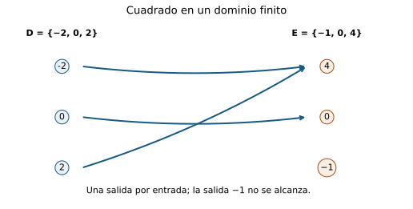
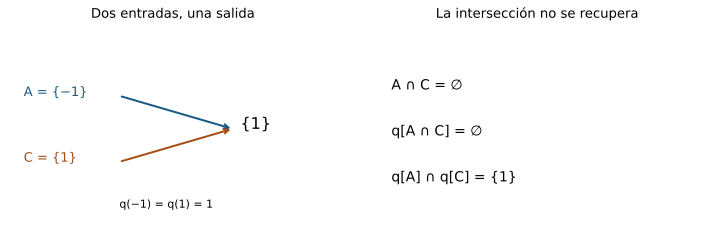
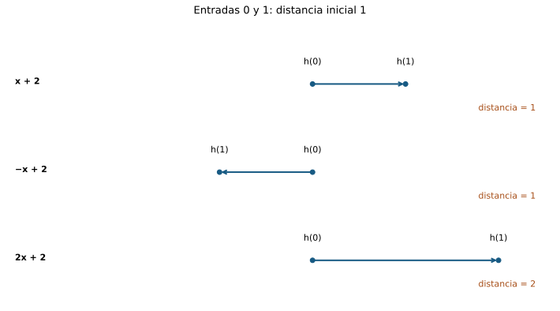
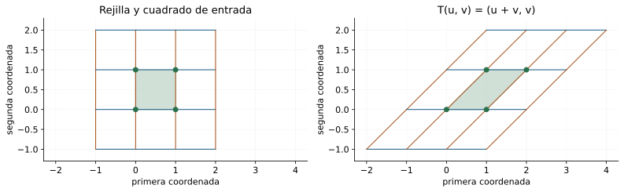
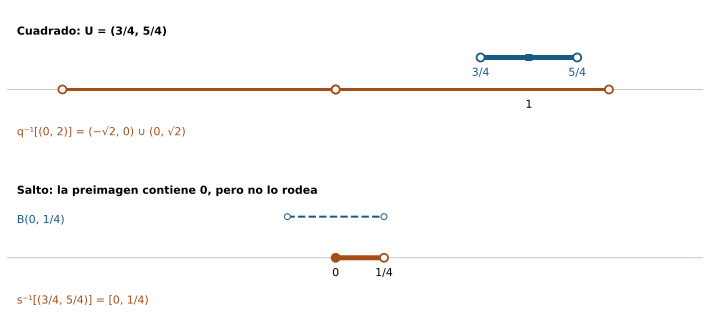

[Índice del libro](../para-matematicos/analisis-para-matematicos.html) · [Ejercicios de este capítulo](#ejercicios-12)

Una función transforma entradas en salidas y, al hacerlo, transporta conjuntos. Puede conservar información o perderla: fusionar puntos, omitir valores, invertir el orden y cambiar distancias. Queremos describir esas acciones sin confundir el objeto con su fórmula o con el dibujo de su gráfica.

La teoría elemental de funciones será nuestro punto de partida externo; las bolas y vecindades de C04 permitirán formular ventanas de entrada y salida. Reconstruiremos las leyes necesarias con testigos y pertenencias. No necesitaremos límites de funciones, continuidad o derivadas: primero aprenderemos a decir con precisión qué transporta una función.

## 12.1. Una función tiene un tipo

[]{#MA-SEC-ANM-01-012-001}

Escribir $x^2$ no dice todavía qué entradas admitimos ni en qué conjunto buscamos las salidas. Comparemos

$$
f:\mathbb R\to\mathbb R,\quad f(x)=x^2,
\qquad g:[0,\infty)\to[0,\infty),\quad g(x)=x^2.
$$

Ambas reglas dan $4$ al introducir $2$. Sin embargo, $-2$ pertenece al dominio de $f$ y no al de $g$. Tampoco tienen el mismo codominio. Coinciden numéricamente en sus entradas comunes, pero son funciones distintas. El tipo forma parte de lo que afirmamos.

### La asignación y sus tres datos

Una función $f:D\to E$ consta de un dominio $D$, un codominio $E$ y una asignación que a cada $x\in D$ hace corresponder exactamente un $f(x)\in E$. «Cada» impide dejar entradas sin salida; «exactamente un» impide asignar dos salidas distintas a una misma entrada. No impide que entradas distintas compartan salida.

Su **grafo** es el conjunto

$$
G_f=\{(x,f(x)):x\in D\}\subseteq D\times E.
$$

Adoptamos la convención tipada: dos funciones son iguales cuando sus dominios, sus codominios y sus asignaciones coinciden. Un grafo dibujado dentro de un plano puede ocultar el codominio declarado. Por ejemplo, las aplicaciones $\mathbb R\to\mathbb R$ y $\mathbb R\to[0,\infty)$ dadas por $x^2$ tienen el mismo conjunto de pares, pero distintos codominios; son objetos tipados distintos.

La regla $f(x)=\pm\sqrt{x}$, con las dos salidas admitidas para $x>0$, no define una función real. En cambio, $f(x)=x^2$ sí: cada entrada tiene una única salida, aunque $f(-2)=f(2)$. La dificultad de reconstruir una entrada a partir de la salida no viola la definición.

### Tres objetos que conviene separar

$f$ es una función; $f(2)=4$ es un valor; $G_f$ es un conjunto de pares. La gráfica cartesiana representa el grafo cuando ambos conjuntos son subconjuntos de $\mathbb R$. Las flechas entre conjuntos y una tabla representan la misma asignación desde otras perspectivas. Una tabla parcial sólo registra algunas entradas: por sí sola no determina los valores que faltan en un dominio infinito.

Para comparar funciones tipadas $f,g:D\to E$, basta comprobar $f(x)=g(x)$ para todo $x\in D$. Entonces cada par del grafo de una está en el de la otra y recíprocamente. La igualdad de grafos y tipos da igualdad de funciones. Comprobarlo sólo en tres entradas prueba únicamente tres igualdades numéricas.

En particular, $a:\mathbb N\to\mathbb R$, $a_n=n^2$, es una sucesión y su grafo tiene puntos $(n,n^2)$ con $n=0,1,2,\ldots$. No incluye entradas entre naturales. La función real $f(x)=x^2$ tiene otro dominio. No se debe completar el grafo discreto con una curva y declarar que el objeto sigue siendo la misma sucesión.

### El tipo impide errores de composición

Una fórmula también puede esconder una entrada prohibida. Si $h:\mathbb R\setminus\{0\}\to\mathbb R$ se define por $h(x)=1/x$, $h(0)$ no existe como evaluación de esa función. No se corrige esto cambiando el resultado: primero habría que definir otro objeto con otro dominio y una nueva asignación en cero.

La pregunta que acompañará al capítulo será: dado un conjunto de entradas, ¿qué salidas produce?, y dado un conjunto de salidas aceptables, ¿qué entradas lo alcanzan? Para responderla, debemos conservar $D$ y $E$ en cada paso.

{#fig-anm-c12-f01 fig-alt="En el dominio finito {-2,0,2}, el cuadrado asigna una salida a cada entrada; dos entradas comparten 4 y el codominio {-1,0,4} contiene una salida no alcanzada."}

### Antes de seguir

#### Microcontrol 1

[]{#MA-MIC-ANM-01-012-001}

¿Basta la fórmula $x^2$ para determinar una función?

[]{#MA-MSOL-ANM-01-012-001}

Ver solución del microcontrol 1

No. Deben declararse dominio, codominio y asignación. La fórmula puede definir funciones distintas al cambiar esos conjuntos.

La asignación indica cómo calcular una salida a partir de una entrada permitida, pero no decide cuáles entradas están permitidas ni qué conjunto de salidas se declara. Por ejemplo, el cuadrado sobre todos los reales admite entradas negativas, mientras su restricción a los no negativos no las admite. Además, declarar codominio real o no negativo cambia el tipo bajo la convención del capítulo. Antes de evaluar o componer hay que conocer los tres datos: dominio, codominio y regla.

#### Microcontrol 2

[]{#MA-MIC-ANM-01-012-002}

¿Qué diferencia hay entre $f$ y $f(2)$ si $f(x)=x^2$?

[]{#MA-MSOL-ANM-01-012-002}

Ver solución del microcontrol 2

$f$ es la función; si $2$ pertenece al dominio, $f(2)=4$ es un elemento del codominio.

La función $f$ contiene una asignación completa para todas las entradas de su dominio. La expresión $f(2)$ aplica esa asignación a una entrada concreta y produce el número cuatro. No podemos sustituir $f$ por cuatro en una composición ni tratar $f(2)$ como una regla que acepta nuevas entradas. La evaluación requiere comprobar primero $2\in D$; la fórmula aislada no autoriza una entrada que el dominio excluya.

#### Microcontrol 3

[]{#MA-MIC-ANM-01-012-003}

¿Incumple la definición de función que $f(-2)=f(2)$?

[]{#MA-MSOL-ANM-01-012-003}

Ver solución del microcontrol 3

No. Entradas distintas pueden compartir salida. Se exige una única salida para cada entrada.

En una función la unicidad se refiere a la salida de una entrada fijada. Para $x=2$ hay una única salida, cuatro; para $x=-2$ también hay una única salida, cuatro. No se ha asignado más de un resultado a ninguna entrada. La propiedad que prohíbe compartir salidas es la inyectividad, que no forma parte de la definición de función. Confundirlas excluiría indebidamente funciones tan habituales como el cuadrado.

#### Microcontrol 4

[]{#MA-MIC-ANM-01-012-004}

¿Qué conjunto contiene al grafo de $f:D\to E$?

[]{#MA-MSOL-ANM-01-012-004}

Ver solución del microcontrol 4

$D\times E$, pues cada par del grafo tiene entrada en $D$ y salida en $E$.

Cada evaluación produce un par ordenado $(x,f(x))$ con $x\in D$ y $f(x)\in E$. Por definición del producto cartesiano, ese par pertenece a $D\times E$. El grafo selecciona exactamente un par para cada entrada, no todos los pares del producto. En general $G_f$ es sólo un subconjunto: si existen varias salidas posibles en $E$, la asignación elige una para cada $x$.

#### Microcontrol 5

[]{#MA-MIC-ANM-01-012-005}

¿Son iguales dos funciones con el mismo grafo y codominios distintos bajo nuestra convención?

[]{#MA-MSOL-ANM-01-012-005}

Ver solución del microcontrol 5

No. El codominio forma parte del objeto tipado, aunque coincidan todos los pares.

El grafo registra las salidas alcanzadas, pero no todas las salidas declaradas como posibles en el codominio. Las dos aplicaciones del cuadrado $\mathbb R\to\mathbb R$ y $\mathbb R\to[0,\infty)$ tienen los mismos pares $(x,x^2)$. La primera deja sin alcanzar los números negativos de su codominio; la segunda alcanza cada elemento del suyo. Bajo nuestra convención, conservar el codominio como parte del objeto permite distinguir estas propiedades sin cambiar la asignación.

#### Microcontrol 6

[]{#MA-MIC-ANM-01-012-006}

¿Tres evaluaciones iguales prueban igualdad de funciones en $\mathbb R$?

[]{#MA-MSOL-ANM-01-012-006}

Ver solución del microcontrol 6

No. Se necesita el mismo tipo e igualdad de valores para toda entrada del dominio; tres entradas no cubren $\mathbb R$.

Si las entradas observadas son $r_1,r_2,r_3$, comparemos $f(x)=0$ con $g(x)=(x-r_1)(x-r_2)(x-r_3)$, ambas de $\mathbb R$ a $\mathbb R$. En las tres entradas coinciden, porque uno de los factores se anula. En una entrada distinta de las tres, el producto no es cero y las funciones difieren. Una muestra prueba igualdades puntuales; la igualdad de funciones exige un argumento válido para toda entrada del dominio.

#### Microcontrol 7

[]{#MA-MIC-ANM-01-012-007}

¿Puede evaluarse en cero $h:\mathbb R\setminus\{0\}\to\mathbb R$, $h(x)=1/x$?

[]{#MA-MSOL-ANM-01-012-007}

Ver solución del microcontrol 7

No: cero no pertenece al dominio, por lo que $h(0)$ no es una evaluación definida.

Para evaluar una función no basta con escribir su fórmula: la entrada debe estar en el conjunto que se declaró como dominio. Aquí cero está excluido y, además, el cociente $1/0$ no es un número real. Asignar por convenio algún valor en cero produciría una extensión diferente, con nuevo dominio y nueva regla en esa entrada. No sería una evaluación de la función $h$ que ya se había definido.

#### Microcontrol 8

[]{#MA-MIC-ANM-01-012-008}

¿Incluye el grafo de $a_n=n^2$ el punto $(1/2,1/4)$?

[]{#MA-MSOL-ANM-01-012-008}

Ver solución del microcontrol 8

No. $a:\mathbb N\to\mathbb R$ sólo admite índices naturales, con $\mathbb N=\{0,1,2,\ldots\}$; $1/2$ no es un índice.

Una sucesión es una función cuyo dominio son los naturales. Su grafo contiene $(0,0),(1,1),(2,4),\ldots$, pero ningún par cuya primera coordenada sea $1/2$. La función real del cuadrado sí contiene $(1/2,1/4)$, porque su dominio admite ese valor. Dibujar una curva entre los puntos discretos puede ayudar a comparar, pero introduce evaluaciones de otra función y no amplía automáticamente el dominio de la sucesión.

### Ejercicios de la sección 12.1

[]{#ejercicios-12}

#### Ejercicio 1. La misma regla, tres objetos

[]{#MA-EX-ANM-01-012-001}

Compara $f:\mathbb R\to\mathbb R$, $g:[0,\infty)\to\mathbb R$ y $h:[0,\infty)\to[0,\infty)$, todas dadas por $x^2$. Determina cuáles tienen el mismo grafo y cuáles son iguales como funciones tipadas.

[]{#MA-SOL-ANM-01-012-001}

Ver solución del ejercicio 1

$g$ y $h$ tienen exactamente los pares $(x,x^2)$ con $x\ge0$, luego el mismo grafo. Sus codominios difieren, así que no son iguales. El grafo de $f$ contiene además, por ejemplo, $(-1,1)$, ausente de los otros dos. $f$ tiene distinto dominio de $g$ y $h$. Ningún par es igual como función tipada. Todas coinciden numéricamente en entradas no negativas.

#### Ejercicio 2. Una relación que debe repararse

[]{#MA-EX-ANM-01-012-002}

En $D=\{0,1,2\}$ y $E=\{0,1,4\}$ considera $R=\{(0,0),(1,1),(1,4)\}$. Explica por qué no es el grafo de una función $D\to E$ y construye una reparación eliminando un par y añadiendo otro.

[]{#MA-SOL-ANM-01-012-002}

Ver solución del ejercicio 2

La entrada $1$ tiene dos salidas distintas y la entrada $2$ no tiene ninguna. Eliminamos $(1,4)$ y añadimos $(2,4)$; quedan $(0,0),(1,1),(2,4)$. Cada entrada de $D$ tiene exactamente una salida en $E$. Sólo borrar o sólo añadir no repararía las dos deficiencias.

#### Ejercicio 3. Ninguna tabla finita decide toda la función

[]{#MA-EX-ANM-01-012-003}

Dado un conjunto finito $A\subseteq\mathbb R$, construye dos funciones distintas $\mathbb R\to\mathbb R$ que coincidan en todas las entradas de $A$.

[]{#MA-SOL-ANM-01-012-003}

Ver solución del ejercicio 3

Como $A$ es finito y $\mathbb R$ infinito, existe $t\in\mathbb R\setminus A$. Por ejemplo, si $A$ no es vacío, $t=1+\sum_{a\in A}|a|$ supera todo elemento de $A$; si es vacío, sirve $t=0$. Definimos $f(x)=0$ para todo real y $g(x)=1$ cuando $x=t$, $g(x)=0$ en otro caso. Son funciones del mismo tipo, coinciden en $A$ y difieren en $t$. La tabla de $A$ no determina sus valores restantes.

#### Ejercicio 4. Identidad extensional

[]{#MA-EX-ANM-01-012-004}

Prueba que para $f,g:D\to E$ la igualdad $G_f=G_g$ equivale a $f(x)=g(x)$ para todo $x\in D$. Explica por qué deben fijarse los tipos para concluir $f=g$.

[]{#MA-SOL-ANM-01-012-004}

Ver solución del ejercicio 4

Si los grafos coinciden, $(x,f(x))\in G_g$, de modo que por unicidad de salida de $g$, $f(x)=g(x)$. Recíprocamente, igualdad de valores para toda entrada hace que cada par $(x,f(x))$ sea $(x,g(x))$ y viceversa; los grafos coinciden. Con dominio y codominio iguales, la convención tipada da $f=g$. Con codominios diferentes, la igualdad de grafos no basta, como muestran las dos versiones del cuadrado.

#### Ejercicio 5. Discreto frente a real

[]{#MA-EX-ANM-01-012-005}

Para $a:\mathbb N\to\mathbb R$, $a_n=2n+1$, y $f:\mathbb R\to\mathbb R$, $f(x)=2x+1$, determina la relación entre sus grafos. ¿Es la sucesión una recta?

[]{#MA-SOL-ANM-01-012-005}

Ver solución del ejercicio 5

$G_a=\{(n,2n+1):n\in\mathbb N\}\subsetneq G_f$. La inclusión es estricta porque $(1/2,2)$ pertenece a $G_f$ y no a $G_a$. La sucesión tiene dominio $\mathbb N=\{0,1,\ldots\}$ y grafo discreto; la recta representa el grafo de $f$. El mismo cálculo en entradas naturales no identifica los dos objetos.

## 12.2. Imagen: transportar un conjunto

[]{#MA-SEC-ANM-01-012-002}

Al introducir una entrada, obtenemos un valor. Al introducir un conjunto de entradas, reunimos las salidas que realmente se alcanzan. Si $f:D\to E$ y $A\subseteq D$, su **imagen directa** es

$$
f[A]=\{y\in E:\text{existe }x\in A\text{ con }f(x)=y\}.
$$

Usamos corchetes para distinguir esta operación de $f(x)$. Así, $f[\{2\}]=\{f(2)\}$ es un conjunto unitario, mientras que $f(2)$ es un elemento del codominio. El conjunto $f[D]$, imagen total, puede ser menor que $E$. El codominio expresa salidas permitidas; la imagen expresa salidas alcanzadas.

### La prueba exige un testigo

Para afirmar $y\in f[A]$ hay que encontrar una entrada $x\in A$ con salida $y$. Para calcular una imagen exactamente no basta producir algunos valores: debemos probar que ninguna otra salida aparece y que todas las salidas anunciadas se alcanzan.

Sea $q:\mathbb R\to\mathbb R$, $q(x)=x^2$, y $A=[-2,1]$. Afirmamos $q[A]=[0,4]$. Si $x\in A$, entonces $|x|\le2$ y $0\le x^2\le4$, de modo que $q[A]\subseteq[0,4]$. Recíprocamente, para $y\in[0,4]$, la raíz real no negativa $\sqrt y$ existe y satisface $0\le\sqrt y\le2$. La entrada $x=-\sqrt y$ está en $[-2,0]\subseteq A$ y $x^2=y$. Por tanto $[0,4]\subseteq q[A]$. La existencia y unicidad de la raíz no negativa se acreditaron en §10.7; no las deducimos de un teorema posterior sobre funciones.

Observe por qué elegimos la raíz negativa: $\sqrt4=2$ no pertenece a $A$. Una solución algebraica de $x^2=y$ que queda fuera del dominio considerado no sirve como testigo. La imagen depende del conjunto de entradas, no sólo de la ecuación.

![El cuadrado transporta \[-2,1\] a \[0,4\]. Seleccionar las salidas (1,4\] recupera dos ramas: \[-2,-1) y (1,2\]. Imagen y preimagen responden preguntas distintas.](../../assets/books/anm/C12/C12-F02.svg){#fig-anm-c12-f02 fig-alt="El cuadrado transporta \[-2,1\] a \[0,4\]. Seleccionar las salidas (1,4\] recupera dos ramas: \[-2,-1) y (1,2\]. Imagen y preimagen responden preguntas distintas."}

### La imagen reúne, pero no cuenta multiplicidades

Para el conjunto finito $A=\{-2,-1,1,2\}$, $q[A]=\{1,4\}$. Cuatro entradas producen dos salidas. Los conjuntos no guardan repeticiones: no escribimos dos copias de $1$. La identificación de entradas será responsable de algunas pérdidas de información.

Si $A\subseteq C\subseteq D$, entonces $f[A]\subseteq f[C]$. En efecto, un testigo $x\in A$ también está en $C$. La misma entrada sirve en ambas definiciones. Esta propiedad se llama monotonía de la operación de imagen respecto de la inclusión; no dice que $f$ sea creciente como función de números reales. El cuadrado respeta esta inclusión aunque no sea creciente en toda la recta.

Además,

$$
f[\varnothing]=\varnothing,\qquad f[\{x\}]=\{f(x)\}.
$$

La primera igualdad se debe a la inexistencia de testigos en el vacío. En la segunda, la única entrada permitida es $x$. Aunque $D$ sea vacío, la definición sigue funcionando: la función vacía $\varnothing\to E$ tiene imagen vacía.

### La imagen de una ventana debe calcularse

No inferimos $q[(-2,2)]=(q(-2),q(2))$. Los extremos ni siquiera pertenecen al conjunto de entradas, y esa expresión sería $(4,4)=\varnothing$. El cálculo correcto es $[0,4)$: cero se alcanza, todo cuadrado de una entrada del intervalo es menor que cuatro y, para cada $0\le y<4$, $\sqrt y\in(-2,2)$ sirve como testigo. Transportar un intervalo requiere estudiar el mecanismo de la función; no consiste en transportar ciegamente sus extremos.

### Antes de seguir

#### Microcontrol 9

[]{#MA-MIC-ANM-01-012-009}

¿Qué testigo exige $y\in f[A]$?

[]{#MA-MSOL-ANM-01-012-009}

Ver solución del microcontrol 9

Una entrada $x\in A$ con $f(x)=y$. Sin pertenencia a $A$, resolver la ecuación no basta.

La definición de imagen se lee como una condición existencial: $y\in f[A]$ equivale a que exista $x\in A$ con $f(x)=y$. Hay que comprobar tanto la ecuación como la pertenencia del testigo. En el cuadrado, la ecuación $x^2=4$ tiene soluciones dos y menos dos, pero si $A=\{-2\}$ sólo menos dos acredita que cuatro pertenece a la imagen. Una raíz fuera de $A$ no satisface la definición.

#### Microcontrol 10

[]{#MA-MIC-ANM-01-012-010}

¿Son el mismo objeto $f(2)$ y $f[\{2\}]$?

[]{#MA-MSOL-ANM-01-012-010}

Ver solución del microcontrol 10

No: el primero es un valor; el segundo es el conjunto unitario $\{f(2)\}$, si $2$ está en el dominio.

Evaluar actúa sobre una entrada y devuelve una salida. Tomar imagen actúa sobre un conjunto de entradas y devuelve un conjunto de salidas. Si $f(x)=x^2$, entonces $f(2)=4$ y $f[\{2\}]=\{4\}$. El número cuatro y el conjunto que lo contiene no son el mismo objeto. Las llaves y los corchetes hacen visible esta diferencia de tipos, que importa al formular inclusiones o pertenencias.

#### Microcontrol 11

[]{#MA-MIC-ANM-01-012-011}

Para $q(x)=x^2$, ¿cuál es $q[\{-2,2\}]$?

[]{#MA-MSOL-ANM-01-012-011}

Ver solución del microcontrol 11

$\{4\}$. La imagen es un conjunto y no conserva dos copias del mismo valor.

Comprobamos primero que ambas entradas dan cuatro. Así cualquier elemento de la imagen tiene que ser cuatro. En sentido contrario, cuatro sí pertenece a la imagen porque, por ejemplo, menos dos es un testigo admitido. Se han probado ambas inclusiones para obtener $q[\{-2,2\}]=\{4\}$. Los conjuntos no registran multiplicidades: dos entradas que comparten salida no producen dos elementos distintos en el conjunto imagen.

#### Microcontrol 12

[]{#MA-MIC-ANM-01-012-012}

¿Cuál es la imagen del conjunto vacío?

[]{#MA-MSOL-ANM-01-012-012}

Ver solución del microcontrol 12

$f[\varnothing]=\varnothing$, porque no existe una entrada que pueda ser testigo.

Si hubiera alguna salida $y$ en $f[\varnothing]$, la definición exigiría una entrada $x\in\varnothing$ con $f(x)=y$. No existe tal entrada, de modo que ninguna salida satisface la condición. Por eso la imagen es vacía, independientemente de la regla de la función. No hay que evaluar en «el vacío»: tomar imagen del vacío significa buscar testigos entre sus elementos, y no hay ninguno.

#### Microcontrol 13

[]{#MA-MIC-ANM-01-012-013}

¿Implica $A\subseteq C$ que $f[A]\subseteq f[C]$?

[]{#MA-MSOL-ANM-01-012-013}

Ver solución del microcontrol 13

Sí, si ambos son subconjuntos del dominio. Todo testigo en $A$ también pertenece a $C$.

Tomemos un elemento arbitrario $y\in f[A]$. Existe un testigo $x\in A$ con $f(x)=y$. La inclusión $A\subseteq C$ permite usar exactamente la misma entrada como elemento de $C$, así que $y\in f[C]$. El argumento no requiere inyectividad, sobreyectividad ni orden en las entradas. Es una propiedad del transporte de conjuntos: aumentar el conjunto de entradas no elimina ninguna salida que ya se alcanzaba.

#### Microcontrol 14

[]{#MA-MIC-ANM-01-012-014}

¿Tiene que coincidir $f[D]$ con el codominio $E$?

[]{#MA-MSOL-ANM-01-012-014}

Ver solución del microcontrol 14

No. Sólo $f[D]\subseteq E$ es obligatorio. La igualdad caracteriza sobreyectividad.

La definición exige que cada salida esté en $E$, pero permite elementos de $E$ sin ninguna entrada que los alcance. Por ejemplo, para $q:\mathbb R\to\mathbb R$, los negativos pertenecen al codominio pero no a la imagen, que es $[0,\infty)$. La igualdad $f[D]=E$ añade la exigencia de alcanzar cada elemento declarado y se llama sobreyectividad. No puede deducirse simplemente de que la función esté bien definida.

#### Microcontrol 15

[]{#MA-MIC-ANM-01-012-015}

¿Qué entrada de $[-2,1]$ alcanza $4$ bajo el cuadrado?

[]{#MA-MSOL-ANM-01-012-015}

Ver solución del microcontrol 15

$-2$, pues $(-2)^2=4$ y $-2\in[-2,1]$. La otra raíz, $2$, no es un testigo en ese intervalo.

Resolver $x^2=4$ entrega las candidatas $x=-2$ y $x=2$. El intervalo incluye menos dos, porque es su extremo izquierdo cerrado, pero no incluye dos, que supera el extremo derecho uno. Sólo la primera candidata sirve para este conjunto de entradas. Comprobar los límites del dominio es parte del cálculo de la imagen; las soluciones algebraicas de la ecuación por sí solas no identifican los testigos admitidos.

#### Microcontrol 16

[]{#MA-MIC-ANM-01-012-016}

¿Cuál es $q[(-2,2)]$ para $q(x)=x^2$?

[]{#MA-MSOL-ANM-01-012-016}

Ver solución del microcontrol 16

$[0,4)$: todo cuadrado de esas entradas está allí y, para $0\le y<4$, $x=\sqrt y\in(-2,2)$ alcanza $y$.

Hay dos direcciones. Si $-2<x<2$, entonces $0\le x^2<4$, por lo que la imagen queda contenida en $[0,4)$. A la inversa, para cada $y$ con $0\le y<4$, la raíz no negativa existe y satisface $0\le\sqrt y<2$; es una entrada permitida con cuadrado $y$. Cero se alcanza en cero y cuatro sólo se alcanzaría en las entradas excluidas dos y menos dos. Esto explica los extremos abierto y cerrado de la respuesta.

### Ejercicios de la sección 12.2

#### Ejercicio 6. Imagen exacta de un intervalo

[]{#MA-EX-ANM-01-012-006}

Calcula la imagen de $[-3,2)$ por $q:\mathbb R\to\mathbb R$, $q(x)=x^2$, probando ambas inclusiones.

[]{#MA-SOL-ANM-01-012-006}

Ver solución del ejercicio 6

La imagen es $[0,9]$. Toda entrada tiene $|x|\le3$, así que su cuadrado está en ese intervalo. Para $0\le y\le9$, la entrada $x=-\sqrt y\in[-3,0]\subseteq[-3,2)$ alcanza $y$. En particular $9$ se alcanza en $-3$, aunque $3$ no esté disponible; y cero se alcanza en cero.

#### Ejercicio 7. Unión con dos piezas

[]{#MA-EX-ANM-01-012-007}

Calcula $q[[-2,-1]\cup(0,1)]$ para el cuadrado real. Justifica extremos y huecos.

[]{#MA-SOL-ANM-01-012-007}

Ver solución del ejercicio 7

La primera pieza tiene imagen $[1,4]$: sus cuadrados están allí y $-\sqrt y$ alcanza cada $y$ de ese intervalo. La segunda tiene imagen $(0,1)$, con testigo $\sqrt y$. Por tanto la imagen de la unión es $(0,4]$. El valor $1$ sí se alcanza en $-1$, cero no se alcanza porque ninguna entrada es cero, y $4$ sí se alcanza en $-2$.

#### Ejercicio 8. Imagen y cardinalidad finita

[]{#MA-EX-ANM-01-012-008}

Si $A\subseteq D$ es finito y $f:D\to E$, prueba que $|f[A]|\le|A|$ y que hay igualdad si y sólo si $f|_A$ es inyectiva.

[]{#MA-SOL-ANM-01-012-008}

Ver solución del ejercicio 8

Enumeramos $A=\{a_1,\ldots,a_n\}$ con entradas distintas. Su imagen consta de los $n$ valores listados, eliminando repeticiones, por lo que tiene a lo sumo $n$ elementos. Si la restricción es inyectiva, todos son distintos y hay $n$. Si no lo es, dos valores de la lista coinciden, y tras eliminar esa repetición quedan a lo sumo $n-1$. Para $A=\varnothing$, ambas cardinalidades son cero y la restricción es inyectiva de manera vacua.

#### Ejercicio 9. La inclusión no estudia el orden

[]{#MA-EX-ANM-01-012-009}

Construye una función real que no sea no decreciente ni no creciente y demuestra que su operación de imagen conserva inclusiones de conjuntos.

[]{#MA-SOL-ANM-01-012-009}

Ver solución del ejercicio 9

Sirve $q(x)=x^2$. No es no decreciente porque $-2<-1$ pero $4>1$; no es no creciente porque $1<2$ pero $1<4$. Sin embargo, para $A\subseteq C$, cada salida de $q[A]$ tiene testigo $x\in A\subseteq C$, luego pertenece a $q[C]$. Son propiedades distintas: inclusión de conjuntos frente a comparación de valores.

#### Ejercicio 10. Imagen de una diferencia

[]{#MA-EX-ANM-01-012-010}

Prueba $f[A]\setminus f[C]\subseteq f[A\setminus C]$ para $A,C\subseteq D$ y da un ejemplo en que la inclusión sea estricta.

[]{#MA-SOL-ANM-01-012-010}

Ver solución del ejercicio 10

Si $y\in f[A]\setminus f[C]$, existe $a\in A$ con $f(a)=y$. Ese $a$ no puede estar en $C$, pues entonces $y\in f[C]$. Así $a\in A\setminus C$, que prueba la inclusión. Para $q(x)=x^2$, $A=\{-1,1\}$ y $C=\{1\}$, el lado izquierdo es vacío y el derecho es $q[\{-1\}]=\{1\}$. Una entrada fuera de $C$ puede compartir salida con otra dentro de $C$.

## 12.3. Preimagen: seleccionar por la salida

[]{#MA-SEC-ANM-01-012-003}

Ahora fijamos las salidas aceptables. Si $f:D\to E$ y $B\subseteq E$, definimos la **preimagen**

$$
f^{-1}[B]=\{x\in D:f(x)\in B\}.
$$

Es un subconjunto del dominio. No evaluamos una función inversa; comprobamos una condición sobre la salida de cada entrada. La preimagen está definida para cualquier función, incluso cuando muchas entradas comparten salida o algunas salidas nunca se alcanzan.

### Fibras: todas las entradas de una misma salida

La preimagen $f^{-1}[\{y\}]$ se llama **fibra sobre $y$**. Para $q:\mathbb R\to\mathbb R$, $q(x)=x^2$,

$$
q^{-1}[\{4\}]=\{-2,2\},\qquad
q^{-1}[\{0\}]=\{0\},\qquad
q^{-1}[\{-1\}]=\varnothing.
$$

Una fibra puede tener dos elementos, uno o ninguno. Lo que es único en una función es la salida de cada entrada, no la entrada de cada salida. La notación $q^{-1}(4)$ como evaluación de una inversa no está autorizada: $q:\mathbb R\to\mathbb R$ no es biyectiva.

Dos fibras distintas son disjuntas. Si $x$ estuviera en las fibras de $y$ y $z$, tendríamos $f(x)=y$ y $f(x)=z$, luego $y=z$. Aquí gastamos exactamente la unicidad de salida.

### Resolver la condición y después respetar el dominio

Para el mismo cuadrado,

$$
q^{-1}[(1,4]]=\{x\in\mathbb R:1<x^2\le4\}
=[-2,-1)\cup(1,2].
$$

La condición equivale a $1<|x|\le2$. Por eso incluimos $-2$ y $2$, excluimos $-1$ y $1$, y conservamos dos ramas. La fibra no elige automáticamente una raíz positiva.

Si cambiamos la función a $r:[0,\infty)\to\mathbb R$, $r(x)=x^2$, la misma condición produce

$$
r^{-1}[(1,4]]=(1,2].
$$

La rama negativa desaparece porque nunca perteneció al dominio de $r$. No desaparece por una modificación del conjunto de salidas.

### Dos identidades que orientan la selección

Para toda función $f:D\to E$,

$$
f^{-1}[E]=D,\qquad f^{-1}[\varnothing]=\varnothing.
$$

Toda entrada tiene salida en $E$; ninguna tiene salida en el vacío. También, si $B\subseteq H\subseteq E$, entonces $f^{-1}[B]\subseteq f^{-1}[H]$: una salida aceptada por $B$ es aceptada por $H$.

Hay una identidad más informativa:

$$
f[f^{-1}[B]]=B\cap f[D].
$$

Para probar la inclusión de izquierda a derecha, si $y=f(x)$ con $x\in f^{-1}[B]$, entonces $y\in B$ y $y\in f[D]$. Recíprocamente, si $y\in B\cap f[D]$, existe $x\in D$ con $f(x)=y$; como $y\in B$, ese $x$ está en $f^{-1}[B]$, luego $y$ está en su imagen. La igualdad dice que volver hacia delante recupera sólo las salidas solicitadas que podían alcanzarse.

Si $B=\{-1,4\}$ para $q$, la preimagen es $\{-2,2\}$ y su imagen es $\{4\}$: el valor imposible $-1$ no reaparece. La preimagen es una selección de entradas compatibles, no una promesa de que toda salida tenga entrada.

### Antes de seguir

#### Microcontrol 17

[]{#MA-MIC-ANM-01-012-017}

¿En qué conjunto vive $f^{-1}[B]$ si $f:D\to E$?

[]{#MA-MSOL-ANM-01-012-017}

Ver solución del microcontrol 17

En $D$: por definición es el conjunto de entradas del dominio cuya salida pertenece a $B\subseteq E$.

La preimagen no transporta salidas hacia nuevas salidas: selecciona entradas que cumplen una condición. Su definición es $f^{-1}[B]=\{x\in D:f(x)\in B\}$. Cada elemento que devuelve está, por construcción, en $D$. El conjunto $B$ vive en el codominio, mientras su preimagen vive en el dominio. Mantener separados esos universos evita comparar objetos de tipos diferentes o tomar complementos en el conjunto equivocado.

#### Microcontrol 18

[]{#MA-MIC-ANM-01-012-018}

¿Se necesita que $f$ tenga función inversa para tomar preimágenes?

[]{#MA-MSOL-ANM-01-012-018}

Ver solución del microcontrol 18

No. La preimagen comprueba $f(x)\in B$ para $x\in D$; existe para cualquier función.

Para decidir si una entrada pertenece a la preimagen, sólo la evaluamos y comprobamos si su salida está en $B$. Ese procedimiento tiene sentido aunque varias entradas compartan salida o algunas salidas no se alcancen. La notación $f^{-1}[B]$ designa una operación sobre conjuntos; no afirma que exista una función inversa que devuelva una entrada única para cada salida. El cuadrado real permite preimágenes aunque no sea inyectivo.

#### Microcontrol 19

[]{#MA-MIC-ANM-01-012-019}

¿Cuál es la fibra del cuadrado real sobre $4$?

[]{#MA-MSOL-ANM-01-012-019}

Ver solución del microcontrol 19

$\{-2,2\}$: ambas entradas y sólo ellas satisfacen $x^2=4$.

La fibra sobre cuatro es la preimagen del conjunto unitario $\{4\}$. Resolver $x^2=4$ equivale a resolver $(x-2)(x+2)=0$, por lo que las únicas candidatas son dos y menos dos. Ambas pertenecen al dominio real y verifican la ecuación. La fibra contiene dos elementos, lo que muestra cómo una preimagen puede recuperar varias entradas de una sola salida sin que haya una inversa como función.

#### Microcontrol 20

[]{#MA-MIC-ANM-01-012-020}

¿Cuál es la fibra del cuadrado real sobre $-1$?

[]{#MA-MSOL-ANM-01-012-020}

Ver solución del microcontrol 20

$\varnothing$, porque un cuadrado real es no negativo.

Todo cuadrado real cumple $x^2\ge0$, por lo que ningún $x\in\mathbb R$ puede satisfacer $x^2=-1$. La condición que define la fibra no tiene testigos y su conjunto es vacío. La función sigue siendo válida hacia codominio real: no se exige que todos sus elementos sean alcanzados. Una fibra vacía identifica precisamente una salida del codominio que no pertenece a la imagen.

#### Microcontrol 21

[]{#MA-MIC-ANM-01-012-021}

¿Cuál es $f^{-1}[E]$?

[]{#MA-MSOL-ANM-01-012-021}

Ver solución del microcontrol 21

$D$, pues toda entrada del dominio tiene salida en el codominio.

Para cualquier $x\in D$, la definición de función garantiza $f(x)\in E$, así que $x\in f^{-1}[E]$. Esto prueba $D\subseteq f^{-1}[E]$. La inclusión contraria está incorporada en la definición de preimagen, que sólo admite entradas de $D$. Juntas dan igualdad. El resultado no necesita sobreyectividad: todas las entradas producen alguna salida permitida, aunque no se utilicen todas las salidas del codominio.

#### Microcontrol 22

[]{#MA-MIC-ANM-01-012-022}

¿Cuál es $q^{-1}[(1,4]]$ para el cuadrado en $\mathbb R$?

[]{#MA-MSOL-ANM-01-012-022}

Ver solución del microcontrol 22

$[-2,-1)\cup(1,2]$, ya que $1<x^2\le4$ equivale a $1<|x|\le2$.

La condición de pertenencia es $1<x^2\le4$. Equivale a pedir que la magnitud de la entrada sea mayor que uno y menor o igual que dos. Las entradas positivas forman $(1,2]$; las negativas forman $[-2,-1)$. Los valores dos y menos dos se incluyen porque su cuadrado cuatro está incluido; uno y menos uno se excluyen porque su cuadrado uno no lo está. El conjunto tiene dos ramas, no un intervalo único.

#### Microcontrol 23

[]{#MA-MIC-ANM-01-012-023}

¿Cómo cambia esa preimagen si el dominio se restringe a $[0,\infty)$?

[]{#MA-MSOL-ANM-01-012-023}

Ver solución del microcontrol 23

Se recorta por el nuevo dominio y queda $(1,2]$. Las entradas negativas dejan de estar disponibles.

La regla sigue siendo el cuadrado, pero la nueva función sólo admite entradas no negativas. Por tanto tomamos la preimagen real anterior y la intersectamos con $[0,\infty)$. Toda la rama negativa desaparece y queda $(1,2]$. No cambia la condición sobre la salida; cambia el conjunto en el que buscamos sus testigos. Restringir una función puede cambiar sus preimágenes aunque sus valores coincidan donde ambas están definidas.

#### Microcontrol 24

[]{#MA-MIC-ANM-01-012-024}

¿Qué recupera $f[f^{-1}[B]]$?

[]{#MA-MSOL-ANM-01-012-024}

Ver solución del microcontrol 24

$B\cap f[D]$. Recupera exactamente las salidas de $B$ que la función realmente alcanza, no las salidas imposibles.

Si $y\in f[f^{-1}[B]]$, existe una entrada cuya salida es $y$ y que cumple $f(x)\in B$. Así $y$ está tanto en $B$ como en la imagen de $D$. A la inversa, si $y\in B\cap f[D]$, un testigo $x\in D$ de $f(x)=y$ pertenece a $f^{-1}[B]$ y permite recuperar $y$ al tomar imagen. Las dos direcciones muestran por qué las salidas de $B$ que nunca se alcanzan quedan fuera del resultado.

### Ejercicios de la sección 12.3

#### Ejercicio 11. Selección de dos bandas

[]{#MA-EX-ANM-01-012-011}

Calcula $q^{-1}[[0,1)\cup\{4\}]$ para $q:\mathbb R\to\mathbb R$, $q(x)=x^2$.

[]{#MA-SOL-ANM-01-012-011}

Ver solución del ejercicio 11

La condición $0\le x^2<1$ equivale a $|x|<1$, y $x^2=4$ equivale a $x=-2$ o $x=2$. Por tanto la preimagen es $(-1,1)\cup\{-2,2\}$. Se excluyen $\pm1$ por la desigualdad estricta, y se incluyen cero y las dos raíces de cuatro.

#### Ejercicio 12. El dominio recorta la respuesta

[]{#MA-EX-ANM-01-012-012}

Sea $f:[-1,3)\to\mathbb R$, $f(x)=x^2$. Calcula $f^{-1}[(1,4]]$.

[]{#MA-SOL-ANM-01-012-012}

Ver solución del ejercicio 12

En toda la recta la condición da $[-2,-1)\cup(1,2]$. Intersectando con el dominio $[-1,3)$ desaparece la rama negativa, incluido $-1$ que además no cumple $x^2>1$. Queda $(1,2]$. Ambas inclusiones siguen de resolver la condición y exigir pertenencia al dominio.

#### Ejercicio 13. Las fibras particionan el dominio

[]{#MA-EX-ANM-01-012-013}

Para $f:D\to E$, demuestra que las fibras sobre los elementos de $f[D]$ son no vacías, disjuntas dos a dos y su unión es $D$.

[]{#MA-SOL-ANM-01-012-013}

Ver solución del ejercicio 13

Cada $y\in f[D]$ tiene un testigo de entrada, así que su fibra no es vacía. Si una entrada pertenece a las fibras de $y,z$, su única salida es tanto $y$ como $z$, luego $y=z$. Cada $x\in D$ pertenece a la fibra sobre $f(x)\in f[D]$, y toda fibra es subconjunto de $D$; su unión es exactamente $D$. Si $D$ es vacío, la familia es vacía y su unión también.

#### Ejercicio 14. Recuperar todas las salidas solicitadas

[]{#MA-EX-ANM-01-012-014}

Prueba que $f[f^{-1}[B]]=B$ para todo $B\subseteq E$ si y sólo si $f:D\to E$ es sobreyectiva.

[]{#MA-SOL-ANM-01-012-014}

Ver solución del ejercicio 14

Si es sobreyectiva, $f[D]=E$ y la identidad del texto da $f[f^{-1}[B]]=B\cap E=B$. Recíprocamente, aplicamos la hipótesis a $B=E$: como $f^{-1}[E]=D$, obtenemos $f[D]=E$, que es sobreyectividad. No se necesita inyectividad: puede haber varias entradas para cada salida.

#### Ejercicio 15. La preimagen conoce la función

[]{#MA-EX-ANM-01-012-015}

Sean $f,g:D\to E$. Si $f^{-1}[B]=g^{-1}[B]$ para todo $B\subseteq E$, demuestra que $f=g$.

[]{#MA-SOL-ANM-01-012-015}

Ver solución del ejercicio 15

Para una entrada cualquiera $x\in D$, tomamos $B=\{f(x)\}$. Entonces $x\in f^{-1}[B]=g^{-1}[B]$, luego $g(x)\in\{f(x)\}$ y $g(x)=f(x)$. Vale para toda entrada y los tipos coinciden, así que las funciones son iguales. Si $D$ es vacío, los dos grafos son vacíos y la conclusión también vale. El conjunto de prueba puede elegirse después de fijar la entrada porque la hipótesis cubre todos los subconjuntos.

## 12.4. Qué operaciones sobreviven al transporte

[]{#MA-SEC-ANM-01-012-004}

Unir dos grupos de entradas y luego transportarlos produce las mismas salidas que transportarlos por separado y unir sus imágenes. Intersectar exige más cuidado: una salida común puede venir de entradas distintas.

Fijemos $f:D\to E$, $A,C\subseteq D$ y $B,H\subseteq E$.

### La imagen y sus testigos

Tenemos

$$
f[A\cup C]=f[A]\cup f[C],\qquad
f[A\cap C]\subseteq f[A]\cap f[C].
$$

En la primera igualdad, $y$ pertenece al lado izquierdo si existe $x$ con $f(x)=y$ y $x\in A$ o $x\in C$. Esto equivale a que $y$ tenga un testigo en alguno de los dos conjuntos, es decir, a pertenecer a alguna imagen. Ambas implicaciones usan el mismo testigo escogido.

Para la segunda, un testigo en $A\cap C$ pertenece a los dos conjuntos. Pero en sentido contrario, $y\in f[A]\cap f[C]$ sólo da $a\in A$ y $c\in C$ con $f(a)=f(c)=y$. No sabemos que $a=c$.

Con $q(x)=x^2$, $A=\{-1\}$ y $C=\{1\}$, la intersección de entradas es vacía, mientras que las dos imágenes son $\{1\}$. Así, la inclusión puede ser estricta. Si $f$ es **inyectiva**, es decir, $f(a)=f(c)$ implica $a=c$, los dos testigos coinciden y pertenecen a $A\cap C$. En ese caso obtenemos igualdad.

{#fig-anm-c12-f03 fig-alt="Una salida en ambas imágenes puede tener dos testigos diferentes. Para convertirlos en una entrada común se necesita inyectividad."}

### La preimagen conserva las operaciones

Para una entrada fija $x\in D$ hay una única salida que podemos comparar con ambos conjuntos. Por eso las siguientes equivalencias son exactas:

$$
\begin{aligned}
x\in f^{-1}[B\cup H]&\iff f(x)\in B\text{ o }f(x)\in H,\\
x\in f^{-1}[B\cap H]&\iff f(x)\in B\text{ y }f(x)\in H,\\
x\in f^{-1}[E\setminus B]&\iff f(x)\notin B.
\end{aligned}
$$

La primera condición equivale a pertenecer a $f^{-1}[B]\cup f^{-1}[H]$; la segunda, a $f^{-1}[B]\cap f^{-1}[H]$; la tercera, a $D\setminus f^{-1}[B]$. Por extensionalidad,

$$
\begin{aligned}
f^{-1}[B\cup H]&=f^{-1}[B]\cup f^{-1}[H],\\
f^{-1}[B\cap H]&=f^{-1}[B]\cap f^{-1}[H],\\
f^{-1}[E\setminus B]&=D\setminus f^{-1}[B].
\end{aligned}
$$

Ninguna de estas pruebas necesita inyectividad o sobreyectividad. Sí necesita los complementos correctos: a la izquierda complementamos dentro de $E$, a la derecha dentro de $D$. El criterio $f(x)\in B\setminus H$ equivale a $f(x)\in B$ y $f(x)\notin H$; por el mismo argumento,

$$
f^{-1}[B\setminus H]=f^{-1}[B]\setminus f^{-1}[H].
$$

### Qué recupera la vuelta al dominio

Siempre $A\subseteq f^{-1}[f[A]]$, pues cada $a\in A$ tiene su salida en $f[A]$. Para $q$ y $A=\{1\}$, el lado derecho es $\{-1,1\}$: hemos añadido entradas que comparten salida con alguna entrada original. Llamaremos a este conjunto la **saturación de $A$ por las fibras**.

Si $f$ es inyectiva, una entrada $x$ del lado derecho comparte salida con algún $a\in A$; entonces $x=a$, y la inclusión se convierte en igualdad. La hipótesis se utiliza para recuperar la entrada y no para justificar la existencia de preimagen.

La imagen tampoco conserva complementos en general. Para el cuadrado, $q[\mathbb R\setminus\{1\}]=[0,\infty)$ porque el valor $1$ aún se alcanza en $-1$. En cambio, $\mathbb R\setminus q[\{1\}]=\mathbb R\setminus\{1\}$. Identificar entradas y omitir salidas del codominio impide una ley de complementos. No confundamos esa pérdida con las leyes exactas de selección hacia atrás.

### Antes de seguir

#### Microcontrol 25

[]{#MA-MIC-ANM-01-012-025}

¿La imagen conserva la unión de dos conjuntos de entradas?

[]{#MA-MSOL-ANM-01-012-025}

Ver solución del microcontrol 25

Sí: $f[A\cup C]=f[A]\cup f[C]$. Un testigo en la unión pertenece a uno de los conjuntos, y recíprocamente.

Una salida en la imagen de $A\cup C$ tiene una entrada testigo en esa unión. Esa entrada pertenece a $A$ o a $C$, así que la salida está en una de sus imágenes. En la dirección inversa, un testigo en cualquiera de esos dos conjuntos también pertenece a la unión. Se conserva exactamente la alternativa lógica «o». No importa que alguna salida tenga testigos en ambos conjuntos o que los testigos sean diferentes.

#### Microcontrol 26

[]{#MA-MIC-ANM-01-012-026}

¿Qué inclusión siempre vale para la imagen de una intersección?

[]{#MA-MSOL-ANM-01-012-026}

Ver solución del microcontrol 26

$f[A\cap C]\subseteq f[A]\cap f[C]$, porque un testigo común sirve para ambas imágenes.

Si $y\in f[A\cap C]$, podemos escoger una sola entrada $x$ que está simultáneamente en $A$ y en $C$ y cuya salida es $y$. Ese mismo testigo prueba pertenencia a las dos imágenes. Pero pertenecer a $f[A]\cap f[C]$ sólo garantiza un testigo en cada conjunto, y esos testigos podrían no coincidir. Por eso siempre obtenemos la inclusión indicada y la igualdad requiere una justificación adicional.

#### Microcontrol 27

[]{#MA-MIC-ANM-01-012-027}

Con $q(x)=x^2$, $A=\{-1\}$ y $C=\{1\}$, ¿por qué falla la igualdad anterior?

[]{#MA-MSOL-ANM-01-012-027}

Ver solución del microcontrol 27

$A\cap C=\varnothing$ tiene imagen vacía, pero $q[A]\cap q[C]=\{1\}$. La salida común procede de dos entradas distintas.

Los conjuntos de entradas son disjuntos, así que su intersección no ofrece ningún testigo y su imagen es vacía. En cambio, menos uno y uno producen ambos la salida uno. Cada conjunto imagen es $\{1\}$, y su intersección también es $\{1\}$. La salida compartida no proviene de una entrada compartida. Este ejemplo localiza exactamente el paso que falla al intentar invertir la inclusión de la imagen de una intersección.

#### Microcontrol 28

[]{#MA-MIC-ANM-01-012-028}

¿Qué hipótesis reúne los dos testigos de una salida común?

[]{#MA-MSOL-ANM-01-012-028}

Ver solución del microcontrol 28

Inyectividad: de $f(a)=f(c)$ se obtiene $a=c$, que pertenece entonces a ambos conjuntos.

Sea $y$ una salida común a $f[A]$ y $f[C]$. Elegimos $a\in A$ y $c\in C$ con $f(a)=y=f(c)$. Si $f$ es inyectiva, la igualdad de salidas fuerza $a=c$. Esa entrada única pertenece a $A\cap C$ y produce $y$, dando la inclusión que faltaba. La inyectividad convierte dos testigos posiblemente distintos en uno común y permite que la imagen conserve la intersección.

#### Microcontrol 29

[]{#MA-MIC-ANM-01-012-029}

¿Qué preimagen tiene $B\cap H$?

[]{#MA-MSOL-ANM-01-012-029}

Ver solución del microcontrol 29

$f^{-1}[B]\cap f^{-1}[H]$, pues una entrada cumple ambas condiciones exactamente cuando su única salida pertenece a ambos conjuntos.

Para una entrada fija $x\in D$, $x\in f^{-1}[B\cap H]$ equivale a $f(x)\in B$ y $f(x)\in H$. Cada condición equivale a pertenecer a la preimagen correspondiente. Por eso obtenemos exactamente la intersección. A diferencia de la imagen, aquí no se eligen dos entradas distintas: evaluamos la misma entrada en todas las condiciones. Esa diferencia explica que no haga falta una hipótesis de inyectividad.

#### Microcontrol 30

[]{#MA-MIC-ANM-01-012-030}

¿Cuáles son los universos de los complementos en la ley de preimagen?

[]{#MA-MSOL-ANM-01-012-030}

Ver solución del microcontrol 30

$E$ a la izquierda y $D$ a la derecha: $f^{-1}[E\setminus B]=D\setminus f^{-1}[B]$.

Para $x\in D$, su salida está en $E$ y por tanto $f(x)\in E\setminus B$ equivale a $f(x)\notin B$. Esta última condición significa $x\notin f^{-1}[B]$. Como las entradas consideradas están en $D$, el conjunto resultante es $D\setminus f^{-1}[B]$. Escribir un complemento sin indicar el universo puede incluir elementos donde la función ni siquiera se evalúa. Los dos complementos están en universos distintos pero compatibles con el tipo.

#### Microcontrol 31

[]{#MA-MIC-ANM-01-012-031}

¿Siempre se cumple $A=f^{-1}[f[A]]$?

[]{#MA-MSOL-ANM-01-012-031}

Ver solución del microcontrol 31

No. Siempre hay inclusión de $A$ en el lado derecho, pero para el cuadrado y $A=\{1\}$ el lado derecho es $\{-1,1\}$. Inyectividad garantiza igualdad.

Cualquier $a\in A$ satisface $f(a)\in f[A]$, de modo que $a$ pertenece al conjunto recuperado. Sin embargo, también se recuperan otras entradas que compartan alguna salida con $A$. Para el cuadrado, menos uno comparte con uno la salida uno y se añade a la preimagen. Si la función es inyectiva, de $f(x)=f(a)$ se obtiene $x=a\in A$, lo que impide añadir entradas nuevas y prueba la igualdad.

#### Microcontrol 32

[]{#MA-MIC-ANM-01-012-032}

¿Cuál es la preimagen de $B\setminus H$?

[]{#MA-MSOL-ANM-01-012-032}

Ver solución del microcontrol 32

$f^{-1}[B]\setminus f^{-1}[H]$: equivale a exigir $f(x)\in B$ y $f(x)\notin H$ a una entrada $x\in D$.

Fijada una entrada $x\in D$, pertenecer a la preimagen de $B\setminus H$ exige que su salida esté en $B$ y fuera de $H$. La primera condición selecciona $f^{-1}[B]$ y la segunda excluye $f^{-1}[H]$. La diferencia de esos conjuntos describe exactamente la selección. No estamos restando valores de la función; estamos excluyendo entradas según una condición sobre su única salida.

### Ejercicios de la sección 12.4

#### Ejercicio 16. Álgebra de una selección

[]{#MA-EX-ANM-01-012-016}

Prueba directamente $f^{-1}[(B\cup H)\setminus K]=(f^{-1}[B]\cup f^{-1}[H])\setminus f^{-1}[K]$ para $B,H,K\subseteq E$.

[]{#MA-SOL-ANM-01-012-016}

Ver solución del ejercicio 16

Para $x\in D$, pertenecer al lado izquierdo significa $(f(x)\in B\text{ o }f(x)\in H)$ y $f(x)\notin K$. Esto equivale a $(x\in f^{-1}[B]\text{ o }x\in f^{-1}[H])$ y $x\notin f^{-1}[K]$, exactamente el lado derecho. Como la equivalencia vale para toda entrada, extensionalidad da igualdad. No se han supuesto inyectividad o sobreyectividad.

#### Ejercicio 17. La intersección detecta inyectividad

[]{#MA-EX-ANM-01-012-017}

Prueba que $f[A\cap C]=f[A]\cap f[C]$ para todos $A,C\subseteq D$ si y sólo si $f$ es inyectiva.

[]{#MA-SOL-ANM-01-012-017}

Ver solución del ejercicio 17

La dirección inyectiva está probada en el texto: los dos testigos de una salida común coinciden. Para la recíproca, supongamos $f(a)=f(c)$ y $a\ne c$. Tomando $A=\{a\}$, $C=\{c\}$, la imagen de su intersección es vacía, mientras que la intersección de imágenes es $\{f(a)\}$, contradicción. Luego no hay entradas distintas con igual salida.

**Retorno visual.** Véase [C12-F03](analisis-para-matematicos-capitulo-12-que-hace-una-funcion.html#fig-anm-c12-f03), después del argumento completo: la figura permite reconocer el mecanismo y no sustituye la prueba.

#### Ejercicio 18. Saturar dos veces

[]{#MA-EX-ANM-01-012-018}

Define $S(A)=f^{-1}[f[A]]$. Prueba $A\subseteq S(A)$, que $A\subseteq C$ implica $S(A)\subseteq S(C)$ y que $S(S(A))=S(A)$.

[]{#MA-SOL-ANM-01-012-018}

Ver solución del ejercicio 18

Cada $a\in A$ tiene salida en $f[A]$, luego está en $S(A)$. Si $A\subseteq C$, las inclusiones conservadas por imagen y preimagen dan $S(A)\subseteq S(C)$. Finalmente $f[S(A)]=f[f^{-1}[f[A]]]=f[A]\cap f[D]=f[A]$. Tomando preimagen, $S(S(A))=f^{-1}[f[S(A)]]=f^{-1}[f[A]]=S(A)$. La saturación añade fibras completas una sola vez.

#### Ejercicio 19. Complementos y biyectividad

[]{#MA-EX-ANM-01-012-019}

Prueba que $f[D\setminus A]=E\setminus f[A]$ para todo $A\subseteq D$ si y sólo si $f:D\to E$ es biyectiva.

[]{#MA-SOL-ANM-01-012-019}

Ver solución del ejercicio 19

Si $f$ es biyectiva, toda $y\in E$ tiene una única entrada $x$; está en la imagen de $D\setminus A$ exactamente cuando $x\notin A$, lo que equivale a $y\notin f[A]$. Para la recíproca, usar $A=\varnothing$ da $f[D]=E$, sobreyectividad. Si $a\ne c$ y $f(a)=f(c)$, tomando $A=\{a\}$, la salida común pertenece a $f[D\setminus A]$ por el testigo $c$ y también a $f[A]$, contradiciendo la igualdad con el complemento. Por tanto es inyectiva.

#### Ejercicio 20. Seleccionar una partición

[]{#MA-EX-ANM-01-012-020}

Sea $E=B_1\cup\cdots\cup B_k$ una partición finita en piezas no vacías. Prueba que sus preimágenes cubren $D$ y son disjuntas, y explica por qué pueden no formar una partición en piezas no vacías.

[]{#MA-SOL-ANM-01-012-020}

Ver solución del ejercicio 20

Toda entrada tiene salida en alguna pieza, de modo que pertenece a alguna preimagen. Si pertenece a dos, su salida está en ambas piezas; la disjunción de las $B_i$ lo impide cuando los índices son distintos. Pero una pieza puede no contener salidas alcanzadas. Por ejemplo, para el cuadrado real, las piezas $(-\infty,0)$ y $[0,\infty)$ particionan $\mathbb R$ y la primera tiene preimagen vacía. Tras eliminar piezas vacías, las restantes sí particionan $D$ si éste no es vacío.

## 12.5. Componer, restringir y deshacer

[]{#MA-SEC-ANM-01-012-005}

Una transformación puede alimentar otra. Si $f:D\to E$ y $g:E\to F$, definimos $g\circ f:D\to F$ por $(g\circ f)(x)=g(f(x))$. El tipo garantiza que la segunda evaluación está autorizada. Más generalmente, basta que la imagen de $f$ esté contenida en el dominio de $g$; entonces se declara explícitamente el tipo de la composición.

### Dos etapas hacia delante y hacia atrás

Si $A\subseteq D$ y $C\subseteq F$,

$$
(g\circ f)[A]=g[f[A]],\qquad
(g\circ f)^{-1}[C]=f^{-1}[g^{-1}[C]].
$$

La primera igualdad se prueba con testigos. Una salida de $(g\circ f)[A]$ es $g(f(x))$ con $x\in A$, luego proviene por $g$ de un elemento de $f[A]$. Recíprocamente, si $z=g(y)$ con $y\in f[A]$, existe $x\in A$ con $f(x)=y$, de modo que $z=g(f(x))$. Para la segunda, una entrada $x\in D$ satisface $g(f(x))\in C$ exactamente cuando $f(x)\in g^{-1}[C]$, es decir, $x\in f^{-1}[g^{-1}[C]]$. Hacia atrás comprobamos primero el filtro de la última etapa.

Por ejemplo, $f(x)=x^2$ y $g(y)=y+1$, ambas reales, dan $(g\circ f)(x)=x^2+1$. Para llegar a $(2,5]$, primero $y+1\in(2,5]$ exige $y\in(1,4]$; después $x^2\in(1,4]$ exige $x\in[-2,-1)\cup(1,2]$. No se ha invertido el cuadrado como función.

### Restringir cambia el objeto

Para $A\subseteq D$, la **restricción** $f|_A:A\to E$ conserva las asignaciones en $A$. Su imagen es $f[A]$ y, para $B\subseteq E$,

$$
(f|_A)^{-1}[B]=A\cap f^{-1}[B].
$$

Ambos lados seleccionan precisamente los $x\in A$ cuya salida está en $B$. Restricción y cambio de codominio son decisiones diferentes. Restringir el cuadrado a $[0,\infty)$ hace única la entrada de cada salida alcanzada; declarar luego codominio $[0,\infty)$ hace que todas las salidas declaradas se alcancen.

### Cuándo existe una inversa

$f:D\to E$ es **sobreyectiva** si $f[D]=E$, y **biyectiva** si además es inyectiva. Sólo entonces existe una función inversa $h:E\to D$ que deshace $f$ en ambas direcciones:

$$
h\circ f=\operatorname{id}_D,\qquad f\circ h=\operatorname{id}_E.
$$

Construyámosla. Para cada $y\in E$, sobreyectividad proporciona $x\in D$ con $f(x)=y$; inyectividad asegura que ese $x$ es único. Definimos $h(y)$ como esa entrada. Entonces $h(f(x))=x$ y $f(h(y))=y$, que son las identidades anunciadas. Si otra función $k$ las cumple, $f(k(y))=y=f(h(y))$ e inyectividad da $k(y)=h(y)$ para todo $y$; la inversa es única.

También la condición es necesaria. Si existen las dos identidades, de $f(x)=f(z)$ obtenemos $x=h(f(x))=h(f(z))=z$, luego inyectividad. Para cada $y\in E$, $x=h(y)$ cumple $f(x)=y$, luego sobreyectividad. Hemos probado ambas direcciones.

Escribimos $h=f^{-1}$ sólo tras esta verificación. Ahora sí $f^{-1}(y)$ es una entrada y $f^{-1}[B]=h[B]$ es su colección para $y\in B$. En efecto, $x$ pertenece al primer conjunto si $f(x)\in B$, y entonces $x=h(f(x))$ está en $h[B]$; recíprocamente $x=h(y)$ con $y\in B$ implica $f(x)=y\in B$.

Para $f(x)=2x+1$ como aplicación $\mathbb R\to\mathbb R$, la igualdad de salidas da $x=z$, y para cualquier $y$ sirve $x=(y-1)/2$. La inversa es $h(y)=(y-1)/2$. Para el cuadrado real completo no existe inversa; para la aplicación $[0,\infty)\to[0,\infty)$ sí, y es la raíz no negativa. El tipo decide qué puede deshacerse.

### Antes de seguir

#### Microcontrol 33

[]{#MA-MIC-ANM-01-012-033}

¿Qué tipo tiene $g\circ f$ si $f:D\to E$ y $g:E\to F$?

[]{#MA-MSOL-ANM-01-012-033}

Ver solución del microcontrol 33

$D\to F$, con $(g\circ f)(x)=g(f(x))$; la salida de $f$ es una entrada autorizada de $g$.

El recorrido comienza con $x\in D$. La función $f$ entrega $f(x)\in E$, y ese conjunto es justamente el dominio declarado de $g$. Por eso $g$ puede evaluarse en ese resultado y entrega un elemento de $F$. La composición conserva el dominio inicial y termina en el codominio final. Si los tipos no fueran compatibles, habría que comprobar qué salidas de la primera son entradas admitidas de la segunda antes de declarar una composición en todo $D$.

#### Microcontrol 34

[]{#MA-MIC-ANM-01-012-034}

¿Cómo se calcula $(g\circ f)[A]$ por etapas?

[]{#MA-MSOL-ANM-01-012-034}

Ver solución del microcontrol 34

Como $g[f[A]]$: primero transportamos las entradas por $f$ y después sus salidas por $g$.

Para cada $x\in A$, la salida compuesta es $g(f(x))$. Todas las primeras salidas forman el conjunto $f[A]$; aplicarle $g$ reúne exactamente las segundas salidas. En sentido inverso, cualquier elemento de $g[f[A]]$ tiene un testigo intermedio $y=f(x)$ con $x\in A$, por lo que procede de la composición. Estas dos direcciones justifican la igualdad y mantienen el orden de las etapas de evaluación.

#### Microcontrol 35

[]{#MA-MIC-ANM-01-012-035}

¿En qué orden se calcula $(g\circ f)^{-1}[C]$?

[]{#MA-MSOL-ANM-01-012-035}

Ver solución del microcontrol 35

Primero $g^{-1}[C]$ en $E$, después $f^{-1}[g^{-1}[C]]$ en $D$. Es la condición $g(f(x))\in C$.

Queremos las entradas $x$ cuya salida final $g(f(x))$ esté en $C$. Primero averiguamos qué entradas intermedias $y\in E$ cumplen $g(y)\in C$, es decir, calculamos $g^{-1}[C]$. Después seleccionamos las entradas iniciales cuya salida $f(x)$ está en ese conjunto. El orden de preimágenes va hacia atrás por las etapas de la composición y no supone que ninguna de las dos funciones tenga inversa.

#### Microcontrol 36

[]{#MA-MIC-ANM-01-012-036}

¿Cuál es el dominio de $f|_A$?

[]{#MA-MSOL-ANM-01-012-036}

Ver solución del microcontrol 36

$A\subseteq D$. La restricción mantiene los valores en $A$ y el codominio $E$.

La restricción elimina del dominio las entradas que no pertenecen a $A$, pero conserva la salida original para cada entrada que permanece. Su grafo es $\{(x,f(x)):x\in A\}$ y su tipo es $A\to E$. No redefine los valores ni reduce automáticamente el codominio a las salidas alcanzadas. Una restricción puede mejorar propiedades como inyectividad al eliminar entradas que compartían salida, pero ya constituye un objeto con otro dominio.

#### Microcontrol 37

[]{#MA-MIC-ANM-01-012-037}

¿Cuál es $(f|_A)^{-1}[B]$?

[]{#MA-MSOL-ANM-01-012-037}

Ver solución del microcontrol 37

$A\cap f^{-1}[B]$, porque sólo se admiten las entradas de $A$ cuya salida está en $B$.

Una entrada pertenece a la preimagen bajo la restricción si está en su dominio $A$ y su salida original cumple la condición $f(x)\in B$. Esta segunda condición la sitúa en $f^{-1}[B]$ para la función original. Exigir ambas da la intersección. La fórmula expresa de manera precisa la idea de recortar una preimagen por el nuevo dominio, sin volver a resolver la condición sobre las salidas.

#### Microcontrol 38

[]{#MA-MIC-ANM-01-012-038}

¿Qué dos propiedades permiten construir una función inversa $E\to D$?

[]{#MA-MSOL-ANM-01-012-038}

Ver solución del microcontrol 38

Sobreyectividad, para que cada $y\in E$ tenga entrada, e inyectividad, para que esa entrada sea única; juntas forman biyectividad.

Para construir la inversa, cada salida declarada debe tener al menos una entrada que la produzca y no puede tener más de una. La primera obligación es sobreyectividad; la segunda es inyectividad. Juntas permiten asignar a cada $y\in E$ su única entrada $x\in D$. Si falta la primera, la inversa no está definida en todo $E$; si falta la segunda, habría varias candidatas y no una asignación única. Por eso la inversa de tipo $E\to D$ requiere biyectividad.

#### Microcontrol 39

[]{#MA-MIC-ANM-01-012-039}

¿Cuál es la inversa de $f:\mathbb R\to\mathbb R$, $f(x)=2x+1$?

[]{#MA-MSOL-ANM-01-012-039}

Ver solución del microcontrol 39

$h(y)=(y-1)/2$. Sustituir verifica $h(f(x))=x$ y $f(h(y))=y$ para todos los reales.

Despejamos la ecuación $y=2x+1$: restar uno y dividir por dos da $x=(y-1)/2$. Esta entrada existe para todo $y\in\mathbb R$ y es única. Las dos sustituciones verifican el resultado en ambos sentidos: $((2x+1)-1)/2=x$ y $2((y-1)/2)+1=y$. No basta comprobar una sola evaluación numérica; las identidades deben valer para todas las entradas y salidas del tipo declarado.

#### Microcontrol 40

[]{#MA-MIC-ANM-01-012-040}

¿Por qué restringir el cuadrado a entradas no negativas no basta para hacerlo biyectivo hacia $\mathbb R$?

[]{#MA-MSOL-ANM-01-012-040}

Ver solución del microcontrol 40

Porque ninguna entrada alcanza una salida negativa. Para biyectividad hay que declarar codominio $[0,\infty)$ además de restringir el dominio.

En el dominio no negativo, el cuadrado ya no identifica entradas opuestas y resulta inyectivo. Sin embargo, si mantenemos el codominio real, la salida menos uno sigue sin tener entrada. Por eso falta sobreyectividad. Al declarar codominio $[0,\infty)$, cada salida tiene la única entrada no negativa $\sqrt y$. La restricción del dominio resuelve la unicidad; ajustar el codominio resuelve la existencia para cada salida declarada.

### Ejercicios de la sección 12.5

#### Ejercicio 21. La última etapa se filtra primero

[]{#MA-EX-ANM-01-012-021}

Para $f(x)=x^2$ y $g(y)=3-y$, ambas reales, calcula $(g\circ f)^{-1}[[1,3)]$ por etapas.

[]{#MA-SOL-ANM-01-012-021}

Ver solución del ejercicio 21

Primero $1\le3-y<3$ equivale a $0<y\le2$, luego $g^{-1}[[1,3)]=(0,2]$. Después $0<x^2\le2$ da $[-\sqrt2,0)\cup(0,\sqrt2]$. Cero se excluye porque su salida compuesta es $3$; ambas raíces de dos se incluyen porque su salida es $1$.

#### Ejercicio 22. Una composición sin tipo

[]{#MA-EX-ANM-01-012-022}

Sea $f:\mathbb R\to\mathbb R$, $f(x)=x-1$, y $g:\mathbb R\setminus\{0\}\to\mathbb R$, $g(y)=1/y$. ¿Define $g\circ f$ una función en todo $\mathbb R$? Declara la composición válida y su regla.

[]{#MA-SOL-ANM-01-012-022}

Ver solución del ejercicio 22

No: $f(1)=0$ no pertenece al dominio de $g$. Las entradas admisibles son $f^{-1}[\mathbb R\setminus\{0\}]=\mathbb R\setminus\{1\}$. Restringiendo $f$ a ese dominio, la composición válida es $h:\mathbb R\setminus\{1\}\to\mathbb R$, $h(x)=1/(x-1)$. Cada evaluación de la segunda etapa está ahora autorizada.

#### Ejercicio 23. Dos identidades distintas

[]{#MA-EX-ANM-01-012-023}

Para $f:D\to E$ y $h:E\to D$, prueba que $h\circ f=\operatorname{id}_D$ implica inyectividad de $f$ y que $f\circ h=\operatorname{id}_E$ implica sobreyectividad de $f$. Da un ejemplo donde sólo se cumpla la primera.

[]{#MA-SOL-ANM-01-012-023}

Ver solución del ejercicio 23

Si $f(x)=f(z)$, aplicar $h$ y la primera identidad da $x=z$. Con la segunda, cada $y\in E$ tiene entrada $h(y)$ y $f(h(y))=y$. Para distinguirlas, sea $f:[0,\infty)\to\mathbb R$ la inclusión $f(x)=x$, y $h:\mathbb R\to[0,\infty)$, $h(y)=\max(y,0)$. Para $x\ge0$, $h(f(x))=x$. Pero $f(h(-1))=0\ne-1$, así que no hay segunda identidad y $f$ no es sobreyectiva.

#### Ejercicio 24. Inversa sobre la imagen

[]{#MA-EX-ANM-01-012-024}

Si $f:D\to E$ es inyectiva, demuestra que cambiando el codominio a $f[D]$ se obtiene una biyectiva. ¿Por qué su inversa no tiene necesariamente dominio $E$?

[]{#MA-SOL-ANM-01-012-024}

Ver solución del ejercicio 24

La asignación $\widetilde f:D\to f[D]$ es válida y mantiene inyectividad. Es sobreyectiva por definición de imagen: cada $y\in f[D]$ tiene una entrada. Luego tiene inversa $f[D]\to D$. Si hay $y\in E\setminus f[D]$, no existe entrada que alcance $y$, por lo que esa inversa no puede deshacer la asignación en tal salida. Ejemplo: inclusión $[0,\infty)\to\mathbb R$, cuya imagen es $[0,\infty)$.

#### Ejercicio 25. La inversa de una composición

[]{#MA-EX-ANM-01-012-025}

Sean $f:D\to E$ y $g:E\to F$ biyectivas. Prueba que $g\circ f$ es biyectiva y su inversa es $f^{-1}\circ g^{-1}$.

[]{#MA-SOL-ANM-01-012-025}

Ver solución del ejercicio 25

La candidata $h=f^{-1}\circ g^{-1}:F\to D$ está tipada. Para $x\in D$, $h(g(f(x)))=f^{-1}(g^{-1}(g(f(x))))=f^{-1}(f(x))=x$. Para $z\in F$, $g(f(h(z)))=g(f(f^{-1}(g^{-1}(z))))=g(g^{-1}(z))=z$. Las dos identidades probadas en el texto garantizan biyectividad y unicidad de la inversa. El orden se invierte porque primero debe deshacerse la última etapa.

## 12.6. Transportar el orden no rellena los huecos

[]{#MA-SEC-ANM-01-012-006}

Ya sabemos transportar conjuntos. En la recta podemos preguntar además si una transformación conserva la comparación entre entradas. Sea $f:D\to\mathbb R$, $D\subseteq\mathbb R$. Diremos que es **no decreciente** cuando

$$
x,y\in D,\quad x\le y\quad\Longrightarrow\quad f(x)\le f(y).
$$

Es **estrictamente creciente** cuando $x<y$ implica $f(x)<f(y)$. «No creciente» y «estrictamente decreciente» invierten las desigualdades entre salidas. Siempre declaramos cuál sentido usamos: algunas convenciones llaman creciente al caso no estricto.

### Orden estricto y recuperación

Una función estrictamente creciente es inyectiva. Si $x\ne y$, la tricotomía da $x<y$ o $y<x$; en ambos casos sus salidas son distintas. La misma prueba sirve para una estrictamente decreciente. Una no decreciente puede ser constante en todo su dominio y no ser inyectiva.

Si $f$ es no decreciente y $a,b\in D$ con $a\le b$, entonces

$$
f[D\cap[a,b]]\subseteq[f(a),f(b)].
$$

Cada entrada $x$ del conjunto cumple $a\le x\le b$, de donde $f(a)\le f(x)\le f(b)$. Esto es una inclusión, no una igualdad prometida: el argumento controla las salidas que existen, pero no produce testigos para todas las salidas intermedias.

### Un salto que conserva el orden

Definamos $s:\mathbb R\to\mathbb R$ por

$$
s(x)=\begin{cases}x,&x<0,\\x+1,&x\ge0.\end{cases}
$$

Es estrictamente creciente. Para dos entradas negativas o dos no negativas, la diferencia de salidas es la diferencia de entradas. Si $x<0\le y$, entonces $s(x)=x<0<1\le y+1=s(y)$. Son todos los casos para $x<y$.

Sin embargo,

$$
s[[-1,1]]=[-1,0)\cup[1,2].
$$

En la rama negativa alcanzamos exactamente $[-1,0)$; en la no negativa exactamente $[1,2]$. El valor $1/2$ queda entre $s(-1)=-1$ y $s(1)=2$, pero no tiene entrada. Monotonía estricta no rellena huecos. Un resultado que garantice salidas intermedias necesitará otra hipótesis, que estudiaremos más adelante.

![El salto conserva el orden estricto entre todas las entradas, pero la imagen de \[-1,1\] es \[-1,0) unión \[1,2\]. Ordenar salidas existentes no produce las que faltan.](../../assets/books/anm/C12/C12-F04.svg){#fig-anm-c12-f04 fig-alt="El salto conserva el orden estricto entre todas las entradas, pero la imagen de \[-1,1\] es \[-1,0) unión \[1,2\]. Ordenar salidas existentes no produce las que faltan."}

### Las funciones afines permiten un cálculo completo

Para $h(x)=mx+b$ como aplicación real, la diferencia $h(y)-h(x)=m(y-x)$ decide el orden: creciente estricta si $m>0$, decreciente estricta si $m<0$, constante si $m=0$.

Para calcular las imágenes de intervalos, escribamos $h(x)=mx+c$, con $c$ como término independiente. Así,

$$
h[[a,b]]=[ma+c,mb+c]\quad(m>0),
$$

$$
h[[a,b]]=[mb+c,ma+c]\quad(m<0).
$$

La inclusión sale del orden. Para la inclusión inversa, dado $t$ entre las salidas extremas, $x=(t-c)/m$ satisface las desigualdades de entrada, con inversión al dividir por $m<0$, y alcanza $t$. La misma prueba para extremos estrictos da imágenes de intervalos abiertos, y permite decidir cada extremo en intervalos semiabiertos. Si $m=0$ y el intervalo es no vacío, la imagen es $\{c\}$.

El cuadrado es estrictamente creciente en $[0,\infty)$ y estrictamente decreciente en $(-\infty,0]$. Para $0\le x<y$, $y^2-x^2=(y-x)(y+x)>0$. Para $x<y\le0$, ambos factores tienen signos que dan $y^2-x^2<0$. Separar ramas explica por qué el cuadrado no conserva el orden en toda la recta y por qué una sola fórmula puede requerir dos mecanismos de transporte.

### Antes de seguir

#### Microcontrol 41

[]{#MA-MIC-ANM-01-012-041}

¿Qué significa no decreciente en un dominio $D\subseteq\mathbb R$?

[]{#MA-MSOL-ANM-01-012-041}

Ver solución del microcontrol 41

Para todos $x,y\in D$, $x\le y$ implica $f(x)\le f(y)$. El sentido no estricto permite valores iguales.

La definición compara cualquier par de entradas del dominio, incluso si éste tiene huecos. Cuando una entrada no supera otra, su salida tampoco debe superarla. Se permiten salidas iguales: una función constante satisface la condición. La versión estrictamente creciente exige $f(x)<f(y)$ cuando $x<y$ y prohíbe esas coincidencias. Conviene distinguir ambas definiciones porque sólo la estricta garantiza por sí sola inyectividad.

#### Microcontrol 42

[]{#MA-MIC-ANM-01-012-042}

¿Una función estrictamente creciente es inyectiva?

[]{#MA-MSOL-ANM-01-012-042}

Ver solución del microcontrol 42

Sí. Entradas distintas se ordenan por tricotomía y sus salidas quedan estrictamente ordenadas, luego son distintas.

Supongamos que dos entradas distintas compartieran salida. En la recta, una sería menor que la otra. Si $x<y$, el crecimiento estricto daría $f(x)<f(y)$, contradiciendo la igualdad; si $y<x$, intercambiamos los papeles. Por tanto entradas con la misma salida deben ser iguales. La prueba usa el orden lineal del dominio y la desigualdad estricta, no necesita que el dominio sea un intervalo.

#### Microcontrol 43

[]{#MA-MIC-ANM-01-012-043}

¿Una función no decreciente tiene que ser inyectiva?

[]{#MA-MSOL-ANM-01-012-043}

Ver solución del microcontrol 43

No. Una constante en un dominio con dos entradas distintas es no decreciente y les asigna la misma salida.

Tomemos una constante $f(x)=c$ en un dominio que contenga, por ejemplo, cero y uno. Para cualquier par ordenado de entradas, las salidas son iguales y satisfacen la desigualdad no estricta. Sin embargo, $f(0)=f(1)$ con $0\ne1$, así que no es inyectiva. Exigir al menos dos entradas importa: en un dominio de un solo elemento no existe una pareja distinta que pueda refutar inyectividad.

#### Microcontrol 44

[]{#MA-MIC-ANM-01-012-044}

¿Qué controla el intervalo $[f(a),f(b)]$ si $f$ es no decreciente?

[]{#MA-MSOL-ANM-01-012-044}

Ver solución del microcontrol 44

Contiene $f[D\cap[a,b]]$, pues $a\le x\le b$ implica $f(a)\le f(x)\le f(b)$. No promete todas las salidas intermedias.

Suponiendo $a,b\in D$ y $a\le b$, para cualquier $x\in D\cap[a,b]$ aplicamos la monotonía dos veces: $a\le x$ da $f(a)\le f(x)$, y $x\le b$ da $f(x)\le f(b)$. Esto demuestra una inclusión, no una igualdad de imágenes. El intervalo entre las salidas puede contener valores que ninguna entrada alcance, como muestra la función de salto. Acotar salidas entre dos extremos no rellena los huecos de la imagen.

#### Microcontrol 45

[]{#MA-MIC-ANM-01-012-045}

Para la función de salto $s$ del texto, ¿se alcanza $1/2$?

[]{#MA-MSOL-ANM-01-012-045}

Ver solución del microcontrol 45

No. Las entradas negativas dan salidas negativas y las no negativas dan salidas al menos $1$.

La función del texto vale $s(x)=x$ para $x<0$ y $s(x)=x+1$ para $x\ge0$. En la primera rama las salidas son negativas; en la segunda son al menos uno. El número $1/2$ no está en ninguna de esas regiones, por lo que su fibra es vacía. La función puede ser estrictamente creciente y aun así omitir salidas intermedias: el orden controla comparaciones, pero no garantiza que la imagen sea un intervalo.

#### Microcontrol 46

[]{#MA-MIC-ANM-01-012-046}

¿Cuál es $s[[-1,1]]$?

[]{#MA-MSOL-ANM-01-012-046}

Ver solución del microcontrol 46

$[-1,0)\cup[1,2]$, transportando cada una de las dos ramas con sus extremos correctos.

Separamos las entradas en $[-1,0)$ y $[0,1]$. La primera rama mantiene su valor y produce $[-1,0)$; el cero está excluido de esa rama. La segunda añade uno y produce $[1,2]$, incluyendo ambas fronteras. La imagen de la unión es la unión de esas imágenes. No debemos añadir el intervalo entre cero y uno: contiene salidas que el salto nunca alcanza.

#### Microcontrol 47

[]{#MA-MIC-ANM-01-012-047}

¿Qué signo de $m$ hace decreciente estricta a $h(x)=mx+c$?

[]{#MA-MSOL-ANM-01-012-047}

Ver solución del microcontrol 47

$m<0$, porque para $x<y$ el producto $m(y-x)$ es negativo, luego $h(y)<h(x)$.

Para dos entradas con $x<y$, la diferencia $h(y)-h(x)=m(y-x)$ elimina la constante $c$. Como $y-x>0$, el signo de esa diferencia es el signo de $m$. Si $m<0$, obtenemos $h(y)<h(x)$, que es decrecimiento estricto. Para $m=0$ las salidas coinciden y sólo hay constancia; para $m>0$ el sentido se invierte y hay crecimiento estricto. La traslación no cambia estas comparaciones.

#### Microcontrol 48

[]{#MA-MIC-ANM-01-012-048}

¿En qué rama es creciente estricta la función cuadrado?

[]{#MA-MSOL-ANM-01-012-048}

Ver solución del microcontrol 48

En $[0,\infty)$: si $0\le x<y$, $y^2-x^2=(y-x)(y+x)>0$. En la rama no positiva es decreciente estricta.

En la rama no negativa, $y-x>0$ y $y+x>0$ para $0\le x<y$, incluso si $x=0$. Su producto demuestra $y^2>x^2$. En la rama no positiva, si $x<y\le0$, el primer factor es positivo y el segundo negativo, por lo que $y^2<x^2$. En todo $\mathbb R$ las dos ramas no tienen el mismo sentido y el cuadrado no es monótono globalmente. El dominio declarado forma parte de la conclusión.

### Ejercicios de la sección 12.6

#### Ejercicio 26. Imagen con orientación invertida

[]{#MA-EX-ANM-01-012-026}

Calcula la imagen de $[-1,2)$ por $h(x)=-3x+2$ con codominio real. Justifica ambas inclusiones.

[]{#MA-SOL-ANM-01-012-026}

Ver solución del ejercicio 26

De $-1\le x<2$, al multiplicar por $-3$ y sumar $2$, resulta $-4<h(x)\le5$. Para $t\in(-4,5]$, $x=(2-t)/3$ satisface $-1\le x<2$ y $h(x)=t$. La imagen es $(-4,5]$. El extremo abierto de entrada pasa a extremo inferior abierto, y el cerrado a superior cerrado.

#### Ejercicio 27. Dos sentidos estrictos

[]{#MA-EX-ANM-01-012-027}

Si $f:D\to E\subseteq\mathbb R$ y $g:E\to\mathbb R$ son estrictamente decrecientes, prueba que $g\circ f$ es estrictamente creciente.

[]{#MA-SOL-ANM-01-012-027}

Ver solución del ejercicio 27

Para $x<y$ en $D$, $f(x)>f(y)$. Como $f(y)<f(x)$ y ambas salidas pertenecen a $E$, el decrecimiento estricto de $g$ da $g(f(y))>g(f(x))$. Así $(g\circ f)(x)<(g\circ f)(y)$. La compatibilidad de dominios permite aplicar la segunda hipótesis.

#### Ejercicio 28. La inclusión de extremos puede ser propia

[]{#MA-EX-ANM-01-012-028}

Para la función $s$ de §12.6, prueba que $s[[-2,2]]$ es un subconjunto propio de $[s(-2),s(2)]$ aun siendo $s$ estrictamente creciente.

[]{#MA-SOL-ANM-01-012-028}

Ver solución del ejercicio 28

El transporte por ramas da $[-2,0)\cup[1,3]$ y los valores extremos dan $[s(-2),s(2)]=[-2,3]$. Hay inclusión y es propia porque $1/2$ pertenece al segundo conjunto y no al primero. La prueba del crecimiento estricto en el texto incluye el caso que cruza cero; el hueco no lo contradice, pues crecimiento compara salidas existentes sin construir nuevas.

**Retorno visual.** Véase [C12-F04](analisis-para-matematicos-capitulo-12-que-hace-una-funcion.html#fig-anm-c12-f04), después del argumento completo: la figura permite reconocer el mecanismo y no sustituye la prueba.

#### Ejercicio 29. Orden de la inversa

[]{#MA-EX-ANM-01-012-029}

Si $f:D\to E$ es estrictamente creciente y biyectiva, con $D,E\subseteq\mathbb R$, prueba que $f^{-1}$ es estrictamente creciente.

[]{#MA-SOL-ANM-01-012-029}

Ver solución del ejercicio 29

Para $u<v$ en $E$, sean $x=f^{-1}(u)$, $y=f^{-1}(v)$. Si $x=y$, entonces $u=v$, imposible. Si $x>y$, crecimiento estricto da $u=f(x)>f(y)=v$, también imposible. Por tricotomía queda $x<y$. Así la inversa conserva el orden estricto en su propio dominio $E$.

#### Ejercicio 30. Inyectividad no decide monotonía

[]{#MA-EX-ANM-01-012-030}

Construye una biyectiva $\mathbb R\to\mathbb R$ que no sea no decreciente ni no creciente.

[]{#MA-SOL-ANM-01-012-030}

Ver solución del ejercicio 30

Intercambiamos $0$ y $1$ y fijamos todo otro real: $f(0)=1$, $f(1)=0$, $f(x)=x$ para $x\notin\{0,1\}$. Aplicarla dos veces devuelve cada entrada, así que es biyectiva. No es no decreciente porque $0<1$ pero $f(0)>f(1)$. No es no creciente porque $2<3$ y $f(2)<f(3)$. Reversibilidad y orden son propiedades independientes.

## 12.7. Distancia y escala: medir la deformación

[]{#MA-SEC-ANM-01-012-007}

Conservar el orden no dice cuánto se separan las salidas. Una transformación puede mantener izquierda y derecha mientras amplía las distancias; otra puede invertir el orden y conservar todas las distancias. Mediremos esto mediante pares de entradas.

### Escala exacta en una aplicación afín

Si $h(x)=mx+c$, entonces para todo $x,y\in\mathbb R$,

$$
|h(x)-h(y)|=|m(x-y)|=|m|\,|x-y|.
$$

La traslación $c$ se cancela. El factor métrico es $|m|$, mientras que el signo de $m$ decide la orientación. Para $m=-1$ se invierte el orden y se conserva la distancia; para $m=2$ se conserva el orden y se duplica la distancia; para $m=0$ todas las distancias se vuelven cero.

{#fig-anm-c12-f05 fig-alt="La traslación cambia posición, el signo de m cambia orientación y |m| cambia distancia. Los tres papeles se separan en h(x)=mx+c."}

### Una cota uniforme es una afirmación sobre todo el dominio

Una función $f:D\to\mathbb R$ tiene **cota de expansión $L$**, o es $L$-Lipschitz, si $L\ge0$ y

$$
|f(x)-f(y)|\le L|x-y|\qquad\text{para todos }x,y\in D.
$$

El mismo $L$ debe servir para todos los pares. No basta calcular el cociente para dos entradas seleccionadas. La desigualdad tiene sentido también cuando $x=y$, sin dividir por cero. Si $0\le L<1$, esta estimación expresa contracción de distancias; si $L=1$, impide expansión; no exige igualdad exacta.

Por la desigualdad triangular, $|x|\le|x-y|+|y|$ y $|y|\le|x-y|+|x|$. Restando obtenemos

$$
\bigl||x|-|y|\bigr|\le|x-y|.
$$

Por tanto $x\mapsto|x|$ tiene cota $1$, aunque identifica $x$ y $-x$. Una cota superior de distancia no garantiza que la entrada pueda recuperarse.

### El dominio cambia el control del cuadrado

Para $q(x)=x^2$,

$$
|q(x)-q(y)|=|x-y|\,|x+y|.
$$

Si $x,y\in[-R,R]$ con $R>0$, $|x+y|\le|x|+|y|\le2R$, y obtenemos cota $2R$. La factorización produce el control; el dominio lo hace uniforme.

No existe una cota finita $L$ para el cuadrado en toda $\mathbb R$. Dado cualquier $L\ge0$, tomemos $x=L+1$ e $y=x+1$. Su distancia es $1$, pero la distancia de salidas es $2x+1=2L+3>L$. Hemos elegido un par después de recibir la constante propuesta y refutado su universalidad. No necesitamos derivadas.

### Control inferior y composición

Si además existe $c>0$ con

$$
c|x-y|\le|f(x)-f(y)|\qquad(x,y\in D),
$$

$f$ es inyectiva: salidas iguales fuerzan $c|x-y|=0$, luego $x=y$. Para la inversa sobre la imagen, $h:f[D]\to D$, poniendo $u=f(x)$ y $v=f(y)$ se obtiene $|h(u)-h(v)|\le |u-v|/c$. Su dominio es la imagen, aunque el codominio original de $f$ sea mayor.

Finalmente, si $f:D\to E\subseteq\mathbb R$ tiene cota $L$ y $g:E\to\mathbb R$ tiene cota $M$, entonces

$$
|g(f(x))-g(f(y))|\le M|f(x)-f(y)|\le ML|x-y|.
$$

El producto controla la composición. Estos son controles algebraicos de distancia; su relación con límites y continuidad se desarrollará después, sin usarla como herramienta aquí.

### Antes de seguir

#### Microcontrol 49

[]{#MA-MIC-ANM-01-012-049}

¿Qué factor multiplica las distancias bajo $h(x)=mx+c$?

[]{#MA-MSOL-ANM-01-012-049}

Ver solución del microcontrol 49

$|m|$, ya que $|h(x)-h(y)|=|m||x-y|$; $c$ se cancela.

Restar salidas hace desaparecer la traslación: $h(x)-h(y)=m(x-y)$. Tomar magnitudes da un factor $|m|$, aunque $m$ sea negativo y cambie el orden de las entradas. Si $|m|=1$, todas las distancias se conservan; si es mayor que uno, se amplían; si está entre cero y uno, se reducen. Para $m=0$ todas las salidas coinciden y todas las distancias se hacen cero.

#### Microcontrol 50

[]{#MA-MIC-ANM-01-012-050}

¿Puede una función invertir el orden y conservar todas las distancias?

[]{#MA-MSOL-ANM-01-012-050}

Ver solución del microcontrol 50

Sí: $h(x)=-x$ es estrictamente decreciente y $|-x-(-y)|=|x-y|$.

Si $x<y$, entonces $-x>-y$, por lo que la reflexión invierte el orden. En cambio, la resta de salidas es $-x+y=-(x-y)$ y su magnitud coincide con la original. Este ejemplo separa dos preguntas: cómo cambia la comparación ordenada de las entradas y cómo cambia su separación. Conservar distancias no exige conservar el sentido del orden en la recta.

#### Microcontrol 51

[]{#MA-MIC-ANM-01-012-051}

¿De qué puede depender una cota de expansión $L$?

[]{#MA-MSOL-ANM-01-012-051}

Ver solución del microcontrol 51

Puede depender de la función y del dominio declarado, pero debe fijarse antes de elegir el par $x,y$ y servir para todos los pares de ese dominio.

Una cota de expansión se expresa como $\exists L\ge0\;\forall x,y\in D$, $|f(x)-f(y)|\le L|x-y|$. El factor debe fijarse antes de escoger el par y funcionar para todos ellos. Si se permitiera un factor diferente para cada par, podríamos tomar el cociente de sus distancias siempre que las entradas fueran distintas, y no habríamos probado una cota global. Restringir el dominio puede permitir un factor que no exista en un dominio mayor.

#### Microcontrol 52

[]{#MA-MIC-ANM-01-012-052}

¿Qué cota de expansión tiene $x\mapsto|x|$?

[]{#MA-MSOL-ANM-01-012-052}

Ver solución del microcontrol 52

$L=1$, por $\bigl||x|-|y|\bigr|\le|x-y|$, consecuencia de la desigualdad triangular en ambos sentidos.

La triangular da $|x|\le|x-y|+|y|$ y, al intercambiar las entradas, $|y|\le|x-y|+|x|$. Reorganizar ambas encierra $|x|-|y|$ entre $-|x-y|$ y $|x-y|$, lo que prueba la cota. El valor absoluto no aumenta distancias, aunque puede reducirlas a cero para entradas opuestas. El factor uno funciona para todos los pares reales y es óptimo, porque para entradas no negativas distintas se alcanza igualdad.

#### Microcontrol 53

[]{#MA-MIC-ANM-01-012-053}

¿Qué cota da la factorización del cuadrado en $[-R,R]$ con $R>0$?

[]{#MA-MSOL-ANM-01-012-053}

Ver solución del microcontrol 53

$2R$: $|x^2-y^2|=|x-y||x+y|\le2R|x-y|$.

En el intervalo simétrico sabemos $|x|,|y|\le R$. La triangular proporciona $|x+y|\le|x|+|y|\le2R$. Al multiplicar por $|x-y|$ en la factorización obtenemos una cota con el mismo factor $2R$ para cualquier par. No necesitamos derivadas para acreditarla. El tamaño del dominio controla el factor que aparecía libre en la fórmula y transforma una identidad algebraica en una estimación global.

#### Microcontrol 54

[]{#MA-MIC-ANM-01-012-054}

¿Por qué no sirve una cota finita $L\ge0$ para el cuadrado en toda la recta?

[]{#MA-MSOL-ANM-01-012-054}

Ver solución del microcontrol 54

El par $x=L+1$, $y=x+1$ tiene distancia $1$ y distancia de salidas $2L+3>L$, contradiciendo la cota propuesta.

Para refutar una cota propuesta hay que construir un par que dependa de ella. Con $x=L+1$ y $y=L+2$, la distancia de entradas es uno y la de salidas es $(L+2)^2-(L+1)^2=2L+3$. La estimación exigiría $2L+3\le L$, imposible para $L\ge0$. Como la construcción funciona para cualquier factor finito propuesto, ninguna cota global existe. En intervalos acotados, en cambio, el factor variable sí puede controlarse.

#### Microcontrol 55

[]{#MA-MIC-ANM-01-012-055}

¿Qué garantiza una cota inferior $c|x-y|\le|f(x)-f(y)|$ con $c>0$?

[]{#MA-MSOL-ANM-01-012-055}

Ver solución del microcontrol 55

Inyectividad: si las salidas coinciden, la desigualdad obliga a $|x-y|=0$, luego $x=y$.

Si $f(x)=f(y)$, la distancia de salidas es cero. La cota inferior obliga a $c|x-y|\le0$. Ambos factores son no negativos y $c$ es estrictamente positivo, así que $|x-y|=0$ y las entradas coinciden. La positividad estricta de $c$ es esencial: con $c=0$ la desigualdad se vuelve trivial y también la satisfacen funciones constantes que no son inyectivas.

#### Microcontrol 56

[]{#MA-MIC-ANM-01-012-056}

¿Qué cota tiene una composición de funciones con cotas $L$ y $M$ compatibles?

[]{#MA-MSOL-ANM-01-012-056}

Ver solución del microcontrol 56

$ML$, al aplicar primero $|g(f(x))-g(f(y))|\le M|f(x)-f(y)|$ y después la cota $L$.

La primera estimación se aplica a las entradas intermedias $f(x),f(y)$, por lo que éstas deben pertenecer al dominio de $g$. Después reemplazamos su distancia por la cota de $f$, obteniendo $|g(f(x))-g(f(y))|\le M L|x-y|$. Los factores se multiplican porque la segunda etapa actúa sobre una separación ya deformada por la primera. No se suman: son controles sucesivos sobre la misma distancia transportada.

### Ejercicios de la sección 12.7

#### Ejercicio 31. La mejor escala afín

[]{#MA-EX-ANM-01-012-031}

Para $h(x)=mx+c$ en toda $\mathbb R$, prueba que $|m|$ es la menor cota de expansión no negativa.

[]{#MA-SOL-ANM-01-012-031}

Ver solución del ejercicio 31

La identidad $|h(x)-h(y)|=|m||x-y|$ muestra que $|m|$ sirve. Si $L$ es otra cota, usamos $x=0$, $y=1$ y obtenemos $|m|\le L$. Vale también para $m=0$: la menor cota no negativa es cero. La traslación no influye en el resultado.

#### Ejercicio 32. Una cota sin reversibilidad

[]{#MA-EX-ANM-01-012-032}

Prueba que $f(x)=\max(x,0)$ tiene cota de expansión $1$ en $\mathbb R$ y no es inyectiva.

[]{#MA-SOL-ANM-01-012-032}

Ver solución del ejercicio 32

Si ambas entradas son no negativas, la distancia de salidas es $|x-y|$; si ambas son no positivas, es cero. Si $x<0<y$, es $y\le y-x=|x-y|$; el caso invertido es simétrico. Los extremos cero están incluidos en los primeros casos. Así la cota es $1$. Pero $f(-1)=f(-2)=0$, por lo que no es inyectiva.

#### Ejercicio 33. La cota del cuadrado depende del radio

[]{#MA-EX-ANM-01-012-033}

Prueba que $2R$ es la menor cota de expansión del cuadrado en $[-R,R]$, $R>0$, sin derivadas.

[]{#MA-SOL-ANM-01-012-033}

Ver solución del ejercicio 33

La factorización del texto prueba la cota $2R$. Para refutar $0\le L<2R$, elegimos $t=\min(R,(2R-L)/2)>0$, $x=R$, $y=R-t\in[0,R)$. El cociente de distancias, permitido porque $t>0$, es $x+y=2R-t>L$: si $t=(2R-L)/2$, el resultado es $(2R+L)/2>L$; si $t=R$, esta rama exige $L\le0$ y, como $L\ge0$, $L=0<R$. Se viola la cota. Por tanto ninguna menor sirve.

#### Ejercicio 34. Deshacer con control de distancia

[]{#MA-EX-ANM-01-012-034}

Supón $c|x-y|\le|f(x)-f(y)|\le L|x-y|$ para $x,y\in D$, con $0<c\le L$. Prueba las cotas de la inversa sobre la imagen.

[]{#MA-SOL-ANM-01-012-034}

Ver solución del ejercicio 34

La cota inferior hace inyectiva a $f$, así que existe $h:f[D]\to D$. Para $u=f(x)$, $v=f(y)$, las desigualdades dan $c|h(u)-h(v)|\le|u-v|\le L|h(u)-h(v)|$. Dividiendo por constantes positivas, $(1/L)|u-v|\le|h(u)-h(v)|\le(1/c)|u-v|$. Todo par de la imagen tiene entradas únicas, así que las cotas cubren el dominio completo de $h$. No se exige sobreyectividad hacia el codominio original.

#### Ejercicio 35. Cota compuesta con restricción

[]{#MA-EX-ANM-01-012-035}

Sean $q:[-2,2]\to[0,4]$, $q(x)=x^2$, y $h:[0,4]\to\mathbb R$, $h(y)=3y-1$. Obtén una cota para $h\circ q$ y demuestra si es la menor posible.

[]{#MA-SOL-ANM-01-012-035}

Ver solución del ejercicio 35

$q$ tiene cota $4$ y $h$ tiene escala exacta $3$, luego la composición tiene cota $12$. Si $0\le L<12$, tomamos $t=\min(1,(12-L)/6)>0$, $x=2$, $y=2-t\in[1,2)$. El cociente de distancias de salidas es $3(x+y)=12-3t$. Como $t\le(12-L)/6$, ese valor es al menos $(12+L)/2>L$. Se contradice la cota $L$. Así $12$ es la menor.

## 12.8. Representaciones y ventanas de control

[]{#MA-SEC-ANM-01-012-008}

Una gráfica organiza entradas horizontalmente y salidas verticalmente; una tabla fija algunas evaluaciones; una representación por flechas muestra identificaciones; una imagen de rejilla revela cómo se deforman direcciones. Cada representación responde preguntas distintas. Ninguna sustituye el tipo ni las pruebas de transporte.

### Una rejilla necesita una función planar

Para hacer literal la transformación de una rejilla, ampliamos el universo y lo declaramos:

$$
T:\mathbb R^2\to\mathbb R^2,\qquad T(u,v)=(u+v,v).
$$

La entrada es un par y la salida otro par. $T$ no es una función escalar $\mathbb R\to\mathbb R$, ni es el grafo de una función escalar. Su inversa es $S(a,b)=(a-b,b)$: sustituir da $S(T(u,v))=(u,v)$ y $T(S(a,b))=(a,b)$. Ambas composiciones están tipadas en $\mathbb R^2$.

La recta horizontal $v=k$ se transforma en $(u+k,k)$ y sigue siendo horizontal. La recta vertical $u=j$ se transforma en $(j+v,v)$, una recta oblicua. En particular, el cuadrado con vértices $(0,0),(1,0),(1,1),(0,1)$ se transforma en el paralelogramo de vértices $(0,0),(1,0),(2,1),(1,1)$. Los lados horizontales conservan longitud; un lado vertical unitario pasa a tener longitud $\sqrt2$ según la distancia euclídea $\sqrt{(a-c)^2+(b-d)^2}$. La deformación depende de la dirección, no de un único factor de escala exacto.

{#fig-anm-c12-f06 fig-alt="T:R²→R² transporta el cuadrado unitario a un paralelogramo. Su inversa (a,b)↦(a−b,b) recupera las entradas; la escala depende de la dirección."}

La rejilla es un conjunto de rectas; su transporte se define punto a punto por $T$. No se deduce ninguna propiedad de una región infinita sólo porque un dibujo muestre seis segmentos. Las fórmulas de las rectas y la inversa justifican lo que la figura representa.

### Dos ventanas y una sola condición de transporte

Regresemos a $f:D\to E$, con $D,E\subseteq\mathbb R$. Para $A\subseteq D$ y $B\subseteq E$,

$$
f[A]\subseteq B\quad\Longleftrightarrow\quad A\subseteq f^{-1}[B].
$$

Si $f[A]\subseteq B$, cada $x\in A$ tiene $f(x)\in f[A]\subseteq B$, luego $x\in f^{-1}[B]$. Recíprocamente, si $A\subseteq f^{-1}[B]$ y $y\in f[A]$, un testigo $x\in A$ cumple $f(x)=y$ y $f(x)\in B$; entonces $y\in B$. Las dos implicaciones mantienen el tipo de los conjuntos.

Con $x_0\in D$ y radios $r,\rho>0$, podemos aplicar esta equivalencia a

$$
U=D\cap B(x_0,r),\qquad V=E\cap B(f(x_0),\rho).
$$

Transportar toda la ventana de entrada dentro de la ventana de salida equivale a que la primera esté contenida en la preimagen de la segunda. Son radios fijos, no una definición de límite. Una función arbitraria puede incumplir la inclusión, aunque el centro sí esté en la preimagen.

Para $q(x)=x^2$, $x_0=1$, $r=1/4$ y $\rho=1$, las entradas de $U=(3/4,5/4)$ satisfacen $|x+1|<9/4$, por lo que

$$
|q(x)-q(1)|=|x-1|\,|x+1|<\frac14\frac94=\frac9{16}<1.
$$

Así $q[U]\subseteq(0,2)$, y equivalentemente $U\subseteq q^{-1}[(0,2)]$. Hemos certificado la inclusión mediante una estimación; la apariencia de la parábola no es la prueba.

### Pertenecer no es rodear

Para la función de salto $s$ de §12.6, $s(0)=1$. La preimagen de la bola $B(1,1/4)=(3/4,5/4)$ es $[0,1/4)$. En la rama negativa no hay salida positiva; en la no negativa la condición es $3/4<x+1<5/4$, que recortada por $x\ge0$ da ese intervalo.

La preimagen contiene $0$, pero no es vecindad de $0$ en la recta: ninguna bola de radio positivo centrada en cero cabe en ella, pues siempre contiene entradas negativas. Es la distinción de C04 aplicada a una selección por salidas. El transporte de ventanas planteará nuevas preguntas en el capítulo siguiente.

Volvemos a la pregunta inicial: una función transporta puntos y conjuntos; puede identificar entradas, omitir salidas, invertir el orden o deformar distancias. Imagen, preimagen, tipo y estimaciones nos permiten especificar qué ocurre antes de introducir cualquier teoría de límites de funciones.

{#fig-anm-c12-f07 fig-alt="En el cuadrado, una estimación certifica que una ventana completa cabe en la preimagen. En el salto, la preimagen contiene el centro pero no es vecindad. La pertenencia y el margen alrededor del centro son datos distintos."}

### Antes de seguir

#### Microcontrol 57

[]{#MA-MIC-ANM-01-012-057}

¿Qué tipo tiene $T(u,v)=(u+v,v)$ en el texto?

[]{#MA-MSOL-ANM-01-012-057}

Ver solución del microcontrol 57

$T:\mathbb R^2\to\mathbb R^2$; tanto entrada como salida son pares reales, no valores escalares.

La entrada es el par ordenado $(u,v)$, formado por dos números reales. La salida es otro par, cuyas coordenadas son $u+v$ y $v$. Así $T$ transforma puntos del plano en puntos del plano. No hay que interpretar las dos coordenadas de salida como dos resultados alternativos para una misma entrada: juntas constituyen un único elemento de $\mathbb R^2$. La definición sigue cumpliendo unicidad de salida.

#### Microcontrol 58

[]{#MA-MIC-ANM-01-012-058}

¿Cuál es la inversa de esa transformación de rejilla?

[]{#MA-MSOL-ANM-01-012-058}

Ver solución del microcontrol 58

$S(a,b)=(a-b,b)$, pues $S(T(u,v))=(u,v)$ y $T(S(a,b))=(a,b)$.

De las coordenadas de salida $a=u+v$ y $b=v$, recuperamos primero $v=b$ y después $u=a-b$. La candidata inversa devuelve el par $(a-b,b)$. Componer en ambos sentidos comprueba recuperación de todos los puntos: $(u+v-v,v)=(u,v)$ y $(a-b+b,b)=(a,b)$. Las identidades prueban simultáneamente que no se pierde información y que cada punto de salida tiene una entrada única.

#### Microcontrol 59

[]{#MA-MIC-ANM-01-012-059}

¿En qué se transforma la recta $u=j$ bajo $T$?

[]{#MA-MSOL-ANM-01-012-059}

Ver solución del microcontrol 59

En la recta parametrizada por $(j+v,v)$, que cumple $a-b=j$ en coordenadas de salida $(a,b)$.

En la recta inicial fijamos $u=j$ y dejamos variar libremente $v$. La salida es $(a,b)=(j+v,v)$ y cumple $a-b=j$. Para comprobar que obtenemos toda esa recta de salida, tomamos cualquier $(a,b)$ con $a-b=j$ y escogemos la entrada $(j,b)$. Su imagen es $(j+b,b)=(a,b)$. El argumento prueba las dos inclusiones y no sólo que algunos puntos enviados caen en la recta.

#### Microcontrol 60

[]{#MA-MIC-ANM-01-012-060}

¿Multiplica $T$ todas las longitudes por un mismo factor?

[]{#MA-MSOL-ANM-01-012-060}

Ver solución del microcontrol 60

No: el segmento de $(0,0)$ a $(1,0)$ conserva longitud $1$, mientras que el de $(0,0)$ a $(0,1)$ pasa a longitud $\sqrt2$.

Usamos las longitudes euclidianas del plano. El origen se mantiene fijo. El vector horizontal $(1,0)$ se transforma en $(1,0)$ y conserva longitud uno; el vertical $(0,1)$ se transforma en $(1,1)$ y su longitud es $\sqrt{1^2+1^2}=\sqrt2$. Si existiera un factor común, el primer segmento lo fijaría en uno y el segundo exigiría $\sqrt2=1$. La deformación depende de la dirección del segmento.

#### Microcontrol 61

[]{#MA-MIC-ANM-01-012-061}

¿Qué inclusión de entradas equivale a $f[A]\subseteq B$?

[]{#MA-MSOL-ANM-01-012-061}

Ver solución del microcontrol 61

$A\subseteq f^{-1}[B]$. Ambas dicen que toda entrada de $A$ tiene salida en $B$.

Si $f[A]\subseteq B$, cada $x\in A$ tiene salida en $B$, y por definición pertenece a $f^{-1}[B]$. A la inversa, si $A\subseteq f^{-1}[B]$, cualquier salida de $f[A]$ tiene un testigo $x\in A$ cuya salida está en $B$. Esto demuestra las dos direcciones. La equivalencia permite expresar el mismo control en el espacio de salidas o en el de entradas, sin suponer que la función sea invertible.

#### Microcontrol 62

[]{#MA-MIC-ANM-01-012-062}

¿Por qué se recorta $B(x_0,r)$ por $D$ al usarla como ventana de entrada?

[]{#MA-MSOL-ANM-01-012-062}

Ver solución del microcontrol 62

Porque sólo se puede transportar un subconjunto del dominio. Entradas fuera de $D$ no tienen evaluación por $f$.

Una bola alrededor de $x_0$ puede contener puntos que el dominio excluya. Por ejemplo, para una función definida sólo en $[0,\infty)$, toda bola real centrada en cero incluye puntos negativos. La ventana autorizada es $D\cap B(x_0,r)$: selecciona sólo entradas donde existe evaluación. Transportar la bola entera sin ese recorte intentaría usar valores que la función no define. La operación conserva el dominio en la formulación del control local.

#### Microcontrol 63

[]{#MA-MIC-ANM-01-012-063}

Para el cuadrado, ¿qué cota certifica la ventana de radio $1/4$ alrededor de $1$ hacia radio $1$ alrededor de su salida?

[]{#MA-MSOL-ANM-01-012-063}

Ver solución del microcontrol 63

Si $|x-1|<1/4$, entonces $|x+1|<9/4$ y $|x^2-1|<9/16<1$. Así toda la ventana de entrada se transporta dentro de la de salida.

Factorizamos $x^2-1=(x-1)(x+1)$. Si $|x-1|<1/4$, la triangular da $|x+1|=|(x-1)+2|<1/4+2=9/4$. El producto queda por debajo de $(1/4)(9/4)=9/16$, que es menor que uno. Por tanto cada entrada de la ventana cumple $|x^2-1|<1$. La cota controla todos sus puntos y no sólo los extremos o algunas evaluaciones elegidas.

#### Microcontrol 64

[]{#MA-MIC-ANM-01-012-064}

¿Es vecindad de cero la preimagen $s^{-1}[B(1,1/4)]=[0,1/4)$?

[]{#MA-MSOL-ANM-01-012-064}

Ver solución del microcontrol 64

No. Contiene cero pero ninguna bola de radio positivo centrada en cero, ya que toda esa bola contiene entradas negativas.

La rama negativa produce salidas negativas y ninguna cae en $B(1,1/4)=(3/4,5/4)$. En la rama no negativa, $s(x)=x+1$ cae en esa bola exactamente cuando $0\le x<1/4$. Aunque la preimagen contiene cero, para cada $r>0$ el punto $-r/2$ pertenece a $B(0,r)$ y queda fuera de ella. Así ninguna bola real alrededor de cero está contenida en la preimagen. El universo aquí es la recta real; en un dominio restringido a los no negativos la noción relativa sería distinta.

### Ejercicios de la sección 12.8

#### Ejercicio 36. Transportar el cuadrado entero

[]{#MA-EX-ANM-01-012-036}

Para $T(u,v)=(u+v,v)$, calcula la imagen de $[0,1]^2$ mediante desigualdades en las coordenadas de salida $(a,b)$; prueba ambas inclusiones.

[]{#MA-SOL-ANM-01-012-036}

Ver solución del ejercicio 36

La imagen es $P=\{(a,b):0\le b\le1,\ b\le a\le b+1\}$. Si $0\le u,v\le1$, entonces $b=v$ y $a=u+v$, de donde las desigualdades. Si $(a,b)\in P$, la entrada $(u,v)=(a-b,b)$ satisface $0\le u,v\le1$ y $T(u,v)=(a,b)$. Los vértices son los del paralelogramo mostrado en el texto; el argumento cubre también su interior y frontera.

**Retorno visual.** Véase [C12-F06](analisis-para-matematicos-capitulo-12-que-hace-una-funcion.html#fig-anm-c12-f06), después del argumento completo: la figura permite reconocer el mecanismo y no sustituye la prueba.

#### Ejercicio 37. Una rejilla no es un grafo escalar

[]{#MA-EX-ANM-01-012-037}

Explica por qué la imagen por $T$ de la recta $v=0$ puede ser una parte de un dibujo de rejilla y también el grafo de una función escalar, pero $T$ no es esa función escalar.

[]{#MA-SOL-ANM-01-012-037}

Ver solución del ejercicio 37

Para $v=0$, $T(u,0)=(u,0)$, así que la imagen es la recta horizontal de pares $(a,0)$. Ese conjunto es el grafo de la función escalar $f:\mathbb R\to\mathbb R$, $f(a)=0$. Sin embargo, $T$ recibe pares $(u,v)$ y devuelve pares; $f$ recibe un real y devuelve cero. Su tipo, asignación y dominio difieren. Un mismo conjunto dibujado puede representar objetos en papeles distintos.

#### Ejercicio 38. Ventana certificada para una afín

[]{#MA-EX-ANM-01-012-038}

Sea $f(x)=mx+c$ en $\mathbb R$, $x_0\in\mathbb R$ y $\rho>0$. Si $m\ne0$, calcula $f^{-1}[B(f(x_0),\rho)]$ y decide para qué $r>0$ vale $f[B(x_0,r)]\subseteq B(f(x_0),\rho)$. Trata $m=0$.

[]{#MA-SOL-ANM-01-012-038}

Ver solución del ejercicio 38

Para $m\ne0$, la condición es $|m||x-x_0|<\rho$, por lo que la preimagen es $B(x_0,\rho/|m|)$. La inclusión de ventanas vale exactamente para $r\le\rho/|m|$: con esa condición todo punto de la bola menor satisface la desigualdad; si $r$ es mayor, la entrada $x=x_0+\rho/|m|$ está dentro de la primera bola pero su salida tiene distancia exactamente $\rho$, excluida de la segunda. Si $m=0$, la salida es siempre $c=f(x_0)$, la preimagen es toda $\mathbb R$ y cualquier $r>0$ sirve.

**Retorno visual.** Véase [C12-F07](analisis-para-matematicos-capitulo-12-que-hace-una-funcion.html#fig-anm-c12-f07), después del argumento completo: la figura permite reconocer el mecanismo y no sustituye la prueba.

#### Ejercicio 39. Pertenencia sin vecindad

[]{#MA-EX-ANM-01-012-039}

Define $p:\mathbb R\to\mathbb R$ por $p(0)=0$ y $p(x)=1$ si $x\ne0$. Calcula $p^{-1}[B(0,1/2)]$ y prueba que no es vecindad de cero.

[]{#MA-SOL-ANM-01-012-039}

Ver solución del ejercicio 39

$B(0,1/2)=(-1/2,1/2)$ contiene cero y no contiene uno. Por tanto la preimagen es $\{0\}$. Para cualquier $r>0$, el punto $r/2$ es distinto de cero y pertenece a $B(0,r)$, pero no a la preimagen. Ninguna bola positiva centrada en cero cabe en ella. Contener el centro no garantiza ser vecindad.

**Retorno visual.** Véase [C12-F07](analisis-para-matematicos-capitulo-12-que-hace-una-funcion.html#fig-anm-c12-f07), después del argumento completo: la figura permite reconocer el mecanismo y no sustituye la prueba.

#### Ejercicio 40. Reconstruir imagen desde todas las selecciones

[]{#MA-EX-ANM-01-012-040}

Sean $A\subseteq D$ y $C\subseteq E$. Supón que para todo $B\subseteq E$ se cumple $C\subseteq B$ si y sólo si $A\subseteq f^{-1}[B]$. Prueba que $C=f[A]$.

[]{#MA-SOL-ANM-01-012-040}

Ver solución del ejercicio 40

Por la equivalencia del manuscrito, la segunda condición equivale a $f[A]\subseteq B$. Así $C$ y $f[A]$ tienen exactamente los mismos conjuntos que los contienen. Tomando $B=C$, la inclusión $C\subseteq C$ implica $f[A]\subseteq C$. Tomando $B=f[A]$, la inclusión $f[A]\subseteq f[A]$ implica $C\subseteq f[A]$. Las dos inclusiones dan igualdad. La caracterización recupera el transporte hacia delante a partir de su relación con todas las selecciones hacia atrás, incluidos los casos vacíos.

[Índice del libro](../para-matematicos/analisis-para-matematicos.html) · [Ejercicios de este capítulo](#ejercicios-12)

[← Capítulo 11](analisis-para-matematicos-capitulo-11-series-como-laboratorio-de-convergencia.html) · [Capítulo 13 →](analisis-para-matematicos-capitulo-13-limites-de-funciones-control-de-dos-escalas.html)
