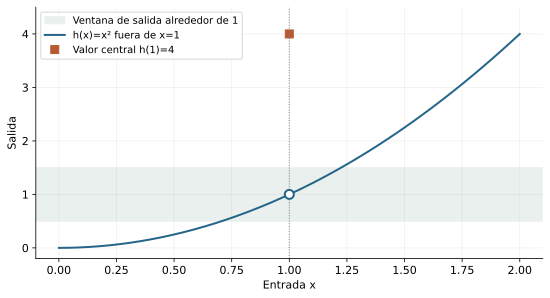
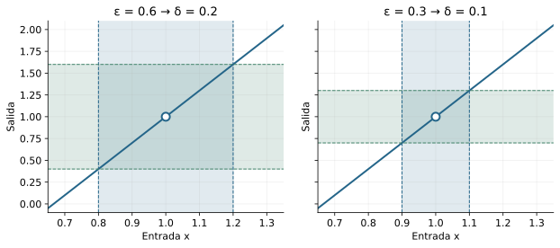
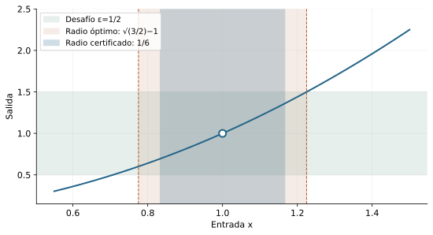
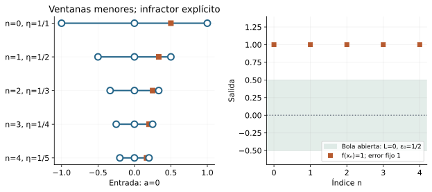
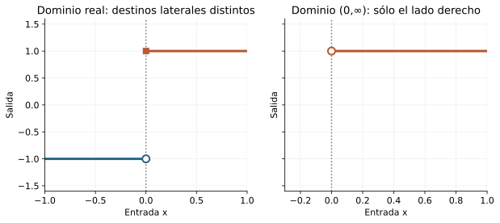

[Índice del libro](../para-matematicos/analisis-para-matematicos.html) · [Capítulo 13](analisis-para-matematicos-capitulo-13-limites-de-funciones-control-de-dos-escalas.html) · [Ejercicios](analisis-para-matematicos-capitulo-13-limites-de-funciones-control-de-dos-escalas-ejercicios.html) · [Soluciones](analisis-para-matematicos-capitulo-13-limites-de-funciones-control-de-dos-escalas-soluciones.html) · [Soluciones de microcontroles](analisis-para-matematicos-capitulo-13-limites-de-funciones-control-de-dos-escalas-microcontroles.html)

¿Qué significa que unas entradas próximas a un punto produzcan salidas próximas a un destino? En cálculo aprendimos a reconocer y calcular límites; aquí reconstruiremos el contrato que autoriza esas operaciones. No basta ensayar unas pocas entradas ni encontrar una ruta favorable: queremos controlar toda una ventana del dominio y responder a cualquier precisión de salida.

Usaremos las bolas y la acumulación de C04, las sucesiones de C06 y el transporte de conjuntos de C12. Primero entregaremos radios explícitos desde la definición; después construiremos unicidad, negación, criterios secuenciales y reglas. Mantendremos visible qué escala depende de cuál y dónde una hipótesis permite dar el siguiente paso.

## 13.1. Aproximarse sin tocar el centro

[]{#MA-SEC-ANM-01-013-001}

En C12 aprendimos a transportar una ventana de entradas dentro de una ventana de salidas. Ahora queremos hacerlo para cualquier precisión de salida que se nos proponga. El tamaño de la ventana de entrada se adaptará al desafío. Ésta es la diferencia entre haber comprobado una inclusión concreta y disponer de un límite.

Empecemos con $q(x)=x^2$ cerca de $1$. La identidad $x^2-1=(x-1)(x+1)$ sugiere que las salidas se aproximan a $1$ cuando las entradas se aproximan a $1$. Pero podemos cambiar la función sólo en el centro: $h(1)=4$, $h(x)=x^2$ si $x\ne1$. Las salidas de las entradas próximas y distintas de $1$ siguen siendo las mismas. El límite que queremos estudiar no puede depender del valor aislado $h(1)$.

### El conjunto por el que nos aproximamos

Sean $D\subseteq\mathbb R$ y $a\in\mathbb R$. Recordemos de C04 que $a$ es punto de acumulación de $D$ si para cada $r>0$ existe $x\in D$ con $0<|x-a|<r$. Escribiremos $a\in D'$. No se requiere $a\in D$: cero es punto de acumulación de $(0,\infty)$ sin pertenecer a ese dominio.

Llamemos $U_D(a,r)=\{x\in D:0<|x-a|<r\}$ a la ventana perforada de entrada. La intersección con $D$ conserva el tipo; la perforación elimina el centro. Por acumulación, $U_D(a,r)$ es no vacía para todo radio positivo. No hemos elegido una sucesión de puntos: sólo afirmamos existencia para cada radio.

**Definición.** Para $f:D\to\mathbb R$, $a\in D'$ y $L\in\mathbb R$, decimos que $f$ tiene límite $L$ en $a$ a través de $D$ si

$$
\forall\varepsilon>0\ \exists\delta>0\ \forall x\in D:
\quad 0<|x-a|<\delta\ \Longrightarrow\ |f(x)-L|<\varepsilon.
$$

Escribimos $\lim_{x\to a,\ x\in D}f(x)=L$, abreviando el dominio cuando sea inequívoco. En este capítulo todos los límites funcionales son reales finitos en puntos reales finitos.

La condición equivale a $f[U_D(a,\delta)]\subseteq B(L,\varepsilon)$ para cada desafío $\varepsilon$ y alguna respuesta $\delta$. En efecto, un valor de la imagen tiene un testigo $x$ en la ventana perforada y la desigualdad lo coloca en la bola de salida. A la inversa, si cada imagen está en la bola, evaluar en cualquier $x$ de esa ventana da la desigualdad exigida. Por C12 también equivale a $U_D(a,\delta)\subseteq f^{-1}[B(L,\varepsilon)]$.

{#fig-anm-c13-f01 fig-alt="C13-F01. La perforación omite el valor h(1)=4. Las entradas no centrales siguen la regla x² y se aproximan al destino 1. El círculo vacío distingue el hueco del valor asignado; la banda es un desafío, no una prueba."}

### Por qué exigimos acumulación

Si $D=\{a\}$, ninguna entrada cumple $0<|x-a|<\delta$. La implicación sería verdadera para cualquier candidato $L$, por vacuidad. La fórmula lógica sigue teniendo sentido, pero no distingue un destino. Nuestra convención reserva la palabra límite para $a\in D'$.

Tampoco importa cambiar valores lejos del centro. Si $f,g:D\to\mathbb R$ coinciden en $U_D(a,r)$ para algún $r>0$ y $f\to L$, dado $\varepsilon$ tomamos un radio válido $\delta_f$ y usamos $\delta=\min(r,\delta_f)$. Toda entrada pertinente ve $g(x)=f(x)$ y el mismo control. Intercambiar las funciones prueba la equivalencia. Cambiar sólo $f(a)$, si existe, es un caso particular.

La ventana se encoge alrededor de $a$; la ventana de salida alrededor de $L$. Esos centros cumplen papeles distintos y aún no hemos relacionado $L$ con $f(a)$.

### Antes de seguir

[]{#MA-MIC-ANM-01-013-001}

1. ¿Tiene que pertenecer $a$ al dominio para preguntar por el límite en $a$?

[]{#MA-MIC-ANM-01-013-002}

2. ¿Qué elimina $0<|x-a|$?

[]{#MA-MIC-ANM-01-013-003}

3. ¿Qué significa $a\in D^{\prime}$ en forma cuantificada?

[]{#MA-MIC-ANM-01-013-004}

4. Si $D=\{a\}$, ¿la fórmula perforada distingue un candidato $L$?

[]{#MA-MIC-ANM-01-013-005}

5. ¿Cómo se escribe el control mediante imágenes de ventanas?

[]{#MA-MIC-ANM-01-013-006}

6. ¿Qué preimagen contiene la ventana perforada cuando el radio es válido?

[]{#MA-MIC-ANM-01-013-007}

7. ¿Cambia el límite si sólo cambiamos $f(a)$?

[]{#MA-MIC-ANM-01-013-008}

8. ¿Qué radio reúne coincidencia local y control de $f$?

## 13.2. Diseñar una respuesta para toda la ventana

[]{#MA-SEC-ANM-01-013-002}

La definición propone un juego con orden fijo: se declaran $f,D,a,L$; se recibe $\varepsilon$; se produce $\delta$; después se verifica toda entrada admisible. Elegir $\delta$ después de ver $x$ cambia el problema. Una respuesta puede depender de los datos fijos y de $\varepsilon$, pero no de la entrada universal.

### Trabajar hacia atrás y escribir hacia delante

Para $f(x)=3x-2$ y $a=1$, el candidato es $L=1$. Queremos $|(3x-2)-1|<\varepsilon$. Simplificar revela $3|x-1|<\varepsilon$, lo que sugiere $\delta=\varepsilon/3$.

La prueba final comienza con el desafío: fijado $\varepsilon>0$, sea $\delta=\varepsilon/3>0$. Si $0<|x-1|<\delta$, entonces $|f(x)-1|=3|x-1|<3\delta=\varepsilon$. No se calcula primero una entrada favorable: el argumento sirve para todas las que satisfacen la hipótesis.

{#fig-anm-c13-f02 fig-alt="C13-F02. Para 3x−2 en a=1, el error de salida es tres veces el de entrada. Cada desafío ε tiene respuesta δ=ε/3; los bordes se excluyen. Dos instancias ilustran la fórmula que la prueba verifica para todo ε."}

Para una función afín $mx+c$ cerca de cualquier $a$, la identidad de errores es $|f(x)-(ma+c)|=|m||x-a|$. Si $m\ne0$, funciona $\delta=\varepsilon/|m|$. Si $m=0$, el error es cero y cualquier radio positivo sirve. Reducir un radio válido conserva su validez; no hay razón para exigir un único radio.

### Un factor variable necesita primero una barrera

Volvamos a $q(x)=x^2$ en $a$. La identidad $|x^2-a^2|=|x-a||x+a|$ contiene un factor no controlado. Introducimos una condición auxiliar: $|x-a|<1$. Entonces $|x+a|\le |x-a|+2|a|<1+2|a|=:C$, con $C>0$. Ahora podemos controlar el otro factor.

Fijado $\varepsilon>0$, elijamos $\delta=\min(1,\varepsilon/C)$. Para toda entrada con $0<|x-a|<\delta$ obtenemos $|x^2-a^2|<C|x-a|<C\delta\le\varepsilon$. Las dos tareas son distintas: el radio $1$ congela el factor variable; el radio $\varepsilon/C$ ajusta la precisión. El mínimo hace que se cumplan simultáneamente.

{#fig-anm-c13-f03 fig-alt="C13-F03. En x² alrededor de 1 y con ε=1/2, el certificado de la prueba usa δ=1/6. El mayor radio simétrico es √(3/2)−1. El certificado conservador basta para demostrar el límite; la optimización exige el argumento adicional del ejercicio 13.8."}

El radio no necesita ser el mayor posible. En $a=1$, $\delta=\min(1,\varepsilon/3)$ es cómodo aunque conservador. Buscar el radio óptimo puede ser un problema distinto; para demostrar un límite basta un certificado verificable.

### Evitar un denominador pequeño

Para $r(x)=1/x$ en $a\ne0$, restringimos $|x-a|<|a|/2$. La triangular inversa da $|x|\ge |a|-|x-a|>|a|/2$. En esa ventana el dominio excluye cero automáticamente y

$$
\left|\frac1x-\frac1a\right|
=\frac{|x-a|}{|x||a|}
<\frac{2|x-a|}{|a|^2}.
$$

El radio $\delta=\min(|a|/2,\varepsilon |a|^2/2)$ prueba $\lim_{x\to a}1/x=1/a$. No basta decir que un denominador es distinto de cero: hay que separarlo de cero por una barrera positiva válida para toda la ventana.

Cada ejemplo sigue el mismo método: descomponer el error, controlar factores auxiliares y reunir restricciones mediante un mínimo. No usamos reglas de límites todavía; estamos construyéndolas desde desigualdades.

### Antes de seguir

[]{#MA-MIC-ANM-01-013-009}

1. ¿Puede $\delta$ depender de la entrada $x$ bajo el cuantificador universal?

[]{#MA-MIC-ANM-01-013-010}

2. Para $f(x)=3x-2$ en $a=1$, ¿qué radio explícito sirve?

[]{#MA-MIC-ANM-01-013-011}

3. ¿Es válido exigir un solo $\delta>0$ para todas las tolerancias?

[]{#MA-MIC-ANM-01-013-012}

4. ¿Qué ocurre con la afín si $m=0$?

[]{#MA-MIC-ANM-01-013-013}

5. ¿Qué cota para $|x+a|$ produce $|x-a|<1$?

[]{#MA-MIC-ANM-01-013-014}

6. ¿Por qué se toma un mínimo en la prueba del cuadrado?

[]{#MA-MIC-ANM-01-013-015}

7. ¿Un radio válido debe ser el máximo posible?

[]{#MA-MIC-ANM-01-013-016}

8. ¿Qué barrera protege $1/x$ si $|x-a|<|a|/2$ y $a\ne0$?

## 13.3. Un destino, barreras locales y orden

[]{#MA-SEC-ANM-01-013-003}

La definición presenta un candidato $L$. Antes de llamarlo el límite debemos comprobar que ningún otro candidato puede cumplir el mismo contrato. La geometría sugiere usar dos ventanas de salida disjuntas, pero necesitamos una entrada que ambas estén obligadas a controlar.

### Unicidad

**Teorema.** Si $a\in D'$ y $f:D\to\mathbb R$ tiene límites $L$ y $M$ en $a$, entonces $L=M$.

Si fueran distintos, $d=|L-M|>0$. Proponemos $\varepsilon=d/3$ a ambos contratos, obteniendo $\delta_L,\delta_M>0$. Tomamos $\delta=\min(\delta_L,\delta_M)$. Aquí gastamos la acumulación: existe $x\in D$ con $0<|x-a|<\delta$. Para esa misma entrada las dos cotas dan $d\le |L-f(x)|+|f(x)-M|<2d/3$, contradicción. La coincidencia de la entrada importa tanto como la separación de las salidas.

### Acotación suficiente cerca del centro

Si $f\to L$, usamos una sola tolerancia, $\varepsilon=1$. Existe $r>0$ con $|f(x)-L|<1$ en $U_D(a,r)$; por tanto $|f(x)|\le |f(x)-L|+|L|<|L|+1$. Ésta es una cota local perforada. No afirma acotación de toda la función: $x^2\to0$ en cero y es no acotada en $\mathbb R$.

Si $a\in D$ podemos incluir su valor en una cota mayor, por ejemplo $\max(|L|+1,|f(a)|+1)$. Esto no transforma el límite en una afirmación sobre el valor central; sólo añade un dato finito a una cota.

### El orden eventual pasa al límite

Supongamos $f,g:D\to\mathbb R$, $f\to L$, $g\to M$ y $f(x)\le g(x)$ en alguna ventana perforada. Si $L>M$, ponemos $\varepsilon=(L-M)/3$ y reunimos los dos radios y la ventana de orden. Acumulación entrega una entrada allí. Entonces $f(x)>L-\varepsilon>M+\varepsilon>g(x)$, contradicción. Concluimos $L\le M$. Un orden estricto de valores no fuerza orden estricto de límites: $0<x$ en $(0,\infty)$ y ambas funciones tienen límite cero.

**Teorema del encierro.** Si $p(x)\le f(x)\le q(x)$ cerca de $a$, $p\to L$ y $q\to L$, entonces $f\to L$. Para $\varepsilon>0$, reúna radios para $p,q$ y para el orden. Allí $L-\varepsilon<p(x)\le f(x)\le q(x)<L+\varepsilon$, luego $|f(x)-L|<\varepsilon$. No hemos supuesto existencia previa del límite de $f$; acabamos de probarla.

Como primer uso, sea $b:D\to\mathbb R$ con $|b(x)|\le K$ cerca de cero, donde $K\ge0$ y $0\in D'$. Para $h(x)=xb(x)$, $|h(x)|\le K|x|$. Si $K=0$, el error es cero localmente. Si $K>0$, $\delta=\min(r,\varepsilon/K)$ prueba $h\to0$. El factor $b$ puede carecer de límite: sólo usamos su cota.

Un límite finito proporciona barreras locales; las barreras también pueden construir límites. Esta doble dirección será útil al operar con funciones que oscilan.

### Antes de seguir

[]{#MA-MIC-ANM-01-013-017}

1. ¿Dónde se utiliza acumulación al demostrar unicidad?

[]{#MA-MIC-ANM-01-013-018}

2. ¿Qué tolerancia se usa para dos destinos separados por $d>0$?

[]{#MA-MIC-ANM-01-013-019}

3. ¿Un límite finito implica acotación global?

[]{#MA-MIC-ANM-01-013-020}

4. ¿Qué cota local sale del desafío $\varepsilon=1$?

[]{#MA-MIC-ANM-01-013-021}

5. ¿El orden estricto $f(x)<g(x)$ obliga $L<M$?

[]{#MA-MIC-ANM-01-013-022}

6. ¿Qué hay que suponer de $f$ antes de usar el encierro?

[]{#MA-MIC-ANM-01-013-023}

7. Si $|b(x)|\le K$ cerca de cero, ¿qué error controla $xb(x)$?

[]{#MA-MIC-ANM-01-013-024}

8. ¿Necesita $b$ tener límite para que $xb(x)\to0$?

## 13.4. Negar un candidato y construir infracciones

[]{#MA-SEC-ANM-01-013-004}

Para probar un límite debemos responder a todas las tolerancias. Para refutar un candidato basta encontrar una tolerancia que ninguna ventana de entrada pueda satisfacer. La tolerancia de fracaso permanece fija mientras el radio de entrada cambia.

### La negación conserva el orden de dependencias

Con los datos $f,D,a,L$ fijados y $a\in D'$, negar el contrato equivale a

$$
\exists\varepsilon_0>0\ \forall\delta>0\ \exists x\in D:
\quad 0<|x-a|<\delta,\qquad |f(x)-L|\ge\varepsilon_0.
$$

El punto infractor sí puede depender del radio. La desigualdad final es $\ge$, no $>$: alcanzar la frontera de la bola abierta ya incumple el control.

Decir que $L$ no es límite es diferente de decir que la función no tiene ningún límite. Para lo segundo debemos descartar todo $L\in\mathbb R$ o usar un argumento que impida un destino único.

### Una infracción en cada escala

Para $n\in\mathbb N=\{0,1,\ldots\}$, sea $\eta_n=1/(n+1)$. Por C06, $\eta_n\to0$. Un candidato falla si y sólo si hay $\varepsilon_0>0$ para el que todos los conjuntos

$$
E_n=\{x\in D:0<|x-a|<\eta_n,\ |f(x)-L|\ge\varepsilon_0\}
$$

son no vacíos. La negación completa implica esto al usar $\delta=\eta_n$. Recíprocamente, fijado cualquier $\delta>0$, elegimos un índice con $\eta_n<\delta$ y obtenemos un único testigo de $E_n$. Ese punto incumple también el radio $\delta$.

Hemos construido una familia de conjuntos de infractores. No hemos construido automáticamente una función que elija un elemento de cada $E_n$. La distinción entre $\forall n\,\exists x$ y $\exists(x_n)\,\forall n$ se volverá necesaria en la equivalencia secuencial.

{#fig-anm-c13-f04 fig-alt="C13-F04. Para f(x)=1 y el candidato L=0, xₙ=1/(n+2) infringe la tolerancia fija ε₀=1/2 dentro de cada escala ηₙ=1/(n+1). Esto refuta sólo el candidato 0: la función sí tiene límite 1. La fórmula proporciona aquí la ruta explícita."}

### Refutar todos los destinos

Sea $s(x)=-1$ para $x<0$ y $s(x)=1$ para $x\ge0$, en dominio real. Para cualquier $L$, al menos una de las distancias $|-1-L|$, $|1-L|$ es $\ge1$: si ambas fueran menores que $1$, la triangular daría $2<2$.

Elegimos un signo cuya salida tenga esa distancia. Dado $\delta>0$, el punto $x=-\delta/2$ o $x=\delta/2$, según el signo elegido, es infractor con la tolerancia fija $\varepsilon_0=1$. El signo depende de $L$; el punto depende de $\delta$. Así se descarta todo candidato sin convertir el dibujo en una prueba.

Otra refutación útil: $r(x)=1/x$ en $(0,\infty)$ no tiene límite real finito en cero. Para cualquier $L$ y $\delta>0$, elijamos $x=\min(\delta/2,1/[2(|L|+1)])>0$. Entonces $x<\delta$ y $1/x\ge2(|L|+1)$, de donde $|1/x-L|\ge1/x-|L|>1$. No hemos definido aquí un límite infinito; sólo descartamos todos los reales.

### Antes de seguir

[]{#MA-MIC-ANM-01-013-025}

1. ¿Cuál es el orden de cuantificadores al refutar un candidato?

[]{#MA-MIC-ANM-01-013-026}

2. ¿Por qué la negación usa $\ge\varepsilon_0$?

[]{#MA-MIC-ANM-01-013-027}

3. ¿Refutar $L=0$ basta para demostrar que no existe ningún límite?

[]{#MA-MIC-ANM-01-013-028}

4. ¿Por qué usamos $1/(n+1)$ en vez de $1/n$ desde $n=0$?

[]{#MA-MIC-ANM-01-013-029}

5. ¿Qué prueba la no vaciedad de todos los conjuntos $E_n$?

[]{#MA-MIC-ANM-01-013-030}

6. ¿La no vaciedad de cada $E_n$ proporciona por sí sola un selector?

[]{#MA-MIC-ANM-01-013-031}

7. Para el salto con valores $\pm1$, ¿por qué una distancia a $L$ es al menos $1$?

[]{#MA-MIC-ANM-01-013-032}

8. ¿Qué asegura $x=\min(\delta/2,1/[2(|L|+1)])$ en la refutación de $1/x$?

## 13.5. Lo que detectan las sucesiones

[]{#MA-SEC-ANM-01-013-005}

Una aproximación secuencial elige una ruta numerada dentro del dominio. El límite funcional debe controlar todas esas rutas, pero una ruta favorable no certifica el comportamiento de toda una ventana.

Llamemos admisible a una sucesión $(x_n)$ con $x_n\in D\setminus\{a\}$ para todos los índices y $x_n\to a$. Las imágenes forman una sucesión bien tipada: $x:\mathbb N\to D$ se compone con $f:D\to\mathbb R$. No basta que $x_n$ sea real; debe pertenecer al dominio y evitar el centro.

### De la ventana a cualquier ruta

**Proposición.** Si $f\to L$ en $a$, entonces $f(x_n)\to L$ para toda sucesión admisible.

Fijemos tal sucesión y $\varepsilon>0$. El límite funcional ofrece $\delta>0$. La convergencia de entradas ofrece $N$ con $|x_n-a|<\delta$ para $n\ge N$. Por admisibilidad, también $0<|x_n-a|$; la implicación funcional da $|f(x_n)-L|<\varepsilon$ en toda esa cola. No se ha elegido una nueva sucesión.

Si permitiéramos términos iguales a $a$, la sucesión constante del centro exigiría $f(a)=L$. La definición perforada no proporciona esa igualdad. Se puede permitir un prefijo finito de centros si la cola los evita, usando el carácter eventual de C06.

### La recíproca: dónde aparece una selección

Si el candidato falla, §13.4 ofrece conjuntos $E_n$ no vacíos. Para contradecir el control de todas las rutas queremos una ruta con $x_n\in E_n$. Una colección de existencias no es todavía una regla de selección.

**Teorema para un dominio enumerado.** Si está dada una sobreyección $e:\mathbb N\to D$, entonces $f\to L$ si y sólo si todas las sucesiones admisibles tienen imágenes que convergen a $L$.

La dirección directa está probada. Para la inversa, si el límite falla, fijemos $\varepsilon_0$ y los $E_n$. El conjunto $I_n=\{k\in\mathbb N:e(k)\in E_n\}$ es no vacío por sobreyectividad. Definimos $k_n=\min I_n$, mínimo único de naturales, y $x_n=e(k_n)$. Entonces $0<|x_n-a|<1/(n+1)$, luego $x_n\to a$, mientras $|f(x_n)-L|\ge\varepsilon_0$ para todo índice. Sus imágenes no convergen a $L$, contradicción. Los $k_n$ no tienen que ser estrictamente crecientes; ésta no es una extracción de una sucesión previa.

{#fig-anm-c13-f05 fig-alt="C13-F05. En el dominio de recíprocos enteros, con f=1, a=L=0 y ε₀=1/2, la enumeración empieza con los denominadores 1,4,2,8,3,5,7,6 y continúa 9,10,… . Se marca e(k)&lt;1/(n+1) y se rodea el menor índice válido. Los índices seleccionados pueden repetirse; el mínimo es de índices, no de valores reales."}

**Teorema condicional para dominios arbitrarios.** Bajo el principio de elección numerable para subconjuntos de reales, $\mathrm{CC}(\mathbb R)$, vale la misma equivalencia para todo $D\subseteq\mathbb R$. Este principio dice que cada familia numerable de subconjuntos reales no vacíos admite un selector. Aplicarlo a los $E_n$ produce $x_n\in E_n$; las dos desigualdades anteriores completan la contradicción. Es exactamente el paso adicional. No lo necesitamos para la dirección directa ni para el caso enumerado, y no lo incorporamos silenciosamente como axioma.

### Refutar con rutas ya dadas

Para el salto de §13.4, $u_n=-1/(n+1)$ y $v_n=1/(n+1)$ son admisibles en cero. Sus imágenes son constantes $-1$ y $1$. Si hubiese límite funcional $L$, la dirección directa y la unicidad secuencial de C06 obligarían $L=-1=1$. Esta refutación es incondicional: las rutas están dadas mediante fórmulas, no elegidas de conjuntos arbitrarios.

Una sola ruta con imágenes que no convergen a un candidato lo refuta. Dos rutas con destinos distintos refutan la existencia de cualquier límite. Muchas rutas favorables, sin argumento universal, no prueban existencia.

### Antes de seguir

[]{#MA-MIC-ANM-01-013-033}

1. ¿Qué tres condiciones hacen admisible a $(x_n)$?

[]{#MA-MIC-ANM-01-013-034}

2. ¿Cómo se encadenan $\varepsilon$, $\delta$ y $N$ en la dirección directa?

[]{#MA-MIC-ANM-01-013-035}

3. ¿Por qué la sucesión constante $x_n=a$ no es admisible?

[]{#MA-MIC-ANM-01-013-036}

4. Si una ruta admisible tiene imágenes que no convergen a $L$, ¿qué concluyes?

[]{#MA-MIC-ANM-01-013-037}

5. ¿Qué regla elige infractores cuando está dada $e:\mathbb N\to D$ sobreyectiva?

[]{#MA-MIC-ANM-01-013-038}

6. ¿Deben crecer estrictamente los $k_n$ de ese selector?

[]{#MA-MIC-ANM-01-013-039}

7. ¿Qué hipótesis permite la recíproca en cualquier dominio real?

[]{#MA-MIC-ANM-01-013-040}

8. ¿Necesita elección numerable la refutación por las rutas $\pm1/(n+1)$?

## 13.6. Combinar límites con presupuestos de error

[]{#MA-SEC-ANM-01-013-006}

Ya sabemos construir radios para funciones concretas. Ahora probaremos reglas que permitan combinar límites sin rehacer toda la estimación. Las pruebas se harán con ventanas, de modo que no dependerán de la recíproca secuencial condicional.

Sean $f,g:D\to\mathbb R$, $a\in D'$, $f\to L$ y $g\to M$. Todas las restricciones siguientes se cumplen en ventanas perforadas de ese mismo dominio.

### Sumas, constantes y magnitudes

Para $\varepsilon>0$, tomamos radios que aseguren $|f-L|<\varepsilon/2$ y $|g-M|<\varepsilon/2$. Su mínimo da $|(f+g)-(L+M)|\le |f-L|+|g-M|<\varepsilon$. Por tanto $f+g\to L+M$.

Para $\lambda f$, si $\lambda=0$ el error es cero; si $\lambda\ne0$, pedimos $|f-L|<\varepsilon/|\lambda|$. Entonces $|\lambda f-\lambda L|<\varepsilon$. Esto prueba también restas usando $\lambda=-1$ y la regla de suma. La triangular inversa da $||f|-|L||\le |f-L|$, así que $|f|\to|L|$ con el mismo radio.

### El producto necesita una barrera y dos errores

La identidad útil es $fg-LM=f(g-M)+M(f-L)$. El primer factor $f$ varía; §13.3 nos permite fijar $|f|<A:=|L|+1$ en algún radio $r$. Sea $B=|M|+1>0$. Para $\varepsilon>0$ pedimos $|g-M|<\varepsilon/(2A)$ y $|f-L|<\varepsilon/(2B)$, y reunimos esos radios con $r$. Allí

$$
|fg-LM|\le |f||g-M|+|M||f-L|
<A\frac{\varepsilon}{2A}+B\frac{\varepsilon}{2B}
=\varepsilon.
$$

El uso de $B$ evita dividir por $|M|$ cuando $M=0$. La identidad no basta sola: la cota local convierte un coeficiente variable en una constante que permite repartir el presupuesto.

### Recíprocos y cocientes: restringir el dominio a tiempo

Si $M\ne0$, pedir $|g-M|<|M|/2$ da $|g|>|M|/2$. Por tanto $g(x)\ne0$ cerca de $a$ y

$$
\left|\frac1{g(x)}-\frac1M\right|
=\frac{|g(x)-M|}{|g(x)||M|}
<\frac{2|g(x)-M|}{|M|^2}.
$$

Pedimos además $|g-M|<\varepsilon |M|^2/2$ y tomamos el mínimo de radios. Así $1/g\to1/M$ en $D_0=\{x\in D:g(x)\ne0\}$. Este dominio tiene a $a$ como punto de acumulación: para cualquier radio, la acumulación de $D$ ofrece un punto dentro del mínimo con la ventana de no anulación, y ese punto pertenece a $D_0$.

La restricción de $f$ a $D_0$ conserva su límite porque el control universal en $D$ vale en el subconjunto. Aplicar la regla del producto a $f|_{D_0}$ y $1/g$ prueba $f/g\to L/M$. No se afirma que el cociente esté definido en todos los puntos del dominio original.

### Primer uso y una trampa

Suma y producto prueban por inducción finita que un polinomio $P$ tiene límite $P(a)$ en cada $a$: las constantes y la identidad cumplen la definición, multiplicar construye potencias y sumar reúne términos. Si $Q(a)\ne0$, el cociente $P/Q$ tiene límite $P(a)/Q(a)$ en su dominio natural. Esta prueba no usa continuidad ni derivadas.

Si $Q(a)=0$, la regla de cocientes no decide nada. $(x^2-1)/(x-1)$ en $x\ne1$ se simplifica a $x+1$ y tiene límite $2$ en $1$. En cambio $1/(x-1)$ no tiene límite finito allí. El denominador límite no nulo es una hipótesis suficiente del criterio, no una clasificación de todo cociente posible.

### Antes de seguir

[]{#MA-MIC-ANM-01-013-041}

1. ¿Cómo se reparte $\varepsilon$ en una suma?

[]{#MA-MIC-ANM-01-013-042}

2. ¿Cómo se trata la multiplicación por una constante nula?

[]{#MA-MIC-ANM-01-013-043}

3. ¿Qué identidad prepara el producto?

[]{#MA-MIC-ANM-01-013-044}

4. ¿Por qué $|M|+1$ es útil en el presupuesto de producto?

[]{#MA-MIC-ANM-01-013-045}

5. ¿Qué tolerancia garantiza que $g$ no se anule si $M\ne0$?

[]{#MA-MIC-ANM-01-013-046}

6. ¿Cuál es el dominio correcto de $f/g$?

[]{#MA-MIC-ANM-01-013-047}

7. ¿Qué sucede con el cociente si el límite del denominador es cero?

[]{#MA-MIC-ANM-01-013-048}

8. ¿Necesita la regla de producto el criterio secuencial recíproco?

## 13.7. Cambiar las rutas disponibles

[]{#MA-SEC-ANM-01-013-007}

El dominio forma parte de la pregunta. Si retiramos entradas, retiramos posibles infractores. Un límite que vale en un dominio grande se conserva al restringirlo; un límite obtenido en un dominio pequeño puede dejar de valer al devolver entradas.

### Restricción y reunión finita

Si $A\subseteq D$, $a\in A'$ y $f\to L$ a través de $D$, el mismo radio controla $f|_A$. La acumulación de $A$ asegura que la nueva pregunta no sea vacía.

Más generalmente, sean $D_1,\ldots,D_k\subseteq D$, con $k\ge1$, $a\in D_i'$ para todos, y supongamos que existe $r>0$ con $U_D(a,r)\subseteq D_1\cup\cdots\cup D_k$. Si las restricciones tienen el mismo límite $L$, dado $\varepsilon$ tomamos un radio por cada una y el mínimo con $r$. Toda entrada de la ventana pertenece a alguna pieza y cumple su estimación. Así $f\to L$ en $D$. Es una reunión finita de radios positivos; una familia infinita no proporciona necesariamente un mínimo positivo.

### Lados disponibles, lados inexistentes

Definimos $D_-=D\cap(-\infty,a)$ y $D_+=D\cap(a,\infty)$. El límite por la izquierda es el límite de $f|_{D_-}$ en $a$, siempre que $a\in D_-'$; análogamente a la derecha. No asignamos un límite a un lado que no acumula entradas.

Cuando ambos lados acumulan, el límite en $D$ existe y es $L$ si y sólo si ambos límites laterales existen y son $L$. La ida es restricción; la vuelta usa la reunión finita, pues toda entrada perforada pertenece a un lado.

{#fig-anm-c13-f06 fig-alt="C13-F06. El salto tiene destinos laterales −1 y 1 en el dominio real, por lo que no admite un destino común. Restringido a entradas positivas, tiene límite 1 en cero. El lado izquierdo ausente no recibe un límite por vacuidad."}

Si sólo acumula $D_+$, existe un radio sin entradas de $D_-$: ésa es la negación de acumulación del lado izquierdo. En esa ventana el límite en $D$ equivale al de la derecha. Si $a\in D'$, al menos un lado acumula: si ninguno lo hiciera, el mínimo de sus radios sin entradas eliminaría toda ventana perforada, contradicción.

El salto $s$ tiene límites laterales $-1$ y $1$, y no tiene límite en el dominio real. Restringir a $(0,\infty)$ deja un límite perfectamente válido en cero, aunque cero no pertenezca al dominio.

### Un dominio denso puede ocultar todas las infracciones

Sea $d:\mathbb R\to\mathbb R$, con $d(x)=0$ si $x\in\mathbb Q$ y $d(x)=1$ en caso contrario; aquí $\mathbb Q$ significa su copia canónica en $\mathbb R$. La restricción racional tiene límite cero en cada punto de acumulación de ese dominio porque es constante.

En cero, la función completa no tiene límite. Las rutas $u_n=1/(n+1)$ y $v_n=\sqrt2/(n+1)$ convergen a cero, son no nulas, y sus valores son respectivamente $0$ y $1$. Cada $v_n$ es irracional: de ser racional, multiplicarlo por el entero no nulo $n+1$ haría racional a $\sqrt2$, contradiciendo C10. La dirección secuencial ya probada descarta un destino común.

Densidad garantiza entradas próximas; no garantiza que probar sólo en esas entradas describa una función arbitraria. Para rescatar tal inferencia harían falta hipótesis adicionales, que no estamos suponiendo.

### Antes de seguir

[]{#MA-MIC-ANM-01-013-049}

1. ¿Qué condición adicional se exige al restringir a $A\subseteq D$?

[]{#MA-MIC-ANM-01-013-050}

2. ¿Por qué sirve reunir finitos radios positivos mediante un mínimo?

[]{#MA-MIC-ANM-01-013-051}

3. ¿Un mínimo de infinitos radios positivos tiene que ser positivo?

[]{#MA-MIC-ANM-01-013-052}

4. ¿Cuándo está definido el límite por la izquierda bajo nuestra convención?

[]{#MA-MIC-ANM-01-013-053}

5. Si ambos lados acumulan, ¿qué permite reunirlos?

[]{#MA-MIC-ANM-01-013-054}

6. Si un lado no acumula, ¿qué información local ofrece?

[]{#MA-MIC-ANM-01-013-055}

7. ¿Probar un límite en un subconjunto denso basta para una función arbitraria?

[]{#MA-MIC-ANM-01-013-056}

8. ¿Por qué $\sqrt2/(n+1)$ es irracional para todo índice?

## 13.8. Componer controles sin perder la perforación

[]{#MA-SEC-ANM-01-013-008}

Transportar dos ventanas consecutivas parece inmediato: primero $f$ acerca $x$ a $b$; después $g$ acerca la salida a $L$. Pero el segundo límite controla entradas próximas a $b$ y distintas de $b$. La primera función puede enviar muchas entradas directamente a ese centro.

### Composición con evitación del centro intermedio

**Teorema.** Sean $f:D\to E$, con $D,E\subseteq\mathbb R$, $a\in D'$, $b\in E'$ y $g:E\to\mathbb R$. Supongamos $f\to b$ en $a$, $g\to L$ en $b$, y que existe $r>0$ con $f(x)\ne b$ para todo $x\in U_D(a,r)$. Entonces $g\circ f\to L$ en $a$.

**Mapa de la prueba.** El desafío final $\varepsilon$ determina un radio intermedio $\eta$ para $g$; ese radio es el desafío que presentamos a $f$. La evitación garantiza que el punto intermedio esté en la ventana perforada y no sólo en la ventana completa.

Fijemos $\varepsilon>0$. Para $g$ obtenemos $\eta>0$ tal que $y\in E$, $0<|y-b|<\eta$ implica $|g(y)-L|<\varepsilon$. Para $f$ obtenemos $\delta_f>0$ que asegura $|f(x)-b|<\eta$. Sea $\delta=\min(r,\delta_f)$. Para cualquier $x\in U_D(a,\delta)$, el tipo da $f(x)\in E$, la primera cota da distancia menor que $\eta$ y la evitación da distancia positiva. Podemos aplicar el segundo contrato: $|g(f(x))-L|<\varepsilon$. Así se reensamblan las dos metas.

### Una alternativa permite tocar el centro

Si $b\in E$ y $g(b)=L$, podemos retirar la evitación. Con el mismo radio de $f$, cada entrada produce uno de dos casos. Si $f(x)\ne b$, usamos el límite de $g$; si $f(x)=b$, el error final es $|g(b)-L|=0$. El argumento prueba la composición sin haber introducido aún el vocabulario de continuidad.

{#fig-anm-c13-f07 fig-alt="C13-F07. La interior envía toda entrada a 0. La exterior tiene límite 0 en 0, pero g(0)=1; su contrato perforado no controla ese valor. La composición es constante 1. La cercanía intermedia necesita además evitación del centro o un valor central compatible."}

La alternativa es necesaria para ese mecanismo. Sea $f(x)=0$ en todo $\mathbb R$ y $g(y)=0$ si $y\ne0$, $g(0)=1$. Tenemos $f\to0$ en cero y $g\to0$ en cero, pero $(g\circ f)(x)=1$ para toda entrada, cuyo límite es $1$, no $0$. No falló la cercanía: falló la autorización para aplicar un contrato perforado en su centro.

### Un certificado que se puede reutilizar

Supongamos que $|f(x)-b|\le C|x-a|$ cerca de $a$, con $C>0$, y que para cada $\varepsilon>0$ tenemos un radio válido $\eta_g(\varepsilon)$ para $g$. Si se cumple la evitación o la alternativa $g(b)=L$, sirve

$$
\delta(\varepsilon)=\min\left(r,\frac{\eta_g(\varepsilon)}{C}\right),
$$

donde $r$ reúne las restricciones locales. Para $x$ dentro de ese radio, $|f(x)-b|<\eta_g(\varepsilon)$, y el argumento anterior decide el caso central. Si $C=0$, la cota fuerza $f(x)=b$ localmente; sólo la alternativa central permite esta prueba y el resultado es inmediato.

Una prueba de límite consta de dos piezas: un procedimiento para producir radios y una verificación universal en el dominio. Un gráfico propone el mecanismo; una tabla ensaya casos; una sucesión puede detectar una infracción. La desigualdad o el argumento universal es lo que certifica toda la ventana.

Este capítulo ha separado cercanía, evaluación central y rutas disponibles. En el siguiente preguntaremos qué cambia al exigir que el destino sea precisamente el valor de la función en el centro.

### Antes de seguir

[]{#MA-MIC-ANM-01-013-057}

1. ¿Qué desafío se presenta a $f$ después de fijar $\varepsilon$ para $g\circ f$?

[]{#MA-MIC-ANM-01-013-058}

2. ¿Qué dato falta si sólo sabemos $|f(x)-b|<\eta$?

[]{#MA-MIC-ANM-01-013-059}

3. ¿Qué alternativa permite que $f(x)=b$?

[]{#MA-MIC-ANM-01-013-060}

4. ¿Qué falla en la composición de una función cero con $g(0)=1$, $g(y)=0$ fuera de cero?

[]{#MA-MIC-ANM-01-013-061}

5. ¿Qué papel desempeña el tipo $f:D\to E$?

[]{#MA-MIC-ANM-01-013-062}

6. Con $|f(x)-b|\le C|x-a|$, $C>0$, ¿qué radio de precisión sirve?

[]{#MA-MIC-ANM-01-013-063}

7. Si $C=0$ en esa cota, ¿qué ocurre localmente?

[]{#MA-MIC-ANM-01-013-064}

8. ¿Qué verifica finalmente un certificado de límite?

[Índice del libro](../para-matematicos/analisis-para-matematicos.html) · [Capítulo 13](analisis-para-matematicos-capitulo-13-limites-de-funciones-control-de-dos-escalas.html) · [Ejercicios](analisis-para-matematicos-capitulo-13-limites-de-funciones-control-de-dos-escalas-ejercicios.html) · [Soluciones](analisis-para-matematicos-capitulo-13-limites-de-funciones-control-de-dos-escalas-soluciones.html) · [Soluciones de microcontroles](analisis-para-matematicos-capitulo-13-limites-de-funciones-control-de-dos-escalas-microcontroles.html)

[← Capítulo 12](analisis-para-matematicos-capitulo-12-que-hace-una-funcion.html) · [Capítulo 14 →](analisis-para-matematicos-capitulo-14-continuidad-transportar-proximidad.html)
