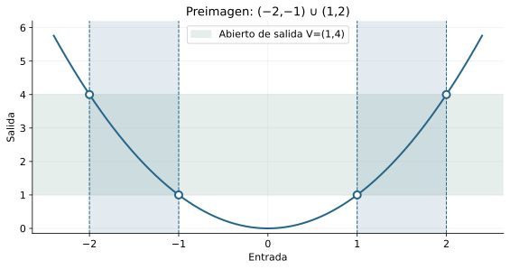

[Índice del libro](../para-matematicos/analisis-para-matematicos.html) · [Ejercicios de este capítulo](#ejercicios-14)

En cálculo usamos la continuidad para enlazar valores, aproximaciones y operaciones. Aquí demostraremos qué garantiza ese enlace y qué hipótesis necesita. La pregunta ya no es sólo adónde se aproximan las salidas: es si ese destino coincide con el valor que la función asigna a la entrada central.

Partimos de C13 y de su caja de herramientas heredada: bolas de C04, convergencia de C06 y tipos/imágenes/preimágenes de C12. La continuidad se estudiará en dominios reales arbitrarios, incluidos extremos y puntos aislados. Pasaremos del control puntual al transporte de abiertos por preimágenes, justificaremos álgebra, composición y pegado, y usaremos contraejemplos para distinguir existencia de inversa de continuidad inversa.

## 14.1. Hacer del valor central el destino

[]{#MA-SEC-ANM-01-014-001}

En C13 preguntamos por un destino de las salidas al aproximarnos a una entrada sin tocarla. El destino podía diferir del valor central, y la función podía ni siquiera estar definida en ese centro. Ahora queremos que el valor asignado allí sea precisamente el que las entradas próximas anuncian. La continuidad conecta aproximación y evaluación.

Pensemos en $h(x)=x^2$ si $x\ne1$, con $h(1)=4$. En C13 demostramos que su límite en $1$ es $1$. Hay un destino bien determinado, pero no es el valor asignado al centro. Si reemplazamos $4$ por $1$, desaparece esa incompatibilidad. Esta modificación será un primer ejemplo de reparación; la definición debe explicar qué se ha reparado.

### El contrato incluye el centro

**Definición.** Sean $D\subseteq\mathbb R$, $f:D\to\mathbb R$ y $a\in D$. Decimos que $f$ es continua en $a$, relativamente a $D$, si

$$
\forall\varepsilon>0\ \exists\delta>0\ \forall x\in D:
\quad |x-a|<\delta\ \Longrightarrow\ |f(x)-f(a)|<\varepsilon.
$$

El centro $a$ debe pertenecer a $D$, pues necesitamos evaluar $f(a)$. La condición $0<|x-a|$ ha desaparecido: $x=a$ está permitido y produce error cero. No exigimos que $a$ sea punto de acumulación ni interior del dominio. La función es continua en $D$ si lo es en cada $a\in D$.

La respuesta puede depender del punto y del desafío. El orden global es $\forall a\in D\ \forall\varepsilon>0\ \exists\delta>0\ \forall x\in D$. No se ha pedido un mismo radio para todos los centros. Esa exigencia adicional tendrá su propio capítulo, C17.

En lenguaje de ventanas, la continuidad equivale a

$$
f[D\cap B(a,\delta)]\subseteq B(f(a),\varepsilon)
$$

para cada desafío y algún radio positivo. Si un valor pertenece a la imagen, tiene una entrada testigo en la bola relativa, y el contrato lo coloca en la bola de salida. Recíprocamente, aplicar la inclusión a $f(x)$ da el error pedido para cada entrada. Por las leyes de C12, también equivale a $D\cap B(a,\delta)\subseteq f^{-1}[B(f(a),\varepsilon)]$. La ventana ahora es completa; su centro tiene valor y participa del transporte.

{#fig-anm-c14-f01 fig-alt="C14-F01. A la izquierda, h(1)=4 es incompatible con el límite 1; la banda centrada en el valor efectivo no captura las salidas próximas. A la derecha, asignar el valor 1 repara la continuidad. El punto lleno participa del contrato; el hueco sólo representa la regla sin su valor central."}

### Comparación exacta con el límite

**Proposición.** Si $a\in D\cap D'$, entonces $f$ es continua en $a$ si y sólo si $\lim_{x\to a,\ x\in D}f(x)=f(a)$.

La ida restringe el contrato a entradas distintas del centro y utiliza $a\in D'$ para legitimar la pregunta de límite. Para la vuelta, un radio del límite controla toda entrada no central; en el centro el error es cero. Estos dos casos cubren toda la bola relativa y prueban continuidad con el mismo radio. La hipótesis de acumulación sólo pertenece a la comparación con el límite, no a la definición de continuidad.

Que un límite exista no basta: debe coincidir con el valor central. En el ejemplo de $h$, el límite $1$ y el valor $4$ no coinciden, luego $h$ falla en $1$. Podemos ver el fracaso directamente: con tolerancia $1$, dado cualquier $\delta>0$, sea $t=\min(\delta/2,1/4)$ y $x=1+t$. Entonces $0<t<\delta$, mientras $h(x)\le(5/4)^2=25/16$, de modo que $|h(x)-4|\ge39/16>1$.

La continuidad no significa que las salidas cambien poco en valor absoluto. Significa que podemos hacer pequeño su cambio respecto de $f(a)$ haciendo suficientemente pequeño el cambio de entrada respecto de $a$, dentro del dominio declarado.

### Antes de seguir

#### Microcontrol 1

[]{#MA-MIC-ANM-01-014-001}

¿Por qué debe pertenecer $a$ a $D$ para preguntar por continuidad?

[]{#MA-MSOL-ANM-01-014-001}

Ver solución del microcontrol 1

**Respuesta.**

Porque el destino es $f(a)$ y esa evaluación sólo está definida para $a\in D$.

**Fundamento en la sección 14.1.**

En C13 preguntamos por un destino de las salidas al aproximarnos a una entrada sin tocarla. El destino podía diferir del valor central, y la función podía ni siquiera estar definida en ese centro. Ahora queremos que el valor asignado allí sea precisamente el que las entradas próximas anuncian. La continuidad conecta aproximación y evaluación.

Pensemos en $h(x)=x^2$ si $x\ne1$, con $h(1)=4$. En C13 demostramos que su límite en $1$ es $1$. Hay un destino bien determinado, pero no es el valor asignado al centro. Si reemplazamos $4$ por $1$, desaparece esa incompatibilidad. Esta modificación será un primer ejemplo de reparación; la definición debe explicar qué se ha reparado.

#### Microcontrol 2

[]{#MA-MIC-ANM-01-014-002}

¿Se excluye $x=a$ en el contrato de continuidad?

[]{#MA-MSOL-ANM-01-014-002}

Ver solución del microcontrol 2

**Respuesta.**

No. El centro está permitido y tiene error $|f(a)-f(a)|=0$.

**Fundamento en la sección 14.1.**

La respuesta puede depender del punto y del desafío. El orden global es $\forall a\in D\ \forall\varepsilon>0\ \exists\delta>0\ \forall x\in D$. No se ha pedido un mismo radio para todos los centros. Esa exigencia adicional tendrá su propio capítulo, C17.

En lenguaje de ventanas, la continuidad equivale a

$$
f[D\cap B(a,\delta)]\subseteq B(f(a),\varepsilon)
$$

para cada desafío y algún radio positivo. Si un valor pertenece a la imagen, tiene una entrada testigo en la bola relativa, y el contrato lo coloca en la bola de salida. Recíprocamente, aplicar la inclusión a $f(x)$ da el error pedido para cada entrada. Por las leyes de C12, también equivale a $D\cap B(a,\delta)\subseteq f^{-1}[B(f(a),\varepsilon)]$. La ventana ahora es completa; su centro tiene valor y participa del transporte.

#### Microcontrol 3

[]{#MA-MIC-ANM-01-014-003}

¿Necesita $a$ ser interior del dominio?

[]{#MA-MSOL-ANM-01-014-003}

Ver solución del microcontrol 3

**Respuesta.**

No. La continuidad es relativa a las entradas de $D$; puede estudiarse en extremos y puntos aislados.

**Fundamento en la sección 14.1.**

**Definición.** Sean $D\subseteq\mathbb R$, $f:D\to\mathbb R$ y $a\in D$. Decimos que $f$ es continua en $a$, relativamente a $D$, si

$$
\forall\varepsilon>0\ \exists\delta>0\ \forall x\in D:
\quad |x-a|<\delta\ \Longrightarrow\ |f(x)-f(a)|<\varepsilon.
$$

El centro $a$ debe pertenecer a $D$, pues necesitamos evaluar $f(a)$. La condición $0<|x-a|$ ha desaparecido: $x=a$ está permitido y produce error cero. No exigimos que $a$ sea punto de acumulación ni interior del dominio. La función es continua en $D$ si lo es en cada $a\in D$.

La respuesta puede depender del punto y del desafío. El orden global es $\forall a\in D\ \forall\varepsilon>0\ \exists\delta>0\ \forall x\in D$. No se ha pedido un mismo radio para todos los centros. Esa exigencia adicional tendrá su propio capítulo, C17.

#### Microcontrol 4

[]{#MA-MIC-ANM-01-014-004}

¿En qué se centra la bola de salida?

[]{#MA-MSOL-ANM-01-014-004}

Ver solución del microcontrol 4

**Respuesta.**

En el valor efectivo $f(a)$, no en un candidato independiente.

**Fundamento en la sección 14.1.**

En lenguaje de ventanas, la continuidad equivale a

$$
f[D\cap B(a,\delta)]\subseteq B(f(a),\varepsilon)
$$

para cada desafío y algún radio positivo. Si un valor pertenece a la imagen, tiene una entrada testigo en la bola relativa, y el contrato lo coloca en la bola de salida. Recíprocamente, aplicar la inclusión a $f(x)$ da el error pedido para cada entrada. Por las leyes de C12, también equivale a $D\cap B(a,\delta)\subseteq f^{-1}[B(f(a),\varepsilon)]$. La ventana ahora es completa; su centro tiene valor y participa del transporte.

#### Microcontrol 5

[]{#MA-MIC-ANM-01-014-005}

¿Cuál es el orden global de cuantificadores?

[]{#MA-MSOL-ANM-01-014-005}

Ver solución del microcontrol 5

**Respuesta.**

$\forall a\in D\ \forall\varepsilon>0\ \exists\delta>0\ \forall x\in D$. El radio puede depender de $a$ y de $\varepsilon$.

**Fundamento en la sección 14.1.**

El centro $a$ debe pertenecer a $D$, pues necesitamos evaluar $f(a)$. La condición $0<|x-a|$ ha desaparecido: $x=a$ está permitido y produce error cero. No exigimos que $a$ sea punto de acumulación ni interior del dominio. La función es continua en $D$ si lo es en cada $a\in D$.

La respuesta puede depender del punto y del desafío. El orden global es $\forall a\in D\ \forall\varepsilon>0\ \exists\delta>0\ \forall x\in D$. No se ha pedido un mismo radio para todos los centros. Esa exigencia adicional tendrá su propio capítulo, C17.

#### Microcontrol 6

[]{#MA-MIC-ANM-01-014-006}

¿Qué hipótesis legitima comparar continuidad con el límite perforado?

[]{#MA-MSOL-ANM-01-014-006}

Ver solución del microcontrol 6

**Respuesta.**

$a\in D\cap D^{\prime}$. Pertenencia legitima $f(a)$; acumulación legitima el límite de C13.

**Fundamento en la sección 14.1.**

**Proposición.** Si $a\in D\cap D'$, entonces $f$ es continua en $a$ si y sólo si $\lim_{x\to a,\ x\in D}f(x)=f(a)$.

La ida restringe el contrato a entradas distintas del centro y utiliza $a\in D'$ para legitimar la pregunta de límite. Para la vuelta, un radio del límite controla toda entrada no central; en el centro el error es cero. Estos dos casos cubren toda la bola relativa y prueban continuidad con el mismo radio. La hipótesis de acumulación sólo pertenece a la comparación con el límite, no a la definición de continuidad.

#### Microcontrol 7

[]{#MA-MIC-ANM-01-014-007}

¿La existencia de un límite finito basta para continuidad?

[]{#MA-MSOL-ANM-01-014-007}

Ver solución del microcontrol 7

**Respuesta.**

No. En un punto de acumulación del dominio debe además coincidir con $f(a)$.

**Fundamento en la sección 14.1.**

Que un límite exista no basta: debe coincidir con el valor central. En el ejemplo de $h$, el límite $1$ y el valor $4$ no coinciden, luego $h$ falla en $1$. Podemos ver el fracaso directamente: con tolerancia $1$, dado cualquier $\delta>0$, sea $t=\min(\delta/2,1/4)$ y $x=1+t$. Entonces $0<t<\delta$, mientras $h(x)\le(5/4)^2=25/16$, de modo que $|h(x)-4|\ge39/16>1$.

La continuidad no significa que las salidas cambien poco en valor absoluto. Significa que podemos hacer pequeño su cambio respecto de $f(a)$ haciendo suficientemente pequeño el cambio de entrada respecto de $a$, dentro del dominio declarado.

#### Microcontrol 8

[]{#MA-MIC-ANM-01-014-008}

¿Qué inclusión de conjuntos expresa continuidad?

[]{#MA-MSOL-ANM-01-014-008}

Ver solución del microcontrol 8

**Respuesta.**

Para cada $\varepsilon>0$ hay $\delta>0$ con $f[D\cap B(a,\delta)]\subseteq B(f(a),\varepsilon)$, equivalentemente $D\cap B(a,\delta)\subseteq f^{-1}[B(f(a),\varepsilon)]$.

**Fundamento en la sección 14.1.**

La respuesta puede depender del punto y del desafío. El orden global es $\forall a\in D\ \forall\varepsilon>0\ \exists\delta>0\ \forall x\in D$. No se ha pedido un mismo radio para todos los centros. Esa exigencia adicional tendrá su propio capítulo, C17.

En lenguaje de ventanas, la continuidad equivale a

$$
f[D\cap B(a,\delta)]\subseteq B(f(a),\varepsilon)
$$

para cada desafío y algún radio positivo. Si un valor pertenece a la imagen, tiene una entrada testigo en la bola relativa, y el contrato lo coloca en la bola de salida. Recíprocamente, aplicar la inclusión a $f(x)$ da el error pedido para cada entrada. Por las leyes de C12, también equivale a $D\cap B(a,\delta)\subseteq f^{-1}[B(f(a),\varepsilon)]$. La ventana ahora es completa; su centro tiene valor y participa del transporte.

### Ejercicios de la sección 14.1

[]{#ejercicios-14}

#### Ejercicio 1. Una respuesta afín centrada

[]{#MA-EX-ANM-01-014-001}

Prueba desde la definición que $f(x)=-3x+2$ es continua en cada real $a$. Trata explícitamente el centro.

[]{#MA-SOL-ANM-01-014-001}

Ver solución del ejercicio 1

**Respuesta.**

Fijemos $a$ y $\varepsilon>0$. Tomamos $\delta=\varepsilon/3>0$. Para toda entrada con $|x-a|<\delta$, el error es $|(-3x+2)-(-3a+2)|=3|x-a|<\varepsilon$. Si $x=a$, esa identidad produce cero, así que no necesitamos excluir el centro. La arbitrariedad de $a$ prueba continuidad en toda la recta.

**Fundamento en la sección 14.1.**

**Definición.** Sean $D\subseteq\mathbb R$, $f:D\to\mathbb R$ y $a\in D$. Decimos que $f$ es continua en $a$, relativamente a $D$, si

$$
\forall\varepsilon>0\ \exists\delta>0\ \forall x\in D:
\quad |x-a|<\delta\ \Longrightarrow\ |f(x)-f(a)|<\varepsilon.
$$

El centro $a$ debe pertenecer a $D$, pues necesitamos evaluar $f(a)$. La condición $0<|x-a|$ ha desaparecido: $x=a$ está permitido y produce error cero. No exigimos que $a$ sea punto de acumulación ni interior del dominio. La función es continua en $D$ si lo es en cada $a\in D$.

La respuesta puede depender del punto y del desafío. El orden global es $\forall a\in D\ \forall\varepsilon>0\ \exists\delta>0\ \forall x\in D$. No se ha pedido un mismo radio para todos los centros. Esa exigencia adicional tendrá su propio capítulo, C17.

#### Ejercicio 2. Reparar un único valor del cuadrado

[]{#MA-EX-ANM-01-014-002}

Define $h_c(x)=x^2$ si $x\ne2$ y $h_c(2)=c$. Determina para qué $c$ es continua en $2$, y prueba el resultado.

[]{#MA-SOL-ANM-01-014-002}

Ver solución del ejercicio 2

**Respuesta.**

El límite perforado es $4$ por C13 y no cambia al modificar sólo el centro. Como $2$ acumula puntos de la recta, §14.1 implica continuidad exactamente cuando $c=4$. Para ese valor, un certificado directo es $\delta=\min(1,\varepsilon/5)$: $|x+2|<5$ para $|x-2|<1$, y el error $|x^2-4|<\varepsilon$ fuera del centro; en él es cero. La necesidad procede de la unicidad del límite, no de un dibujo.

**Retorno visual.** Véase [C14-F01](analisis-para-matematicos-capitulo-14-continuidad-transportar-proximidad.html#fig-anm-c14-f01), después del argumento completo: la figura permite reconocer el mecanismo y no sustituye la prueba.

**Fundamento en la sección 14.1.**

Pensemos en $h(x)=x^2$ si $x\ne1$, con $h(1)=4$. En C13 demostramos que su límite en $1$ es $1$. Hay un destino bien determinado, pero no es el valor asignado al centro. Si reemplazamos $4$ por $1$, desaparece esa incompatibilidad. Esta modificación será un primer ejemplo de reparación; la definición debe explicar qué se ha reparado.

**Definición.** Sean $D\subseteq\mathbb R$, $f:D\to\mathbb R$ y $a\in D$. Decimos que $f$ es continua en $a$, relativamente a $D$, si

$$
\forall\varepsilon>0\ \exists\delta>0\ \forall x\in D:
\quad |x-a|<\delta\ \Longrightarrow\ |f(x)-f(a)|<\varepsilon.
$$

#### Ejercicio 3. El límite existe y la continuidad falla

[]{#MA-EX-ANM-01-014-003}

Construye una función con límite finito en cero que no sea continua allí. Da un infractor explícito para cada radio de continuidad.

[]{#MA-SOL-ANM-01-014-003}

Ver solución del ejercicio 3

**Respuesta.**

Sea $f(x)=0$ para $x\ne0$ y $f(0)=2$. El límite perforado es cero, con error cero para todo desafío. Para continuidad, fijamos $\varepsilon_0=1$; dado $\delta>0$, $x=\delta/2$ es distinto de cero, está en la ventana y tiene error $|f(x)-f(0)|=2\ge1$. Así la función falla en cero pese a tener límite.

**Fundamento en la sección 14.1.**

La ida restringe el contrato a entradas distintas del centro y utiliza $a\in D'$ para legitimar la pregunta de límite. Para la vuelta, un radio del límite controla toda entrada no central; en el centro el error es cero. Estos dos casos cubren toda la bola relativa y prueban continuidad con el mismo radio. La hipótesis de acumulación sólo pertenece a la comparación con el límite, no a la definición de continuidad.

Que un límite exista no basta: debe coincidir con el valor central. En el ejemplo de $h$, el límite $1$ y el valor $4$ no coinciden, luego $h$ falla en $1$. Podemos ver el fracaso directamente: con tolerancia $1$, dado cualquier $\delta>0$, sea $t=\min(\delta/2,1/4)$ y $x=1+t$. Entonces $0<t<\delta$, mientras $h(x)\le(5/4)^2=25/16$, de modo que $|h(x)-4|\ge39/16>1$.

#### Ejercicio 4. No intercambiar el punto y la respuesta

[]{#MA-EX-ANM-01-014-004}

Explica por qué continuidad en todo $D$ no permite escribir sin más $\forall\varepsilon>0\ \exists\delta>0\ \forall a,x\in D$ para el mismo control. Identifica la dependencia permitida y un cálculo que la haga visible.

[]{#MA-SOL-ANM-01-014-004}

Ver solución del ejercicio 4

**Respuesta.**

El contrato demostrado es $\forall a\in D\ \forall\varepsilon>0\ \exists\delta>0\ \forall x\in D$. Mover $a$ detrás de $\exists\delta$ exige una respuesta común para todos los centros, una condición adicional. Para $x^2$, el cálculo local de §14.8 entrega $\delta(a,\varepsilon)=\min(1,\varepsilon/(1+2|a|))$, que depende de $a$. Esa fórmula muestra la dependencia de la prueba; por sí sola no demuestra imposibilidad de algún otro radio común. Tal cuestión se estudia en C17.

**Fundamento en la sección 14.1.**

El centro $a$ debe pertenecer a $D$, pues necesitamos evaluar $f(a)$. La condición $0<|x-a|$ ha desaparecido: $x=a$ está permitido y produce error cero. No exigimos que $a$ sea punto de acumulación ni interior del dominio. La función es continua en $D$ si lo es en cada $a\in D$.

La respuesta puede depender del punto y del desafío. El orden global es $\forall a\in D\ \forall\varepsilon>0\ \exists\delta>0\ \forall x\in D$. No se ha pedido un mismo radio para todos los centros. Esa exigencia adicional tendrá su propio capítulo, C17.

#### Ejercicio 5. Ventana completa, imagen y preimagen

[]{#MA-EX-ANM-01-014-005}

Demuestra que el contrato puntual equivale tanto a la inclusión de imágenes de bolas relativas como a la inclusión de la bola relativa en una preimagen. Explica por qué ninguna necesita inversa funcional.

[]{#MA-SOL-ANM-01-014-005}

Ver solución del ejercicio 5

**Respuesta.**

Para $\varepsilon$ y un radio $\delta$, todo $x\in D\cap B(a,\delta)$ cumple el error exactamente cuando $f(x)\in B(f(a),\varepsilon)$. Esto equivale a que toda imagen de esa bola esté en la bola de salida, por definición de imagen con testigo; también equivale a $x\in f^{-1}[B(f(a),\varepsilon)]$ para todas esas entradas. Cuantificar sobre cada $\varepsilon$ y algún $\delta$ da las tres formulaciones. La preimagen se define por pertenencia $f(x)\in V$, aunque $f$ sea constante o no inyectiva.

**Fundamento en la sección 14.1.**

En lenguaje de ventanas, la continuidad equivale a

$$
f[D\cap B(a,\delta)]\subseteq B(f(a),\varepsilon)
$$

para cada desafío y algún radio positivo. Si un valor pertenece a la imagen, tiene una entrada testigo en la bola relativa, y el contrato lo coloca en la bola de salida. Recíprocamente, aplicar la inclusión a $f(x)$ da el error pedido para cada entrada. Por las leyes de C12, también equivale a $D\cap B(a,\delta)\subseteq f^{-1}[B(f(a),\varepsilon)]$. La ventana ahora es completa; su centro tiene valor y participa del transporte.

## 14.2. El dominio y la reparación de un hueco

[]{#MA-SEC-ANM-01-014-002}

En un dominio arbitrario, algunas entradas tienen vecinos próximos y otras están aisladas. La definición debe tratar ambas sin inventar límites en preguntas vacías. También debe explicar qué ocurre al retirar entradas o añadir un centro que faltaba.

### Continuidad en un punto aislado

Si $a\in D$ es aislado, existe $r>0$ con $D\cap B(a,r)=\{a\}$. Para cualquier $\varepsilon>0$, tomamos $\delta=r$. La única entrada que hay que controlar es $a$ y su error es cero. Por tanto toda función es continua en cada punto aislado de su dominio, independientemente de los valores asignados en otros puntos.

Por ejemplo, en $D=\{0\}\cup[1,2]$, podemos asignar $f(0)=9$ y $f(x)=x$ en $[1,2]$. La función es continua en cero con radio $1/2$, y en cada punto del intervalo con un radio menor que $\min(1/2,\varepsilon)$. En esta segunda prueba la restricción $1/2$ evita el punto aislado cuando haga falta, y el error entre entradas del intervalo es $|x-a|$.

![C14-F02. En D={0}∪\[1,2\], la bola de radio 1/2 alrededor de cero contiene sólo esa entrada del dominio. Su salida es el valor central 9 y el error es cero para cualquier desafío. La ausencia de entradas entre las piezas no es una discontinuidad relativa.](../../assets/books/anm/C14/C14-F02.svg){#fig-anm-c14-f02 fig-alt="C14-F02. En D={0}∪\[1,2\], la bola de radio 1/2 alrededor de cero contiene sólo esa entrada del dominio. Su salida es el valor central 9 y el error es cero para cualquier desafío. La ausencia de entradas entre las piezas no es una discontinuidad relativa."}

La separación que muestra el gráfico no es una discontinuidad en el dominio: no hay entradas entre cero y uno. La imagen mental de «dibujar sin levantar el lápiz» presupone una forma de dominio que aquí no tenemos. En cero no asignamos un límite perforado bajo la convención de C13; sí asignamos continuidad mediante una prueba no perforada.

### Restringir y trabajar localmente

Si $A\subseteq D$, $a\in A$ y $f$ es continua en $a$ sobre $D$, el mismo radio sirve para $f|_A$, pues todas las nuevas entradas son entradas del dominio anterior y el valor central se conserva. No necesitamos $a\in A'$: una restricción puede convertir el punto en aislado.

Si $f,g:D\to\mathbb R$ coinciden en $D\cap B(a,r)$, con $a\in D$ y $r>0$, entonces tienen la misma continuidad en $a$. La coincidencia incluye $f(a)=g(a)$; el mínimo del radio de coincidencia y del de continuidad transporta el mismo error. Si coinciden sólo fuera del centro, la afirmación puede fallar, como muestra $h$ frente al cuadrado.

### Añadir el valor que falta

**Teorema de extensión en un punto.** Sean $a\notin D$, $a\in D'$ y $f:D\to\mathbb R$ con límite $L$ en $a$. La función $F:D\cup\{a\}\to\mathbb R$ dada por $F|_D=f$ y $F(a)=L$ es continua en $a$. Además, es la única elección del nuevo valor que permite continuidad allí.

Fijado $\varepsilon>0$, un radio del límite controla las entradas de $D$ próximas a $a$; en la entrada añadida, el error $|F(a)-L|$ es cero. Esto prueba continuidad. Si otra extensión $G$ fuera continua en $a$, la comparación de §14.1 daría límite $G(a)$ en el dominio ampliado. Restringir su control perforado a $D$ daría $f\to G(a)$. La unicidad de C13, usando $a\in D'$, fuerza $G(a)=L$.

Si además $f$ era continua en todo $D$, la extensión lo es en todo $D\cup\{a\}$. Para cada $b\in D$ elegimos un radio menor que $|b-a|/2$ y lo reunimos con uno de continuidad de $f$. La nueva entrada $a$ no aparece en esa ventana, de modo que el control anterior persiste. No se ha deducido continuidad global de un único límite: se usó expresamente la continuidad previa en los otros puntos.

Para reparar un valor ya asignado en $a$, aplicamos la misma idea a la restricción $D\setminus\{a\}$. Si hay límite finito, ése es el único valor de reparación. Si los dos lados tienen destinos distintos, ningún cambio de un único valor puede reconciliarlos.

### Antes de seguir

#### Microcontrol 9

[]{#MA-MIC-ANM-01-014-009}

¿Qué radio sirve en un punto aislado?

[]{#MA-MSOL-ANM-01-014-009}

Ver solución del microcontrol 9

**Respuesta.**

Uno positivo $r$ con $D\cap B(a,r)=\{a\}$. Sirve para toda tolerancia porque la única entrada produce error cero.

**Fundamento en la sección 14.2.**

Si $a\in D$ es aislado, existe $r>0$ con $D\cap B(a,r)=\{a\}$. Para cualquier $\varepsilon>0$, tomamos $\delta=r$. La única entrada que hay que controlar es $a$ y su error es cero. Por tanto toda función es continua en cada punto aislado de su dominio, independientemente de los valores asignados en otros puntos.

Por ejemplo, en $D=\{0\}\cup[1,2]$, podemos asignar $f(0)=9$ y $f(x)=x$ en $[1,2]$. La función es continua en cero con radio $1/2$, y en cada punto del intervalo con un radio menor que $\min(1/2,\varepsilon)$. En esta segunda prueba la restricción $1/2$ evita el punto aislado cuando haga falta, y el error entre entradas del intervalo es $|x-a|$.

#### Microcontrol 10

[]{#MA-MIC-ANM-01-014-010}

¿Asignamos un límite perforado en ese punto aislado?

[]{#MA-MSOL-ANM-01-014-010}

Ver solución del microcontrol 10

**Respuesta.**

No bajo la convención de C13. La continuidad se prueba directamente sin inventar un límite vacuo.

**Fundamento en la sección 14.2.**

La separación que muestra el gráfico no es una discontinuidad en el dominio: no hay entradas entre cero y uno. La imagen mental de «dibujar sin levantar el lápiz» presupone una forma de dominio que aquí no tenemos. En cero no asignamos un límite perforado bajo la convención de C13; sí asignamos continuidad mediante una prueba no perforada.

Si $A\subseteq D$, $a\in A$ y $f$ es continua en $a$ sobre $D$, el mismo radio sirve para $f|_A$, pues todas las nuevas entradas son entradas del dominio anterior y el valor central se conserva. No necesitamos $a\in A'$: una restricción puede convertir el punto en aislado.

#### Microcontrol 11

[]{#MA-MIC-ANM-01-014-011}

¿La restricción a $A\subseteq D$ exige acumulación para conservar continuidad?

[]{#MA-MSOL-ANM-01-014-011}

Ver solución del microcontrol 11

**Respuesta.**

No. Basta $a\in A$; el mismo radio controla las entradas del subconjunto y conserva el valor central.

**Fundamento en la sección 14.2.**

Si $A\subseteq D$, $a\in A$ y $f$ es continua en $a$ sobre $D$, el mismo radio sirve para $f|_A$, pues todas las nuevas entradas son entradas del dominio anterior y el valor central se conserva. No necesitamos $a\in A'$: una restricción puede convertir el punto en aislado.

Si $f,g:D\to\mathbb R$ coinciden en $D\cap B(a,r)$, con $a\in D$ y $r>0$, entonces tienen la misma continuidad en $a$. La coincidencia incluye $f(a)=g(a)$; el mínimo del radio de coincidencia y del de continuidad transporta el mismo error. Si coinciden sólo fuera del centro, la afirmación puede fallar, como muestra $h$ frente al cuadrado.

#### Microcontrol 12

[]{#MA-MIC-ANM-01-014-012}

¿Qué debe incluir la coincidencia local de dos funciones para preservar continuidad?

[]{#MA-MSOL-ANM-01-014-012}

Ver solución del microcontrol 12

**Respuesta.**

Debe incluir el centro: $f=g$ en $D\cap B(a,r)$. Así sus valores centrales y sus errores coinciden.

**Fundamento en la sección 14.2.**

Si $A\subseteq D$, $a\in A$ y $f$ es continua en $a$ sobre $D$, el mismo radio sirve para $f|_A$, pues todas las nuevas entradas son entradas del dominio anterior y el valor central se conserva. No necesitamos $a\in A'$: una restricción puede convertir el punto en aislado.

Si $f,g:D\to\mathbb R$ coinciden en $D\cap B(a,r)$, con $a\in D$ y $r>0$, entonces tienen la misma continuidad en $a$. La coincidencia incluye $f(a)=g(a)$; el mínimo del radio de coincidencia y del de continuidad transporta el mismo error. Si coinciden sólo fuera del centro, la afirmación puede fallar, como muestra $h$ frente al cuadrado.

#### Microcontrol 13

[]{#MA-MIC-ANM-01-014-013}

¿Qué valor completa de forma continua un hueco con límite $L$?

[]{#MA-MSOL-ANM-01-014-013}

Ver solución del microcontrol 13

**Respuesta.**

El valor $L$. Los puntos originales obedecen el control del límite y el nuevo centro tiene error cero.

**Fundamento en la sección 14.2.**

**Teorema de extensión en un punto.** Sean $a\notin D$, $a\in D'$ y $f:D\to\mathbb R$ con límite $L$ en $a$. La función $F:D\cup\{a\}\to\mathbb R$ dada por $F|_D=f$ y $F(a)=L$ es continua en $a$. Además, es la única elección del nuevo valor que permite continuidad allí.

Fijado $\varepsilon>0$, un radio del límite controla las entradas de $D$ próximas a $a$; en la entrada añadida, el error $|F(a)-L|$ es cero. Esto prueba continuidad. Si otra extensión $G$ fuera continua en $a$, la comparación de §14.1 daría límite $G(a)$ en el dominio ampliado. Restringir su control perforado a $D$ daría $f\to G(a)$. La unicidad de C13, usando $a\in D'$, fuerza $G(a)=L$.

#### Microcontrol 14

[]{#MA-MIC-ANM-01-014-014}

¿Qué resultado garantiza unicidad de esa reparación?

[]{#MA-MSOL-ANM-01-014-014}

Ver solución del microcontrol 14

**Respuesta.**

La unicidad del límite de C13, pues el centro que faltaba era punto de acumulación del dominio original.

**Fundamento en la sección 14.2.**

Fijado $\varepsilon>0$, un radio del límite controla las entradas de $D$ próximas a $a$; en la entrada añadida, el error $|F(a)-L|$ es cero. Esto prueba continuidad. Si otra extensión $G$ fuera continua en $a$, la comparación de §14.1 daría límite $G(a)$ en el dominio ampliado. Restringir su control perforado a $D$ daría $f\to G(a)$. La unicidad de C13, usando $a\in D'$, fuerza $G(a)=L$.

Si además $f$ era continua en todo $D$, la extensión lo es en todo $D\cup\{a\}$. Para cada $b\in D$ elegimos un radio menor que $|b-a|/2$ y lo reunimos con uno de continuidad de $f$. La nueva entrada $a$ no aparece en esa ventana, de modo que el control anterior persiste. No se ha deducido continuidad global de un único límite: se usó expresamente la continuidad previa en los otros puntos.

#### Microcontrol 15

[]{#MA-MIC-ANM-01-014-015}

¿Qué hipótesis adicional permite afirmar continuidad de la extensión en todos los puntos?

[]{#MA-MSOL-ANM-01-014-015}

Ver solución del microcontrol 15

**Respuesta.**

Que la función original sea continua en todo $D$. Un radio menor que la mitad de la distancia al nuevo punto preserva cada control anterior.

**Fundamento en la sección 14.2.**

**Teorema de extensión en un punto.** Sean $a\notin D$, $a\in D'$ y $f:D\to\mathbb R$ con límite $L$ en $a$. La función $F:D\cup\{a\}\to\mathbb R$ dada por $F|_D=f$ y $F(a)=L$ es continua en $a$. Además, es la única elección del nuevo valor que permite continuidad allí.

Fijado $\varepsilon>0$, un radio del límite controla las entradas de $D$ próximas a $a$; en la entrada añadida, el error $|F(a)-L|$ es cero. Esto prueba continuidad. Si otra extensión $G$ fuera continua en $a$, la comparación de §14.1 daría límite $G(a)$ en el dominio ampliado. Restringir su control perforado a $D$ daría $f\to G(a)$. La unicidad de C13, usando $a\in D'$, fuerza $G(a)=L$.

#### Microcontrol 16

[]{#MA-MIC-ANM-01-014-016}

¿Puede un solo valor reparar dos límites laterales distintos?

[]{#MA-MSOL-ANM-01-014-016}

Ver solución del microcontrol 16

**Respuesta.**

No. La continuidad en el punto forzaría que ambos destinos laterales coincidieran con ese mismo valor.

**Fundamento en la sección 14.2.**

Si además $f$ era continua en todo $D$, la extensión lo es en todo $D\cup\{a\}$. Para cada $b\in D$ elegimos un radio menor que $|b-a|/2$ y lo reunimos con uno de continuidad de $f$. La nueva entrada $a$ no aparece en esa ventana, de modo que el control anterior persiste. No se ha deducido continuidad global de un único límite: se usó expresamente la continuidad previa en los otros puntos.

Para reparar un valor ya asignado en $a$, aplicamos la misma idea a la restricción $D\setminus\{a\}$. Si hay límite finito, ése es el único valor de reparación. Si los dos lados tienen destinos distintos, ningún cambio de un único valor puede reconciliarlos.

### Ejercicios de la sección 14.2

#### Ejercicio 6. Un salto entre puntos sin vecinos

[]{#MA-EX-ANM-01-014-006}

En $D=\{0\}\cup[1,2]$, define $f(0)=100$ y $f(x)=x$ en el intervalo. Prueba continuidad en todo $D$ y explica por qué la separación del gráfico no la contradice.

[]{#MA-SOL-ANM-01-014-006}

Ver solución del ejercicio 6

**Respuesta.**

En cero, radio $1/2$ confina la bola relativa al centro y da error cero para toda tolerancia. En un centro $a\in[1,2]$, tome $\delta=\min(1/2,\varepsilon)$; la entrada cero queda fuera y toda entrada pertinente pertenece al intervalo, donde el error es $|x-a|<\varepsilon$. No hay entradas entre cero y uno, así que continuidad relativa no exige conectar las dos piezas por un trazo.

**Retorno visual.** Véase [C14-F02](analisis-para-matematicos-capitulo-14-continuidad-transportar-proximidad.html#fig-anm-c14-f02), después del argumento completo: la figura permite reconocer el mecanismo y no sustituye la prueba.

**Fundamento en la sección 14.2.**

Si $a\in D$ es aislado, existe $r>0$ con $D\cap B(a,r)=\{a\}$. Para cualquier $\varepsilon>0$, tomamos $\delta=r$. La única entrada que hay que controlar es $a$ y su error es cero. Por tanto toda función es continua en cada punto aislado de su dominio, independientemente de los valores asignados en otros puntos.

Por ejemplo, en $D=\{0\}\cup[1,2]$, podemos asignar $f(0)=9$ y $f(x)=x$ en $[1,2]$. La función es continua en cero con radio $1/2$, y en cada punto del intervalo con un radio menor que $\min(1/2,\varepsilon)$. En esta segunda prueba la restricción $1/2$ evita el punto aislado cuando haga falta, y el error entre entradas del intervalo es $|x-a|$.

#### Ejercicio 7. Restringir puede eliminar la falla

[]{#MA-EX-ANM-01-014-007}

Sea $s(x)=-1$ para $x<0$ y $s(x)=1$ para $x\ge0$. Prueba que es discontinua en cero sobre $\mathbb R$ y que su restricción a $[0,\infty)$ es continua allí.

[]{#MA-SOL-ANM-01-014-007}

Ver solución del ejercicio 7

**Respuesta.**

En el dominio real, para tolerancia $1$ y cualquier radio, $x=-\delta/2$ tiene error dos respecto de $s(0)=1$. En el dominio restringido, la función es constante uno y todo radio positivo da error cero. No contradice el teorema de restricción: éste preserva continuidad ya existente, pero no prohíbe que al retirar infractores aparezca continuidad.

**Fundamento en la sección 14.2.**

**Teorema de extensión en un punto.** Sean $a\notin D$, $a\in D'$ y $f:D\to\mathbb R$ con límite $L$ en $a$. La función $F:D\cup\{a\}\to\mathbb R$ dada por $F|_D=f$ y $F(a)=L$ es continua en $a$. Además, es la única elección del nuevo valor que permite continuidad allí.

Fijado $\varepsilon>0$, un radio del límite controla las entradas de $D$ próximas a $a$; en la entrada añadida, el error $|F(a)-L|$ es cero. Esto prueba continuidad. Si otra extensión $G$ fuera continua en $a$, la comparación de §14.1 daría límite $G(a)$ en el dominio ampliado. Restringir su control perforado a $D$ daría $f\to G(a)$. La unicidad de C13, usando $a\in D'$, fuerza $G(a)=L$.

#### Ejercicio 8. Extender un cociente con hueco

[]{#MA-EX-ANM-01-014-008}

Para $f(x)=(x^2-9)/(x-3)$ en $D=\mathbb R\setminus\{3\}$, encuentra y prueba la única extensión continua a toda la recta.

[]{#MA-SOL-ANM-01-014-008}

Ver solución del ejercicio 8

**Respuesta.**

En $D$, la factorización da $f(x)=x+3$. Su límite en tres es seis, con radio $\varepsilon$ para el error $|x-3|$. La extensión única asigna $F(3)=6$, y entonces $F(x)=x+3$ en toda la recta. El error $|F(x)-F(a)|=|x-a|$ prueba continuidad en cada centro. La unicidad se sigue del teorema de extensión; cancelar no define por sí solo el cociente original en tres.

**Fundamento en la sección 14.2.**

**Teorema de extensión en un punto.** Sean $a\notin D$, $a\in D'$ y $f:D\to\mathbb R$ con límite $L$ en $a$. La función $F:D\cup\{a\}\to\mathbb R$ dada por $F|_D=f$ y $F(a)=L$ es continua en $a$. Además, es la única elección del nuevo valor que permite continuidad allí.

Fijado $\varepsilon>0$, un radio del límite controla las entradas de $D$ próximas a $a$; en la entrada añadida, el error $|F(a)-L|$ es cero. Esto prueba continuidad. Si otra extensión $G$ fuera continua en $a$, la comparación de §14.1 daría límite $G(a)$ en el dominio ampliado. Restringir su control perforado a $D$ daría $f\to G(a)$. La unicidad de C13, usando $a\in D'$, fuerza $G(a)=L$.

#### Ejercicio 9. Una modificación local debe incluir el centro

[]{#MA-EX-ANM-01-014-009}

Da dos funciones que coincidan en toda ventana perforada de cero y tengan continuidad distinta allí. Después prueba que la coincidencia en una ventana completa sí preserva continuidad.

[]{#MA-SOL-ANM-01-014-009}

Ver solución del ejercicio 9

**Respuesta.**

La función cero y la función con valor uno sólo en cero coinciden fuera del centro; la primera es continua y la segunda falla por la ruta $\delta/2$ con error uno. Si $f=g$ en $D\cap B(a,r)$, el centro pertenece a esa región, así que $f(a)=g(a)$. Ante un radio de continuidad $\delta_f$, el mínimo con $r$ asegura igualdad de valores y errores para toda entrada cercana. Esto prueba la ida; intercambiar las funciones prueba la vuelta.

**Fundamento en la sección 14.2.**

Si $a\in D$ es aislado, existe $r>0$ con $D\cap B(a,r)=\{a\}$. Para cualquier $\varepsilon>0$, tomamos $\delta=r$. La única entrada que hay que controlar es $a$ y su error es cero. Por tanto toda función es continua en cada punto aislado de su dominio, independientemente de los valores asignados en otros puntos.

Por ejemplo, en $D=\{0\}\cup[1,2]$, podemos asignar $f(0)=9$ y $f(x)=x$ en $[1,2]$. La función es continua en cero con radio $1/2$, y en cada punto del intervalo con un radio menor que $\min(1/2,\varepsilon)$. En esta segunda prueba la restricción $1/2$ evita el punto aislado cuando haga falta, y el error entre entradas del intervalo es $|x-a|$.

#### Ejercicio 10. Ningún valor repara un salto

[]{#MA-EX-ANM-01-014-010}

Sea $f(x)=-2$ para $x<0$ y $f(x)=3$ para $x>0$, sin valor en cero. Prueba que ninguna elección de $f(0)$ produce una extensión continua.

[]{#MA-SOL-ANM-01-014-010}

Ver solución del ejercicio 10

**Respuesta.**

Las rutas $u_n=-1/(n+1)$ y $v_n=1/(n+1)$ tienen imágenes constantes $-2$ y $3$. Si una extensión con valor $c$ fuese continua en cero, la dirección secuencial directa obligaría ambas imágenes a converger a $c$; unicidad secuencial daría $c=-2=3$, contradicción. Las rutas explícitas no requieren selección numerable.

**Fundamento en la sección 14.2.**

**Teorema de extensión en un punto.** Sean $a\notin D$, $a\in D'$ y $f:D\to\mathbb R$ con límite $L$ en $a$. La función $F:D\cup\{a\}\to\mathbb R$ dada por $F|_D=f$ y $F(a)=L$ es continua en $a$. Además, es la única elección del nuevo valor que permite continuidad allí.

Fijado $\varepsilon>0$, un radio del límite controla las entradas de $D$ próximas a $a$; en la entrada añadida, el error $|F(a)-L|$ es cero. Esto prueba continuidad. Si otra extensión $G$ fuera continua en $a$, la comparación de §14.1 daría límite $G(a)$ en el dominio ampliado. Restringir su control perforado a $D$ daría $f\to G(a)$. La unicidad de C13, usando $a\in D'$, fuerza $G(a)=L$.

## 14.3. Transportar sucesiones que sí pueden tocar el centro

[]{#MA-SEC-ANM-01-014-003}

El límite perforado de C13 sólo transportaba rutas que evitaban el centro. La continuidad lo incluye: una sucesión puede alcanzar $a$, abandonarlo, volver a él o permanecer allí. El destino de las imágenes debe ser $f(a)$.

**Proposición.** Si $f:D\to\mathbb R$ es continua en $a\in D$ y $x_n\in D$ con $x_n\to a$, entonces $f(x_n)\to f(a)$.

Fijamos la ruta y una tolerancia $\varepsilon>0$. La continuidad da $\delta>0$; la convergencia de las entradas da $N$ con $|x_n-a|<\delta$ para todo $n\ge N$. Como cada término pertenece a $D$, el contrato produce $|f(x_n)-f(a)|<\varepsilon$ en toda esa cola. Los términos iguales a $a$ cumplen la misma desigualdad con error cero. El flujo es $\varepsilon\to\delta\to N$; no se ha construido ninguna nueva ruta.

Si $a$ es aislado, toda sucesión del dominio que converge a $a$ acaba siendo constantemente $a$: use como desafío el radio que contiene sólo ese punto. Esta lectura concuerda con la continuidad automática de §14.2.

### Detectar el fracaso

Negar continuidad en $a$ equivale a encontrar $\varepsilon_0>0$ tal que para todo $\delta>0$ existe $x\in D$ con

$$
|x-a|<\delta,\qquad |f(x)-f(a)|\ge\varepsilon_0.
$$

Un infractor es automáticamente distinto de $a$, porque el centro produce error cero. Para la escala $\eta_n=1/(n+1)$, el fracaso equivale a que todos los conjuntos

$$
E_n=\{x\in D:|x-a|<\eta_n,\ |f(x)-f(a)|\ge\varepsilon_0\}
$$

sean no vacíos para una misma tolerancia. La ida usa cada escala como radio. En la vuelta, dado un radio cualquiera, escogemos una escala menor y un único infractor de ella. La cofinalidad de la escala procede de C06.

### La equivalencia secuencial conserva su alcance

**Teorema para un dominio enumerado.** Si está dada una sobreyección $e:\mathbb N\to D$, la continuidad en $a$ equivale a que toda ruta del dominio convergente a $a$ tenga imágenes convergentes a $f(a)$.

La ida ya está probada. Para la vuelta, ante el fracaso definimos $I_n=\{k:e(k)\in E_n\}$. La sobreyectividad hace no vacío este conjunto de naturales. Sea $k_n=\min I_n$ y $x_n=e(k_n)$. La regla es única y explícita; no se toma un mínimo de valores reales. Tenemos $|x_n-a|<1/(n+1)$, luego $x_n\to a$, y error de salida al menos $\varepsilon_0$ para todos los términos. Esto contradice la propiedad de todas las rutas. Los índices pueden repetirse; no construimos una subsucesión mediante índices estrictamente crecientes.

Para un dominio real arbitrario, la misma equivalencia se demuestra **bajo $\mathrm{CC}(\mathbb R)$**, el principio de selección numerable definido en C13. Se aplica exactamente a la familia de los $E_n$ no vacíos para obtener $x_n\in E_n$; las cotas anteriores dan la contradicción. Conservamos este teorema como condicional. La ida y el caso de enumeración dada no necesitan esa premisa; tampoco la necesitan las otras caracterizaciones que demostraremos con bolas.

Para refutar una continuidad basta una ruta explícita. En $h$ de §14.1, $x_n=1+1/(n+1)$ converge a $1$ y sus imágenes convergen a $1$, por el límite del cuadrado de C13. Si $h$ fuera continua, esas mismas imágenes convergerían a $h(1)=4$. La unicidad secuencial descarta la continuidad. La ruta está dada por una fórmula; aquí no seleccionamos puntos de conjuntos arbitrarios.

Un único destino favorable de imágenes no demuestra continuidad. Hay que controlar todas las rutas y, al usar la recíproca, mantener visible la hipótesis que autoriza construir una ruta infractora.

### Antes de seguir

#### Microcontrol 17

[]{#MA-MIC-ANM-01-014-017}

¿Puede una ruta para continuidad alcanzar el centro infinitas veces?

[]{#MA-MSOL-ANM-01-014-017}

Ver solución del microcontrol 17

**Respuesta.**

Sí. Puede incluso ser constantemente igual a $a$; esos términos tienen error de salida cero.

**Fundamento en la sección 14.3.**

El límite perforado de C13 sólo transportaba rutas que evitaban el centro. La continuidad lo incluye: una sucesión puede alcanzar $a$, abandonarlo, volver a él o permanecer allí. El destino de las imágenes debe ser $f(a)$.

**Proposición.** Si $f:D\to\mathbb R$ es continua en $a\in D$ y $x_n\in D$ con $x_n\to a$, entonces $f(x_n)\to f(a)$.

Fijamos la ruta y una tolerancia $\varepsilon>0$. La continuidad da $\delta>0$; la convergencia de las entradas da $N$ con $|x_n-a|<\delta$ para todo $n\ge N$. Como cada término pertenece a $D$, el contrato produce $|f(x_n)-f(a)|<\varepsilon$ en toda esa cola. Los términos iguales a $a$ cumplen la misma desigualdad con error cero. El flujo es $\varepsilon\to\delta\to N$; no se ha construido ninguna nueva ruta.

#### Microcontrol 18

[]{#MA-MIC-ANM-01-014-018}

¿Qué flujo de escalas prueba la dirección secuencial directa?

[]{#MA-MSOL-ANM-01-014-018}

Ver solución del microcontrol 18

**Respuesta.**

$\varepsilon\to\delta\to N$: continuidad da el radio, convergencia de entradas da la cola y esa cola satisface el error de salida.

**Fundamento en la sección 14.3.**

**Proposición.** Si $f:D\to\mathbb R$ es continua en $a\in D$ y $x_n\in D$ con $x_n\to a$, entonces $f(x_n)\to f(a)$.

Fijamos la ruta y una tolerancia $\varepsilon>0$. La continuidad da $\delta>0$; la convergencia de las entradas da $N$ con $|x_n-a|<\delta$ para todo $n\ge N$. Como cada término pertenece a $D$, el contrato produce $|f(x_n)-f(a)|<\varepsilon$ en toda esa cola. Los términos iguales a $a$ cumplen la misma desigualdad con error cero. El flujo es $\varepsilon\to\delta\to N$; no se ha construido ninguna nueva ruta.

#### Microcontrol 19

[]{#MA-MIC-ANM-01-014-019}

¿Qué ocurre con una ruta convergente a un punto aislado del dominio?

[]{#MA-MSOL-ANM-01-014-019}

Ver solución del microcontrol 19

**Respuesta.**

Es eventualmente constante en ese punto, porque acaba dentro de una bola relativa que sólo lo contiene a él.

**Fundamento en la sección 14.3.**

Fijamos la ruta y una tolerancia $\varepsilon>0$. La continuidad da $\delta>0$; la convergencia de las entradas da $N$ con $|x_n-a|<\delta$ para todo $n\ge N$. Como cada término pertenece a $D$, el contrato produce $|f(x_n)-f(a)|<\varepsilon$ en toda esa cola. Los términos iguales a $a$ cumplen la misma desigualdad con error cero. El flujo es $\varepsilon\to\delta\to N$; no se ha construido ninguna nueva ruta.

Si $a$ es aislado, toda sucesión del dominio que converge a $a$ acaba siendo constantemente $a$: use como desafío el radio que contiene sólo ese punto. Esta lectura concuerda con la continuidad automática de §14.2.

#### Microcontrol 20

[]{#MA-MIC-ANM-01-014-020}

¿Por qué un infractor de continuidad nunca es el centro?

[]{#MA-MSOL-ANM-01-014-020}

Ver solución del microcontrol 20

**Respuesta.**

Porque la tolerancia fija es positiva y en el centro el error es cero, no puede ser $\ge\varepsilon_0$.

**Fundamento en la sección 14.3.**

El límite perforado de C13 sólo transportaba rutas que evitaban el centro. La continuidad lo incluye: una sucesión puede alcanzar $a$, abandonarlo, volver a él o permanecer allí. El destino de las imágenes debe ser $f(a)$.

**Proposición.** Si $f:D\to\mathbb R$ es continua en $a\in D$ y $x_n\in D$ con $x_n\to a$, entonces $f(x_n)\to f(a)$.

Fijamos la ruta y una tolerancia $\varepsilon>0$. La continuidad da $\delta>0$; la convergencia de las entradas da $N$ con $|x_n-a|<\delta$ para todo $n\ge N$. Como cada término pertenece a $D$, el contrato produce $|f(x_n)-f(a)|<\varepsilon$ en toda esa cola. Los términos iguales a $a$ cumplen la misma desigualdad con error cero. El flujo es $\varepsilon\to\delta\to N$; no se ha construido ninguna nueva ruta.

#### Microcontrol 21

[]{#MA-MIC-ANM-01-014-021}

¿Cómo se escribe la negación de continuidad?

[]{#MA-MSOL-ANM-01-014-021}

Ver solución del microcontrol 21

**Respuesta.**

$\exists\varepsilon_0>0\ \forall\delta>0\ \exists x\in D$: $|x-a|<\delta$ y $|f(x)-f(a)|\ge\varepsilon_0$.

**Fundamento en la sección 14.3.**

**Proposición.** Si $f:D\to\mathbb R$ es continua en $a\in D$ y $x_n\in D$ con $x_n\to a$, entonces $f(x_n)\to f(a)$.

Fijamos la ruta y una tolerancia $\varepsilon>0$. La continuidad da $\delta>0$; la convergencia de las entradas da $N$ con $|x_n-a|<\delta$ para todo $n\ge N$. Como cada término pertenece a $D$, el contrato produce $|f(x_n)-f(a)|<\varepsilon$ en toda esa cola. Los términos iguales a $a$ cumplen la misma desigualdad con error cero. El flujo es $\varepsilon\to\delta\to N$; no se ha construido ninguna nueva ruta.

#### Microcontrol 22

[]{#MA-MIC-ANM-01-014-022}

¿Qué selector se obtiene de una enumeración sobreyectiva dada?

[]{#MA-MSOL-ANM-01-014-022}

Ver solución del microcontrol 22

**Respuesta.**

$k_n=\min\{k:e(k)\in E_n\}$ y $x_n=e(k_n)$. El mínimo es de índices naturales, no de valores reales.

**Fundamento en la sección 14.3.**

**Teorema para un dominio enumerado.** Si está dada una sobreyección $e:\mathbb N\to D$, la continuidad en $a$ equivale a que toda ruta del dominio convergente a $a$ tenga imágenes convergentes a $f(a)$.

La ida ya está probada. Para la vuelta, ante el fracaso definimos $I_n=\{k:e(k)\in E_n\}$. La sobreyectividad hace no vacío este conjunto de naturales. Sea $k_n=\min I_n$ y $x_n=e(k_n)$. La regla es única y explícita; no se toma un mínimo de valores reales. Tenemos $|x_n-a|<1/(n+1)$, luego $x_n\to a$, y error de salida al menos $\varepsilon_0$ para todos los términos. Esto contradice la propiedad de todas las rutas. Los índices pueden repetirse; no construimos una subsucesión mediante índices estrictamente crecientes.

#### Microcontrol 23

[]{#MA-MIC-ANM-01-014-023}

¿Qué premisa adicional se declara para la recíproca secuencial en cualquier dominio real?

[]{#MA-MSOL-ANM-01-014-023}

Ver solución del microcontrol 23

**Respuesta.**

$\mathrm{CC}(\mathbb R)$, aplicada a la familia de infractores no vacíos. El teorema general permanece condicional.

**Fundamento en la sección 14.3.**

Para un dominio real arbitrario, la misma equivalencia se demuestra **bajo $\mathrm{CC}(\mathbb R)$**, el principio de selección numerable definido en C13. Se aplica exactamente a la familia de los $E_n$ no vacíos para obtener $x_n\in E_n$; las cotas anteriores dan la contradicción. Conservamos este teorema como condicional. La ida y el caso de enumeración dada no necesitan esa premisa; tampoco la necesitan las otras caracterizaciones que demostraremos con bolas.

Para refutar una continuidad basta una ruta explícita. En $h$ de §14.1, $x_n=1+1/(n+1)$ converge a $1$ y sus imágenes convergen a $1$, por el límite del cuadrado de C13. Si $h$ fuera continua, esas mismas imágenes convergerían a $h(1)=4$. La unicidad secuencial descarta la continuidad. La ruta está dada por una fórmula; aquí no seleccionamos puntos de conjuntos arbitrarios.

#### Microcontrol 24

[]{#MA-MIC-ANM-01-014-024}

¿Necesita selección numerable una refutación mediante una ruta explícita?

[]{#MA-MSOL-ANM-01-014-024}

Ver solución del microcontrol 24

**Respuesta.**

No. La ruta ya está construida; la dirección directa y la unicidad secuencial bastan para refutar la continuidad.

**Fundamento en la sección 14.3.**

Para un dominio real arbitrario, la misma equivalencia se demuestra **bajo $\mathrm{CC}(\mathbb R)$**, el principio de selección numerable definido en C13. Se aplica exactamente a la familia de los $E_n$ no vacíos para obtener $x_n\in E_n$; las cotas anteriores dan la contradicción. Conservamos este teorema como condicional. La ida y el caso de enumeración dada no necesitan esa premisa; tampoco la necesitan las otras caracterizaciones que demostraremos con bolas.

Para refutar una continuidad basta una ruta explícita. En $h$ de §14.1, $x_n=1+1/(n+1)$ converge a $1$ y sus imágenes convergen a $1$, por el límite del cuadrado de C13. Si $h$ fuera continua, esas mismas imágenes convergerían a $h(1)=4$. La unicidad secuencial descarta la continuidad. La ruta está dada por una fórmula; aquí no seleccionamos puntos de conjuntos arbitrarios.

### Ejercicios de la sección 14.3

#### Ejercicio 11. La ruta vuelve al centro

[]{#MA-EX-ANM-01-014-011}

Si $f$ es continua en $a$, considera $x_{2n}=a$ y $x_{2n+1}=a+1/(n+1)$, suponiendo que todos los términos estén en $D$. Prueba convergencia de entradas e imágenes.

[]{#MA-SOL-ANM-01-014-011}

Ver solución del ejercicio 11

**Respuesta.**

Los términos pares tienen distancia cero y los impares distancia $1/(n+1)$, que tiende a cero. Para $\delta>0$ escoja $N$ con $1/(n+1)<\delta$ si $n\ge N$; todo índice $k\ge2N$ tiene distancia menor que $\delta$, pues en el caso impar su subíndice es al menos $N$. Luego $x_k\to a$. Continuidad y el criterio directo dan $f(x_k)\to f(a)$, incluyendo los retornos centrales.

**Fundamento en la sección 14.3.**

El límite perforado de C13 sólo transportaba rutas que evitaban el centro. La continuidad lo incluye: una sucesión puede alcanzar $a$, abandonarlo, volver a él o permanecer allí. El destino de las imágenes debe ser $f(a)$.

**Proposición.** Si $f:D\to\mathbb R$ es continua en $a\in D$ y $x_n\in D$ con $x_n\to a$, entonces $f(x_n)\to f(a)$.

Fijamos la ruta y una tolerancia $\varepsilon>0$. La continuidad da $\delta>0$; la convergencia de las entradas da $N$ con $|x_n-a|<\delta$ para todo $n\ge N$. Como cada término pertenece a $D$, el contrato produce $|f(x_n)-f(a)|<\varepsilon$ en toda esa cola. Los términos iguales a $a$ cumplen la misma desigualdad con error cero. El flujo es $\varepsilon\to\delta\to N$; no se ha construido ninguna nueva ruta.

#### Ejercicio 12. Ruta en un punto aislado

[]{#MA-EX-ANM-01-014-012}

Demuestra que si $a$ es aislado en $D$ y $x_n\in D$, $x_n\to a$, entonces $x_n=a$ eventualmente. Deduce el transporte de imágenes para cualquier $f:D\to\mathbb R$.

[]{#MA-SOL-ANM-01-014-012}

Ver solución del ejercicio 12

**Respuesta.**

Existe $r>0$ con $D\cap B(a,r)=\{a\}$. La convergencia da una cola con $|x_n-a|<r$; por pertenencia al dominio, cada término de esa cola es $a$. Las imágenes son entonces eventualmente constantes $f(a)$ y convergen a él por C06. No se necesita un límite perforado ni una hipótesis sobre $f$.

**Fundamento en la sección 14.3.**

El límite perforado de C13 sólo transportaba rutas que evitaban el centro. La continuidad lo incluye: una sucesión puede alcanzar $a$, abandonarlo, volver a él o permanecer allí. El destino de las imágenes debe ser $f(a)$.

**Proposición.** Si $f:D\to\mathbb R$ es continua en $a\in D$ y $x_n\in D$ con $x_n\to a$, entonces $f(x_n)\to f(a)$.

Fijamos la ruta y una tolerancia $\varepsilon>0$. La continuidad da $\delta>0$; la convergencia de las entradas da $N$ con $|x_n-a|<\delta$ para todo $n\ge N$. Como cada término pertenece a $D$, el contrato produce $|f(x_n)-f(a)|<\varepsilon$ en toda esa cola. Los términos iguales a $a$ cumplen la misma desigualdad con error cero. El flujo es $\varepsilon\to\delta\to N$; no se ha construido ninguna nueva ruta.

#### Ejercicio 13. El infractor evita solo el centro

[]{#MA-EX-ANM-01-014-013}

Niega el contrato de continuidad y demuestra que todos los puntos del conjunto infractor para tolerancia positiva son distintos de $a$. Compara con el criterio de límite de C13.

[]{#MA-SOL-ANM-01-014-013}

Ver solución del ejercicio 13

**Respuesta.**

La negación es $\exists\varepsilon_0>0\ \forall\delta>0\ \exists x\in D$ con $|x-a|<\delta$ y $|f(x)-f(a)|\ge\varepsilon_0$. Si $x=a$, el segundo error sería cero, contradicción. En el criterio de límite la exclusión del centro es una hipótesis explícita del dominio de control; aquí la propia infracción la implica automáticamente porque el destino es $f(a)$.

**Fundamento en la sección 14.3.**

Para refutar una continuidad basta una ruta explícita. En $h$ de §14.1, $x_n=1+1/(n+1)$ converge a $1$ y sus imágenes convergen a $1$, por el límite del cuadrado de C13. Si $h$ fuera continua, esas mismas imágenes convergerían a $h(1)=4$. La unicidad secuencial descarta la continuidad. La ruta está dada por una fórmula; aquí no seleccionamos puntos de conjuntos arbitrarios.

Un único destino favorable de imágenes no demuestra continuidad. Hay que controlar todas las rutas y, al usar la recíproca, mantener visible la hipótesis que autoriza construir una ruta infractora.

#### Ejercicio 14. Reconstruir la recíproca enumerada

[]{#MA-EX-ANM-01-014-014}

Con $e:\mathbb N\to D$ sobreyectiva dada, prueba que preservar todas las rutas convergentes a $a$ fuerza continuidad en $a$. Indica qué objeto tiene un mínimo.

[]{#MA-SOL-ANM-01-014-014}

Ver solución del ejercicio 14

**Respuesta.**

Si no hubiese continuidad, existen $\varepsilon_0$ y conjuntos $E_n$ no vacíos con $|x-a|<1/(n+1)$ y error al menos $\varepsilon_0$. Por sobreyectividad, $I_n=\{k:e(k)\in E_n\}$ es no vacío. El mínimo natural $k_n$ es único y define $x_n=e(k_n)$. Entonces $x_n\to a$ pero los errores de imagen nunca son menores que $\varepsilon_0$, contradicción. El mínimo vive en los índices; un subconjunto real no vacío puede carecer de mínimo.

**Fundamento en la sección 14.3.**

sean no vacíos para una misma tolerancia. La ida usa cada escala como radio. En la vuelta, dado un radio cualquiera, escogemos una escala menor y un único infractor de ella. La cofinalidad de la escala procede de C06.

**Teorema para un dominio enumerado.** Si está dada una sobreyección $e:\mathbb N\to D$, la continuidad en $a$ equivale a que toda ruta del dominio convergente a $a$ tenga imágenes convergentes a $f(a)$.

La ida ya está probada. Para la vuelta, ante el fracaso definimos $I_n=\{k:e(k)\in E_n\}$. La sobreyectividad hace no vacío este conjunto de naturales. Sea $k_n=\min I_n$ y $x_n=e(k_n)$. La regla es única y explícita; no se toma un mínimo de valores reales. Tenemos $|x_n-a|<1/(n+1)$, luego $x_n\to a$, y error de salida al menos $\varepsilon_0$ para todos los términos. Esto contradice la propiedad de todas las rutas. Los índices pueden repetirse; no construimos una subsucesión mediante índices estrictamente crecientes.

#### Ejercicio 15. Auditar una prueba sin selector

[]{#MA-EX-ANM-01-014-015}

Un borrador dice: «Como cada $E_n$ es no vacío, elegimos $x_n\in E_n$ para todos los índices; queda probada la equivalencia secuencial en cualquier dominio». Repara su alcance sin adoptar un axioma silencioso.

[]{#MA-SOL-ANM-01-014-015}

Ver solución del ejercicio 15

**Respuesta.**

El borrador pasa de existencias individuales a una función de selección sin justificarla. Puede repararse declarando una enumeración sobreyectiva de $D$ y usando mínimos de índices, o presentando el teorema general como condicional a $\mathrm{CC}(\mathbb R)$ aplicada a los $E_n$. La dirección de continuidad a rutas ya era incondicional y no necesita reparación. No afirmamos que el borrador demuestre la recíproca universal sin esa premisa.

**Fundamento en la sección 14.3.**

La ida ya está probada. Para la vuelta, ante el fracaso definimos $I_n=\{k:e(k)\in E_n\}$. La sobreyectividad hace no vacío este conjunto de naturales. Sea $k_n=\min I_n$ y $x_n=e(k_n)$. La regla es única y explícita; no se toma un mínimo de valores reales. Tenemos $|x_n-a|<1/(n+1)$, luego $x_n\to a$, y error de salida al menos $\varepsilon_0$ para todos los términos. Esto contradice la propiedad de todas las rutas. Los índices pueden repetirse; no construimos una subsucesión mediante índices estrictamente crecientes.

Para un dominio real arbitrario, la misma equivalencia se demuestra **bajo $\mathrm{CC}(\mathbb R)$**, el principio de selección numerable definido en C13. Se aplica exactamente a la familia de los $E_n$ no vacíos para obtener $x_n\in E_n$; las cotas anteriores dan la contradicción. Conservamos este teorema como condicional. La ida y el caso de enumeración dada no necesitan esa premisa; tampoco la necesitan las otras caracterizaciones que demostraremos con bolas.

## 14.4. Preimágenes: de controles locales a conjuntos abiertos

[]{#MA-SEC-ANM-01-014-004}

La continuidad se formuló punto por punto. Queremos reconocerla ahora por lo que hace a regiones completas del codominio. La dirección correcta del transporte es hacia atrás: los abiertos de salida tienen preimágenes abiertas en el dominio. Para un dominio arbitrario, la palabra abierto necesita un ambiente.

### Abiertos relativos

Para $A\subseteq D\subseteq\mathbb R$, decimos que $A$ es abierto relativo a $D$ si $A=D\cap U$ para algún abierto $U$ de la recta. Es cerrado relativo si $D\setminus A$ es abierto relativo. Así, $[0,1/2)$ es abierto en $D=[0,1]$ aunque no lo sea en la recta: es $D\cap(-1,1/2)$. Todo $D$ es abierto y cerrado relativo a sí mismo; también lo es el vacío.

**Lema del criterio por bolas.** $A$ es abierto relativo a $D$ si y sólo si para cada $a\in A$ hay $r>0$ con $D\cap B(a,r)\subseteq A$.

Si $A=D\cap U$, la apertura de $U$ da una bola alrededor de cada $a\in A$ y su intersección con $D$ queda en $A$. Para la vuelta, forme la unión $U$ de **todas** las bolas $B(a,r)$ con $a\in A$, $r>0$ y $D\cap B(a,r)\subseteq A$. Esa unión es abierta por C04. Cada $a\in A$ pertenece a alguna bola válida, luego $A\subseteq D\cap U$. Si $x\in D\cap U$, pertenece a una de esas bolas y su condición de validez da $x\in A$. Así $A=D\cap U$. No elegimos un radio para cada punto: reunimos todas las bolas que cumplen la condición.

También $A$ es cerrado relativo si y sólo si $A=D\cap F$ para algún cerrado $F$ de la recta. En efecto, si $D\setminus A=D\cap U$, tomar $F=\mathbb R\setminus U$ da la representación; recíprocamente, complementar $D\cap F$ dentro de $D$ da $D\cap(\mathbb R\setminus F)$.

### La equivalencia global

**Teorema.** Para $f:D\to\mathbb R$, son equivalentes:

1. $f$ es continua en cada punto de $D$.
2. Para todo abierto $V\subseteq\mathbb R$, $f^{-1}[V]$ es abierto relativo a $D$.

**Idea.** Un abierto que contiene una salida contiene también una pequeña bola alrededor de ella. La continuidad trae esa bola hacia atrás hasta una ventana de entrada. Para volver a la definición, basta usar como abierto de salida la bola de cada desafío.

Supongamos continuidad y fijemos $V$ abierto. Para un punto arbitrario $a\in f^{-1}[V]$, tenemos $f(a)\in V$. Hay $\varepsilon>0$ con $B(f(a),\varepsilon)\subseteq V$; la continuidad entrega $\delta>0$ y coloca $D\cap B(a,\delta)$ en $f^{-1}[V]$. El lema demuestra apertura relativa de la preimagen. La prueba trabaja con un punto arbitrario; no selecciona simultáneamente radios para todos.

Recíprocamente, fijemos $a\in D$ y $\varepsilon>0$. La bola $V=B(f(a),\varepsilon)$ es abierta, y su preimagen es abierta relativa y contiene $a$. El lema da $\delta>0$ con $D\cap B(a,\delta)\subseteq f^{-1}[V]$. Toda entrada de esa ventana tiene error de salida menor que $\varepsilon$. Esto prueba continuidad en $a$, y la arbitrariedad del punto concluye.

{#fig-anm-c14-f03 fig-alt="C14-F03. Para x² y V=(1,4), la preimagen es (−2,−1)∪(1,2). Los extremos quedan excluidos. Cada entrada de la preimagen tiene una pequeña ventana aún dentro de ella; no hace falta que el cuadrado sea invertible para obtener este conjunto."}

Para $f:D\to E$ con $E\subseteq\mathbb R$, el teorema equivale a pedir preimágenes abiertas de todos los abiertos **relativos a $E$**. Si $V=E\cap U$, la pertenencia $f(x)\in E$ da $f^{-1}[V]=f^{-1}[U]$. A la inversa, cualquier abierto absoluto $U$ produce el abierto relativo $E\cap U$ con la misma preimagen. La continuidad métrica no cambia al ajustar el codominio a un subconjunto real que contiene el recorrido, pero las funciones tipadas siguen siendo objetos con codominios declarados.

### Cerrados y una aplicación

La identidad $D\setminus f^{-1}[F]=f^{-1}[\mathbb R\setminus F]$ traduce complementos. Para cada $x\in D$, ambas pertenencias equivalen a $f(x)\notin F$. Por ella y el teorema, continuidad equivale también a que toda preimagen de un cerrado sea cerrada relativa.

Si $f$ es continua en $D$, su conjunto de ceros $f^{-1}[\{0\}]$ es cerrado relativo y $\{x\in D:f(x)>0\}=f^{-1}[(0,\infty)]$ es abierto relativo. No afirmamos que el conjunto de ceros sea cerrado en toda la recta cuando el dominio no lo es. Las caracterizaciones por abiertos y cerrados se han probado directamente; no dependen de la recíproca secuencial condicional.

### Antes de seguir

#### Microcontrol 25

[]{#MA-MIC-ANM-01-014-025}

¿Qué significa que $A$ sea abierto relativo a $D$?

[]{#MA-MSOL-ANM-01-014-025}

Ver solución del microcontrol 25

**Respuesta.**

Que $A=D\cap U$ para algún abierto $U$ de la recta.

**Fundamento en la sección 14.4.**

Para $A\subseteq D\subseteq\mathbb R$, decimos que $A$ es abierto relativo a $D$ si $A=D\cap U$ para algún abierto $U$ de la recta. Es cerrado relativo si $D\setminus A$ es abierto relativo. Así, $[0,1/2)$ es abierto en $D=[0,1]$ aunque no lo sea en la recta: es $D\cap(-1,1/2)$. Todo $D$ es abierto y cerrado relativo a sí mismo; también lo es el vacío.

**Lema del criterio por bolas.** $A$ es abierto relativo a $D$ si y sólo si para cada $a\in A$ hay $r>0$ con $D\cap B(a,r)\subseteq A$.

#### Microcontrol 26

[]{#MA-MIC-ANM-01-014-026}

¿Por qué $[0,1/2)$ puede ser abierto en $[0,1]$?

[]{#MA-MSOL-ANM-01-014-026}

Ver solución del microcontrol 26

**Respuesta.**

Porque es $[0,1]\cap(-1,1/2)$. La bola sólo debe quedar dentro tras intersectarla con el dominio.

**Fundamento en la sección 14.4.**

La continuidad se formuló punto por punto. Queremos reconocerla ahora por lo que hace a regiones completas del codominio. La dirección correcta del transporte es hacia atrás: los abiertos de salida tienen preimágenes abiertas en el dominio. Para un dominio arbitrario, la palabra abierto necesita un ambiente.

Para $A\subseteq D\subseteq\mathbb R$, decimos que $A$ es abierto relativo a $D$ si $A=D\cap U$ para algún abierto $U$ de la recta. Es cerrado relativo si $D\setminus A$ es abierto relativo. Así, $[0,1/2)$ es abierto en $D=[0,1]$ aunque no lo sea en la recta: es $D\cap(-1,1/2)$. Todo $D$ es abierto y cerrado relativo a sí mismo; también lo es el vacío.

#### Microcontrol 27

[]{#MA-MIC-ANM-01-014-027}

¿Qué criterio por bolas caracteriza la apertura relativa?

[]{#MA-MSOL-ANM-01-014-027}

Ver solución del microcontrol 27

**Respuesta.**

$\forall a\in A\ \exists r>0:D\cap B(a,r)\subseteq A$.

**Fundamento en la sección 14.4.**

**Lema del criterio por bolas.** $A$ es abierto relativo a $D$ si y sólo si para cada $a\in A$ hay $r>0$ con $D\cap B(a,r)\subseteq A$.

Si $A=D\cap U$, la apertura de $U$ da una bola alrededor de cada $a\in A$ y su intersección con $D$ queda en $A$. Para la vuelta, forme la unión $U$ de **todas** las bolas $B(a,r)$ con $a\in A$, $r>0$ y $D\cap B(a,r)\subseteq A$. Esa unión es abierta por C04. Cada $a\in A$ pertenece a alguna bola válida, luego $A\subseteq D\cap U$. Si $x\in D\cap U$, pertenece a una de esas bolas y su condición de validez da $x\in A$. Así $A=D\cap U$. No elegimos un radio para cada punto: reunimos todas las bolas que cumplen la condición.

#### Microcontrol 28

[]{#MA-MIC-ANM-01-014-028}

¿Por qué se unen todas las bolas válidas en vez de elegir una por punto?

[]{#MA-MSOL-ANM-01-014-028}

Ver solución del microcontrol 28

**Respuesta.**

La unión sigue siendo abierta y representa exactamente $A$ al intersectarla con $D$, sin necesitar una selección simultánea de radios.

**Fundamento en la sección 14.4.**

Si $A=D\cap U$, la apertura de $U$ da una bola alrededor de cada $a\in A$ y su intersección con $D$ queda en $A$. Para la vuelta, forme la unión $U$ de **todas** las bolas $B(a,r)$ con $a\in A$, $r>0$ y $D\cap B(a,r)\subseteq A$. Esa unión es abierta por C04. Cada $a\in A$ pertenece a alguna bola válida, luego $A\subseteq D\cap U$. Si $x\in D\cap U$, pertenece a una de esas bolas y su condición de validez da $x\in A$. Así $A=D\cap U$. No elegimos un radio para cada punto: reunimos todas las bolas que cumplen la condición.

#### Microcontrol 29

[]{#MA-MIC-ANM-01-014-029}

¿La continuidad conserva apertura por imagen o por preimagen?

[]{#MA-MSOL-ANM-01-014-029}

Ver solución del microcontrol 29

**Respuesta.**

Por preimagen: todo abierto de salida tiene preimagen abierta relativa al dominio.

**Fundamento en la sección 14.4.**

Supongamos continuidad y fijemos $V$ abierto. Para un punto arbitrario $a\in f^{-1}[V]$, tenemos $f(a)\in V$. Hay $\varepsilon>0$ con $B(f(a),\varepsilon)\subseteq V$; la continuidad entrega $\delta>0$ y coloca $D\cap B(a,\delta)$ en $f^{-1}[V]$. El lema demuestra apertura relativa de la preimagen. La prueba trabaja con un punto arbitrario; no selecciona simultáneamente radios para todos.

Recíprocamente, fijemos $a\in D$ y $\varepsilon>0$. La bola $V=B(f(a),\varepsilon)$ es abierta, y su preimagen es abierta relativa y contiene $a$. El lema da $\delta>0$ con $D\cap B(a,\delta)\subseteq f^{-1}[V]$. Toda entrada de esa ventana tiene error de salida menor que $\varepsilon$. Esto prueba continuidad en $a$, y la arbitrariedad del punto concluye.

#### Microcontrol 30

[]{#MA-MIC-ANM-01-014-030}

¿Qué abierto de salida recupera el contrato para una tolerancia $\varepsilon$?

[]{#MA-MSOL-ANM-01-014-030}

Ver solución del microcontrol 30

**Respuesta.**

$B(f(a),\varepsilon)$. Su preimagen abierta contiene el centro y por ello una bola relativa de entrada.

**Fundamento en la sección 14.4.**

Supongamos continuidad y fijemos $V$ abierto. Para un punto arbitrario $a\in f^{-1}[V]$, tenemos $f(a)\in V$. Hay $\varepsilon>0$ con $B(f(a),\varepsilon)\subseteq V$; la continuidad entrega $\delta>0$ y coloca $D\cap B(a,\delta)$ en $f^{-1}[V]$. El lema demuestra apertura relativa de la preimagen. La prueba trabaja con un punto arbitrario; no selecciona simultáneamente radios para todos.

Recíprocamente, fijemos $a\in D$ y $\varepsilon>0$. La bola $V=B(f(a),\varepsilon)$ es abierta, y su preimagen es abierta relativa y contiene $a$. El lema da $\delta>0$ con $D\cap B(a,\delta)\subseteq f^{-1}[V]$. Toda entrada de esa ventana tiene error de salida menor que $\varepsilon$. Esto prueba continuidad en $a$, y la arbitrariedad del punto concluye.

#### Microcontrol 31

[]{#MA-MIC-ANM-01-014-031}

¿Cuál es la identidad de complementos para preimágenes?

[]{#MA-MSOL-ANM-01-014-031}

Ver solución del microcontrol 31

**Respuesta.**

$D\setminus f^{-1}[F]=f^{-1}[\mathbb R\setminus F]$. Para una función con codominio $E$, se usa $E\setminus F$ cuando $F\subseteq E$.

**Fundamento en la sección 14.4.**

Para $f:D\to E$ con $E\subseteq\mathbb R$, el teorema equivale a pedir preimágenes abiertas de todos los abiertos **relativos a $E$**. Si $V=E\cap U$, la pertenencia $f(x)\in E$ da $f^{-1}[V]=f^{-1}[U]$. A la inversa, cualquier abierto absoluto $U$ produce el abierto relativo $E\cap U$ con la misma preimagen. La continuidad métrica no cambia al ajustar el codominio a un subconjunto real que contiene el recorrido, pero las funciones tipadas siguen siendo objetos con codominios declarados.

La identidad $D\setminus f^{-1}[F]=f^{-1}[\mathbb R\setminus F]$ traduce complementos. Para cada $x\in D$, ambas pertenencias equivalen a $f(x)\notin F$. Por ella y el teorema, continuidad equivale también a que toda preimagen de un cerrado sea cerrada relativa.

#### Microcontrol 32

[]{#MA-MIC-ANM-01-014-032}

¿En qué ambiente es cerrado el conjunto de ceros de una función continua en $D$?

[]{#MA-MSOL-ANM-01-014-032}

Ver solución del microcontrol 32

**Respuesta.**

Es cerrado relativo a $D$. No tiene por qué ser cerrado en toda la recta si $D$ no lo es.

**Fundamento en la sección 14.4.**

Si $f$ es continua en $D$, su conjunto de ceros $f^{-1}[\{0\}]$ es cerrado relativo y $\{x\in D:f(x)>0\}=f^{-1}[(0,\infty)]$ es abierto relativo. No afirmamos que el conjunto de ceros sea cerrado en toda la recta cuando el dominio no lo es. Las caracterizaciones por abiertos y cerrados se han probado directamente; no dependen de la recíproca secuencial condicional.

### Ejercicios de la sección 14.4

#### Ejercicio 16. Un abierto que contiene un extremo

[]{#MA-EX-ANM-01-014-016}

Para la inclusión $f:[0,2]\to\mathbb R$, $f(x)=x$, calcula la preimagen de $(-1,1)$ y explica con radios su apertura relativa y su falta de apertura absoluta.

[]{#MA-SOL-ANM-01-014-016}

Ver solución del ejercicio 16

**Respuesta.**

La preimagen es $[0,1)$. En el ambiente $[0,2]$ es la intersección con el abierto $(-1,1)$, luego es abierta relativa. Por bolas: para $a\in[0,1)$, radio $(1-a)/2$ mantiene cualquier entrada del dominio menor que uno. En la recta, toda bola de cero contiene negativos fuera del conjunto, así que no es abierta absoluta. La inclusión es continua con radio $\varepsilon$ y no contradice el criterio correcto.

**Fundamento en la sección 14.4.**

Recíprocamente, fijemos $a\in D$ y $\varepsilon>0$. La bola $V=B(f(a),\varepsilon)$ es abierta, y su preimagen es abierta relativa y contiene $a$. El lema da $\delta>0$ con $D\cap B(a,\delta)\subseteq f^{-1}[V]$. Toda entrada de esa ventana tiene error de salida menor que $\varepsilon$. Esto prueba continuidad en $a$, y la arbitrariedad del punto concluye.

Para $f:D\to E$ con $E\subseteq\mathbb R$, el teorema equivale a pedir preimágenes abiertas de todos los abiertos **relativos a $E$**. Si $V=E\cap U$, la pertenencia $f(x)\in E$ da $f^{-1}[V]=f^{-1}[U]$. A la inversa, cualquier abierto absoluto $U$ produce el abierto relativo $E\cap U$ con la misma preimagen. La continuidad métrica no cambia al ajustar el codominio a un subconjunto real que contiene el recorrido, pero las funciones tipadas siguen siendo objetos con codominios declarados.

#### Ejercicio 17. La preimagen tiene dos piezas

[]{#MA-EX-ANM-01-014-017}

Para $q:\mathbb R\to\mathbb R$, $q(x)=x^2$, calcula $q^{-1}[(1,4)]$ y prueba su apertura sin confundirla con una inversa del cuadrado.

[]{#MA-SOL-ANM-01-014-017}

Ver solución del ejercicio 17

**Respuesta.**

La condición $1<x^2<4$ equivale a $1<|x|<2$, por lo que la preimagen es $(-2,-1)\cup(1,2)$, unión de dos intervalos abiertos. Es abierta por C04. No existe una inversa funcional del cuadrado sobre toda la recta porque no es inyectivo; calcular esta preimagen sólo resuelve pertenencia a un intervalo de salida.

**Retorno visual.** Véase [C14-F03](analisis-para-matematicos-capitulo-14-continuidad-transportar-proximidad.html#fig-anm-c14-f03), después del argumento completo: la figura permite reconocer el mecanismo y no sustituye la prueba.

**Fundamento en la sección 14.4.**

Recíprocamente, fijemos $a\in D$ y $\varepsilon>0$. La bola $V=B(f(a),\varepsilon)$ es abierta, y su preimagen es abierta relativa y contiene $a$. El lema da $\delta>0$ con $D\cap B(a,\delta)\subseteq f^{-1}[V]$. Toda entrada de esa ventana tiene error de salida menor que $\varepsilon$. Esto prueba continuidad en $a$, y la arbitrariedad del punto concluye.

Para $f:D\to E$ con $E\subseteq\mathbb R$, el teorema equivale a pedir preimágenes abiertas de todos los abiertos **relativos a $E$**. Si $V=E\cap U$, la pertenencia $f(x)\in E$ da $f^{-1}[V]=f^{-1}[U]$. A la inversa, cualquier abierto absoluto $U$ produce el abierto relativo $E\cap U$ con la misma preimagen. La continuidad métrica no cambia al ajustar el codominio a un subconjunto real que contiene el recorrido, pero las funciones tipadas siguen siendo objetos con codominios declarados.

#### Ejercicio 18. Basta una base de intervalos

[]{#MA-EX-ANM-01-014-018}

Supón que para cada intervalo abierto real $I$, la preimagen $f^{-1}[I]$ es abierta relativa a $D$. Prueba continuidad de $f:D\to\mathbb R$.

[]{#MA-SOL-ANM-01-014-018}

Ver solución del ejercicio 18

**Respuesta.**

Fijemos $a\in D$ y $\varepsilon>0$. El intervalo $(f(a)-\varepsilon,f(a)+\varepsilon)$ es una bola abierta y su preimagen abierta contiene $a$. El criterio por bolas da $\delta>0$ con $D\cap B(a,\delta)$ dentro de ella. Todas esas entradas tienen error menor que $\varepsilon$, que es continuidad. No es necesario seleccionar intervalos ni radios para todos los puntos a la vez.

**Fundamento en la sección 14.4.**

Supongamos continuidad y fijemos $V$ abierto. Para un punto arbitrario $a\in f^{-1}[V]$, tenemos $f(a)\in V$. Hay $\varepsilon>0$ con $B(f(a),\varepsilon)\subseteq V$; la continuidad entrega $\delta>0$ y coloca $D\cap B(a,\delta)$ en $f^{-1}[V]$. El lema demuestra apertura relativa de la preimagen. La prueba trabaja con un punto arbitrario; no selecciona simultáneamente radios para todos.

Recíprocamente, fijemos $a\in D$ y $\varepsilon>0$. La bola $V=B(f(a),\varepsilon)$ es abierta, y su preimagen es abierta relativa y contiene $a$. El lema da $\delta>0$ con $D\cap B(a,\delta)\subseteq f^{-1}[V]$. Toda entrada de esa ventana tiene error de salida menor que $\varepsilon$. Esto prueba continuidad en $a$, y la arbitrariedad del punto concluye.

#### Ejercicio 19. Ceros cerrados en el ambiente correcto

[]{#MA-EX-ANM-01-014-019}

Sea $D=(0,1)$ y $f:D\to\mathbb R$ la función cero. Describe su conjunto de ceros y explica por qué el criterio de cerrados no afirma que sea cerrado en $\mathbb R$.

[]{#MA-SOL-ANM-01-014-019}

Ver solución del ejercicio 19

**Respuesta.**

El conjunto de ceros es todo $D=(0,1)$, cerrado relativo a sí mismo porque su complemento dentro de $D$ es vacío y abierto relativo. No es cerrado absoluto: cero es adherente y falta en él, por ejemplo mediante la ruta $1/(n+2)$. El criterio afirma cerradura en el dominio, no en otro ambiente.

**Fundamento en la sección 14.4.**

La identidad $D\setminus f^{-1}[F]=f^{-1}[\mathbb R\setminus F]$ traduce complementos. Para cada $x\in D$, ambas pertenencias equivalen a $f(x)\notin F$. Por ella y el teorema, continuidad equivale también a que toda preimagen de un cerrado sea cerrada relativa.

Si $f$ es continua en $D$, su conjunto de ceros $f^{-1}[\{0\}]$ es cerrado relativo y $\{x\in D:f(x)>0\}=f^{-1}[(0,\infty)]$ es abierto relativo. No afirmamos que el conjunto de ceros sea cerrado en toda la recta cuando el dominio no lo es. Las caracterizaciones por abiertos y cerrados se han probado directamente; no dependen de la recíproca secuencial condicional.

#### Ejercicio 20. Codominio restringido y preimágenes

[]{#MA-EX-ANM-01-014-020}

Sean $f:D\to E\subseteq\mathbb R$ y $V=E\cap U$, con $U$ abierto absoluto. Demuestra $f^{-1}[V]=f^{-1}[U]$ y deduce el criterio de continuidad con abiertos relativos de $E$.

[]{#MA-SOL-ANM-01-014-020}

Ver solución del ejercicio 20

**Respuesta.**

Para $x\in D$, el tipo garantiza $f(x)\in E$, por lo que $f(x)\in E\cap U$ equivale a $f(x)\in U$. Esto prueba la igualdad. Si hay continuidad, el criterio absoluto da apertura de cada preimagen de $U$, por tanto de $V$. Recíprocamente, cada abierto absoluto $U$ tiene intersección $E\cap U$ abierta relativa y con la misma preimagen, así que el criterio absoluto vuelve a aplicar. Los ambientes cambian, las distancias reales no.

**Fundamento en la sección 14.4.**

Supongamos continuidad y fijemos $V$ abierto. Para un punto arbitrario $a\in f^{-1}[V]$, tenemos $f(a)\in V$. Hay $\varepsilon>0$ con $B(f(a),\varepsilon)\subseteq V$; la continuidad entrega $\delta>0$ y coloca $D\cap B(a,\delta)$ en $f^{-1}[V]$. El lema demuestra apertura relativa de la preimagen. La prueba trabaja con un punto arbitrario; no selecciona simultáneamente radios para todos.

Recíprocamente, fijemos $a\in D$ y $\varepsilon>0$. La bola $V=B(f(a),\varepsilon)$ es abierta, y su preimagen es abierta relativa y contiene $a$. El lema da $\delta>0$ con $D\cap B(a,\delta)\subseteq f^{-1}[V]$. Toda entrada de esa ventana tiene error de salida menor que $\varepsilon$. Esto prueba continuidad en $a$, y la arbitrariedad del punto concluye.

## 14.5. Operar y componer sin perder el dominio

[]{#MA-SEC-ANM-01-014-005}

En C13 combinamos límites con presupuestos de error. Las mismas identidades combinan continuidad, ahora con $L=f(a)$ y $M=g(a)$ y sin perforar la ventana. La inclusión del centro resuelve la dificultad central de composición, pero no elimina las obligaciones de pertenencia al dominio.

### Álgebra centrada en valores efectivos

Sean $f,g:D\to\mathbb R$ continuas en $a\in D$. Para $f+g$, pedimos errores menores que $\varepsilon/2$ y tomamos el mínimo de los dos radios. La triangular da error total menor que $\varepsilon$. Para $\lambda f$, si $\lambda=0$ el error es cero; si $\lambda\ne0$, usamos el radio de $f$ para $\varepsilon/|\lambda|$. Esto da restas con $\lambda=-1$. La desigualdad $||f(x)|-|f(a)||\le|f(x)-f(a)|$ demuestra continuidad de $|f|$ con el mismo radio.

Para el producto, continuidad de $f$ con tolerancia $1$ ofrece $r>0$ y $|f(x)|<A:=|L|+1$ en la bola relativa. Escriba $B=|M|+1>0$. Pida errores de $g$ y $f$ menores que $\varepsilon/(2A)$ y $\varepsilon/(2B)$, y reúna sus radios con $r$. La identidad $fg-LM=f(g-M)+M(f-L)$ da

$$
|f(x)g(x)-LM|
\le |f(x)||g(x)-M|+|M||f(x)-L|
<\varepsilon.
$$

Los denominadores positivos $A,B$ evitan excepciones cuando algún valor central es cero. La cota local se refiere a toda la bola relativa, incluido el centro; no requiere acumulación. Así suma, resta, producto, escala y magnitud son continuos donde se supone continuidad de los factores.

Si $g(a)=M\ne0$, continuidad con tolerancia $|M|/2$ da $|g(x)|>|M|/2$ cerca de $a$. El dominio $D_g=\{x\in D:g(x)\ne0\}$ contiene esa bola relativa e incluye $a$. Para $x$ allí,

$$
\left|\frac1{g(x)}-\frac1M\right|
\le\frac{2|g(x)-M|}{|M|^2}.
$$

Pedir además $|g(x)-M|<\varepsilon|M|^2/2$ demuestra continuidad del recíproco en $D_g$. El producto con $f|_{D_g}$ prueba continuidad de $f/g$ en ese dominio. La desigualdad no estricta escrita admite $x=a$; la tolerancia estricta de $g$ entrega al final error estrictamente menor que $\varepsilon$.

Constantes e identidad son continuas por radios $1$ y $\varepsilon$, respectivamente. Inducción finita con producto y suma prueba continuidad de todo polinomio. Los cocientes de polinomios son continuos donde su denominador no se anula. No se atribuye continuidad a una expresión en un punto donde carece de valor.

### Composición: el punto intermedio ya está autorizado

**Teorema.** Sean $f:D\to E$, $g:E\to\mathbb R$, $a\in D$ y $b=f(a)$. Si $f$ es continua en $a$ y $g$ en $b$, entonces $g\circ f$ es continua en $a$.

Fijemos $\varepsilon>0$. La continuidad de $g$ ofrece $\eta>0$ tal que $y\in E$ y $|y-b|<\eta$ implican $|g(y)-g(b)|<\varepsilon$. Presentamos $\eta$ como desafío a $f$, obteniendo $\delta>0$ con $|f(x)-b|<\eta$ para $x\in D$, $|x-a|<\delta$. El tipo asegura $f(x)\in E$, y aplicar el primer contrato a $y=f(x)$ da

$$
|g(f(x))-g(f(a))|<\varepsilon.
$$

No exigimos $f(x)\ne b$, ni que $b$ acumule puntos de $E$: continuidad permite la entrada central y controla su valor. Ésta es la precisión que faltaba al intento de composición perforada de C13.

{#fig-anm-c14-f04 fig-alt="C14-F04. La exterior responde a ε=0,6 con η=0,6; la interior responde a η con δ=0,3. Las tres ventanas incluyen su centro. La cadena de radios controla |2x| incluso cuando la salida intermedia es exactamente cero; las bandas dibujadas ilustran los contratos probados."}

Si inicialmente $f:D\to\mathbb R$ y $g:E\to\mathbb R$, sin garantía de $f[D]\subseteq E$, definimos $T=\{x\in D:f(x)\in E\}$. Para $a\in T$ bajo las mismas hipótesis puntuales, el argumento funciona en $T$ usando la restricción de $f$ con codominio $E$. No afirma una composición definida en todo $D$. Incluso $T$ puede ser vacío; entonces no hay puntos donde comprobar continuidad.

También hay una prueba global por preimágenes: $(g\circ f)^{-1}[V]=f^{-1}[g^{-1}[V]]$. Si ambas funciones son continuas en sus dominios, $g^{-1}[V]$ es abierto relativo en $E$ y su preimagen por $f$ es abierto relativo en $D$. El criterio de §14.4 concluye. Dos pruebas muestran el mismo mecanismo: reunir escalas o transportar regiones hacia atrás.

### Antes de seguir

#### Microcontrol 33

[]{#MA-MIC-ANM-01-014-033}

¿Cómo se reparte el error para una suma?

[]{#MA-MSOL-ANM-01-014-033}

Ver solución del microcontrol 33

**Respuesta.**

Con tolerancias $\varepsilon/2$ para ambos sumandos y el mínimo de sus radios.

**Fundamento en la sección 14.5.**

Sean $f,g:D\to\mathbb R$ continuas en $a\in D$. Para $f+g$, pedimos errores menores que $\varepsilon/2$ y tomamos el mínimo de los dos radios. La triangular da error total menor que $\varepsilon$. Para $\lambda f$, si $\lambda=0$ el error es cero; si $\lambda\ne0$, usamos el radio de $f$ para $\varepsilon/|\lambda|$. Esto da restas con $\lambda=-1$. La desigualdad $||f(x)|-|f(a)||\le|f(x)-f(a)|$ demuestra continuidad de $|f|$ con el mismo radio.

Para el producto, continuidad de $f$ con tolerancia $1$ ofrece $r>0$ y $|f(x)|<A:=|L|+1$ en la bola relativa. Escriba $B=|M|+1>0$. Pida errores de $g$ y $f$ menores que $\varepsilon/(2A)$ y $\varepsilon/(2B)$, y reúna sus radios con $r$. La identidad $fg-LM=f(g-M)+M(f-L)$ da

#### Microcontrol 34

[]{#MA-MIC-ANM-01-014-034}

¿Qué se hace con un escalar nulo?

[]{#MA-MSOL-ANM-01-014-034}

Ver solución del microcontrol 34

**Respuesta.**

Su producto es la función cero y tiene error cero; no se divide por el escalar.

**Fundamento en la sección 14.5.**

Sean $f,g:D\to\mathbb R$ continuas en $a\in D$. Para $f+g$, pedimos errores menores que $\varepsilon/2$ y tomamos el mínimo de los dos radios. La triangular da error total menor que $\varepsilon$. Para $\lambda f$, si $\lambda=0$ el error es cero; si $\lambda\ne0$, usamos el radio de $f$ para $\varepsilon/|\lambda|$. Esto da restas con $\lambda=-1$. La desigualdad $||f(x)|-|f(a)||\le|f(x)-f(a)|$ demuestra continuidad de $|f|$ con el mismo radio.

Para el producto, continuidad de $f$ con tolerancia $1$ ofrece $r>0$ y $|f(x)|<A:=|L|+1$ en la bola relativa. Escriba $B=|M|+1>0$. Pida errores de $g$ y $f$ menores que $\varepsilon/(2A)$ y $\varepsilon/(2B)$, y reúna sus radios con $r$. La identidad $fg-LM=f(g-M)+M(f-L)$ da

#### Microcontrol 35

[]{#MA-MIC-ANM-01-014-035}

¿Qué proporciona continuidad con tolerancia $1$ para el producto?

[]{#MA-MSOL-ANM-01-014-035}

Ver solución del microcontrol 35

**Respuesta.**

Una cota local $|f(x)|<|f(a)|+1$ en una bola relativa completa.

**Fundamento en la sección 14.5.**

Para el producto, continuidad de $f$ con tolerancia $1$ ofrece $r>0$ y $|f(x)|<A:=|L|+1$ en la bola relativa. Escriba $B=|M|+1>0$. Pida errores de $g$ y $f$ menores que $\varepsilon/(2A)$ y $\varepsilon/(2B)$, y reúna sus radios con $r$. La identidad $fg-LM=f(g-M)+M(f-L)$ da

$$
|f(x)g(x)-LM|
\le |f(x)||g(x)-M|+|M||f(x)-L|

$$

Los denominadores positivos $A,B$ evitan excepciones cuando algún valor central es cero. La cota local se refiere a toda la bola relativa, incluido el centro; no requiere acumulación. Así suma, resta, producto, escala y magnitud son continuos donde se supone continuidad de los factores.

#### Microcontrol 36

[]{#MA-MIC-ANM-01-014-036}

¿Qué hipótesis permite el recíproco en el centro?

[]{#MA-MSOL-ANM-01-014-036}

Ver solución del microcontrol 36

**Respuesta.**

Que $g(a)\ne0$. La tolerancia $|g(a)|/2$ separa el denominador de cero cerca de $a$.

**Fundamento en la sección 14.5.**

Los denominadores positivos $A,B$ evitan excepciones cuando algún valor central es cero. La cota local se refiere a toda la bola relativa, incluido el centro; no requiere acumulación. Así suma, resta, producto, escala y magnitud son continuos donde se supone continuidad de los factores.

Si $g(a)=M\ne0$, continuidad con tolerancia $|M|/2$ da $|g(x)|>|M|/2$ cerca de $a$. El dominio $D_g=\{x\in D:g(x)\ne0\}$ contiene esa bola relativa e incluye $a$. Para $x$ allí,

$$
\left|\frac1{g(x)}-\frac1M\right|
\le\frac{2|g(x)-M|}{|M|^2}.
$$

Pedir además $|g(x)-M|<\varepsilon|M|^2/2$ demuestra continuidad del recíproco en $D_g$. El producto con $f|_{D_g}$ prueba continuidad de $f/g$ en ese dominio. La desigualdad no estricta escrita admite $x=a$; la tolerancia estricta de $g$ entrega al final error estrictamente menor que $\varepsilon$.

#### Microcontrol 37

[]{#MA-MIC-ANM-01-014-037}

¿Cuál es el dominio efectivo de $f/g$?

[]{#MA-MSOL-ANM-01-014-037}

Ver solución del microcontrol 37

**Respuesta.**

$D_g=\{x\in D:g(x)\ne0\}$. Si $g(a)\ne0$, incluye el centro y una bola relativa alrededor de él.

**Fundamento en la sección 14.5.**

Los denominadores positivos $A,B$ evitan excepciones cuando algún valor central es cero. La cota local se refiere a toda la bola relativa, incluido el centro; no requiere acumulación. Así suma, resta, producto, escala y magnitud son continuos donde se supone continuidad de los factores.

Si $g(a)=M\ne0$, continuidad con tolerancia $|M|/2$ da $|g(x)|>|M|/2$ cerca de $a$. El dominio $D_g=\{x\in D:g(x)\ne0\}$ contiene esa bola relativa e incluye $a$. Para $x$ allí,

$$
\left|\frac1{g(x)}-\frac1M\right|
\le\frac{2|g(x)-M|}{|M|^2}.
$$

Pedir además $|g(x)-M|<\varepsilon|M|^2/2$ demuestra continuidad del recíproco en $D_g$. El producto con $f|_{D_g}$ prueba continuidad de $f/g$ en ese dominio. La desigualdad no estricta escrita admite $x=a$; la tolerancia estricta de $g$ entrega al final error estrictamente menor que $\varepsilon$.

#### Microcontrol 38

[]{#MA-MIC-ANM-01-014-038}

¿Hay que exigir $f(x)\ne f(a)$ para componer funciones continuas?

[]{#MA-MSOL-ANM-01-014-038}

Ver solución del microcontrol 38

**Respuesta.**

No. El contrato de la exterior incluye su centro y controla su valor.

**Fundamento en la sección 14.5.**

Fijemos $\varepsilon>0$. La continuidad de $g$ ofrece $\eta>0$ tal que $y\in E$ y $|y-b|<\eta$ implican $|g(y)-g(b)|<\varepsilon$. Presentamos $\eta$ como desafío a $f$, obteniendo $\delta>0$ con $|f(x)-b|<\eta$ para $x\in D$, $|x-a|<\delta$. El tipo asegura $f(x)\in E$, y aplicar el primer contrato a $y=f(x)$ da

$$
|g(f(x))-g(f(a))|<\varepsilon.
$$

No exigimos $f(x)\ne b$, ni que $b$ acumule puntos de $E$: continuidad permite la entrada central y controla su valor. Ésta es la precisión que faltaba al intento de composición perforada de C13.

Si inicialmente $f:D\to\mathbb R$ y $g:E\to\mathbb R$, sin garantía de $f[D]\subseteq E$, definimos $T=\{x\in D:f(x)\in E\}$. Para $a\in T$ bajo las mismas hipótesis puntuales, el argumento funciona en $T$ usando la restricción de $f$ con codominio $E$. No afirma una composición definida en todo $D$. Incluso $T$ puede ser vacío; entonces no hay puntos donde comprobar continuidad.

#### Microcontrol 39

[]{#MA-MIC-ANM-01-014-039}

¿Qué conjunto permite componer si no sabemos que $f[D]\subseteq E$?

[]{#MA-MSOL-ANM-01-014-039}

Ver solución del microcontrol 39

**Respuesta.**

$T=\{x\in D:f(x)\in E\}$. Se compone la restricción con codominio $E$ y la continuidad se afirma en $T$.

**Fundamento en la sección 14.5.**

No exigimos $f(x)\ne b$, ni que $b$ acumule puntos de $E$: continuidad permite la entrada central y controla su valor. Ésta es la precisión que faltaba al intento de composición perforada de C13.

Si inicialmente $f:D\to\mathbb R$ y $g:E\to\mathbb R$, sin garantía de $f[D]\subseteq E$, definimos $T=\{x\in D:f(x)\in E\}$. Para $a\in T$ bajo las mismas hipótesis puntuales, el argumento funciona en $T$ usando la restricción de $f$ con codominio $E$. No afirma una composición definida en todo $D$. Incluso $T$ puede ser vacío; entonces no hay puntos donde comprobar continuidad.

#### Microcontrol 40

[]{#MA-MIC-ANM-01-014-040}

¿Qué identidad da la prueba global de composición?

[]{#MA-MSOL-ANM-01-014-040}

Ver solución del microcontrol 40

**Respuesta.**

$(g\circ f)^{-1}[V]=f^{-1}[g^{-1}[V]]$, con los tipos y ambientes relativos correspondientes.

**Fundamento en la sección 14.5.**

Si inicialmente $f:D\to\mathbb R$ y $g:E\to\mathbb R$, sin garantía de $f[D]\subseteq E$, definimos $T=\{x\in D:f(x)\in E\}$. Para $a\in T$ bajo las mismas hipótesis puntuales, el argumento funciona en $T$ usando la restricción de $f$ con codominio $E$. No afirma una composición definida en todo $D$. Incluso $T$ puede ser vacío; entonces no hay puntos donde comprobar continuidad.

También hay una prueba global por preimágenes: $(g\circ f)^{-1}[V]=f^{-1}[g^{-1}[V]]$. Si ambas funciones son continuas en sus dominios, $g^{-1}[V]$ es abierto relativo en $E$ y su preimagen por $f$ es abierto relativo en $D$. El criterio de §14.4 concluye. Dos pruebas muestran el mismo mecanismo: reunir escalas o transportar regiones hacia atrás.

### Ejercicios de la sección 14.5

#### Ejercicio 21. Producto con un valor central nulo

[]{#MA-EX-ANM-01-014-021}

Supón $f,g:D\to\mathbb R$ continuas en $a$ con $f(a)=0$. Prueba continuidad de $fg$ usando una cota local y un único error variable.

[]{#MA-SOL-ANM-01-014-021}

Ver solución del ejercicio 21

**Respuesta.**

Continuidad de $g$ para tolerancia uno da $r>0$ con $|g(x)|<B:=|g(a)|+1$ en la bola relativa. Dado $\varepsilon>0$, continuidad de $f$ da $\delta_f$ con $|f(x)|<\varepsilon/B$. En radio $\min(r,\delta_f)$, $|f(x)g(x)-f(a)g(a)|=|f(x)g(x)|<\varepsilon$. La positividad de $B$ evita dividir por un valor central nulo.

**Fundamento en la sección 14.5.**

Los denominadores positivos $A,B$ evitan excepciones cuando algún valor central es cero. La cota local se refiere a toda la bola relativa, incluido el centro; no requiere acumulación. Así suma, resta, producto, escala y magnitud son continuos donde se supone continuidad de los factores.

Si $g(a)=M\ne0$, continuidad con tolerancia $|M|/2$ da $|g(x)|>|M|/2$ cerca de $a$. El dominio $D_g=\{x\in D:g(x)\ne0\}$ contiene esa bola relativa e incluye $a$. Para $x$ allí,

$$
\left|\frac1{g(x)}-\frac1M\right|
\le\frac{2|g(x)-M|}{|M|^2}.
$$

Pedir además $|g(x)-M|<\varepsilon|M|^2/2$ demuestra continuidad del recíproco en $D_g$. El producto con $f|_{D_g}$ prueba continuidad de $f/g$ en ese dominio. La desigualdad no estricta escrita admite $x=a$; la tolerancia estricta de $g$ entrega al final error estrictamente menor que $\varepsilon$.

#### Ejercicio 22. Cociente con dominio declarado

[]{#MA-EX-ANM-01-014-022}

Prueba continuidad de $r(x)=(x^2+1)/(x-2)$ en su dominio natural y explica qué se puede afirmar en $2$.

[]{#MA-SOL-ANM-01-014-022}

Ver solución del ejercicio 22

**Respuesta.**

El dominio es $\mathbb R\setminus\{2\}$. En cada punto de él, ambos polinomios son continuos y el denominador central es no nulo, por lo que el teorema de cocientes da continuidad relativa. En dos no hay evaluación de la expresión, así que no preguntamos por su continuidad como función dada. Un límite o una posible extensión sería una pregunta distinta; la regla de cocientes no la autoriza cuando el denominador límite es cero.

**Fundamento en la sección 14.5.**

Constantes e identidad son continuas por radios $1$ y $\varepsilon$, respectivamente. Inducción finita con producto y suma prueba continuidad de todo polinomio. Los cocientes de polinomios son continuos donde su denominador no se anula. No se atribuye continuidad a una expresión en un punto donde carece de valor.

**Teorema.** Sean $f:D\to E$, $g:E\to\mathbb R$, $a\in D$ y $b=f(a)$. Si $f$ es continua en $a$ y $g$ en $b$, entonces $g\circ f$ es continua en $a$.

Fijemos $\varepsilon>0$. La continuidad de $g$ ofrece $\eta>0$ tal que $y\in E$ y $|y-b|<\eta$ implican $|g(y)-g(b)|<\varepsilon$. Presentamos $\eta$ como desafío a $f$, obteniendo $\delta>0$ con $|f(x)-b|<\eta$ para $x\in D$, $|x-a|<\delta$. El tipo asegura $f(x)\in E$, y aplicar el primer contrato a $y=f(x)$ da

#### Ejercicio 23. Composición que toca el centro

[]{#MA-EX-ANM-01-014-023}

Prueba directamente que $h(x)=|2x|$ es continua en cero por radios anidados, permitiendo $2x=0$.

[]{#MA-SOL-ANM-01-014-023}

Ver solución del ejercicio 23

**Respuesta.**

La exterior $g(y)=|y|$ en cero responde al desafío $\varepsilon$ con $\eta=\varepsilon$, por el error $|y|$. La interior $f(x)=2x$ responde al desafío $\eta$ con $\delta=\eta/2$. Así $|x|<\delta$ implica $|2x|<\eta$ y $||2x|-0|<\varepsilon$. Si $x=0$, el error es cero y ambas etapas siguen siendo válidas.

**Retorno visual.** Véase [C14-F04](analisis-para-matematicos-capitulo-14-continuidad-transportar-proximidad.html#fig-anm-c14-f04), después del argumento completo: la figura permite reconocer el mecanismo y no sustituye la prueba.

**Fundamento en la sección 14.5.**

Constantes e identidad son continuas por radios $1$ y $\varepsilon$, respectivamente. Inducción finita con producto y suma prueba continuidad de todo polinomio. Los cocientes de polinomios son continuos donde su denominador no se anula. No se atribuye continuidad a una expresión en un punto donde carece de valor.

**Teorema.** Sean $f:D\to E$, $g:E\to\mathbb R$, $a\in D$ y $b=f(a)$. Si $f$ es continua en $a$ y $g$ en $b$, entonces $g\circ f$ es continua en $a$.

Fijemos $\varepsilon>0$. La continuidad de $g$ ofrece $\eta>0$ tal que $y\in E$ y $|y-b|<\eta$ implican $|g(y)-g(b)|<\varepsilon$. Presentamos $\eta$ como desafío a $f$, obteniendo $\delta>0$ con $|f(x)-b|<\eta$ para $x\in D$, $|x-a|<\delta$. El tipo asegura $f(x)\in E$, y aplicar el primer contrato a $y=f(x)$ da

#### Ejercicio 24. Composición sólo donde existe

[]{#MA-EX-ANM-01-014-024}

Toma $f(x)=x^2$ en $\mathbb R$ y $g(y)=1/(y-1)$ en $E=\mathbb R\setminus\{1\}$. Determina el dominio efectivo de composición y prueba continuidad allí.

[]{#MA-SOL-ANM-01-014-024}

Ver solución del ejercicio 24

**Respuesta.**

$T=\{x:x^2\ne1\}=\mathbb R\setminus\{-1,1\}$. La interior es continua en cada real y la exterior en cada punto de $E$ por recíproco de una afín no nula. En cada $a\in T$, $f(a)\in E$, así que el teorema de composición da continuidad relativa a $T$. La expresión resultante es $1/(x^2-1)$, sin evaluación en los dos puntos excluidos.

**Fundamento en la sección 14.5.**

Si $g(a)=M\ne0$, continuidad con tolerancia $|M|/2$ da $|g(x)|>|M|/2$ cerca de $a$. El dominio $D_g=\{x\in D:g(x)\ne0\}$ contiene esa bola relativa e incluye $a$. Para $x$ allí,

$$
\left|\frac1{g(x)}-\frac1M\right|
\le\frac{2|g(x)-M|}{|M|^2}.
$$

Pedir además $|g(x)-M|<\varepsilon|M|^2/2$ demuestra continuidad del recíproco en $D_g$. El producto con $f|_{D_g}$ prueba continuidad de $f/g$ en ese dominio. La desigualdad no estricta escrita admite $x=a$; la tolerancia estricta de $g$ entrega al final error estrictamente menor que $\varepsilon$.

Constantes e identidad son continuas por radios $1$ y $\varepsilon$, respectivamente. Inducción finita con producto y suma prueba continuidad de todo polinomio. Los cocientes de polinomios son continuos donde su denominador no se anula. No se atribuye continuidad a una expresión en un punto donde carece de valor.

#### Ejercicio 25. Composición por regiones de salida

[]{#MA-EX-ANM-01-014-025}

Demuestra continuidad global de la composición de $f:D\to E$ y $g:E\to\mathbb R$ continuas usando sólo el criterio de preimágenes. Justifica cada ambiente.

[]{#MA-SOL-ANM-01-014-025}

Ver solución del ejercicio 25

**Respuesta.**

Para $V$ abierto absoluto, $g^{-1}[V]$ es abierto relativo a $E$. El criterio para $f:D\to E$ da que $f^{-1}[g^{-1}[V]]$ es abierto relativo a $D$. Un punto $x$ pertenece a ese conjunto si y sólo si $g(f(x))\in V$, así que coincide con $(g\circ f)^{-1}[V]$. El criterio de abiertos concluye continuidad en $D$. Ni inyectividad ni elección numerable son necesarias.

**Fundamento en la sección 14.5.**

Si inicialmente $f:D\to\mathbb R$ y $g:E\to\mathbb R$, sin garantía de $f[D]\subseteq E$, definimos $T=\{x\in D:f(x)\in E\}$. Para $a\in T$ bajo las mismas hipótesis puntuales, el argumento funciona en $T$ usando la restricción de $f$ con codominio $E$. No afirma una composición definida en todo $D$. Incluso $T$ puede ser vacío; entonces no hay puntos donde comprobar continuidad.

También hay una prueba global por preimágenes: $(g\circ f)^{-1}[V]=f^{-1}[g^{-1}[V]]$. Si ambas funciones son continuas en sus dominios, $g^{-1}[V]$ es abierto relativo en $E$ y su preimagen por $f$ es abierto relativo en $D$. El criterio de §14.4 concluye. Dos pruebas muestran el mismo mecanismo: reunir escalas o transportar regiones hacia atrás.

## 14.6. Lo que la continuidad no promete sobre imágenes e inversas

[]{#MA-SEC-ANM-01-014-006}

La caracterización anterior conserva apertura mediante preimágenes. Cambiar esa palabra por imágenes produciría una afirmación falsa. También sería falso inferir continuidad de la inversa sólo de la existencia algebraica de esa inversa. Examinemos ambas confusiones antes de emplear la continuidad para preservar otras estructuras.

### Una imagen abierta puede dejar de ser abierta

La función $q:\mathbb R\to\mathbb R$, $q(x)=x^2$, es continua, pero $q[\mathbb R]=[0,\infty)$ no es abierto en la recta: cero no tiene una bola íntegramente no negativa. La igualdad de imagen procede de no negatividad de los cuadrados y existencia algebraica de la raíz positiva para cada valor no negativo. No hemos usado el teorema del valor intermedio.

Una imagen de cerrado tampoco tiene por qué ser cerrada. La función continua $r(x)=1/(1+x^2)$ tiene imagen $(0,1]$. Todos sus valores están allí; para $0<y\le1$, la entrada $x=\sqrt{1/y-1}$ produce $r(x)=y$. El cero no pertenece a la imagen y toda bola alrededor de cero la encuentra, por ejemplo mediante un positivo suficientemente pequeño. Así la imagen no es cerrada. La propiedad que obtendremos más adelante para imágenes de compactos exige precisamente esa hipótesis adicional; no la usamos aquí.

### Una biyección continua cuya inversa falla

Sea $D=[0,1)\cup[2,3]$ y $f:D\to[0,2]$ dada por $f(x)=x$ en la primera pieza y $f(x)=x-1$ en la segunda. Cada pieza se transforma afínmente en $[0,1)$ o $[1,2]$. Estas imágenes son disjuntas y cubren el codominio, luego $f$ es biyectiva.

La función es continua en todo $D$. Dado cualquier $a\in D$, un radio menor que $1/2$ no encuentra la otra pieza: la distancia entre sus puntos es mayor que $1$. En la pieza pertinente, el error de salida es $|x-a|$, así que $\delta=\min(1/2,\varepsilon)$ sirve. La separación pertenece al dominio, no a una exigencia de dibujar un trazo único.

La inversa $h:[0,2]\to D$ es $h(y)=y$ si $y<1$ y $h(y)=y+1$ si $y\ge1$. En particular $h(1)=2$. Para cualquier $\delta>0$, sea $t=\min(\delta/2,1/2)$ y $y=1-t$. Esta entrada está en $[0,2]$ y satisface $|y-1|=t<\delta$, pero $|h(y)-h(1)|=1+t>1$. La tolerancia fija $1/2$ refuta continuidad de la inversa en $1$.

![C14-F05. La biyección envía \[0,1) y \[2,3\] a \[0,1) y \[1,2\]. En su dominio separado es continua. Su inversa tiene valor 2 en uno, pero entradas que llegan a uno desde abajo producen salidas cercanas a uno. La inversa existe y falla en continuidad.](../../assets/books/anm/C14/C14-F05.svg){#fig-anm-c14-f05 fig-alt="C14-F05. La biyección envía \[0,1) y \[2,3\] a \[0,1) y \[1,2\]. En su dominio separado es continua. Su inversa tiene valor 2 en uno, pero entradas que llegan a uno desde abajo producen salidas cercanas a uno. La inversa existe y falla en continuidad."}

La imagen de la pieza $[2,3]$ es $[1,2]$, que no es abierta relativa a $[0,2]$ aunque $[2,3]$ sí lo es en $D$. Ese fallo de apertura explica lo que la inversa no puede transportar hacia atrás.

### Qué condición falta a la inversa

Llamamos **homeomorfismo** entre subconjuntos reales a una biyección continua cuya inversa también es continua. Esta definición describe transporte reversible de proximidad; no es una nueva conclusión sobre cualquier biyección.

Una biyección $f:D\to E$ es una aplicación abierta si $f[U]$ es abierto relativo a $E$ para todo $U$ abierto relativo a $D$. Por definición de inversa, $(f^{-1})^{-1}[U]=f[U]$. El criterio de §14.4 demuestra que la inversa es continua si y sólo si $f$ es abierta. Por tanto una biyección continua es homeomorfismo exactamente cuando además es abierta. Aquí $f^{-1}$ nombra la función inversa; la preimagen de un conjunto por esa función es una operación distinta, de ahí los dos símbolos anidados.

No estamos probando todavía teoremas de inversas continuas sobre intervalos o compactos. Hemos identificado una condición exacta y un contraejemplo real que impide omitirla.

### Antes de seguir

#### Microcontrol 41

[]{#MA-MIC-ANM-01-014-041}

¿Qué imagen abierta refuta que continuidad implique aplicación abierta?

[]{#MA-MSOL-ANM-01-014-041}

Ver solución del microcontrol 41

**Respuesta.**

El cuadrado envía el abierto $\mathbb R$ a $[0,\infty)$, que no es abierto en la recta.

**Fundamento en la sección 14.6.**

La caracterización anterior conserva apertura mediante preimágenes. Cambiar esa palabra por imágenes produciría una afirmación falsa. También sería falso inferir continuidad de la inversa sólo de la existencia algebraica de esa inversa. Examinemos ambas confusiones antes de emplear la continuidad para preservar otras estructuras.

La función $q:\mathbb R\to\mathbb R$, $q(x)=x^2$, es continua, pero $q[\mathbb R]=[0,\infty)$ no es abierto en la recta: cero no tiene una bola íntegramente no negativa. La igualdad de imagen procede de no negatividad de los cuadrados y existencia algebraica de la raíz positiva para cada valor no negativo. No hemos usado el teorema del valor intermedio.

#### Microcontrol 42

[]{#MA-MIC-ANM-01-014-042}

¿Qué ejemplo continuo tiene imagen no cerrada aunque su dominio sea cerrado?

[]{#MA-MSOL-ANM-01-014-042}

Ver solución del microcontrol 42

**Respuesta.**

$r(x)=1/(1+x^2)$ en $\mathbb R$, con imagen $(0,1]$. Cero es adherente y no pertenece a ella.

**Fundamento en la sección 14.6.**

La función $q:\mathbb R\to\mathbb R$, $q(x)=x^2$, es continua, pero $q[\mathbb R]=[0,\infty)$ no es abierto en la recta: cero no tiene una bola íntegramente no negativa. La igualdad de imagen procede de no negatividad de los cuadrados y existencia algebraica de la raíz positiva para cada valor no negativo. No hemos usado el teorema del valor intermedio.

Una imagen de cerrado tampoco tiene por qué ser cerrada. La función continua $r(x)=1/(1+x^2)$ tiene imagen $(0,1]$. Todos sus valores están allí; para $0<y\le1$, la entrada $x=\sqrt{1/y-1}$ produce $r(x)=y$. El cero no pertenece a la imagen y toda bola alrededor de cero la encuentra, por ejemplo mediante un positivo suficientemente pequeño. Así la imagen no es cerrada. La propiedad que obtendremos más adelante para imágenes de compactos exige precisamente esa hipótesis adicional; no la usamos aquí.

#### Microcontrol 43

[]{#MA-MIC-ANM-01-014-043}

¿Qué añade la bijectividad a una función continua?

[]{#MA-MSOL-ANM-01-014-043}

Ver solución del microcontrol 43

**Respuesta.**

Añade la existencia de una función inversa, pero no garantiza la continuidad de esa inversa.

**Fundamento en la sección 14.6.**

La caracterización anterior conserva apertura mediante preimágenes. Cambiar esa palabra por imágenes produciría una afirmación falsa. También sería falso inferir continuidad de la inversa sólo de la existencia algebraica de esa inversa. Examinemos ambas confusiones antes de emplear la continuidad para preservar otras estructuras.

La función $q:\mathbb R\to\mathbb R$, $q(x)=x^2$, es continua, pero $q[\mathbb R]=[0,\infty)$ no es abierto en la recta: cero no tiene una bola íntegramente no negativa. La igualdad de imagen procede de no negatividad de los cuadrados y existencia algebraica de la raíz positiva para cada valor no negativo. No hemos usado el teorema del valor intermedio.

#### Microcontrol 44

[]{#MA-MIC-ANM-01-014-044}

En la biyección de §14.6, ¿cuál es la inversa en $y=1$?

[]{#MA-MSOL-ANM-01-014-044}

Ver solución del microcontrol 44

**Respuesta.**

$h(1)=2$, porque el valor uno procede del punto $x=2$ de la segunda pieza.

**Fundamento en la sección 14.6.**

La imagen de la pieza $[2,3]$ es $[1,2]$, que no es abierta relativa a $[0,2]$ aunque $[2,3]$ sí lo es en $D$. Ese fallo de apertura explica lo que la inversa no puede transportar hacia atrás.

Llamamos **homeomorfismo** entre subconjuntos reales a una biyección continua cuya inversa también es continua. Esta definición describe transporte reversible de proximidad; no es una nueva conclusión sobre cualquier biyección.

Una biyección $f:D\to E$ es una aplicación abierta si $f[U]$ es abierto relativo a $E$ para todo $U$ abierto relativo a $D$. Por definición de inversa, $(f^{-1})^{-1}[U]=f[U]$. El criterio de §14.4 demuestra que la inversa es continua si y sólo si $f$ es abierta. Por tanto una biyección continua es homeomorfismo exactamente cuando además es abierta. Aquí $f^{-1}$ nombra la función inversa; la preimagen de un conjunto por esa función es una operación distinta, de ahí los dos símbolos anidados.

#### Microcontrol 45

[]{#MA-MIC-ANM-01-014-045}

¿Qué entradas refutan la continuidad de esa inversa en uno?

[]{#MA-MSOL-ANM-01-014-045}

Ver solución del microcontrol 45

**Respuesta.**

$y=1-t$ con $t=\min(\delta/2,1/2)>0$: la distancia de entrada es $t<\delta$ y la de salida a $2$ es $1+t$.

**Fundamento en la sección 14.6.**

La función es continua en todo $D$. Dado cualquier $a\in D$, un radio menor que $1/2$ no encuentra la otra pieza: la distancia entre sus puntos es mayor que $1$. En la pieza pertinente, el error de salida es $|x-a|$, así que $\delta=\min(1/2,\varepsilon)$ sirve. La separación pertenece al dominio, no a una exigencia de dibujar un trazo único.

La inversa $h:[0,2]\to D$ es $h(y)=y$ si $y<1$ y $h(y)=y+1$ si $y\ge1$. En particular $h(1)=2$. Para cualquier $\delta>0$, sea $t=\min(\delta/2,1/2)$ y $y=1-t$. Esta entrada está en $[0,2]$ y satisface $|y-1|=t<\delta$, pero $|h(y)-h(1)|=1+t>1$. La tolerancia fija $1/2$ refuta continuidad de la inversa en $1$.

#### Microcontrol 46

[]{#MA-MIC-ANM-01-014-046}

¿Qué es un homeomorfismo entre subconjuntos reales?

[]{#MA-MSOL-ANM-01-014-046}

Ver solución del microcontrol 46

**Respuesta.**

Una biyección continua cuya inversa es continua, con continuidad relativa en ambos ambientes.

**Fundamento en la sección 14.6.**

Llamamos **homeomorfismo** entre subconjuntos reales a una biyección continua cuya inversa también es continua. Esta definición describe transporte reversible de proximidad; no es una nueva conclusión sobre cualquier biyección.

Una biyección $f:D\to E$ es una aplicación abierta si $f[U]$ es abierto relativo a $E$ para todo $U$ abierto relativo a $D$. Por definición de inversa, $(f^{-1})^{-1}[U]=f[U]$. El criterio de §14.4 demuestra que la inversa es continua si y sólo si $f$ es abierta. Por tanto una biyección continua es homeomorfismo exactamente cuando además es abierta. Aquí $f^{-1}$ nombra la función inversa; la preimagen de un conjunto por esa función es una operación distinta, de ahí los dos símbolos anidados.

#### Microcontrol 47

[]{#MA-MIC-ANM-01-014-047}

¿Qué condición de imágenes equivale a continuidad de la inversa de una biyección?

[]{#MA-MSOL-ANM-01-014-047}

Ver solución del microcontrol 47

**Respuesta.**

Que la biyección sea abierta: envía abiertos relativos del dominio a abiertos relativos del codominio.

**Fundamento en la sección 14.6.**

Una biyección $f:D\to E$ es una aplicación abierta si $f[U]$ es abierto relativo a $E$ para todo $U$ abierto relativo a $D$. Por definición de inversa, $(f^{-1})^{-1}[U]=f[U]$. El criterio de §14.4 demuestra que la inversa es continua si y sólo si $f$ es abierta. Por tanto una biyección continua es homeomorfismo exactamente cuando además es abierta. Aquí $f^{-1}$ nombra la función inversa; la preimagen de un conjunto por esa función es una operación distinta, de ahí los dos símbolos anidados.

#### Microcontrol 48

[]{#MA-MIC-ANM-01-014-048}

¿Por qué no contradice el criterio de preimágenes el fallo de imagen abierta?

[]{#MA-MSOL-ANM-01-014-048}

Ver solución del microcontrol 48

**Respuesta.**

Porque imagen y preimagen son operaciones distintas. El criterio sólo garantiza apertura al transportar conjuntos de salida hacia atrás.

**Fundamento en la sección 14.6.**

La imagen de la pieza $[2,3]$ es $[1,2]$, que no es abierta relativa a $[0,2]$ aunque $[2,3]$ sí lo es en $D$. Ese fallo de apertura explica lo que la inversa no puede transportar hacia atrás.

Llamamos **homeomorfismo** entre subconjuntos reales a una biyección continua cuya inversa también es continua. Esta definición describe transporte reversible de proximidad; no es una nueva conclusión sobre cualquier biyección.

Una biyección $f:D\to E$ es una aplicación abierta si $f[U]$ es abierto relativo a $E$ para todo $U$ abierto relativo a $D$. Por definición de inversa, $(f^{-1})^{-1}[U]=f[U]$. El criterio de §14.4 demuestra que la inversa es continua si y sólo si $f$ es abierta. Por tanto una biyección continua es homeomorfismo exactamente cuando además es abierta. Aquí $f^{-1}$ nombra la función inversa; la preimagen de un conjunto por esa función es una operación distinta, de ahí los dos símbolos anidados.

### Ejercicios de la sección 14.6

#### Ejercicio 26. Imagen cerrada que pierde la cerradura

[]{#MA-EX-ANM-01-014-026}

Prueba que la función $r(x)=1/(1+x^2)$ es continua en $\mathbb R$ y tiene imagen exactamente $(0,1]$. Refuta cerradura de la imagen mediante un punto adherente.

[]{#MA-SOL-ANM-01-014-026}

Ver solución del ejercicio 26

**Respuesta.**

El denominador es un polinomio continuo y siempre positivo, de modo que el recíproco es continuo. Sus valores satisfacen $0<r(x)\le1$. Para cada $y\in(0,1]$, la entrada $\sqrt{1/y-1}$ produce $y$, luego la imagen es exactamente ese intervalo. Cero está fuera y toda bola suya contiene un punto del intervalo, por ejemplo $\min(\varepsilon/2,1/2)>0$ si el radio es $\varepsilon$. La imagen no es cerrada aunque el dominio real lo sea.

**Fundamento en la sección 14.6.**

Una imagen de cerrado tampoco tiene por qué ser cerrada. La función continua $r(x)=1/(1+x^2)$ tiene imagen $(0,1]$. Todos sus valores están allí; para $0<y\le1$, la entrada $x=\sqrt{1/y-1}$ produce $r(x)=y$. El cero no pertenece a la imagen y toda bola alrededor de cero la encuentra, por ejemplo mediante un positivo suficientemente pequeño. Así la imagen no es cerrada. La propiedad que obtendremos más adelante para imágenes de compactos exige precisamente esa hipótesis adicional; no la usamos aquí.

Sea $D=[0,1)\cup[2,3]$ y $f:D\to[0,2]$ dada por $f(x)=x$ en la primera pieza y $f(x)=x-1$ en la segunda. Cada pieza se transforma afínmente en $[0,1)$ o $[1,2]$. Estas imágenes son disjuntas y cubren el codominio, luego $f$ es biyectiva.

#### Ejercicio 27. Auditar la biyección y su inversa

[]{#MA-EX-ANM-01-014-027}

Verifica la bijectividad y continuidad de la función por piezas de §14.6. Refuta directamente la continuidad de su inversa en uno.

[]{#MA-SOL-ANM-01-014-027}

Ver solución del ejercicio 27

Las piezas $[0,1)$ y $[2,3]$ se envían afínmente a $[0,1)$ y $[1,2]$, disjuntas y con unión $[0,2]$. Cada regla es inyectiva, y las imágenes disjuntas prueban inyectividad global; la unión prueba sobreyectividad. Un radio $\min(1/2,\varepsilon)$ evita la otra pieza y controla error $|x-a|$. La inversa vale $y$ por debajo de uno y $y+1$ desde uno. Para cada radio, $y=1-\min(\delta/2,1/2)$ tiene distancia de entrada menor que $\delta$ pero distancia de salida a $h(1)=2$ mayor que uno.

**Retorno visual.** Véase [C14-F05](analisis-para-matematicos-capitulo-14-continuidad-transportar-proximidad.html#fig-anm-c14-f05), después del argumento completo: la figura permite reconocer el mecanismo y no sustituye la prueba.

#### Ejercicio 28. La identidad de un transporte reversible

[]{#MA-EX-ANM-01-014-028}

Prueba que una biyección $f:D\to E$ tiene inversa continua si y sólo si envía cada abierto relativo de $D$ a un abierto relativo de $E$.

[]{#MA-SOL-ANM-01-014-028}

Ver solución del ejercicio 28

**Respuesta.**

Escriba $h=f^{-1}:E\to D$. Para $U\subseteq D$, $y\in h^{-1}[U]$ equivale a que la entrada única $h(y)$ esté en $U$, lo que equivale a $y\in f[U]$. Por tanto $h^{-1}[U]=f[U]$. El criterio de continuidad de $h$ con abiertos relativos de su codominio $D$ es exactamente la propiedad de imágenes enunciada. Ambas implicaciones se siguen de esa igualdad y del criterio, sin asumir continuidad de $f$.

**Fundamento en la sección 14.6.**

Una biyección $f:D\to E$ es una aplicación abierta si $f[U]$ es abierto relativo a $E$ para todo $U$ abierto relativo a $D$. Por definición de inversa, $(f^{-1})^{-1}[U]=f[U]$. El criterio de §14.4 demuestra que la inversa es continua si y sólo si $f$ es abierta. Por tanto una biyección continua es homeomorfismo exactamente cuando además es abierta. Aquí $f^{-1}$ nombra la función inversa; la preimagen de un conjunto por esa función es una operación distinta, de ahí los dos símbolos anidados.

#### Ejercicio 29. Una afín es un homeomorfismo

[]{#MA-EX-ANM-01-014-029}

Para $m\ne0$, prueba que $f:\mathbb R\to\mathbb R$, $f(x)=mx+c$, es un homeomorfismo con certificados en ambas direcciones.

[]{#MA-SOL-ANM-01-014-029}

Ver solución del ejercicio 29

**Respuesta.**

Es inyectiva porque $m(x-z)=0$ implica $x=z$, y sobreyectiva porque para cada $y$ la entrada $(y-c)/m$ produce $y$. Su inversa es esa regla afín. El error directo es $|m||x-a|$, con radio $\varepsilon/|m|$. El inverso es $|y-b|/|m|$, con radio $|m|\varepsilon$. Las pruebas funcionan en cada centro y legitiman el transporte reversible.

**Fundamento en la sección 14.6.**

La función es continua en todo $D$. Dado cualquier $a\in D$, un radio menor que $1/2$ no encuentra la otra pieza: la distancia entre sus puntos es mayor que $1$. En la pieza pertinente, el error de salida es $|x-a|$, así que $\delta=\min(1/2,\varepsilon)$ sirve. La separación pertenece al dominio, no a una exigencia de dibujar un trazo único.

La inversa $h:[0,2]\to D$ es $h(y)=y$ si $y<1$ y $h(y)=y+1$ si $y\ge1$. En particular $h(1)=2$. Para cualquier $\delta>0$, sea $t=\min(\delta/2,1/2)$ y $y=1-t$. Esta entrada está en $[0,2]$ y satisface $|y-1|=t<\delta$, pero $|h(y)-h(1)|=1+t>1$. La tolerancia fija $1/2$ refuta continuidad de la inversa en $1$.

#### Ejercicio 30. Controles inversos sin intervalos compactos

[]{#MA-EX-ANM-01-014-030}

Sea $f:D\to E$ una biyección continua que es abierta. Prueba que la imagen por $f$ de cualquier cerrado relativo a $D$ es cerrada relativa a $E$. No uses compacidad.

[]{#MA-SOL-ANM-01-014-030}

Ver solución del ejercicio 30

**Respuesta.**

Si $F\subseteq D$ es cerrado relativo, $D\setminus F$ es abierto relativo. La aplicación abierta da $f[D\setminus F]$ abierto relativo a $E$. Por bijectividad, $f[D\setminus F]=E\setminus f[F]$: una salida tiene única entrada y ésta está fuera de $F$ exactamente cuando la salida no está en $f[F]$. Por tanto $f[F]$ es cerrado relativo. La bijectividad es decisiva para la identidad de complementos de imágenes.

**Fundamento en la sección 14.6.**

La imagen de la pieza $[2,3]$ es $[1,2]$, que no es abierta relativa a $[0,2]$ aunque $[2,3]$ sí lo es en $D$. Ese fallo de apertura explica lo que la inversa no puede transportar hacia atrás.

Llamamos **homeomorfismo** entre subconjuntos reales a una biyección continua cuya inversa también es continua. Esta definición describe transporte reversible de proximidad; no es una nueva conclusión sobre cualquier biyección.

Una biyección $f:D\to E$ es una aplicación abierta si $f[U]$ es abierto relativo a $E$ para todo $U$ abierto relativo a $D$. Por definición de inversa, $(f^{-1})^{-1}[U]=f[U]$. El criterio de §14.4 demuestra que la inversa es continua si y sólo si $f$ es abierta. Por tanto una biyección continua es homeomorfismo exactamente cuando además es abierta. Aquí $f^{-1}$ nombra la función inversa; la preimagen de un conjunto por esa función es una operación distinta, de ahí los dos símbolos anidados.

## 14.7. Reunir definiciones locales y piezas cerradas

[]{#MA-SEC-ANM-01-014-007}

Muchas funciones se definen por regiones. Queremos saber cuándo las pruebas de continuidad en cada región se ensamblan en una prueba para todo el dominio. El acuerdo de valores en intersecciones hace que la función esté bien definida; por sí solo no controla cómo se acercan entradas desde otra región.

### Una cobertura por abiertos permite trabajar localmente

Si $D=\bigcup_{i\in I}U_i$, con cada $U_i$ abierto relativo a $D$, y $f|_{U_i}$ es continua en cada $U_i$, entonces $f$ es continua en $D$.

Fijemos $a\in D$ y $\varepsilon>0$. Existe una pieza $U_i$ que contiene $a$. Su apertura relativa da $r>0$ con $D\cap B(a,r)\subseteq U_i$. La continuidad de la restricción da $\delta_i>0$ para la tolerancia. En la bola de radio $\min(r,\delta_i)$, toda entrada de $D$ está en esa pieza y satisface su control. Como el punto era arbitrario, concluimos continuidad. No se necesita que la cobertura sea finita: sólo usamos una pieza abierta que contiene el punto fijado.

### El pegado finito sobre cerrados

**Teorema.** Sea $D=F_1\cup\cdots\cup F_m$, con $m\ge1$ y $F_i$ cerrados relativos a $D$. Si $f:D\to\mathbb R$ tiene restricción continua en cada $F_i$, entonces es continua en $D$. Equivalentemente, podemos partir de funciones continuas en las piezas que coincidan en todas las intersecciones y pegarlas.

**Obstáculo.** Una pieza cerrada que contiene $a$ puede no contener ninguna bola alrededor de $a$. No podemos quedarnos en una sola pieza. Controlaremos todas las presentes y excluiremos las que no contienen el centro.

Fijemos $a\in D$ y $\varepsilon>0$. Para cada pieza con $a\in F_i$, continuidad relativa ofrece un radio $\delta_i>0$ que controla sus entradas cerca de $a$. Para cada pieza con $a\notin F_i$, el complemento $D\setminus F_i$ es abierto relativo y contiene $a$; hay $r_i>0$ con $D\cap B(a,r_i)\subseteq D\setminus F_i$. Tomamos el mínimo de todos los radios obtenidos, uno por cada pieza. Es positivo por finitud. Cualquier entrada del dominio en esa bola pertenece a alguna $F_j$ por la cobertura. No puede pertenecer a una pieza ausente del centro, pues la excluimos; pertenece entonces a una pieza presente y satisface su control de continuidad. Esto prueba el error menor que $\varepsilon$.

El cierre se gastó para excluir piezas ausentes; la finitud se gastó para reunir radios sin que desapareciera una escala positiva. Si partimos de funciones $f_i$, el acuerdo en intersecciones asegura que $f(x)$ tiene un único valor, y en cada $F_i$ la restricción coincide con $f_i$. El argumento anterior se aplica sin elegir una pieza para cada punto simultáneamente.

{#fig-anm-c14-f06 fig-alt="C14-F06. Pegado de dos reglas afines sobre semirrectas cerradas con valor común cero produce |x| continuo. En el segundo gráfico, las reglas constantes viven en (−∞,0) y \[0,∞): el acuerdo en la intersección vacía no evita la falla en cero. La primera pieza no es cerrada."}

Para $|x|$, pegamos $-x$ en $(-\infty,0]$ y $x$ en $[0,\infty)$. Las piezas son cerradas, cubren la recta y los valores coinciden en cero. El teorema da continuidad. El mecanismo también funciona con puntos aislados en las piezas: sus restricciones siguen teniendo una continuidad bien definida.

Si retiramos la hipótesis de cierre, puede fallar aunque haya sólo dos piezas. Tome $D_1=(-\infty,0)$ y $D_2=[0,\infty)$, con función cero en la primera y uno en la segunda. Las restricciones son constantes y la intersección vacía no plantea incompatibilidad de definición. Pero en cero, cada entrada $-\delta/2$ tiene salida cero mientras el valor central es uno; tolerancia $1/2$ refuta continuidad. La pieza izquierda no es cerrada y no se puede excluir cerca de cero.

### Una consecuencia local del signo

Si $f$ es continua en $a$ y $f(a)>0$, use tolerancia $f(a)/2$: cerca de $a$, $f(x)>f(a)/2>0$. Análogamente, un valor negativo conserva signo localmente. Esta estimación es la versión puntual de que $f^{-1}[(0,\infty)]$ y $f^{-1}[(-\infty,0)]$ son abiertos relativos. No dice cuánto tiempo se conserva el signo en todo un intervalo ni garantiza ceros entre signos distintos; esa pregunta pertenece a C15.

### Antes de seguir

#### Microcontrol 49

[]{#MA-MIC-ANM-01-014-049}

¿Necesita ser finita una cobertura por abiertos para comprobar continuidad localmente?

[]{#MA-MSOL-ANM-01-014-049}

Ver solución del microcontrol 49

**Respuesta.**

No. En cada punto se usa una pieza abierta que lo contiene y una bola relativa dentro de esa pieza.

**Fundamento en la sección 14.7.**

Si $D=\bigcup_{i\in I}U_i$, con cada $U_i$ abierto relativo a $D$, y $f|_{U_i}$ es continua en cada $U_i$, entonces $f$ es continua en $D$.

Fijemos $a\in D$ y $\varepsilon>0$. Existe una pieza $U_i$ que contiene $a$. Su apertura relativa da $r>0$ con $D\cap B(a,r)\subseteq U_i$. La continuidad de la restricción da $\delta_i>0$ para la tolerancia. En la bola de radio $\min(r,\delta_i)$, toda entrada de $D$ está en esa pieza y satisface su control. Como el punto era arbitrario, concluimos continuidad. No se necesita que la cobertura sea finita: sólo usamos una pieza abierta que contiene el punto fijado.

#### Microcontrol 50

[]{#MA-MIC-ANM-01-014-050}

¿Qué función cumplen las piezas cerradas que no contienen el centro en el pegado finito?

[]{#MA-MSOL-ANM-01-014-050}

Ver solución del microcontrol 50

**Respuesta.**

Sus complementos abiertos dan radios que excluyen esas piezas de una ventana alrededor del centro.

**Fundamento en la sección 14.7.**

**Teorema.** Sea $D=F_1\cup\cdots\cup F_m$, con $m\ge1$ y $F_i$ cerrados relativos a $D$. Si $f:D\to\mathbb R$ tiene restricción continua en cada $F_i$, entonces es continua en $D$. Equivalentemente, podemos partir de funciones continuas en las piezas que coincidan en todas las intersecciones y pegarlas.

**Obstáculo.** Una pieza cerrada que contiene $a$ puede no contener ninguna bola alrededor de $a$. No podemos quedarnos en una sola pieza. Controlaremos todas las presentes y excluiremos las que no contienen el centro.

Fijemos $a\in D$ y $\varepsilon>0$. Para cada pieza con $a\in F_i$, continuidad relativa ofrece un radio $\delta_i>0$ que controla sus entradas cerca de $a$. Para cada pieza con $a\notin F_i$, el complemento $D\setminus F_i$ es abierto relativo y contiene $a$; hay $r_i>0$ con $D\cap B(a,r_i)\subseteq D\setminus F_i$. Tomamos el mínimo de todos los radios obtenidos, uno por cada pieza. Es positivo por finitud. Cualquier entrada del dominio en esa bola pertenece a alguna $F_j$ por la cobertura. No puede pertenecer a una pieza ausente del centro, pues la excluimos; pertenece entonces a una pieza presente y satisface su control de continuidad. Esto prueba el error menor que $\varepsilon$.

#### Microcontrol 51

[]{#MA-MIC-ANM-01-014-051}

¿Dónde se usa la finitud de la cobertura cerrada?

[]{#MA-MSOL-ANM-01-014-051}

Ver solución del microcontrol 51

**Respuesta.**

Al tomar el mínimo de todos los radios de control y exclusión, que sigue siendo positivo.

**Fundamento en la sección 14.7.**

**Obstáculo.** Una pieza cerrada que contiene $a$ puede no contener ninguna bola alrededor de $a$. No podemos quedarnos en una sola pieza. Controlaremos todas las presentes y excluiremos las que no contienen el centro.

Fijemos $a\in D$ y $\varepsilon>0$. Para cada pieza con $a\in F_i$, continuidad relativa ofrece un radio $\delta_i>0$ que controla sus entradas cerca de $a$. Para cada pieza con $a\notin F_i$, el complemento $D\setminus F_i$ es abierto relativo y contiene $a$; hay $r_i>0$ con $D\cap B(a,r_i)\subseteq D\setminus F_i$. Tomamos el mínimo de todos los radios obtenidos, uno por cada pieza. Es positivo por finitud. Cualquier entrada del dominio en esa bola pertenece a alguna $F_j$ por la cobertura. No puede pertenecer a una pieza ausente del centro, pues la excluimos; pertenece entonces a una pieza presente y satisface su control de continuidad. Esto prueba el error menor que $\varepsilon$.

#### Microcontrol 52

[]{#MA-MIC-ANM-01-014-052}

¿Qué asegura el acuerdo de las funciones en intersecciones?

[]{#MA-MSOL-ANM-01-014-052}

Ver solución del microcontrol 52

**Respuesta.**

Que la función pegada está bien definida y su restricción coincide con cada función de pieza. No asegura por sí solo continuidad en fronteras.

**Fundamento en la sección 14.7.**

El cierre se gastó para excluir piezas ausentes; la finitud se gastó para reunir radios sin que desapareciera una escala positiva. Si partimos de funciones $f_i$, el acuerdo en intersecciones asegura que $f(x)$ tiene un único valor, y en cada $F_i$ la restricción coincide con $f_i$. El argumento anterior se aplica sin elegir una pieza para cada punto simultáneamente.

Para $|x|$, pegamos $-x$ en $(-\infty,0]$ y $x$ en $[0,\infty)$. Las piezas son cerradas, cubren la recta y los valores coinciden en cero. El teorema da continuidad. El mecanismo también funciona con puntos aislados en las piezas: sus restricciones siguen teniendo una continuidad bien definida.

#### Microcontrol 53

[]{#MA-MIC-ANM-01-014-053}

¿Qué piezas y valores permiten pegar $|x|$?

[]{#MA-MSOL-ANM-01-014-053}

Ver solución del microcontrol 53

**Respuesta.**

$-x$ en $(-\infty,0]$ y $x$ en $[0,\infty)$. Son piezas cerradas con valor común cero en la intersección.

**Fundamento en la sección 14.7.**

El cierre se gastó para excluir piezas ausentes; la finitud se gastó para reunir radios sin que desapareciera una escala positiva. Si partimos de funciones $f_i$, el acuerdo en intersecciones asegura que $f(x)$ tiene un único valor, y en cada $F_i$ la restricción coincide con $f_i$. El argumento anterior se aplica sin elegir una pieza para cada punto simultáneamente.

Para $|x|$, pegamos $-x$ en $(-\infty,0]$ y $x$ en $[0,\infty)$. Las piezas son cerradas, cubren la recta y los valores coinciden en cero. El teorema da continuidad. El mecanismo también funciona con puntos aislados en las piezas: sus restricciones siguen teniendo una continuidad bien definida.

#### Microcontrol 54

[]{#MA-MIC-ANM-01-014-054}

¿Por qué falla pegar cero en $(-\infty,0)$ y uno en $[0,\infty)$?

[]{#MA-MSOL-ANM-01-014-054}

Ver solución del microcontrol 54

**Respuesta.**

La pieza izquierda no es cerrada ni puede excluirse cerca de cero. Sus entradas próximas tienen error uno respecto del valor central uno.

**Fundamento en la sección 14.7.**

Para $|x|$, pegamos $-x$ en $(-\infty,0]$ y $x$ en $[0,\infty)$. Las piezas son cerradas, cubren la recta y los valores coinciden en cero. El teorema da continuidad. El mecanismo también funciona con puntos aislados en las piezas: sus restricciones siguen teniendo una continuidad bien definida.

Si retiramos la hipótesis de cierre, puede fallar aunque haya sólo dos piezas. Tome $D_1=(-\infty,0)$ y $D_2=[0,\infty)$, con función cero en la primera y uno en la segunda. Las restricciones son constantes y la intersección vacía no plantea incompatibilidad de definición. Pero en cero, cada entrada $-\delta/2$ tiene salida cero mientras el valor central es uno; tolerancia $1/2$ refuta continuidad. La pieza izquierda no es cerrada y no se puede excluir cerca de cero.

#### Microcontrol 55

[]{#MA-MIC-ANM-01-014-055}

¿Qué tolerancia conserva localmente un valor central positivo?

[]{#MA-MSOL-ANM-01-014-055}

Ver solución del microcontrol 55

**Respuesta.**

$f(a)/2$. Continuidad da $f(x)>f(a)/2>0$ cerca del centro.

**Fundamento en la sección 14.7.**

Si $f$ es continua en $a$ y $f(a)>0$, use tolerancia $f(a)/2$: cerca de $a$, $f(x)>f(a)/2>0$. Análogamente, un valor negativo conserva signo localmente. Esta estimación es la versión puntual de que $f^{-1}[(0,\infty)]$ y $f^{-1}[(-\infty,0)]$ son abiertos relativos. No dice cuánto tiempo se conserva el signo en todo un intervalo ni garantiza ceros entre signos distintos; esa pregunta pertenece a C15.

#### Microcontrol 56

[]{#MA-MIC-ANM-01-014-056}

¿La conservación local de signo prueba el valor intermedio?

[]{#MA-MSOL-ANM-01-014-056}

Ver solución del microcontrol 56

**Respuesta.**

No. Sólo protege el signo cerca de un punto. La existencia de valores entre salidas en un intervalo se estudia en C15.

**Fundamento en la sección 14.7.**

Si $f$ es continua en $a$ y $f(a)>0$, use tolerancia $f(a)/2$: cerca de $a$, $f(x)>f(a)/2>0$. Análogamente, un valor negativo conserva signo localmente. Esta estimación es la versión puntual de que $f^{-1}[(0,\infty)]$ y $f^{-1}[(-\infty,0)]$ son abiertos relativos. No dice cuánto tiempo se conserva el signo en todo un intervalo ni garantiza ceros entre signos distintos; esa pregunta pertenece a C15.

### Ejercicios de la sección 14.7

#### Ejercicio 31. Pegar un valor absoluto desplazado

[]{#MA-EX-ANM-01-014-031}

Prueba continuidad de $f(x)=2-x$ para $x\le2$ y $f(x)=x-2$ para $x\ge2$ mediante el teorema de pegado finito.

[]{#MA-SOL-ANM-01-014-031}

Ver solución del ejercicio 31

**Respuesta.**

Las piezas $(-\infty,2]$ y $[2,\infty)$ son cerradas, cubren la recta y las reglas afines son continuas en ellas. Ambas dan cero en la intersección $\{2\}$, por lo que la función está bien definida. El pegado finito prueba continuidad global; coincide con $|x-2|$, pero no es necesario usar esa identidad para aplicar el mecanismo.

**Retorno visual.** Véase [C14-F06](analisis-para-matematicos-capitulo-14-continuidad-transportar-proximidad.html#fig-anm-c14-f06), después del argumento completo: la figura permite reconocer el mecanismo y no sustituye la prueba.

**Fundamento en la sección 14.7.**

El cierre se gastó para excluir piezas ausentes; la finitud se gastó para reunir radios sin que desapareciera una escala positiva. Si partimos de funciones $f_i$, el acuerdo en intersecciones asegura que $f(x)$ tiene un único valor, y en cada $F_i$ la restricción coincide con $f_i$. El argumento anterior se aplica sin elegir una pieza para cada punto simultáneamente.

Para $|x|$, pegamos $-x$ en $(-\infty,0]$ y $x$ en $[0,\infty)$. Las piezas son cerradas, cubren la recta y los valores coinciden en cero. El teorema da continuidad. El mecanismo también funciona con puntos aislados en las piezas: sus restricciones siguen teniendo una continuidad bien definida.

#### Ejercicio 32. Localizar con una cobertura abierta

[]{#MA-EX-ANM-01-014-032}

Demuestra que si una función es continua en la restricción a cada pieza de una cobertura abierta relativa de $D$, entonces es continua en $D$, aunque haya infinitas piezas.

[]{#MA-SOL-ANM-01-014-032}

Ver solución del ejercicio 32

**Respuesta.**

Fijamos $a\in D$ y $\varepsilon>0$. Alguna pieza abierta relativa $U$ contiene $a$. Hay $r>0$ con $D\cap B(a,r)\subseteq U$, y la continuidad de la restricción da $\delta_U$. El mínimo de ambos radios controla toda entrada del dominio: primero la coloca en $U$ y después limita el error. La prueba sólo necesita una pieza para el punto fijado, no un mínimo de una familia infinita.

**Fundamento en la sección 14.7.**

Muchas funciones se definen por regiones. Queremos saber cuándo las pruebas de continuidad en cada región se ensamblan en una prueba para todo el dominio. El acuerdo de valores en intersecciones hace que la función esté bien definida; por sí solo no controla cómo se acercan entradas desde otra región.

Si $D=\bigcup_{i\in I}U_i$, con cada $U_i$ abierto relativo a $D$, y $f|_{U_i}$ es continua en cada $U_i$, entonces $f$ es continua en $D$.

Fijemos $a\in D$ y $\varepsilon>0$. Existe una pieza $U_i$ que contiene $a$. Su apertura relativa da $r>0$ con $D\cap B(a,r)\subseteq U_i$. La continuidad de la restricción da $\delta_i>0$ para la tolerancia. En la bola de radio $\min(r,\delta_i)$, toda entrada de $D$ está en esa pieza y satisface su control. Como el punto era arbitrario, concluimos continuidad. No se necesita que la cobertura sea finita: sólo usamos una pieza abierta que contiene el punto fijado.

#### Ejercicio 33. El acuerdo sin cierre no basta

[]{#MA-EX-ANM-01-014-033}

Construye una función pegada a partir de dos restricciones continuas que coincidan en su intersección y que sea discontinua. Identifica la hipótesis ausente.

[]{#MA-SOL-ANM-01-014-033}

Ver solución del ejercicio 33

**Respuesta.**

Use piezas $D_1=(-\infty,0)$ y $D_2=[0,\infty)$, con reglas constantes cero y uno. Son continuas en sus respectivos dominios y coinciden en la intersección vacía. La función global tiene valor uno en cero, pero $-\delta/2$ produce cero en cada radio; tolerancia $1/2$ refuta continuidad. $D_1$ no es cerrado relativo al dominio real, por lo que no puede excluirse cerca de un centro que no le pertenece.

**Fundamento en la sección 14.7.**

Si retiramos la hipótesis de cierre, puede fallar aunque haya sólo dos piezas. Tome $D_1=(-\infty,0)$ y $D_2=[0,\infty)$, con función cero en la primera y uno en la segunda. Las restricciones son constantes y la intersección vacía no plantea incompatibilidad de definición. Pero en cero, cada entrada $-\delta/2$ tiene salida cero mientras el valor central es uno; tolerancia $1/2$ refuta continuidad. La pieza izquierda no es cerrada y no se puede excluir cerca de cero.

Si $f$ es continua en $a$ y $f(a)>0$, use tolerancia $f(a)/2$: cerca de $a$, $f(x)>f(a)/2>0$. Análogamente, un valor negativo conserva signo localmente. Esta estimación es la versión puntual de que $f^{-1}[(0,\infty)]$ y $f^{-1}[(-\infty,0)]$ son abiertos relativos. No dice cuánto tiempo se conserva el signo en todo un intervalo ni garantiza ceros entre signos distintos; esa pregunta pertenece a C15.

#### Ejercicio 34. Una cobertura cerrada infinita falla

[]{#MA-EX-ANM-01-014-034}

En $D=\{0\}\cup\{1/n:n\ge1\}$, define $f(0)=0$, $f(1/n)=1$. Prueba que las piezas singleton forman una cobertura cerrada relativa con restricciones continuas, pero la función completa no es continua en cero.

[]{#MA-SOL-ANM-01-014-034}

Ver solución del ejercicio 34

**Respuesta.**

Cada singleton es cerrado en la recta: desde cualquier punto distinto, la mitad de la distancia evita el singleton. Por intersección también es cerrado relativo a $D$. Las piezas cubren $D$ y cada restricción es constante, por tanto continua. En cero, para cualquier radio $\delta>0$, arquimedianidad da un entero positivo $n>1/\delta$; entonces $1/n<\delta$ y el error es uno. La tolerancia $1/2$ refuta continuidad. La cobertura es infinita; los radios que excluyen cada pieza distinta de cero no tienen una escala común positiva.

**Fundamento en la sección 14.7.**

Para $|x|$, pegamos $-x$ en $(-\infty,0]$ y $x$ en $[0,\infty)$. Las piezas son cerradas, cubren la recta y los valores coinciden en cero. El teorema da continuidad. El mecanismo también funciona con puntos aislados en las piezas: sus restricciones siguen teniendo una continuidad bien definida.

Si retiramos la hipótesis de cierre, puede fallar aunque haya sólo dos piezas. Tome $D_1=(-\infty,0)$ y $D_2=[0,\infty)$, con función cero en la primera y uno en la segunda. Las restricciones son constantes y la intersección vacía no plantea incompatibilidad de definición. Pero en cero, cada entrada $-\delta/2$ tiene salida cero mientras el valor central es uno; tolerancia $1/2$ refuta continuidad. La pieza izquierda no es cerrada y no se puede excluir cerca de cero.

#### Ejercicio 35. Conservar un signo cerca del centro

[]{#MA-EX-ANM-01-014-035}

Supón $f:D\to\mathbb R$ continua en $a$ y $f(a)<0$. Prueba que existe una ventana relativa en que todos sus valores son negativos. Formula también la conclusión topológica global para $f<0$.

[]{#MA-SOL-ANM-01-014-035}

Ver solución del ejercicio 35

**Respuesta.**

Use tolerancia $|f(a)|/2=-f(a)/2>0$. En el radio de continuidad, $f(x)<f(a)+|f(a)|/2=f(a)/2<0$. Si $f$ es continua en todo $D$, el conjunto de valores negativos de entrada es $f^{-1}[(-\infty,0)]$ y es abierto relativo por el criterio. No se deduce existencia de un cero en otro lugar: sólo apertura y estabilidad local.

**Fundamento en la sección 14.7.**

Si $f$ es continua en $a$ y $f(a)>0$, use tolerancia $f(a)/2$: cerca de $a$, $f(x)>f(a)/2>0$. Análogamente, un valor negativo conserva signo localmente. Esta estimación es la versión puntual de que $f^{-1}[(0,\infty)]$ y $f^{-1}[(-\infty,0)]$ son abiertos relativos. No dice cuánto tiempo se conserva el signo en todo un intervalo ni garantiza ceros entre signos distintos; esa pregunta pertenece a C15.

## 14.8. Certificados de proximidad y límites del control lineal

[]{#MA-SEC-ANM-01-014-008}

Una afirmación de continuidad entrega un radio para cada precisión. A veces podemos describir esa entrega con una fórmula simple; otras veces la cercanía se transforma de manera no lineal. Queremos reconocer certificados suficientes sin convertirlos en requisitos innecesarios.

### Una barrera lineal produce radios

Supongamos $a\in D$ y $|f(x)-f(a)|\le K|x-a|$ para $x\in D\cap B(a,r)$, con $r>0$ y $K\ge0$. Si $K>0$, sirve $\delta=\min(r,\varepsilon/K)$. Si $K=0$, la función es constante en esa ventana y sirve $\delta=r$. No se divide por cero ni se pide acumulación.

Para el cuadrado en cualquier $a$, $|x-a|<1$ da $|x^2-a^2|\le(1+2|a|)|x-a|$. Por tanto $\delta=\min(1,\varepsilon/(1+2|a|))$ certifica continuidad. La dependencia del punto aparece en la cota auxiliar; escribir un mismo esquema para cada centro no equivale a producir una única escala para toda la recta.

### La raíz es continua sin una cota lineal en el origen

Sea $s:[0,\infty)\to[0,\infty)$, $s(x)=\sqrt{x}$. Usamos la raíz positiva como operación algebraica disponible, sin inferir su continuidad de un teorema de inversa aún no probado. Para $u=\sqrt{x}$ y $v=\sqrt{a}$, si $u\ge v$,

$$
(u-v)^2\le(u-v)(u+v)=x-a=|x-a|.
$$

Si $u<v$, intercambiar los dos da la misma cota. Tomar raíces no negativas produce $|\sqrt{x}-\sqrt{a}|\le\sqrt{|x-a|}$. Así $\delta=\varepsilon^2$ sirve en todo punto $a\ge0$: de $|x-a|<\varepsilon^2$ resulta error menor que $\varepsilon$. En el extremo cero sólo se consideran entradas no negativas.

{#fig-anm-c14-f07 fig-alt="C14-F07. La raíz responde al desafío ε con δ=ε² en el origen. Es continua aunque no admita un control local √x≤Kx con K finito. La comparación con K=2 muestra una instancia; la prueba construye una infracción para cualquier K y radio. Sólo se consideran entradas no negativas."}

Sin embargo, no hay $K\ge0$ y $r>0$ tales que $\sqrt{x}\le Kx$ para todas las entradas $0\le x<r$. Dados $K,r$, elija $x=\min(r/2,1/[4(K+1)^2])>0$. Entonces $x<r$ y $1/\sqrt{x}\ge2(K+1)>K$, de donde $\sqrt{x}>Kx$. La continuidad está probada; lo que falla es un certificado lineal de ese tipo. No necesitamos hablar de derivadas para distinguir ambos controles.

### Un control que permite invertir la proximidad

Sea $f:D\to E$ biyectiva y $a\in D$. Si existe $c_a>0$ tal que

$$
|f(x)-f(a)|\ge c_a|x-a|\qquad\text{para todo }x\in D,
$$

entonces $f^{-1}$ es continua en $b=f(a)$. Para $\varepsilon>0$, tome $\eta=c_a\varepsilon$. Si $y\in E$, $|y-b|<\eta$, la entrada única $x=f^{-1}(y)$ satisface $|x-a|\le|y-b|/c_a<\varepsilon$. Esto es exactamente continuidad de la inversa en $b$.

La cuantificación sobre **todo** $x\in D$ evita que una entrada lejana tenga salida muy próxima a $f(a)$. Una cota inferior sólo para entradas ya cercanas a $a$ no resuelve ese problema: no puede aplicarse antes de saber que la inversa es cercana. La biyección de §14.6 lo muestra en $a=2$: en una ventana pequeña $|f(x)-f(2)|=|x-2|$, pero entradas de la otra pieza tienen salidas que se acercan a $f(2)=1$ mientras permanecen lejos de $2$. La inversa falla allí.

Si una biyección tiene, para constantes positivas $c,C$, las cotas $c|x-z|\le|f(x)-f(z)|\le C|x-z|$ para todas las entradas $x,z\in D$, la superior prueba continuidad de $f$ y la inferior la de su inversa. Ambas direcciones tienen certificados. Se trata de una condición suficiente; la raíz en el origen ya muestra por qué no debemos exigir siempre control lineal.

La continuidad reúne control local, valor central y dominio. Preimágenes, operaciones y pegado permiten usarla sin recalcular cada función desde cero; los contraejemplos impiden atribuirle promesas adicionales. En C15 estudiaremos qué estructura del dominio obliga a que su imagen no se rompa.

### Antes de seguir

#### Microcontrol 57

[]{#MA-MIC-ANM-01-014-057}

Con una cota local $|f(x)-f(a)|\le K|x-a|$, $K>0$, ¿qué radio sirve?

[]{#MA-MSOL-ANM-01-014-057}

Ver solución del microcontrol 57

**Respuesta.**

$\delta=\min(r,\varepsilon/K)$, donde $r$ es el radio en que vale la cota.

**Fundamento en la sección 14.8.**

Una afirmación de continuidad entrega un radio para cada precisión. A veces podemos describir esa entrega con una fórmula simple; otras veces la cercanía se transforma de manera no lineal. Queremos reconocer certificados suficientes sin convertirlos en requisitos innecesarios.

Supongamos $a\in D$ y $|f(x)-f(a)|\le K|x-a|$ para $x\in D\cap B(a,r)$, con $r>0$ y $K\ge0$. Si $K>0$, sirve $\delta=\min(r,\varepsilon/K)$. Si $K=0$, la función es constante en esa ventana y sirve $\delta=r$. No se divide por cero ni se pide acumulación.

Para el cuadrado en cualquier $a$, $|x-a|<1$ da $|x^2-a^2|\le(1+2|a|)|x-a|$. Por tanto $\delta=\min(1,\varepsilon/(1+2|a|))$ certifica continuidad. La dependencia del punto aparece en la cota auxiliar; escribir un mismo esquema para cada centro no equivale a producir una única escala para toda la recta.

#### Microcontrol 58

[]{#MA-MIC-ANM-01-014-058}

¿Qué ocurre si $K=0$?

[]{#MA-MSOL-ANM-01-014-058}

Ver solución del microcontrol 58

**Respuesta.**

La función coincide localmente con $f(a)$; sirve el radio $r$ y el error es cero.

**Fundamento en la sección 14.8.**

Una afirmación de continuidad entrega un radio para cada precisión. A veces podemos describir esa entrega con una fórmula simple; otras veces la cercanía se transforma de manera no lineal. Queremos reconocer certificados suficientes sin convertirlos en requisitos innecesarios.

Supongamos $a\in D$ y $|f(x)-f(a)|\le K|x-a|$ para $x\in D\cap B(a,r)$, con $r>0$ y $K\ge0$. Si $K>0$, sirve $\delta=\min(r,\varepsilon/K)$. Si $K=0$, la función es constante en esa ventana y sirve $\delta=r$. No se divide por cero ni se pide acumulación.

Para el cuadrado en cualquier $a$, $|x-a|<1$ da $|x^2-a^2|\le(1+2|a|)|x-a|$. Por tanto $\delta=\min(1,\varepsilon/(1+2|a|))$ certifica continuidad. La dependencia del punto aparece en la cota auxiliar; escribir un mismo esquema para cada centro no equivale a producir una única escala para toda la recta.

#### Microcontrol 59

[]{#MA-MIC-ANM-01-014-059}

¿Qué dependencia aparece en el certificado del cuadrado?

[]{#MA-MSOL-ANM-01-014-059}

Ver solución del microcontrol 59

**Respuesta.**

$\delta=\min(1,\varepsilon/(1+2|a|))$ depende del centro $a$ y del desafío $\varepsilon$.

**Fundamento en la sección 14.8.**

Supongamos $a\in D$ y $|f(x)-f(a)|\le K|x-a|$ para $x\in D\cap B(a,r)$, con $r>0$ y $K\ge0$. Si $K>0$, sirve $\delta=\min(r,\varepsilon/K)$. Si $K=0$, la función es constante en esa ventana y sirve $\delta=r$. No se divide por cero ni se pide acumulación.

Para el cuadrado en cualquier $a$, $|x-a|<1$ da $|x^2-a^2|\le(1+2|a|)|x-a|$. Por tanto $\delta=\min(1,\varepsilon/(1+2|a|))$ certifica continuidad. La dependencia del punto aparece en la cota auxiliar; escribir un mismo esquema para cada centro no equivale a producir una única escala para toda la recta.

#### Microcontrol 60

[]{#MA-MIC-ANM-01-014-060}

¿Qué identidad controla el error de la raíz?

[]{#MA-MSOL-ANM-01-014-060}

Ver solución del microcontrol 60

**Respuesta.**

Para $u=\sqrt{x}$, $v=\sqrt{a}$, se tiene $(u-v)^2\le|x-a|$ al factorizar la diferencia de cuadrados y distinguir el orden de $u,v$.

**Fundamento en la sección 14.8.**

Sea $s:[0,\infty)\to[0,\infty)$, $s(x)=\sqrt{x}$. Usamos la raíz positiva como operación algebraica disponible, sin inferir su continuidad de un teorema de inversa aún no probado. Para $u=\sqrt{x}$ y $v=\sqrt{a}$, si $u\ge v$,

$$
(u-v)^2\le(u-v)(u+v)=x-a=|x-a|.
$$

Si $u<v$, intercambiar los dos da la misma cota. Tomar raíces no negativas produce $|\sqrt{x}-\sqrt{a}|\le\sqrt{|x-a|}$. Así $\delta=\varepsilon^2$ sirve en todo punto $a\ge0$: de $|x-a|<\varepsilon^2$ resulta error menor que $\varepsilon$. En el extremo cero sólo se consideran entradas no negativas.

Sin embargo, no hay $K\ge0$ y $r>0$ tales que $\sqrt{x}\le Kx$ para todas las entradas $0\le x<r$. Dados $K,r$, elija $x=\min(r/2,1/[4(K+1)^2])>0$. Entonces $x<r$ y $1/\sqrt{x}\ge2(K+1)>K$, de donde $\sqrt{x}>Kx$. La continuidad está probada; lo que falla es un certificado lineal de ese tipo. No necesitamos hablar de derivadas para distinguir ambos controles.

#### Microcontrol 61

[]{#MA-MIC-ANM-01-014-061}

¿Qué radio certifica continuidad de la raíz en cero?

[]{#MA-MSOL-ANM-01-014-061}

Ver solución del microcontrol 61

**Respuesta.**

$\delta=\varepsilon^2$, para entradas del dominio no negativo: $\sqrt{x}<\varepsilon$ si $0\le x<\varepsilon^2$.

**Fundamento en la sección 14.8.**

Para el cuadrado en cualquier $a$, $|x-a|<1$ da $|x^2-a^2|\le(1+2|a|)|x-a|$. Por tanto $\delta=\min(1,\varepsilon/(1+2|a|))$ certifica continuidad. La dependencia del punto aparece en la cota auxiliar; escribir un mismo esquema para cada centro no equivale a producir una única escala para toda la recta.

Sea $s:[0,\infty)\to[0,\infty)$, $s(x)=\sqrt{x}$. Usamos la raíz positiva como operación algebraica disponible, sin inferir su continuidad de un teorema de inversa aún no probado. Para $u=\sqrt{x}$ y $v=\sqrt{a}$, si $u\ge v$,

$$
(u-v)^2\le(u-v)(u+v)=x-a=|x-a|.
$$

Si $u<v$, intercambiar los dos da la misma cota. Tomar raíces no negativas produce $|\sqrt{x}-\sqrt{a}|\le\sqrt{|x-a|}$. Así $\delta=\varepsilon^2$ sirve en todo punto $a\ge0$: de $|x-a|<\varepsilon^2$ resulta error menor que $\varepsilon$. En el extremo cero sólo se consideran entradas no negativas.

#### Microcontrol 62

[]{#MA-MIC-ANM-01-014-062}

¿Una función continua debe admitir una cota lineal local de ese error?

[]{#MA-MSOL-ANM-01-014-062}

Ver solución del microcontrol 62

**Respuesta.**

No. La raíz es continua en cero pero $\sqrt{x}/x=1/\sqrt{x}$ supera cualquier constante para entradas positivas suficientemente pequeñas.

**Fundamento en la sección 14.8.**

Si una biyección tiene, para constantes positivas $c,C$, las cotas $c|x-z|\le|f(x)-f(z)|\le C|x-z|$ para todas las entradas $x,z\in D$, la superior prueba continuidad de $f$ y la inferior la de su inversa. Ambas direcciones tienen certificados. Se trata de una condición suficiente; la raíz en el origen ya muestra por qué no debemos exigir siempre control lineal.

La continuidad reúne control local, valor central y dominio. Preimágenes, operaciones y pegado permiten usarla sin recalcular cada función desde cero; los contraejemplos impiden atribuirle promesas adicionales. En C15 estudiaremos qué estructura del dominio obliga a que su imagen no se rompa.

#### Microcontrol 63

[]{#MA-MIC-ANM-01-014-063}

¿Por qué la cota inferior para probar continuidad inversa se exige a todo $x\in D$?

[]{#MA-MSOL-ANM-01-014-063}

Ver solución del microcontrol 63

**Respuesta.**

Para excluir que entradas lejanas produzcan salidas cercanas al valor central. Una cota sólo local no puede aplicarse antes de saber que la inversa es cercana.

**Fundamento en la sección 14.8.**

entonces $f^{-1}$ es continua en $b=f(a)$. Para $\varepsilon>0$, tome $\eta=c_a\varepsilon$. Si $y\in E$, $|y-b|<\eta$, la entrada única $x=f^{-1}(y)$ satisface $|x-a|\le|y-b|/c_a<\varepsilon$. Esto es exactamente continuidad de la inversa en $b$.

La cuantificación sobre **todo** $x\in D$ evita que una entrada lejana tenga salida muy próxima a $f(a)$. Una cota inferior sólo para entradas ya cercanas a $a$ no resuelve ese problema: no puede aplicarse antes de saber que la inversa es cercana. La biyección de §14.6 lo muestra en $a=2$: en una ventana pequeña $|f(x)-f(2)|=|x-2|$, pero entradas de la otra pieza tienen salidas que se acercan a $f(2)=1$ mientras permanecen lejos de $2$. La inversa falla allí.

#### Microcontrol 64

[]{#MA-MIC-ANM-01-014-064}

¿Qué radios aportan las cotas $c|x-z|\le|f(x)-f(z)|\le C|x-z|$, con $c,C>0$?

[]{#MA-MSOL-ANM-01-014-064}

Ver solución del microcontrol 64

**Respuesta.**

Para la función sirve $\varepsilon/C$; para la inversa sirve $c\varepsilon$. La bijectividad legitima usar la entrada inversa única.

**Fundamento en la sección 14.8.**

Supongamos $a\in D$ y $|f(x)-f(a)|\le K|x-a|$ para $x\in D\cap B(a,r)$, con $r>0$ y $K\ge0$. Si $K>0$, sirve $\delta=\min(r,\varepsilon/K)$. Si $K=0$, la función es constante en esa ventana y sirve $\delta=r$. No se divide por cero ni se pide acumulación.

Para el cuadrado en cualquier $a$, $|x-a|<1$ da $|x^2-a^2|\le(1+2|a|)|x-a|$. Por tanto $\delta=\min(1,\varepsilon/(1+2|a|))$ certifica continuidad. La dependencia del punto aparece en la cota auxiliar; escribir un mismo esquema para cada centro no equivale a producir una única escala para toda la recta.

### Ejercicios de la sección 14.8

#### Ejercicio 36. Un certificado directo del cuadrado

[]{#MA-EX-ANM-01-014-036}

Prueba continuidad de $x^2$ en cada centro con una cota local lineal, y trata $x=a$ sin usar una desigualdad estricta inválida.

[]{#MA-SOL-ANM-01-014-036}

Ver solución del ejercicio 36

**Respuesta.**

Para $|x-a|<1$, $|x+a|<1+2|a|=:K$. Por tanto $|x^2-a^2|\le K|x-a|$, donde la desigualdad no estricta incluye $x=a$. El radio $\delta=\min(1,\varepsilon/K)$ es positivo porque $K\ge1$. Si $|x-a|<\delta$, el error es $\le K|x-a|<K\delta\le\varepsilon$. No se escribió $0<0$ en el caso central.

**Fundamento en la sección 14.8.**

Una afirmación de continuidad entrega un radio para cada precisión. A veces podemos describir esa entrega con una fórmula simple; otras veces la cercanía se transforma de manera no lineal. Queremos reconocer certificados suficientes sin convertirlos en requisitos innecesarios.

Supongamos $a\in D$ y $|f(x)-f(a)|\le K|x-a|$ para $x\in D\cap B(a,r)$, con $r>0$ y $K\ge0$. Si $K>0$, sirve $\delta=\min(r,\varepsilon/K)$. Si $K=0$, la función es constante en esa ventana y sirve $\delta=r$. No se divide por cero ni se pide acumulación.

Para el cuadrado en cualquier $a$, $|x-a|<1$ da $|x^2-a^2|\le(1+2|a|)|x-a|$. Por tanto $\delta=\min(1,\varepsilon/(1+2|a|))$ certifica continuidad. La dependencia del punto aparece en la cota auxiliar; escribir un mismo esquema para cada centro no equivale a producir una única escala para toda la recta.

#### Ejercicio 37. La raíz en un extremo del dominio

[]{#MA-EX-ANM-01-014-037}

Prueba continuidad de $\sqrt{x}$ en cero sobre $[0,\infty)$ y justifica por qué no se consideran entradas negativas.

[]{#MA-SOL-ANM-01-014-037}

Ver solución del ejercicio 37

**Respuesta.**

El valor central es cero. Dado $\varepsilon>0$, tomamos $\delta=\varepsilon^2$. Para $x\in[0,\infty)$ con $|x|<\delta$, no negatividad y orden de raíces dan $|\sqrt{x}-0|=\sqrt{x}<\varepsilon$. Los negativos no pertenecen al dominio real de la función y no son entradas del cuantificador universal. La prueba incluye cero, cuyo error es cero.

**Retorno visual.** Véase [C14-F07](analisis-para-matematicos-capitulo-14-continuidad-transportar-proximidad.html#fig-anm-c14-f07), después del argumento completo: la figura permite reconocer el mecanismo y no sustituye la prueba.

**Fundamento en la sección 14.8.**

Para el cuadrado en cualquier $a$, $|x-a|<1$ da $|x^2-a^2|\le(1+2|a|)|x-a|$. Por tanto $\delta=\min(1,\varepsilon/(1+2|a|))$ certifica continuidad. La dependencia del punto aparece en la cota auxiliar; escribir un mismo esquema para cada centro no equivale a producir una única escala para toda la recta.

Sea $s:[0,\infty)\to[0,\infty)$, $s(x)=\sqrt{x}$. Usamos la raíz positiva como operación algebraica disponible, sin inferir su continuidad de un teorema de inversa aún no probado. Para $u=\sqrt{x}$ y $v=\sqrt{a}$, si $u\ge v$,

$$
(u-v)^2\le(u-v)(u+v)=x-a=|x-a|.
$$

Si $u<v$, intercambiar los dos da la misma cota. Tomar raíces no negativas produce $|\sqrt{x}-\sqrt{a}|\le\sqrt{|x-a|}$. Así $\delta=\varepsilon^2$ sirve en todo punto $a\ge0$: de $|x-a|<\varepsilon^2$ resulta error menor que $\varepsilon$. En el extremo cero sólo se consideran entradas no negativas.

#### Ejercicio 38. Continuidad sin barrera lineal

[]{#MA-EX-ANM-01-014-038}

Prueba que la raíz en cero no satisface $\sqrt{x}\le Kx$ en ninguna ventana positiva para ninguna constante finita $K\ge0$, pese a ser continua.

[]{#MA-SOL-ANM-01-014-038}

Ver solución del ejercicio 38

**Respuesta.**

Dados $K\ge0$ y $r>0$, sea $x=\min(r/2,1/[4(K+1)^2])>0$. Entonces $x<r$ y $1/\sqrt{x}\ge2(K+1)>K$. Multiplicar por $x>0$ da $\sqrt{x}>Kx$, infracción de la cota. Continuidad ya tiene certificado $\varepsilon^2$, que no necesita esa barrera lineal. La ausencia de un certificado suficiente no significa ausencia de continuidad.

**Fundamento en la sección 14.8.**

Sea $s:[0,\infty)\to[0,\infty)$, $s(x)=\sqrt{x}$. Usamos la raíz positiva como operación algebraica disponible, sin inferir su continuidad de un teorema de inversa aún no probado. Para $u=\sqrt{x}$ y $v=\sqrt{a}$, si $u\ge v$,

$$
(u-v)^2\le(u-v)(u+v)=x-a=|x-a|.
$$

Si $u<v$, intercambiar los dos da la misma cota. Tomar raíces no negativas produce $|\sqrt{x}-\sqrt{a}|\le\sqrt{|x-a|}$. Así $\delta=\varepsilon^2$ sirve en todo punto $a\ge0$: de $|x-a|<\varepsilon^2$ resulta error menor que $\varepsilon$. En el extremo cero sólo se consideran entradas no negativas.

Sin embargo, no hay $K\ge0$ y $r>0$ tales que $\sqrt{x}\le Kx$ para todas las entradas $0\le x<r$. Dados $K,r$, elija $x=\min(r/2,1/[4(K+1)^2])>0$. Entonces $x<r$ y $1/\sqrt{x}\ge2(K+1)>K$, de donde $\sqrt{x}>Kx$. La continuidad está probada; lo que falla es un certificado lineal de ese tipo. No necesitamos hablar de derivadas para distinguir ambos controles.

#### Ejercicio 39. Invertir el cuadrado lejos de cero

[]{#MA-EX-ANM-01-014-039}

Para $m>0$, prueba que $q:[m,\infty)\to[m^2,\infty)$, $q(x)=x^2$, es biyectiva y que su inversa tiene un certificado lineal de continuidad.

[]{#MA-SOL-ANM-01-014-039}

Ver solución del ejercicio 39

**Respuesta.**

Para $x,z\ge m$, $|x^2-z^2|=(x+z)|x-z|\ge2m|x-z|$. En particular igualdad de cuadrados implica igualdad de entradas. Cada $y\ge m^2$ tiene entrada $\sqrt{y}\ge m$, lo que prueba sobreyectividad. La inversa es la raíz restringida. Para un centro $b=q(a)$ y un desafío $\varepsilon$, $|y-b|<2m\varepsilon$ implica $|q^{-1}(y)-a|\le|y-b|/(2m)<\varepsilon$. El alcance global en $x,z$ evita entradas lejanas con salidas próximas.

**Fundamento en la sección 14.8.**

La cuantificación sobre **todo** $x\in D$ evita que una entrada lejana tenga salida muy próxima a $f(a)$. Una cota inferior sólo para entradas ya cercanas a $a$ no resuelve ese problema: no puede aplicarse antes de saber que la inversa es cercana. La biyección de §14.6 lo muestra en $a=2$: en una ventana pequeña $|f(x)-f(2)|=|x-2|$, pero entradas de la otra pieza tienen salidas que se acercan a $f(2)=1$ mientras permanecen lejos de $2$. La inversa falla allí.

Si una biyección tiene, para constantes positivas $c,C$, las cotas $c|x-z|\le|f(x)-f(z)|\le C|x-z|$ para todas las entradas $x,z\in D$, la superior prueba continuidad de $f$ y la inferior la de su inversa. Ambas direcciones tienen certificados. Se trata de una condición suficiente; la raíz en el origen ya muestra por qué no debemos exigir siempre control lineal.

#### Ejercicio 40. El control inferior local no autoriza la inversa

[]{#MA-EX-ANM-01-014-040}

Construye una biyección continua y un centro no aislado $a$ donde valga localmente $|f(x)-f(a)|\ge|x-a|$, pero cuya inversa no sea continua en $f(a)$. Explica el defecto lógico de usar esa cota local para probar continuidad inversa.

[]{#MA-SOL-ANM-01-014-040}

Ver solución del ejercicio 40

Use $D=[0,1)\cup[2,3]$, $f(x)=x$ en la primera pieza y $f(x)=x-1$ en la segunda, con $a=2$. El centro no es aislado, pues $2+t\in D$ para $0<t<1$ arbitrariamente pequeño. En radio $1/2$, todas las entradas del dominio son de la segunda pieza y $|f(x)-f(2)|=|x-2|$, así que vale la cota inferior. Pero la inversa en $f(2)=1$ toma valor dos, mientras $y_n=1-1/(n+2)$ tiende a uno y su inversa es $y_n$, que tiende a uno. No puede converger también a dos. La cota local exige antes saber que la entrada inversa está cerca de dos; precisamente eso era lo que se quería probar. Las salidas cercanas que proceden de la otra pieza quedan fuera de su alcance.

**Retorno visual.** Véase [C14-F05](analisis-para-matematicos-capitulo-14-continuidad-transportar-proximidad.html#fig-anm-c14-f05), después del argumento completo: la figura permite reconocer el mecanismo y no sustituye la prueba.

[Índice del libro](../para-matematicos/analisis-para-matematicos.html) · [Ejercicios de este capítulo](#ejercicios-14)

[← Capítulo 13](analisis-para-matematicos-capitulo-13-limites-de-funciones-control-de-dos-escalas.html) · [Capítulo 15 →](analisis-para-matematicos-capitulo-15-conexidad-por-que-un-intervalo-no-se-rompe.html)
