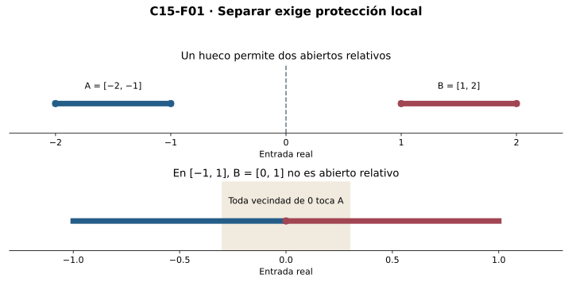

[Índice del libro](../para-matematicos/analisis-para-matematicos.html) · [Ejercicios de este capítulo](#ejercicios-15)

Una función continua en un intervalo que toma un valor negativo y otro positivo alcanza también el valor cero entre ambos argumentos. La continuidad sólo ofrece controles en torno a cada punto, pero esta conclusión afirma la existencia de una entrada que todavía no conocemos. El paso depende de una propiedad del dominio: un intervalo contiene todos los puntos entre dos de sus miembros y no puede repartirse en dos regiones abiertas relativas, disjuntas y no vacías.

La completitud de C00 permitirá demostrar esa imposibilidad mediante un supremo. Con los abiertos relativos de C14 podremos después trasladar una supuesta separación de las salidas hacia las entradas y deducir el valor intermedio. La bisección añadirá encierros y distancias al cero; el orden permitirá estudiar inversas y componentes. Trabajamos con lógica clásica y las herramientas de C04, C06 y C12, sin presuponer compacidad ni derivadas. Una recurrencia determinada por comparación de valores reales no implica por sí sola que esas comparaciones sean computables.

## 15.1. Qué tendría que hacer una separación

[]{#MA-SEC-ANM-01-015-001}

En $[-1,1]$ podemos asignar un color a $[-1,0)$ y otro a $[0,1]$. Cada punto recibe un color y aparecen ambos, pero cero tiene puntos del otro color arbitrariamente cerca dentro del dominio. En cambio, en $[-2,-1]\cup[1,2]$ cada segmento dispone de vecindades relativas que no encuentran el otro. La definición de separación recoge esta protección local de las dos partes.

**Definición.** Una separación de $E\subseteq\mathbb R$ es un par $A,B\subseteq E$ que satisface simultáneamente

$$A\ne\varnothing,\quad B\ne\varnothing,\quad A\cap B=\varnothing,
\quad E=A\cup B,$$

con $A$ y $B$ abiertos relativos a $E$. Diremos que $E$ es **conexo** cuando no admite ninguna separación. Según C14, $A$ es abierto relativo a $E$ si $A=E\cap U$ para algún abierto real $U$; equivalentemente, para cada $a\in A$ existe $r>0$ con $E\cap(a-r,a+r)\subseteq A$. El radio protege sólo entradas que pertenecen a $E$.

En $E=[-2,-1]\cup[1,2]$, las partes $A=[-2,-1]=E\cap(-\infty,0)$ y $B=[1,2]=E\cap(0,\infty)$ son abiertas relativas, aunque ninguno de los segmentos sea abierto en la recta. Son no vacías, disjuntas y cubren $E$, de modo que forman una separación. Para la partición $[-1,0)$ y $[0,1]$ de $[-1,1]$, el problema está en la apertura de la segunda parte en cero: dado cualquier $r>0$, el punto $-\min(r/2,1/2)$ pertenece al dominio, dista menos que $r$ de cero y queda fuera de $[0,1]$. Ninguna bola relativa alrededor de cero cabe en esa parte.

{#fig-anm-c15-f01 fig-alt="Dos segmentos separados por un hueco y un intervalo unido en cero. La vecindad de cero invade ambos colores en el segundo caso."}

**R1. Criterio de una sola parte.** $E$ es conexo si y sólo si sus únicos subconjuntos simultáneamente abiertos y cerrados relativos son $\varnothing$ y $E$.

Si $A\subseteq E$ es abierto y cerrado relativo, su complemento $B=E\setminus A$ es abierto relativo. Cuando $A$ es no vacío y propio, también $B$ es no vacío, y las identidades de complementos dan disjunción y cobertura. Sería una separación, imposible en un conexo. Recíprocamente, si existiera una separación $A,B$, la disjunción y cobertura obligarían a $B=E\setminus A$. La apertura de $B$ haría cerrado relativo a $A$, que además es abierto relativo, no vacío y propio. Esto contradice el criterio y prueba la otra implicación.

El vacío es conexo porque no contiene ninguna parte no vacía. En un singleton, dos partes no vacías tendrían que contener su única entrada y no podrían ser disjuntas; equivalentemente, sus únicos subconjuntos son él mismo y el vacío. Estas pruebas no necesitan que el singleton sea abierto real: la separación siempre se estudia en el conjunto declarado como ambiente.

Para refutar conexidad basta una pareja que cumpla todos los requisitos; para demostrarla hay que excluir cualquier separación posible. Comprobar que una partición particular falla no descarta que pudiera existir otra. La frontera de un color puede invalidar su apertura incluso cuando cobertura, disjunción y no vacuidad ya están verificadas.

### Microcontroles

#### Microcontrol 1

[]{#MA-MIC-ANM-01-015-001}

¿Qué cuatro condiciones conjuntistas acompañan la apertura relativa en una separación?

[]{#MA-MSOL-ANM-01-015-001}

Ver solución del microcontrol 1

No vacuidad de ambas partes, disjunción, cobertura del conjunto y pertenencia de las partes al conjunto ambiente. Junto a la apertura relativa, se escriben $A,B\subseteq E$, $A,B\ne\varnothing$, $A\cap B=\varnothing$, $A\cup B=E$.

La cobertura garantiza que cada entrada queda en alguna parte, y la disjunción que no queda en ambas. La no vacuidad evita la partición trivial en todo el conjunto y vacío. La pertenencia al ambiente impide añadir puntos exteriores. Después debe comprobarse apertura relativa de las dos partes: sin ese control local, las cuatro condiciones sólo describen una partición.

#### Microcontrol 2

[]{#MA-MIC-ANM-01-015-002}

¿Por qué $[-2,-1]$ puede ser una parte abierta relativa de $[-2,-1]\cup[1,2]$?

[]{#MA-MSOL-ANM-01-015-002}

Ver solución del microcontrol 2

Es la intersección del ambiente con el abierto real $(-\infty,0)$. La apertura se mide dentro del ambiente, aunque el segmento no sea abierto real.

Si una entrada del segmento está suficientemente cerca de otra entrada del ambiente, no puede saltar a la pieza positiva, separada por un hueco. El abierto real usado para representar la parte puede contener números ajenos al ambiente; el recorte los elimina. Así los extremos del segmento no impiden apertura relativa, aunque sí impiden apertura del segmento en la recta completa.

#### Microcontrol 3

[]{#MA-MIC-ANM-01-015-003}

¿Dónde falla la partición $[-1,0)$ y $[0,1]$ de $[-1,1]$?

[]{#MA-MSOL-ANM-01-015-003}

Ver solución del microcontrol 3

La segunda parte no es abierta relativa en cero: dado $r>0$, $-\min(r/2,1/2)$ pertenece al ambiente, dista menos que $r$ de cero y no pertenece a $[0,1]$.

El testigo propuesto es negativo, pertenece a $[-1,1]$ y está dentro de la bola de radio $r$ de cero porque su magnitud es a lo sumo $r/2<r$. No pertenece a la parte no negativa. Esto funciona para todo radio y niega exactamente la existencia de una bola relativa interior en cero. Las demás condiciones de partición siguen cumpliéndose.

#### Microcontrol 4

[]{#MA-MIC-ANM-01-015-004}

¿Qué complemento convierte una parte abierta y cerrada relativa en una separación candidata?

[]{#MA-MSOL-ANM-01-015-004}

Ver solución del microcontrol 4

$E\setminus A$. Si $A$ es propia y no vacía, el complemento también es no vacío; la cerradura relativa de $A$ significa que ese complemento es abierto relativo. Disjunción y cobertura son identidades de complementos.

Ser propia significa $A\ne E$ y da alguna entrada en $E\setminus A$. Ser cerrada relativa significa que este complemento es abierto en el mismo ambiente, mientras la apertura de $A$ está dada. Por ello ambas partes satisfacen todos los requisitos. En una separación, recíprocamente, cada parte es complemento de la otra y resulta también cerrada relativa.

#### Microcontrol 5

[]{#MA-MIC-ANM-01-015-005}

¿El vacío es conexo bajo la definición adoptada?

[]{#MA-MSOL-ANM-01-015-005}

Ver solución del microcontrol 5

Sí. Toda parte del vacío es vacía, y no pueden existir las dos partes no vacías exigidas por una separación.

La definición de conexidad afirma que no existe una separación, en lugar de exigir un punto testigo. Por eso también puede cumplirse cuando no hay entradas. Si se exigiera no vacuidad como parte de otra convención, cambiaría la conclusión, pero en este capítulo la no vacuidad corresponde a las dos partes de una separación, no al conjunto conexo.

#### Microcontrol 6

[]{#MA-MIC-ANM-01-015-006}

¿Hace falta que un singleton sea abierto real para probar que es conexo?

[]{#MA-MSOL-ANM-01-015-006}

Ver solución del microcontrol 6

No. Sus únicos subconjuntos son el vacío y él mismo; no admite dos partes disjuntas no vacías. La apertura real del singleton no interviene.

Si ambas partes no vacías de una partición del singleton contuvieran su única entrada, se intersectarían. Si una no la contuviera, sería vacía. Es imposible satisfacer simultáneamente no vacuidad y disjunción, antes incluso de estudiar apertura. La prueba funciona en cualquier ambiente que contenga ese punto.

#### Microcontrol 7

[]{#MA-MIC-ANM-01-015-007}

¿Basta dibujar una partición de dos colores para negar conexidad?

[]{#MA-MSOL-ANM-01-015-007}

Ver solución del microcontrol 7

No. Hay que demostrar apertura relativa de ambas partes y verificar no vacuidad, disjunción y cobertura. Una frontera mal asignada puede impedir la apertura de una parte.

En un intervalo podemos asignar cada punto a un color sin producir una separación topológica. La parte que recibe la frontera puede tener entradas del otro color arbitrariamente próximas. Para negar conexidad hay que proporcionar una bola relativa interior en cada punto de cada parte, además de las condiciones conjuntistas. El dibujo sólo sugiere dónde intentar esos controles.

#### Microcontrol 8

[]{#MA-MIC-ANM-01-015-008}

¿Qué niega exactamente la afirmación «$E$ es conexo»?

[]{#MA-MSOL-ANM-01-015-008}

Ver solución del microcontrol 8

Niega la existencia de cualquier par que satisfaga todas las condiciones de separación; no niega la existencia de particiones arbitrarias. Un intervalo sí admite particiones, pero ninguna con ambas partes abiertas relativas y no vacías.

La afirmación es universal sobre todas las posibles parejas de partes: ninguna satisface el conjunto completo de requisitos. Comprobar que una partición particular falla no acredita conexidad, pues podría existir otra separación. En cambio, para refutar conexidad basta exhibir una única pareja válida y demostrar todas sus condiciones.

### Ejercicios de la sección 15.1

[]{#ejercicios-15}

#### Ejercicio 1. Una separación relativa verificable

[]{#MA-EX-ANM-01-015-001}

Sea $E=[-3,-1]\cup[2,4]$. Construye una separación por un corte y comprueba todas las condiciones, distinguiendo apertura relativa de apertura real.

[]{#MA-SOL-ANM-01-015-001}

Ver solución del ejercicio 1

Tomamos $A=E\cap(-\infty,0)=[-3,-1]$ y $B=E\cap(0,\infty)=[2,4]$. Los rayos son abiertos reales, así las partes son abiertas relativas a $E$. $-2\in A$ y $3\in B$ prueban no vacuidad. Las desigualdades $x<0$ y $x>0$ son incompatibles, dando disjunción; todo punto de $E$ está en uno de los segmentos y por ello en una parte, dando cobertura. Ninguno de los segmentos es abierto real: cualquier bola alrededor de su extremo exterior contiene puntos que no pertenecen al segmento. El ambiente relativo es indispensable.

**Retorno visual.** Véase [C15-F01](analisis-para-matematicos-capitulo-15-conexidad-por-que-un-intervalo-no-se-rompe.html#fig-anm-c15-f01), después del argumento completo: la figura permite reconocer el mecanismo y no sustituye la prueba.

El corte cero pertenece al hueco entre las piezas y no al ambiente $E$. Así no queda ninguna entrada sin asignar, mientras los rayos incompatibles impiden asignaciones dobles. La apertura relativa se acredita con la representación por abiertos reales, no afirmando apertura real de los segmentos. En sus extremos, los puntos exteriores que refutan apertura real desaparecen al recortar por $E$.

#### Ejercicio 2. Una partición que no rompe el intervalo

[]{#MA-EX-ANM-01-015-002}

En $E=[0,2]$, examina $A=[0,1)$ y $B=[1,2]$. ¿Qué condición de separación falla? Da un testigo para cada radio en el punto problemático.

[]{#MA-SOL-ANM-01-015-002}

Ver solución del ejercicio 2

Ambas partes son no vacías, disjuntas y cubren $E$. Además $A=E\cap(-\infty,1)$ es abierta relativa. $B$ no lo es en $1$: dado $r>0$, ponemos $h=\min(r/2,1/2)>0$, $t=1-h$. Entonces $t\in[0,1)\subseteq E$, $|t-1|=h<r$ y $t\notin B$. Ningún radio de $1$ dentro de $E$ queda en $B$. Por eso la partición no es separación.

**Retorno visual.** Véase [C15-F01](analisis-para-matematicos-capitulo-15-conexidad-por-que-un-intervalo-no-se-rompe.html#fig-anm-c15-f01), después del argumento completo: la figura permite reconocer el mecanismo y no sustituye la prueba.

La existencia de un testigo para cada radio es la negación del criterio por bolas de apertura relativa. El mínimo mantiene al testigo dentro de $[0,1)$ aun cuando el radio sea grande, y también dentro de la bola aun cuando sea pequeño. La partición cumple cobertura, disjunción y no vacuidad, pero una sola parte sin apertura basta para impedir que sea separación.

#### Ejercicio 3. Equivalencia por complemento

[]{#MA-EX-ANM-01-015-003}

Demuestra desde las definiciones que $E$ es conexo si y sólo si todo subconjunto abierto y cerrado relativo a $E$ es vacío o todo $E$. Incluye $E=\varnothing$.

[]{#MA-SOL-ANM-01-015-003}

Ver solución del ejercicio 3

Si $E$ es conexo y $A$ es abierto y cerrado relativo, $E\setminus A$ es abierto relativo. Si $A$ no fuese vacío ni todo $E$, las dos partes serían no vacías, disjuntas y exhaustivas, separando $E$. Luego $A=\varnothing$ o $A=E$. Recíprocamente, una separación $A,B$ da $B=E\setminus A$; la apertura de $B$ hace a $A$ cerrado relativo y la de $A$ ya está dada. Por no vacuidad de ambas partes $A$ es no vacío y propio, contradiciendo el criterio. Si $E$ es vacío, su único subconjunto es vacío y no puede existir separación; ambas afirmaciones se cumplen.

En la primera dirección usamos la cerradura de $A$ para convertir su complemento en una segunda parte abierta. En la recíproca usamos cobertura y disjunción para identificar esa segunda parte exactamente con el complemento. La equivalencia depende del ambiente $E$ en ambos pasos. El criterio no prohíbe todos los subconjuntos abiertos y cerrados, sino únicamente los no vacíos y propios.

#### Ejercicio 4. Separar un conjunto finito

[]{#MA-EX-ANM-01-015-004}

Prueba que un subconjunto finito de $\mathbb R$ es conexo exactamente cuando tiene a lo sumo un punto. Para dos o más puntos, construye un corte sin invocar la caracterización por intervalos.

[]{#MA-SOL-ANM-01-015-004}

Ver solución del ejercicio 4

Vacío y singleton no pueden dividirse en dos partes disjuntas no vacías, luego son conexos. Si el conjunto finito tiene al menos dos puntos, se puede ordenar como $t_1<\cdots<t_m$ con $m\ge2$, usando repetidamente el menor de una lista finita por comparación. Sea $c=(t_1+t_2)/2$. No pertenece al conjunto porque está entre sus dos primeros puntos. Las partes $E\cap(-\infty,c)=\{t_1\}$ y $E\cap(c,\infty)$ son abiertas relativas, disjuntas y exhaustivas; contienen $t_1$ y $t_2$. Son una separación. Sólo se usó una lista finita y el orden real.

El mínimo y el segundo punto existen porque la lista es finita y tiene al menos dos miembros. Su punto medio queda estrictamente entre ellos y ningún miembro de la lista puede ocupar ese hueco. Esto asegura cobertura por los dos rayos y no vacuidad de sus recortes. No hemos utilizado R3 para producir el corte: la construcción verifica separación directamente.

#### Ejercicio 5. Ambientes anidados

[]{#MA-EX-ANM-01-015-005}

Si $F\subseteq E\subseteq\mathbb R$ y $A$ es abierto relativo a $E$, prueba que $F\cap A$ es abierto relativo a $F$. Explica por qué restringir una separación de $E$ a $F$ puede no separar $F$.

[]{#MA-SOL-ANM-01-015-005}

Ver solución del ejercicio 5

Escribimos $A=E\cap U$ con $U$ abierto real. Como $F\subseteq E$, $F\cap A=F\cap U$, abierto relativo a $F$. Para una separación $A,B$ de $E$, sus intersecciones con $F$ siguen siendo abiertas relativas, disjuntas y exhaustivas. Pero alguna puede ser vacía: con $E=[-2,-1]\cup[1,2]$, sus dos segmentos como partes y $F=[1,2]$, la intersección de la primera parte con $F$ es vacía. Por ello no queda una separación de $F$.

La igualdad $F\cap(E\cap U)=F\cap U$ usa $F\subseteq E$ y conserva un abierto real testigo. Las propiedades de disjunción y cobertura también se conservan al recortar. La no vacuidad es la condición que puede perderse: un subconjunto conexo puede quedar íntegramente de un lado de la separación del ambiente mayor.

## 15.2. El supremo impide romper un intervalo

[]{#MA-SEC-ANM-01-015-002}

**Definición.** Llamamos intervalo a todo $I\subseteq\mathbb R$ que contiene los puntos situados entre dos de sus puntos:

$$a,b\in I,\quad a\le b\quad\Longrightarrow\quad[a,b]\subseteq I.$$

La condición incluye el vacío, donde no hay pares que examinar, y los singletons, cuyos segmentos son degenerados. También incluye semirrectas, la recta completa e intervalos con extremos abiertos o cerrados. Para demostrar conexidad sólo utilizaremos esta propiedad entre puntos y la completitud real; el valor intermedio será una consecuencia posterior.

**R2. Todo intervalo real es conexo.** Supongamos una separación $I=A\cup B$. Hay dos puntos, uno en cada parte; son distintos. Intercambiando los nombres si hace falta, fijamos $a\in A$, $b\in B$, $a<b$. La propiedad intervalar da $[a,b]\subseteq I$.

Una separación hipotética tendría una frontera entre las partes, pero no podemos suponer que $A$ tenga un último punto. Recortamos entre las dos entradas fijadas y buscamos la menor cota superior de ese recorte:

$$S=A\cap[a,b],\qquad c=\sup S.$$

Como $a\in S$ y cada miembro de $S$ es menor o igual que $b$, el conjunto es no vacío y está acotado superiormente. La completitud de C00 proporciona $c$ y sus propiedades dan $a\le c\le b$. El carácter intervalar convierte esa localización real en pertenencia al dominio: $c\in[a,b]\subseteq I$. Sólo entonces podemos usar cobertura y disjunción para afirmar que $c$ está en exactamente una de las partes.

Si $c\in A$, la disjunción y $b\in B$ dan $c\ne b$; junto con $c\le b$ resulta $c<b$. La apertura relativa proporciona $r>0$ con $I\cap(c-r,c+r)\subseteq A$. Para producir un punto de $S$ mayor que $c$, debemos avanzar dentro de esa vecindad y también dentro de $[a,b]$. Tomamos

$$h=\min\left(\frac{b-c}{2},\frac r2\right)>0,\qquad d=c+h.$$

Los dos términos del mínimo son positivos y $h\le(b-c)/2<b-c$, $h\le r/2<r$. Por tanto $c<d<b$, $d\in[a,b]\subseteq I$ y $|d-c|<r$. La apertura de $A$ da $d\in A$, así que $d\in S$ y $d>c$, contra la condición de cota superior. Si hubiéramos usado sólo $c+r/2$, la proximidad estaría asegurada pero el punto podría superar $b$ o incluso salir del dominio. El mínimo resuelve ambas obligaciones.

Si $c\in B$, hay $s>0$ con $I\cap(c-s,c+s)\subseteq B$. El umbral $c-s/2<c$ no puede ser una cota superior de $S$, pues $c$ es la menor de ellas. Negar que ese umbral sea cota proporciona un $t\in S$ con

$$c-s/2<t\le c.$$

La desigualdad $t\le c$ procede de que $c$ sí es cota. Además $t\in S\subseteq A$ y $c\in B$ impiden $t=c$, de modo que $0<c-t<s/2<s$. El punto $t$ pertenece al dominio y a la vecindad relativa de $c$, por lo que también pertenece a $B$. Esto contradice $A\cap B=\varnothing$. La propiedad aproximante del supremo ha dado un único testigo para este radio, sin suponer que $c$ sea máximo ni seleccionar una sucesión de puntos de $S$.

{#fig-anm-c15-f02 fig-alt="Dos casos hipotéticos: un punto d a la derecha del supremo en A y un punto t a su izquierda que invade la vecindad de B. Ambos producen contradicción."}

Las dos ubicaciones posibles de $c$ son incompatibles con la separación supuesta. Para vacío y singleton, la separación ya era imposible porque no podía proporcionar los dos puntos iniciales distintos. Quedan incluidos así todos los intervalos de la definición.

La completitud aseguró un supremo real; la propiedad intervalar lo mantuvo dentro del dominio y permitió avanzar sin salir de él; la apertura relativa produjo las vecindades que originaron las contradicciones. Sólo se acotó el auxiliar $S$, aunque $I$ pudiera ser no acotado. La prueba no ha usado una función continua ni un teorema de compacidad.

### Microcontroles

#### Microcontrol 9

[]{#MA-MIC-ANM-01-015-009}

¿Qué definición de intervalo incluye las semirrectas y el vacío?

[]{#MA-MSOL-ANM-01-015-009}

Ver solución del microcontrol 9

La condición $a,b\in I$, $a\le b\Rightarrow[a,b]\subseteq I$. En el vacío no hay pares y la condición es vacía; en una semirrecta todo punto entre dos miembros satisface la misma desigualdad que define la semirrecta.

Esta formulación usa únicamente puntos ya presentes y todos los puntos entre ellos. No pide extremos globales alcanzados ni acotación. Si ambos puntos coinciden, el segmento es un singleton; si no hay puntos, no existe un par que infrinja la condición. Así la misma definición cubre intervalos abiertos, cerrados, no acotados y degenerados.

#### Microcontrol 10

[]{#MA-MIC-ANM-01-015-010}

¿Por qué $S=A\cap[a,b]$ tiene supremo en la prueba R2?

[]{#MA-MSOL-ANM-01-015-010}

Ver solución del microcontrol 10

Contiene $a$ y está acotado superiormente por $b$. La completitud real da un supremo para todo conjunto real no vacío acotado superiormente.

Antes de escribir $\sup S$ comprobamos las dos premisas de completitud por separado. La pertenencia de $a$ aporta no vacuidad; la inclusión en $[a,b]$ aporta la cota superior. No se exige que todo $A$ sea acotado. Este recorte es lo que permite aplicar completitud incluso si el intervalo original se extiende indefinidamente.

#### Microcontrol 11

[]{#MA-MIC-ANM-01-015-011}

¿Dónde se usa que el dominio sea intervalo para ubicar la frontera $c$?

[]{#MA-MSOL-ANM-01-015-011}

Ver solución del microcontrol 11

De $a\le c\le b$ y $a,b\in I$ se deduce $c\in[a,b]\subseteq I$. Sin esa inclusión la cobertura por las dos partes no permitiría asignar $c$ a una de ellas.

El supremo es un real por completitud, pero esa existencia no asegura por sí sola que sea una entrada del dominio. La condición intervalar completa la justificación al incluir todos los reales entre $a$ y $b$. Sólo después puede usarse $I=A\cup B$ para dividir el argumento en los dos casos. Separar existencia de pertenencia evita un paso inválido en dominios con huecos.

#### Microcontrol 12

[]{#MA-MIC-ANM-01-015-012}

Si $c\in A$, ¿por qué $b-c$ es positivo?

[]{#MA-MSOL-ANM-01-015-012}

Ver solución del microcontrol 12

$b\in B$ y la disjunción impiden $c=b$; además $c\le b$ por la cota del supremo. Por tanto $c<b$.

Si $c=b$, la pertenencia de $c$ a $A$ y de $b$ a $B$ daría una entrada común, prohibida por disjunción. La cota $c\le b$ deja entonces la desigualdad estricta. Esa positividad permite diseñar un avance que permanezca en el segmento; no sería legítimo dividir la distancia restante y afirmar un avance positivo antes de verificarla.

#### Microcontrol 13

[]{#MA-MIC-ANM-01-015-013}

¿Qué dos controles satisface $h=\min((b-c)/2,r/2)$?

[]{#MA-MSOL-ANM-01-015-013}

Ver solución del microcontrol 13

Es positivo, no avanza hasta $b$ y es menor que $r$. Así $c+h$ pertenece al segmento original y a la vecindad relativa de $c$; ambas pertenencias son necesarias para concluir que está en $A$.

Los dos números del mínimo son positivos, así $h>0$. Además $h\le(b-c)/2<b-c$ y $h\le r/2<r$. La primera desigualdad mantiene $c+h$ entre $c$ y $b$, dentro de $I$; la segunda lo mantiene en la ventana que garantiza pertenencia a $A$. El nuevo punto pertenece a $S$ y supera su cota superior $c$, que es la contradicción.

#### Microcontrol 14

[]{#MA-MIC-ANM-01-015-014}

Si $c\in B$, ¿por qué existe $t\in S$ mayor que $c-s/2$?

[]{#MA-MSOL-ANM-01-015-014}

Ver solución del microcontrol 14

El número $c-s/2<c$ no puede ser cota superior de $S$, pues $c$ es la menor cota superior. La negación de ser cota da un $t\in S$ con $t>c-s/2$, y $t\le c$ por ser $c$ cota.

Para cualquier tolerancia positiva por debajo de $c$, la minimalidad del supremo impide que ese umbral sea una cota superior. Aquí se usa el umbral $c-s/2$, de modo que la entrada encontrada está a distancia menor que $s$ de $c$. Como está en $S\subseteq A$, la apertura de $B$ la colocaría también en $B$, contradiciendo disjunción.

#### Microcontrol 15

[]{#MA-MIC-ANM-01-015-015}

¿Se supone en R2 que $c$ sea máximo de $S$?

[]{#MA-MSOL-ANM-01-015-015}

Ver solución del microcontrol 15

No. Si $c$ está en $B$, ni siquiera pertenece a $S\subseteq A$. Se usa la aproximación por debajo del supremo, no la existencia de un máximo.

Un máximo es un miembro del conjunto que domina a todos los demás; un supremo sólo es la menor cota superior. La prueba conserva esa diferencia: en el caso $c\in B$ obtiene miembros próximos por debajo, sin asignar $c$ a $S$. Pedir un máximo impediría tratar precisamente ese caso y añadiría una hipótesis no demostrada.

#### Microcontrol 16

[]{#MA-MIC-ANM-01-015-016}

¿Se necesita compacidad del intervalo original para R2?

[]{#MA-MSOL-ANM-01-015-016}

Ver solución del microcontrol 16

No. Se acota sólo el auxiliar $S$ entre dos puntos concretos. Supremo, propiedad intervalar y apertura relativa bastan, incluso para intervalos no acotados.

Después de suponer una separación basta fijar un punto de cada parte y recortar entre ellos. Toda la estimación ocurre en ese segmento, aunque el dominio sea la recta o una semirrecta. No se extrae una subcobertura ni una subsucesión. El recurso global utilizado es completitud real aplicada al auxiliar acotado, seguido de dos controles locales de apertura.

### Ejercicios de la sección 15.2

#### Ejercicio 6. Preparar un supremo legítimo

[]{#MA-EX-ANM-01-015-006}

En una separación hipotética $I=A\cup B$, con $a\in A$, $b\in B$, $a<b$, justifica existencia y localización de $c=\sup(A\cap[a,b])$. ¿Por qué puede hablarse de la parte que contiene $c$?

[]{#MA-SOL-ANM-01-015-006}

Ver solución del ejercicio 6

$S=A\cap[a,b]$ contiene $a$ y todos sus elementos son menores o iguales que $b$. Completitud da $c=\sup S$. Como $a\in S$, $a\le c$; como $b$ es cota, $c\le b$. La hipótesis intervalar da $[a,b]\subseteq I$, luego $c\in I=A\cup B$. La cobertura asigna una parte y la disjunción impide que pertenezca a ambas. Sin intervalaridad, $c$ podría faltar en el dominio y no habría esa dicotomía.

El supremo tiene dos funciones separadas: ser cota de $S$ y ser la menor de esas cotas. La primera lo ubica entre los puntos dados; la segunda permitirá encontrar miembros próximos por debajo. La intervalaridad asegura que ese real es una entrada. Así la prueba queda preparada para usar apertura de la parte que lo contiene sin asumir que sea máximo de $S$.

#### Ejercicio 7. Reparar un avance fuera del dominio

[]{#MA-EX-ANM-01-015-007}

Una prueba toma, cuando $c\in A$, $d=c+r/2$ y afirma que $d\in A\cap[a,b]$ por apertura relativa. Señala la obligación ausente y repara el argumento con una fórmula explícita.

[]{#MA-SOL-ANM-01-015-007}

Ver solución del ejercicio 7

La apertura relativa sólo garantiza pertenencia a $A$ de puntos de $I$ próximos a $c$. El punto $c+r/2$ puede superar $b$ y hasta salir de $I$; por ejemplo $c=0.9$, $b=1$, $r=1$ da $d=1.4$. En el argumento correcto, $c<b$ porque $b\in B$ y $c\in A$. Ponemos $h=\min((b-c)/2,r/2)>0$, $d=c+h$. Entonces $c<d<b$, $d\in[a,b]\subseteq I$ y $|d-c|<r$. La apertura da $d\in A$, luego $d\in S$, en contradicción con $d>\sup S$. La reparación usa por separado dominio y radio.

**Retorno visual.** Véase [C15-F02](analisis-para-matematicos-capitulo-15-conexidad-por-que-un-intervalo-no-se-rompe.html#fig-anm-c15-f02), después del argumento completo: la figura permite reconocer el mecanismo y no sustituye la prueba.

La vecindad relativa es $I\cap B(c,r)$: proximidad sola no da pertenencia a $I$. El mínimo reparado asegura ambas condiciones y además conserva $d\le b$, necesario para pertenecer a $S$. El ejemplo numérico sólo ilustra el avance excesivo; la reparación es simbólica y funciona en cualquier radio positivo del caso hipotético $c\in A$.

#### Ejercicio 8. La propiedad aproximante necesaria

[]{#MA-EX-ANM-01-015-008}

En el caso $c\in B$, desarrolla desde la definición de supremo la contradicción usando un radio $s>0$ de apertura relativa. No supongas que $c$ esté en $S$.

[]{#MA-SOL-ANM-01-015-008}

Ver solución del ejercicio 8

$c-s/2<c$ no es cota superior de $S$, porque sería una cota menor que la menor cota superior $c$. Por negación de la condición de cota existe $t\in S$ con $t>c-s/2$. Además $t\le c$ pues $c$ sí es cota. Como $S\subseteq A$ y $c\in B$, la disjunción da $t\ne c$. Así $0<c-t<s/2<s$, y $t\in I$ pertenece a la vecindad de $c$ dentro de $I$, que está en $B$. Queda $t\in A\cap B$, contradicción. Sólo se usó un testigo para este radio.

La propiedad aproximante se deduce de minimalidad de la cota y no de una sucesión elegida previamente. El testigo $t$ no puede igualar a $c$ porque pertenece a $A$ y el centro está en $B$. Esto proporciona la distancia estrictamente positiva y menor que el radio de apertura. La contradicción es pertenecer simultáneamente a las dos partes disjuntas.

#### Ejercicio 9. La completitud en el paso correcto

[]{#MA-EX-ANM-01-015-009}

Explica por qué el argumento del supremo no prueba conexidad de $\mathbb Q$ visto con su orden heredado. Exhibe una partición relativa que ilustre el fallo.

[]{#MA-SOL-ANM-01-015-009}

Ver solución del ejercicio 9

El orden racional no garantiza un supremo racional para todo subconjunto racional no vacío acotado. Si se toma el supremo en $\mathbb R$, puede quedar fuera del dominio racional y la dicotomía «pertenece a una parte» falla. El corte $c=\sqrt2\notin\mathbb Q$ da las partes racionales menores y mayores que $c$. Son abiertas relativas, disjuntas, exhaustivas y no vacías por los testigos $1$ y $2$. La densidad racional no incorpora a $c$ ni subsana el gasto de completitud y pertenencia.

Completitud de la recta entrega un supremo real, pero la prueba requiere además que sea miembro del intervalo considerado. En el ambiente racional, una frontera irracional no puede asignarse a ninguna parte. El corte explícito verifica que la dificultad es real, no sólo una laguna del argumento. Densidad permite aproximar esa frontera, pero no satisface la pertenencia que falta.

#### Ejercicio 10. Intervalos no acotados y degenerados

[]{#MA-EX-ANM-01-015-010}

Prueba que $(a,\infty)$, $\mathbb R$, $\{a\}$ y $\varnothing$ son conexos, indicando por qué R2 no necesita una cota global de todo el dominio.

[]{#MA-SOL-ANM-01-015-010}

Ver solución del ejercicio 10

En la semirrecta, si $u\le v$ son miembros, todo $t\in[u,v]$ satisface $t\ge u>a$, así también pertenece. La recta contiene todos sus segmentos. Singleton y vacío satisfacen el predicado intervalar vacíamente o con segmentos degenerados. R2 los hace conexos. Su prueba acota sólo $S=A\cap[u,v]$ después de fijar dos puntos de una supuesta separación; no necesita acotar todo el intervalo. En vacío y singleton no hay dos puntos de partes disjuntas no vacías, de modo que la separación ya es imposible.

Un intervalo no acotado puede contener un segmento acotado entre dos entradas cualesquiera. Es ese segmento el que aporta la cota superior del auxiliar en R2. Para vacío y singleton, la no vacuidad y disjunción de dos partes ya resultan incompatibles. Por ello el resultado abarca tanto dominios muy grandes como casos degenerados sin una premisa de compacidad.

## 15.3. Un hueco produce dos lados

[]{#MA-SEC-ANM-01-015-003}

Si un conjunto real no es intervalo, existen dos entradas $a<b$ y un punto omitido $c$ estrictamente entre ellas. Los extremos no pueden ser el punto omitido porque ya pertenecen al conjunto. Esa ausencia interior permite cortar sin dejar ninguna entrada en la frontera y garantiza que los dos lados tengan miembros.

**R3. Todo conexo real es intervalo.** Por contraposición, dados $a<c<b$ con $a,b\in E$ y $c\notin E$, definimos

$$A=E\cap(-\infty,c),\qquad B=E\cap(c,\infty).$$

Los rayos reales son abiertos, de modo que $A$ y $B$ son abiertos relativos. Las entradas $a$ y $b$ verifican respectivamente su no vacuidad, y las desigualdades $x<c$ y $x>c$ no pueden cumplirse simultáneamente. Para toda entrada $x\in E$, la ausencia de $c$ y la tricotomía dejan exactamente uno de esos dos casos, así que las partes cubren $E$. Hemos construido una separación. Por contraposición, todo conexo real es intervalo.

{#fig-anm-c15-f03 fig-alt="Racionales de muestra a ambos lados de una línea vertical situada en raíz de dos; el punto de corte es irracional y está ausente del dominio."}

R2 y R3 producen la caracterización exacta

$$E\text{ conexo}\quad\Longleftrightarrow\quad E\text{ intervalo}.$$

Esta equivalencia permite pasar, en la recta, de una condición sobre vecindades a una condición sobre el orden de los puntos. Ambas direcciones tienen pruebas distintas: el supremo impide separar un intervalo, mientras un punto intermedio ausente basta para separar un conjunto que no lo es.

Por ejemplo, $\mathbb R\setminus\{0\}$ se separa por sus dos rayos. Para $\mathbb Q$, la raíz positiva $\sqrt2$, irracional por C10, permite tomar los racionales menores y mayores que ella. Las partes contienen respectivamente $1$ y $2$, son abiertas relativas, disjuntas y cubren $\mathbb Q$. La densidad racional permite acercarse al corte desde ambos lados, pero no incorpora el corte al dominio. La separación no exige una distancia positiva global entre las partes.

Una intersección arbitraria de intervalos sigue siendo intervalo. Dados dos puntos de la intersección, cada miembro de la familia contiene su segmento, y por tanto la intersección también lo contiene. Si no hay pares, la condición se cumple vacíamente; para una familia vacía adoptamos la intersección relativa a $\mathbb R$, que es toda la recta. Una unión arbitraria puede fallar: $(0,1)\cup(2,3)$ contiene $1/2$ y $5/2$ y omite $3/2$.

Si dos intervalos tienen un punto común, una supuesta separación de su unión se restringiría a partes abiertas relativas en cada intervalo. Esas intersecciones conservan disjunción y cobertura. Si ambas fueran no vacías, separarían el intervalo; por R2, cada intervalo queda entero en una parte. El punto común obliga a que sea la misma para los dos, dejando vacía la otra. La unión es entonces conexa y por R3 es intervalo.

El mismo argumento funciona para cualquier familia no vacía de conexos con un punto común $p$. Fijada una separación de la unión, cada miembro contiene $p$ y debe quedar en la parte que lo contiene. La unión completa queda allí, contra la no vacuidad de la otra parte. El testigo $p$ ya está dado y sirve para todos los miembros; no se selecciona un punto por miembro.

El punto común es una condición suficiente para esta prueba, pero puede haber unión conexa de piezas disjuntas. En $[0,1)\cup[1,2]=[0,2]$, la segunda pieza incorpora el extremo uno que la primera excluye, y la unión no omite ningún punto intermedio. Los extremos deben leerse en el conjunto reunido.

### Microcontroles

#### Microcontrol 17

[]{#MA-MIC-ANM-01-015-017}

¿Qué omisión permite construir un corte que separa un conjunto?

[]{#MA-MSOL-ANM-01-015-017}

Ver solución del microcontrol 17

Un $c\notin E$ situado estrictamente entre dos puntos $a<b$ de $E$. Una omisión fuera de todos sus puntos no asegura dos partes no vacías.

La posición estrictamente intermedia aporta entradas presentes a ambos lados. La ausencia de $c$ permite que los rayos abiertos cubran todas las entradas sin dejar ninguna en la frontera. Si el punto omitido estuviera a la izquierda o derecha de todo el conjunto, uno de los recortes podría ser vacío y no tendríamos una separación.

#### Microcontrol 18

[]{#MA-MIC-ANM-01-015-018}

¿Por qué las partes $E\cap(-\infty,c)$ y $E\cap(c,\infty)$ cubren $E$?

[]{#MA-MSOL-ANM-01-015-018}

Ver solución del microcontrol 18

Como $c\notin E$, todo $x\in E$ es distinto de $c$. La tricotomía deja sólo $x<c$ o $x>c$.

Los dos rayos no incluyen la frontera $c$, y por eso su unión no es toda la recta. Al recortarlos por $E$, el único punto que podría faltar ya estaba ausente. La cobertura se prueba entrada por entrada usando tricotomía. Si $c$ perteneciera a $E$, estos dos recortes dejarían fuera esa entrada y no formarían una separación.

#### Microcontrol 19

[]{#MA-MIC-ANM-01-015-019}

¿Qué testigos aseguran la no vacuidad de ambos lados del corte?

[]{#MA-MSOL-ANM-01-015-019}

Ver solución del microcontrol 19

Los puntos dados $a<c<b$: $a$ está en el lado izquierdo y $b$ en el derecho.

No basta que los rayos reales sean no vacíos: sus recortes con el dominio podrían no serlo. Las entradas $a$ y $b$ verifican no vacuidad de los recortes efectivos. Además, las desigualdades opuestas garantizan disjunción y los rayos aportan apertura relativa. Así cada requisito se vincula con un dato concreto de la construcción.

#### Microcontrol 20

[]{#MA-MIC-ANM-01-015-020}

¿La densidad de $\mathbb Q$ implica su conexidad?

[]{#MA-MSOL-ANM-01-015-020}

Ver solución del microcontrol 20

No. $\sqrt2$ es un punto real entre $1$ y $2$ que no es racional. Los racionales menores y mayores que ese corte forman una separación; aproximarse al corte no lo incluye en el dominio.

Densidad significa que los racionales visitan todo intervalo abierto real, no que contengan todos los puntos entre dos miembros. En el corte irracional, cada racional pertenece exactamente a un lado; ambos lados son abiertos relativos y contienen $1$ o $2$. Los racionales pueden aproximarse a la frontera sin que ésta sea una entrada que conecte las partes.

#### Microcontrol 21

[]{#MA-MIC-ANM-01-015-021}

¿Por qué una intersección de intervalos es intervalo?

[]{#MA-MSOL-ANM-01-015-021}

Ver solución del microcontrol 21

Si $a,b$ pertenecen a todos los miembros, cada miembro contiene $[a,b]$, luego la intersección también lo contiene. Si la intersección es vacía, la condición entre pares se cumple vacíamente.

Para verificar la condición intervalar tomamos un par de la intersección y un punto entre ellos. En cada intervalo ese punto pertenece por intervalaridad, por lo que pertenece a todos y a su intersección. No se requiere seleccionar extremos de los miembros. Con la convención de familia vacía, la intersección es la recta completa y también satisface la condición.

#### Microcontrol 22

[]{#MA-MIC-ANM-01-015-022}

¿Qué ocurre al unir $(0,1)$ y $(2,3)$?

[]{#MA-MSOL-ANM-01-015-022}

Ver solución del microcontrol 22

La unión omite, por ejemplo, $3/2$ entre los puntos presentes $1/2$ y $5/2$. No es intervalo y por R3 no es conexa.

El corte $3/2$ deja una parte a cada lado, ambas abiertas relativas y con entradas dadas. Como el corte falta, esas partes cubren la unión y son disjuntas. Los intervalos originales son conexos individualmente, pero esa propiedad no obliga a la unión a contener los puntos entre piezas distintas.

#### Microcontrol 23

[]{#MA-MIC-ANM-01-015-023}

¿Por qué un punto común ayuda a unir dos conexos?

[]{#MA-MSOL-ANM-01-015-023}

Ver solución del microcontrol 23

En una supuesta separación de la unión, cada conexo debe quedar en una sola parte. El punto común obliga a que ambos queden en la misma, dejando vacía la otra parte.

Al intersectar las partes de la separación con uno de los conexos obtenemos partes abiertas relativas, disjuntas y que lo cubren. Si ambas fueran no vacías lo separarían, así debe quedar entero de un lado. La entrada compartida pertenece al mismo lado para los dos conjuntos. Por ello toda la unión queda allí, contradiciendo no vacuidad del otro lado.

#### Microcontrol 24

[]{#MA-MIC-ANM-01-015-024}

¿La intersección no vacía es necesaria para que dos intervalos tengan unión conexa?

[]{#MA-MSOL-ANM-01-015-024}

Ver solución del microcontrol 24

No. $[0,1)$ y $[1,2]$ son disjuntos, pero su unión es $[0,2]$, que es intervalo y conexo. La condición de punto común es suficiente, no necesaria.

El punto uno no pertenece a la primera pieza pero sí a la segunda. Así no falta en la unión y tampoco hay otros huecos entre cero y dos. La unión es un intervalo aunque las piezas no se intersecten. No podemos aplicar directamente el criterio de punto común, pero sí comprobar intervalaridad y usar R2.

### Ejercicios de la sección 15.3

#### Ejercicio 11. Un punto omitido suficiente

[]{#MA-EX-ANM-01-015-011}

Para $E=[0,1]\cup(1,3]\setminus\{2\}$, interpreta los paréntesis como $E=([0,1]\cup(1,3])\setminus\{2\}$. Construye una separación. ¿Es $1$ otro hueco?

[]{#MA-SOL-ANM-01-015-011}

Ver solución del ejercicio 11

La unión anterior a quitar $2$ es $[0,3]$, pues $1$ está en la primera pieza. Por tanto $E=[0,3]\setminus\{2\}$. Tomamos $A=E\cap(-\infty,2)=[0,2)$ y $B=E\cap(2,\infty)=(2,3]$. Son abiertas relativas por los rayos, disjuntas y cubren $E$ porque $2$ fue omitido. Son no vacías por $0$ y $3$. $1$ no es hueco: pertenece a $E$. Las modalidades de extremos de cada pieza no deben leerse aisladas de la unión.

La unión debe calcularse antes de interpretar las fronteras de cada pieza. Aunque la segunda excluya uno, la primera lo incluye y la unión no tiene hueco allí. El único corte solicitado es dos, que se retira después de unir. Los rayos alrededor de dos producen dos partes abiertas relativas incluso si sus extremos no forman abiertos reales.

#### Ejercicio 12. Densidad y ruptura

[]{#MA-EX-ANM-01-015-012}

Construye una separación de $\mathbb Q$ por un corte irracional y demuestra cada condición. Explica por qué las partes pueden tener puntos arbitrariamente próximos al corte.

[]{#MA-SOL-ANM-01-015-012}

Ver solución del ejercicio 12

Usamos $c=\sqrt2$, real irracional, y $A=\mathbb Q\cap(-\infty,c)$, $B=\mathbb Q\cap(c,\infty)$. Las partes son abiertas relativas, disjuntas y cubren los racionales por $c\notin\mathbb Q$. $1\in A$, $2\in B$. Para todo $r>0$, densidad racional da un punto en $(c-r,c)$ y otro en $(c,c+r)$, pertenecientes a las partes respectivas. Aproximación arbitraria al corte es compatible con separación: el punto límite común está fuera del ambiente racional.

**Retorno visual.** Véase [C15-F03](analisis-para-matematicos-capitulo-15-conexidad-por-que-un-intervalo-no-se-rompe.html#fig-anm-c15-f03), después del argumento completo: la figura permite reconocer el mecanismo y no sustituye la prueba.

Las dos aproximaciones al corte se realizan en intervalos abiertos no vacíos, uno de cada lado, de modo que densidad aporta racionales con las desigualdades estrictas requeridas. Sus límites posibles en el ambiente real pueden coincidir sin generar intersección dentro del ambiente racional. La separación exige disjunción de las partes, no una distancia positiva global entre ellas.

#### Ejercicio 13. Intersecciones y uniones

[]{#MA-EX-ANM-01-015-013}

Demuestra que toda intersección de intervalos reales es conexa, con la convención de intersección vacía igual a $\mathbb R$. Refuta la afirmación análoga para uniones arbitrarias.

[]{#MA-SOL-ANM-01-015-013}

Ver solución del ejercicio 13

Si $x,y$ pertenecen a la intersección, están en cada intervalo de la familia, y el segmento entre ellos está en cada miembro, luego en la intersección. Es intervalo y R2 da conexidad. Para una familia sin miembros, la intersección relativa a $\mathbb R$ es toda $\mathbb R$, también intervalo. La unión falla para $(0,1)\cup(2,3)$: $1/2$ y $5/2$ pertenecen pero $3/2$ no; R3 da desconexión o se exhibe el corte por $3/2$.

La intersección conserva puntos intermedios porque cada miembro impone la misma obligación sobre el par fijado. No importa que la familia sea infinita ni que no existan extremos globales. En una unión, en cambio, las dos entradas pueden proceder de miembros diferentes y ninguno está obligado a incluir el segmento que las une. El contraejemplo aprovecha exactamente esa diferencia.

#### Ejercicio 14. Una familia con punto común

[]{#MA-EX-ANM-01-015-014}

Sea $(E_i)_{i\in J}$ una familia no vacía de conexos reales y supón que hay $p\in\bigcap_{i\in J}E_i$. Prueba que $H=\bigcup_{i\in J}E_i$ es conexo sin seleccionar puntos o radios por miembro.

[]{#MA-SOL-ANM-01-015-014}

Ver solución del ejercicio 14

Supongamos una separación $H=A\cup B$ y, intercambiando nombres, $p\in A$. Para cada índice fijo $i$, las partes $E_i\cap A$ y $E_i\cap B$ son abiertas relativas a $E_i$, disjuntas y exhaustivas. La primera contiene el punto común $p$. Si la segunda fuese no vacía, separaría $E_i$; por conexidad es vacía. Se ha probado para todo $i$ que $E_i\subseteq A$. Por definición de unión, $H\subseteq A$, luego $B=\varnothing$, contradicción. El punto $p$ es único testigo compartido fijado desde la hipótesis; no se produce una familia de elecciones.

Para cada índice se razona con la misma entrada $p$, que ya está dada como punto común. Las intersecciones con la separación heredan apertura relativa por el cálculo de ambientes anidados. La conexidad de cada miembro obliga a eliminar su parte opuesta. El razonamiento universal sobre índices produce inclusión de toda la unión sin escoger puntos o radios para cada miembro.

#### Ejercicio 15. Cerrar un intervalo sin romperlo

[]{#MA-EX-ANM-01-015-015}

Prueba directamente que la adherencia real $\overline I$ de un intervalo $I$ es intervalo, por tanto conexa. Incluye el caso vacío.

[]{#MA-SOL-ANM-01-015-015}

Ver solución del ejercicio 15

Para $I=\varnothing$, ninguna vecindad toca $I$ y su adherencia es vacía. En el resto, tomemos $u<v$ en $\overline I$ y $u<t<v$. La vecindad de $u$ de radio $(t-u)/2$ toca $I$, dando $a\in I$ con $a<t$. La de $v$ de radio $(v-t)/2$ da $b\in I$ con $t<b$. Intervalaridad implica $t\in[a,b]\subseteq I\subseteq\overline I$. Los extremos $u,v$ ya están en la adherencia. Así todo segmento entre miembros está en ella, y es intervalo. R2 prueba conexidad. Sólo se fijaron dos testigos de vecindades para el punto $t$ considerado.

Los radios alrededor de $u$ y $v$ se diseñan según el punto intermedio $t$. El primero produce una entrada estrictamente menor que $t$, y el segundo una estrictamente mayor. Intervalaridad coloca $t$ en el conjunto original, una conclusión más fuerte que pertenecer a su adherencia. Los extremos del segmento ya pertenecían a la adherencia por hipótesis y completan la condición intervalar.

## 15.4. La continuidad transporta la imposibilidad de separar

[]{#MA-SEC-ANM-01-015-004}

Para estudiar las salidas de una continua utilizaremos la dirección de transporte que C14 garantiza: las preimágenes de abiertos son abiertas relativas. Si pudiéramos separar la imagen de un dominio conexo, esas preimágenes permitirían intentar la misma separación en el dominio.

**R4. Imagen continua de un conexo.** Sea $f:D\to\mathbb R$ continua y sea $E\subseteq D$ conexo. Entonces $H=f[E]$ es conexo. La restricción $h=f\mathbin{\upharpoonright}E:E\to\mathbb R$ es continua por C14 y tiene imagen $H$. Si $E$ es vacío también lo es $H$, y el resultado es inmediato.

Supongamos que $H=A\cup B$ es una separación de la imagen. Hay abiertos reales $V,W$ con $A=H\cap V$ y $B=H\cap W$. Reunimos las entradas de $E$ que producen salidas en cada parte:

$$P=\{x\in E:h(x)\in A\},\qquad Q=\{x\in E:h(x)\in B\}.$$

Toda salida de $h$ pertenece a $H$, así que $P=h^{-1}[V]$ y $Q=h^{-1}[W]$. La continuidad de la restricción hace ambos conjuntos abiertos relativos a $E$. Si una entrada estuviera en los dos, su salida pertenecería a $A\cap B$, imposible. Toda entrada está en alguno porque su salida está en $H=A\cup B$.

También necesitamos no vacuidad, que no se sigue sólo de que $V$ y $W$ sean abiertos no vacíos del codominio. Fijemos $y_A\in A$. Como $y_A\in H=h[E]$, existe $x_A\in E$ con $h(x_A)=y_A$, y por tanto $x_A\in P$. Un valor de $B$ da del mismo modo una entrada de $Q$. Se usan dos testigos concretos de valores alcanzados, sin construir un selector de todas las fibras. Así $P,Q$ separan $E$, contradicción. La imagen $H$ es conexa.

**Consecuencia.** La imagen continua de un intervalo es intervalo: el dominio es conexo por R2, la imagen es conexa por R4 y vuelve a ser intervalo por R3. No se requiere inyectividad, monotonía, dominio cerrado ni acotación.

La dirección inversa no está garantizada. Para $q(x)=x^2$ en $[-2,2]$, el singleton $\{1\}$ es conexo y su preimagen $\{-1,1\}$ se separa por el corte cero. El dominio de $q$ también es conexo y $q$ es continua, pero R4 no afirma preservación por preimagen. Por otra parte, una constante en $\{-1,1\}$ es continua y tiene imagen singleton: una imagen conexa puede proceder de un dominio desconexo.

El mismo criterio puede expresarse mediante funciones de dos valores: **$E$ es conexo si y sólo si toda función continua $u:E\to\{0,1\}$ es constante**, entendiendo continuidad con distancias reales. Si $E$ es conexo, R4 da una imagen conexa contenida en $\{0,1\}$. Alcanzar ambos valores produciría una imagen que omite $1/2$ entre ellos, contra R3. Por tanto todas las parejas de entradas tienen la misma salida. En el dominio vacío esta igualdad universal se cumple sin exigir una entrada ni un valor alcanzado.

Recíprocamente, una separación $A,B$ permite definir $u=0$ en $A$ y $u=1$ en $B$. Cobertura y disjunción garantizan una asignación única. En cada centro, la apertura relativa de su parte proporciona una bola donde la función conserva su valor, con error cero para cualquier tolerancia positiva. Es continua y no es constante porque alcanza los dos valores, lo que contradice el criterio supuesto.

### Microcontroles

#### Microcontrol 25

[]{#MA-MIC-ANM-01-015-025}

¿Qué operación de conjuntos usa la continuidad para transportar una separación de la imagen?

[]{#MA-MSOL-ANM-01-015-025}

Ver solución del microcontrol 25

Preimágenes. Si las partes de la imagen son $H\cap V$ y $H\cap W$, sus preimágenes por $h:E\to\mathbb R$ son $h^{-1}[V]$ y $h^{-1}[W]$, abiertas relativas a $E$.

La apertura de una parte de la imagen se expresa como recorte por un abierto real. Como todas las evaluaciones están en la imagen, tomar su preimagen equivale a tomar la del abierto real entero. El criterio de C14 da apertura relativa de las entradas seleccionadas. Se transporta una separación hacia atrás; no se afirma que las imágenes de abiertos sean abiertas.

#### Microcontrol 26

[]{#MA-MIC-ANM-01-015-026}

¿Por qué se restringe $f$ al conexo $E\subseteq D$?

[]{#MA-MSOL-ANM-01-015-026}

Ver solución del microcontrol 26

Así la función $h=f\upharpoonright E$ tiene exactamente el ambiente de entradas que queremos separar. Su continuidad se hereda de $f$ y su imagen es $f[E]$.

Las preimágenes deben tener ambiente $E$, pues la contradicción buscada es una separación de $E$. Usar todo $D$ podría producir una separación de un dominio que no se ha supuesto conexo. Restringir la función conserva continuidad relativa y hace que sus valores alcanzados sean exactamente los que aparecen en la separación hipotética de $f[E]$.

#### Microcontrol 27

[]{#MA-MIC-ANM-01-015-027}

¿Qué garantiza que la preimagen de una parte no vacía de $f[E]$ sea no vacía?

[]{#MA-MSOL-ANM-01-015-027}

Ver solución del microcontrol 27

Que sus valores pertenecen a la imagen: para un valor concreto $y$ de esa parte existe $x\in E$ con $f(x)=y$. No bastaría que $y$ perteneciera solamente al codominio.

Una preimagen de un subconjunto no vacío del codominio puede ser vacía si la función no alcanza sus valores. Aquí cada valor elegido ya tiene una entrada porque pertenece a $f[E]$. Esa entrada queda en la preimagen de la parte correspondiente. Sólo se necesitan dos testimonios, uno por parte, para verificar no vacuidad.

#### Microcontrol 28

[]{#MA-MIC-ANM-01-015-028}

¿R4 necesita escoger una entrada para cada valor de la imagen?

[]{#MA-MSOL-ANM-01-015-028}

Ver solución del microcontrol 28

No. Para refutar la separación se fijan sólo un valor y una preimagen en cada una de sus dos partes. No se construye un selector global de fibras.

La prueba de no vacuidad trabaja con dos existencias concretas. No necesita reunir una entrada para cada salida ni invertir globalmente una función que podría no ser inyectiva. Las preimágenes se definen como conjuntos de todas las entradas que cumplen la condición. Así el argumento no introduce una selección simultánea de fibras.

#### Microcontrol 29

[]{#MA-MIC-ANM-01-015-029}

¿La preimagen de un conexo por una función continua tiene que ser conexa?

[]{#MA-MSOL-ANM-01-015-029}

Ver solución del microcontrol 29

No. Para $q(x)=x^2$ en $[-2,2]$, $q^{-1}[\{1\}]=\{-1,1\}$, que no es intervalo, aunque $\{1\}$ sí es conexo.

El singleton de salida es un intervalo degenerado y por ello conexo. Su preimagen contiene dos puntos y omite cero entre ellos; el corte por cero la separa. La continuidad de $q$ y la conexidad de su dominio siguen siendo verdaderas. El ejemplo muestra que invertir la dirección del resultado de preservación cambia la afirmación y puede hacerla falsa.

#### Microcontrol 30

[]{#MA-MIC-ANM-01-015-030}

¿Una imagen singleton prueba que el dominio es conexo?

[]{#MA-MSOL-ANM-01-015-030}

Ver solución del microcontrol 30

No. Una función constante en $\{-1,1\}$ es continua en el dominio relativo y tiene imagen singleton, pero el dominio admite un corte por cero.

La constante tiene error cero para cualquier par de entradas, de modo que es continua incluso en este dominio separado. Su imagen olvida la diferencia entre las entradas y queda reducida a un punto. Preservación sólo afirma que un dominio conexo produce una imagen conexa; una imagen conexa puede proceder de un dominio desconexo.

#### Microcontrol 31

[]{#MA-MIC-ANM-01-015-031}

¿Cómo una separación define una función continua con valores cero y uno?

[]{#MA-MSOL-ANM-01-015-031}

Ver solución del microcontrol 31

Se asigna cero a una parte y uno a la otra. En cada punto la apertura relativa da una vecindad donde la función es constante; el error de salida allí es cero para cualquier tolerancia positiva.

La cobertura y la disjunción aseguran que cada entrada recibe exactamente una regla. Para una entrada de $A$, su apertura ofrece una bola relativa contenida en $A$ y por ello salida siempre cero; para una de $B$, siempre uno. Las bolas pueden cambiar con el centro. La no vacuidad de las dos partes garantiza que esta continua no sea constante.

#### Microcontrol 32

[]{#MA-MIC-ANM-01-015-032}

¿Qué significa «constante» para una función con dominio vacío en este criterio?

[]{#MA-MSOL-ANM-01-015-032}

Ver solución del microcontrol 32

Que para todos $x,z$ del dominio se cumple $u(x)=u(z)$. La condición universal es vacía; no se exige un valor alcanzado ni una entrada testigo.

No hay dos entradas del vacío que tengan salidas distintas, por lo que se cumple la igualdad universal. Bajo esta convención el criterio de dos valores incluye el vacío de forma coherente con su conexidad. Pedir además que exista una entrada o un valor alcanzado introduciría un requisito diferente y excluiría innecesariamente ese caso.

### Ejercicios de la sección 15.4

#### Ejercicio 16. Separación de valores a entradas

[]{#MA-EX-ANM-01-015-016}

Reconstruye R4 para una continua $f:D\to\mathbb R$ y un conexo $E\subseteq D$. Identifica los ambientes de las dos parejas de abiertos y dónde se usa pertenencia a la imagen.

[]{#MA-SOL-ANM-01-015-016}

Ver solución del ejercicio 16

Sea $h=f\upharpoonright E$, continua. Si $H=f[E]$ se separara como $A=H\cap V$, $B=H\cap W$ con $V,W$ abiertos reales, tomamos $P=\{x\in E:h(x)\in A\}=h^{-1}[V]$ y $Q=h^{-1}[W]$. Son abiertos relativos a $E$, mientras $A,B$ lo eran a $H$. Disjunción y cobertura se trasladan porque toda salida de $h$ está en $H=A\cup B$. Para un valor concreto en cada parte, pertenecer a $H$ da una entrada en $E$ con esa salida; ambas preimágenes son no vacías. Así separan $E$, contradicción. Si $E$ es vacío, su imagen es vacía y ya es conexa. No se usa inversa funcional ni selector de todas las fibras.

La continuidad garantiza apertura sólo de las preimágenes de abiertos en el ambiente correcto. Las partes de $H$ se representan con abiertos reales para poder aplicar ese criterio a la restricción. El hecho de que las salidas estén en $H$ traslada cobertura y disjunción; el hecho de que cada parte contenga un valor alcanzado traslada no vacuidad. Así cada condición de la separación tiene una justificación propia.

#### Ejercicio 17. La preimagen que se divide

[]{#MA-EX-ANM-01-015-017}

Para $q:[-2,2]\to\mathbb R$, $q(x)=x^2$, calcula $q^{-1}[\{1\}]$ y prueba que no es conexa. ¿Qué hipótesis de R4 siguen siendo verdaderas?

[]{#MA-SOL-ANM-01-015-017}

Ver solución del ejercicio 17

La ecuación $x^2=1$ equivale a $(x-1)(x+1)=0$, luego la preimagen es $\{-1,1\}$. Sus dos singletons se obtienen cortando por cero; son abiertos relativos, disjuntos y no vacíos, y cubren la preimagen. No es conexa. $q$ es continua por C14, su dominio $[-2,2]$ es conexo y $\{1\}$ también. Nada contradice R4: el teorema preserva conexidad por imagen directa, no por preimagen.

La factorización permite calcular todas las entradas de la fibra, no sólo dos candidatos. Ambas raíces pertenecen al dominio indicado y no hay otras. Sus singletons constituyen una separación relativa de la fibra, aunque no sean abiertos reales. R4 sigue siendo verdadero porque se refiere a imágenes directas de conexos y no a fibras o preimágenes.

#### Ejercicio 18. Una imagen global intervalar no certifica continuidad

[]{#MA-EX-ANM-01-015-018}

En $[-1,1]$ define $f(x)=x$ si $x<0$ y $f(x)=x-1$ si $x\ge0$. Calcula su imagen y decide su continuidad en cero. Refuta «si la imagen es intervalo, la función es continua».

[]{#MA-SOL-ANM-01-015-018}

Ver solución del ejercicio 18

La primera rama tiene imagen $[-1,0)$ y la segunda $[-1,0]$, luego la imagen total es $[-1,0]$, intervalo. Pero $f(0)=-1$. Dado $\delta>0$, ponemos $t=\min(\delta/2,1/4)>0$, $x=-t\in[-1,0)$. Entonces $|x|<\delta$ y $|f(x)-f(0)|=1-t\ge3/4>1/2$. La tolerancia $1/2$ refuta continuidad en cero. El resultado de preservación es una implicación con continuidad como premisa; que la imagen total sea intervalar no prueba controles locales ni el valor intermedio en cada subsegmento.

La segunda rama recupera los valores que faltaban para que la imagen total incluya menos uno y cero. Esa coincidencia global no corrige el valor central menos uno frente a las salidas cercanas de la primera rama. El infractor se elige dentro del dominio para cualquier radio y mantiene un error mayor que la tolerancia fija. La refutación compara con $f(0)$, que es el destino exigido por continuidad.

#### Ejercicio 19. El criterio de dos valores

[]{#MA-EX-ANM-01-015-019}

Demuestra que $E$ es conexo si y sólo si toda continua $u:E\to\{0,1\}$ es constante, con la convención de constancia por igualdad entre todas las parejas de entradas.

[]{#MA-SOL-ANM-01-015-019}

Ver solución del ejercicio 19

Si $E$ es conexo, R4 da imagen conexa de $u$ como subconjunto real. Una imagen que contuviera $0$ y $1$ sería exactamente $\{0,1\}$, que omite $1/2$ y no es intervalo; contradicción con R3. Así no hay dos entradas con salidas distintas, que es constancia. Si $E$ tuviera separación $A,B$, definimos $u=0$ en $A$, $u=1$ en $B$. Cobertura/disjunción hacen válida la función. Para cada entrada, una bola relativa contenida en su parte hace el error cero, dando continuidad para todo $\varepsilon>0$. Las dos partes no vacías dan salidas diferentes, contradicción con el criterio. En vacío la condición de constancia es universal vacía y no se exige valor alcanzado.

Una función a $\{0,1\}$ puede mirarse como función real porque la inclusión de ese codominio en la recta es continua. Si alcanzara ambos valores, su imagen omitiría el punto intermedio $1/2$ y sería desconexa. Para la recíproca, la función definida por una separación es localmente constante y alcanza ambos valores. El caso vacío se conserva mediante la convención de igualdad para todas las parejas de entradas.

#### Ejercicio 20. Conexidad preservada por homeomorfismo

[]{#MA-EX-ANM-01-015-020}

Sea $f:E\to F$ un homeomorfismo entre subconjuntos reales. Prueba que $E$ es conexo si y sólo si $F$ lo es. Explica cuál de las dos direcciones puede fallar para una continua sobreyectiva.

[]{#MA-SOL-ANM-01-015-020}

Ver solución del ejercicio 20

Si $E$ es conexo, continuidad de $f$ y sobreyectividad dan $F=f[E]$ conexo por R4. Si $F$ es conexo, la inversa $h:F\to E$ es continua y sobreyectiva sobre $E$, luego $E=h[F]$ es conexo. Para una continua sobreyectiva sin inversa continua sólo está garantizada la primera dirección. La constante $\{-1,1\}\to\{0\}$ es continua y sobreyectiva; el codominio es conexo y el dominio no. No hay inversa funcional en ese ejemplo, lo cual ya basta para refutar la recíproca general.

La primera implicación sólo usa continuidad y que todas las entradas del codominio se alcancen. La segunda necesita continuidad del transporte inverso. El ejemplo constante muestra que sobreyectividad puede colapsar dos componentes en una y por eso no recupera la estructura del dominio. Los requisitos del homeomorfismo permiten razonar en ambas direcciones con imágenes de conexos.

## 15.5. El valor intermedio como consecuencia estructural

[]{#MA-SEC-ANM-01-015-005}

La imagen continua de un intervalo contiene todos los valores entre dos salidas suyas. Para obtener además un argumento situado entre las dos entradas dadas, debemos aplicar esa propiedad a su segmento concreto, y no sólo al dominio entero.

**R5. Teorema del valor intermedio.** Sea $I\subseteq\mathbb R$ intervalo, $f:I\to\mathbb R$ continua, y sean $u,v\in I$. Para cualquier $y$ entre $f(u)$ y $f(v)$, incluidos los extremos, existe

$$c\in[\min(u,v),\max(u,v)]\quad\text{tal que}\quad f(c)=y.$$

Restringimos $f$ al segmento

$$J=[\min(u,v),\max(u,v)].$$

El carácter intervalar de $I$ da $J\subseteq I$, y $J$ también es intervalo porque contiene los puntos entre dos de sus miembros. La restricción es continua por C14, así que su imagen $f[J]$ es intervalo por R4 y R3. Contiene $f(u)$ y $f(v)$, luego contiene $y$, y la definición de imagen entrega $c\in J$ con $f(c)=y$. Si $u=v$, el único nivel permitido es $f(u)$ y sirve $c=u$. Si $y$ está estrictamente entre las salidas, es distinto de ambas: ningún testigo puede ser uno de los extremos del segmento.

{#fig-anm-c15-f04 fig-alt="Tres paneles: una curva continua cruza el nivel cero; un escalón lo salta; dos puntos aislados de la identidad tampoco lo alcanzan."}

**Cambio de signo.** Si $a<b$ y $f:[a,b]\to\mathbb R$ es continua con $f(a)<0<f(b)$ o la orientación inversa, R5 con $y=0$ da $c\in(a,b)$ con $f(c)=0$. Con desigualdades no estrictas sólo se concluye un cero en $[a,b]$: podría ser un extremo. Para buscar un nivel $y$ definimos $g=f-y$; C14 prueba su continuidad y la ecuación $g=0$ equivale a $f=y$.

**Signo constante sin ceros.** Si $f$ es continua en un intervalo y nunca vale cero, no puede tomar un valor positivo y otro negativo, pues R5 produciría un cero entre sus argumentos. Si el intervalo es no vacío, fijando una entrada obtenemos que todos los valores tienen el mismo signo. En un dominio roto esto falla: $1/x$ es continua en $\mathbb R\setminus\{0\}$ y tiene ambos signos. También falla sin continuidad: la función escalón que vale $-1$ para $x<0$ y $1$ para $x\ge0$ en $[-1,1]$ no tiene ceros. En cero, todo radio incluye una entrada negativa cuya salida dista $2$ del valor central; la tolerancia $1$ refuta continuidad. Y la identidad restringida a $\{-1,1\}$ es continua pero no alcanza cero: el dominio no es intervalo.

La existencia de un argumento con salida $y$ permite que haya varios: el cuadrado alcanza uno en $-1$ y $1$ dentro de $[-2,2]$. Tampoco los valores de los extremos de entrada describen necesariamente toda la imagen. En ese mismo segmento ambos extremos tienen salida cuatro, mientras el centro tiene salida cero. R5 garantiza que el segmento entre las salidas extremas está contenido en la imagen; no afirma la inclusión contraria.

Para $F(x)=x^3+x-1$, la continuidad polinómica de C14 y los signos $F(0)=-1$, $F(1)=1$ garantizan una raíz en $(0,1)$. La unicidad necesita otra prueba. Si $0\le x<z\le1$, la factorización da

$$F(z)-F(x)=(z-x)(z^2+zx+x^2+1)>0.$$

El factor $z-x$ es positivo y $z^2+zx+x^2+1$ es al menos uno, por lo que $F$ es estrictamente creciente en $[0,1]$. Dos raíces distintas contradirían esa desigualdad. La prueba de existencia ha usado continuidad y valor intermedio; la de unicidad ha comparado algebraicamente cualquier par ordenado del segmento, sin calcular la raíz mediante una fórmula.

Ser intervalo no obliga a una imagen a ser cerrada, acotada ni a alcanzar extremos. La identidad en $(0,1)$ tiene imagen $(0,1)$, sin mínimo ni máximo, y la identidad en $\mathbb R$ tiene imagen no acotada. Los resultados de extremos alcanzados necesitarán la herramienta adicional de C16.

### Microcontroles

#### Microcontrol 33

[]{#MA-MIC-ANM-01-015-033}

¿En qué segmento se localiza el testigo del valor intermedio entre $f(u)$ y $f(v)$?

[]{#MA-MSOL-ANM-01-015-033}

Ver solución del microcontrol 33

En $[\min(u,v),\max(u,v)]$, contenido en el intervalo de partida. Se aplica preservación a ese segmento, no sólo a todo el dominio.

El segmento entre los dos argumentos está en $I$ y es conexo. Su imagen por la restricción continua es un intervalo que contiene ambas salidas, así también contiene el nivel intermedio. Pertenecer a esa imagen proporciona un argumento dentro del segmento específico. Aplicar el resultado sólo a todo $I$ daría un testigo sin esa localización precisa.

#### Microcontrol 34

[]{#MA-MIC-ANM-01-015-034}

¿Por qué un nivel estrictamente intermedio no se alcanza en los extremos de ese segmento?

[]{#MA-MSOL-ANM-01-015-034}

Ver solución del microcontrol 34

Porque es distinto de $f(u)$ y $f(v)$. Un testigo con esa salida no puede ser $u$ ni $v$, así queda en el interior si son distintos.

Un argumento igual a un extremo produciría su salida extrema, distinta del nivel solicitado. Excluir esos dos argumentos del segmento cerrado deja el segmento abierto entre ellos. La estrictitud se usa para esa exclusión, no para la existencia básica. Si el nivel coincide con una salida extrema, ese extremo ya es un testigo válido.

#### Microcontrol 35

[]{#MA-MIC-ANM-01-015-035}

¿Qué cambia si sólo se conoce $f(a)\le0\le f(b)$?

[]{#MA-MSOL-ANM-01-015-035}

Ver solución del microcontrol 35

Se garantiza un cero en $[a,b]$, que puede estar en un extremo. Para asegurar uno en $(a,b)$ hacen falta signos estrictos opuestos.

Si $f(a)=0$ o $f(b)=0$, la existencia ya queda probada por ese extremo. Si ninguna igualdad ocurre, los signos son estrictamente opuestos y el valor intermedio produce un cero interior. Las desigualdades débiles por sí solas no garantizan interioridad: la función $f(x)=x$ en $[0,1]$ sólo se anula en cero.

#### Microcontrol 36

[]{#MA-MIC-ANM-01-015-036}

¿Cómo se reduce encontrar $f(x)=y$ a encontrar un cero?

[]{#MA-MSOL-ANM-01-015-036}

Ver solución del microcontrol 36

Con $g(x)=f(x)-y$, continua por álgebra de C14. Entonces $g(x)=0$ equivale exactamente a $f(x)=y$ y el dominio no cambia.

Restar una constante conserva continuidad en el mismo dominio. Las desigualdades respecto del nivel $y$ se convierten en signos de $g$: por debajo da negativo y por encima positivo. Encontrar un cero de $g$ resuelve exactamente la ecuación original, sin cambiar sus argumentos ni imponer unicidad.

#### Microcontrol 37

[]{#MA-MIC-ANM-01-015-037}

¿Qué prueba signo constante de una continua sin ceros en un intervalo no vacío?

[]{#MA-MSOL-ANM-01-015-037}

Ver solución del microcontrol 37

Si hubiera dos valores de signos opuestos, R5 produciría un cero entre sus argumentos. Fijando un valor, todos los demás deben tener su mismo signo.

Fijamos una entrada porque el intervalo es no vacío. Su salida no nula tiene uno de los dos signos. Cualquier salida de signo contrario, junto a ella, obligaría a alcanzar cero en el segmento entre sus argumentos. Como no hay ceros, todas las salidas tienen el signo fijado. La conclusión utiliza conexión del dominio, además de estabilidad local del signo.

#### Microcontrol 38

[]{#MA-MIC-ANM-01-015-038}

¿Por qué $1/x$ no contradice ese resultado al tener ambos signos?

[]{#MA-MSOL-ANM-01-015-038}

Ver solución del microcontrol 38

Su dominio $\mathbb R\setminus\{0\}$ no es intervalo. La continuidad se conserva en ese dominio roto, pero falta la hipótesis que conecta los argumentos de signos opuestos.

Entre una entrada negativa y una positiva aparece cero, que el dominio excluye. No podemos restringir $1/x$ al segmento que las une porque la función no está definida en toda esa región. Las dos componentes admiten signos diferentes sin ninguna discontinuidad relativa. Se mantiene continuidad y ausencia de ceros, pero se pierde la hipótesis intervalar.

#### Microcontrol 39

[]{#MA-MIC-ANM-01-015-039}

¿R5 afirma unicidad del argumento que alcanza un nivel?

[]{#MA-MSOL-ANM-01-015-039}

Ver solución del microcontrol 39

No. $x^2$ alcanza $1$ en $-1$ y $1$. La existencia de al menos un argumento se distingue de cualquier prueba adicional de inyectividad o monotonía.

La afirmación de existencia permite uno o varios argumentos con la misma salida. La continuidad controla proximidad y el valor intermedio ausencia de huecos; ninguna de esas propiedades impide fibras con varios miembros. Para obtener unicidad puede demostrarse por separado inyectividad, por ejemplo mediante estricto crecimiento en el dominio pertinente.

#### Microcontrol 40

[]{#MA-MIC-ANM-01-015-040}

¿La imagen de una continua intervalar tiene necesariamente mínimo y máximo?

[]{#MA-MSOL-ANM-01-015-040}

Ver solución del microcontrol 40

No bajo estas hipótesis. La identidad en $(0,1)$ tiene imagen $(0,1)$, sin mínimo ni máximo. R5 prueba ausencia de huecos entre valores alcanzados, no extremos alcanzados.

Que la imagen sea intervalo sólo obliga a incluir los valores entre salidas ya alcanzadas. No obliga a alcanzar su ínfimo o supremo ni a ser acotada. En la identidad sobre $(0,1)$, cada salida tiene otras menores y mayores en la imagen, así no hay extremos. No se ha supuesto compacidad ni se ha probado un teorema de extremos.

### Ejercicios de la sección 15.5

#### Ejercicio 21. Localización con orientación invertida

[]{#MA-EX-ANM-01-015-021}

Sea $I$ intervalo, $f:I\to\mathbb R$ continua y $u>v$ con $f(u)<y<f(v)$. Indica dónde existe un argumento con salida $y$ y justifica por qué no es extremo.

[]{#MA-SOL-ANM-01-015-021}

Ver solución del ejercicio 21

$[v,u]\subseteq I$ por intervalaridad. La restricción continua a ese segmento tiene imagen intervalar que contiene $f(u)$ y $f(v)$, por R4 y R3. Contiene el valor intermedio $y$, así existe $c\in[v,u]$ con $f(c)=y$. Las desigualdades estrictas hacen $y$ distinto de las dos salidas extremas, luego $c\ne u,v$ y $c\in(v,u)$. El orden de las salidas no tiene que coincidir con el de los argumentos.

Hay dos órdenes independientes: el de argumentos y el de valores. El segmento de argumentos se escribe $[v,u]$ porque $v<u$, mientras el nivel está entre $f(u)$ y $f(v)$ en el orden contrario. La imagen intervalar contiene el nivel sin exigir que la función sea creciente. La estrictitud de las salidas excluye los dos extremos del segmento de argumentos.

#### Ejercicio 22. Existencia y unicidad por pruebas distintas

[]{#MA-EX-ANM-01-015-022}

Prueba que $F(x)=x^3+x-1$ tiene exactamente una raíz en $[0,1]$, y que está en $(0,1)$. No uses derivadas.

[]{#MA-SOL-ANM-01-015-022}

Ver solución del ejercicio 22

$F$ es continua por álgebra polinomial de C14. $F(0)=-1<0$ y $F(1)=1>0$, así R5 da una raíz interior. Para $0\le x<z\le1$, $F(z)-F(x)=(z-x)(z^2+zx+x^2+1)>0$, porque el primer factor es positivo y el segundo al menos $1$. Por tanto es estrictamente creciente en el segmento y no puede tener dos ceros. Existencia e interioridad vienen del valor intermedio; unicidad viene de la desigualdad algebraica independiente.

**Retorno visual.** Véase [C15-F04](analisis-para-matematicos-capitulo-15-conexidad-por-que-un-intervalo-no-se-rompe.html#fig-anm-c15-f04), después del argumento completo: la figura permite reconocer el mecanismo y no sustituye la prueba.

La factorización de la diferencia prueba crecimiento para cualquier par ordenado del segmento, no sólo en sus extremos. El segundo factor incluye uno y los otros sumandos son no negativos, así nunca se anula. Dos ceros distintos contradirían ese crecimiento. La existencia usa signos opuestos y continuidad; esta desigualdad añade la unicidad que el valor intermedio por sí solo no prometía.

#### Ejercicio 23. Una coincidencia de dos continuas

[]{#MA-EX-ANM-01-015-023}

Sean $f,g:[0,1]\to\mathbb R$ continuas, con $f(0)<g(0)$ y $f(1)>g(1)$. Prueba que coinciden en alguna entrada interior. ¿Se garantiza una sola coincidencia?

[]{#MA-SOL-ANM-01-015-023}

Ver solución del ejercicio 23

$h=f-g$ es continua por C14. En cero es negativa y en uno positiva, luego R5 da $c\in(0,1)$ con $h(c)=0$, es decir $f(c)=g(c)$. No se garantiza unicidad. Por ejemplo $f(x)=(x-1/4)(x-1/2)(x-3/4)$ y $g(x)=0$ cumplen $f(0)=-3/32<0$, $f(1)=3/32>0$ y coinciden en tres entradas interiores distintas. Todas las funciones indicadas son polinomiales o constantes y por ello continuas.

Restar las dos funciones convierte la coincidencia en una ecuación de cero y las comparaciones extremas en signos opuestos. En el contraejemplo, los tres factores se anulan en tres puntos distintos del interior y sus productos extremos tienen los signos requeridos. Esto mantiene todas las hipótesis de existencia mientras refuta unicidad. No hace falta estudiar derivadas para ninguna de las dos conclusiones.

#### Ejercicio 24. Sin ceros, un signo

[]{#MA-EX-ANM-01-015-024}

Sea $I$ intervalo no vacío y $f:I\to\mathbb R$ continua sin ceros. Prueba que $f>0$ en todo $I$ o $f<0$ en todo $I$. Refuta la conclusión si se elimina sólo la intervalaridad.

[]{#MA-SOL-ANM-01-015-024}

Ver solución del ejercicio 24

Fijamos $a\in I$. Como $f(a)\ne0$, es positivo o negativo. Si fuese positivo y hubiera $b$ con $f(b)<0$, R5 produciría cero entre $a,b$, contradicción. Todos los valores son no negativos y, al no haber ceros, positivos. El caso $f(a)<0$ es simétrico. Sin intervalaridad, $f(x)=1/x$ en $\mathbb R\setminus\{0\}$ es continua por C14, no tiene ceros y toma $-1$ y $1$. El punto omitido impide aplicar R5 entre esos argumentos.

La elección inicial de una sola entrada fija cuál de las dos posibilidades de signo debe verificarse globalmente. Una salida opuesta produciría un cero dentro del segmento entre ambos argumentos, contenido en el dominio por intervalaridad. En $1/x$, ese segmento incluye una entrada prohibida, cero. Por ello la continuidad relativa de esa función no habilita el paso que conectaba ambos signos.

#### Ejercicio 25. Inclusión no es descripción de toda la imagen

[]{#MA-EX-ANM-01-015-025}

Un razonamiento afirma que para toda continua en $[a,b]$ se cumple

$$f[[a,b]]=[\min(f(a),f(b)),\max(f(a),f(b))].$$

Da un contraejemplo y enuncia la conclusión exacta que sí aporta R5.

[]{#MA-SOL-ANM-01-015-025}

Ver solución del ejercicio 25

Para $f(x)=x^2$ en $[-2,2]$, ambos extremos valen $4$, pero $f(0)=0$. La fórmula propuesta daría sólo $\{4\}$, y es falsa. La imagen es de hecho $[0,4]$: todo cuadrado del dominio está ahí, y para cada $y\in[0,4]$ la raíz positiva $\sqrt y\in[0,2]$ da la preimagen. R5 garantiza la inclusión del segmento entre las dos salidas extremas dentro de la imagen. No garantiza que no haya otros valores; identificar extremos globales alcanzados requiere argumentos adicionales.

Las salidas de los extremos de entrada no tienen por qué ser los extremos de toda la imagen. En el ejemplo ambas son cuatro y existe una salida interior menor. Para demostrar la imagen exacta se prueban dos inclusiones: una por las cotas del cuadrado y otra construyendo una entrada para cada salida no negativa hasta cuatro. R5 sólo proporciona la inclusión del segmento entre valores alcanzados.

## 15.6. Bisección: existencia, localización y alcance del cálculo

[]{#MA-SEC-ANM-01-015-006}

La bisección conserva signos opuestos mientras reduce a la mitad un segmento. Esa reducción proporciona una cota de posición que el valor intermedio, por sí solo, no había dado. También permite una prueba alternativa de existencia, usando el supremo de los extremos inferiores y la continuidad aplicada a las dos rutas ya definidas.

**R6. Encierros de signo.** Sean $a<b$, $g:[a,b]\to\mathbb R$ continua, $g(a)<0<g(b)$. La orientación contraria se reduce usando $-g$. Definimos $L_0=a$, $U_0=b$. Si alguna evaluación de un punto medio da cero, ya hay un testigo exacto y detenemos el proceso. Mientras eso no ocurra, para $n\ge0$ ponemos $M_n=(L_n+U_n)/2$ y

$$
(L_{n+1},U_{n+1})=
\begin{cases}
(M_n,U_n),&g(M_n)<0,\\
(L_n,M_n),&g(M_n)>0.
\end{cases}
$$

La tricotomía clásica determina cuál de los dos casos se aplica cuando el valor no es cero. Cada transición es única y no requiere escoger una entrada arbitraria. Por inducción, los segmentos quedan anidados, se conserva $L_n\le U_n$ y $g(L_n)<0<g(U_n)$, y su longitud es

$$U_n-L_n=\frac{b-a}{2^n}.$$

Para $n=0$ tenemos el segmento original y sus signos dados. En un paso que continúa, el punto medio sustituye al extremo de su mismo signo, mientras el otro extremo permanece. Se conservan así los signos opuestos y el nuevo segmento es una mitad del anterior. Esto prueba simultáneamente el anidamiento y la fórmula de longitud mientras no haya detención por un cero exacto.

En el caso en que el proceso no se detiene, el conjunto $\{L_n:n\in\mathbb N\}$ contiene $a$ y está acotado superiormente por $b$, por lo que tiene supremo $c$. Para situarlo en cada encierro, fijemos $n$ y comparemos $U_n$ con cualquier $L_k$. Si $k\le n$, los inferiores crecen y $L_k\le L_n\le U_n$; si $k>n$, el anidamiento da $L_k\le U_k\le U_n$. Así $U_n$ acota todos los inferiores y, como $L_n$ es uno de ellos,

$$L_n\le c\le U_n,\qquad c\in[a,b].$$

Las distancias satisfacen $0\le c-L_n\le(b-a)/2^n$ y $0\le U_n-c\le(b-a)/2^n$. La escala geométrica de C06 tiende a cero y prueba $L_n\to c$, $U_n\to c$. La continuidad de $g$ transporta esas rutas dadas hacia $g(c)$, usando sólo la dirección secuencial directa de C14. Como $g(L_n)<0$, su límite no puede ser positivo: si lo fuera, una tolerancia de la mitad de ese valor forzaría términos positivos a partir de un corte. Por ello $g(c)\le0$. El argumento simétrico con $g(U_n)>0$ da $g(c)\ge0$. Concluimos $g(c)=0$ sin usar compacidad ni seleccionar rutas infractoras.

El punto $c$ está en todos los encierros. Como el medio divide cada uno en dos distancias iguales,

$$|M_n-c|\le\frac{U_n-L_n}{2}=\frac{b-a}{2^{n+1}}.$$

Para garantizar error posicional estrictamente menor que $\tau>0$, elegimos $n$ con $(b-a)/2^{n+1}<\tau$. La cota de error es no estricta, por lo que igualar esa cota a $\tau$ sólo garantizaría error menor o igual que la tolerancia. Si el proceso se detuvo antes, el testigo exacto tiene error cero. En el caso infinito, la recurrencia localiza un cero sin demostrar que sea el único; tampoco afirma que alguno de los medios sea una raíz.

{#fig-anm-c15-f05 fig-alt="Cuatro segmentos anidados de longitud mitad de la anterior, con medios marcados y etiquetas racionales exactas."}

En $F(x)=x^3+x-1$, los medios $M_0=1/2$, $M_1=3/4$ y $M_2=5/8$ tienen valores exactos $-3/8$, $11/64$ y $-67/512$. Sus signos llevan sucesivamente a $[1/2,1]$, $[1/2,3/4]$ y $[5/8,3/4]$. Tras tres actualizaciones el medio es $M_3=11/16$ y dista a lo sumo $1/16$ del cero encerrado. Esa cota usa la longitud del último segmento; no requiere evaluar $F(11/16)$.

La longitud controla distancias entre argumentos, pero no determina por sí sola un residual $|g(M_n)|$. Multiplicar una función por una constante positiva conserva raíces y signos y amplifica el residual sin cambiar el encierro. Un módulo cuantitativo de variación conocido permitiría convertir una distancia de entrada en una cota de salida; las hipótesis presentes no proporcionan una fórmula universal de ese tipo.

La recurrencia matemática tampoco entrega un procedimiento de evaluación para una función arbitraria. La tricotomía distingue los tres casos de un valor real exacto, mientras un programa necesita certificados que decidan el signo o la igualdad. Si una evaluación certificada contiene cero junto con valores positivos y negativos, no autoriza ninguna de las dos actualizaciones ni la detención como raíz exacta. Se debe refinar la evaluación o conservar el encierro anterior con el signo aún sin decidir.

### Microcontroles

#### Microcontrol 41

[]{#MA-MIC-ANM-01-015-041}

¿Cuál es la longitud del encierro después de $n$ actualizaciones de bisección?

[]{#MA-MSOL-ANM-01-015-041}

Ver solución del microcontrol 41

Con $L_0=a$, $U_0=b$, es $(b-a)/2^n$, mientras no haya detención por un cero exacto. Cada transición divide por dos la longitud anterior.

En el índice cero todavía no se ha actualizado el encierro y su longitud es $b-a$. Cada paso que continúa conserva una de las dos mitades y multiplica la longitud por $1/2$. La inducción produce el exponente $n$ después de $n$ pasos. Si se detecta un cero exacto, la construcción puede detenerse y ya tenemos el argumento buscado.

#### Microcontrol 42

[]{#MA-MIC-ANM-01-015-042}

¿Qué extremo se reemplaza cuando $g(M_n)<0$ y los signos iniciales son negativo/positivo?

[]{#MA-MSOL-ANM-01-015-042}

Ver solución del microcontrol 42

El inferior: $L_{n+1}=M_n$, $U_{n+1}=U_n$. El nuevo inferior conserva signo negativo y el superior conserva positivo.

El medio pertenece al interior del encierro. Si su salida es negativa, comparte signo con el extremo inferior y puede sustituirlo; el extremo superior positivo permanece. Así el nuevo intervalo mantiene signos opuestos y la mitad de longitud. Si la salida fuera positiva, se reemplazaría el superior; si fuera cero, tendríamos una raíz exacta.

#### Microcontrol 43

[]{#MA-MIC-ANM-01-015-043}

¿Por qué $U_n$ es cota de todos los extremos inferiores y no sólo de $L_n$?

[]{#MA-MSOL-ANM-01-015-043}

Ver solución del microcontrol 43

Para $k\le n$, $L_k\le L_n\le U_n$. Para $k>n$, el anidamiento da $L_k\le U_k\le U_n$. Ambos casos prueban la cota para todo $k$.

Para comparar un extremo inferior cualquiera con $U_n$ dividimos según su índice sea anterior o posterior. Antes de $n$, usamos crecimiento de los inferiores; después, decrecimiento de los superiores y pertenencia del inferior a su propio intervalo. Esos dos casos justifican que el supremo de todos los inferiores quede por debajo de cada $U_n$.

#### Microcontrol 44

[]{#MA-MIC-ANM-01-015-044}

¿Qué dirección secuencial de continuidad se usa para pasar al cero límite?

[]{#MA-MSOL-ANM-01-015-044}

Ver solución del microcontrol 44

La directa: convergencia de entradas a $c$ implica convergencia de salidas a $g(c)$. No se usa la recíproca secuencial ni selección de infractores.

Las sucesiones de extremos ya están definidas por una recurrencia única y sus convergencias se prueban con cotas de longitud. Continuidad se aplica a esas rutas dadas para obtener convergencia de las salidas. No se deduce continuidad de un criterio secuencial ni se elige un testigo por cada escala. Por eso no aparece la hipótesis adicional de selección de infractores.

#### Microcontrol 45

[]{#MA-MIC-ANM-01-015-045}

¿Cuál es el error posicional máximo del punto medio $M_n$ respecto del cero encerrado?

[]{#MA-MSOL-ANM-01-015-045}

Ver solución del microcontrol 45

Como $c\in[L_n,U_n]$, $|M_n-c|\le(U_n-L_n)/2=(b-a)/2^{n+1}$. Es una cota de distancia de argumentos.

El medio divide el encierro en dos distancias iguales. Cualquier punto de ese encierro, incluido el cero límite, dista a lo sumo la mitad de la longitud. Sustituir la fórmula de longitud aporta un factor adicional de dos y el exponente $n+1$. El resultado mide error en el argumento, no en el valor evaluado de la función.

#### Microcontrol 46

[]{#MA-MIC-ANM-01-015-046}

¿Un encierro pequeño da por sí solo una cota numérica del residual $|g(M_n)|$?

[]{#MA-MSOL-ANM-01-015-046}

Ver solución del microcontrol 46

No. Falta control cuantitativo de la variación de $g$. Continuidad permite un radio para una tolerancia dada, pero la longitud sola no proporciona una fórmula universal de residual.

Una función puede cambiar sus salidas muy rápidamente en un encierro pequeño. Por ejemplo, multiplicar una función por una constante positiva no modifica sus ceros ni los signos, pero amplifica el residual. Para una cota explícita de salida haría falta un control cuantitativo adicional, como una estimación de variación. Continuidad cualitativa no convierte la longitud en una fórmula universal.

#### Microcontrol 47

[]{#MA-MIC-ANM-01-015-047}

¿Un intervalo de evaluación que contiene cero certifica que $g(M_n)=0$?

[]{#MA-MSOL-ANM-01-015-047}

Ver solución del microcontrol 47

No. Sólo indica que no se certificó un signo estricto. Puede contener valores positivos o negativos; no autoriza detención por raíz exacta ni actualización de uno de los extremos.

La inclusión certificada afirma que el valor verdadero está en el intervalo de evaluación, pero no que sea cada uno de sus miembros. Si cero está dentro junto a números de ambos signos, el valor aún puede ser positivo, negativo o cero. Sólo un certificado de signo estricto autoriza descartar una mitad según la regla; igualdad exacta exige su propio certificado.

#### Microcontrol 48

[]{#MA-MIC-ANM-01-015-048}

¿Por qué la recurrencia clásica no es una promesa de algoritmo efectivo para toda función continua?

[]{#MA-MSOL-ANM-01-015-048}

Ver solución del microcontrol 48

Las hipótesis no incluyen una evaluación computable ni una decisión efectiva de signos reales exactos. La regla única es válida matemáticamente por tricotomía; una implementación exige certificados de signo.

La tricotomía da matemáticamente un caso único para cada valor real exacto. No proporciona por sí misma un procedimiento que decida ese caso a partir de aproximaciones finitas. Una implementación necesita datos de evaluación y reglas para certificar signos, y puede quedar sin decidir cuando un intervalo de evaluación contiene cero. Esto limita la promesa computacional, sin invalidar la recurrencia matemática.

### Ejercicios de la sección 15.6

#### Ejercicio 26. Tres actualizaciones exactas

[]{#MA-EX-ANM-01-015-026}

Aplica tres actualizaciones de bisección a $F(x)=x^3+x-1$ desde $[0,1]$, empezando en $n=0$. Calcula signos exactos, encierro final, medio final y su cota posicional.

[]{#MA-SOL-ANM-01-015-026}

Ver solución del ejercicio 26

$M_0=1/2$ y $F(M_0)=1/8+1/2-1=-3/8<0$, así $[L_1,U_1]=[1/2,1]$. $M_1=3/4$ y $F(M_1)=27/64+48/64-64/64=11/64>0$, así $[L_2,U_2]=[1/2,3/4]$. $M_2=5/8$ y $F(M_2)=125/512+320/512-512/512=-67/512<0$, así $[L_3,U_3]=[5/8,3/4]$. Su medio es $M_3=11/16$. La raíz encerrada $c$ satisface $|M_3-c|\le(3/4-5/8)/2=1/16$. Se usaron tres evaluaciones/actualizaciones; no se evaluó $M_3$ para obtener esta cota.

**Retorno visual.** Véase [C15-F05](analisis-para-matematicos-capitulo-15-conexidad-por-que-un-intervalo-no-se-rompe.html#fig-anm-c15-f05), después del argumento completo: la figura permite reconocer el mecanismo y no sustituye la prueba.

Cada signo se calcula con fracciones exactas antes de decidir qué extremo sustituir. Los intervalos finales siguen conteniendo la raíz porque conservan signos opuestos y quedan anidados. El índice del medio final es tres tras las tres actualizaciones de índices cero, uno y dos. La cota $1/16$ procede de la geometría del encierro y no de aproximar el residual en $11/16$.

#### Ejercicio 27. Número de actualizaciones

[]{#MA-EX-ANM-01-015-027}

Con encierro inicial de longitud $3$, encuentra un número de actualizaciones que garantice error del medio estrictamente menor que $1/1000$. Da la regla general y explica la estrictitud.

[]{#MA-SOL-ANM-01-015-027}

Ver solución del ejercicio 27

Después de $n$ actualizaciones, el error es a lo sumo $3/2^{n+1}$. Buscamos que esa cota sea estrictamente menor que $1/1000$, equivalente a $2^{n+1}>3000$. Para $n=11$, $2^{12}=4096>3000$, así sirve; $n=10$ no lo garantiza pues $2048<3000$. En general se elige $n\in\mathbb N$ con $2^{n+1}>(b-a)/\tau$. Una cota igual a $\tau$ sólo garantiza error menor o igual, no estricto. Si hubo cero exacto antes, se dispone de error cero.

La desigualdad buscada se aplica a una cota no estricta de error, por lo que esa cota debe quedar estrictamente por debajo de la tolerancia. Once actualizaciones garantizan lo pedido; diez no dan esa garantía a partir de la fórmula, aunque alguna raíz particular pudiera estar más cerca del medio. La regla general contabiliza actualizaciones, no el número escrito en el subíndice del primer medio.

#### Ejercicio 28. El cero límite sin compacidad

[]{#MA-EX-ANM-01-015-028}

En el caso infinito de bisección, prueba que $c=\sup\{L_n\}$ pertenece a todos los encierros y que $g(c)=0$. No cites un teorema de intervalos anidados ni compacidad.

[]{#MA-SOL-ANM-01-015-028}

Ver solución del ejercicio 28

Los $L_n$ están acotados por $b$ y el conjunto no vacío tiene supremo $c$. Para un $n$ fijo, si $k\le n$, $L_k\le L_n\le U_n$; si $k>n$, anidamiento da $L_k\le U_k\le U_n$. Así $U_n$ es cota de todos los inferiores y $L_n\le c\le U_n$. En particular $c\in[a,b]$. De $0\le c-L_n\le(b-a)/2^n$ y $0\le U_n-c\le(b-a)/2^n$ resultan ambas convergencias a $c$. Continuidad directa da $g(L_n),g(U_n)\to g(c)$. Una sucesión negativa no puede converger a un real positivo, pues una tolerancia de la mitad de ese real haría los términos positivos; análogamente la positiva no converge a negativo. Así $g(c)\le0$ y $g(c)\ge0$, luego vale cero. No se usó selección de rutas ni recíproca secuencial.

El supremo existe por no vacuidad y acotación del conjunto de inferiores. Cada superior es cota de todos ellos, lo que coloca $c$ en cada encierro sin citar compacidad. Las longitudes geométricas tienden a cero y controlan por arriba las dos distancias a $c$. Después los signos de las salidas restringen su límite común a ser a la vez no positivo y no negativo, forzando exactamente cero.

#### Ejercicio 29. Longitud frente a residual

[]{#MA-EX-ANM-01-015-029}

Refuta que exista una cota del residual del medio determinada sólo por la longitud del encierro y los signos opuestos en sus extremos, válida para toda función continua. Construye ejemplos lineales para una longitud $\ell>0$ fija.

[]{#MA-SOL-ANM-01-015-029}

Ver solución del ejercicio 29

Para $A>0$ definimos $g_A(x)=A(x-\ell/4)$ en $[0,\ell]$. Es continua, $g_A(0)=-A\ell/4<0$, $g_A(\ell)=3A\ell/4>0$, y su raíz es $\ell/4$. El medio $\ell/2$ tiene error posicional $\ell/4$, compatible con la cota $\ell/2$, pero residual $|g_A(\ell/2)|=A\ell/4$. Dado cualquier candidato finito $B\ge0$ para esa longitud, elegimos $A>4B/\ell$, y el residual supera $B$. La longitud no controla la escala vertical; haría falta información cuantitativa adicional de la función.

La escala $A$ cambia sólo la magnitud vertical de la función: la raíz y el intervalo de argumentos permanecen fijos. Por ello puede hacerse crecer el residual tanto como se quiera mientras la longitud y los signos extremos no cambian. El candidato $B$ se fija primero, y sólo después se elige $A$ que lo infrinja. Ese orden refuta una cota universal dependiente únicamente de la longitud.

#### Ejercicio 30. Una evaluación incierta

[]{#MA-EX-ANM-01-015-030}

Un programa devuelve una inclusión certificada $g(M)\in[-10^{-6},2\cdot10^{-6}]$ y actualiza el extremo inferior afirmando «es prácticamente negativo». Evalúa esa decisión e indica qué datos autorizan las actualizaciones o la detención exacta.

[]{#MA-SOL-ANM-01-015-030}

Ver solución del ejercicio 30

La inclusión permite valores negativos, cero y positivos, por lo que no certifica $g(M)<0$. Sustituir el extremo inferior puede destruir el invariante si el valor es positivo. Un certificado contenido estrictamente en $(-\infty,0)$ autoriza reemplazar el inferior; uno contenido estrictamente en $(0,\infty)$ autoriza reemplazar el superior. Una igualdad exacta certificada $g(M)=0$ autoriza detener con raíz exacta. Si el intervalo de evaluación contiene cero, se requiere refinar o conservar el encierro anterior y declarar que no se decidió el signo; no se deduce igualdad de una tolerancia pequeña. La recurrencia clásica no proporciona por sí sola esos certificados computacionales.

El intervalo certificado contiene valores estrictamente negativos y positivos. Ambos son compatibles con el dato recibido, pero exigen actualizaciones opuestas. Elegir el extremo inferior sin decidir el signo puede dejar dos extremos positivos y perder la garantía de raíz encerrada. Refinar la evaluación puede ayudar, pero mientras no haya certificado suficiente se conserva el intervalo ya validado.

## 15.7. Inyectividad, orden y continuidad de la inversa

[]{#MA-SEC-ANM-01-015-007}

En C14 una biyección continua con dominio separado tenía inversa discontinua. Cuando el dominio es un intervalo, el valor intermedio impide que una función inyectiva forme un pico o un valle, y esa restricción impondrá una orientación global de sus valores. El orden proporcionará después barreras para la inversa.

**R7. Una inyección continua en un intervalo es estrictamente monótona y es un homeomorfismo sobre su imagen.** Sea $f:I\to\mathbb R$ continua e inyectiva. Para vacío y singleton la monotonía estricta, entendida como condición sobre pares distintos ordenados, es vacía; la inversa sobre la imagen es continua. Supongamos que $I$ tiene al menos dos puntos.

Tomemos $x<y<z$ en $I$. La inyectividad hace distintas sus tres salidas. Si $f(y)$ fuera mayor que las otras dos, elegiríamos $w$ estrictamente entre $\max(f(x),f(z))$ y $f(y)$, por ejemplo su punto medio. El nivel es estrictamente intermedio en ambos segmentos de salidas, así que R5 da $s\in(x,y)$ y $t\in(y,z)$ con $f(s)=w=f(t)$. Las posiciones $s<y<t$ garantizan dos entradas distintas, contra inyectividad. Si $f(y)$ fuera menor que las otras dos, un nivel entre ella y $\min(f(x),f(z))$ produce la misma contradicción. Por tanto $f(y)$ está estrictamente entre $f(x)$ y $f(z)$.

Para extender esa orientación a todo el intervalo, fijamos $a<b$ en $I$ y supongamos $f(a)<f(b)$; el caso opuesto se reduce a $-f$. Dado cualquier par $x<y$, ordenamos los puntos distintos de $\{a,b,x,y\}$ como $t_1<\cdots<t_m$. Si $m=2$, los dos pares coinciden y la conclusión ya está dada. Si $m\ge3$, en cada triple consecutivo las diferencias adyacentes tienen el mismo signo estricto, porque el valor central está entre los otros dos. La cadena finita propaga ese signo a todas las diferencias. Si fuera negativo, sumando entre las posiciones de $a$ y $b$ obtendríamos $f(b)<f(a)$, contradicción. Todas son positivas, y al sumar entre $x$ e $y$ queda $f(y)>f(x)$. El par arbitrario puede estar fuera del segmento inicial: la lista ordenada trata también esa posibilidad.

La imagen $J=f[I]$ es intervalo por R4 y R3. Cada $y\in J$ tiene una entrada por definición de imagen, y la inyectividad la hace única, definiendo $h:J\to I$. Para probar continuidad de $h$ en el caso creciente, fijemos $y_0=f(x_0)$ y $\varepsilon>0$. Debemos impedir que una salida cercana a $y_0$ proceda de una entrada con distancia al menos $\varepsilon$ de $x_0$.

Si existe una entrada de $I$ menor o igual que $x_0-\varepsilon$, el punto $\ell=x_0-\varepsilon/2$ está entre ella y $x_0$, y la propiedad intervalar garantiza $\ell\in I$. Su evaluación está por tanto definida y la monotonía da $\eta_-=y_0-f(\ell)>0$. Si no existe una entrada tan a la izquierda, todas cumplen ya $x>x_0-\varepsilon$ y ese lado no necesita exclusión; ponemos $\eta_-=1$. Simétricamente, si hay alguna entrada mayor o igual que $x_0+\varepsilon$, usamos $r=x_0+\varepsilon/2\in I$ y $\eta_+=f(r)-y_0>0$; si no la hay, ponemos $\eta_+=1$.

Sea $\eta=\min(\eta_-,\eta_+)>0$ y tomemos $y\in J$ con $|y-y_0|<\eta$. Su entrada $x=h(y)$ no puede cumplir $x\le x_0-\varepsilon$: en tal caso la barrera izquierda existe y $x<\ell$, así que $y=f(x)<f(\ell)=y_0-\eta_-$ contradice la proximidad. Si $x\ge x_0+\varepsilon$, la barrera derecha da $y>y_0+\eta_+$ y la misma contradicción. Resulta $|h(y)-h(y_0)|<\varepsilon$. Cuando un lado no ofrece entradas lejanas, el radio positivo arbitrario asignado a ese lado permite formar el mínimo sin evaluar un punto exterior. La prueba incluye así los extremos del intervalo.

Si $f$ es decreciente, $-f$ es creciente y tiene inversa continua por el caso probado. Para recuperar la inversa de $f$ componemos esa inversa con $y\mapsto-y$, continua por C14. Junto con la continuidad de $f$ y su biyectividad sobre $J$, queda demostrado el homeomorfismo $I\to J$.

{#fig-anm-c15-f06 fig-alt="Parábola creciente no negativa con dos barreras interiores alrededor de uno; una banda horizontal de salida impide preimágenes alejadas de la zona de tolerancia."}

Las tolerancias de la inversa se obtuvieron de diferencias positivas de valores en las barreras, sin exigir una cota lineal inferior ni una derivada. La continuidad directa sigue siendo una hipótesis propia: la función $k(x)=x$ para $x<0$ y $k(x)=x+1$ para $x\ge0$ es estrictamente creciente, también al comparar puntos de ramas distintas, pero salta en cero. Sus entradas negativas se aproximan al centro con salidas próximas a cero, mientras $k(0)=1$; la imagen omite $[0,1)$. El crecimiento estricto permite ese salto cuando falta continuidad.

### Microcontroles

#### Microcontrol 49

[]{#MA-MIC-ANM-01-015-049}

¿Qué condición entre las imágenes de $x<y<z$ inicia la prueba de monotonía?

[]{#MA-MSOL-ANM-01-015-049}

Ver solución del microcontrol 49

$f(y)$ está estrictamente entre $f(x)$ y $f(z)$. Un pico o valle permitiría, por R5 en los dos subsegmentos, dos argumentos distintos con una misma salida, violando inyectividad.

La inyectividad hace distintas las tres salidas. Si la central fuese mayor que ambas o menor que ambas, habría un nivel compartido por las imágenes de los dos subsegmentos. El valor intermedio entregaría dos argumentos distintos con ese nivel. Por ello sólo quedan las dos orientaciones estrictamente ordenadas de las tres salidas.

#### Microcontrol 50

[]{#MA-MIC-ANM-01-015-050}

¿Por qué se escoge un nivel estrictamente entre el pico y ambos extremos?

[]{#MA-MSOL-ANM-01-015-050}

Ver solución del microcontrol 50

Para que R5 entregue un punto interior en cada subsegmento. Así los dos testigos son distintos, uno antes de $y$ y otro después, y la contradicción de inyectividad es segura.

Si el nivel coincidiera con la salida central, los dos testigos podrían ser el mismo punto $y$ y no habría contradicción. Al elegirlo estrictamente entre el pico y el mayor de los extremos, se excluyen todos los extremos de ambos subsegmentos. Queda un testigo a cada lado de $y$, necesariamente distinto del otro.

#### Microcontrol 51

[]{#MA-MIC-ANM-01-015-051}

¿Basta estudiar un único triple para concluir monotonía en todo el intervalo?

[]{#MA-MSOL-ANM-01-015-051}

Ver solución del microcontrol 51

No. Se fija un par orientado $a<b$ y se ordenan junto con cualquier par $x<y$. Los triples consecutivos propagan el signo de las diferencias en ese conjunto finito; el par fijado determina la orientación.

La propiedad de triples se aplica a todos los triples de la lista ordenada formada por el par fijado y el par solicitado. Dos diferencias adyacentes tienen el mismo signo en cada triple consecutivo; al enlazarlos, todas comparten orientación. La desigualdad del par fijado decide cuál es ese signo. Así el argumento alcanza pares situados fuera de ese primer segmento.

#### Microcontrol 52

[]{#MA-MIC-ANM-01-015-052}

¿Qué garantiza que exista una inversa $h:f[I]\to I$?

[]{#MA-MSOL-ANM-01-015-052}

Ver solución del microcontrol 52

Inyectividad da unicidad de la entrada por valor; la definición de imagen da existencia para todo valor de $f[I]$. No se requiere sobreyectividad sobre toda $\mathbb R$.

Para cada $y\in f[I]$ existe algún $x\in I$ con $f(x)=y$ por definición de imagen. Inyectividad hace ese $x$ único y permite definir $h(y)$ sin ambigüedad. Un valor real fuera de la imagen no tiene por qué disponer de entrada. Declarar el dominio exacto de la inversa evita confundir invertibilidad sobre la imagen con sobreyectividad real.

#### Microcontrol 53

[]{#MA-MIC-ANM-01-015-053}

¿Qué hipótesis permite usar $x_0-\varepsilon/2$ como barrera si existe una entrada $x\le x_0-\varepsilon$?

[]{#MA-MSOL-ANM-01-015-053}

Ver solución del microcontrol 53

Que $I$ sea intervalo: el punto barrera está entre esa entrada y $x_0$, ambos de $I$. Así la evaluación $f(x_0-\varepsilon/2)$ está definida.

La entrada lejana dada queda a la izquierda de la barrera y el centro a la derecha. Intervalaridad incluye el punto intermedio, habilitando su evaluación. Monotonía convierte entonces esa barrera de argumentos en una separación positiva de salidas. Sin pertenencia de la barrera al dominio, esa diferencia de valores no sería una expresión definida.

#### Microcontrol 54

[]{#MA-MIC-ANM-01-015-054}

¿Qué se hace si no hay entradas de $I$ menores o iguales que $x_0-\varepsilon$?

[]{#MA-MSOL-ANM-01-015-054}

Ver solución del microcontrol 54

No hace falta barrera izquierda porque todas las entradas ya superan ese umbral. Se asigna a ese lado una tolerancia positiva arbitraria, por ejemplo $1$, para formar el mínimo final.

En ese lado no existen argumentos que violen la distancia deseada, de modo que no hay nada que excluir con un control de salidas. La tolerancia arbitraria sólo permite formar un mínimo positivo con la barrera del otro lado. No afirma que la función esté definida en un punto exterior. Este tratamiento incluye centros que son extremos del intervalo.

#### Microcontrol 55

[]{#MA-MIC-ANM-01-015-055}

¿La inversa continua obtenida requiere una cota lineal inferior de $f$?

[]{#MA-MSOL-ANM-01-015-055}

Ver solución del microcontrol 55

No. El radio se obtiene por diferencias positivas de valores en puntos barrera y monotonía. No se supone $|f(x)-f(z)|\ge c|x-z|$ ni derivada no nula.

Fijados centro y precisión, las barreras interiores tienen salidas distintas de la central por monotonía estricta. Sus diferencias positivas sirven como tolerancias y excluyen argumentos demasiado lejanos. La magnitud de esas diferencias puede depender del centro y de la precisión de cualquier manera. La prueba no exige una tasa lineal ni divide por una derivada.

#### Microcontrol 56

[]{#MA-MIC-ANM-01-015-056}

¿Estricto crecimiento por sí solo excluye saltos?

[]{#MA-MSOL-ANM-01-015-056}

Ver solución del microcontrol 56

No. $k(x)=x$ para $x<0$ y $k(x)=x+1$ para $x\ge0$ es estrictamente creciente, pero en cero las salidas por la izquierda se aproximan a cero y $k(0)=1$. Falta continuidad.

Cada rama conserva el orden, y al cruzar cero la salida de la rama derecha supera a toda salida cercana de la izquierda. Eso acredita estricto crecimiento, pero permite un hueco de valores entre cero y uno. Las entradas negativas se aproximan al centro mientras sus salidas no se aproximan a $k(0)$. Monotonía y continuidad son obligaciones distintas.

### Ejercicios de la sección 15.7

#### Ejercicio 31. Excluir un pico por dos fibras

[]{#MA-EX-ANM-01-015-031}

Sea $f:I\to\mathbb R$ continua e inyectiva y $x<y<z$ en $I$. Prueba que $f(y)$ está estrictamente entre $f(x)$ y $f(z)$, sin derivadas.

[]{#MA-SOL-ANM-01-015-031}

Ver solución del ejercicio 31

Inyectividad hace distintos los tres valores. Si $f(y)>\max(f(x),f(z))$, tomamos $w=(f(y)+\max(f(x),f(z)))/2$. Es estrictamente intermedio en cada par de salidas de $[x,y]$ y $[y,z]$. R5 entrega $s\in(x,y)$ y $t\in(y,z)$ con $f(s)=w=f(t)$; como $s<t$, contradice inyectividad. Si $f(y)<\min(f(x),f(z))$, usamos el punto medio entre esas dos cantidades y repetimos. Las posibilidades restantes son precisamente $f(x)<f(y)<f(z)$ o $f(z)<f(y)<f(x)$.

El nivel elegido en el pico supera ambas salidas extremas y queda por debajo de la salida central. Así R5 se aplica en los dos subsegmentos y produce argumentos interiores. En el valle se invierten las desigualdades y el mecanismo es el mismo. La inyectividad sólo se contradice cuando los dos argumentos son distintos, y su posición a ambos lados de $y$ acredita precisamente eso.

#### Ejercicio 32. Propagar una orientación

[]{#MA-EX-ANM-01-015-032}

Explica detalladamente cómo la propiedad entre triples de E031, junto con un par $a<b$ con $f(a)<f(b)$, fuerza $f(x)<f(y)$ para todo $x<y$ del intervalo.

[]{#MA-SOL-ANM-01-015-032}

Ver solución del ejercicio 32

Ordenamos los puntos distintos de $\{a,b,x,y\}$ como $t_1<\cdots<t_m$, con $2\le m\le4$. Si $m=2$, ambos pares son el mismo y la conclusión está dada. Si $m\ge3$, para cada triple consecutivo la propiedad implica que las diferencias adyacentes $f(t_{i+1})-f(t_i)$ y $f(t_{i+2})-f(t_{i+1})$ tienen igual signo estricto. Por propagación a lo largo de la lista todas tienen el mismo signo. Si fuese negativo, sumando las diferencias entre las posiciones de $a$ y $b$ resultaría $f(b)<f(a)$, contradicción. Todas son positivas; sumando entre $x$ e $y$ obtenemos $f(y)>f(x)$. El procedimiento trata puntos exteriores al par fijado y no se limita a un subintervalo.

Ordenar el conjunto finito elimina repeticiones si alguno de los puntos coincide. Las diferencias adyacentes son no nulas porque cada triple tiene orden estricto de salidas. La propiedad de triples encadena sus signos, y la suma entre $a$ y $b$ fija el signo común como positivo. Finalmente se suman las diferencias entre $x$ e $y$, sin importar dónde esté ese par respecto del primero.

#### Ejercicio 33. Barrera en un extremo del dominio

[]{#MA-EX-ANM-01-015-033}

Para $f:[0,1)\to\mathbb R$, $f(x)=x^2$, prueba continuidad de la inversa en el valor $0$ por una barrera de orden, sin invocar un teorema de raíces continuas. Da un radio para cada $\varepsilon>0$.

[]{#MA-SOL-ANM-01-015-033}

Ver solución del ejercicio 33

La imagen es $J=[0,1)$: los cuadrados pertenecen a ese intervalo y cada $y\in J$ tiene raíz no negativa menor que $1$. La función es inyectiva creciente ahí, pues para $0\le x<z<1$, $z^2-x^2=(z-x)(z+x)>0$. Su inversa $h$ está definida. Si $0<\varepsilon<1$, tomamos el punto barrera $r=\varepsilon/2\in[0,1)$ y $\eta=r^2=\varepsilon^2/4$. Si $y\in J$ y $|y|<\eta$, su preimagen no puede ser $x\ge\varepsilon$, pues entonces $x>r$ y $y=x^2>r^2=\eta$. Así $|h(y)-h(0)|=x<\varepsilon$. Si $\varepsilon\ge1$, toda preimagen satisface $0\le x<1\le\varepsilon$, por lo que sirve $\eta=1$. No hay barrera izquierda porque todas las entradas son no negativas.

**Retorno visual.** Véase [C15-F06](analisis-para-matematicos-capitulo-15-conexidad-por-que-un-intervalo-no-se-rompe.html#fig-anm-c15-f06), después del argumento completo: la figura permite reconocer el mecanismo y no sustituye la prueba.

No usamos continuidad previa de la raíz, sino existencia algebraica de una entrada no negativa y monotonía del cuadrado. Para precisiones pequeñas, la barrera está dentro del dominio y su salida positiva fija el radio. Una entrada a distancia al menos $\varepsilon$ produciría una salida más allá de la barrera, imposible bajo ese radio. Para precisiones al menos uno, el propio tamaño del dominio ya da la distancia estricta requerida.

#### Ejercicio 34. Crecimiento con salto

[]{#MA-EX-ANM-01-015-034}

Sea $k(x)=x$ si $x<0$ y $k(x)=x+1$ si $x\ge0$. Prueba estricto crecimiento, refuta continuidad en cero y calcula la imagen. ¿Qué premisa de R7 falta?

[]{#MA-SOL-ANM-01-015-034}

Ver solución del ejercicio 34

En cada rama la diferencia entre salidas es la diferencia entre entradas y es positiva. Si $x<0\le z$, $k(x)=x<0<1\le z+1=k(z)$, así también crece entre ramas. Pero $k(0)=1$; dado $\delta>0$, $x=-\min(\delta/2,1/2)$ tiene $|x|<\delta$ y $|k(x)-k(0)|=1-x>1$, refutando continuidad con tolerancia $1$. La imagen es $(-\infty,0)\cup[1,\infty)$, no intervalo. Falta continuidad en la premisa de R7; estricto crecimiento solo no la garantiza.

La comparación entre ramas completa la prueba de crecimiento, que no quedaría acreditada examinándolas por separado. El testigo negativo para cada radio muestra un error central que nunca baja de uno. La imagen omite cero y todos los valores hasta uno, aunque el dominio sea la recta. Es justamente continuidad la que faltaría para aplicar preservación de intervalos y R7.

#### Ejercicio 35. Por qué el dominio intervalar importa para la inversa

[]{#MA-EX-ANM-01-015-035}

Retoma $D=[0,1)\cup[2,3]$ y $f(x)=x$ en la primera pieza, $f(x)=x-1$ en la segunda. Prueba biyección continua a $[0,2]$ e inversa discontinua en $1$. Identifica exactamente qué hipótesis impide usar R7.

[]{#MA-SOL-ANM-01-015-035}

Ver solución del ejercicio 35

Las imágenes de las piezas son $[0,1)$ y $[1,2]$, disjuntas y exhaustivas de $[0,2]$; cada rama es inyectiva, de modo que $f$ es biyección. En cualquier centro de $D$, el radio $\delta=\min(1/2,\varepsilon)$ evita la otra pieza y dentro de la misma rama el error de salida es la distancia de entradas, menor que $\varepsilon$. Así $f$ es continua relativa. La inversa vale $h(y)=y$ para $y<1$ y $h(y)=y+1$ para $y\ge1$, luego $h(1)=2$. Dado $\eta>0$, $t=\min(\eta/2,1/2)>0$ da $y=1-t\in[0,1)$ con $|y-1|<\eta$ y $|h(y)-2|=1+t>1$. Falla continuidad con tolerancia $1$. $D$ omite puntos entre $0$ y $2$ y no es intervalo; ésa es la premisa faltante de R7.

El radio auxiliar medio mantiene cada entrada próxima en la misma pieza, justificando continuidad sin conectar las piezas del dominio. Al invertir, las salidas inferiores a uno llegan arbitrariamente cerca de la salida de la entrada dos. Sus preimágenes siguen separadas de dos por más de uno. La falta de intervalaridad impide construir las barreras intermedias usadas en R7.

## 15.8. Componentes: los intervalos máximos dentro de un dominio

[]{#MA-SEC-ANM-01-015-008}

Dentro de un dominio que no es conexo podemos reconocer sus regiones conexas máximas mediante los segmentos que realmente contiene. Para $x,y\in D\subseteq\mathbb R$ definimos

$$x\sim y\quad\Longleftrightarrow\quad[\min(x,y),\max(x,y)]\subseteq D.$$

**R8. Componentes reales.** Esta relación es de equivalencia. La reflexividad usa $[x,x]=\{x\}\subseteq D$, y la simetría se sigue de que el mínimo y el máximo no cambian al permutar $x,y$. Si $x\sim y$ y $y\sim z$, los dos segmentos están en $D$ y comparten $y$. Su unión es intervalo por §15.3 y contiene $x,z$, por lo que contiene también el segmento entre ellos. Así $x\sim z$, sea cual sea la posición de $y$ respecto de los otros dos puntos.

Para cada $x\in D$, consideremos la clase $C_x=\{y\in D:x\sim y\}$. Si $u,v\in C_x$, simetría y transitividad dan $u\sim v$, de modo que el segmento entre ellos está en $D$. Cada punto $t$ de ese segmento satisface $u\sim t$, pues el segmento menor entre $u$ y $t$ sigue dentro de él. Como $x\sim u$, obtenemos $x\sim t$ y por tanto $t\in C_x$. La clase es intervalo y R2 la hace conexa.

La clase es además el mayor conexo de $D$ que contiene $x$. En efecto, si $E\subseteq D$ es conexo y $x\in E$, R3 lo hace intervalo. Para cualquier $y\in E$, el segmento entre $x,y$ está en $E\subseteq D$, así que $y\in C_x$ y $E\subseteq C_x$. Llamamos **componente conexa** a cada clase.

Las clases cubren $D$ porque $x\sim x$. Si dos comparten un punto, la simetría y transitividad hacen que cada miembro de una pertenezca a la otra, y son iguales; por tanto dos componentes distintas son disjuntas. Todo conexo no vacío se incluye en una sola al fijar uno de sus puntos y aplicar maximalidad. La familia de todas las clases se define reuniendo los $C_x$ para $x\in D$, con sus repeticiones eliminadas como conjuntos, sin seleccionar un representante por componente.

Cada componente es cerrada relativa a $D$. Para probarlo, fijemos $z\in D$ adherente a $C_x$. Si $z=x$, ya pertenece a la clase. Si $x<z$, tomemos cualquier $t$ con $x<t<z$. La adherencia proporciona $w\in C_x$ con $|w-z|<(z-t)/2$, y por ello $w>t$. El segmento entre $x$ y $w$ está en $D$ y contiene $t$. Como esto vale para todo punto intermedio y los extremos $x,z$ pertenecen a $D$, queda $[x,z]\subseteq D$ y $z\in C_x$.

Si $z<x$, para cada $z<t<x$ usamos la bola de $z$ de radio $(t-z)/2$. Un miembro $w$ de la clase dentro de ella cumple $w<t$, y el segmento entre $w$ y $x$ incluye $t$ y está en $D$. Los extremos vuelven a estar en el dominio, así que $[z,x]\subseteq D$ y $z\in C_x$. Todos los puntos adherentes que pertenecen a $D$ quedan en la clase, lo que prueba el cierre relativo por el criterio de C04/C14. No se incorporan puntos exteriores al dominio.

Las componentes no siempre son abiertas relativas. En

$$D=\{0\}\cup\{1/(n+1):n\in\mathbb N\},$$

todos los puntos son racionales. Entre dos distintos hay un irracional por C04 y ese punto falta en $D$; ninguna clase puede contener ambos. Todas las componentes son entonces singletons, incluido $\{0\}$. Sin embargo, ninguna bola relativa aísla cero: dado $r>0$, la arquimedianidad proporciona un $n$ con $0<1/(n+1)<r$.

Los puntos positivos sí están aislados. Si $t_n=1/(n+1)$ y $n\ge1$, la mitad del mínimo de las distancias a $t_{n-1}$ y $t_{n+1}$ da un radio que sólo contiene $t_n$ al recortarlo por $D$. Para $t_0=1$ sirve $1/4$, pues los otros positivos son a lo sumo $1/2$. Sus singletons son abiertos relativos; el de cero es una componente cerrada relativa sin ser abierta relativa. Ser componente singleton no equivale a ser punto aislado.

{#fig-anm-c15-f07 fig-alt="Puntos recíprocos que se aproximan a cero, con un zoom de su acumulación. Cada punto es componente pero ninguna vecindad relativa aísla cero."}

En $\mathbb Q$, la densidad irracional impide también que una componente contenga dos puntos. Ninguno de sus singletons es abierto relativo, porque la densidad racional da otro racional en toda bola de su punto. En $(0,1)$, en cambio, la única componente es el dominio completo, cerrado respecto de sí mismo aunque no sea cerrado en la recta. El ambiente limita la afirmación de cierre, y el aislamiento determina por separado la apertura de un singleton.

La imagen de cada componente por una continua es conexa por R4 y queda dentro de una componente de la imagen. Puede haber fusiones: una constante en $\{-1,1\}$ lleva sus dos componentes a un mismo singleton. Para un homeomorfismo, el transporte es exacto. Si $K$ es la componente de $f(x)$, la imagen $f[C_x]$ es conexa y queda en $K$. La inversa continua hace conexo $f^{-1}[K]$, que contiene $x$ y queda en $C_x$ por maximalidad. Aplicando la biyección $f$ resulta $K\subseteq f[C_x]$; ambas inclusiones dan $f[C_x]=K$. Cada dirección continua cumple una parte distinta de la prueba.

Las componentes permiten describir hasta dónde un dominio conserva segmentos y qué regiones pueden fusionarse bajo una función continua. Su cierre relativo no las vuelve abiertas ni aisladas, como muestra la componente de cero en los recíprocos acumulados. La geometría de los intervalos sigue siendo la que decide qué puntos pueden pertenecer a una misma región conexa.

### Microcontroles

#### Microcontrol 57

[]{#MA-MIC-ANM-01-015-057}

¿Qué relación determina las componentes reales sin escoger representantes?

[]{#MA-MSOL-ANM-01-015-057}

Ver solución del microcontrol 57

$x\sim y$ si el segmento entre $x$ y $y$ está contenido en $D$. Cada clase $C_x$ se define por esa fórmula; la familia de todas las clases existe como colección de subconjuntos de $D$ determinados por la relación.

La relación examina si todos los puntos entre dos entradas también están disponibles en el dominio. Definir $C_x=\{y\in D:x\sim y\}$ recoge directamente todos los miembros relacionados con $x$. La familia de clases se obtiene reuniendo estas clases para todos los $x\in D$, eliminando repeticiones como conjuntos. No se escoge un representante por clase.

#### Microcontrol 58

[]{#MA-MIC-ANM-01-015-058}

¿Por qué es transitiva la relación por segmentos?

[]{#MA-MSOL-ANM-01-015-058}

Ver solución del microcontrol 58

Los segmentos entre $x,y$ y entre $y,z$ están en $D$ y comparten $y$. Su unión es intervalo y contiene $x,z$, por lo que incluye el segmento entre ellos.

Los dos segmentos compartidos cubren todos los puntos entre el menor y el mayor de $x,y,z$, sea cual sea su orden. Su unión no tiene huecos y está contenida en $D$. Como $x$ y $z$ pertenecen a ella, contiene su segmento. Esto verifica transitividad sin imponer que $y$ esté necesariamente entre $x$ y $z$.

#### Microcontrol 59

[]{#MA-MIC-ANM-01-015-059}

¿Cómo se prueba la maximalidad conexa de $C_x$?

[]{#MA-MSOL-ANM-01-015-059}

Ver solución del microcontrol 59

Si un conexo $E\subseteq D$ contiene $x$, R3 dice que es intervalo. Para cada $y\in E$, el segmento entre $x,y$ está en $E\subseteq D$, luego $y\in C_x$. Así $E\subseteq C_x$.

Primero sabemos que $C_x$ es intervalo y por ello conexo. Luego cualquier conexo del dominio que contenga $x$ se incluye en la clase usando su propia intervalaridad. Si un conexo mayor contuviera a $C_x$, contendría a $x$ y también quedaría en $C_x$. Así la clase no puede ampliarse dentro de $D$ manteniendo conexidad.

#### Microcontrol 60

[]{#MA-MIC-ANM-01-015-060}

¿Dos componentes diferentes pueden intersectarse?

[]{#MA-MSOL-ANM-01-015-060}

Ver solución del microcontrol 60

No. Son clases de equivalencia; si compartieran $z$, cualquier miembro de una estaría relacionado con $z$ y por transitividad con los miembros de la otra. Las clases serían iguales.

Una entrada compartida conecta por la relación a cualquier miembro de una clase con cualquier miembro de la otra. Transitividad produce las inclusiones en ambas direcciones, de modo que las clases coinciden. Además cada entrada está en su propia clase por reflexividad. Las componentes forman así una partición de $D$, sin elegir una clase preferida para cada punto.

#### Microcontrol 61

[]{#MA-MIC-ANM-01-015-061}

¿En qué ambiente son siempre cerradas las componentes de $D$?

[]{#MA-MSOL-ANM-01-015-061}

Ver solución del microcontrol 61

Relativamente a $D$. El argumento de adherencia exige que el punto adherente también esté en $D$; no incorpora puntos exteriores al dominio. Una componente como $(0,1)$ no es cerrada real.

Para demostrar cerradura relativa se toman puntos adherentes que además pertenecen a $D$. La pertenencia permite completar los extremos del segmento que relaciona ese punto con la clase. Un extremo ausente del dominio puede ser adherente en la recta sin incorporarse a la componente. La conclusión protege el ambiente original y no afirma cerradura absoluta.

#### Microcontrol 62

[]{#MA-MIC-ANM-01-015-062}

¿Por qué $\{0\}$ no es abierta relativa en $\{0\}\cup\{1/(n+1):n\in\mathbb N\}$?

[]{#MA-MSOL-ANM-01-015-062}

Ver solución del microcontrol 62

Para todo $r>0$, por arquimedianidad existe $n$ con $0<1/(n+1)<r$. La vecindad de cero en el dominio siempre contiene otro punto. Aun así $\{0\}$ es una componente.

La cota arquimediana produce una entrada positiva en toda bola de cero. Por tanto ninguna bola relativa se reduce al singleton y éste no es abierto relativo. Sin embargo, entre cero y cualquier entrada positiva hay puntos que faltan en $D$, lo que impide una componente intervalar mayor. Ser una componente no exige aislamiento.

#### Microcontrol 63

[]{#MA-MIC-ANM-01-015-063}

¿Cuáles son las componentes de $\mathbb Q$ y son abiertas relativas?

[]{#MA-MSOL-ANM-01-015-063}

Ver solución del microcontrol 63

Son singletons, porque entre dos racionales distintos hay un irracional omitido. Ningún singleton es abierto relativo: todo radio alrededor de un racional contiene otro racional por densidad.

Si una componente racional tuviera dos miembros distintos, su intervalaridad incluiría un irracional entre ellos, imposible. Cada clase es por ello un singleton. Pero la densidad racional proporciona otros racionales en toda vecindad de su punto, así ninguno es abierto relativo. La cerradura de las componentes no implica apertura, incluso cuando todas son singletons.

#### Microcontrol 64

[]{#MA-MIC-ANM-01-015-064}

¿Qué refuerzo garantiza transporte exacto de componentes y no sólo inclusión?

[]{#MA-MSOL-ANM-01-015-064}

Ver solución del microcontrol 64

Que la función sea homeomorfismo. Continuidad lleva una componente a un conexo contenido en una componente de la imagen; continuidad de la inversa y maximalidad dan la inclusión contraria. Una constante puede fusionar componentes.

Continuidad da una imagen conexa, y maximalidad la ubica dentro de una componente del codominio. Para recuperar toda esa componente es necesario llevarla atrás mediante una inversa continua. El conjunto recuperado es conexo y su maximalidad en el dominio fuerza la inclusión opuesta al volver a aplicar la biyección. Una continua sin ese retorno puede fusionar componentes distintas.

### Ejercicios de la sección 15.8

#### Ejercicio 36. Relación por segmentos

[]{#MA-EX-ANM-01-015-036}

Prueba reflexividad, simetría y transitividad de $x\sim y\Leftrightarrow[\min(x,y),\max(x,y)]\subseteq D$. Después prueba que cada clase es intervalo.

[]{#MA-SOL-ANM-01-015-036}

Ver solución del ejercicio 36

Reflexividad usa $[x,x]=\{x\}\subseteq D$; simetría usa que min/max no cambian al permutar. Si $x\sim y$ y $y\sim z$, los dos segmentos comparten $y$ y su unión es intervalo contenido en $D$, por §15.3; contiene $x,z$, luego también el segmento entre ellos. Así $x\sim z$. Si $u,v$ están en $C_x$, transitividad da $u\sim v$. Todo $t$ entre ellos está en $D$ y satisface $u\sim t$ porque su segmento con $u$ queda en el de $u,v$. De $x\sim u$ resulta $x\sim t$, así $t\in C_x$. Es intervalo.

La transitividad se aplica también cuando el punto compartido $y$ no está entre $x$ y $z$, porque la unión de sus dos segmentos no tiene huecos. Para intervalaridad de una clase, pertenecer a $D$ no basta: además cada punto intermedio debe relacionarse con $x$. El segmento menor que lo une a $u$ y la transitividad proporcionan esa segunda obligación.

#### Ejercicio 37. Un dominio con tres componentes

[]{#MA-EX-ANM-01-015-037}

Determina y justifica las componentes de $D=(-2,-1]\cup\{0\}\cup[1,3)$. Indica cuáles son abiertas relativas y cuáles cerradas relativas.

[]{#MA-SOL-ANM-01-015-037}

Ver solución del ejercicio 37

Las tres piezas son intervalos, luego conexas. Ningún conexo de $D$ puede tocar dos piezas: si tocara la izquierda y otra, omitiría un punto entre $-1$ y $0$, como $-1/2$; si tocara cero y la derecha, omitiría $1/2$. Por R3 no sería conexo. Cada pieza es por tanto máxima y es componente. Son todas abiertas relativas: la izquierda es $D\cap(-\infty,-1/2)$, el singleton $D\cap(-1/2,1/2)$ y la derecha $D\cap(1/2,\infty)$. También son cerradas relativas por R8 o porque el complemento de cada una es unión de las otras dos abiertas relativas. No todas son cerradas reales, pues los extremos $-2$ y $3$ faltan.

Cada pieza es conexa por ser intervalo, incluidos sus extremos según la definición del dominio. Para maximalidad, cualquier conjunto que toque dos piezas tendría que incluir un punto ausente entre ellas si fuese conexo. Los rayos y el intervalo abierto central exhiben apertura relativa de las tres piezas. Sus complementos relativos son uniones de las otras dos abiertas y prueban cerradura relativa sin exigir incluir extremos exteriores ausentes.

#### Ejercicio 38. Componentes acumuladas sin apertura

[]{#MA-EX-ANM-01-015-038}

Para $D=\{0\}\cup\{1/(n+1):n\in\mathbb N\}$, prueba que todas las componentes son singletons. Decide apertura relativa de cada una y explica por qué cerradura relativa no basta para apertura.

[]{#MA-SOL-ANM-01-015-038}

Ver solución del ejercicio 38

Todos los puntos de $D$ son racionales. Entre dos distintos hay un irracional por densidad de irracionales; éste no pertenece a $D$. El segmento entre los puntos no queda en $D$, así ninguna clase contiene dos puntos. Para $t_n=1/(n+1)$ con $n\ge1$, las distancias a sus vecinos $t_{n-1}$ y $t_{n+1}$ son positivas; la mitad del menor de ellas da una bola relativa que sólo contiene $t_n$. Para $n=0$, basta la mitad de $t_0-t_1=1/2$, es decir $1/4$, pues todos los otros positivos son a lo sumo $1/2$. Así los singletons positivos son abiertos relativos. $\{0\}$ no lo es: para cada $r>0$, arquimedianidad da $n$ con $0<t_n<r$. Todos los singletons son cerrados reales y por ello relativos, pero sólo la apertura de una vecindad determina aislamiento. La componente de cero es cerrada sin ser abierta relativa.

**Retorno visual.** Véase [C15-F07](analisis-para-matematicos-capitulo-15-conexidad-por-que-un-intervalo-no-se-rompe.html#fig-anm-c15-f07), después del argumento completo: la figura permite reconocer el mecanismo y no sustituye la prueba.

Los huecos irracionales impiden unir por un segmento dos entradas cualesquiera, así la descripción por singletons incluye también cero. Para cada punto positivo, los vecinos consecutivos de la sucesión dan una distancia aislante; cero está aún más lejos que el siguiente vecino positivo. En cero no existe escala aislante porque los positivos convergen a él. Tener todas las componentes cerradas no ofrece una vecindad contenida en cada una.

#### Ejercicio 39. Cerradura relativa desde la adherencia

[]{#MA-EX-ANM-01-015-039}

Prueba que una componente $C_x$ es cerrada relativa a $D$ usando un punto $z\in D$ adherente a ella. Desarrolla ambos órdenes de $x,z$ y refuta la afirmación de cerradura absoluta universal.

[]{#MA-SOL-ANM-01-015-039}

Ver solución del ejercicio 39

Si $z=x$, ya está en $C_x$. Si $x<z$, para todo $x<t<z$ la adherencia da $w\in C_x$ con $|w-z|<(z-t)/2$, así $w>t$. Como el segmento entre $x,w$ está en $D$, $t\in D$. Los extremos $x,z$ pertenecen a $D$, así $[x,z]\subseteq D$ y $z\in C_x$. Si $z<x$, para $z<t<x$ usamos radio $(t-z)/2$ alrededor de $z$, obteniendo $w<t$ en $C_x$; el segmento entre $w,x$ contiene $t$ y está en $D$. De nuevo $[z,x]\subseteq D$, luego $z\in C_x$. Todos los puntos adherentes que están en $D$ quedan en la clase, criterio de cierre relativo. En $D=(0,1)$ hay una componente única $(0,1)$, cerrada relativa a sí misma pero no cerrada real porque cero es adherente exterior.

La vecindad de adherencia se diseña para encontrar un miembro de la clase al otro lado del punto intermedio $t$. El segmento que lo conecta con $x$ coloca a $t$ en $D$. Hacer esto para todo punto entre $x$ y $z$, junto con la pertenencia de ambos extremos, completa el segmento y relaciona a $z$ con $x$. La condición $z\in D$ es esencial para el extremo y delimita la conclusión como cerradura relativa.

#### Ejercicio 40. Transportar o fusionar componentes

[]{#MA-EX-ANM-01-015-040}

Prueba que un homeomorfismo transporta exactamente las componentes de su dominio a las de su codominio. Da una continua que fusione dos componentes y explica qué paso de la prueba deja de funcionar.

[]{#MA-SOL-ANM-01-015-040}

Ver solución del ejercicio 40

Sea $f:D\to H$ homeomorfismo, $C$ componente de $x$. R4 hace conexo $f[C]$, que contiene $f(x)$ y queda en la componente $K$ de ese punto por maximalidad. La inversa continua hace conexo $f^{-1}[K]$, que contiene $x$ y por maximalidad está en $C$. Aplicando la biyección $f$ obtenemos $K\subseteq f[C]$, y las dos inclusiones dan igualdad. La constante $\{-1,1\}\to\{0\}$ es continua en el dominio relativo y fusiona sus dos componentes singleton en una sola. No existe inversa funcional, mucho menos continua, por lo que no puede transportarse $K$ hacia atrás para aplicar maximalidad. Una continua general sólo garantiza imagen conexa dentro de una componente.

Las dos inclusiones utilizan funciones continuas diferentes: $f$ para incluir la imagen de $C$ en $K$, y la inversa para incluir el retorno de $K$ en $C$. La biyección permite convertir esta segunda inclusión en la opuesta dentro del codominio. En la constante que fusiona dos componentes falla ese retorno funcional, por lo que continuidad hacia delante sólo conserva conexidad de cada imagen por separado.

[Índice del libro](../para-matematicos/analisis-para-matematicos.html) · [Ejercicios de este capítulo](#ejercicios-15)

[← Capítulo 14](analisis-para-matematicos-capitulo-14-continuidad-transportar-proximidad.html) · [Capítulo 16 →](analisis-para-matematicos-capitulo-16-compacidad-del-control-local-al-control-finito.html)
