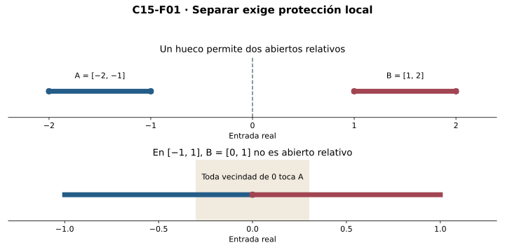

[Índice del libro](../para-matematicos/analisis-para-matematicos.html) · [Capítulo 15](analisis-para-matematicos-capitulo-15-conexidad-por-que-un-intervalo-no-se-rompe.html) · [Ejercicios](analisis-para-matematicos-capitulo-15-conexidad-por-que-un-intervalo-no-se-rompe-ejercicios.html) · [Soluciones](analisis-para-matematicos-capitulo-15-conexidad-por-que-un-intervalo-no-se-rompe-soluciones.html) · [Soluciones de microcontroles](analisis-para-matematicos-capitulo-15-conexidad-por-que-un-intervalo-no-se-rompe-microcontroles.html)

En cálculo usamos el valor intermedio para asegurar que una función alcanza una altura entre dos alturas conocidas. Aquí demostraremos el mecanismo que lo sostiene: una continuidad local no puede romper la indivisibilidad de un intervalo. La geometría de la recta permitirá traducir la ausencia de separaciones en ausencia de huecos.

Partimos de abiertos y orden de C04 y continuidad de C14, con las interfaces heredadas de completitud de C00, convergencia de C06 y tipos de C12. Primero probaremos conexidad mediante supremo; después la transportaremos por continuidad y deduciremos el valor intermedio. Bisección añadirá encierros y cotas de posición. Las últimas secciones usarán el orden para controlar inversas y describir componentes. No se presupone compacidad ni derivadas. Los reales se tratan con lógica clásica; la recurrencia de bisección no promete evaluación computable de toda función.

## 15.1. Qué tendría que hacer una separación

[]{#MA-SEC-ANM-01-015-001}

¿Qué significa que un conjunto tenga dos partes? Todo intervalo puede dividirse, por ejemplo, en puntos menores que cero y puntos mayores o iguales que cero. Esa partición no prueba que esté roto: en el punto cero, la segunda parte no tiene una vecindad relativa libre de la primera. Buscamos una partición cuyas dos partes se protejan localmente.

**Definición.** Una separación de $E\subseteq\mathbb R$ es un par $A,B\subseteq E$ que satisface simultáneamente

$$A\ne\varnothing,\quad B\ne\varnothing,\quad A\cap B=\varnothing,
\quad E=A\cup B,$$

con $A$ y $B$ abiertos relativos a $E$. Diremos que $E$ es **conexo** cuando no admite ninguna separación. Según C14, $A$ es abierto relativo a $E$ si $A=E\cap U$ para algún abierto real $U$; equivalentemente, para cada $a\in A$ existe $r>0$ con $E\cap(a-r,a+r)\subseteq A$. El radio protege sólo entradas que pertenecen a $E$.

La definición no exige que las partes sean abiertas en toda la recta. En $E=[-2,-1]\cup[1,2]$, los conjuntos $A=[-2,-1]=E\cap(-\infty,0)$ y $B=[1,2]=E\cap(0,\infty)$ forman una separación. No son abiertos reales, pero sí relativos. En $[-1,1]$, en cambio, la partición $[-1,0)$ y $[0,1]$ falla: para cualquier $r>0$, el punto $-\min(r/2,1/2)$ pertenece al intervalo y a la primera parte, y está a distancia menor que $r$ de cero. Por ello $[0,1]$ no es abierto relativo a $[-1,1]$.

{#fig-anm-c15-f01 fig-alt="Arriba, los dos segmentos se separan por el corte 0. Abajo, asignar 0 a la parte derecha de un intervalo no la protege de entradas negativas próximas. La banda representa una vecindad ilustrativa; el texto prueba el fallo para todo radio."}

**R1. Criterio de una sola parte.** $E$ es conexo si y sólo si sus únicos subconjuntos simultáneamente abiertos y cerrados relativos son $\varnothing$ y $E$.

La estrategia consiste en recuperar la otra parte por complemento. Si $A\subseteq E$ es abierto y cerrado relativo, $B=E\setminus A$ es abierto relativo. Si $A$ no es vacío ni todo $E$, ambas partes son no vacías, disjuntas y exhaustivas: una separación. En un conexo eso es imposible. En la otra dirección, si existiera una separación $A,B$, su disjunción y cobertura darían $B=E\setminus A$. Así $A$ sería abierto relativo y, por apertura de su complemento, cerrado relativo; sería además no vacío y propio. Contradice el criterio. Quedan probadas ambas implicaciones.

El vacío es conexo porque no admite partes no vacías. Un singleton es conexo porque sus únicos subconjuntos son el vacío y él mismo. No hay que decidir si el singleton es abierto en la recta: aquí el ambiente es el conjunto dado.

La negación de conexidad exige exhibir una separación completa; la afirmación exige excluirlas todas. Un dibujo con dos colores es una conjetura hasta justificar apertura, no vacuidad, disjunción y cobertura. Una partición puede fallar sólo en un punto de frontera, y ese fallo basta para impedir que sea una separación.

### Microcontroles

[]{#MA-MIC-ANM-01-015-001}

1. ¿Qué cuatro condiciones conjuntistas acompañan la apertura relativa en una separación?

[]{#MA-MIC-ANM-01-015-002}

2. ¿Por qué $[-2,-1]$ puede ser una parte abierta relativa de $[-2,-1]\cup[1,2]$?

[]{#MA-MIC-ANM-01-015-003}

3. ¿Dónde falla la partición $[-1,0)$ y $[0,1]$ de $[-1,1]$?

[]{#MA-MIC-ANM-01-015-004}

4. ¿Qué complemento convierte una parte abierta y cerrada relativa en una separación candidata?

[]{#MA-MIC-ANM-01-015-005}

5. ¿El vacío es conexo bajo la definición adoptada?

[]{#MA-MIC-ANM-01-015-006}

6. ¿Hace falta que un singleton sea abierto real para probar que es conexo?

[]{#MA-MIC-ANM-01-015-007}

7. ¿Basta dibujar una partición de dos colores para negar conexidad?

[]{#MA-MIC-ANM-01-015-008}

8. ¿Qué niega exactamente la afirmación «$E$ es conexo»?

## 15.2. El supremo impide romper un intervalo

[]{#MA-SEC-ANM-01-015-002}

**Definición.** Llamamos intervalo a todo $I\subseteq\mathbb R$ que contiene los puntos situados entre dos de sus puntos:

$$a,b\in I,\quad a\le b\quad\Longrightarrow\quad[a,b]\subseteq I.$$

Esta definición incluye vacío, singletons, semirrectas, la recta completa y todas las modalidades de extremos. No confunde intervalo con abierto ni con cerrado. Nuestra meta es demostrar conexidad sin usar valor intermedio: éste será una consecuencia posterior.

**R2. Todo intervalo real es conexo.** Supongamos una separación $I=A\cup B$. Hay dos puntos, uno en cada parte; son distintos. Intercambiando los nombres si hace falta, fijamos $a\in A$, $b\in B$, $a<b$. La propiedad intervalar da $[a,b]\subseteq I$.

Necesitamos localizar una frontera aunque no exista último punto de $A$. Por eso definimos

$$S=A\cap[a,b],\qquad c=\sup S.$$

$a\in S$ hace al conjunto no vacío y $b$ lo acota superiormente. La completitud real de C00 suministra $c$, con $a\le c\le b$. El intervalo vuelve a ser decisivo: $c\in I$. La cobertura obliga a que $c$ pertenezca a $A$ o a $B$, y la disjunción impide ambas cosas a la vez.

**Primer caso: $c\in A$.** Como $b\in B$, tenemos $c<b$. La apertura relativa de $A$ entrega un $r>0$ tal que $I\cap(c-r,c+r)\subseteq A$. Para avanzar sin salir del dominio tomamos

$$h=\min\left(\frac{b-c}{2},\frac r2\right)>0,\qquad d=c+h.$$

Entonces $c<d<b$, $d\in[a,b]\subseteq I$ y $|d-c|=h<r$. Resulta $d\in A\cap[a,b]=S$. Pero $d>c$ contradice que $c$ sea una cota superior. La elección del mínimo tiene un trabajo preciso: satisface a la vez la restricción de dominio y la de vecindad. Escribir simplemente $c+r/2$ no asegura que el punto quede antes de $b$.

**Segundo caso: $c\in B$.** Existe $s>0$ con $I\cap(c-s,c+s)\subseteq B$. El número $c-s/2<c$ no es cota superior de $S$, por minimalidad del supremo. Por tanto existe $t\in S$ con

$$c-s/2<t\le c.$$

Como $t\in A$ y $c\in B$, son distintos; así $0<c-t<s/2<s$. De aquí $t\in I\cap(c-s,c+s)\subseteq B$, en contradicción con $t\in A$. No suponemos que el supremo esté en $S$ ni construimos una sucesión de puntos de $S$: usamos un solo testigo para esta vecindad concreta.

{#fig-anm-c15-f02 fig-alt="Esquemas de una separación supuesta, no ejemplos de separaciones existentes. Si c pertenece a A, un avance recortado por dominio y radio excede la cota. Si pertenece a B, un punto t de S entra en su vecindad. Distancias ilustrativas; las fórmulas de R2 son autoritativas."}

Ambos destinos posibles de la frontera llevan a contradicción. No puede existir separación. En vacío y singleton la supuesta separación ni siquiera proporciona los dos puntos iniciales, de modo que el resultado los incluye.

La prueba gastó tres hipótesis distintas: el orden/completitud ubicó $c$; el carácter intervalar lo mantuvo en el dominio y permitió avanzar dentro de él; la apertura relativa dio las vecindades incompatibles. Acotamos sólo el conjunto auxiliar $S$, aunque el intervalo original sea no acotado. Ninguna compacidad ni continuidad de una función intervino.

### Microcontroles

[]{#MA-MIC-ANM-01-015-009}

1. ¿Qué definición de intervalo incluye las semirrectas y el vacío?

[]{#MA-MIC-ANM-01-015-010}

2. ¿Por qué $S=A\cap[a,b]$ tiene supremo en la prueba R2?

[]{#MA-MIC-ANM-01-015-011}

3. ¿Dónde se usa que el dominio sea intervalo para ubicar la frontera $c$?

[]{#MA-MIC-ANM-01-015-012}

4. Si $c\in A$, ¿por qué $b-c$ es positivo?

[]{#MA-MIC-ANM-01-015-013}

5. ¿Qué dos controles satisface $h=\min((b-c)/2,r/2)$?

[]{#MA-MIC-ANM-01-015-014}

6. Si $c\in B$, ¿por qué existe $t\in S$ mayor que $c-s/2$?

[]{#MA-MIC-ANM-01-015-015}

7. ¿Se supone en R2 que $c$ sea máximo de $S$?

[]{#MA-MIC-ANM-01-015-016}

8. ¿Se necesita compacidad del intervalo original para R2?

## 15.3. Un hueco produce dos lados

[]{#MA-SEC-ANM-01-015-003}

La implicación contraria será más corta, pero requiere una construcción distinta. Para negar que $E$ sea intervalo hay dos puntos $a<b$ de $E$ y un $c$ estrictamente entre ellos que no pertenece a $E$. No basta un punto ausente fuera del conjunto: debe quedar entre dos puntos presentes.

**R3. Todo conexo real es intervalo.** Por contraposición, dados $a<c<b$ con $a,b\in E$ y $c\notin E$, definimos

$$A=E\cap(-\infty,c),\qquad B=E\cap(c,\infty).$$

Los rayos son abiertos reales, luego las partes son abiertas relativas. Son no vacías, pues contienen $a$ y $b$ respectivamente. Son disjuntas por incompatibilidad de las desigualdades. Cubren $E$ porque ningún punto de $E$ es $c$ y la tricotomía da $x<c$ o $x>c$. Hemos comprobado las cuatro condiciones: $E$ no es conexo. Contraponiendo obtenemos el resultado.

{#fig-anm-c15-f03 fig-alt="Se muestran sólo algunos racionales a ambos lados de √2. El corte irracional no pertenece al dominio; ambas partes son abiertas relativas y no vacías. Los puntos finitos ilustrados no representan una enumeración exhaustiva ni prueban densidad o desconexión."}

R2 y R3 producen la caracterización exacta

$$E\text{ conexo}\quad\Longleftrightarrow\quad E\text{ intervalo}.$$

En la recta, una condición formulada con vecindades equivale a una condición de orden. Esta equivalencia es específica del ambiente real que estudiamos. No la extendemos a espacios arbitrarios.

Por ejemplo, $\mathbb R\setminus\{0\}$ se separa mediante los dos rayos. $\mathbb Q$ también se separa: usando la raíz positiva algebraica $\sqrt2$, irracional por C10, tomamos $\{q\in\mathbb Q:q<\sqrt2\}$ y $\{q\in\mathbb Q:q>\sqrt2\}$. Contienen respectivamente $1$ y $2$, y cubren $\mathbb Q$. La densidad racional no rellena el corte: proporciona racionales próximos al punto omitido, pero nunca hace que ese punto sea racional. Densidad y conexidad responden a preguntas diferentes.

También hay que distinguir unión e intersección. Una intersección arbitraria de intervalos es intervalo: si contiene $a$ y $b$, cada intervalo de la familia contiene todo $[a,b]$, y por ello la intersección también. La intersección de una familia vacía se entiende aquí relativa a $\mathbb R$ y es $\mathbb R$. Una unión arbitraria puede tener huecos: $(0,1)\cup(2,3)$ no es intervalo.

Si dos intervalos tienen un punto común, su unión sí es intervalo. Para ver el mecanismo sin escoger orientaciones complicadas, supongamos una separación de la unión y restrinjámosla a cada intervalo. Cada intervalo, por R2, debe quedar enteramente en una de las partes: si tocara ambas, las intersecciones relativas lo separarían. El punto común obliga a que ambos estén en la misma parte, y entonces la otra parte es vacía. La contradicción prueba conexidad, y R3 vuelve a dar intervalo. El mismo razonamiento sirve para cualquier familia no vacía de conexos que comparte un punto: cada miembro queda en la parte que contiene ese punto. No se selecciona un punto por miembro, pues usamos el punto común ya fijado.

La condición de intersección es suficiente, no necesaria para toda unión conexa: $[0,1)\cup[1,2]=[0,2]$ es intervalo aunque las dos piezas sean disjuntas. Antes de diagnosticar un hueco hay que comprobar qué extremos están realmente presentes.

### Microcontroles

[]{#MA-MIC-ANM-01-015-017}

1. ¿Qué omisión permite construir un corte que separa un conjunto?

[]{#MA-MIC-ANM-01-015-018}

2. ¿Por qué las partes $E\cap(-\infty,c)$ y $E\cap(c,\infty)$ cubren $E$?

[]{#MA-MIC-ANM-01-015-019}

3. ¿Qué testigos aseguran la no vacuidad de ambos lados del corte?

[]{#MA-MIC-ANM-01-015-020}

4. ¿La densidad de $\mathbb Q$ implica su conexidad?

[]{#MA-MIC-ANM-01-015-021}

5. ¿Por qué una intersección de intervalos es intervalo?

[]{#MA-MIC-ANM-01-015-022}

6. ¿Qué ocurre al unir $(0,1)$ y $(2,3)$?

[]{#MA-MIC-ANM-01-015-023}

7. ¿Por qué un punto común ayuda a unir dos conexos?

[]{#MA-MIC-ANM-01-015-024}

8. ¿La intersección no vacía es necesaria para que dos intervalos tengan unión conexa?

## 15.4. La continuidad transporta la imposibilidad de separar

[]{#MA-SEC-ANM-01-015-004}

Ya sabemos reconocer los dominios conexos. Ahora preguntamos qué hace una función continua con ellos. C14 no afirmó que las imágenes de abiertos fueran abiertas; sí demostró apertura de preimágenes. Ésa es exactamente la dirección necesaria.

**R4. Imagen continua de un conexo.** Sea $f:D\to\mathbb R$ continua y sea $E\subseteq D$ conexo. Entonces $H=f[E]$ es conexo. La restricción $h=f\mathbin{\upharpoonright}E:E\to\mathbb R$ es continua por C14 y tiene imagen $H$. Si $E$ es vacío también lo es $H$, y el resultado es inmediato.

La estrategia para el caso general es suponer una separación de valores y devolverla a entradas. Sean $H=A\cup B$ las partes de esa supuesta separación. Por apertura relativa hay abiertos reales $V,W$ con $A=H\cap V$, $B=H\cap W$. Definimos

$$P=\{x\in E:h(x)\in A\},\qquad Q=\{x\in E:h(x)\in B\}.$$

Como todas las salidas de $h$ están en $H$, tenemos $P=h^{-1}[V]$ y $Q=h^{-1}[W]$. C14 garantiza que son abiertos relativos a $E$. Son disjuntos, pues un punto común produciría una salida en $A\cap B$. Cubren $E$, porque toda salida está en una de las dos partes.

Falta una condición que suele perderse: ambas preimágenes deben ser no vacías. Tomamos un valor $y_A\in A$. Al pertenecer a $H=h[E]$, existe $x_A\in E$ con $h(x_A)=y_A$; por tanto $x_A\in P$. De igual forma hay un punto en $Q$. Se fijan sólo dos testigos de fibras, no una función que escoja preimágenes para todos los valores. Así $P,Q$ separan $E$, contradicción. $H$ es conexo.

**Consecuencia.** La imagen continua de un intervalo es intervalo: el dominio es conexo por R2, la imagen es conexa por R4 y vuelve a ser intervalo por R3. No se requiere inyectividad, monotonía, dominio cerrado ni acotación.

La preservación tiene límites claros. Con $q(x)=x^2$ en $[-2,2]$, el conjunto $\{1\}$ es conexo, pero su preimagen $\{-1,1\}$ no lo es. Tampoco una imagen conexa obliga a un dominio conexo: una función constante en $\{-1,1\}$ es continua en ese dominio y su imagen es singleton. Las dos afirmaciones falsas invierten una implicación cuya prueba iba de una separación de salidas hacia una de entradas.

Hay una prueba equivalente mediante funciones con sólo dos valores. **$E$ es conexo si y sólo si toda función continua $u:E\to\{0,1\}$ es constante**, donde la continuidad se entiende con distancias reales. Si $E$ es conexo, R4 da imagen conexa contenida en $\{0,1\}$; si tomara ambos valores, la imagen no sería intervalo. En vacío, «constante» significa que todos los pares de entradas tienen igual salida, condición vacía. En sentido contrario, una separación $A,B$ define $u=0$ en $A$, $u=1$ en $B$. En cada punto la apertura relativa de su parte da una vecindad donde $u$ no cambia, y prueba continuidad para todo $\varepsilon>0$. $u$ no es constante por la no vacuidad de ambas partes. El criterio transforma una ruptura del dominio en una función continua de dos colores.

### Microcontroles

[]{#MA-MIC-ANM-01-015-025}

1. ¿Qué operación de conjuntos usa la continuidad para transportar una separación de la imagen?

[]{#MA-MIC-ANM-01-015-026}

2. ¿Por qué se restringe $f$ al conexo $E\subseteq D$?

[]{#MA-MIC-ANM-01-015-027}

3. ¿Qué garantiza que la preimagen de una parte no vacía de $f[E]$ sea no vacía?

[]{#MA-MIC-ANM-01-015-028}

4. ¿R4 necesita escoger una entrada para cada valor de la imagen?

[]{#MA-MIC-ANM-01-015-029}

5. ¿La preimagen de un conexo por una función continua tiene que ser conexa?

[]{#MA-MIC-ANM-01-015-030}

6. ¿Una imagen singleton prueba que el dominio es conexo?

[]{#MA-MIC-ANM-01-015-031}

7. ¿Cómo una separación define una función continua con valores cero y uno?

[]{#MA-MIC-ANM-01-015-032}

8. ¿Qué significa «constante» para una función con dominio vacío en este criterio?

## 15.5. El valor intermedio como consecuencia estructural

[]{#MA-SEC-ANM-01-015-005}

En cálculo solemos comenzar con el dibujo de una curva que atraviesa una altura. Ahora podemos justificar la existencia sin depender de la apariencia del gráfico. La continuidad preserva una estructura del dominio: la ausencia de puntos omitidos entre dos puntos presentes.

**R5. Teorema del valor intermedio.** Sea $I\subseteq\mathbb R$ intervalo, $f:I\to\mathbb R$ continua, y sean $u,v\in I$. Para cualquier $y$ entre $f(u)$ y $f(v)$, incluidos los extremos, existe

$$c\in[\min(u,v),\max(u,v)]\quad\text{tal que}\quad f(c)=y.$$

Para obtener esta localización, aplicamos R4 a la restricción de $f$ al segmento

$$J=[\min(u,v),\max(u,v)].$$

Por definición de intervalo, $J\subseteq I$; también $J$ es intervalo, porque una desigualdad entre sus puntos permanece dentro de sus extremos. La imagen $f[J]$ es intervalo y contiene $f(u),f(v)$. Por ello contiene todos los valores entre ellos, en particular $y$. La definición de imagen da el testigo $c\in J$. Si $u=v$, necesariamente $y=f(u)$ y sirve $c=u$. Si el valor buscado es estrictamente intermedio y $u\ne v$, el testigo no puede ser ninguno de los extremos, porque sus salidas no son $y$.

{#fig-anm-c15-f04 fig-alt="A la izquierda F(x)=x³+x−1 alcanza cero entre 0 y 1; el gráfico no calcula la raíz exacta. El escalón del centro tiene signos opuestos y omite cero por discontinuidad. La identidad del panel derecho es continua en su dominio de dos puntos, pero ese dominio no es intervalo."}

**Cambio de signo.** Si $a<b$ y $f:[a,b]\to\mathbb R$ es continua con $f(a)<0<f(b)$ o la orientación inversa, R5 con $y=0$ da $c\in(a,b)$ con $f(c)=0$. Con desigualdades no estrictas sólo se concluye un cero en $[a,b]$: podría ser un extremo. Para buscar un nivel $y$ definimos $g=f-y$; C14 prueba su continuidad y la ecuación $g=0$ equivale a $f=y$.

**Signo constante sin ceros.** Si $f$ es continua en un intervalo y nunca vale cero, no puede tomar un valor positivo y otro negativo, pues R5 produciría un cero entre sus argumentos. Si el intervalo es no vacío, fijando una entrada obtenemos que todos los valores tienen el mismo signo. En un dominio roto esto falla: $1/x$ es continua en $\mathbb R\setminus\{0\}$ y tiene ambos signos. También falla sin continuidad: la función escalón que vale $-1$ para $x<0$ y $1$ para $x\ge0$ en $[-1,1]$ no tiene ceros. En cero, todo radio incluye una entrada negativa cuya salida dista $2$ del valor central; la tolerancia $1$ refuta continuidad. Y la identidad restringida a $\{-1,1\}$ es continua pero no alcanza cero: el dominio no es intervalo.

El teorema garantiza existencia, no unicidad. $x^2$ alcanza $1$ en dos puntos de $[-2,2]$. Tampoco dice que una función tome sólo valores entre los de los extremos: en ese dominio los extremos tienen ambos valor $4$, y el centro vale $0$. Lo garantizado es la inclusión de los valores intermedios en la imagen, no una descripción completa de la imagen por $f(a),f(b)$.

Consideremos $F(x)=x^3+x-1$. Es continua por C14, y $F(0)=-1$, $F(1)=1$, luego tiene una raíz en $(0,1)$. Además, para $0\le x<z\le1$,

$$F(z)-F(x)=(z-x)(z^2+zx+x^2+1)>0.$$

Esta desigualdad, independiente del argumento de existencia, prueba unicidad en $[0,1]$. La raíz no se conoce por una fórmula en esta prueba, pero existe y es única en el segmento indicado.

Una imagen intervalar puede no estar acotada ni ser cerrada: la identidad en $(0,1)$ tiene imagen $(0,1)$, y la identidad en $\mathbb R$ tiene imagen no acotada. Garantizar extremos alcanzados exige una herramienta adicional de C16. Aquí no la presuponemos.

### Microcontroles

[]{#MA-MIC-ANM-01-015-033}

1. ¿En qué segmento se localiza el testigo del valor intermedio entre $f(u)$ y $f(v)$?

[]{#MA-MIC-ANM-01-015-034}

2. ¿Por qué un nivel estrictamente intermedio no se alcanza en los extremos de ese segmento?

[]{#MA-MIC-ANM-01-015-035}

3. ¿Qué cambia si sólo se conoce $f(a)\le0\le f(b)$?

[]{#MA-MIC-ANM-01-015-036}

4. ¿Cómo se reduce encontrar $f(x)=y$ a encontrar un cero?

[]{#MA-MIC-ANM-01-015-037}

5. ¿Qué prueba signo constante de una continua sin ceros en un intervalo no vacío?

[]{#MA-MIC-ANM-01-015-038}

6. ¿Por qué $1/x$ no contradice ese resultado al tener ambos signos?

[]{#MA-MIC-ANM-01-015-039}

7. ¿R5 afirma unicidad del argumento que alcanza un nivel?

[]{#MA-MIC-ANM-01-015-040}

8. ¿La imagen de una continua intervalar tiene necesariamente mínimo y máximo?

## 15.6. Bisección: existencia, localización y alcance del cálculo

[]{#MA-SEC-ANM-01-015-006}

El valor intermedio ya prueba existencia. La bisección añade una sucesión determinada de encierros y una cota de error posicional. La desarrollaremos también como prueba alternativa de existencia para comparar qué trabajo hacen las hipótesis.

**R6. Encierros de signo.** Sean $a<b$, $g:[a,b]\to\mathbb R$ continua, $g(a)<0<g(b)$. La orientación contraria se reduce usando $-g$. Definimos $L_0=a$, $U_0=b$. Si alguna evaluación de un punto medio da cero, ya hay un testigo exacto y detenemos el proceso. Mientras eso no ocurra, para $n\ge0$ ponemos $M_n=(L_n+U_n)/2$ y

$$
(L_{n+1},U_{n+1})=
\begin{cases}
(M_n,U_n),&g(M_n)<0,\\
(L_n,M_n),&g(M_n)>0.
\end{cases}
$$

La tricotomía clásica y la regla explícita dan una transición única; no se elige un punto arbitrario por paso. Por inducción, cada segmento está contenido en el anterior, $L_n\le U_n$, $g(L_n)<0<g(U_n)$ y

$$U_n-L_n=\frac{b-a}{2^n}.$$

La base es inmediata. En cada caso de la transición se conserva un extremo del signo correspondiente y se reemplaza el otro por el punto medio del mismo signo; la longitud se divide por dos. Éste es el invariante que hace útil al objeto auxiliar.

Si no encontramos un cero en un número finito de pasos, definimos $c=\sup\{L_n:n\in\mathbb N\}$. Los extremos inferiores están acotados por $b$. Para cada $n$, $U_n$ es cota de todos los $L_k$: si $k\le n$, $L_k\le L_n\le U_n$; si $k>n$, el encierro anidado da $L_k\le U_k\le U_n$. Así

$$L_n\le c\le U_n,\qquad c\in[a,b].$$

Como $(b-a)/2^n\to0$ por las escalas de C06, las desigualdades prueban directamente $L_n\to c$ y $U_n\to c$. La dirección secuencial directa de continuidad de C14 da $g(L_n)\to g(c)$ y $g(U_n)\to g(c)$. Límites de valores negativos son no positivos y de positivos son no negativos: si el límite fuese positivo en el primer caso, la tolerancia de la mitad de ese límite haría eventualmente positivos los términos, contradicción; el otro caso es análogo. Resulta $g(c)\le0$ y $g(c)\ge0$, de donde $g(c)=0$.

Cada encierro contiene este cero y su punto medio satisface

$$|M_n-c|\le\frac{U_n-L_n}{2}=\frac{b-a}{2^{n+1}}.$$

Para obtener error posicional menor que $\tau>0$, basta elegir $n$ con $(b-a)/2^{n+1}<\tau$. No se demuestra que $M_n$ sea raíz ni que la raíz sea única; sin monotonía puede haber varias raíces, y esta recurrencia localiza una de ellas. En el caso de detención temprana tenemos error cero en el testigo encontrado.

{#fig-anm-c15-f05 fig-alt="Encierros tras 0, 1, 2 y 3 actualizaciones. Extremos inferiores negativos y superiores positivos; la marca central indica el medio de cada encierro. En n=3 el medio es 11/16 y su error posicional respecto de la raíz encerrada es a lo sumo 1/16. No se afirma error residual ni raíz exacta en el medio."}

Para $F(x)=x^3+x-1$, los primeros medios de $[0,1]$ son $1/2$, $3/4$ y $5/8$, con valores respectivos $-3/8$, $11/64$ y $-67/512$. Los encierros pasan por $[1/2,1]$, $[1/2,3/4]$, $[5/8,3/4]$. Después de tres actualizaciones, el medio es $11/16$ y su error de posición es a lo sumo $1/16$. Los cálculos racionales exactos certifican los signos, no una lectura de píxeles.

La cota de longitud no da por sí sola una cota del residual $|g(M_n)|$: una función puede variar mucho dentro de un intervalo pequeño. Un módulo cuantitativo conocido sí permitiría convertir error de posición en error funcional. Y una función arbitraria no viene con un procedimiento que decida exactamente si cada evaluación real es positiva, negativa o cero. La recurrencia matemática usa comparación clásica; un programa requiere evaluación y certificados de signo. Si un intervalo numérico de evaluación contiene cero, no autoriza ninguna de las dos actualizaciones ni la declaración de raíz exacta. Esta distinción preserva el valor de la prueba sin prometer una computabilidad que las hipótesis no dan.

### Microcontroles

[]{#MA-MIC-ANM-01-015-041}

1. ¿Cuál es la longitud del encierro después de $n$ actualizaciones de bisección?

[]{#MA-MIC-ANM-01-015-042}

2. ¿Qué extremo se reemplaza cuando $g(M_n)<0$ y los signos iniciales son negativo/positivo?

[]{#MA-MIC-ANM-01-015-043}

3. ¿Por qué $U_n$ es cota de todos los extremos inferiores y no sólo de $L_n$?

[]{#MA-MIC-ANM-01-015-044}

4. ¿Qué dirección secuencial de continuidad se usa para pasar al cero límite?

[]{#MA-MIC-ANM-01-015-045}

5. ¿Cuál es el error posicional máximo del punto medio $M_n$ respecto del cero encerrado?

[]{#MA-MIC-ANM-01-015-046}

6. ¿Un encierro pequeño da por sí solo una cota numérica del residual $|g(M_n)|$?

[]{#MA-MIC-ANM-01-015-047}

7. ¿Un intervalo de evaluación que contiene cero certifica que $g(M_n)=0$?

[]{#MA-MIC-ANM-01-015-048}

8. ¿Por qué la recurrencia clásica no es una promesa de algoritmo efectivo para toda función continua?

## 15.7. Inyectividad, orden y continuidad de la inversa

[]{#MA-SEC-ANM-01-015-007}

C14 mostró que una biyección continua en un dominio roto puede tener inversa discontinua. ¿Qué cambia si el dominio es intervalo? Primero aparece una orientación de orden; después esa orientación construye radios para la inversa.

**R7. Una inyección continua en un intervalo es estrictamente monótona y es un homeomorfismo sobre su imagen.** Sea $f:I\to\mathbb R$ continua e inyectiva. Para vacío y singleton la monotonía estricta, entendida como condición sobre pares distintos ordenados, es vacía; la inversa sobre la imagen es continua. Supongamos que $I$ tiene al menos dos puntos.

El paso clave es demostrar que para $x<y<z$ en $I$, $f(y)$ está estrictamente entre $f(x)$ y $f(z)$. Si fuese mayor que ambos, elegiríamos un nivel $w$ estrictamente entre $\max(f(x),f(z))$ y $f(y)$, por ejemplo su punto medio. R5 en $[x,y]$ y $[y,z]$ produciría $s\in(x,y)$ y $t\in(y,z)$ con $f(s)=w=f(t)$. Son distintos, contradicción. Si $f(y)$ fuese menor que ambos, usamos un nivel entre $f(y)$ y $\min(f(x),f(z))$ y obtenemos la misma contradicción. Inyectividad excluye igualdades. Por tanto, todo triple conserva una orientación creciente o decreciente.

Para justificar que la orientación es global, fijamos $a<b$ en $I$. Supongamos $f(a)<f(b)$; el caso contrario se reduce a $-f$. Dados cualesquiera $x<y$ en $I$, ordenamos el conjunto finito de puntos distintos de $\{a,b,x,y\}$ como $t_1<\cdots<t_m$. Hay al menos dos puntos. Si $m\ge3$, la propiedad de cada triple consecutivo obliga a que las diferencias $f(t_{i+1})-f(t_i)$ tengan el mismo signo: en un triple son ambas positivas o ambas negativas. Por propagación finita todas tienen el mismo signo. La desigualdad $f(a)<f(b)$ excluye el signo negativo. Si $m=2$, los pares $a<b$ y $x<y$ son el mismo par. En todos los casos $f(x)<f(y)$. Así $f$ es estrictamente creciente; o estrictamente decreciente en la otra orientación. No bastaba probar la propiedad de un único triple.

Sea $J=f[I]$, intervalo por R4. Inyectividad y la definición de imagen dan una inversa $h:J\to I$. Probemos su continuidad para el caso creciente. Fijamos $y_0=f(x_0)$ y $\varepsilon>0$. Queremos excluir toda entrada original que esté a distancia al menos $\varepsilon$ de $x_0$ cuando su salida está suficientemente próxima a $y_0$.

Si hay algún punto de $I$ menor o igual que $x_0-\varepsilon$, el carácter intervalar asegura que $\ell=x_0-\varepsilon/2$ pertenece a $I$. Ponemos $\eta_-=y_0-f(\ell)>0$. Si no hay tal punto, todas las entradas ya satisfacen $x>x_0-\varepsilon$ y no hace falta barrera izquierda; usamos $\eta_-=1$. De forma simétrica, si hay un punto de $I$ mayor o igual que $x_0+\varepsilon$, $r=x_0+\varepsilon/2\in I$ y $\eta_+=f(r)-y_0>0$; si no, usamos $\eta_+=1$.

Tomamos $\eta=\min(\eta_-,\eta_+)>0$. Para $y\in J$ con $|y-y_0|<\eta$, sea $x=h(y)$. Si $x\le x_0-\varepsilon$, la barrera izquierda existe y $x<\ell$; monotonía da $y=f(x)<f(\ell)=y_0-\eta_-$, incompatible con la proximidad. Si $x\ge x_0+\varepsilon$, la barrera derecha da $y>y_0+\eta_+$, también imposible. Así $|h(y)-h(y_0)|<\varepsilon$. La prueba incluye extremos porque una barrera innecesaria se sustituye por un radio positivo arbitrario. Para $f$ decreciente se aplica el caso creciente a $-f$ y se compone su inversa con $y\mapsto-y$, continua por C14. Queda probado el homeomorfismo $I\to J$.

{#fig-anm-c15-f06 fig-alt="Para f(x)=x² en \[0,∞), x₀=1 y ε=3/5, las barreras 7/10 y 13/10 están dentro de la zona permitida (2/5,8/5). Sus distancias de salida a 1 son 51/100 y 69/100. La tolerancia η=51/100 impide que una preimagen de salida cercana cruce las barreras. Bandas abiertas según las desigualdades estrictas de R7."}

No se han usado derivadas, compacidad ni una cota lineal inferior. Estricta monotonía por sí sola no implica continuidad: $k(x)=x$ para $x<0$ y $k(x)=x+1$ para $x\ge0$ es estrictamente creciente en $\mathbb R$ y salta en cero; su imagen omite $[0,1)$. La continuidad es la hipótesis que impide el salto y hace intervalar la imagen.

### Microcontroles

[]{#MA-MIC-ANM-01-015-049}

1. ¿Qué condición entre las imágenes de $x<y<z$ inicia la prueba de monotonía?

[]{#MA-MIC-ANM-01-015-050}

2. ¿Por qué se escoge un nivel estrictamente entre el pico y ambos extremos?

[]{#MA-MIC-ANM-01-015-051}

3. ¿Basta estudiar un único triple para concluir monotonía en todo el intervalo?

[]{#MA-MIC-ANM-01-015-052}

4. ¿Qué garantiza que exista una inversa $h:f[I]\to I$?

[]{#MA-MIC-ANM-01-015-053}

5. ¿Qué hipótesis permite usar $x_0-\varepsilon/2$ como barrera si existe una entrada $x\le x_0-\varepsilon$?

[]{#MA-MIC-ANM-01-015-054}

6. ¿Qué se hace si no hay entradas de $I$ menores o iguales que $x_0-\varepsilon$?

[]{#MA-MIC-ANM-01-015-055}

7. ¿La inversa continua obtenida requiere una cota lineal inferior de $f$?

[]{#MA-MIC-ANM-01-015-056}

8. ¿Estricto crecimiento por sí solo excluye saltos?

## 15.8. Componentes: los intervalos máximos dentro de un dominio

[]{#MA-SEC-ANM-01-015-008}

Un conjunto no conexo puede contener muchas regiones conexas. Para describirlas sin escoger una familia de representantes usamos una relación determinada por el orden. Para $x,y\in D\subseteq\mathbb R$ escribimos

$$x\sim y\quad\Longleftrightarrow\quad[\min(x,y),\max(x,y)]\subseteq D.$$

**R8. Componentes reales.** Esta relación es de equivalencia. Es reflexiva porque $[x,x]=\{x\}\subseteq D$, y simétrica por su definición. Si $x\sim y$ y $y\sim z$, los dos segmentos están en $D$ y comparten $y$. Su unión es intervalo por §15.3 y contiene $x,z$; por eso contiene el segmento entre ellos. Esto prueba transitividad.

Para cada $x\in D$, la clase $C_x=\{y\in D:x\sim y\}$ es intervalo. Si $u,v\in C_x$, transitividad da $u\sim v$ y el segmento entre ellos está en $D$. Para cualquier punto $t$ de ese segmento, $u\sim t$, y con $x\sim u$ obtenemos $x\sim t$; por ello todo el segmento pertenece a $C_x$. La clase es conexa por R2.

Además es el mayor subconjunto conexo de $D$ que contiene $x$. Si $E\subseteq D$ es conexo y $x\in E$, R3 convierte $E$ en intervalo. Para $y\in E$, el segmento entre $x,y$ está en $E\subseteq D$, luego $y\in C_x$. Así $E\subseteq C_x$. Llamamos **componente conexa** a cada clase. Como clases de equivalencia, cubren $D$ y dos de ellas son iguales o disjuntas. Cada subconjunto conexo no vacío queda en una sola componente: se fija cualquiera de sus puntos y se aplica maximalidad. No hay que escoger un representante simultáneo por componente para definir la partición.

Cada componente es cerrada **relativa a $D$**, aunque puede no ser cerrada en $\mathbb R$. Para probarlo, tomemos $z\in D$ adherente a $C_x$, es decir, toda vecindad real de $z$ toca la clase. Si $z=x$ ya pertenece. Si $x<z$, todo $t$ con $x<t<z$ pertenece a $D$: la adherencia proporciona $w\in C_x$ con $|w-z|<(z-t)/2$, luego $w>t$, y el segmento entre $x$ y $w$ contiene $t$ y está en $D$. Junto a los extremos $x,z\in D$, esto prueba $[x,z]\subseteq D$, así $z\in C_x$. Para $z<x$ usamos una vecindad de radio $(t-z)/2$ para cada $z<t<x$, obteniendo un $w<t$ y el mismo argumento. Por el criterio de cerrado relativo de C04/C14, $C_x$ es cerrada relativa.

Las componentes no siempre son abiertas relativas. En

$$D=\{0\}\cup\{1/(n+1):n\in\mathbb N\},$$

todas son singletons: entre dos puntos positivos distintos hay un punto fuera de $D$, y entre cero y un punto positivo también. Se puede ver sin enumerar huecos uno por uno: todos los puntos de $D$ son racionales y la densidad de irracionales de C04 proporciona un punto omitido entre cada par distinto. Sin embargo, $\{0\}$ no es abierto relativo a $D$, porque toda vecindad de cero contiene algún $1/(n+1)>0$, por arquimedianidad. Cada singleton positivo sí es abierto relativo: sus vecinos consecutivos dejan un radio positivo de aislamiento. No confundimos singleton componente con punto aislado.

{#fig-anm-c15-f07 fig-alt="Cada punto de D es una componente, porque entre dos puntos racionales distintos hay un irracional fuera de D. Los puntos positivos son aislados; cero no lo es. Los paneles muestran sólo muestras finitas; la arquimedianidad prueba que cualquier radio en cero contiene otro punto del dominio."}

En $\mathbb Q$ las componentes también son singletons por densidad irracional, pero ninguna es abierta relativa, por densidad racional. En $(0,1)$ hay una única componente, el conjunto entero, cerrada relativa a sí misma aunque no cerrada real. Son tres formas diferentes de leer el mismo criterio.

Finalmente, toda función continua transporta cada componente de su dominio a un conjunto conexo, que queda dentro de una componente de la imagen. Puede fusionar componentes: una función constante lo hace. Si la función es homeomorfismo, transporta componentes exactamente a componentes. En efecto, $f[C_x]$ es conexo y queda en la componente $K$ de $f(x)$; la inversa continua hace conexo $f^{-1}[K]$, que contiene $x$ y queda en $C_x$ por maximalidad. Aplicando $f$ obtenemos $K\subseteq f[C_x]$, y ambas inclusiones dan igualdad.

La caja de herramientas de C15 reúne tres niveles: un dominio conexo no admite separaciones; en la recta eso equivale a ser intervalo; la continuidad preserva esa indivisibilidad y produce valores intermedios. La compacidad de C16 resolverá una pregunta distinta: cómo reducir una familia de controles locales a información finita.

### Microcontroles

[]{#MA-MIC-ANM-01-015-057}

1. ¿Qué relación determina las componentes reales sin escoger representantes?

[]{#MA-MIC-ANM-01-015-058}

2. ¿Por qué es transitiva la relación por segmentos?

[]{#MA-MIC-ANM-01-015-059}

3. ¿Cómo se prueba la maximalidad conexa de $C_x$?

[]{#MA-MIC-ANM-01-015-060}

4. ¿Dos componentes diferentes pueden intersectarse?

[]{#MA-MIC-ANM-01-015-061}

5. ¿En qué ambiente son siempre cerradas las componentes de $D$?

[]{#MA-MIC-ANM-01-015-062}

6. ¿Por qué $\{0\}$ no es abierta relativa en $\{0\}\cup\{1/(n+1):n\in\mathbb N\}$?

[]{#MA-MIC-ANM-01-015-063}

7. ¿Cuáles son las componentes de $\mathbb Q$ y son abiertas relativas?

[]{#MA-MIC-ANM-01-015-064}

8. ¿Qué refuerzo garantiza transporte exacto de componentes y no sólo inclusión?

[Índice del libro](../para-matematicos/analisis-para-matematicos.html) · [Capítulo 15](analisis-para-matematicos-capitulo-15-conexidad-por-que-un-intervalo-no-se-rompe.html) · [Ejercicios](analisis-para-matematicos-capitulo-15-conexidad-por-que-un-intervalo-no-se-rompe-ejercicios.html) · [Soluciones](analisis-para-matematicos-capitulo-15-conexidad-por-que-un-intervalo-no-se-rompe-soluciones.html) · [Soluciones de microcontroles](analisis-para-matematicos-capitulo-15-conexidad-por-que-un-intervalo-no-se-rompe-microcontroles.html)

[← Capítulo 14](analisis-para-matematicos-capitulo-14-continuidad-transportar-proximidad.html) · [Capítulo 16 →](analisis-para-matematicos-capitulo-16-compacidad-del-control-local-al-control-finito.html)
