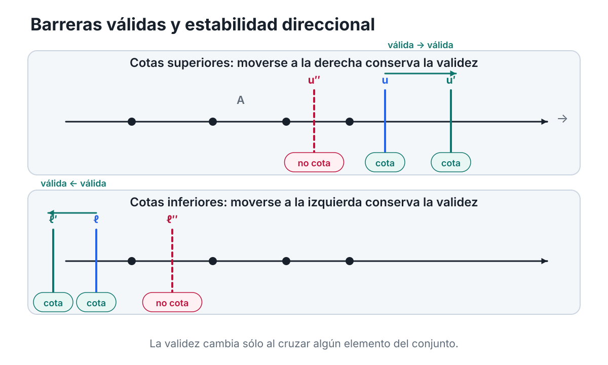
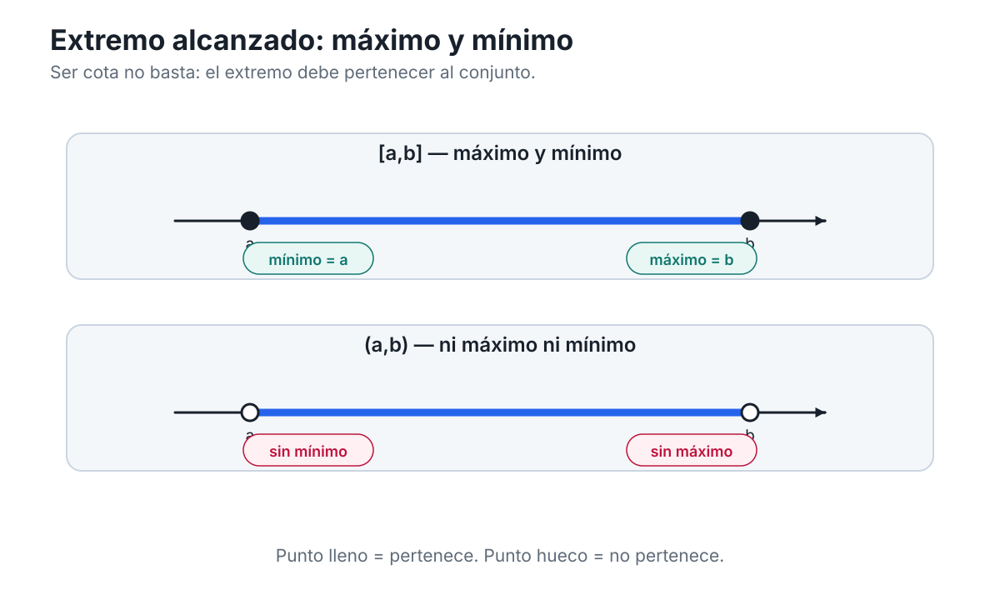
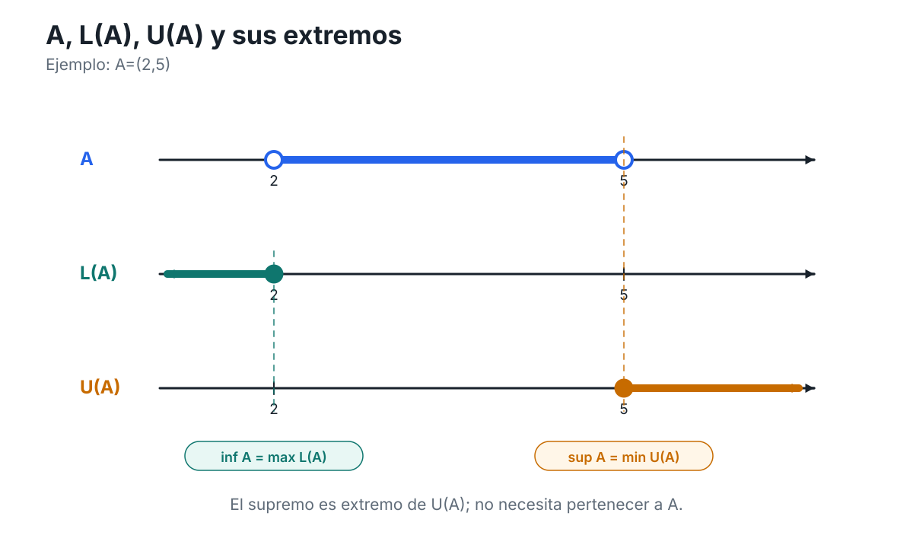
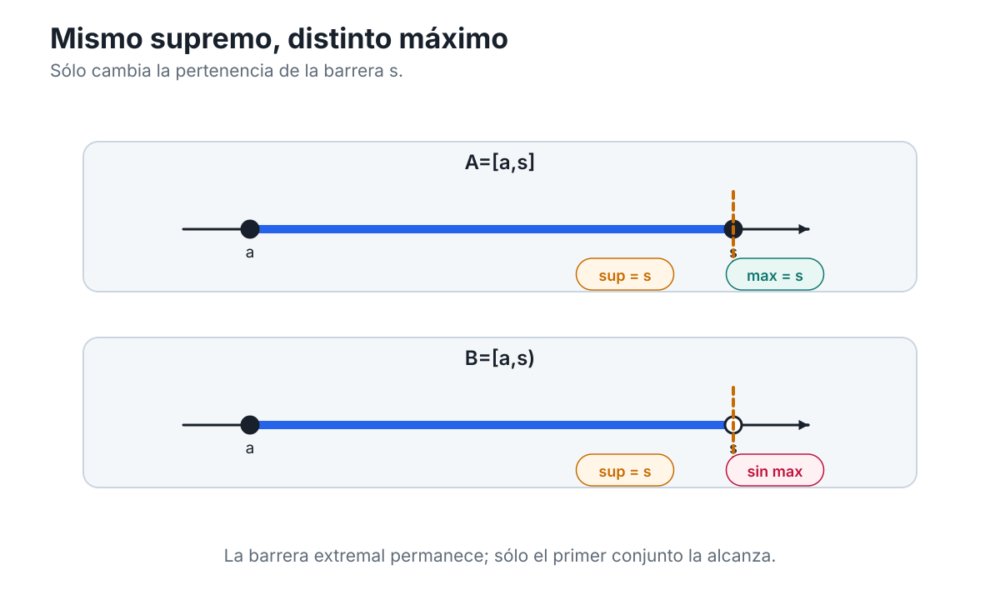
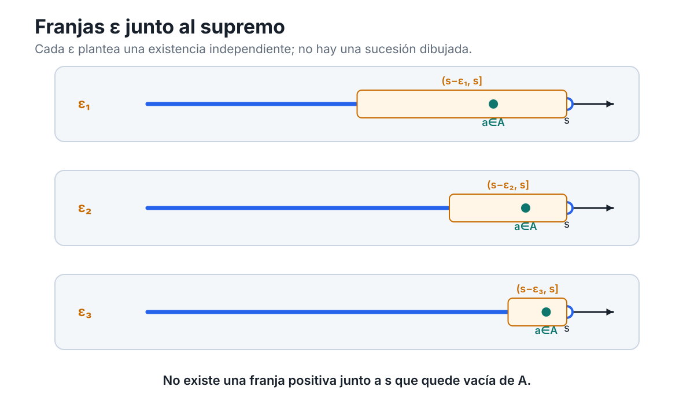
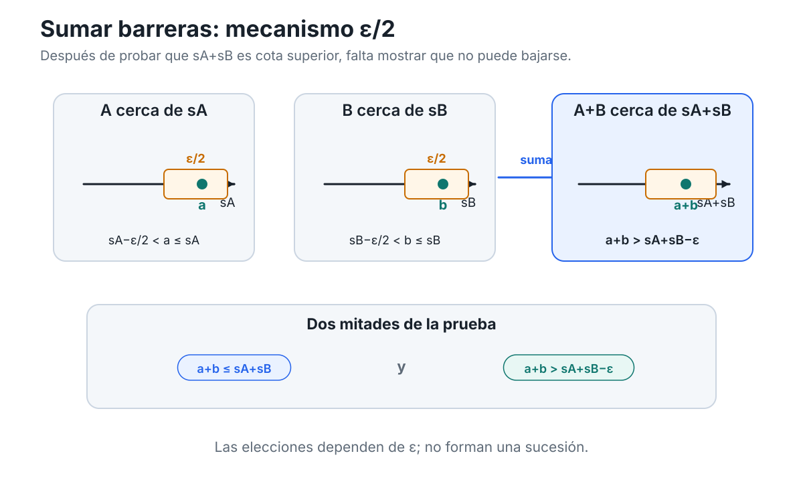
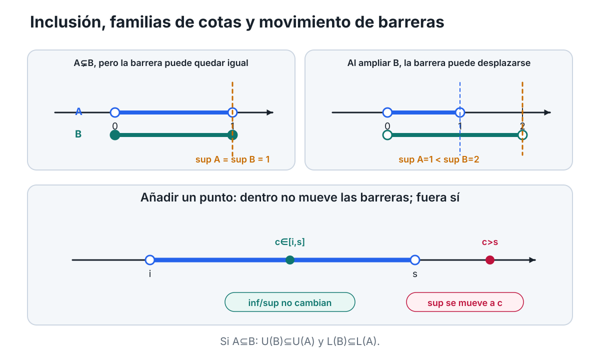
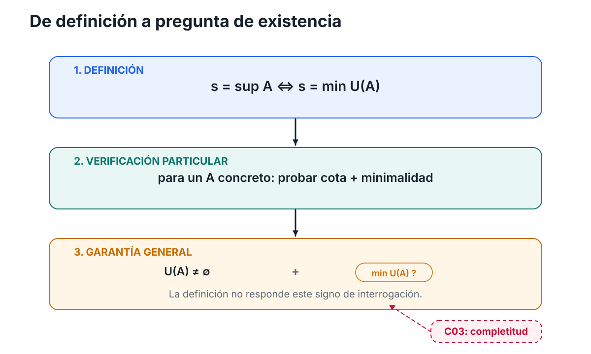
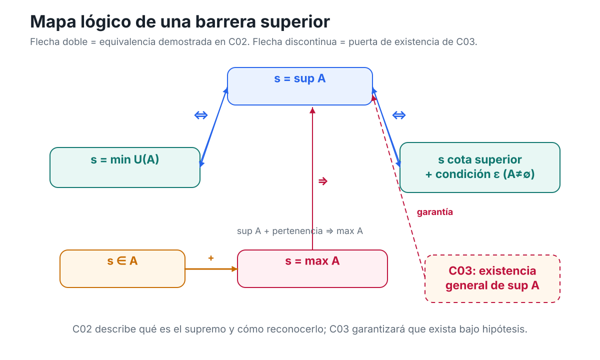

[Índice del libro](../para-matematicos/analisis-para-matematicos.html) · [Ejercicios de este capítulo](#ejercicios-2)

[]{#MA-SEC-ANM-01-002-008}

En el capítulo anterior aprendimos a mirar la recta real con un poco más de cuidado. Ya no era solamente el lugar donde colocamos números: distinguimos qué información pertenece al orden, qué información pertenece a la distancia y cómo ambas estructuras se coordinan en $\mathbb R$. Ahora vamos a usar sólo una parte de esa infraestructura —el orden— para plantear una pregunta nueva.

Supongamos que tenemos un conjunto de números reales. Puede ser un intervalo, una colección finita de puntos, una semirrecta o algún conjunto mucho menos regular. En lugar de comparar dos números concretos, queremos decir algo sobre **todo el conjunto a la vez**. ¿Cómo podemos expresar que ninguno de sus elementos sobrepasa cierto nivel? ¿Cómo registramos que todos permanecen por encima de una barrera inferior? Y, una vez que sabemos que existen muchas barreras posibles, ¿tiene sentido preguntar por la más ajustada?

La primera palabra que necesitaremos es **cota**.

La idea es elemental. Si todos los elementos de un conjunto $A$ quedan a la izquierda de un número $u$, entonces $u$ controla a $A$ desde arriba. Si todos quedan a la derecha de un número $l$, entonces $l$ lo controla desde abajo. Pero esa imagen tan sencilla contiene varias distinciones que en análisis se vuelven decisivas.

Una barrera que controla al conjunto no tiene por qué pertenecer a él. Tampoco tiene por qué ser única. Y, aunque podamos mover una barrera hasta hacerla cada vez más ajustada, todavía no sabemos si existirá una posición extremal que merezca llamarse «la mejor».

Ésa será la pregunta que guiará el capítulo:

> **¿Cómo se describe con precisión la barrera más ajustada que controla un conjunto, y qué diferencia hay entre que esa barrera exista y que además sea alcanzada por el conjunto?**

No intentaremos responder todo de una vez. Primero aprenderemos a hablar correctamente de barreras cualesquiera. Después distinguiremos las barreras que pertenecen al conjunto de las que sólo lo controlan; más adelante aislaremos las barreras extremales que reciben los nombres de supremo e ínfimo. Sólo al final podremos formular con precisión la pregunta que abrirá el capítulo siguiente: **¿qué propiedad especial de $\mathbb R$ garantiza que ciertas barreras extremales existan?**

Por ahora no necesitamos completitud, sucesiones ni topología. Nos basta el orden de la recta.

## 2.1. Controlar un conjunto desde arriba y desde abajo

Empecemos con un ejemplo concreto. Consideremos

$$
A=\{-2,0,1,3\}.
$$

Si colocamos estos cuatro puntos sobre la recta, el número $5$ queda a la derecha de todos ellos. También $4$, $10$ y $100$. Cualquiera de esos números sirve para decir:

> ningún elemento de $A$ está por encima de aquí.

En cambio, $2$ ya no sirve, porque $3\in A$ queda a su derecha.

Esta observación se formaliza de la manera siguiente.

Diremos que un número real $u$ es una **cota superior** de un conjunto $A\subseteq\mathbb R$ cuando

$$
a\le u
\qquad
\text{para todo }a\in A.
$$

En notación cuantificada:

$$
\forall a\in A,\qquad a\le u.
$$

De manera dual, diremos que un número real $l$ es una **cota inferior** de $A$ cuando

$$
l\le a
\qquad
\text{para todo }a\in A.
$$

Es decir,

$$
\forall a\in A,\qquad l\le a.
$$

Conviene detenernos aquí, porque estas dos definiciones son mucho más importantes de lo que aparentan.

Una cota superior no es «un número grande» en términos absolutos. Es un número grande **respecto del conjunto que estamos estudiando**. El número $10$ puede ser una cota superior de un conjunto y no serlo de otro. La propiedad depende siempre del par formado por el conjunto y la barrera.

Lo mismo ocurre con una cota inferior. No preguntamos si $l$ es pequeño en algún sentido universal, sino si todos los elementos de $A$ quedan por encima de él.

### Una cota no tiene por qué pertenecer al conjunto

Tomemos ahora

$$
B=(0,1).
$$

El número $1$ es una cota superior de $B$, porque todo $b\in B$ satisface

$$
b<1,
$$

y por tanto también $b\le1$.

Pero

$$
1\notin B.
$$

Esto no crea ninguna dificultad. La definición de cota superior exige que los elementos del conjunto no sobrepasen la barrera; **no exige que la barrera sea uno de esos elementos**.

Del mismo modo, $0$ es una cota inferior de $(0,1)$ aunque

$$
0\notin(0,1).
$$

Esta distinción será crucial durante todo el capítulo. Más adelante introduciremos nociones en las que la pertenencia al conjunto sí será obligatoria. Por ahora debemos resistir la tentación de incorporar esa condición antes de tiempo.

Podemos resumirlo así:

> **ser cota es una relación de control, no una relación de pertenencia.**

### Una cota casi nunca es única

Volvamos al conjunto

$$
B=(0,1).
$$

Ya vimos que $1$ es una cota superior. Pero también lo son $2$, $10$, $\pi$ y cualquier número real mayor que $1$.

¿Por qué?

Si $u$ es una cota superior de $A$ y $v\ge u$, entonces para todo $a\in A$ tenemos

$$
a\le u\le v.
$$

Por transitividad del orden,

$$
a\le v.
$$

Así que $v$ también es una cota superior.

Acabamos de obtener una primera propiedad estructural:

> si una barrera superior funciona, cualquier barrera colocada más a la derecha también funciona.

Dualmente, si $l$ es una cota inferior de $A$ y $m\le l$, entonces $m$ también es una cota inferior.

La figura [C02-F01](#fig-anm-c02-f01) hace visible precisamente esta movilidad de las barreras.

{#fig-anm-c02-f01 fig-alt="Dos paneles muestran cotas superiores e inferiores válidas e inválidas alrededor de un conjunto finito sobre la recta. Las barreras válidas conservan su propiedad al moverse en la dirección exterior y pueden perderla al cruzar elementos del conjunto."}

La idea visual no reemplaza la definición. Una barrera dibujada puede parecer válida en un caso particular; la afirmación matemática exige verificar la desigualdad para **todo** elemento del conjunto.

### El conjunto de todas las cotas

Como normalmente hay muchas cotas, resulta útil reunirlas en un conjunto.

Definiremos el **conjunto de cotas superiores** de $A$ por

$$
U(A)=\{u\in\mathbb R:\forall a\in A,\ a\le u\}.
$$

Y el **conjunto de cotas inferiores** por

$$
L(A)=\{l\in\mathbb R:\forall a\in A,\ l\le a\}.
$$

La letra $U$ puede recordarnos *upper bounds* y la letra $L$, *lower bounds*, pero lo importante no es la inicial sino la estructura.

Para

$$
A=\{-2,0,1,3\},
$$

tenemos

$$
U(A)=[3,\infty)
$$

y

$$
L(A)=(-\infty,-2].
$$

Aquí podemos verificar las fórmulas directamente: todo número $u\ge3$ domina a todos los elementos de $A$, mientras que cualquier número menor que $3$ falla al menos frente al elemento $3$. De modo dual, todo número $l\le-2$ queda por debajo de todos los elementos de $A$, y cualquier número mayor que $-2$ falla frente a $-2$.

No conviene extraer todavía una teoría general de los extremos de $U(A)$ y $L(A)$. Eso será precisamente el trabajo de las secciones siguientes. Por ahora sólo nos interesa advertir que las cotas forman ellas mismas conjuntos con una geometría muy simple en la recta: una vez que aparece una cota superior, todas las posiciones a su derecha también son cotas; una vez que aparece una cota inferior, todas las posiciones a su izquierda también lo son.

### Acotación superior, inferior y bilateral

Las definiciones de cota nos permiten clasificar conjuntos según exista o no alguna barrera válida.

Diremos que $A$ está **acotado superiormente** si posee al menos una cota superior. En símbolos,

$$
U(A)\ne\varnothing.
$$

Diremos que $A$ está **acotado inferiormente** si posee al menos una cota inferior:

$$
L(A)\ne\varnothing.
$$

Y diremos simplemente que $A$ está **acotado** si está acotado tanto superior como inferiormente.

Equivalente a esto, $A$ está acotado si existen números reales $l$ y $u$ tales que

$$
l\le a\le u
\qquad
\text{para todo }a\in A.
$$

Geométricamente, todo el conjunto queda contenido entre dos barreras:

$$
A\subseteq[l,u].
$$

Esta equivalencia es sencilla, pero conviene leerla en ambos sentidos.

Si sabemos que

$$
A\subseteq[l,u],
$$

entonces ningún elemento de $A$ puede quedar por debajo de $l$ ni por encima de $u$; por tanto, $l$ es cota inferior y $u$ es cota superior.

Recíprocamente, si $l$ es cota inferior y $u$ es cota superior, entonces cada $a\in A$ satisface

$$
l\le a\le u,
$$

de modo que

$$
a\in[l,u].
$$

Por tanto,

$$
A\subseteq[l,u].
$$

### Acotado no significa finito

Hay una confusión frecuente que conviene eliminar desde ahora.

El conjunto

$$
(0,1)
$$

tiene infinitos elementos, pero está acotado: $0$ es una cota inferior y $1$ es una cota superior.

Por tanto,

> **acotación y cantidad de elementos son conceptos distintos.**

Un conjunto puede ser infinito y estar perfectamente confinado entre dos barreras. El orden no está contando cuántos elementos hay; está controlando dónde pueden estar.

También puede ocurrir lo contrario: un conjunto puede extenderse indefinidamente en una dirección.

Por ejemplo,

$$
C=(0,\infty)
$$

está acotado inferiormente —por ejemplo, $0$ es una cota inferior—, pero no está acotado superiormente. Dado cualquier candidato $u\in\mathbb R$, siempre podemos encontrar un elemento de $C$ mayor que $u$. Por tanto,

$$
U(C)=\varnothing.
$$

Dualmente,

$$
D=(-\infty,5)
$$

está acotado superiormente, pero no inferiormente.

Y el conjunto completo de los reales,

$$
\mathbb R,
$$

no está acotado ni superior ni inferiormente.

### Cómo negar que un número sea cota

Las definiciones cuantificadas también nos enseñan a reconocer cuándo una barrera falla.

Decir que $u$ **no** es cota superior de $A$ significa negar

$$
\forall a\in A,\quad a\le u.
$$

La negación correcta es

$$
\exists a\in A
\quad\text{tal que}\quad
a>u.
$$

Es decir, para destruir la afirmación «$u$ controla a todo $A$ desde arriba» basta encontrar **un solo** elemento que cruce la barrera.

De manera dual, $l$ no es cota inferior de $A$ exactamente cuando existe algún $a\in A$ con

$$
a<l.
$$

Esta traducción lógica será útil una y otra vez. También explica por qué el dibujo de una barrera tiene valor matemático: moverla puede revelar el momento en que un elemento del conjunto pasa al lado prohibido. Pero la figura es sólo la representación; la condición exacta es cuantificada.

### Antes de seguir

Probemos las definiciones sin introducir todavía ninguna noción nueva.

#### Microcontrol 1

[]{#MA-MIC-ANM-01-002-001}

Para $A=(-2,4)$, decide si $4$, $5$ y $3$ son cotas superiores.

[]{#MA-MSOL-ANM-01-002-001}

<details class="anm-solution">
<summary>Ver solución del microcontrol 1</summary>

Los números $4$ y $5$ sí son cotas superiores de $A$.

En efecto, todo $a\in(-2,4)$ satisface $a<4$, y por tanto $a\le4$. Así,

$$
4\in U(A).
$$

Como además $5>4$, también se cumple $a<4<5$ para todo $a\in A$, de modo que

$$
5\in U(A).
$$

En cambio, $3$ no es cota superior. Por ejemplo,

$$
\frac{7}{2}\in(-2,4)
\qquad\text{y}\qquad
\frac{7}{2}>3.
$$

Por tanto,

$$
\boxed{4,5\in U(A),\qquad 3\notin U(A).}
$$

</details>

#### Microcontrol 2

[]{#MA-MIC-ANM-01-002-002}

Para el mismo conjunto, decide si $-2$, $-3$ y $0$ son cotas inferiores.

[]{#MA-MSOL-ANM-01-002-002}

<details class="anm-solution">
<summary>Ver solución del microcontrol 2</summary>

Los números $-2$ y $-3$ son cotas inferiores de $A$.

Para todo $a\in(-2,4)$ tenemos $-2<a$, luego también $-2\le a$. Por tanto,

$$
-2\in L(A).
$$

Como $-3<-2<a$ para todo $a\in A$, también

$$
-3\in L(A).
$$

En cambio, $0$ no es cota inferior, porque existen elementos de $A$ menores que $0$; por ejemplo,

$$
-1\in A
\qquad\text{y}\qquad
-1<0.
$$

Así,

$$
\boxed{-2,-3\in L(A),\qquad 0\notin L(A).}
$$

</details>

#### Microcontrol 3

[]{#MA-MIC-ANM-01-002-003}

¿Puede una cota superior pertenecer al conjunto? ¿Puede no pertenecer?

[]{#MA-MSOL-ANM-01-002-003}

<details class="anm-solution">
<summary>Ver solución del microcontrol 3</summary>

Sí en ambos casos. La definición de cota superior exige únicamente que el número domine a todos los elementos del conjunto; no decide su pertenencia.

Por ejemplo, para

$$
A=[0,1],
$$

el número $1$ es cota superior y pertenece a $A$.

En cambio, para

$$
B=(0,1),
$$

el mismo número $1$ es cota superior pero no pertenece a $B$.

Por tanto, ser cota superior y pertenecer al conjunto son propiedades independientes.

</details>

#### Microcontrol 4

[]{#MA-MIC-ANM-01-002-004}

Si $u\in U(A)$ y $v>u$, ¿qué puedes afirmar sobre $v$?

[]{#MA-MSOL-ANM-01-002-004}

<details class="anm-solution">
<summary>Ver solución del microcontrol 4</summary>

Podemos afirmar que

$$
v\in U(A).
$$

En efecto, como $u$ es cota superior,

$$
a\le u
\qquad\text{para todo }a\in A.
$$

Y como $v>u$, tenemos $u<v$, luego

$$
a\le u<v
$$

para todo $a\in A$. En particular, $a\le v$ para todo $a\in A$, que es exactamente la condición para que $v$ sea cota superior.

La familia $U(A)$ es, por tanto, estable al desplazar una cota hacia la derecha.

</details>

#### Microcontrol 5

[]{#MA-MIC-ANM-01-002-005}

Da un ejemplo de un conjunto infinito pero acotado.

[]{#MA-MSOL-ANM-01-002-005}

<details class="anm-solution">
<summary>Ver solución del microcontrol 5</summary>

Un ejemplo es

$$
A=(0,1).
$$

El conjunto contiene infinitos números reales, pero está acotado inferiormente por $0$ y superiormente por $1$:

$$
0\le a\le1
\qquad\text{para todo }a\in A.
$$

Así, la acotación controla la posición de los elementos, no su cantidad.

</details>

#### Microcontrol 6

[]{#MA-MIC-ANM-01-002-006}

Da un ejemplo de un conjunto acotado superiormente pero no inferiormente.

[]{#MA-MSOL-ANM-01-002-006}

<details class="anm-solution">
<summary>Ver solución del microcontrol 6</summary>

Un ejemplo es

$$
A=(-\infty,5).
$$

El número $5$ es una cota superior, porque todo $a\in A$ satisface $a<5$ y, por tanto, $a\le5$.

En cambio, $A$ no tiene cota inferior. Dado cualquier candidato $l\in\mathbb R$, el número

$$
a=l-1
$$

pertenece a $A$ siempre que $l-1<5$; si $l-1\ge5$, basta tomar $a=4$, que también satisface $a<l$. En ambos casos podemos encontrar un elemento de $A$ menor que $l$.

Puede elegirse directamente

$$
a=\min\{4,l-1\},
$$

que cumple $a\in A$ y $a<l$. Por tanto ningún real es cota inferior de $A$.

Así,

$$
\boxed{A=(-\infty,5)\text{ está acotado superiormente, pero no inferiormente}.}
$$

</details>
No necesitamos todavía una técnica especial para responder. Todo sale directamente de las definiciones.

La pregunta realmente nueva aparece cuando miramos el conjunto completo de barreras. Si existen muchas cotas superiores, unas más ajustadas que otras, parece natural preguntar si hay alguna que ocupe una posición especial. Pero antes de buscar «la mejor» cota necesitamos distinguir otra noción más elemental: ¿qué ocurre cuando una barrera no sólo controla al conjunto, sino que además es uno de sus propios elementos?

Ésa será la tarea de la sección siguiente.

### Ejercicios de la sección 2.1

[]{#ejercicios-2}

#### Ejercicio 1. Barreras válidas e inválidas

[]{#MA-EX-ANM-01-002-001}

Sea

$$
A=(-2,3).
$$

Para cada uno de los números

$$
-2,\qquad 3,\qquad 0,\qquad 4,
$$

decide si es:

- cota superior de $A$;
- cota inferior de $A$;
- ambas cosas;
- ninguna de las dos.

Justifica cada respuesta directamente desde las definiciones. En particular, explica por qué la pertenencia o no pertenencia del número a $A$ no decide por sí sola si es cota.

[]{#MA-SOL-ANM-01-002-001}

<details class="anm-solution">
<summary>Ver solución del ejercicio 1</summary>

Tenemos

$$
A=(-2,3).
$$

El número $-2$ es una cota inferior, porque todo $a\in A$ satisface

$$
-2<a,
$$

y por tanto también $-2\le a$. No es cota superior, pues por ejemplo $0\in A$ y

$$
0>-2.
$$

El número $3$ es una cota superior, porque todo $a\in A$ satisface

$$
a<3,
$$

y por tanto $a\le3$. No es cota inferior, pues $0\in A$ y

$$
0<3.
$$

El número $0$ no es cota superior ni inferior. Por ejemplo,

$$
1\in A
\quad\text{y}\quad
1>0,
$$

de modo que $0$ falla como cota superior; además,

$$
-1\in A
\quad\text{y}\quad
-1<0,
$$

así que falla como cota inferior.

Finalmente, $4$ es una cota superior, porque para todo $a\in A$,

$$
a<3<4.
$$

No es cota inferior, ya que $0\in A$ y $0<4$.

La clasificación es, por tanto:

- $-2$: cota inferior solamente;
- $3$: cota superior solamente;
- $0$: ninguna;
- $4$: cota superior solamente.

Obsérvese que $-2$ y $3$ no pertenecen a $A$ y, sin embargo, sí son cotas. La definición exige una relación de orden con todos los elementos del conjunto, no pertenencia.

</details>

#### Ejercicio 2. Cuatro formas de estar acotado

[]{#MA-EX-ANM-01-002-002}

Considera los conjuntos

$$
A=(-1,2),
$$

$$
B=[3,\infty),
$$

$$
C=(-\infty,5),
$$

y

$$
D=\mathbb R.
$$

Para cada conjunto:

1. decide si está acotado superiormente;
2. decide si está acotado inferiormente;
3. decide si está acotado;
4. cuando exista una cota en una dirección, exhibe una concreta;
5. cuando no exista, explica cómo producir un elemento del conjunto que destruya cualquier candidato propuesto.

No uses máximo, mínimo, supremo ni ínfimo.

[]{#MA-SOL-ANM-01-002-002}

<details class="anm-solution">
<summary>Ver solución del ejercicio 2</summary>

Para

$$
A=(-1,2),
$$

el número $2$ es cota superior y $-1$ es cota inferior. Por tanto, $A$ está acotado superior e inferiormente y, en consecuencia, está acotado.

Para

$$
B=[3,\infty),
$$

el número $3$ es cota inferior. También lo es cualquier número menor que $3$. En cambio, $B$ no está acotado superiormente. Dado cualquier candidato $u\in\mathbb R$, podemos elegir

$$
b=\max\{3,u+1\}.
$$

Entonces $b\in B$ y $b>u$, de modo que $u$ no es cota superior. Así, $B$ está acotado inferiormente, pero no superiormente.

Para

$$
C=(-\infty,5),
$$

el número $5$ es cota superior. No existe cota inferior: dado cualquier candidato $l\in\mathbb R$, el número

$$
c=\min\{4,l-1\}
$$

pertenece a $C$ y satisface $c<l$. Por tanto, $l$ no puede ser cota inferior. Así, $C$ está acotado superiormente, pero no inferiormente.

Finalmente,

$$
D=\mathbb R
$$

no está acotado en ninguna dirección. Si $u\in\mathbb R$ fuese un candidato a cota superior, entonces $u+1\in\mathbb R$ y

$$
u+1>u.
$$

Si $l\in\mathbb R$ fuese un candidato a cota inferior, entonces $l-1\in\mathbb R$ y

$$
l-1<l.
$$

Por tanto, $\mathbb R$ no posee cotas superiores ni inferiores.

En resumen:

- $A$: acotado;
- $B$: sólo acotado inferiormente;
- $C$: sólo acotado superiormente;
- $D$: no acotado en ninguna dirección.

</details>

#### Ejercicio 3. Del conjunto a todas sus cotas

[]{#MA-EX-ANM-01-002-003}

Sea

$$
A=\{x\in\mathbb R:-4<x\le7\}.
$$

Determina exactamente los conjuntos

$$
U(A)
$$

y

$$
L(A).
$$

Tu respuesta debe justificar las dos inclusiones en cada caso. Es decir, no basta con proponer una semirrecta: debes explicar por qué todos sus elementos son cotas y por qué ningún número exterior a ella puede serlo.

[]{#MA-SOL-ANM-01-002-003}

<details class="anm-solution">
<summary>Ver solución del ejercicio 3</summary>

El conjunto puede escribirse como

$$
A=(-4,7].
$$

Afirmamos primero que

$$
U(A)=[7,\infty).
$$

Si $u\ge7$, entonces para todo $a\in A$ tenemos

$$
a\le7\le u,
$$

por lo que $u$ es cota superior. Así,

$$
[7,\infty)\subseteq U(A).
$$

Recíprocamente, si $u<7$, el propio número $7$ pertenece a $A$ y satisface

$$
7>u.
$$

Por tanto, $u$ no puede ser cota superior. De aquí,

$$
U(A)\subseteq[7,\infty).
$$

Las dos inclusiones dan

$$
\boxed{U(A)=[7,\infty).}
$$

Ahora afirmamos que

$$
L(A)=(-\infty,-4].
$$

Si $l\le-4$, entonces todo $a\in A$ satisface

$$
l\le-4<a,
$$

así que $l$ es cota inferior. Por tanto,

$$
(-\infty,-4]\subseteq L(A).
$$

Para la inclusión contraria, sea $l>-4$. Necesitamos encontrar un elemento de $A$ menor que $l$.

Si $l\le7$, tomemos

$$
a=\frac{l-4}{2}.
$$

Como $l>-4$,

$$
-4<\frac{l-4}{2}<l,
$$

y además, puesto que $l\le7$,

$$
a=\frac{l-4}{2}\le\frac32<7.
$$

Por tanto $a\in A$ y $a<l$, de modo que $l$ no es cota inferior.

Si $l>7$, basta tomar $a=0$, pues $0\in A$ y $0<l$.

Así, ningún $l>-4$ pertenece a $L(A)$, y obtenemos

$$
\boxed{L(A)=(-\infty,-4].}
$$

El extremo $-4$ no pertenece a $A$, pero sí es cota inferior. Esto vuelve a mostrar que la condición de ser cota no exige pertenencia.

</details>

#### Ejercicio 4. Mover una barrera en la dirección equivocada

[]{#MA-EX-ANM-01-002-004}

Un estudiante afirma:

> Si $u$ es una cota superior de $A$ y $v<u$, entonces $v$ ya no puede ser una cota superior de $A$.

1. Decide si la afirmación es correcta.
2. Si es falsa, construye un contraejemplo explícito.
3. Formula la afirmación correcta sobre lo que ocurre cuando una cota superior se desplaza hacia la derecha.
4. Escribe y justifica la versión dual para cotas inferiores.

El diagnóstico debe distinguir cuidadosamente lo que se deduce de que $u$ sea **una** cota superior de lo que no se deduce.

[]{#MA-SOL-ANM-01-002-004}

<details class="anm-solution">
<summary>Ver solución del ejercicio 4</summary>

La afirmación es falsa.

Tomemos, por ejemplo,

$$
A=(0,1).
$$

El número

$$
u=5
$$

es una cota superior de $A$. Si elegimos

$$
v=2,
$$

entonces $v<u$, pero $2$ sigue siendo cota superior, porque todo $a\in(0,1)$ satisface

$$
a<1<2.
$$

Por tanto, de

$$
u\in U(A)
\quad\text{y}\quad
v<u
$$

no se puede concluir que $v\notin U(A)$.

El error consiste en tratar una cota superior cualquiera como si fuese una frontera que ya no pudiera desplazarse hacia la izquierda. La definición de cota superior no dice eso.

La afirmación correcta es:

> si $u$ es cota superior de $A$ y $v\ge u$, entonces $v$ también es cota superior de $A$.

En efecto, para todo $a\in A$,

$$
a\le u\le v,
$$

y por transitividad,

$$
a\le v.
$$

Dualmente, si $l$ es cota inferior de $A$ y $m\le l$, entonces $m$ también es cota inferior. Para todo $a\in A$,

$$
m\le l\le a,
$$

de donde

$$
m\le a.
$$

La dirección importa: una cota superior puede desplazarse con seguridad hacia la derecha; una cota inferior, hacia la izquierda. En la dirección contraria puede seguir siendo válida o puede dejar de serlo, y la información disponible no basta para decidirlo.

</details>

#### Ejercicio 5. Trasladar un conjunto traslada sus barreras

[]{#MA-EX-ANM-01-002-005}

Sea $A\subseteq\mathbb R$ y sea $c\in\mathbb R$. Define

$$
A+c=\{a+c:a\in A\}.
$$

Para cualquier conjunto $S\subseteq\mathbb R$, usa también la notación

$$
S+c=\{s+c:s\in S\}.
$$

1. Demuestra, usando sólo la definición de cota, que

   $$
   U(A+c)=U(A)+c.
   $$

2. Demuestra de manera dual que

   $$
   L(A+c)=L(A)+c.
   $$

3. Aplica ambas identidades a

   $$
   A=(-2,5]
   $$

   y $c=3$, determinando explícitamente $U(A)$, $L(A)$, $U(A+3)$ y $L(A+3)$.

El objetivo es identificar qué parte del lenguaje de cotas cambia y qué parte conserva su estructura cuando trasladamos todo el conjunto.

[]{#MA-SOL-ANM-01-002-005}

<details class="anm-solution">
<summary>Ver solución del ejercicio 5</summary>

Una traslación suma la misma constante a todos los elementos del conjunto y a la barrera. Como sumar la misma cantidad a ambos lados de una desigualdad preserva el orden, esperamos que la familia completa de cotas se traslade rígidamente.

Demostremos primero que

$$
U(A+c)=U(A)+c.
$$

Sea $u\in U(A)$. Entonces

$$
a\le u
\qquad
\text{para todo }a\in A.
$$

Al sumar $c$,

$$
a+c\le u+c
\qquad
\text{para todo }a\in A.
$$

Pero los números $a+c$ son precisamente los elementos de $A+c$. Por tanto,

$$
u+c\in U(A+c).
$$

Esto demuestra

$$
U(A)+c\subseteq U(A+c).
$$

Para la inclusión contraria, sea $v\in U(A+c)$. Entonces

$$
a+c\le v
\qquad
\text{para todo }a\in A.
$$

Restando $c$,

$$
a\le v-c
\qquad
\text{para todo }a\in A,
$$

de modo que

$$
v-c\in U(A).
$$

Así, $v=(v-c)+c\in U(A)+c$. Por tanto,

$$
U(A+c)\subseteq U(A)+c.
$$

Concluimos que

$$
\boxed{U(A+c)=U(A)+c.}
$$

El argumento inferior es dual. Si $l\in L(A)$, entonces

$$
l\le a
\qquad
\text{para todo }a\in A.
$$

Sumando $c$,

$$
l+c\le a+c,
$$

por lo que $l+c\in L(A+c)$. Esto da una inclusión. Recíprocamente, si $m\in L(A+c)$, entonces

$$
m\le a+c
$$

para todo $a\in A$, y al restar $c$ obtenemos

$$
m-c\le a.
$$

Así, $m-c\in L(A)$ y $m\in L(A)+c$. En consecuencia,

$$
\boxed{L(A+c)=L(A)+c.}
$$

Apliquemos ahora estas identidades a

$$
A=(-2,5].
$$

Como $5\in A$ y todos los elementos de $A$ son menores o iguales que $5$,

$$
U(A)=[5,\infty).
$$

Además,

$$
L(A)=(-\infty,-2].
$$

Aunque $-2\notin A$, sigue siendo cota inferior.

Con $c=3$,

$$
A+3=(1,8].
$$

Por las identidades demostradas,

$$
U(A+3)=U(A)+3=[8,\infty)
$$

y

$$
L(A+3)=L(A)+3=(-\infty,1].
$$

La estructura no cambia: las familias de cotas siguen siendo semirrectas del mismo tipo; sólo se desplazan exactamente la misma cantidad que el conjunto.

</details>
## 2.2. Extremos alcanzados: máximo y mínimo

En la sección anterior vimos que una cota es una barrera que controla a todo el conjunto, pero no tiene por qué pertenecer a él. Ahora vamos a añadir justamente esa condición que habíamos dejado fuera.

Volvamos al conjunto

$$
A=\{-2,0,1,3\}.
$$

El número $5$ es una cota superior de $A$, pero no parece tener un vínculo especialmente estrecho con el conjunto: podríamos reemplazarlo por $6$, $10$ o $100$ y seguiría funcionando. El número $3$, en cambio, hace algo más. También controla a todos los elementos de $A$ desde arriba, pero además

$$
3\in A.
$$

La barrera ha sido **alcanzada por el propio conjunto**.

Esa diferencia motiva la siguiente definición.

Diremos que un número real $M$ es el **máximo** de un conjunto $A\subseteq\mathbb R$ cuando se cumplen simultáneamente dos condiciones:

$$
M\in A
$$

y

$$
\forall a\in A,\qquad a\le M.
$$

Cuando esto ocurre escribimos

$$
M=\max A.
$$

De manera dual, un número real $m$ es el **mínimo** de $A$ cuando

$$
m\in A
$$

y

$$
\forall a\in A,\qquad m\le a,
$$

y entonces escribimos

$$
m=\min A.
$$

Las definiciones tienen dos piezas que conviene mantener separadas. Ser máximo significa:

1. **ser cota superior** de $A$;
2. **pertenecer a $A$**.

Ser mínimo significa, de manera dual:

1. **ser cota inferior** de $A$;
2. **pertenecer a $A$**.

Por eso podemos condensar las definiciones usando los conjuntos de cotas introducidos en §2.1:

$$
M=\max A
\quad\Longleftrightarrow\quad
M\in A\cap U(A),
$$

mientras que

$$
m=\min A
\quad\Longleftrightarrow\quad
m\in A\cap L(A).
$$

Estas equivalencias no añaden una teoría nueva: sólo reúnen en una sola expresión las dos condiciones de la definición.

### Una cota superior no es automáticamente un máximo

Esta es la primera distinción que debemos fijar con absoluta claridad.

Para

$$
A=\{-2,0,1,3\},
$$

el número $5$ satisface

$$
5\in U(A),
$$

pero

$$
5\notin A.
$$

Por tanto, $5$ es una cota superior, pero **no** es el máximo.

En cambio,

$$
3\in U(A)
\quad\text{y}\quad
3\in A,
$$

así que

$$
\max A=3.
$$

Dualmente,

$$
\min A=-2.
$$

La figura [C02-F02](#fig-anm-c02-f02) hace visible esta diferencia sin convertirla en una mera cuestión de apariencia gráfica.

{#fig-anm-c02-f02 fig-alt="Dos intervalos comparan extremos cerrados y abiertos. En el intervalo cerrado los extremos pertenecen y son mínimo y máximo; en el abierto las mismas fronteras no pertenecen y no son extremos alcanzados."}

El dibujo puede ayudarnos a ver la diferencia entre una barrera exterior y una barrera alcanzada. Pero la condición matemática sigue siendo la conjunción exacta

$$
M\in A
\quad\text{y}\quad
\forall a\in A,\ a\le M.
$$

### Si existe, el máximo es único

Las definiciones permiten demostrar de inmediato una propiedad importante.

Supongamos que $M$ y $N$ fueran ambos máximos de un mismo conjunto $A$.

Como $M$ es máximo, domina a todos los elementos de $A$. Pero $N$ pertenece a $A$, de modo que

$$
N\le M.
$$

Por otra parte, como $N$ también es máximo y $M\in A$, tenemos

$$
M\le N.
$$

Las dos desigualdades juntas obligan a que

$$
M=N.
$$

Por tanto:

> **un conjunto no puede tener dos máximos distintos.**

La prueba para el mínimo es exactamente dual. Si $m$ y $n$ fueran mínimos de $A$, entonces $m\le n$ porque $m$ está por debajo de todo elemento de $A$, y $n\le m$ porque $n$ también está por debajo de todo elemento de $A$. Luego

$$
m=n.
$$

Así, máximo y mínimo, **cuando existen**, son únicos.

La expresión «cuando existen» importa. La definición nos dice qué tendría que cumplir un máximo; no nos promete que todo conjunto posea uno.

### Estar acotado no basta para tener máximo o mínimo

Comparemos ahora dos conjuntos muy parecidos:

$$
A=[0,1]
$$

y

$$
B=(0,1).
$$

Ambos están acotados. En los dos casos, $0$ es una cota inferior y $1$ es una cota superior.

Pero en $A=[0,1]$ los dos extremos pertenecen al conjunto. Por tanto,

$$
\min A=0,
\qquad
\max A=1.
$$

En $B=(0,1)$ ocurre algo distinto. El número $1$ sigue siendo cota superior, pero

$$
1\notin B,
$$

de modo que no puede ser máximo.

Podríamos preguntarnos si tal vez algún otro número de $(0,1)$ desempeña ese papel. Tomemos un elemento cualquiera

$$
x\in(0,1).
$$

El número

$$
y=\frac{x+1}{2}
$$

satisface

$$
x<y<1.
$$

Por tanto, $y\in(0,1)$ y además $y>x$. Esto demuestra que **ningún** $x\in(0,1)$ puede dominar a todos los elementos del conjunto. En consecuencia,

$$
(0,1)
\quad\text{no tiene máximo}.
$$

El argumento para el mínimo es dual. Dado cualquier $x\in(0,1)$, el número

$$
z=\frac{x}{2}
$$

satisface

$$
0<z<x,
$$

de modo que $z\in(0,1)$ y $z<x$. Por tanto, ningún elemento de $(0,1)$ puede ser mínimo.

Así obtenemos una advertencia fundamental:

> **un conjunto puede estar acotado superior e inferiormente y, sin embargo, no tener máximo ni mínimo.**

No conviene explicar todavía esta diferencia diciendo que un intervalo es «cerrado» y el otro «abierto» en sentido topológico. Esas nociones generales pertenecen a un capítulo posterior. Aquí todo se resuelve con las definiciones de orden y pertenencia.

### Cuatro comportamientos con los mismos extremos

Los intervalos con extremos $a<b$ permiten separar rápidamente las posibilidades:

- $[a,b]$ tiene mínimo $a$ y máximo $b$;
- $[a,b)$ tiene mínimo $a$ pero no máximo;
- $(a,b]$ tiene máximo $b$ pero no mínimo;
- $(a,b)$ no tiene ni máximo ni mínimo.

La diferencia no está en que las barreras $a$ y $b$ desaparezcan: siguen controlando a los cuatro conjuntos. Lo que cambia es si esas barreras pertenecen o no al conjunto.

Esta observación nos da una regla de lectura útil:

> para decidir si una cota es además un máximo o un mínimo, hay que comprobar **pertenencia**, no sólo posición.

### Antes de seguir

Probemos ahora la nueva distinción.

#### Microcontrol 7

[]{#MA-MIC-ANM-01-002-007}

Para $A=\{-3,-1,2,7\}$, determina $\max A$ y $\min A$.

[]{#MA-MSOL-ANM-01-002-007}

<details class="anm-solution">
<summary>Ver solución del microcontrol 7</summary>

El número $7$ pertenece a $A$ y todo elemento de $A$ es menor o igual que $7$. Por tanto,

$$
\boxed{\max A=7}.
$$

Análogamente, $-3\in A$ y todo elemento de $A$ es mayor o igual que $-3$. Así,

$$
\boxed{\min A=-3}.
$$

</details>

#### Microcontrol 8

[]{#MA-MIC-ANM-01-002-008}

En $B=[-2,5)$, ¿existe máximo? ¿existe mínimo? Justifica usando las definiciones.

[]{#MA-MSOL-ANM-01-002-008}

<details class="anm-solution">
<summary>Ver solución del microcontrol 8</summary>

El conjunto sí tiene mínimo. El número $-2$ pertenece a $B$ y satisface

$$
-2\le b
\qquad
\text{para todo }b\in B.
$$

Por tanto,

$$
\boxed{\min B=-2}.
$$

En cambio, $B$ no tiene máximo. Si $x\in B$, entonces $x<5$ y

$$
y=\frac{x+5}{2}
$$

satisface

$$
x<y<5.
$$

Así, $y\in B$ y $y>x$. Ningún elemento de $B$ domina a todos los demás, de modo que

$$
\boxed{B\text{ no tiene máximo}.}
$$

</details>

#### Microcontrol 9

[]{#MA-MIC-ANM-01-002-009}

Si $u\in U(A)$ y además $u\in A$, ¿qué puedes concluir?

[]{#MA-MSOL-ANM-01-002-009}

<details class="anm-solution">
<summary>Ver solución del microcontrol 9</summary>

Podemos concluir que $u$ es el máximo de $A$.

La condición $u\in U(A)$ significa que

$$
a\le u
\qquad
\text{para todo }a\in A.
$$

Como además $u\in A$, se cumplen exactamente las dos condiciones de la definición de máximo. Por tanto,

$$
\boxed{u=\max A}.
$$

</details>

#### Microcontrol 10

[]{#MA-MIC-ANM-01-002-010}

¿Es correcta la afirmación «toda cota superior de un conjunto acotado es su máximo»? Explica el error.

[]{#MA-MSOL-ANM-01-002-010}

<details class="anm-solution">
<summary>Ver solución del microcontrol 10</summary>

No. Una cota superior sólo debe dominar a todos los elementos del conjunto; para ser máximo debe, además, pertenecer al conjunto.

Por ejemplo, si

$$
A=[0,1],
$$

entonces $2$ es una cota superior, porque todo $a\in A$ cumple $a\le1<2$. Sin embargo,

$$
2\notin A,
$$

de modo que $2$ no es el máximo. En realidad,

$$
\max A=1.
$$

El error consiste en omitir la condición de pertenencia.

</details>

#### Microcontrol 11

[]{#MA-MIC-ANM-01-002-011}

Demuestra directamente que $(2,4)$ no tiene máximo.

[]{#MA-MSOL-ANM-01-002-011}

<details class="anm-solution">
<summary>Ver solución del microcontrol 11</summary>

Sea $x\in(2,4)$ cualquier elemento. Como $x<4$, el número

$$
y=\frac{x+4}{2}
$$

satisface

$$
x<y<4.
$$

Por tanto $y\in(2,4)$ y $y>x$. Así, cualquiera que sea el elemento $x$ elegido, existe otro elemento del conjunto estrictamente mayor.

En consecuencia, ningún elemento puede ser máximo y

$$
\boxed{(2,4)\text{ no tiene máximo}.}
$$

</details>

#### Microcontrol 12

[]{#MA-MIC-ANM-01-002-012}

¿Puede un conjunto tener dos máximos distintos? ¿Qué parte de la prueba de unicidad lo impide?

[]{#MA-MSOL-ANM-01-002-012}

<details class="anm-solution">
<summary>Ver solución del microcontrol 12</summary>

No. Supongamos que $M$ y $N$ fueran ambos máximos de $A$.

Como $M$ es máximo, es cota superior de $A$; y como $N\in A$, se sigue que

$$
N\le M.
$$

Del mismo modo, como $N$ es máximo y $M\in A$,

$$
M\le N.
$$

Por antisimetría del orden,

$$
\boxed{M=N}.
$$

La prueba depende de combinar las dos partes de la definición: **cada máximo es una cota superior y, al mismo tiempo, pertenece al conjunto**. Esa combinación produce las dos desigualdades opuestas; la antisimetría impide que los máximos sean distintos.

</details>
Con esto hemos distinguido dos niveles de información. Una cota dice que el conjunto respeta una barrera; un máximo o un mínimo dicen, además, que esa barrera es alcanzada por el propio conjunto.

Pero el ejemplo $(0,1)$ deja una pregunta abierta. Sabemos que el conjunto está controlado desde arriba y que no tiene máximo. Aun así, entre todas sus cotas superiores parece haber algunas más ajustadas que otras. ¿Podemos precisar qué significa que una barrera sea la más ajustada posible, incluso cuando no pertenece al conjunto?

Ésa será la tarea de la sección siguiente.

### Ejercicios de la sección 2.2

#### Ejercicio 6. Cota, pertenencia y extremo

[]{#MA-EX-ANM-01-002-006}

Sea

$$
A=(-3,2]\cup\{5\}.
$$

Para cada uno de los números

$$
-3,\qquad 2,\qquad 5,\qquad 6,
$$

decide:

1. si pertenece a $A$;
2. si es cota superior de $A$;
3. si es cota inferior de $A$;
4. si es máximo o mínimo de $A$, cuando corresponda.

Justifica cada clasificación usando las dos condiciones de las definiciones de máximo y mínimo. Al final, indica si $A$ posee máximo y si posee mínimo.

[]{#MA-SOL-ANM-01-002-006}

<details class="anm-solution">
<summary>Ver solución del ejercicio 6</summary>

Tenemos

$$
A=(-3,2]\cup\{5\}.
$$

El número $-3$ no pertenece a $A$, pero es cota inferior: todo $a\in A$ satisface

$$
-3<a
$$

y, por tanto, $-3\le a$. Como no pertenece al conjunto, no puede ser mínimo.

El número $2$ sí pertenece a $A$. También cumple $-3<2$, pero no es cota superior porque

$$
5\in A
\qquad\text{y}\qquad
5>2.
$$

Tampoco es cota inferior, pues por ejemplo $0\in A$ y $0<2$. Por tanto, $2$ no es máximo ni mínimo.

El número $5$ pertenece a $A$ y domina a todos sus elementos. En efecto, los elementos de $(-3,2]$ son menores o iguales que $2<5$, y el único punto adicional es el propio $5$. Así,

$$
5\in A
\qquad\text{y}\qquad
\forall a\in A,\ a\le5.
$$

Por definición,

$$
\boxed{\max A=5}.
$$

El número $6$ es cota superior de $A$, porque todo $a\in A$ satisface $a\le5<6$, pero

$$
6\notin A.
$$

Por tanto, $6$ no es máximo.

Finalmente, $A$ no tiene mínimo. El único candidato natural a barrera inferior extrema sería $-3$, pero $-3\notin A$. Más directamente, dado cualquier $x\in(-3,2]\subseteq A$, el número

$$
y=\frac{x-3}{2}
$$

satisface

$$
-3<y<x,
$$

de modo que $y\in A$ y $x$ no puede ser mínimo. El punto $5$ tampoco puede serlo porque hay elementos menores en $A$.

En resumen:

- $\max A=5$;
- $A$ no tiene mínimo;
- una cota puede no pertenecer al conjunto;
- pertenecer al conjunto no basta para ser máximo o mínimo.

</details>

#### Ejercicio 7. Quitar un extremo cambia la respuesta

[]{#MA-EX-ANM-01-002-007}

Parte del intervalo

$$
A=[-2,3].
$$

Define

$$
B=A\setminus\{3\},\qquad
C=A\setminus\{-2\},\qquad
D=A\setminus\{-2,3\}.
$$

Para cada uno de los cuatro conjuntos $A,B,C,D$:

1. decide si existe máximo;
2. decide si existe mínimo;
3. cuando exista, identifícalo;
4. cuando no exista, demuestra directamente que ningún elemento del conjunto puede desempeñar ese papel.

No uses supremo ni ínfimo. El objetivo es aislar exactamente qué efecto tiene eliminar uno o ambos extremos alcanzados.

[]{#MA-SOL-ANM-01-002-007}

<details class="anm-solution">
<summary>Ver solución del ejercicio 7</summary>

Partimos de

$$
A=[-2,3].
$$

Como ambos extremos pertenecen al conjunto,

$$
\boxed{\min A=-2,\qquad \max A=3}.
$$

Ahora,

$$
B=A\setminus\{3\}=[-2,3).
$$

El número $-2$ sigue perteneciendo a $B$ y está por debajo de todos sus elementos, así que

$$
\boxed{\min B=-2}.
$$

En cambio, $B$ no tiene máximo. Si $x\in B$, entonces $x<3$ y el número

$$
y=\frac{x+3}{2}
$$

satisface

$$
x<y<3.
$$

Por tanto $y\in B$ y es mayor que $x$. Ningún elemento de $B$ puede ser máximo.

De manera dual,

$$
C=A\setminus\{-2\}=(-2,3].
$$

El número $3$ pertenece a $C$ y domina a todos sus elementos, de modo que

$$
\boxed{\max C=3}.
$$

Pero $C$ no tiene mínimo. Dado $x\in C$, tenemos $x>-2$. Si tomamos

$$
y=\frac{x-2}{2},
$$

entonces

$$
-2<y<x.
$$

Así, $y\in C$ y ningún $x\in C$ puede ser mínimo.

Finalmente,

$$
D=A\setminus\{-2,3\}=(-2,3).
$$

El argumento usado para $B$ muestra que $D$ no tiene máximo: para cada $x\in D$, $(x+3)/2$ sigue en $D$ y es mayor que $x$.

El argumento usado para $C$ muestra que $D$ no tiene mínimo: para cada $x\in D$, $(x-2)/2$ sigue en $D$ y es menor que $x$.

Por tanto:

$$
\begin{array}{c|c|c}
\text{conjunto} & \text{mínimo} & \text{máximo}\\
\hline
A=[-2,3] & -2 & 3\\
B=[-2,3) & -2 & \text{no existe}\\
C=(-2,3] & \text{no existe} & 3\\
D=(-2,3) & \text{no existe} & \text{no existe}
\end{array}
$$

Eliminar un extremo alcanzado puede destruir exactamente el extremo correspondiente sin alterar por ello la existencia del otro.

</details>

#### Ejercicio 8. La intersección que contiene al máximo

[]{#MA-EX-ANM-01-002-008}

Sea $A\subseteq\mathbb R$.

1. Demuestra que, si
   $$
   A\cap U(A)\ne\varnothing,
   $$
   entonces todo elemento de $A\cap U(A)$ es un máximo de $A$.
2. Demuestra que $A\cap U(A)$ no puede contener dos elementos distintos.
3. Concluye que, si $A\cap U(A)\ne\varnothing$, entonces existe un único número $M$ tal que
   $$
   A\cap U(A)=\{M\},
   $$
   y ese número es $\max A$.
4. Formula y demuestra el resultado dual usando $A\cap L(A)$ y el mínimo.

La prueba debe salir exclusivamente de pertenencia, definición de cota y antisimetría del orden.

[]{#MA-SOL-ANM-01-002-008}

<details class="anm-solution">
<summary>Ver solución del ejercicio 8</summary>

Supongamos que

$$
A\cap U(A)\ne\varnothing.
$$

Sea

$$
M\in A\cap U(A).
$$

Entonces se cumplen simultáneamente

$$
M\in A
$$

y

$$
M\in U(A).
$$

La segunda condición significa que

$$
a\le M
\qquad
\text{para todo }a\in A.
$$

Por tanto, $M$ pertenece a $A$ y es cota superior de $A$. Ésas son exactamente las dos condiciones que definen al máximo. Luego

$$
M=\max A.
$$

Veamos ahora que la intersección no puede contener dos elementos distintos. Supongamos que

$$
M,N\in A\cap U(A).
$$

Como $M\in U(A)$ y $N\in A$,

$$
N\le M.
$$

Como $N\in U(A)$ y $M\in A$,

$$
M\le N.
$$

Por antisimetría,

$$
M=N.
$$

Así, $A\cap U(A)$ contiene a lo sumo un elemento. Como por hipótesis es no vacío, contiene exactamente uno. En consecuencia,

$$
\boxed{A\cap U(A)=\{\max A\}}.
$$

El argumento inferior es dual. Si

$$
m\in A\cap L(A),
$$

entonces $m\in A$ y $m$ es cota inferior, de modo que

$$
m=\min A.
$$

Si $m,n\in A\cap L(A)$, como $m\in L(A)$ y $n\in A$ tenemos $m\le n$, mientras que $n\in L(A)$ y $m\in A$ implican $n\le m$. Por antisimetría,

$$
m=n.
$$

Por tanto, si $A\cap L(A)$ es no vacío,

$$
\boxed{A\cap L(A)=\{\min A\}}.
$$

La unicidad de máximo y mínimo aparece aquí como consecuencia directa de la interacción entre **pertenencia**, **cota** y **antisimetría**.

</details>

#### Ejercicio 9. Dos conjuntos no vacíos no tienen por qué encontrarse

[]{#MA-EX-ANM-01-002-009}

Un estudiante argumenta:

> Si $A$ es no vacío y está acotado superiormente, entonces $A\ne\varnothing$ y $U(A)\ne\varnothing$. Por tanto, $A\cap U(A)\ne\varnothing$, así que $A$ tiene máximo.

Diagnostica el razonamiento.

1. Identifica con precisión el paso lógico inválido.
2. Usa
   $$
   A=(-\infty,0)
   $$
   para calcular $U(A)$ directamente.
3. Determina $A\cap U(A)$.
4. Explica por qué este ejemplo destruye la conclusión del estudiante sin negar que $A$ esté acotado superiormente.

No uses supremo para el diagnóstico.

[]{#MA-SOL-ANM-01-002-009}

<details class="anm-solution">
<summary>Ver solución del ejercicio 9</summary>

El paso inválido es

$$
A\ne\varnothing,\qquad U(A)\ne\varnothing
\quad\Longrightarrow\quad
A\cap U(A)\ne\varnothing.
$$

Dos subconjuntos no vacíos de $\mathbb R$ pueden ser disjuntos. La no vaciedad de cada uno no garantiza que compartan elementos.

Consideremos

$$
A=(-\infty,0).
$$

El conjunto es no vacío y está acotado superiormente; por ejemplo, $0$ es una cota superior.

Calculemos $U(A)$. Si $u\ge0$, entonces todo $a<0$ satisface

$$
a<0\le u,
$$

así que $u$ es cota superior. Por tanto,

$$
[0,\infty)\subseteq U(A).
$$

Recíprocamente, si $u<0$, el número

$$
a=\frac{u}{2}
$$

satisface

$$
u<a<0.
$$

Luego $a\in A$ y $a>u$, de modo que $u$ no es cota superior. Por consiguiente,

$$
\boxed{U(A)=[0,\infty)}.
$$

Ahora

$$
A=(-\infty,0)
\qquad\text{y}\qquad
U(A)=[0,\infty),
$$

por lo que

$$
\boxed{A\cap U(A)=\varnothing}.
$$

Así, $A$ está acotado superiormente pero no tiene máximo. El ejemplo no contradice ninguna definición: simplemente muestra que

> **tener alguna cota superior no obliga a que una de esas cotas pertenezca al conjunto.**

Ésa es precisamente la información adicional que exigiría un máximo.

</details>

#### Ejercicio 10. Qué hacen las transformaciones afines con máximo y mínimo

[]{#MA-EX-ANM-01-002-010}

Sea $A\subseteq\mathbb R$ un conjunto que posee máximo $M$ y mínimo $m$. Para $\alpha,\beta\in\mathbb R$, define

$$
T(A)=\{\alpha a+\beta:a\in A\}.
$$

Determina y demuestra, usando las definiciones de máximo y mínimo, cuáles son $\max T(A)$ y $\min T(A)$ en los tres casos:

1. $\alpha>0$;
2. $\alpha<0$;
3. $\alpha=0$.

Tu demostración debe explicar por qué el signo de $\alpha$ decide si los papeles de máximo y mínimo se conservan o se intercambian. No uses supremo ni ínfimo.

[]{#MA-SOL-ANM-01-002-010}

<details class="anm-solution">
<summary>Ver solución del ejercicio 10</summary>

Un máximo o un mínimo combina dos datos: el candidato debe pertenecer al conjunto transformado y debe dominar —o quedar por debajo de— todos sus elementos. La pertenencia se obtiene transformando $M$ o $m$; la desigualdad depende del signo de $\alpha$.

Sabemos que

$$
m\le a\le M
\qquad
\text{para todo }a\in A,
$$

con $m,M\in A$.

#### Caso 1: $\alpha>0$

Multiplicar por $\alpha$ preserva el orden:

$$
\alpha m\le\alpha a\le\alpha M.
$$

Al sumar $\beta$,

$$
\alpha m+\beta
\le
\alpha a+\beta
\le
\alpha M+\beta.
$$

Todo elemento de $T(A)$ tiene la forma $\alpha a+\beta$. Además, como $m,M\in A$,

$$
\alpha m+\beta\in T(A),
\qquad
\alpha M+\beta\in T(A).
$$

Por definición,

$$
\boxed{
\min T(A)=\alpha m+\beta,
\qquad
\max T(A)=\alpha M+\beta
}.
$$

#### Caso 2: $\alpha<0$

Multiplicar por un número negativo invierte el orden:

$$
\alpha M\le\alpha a\le\alpha m.
$$

Después de sumar $\beta$,

$$
\alpha M+\beta
\le
\alpha a+\beta
\le
\alpha m+\beta.
$$

Los dos extremos transformados pertenecen a $T(A)$. Por tanto,

$$
\boxed{
\min T(A)=\alpha M+\beta,
\qquad
\max T(A)=\alpha m+\beta
}.
$$

El máximo original se convierte en mínimo y el mínimo original se convierte en máximo porque la multiplicación por $\alpha<0$ invierte el orden.

#### Caso 3: $\alpha=0$

Entonces, para todo $a\in A$,

$$
\alpha a+\beta=\beta.
$$

Así,

$$
T(A)=\{\beta\}.
$$

El único elemento es simultáneamente mínimo y máximo:

$$
\boxed{
\min T(A)=\max T(A)=\beta
}.
$$

En conjunto, la clasificación es:

$$
\begin{array}{c|c|c}
 & \min T(A) & \max T(A)\\
\hline
\alpha>0 & \alpha m+\beta & \alpha M+\beta\\
\alpha<0 & \alpha M+\beta & \alpha m+\beta\\
\alpha=0 & \beta & \beta
\end{array}
$$

No hemos usado ninguna noción posterior. Todo depende de pertenencia al conjunto transformado y de cómo una transformación afín afecta las desigualdades que definen máximo y mínimo.

</details>
## 2.3. La mejor barrera: supremo e ínfimo

Terminamos la sección anterior con un conjunto que estaba perfectamente controlado y, sin embargo, no tenía máximo. El ejemplo era

$$
A=(0,1).
$$

Sabemos que $1$ es una cota superior de $A$. También lo son $2$, $10$ y cualquier número mayor que $1$. Pero todas esas cotas no desempeñan el mismo papel: algunas dejan mucho espacio entre la barrera y el conjunto, mientras que $1$ parece ocupar una posición límite.

La pregunta ya no es si la barrera pertenece a $A$. Esa fue la cuestión del máximo. Ahora queremos preguntar algo distinto:

> **entre todas las cotas superiores, ¿hay una que sea menor que todas las demás?**

Si existe, esa barrera es el **supremo**.

Sea $A\subseteq\mathbb R$. Diremos que un número real $s$ es el **supremo** de $A$ cuando se cumplen dos condiciones:

1. $s$ es cota superior de $A$;
2. toda cota superior $u$ de $A$ satisface $s\le u$.

En símbolos,

$$
\forall a\in A,\quad a\le s,
$$

y

$$
\forall u\in U(A),\quad s\le u.
$$

Cuando existe tal número, escribimos

$$
s=\sup A.
$$

La segunda condición expresa la palabra decisiva: **menor**. No basta con que $s$ controle al conjunto desde arriba; debe ser la menor de todas las barreras superiores válidas.

Dualmente, diremos que un número real $i$ es el **ínfimo** de $A$ cuando

1. $i$ es cota inferior de $A$;
2. toda cota inferior $l$ de $A$ satisface $l\le i$.

Es decir,

$$
\forall a\in A,\quad i\le a,
$$

y

$$
\forall l\in L(A),\quad l\le i.
$$

Cuando existe, escribimos

$$
i=\inf A.
$$

Aquí la palabra decisiva es **mayor**: el ínfimo es la mayor de todas las cotas inferiores.

### El supremo es un extremo del conjunto de cotas

Las definiciones se vuelven especialmente transparentes si recordamos los conjuntos $U(A)$ y $L(A)$ introducidos en §2.1.

Decir que $s$ es supremo significa exactamente que $s$ pertenece a $U(A)$ y que no hay ningún elemento de $U(A)$ menor que él. Por tanto,

$$
\sup A=\min U(A),
$$

si ese mínimo existe.

Dualmente,

$$
\inf A=\max L(A),
$$

si ese máximo existe.

Esta reformulación merece atención. El supremo no se define, en primer lugar, como «el punto más a la derecha de $A$». Se define como un extremo del **conjunto de sus cotas superiores**. Del mismo modo, el ínfimo es un extremo del conjunto de cotas inferiores.

Eso explica por qué la pertenencia a $A$ no aparece en la definición. La pregunta relevante es si $s$ pertenece a $U(A)$ y es su mínimo; que además pertenezca o no a $A$ es una cuestión distinta, que estudiaremos en la sección siguiente.

### Un ejemplo: las cotas de $(0,1)$

Volvamos a

$$
A=(0,1).
$$

Afirmamos que

$$
U(A)=[1,\infty).
$$

Veámoslo en los dos sentidos.

Si $u\ge1$, entonces todo $a\in(0,1)$ satisface

$$
a<1\le u,
$$

por lo que $u$ es cota superior de $A$.

En cambio, si $u<1$, podemos elegir, por ejemplo,

$$
a=\frac{u+1}{2}.
$$

Cuando $0\le u<1$, se cumple $u<a<1$, así que $u$ no es cota superior. Si $u<0$, cualquier número de $(0,1)$ es mayor que $u$, de modo que tampoco es cota superior. Por tanto, no hay cotas superiores menores que $1$.

Así,

$$
U(A)=[1,\infty),
$$

y su mínimo es $1$. Luego

$$
\sup(0,1)=1.
$$

De manera dual,

$$
L(A)=(-\infty,0],
$$

de modo que

$$
\inf(0,1)=0.
$$

Observemos qué hemos hecho: no hemos usado sucesiones, límites ni completitud. Hemos verificado directamente, mediante el orden, cuál es el mínimo de $U(A)$ y cuál es el máximo de $L(A)$ para este conjunto concreto.

### Si el supremo existe, determina todas las cotas superiores

La descripción anterior no es especial de $(0,1)$. Supongamos que $s=\sup A$ existe.

Como $s$ es cota superior, sabemos que

$$
s\in U(A).
$$

Y como toda cota mayor que una cota superior sigue siendo cota superior, todo $u\ge s$ pertenece también a $U(A)$. Por tanto,

$$
[s,\infty)\subseteq U(A).
$$

Por otra parte, como $s$ es la menor cota superior, ningún número $u<s$ puede pertenecer a $U(A)$. De aquí obtenemos

$$
U(A)\subseteq[s,\infty).
$$

Las dos inclusiones dan

$$
\boxed{U(A)=[s,\infty)}.
$$

Dualmente, si $i=\inf A$ existe, entonces

$$
\boxed{L(A)=(-\infty,i]}.
$$

Estas identidades muestran que, cuando el extremo existe, toda la familia de barreras queda determinada por una sola posición crítica.

La figura [C02-F03](#fig-anm-c02-f03) separa visualmente los tres objetos que intervienen aquí: el conjunto original $A$, el conjunto $U(A)$ de cotas superiores y el conjunto $L(A)$ de cotas inferiores.

{#fig-anm-c02-f03 fig-alt="Tres carriles alineados muestran A=(2,5), L(A)=(-infinito,2] y U(A)=[5,infinito). Las marcas 2 y 5 son respectivamente el máximo de L(A) y el mínimo de U(A), aunque sean puntos abiertos en A."}

La separación de carriles es matemáticamente importante: un punto puede ser extremo de $U(A)$ sin que eso diga todavía si pertenece a $A$.

### Si existe, el supremo es único

La palabra «el» en «el supremo» necesita justificación.

Supongamos que $s$ y $t$ fueran ambos supremos de $A$.

Como $s$ es supremo y $t$ es una cota superior, la minimalidad de $s$ implica

$$
s\le t.
$$

Pero, simétricamente, como $t$ es supremo y $s$ es una cota superior,

$$
t\le s.
$$

Por antisimetría del orden,

$$
s=t.
$$

Por tanto:

> **si un conjunto tiene supremo, éste es único.**

La prueba para el ínfimo es dual. Si $i$ y $j$ fueran ambos ínfimos de $A$, entonces, puesto que ambos son cotas inferiores y cada uno es la mayor de ellas,

$$
i\le j
\quad\text{y}\quad
j\le i,
$$

de donde

$$
i=j.
$$

Así, supremo e ínfimo son únicos **cuando existen**.

### Definir no es todavía demostrar existencia

Este punto merece quedar fijado desde ahora.

La definición de supremo nos dice cómo reconocer a un número $s$ **si existe**: debe ser una cota superior y debe estar por debajo de todas las demás cotas superiores. Pero la definición, por sí sola, no demuestra que tal número exista para cualquier conjunto.

Lo mismo vale para el ínfimo.

Por eso, en este libro escribiremos expresiones como

$$
\sup A
\qquad\text{o}\qquad
\inf A
$$

sólo cuando su existencia haya sido establecida o se haya supuesto explícitamente.

En ejemplos concretos, como $(0,1)$, podemos verificar la existencia directamente. La pregunta general —qué propiedad de $\mathbb R$ garantiza que ciertos conjuntos acotados posean siempre una barrera extremal— queda todavía abierta y no será respondida en esta sección.

### Antes de seguir

Probemos la nueva definición sin anticipar todavía la relación entre supremo y máximo.

#### Microcontrol 13

[]{#MA-MIC-ANM-01-002-013}

Para $A=(2,5)$, determina $U(A)$ y $L(A)$ y, a partir de ellos, identifica $\sup A$ e $\inf A$.

[]{#MA-MSOL-ANM-01-002-013}

<details class="anm-solution">
<summary>Ver solución del microcontrol 13</summary>

Las cotas superiores son exactamente los números mayores o iguales que $5$:

$$
U(A)=[5,\infty).
$$

En efecto, todo $u\ge5$ satisface $a<5\le u$ para todo $a\in A$, mientras que si $u<5$, el punto $a=(\max\{2,u\}+5)/2$ cumple $2<a<5$ y $a>u$.

Si $l>2$, el punto $a=(2+\min\{l,5\})/2$ pertenece a $(2,5)$ y satisface $a<l$, por lo que $l$ no es cota inferior. Los números $l\le2$ sí quedan por debajo de todos los elementos. Así,

$$
L(A)=(-\infty,2].
$$

Por tanto,

$$
\boxed{\sup A=5,\qquad \inf A=2}.
$$

Ni $2$ ni $5$ pertenecen a $A$; eso no afecta a su papel como barreras extremales.

</details>

#### Microcontrol 14

[]{#MA-MIC-ANM-01-002-014}

Para $B=\{-4,1,7\}$, escribe $U(B)$ y $L(B)$ y localiza sus extremos.

[]{#MA-MSOL-ANM-01-002-014}

<details class="anm-solution">
<summary>Ver solución del microcontrol 14</summary>

El elemento mayor de $B$ es $7$, así que las cotas superiores son exactamente

$$
U(B)=[7,\infty).
$$

El elemento menor es $-4$, por lo que

$$
L(B)=(-\infty,-4].
$$

Los extremos de estas familias son, respectivamente,

$$
\min U(B)=7,
\qquad
\max L(B)=-4.
$$

En consecuencia,

$$
\boxed{\sup B=7,\qquad \inf B=-4}.
$$

</details>

#### Microcontrol 15

[]{#MA-MIC-ANM-01-002-015}

Si $s=\sup A$, ¿por qué ningún número menor que $s$ puede pertenecer a $U(A)$?

[]{#MA-MSOL-ANM-01-002-015}

<details class="anm-solution">
<summary>Ver solución del microcontrol 15</summary>

Porque $s$ es, por definición, la **menor** cota superior de $A$.

Si existiera $u<s$ con $u\in U(A)$, entonces $u$ sería una cota superior estrictamente menor que $s$, contradiciendo la minimalidad de $s$.

Por tanto,

$$
\boxed{u<s\Longrightarrow u\notin U(A)}.
$$

</details>

#### Microcontrol 16

[]{#MA-MIC-ANM-01-002-016}

Demuestra directamente que, si $s=\sup A$, entonces $U(A)=[s,\infty)$.

[]{#MA-MSOL-ANM-01-002-016}

<details class="anm-solution">
<summary>Ver solución del microcontrol 16</summary>

Como $s=\sup A$, el número $s$ es cota superior. Si $u\ge s$, entonces para todo $a\in A$,

$$
a\le s\le u,
$$

de modo que $u\in U(A)$. Así,

$$
[s,\infty)\subseteq U(A).
$$

Recíprocamente, si $u\in U(A)$, la minimalidad del supremo obliga a

$$
s\le u.
$$

Por tanto $u\in[s,\infty)$ y

$$
U(A)\subseteq[s,\infty).
$$

Concluimos

$$
\boxed{U(A)=[s,\infty)}.
$$

</details>

#### Microcontrol 17

[]{#MA-MIC-ANM-01-002-017}

Formula y demuestra la afirmación dual para el ínfimo.

[]{#MA-MSOL-ANM-01-002-017}

<details class="anm-solution">
<summary>Ver solución del microcontrol 17</summary>

La afirmación dual es:

> si $i=\inf A$, entonces
> $$
> L(A)=(-\infty,i].
> $$

Como $i$ es cota inferior, todo $l\le i$ satisface, para cada $a\in A$,

$$
l\le i\le a,
$$

de modo que $l\in L(A)$. Por tanto,

$$
(-\infty,i]\subseteq L(A).
$$

Si $l\in L(A)$, como $i$ es la **mayor** cota inferior, necesariamente

$$
l\le i.
$$

Luego $l\in(-\infty,i]$, y obtenemos la inclusión contraria. Así,

$$
\boxed{L(A)=(-\infty,i]}.
$$

</details>

#### Microcontrol 18

[]{#MA-MIC-ANM-01-002-018}

Explica por qué la definición de supremo no incluye la condición $s\in A$.

[]{#MA-MSOL-ANM-01-002-018}

<details class="anm-solution">
<summary>Ver solución del microcontrol 18</summary>

Porque el supremo responde a una pregunta sobre las **cotas superiores** de $A$, no sobre la pertenencia al conjunto original.

La definición exige que $s$ sea una cota superior y que sea la menor entre todas ellas. Es decir,

$$
s\in U(A)
$$

y

$$
s\le u
\qquad\text{para todo }u\in U(A).
$$

Ninguna de estas condiciones obliga a que $s\in A$.

Por ejemplo,

$$
A=(0,1)
$$

tiene

$$
\sup A=1,
$$

aunque

$$
1\notin A.
$$

La pertenencia de la barrera extremal es una cuestión distinta, que se estudia separadamente.

</details>
Con esto hemos añadido un tercer nivel a nuestra jerarquía de barreras. Una cota cualquiera controla; un máximo o mínimo controla y además pertenece al conjunto; un supremo o ínfimo selecciona, entre todas las cotas, la barrera extremal.

Queda ahora una comparación inevitable. A veces esa barrera extremal será también un elemento del conjunto y a veces no. ¿Qué cambia exactamente entre ambos casos?

Ésa será la tarea de la sección siguiente.

### Ejercicios de la sección 2.3

#### Ejercicio 11. Cota no significa barrera extremal

[]{#MA-EX-ANM-01-002-011}

Sea

$$
A=(-2,3)\cup\{6\}.
$$

Analiza los seis números

$$
8,\qquad 6,\qquad 5,\qquad -4,\qquad -2,\qquad -1.
$$

1. Decide cuáles son cotas superiores de $A$.
2. Entre las cotas superiores propuestas, determina si alguna es $\sup A$.
3. Decide cuáles son cotas inferiores de $A$.
4. Entre las cotas inferiores propuestas, determina si alguna es $\inf A$.
5. Para cada candidato rechazado como supremo o ínfimo, indica exactamente qué condición de la definición falla.

No basta con identificar una cota: debes distinguir entre **controlar** al conjunto y ser la **barrera extremal**.

[]{#MA-SOL-ANM-01-002-011}

<details class="anm-solution">
<summary>Ver solución del ejercicio 11</summary>

Tenemos

$$
A=(-2,3)\cup\{6\}.
$$

Todo elemento de $A$ es menor o igual que $6$, y $6\in A$. Por tanto, cualquier número $u\ge6$ es cota superior. En particular,

$$
6,8\in U(A).
$$

En cambio, $5$ no es cota superior, porque

$$
6\in A
\qquad\text{y}\qquad
6>5.
$$

Así, entre los tres candidatos superiores:

- $8$ es cota superior, pero no es supremo, porque existe una cota superior menor, a saber $6$;
- $6$ es cota superior y además toda cota superior $u$ debe satisfacer $6\le u$, pues $6\in A$;
- $5$ ni siquiera es cota superior.

Luego

$$
\boxed{\sup A=6}.
$$

Para las cotas inferiores, todo elemento de $A$ es estrictamente mayor que $-2$. Por tanto, cualquier $l\le-2$ es cota inferior; en particular,

$$
-4,-2\in L(A).
$$

El número $-1$ no es cota inferior. Por ejemplo,

$$
-\frac32\in(-2,3)\subseteq A
$$

y

$$
-\frac32<-1.
$$

Entre los candidatos inferiores:

- $-4$ es cota inferior, pero no es ínfimo, porque existe una cota inferior mayor, a saber $-2$;
- $-2$ es cota inferior;
- todo $l>-2$ deja de ser cota inferior, pues existe un elemento de $(-2,3)$ situado entre $-2$ y $l$ si $l\le3$, y si $l>3$ basta elegir, por ejemplo, $0\in A$.

Por tanto,

$$
\boxed{\inf A=-2}.
$$

El punto decisivo es que una cota cualquiera sólo satisface la condición de **control**. Para ser supremo debe ser, además, la menor de todas las cotas superiores; para ser ínfimo, la mayor de todas las cotas inferiores.

</details>

#### Ejercicio 12. Distintos conjuntos, las mismas familias de cotas

[]{#MA-EX-ANM-01-002-012}

Supón que un conjunto no vacío $A\subseteq\mathbb R$ satisface

$$
U(A)=[4,\infty)
$$

y

$$
L(A)=(-\infty,-2].
$$

1. Determina $\sup A$ e $\inf A$ directamente a partir de estas dos familias de cotas.
2. Construye al menos tres conjuntos distintos $A_1,A_2,A_3\subseteq\mathbb R$ que tengan exactamente esas mismas familias $U(A_k)$ y $L(A_k)$.
3. Haz que, entre tus ejemplos, aparezcan distintas decisiones de pertenencia de $-2$ y $4$.
4. Explica qué información queda determinada por $U(A)$ y $L(A)$ y qué información sobre la pertenencia de las barreras no queda determinada.

No uses todavía la relación entre supremo y máximo.

[]{#MA-SOL-ANM-01-002-012}

<details class="anm-solution">
<summary>Ver solución del ejercicio 12</summary>

Sabemos que

$$
U(A)=[4,\infty).
$$

El mínimo de $U(A)$ es $4$. Por la caracterización estructural del supremo como extremo del conjunto de cotas,

$$
\boxed{\sup A=4}.
$$

Asimismo,

$$
L(A)=(-\infty,-2]
$$

tiene máximo $-2$, de modo que

$$
\boxed{\inf A=-2}.
$$

Ahora construyamos conjuntos distintos con las mismas familias de cotas. Por ejemplo,

$$
A_1=(-2,4),
$$

$$
A_2=[-2,4],
$$

y

$$
A_3=(-2,4].
$$

También podríamos usar

$$
A_4=[-2,4).
$$

Verifiquemos la estructura común. En cualquiera de estos conjuntos, todo elemento satisface

$$
-2\le a\le4.
$$

Así, todo $u\ge4$ es cota superior y todo $l\le-2$ es cota inferior.

Para $u<4$, el punto $(\max\{-2,u\}+4)/2$ pertenece a los cuatro intervalos y es mayor que $u$. Para $l>-2$, el punto $(-2+\min\{l,4\})/2$ pertenece a los cuatro y es menor que $l$. Estos testigos descartan todas las cotas exteriores propuestas.

Por tanto, para cada uno de los cuatro ejemplos,

$$
U(A_k)=[4,\infty)
$$

y

$$
L(A_k)=(-\infty,-2].
$$

Sin embargo, la pertenencia de las barreras cambia:

- en $A_1$, ni $-2$ ni $4$ pertenecen;
- en $A_2$, ambos pertenecen;
- en $A_3$, $4$ pertenece y $-2$ no;
- en $A_4$, $-2$ pertenece y $4$ no.

Así, las familias $U(A)$ y $L(A)$ determinan la posición de las barreras extremales y, por tanto, el supremo y el ínfimo. **No determinan por sí solas si esas barreras pertenecen al conjunto original.**

</details>

#### Ejercicio 13. Por qué no puede haber dos supremos

[]{#MA-EX-ANM-01-002-013}

Sea $A\subseteq\mathbb R$.

1. Supón que $s$ y $t$ satisfacen ambos la definición de supremo de $A$. Demuestra, sin citar un teorema de unicidad ya establecido, que
   $$
   s=t.
   $$
2. Identifica con precisión dónde utilizas que cada candidato es una **cota superior** y dónde utilizas que es la **menor** de las cotas superiores.
3. Repite el argumento para dos candidatos $i$ y $j$ que satisfagan ambos la definición de ínfimo.

La prueba debe reducir la unicidad a dos desigualdades opuestas y a la antisimetría del orden.

[]{#MA-SOL-ANM-01-002-013}

<details class="anm-solution">
<summary>Ver solución del ejercicio 13</summary>

Supongamos que $s$ y $t$ son ambos supremos de $A$.

Como $t$ es supremo, en particular es una cota superior de $A$. Como $s$ es la **menor** cota superior, debe satisfacer

$$
s\le t.
$$

Simétricamente, $s$ es una cota superior de $A$ y $t$ es la menor cota superior. Por tanto,

$$
t\le s.
$$

Las dos desigualdades dan

$$
s\le t
\qquad\text{y}\qquad
t\le s.
$$

Por antisimetría del orden,

$$
\boxed{s=t}.
$$

La prueba usa las dos piezas de la definición de manera distinta:

- necesitamos que cada candidato sea **cota superior** para que el otro pueda compararse con él;
- necesitamos la **minimalidad** para obtener cada desigualdad.

Para el ínfimo, supongamos que $i$ y $j$ satisfacen ambos la definición. Como $j$ es cota inferior e $i$ es la **mayor** cota inferior,

$$
j\le i.
$$

Como $i$ es cota inferior y $j$ es la mayor de ellas,

$$
i\le j.
$$

Por antisimetría,

$$
\boxed{i=j}.
$$

Así, supremo e ínfimo, cuando existen, son necesariamente únicos.

</details>

#### Ejercicio 14. Una condición necesaria no basta

[]{#MA-EX-ANM-01-002-014}

Un estudiante afirma:

> Sea $A=(0,1)$. Como $2$ es una cota superior de $A$ y el supremo no tiene por qué pertenecer al conjunto, entonces $2=\sup A$.

Diagnostica el razonamiento.

1. Señala qué parte de la definición de supremo sí verifica el estudiante.
2. Identifica la condición que falta.
3. Determina directamente $U(A)$.
4. Usa esa descripción para explicar por qué $2$ no puede ser el supremo.
5. Formula una versión corregida del argumento que sí permita identificar $\sup A$.

Tu respuesta debe distinguir entre «ser una cota superior» y «ser la menor cota superior».

[]{#MA-SOL-ANM-01-002-014}

<details class="anm-solution">
<summary>Ver solución del ejercicio 14</summary>

El estudiante ha verificado sólo la primera condición de la definición de supremo: que $2$ es una cota superior de

$$
A=(0,1).
$$

En efecto, todo $a\in A$ satisface

$$
a<1<2.
$$

Pero falta comprobar que $2$ sea la **menor** de todas las cotas superiores.

Calculemos directamente $U(A)$.

Si $u\ge1$, entonces para todo $a\in(0,1)$,

$$
a<1\le u,
$$

de modo que $u$ es cota superior. Por tanto,

$$
[1,\infty)\subseteq U(A).
$$

Si $u<1$, entonces $u$ no puede ser cota superior. Si $u<0$, por ejemplo $\frac12\in A$ y $\frac12>u$. Si $0\le u<1$, tomemos

$$
a=\frac{u+1}{2}.
$$

Entonces

$$
u<a<1,
$$

así que $a\in A$ y $u$ falla como cota superior.

Por consiguiente,

$$
\boxed{U(A)=[1,\infty)}.
$$

El mínimo de $U(A)$ es $1$, no $2$. Por tanto,

$$
\boxed{\sup A=1}.
$$

La frase «el supremo no tiene por qué pertenecer al conjunto» es verdadera, pero no convierte en supremo a cualquier cota exterior. La versión correcta del argumento es:

> primero se verifica que el candidato es cota superior; después se demuestra que ninguna cota superior puede ser menor.

Sólo cuando ambas condiciones se cumplen hemos identificado el supremo.

</details>

#### Ejercicio 15. El intervalo de control más ajustado

[]{#MA-EX-ANM-01-002-015}

Sea $A\subseteq\mathbb R$ no vacío. Supón que existen

$$
i=\inf A
\qquad\text{y}\qquad
s=\sup A.
$$

Demuestra que:

1. $A\subseteq[i,s]$;
2. si $l,u\in\mathbb R$ satisfacen
   $$
   A\subseteq[l,u],
   $$
   entonces
   $$
   l\le i\le s\le u;
   $$
3. en consecuencia,
   $$
   [i,s]\subseteq[l,u].
   $$

Interpreta el resultado: entre todos los intervalos de la forma $[l,u]$ que contienen a $A$, el intervalo $[i,s]$ es el más ajustado por inclusión.

No supongas que $i$ o $s$ pertenecen a $A$.

[]{#MA-SOL-ANM-01-002-015}

<details class="anm-solution">
<summary>Ver solución del ejercicio 15</summary>

El supremo y el ínfimo son, respectivamente, una cota superior y una cota inferior. Esto sitúa inmediatamente a $A$ dentro de $[i,s]$. Después compararemos esas barreras extremales con cualquier otro par de barreras $l,u$ que también contenga a $A$.

Como

$$
i=\inf A,
$$

el número $i$ es cota inferior de $A$. Por tanto,

$$
i\le a
\qquad
\text{para todo }a\in A.
$$

Como

$$
s=\sup A,
$$

el número $s$ es cota superior, así que

$$
a\le s
\qquad
\text{para todo }a\in A.
$$

Juntando ambas desigualdades,

$$
i\le a\le s
\qquad
\text{para todo }a\in A.
$$

Luego

$$
\boxed{A\subseteq[i,s]}.
$$

Ahora supongamos que

$$
A\subseteq[l,u].
$$

Entonces $l$ es una cota inferior de $A$ y $u$ es una cota superior de $A$.

Como $i$ es la **mayor** cota inferior,

$$
l\le i.
$$

Como $s$ es la **menor** cota superior,

$$
s\le u.
$$

Además, como $A$ es no vacío, podemos tomar algún $a\in A$. Puesto que $i$ es cota inferior y $s$ es cota superior,

$$
i\le a\le s,
$$

de donde

$$
i\le s.
$$

Así obtenemos la cadena completa

$$
\boxed{l\le i\le s\le u}.
$$

Ahora, si $x\in[i,s]$, entonces

$$
i\le x\le s.
$$

Usando $l\le i$ y $s\le u$,

$$
l\le x\le u.
$$

Por tanto,

$$
x\in[l,u].
$$

Hemos demostrado

$$
\boxed{[i,s]\subseteq[l,u]}.
$$

El resultado no afirma que las barreras extremales pertenezcan a $A$. Afirma algo diferente: cualquier intervalo $[l,u]$ que controle a todo el conjunto debe ser al menos tan amplio como $[i,s]$.

</details>

#### Ejercicio 16. Trasladar y escalar una barrera extremal

[]{#MA-EX-ANM-01-002-016}

Sea $A\subseteq\mathbb R$ no vacío y supón que existen

$$
s=\sup A,
\qquad
i=\inf A.
$$

Fija $\alpha>0$ y $\beta\in\mathbb R$, y define

$$
T(A)=\{\alpha a+\beta:a\in A\}.
$$

Demuestra directamente desde las definiciones que

$$
\sup T(A)=\alpha s+\beta
$$

y

$$
\inf T(A)=\alpha i+\beta.
$$

Tu prueba debe verificar por separado:

1. que $\alpha s+\beta$ es cota superior de $T(A)$;
2. que ninguna cota superior de $T(A)$ puede ser menor que $\alpha s+\beta$;
3. las dos afirmaciones duales para $\alpha i+\beta$.

No uses caracterizaciones con $\varepsilon$, sucesiones ni completitud.

[]{#MA-SOL-ANM-01-002-016}

<details class="anm-solution">
<summary>Ver solución del ejercicio 16</summary>

Para demostrar que un número es supremo debemos verificar dos cosas: que es cota superior y que es menor o igual que cualquier otra cota superior. La transformación

$$
x\mapsto\alpha x+\beta
$$

con $\alpha>0$ preserva el orden, de modo que podemos transportar ambas condiciones.

Sea

$$
s=\sup A.
$$

Primero probemos que $\alpha s+\beta$ es cota superior de $T(A)$.

Para todo $a\in A$,

$$
a\le s.
$$

Como $\alpha>0$,

$$
\alpha a\le\alpha s.
$$

Sumando $\beta$,

$$
\alpha a+\beta\le\alpha s+\beta.
$$

Todo elemento de $T(A)$ tiene la forma $\alpha a+\beta$. Por tanto,

$$
\alpha s+\beta\in U(T(A)).
$$

Falta demostrar minimalidad. Sea $v$ una cota superior cualquiera de $T(A)$. Entonces, para todo $a\in A$,

$$
\alpha a+\beta\le v.
$$

Restando $\beta$ y dividiendo por $\alpha>0$,

$$
a\le\frac{v-\beta}{\alpha}.
$$

Así,

$$
\frac{v-\beta}{\alpha}
$$

es cota superior de $A$. Como $s$ es la menor cota superior,

$$
s\le\frac{v-\beta}{\alpha}.
$$

Multiplicando por $\alpha>0$ y sumando $\beta$,

$$
\alpha s+\beta\le v.
$$

Por tanto, $\alpha s+\beta$ es menor o igual que toda cota superior de $T(A)$. Concluimos

$$
\boxed{\sup T(A)=\alpha s+\beta}.
$$

El argumento para el ínfimo es dual. Como

$$
i=\inf A,
$$

para todo $a\in A$ tenemos

$$
i\le a.
$$

Multiplicando por $\alpha>0$ y sumando $\beta$,

$$
\alpha i+\beta\le\alpha a+\beta.
$$

Así, $\alpha i+\beta$ es cota inferior de $T(A)$.

Sea ahora $w$ una cota inferior cualquiera de $T(A)$. Entonces

$$
w\le\alpha a+\beta
\qquad
\text{para todo }a\in A.
$$

Restando $\beta$ y dividiendo por $\alpha>0$,

$$
\frac{w-\beta}{\alpha}\le a
\qquad
\text{para todo }a\in A.
$$

Por tanto,

$$
\frac{w-\beta}{\alpha}
$$

es cota inferior de $A$. Como $i$ es la mayor cota inferior,

$$
\frac{w-\beta}{\alpha}\le i.
$$

Multiplicando por $\alpha$ y sumando $\beta$,

$$
w\le\alpha i+\beta.
$$

Entonces $\alpha i+\beta$ es la mayor cota inferior de $T(A)$. Por consiguiente,

$$
\boxed{\inf T(A)=\alpha i+\beta}.
$$

Todo el argumento usa únicamente las definiciones de cota, supremo e ínfimo y el hecho de que $\alpha>0$ preserva el orden. No se ha utilizado ninguna garantía general de existencia.

</details>
## 2.4. Alcanzado frente a no alcanzado

En las tres secciones anteriores hemos ido añadiendo información por capas. Primero apareció una **cota**, que simplemente controla al conjunto desde arriba o desde abajo. Después apareció un **máximo** o un **mínimo**, que además pertenece al conjunto. Finalmente introdujimos el **supremo** y el **ínfimo**, que seleccionan las barreras extremales entre todas las cotas.

Ahora podemos comparar esas nociones de manera exacta.

La pregunta central es muy simple:

> **si la mejor barrera existe, ¿qué cambia cuando el conjunto realmente la alcanza?**

La respuesta une máximo con supremo y mínimo con ínfimo.

### Cuando el supremo pertenece al conjunto

Supongamos que $\sup A$ existe y escribamos

$$
s=\sup A.
$$

Por definición, $s$ es una cota superior de $A$. Si además ocurre que

$$
s\in A,
$$

entonces se cumplen simultáneamente las dos condiciones que definen al máximo:

1. $s$ pertenece a $A$;
2. todo $a\in A$ satisface $a\le s$.

Por tanto,

$$
\max A=s=\sup A.
$$

Hemos probado una dirección:

$$
\sup A\in A
\quad\Longrightarrow\quad
\max A\text{ existe y }\max A=\sup A.
$$

La conversa es igualmente importante.

Supongamos ahora que $\max A$ existe. Escribamos

$$
M=\max A.
$$

Como $M$ domina a todos los elementos de $A$, es una cota superior. Pero, además, si $u$ es cualquier otra cota superior de $A$, entonces $M\in A$ obliga a que

$$
M\le u.
$$

Así que $M$ es menor o igual que toda cota superior. En otras palabras, $M$ es la menor cota superior de $A$.

Por tanto,

$$
M=\sup A.
$$

De este modo, siempre que el supremo exista,

$$
\boxed{
\max A\text{ existe}
\quad\Longleftrightarrow\quad
\sup A\in A
}
$$

y, cuando estas condiciones se cumplen,

$$
\boxed{\max A=\sup A.}
$$

La igualdad no es una coincidencia de notación. Expresa que una misma barrera puede verse de dos maneras: como **la menor de todas las cotas superiores** y, si además pertenece al conjunto, como **el mayor elemento del propio conjunto**.

### El dual inferior

Todo el argumento tiene una versión reflejada.

Si $\inf A$ existe y

$$
\inf A\in A,
$$

entonces ese número es una cota inferior que además pertenece al conjunto, así que es el mínimo.

Recíprocamente, si $\min A$ existe, entonces el mínimo es una cota inferior y, por pertenecer a $A$, queda por encima de cualquier otra cota inferior. Por tanto es la mayor cota inferior.

De este modo, siempre que el ínfimo exista,

$$
\boxed{
\min A\text{ existe}
\quad\Longleftrightarrow\quad
\inf A\in A
}
$$

y, cuando estas condiciones se cumplen,

$$
\boxed{\min A=\inf A.}
$$

Máximo y mínimo son, por tanto, **supremo e ínfimo alcanzados**.

### La misma barrera, distinta pertenencia

El contraste más limpio aparece al comparar

$$
A=[a,s]
$$

y

$$
B=[a,s),
$$

con $a<s$.

En ambos conjuntos, $s$ es cota superior. Además, ningún número menor que $s$ puede ser cota superior: si $u<s$, existe un punto del intervalo situado entre $u$ y $s$ que pertenece al conjunto correspondiente. Por tanto,

$$
\sup A=s
\qquad\text{y}\qquad
\sup B=s.
$$

La posición de la barrera extremal no cambia.

Pero la pertenencia sí cambia:

$$
s\in A,
\qquad
s\notin B.
$$

En consecuencia,

$$
\max A=s,
$$

mientras que $B$ no tiene máximo.

La figura [C02-F04](#fig-anm-c02-f04) hace visible exactamente esta invariancia de la barrera y el cambio de pertenencia.

{#fig-anm-c02-f04 fig-alt="Dos intervalos alineados, uno cerrado en s y otro abierto en s, comparten el mismo supremo. Sólo el intervalo que contiene s tiene máximo."}

El punto esencial no es que un extremo se dibuje lleno o hueco. Esa diferencia gráfica sólo codifica una afirmación lógica:

$$
s\in A
\quad\text{o}\quad
s\notin A.
$$

La existencia del supremo responde a una pregunta sobre el conjunto de cotas; la existencia del máximo añade una pregunta de pertenencia.

### Cuatro situaciones que no debemos confundir

Ya contamos con lenguaje suficiente para distinguir cuatro fenómenos diferentes.

**1. Una cota que no es extremal.**

Para

$$
A=(0,1),
$$

el número $2$ es cota superior, pero no es supremo porque existe una cota superior menor, por ejemplo $1$.

**2. Una barrera extremal no alcanzada.**

Para el mismo conjunto,

$$
\sup A=1,
$$

pero

$$
1\notin A.
$$

Existe supremo, pero no máximo.

**3. Una barrera extremal alcanzada.**

Para

$$
B=(0,1],
$$

tenemos

$$
\sup B=1
\quad\text{y}\quad
1\in B,
$$

por lo que

$$
\max B=1.
$$

**4. Ausencia de acotación.**

Para

$$
C=(0,\infty),
$$

no existe ninguna cota superior real. Por tanto, en el marco actual no hay un supremo real que comparar con un máximo.

Estas cuatro situaciones corresponden a preguntas distintas. Confundirlas hace parecer misteriosa una teoría que, en realidad, se organiza mediante comprobaciones muy precisas.

### Los cuatro intervalos vuelven a aparecer

Tomemos otra vez $a<b$.

Para los cuatro intervalos básicos tenemos:

- $[a,b]$: $\inf=a$ y $\sup=b$, ambos alcanzados; por tanto $\min=a$ y $\max=b$;
- $[a,b)$: $\inf=a$ está alcanzado y $\sup=b$ no; por tanto existe mínimo pero no máximo;
- $(a,b]$: $\inf=a$ no está alcanzado y $\sup=b$ sí; por tanto existe máximo pero no mínimo;
- $(a,b)$: $\inf=a$ y $\sup=b$, pero ninguno está alcanzado; no hay mínimo ni máximo.

La diferencia entre estos casos no exige todavía hablar de conjuntos abiertos o cerrados como nociones topológicas. Basta controlar dos datos:

1. dónde está la barrera extremal;
2. si esa barrera pertenece al conjunto.

### Semirrectas: cuando falta una de las barreras

La comparación también ayuda a leer conjuntos no acotados en una dirección.

Consideremos

$$
A=[0,\infty).
$$

El conjunto tiene mínimo:

$$
\min A=0,
$$

y por tanto

$$
\inf A=0.
$$

Pero no está acotado superiormente. No existe una cota superior real, así que en nuestro marco actual no escribimos $\sup A$.

Dualmente, para

$$
B=(-\infty,5],
$$

se cumple

$$
\max B=\sup B=5,
$$

pero el conjunto no está acotado inferiormente y no tiene ínfimo real en el sentido que estamos usando.

Esto ayuda a separar dos fallas muy diferentes:

- una barrera extremal puede existir pero no ser alcanzada;
- puede ocurrir que ni siquiera exista una cota en esa dirección.

### Antes de seguir

Probemos esta comparación sin introducir todavía ninguna herramienta nueva.

#### Microcontrol 19

[]{#MA-MIC-ANM-01-002-019}

Para $A=[-1,3)$, determina $\inf A$, $\sup A$, $\min A$ y decide si existe $\max A$.

[]{#MA-MSOL-ANM-01-002-019}

<details class="anm-solution">
<summary>Ver solución del microcontrol 19</summary>

La barrera inferior es $-1$, y además pertenece al conjunto. Por tanto,

$$
\inf A=-1
\qquad\text{y}\qquad
\min A=-1.
$$

La barrera superior extremal es $3$: todo elemento de $A$ es menor que $3$, y ningún número menor que $3$ puede ser cota superior porque siempre hay puntos de $[-1,3)$ situados entre ese número y $3$. Así,

$$
\sup A=3.
$$

Pero

$$
3\notin A,
$$

de modo que esa barrera no está alcanzada. Por tanto, $A$ no tiene máximo.

En resumen,

$$
\boxed{\inf A=\min A=-1,\qquad \sup A=3,\qquad \max A\text{ no existe}.}
$$

</details>

#### Microcontrol 20

[]{#MA-MIC-ANM-01-002-020}

Para $B=(-2,4]$, identifica qué barrera extremal está alcanzada y cuál no.

[]{#MA-MSOL-ANM-01-002-020}

<details class="anm-solution">
<summary>Ver solución del microcontrol 20</summary>

Tenemos

$$
\inf B=-2
\qquad\text{y}\qquad
\sup B=4.
$$

La barrera superior está alcanzada porque

$$
4\in B.
$$

Por ello,

$$
\boxed{\max B=4=\sup B}.
$$

En cambio,

$$
-2\notin B,
$$

así que la barrera inferior extremal no está alcanzada y $B$ no tiene mínimo.

Por tanto, la barrera superior está alcanzada y la inferior no.

</details>

#### Microcontrol 21

[]{#MA-MIC-ANM-01-002-021}

Supón que $\sup A$ existe. Demuestra que, si $\sup A\in A$, entonces $\sup A=\max A$.

[]{#MA-MSOL-ANM-01-002-021}

<details class="anm-solution">
<summary>Ver solución del microcontrol 21</summary>

Sea

$$
s=\sup A.
$$

Por definición de supremo, $s$ es una cota superior de $A$, así que

$$
a\le s
\qquad
\text{para todo }a\in A.
$$

La hipótesis adicional dice que

$$
s\in A.
$$

Se cumplen entonces exactamente las dos condiciones que definen al máximo: pertenencia y dominio de todos los elementos. Por tanto,

$$
\boxed{\max A=s=\sup A}.
$$

</details>

#### Microcontrol 22

[]{#MA-MIC-ANM-01-002-022}

Demuestra directamente que, si $\max A$ existe, entonces también existe $\sup A$ y ambos coinciden.

[]{#MA-MSOL-ANM-01-002-022}

<details class="anm-solution">
<summary>Ver solución del microcontrol 22</summary>

Sea

$$
M=\max A.
$$

Como $M$ domina a todos los elementos de $A$, es una cota superior:

$$
M\in U(A).
$$

Ahora sea $u\in U(A)$ una cota superior cualquiera. Puesto que

$$
M\in A,
$$

la definición de cota superior aplicada a $u$ obliga a que

$$
M\le u.
$$

Así, $M$ es una cota superior menor o igual que cualquier otra cota superior. Es, por tanto, la menor cota superior de $A$.

Concluimos que el supremo existe y

$$
\boxed{\sup A=M=\max A}.
$$

</details>

#### Microcontrol 23

[]{#MA-MIC-ANM-01-002-023}

Da un ejemplo de una cota superior que no sea el supremo.

[]{#MA-MSOL-ANM-01-002-023}

<details class="anm-solution">
<summary>Ver solución del microcontrol 23</summary>

Tomemos

$$
A=(0,1).
$$

El número $2$ es cota superior, pues todo $a\in A$ satisface

$$
a<1<2.
$$

Sin embargo,

$$
\sup A=1,
$$

de modo que $2$ no es el supremo.

Por tanto, una cota superior puede controlar al conjunto sin ser la barrera superior extremal.

</details>

#### Microcontrol 24

[]{#MA-MIC-ANM-01-002-024}

Da un ejemplo de un conjunto con supremo pero sin máximo, y otro con máximo.

[]{#MA-MSOL-ANM-01-002-024}

<details class="anm-solution">
<summary>Ver solución del microcontrol 24</summary>

Para un conjunto con supremo pero sin máximo podemos tomar

$$
A=(0,1).
$$

Se cumple

$$
\sup A=1,
$$

pero $1\notin A$, así que $A$ no tiene máximo.

Para un conjunto con máximo podemos tomar

$$
B=(0,1].
$$

Aquí

$$
1\in B
$$

y todo $b\in B$ satisface $b\le1$. Por tanto,

$$
\boxed{\max B=1}.
$$

Además, como todo máximo es también la menor cota superior,

$$
\sup B=1.
$$

Los dos conjuntos tienen la misma barrera superior extremal; lo que cambia es si esa barrera pertenece al conjunto.

</details>
Con esto queda fijada la relación entre extremos alcanzados y barreras extremales. La pertenencia decide si el supremo o el ínfimo reciben además los nombres de máximo o mínimo.

Pero todavía podemos preguntar algo más fino. Si $s$ es el supremo y no pertenece a $A$, ¿cómo expresa la propia definición que los elementos de $A$ no pueden quedar separados de $s$ por un margen positivo fijo?

Ésa será la pregunta de la sección siguiente.

### Ejercicios de la sección 2.4

#### Ejercicio 17. Cinco afirmaciones sobre alcanzar la barrera

[]{#MA-EX-ANM-01-002-017}

Para cada una de las afirmaciones siguientes, decide si es siempre verdadera o falsa. Cuando sea verdadera, justifica desde las definiciones; cuando sea falsa, da un contraejemplo explícito.

1. Si $s=\sup A$ y $s\in A$, entonces $A$ tiene máximo.
2. Si $s=\sup A$ y $s\notin A$, entonces $A$ no tiene máximo.
3. Si $A$ tiene máximo $M$, entonces existe $\sup A$ y vale $M$.
4. Si $A$ no tiene máximo, entonces $A$ no tiene supremo.
5. Si $A$ tiene supremo, entonces tiene máximo.

En cada caso distingue con precisión la **existencia de la barrera extremal** de su **pertenencia al conjunto**.

[]{#MA-SOL-ANM-01-002-017}

<details class="anm-solution">
<summary>Ver solución del ejercicio 17</summary>

**1. Verdadera.** Si $s=\sup A$, entonces $s$ es cota superior de $A$. Si además $s\in A$, se cumplen exactamente las dos condiciones de la definición de máximo:

$$
s\in A
\qquad\text{y}\qquad
\forall a\in A,\ a\le s.
$$

Por tanto,

$$
\boxed{\max A=s}.
$$

**2. Verdadera.** Supongamos que $s=\sup A$ y $s\notin A$. Si $A$ tuviera máximo $M$, entonces $M$ sería una cota superior y, por pertenecer a $A$, toda cota superior $u$ satisfaría $M\le u$. Así $M$ sería la menor cota superior, es decir,

$$
M=\sup A=s.
$$

Pero $M\in A$, de donde $s\in A$, contradicción. Luego $A$ no tiene máximo.

**3. Verdadera.** Si $M=\max A$, entonces $M$ es cota superior. Sea $u$ cualquier cota superior de $A$. Como $M\in A$, la definición de cota superior obliga a que

$$
M\le u.
$$

Por tanto, $M$ es la menor cota superior y

$$
\boxed{\sup A=M}.
$$

**4. Falsa.** Un contraejemplo es

$$
A=(0,1).
$$

El conjunto no tiene máximo, pero

$$
\sup A=1.
$$

**5. Falsa.** El mismo conjunto sirve: $(0,1)$ tiene supremo $1$, pero $1\notin A$, así que no tiene máximo.

La diferencia decisiva es, por tanto:

> el supremo responde a dónde está la menor cota superior; el máximo exige además que esa barrera pertenezca al conjunto.

</details>

#### Ejercicio 18. El criterio de alcanzamiento

[]{#MA-EX-ANM-01-002-018}

Demuestra directamente desde las definiciones las dos equivalencias siguientes.

1. En el lado superior:
   - si $s=\sup A$ y $s\in A$, entonces $\max A=s$;
   - si $M=\max A$, entonces $M=\sup A$.

2. En el lado inferior:
   - si $i=\inf A$ y $i\in A$, entonces $\min A=i$;
   - si $m=\min A$, entonces $m=\inf A$.

Concluye que, siempre que el supremo exista,

$$
\max A\text{ existe}\quad\Longleftrightarrow\quad \sup A\in A,
$$

y formula la equivalencia dual para el mínimo.

No cites el resultado como teorema ya conocido: reconstruye cada dirección a partir de **cota + pertenencia + extremalidad**.

[]{#MA-SOL-ANM-01-002-018}

<details class="anm-solution">
<summary>Ver solución del ejercicio 18</summary>

#### Lado superior

Supongamos primero que

$$
s=\sup A
$$

y que

$$
s\in A.
$$

Por ser supremo, $s$ es cota superior, de modo que

$$
a\le s
\qquad
\text{para todo }a\in A.
$$

Junto con $s\in A$, esto es exactamente la definición de máximo. Por tanto,

$$
\boxed{\max A=s}.
$$

Recíprocamente, supongamos que

$$
M=\max A.
$$

Entonces $M$ es cota superior. Sea $u\in U(A)$ una cota superior cualquiera. Como $M\in A$, necesariamente

$$
M\le u.
$$

Así, $M$ es menor o igual que toda cota superior. Por tanto es la menor cota superior y

$$
\boxed{M=\sup A}.
$$

Hemos demostrado que, siempre que el supremo exista,

$$
\boxed{
\max A\text{ existe}
\quad\Longleftrightarrow\quad
\sup A\in A
}
$$

y, cuando ocurre,

$$
\boxed{\max A=\sup A}.
$$

#### Lado inferior

Si

$$
i=\inf A
$$

y $i\in A$, entonces $i$ es cota inferior y pertenece a $A$. Luego

$$
\boxed{\min A=i}.
$$

Recíprocamente, si

$$
m=\min A,
$$

entonces $m$ es cota inferior. Para cualquier $l\in L(A)$, como $m\in A$ tenemos

$$
l\le m.
$$

Así, $m$ es la mayor cota inferior y

$$
\boxed{m=\inf A}.
$$

En consecuencia, siempre que el ínfimo exista,

$$
\boxed{
\min A\text{ existe}
\quad\Longleftrightarrow\quad
\inf A\in A
}.
$$

</details>

#### Ejercicio 19. Misma barrera no significa mismo máximo

[]{#MA-EX-ANM-01-002-019}

Un estudiante afirma:

> Si dos conjuntos tienen el mismo supremo, entonces o bien ambos tienen máximo o bien ninguno lo tiene.

1. Diagnostica la afirmación usando
   $$
   A=[0,1],
   \qquad
   B=[0,1).
   $$
2. Determina $\sup A$, $\sup B$, $\max A$ y decide si $\max B$ existe.
3. Explica qué dato permanece igual entre $A$ y $B$ y qué dato cambia.
4. Formula una versión verdadera que relacione «tener el mismo máximo» con «tener el mismo supremo».

El objetivo es separar **posición de la barrera extremal** de **pertenencia de esa barrera**.

[]{#MA-SOL-ANM-01-002-019}

<details class="anm-solution">
<summary>Ver solución del ejercicio 19</summary>

La afirmación del estudiante es falsa.

Tomemos

$$
A=[0,1]
$$

y

$$
B=[0,1).
$$

En ambos casos,

$$
U(A)=U(B)=[1,\infty),
$$

por lo que

$$
\boxed{\sup A=\sup B=1}.
$$

Sin embargo,

$$
1\in A
$$

y, como $1$ domina a todos los elementos de $A$,

$$
\boxed{\max A=1}.
$$

En cambio,

$$
1\notin B.
$$

Además, si $x\in B$, entonces $x<1$ y

$$
y=\frac{x+1}{2}
$$

satisface

$$
x<y<1.
$$

Así $y\in B$ y $x$ no puede ser máximo. Por tanto, $B$ no tiene máximo.

El dato que permanece igual es la **posición de la barrera extremal superior**. El dato que cambia es la **pertenencia de esa barrera al conjunto**.

Una versión verdadera es la siguiente:

> si dos conjuntos tienen el mismo máximo $M$, entonces ambos tienen supremo y ese supremo común es $M$.

En efecto, todo máximo es también el supremo del conjunto correspondiente.

</details>

#### Ejercicio 20. Añadir la barrera o rebasarla

[]{#MA-EX-ANM-01-002-020}

Sea $A\subseteq\mathbb R$ no vacío y supón que existe

$$
s=\sup A
$$

con

$$
s\notin A.
$$

Define

$$
B=A\cup\{s\}
$$

y, para un número fijo $c>s$,

$$
C=A\cup\{c\}.
$$

Demuestra que:

1. $\sup B=s$ y $\max B=s$;
2. $\sup C=c$ y $\max C=c$;
3. $U(B)=U(A)$;
4. $U(C)=[c,\infty)$.

Interpreta la diferencia: **añadir la barrera extremal** cambia el alcanzamiento sin mover la barrera, mientras que **añadir un punto más allá de ella** obliga a desplazarla.

[]{#MA-SOL-ANM-01-002-020}

<details class="anm-solution">
<summary>Ver solución del ejercicio 20</summary>

Tenemos

$$
s=\sup A,
\qquad
s\notin A.
$$

Por §2.3,

$$
U(A)=[s,\infty).
$$

Definamos

$$
B=A\cup\{s\}.
$$

Como $s$ ya era cota superior de $A$ y el nuevo punto añadido es precisamente $s$, sigue siendo cota superior de $B$. Toda cota superior de $B$ es también cota superior de $A$, porque $A\subseteq B$. Por tanto ninguna puede ser menor que $s$. Así,

$$
\boxed{\sup B=s}.
$$

Pero ahora

$$
s\in B,
$$

de modo que la barrera extremal está alcanzada y

$$
\boxed{\max B=s}.
$$

Además, una cota superior de $B$ debe dominar a $s$, así que

$$
U(B)=[s,\infty)=U(A).
$$

Ahora tomemos $c>s$ y definamos

$$
C=A\cup\{c\}.
$$

Como $c\in C$ y todos los elementos de $A$ satisfacen

$$
a\le s<c,
$$

el número $c$ domina a todo $C$. Por tanto,

$$
\boxed{\max C=c}.
$$

Todo máximo es supremo, luego

$$
\boxed{\sup C=c}.
$$

Finalmente, un número $u$ es cota superior de $C$ exactamente cuando domina al punto $c$, es decir, cuando

$$
u\ge c.
$$

Por tanto,

$$
\boxed{U(C)=[c,\infty)}.
$$

Las dos modificaciones tienen efectos distintos:

- añadir $s$ no cambia la posición de la barrera extremal; sólo hace que quede alcanzada;
- añadir $c>s$ obliga a mover la barrera extremal hasta $c$.

</details>

#### Ejercicio 21. Intersecar el conjunto con sus propias cotas

[]{#MA-EX-ANM-01-002-021}

Sea $A\subseteq\mathbb R$ no vacío y supón que existen

$$
i=\inf A,
\qquad
s=\sup A.
$$

1. Demuestra que
   $$
   A\cap U(A)
   $$
   sólo puede ser $\varnothing$ o $\{s\}$, y determina exactamente cuándo ocurre cada caso.
2. Demuestra de manera dual que
   $$
   A\cap L(A)
   $$
   sólo puede ser $\varnothing$ o $\{i\}$.
3. Deduce de estas dos identidades los criterios de existencia de máximo y mínimo.
4. Construye cuatro conjuntos con
   $$
   \inf A=0,
   \qquad
   \sup A=1,
   $$
   que realicen respectivamente las cuatro posibilidades:
   - máximo y mínimo;
   - máximo pero no mínimo;
   - mínimo pero no máximo;
   - ni máximo ni mínimo.

Este ejercicio debe conectar las tres capas ya construidas: **conjunto original, conjuntos de cotas y barreras extremales**.

[]{#MA-SOL-ANM-01-002-021}

<details class="anm-solution">
<summary>Ver solución del ejercicio 21</summary>

Como

$$
s=\sup A,
$$

tenemos

$$
U(A)=[s,\infty).
$$

Pero todo elemento de $A$ satisface $a\le s$. Por tanto, un número que pertenezca simultáneamente a $A$ y a $U(A)$ tendría que satisfacer

$$
a\le s
\qquad\text{y}\qquad
a\ge s.
$$

Luego necesariamente

$$
a=s.
$$

Así,

$$
A\cap U(A)\subseteq\{s\}.
$$

Si $s\in A$, entonces además $s\in U(A)$, por lo que

$$
\boxed{A\cap U(A)=\{s\}}.
$$

Si $s\notin A$, la única posible intersección desaparece y

$$
\boxed{A\cap U(A)=\varnothing}.
$$

En resumen,

$$
\boxed{
A\cap U(A)=
\begin{cases}
\{s\}, & s\in A,\\
\varnothing, & s\notin A.
\end{cases}
}
$$

La versión inferior es dual. Como

$$
i=\inf A,
$$

tenemos

$$
L(A)=(-\infty,i],
$$

mientras que todo $a\in A$ cumple $i\le a$. Por tanto,

$$
A\cap L(A)\subseteq\{i\},
$$

y exactamente

$$
\boxed{
A\cap L(A)=
\begin{cases}
\{i\}, & i\in A,\\
\varnothing, & i\notin A.
\end{cases}
}
$$

Ahora, §2.2 nos dice que $A\cap U(A)$ es no vacío exactamente cuando existe máximo, y que $A\cap L(A)$ es no vacío exactamente cuando existe mínimo. Así recuperamos

$$
\max A\text{ existe}
\quad\Longleftrightarrow\quad
s\in A
$$

y

$$
\min A\text{ existe}
\quad\Longleftrightarrow\quad
i\in A.
$$

Para realizar las cuatro posibilidades con

$$
\inf A=0,
\qquad
\sup A=1,
$$

podemos tomar:

$$
A_1=[0,1],
$$

que tiene mínimo y máximo;

$$
A_2=(0,1],
$$

que tiene máximo pero no mínimo;

$$
A_3=[0,1),
$$

que tiene mínimo pero no máximo;

$$
A_4=(0,1),
$$

que no tiene ni mínimo ni máximo.

Los cuatro conjuntos comparten las mismas barreras extremales $0$ y $1$. Lo único que cambia es cuáles de esas barreras pertenecen al conjunto original.

</details>
## 2.5. Acercarse a una barrera sin tocarla

Hasta ahora hemos descrito el supremo como la menor de todas las cotas superiores. Esa definición es exacta, pero todavía podemos extraer de ella una consecuencia que será muy útil en análisis.

Supongamos que $A\subseteq\mathbb R$ es **no vacío** y que

$$
s=\sup A.
$$

Ya sabemos dos cosas:

1. $s$ es cota superior de $A$;
2. ningún número menor que $s$ puede seguir siendo cota superior.

La segunda afirmación puede escribirse de una manera especialmente precisa. Tomemos cualquier número $\varepsilon>0$. Entonces

$$
s-\varepsilon<s.
$$

Como $s$ es la **menor** cota superior, el número $s-\varepsilon$ no puede ser una cota superior de $A$.

Pero en §2.1 aprendimos cómo se niega que un número sea cota superior. Decir que $s-\varepsilon$ no controla a todo $A$ desde arriba significa que existe algún elemento $a\in A$ para el cual

$$
a>s-\varepsilon.
$$

Y como $s$ sí es cota superior,

$$
a\le s.
$$

Por tanto,

$$
s-\varepsilon<a\le s.
$$

Como $\varepsilon>0$ era arbitrario, obtenemos:

$$
\boxed{
\forall\varepsilon>0\;\exists a\in A
\quad\text{tal que}\quad
s-\varepsilon<a\le s.
}
$$

Esta es la **caracterización $\varepsilon$ del supremo**.

### ¿Qué está diciendo realmente la condición?

La fórmula parece más complicada que la definición original, pero su contenido geométrico es sencillo.

El intervalo

$$
(s-\varepsilon,s]
$$

es una franja de anchura $\varepsilon$ pegada a la barrera superior $s$. La condición afirma que, por pequeña que elijamos esa anchura, la franja contiene al menos un elemento de $A$.

Dicho de otro modo:

> **no existe un margen positivo fijo que separe a todo el conjunto de su supremo por la izquierda.**

Esto no significa necesariamente que $s$ pertenezca a $A$. Si $s\in A$, podemos elegir simplemente $a=s$ para cualquier $\varepsilon>0$. Pero si $s\notin A$, la condición sigue siendo válida: cada franja $(s-\varepsilon,s]$ debe contener algún elemento del conjunto, aunque la propia barrera quede fuera de él.

Por eso esta formulación describe tanto extremos alcanzados como no alcanzados.

La figura [C02-F05](#fig-anm-c02-f05) hace visible exactamente esta idea, sin convertir las distintas elecciones de $\varepsilon$ en una sucesión.

{#fig-anm-c02-f05 fig-alt="Tres franjas de distinto ancho junto a una misma barrera s muestran un testigo de A dentro de cada una. Las franjas son instancias independientes y no forman una sucesión."}

El dibujo puede mostrar varias anchuras posibles, pero la afirmación matemática no habla de una lista de anchuras ni de puntos elegidos de antemano. El orden de los cuantificadores es esencial:

$$
\forall\varepsilon>0\;\exists a\in A.
$$

Primero se fija un $\varepsilon$ cualquiera; **después** se afirma que existe algún elemento adecuado de $A$. El elemento puede depender de $\varepsilon$.

### La conversa: la condición $\varepsilon$ recupera el supremo

La implicación anterior salió directamente de la definición de supremo. Ahora probemos la dirección inversa.

Supongamos que $A$ es no vacío, que $s$ es una cota superior de $A$ y que

$$
\forall\varepsilon>0\;\exists a\in A
\quad\text{tal que}\quad
s-\varepsilon<a\le s.
$$

Queremos demostrar que

$$
s=\sup A.
$$

Como ya sabemos que $s$ es cota superior, sólo falta demostrar que es la **menor** de ellas.

Sea $u$ una cota superior cualquiera de $A$. Supongamos, buscando una contradicción, que

$$
u<s.
$$

Entonces el número

$$
\varepsilon=s-u
$$

es positivo. Por la condición $\varepsilon$, existe $a\in A$ tal que

$$
s-\varepsilon<a\le s.
$$

Pero

$$
s-\varepsilon
=
s-(s-u)
=
u.
$$

Así que

$$
u<a.
$$

Esto contradice que $u$ sea cota superior de $A$.

Por tanto, ninguna cota superior puede ser menor que $s$. Luego

$$
s\le u
$$

para toda cota superior $u$, y por definición

$$
s=\sup A.
$$

Hemos probado la equivalencia completa:

$$
\boxed{
s=\sup A
\quad\Longleftrightarrow\quad
\begin{cases}
s\text{ es cota superior de }A,\\[2mm]
\forall\varepsilon>0\;\exists a\in A:
s-\varepsilon<a\le s,
\end{cases}
}
$$

siempre que $A$ sea no vacío.

### ¿Por qué necesitamos decir que $A$ es no vacío?

La hipótesis no es decorativa.

La condición

$$
\forall\varepsilon>0\;\exists a\in A:\ s-\varepsilon<a\le s
$$

exige explícitamente la existencia de un elemento de $A$. Si $A=\varnothing$, esa afirmación es falsa para cualquier $s$.

Más adelante analizaremos con cuidado el conjunto vacío como caso límite. Por ahora basta registrar que esta caracterización $\varepsilon$ está formulada para conjuntos **no vacíos**.

### La versión para el ínfimo

Todo el argumento tiene un dual inferior.

Supongamos que $A$ es no vacío y que

$$
i=\inf A.
$$

Como $i$ es la mayor cota inferior, para cualquier $\varepsilon>0$ el número

$$
i+\varepsilon>i
$$

ya no puede ser cota inferior. Por tanto existe algún $a\in A$ tal que

$$
a<i+\varepsilon.
$$

Y como $i$ sí es cota inferior,

$$
i\le a.
$$

Luego

$$
i\le a<i+\varepsilon.
$$

Obtenemos:

$$
\boxed{
\forall\varepsilon>0\;\exists a\in A
\quad\text{tal que}\quad
i\le a<i+\varepsilon.
}
$$

Recíprocamente, si $i$ es una cota inferior de un conjunto no vacío $A$ y satisface esta condición para todo $\varepsilon>0$, entonces $i=\inf A$.

La prueba reproduce exactamente la lógica anterior. Si una cota inferior $l$ fuera mayor que $i$, tomaríamos

$$
\varepsilon=l-i>0.
$$

La condición proporcionaría un elemento $a\in A$ con

$$
i\le a<i+\varepsilon=l,
$$

lo que contradice que $l$ sea cota inferior.

Así,

$$
\boxed{
i=\inf A
\quad\Longleftrightarrow\quad
\begin{cases}
i\text{ es cota inferior de }A,\\[2mm]
\forall\varepsilon>0\;\exists a\in A:
i\le a<i+\varepsilon,
\end{cases}
}
$$

para $A\ne\varnothing$.

### Un ejemplo sin máximo

Consideremos otra vez

$$
A=(0,1).
$$

Sabemos que

$$
\sup A=1,
$$

aunque $1\notin A$.

Tomemos $\varepsilon>0$. Queremos encontrar un elemento $a\in(0,1)$ que satisfaga

$$
1-\varepsilon<a<1.
$$

Si $0<\varepsilon<2$, podemos elegir

$$
a=1-\frac{\varepsilon}{2},
$$

que cumple

$$
1-\varepsilon
<
1-\frac{\varepsilon}{2}
<
1.
$$

Si $\varepsilon\ge2$, basta elegir, por ejemplo,

$$
a=\frac12,
$$

pues entonces $1-\varepsilon\le-1<\frac12<1$.

Lo importante no es la fórmula particular usada para escoger $a$, sino el patrón lógico: **cada margen positivo que intentemos dejar por debajo de $1$ es atravesado por algún elemento del conjunto**.

No hemos construido una sucesión. Para cada $\varepsilon$ hemos respondido a una pregunta independiente de existencia.

### Una lectura alternativa

La caracterización puede expresarse también así.

Si $s=\sup A$, entonces para todo $r<s$ existe algún $a\in A$ con

$$
r<a\le s.
$$

En efecto, basta escribir

$$
\varepsilon=s-r>0.
$$

Recíprocamente, si $s$ es cota superior y todo $r<s$ deja de ser cota superior, entonces $s$ es la menor cota superior.

Esta formulación y la formulación con $\varepsilon$ dicen lo mismo. La segunda será especialmente útil porque convierte la idea de “barrera imposible de bajar” en una afirmación cuantificada mediante un **margen positivo**.

### Antes de seguir

Probemos la caracterización sin recurrir a sucesiones.

#### Microcontrol 25

[]{#MA-MIC-ANM-01-002-025}

Para $A=(2,5)$ y $s=5$, verifica directamente la condición con $\varepsilon$.

[]{#MA-MSOL-ANM-01-002-025}

<details class="anm-solution">
<summary>Ver solución del microcontrol 25</summary>

Sea $\varepsilon>0$. Debemos encontrar un elemento $a\in(2,5)$ tal que

$$
5-\varepsilon<a\le5.
$$

Tomemos

$$
\delta=\min\left\{\frac{\varepsilon}{2},1\right\}
\qquad\text{y}\qquad
a=5-\delta.
$$

Como $0<\delta\le1$, se tiene

$$
4\le a<5,
$$

por lo que $a\in(2,5)$. Además, $\delta<\varepsilon$, así que

$$
5-\varepsilon<5-\delta=a<5.
$$

Por tanto, para todo $\varepsilon>0$ existe $a\in A$ con

$$
\boxed{5-\varepsilon<a\le5}.
$$

</details>

#### Microcontrol 26

[]{#MA-MIC-ANM-01-002-026}

Explica por qué, si existe $\varepsilon_0>0$ tal que ningún elemento de $A$ pertenece a $(s-\varepsilon_0,s]$, entonces $s$ no puede ser el supremo.

[]{#MA-MSOL-ANM-01-002-026}

<details class="anm-solution">
<summary>Ver solución del microcontrol 26</summary>

Si $s$ fuera el supremo de $A$, la caracterización $\varepsilon$ exigiría que para **todo** $\varepsilon>0$ existiera algún $a\in A$ con

$$
s-\varepsilon<a\le s.
$$

Al tomar precisamente $\varepsilon=\varepsilon_0$, la hipótesis dice que no existe ningún elemento de $A$ en esa franja. Esto contradice la condición necesaria para ser supremo.

Equivalentemente, si además recordamos que un supremo es cota superior, la ausencia de puntos en $(s-\varepsilon_0,s]$ implica que todo $a\in A$ satisface

$$
a\le s-\varepsilon_0,
$$

de modo que $s-\varepsilon_0$ sería una cota superior estrictamente menor que $s$.

Por tanto,

$$
\boxed{s\text{ no puede ser }\sup A}.
$$

</details>

#### Microcontrol 27

[]{#MA-MIC-ANM-01-002-027}

Supón que $A\ne\varnothing$, que $s$ es cota superior y que para todo $\varepsilon>0$ existe $a\in A$ con $s-\varepsilon<a\le s$. Demuestra que $s=\sup A$.

[]{#MA-MSOL-ANM-01-002-027}

<details class="anm-solution">
<summary>Ver solución del microcontrol 27</summary>

Ya sabemos que $s$ es cota superior. Sólo falta demostrar que es la menor.

Sea $u$ cualquier cota superior de $A$. Si ocurriera que

$$
u<s,
$$

tendríamos

$$
\varepsilon=s-u>0.
$$

Por hipótesis, existe $a\in A$ tal que

$$
s-\varepsilon<a\le s.
$$

Pero

$$
s-\varepsilon=s-(s-u)=u,
$$

de modo que $u<a$. Esto contradice que $u$ sea cota superior.

Por tanto ninguna cota superior es menor que $s$, es decir,

$$
s\le u
\qquad\text{para toda }u\in U(A).
$$

Concluimos que

$$
\boxed{s=\sup A}.
$$

</details>

#### Microcontrol 28

[]{#MA-MIC-ANM-01-002-028}

Formula y demuestra la versión dual para el ínfimo.

[]{#MA-MSOL-ANM-01-002-028}

<details class="anm-solution">
<summary>Ver solución del microcontrol 28</summary>

La versión dual dice: si $A\ne\varnothing$, $i$ es una cota inferior de $A$ y

$$
\forall\varepsilon>0\;\exists a\in A
\quad\text{tal que}\quad
i\le a<i+\varepsilon,
$$

entonces

$$
\boxed{i=\inf A}.
$$

En efecto, sea $l$ una cota inferior cualquiera. Si $l>i$, entonces

$$
\varepsilon=l-i>0.
$$

Por la condición dada existe $a\in A$ con

$$
i\le a<i+\varepsilon=l.
$$

Así, $a<l$, contradiciendo que $l$ sea cota inferior. Por tanto toda cota inferior satisface

$$
l\le i.
$$

Como $i$ ya era cota inferior, resulta ser la mayor de todas ellas. Luego $i=\inf A$.

</details>

#### Microcontrol 29

[]{#MA-MIC-ANM-01-002-029}

¿Qué cambia en la condición cuando el supremo pertenece a $A$?

[]{#MA-MSOL-ANM-01-002-029}

<details class="anm-solution">
<summary>Ver solución del microcontrol 29</summary>

La condición cuantificada no cambia:

$$
\forall\varepsilon>0\;\exists a\in A
\quad\text{tal que}\quad
s-\varepsilon<a\le s.
$$

Lo que cambia es que, si $s\in A$, podemos escoger siempre el mismo testigo,

$$
a=s,
$$

porque para todo $\varepsilon>0$ se cumple

$$
s-\varepsilon<a=s.
$$

Si $s\notin A$, en cambio, el testigo debe estar estrictamente por debajo de $s$ y depender del margen elegido. Ningún punto fijo $a<s$ funciona para todos los márgenes: basta tomar $\varepsilon=(s-a)/2$ para que $a<s-\varepsilon$.

Así, la caracterización cubre tanto el supremo alcanzado como el no alcanzado.

</details>

#### Microcontrol 30

[]{#MA-MIC-ANM-01-002-030}

Explica por qué la expresión “hay puntos arbitrariamente cerca del supremo” no obliga todavía a introducir una sucesión.

[]{#MA-MSOL-ANM-01-002-030}

<details class="anm-solution">
<summary>Ver solución del microcontrol 30</summary>

La afirmación que hemos probado tiene la forma

$$
\forall\varepsilon>0\;\exists a\in A
\quad\text{tal que}\quad
s-\varepsilon<a\le s.
$$

Esto sólo dice que, **después de elegir un margen positivo cualquiera**, existe algún elemento de $A$ dentro de la franja correspondiente. No hemos elegido una lista numerada de márgenes ni una familia de puntos $a_1,a_2,\dots$, y tampoco hemos formulado una afirmación de convergencia.

Cada elección de $\varepsilon$ plantea un problema independiente de existencia. Por tanto, “arbitrariamente cerca” expresa aquí una propiedad cuantificada de las franjas alrededor de $s$, no la existencia de una sucesión previamente construida.

</details>
La caracterización $\varepsilon$ traduce la extremalidad del supremo o del ínfimo en una afirmación local alrededor de la barrera: **ninguna mejora positiva de la cota sigue funcionando**.

En la sección siguiente cambiaremos otra variable del problema. En vez de modificar la barrera de un mismo conjunto, compararemos dos conjuntos relacionados por inclusión y preguntaremos cómo deben ordenarse sus barreras extremales.

### Ejercicios de la sección 2.5

#### Ejercicio 22. Franjas pegadas a la barrera

[]{#MA-EX-ANM-01-002-022}

Considera los conjuntos

$$
A=(0,1)
\qquad\text{y}\qquad
B=(0,1].
$$

En ambos casos la barrera superior extremal es $s=1$.

Para cada uno de los valores

$$
\varepsilon=1,\qquad
\varepsilon=\frac12,\qquad
\varepsilon=\frac1{10},
$$

haz lo siguiente por separado para $A$ y para $B$:

1. escribe explícitamente la franja
   $$
   (1-\varepsilon,1];
   $$
2. exhibe un elemento del conjunto que pertenezca a esa franja;
3. indica si puedes usar el mismo punto $a=1$ como testigo;
4. explica qué parte de la representación cambia entre $A$ y $B$ y qué parte permanece igual.

No organices los testigos como una sucesión. Cada valor de $\varepsilon$ representa una verificación independiente de la condición

$$
1-\varepsilon<a\le1.
$$

[]{#MA-SOL-ANM-01-002-022}

<details class="anm-solution">
<summary>Ver solución del ejercicio 22</summary>

Para ambos conjuntos la barrera superior extremal es $s=1$, de modo que las franjas dependen únicamente de $\varepsilon$.

Si

$$
\varepsilon=1,
$$

la franja es

$$
(0,1].
$$

En $A=(0,1)$ podemos elegir, por ejemplo,

$$
a=\frac12.
$$

En $B=(0,1]$ podemos elegir igualmente $1/2$, pero también podemos tomar

$$
a=1.
$$

Si

$$
\varepsilon=\frac12,
$$

la franja es

$$
\left(\frac12,1\right].
$$

En $A$ sirve, por ejemplo,

$$
a=\frac34,
$$

mientras que en $B$ podemos usar $3/4$ o nuevamente $a=1$.

Si

$$
\varepsilon=\frac1{10},
$$

la franja es

$$
\left(\frac9{10},1\right].
$$

En $A$ podemos elegir

$$
a=\frac{19}{20},
$$

y en $B$ sirven tanto $19/20$ como $1$.

La geometría de las franjas no cambia: siempre están pegadas por la izquierda a la misma barrera $s=1$. Lo que cambia es la pertenencia de esa barrera:

$$
1\notin A,
\qquad
1\in B.
$$

Por eso $a=1$ nunca puede ser testigo para $A$, pero funciona para **todo** $\varepsilon>0$ en $B$.

En $A$, en cambio, el testigo debe elegirse dentro del intervalo abierto y puede depender del valor de $\varepsilon$. Las tres elecciones anteriores son verificaciones independientes; no constituyen una sucesión.

</details>

#### Ejercicio 23. Del supremo a la condición $\varepsilon$

[]{#MA-EX-ANM-01-002-023}

Sea $A\subseteq\mathbb R$ no vacío y supón que

$$
s=\sup A.
$$

Demuestra directamente desde la definición de supremo que

$$
\forall\varepsilon>0\;\exists a\in A
\quad\text{tal que}\quad
s-\varepsilon<a\le s.
$$

Tu demostración debe hacer explícitos estos tres pasos:

1. por qué $s-\varepsilon<s$;
2. por qué $s-\varepsilon$ no puede ser cota superior;
3. cómo la negación de «ser cota superior» produce el elemento $a$.

No uses sucesiones, límites ni completitud.

[]{#MA-SOL-ANM-01-002-023}

<details class="anm-solution">
<summary>Ver solución del ejercicio 23</summary>

Sea

$$
s=\sup A
$$

y fijemos un $\varepsilon>0$ arbitrario.

Como $\varepsilon>0$,

$$
s-\varepsilon<s.
$$

Ahora usamos la minimalidad del supremo. Si $s-\varepsilon$ fuera también cota superior de $A$, tendríamos una cota superior estrictamente menor que $s$, contradiciendo que $s$ es la menor cota superior.

Por tanto,

$$
s-\varepsilon\notin U(A).
$$

Negar que $s-\varepsilon$ sea cota superior significa negar

$$
\forall a\in A,\quad a\le s-\varepsilon.
$$

La negación correcta es

$$
\exists a\in A
\quad\text{tal que}\quad
a>s-\varepsilon.
$$

Así existe $a\in A$ con

$$
s-\varepsilon<a.
$$

Además, como $s$ sí es cota superior,

$$
a\le s.
$$

Juntando ambas desigualdades,

$$
s-\varepsilon<a\le s.
$$

Como $\varepsilon>0$ fue arbitrario,

$$
\boxed{
\forall\varepsilon>0\;\exists a\in A:
s-\varepsilon<a\le s
}.
$$

El argumento no construye una lista de puntos. Para cada margen positivo se afirma independientemente la existencia de un testigo adecuado.

</details>

#### Ejercicio 24. De la condición $\varepsilon$ al supremo

[]{#MA-EX-ANM-01-002-024}

Sea $A\subseteq\mathbb R$ no vacío. Supón que $s$ es una cota superior de $A$ y que

$$
\forall\varepsilon>0\;\exists a\in A
\quad\text{tal que}\quad
s-\varepsilon<a\le s.
$$

Demuestra que

$$
s=\sup A.
$$

La prueba debe partir de una cota superior arbitraria $u$ y mostrar que $u<s$ lleva a contradicción mediante la elección

$$
\varepsilon=s-u.
$$

Indica con precisión dónde utilizas que $s$ ya es una cota superior.

[]{#MA-SOL-ANM-01-002-024}

<details class="anm-solution">
<summary>Ver solución del ejercicio 24</summary>

Sabemos ya que $s$ es una cota superior de $A$. Falta probar que es la **menor** cota superior.

Sea $u$ una cota superior arbitraria de $A$. Queremos demostrar

$$
s\le u.
$$

Supongamos, buscando una contradicción, que

$$
u<s.
$$

Entonces

$$
\varepsilon=s-u>0.
$$

Por la hipótesis existe $a\in A$ tal que

$$
s-\varepsilon<a\le s.
$$

Pero

$$
s-\varepsilon
=
s-(s-u)
=
u.
$$

Así,

$$
u<a.
$$

Esto contradice que $u$ sea cota superior de $A$, pues una cota superior debe satisfacer

$$
a\le u
\qquad
\text{para todo }a\in A.
$$

Por tanto no puede ocurrir $u<s$. Como $u$ era una cota superior arbitraria,

$$
s\le u
\qquad
\text{para toda }u\in U(A).
$$

Junto con la hipótesis previa de que $s$ mismo es cota superior, obtenemos exactamente la definición de supremo:

$$
\boxed{s=\sup A}.
$$

La condición $\varepsilon$ por sí sola no reemplaza la primera parte de la definición: hemos usado explícitamente que $s$ ya era cota superior.

</details>

#### Ejercicio 25. Cambiar el orden de los cuantificadores cambia la afirmación

[]{#MA-EX-ANM-01-002-025}

Para $A=(0,1)$ y $s=1$, compara las dos afirmaciones:

$$
\text{(I)}\qquad
\forall\varepsilon>0\;\exists a\in A:
1-\varepsilon<a\le1,
$$

y

$$
\text{(II)}\qquad
\exists a\in A\;\forall\varepsilon>0:
1-\varepsilon<a\le1.
$$

1. Decide cuál de las dos es verdadera.
2. Explica por qué la otra falla.
3. Identifica el error conceptual de interpretar (I) como si exigiera un único punto fijo de $A$ que funcionara para todos los $\varepsilon$.
4. Da un ejemplo de un conjunto para el cual ambas afirmaciones sean verdaderas con la misma barrera $s$.

El objetivo es controlar el orden lógico

$$
\forall\varepsilon\;\exists a
$$

sin convertirlo en

$$
\exists a\;\forall\varepsilon.
$$

[]{#MA-SOL-ANM-01-002-025}

<details class="anm-solution">
<summary>Ver solución del ejercicio 25</summary>

Para

$$
A=(0,1),
\qquad
s=1,
$$

la afirmación (I) es verdadera:

$$
\forall\varepsilon>0\;\exists a\in A:
1-\varepsilon<a\le1.
$$

En efecto, si $0<\varepsilon<2$, podemos tomar

$$
a=1-\frac{\varepsilon}{2},
$$

y si $\varepsilon\ge2$ basta elegir $a=1/2$.

En cambio, (II) es falsa:

$$
\exists a\in A\;\forall\varepsilon>0:
1-\varepsilon<a\le1.
$$

Supongamos que existiera un punto fijo $a\in(0,1)$ que funcionara para todo $\varepsilon>0$. Como $a<1$, el número

$$
\varepsilon=\frac{1-a}{2}
$$

es positivo. Entonces

$$
1-\varepsilon
=
1-\frac{1-a}{2}
=
\frac{1+a}{2}.
$$

Pero, como $a<1$,

$$
a<\frac{1+a}{2}=1-\varepsilon.
$$

Esto contradice la desigualdad requerida

$$
1-\varepsilon<a.
$$

El error conceptual consiste en confundir

$$
\forall\varepsilon>0\;\exists a\in A
$$

con

$$
\exists a\in A\;\forall\varepsilon>0.
$$

En la primera afirmación, el testigo $a$ puede depender de $\varepsilon$. La segunda exige un único punto que funcione para todos los márgenes.

Ahora tomemos

$$
B=(0,1].
$$

Para $s=1$, ambas afirmaciones son verdaderas, porque el mismo punto

$$
a=1\in B
$$

satisface, para todo $\varepsilon>0$,

$$
1-\varepsilon<1\le1.
$$

De hecho, (II) exige que la barrera pertenezca al conjunto. Si un testigo fijo $a$ satisface $s-\varepsilon<a\le s$ para todo $\varepsilon>0$ y ocurriera $a<s$, elegir $\varepsilon=(s-a)/2$ daría una contradicción. Luego necesariamente $a=s$. La condición (I), junto con que $s$ sea cota superior, también permite reconocer supremos no alcanzados.

</details>

#### Ejercicio 26. La caracterización dual del ínfimo

[]{#MA-EX-ANM-01-002-026}

Sea $A\subseteq\mathbb R$ no vacío.

Demuestra la equivalencia

$$
i=\inf A
\quad\Longleftrightarrow\quad
\begin{cases}
i\text{ es cota inferior de }A,\\[1mm]
\forall\varepsilon>0\;\exists a\in A:
i\le a<i+\varepsilon.
\end{cases}
$$

Debes probar las dos direcciones.

Después demuestra que esta formulación es equivalente a la siguiente:

> para todo $r>i$ existe $a\in A$ tal que
> $$
> i\le a<r.
> $$

No cites la versión superior como una «regla automática»: reconstruye el argumento dual.

[]{#MA-SOL-ANM-01-002-026}

<details class="anm-solution">
<summary>Ver solución del ejercicio 26</summary>

#### Del ínfimo a la condición local

Supongamos que

$$
i=\inf A.
$$

Entonces $i$ es cota inferior. Sea $\varepsilon>0$.

Como

$$
i+\varepsilon>i,
$$

el número $i+\varepsilon$ no puede seguir siendo cota inferior: si lo fuera, sería una cota inferior estrictamente mayor que el ínfimo.

Por tanto existe $a\in A$ tal que

$$
a<i+\varepsilon.
$$

Como $i$ sí es cota inferior,

$$
i\le a.
$$

Luego

$$
\boxed{i\le a<i+\varepsilon}.
$$

Así,

$$
\forall\varepsilon>0\;\exists a\in A:
i\le a<i+\varepsilon.
$$

#### De la condición local al ínfimo

Supongamos ahora que $i$ es cota inferior y que la condición anterior se cumple para todo $\varepsilon>0$.

Sea $l$ una cota inferior cualquiera. Queremos probar

$$
l\le i.
$$

Si ocurriera

$$
l>i,
$$

entonces

$$
\varepsilon=l-i>0.
$$

La hipótesis daría un elemento $a\in A$ tal que

$$
i\le a<i+\varepsilon=l.
$$

Así,

$$
a<l,
$$

lo que contradice que $l$ sea cota inferior.

Por tanto toda cota inferior satisface $l\le i$, y como $i$ mismo es cota inferior,

$$
\boxed{i=\inf A}.
$$

#### Formulación con un punto $r>i$

Supongamos primero la condición con $\varepsilon$. Dado cualquier

$$
r>i,
$$

tomamos

$$
\varepsilon=r-i>0.
$$

Entonces existe $a\in A$ con

$$
i\le a<i+\varepsilon=r.
$$

Recíprocamente, supongamos que para todo $r>i$ existe $a\in A$ con

$$
i\le a<r.
$$

Dado $\varepsilon>0$, elegimos

$$
r=i+\varepsilon.
$$

Entonces

$$
i\le a<i+\varepsilon.
$$

Las dos formulaciones son, por tanto, equivalentes.

</details>

#### Ejercicio 27. Sumar conjuntos suma sus barreras extremales

[]{#MA-EX-ANM-01-002-027}

Sean $A,B\subseteq\mathbb R$ no vacíos y supón que existen

$$
s_A=\sup A,\qquad s_B=\sup B,
$$

así como

$$
i_A=\inf A,\qquad i_B=\inf B.
$$

Define la suma de conjuntos

$$
A+B=\{a+b:a\in A,\ b\in B\}.
$$

Demuestra, usando la caracterización $\varepsilon$ y sin invocar completitud, que

$$
\boxed{\sup(A+B)=s_A+s_B}
$$

y

$$
\boxed{\inf(A+B)=i_A+i_B}.
$$

Para la igualdad de supremos, organiza la prueba en dos partes:

1. demostrar que $s_A+s_B$ es cota superior de $A+B$;
2. para un $\varepsilon>0$ arbitrario, elegir separadamente $a\in A$ y $b\in B$ a una distancia menor que $\varepsilon/2$ de sus respectivas barreras superiores y combinar ambas desigualdades.

Haz el argumento dual para los ínfimos.

No introduzcas sucesiones.

[]{#MA-SOL-ANM-01-002-027}

<details class="anm-solution">
<summary>Ver solución del ejercicio 27</summary>

La igualdad de supremos tiene dos partes distintas. Primero debemos mostrar que la suma de las dos barreras superiores sigue siendo una barrera superior para todas las sumas posibles. Después debemos mostrar que esa barrera no puede bajarse ni siquiera una cantidad positiva arbitraria. La caracterización $\varepsilon$ está diseñada precisamente para esa segunda tarea.

Definamos

$$
S=A+B.
$$

#### Supremo

Sean

$$
s_A=\sup A,
\qquad
s_B=\sup B.
$$

Para todo $a\in A$ y todo $b\in B$,

$$
a\le s_A,
\qquad
b\le s_B.
$$

Sumando,

$$
a+b\le s_A+s_B.
$$

Como todo elemento de $S$ tiene la forma $a+b$, concluimos que

$$
s_A+s_B
$$

es cota superior de $S$.

Ahora sea $\varepsilon>0$. Por la caracterización $\varepsilon$ del supremo aplicada a $A$ con margen $\varepsilon/2$, existe $a\in A$ tal que

$$
s_A-\frac{\varepsilon}{2}<a\le s_A.
$$

Análogamente, existe $b\in B$ tal que

$$
s_B-\frac{\varepsilon}{2}<b\le s_B.
$$

Al sumar,

$$
s_A+s_B-\varepsilon
<
a+b
\le
s_A+s_B.
$$

Además,

$$
a+b\in A+B=S.
$$

Por tanto, para todo $\varepsilon>0$ existe un elemento de $S$ en la franja

$$
(s_A+s_B-\varepsilon,\ s_A+s_B].
$$

Como $s_A+s_B$ ya es cota superior, la conversa de la caracterización $\varepsilon$ da

$$
\boxed{\sup(A+B)=s_A+s_B}.
$$

#### Ínfimo

Sean ahora

$$
i_A=\inf A,
\qquad
i_B=\inf B.
$$

Para todo $a\in A$ y $b\in B$,

$$
i_A\le a,
\qquad
i_B\le b,
$$

de modo que

$$
i_A+i_B\le a+b.
$$

Así, $i_A+i_B$ es cota inferior de $A+B$.

Sea $\varepsilon>0$. Aplicando la caracterización dual con margen $\varepsilon/2$, existen $a\in A$ y $b\in B$ tales que

$$
i_A\le a<i_A+\frac{\varepsilon}{2}
$$

y

$$
i_B\le b<i_B+\frac{\varepsilon}{2}.
$$

Sumando,

$$
i_A+i_B
\le
a+b
<
i_A+i_B+\varepsilon.
$$

Por tanto, cada franja

$$
[i_A+i_B,\ i_A+i_B+\varepsilon)
$$

contiene algún elemento de $A+B$. Como $i_A+i_B$ ya es cota inferior, la caracterización dual implica

$$
\boxed{\inf(A+B)=i_A+i_B}.
$$

No se ha invocado completitud: las existencias de $s_A,s_B,i_A,i_B$ estaban dadas como hipótesis, y la prueba sólo transporta sus propiedades extremales a la suma de conjuntos.

La figura [C02-F09](#fig-anm-c02-f09) sintetiza las dos mitades de la prueba del supremo y hace visible por qué se reparte el margen $\varepsilon$ en dos franjas de anchura $\varepsilon/2$.

{#fig-anm-c02-f09 fig-alt="Tres paneles muestran puntos a y b a menos de epsilon sobre dos de sus supremos y la suma a+b a menos de epsilon de sA+sB. Un panel inferior separa las dos mitades de la prueba."}

</details>
## 2.6. Comparar conjuntos por sus barreras

Hasta ahora hemos estudiado un conjunto por vez. Fijábamos $A$, buscábamos sus cotas y, cuando existían, localizábamos sus barreras extremales. Ahora cambiaremos la pregunta: ¿qué ocurre con esas barreras cuando **cambiamos el conjunto**?

La situación básica será una inclusión

$$
A\subseteq B.
$$

Esto significa que todo elemento de $A$ pertenece también a $B$, aunque $B$ puede contener puntos adicionales. Intuitivamente, controlar al conjunto más grande debería imponer más restricciones. Conviene convertir esa intuición en una afirmación exacta.

### Las cotas se comparan antes que los supremos

Supongamos que $A\subseteq B$ y que $u$ es una cota superior de $B$. Entonces

$$
b\le u
\qquad
\text{para todo }b\in B.
$$

Pero cada elemento $a\in A$ es también un elemento de $B$. Por tanto,

$$
a\le u
\qquad
\text{para todo }a\in A.
$$

Así, toda cota superior de $B$ es automáticamente una cota superior de $A$. En términos de los conjuntos de cotas,

$$
\boxed{U(B)\subseteq U(A).}
$$

La dirección de la inclusión merece atención. Al **agrandar** el conjunto original, el conjunto de cotas superiores puede **reducirse**: una barrera que controlaba a $A$ puede dejar de controlar a $B$ si los nuevos puntos quedan a su derecha.

La afirmación dual es

$$
\boxed{L(B)\subseteq L(A).}
$$

En efecto, si $l$ es cota inferior de $B$, entonces $l\le b$ para todo $b\in B$ y, en particular, $l\le a$ para todo $a\in A$. Por tanto $l$ también es cota inferior de $A$.

Podemos resumir el efecto de la inclusión así:

> **más puntos en el conjunto significan más restricciones para sus barreras.**

### Monotonía del supremo

Supongamos ahora que $A\subseteq B$ y que existen ambos supremos.

Escribamos

$$
s_A=\sup A,
\qquad
s_B=\sup B.
$$

Como $s_B$ es una cota superior de $B$, la inclusión

$$
U(B)\subseteq U(A)
$$

nos dice que $s_B$ también es una cota superior de $A$.

Pero $s_A$ es la **menor** cota superior de $A$. Por tanto,

$$
s_A\le s_B.
$$

Es decir,

$$
\boxed{
A\subseteq B
\quad\Longrightarrow\quad
\sup A\le\sup B,
}
$$

siempre que ambos supremos existan.

Esta desigualdad expresa una forma de **monotonía**: al agregar puntos, la barrera superior extremal no puede desplazarse hacia la izquierda. Puede moverse hacia la derecha o permanecer donde estaba.

### Monotonía del ínfimo

El comportamiento inferior invierte la dirección.

Supongamos nuevamente que $A\subseteq B$ y que existen ambos ínfimos. Escribamos

$$
i_A=\inf A,
\qquad
i_B=\inf B.
$$

Como $i_B$ es cota inferior de $B$, también pertenece a $L(A)$. Y como $i_A$ es la **mayor** cota inferior de $A$, obtenemos

$$
i_B\le i_A.
$$

Por tanto,

$$
\boxed{
A\subseteq B
\quad\Longrightarrow\quad
\inf B\le\inf A,
}
$$

cuando ambos ínfimos existen.

Al agregar puntos, la barrera inferior extremal no puede desplazarse hacia la derecha. Puede moverse hacia la izquierda o permanecer fija.

La figura [C02-F06](#fig-anm-c02-f06) muestra primero la inclusión entre conjuntos de cotas y sólo después el movimiento posible de las barreras extremales.

{#fig-anm-c02-f06 fig-alt="Tres paneles comparan una inclusión estricta con el mismo supremo, otra con supremo desplazado y la adición de un punto dentro o fuera del intervalo entre ínfimo y supremo."}

La secuencia lógica es importante. No estamos memorizando dos desigualdades aisladas: primero comprendemos cómo la inclusión modifica las **familias de cotas** y después leemos qué ocurre con sus extremos.

### Inclusión estricta no significa desplazamiento estricto

Aquí aparece una posible falsa intuición.

Podría parecer que si

$$
A\subsetneq B,
$$

entonces necesariamente

$$
\sup A<\sup B.
$$

Eso es falso.

Por ejemplo, tomemos

$$
A=(0,1)
$$

y

$$
B=[0,1].
$$

Tenemos una inclusión estricta,

$$
A\subsetneq B,
$$

pero

$$
\sup A=\sup B=1
$$

y también

$$
\inf A=\inf B=0.
$$

El conjunto $B$ contiene puntos que $A$ no contiene, pero esos puntos nuevos no empujan las barreras extremales más allá de sus posiciones anteriores.

Así que las conclusiones correctas son no estrictas:

$$
\sup A\le\sup B,
\qquad
\inf B\le\inf A.
$$

Puede haber igualdad incluso cuando $A\ne B$.

### Cuando las barreras sí se desplazan

Comparemos ahora

$$
A=[0,1]
$$

y

$$
B=[-2,3].
$$

Entonces

$$
A\subseteq B,
$$

pero los puntos adicionales de $B$ aparecen a ambos lados. Como consecuencia,

$$
\sup A=1<3=\sup B
$$

y

$$
\inf B=-2<0=\inf A.
$$

Este ejemplo muestra las dos direcciones posibles del desplazamiento: la barrera superior puede ser empujada hacia la derecha y la inferior hacia la izquierda.

Lo que nunca puede ocurrir, bajo $A\subseteq B$, es lo contrario:

$$
\sup B<\sup A
$$

o

$$
\inf A<\inf B,
$$

si los extremos correspondientes existen.

### La reflexión intercambia arriba y abajo

Hay otra comparación especialmente útil porque convierte las afirmaciones superiores en inferiores y viceversa.

Para un conjunto $A\subseteq\mathbb R$, definamos su reflejo respecto del origen por

$$
-A=\{-a:a\in A\}.
$$

El orden se invierte al cambiar de signo. Si $l$ es una cota inferior de $A$, entonces

$$
l\le a
\qquad
\text{para todo }a\in A.
$$

Al multiplicar por $-1$ se invierte la desigualdad:

$$
-a\le -l
\qquad
\text{para todo }a\in A.
$$

Por tanto, $-l$ es una cota superior de $-A$.

Recíprocamente, toda cota superior de $-A$ surge de esta manera. Así,

$$
U(-A)=-L(A),
$$

donde

$$
-L(A)=\{-l:l\in L(A)\}.
$$

Dualmente,

$$
L(-A)=-U(A).
$$

Ahora supongamos que $\inf A$ existe. Como

$$
\inf A=\max L(A),
$$

al cambiar de signo, el mayor elemento de $L(A)$ se convierte en el menor elemento de $-L(A)=U(-A)$. Por tanto existe $\sup(-A)$ y

$$
\boxed{\sup(-A)=-\inf A.}
$$

De manera dual, si $\sup A$ existe, entonces existe $\inf(-A)$ y

$$
\boxed{\inf(-A)=-\sup A.}
$$

Estas identidades no son reglas algebraicas independientes. Expresan simplemente que la reflexión invierte el orden y, con él, intercambia barreras superiores e inferiores.

La figura [C02-F07](analisis-para-matematicos-capitulo-3-completitud.html#fig-anm-c02-f07) acompaña esta dualidad mediante la reflexión de la recta, sin sustituir la justificación algebraica de la inversión del orden.

{#fig-anm-c02-f07 fig-alt="Dos rectas muestran A=[-1,4) y -A=(-4,1]. Flechas de reflexión relacionan inf A con sup(-A) y sup A con inf(-A)."}

### Qué no estamos haciendo todavía

Las comparaciones de esta sección son puramente estructurales. Hemos usado sólo:

- inclusión de conjuntos;
- definición de cota;
- minimalidad del supremo y maximalidad del ínfimo;
- inversión del orden bajo $x\mapsto -x$.

No estamos desarrollando todavía un cálculo general de expresiones como

$$
\sup(A+B),
\qquad
\sup(AB),
$$

o supremos de imágenes de funciones. Esas reglas requieren hipótesis y contextos adicionales que no necesitamos aquí.

### Antes de seguir

Probemos las relaciones obtenidas.

#### Microcontrol 31

[]{#MA-MIC-ANM-01-002-031}

Si $A\subseteq B$, demuestra directamente que $U(B)\subseteq U(A)$.

[]{#MA-MSOL-ANM-01-002-031}

<details class="anm-solution">
<summary>Ver solución del microcontrol 31</summary>

Sea $u\in U(B)$. Entonces

$$
b\le u
\qquad\text{para todo }b\in B.
$$

Como $A\subseteq B$, cada $a\in A$ pertenece también a $B$. Por tanto,

$$
a\le u
\qquad\text{para todo }a\in A.
$$

Esto significa que $u\in U(A)$. Como $u$ era una cota superior cualquiera de $B$, concluimos

$$
\boxed{U(B)\subseteq U(A)}.
$$

</details>

#### Microcontrol 32

[]{#MA-MIC-ANM-01-002-032}

Formula y demuestra la inclusión correspondiente para $L(A)$ y $L(B)$.

[]{#MA-MSOL-ANM-01-002-032}

<details class="anm-solution">
<summary>Ver solución del microcontrol 32</summary>

La inclusión dual es

$$
\boxed{L(B)\subseteq L(A)}.
$$

En efecto, sea $l\in L(B)$. Entonces

$$
l\le b
\qquad\text{para todo }b\in B.
$$

Como todo $a\in A$ pertenece a $B$, también

$$
l\le a
\qquad\text{para todo }a\in A.
$$

Por tanto $l\in L(A)$, lo que prueba la inclusión.

</details>

#### Microcontrol 33

[]{#MA-MIC-ANM-01-002-033}

Supón que $A\subseteq B$ y que existen $\sup A$ y $\sup B$. Demuestra que $\sup A\le\sup B$.

[]{#MA-MSOL-ANM-01-002-033}

<details class="anm-solution">
<summary>Ver solución del microcontrol 33</summary>

Como $\sup B$ es una cota superior de $B$, pertenece a $U(B)$. Por la inclusión recién demostrada,

$$
U(B)\subseteq U(A),
$$

de modo que $\sup B$ también es una cota superior de $A$.

Pero $\sup A$ es la menor cota superior de $A$. Luego

$$
\boxed{\sup A\le\sup B}.
$$

La desigualdad puede ser igualdad: la inclusión de conjuntos no obliga a que la barrera superior se desplace estrictamente.

</details>

#### Microcontrol 34

[]{#MA-MIC-ANM-01-002-034}

Da un ejemplo con $A\subsetneq B$ pero $\sup A=\sup B$.

[]{#MA-MSOL-ANM-01-002-034}

<details class="anm-solution">
<summary>Ver solución del microcontrol 34</summary>

Tomemos

$$
A=(0,1)
\qquad\text{y}\qquad
B=[0,1].
$$

La inclusión es estricta porque, por ejemplo, $0\in B$ pero $0\notin A$.

Sin embargo, ambos conjuntos tienen la misma menor cota superior:

$$
\boxed{\sup A=\sup B=1}.
$$

Por tanto, de $A\subsetneq B$ no se puede deducir $\sup A<\sup B$.

</details>

#### Microcontrol 35

[]{#MA-MIC-ANM-01-002-035}

Si existen $\inf A$ y $\sup(-A)$, explica por qué la reflexión obliga a que $\sup(-A)=-\inf A$.

[]{#MA-MSOL-ANM-01-002-035}

<details class="anm-solution">
<summary>Ver solución del microcontrol 35</summary>

Sea

$$
i=\inf A.
$$

Entonces $i$ es la mayor cota inferior de $A$. Al multiplicar las desigualdades por $-1$, toda cota inferior $l$ de $A$ se transforma en la cota superior $-l$ de $-A$. En particular,

$$
U(-A)=-L(A).
$$

Como $i$ es el mayor elemento de $L(A)$, el número $-i$ es el menor elemento de $-L(A)=U(-A)$. Por tanto,

$$
\boxed{\sup(-A)=-i=-\inf A}.
$$

La identidad expresa exactamente la inversión del orden bajo la reflexión $x\mapsto -x$.

</details>

#### Microcontrol 36

[]{#MA-MIC-ANM-01-002-036}

Para $A=[-1,4)$, determina $-A$ y compara sus extremos con los de $A$.

[]{#MA-MSOL-ANM-01-002-036}

<details class="anm-solution">
<summary>Ver solución del microcontrol 36</summary>

Al reflejar $A$ respecto del origen obtenemos

$$
-A=(-4,1].
$$

Para el conjunto original,

$$
\inf A=-1,
\qquad
\sup A=4.
$$

Para el reflejado,

$$
\inf(-A)=-4,
\qquad
\sup(-A)=1.
$$

Estas igualdades verifican las relaciones de reflexión:

$$
\boxed{\sup(-A)=1=-\inf A}
$$

y

$$
\boxed{\inf(-A)=-4=-\sup A}.
$$

Además, $1\in -A$, por lo que $\max(-A)=1$, mientras que $-4\notin -A$, de modo que $-A$ no tiene mínimo.

</details>
Hemos visto que las barreras no sólo describen un conjunto aislado: también registran cómo cambia el control por orden cuando el conjunto crece o se refleja.

Pero todo lo hecho hasta ahora tiene una cláusula recurrente: **cuando los extremos existen**. La definición nos permite compararlos una vez disponibles; todavía no nos ha dado una garantía general de existencia.

Ésa será la cuestión de la sección siguiente.

### Ejercicios de la sección 2.6

#### Ejercicio 28. Dos conjuntos, cuatro familias de cotas

[]{#MA-EX-ANM-01-002-028}

Considera

$$
A=(-1,1)
\qquad\text{y}\qquad
B=[-2,3).
$$

1. Verifica que $A\subseteq B$.
2. Determina exactamente $U(A)$, $L(A)$, $U(B)$ y $L(B)$.
3. Representa las cuatro familias como semirrectas sobre una misma escala.
4. Comprueba visual y algebraicamente que
   $$
   U(B)\subseteq U(A)
   \qquad\text{y}\qquad
   L(B)\subseteq L(A).
   $$
5. Identifica $\sup A$, $\sup B$, $\inf A$ e $\inf B$ y relaciona sus posiciones con las inclusiones anteriores.

El objetivo es hacer visible que **agrandar el conjunto original reduce las familias de cotas admisibles**.

[]{#MA-SOL-ANM-01-002-028}

<details class="anm-solution">
<summary>Ver solución del ejercicio 28</summary>

Tenemos

$$
A=(-1,1)
\qquad\text{y}\qquad
B=[-2,3).
$$

Todo elemento de $A$ pertenece a $B$, pues

$$
-1<a<1
\quad\Longrightarrow\quad
-2\le a<3.
$$

Por tanto,

$$
A\subseteq B.
$$

Para $A$, las cotas superiores son exactamente los números $u\ge1$. En efecto, todo $a\in A$ satisface $a<1\le u$, mientras que si $u<1$ existe un punto de $(-1,1)$ mayor que $u$. Así,

$$
\boxed{U(A)=[1,\infty)}.
$$

Dualmente,

$$
\boxed{L(A)=(-\infty,-1]}.
$$

Para $B=[-2,3)$, todo $u\ge3$ es cota superior y ningún $u<3$ puede serlo, porque hay puntos de $B$ entre $u$ y $3$. Luego

$$
\boxed{U(B)=[3,\infty)}.
$$

Además, como $-2\in B$ y es su extremo inferior alcanzado,

$$
\boxed{L(B)=(-\infty,-2]}.
$$

Ahora se ve inmediatamente que

$$
[3,\infty)\subseteq[1,\infty),
$$

es decir,

$$
\boxed{U(B)\subseteq U(A)}.
$$

En el lado inferior,

$$
(-\infty,-2]\subseteq(-\infty,-1],
$$

por lo que

$$
\boxed{L(B)\subseteq L(A)}.
$$

Los extremos correspondientes son

$$
\sup A=1,
\qquad
\sup B=3,
$$

y

$$
\inf A=-1,
\qquad
\inf B=-2.
$$

Así,

$$
\sup A<\sup B
\qquad\text{e}\qquad
\inf B<\inf A.
$$

La representación en una misma escala muestra el fenómeno central: al pasar del conjunto pequeño al grande, las semirrectas de cotas se hacen más restrictivas y sus extremos pueden desplazarse hacia afuera.

</details>

#### Ejercicio 29. De la inclusión de conjuntos a la monotonía de sus barreras

[]{#MA-EX-ANM-01-002-029}

Sean $A,B\subseteq\mathbb R$ con

$$
A\subseteq B.
$$

1. Demuestra directamente desde la definición de cota que
   $$
   U(B)\subseteq U(A).
   $$
2. Demuestra de manera dual que
   $$
   L(B)\subseteq L(A).
   $$
3. Suponiendo que existen $\sup A$ y $\sup B$, deduce que
   $$
   \sup A\le\sup B.
   $$
4. Suponiendo que existen $\inf A$ y $\inf B$, deduce que
   $$
   \inf B\le\inf A.
   $$

La prueba debe mostrar la secuencia lógica completa: **primero se comparan las familias de cotas; después sus extremos**.

[]{#MA-SOL-ANM-01-002-029}

<details class="anm-solution">
<summary>Ver solución del ejercicio 29</summary>

Supongamos

$$
A\subseteq B.
$$

#### Cotas superiores

Sea $u\in U(B)$. Entonces

$$
b\le u
\qquad
\text{para todo }b\in B.
$$

Como cada $a\in A$ pertenece también a $B$, se cumple

$$
a\le u
\qquad
\text{para todo }a\in A.
$$

Por tanto $u\in U(A)$ y hemos probado

$$
\boxed{U(B)\subseteq U(A)}.
$$

#### Cotas inferiores

Sea $l\in L(B)$. Entonces

$$
l\le b
\qquad
\text{para todo }b\in B.
$$

En particular,

$$
l\le a
\qquad
\text{para todo }a\in A,
$$

de modo que $l\in L(A)$. Luego

$$
\boxed{L(B)\subseteq L(A)}.
$$

#### Supremos

Supongamos que existen $\sup A$ y $\sup B$. Escribamos

$$
s_A=\sup A,
\qquad
s_B=\sup B.
$$

Como $s_B\in U(B)$ y $U(B)\subseteq U(A)$, tenemos

$$
s_B\in U(A).
$$

Pero $s_A$ es la menor cota superior de $A$. Por tanto,

$$
\boxed{s_A\le s_B},
$$

es decir,

$$
\boxed{\sup A\le\sup B}.
$$

#### Ínfimos

Si

$$
i_A=\inf A,
\qquad
i_B=\inf B,
$$

entonces $i_B\in L(B)\subseteq L(A)$. Como $i_A$ es la mayor cota inferior de $A$,

$$
i_B\le i_A.
$$

Así,

$$
\boxed{\inf B\le\inf A}.
$$

La lógica es, por tanto,

$$
A\subseteq B
\Longrightarrow
\begin{cases}
U(B)\subseteq U(A),\\
L(B)\subseteq L(A),
\end{cases}
$$

y sólo después, bajo las hipótesis de existencia de los extremos,

$$
\sup A\le\sup B,
\qquad
\inf B\le\inf A.
$$

</details>

#### Ejercicio 30. Reflejar un conjunto intercambia arriba y abajo

[]{#MA-EX-ANM-01-002-030}

Sea $A\subseteq\mathbb R$ y define

$$
-A=\{-a:a\in A\}.
$$

Demuestra que

$$
U(-A)=-L(A)
$$

y

$$
L(-A)=-U(A),
$$

donde, para cualquier conjunto $S\subseteq\mathbb R$,

$$
-S=\{-s:s\in S\}.
$$

A partir de estas identidades, prueba que:

1. si $\inf A$ existe, entonces $\sup(-A)$ existe y
   $$
   \sup(-A)=-\inf A;
   $$
2. si $\sup A$ existe, entonces $\inf(-A)$ existe y
   $$
   \inf(-A)=-\sup A.
   $$

No trates estas fórmulas como reglas memorizadas: la prueba debe pasar por la inversión del orden al multiplicar por $-1$.

[]{#MA-SOL-ANM-01-002-030}

<details class="anm-solution">
<summary>Ver solución del ejercicio 30</summary>

Definimos

$$
-A=\{-a:a\in A\}.
$$

#### Primera identidad

Sea $u\in U(-A)$. Entonces para todo $a\in A$,

$$
-a\le u.
$$

Multiplicando por $-1$ e invirtiendo la desigualdad,

$$
-u\le a
\qquad
\text{para todo }a\in A.
$$

Por tanto,

$$
-u\in L(A),
$$

y de aquí

$$
u\in -L(A).
$$

Hemos demostrado

$$
U(-A)\subseteq -L(A).
$$

Recíprocamente, sea $u\in-L(A)$. Entonces existe $l\in L(A)$ tal que

$$
u=-l.
$$

Como $l\le a$ para todo $a\in A$, al multiplicar por $-1$ obtenemos

$$
-a\le-l=u
\qquad
\text{para todo }a\in A.
$$

Así $u\in U(-A)$ y concluimos

$$
\boxed{U(-A)=-L(A)}.
$$

#### Segunda identidad

El argumento dual da

$$
\boxed{L(-A)=-U(A)}.
$$

En efecto, $l\in L(-A)$ equivale a $l\le-a$ para todo $a\in A$, lo que equivale a $a\le-l$ para todo $a\in A$, es decir, a $-l\in U(A)$.

#### Extremos

Supongamos que

$$
i=\inf A.
$$

Entonces

$$
i=\max L(A).
$$

Al cambiar de signo, el mayor elemento de $L(A)$ se convierte en el menor elemento de $-L(A)$. Como

$$
-L(A)=U(-A),
$$

obtenemos

$$
\boxed{\sup(-A)=-i=-\inf A}.
$$

Análogamente, si

$$
s=\sup A,
$$

entonces $s=\min U(A)$. Al reflejar,

$$
-U(A)=L(-A),
$$

y el menor elemento de $U(A)$ se convierte en el mayor de $L(-A)$. Por tanto,

$$
\boxed{\inf(-A)=-s=-\sup A}.
$$

Las fórmulas son una consecuencia de la inversión del orden, no una convención algebraica independiente.

</details>

#### Ejercicio 31. Inclusión estricta no obliga a desigualdad estricta

[]{#MA-EX-ANM-01-002-031}

Un estudiante afirma:

> Si $A\subsetneq B$, entonces necesariamente $\sup A<\sup B$ y $\inf B<\inf A$.

1. Diagnostica la afirmación usando
   $$
   A=(0,1),
   \qquad
   B=[0,1].
   $$
2. Calcula los cuatro extremos y explica por qué la inclusión es estricta aunque ambas desigualdades entre barreras sean igualdades.
3. Da un segundo ejemplo $C\subsetneq D$ en el que sí sean estrictas simultáneamente
   $$
   \sup C<\sup D
   \qquad\text{y}\qquad
   \inf D<\inf C.
   $$
4. Formula la conclusión general correcta que puede deducirse de $A\subseteq B$.

El diagnóstico debe distinguir **inclusión estricta de conjuntos** de **desplazamiento estricto de barreras**.

[]{#MA-SOL-ANM-01-002-031}

<details class="anm-solution">
<summary>Ver solución del ejercicio 31</summary>

La afirmación es falsa.

Tomemos

$$
A=(0,1)
\qquad\text{y}\qquad
B=[0,1].
$$

Claramente,

$$
A\subsetneq B,
$$

porque $0,1\in B$ pero $0,1\notin A$.

Sin embargo,

$$
\sup A=\sup B=1
$$

y

$$
\inf A=\inf B=0.
$$

Por tanto,

$$
\sup A<\sup B
$$

y

$$
\inf B<\inf A
$$

son ambas falsas en este ejemplo.

La razón es que los puntos nuevos de $B$ no quedan más allá de las barreras extremales que ya controlaban a $A$; simplemente hacen que esas barreras pasen a pertenecer al conjunto.

Para obtener desigualdades estrictas podemos tomar

$$
C=[0,1]
\qquad\text{y}\qquad
D=[-2,3].
$$

Entonces

$$
C\subsetneq D,
$$

y además

$$
\sup C=1<3=\sup D
$$

y

$$
\inf D=-2<0=\inf C.
$$

La conclusión general correcta es sólo

$$
\boxed{\sup A\le\sup B}
$$

y

$$
\boxed{\inf B\le\inf A},
$$

cuando los extremos correspondientes existen. La inclusión estricta del conjunto no decide si estas desigualdades serán estrictas o no.

</details>

#### Ejercicio 32. Dónde añadir un punto determina qué barrera se mueve

[]{#MA-EX-ANM-01-002-032}

Sea $A\subseteq\mathbb R$ no vacío y supón que existen

$$
i=\inf A,
\qquad
s=\sup A.
$$

Para $c\in\mathbb R$, define

$$
B_c=A\cup\{c\}.
$$

Determina y demuestra $\inf B_c$ y $\sup B_c$ en los tres casos:

1. $i\le c\le s$;
2. $c>s$;
3. $c<i$.

Tu respuesta debe explicar por qué un punto añadido **dentro del intervalo de control** $[i,s]$ no mueve ninguna barrera extremal, mientras que un punto añadido fuera de él desplaza exactamente la barrera correspondiente.

No uses ninguna garantía general de existencia: trabaja sólo con los extremos ya dados para $A$ y con el punto añadido.

[]{#MA-SOL-ANM-01-002-032}

<details class="anm-solution">
<summary>Ver solución del ejercicio 32</summary>

Escribamos $B_c=A\cup\{c\}$. Un número $u$ es cota superior de $B_c$ exactamente cuando controla a todos los puntos de $A$ y también al punto añadido. Por tanto,

$$
u\in U(B_c)\iff u\in U(A)\ \text{y}\ c\le u.
$$

Como $s=\sup A$, sabemos que $U(A)=[s,\infty)$. Así,

$$
U(B_c)=[s,\infty)\cap[c,\infty)
=[\max\{s,c\},\infty).
$$

Esta familia tiene mínimo, que es $\max\{s,c\}$. Hemos demostrado tanto la existencia como el valor del nuevo supremo:

$$
\sup B_c=\max\{s,c\}.
$$

Para las cotas inferiores, $l$ debe quedar por debajo de todos los puntos de $A$ y del punto $c$. Como $L(A)=(-\infty,i]$,

$$
L(B_c)=L(A)\cap(-\infty,c]
=(-\infty,\min\{i,c\}].
$$

Su máximo es $\min\{i,c\}$, por lo que el ínfimo también existe y vale

$$
\inf B_c=\min\{i,c\}.
$$

Los tres casos se leen de estas fórmulas. Si $i\le c\le s$, obtenemos $\inf B_c=i$ y $\sup B_c=s$. Si $c>s$, obtenemos $\inf B_c=i$ y $\sup B_c=c$; además, $c\in B_c$ y domina al conjunto, de modo que es su máximo. Si $c<i$, obtenemos $\inf B_c=c$ y $\sup B_c=s$, y $c$ es el mínimo.

Un punto añadido dentro de $[i,s]$ satisface las dos barreras ya existentes. Fuera de ese intervalo obliga a desplazar la barrera del lado que rebasa. La existencia de los nuevos extremos procede de las familias de cotas calculadas, sin recurrir a una garantía general de completitud.

</details>

#### Ejercicio 33. Cuándo la inclusión deja intactas todas las cotas

[]{#MA-EX-ANM-01-002-033}

Sean $A,B\subseteq\mathbb R$ no vacíos con

$$
A\subseteq B,
$$

y supón que existen $\sup A$, $\sup B$, $\inf A$ e $\inf B$.

Demuestra las equivalencias

$$
\sup A=\sup B
\quad\Longleftrightarrow\quad
U(A)=U(B)
$$

y

$$
\inf A=\inf B
\quad\Longleftrightarrow\quad
L(A)=L(B).
$$

Deduce que

$$
\sup A=\sup B
\quad\text{e}\quad
\inf A=\inf B
$$

si y sólo si

$$
U(A)=U(B)
\quad\text{y}\quad
L(A)=L(B).
$$

Finalmente, construye un ejemplo con $A\subsetneq B$ para el cual se cumplan simultáneamente estas igualdades, y explica qué información sobre los conjuntos **no** queda determinada por sus familias de cotas.

El ejercicio conecta tres niveles: **inclusión de conjuntos, familias completas de cotas y barreras extremales**.

[]{#MA-SOL-ANM-01-002-033}

<details class="anm-solution">
<summary>Ver solución del ejercicio 33</summary>

Supongamos

$$
A\subseteq B
$$

y que existen los extremos indicados.

#### Lado superior

Escribamos

$$
s_A=\sup A,
\qquad
s_B=\sup B.
$$

Por §2.3,

$$
U(A)=[s_A,\infty)
$$

y

$$
U(B)=[s_B,\infty).
$$

Si

$$
s_A=s_B,
$$

entonces las dos semirrectas tienen el mismo extremo y, por tanto,

$$
\boxed{U(A)=U(B)}.
$$

Recíprocamente, si

$$
U(A)=U(B),
$$

sus mínimos coinciden. Pero

$$
\min U(A)=\sup A
$$

y

$$
\min U(B)=\sup B.
$$

Así,

$$
\boxed{\sup A=\sup B}.
$$

Hemos probado

$$
\boxed{
\sup A=\sup B
\quad\Longleftrightarrow\quad
U(A)=U(B)
}.
$$

#### Lado inferior

Del mismo modo,

$$
L(A)=(-\infty,\inf A]
$$

y

$$
L(B)=(-\infty,\inf B].
$$

Por tanto,

$$
\boxed{
\inf A=\inf B
\quad\Longleftrightarrow\quad
L(A)=L(B)
}.
$$

Combinando ambas equivalencias,

$$
\sup A=\sup B
\quad\text{e}\quad
\inf A=\inf B
$$

si y sólo si

$$
U(A)=U(B)
\quad\text{y}\quad
L(A)=L(B).
$$

Un ejemplo de inclusión estricta con igualdad completa de familias de cotas es

$$
A=\{0,1\}
\qquad\text{y}\qquad
B=[0,1].
$$

Tenemos

$$
A\subsetneq B,
$$

pero

$$
\sup A=\sup B=1
$$

y

$$
\inf A=\inf B=0.
$$

En consecuencia,

$$
U(A)=U(B)=[1,\infty)
$$

y

$$
L(A)=L(B)=(-\infty,0].
$$

Sin embargo, $A$ contiene sólo dos puntos y $B$ contiene todo el intervalo entre ellos. Las familias de cotas registran las barreras extremales, pero **no reconstruyen la estructura interna del conjunto**.

</details>
## 2.7. Definir una barrera no garantiza que exista

Durante casi todo el capítulo ha reaparecido una cláusula que conviene mirar de frente: **cuando el supremo existe**, **cuando el ínfimo existe**, **cuando ambos extremos existen**. No es una precaución estilística. Señala una separación lógica fundamental.

Hasta aquí hemos respondido con bastante detalle una pregunta:

> **¿qué tendría que cumplir un número para ser el supremo o el ínfimo de un conjunto?**

La respuesta está en las definiciones. Si $s=\sup A$, entonces $s$ debe ser una cota superior de $A$ y, entre todas las cotas superiores, debe ser la menor. De manera dual, $i=\inf A$ debe ser la mayor cota inferior.

Pero de una definición no se deduce automáticamente que exista un objeto que la satisfaga.

La pregunta distinta es:

> **¿bajo qué hipótesis podemos garantizar que esa barrera extremal existe?**

Ésta es una pregunta de existencia, y todavía no la hemos resuelto en general.

### Dos obstáculos diferentes

La escritura

$$
\sup A=\min U(A)
$$

muestra con claridad que para hablar de un supremo real deben superarse dos obstáculos lógicamente distintos.

Primero, el conjunto debe tener alguna cota superior:

$$
U(A)\ne\varnothing.
$$

Segundo, el conjunto de cotas superiores debe poseer un mínimo.

Por tanto, no basta con preguntar si hay barreras. Hay que preguntar además si entre ellas existe una **menor**.

Dualmente, para un ínfimo necesitamos que

$$
L(A)\ne\varnothing
$$

y que $L(A)$ posea un máximo.

Esta descomposición permite distinguir fallas que, a primera vista, podrían parecer iguales.

### Primer caso: no hay cotas en esa dirección

Consideremos

$$
A=(0,\infty).
$$

Ya sabemos que no está acotado superiormente. En símbolos,

$$
U(A)=\varnothing.
$$

Por tanto, en el marco de los números reales ordinarios no hay siquiera un conjunto no vacío de cotas superiores del cual buscar un mínimo. No escribimos $\sup A$ como número real.

La falla ocurre en el **primer** paso: no existen barreras superiores.

Dualmente, para

$$
B=(-\infty,0)
$$

tenemos

$$
L(B)=\varnothing,
$$

de modo que no hay ínfimo real en el sentido que estamos usando.

No introduciremos aquí las convenciones $+\infty$ o $-\infty$. En este capítulo, supremo e ínfimo son números reales cuando existen.

### Segundo caso: hay cotas, pero todavía falta justificar una extremal

Supongamos ahora que $A$ sí está acotado superiormente. Entonces

$$
U(A)\ne\varnothing.
$$

Esto elimina el primer obstáculo, pero la definición del supremo todavía exige algo más:

$$
\min U(A)\text{ debe existir}.
$$

En muchos ejemplos concretos del capítulo pudimos verificar ese mínimo directamente. Para $(0,1)$, por ejemplo,

$$
U((0,1))=[1,\infty),
$$

y el mínimo de ese conjunto es $1$.

Pero ese cálculo particular no demuestra una afirmación general sobre **todo** subconjunto no vacío y acotado superiormente de $\mathbb R$.

La figura [C02-F08](#fig-anm-c02-f08) fija precisamente esta separación entre definición y existencia.

{#fig-anm-c02-f08 fig-alt="Diagrama vertical de tres niveles: definición, verificación particular y garantía general. En el último nivel permanece abierta la pregunta min U(A)?, conectada mediante una flecha discontinua con C03 completitud."}

El signo de interrogación es parte del contenido matemático: la figura no debe sugerir que toda familia de cotas posee automáticamente una barrera extremal.

### El conjunto vacío como control lógico

El conjunto vacío obliga a leer las definiciones con especial cuidado.

Sea

$$
A=\varnothing.
$$

Recordemos que $u$ es cota superior de $A$ cuando

$$
\forall a\in A,\qquad a\le u.
$$

Como no existe ningún elemento $a\in\varnothing$ que pueda violar la desigualdad, la afirmación universal es verdadera para **todo** $u\in\mathbb R$. Por tanto,

$$
U(\varnothing)=\mathbb R.
$$

Exactamente el mismo razonamiento da

$$
L(\varnothing)=\mathbb R.
$$

Ahora bien, $\mathbb R$ no tiene mínimo ni máximo. Dado cualquier $x\in\mathbb R$, el número $x-1$ es menor y $x+1$ es mayor.

Por consiguiente,

$$
U(\varnothing)=\mathbb R\quad\text{no tiene mínimo},
$$

y

$$
L(\varnothing)=\mathbb R\quad\text{no tiene máximo}.
$$

Así, con nuestras definiciones en $\mathbb R$ ordinario, **no introducimos $\sup\varnothing$ ni $\inf\varnothing$ como números reales**.

Este ejemplo es útil porque muestra una falla distinta de la de un conjunto no acotado. Para $(0,\infty)$ teníamos $U(A)=\varnothing$; para $A=\varnothing$ ocurre lo contrario: $U(A)=\mathbb R$. En ambos casos no aparece un mínimo de $U(A)$, pero por razones completamente distintas.

### El orden por sí solo no basta

Todavía queda una cuestión más profunda. Podría pensarse que, una vez que un sistema numérico está ordenado y un conjunto tiene cotas superiores, la menor de ellas debe aparecer automáticamente. Eso tampoco es una consecuencia del orden por sí solo.

Como contraste motivacional, consideremos el sistema ordenado $\mathbb Q$ y el conjunto

$$
S=\{q\in\mathbb Q:q>0\text{ y }q^2<2\}.
$$

Este conjunto posee cotas superiores racionales; por ejemplo, $2$ es una. Sin embargo, no posee una menor cota superior **dentro de $\mathbb Q$**.

No desarrollaremos aquí la demostración de este hecho. Su función en este punto es conceptual: muestra que disponer de un orden y de cotas no fuerza por sí solo la existencia del extremo requerido dentro del mismo sistema numérico.

Esto permite formular con precisión lo que todavía falta entender sobre $\mathbb R$.

### Definición, verificación local y garantía general

Conviene separar tres niveles que hasta ahora han aparecido entrelazados.

**Nivel 1: definición.**

Decimos qué significa que un número $s$ sea el supremo de $A$.

**Nivel 2: verificación en un ejemplo concreto.**

Para un conjunto particular podemos demostrar directamente que cierto número satisface la definición. Así hicimos con intervalos como $(0,1)$.

**Nivel 3: garantía general de existencia.**

Queremos saber si una clase completa de conjuntos posee siempre un supremo bajo ciertas hipótesis.

Los dos primeros niveles pertenecen plenamente a este capítulo. El tercero requiere una propiedad adicional de los números reales que todavía no hemos establecido.

Esta distinción evita una inferencia muy común:

> **haber definido el supremo no equivale a haber demostrado que todo conjunto acotado superiormente tenga uno.**

### Lo que podemos afirmar y lo que todavía no

A estas alturas podemos usar con seguridad enunciados condicionales como:

- si $\sup A$ existe y pertenece a $A$, entonces coincide con $\max A$;
- si $A\subseteq B$ y existen ambos supremos, entonces $\sup A\le\sup B$;
- si $\inf A$ existe, entonces $\sup(-A)=-\inf A$;
- si $s$ es una cota superior de un conjunto no vacío y satisface la caracterización $\varepsilon$, entonces $s=\sup A$.

Todos estos enunciados dicen qué ocurre **una vez asegurada la existencia** de los objetos que intervienen.

Lo que todavía no podemos usar como teorema disponible en C02 es la afirmación general de que todo subconjunto no vacío y acotado superiormente de $\mathbb R$ posee supremo.

Esa afirmación será precisamente la puerta del capítulo siguiente.

### Antes de seguir

Comprobemos que la separación lógica quedó clara.

#### Microcontrol 37

[]{#MA-MIC-ANM-01-002-037}

Explica por qué la definición de $\sup A$ no demuestra por sí sola que $\sup A$ exista.

[]{#MA-MSOL-ANM-01-002-037}

<details class="anm-solution">
<summary>Ver solución del microcontrol 37</summary>

Una definición establece **qué condiciones tendría que satisfacer** un número para recibir el nombre de supremo, pero no asegura que haya algún número que efectivamente las cumpla.

Decir que $s=\sup A$ significa que $s$ es una cota superior y que es la menor entre todas las cotas superiores. En términos de $U(A)$,

$$
\sup A=\min U(A)
$$

cuando ese mínimo existe.

Por tanto, antes de poder escribir $\sup A$ debemos saber que $U(A)$ tiene un mínimo. Esa existencia es una cuestión adicional a la definición.

</details>

#### Microcontrol 38

[]{#MA-MIC-ANM-01-002-038}

Para $A=(0,\infty)$, identifica cuál de los dos obstáculos para la existencia del supremo falla primero.

[]{#MA-MSOL-ANM-01-002-038}

<details class="anm-solution">
<summary>Ver solución del microcontrol 38</summary>

El primer requisito no se cumple: el conjunto no tiene cotas superiores reales.

En efecto, dado cualquier $u\in\mathbb R$, podemos elegir, por ejemplo,

$$
a=\max\{1,u+1\}.
$$

Entonces $a\in(0,\infty)$ y $a>u$, de modo que $u$ no es cota superior. Por tanto,

$$
\boxed{U(A)=\varnothing}.
$$

Ni siquiera llegamos a preguntar si $U(A)$ tiene mínimo, porque no hay cotas superiores entre las cuales buscar una barrera extremal.

</details>

#### Microcontrol 39

[]{#MA-MIC-ANM-01-002-039}

Demuestra que $U(\varnothing)=L(\varnothing)=\mathbb R$.

[]{#MA-MSOL-ANM-01-002-039}

<details class="anm-solution">
<summary>Ver solución del microcontrol 39</summary>

Sea $u\in\mathbb R$. Para que $u$ sea cota superior de $\varnothing$ debe cumplirse

$$
\forall a\in\varnothing,\qquad a\le u.
$$

Como no existe ningún elemento $a\in\varnothing$ que pueda violar esta desigualdad, la afirmación universal es verdadera. Así, **todo** real es cota superior de $\varnothing$ y

$$
U(\varnothing)=\mathbb R.
$$

Del mismo modo, para cualquier $l\in\mathbb R$ la afirmación

$$
\forall a\in\varnothing,\qquad l\le a
$$

es verdadera por la misma razón. Por tanto,

$$
L(\varnothing)=\mathbb R.
$$

En conjunto,

$$
\boxed{U(\varnothing)=L(\varnothing)=\mathbb R}.
$$

</details>

#### Microcontrol 40

[]{#MA-MIC-ANM-01-002-040}

Explica por qué de la igualdad anterior no se obtiene un supremo o un ínfimo real del conjunto vacío.

[]{#MA-MSOL-ANM-01-002-040}

<details class="anm-solution">
<summary>Ver solución del microcontrol 40</summary>

Para obtener un supremo real necesitaríamos

$$
\sup\varnothing=\min U(\varnothing).
$$

Pero

$$
U(\varnothing)=\mathbb R,
$$

y $\mathbb R$ no tiene mínimo: dado cualquier $x\in\mathbb R$, el número $x-1$ es menor.

Análogamente, un ínfimo real requeriría

$$
\inf\varnothing=\max L(\varnothing),
$$

pero $L(\varnothing)=\mathbb R$ y $\mathbb R$ no tiene máximo, porque $x+1>x$ para todo $x\in\mathbb R$.

Así, con las convenciones de C02,

$$
\boxed{\sup\varnothing\text{ e }\inf\varnothing\text{ no existen como números reales}.}
$$

</details>

#### Microcontrol 41

[]{#MA-MIC-ANM-01-002-041}

¿Qué muestra conceptualmente el contraste con $\mathbb Q$ respecto del papel del orden?

[]{#MA-MSOL-ANM-01-002-041}

<details class="anm-solution">
<summary>Ver solución del microcontrol 41</summary>

Muestra que **tener un orden y disponer de cotas superiores no basta, por sí solo, para garantizar una menor cota superior dentro del mismo sistema numérico**.

El conjunto racional considerado en el manuscrito,

$$
S=\{q\in\mathbb Q:q>0\text{ y }q^2<2\},
$$

tiene cotas superiores en $\mathbb Q$, pero el contraste está precisamente diseñado para mostrar que de ese hecho no se sigue automáticamente la existencia de una menor cota superior racional.

La función del ejemplo en C02 es conceptual: separar las propiedades del **orden** de la propiedad adicional que hará falta para garantizar extremos. No usamos aquí ese contraste para demostrar la completitud de $\mathbb R$.

</details>

#### Microcontrol 42

[]{#MA-MIC-ANM-01-002-042}

Distingue entre “verificar un supremo en un ejemplo” y “garantizar la existencia del supremo para toda una clase de conjuntos”.

[]{#MA-MSOL-ANM-01-002-042}

<details class="anm-solution">
<summary>Ver solución del microcontrol 42</summary>

**Verificar un supremo en un ejemplo** significa tomar un conjunto concreto $A$ y un candidato concreto $s$, y demostrar directamente que:

1. $s$ es cota superior de $A$;
2. ninguna cota superior de $A$ es menor que $s$.

Por ejemplo, para $A=(0,1)$ puede verificarse directamente que $1=\sup A$.

En cambio, **garantizar la existencia para toda una clase de conjuntos** significa demostrar un enunciado universal del tipo:

> todo conjunto que satisfaga ciertas hipótesis posee un supremo.

Ese segundo nivel no se obtiene repitiendo la definición: requiere una propiedad general que asegure la existencia del extremo. C02 formula esta necesidad, pero no demuestra todavía esa garantía general.

</details>
La teoría de este capítulo ya nos dice qué forma debe tener una barrera extremal, cómo reconocerla y cómo se comporta cuando existe. La pregunta que queda abierta es exactamente la que necesitamos para avanzar:

> **¿qué propiedad de $\mathbb R$ garantiza la existencia de esas barreras extremales bajo las hipótesis adecuadas?**

La sección final de C02 formulará esa necesidad como transición hacia la completitud, sin demostrarla todavía.

### Ejercicios de la sección 2.7

#### Ejercicio 34. Definir no es garantizar

[]{#MA-EX-ANM-01-002-034}

Decide cuáles de las afirmaciones siguientes se deducen **sólo de las definiciones** desarrolladas en C02 y cuáles requieren una hipótesis o un resultado adicional. Justifica cada respuesta.

1. Si $s=\sup A$, entonces $s\in U(A)$.
2. Si $s=\sup A$, entonces $s=\min U(A)$.
3. Si $U(A)=\varnothing$, entonces $A$ no posee supremo real.
4. Si $U(A)\ne\varnothing$, entonces $\min U(A)$ existe automáticamente.
5. Haber definido $\sup A$ como la menor cota superior demuestra que todo conjunto acotado superiormente posee supremo.
6. Si $A=\varnothing$, entonces $U(A)=\mathbb R$.

En las afirmaciones 4 y 5 no debes invocar completitud. El objetivo es separar **significado de una definición** de **garantía de existencia**.

[]{#MA-SOL-ANM-01-002-034}

<details class="anm-solution">
<summary>Ver solución del ejercicio 34</summary>

**1. Se deduce de la definición.** Si

$$
s=\sup A,
$$

entonces $s$ es una cota superior de $A$. Por tanto,

$$
s\in U(A).
$$

**2. Se deduce de la definición.** La escritura estructural del supremo es

$$
\sup A=\min U(A)
$$

cuando el supremo existe. Así,

$$
\boxed{s=\min U(A)}.
$$

**3. Se deduce inmediatamente.** Si

$$
U(A)=\varnothing,
$$

no existe ninguna cota superior real. En particular, no puede existir una menor cota superior. Por tanto $A$ no posee supremo real en el marco de C02.

**4. No se deduce de las definiciones.** De

$$
U(A)\ne\varnothing
$$

sólo sabemos que existen cotas superiores. Para identificar un supremo todavía necesitamos que $U(A)$ posea un mínimo. La no vaciedad y la existencia de mínimo son propiedades distintas.

**5. Es una inferencia inválida.** Una definición especifica qué condiciones tendría que cumplir un objeto. No demuestra que exista un objeto que las satisfaga. Definir

$$
\sup A=\min U(A)
$$

no demuestra por sí mismo que $\min U(A)$ exista.

**6. Es verdadera.** Para cualquier $u\in\mathbb R$, la afirmación

$$
\forall a\in\varnothing,\qquad a\le u
$$

es verdadera porque no existe ningún $a\in\varnothing$ que pueda violarla. Así,

$$
\boxed{U(\varnothing)=\mathbb R}.
$$

El ejercicio separa dos preguntas:

- **qué significa** ser supremo;
- **si existe** un número que satisfaga esa definición.

C02 resuelve completamente la primera y deja abierta la garantía general de la segunda.

</details>

#### Ejercicio 35. Un mapa de los dos obstáculos

[]{#MA-EX-ANM-01-002-035}

Para cada uno de los conjuntos

$$
A=(0,\infty),
\qquad
B=(0,1),
\qquad
C=\varnothing,
$$

completa una tabla con las columnas siguientes:

1. $U(X)$;
2. ¿$U(X)$ es vacío?;
3. si $U(X)\ne\varnothing$, ¿posee mínimo?;
4. ¿existe un supremo real de $X$ en el marco de C02?;
5. si falla la existencia, indica si falla el **primer obstáculo** ($U(X)=\varnothing$) o el **segundo** (no existe $\min U(X)$).

Después representa el proceso mediante el esquema lógico

$$
X
\longrightarrow
U(X)
\longrightarrow
\text{¿}U(X)\ne\varnothing\text{?}
\longrightarrow
\text{¿}\min U(X)\text{ existe?}
$$

y ubica $A,B,C$ en las ramas correspondientes.

No uses $+\infty$ como valor del supremo.

[]{#MA-SOL-ANM-01-002-035}

<details class="anm-solution">
<summary>Ver solución del ejercicio 35</summary>

#### Caso $A=(0,\infty)$

No existe ninguna cota superior real. Dado $u\in\mathbb R$, podemos tomar, por ejemplo,

$$
a=\max\{1,u+1\}\in A,
$$

y entonces $a>u$. Por tanto,

$$
\boxed{U(A)=\varnothing}.
$$

La falla ocurre en el **primer obstáculo**: no hay cotas superiores de las cuales buscar una menor.

#### Caso $B=(0,1)$

Sabemos que

$$
\boxed{U(B)=[1,\infty)}.
$$

Este conjunto es no vacío y posee mínimo:

$$
\min U(B)=1.
$$

Por tanto,

$$
\boxed{\sup B=1}.
$$

Aquí se superan ambos obstáculos mediante una verificación concreta.

#### Caso $C=\varnothing$

Para todo $u\in\mathbb R$, la condición universal que define una cota superior es verdadera vacíamente. Así,

$$
\boxed{U(C)=\mathbb R}.
$$

Por tanto $U(C)$ es no vacío, pero $\mathbb R$ no posee mínimo. La falla ocurre en el **segundo obstáculo**.

La tabla queda:

$$
\begin{array}{c|c|c|c|c}
X & U(X) & U(X)=\varnothing? & \min U(X) & \sup X\text{ real}\\
\hline
(0,\infty) & \varnothing & \text{sí} & \text{no aplica} & \text{no}\\
(0,1) & [1,\infty) & \text{no} & 1 & 1\\
\varnothing & \mathbb R & \text{no} & \text{no existe} & \text{no}
\end{array}
$$

El esquema lógico es entonces:

$$
X
\longrightarrow
U(X)
\longrightarrow
\begin{cases}
U(X)=\varnothing & \Rightarrow \text{falla 1},\\
U(X)\ne\varnothing & \Rightarrow \text{preguntar por }\min U(X).
\end{cases}
$$

Y, en la segunda rama,

$$
\begin{cases}
\min U(X)\text{ existe} & \Rightarrow \sup X=\min U(X),\\
\min U(X)\text{ no existe} & \Rightarrow \text{falla 2}.
\end{cases}
$$

No se necesita introducir $+\infty$ para describir ninguno de los tres casos.

</details>

#### Ejercicio 36. Una conclusión correcta con una prueba incompleta

[]{#MA-EX-ANM-01-002-036}

Un estudiante razona así:

> Sea $A\subseteq\mathbb R$ no vacío y acotado superiormente. Entonces $U(A)\ne\varnothing$. Como $U(A)$ es un conjunto no vacío de números reales, debe tener mínimo. Por tanto $\sup A=\min U(A)$ existe.

Analiza el argumento.

1. Identifica el paso que no se deduce de las definiciones ni del orden por sí solo.
2. Explica por qué la no vaciedad de un subconjunto de $\mathbb R$ no basta, en general, para garantizar que tenga mínimo.
3. Aclara por qué el diagnóstico no consiste en afirmar que la conclusión final sea falsa para $\mathbb R$, sino en señalar que todavía falta una **garantía general de existencia**.
4. Indica qué tipo de resultado tendría que incorporarse para convertir el argumento en una demostración válida.

No enuncies ni demuestres todavía el teorema de completitud de C03.

[]{#MA-SOL-ANM-01-002-036}

<details class="anm-solution">
<summary>Ver solución del ejercicio 36</summary>

El argumento comienza correctamente. Si $A$ está acotado superiormente, entonces por definición existe al menos una cota superior, de modo que

$$
U(A)\ne\varnothing.
$$

El paso problemático es el siguiente:

> $U(A)$ es no vacío, luego $U(A)$ tiene mínimo.

La no vaciedad de un subconjunto de $\mathbb R$ no implica en general que posea mínimo. Por ejemplo,

$$
(0,1)
$$

es un subconjunto no vacío de $\mathbb R$ y no tiene mínimo: dado $x\in(0,1)$, el número $x/2$ sigue perteneciendo al conjunto y satisface

$$
0<\frac{x}{2}<x.
$$

Por tanto, del mero hecho de que

$$
U(A)\ne\varnothing
$$

no podemos obtener por definición

$$
\min U(A).
$$

El diagnóstico exige una precisión importante. No estamos demostrando que la conclusión

> todo subconjunto no vacío y acotado superiormente de $\mathbb R$ posee supremo

sea falsa. Estamos mostrando que **el razonamiento propuesto no la demuestra**. Para justificar el paso faltante se necesita una propiedad adicional de $\mathbb R$ que garantice la existencia de la barrera extremal bajo las hipótesis apropiadas.

En C02 esa garantía general todavía no está disponible. La prueba, por tanto, queda lógicamente incompleta aunque apunte hacia la afirmación que motivará C03.

</details>

#### Ejercicio 37. El vacío tiene todas las cotas, pero ningún extremo real

[]{#MA-EX-ANM-01-002-037}

Un estudiante afirma:

> Como todo número real es cota superior e inferior de $\varnothing$, cualquier real puede elegirse como $\sup\varnothing$ y como $\inf\varnothing$.

Diagnostica la afirmación desde las definiciones.

1. Demuestra que
   $$
   U(\varnothing)=L(\varnothing)=\mathbb R.
   $$
2. Explica por qué la verdad vacía de las desigualdades universales produce todas esas cotas.
3. Demuestra que $\mathbb R$ no tiene mínimo ni máximo.
4. Concluye por qué, bajo las convenciones de C02, no definimos $\sup\varnothing$ ni $\inf\varnothing$ como números reales.
5. Compara esta falla con la de $A=(0,\infty)$, donde $U(A)=\varnothing$.

El diagnóstico debe distinguir **tener muchas cotas** de **tener una cota extremal**.

[]{#MA-SOL-ANM-01-002-037}

<details class="anm-solution">
<summary>Ver solución del ejercicio 37</summary>

Sea

$$
A=\varnothing.
$$

Un número $u$ es cota superior de $A$ si

$$
\forall a\in A,\qquad a\le u.
$$

Como $A$ no contiene elementos, no existe ningún contraejemplo a esa desigualdad. La afirmación universal es, por tanto, verdadera para todo $u\in\mathbb R$. Luego

$$
\boxed{U(\varnothing)=\mathbb R}.
$$

Exactamente el mismo argumento da

$$
\boxed{L(\varnothing)=\mathbb R}.
$$

Esto explica la **verdad vacía**: no se está verificando la desigualdad sobre algún punto especial del conjunto, sino constatando que no existe ningún punto que pueda hacerla falsa.

Ahora bien, para que existiera un supremo real necesitaríamos

$$
\min U(\varnothing)=\min\mathbb R.
$$

Pero $\mathbb R$ no tiene mínimo. Dado cualquier $x\in\mathbb R$,

$$
x-1\in\mathbb R
\qquad\text{y}\qquad
x-1<x.
$$

De manera dual, $\mathbb R$ no tiene máximo porque

$$
x+1>x.
$$

Por tanto,

$$
U(\varnothing)=\mathbb R
$$

no tiene mínimo y

$$
L(\varnothing)=\mathbb R
$$

no tiene máximo. Bajo las convenciones de C02,

$$
\boxed{\sup\varnothing\text{ no se define como número real}}
$$

y

$$
\boxed{\inf\varnothing\text{ no se define como número real}}.
$$

Comparemos con

$$
B=(0,\infty).
$$

Allí ocurre

$$
U(B)=\varnothing.
$$

Las fallas son distintas:

- para $B$, no existe ninguna cota superior;
- para $\varnothing$, existen **todas** las cotas superiores, pero el conjunto de cotas no tiene una menor.

Tener muchas cotas —incluso todas— no equivale a tener una cota extremal.

</details>

#### Ejercicio 38. El hueco racional: cotas sin supremo en $\mathbb Q$

[]{#MA-EX-ANM-01-002-038}

Trabaja ahora en el sistema ordenado $\mathbb Q$ y considera

$$
S=\{q\in\mathbb Q:q>0\text{ y }q^2<2\}.
$$

Demuestra que $S$ posee cotas superiores racionales pero no posee supremo **dentro de $\mathbb Q$**.

Organiza la prueba así:

1. verifica que $S$ es no vacío y que $2$ es una cota superior racional;
2. demuestra que no existe $r\in\mathbb Q$ con $r^2=2$;
3. muestra que, si $r\in\mathbb Q$ y $r>0$ satisface $r^2<2$, entonces existe un racional $r'>r$ con $(r')^2<2$;
4. muestra que, si $r\in\mathbb Q$, $r>0$ y $r^2>2$, entonces existe una cota superior racional $u<r$ de $S$;
5. concluye que ningún racional puede ser la menor cota superior de $S$.

Puedes usar, en los pasos 3 y 4, perturbaciones racionales construidas explícitamente a partir de $r$.

Explica al final qué muestra este ejemplo sobre la diferencia entre **orden**, **existencia de cotas** y **completitud**, sin atribuir todavía a $\mathbb R$ ningún teorema no demostrado en C02.

[]{#MA-SOL-ANM-01-002-038}

<details class="anm-solution">
<summary>Ver solución del ejercicio 38</summary>

Consideremos

$$
S=\{q\in\mathbb Q:q>0\text{ y }q^2<2\}.
$$

#### 1. No vaciedad y una cota superior racional

Tenemos

$$
1\in S,
$$

pues $1>0$ y $1^2<2$. Así $S$ es no vacío.

Además, $2$ es cota superior de $S$. En efecto, si $q\in S$ y $q\ge2$, entonces

$$
q^2\ge4>2,
$$

contradicción. Por tanto todo $q\in S$ satisface $q<2$.

#### 2. No existe un racional cuyo cuadrado sea $2$

Supongamos que

$$
r=\frac{m}{n}\in\mathbb Q
$$

está escrito en términos irreducibles, con $n>0$, y que

$$
r^2=2.
$$

Entonces

$$
m^2=2n^2.
$$

Así $m^2$ es par, luego $m$ es par. Escribamos $m=2k$. Sustituyendo,

$$
4k^2=2n^2,
$$

de donde

$$
n^2=2k^2.
$$

Entonces $n$ también es par. Esto contradice que $m/n$ estuviera en términos irreducibles. Por tanto,

$$
\boxed{r^2\ne2\quad\text{para todo }r\in\mathbb Q}.
$$

#### 3. Si $r^2<2$, todavía podemos subir dentro de $S$

Sea $r\in\mathbb Q$, $r>0$, con

$$
r^2<2.
$$

Definamos

$$
h=\frac{2-r^2}{2r+2}.
$$

Como $r$ es racional, $h$ es racional; además $h>0$. También

$$
h<1,
$$

porque $2-r^2<2<2r+2$.

Tomemos

$$
r'=r+h.
$$

Entonces $r'>r$ y $r'\in\mathbb Q$. Calculemos:

$$
(r+h)^2
=r^2+2rh+h^2.
$$

Como $0<h<1$,

$$
h^2<h,
$$

de modo que

$$
2rh+h^2<h(2r+1).
$$

Pero

$$
h(2r+1)
=
(2-r^2)\frac{2r+1}{2r+2}
<2-r^2.
$$

Por tanto,

$$
(r+h)^2
<
r^2+(2-r^2)
=2.
$$

Así

$$
\boxed{r'=r+h\in S\quad\text{y}\quad r'>r}.
$$

En consecuencia, ningún racional con cuadrado menor que $2$ puede ser cota superior de $S$.

#### 4. Si $r>0$ y $r^2>2$, existe una cota superior racional menor

Sea ahora $r\in\mathbb Q$ con $r>0$ y

$$
r^2>2.
$$

La positividad permite comparar cuadrados sin invertir el orden y dividir por $2r$. Si partimos de un candidato a supremo, se cumple automáticamente: toda cota superior de $S$ debe ser al menos $1$, porque $1\in S$.

Definamos

$$
h=\frac{r^2-2}{2r}>0
$$

y

$$
u=r-h.
$$

Los números $h$ y $u$ son racionales. Además,

$$
u
=r-\frac{r^2-2}{2r}
=\frac{r^2+2}{2r}>0.
$$

Y

$$
u^2
=(r-h)^2
=r^2-2rh+h^2
=2+h^2
>2.
$$

Afirmamos que $u$ es cota superior de $S$. Si existiera $q\in S$ con $q\ge u$, como $q>0$ y $u>0$ tendríamos

$$
q^2\ge u^2>2,
$$

contradicción con $q\in S$. Por tanto todo $q\in S$ satisface

$$
q<u.
$$

Luego $u$ es una cota superior racional de $S$. Como $h>0$,

$$
u=r-h<r.
$$

Así, ningún racional con cuadrado mayor que $2$ puede ser la **menor** cota superior.

#### 5. No existe supremo racional

Supongamos que existiera

$$
s=\sup_{\mathbb Q} S\in\mathbb Q.
$$

Como $1\in S$ y $s$ sería cota superior, tenemos $s\ge1>0$. Por el paso 2,

$$
s^2\ne2.
$$

Entonces sólo hay dos posibilidades:

- si $s^2<2$, el paso 3 produce un elemento de $S$ mayor que $s$, contradiciendo que $s$ sea cota superior;
- si $s^2>2$, el paso 4 produce una cota superior racional menor que $s$, contradiciendo que $s$ sea la menor cota superior.

Ambos casos son imposibles. Por tanto,

$$
\boxed{S\text{ no posee supremo dentro de }\mathbb Q}.
$$

Este ejemplo separa tres niveles:

1. $\mathbb Q$ posee un orden;
2. $S$ posee cotas superiores dentro de $\mathbb Q$;
3. aun así, esas cotas superiores no poseen una menor dentro de $\mathbb Q$.

El orden y la acotación, por sí solos, no garantizan la existencia de la barrera extremal en el mismo sistema numérico. Ésa es exactamente la clase de problema de existencia que C02 deja identificada antes de pasar a la completitud.

</details>
## 2.8. De las barreras a la completitud

Llegamos al final del capítulo con una pregunta que no apareció de golpe. Fue surgiendo a medida que refinábamos la idea de barrera.

Al principio sólo necesitábamos controlar un conjunto desde arriba o desde abajo. Después aprendimos a reunir todas las barreras posibles en los conjuntos $U(A)$ y $L(A)$. Más tarde preguntamos por la mejor de esas barreras, distinguimos si el conjunto la alcanza o no y vimos cómo reconocerla mediante condiciones cuantificadas.

La cadena completa puede resumirse así:

```text
cota
→ conjunto de cotas
→ mejor cota
→ alcanzada / no alcanzada
→ existencia no garantizada por la definición
→ completitud
```

Las primeras cinco etapas pertenecen ya a nuestro lenguaje. La última palabra —**completitud**— nombra precisamente la propiedad adicional que necesitamos estudiar para transformar ciertas afirmaciones condicionales en garantías generales de existencia.

### Qué hemos aprendido a distinguir

Conviene reconstruir el recorrido sin perder las separaciones que lo hicieron posible.

Una **cota superior** de $A$ es simplemente un número que domina a todos sus elementos. No tiene por qué pertenecer al conjunto y, en general, no es única.

Un **máximo**, en cambio, añade pertenencia. Es una cota superior que además pertenece a $A$.

Un **supremo** hace otra cosa: no pregunta si la barrera pertenece al conjunto, sino si es la menor entre todas las cotas superiores.

Por eso las tres nociones responden a preguntas diferentes:

1. ¿controla al conjunto desde arriba?;
2. ¿la barrera pertenece al conjunto?;
3. ¿es la menor de todas las barreras superiores?

La misma separación aparece, reflejada, entre cota inferior, mínimo e ínfimo.

Esta distinción evita una confusión frecuente: que dos nociones coincidan en ciertos ejemplos no significa que sean la misma noción. Cuando un máximo existe, coincide con el supremo; pero un supremo puede existir sin que haya máximo.

### Por qué el supremo puede no pertenecer al conjunto

El ejemplo

$$
A=(0,1)
$$

resume bien esta diferencia.

Sabemos que

$$
\sup A=1,
$$

pero

$$
1\notin A.
$$

No hay contradicción. La definición de supremo exige que $1$ sea la menor cota superior, no que pertenezca al conjunto.

Lo que sí sabemos es que la barrera no puede quedar separada de $A$ por un margen positivo fijo. Para todo $\varepsilon>0$ existe $a\in A$ tal que

$$
1-\varepsilon<a\le1.
$$

La barrera puede no ser alcanzada y, sin embargo, ser imposible de mejorar.

Ésa es exactamente la información que codifica la caracterización $\varepsilon$: no afirma pertenencia; afirma **extremalidad**.

### Por qué un máximo ya es automáticamente el supremo

La situación cambia si $M=\max A$.

Como $M$ es máximo,

$$
M\in A
$$

y todo $a\in A$ satisface

$$
a\le M.
$$

Así, $M$ es una cota superior.

Pero si $u$ es cualquier otra cota superior, entonces, puesto que $M\in A$,

$$
M\le u.
$$

Por tanto $M$ es menor o igual que toda cota superior. Es decir, es la menor cota superior:

$$
M=\sup A.
$$

Así, el máximo no necesita una teoría independiente para convertirse en supremo. La pertenencia al conjunto hace que la condición extremal surja inmediatamente.

Dualmente, si $\min A$ existe, entonces

$$
\min A=\inf A.
$$

### Qué expresa realmente la condición con $\varepsilon$

La caracterización

$$
\forall\varepsilon>0\;\exists a\in A:
\qquad
s-\varepsilon<a\le s
$$

no debe leerse como una receta para construir una sucesión. En este capítulo no hemos hecho eso.

Su función es otra: traducir la afirmación

> $s$ es la menor cota superior

a una forma local alrededor de $s$.

Si existiera algún $\varepsilon_0>0$ tal que ningún elemento de $A$ entrara en

$$
(s-\varepsilon_0,s],
$$

entonces $s-\varepsilon_0$ seguiría siendo cota superior. En ese caso $s$ no sería la menor.

Por tanto, la condición con $\varepsilon$ expresa una imposibilidad:

> **ninguna disminución positiva de la barrera puede seguir controlando al conjunto completo.**

Ésta será una forma de razonamiento que reaparecerá más adelante en análisis, aunque aquí la hemos usado sin sucesiones ni límites.

### Lo que la definición todavía no puede hacer por nosotros

Hasta este punto podemos reconocer un supremo cuando lo tenemos delante. También podemos demostrar en ejemplos particulares que cierto número es el supremo.

Pero sigue existiendo una diferencia entre dos tipos de afirmaciones.

Podemos decir:

> si $s=\sup A$, entonces $s$ tiene determinadas propiedades.

Podemos decir también:

> para este conjunto concreto $A$, el número $s$ satisface la definición de supremo.

Lo que todavía no podemos afirmar como resultado disponible en C02 es:

> para todo conjunto de cierto tipo, existe necesariamente un número $s$ que satisface esa definición.

Ese salto es precisamente el problema de existencia.

La figura [C02-F08](#fig-anm-c02-f08), ya introducida en §2.7, sirve también como mapa de esta transición: primero hay que tener cotas y después hay que justificar que entre ellas aparezca una cota extremal.

El esquema debe seguir conservando el signo de interrogación en

$$
\min U(A)\;?
$$

porque ésa es justamente la pregunta que este capítulo no resuelve en general.

### La afirmación que falta

La sección anterior dejó claro que el orden por sí solo no basta. El contraste con $\mathbb Q$ muestra que un conjunto puede estar acotado superiormente dentro de un sistema ordenado y, aun así, carecer allí de una menor cota superior.

Por tanto, si queremos una garantía general en $\mathbb R$, necesitamos una propiedad específica de los números reales.

La afirmación que el capítulo siguiente deberá introducir y justificar puede formularse así:

> **Todo subconjunto no vacío de $\mathbb R$ que esté acotado superiormente posee un supremo en $\mathbb R$.**

En C02 esta frase no se usa como teorema ni se demuestra. Sólo identifica con precisión la pieza que falta.

Mediante la reflexión $A\mapsto -A$, una garantía correspondiente para ínfimos quedará vinculada a la misma estructura. Pero esa equivalencia y las distintas formulaciones de completitud pertenecen al desarrollo siguiente.

### Del «si existe» a la garantía

Podemos ahora ver con claridad qué cambiará cuando dispongamos de completitud.

Hasta aquí hemos trabajado muchas veces bajo hipótesis como

$$
\text{“supongamos que }\sup A\text{ existe”.}
$$

Eso nos permitió estudiar unicidad, pertenencia, caracterizaciones $\varepsilon$, monotonía y reflexión.

La completitud tendrá otra función: bajo hipótesis apropiadas, permitirá pasar de

$$
\text{“si existe”}
$$

a

$$
\text{“existe”.}
$$

Ése es un cambio lógico importante. No añade una nueva definición de supremo; añade una garantía de existencia.

Por eso la completitud no debe confundirse con la definición de supremo. Son piezas distintas:

- la definición dice **qué es** el supremo;
- la completitud dirá **cuándo podemos asegurar que existe**.

### Autoexplicación de cierre

Antes de abandonar el capítulo, conviene poder responder sin recurrir a una fórmula memorizada.

#### Microcontrol 43

[]{#MA-MIC-ANM-01-002-043}

¿Por qué $\sup A$ puede existir sin pertenecer a $A$?

[]{#MA-MSOL-ANM-01-002-043}

<details class="anm-solution">
<summary>Ver solución del microcontrol 43</summary>

Porque la definición de supremo no exige pertenencia al conjunto original. Exige que $\sup A$ sea una cota superior de $A$ y que sea la menor entre todas las cotas superiores.

Por ejemplo, para

$$
A=(0,1)
$$

tenemos

$$
\sup A=1,
$$

pero

$$
1\notin A.
$$

No hay contradicción: $1$ es la barrera superior extremal aunque el conjunto no la alcance. La pertenencia es la condición adicional que distingue al máximo.

</details>

#### Microcontrol 44

[]{#MA-MIC-ANM-01-002-044}

¿Por qué, si $\max A$ existe, entonces coincide necesariamente con $\sup A$?

[]{#MA-MSOL-ANM-01-002-044}

<details class="anm-solution">
<summary>Ver solución del microcontrol 44</summary>

Sea

$$
M=\max A.
$$

Como $M$ es máximo, pertenece a $A$ y domina a todos sus elementos. Por tanto, $M$ es una cota superior.

Ahora sea $u$ cualquier otra cota superior de $A$. Como $M\in A$ y $u$ domina a todo elemento de $A$, necesariamente

$$
M\le u.
$$

Así, $M$ es menor o igual que toda cota superior: es la menor cota superior. En consecuencia,

$$
\boxed{\max A=\sup A}.
$$

</details>

#### Microcontrol 45

[]{#MA-MIC-ANM-01-002-045}

¿Qué niega exactamente la condición
$$
\forall\varepsilon>0\;\exists a\in A:
\quad
\sup A-\varepsilon<a\le\sup A?
$$

[]{#MA-MSOL-ANM-01-002-045}

<details class="anm-solution">
<summary>Ver solución del microcontrol 45</summary>

$$
\forall\varepsilon>0\;\exists a\in A:
\quad
\sup A-\varepsilon<a\le\sup A?
$$

Niega que exista un margen positivo fijo por debajo del supremo que deje a todo el conjunto separado de la barrera.

En efecto, si existiera algún $\varepsilon_0>0$ sin elementos de $A$ en

$$
(\sup A-\varepsilon_0,\sup A],
$$

entonces $\sup A-\varepsilon_0$ seguiría siendo una cota superior de $A$. Pero sería estrictamente menor que $\sup A$, contradiciendo que éste sea la menor cota superior.

Por tanto, la condición expresa que **ninguna disminución positiva del supremo sigue controlando al conjunto completo**.

</details>

#### Microcontrol 46

[]{#MA-MIC-ANM-01-002-046}

¿Qué nueva afirmación necesita C03 para convertir la teoría condicional de C02 en una garantía general de existencia dentro de $\mathbb R$?

[]{#MA-MSOL-ANM-01-002-046}

<details class="anm-solution">
<summary>Ver solución del microcontrol 46</summary>

C03 necesita introducir y justificar la afirmación:

> **Todo subconjunto no vacío de $\mathbb R$ que esté acotado superiormente posee un supremo en $\mathbb R$.**

Ésta es una afirmación de **existencia general**. No redefine qué es un supremo: garantiza que, bajo las hipótesis adecuadas, el objeto definido existe.

C02 sólo identifica esta pieza faltante y no la usa como teorema. La demostración o adopción de esa propiedad pertenece al capítulo siguiente.

</details>
Si estas cuatro preguntas pueden contestarse con claridad, la arquitectura conceptual del capítulo está completa.

### Cierre

Comenzamos preguntando cómo controlar un conjunto mediante barreras. Terminamos descubriendo que la pregunta verdaderamente profunda no era sólo cómo definir la mejor barrera, sino por qué esa barrera debería existir.

C02 nos entrega ahora el lenguaje necesario:

- cota superior e inferior;
- acotación;
- conjuntos $U(A)$ y $L(A)$;
- máximo y mínimo;
- supremo e ínfimo;
- extremos alcanzados y no alcanzados;
- caracterizaciones $\varepsilon$;
- monotonía bajo inclusión;
- dualidad por reflexión;
- separación entre definición y existencia.

Pero deja abierta, deliberadamente, una sola necesidad central:

> **¿qué propiedad distingue a $\mathbb R$ de sistemas ordenados incompletos y garantiza la existencia de las barreras extremales que el análisis necesita?**

Ésa es la puerta de C03.

C02 termina aquí. La respuesta comienza en el capítulo siguiente.

### Ejercicios de la sección 2.8

#### Ejercicio 39. Un mapa de equivalencias alrededor de una barrera

[]{#MA-EX-ANM-01-002-039}

Sea $A\subseteq\mathbb R$ no vacío y sea $s\in\mathbb R$.

Compara las tres descripciones siguientes:

$$
\text{(I)}\qquad s=\min U(A),
$$

$$
\text{(II)}\qquad s=\sup A,
$$

y

$$
\text{(III)}\qquad
\begin{cases}
s\in U(A),\\[1mm]
\forall\varepsilon>0\;\exists a\in A:\ s-\varepsilon<a\le s.
\end{cases}
$$

1. Explica por qué (I) y (II) expresan exactamente la misma situación.
2. Demuestra que (II) y (III) son equivalentes usando únicamente los resultados ya establecidos en C02.
3. Añade ahora la condición $s\in A$. Demuestra que, bajo cualquiera de las tres descripciones anteriores,
   $$
   s\in A
   \quad\Longleftrightarrow\quad
   s=\max A.
   $$
4. Dibuja un mapa lógico que conecte las cuatro ideas: **conjunto de cotas**, **supremo**, **caracterización $\varepsilon$** y **máximo**.
5. Explica por qué todas estas equivalencias sirven para **reconocer** una barrera extremal pero no demuestran que, para un conjunto arbitrario acotado superiormente, exista necesariamente algún $s$ que las satisfaga.

No uses completitud ni ningún resultado de C03.

[]{#MA-SOL-ANM-01-002-039}

<details class="anm-solution">
<summary>Ver solución del ejercicio 39</summary>

Partimos de un conjunto no vacío $A\subseteq\mathbb R$ y un número real $s$.

#### 1. Conjunto de cotas y supremo

Por definición, decir

$$
s=\sup A
$$

significa que $s$ es la menor cota superior de $A$. Pero las cotas superiores de $A$ son precisamente los elementos de $U(A)$. Por tanto,

$$
\boxed{
s=\sup A
\quad\Longleftrightarrow\quad
s=\min U(A)
}.
$$

Así, (I) y (II) no son dos teoremas distintos: son dos escrituras de la misma definición estructural.

#### 2. Supremo y caracterización $\varepsilon$

Supongamos primero que

$$
s=\sup A.
$$

Entonces $s$ es cota superior, de modo que

$$
s\in U(A).
$$

Además, para todo $\varepsilon>0$, el número $s-\varepsilon$ es estrictamente menor que $s$. Si fuera todavía una cota superior, tendríamos una cota superior menor que la menor cota superior, contradicción. Por tanto

$$
s-\varepsilon\notin U(A).
$$

Negar que $s-\varepsilon$ sea cota superior significa que existe $a\in A$ con

$$
a>s-\varepsilon.
$$

Como $s$ sí es cota superior,

$$
a\le s.
$$

Luego

$$
\forall\varepsilon>0\;\exists a\in A:
\qquad
s-\varepsilon<a\le s.
$$

Así, (II) implica (III).

Recíprocamente, supongamos (III). Ya sabemos que $s$ es cota superior. Sea $u$ cualquier otra cota superior. Si ocurriera $u<s$, podríamos tomar

$$
\varepsilon=s-u>0.
$$

La condición local produciría $a\in A$ con

$$
s-\varepsilon<a\le s.
$$

Pero $s-\varepsilon=u$, así que $u<a$, contradiciendo que $u$ sea cota superior. Por tanto

$$
s\le u
\qquad
\text{para toda }u\in U(A).
$$

Como $s\in U(A)$, resulta

$$
\boxed{s=\min U(A)=\sup A}.
$$

Hemos probado

$$
\boxed{
\text{(I)}\Longleftrightarrow\text{(II)}\Longleftrightarrow\text{(III)}
}.
$$

#### 3. Añadir pertenencia produce el máximo

Supongamos cualquiera de las tres descripciones equivalentes anteriores. Entonces $s$ es una cota superior de $A$.

Si además

$$
s\in A,
$$

se cumplen exactamente las dos condiciones de la definición de máximo: $s$ pertenece a $A$ y domina a todos sus elementos. Por tanto,

$$
s=\max A.
$$

Recíprocamente, si

$$
s=\max A,
$$

entonces $s\in A$. Además, todo máximo es supremo, de modo que la descripción superior sigue siendo coherente con (I)–(III).

Así,

$$
\boxed{
s\in A
\quad\Longleftrightarrow\quad
s=\max A
}
$$

una vez fijado que $s$ es el supremo.

#### 4. Mapa lógico

La arquitectura puede escribirse como

$$
\boxed{
\min U(A)
\Longleftrightarrow
\sup A
\Longleftrightarrow
\bigl[\text{cota superior}+\text{condición }\varepsilon\bigr]
}
$$

y, añadiendo pertenencia,

$$
\boxed{
\sup A+s\in A
\Longleftrightarrow
\max A=s
}.
$$

La familia $U(A)$ reúne todos los candidatos a cota. Su mínimo, cuando existe, es el supremo; la condición $\varepsilon$ comprueba que ninguna cota menor puede funcionar. Añadir $s\in A$ convierte esa barrera en máximo. El mapa de la figura C02-F10 representa estas relaciones y distingue la cuestión adicional de existencia.

#### 5. Reconocer no es garantizar existencia

Todas las equivalencias anteriores comienzan con un candidato $s$ o con la hipótesis de que el supremo ya existe. Nos permiten:

- verificar que un número concreto es supremo;
- cambiar entre formulaciones equivalentes;
- decidir cuándo ese supremo es además máximo.

Pero ninguna de esas equivalencias produce por sí sola un número $s$ para un conjunto arbitrario acotado superiormente.

La diferencia lógica es ésta:

$$
\text{“si existe }s\text{, entonces…”}
$$

no equivale a

$$
\text{“existe }s\text{”.}
$$

Por eso el capítulo puede haber agotado la teoría de **reconocimiento** del supremo sin haber demostrado todavía una garantía general de **existencia**.

La figura [C02-F10](#fig-anm-c02-f10) reúne estas dependencias en un único mapa lógico y deja la garantía general de existencia como una puerta discontinua hacia C03.

{#fig-anm-c02-f10 fig-alt="Grafo de dependencias con nodos para s=sup A, s=min U(A), cota superior más condición epsilon, s en A, s=max A y una caja discontinua C03 para la garantía general de existencia."}

</details>

#### Ejercicio 40. Diseñar con precisión la pieza que falta

[]{#MA-EX-ANM-01-002-040}

Considera la siguiente afirmación, que **no debes demostrar** en este ejercicio:

> **(S)** Si $A\subseteq\mathbb R$ es no vacío y está acotado superiormente, entonces existe un número real $s$ tal que $s=\sup A$.

Trabaja con (S) únicamente como una proposición hipotética cuya función es cerrar el hueco lógico detectado en C02.

1. Reescribe (S) usando $U(A)$ y la operación $\min$.
2. Explica por qué la hipótesis de acotación superior no puede simplemente eliminarse dentro de las convenciones de C02. Usa un contraejemplo explícito.
3. Explica por qué la hipótesis de no vaciedad tampoco puede eliminarse dentro de esas mismas convenciones. Usa el conjunto vacío y describe $U(\varnothing)$.
4. Formula la afirmación dual que correspondería a subconjuntos no vacíos y acotados inferiormente, **sin demostrarla ni derivarla de (S)**.
5. Supón, sólo para esta parte, que (S) estuviera disponible como una caja negra. Explica cuáles de las siguientes frases pasarían de ser condicionales a quedar automáticamente habilitadas bajo las hipótesis adecuadas y cuáles seguirían necesitando información adicional:
   - «$\sup A$ existe»;
   - «$\sup A=\max A$»;
   - «$\sup A$ satisface la caracterización $\varepsilon$»;
   - «si $A\subseteq B$, entonces $\sup A\le\sup B$».
6. Explica por qué el ejemplo racional
   $$
   S_{\mathbb Q}=\{q\in\mathbb Q:q>0\text{ y }q^2<2\}
   $$
   impide atribuir una afirmación análoga a **todo** sistema numérico ordenado sólo por poseer orden y cotas.
7. Cierra con una frase que distinga, sin ambigüedad, las dos funciones siguientes:
   - **definir** qué es un supremo;
   - **garantizar** que un supremo exista.

El objetivo no es probar completitud, sino formular exactamente qué debe aportar C03 y por qué esa aportación es lógicamente independiente de las definiciones de C02.

[]{#MA-SOL-ANM-01-002-040}

<details class="anm-solution">
<summary>Ver solución del ejercicio 40</summary>

La afirmación hipotética es:

> si $A\subseteq\mathbb R$ es no vacío y está acotado superiormente, entonces existe $\sup A\in\mathbb R$.

No la probaremos. Sólo analizaremos su forma lógica y su relación con C02.

#### 1. Escritura mediante $U(A)$

Estar acotado superiormente significa

$$
U(A)\ne\varnothing.
$$

Decir que existe el supremo significa que el conjunto de cotas superiores posee un mínimo real. Por tanto (S) puede escribirse como

$$
\boxed{
A\ne\varnothing
\quad\text{y}\quad
U(A)\ne\varnothing
\quad\Longrightarrow\quad
\min U(A)\text{ existe en }\mathbb R
}.
$$

Cuando ese mínimo existe,

$$
\sup A=\min U(A).
$$

La conclusión de (S) no redefine el supremo: garantiza la existencia del objeto que la definición exige.

#### 2. Por qué hace falta acotación superior

Si retiramos la hipótesis de acotación superior, podemos tomar

$$
A=(0,\infty).
$$

Para cualquier $u\in\mathbb R$ existe $a\in A$ con $a>u$. Por tanto,

$$
U(A)=\varnothing.
$$

No existe una cota superior real y, bajo las convenciones de C02, tampoco existe un supremo real de $A$.

Así, una afirmación que pretendiera garantizar un supremo real para **todo** subconjunto no vacío de $\mathbb R$ sería incompatible con este ejemplo.

#### 3. Por qué hace falta no vaciedad

Tomemos ahora

$$
A=\varnothing.
$$

Por verdad vacía,

$$
U(\varnothing)=\mathbb R.
$$

El conjunto de cotas superiores no es vacío; de hecho contiene todos los reales. Pero

$$
\mathbb R
$$

no tiene mínimo. Por tanto, con las convenciones de C02,

$$
\sup\varnothing
$$

no se define como número real.

Así, la no vaciedad evita precisamente este caso límite.

#### 4. Formulación dual

La afirmación inferior correspondiente sería:

> **(I)** Si $A\subseteq\mathbb R$ es no vacío y está acotado inferiormente, entonces existe un número real $i$ tal que $i=\inf A$.

En términos de conjuntos de cotas:

$$
\boxed{
A\ne\varnothing
\quad\text{y}\quad
L(A)\ne\varnothing
\quad\Longrightarrow\quad
\max L(A)\text{ existe en }\mathbb R
}.
$$

Aquí sólo formulamos la versión dual. No demostramos (I), ni la derivamos de (S).

#### 5. Qué habilitaría (S) como caja negra

Supongamos ahora, únicamente para analizar dependencias, que (S) estuviera disponible.

**a. “$\sup A$ existe”.**

Quedaría automáticamente habilitada siempre que se verificaran las dos hipótesis de (S):

$$
A\ne\varnothing
\qquad\text{y}\qquad
A\text{ acotado superiormente}.
$$

**b. “$\sup A=\max A$”.**

No quedaría automáticamente habilitada. (S) garantizaría el supremo, pero para tener máximo todavía hace falta

$$
\sup A\in A.
$$

La pertenencia es información adicional.

**c. “$\sup A$ satisface la caracterización $\varepsilon$”.**

Sí quedaría habilitada para un conjunto no vacío una vez obtenido el supremo, porque C02 ya demostró que todo supremo de un conjunto no vacío satisface

$$
\forall\varepsilon>0\;\exists a\in A:
\qquad
\sup A-\varepsilon<a\le\sup A.
$$

(S) aportaría existencia; C02 aportaría la caracterización.

**d. “Si $A\subseteq B$, entonces $\sup A\le\sup B$”.**

El resultado de monotonía seguiría requiriendo que ambos supremos existan. Con (S), esa existencia quedaría garantizada cuando $A$ y $B$ fueran no vacíos y acotados superiormente. Una vez cumplidas esas hipótesis, la desigualdad ya está demostrada en C02.

Así, (S) no reemplazaría los teoremas de C02. Actuaría como una **fuente de existencia** que permitiría aplicar muchos de ellos sin tener que añadir cada vez “supongamos que el supremo existe”.

#### 6. Por qué el orden no basta

En $\mathbb Q$ consideramos

$$
S_{\mathbb Q}=\{q\in\mathbb Q:q>0\text{ y }q^2<2\}.
$$

§2.7 mostró que:

- $S_{\mathbb Q}$ es no vacío;
- posee cotas superiores racionales;
- no posee una menor cota superior dentro de $\mathbb Q$.

Por tanto, el esquema

$$
A\ne\varnothing
\quad+\quad
A\text{ acotado superiormente}
\quad\Longrightarrow\quad
\sup A\text{ existe en el mismo sistema}
$$

no puede deducirse del mero hecho de trabajar en un sistema ordenado.

Hace falta una propiedad adicional del sistema numérico. C02 ha identificado la necesidad; C03 estudiará esa propiedad para $\mathbb R$.

#### 7. Definición frente a garantía

La separación final puede expresarse así:

> **Definir el supremo dice qué condiciones debe satisfacer una menor cota superior; garantizar su existencia exige una propiedad adicional que asegure que, bajo las hipótesis apropiadas, tal menor cota superior está realmente presente en $\mathbb R$.**

Ésta es la frontera exacta entre C02 y C03.

La figura [C02-F10](#fig-anm-c02-f10), integrada tras la solución 39, puede releerse aquí como mapa de dependencias: las equivalencias de C02 permanecen activas, mientras la flecha discontinua hacia C03 representa únicamente la garantía de existencia que todavía falta.

</details>

[Índice del libro](../para-matematicos/analisis-para-matematicos.html) · [Ejercicios de este capítulo](#ejercicios-2)

[← Capítulo 1](analisis-para-matematicos-capitulo-1-recta-real-ordenada-y-metrica.html) · [Capítulo 3 →](analisis-para-matematicos-capitulo-3-completitud.html)
