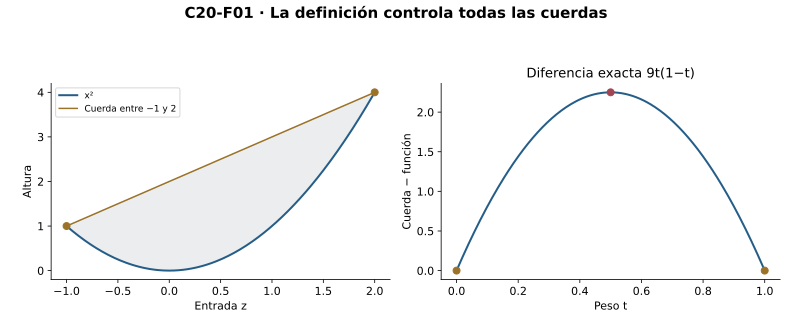
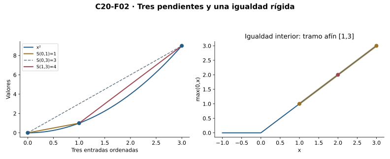
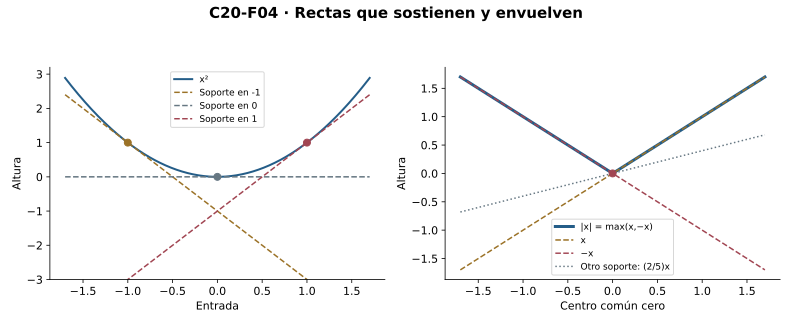
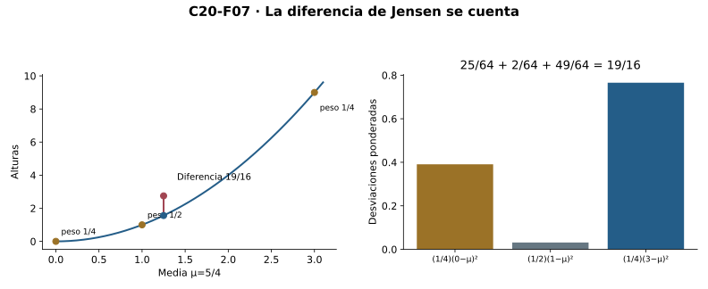

[Índice del libro](../para-matematicos/analisis-para-matematicos.html) · [Ejercicios de este capítulo](#ejercicios-20)

Entre dos puntos de la parábola, la cuerda queda por encima de la curva. Podemos medir esa diferencia con una identidad algebraica, sin conocer todavía sus derivadas. La comparación también tiene sentido para una curva con esquina, como el valor absoluto. Al exigirla para todas las entradas y todos los pesos aparecerá un orden de secantes que permitirá construir continuidad interior y rectas de soporte; las derivadas entrarán después, como otra forma de reconocer ese orden.

C18 aporta derivadas y sus reglas; C19 transporta pendientes por Lagrange, signo y constancia. Completitud para supremos, continuidad y raíces son interfaces heredadas de C03/C10/C14. C16 garantiza mínimos sólo cuando se añade continuidad sobre compacto. No se usa Taylor, integración ni nuevas reglas para potencias reales generales. Convexidad no supone derivabilidad o continuidad de borde; las extensiones al borde se justifican por separado.

## 20.1. Un segmento impone un orden

[]{#MA-SEC-ANM-01-020-001}

Fijemos dos entradas $a,b$ de un intervalo $I$ y un peso $t\in[0,1]$. El intervalo contiene la entrada combinada $z=(1-t)a+tb$, así que podemos evaluar $f(z)$ y compararlo con la altura interpolada $(1-t)f(a)+tf(b)$. En un procedimiento combinamos las entradas antes de evaluar; en el otro combinamos las salidas con los mismos pesos. La convexidad decidirá el orden entre esas dos alturas.

Una función real finita $f:I\to\mathbb R$ es **convexa** si, para todo $a,b\in I$ y todo $t\in[0,1]$,

$$f((1-t)a+tb)\le(1-t)f(a)+tf(b).$$

Es **estrictamente convexa** si la desigualdad es estricta cuando $a\ne b$ y $0<t<1$. Las exclusiones son necesarias: si se repite la entrada o un peso es cero, ambos procedimientos coinciden. **Cóncava** significa la desigualdad opuesta; equivale a que $-f$ sea convexa. Estrictamente cóncava se define de la misma forma. No añadimos continuidad o derivabilidad a estas definiciones. En un singleton la condición estricta es vacía; los teoremas diferenciales siguientes trabajarán sobre intervalos abiertos no vacíos.

En el cuadrado, una expansión permite calcular exactamente cuánto supera la cuerda al valor de la función:

$$
(1-t)a^2+tb^2-((1-t)a+tb)^2=t(1-t)(b-a)^2.
$$

El producto es no negativo para todos los pesos permitidos y es positivo cuando las entradas son distintas y el peso es interior. Esto demuestra convexidad estricta de $x^2$ en toda la recta y determina también los casos de igualdad. En una afín $A+Bx$ la diferencia es siempre cero: es convexa y cóncava, aunque no estrictamente convexa sobre ningún intervalo con dos entradas. Por la misma igualdad, sumar una afín a cualquier función deja intactas sus diferencias de convexidad.

El valor absoluto también es convexo. La desigualdad triangular y la homogeneidad para pesos no negativos dan

$$|(1-t)a+tb|\le(1-t)|a|+t|b|.$$

En el tramo positivo, el valor absoluto coincide con la identidad y da igualdad entre entradas distintas con pesos interiores. Es, por tanto, convexo sin ser estrictamente convexo. Tampoco es derivable en cero por C18. La definición mediante cuerdas incluye esa esquina porque sólo utiliza valores y sus comparaciones; no presupone una tangente.

Si $f$ y $g$ son convexas en el mismo intervalo, multiplicamos sus desigualdades por $\alpha,\beta\ge0$ y las sumamos para obtener convexidad de $\alpha f+\beta g$. Un coeficiente negativo podría invertir la comparación y pierde esa garantía. Restringir a un subintervalo conserva las combinaciones y también la propiedad. La monotonía responde a otra comparación: $x^2$ decrece a la izquierda de cero y mantiene convexidad en toda la recta.

{#fig-anm-c20-f01 fig-alt="Cuadrado debajo de su cuerda y un panel de diferencia positiva entre pesos extremos, con máximo9/4."}

La figura ilustra una cuerda y su diferencia exacta. La identidad anterior controla cualquier par de entradas y cualquier peso, que es la obligación universal de la definición; una colección finita de cuerdas dibujadas no la sustituye.

### Microcontroles

#### Microcontrol 1

[]{#MA-MIC-ANM-01-020-001}

¿Qué debe contener el dominio para comparar dos entradas por convexidad?

[]{#MA-MSOL-ANM-01-020-001}

Ver solución del microcontrol 1

Todo el segmento entre ellas, pues se evalúan todas las combinaciones $(1-t)a+tb$. Un intervalo conserva esas entradas.

Para $0\le t\le1$, la combinación se sitúa entre los extremos y debe ser una entrada admisible. No basta que existan sólo las dos evaluaciones de borde. Intervalaridad garantiza todas las evaluaciones que exige la desigualdad. Así se comprueba el dominio antes de comparar las alturas.

#### Microcontrol 2

[]{#MA-MIC-ANM-01-020-002}

¿Qué procedimientos compara la desigualdad de convexidad?

[]{#MA-MSOL-ANM-01-020-002}

Ver solución del microcontrol 2

Evaluar la función en la combinación de entradas y combinar las dos salidas con los mismos pesos.

Ambos procedimientos usan los mismos pesos, pero en distinto orden: en uno se combina antes de evaluar y en el otro después. Convexidad afirma que la primera altura no supera la segunda. No equivale a comparar simplemente $f(a)$ con $f(b)$, que sería una pregunta de monotonía.

#### Microcontrol 3

[]{#MA-MIC-ANM-01-020-003}

¿Por qué se excluyen pesos extremos y entradas iguales al exigir convexidad estricta?

[]{#MA-MSOL-ANM-01-020-003}

Ver solución del microcontrol 3

En esos casos ambos lados coinciden necesariamente, así que no pueden satisfacer una desigualdad estricta.

Un peso cero o uno devuelve una entrada de borde y su salida exacta en ambos lados. Si las entradas coinciden, todos los pesos devuelven el mismo punto. La condición estricta sólo puede pedirse cuando hay una entrada interior entre extremos distintos. La definición separa por ello los casos triviales.

#### Microcontrol 4

[]{#MA-MIC-ANM-01-020-004}

¿Qué diferencia de convexidad tiene el cuadrado?

[]{#MA-MSOL-ANM-01-020-004}

Ver solución del microcontrol 4

$t(1-t)(b-a)^2$, no negativa siempre y positiva para entradas distintas y pesos interiores.

La diferencia es la altura interpolada menos la salida en la entrada combinada. Sus tres factores son no negativos en el rango de pesos permitido. Para una combinación interior entre puntos distintos ninguno se anula. Esta identidad prueba también todos los casos de igualdad, sin criterios diferenciales.

#### Microcontrol 5

[]{#MA-MIC-ANM-01-020-005}

¿Puede una función ser convexa y cóncava?

[]{#MA-MSOL-ANM-01-020-005}

Ver solución del microcontrol 5

Sí. Toda función afín satisface igualdad en todas las combinaciones.

Una afín tiene forma $A+Bx$ y evaluar la combinación produce exactamente la combinación de sus salidas. Por ello cumple a la vez la comparación convexa y la inversa cóncava. La igualdad no aporta convexidad estricta en un segmento no degenerado. La pendiente puede tener cualquier signo.

#### Microcontrol 6

[]{#MA-MIC-ANM-01-020-006}

¿El valor absoluto es estrictamente convexo?

[]{#MA-MSOL-ANM-01-020-006}

Ver solución del microcontrol 6

No: aunque es convexo por la desigualdad triangular, tiene segmentos afines, por ejemplo entre dos entradas positivas.

En entradas positivas el valor absoluto coincide con la identidad y toda combinación permanece allí. Las dos alturas son iguales aunque los extremos sean distintos y el peso interior. Un solo par así basta para refutar convexidad estricta. La triangular sigue probando convexidad débil para todos los pares.

#### Microcontrol 7

[]{#MA-MIC-ANM-01-020-007}

¿La convexidad exige derivabilidad?

[]{#MA-MSOL-ANM-01-020-007}

Ver solución del microcontrol 7

No. El valor absoluto es convexo y no derivable en cero; la definición sólo compara valores.

La definición sólo utiliza evaluaciones y orden de alturas. Una esquina puede cumplir todas esas desigualdades sin tener un límite bilateral de secantes. El valor absoluto acredita ambos hechos mediante triangular y pendientes laterales opuestas. Los criterios por derivadas posteriores tienen hipótesis adicionales.

#### Microcontrol 8

[]{#MA-MIC-ANM-01-020-008}

¿Qué signo permite sumar desigualdades de convexidad con coeficientes?

[]{#MA-MSOL-ANM-01-020-008}

Ver solución del microcontrol 8

Coeficientes no negativos. Un coeficiente negativo invierte la desigualdad y no conserva el argumento.

Multiplicar una desigualdad por un coeficiente positivo conserva su sentido; por cero la convierte en igualdad. Por ello la suma no negativa conserva convexidad. Un coeficiente negativo invierte el sentido y no ofrece la misma garantía. El negativo del cuadrado refuta una conservación universal sin esa condición.

### Ejercicios de la sección 20.1

[]{#ejercicios-20}

#### Ejercicio 1. La diferencia exacta de una cuerda

[]{#MA-EX-ANM-01-020-001}

Para $f(x)=x^2$ y $z=(1-t)a+tb$, calcula la diferencia entre la altura de la cuerda y $f(z)$. Usa el resultado para decidir convexidad y sus casos de igualdad.

[]{#MA-SOL-ANM-01-020-001}

Ver solución del ejercicio 1

Expandimos $z^2=(1-t)^2a^2+2t(1-t)ab+t^2b^2$. Restar de $(1-t)a^2+tb^2$ deja $t(1-t)(a^2-2ab+b^2)=t(1-t)(b-a)^2$. En $0\le t\le1$ es no negativa y prueba convexidad en toda la recta. Se anula exactamente si $t=0$, $t=1$ o $a=b$. Cuando $0<t<1$ y $a\ne b$ es positiva, por lo que la convexidad es estricta.

El cálculo da una identidad para todos los pesos de la definición, no sólo una comparación en el punto medio. La positividad de cada factor determina estrictitud y la anulación identifica los casos triviales. Así la misma expansión acredita convexidad débil, estricta y sus igualdades sin utilizar derivadas.

#### Ejercicio 2. Una esquina bajo sus cuerdas

[]{#MA-EX-ANM-01-020-002}

Demuestra que $|x|$ es convexa y no estrictamente convexa. Identifica además por qué no admite derivada bilateral en cero.

[]{#MA-SOL-ANM-01-020-002}

Ver solución del ejercicio 2

Para pesos no negativos, la triangular da $|(1-t)a+tb|\le|(1-t)a|+|tb|=(1-t)|a|+t|b|$. Vale para todas las entradas y pesos de la definición. Entre $a=1$ y $b=2$, la función es $x$, de modo que cualquier peso interior da igualdad; falla convexidad estricta. En cero, el cociente $|h|/h$ es1 para $h>0$ y−1 para $h<0$. Sus límites laterales distintos excluyen derivada bilateral. Es una función convexa continua con esquina, no una excepción a la definición.

Los pesos no negativos permiten sacar sus factores de los valores absolutos sin cambiar signo. El tramo positivo afín proporciona un par que refuta estrictitud, mientras las secantes de ambos lados de cero refutan derivabilidad. Son dos fallos distintos que no afectan la desigualdad convexa ya demostrada.

**Retorno visual.** Véase [C20-F01](analisis-para-matematicos-capitulo-20-convexidad-y-control-por-tangentes-y-secantes.html#fig-anm-c20-f01), después del argumento completo: la figura permite reconocer el mecanismo y no sustituye la prueba.

#### Ejercicio 3. Sumar sin invertir el orden

[]{#MA-EX-ANM-01-020-003}

Sean $f,g$ convexas sobre $I$. Demuestra convexidad de $\alpha f+\beta g$ para $\alpha,\beta\ge0$ y de $f+A+Bx$. Exhibe una falla si se permite un coeficiente negativo.

[]{#MA-SOL-ANM-01-020-003}

Ver solución del ejercicio 3

Aplicamos convexidad de cada función en $z=(1-t)a+tb$, multiplicamos por $\alpha,\beta$ no negativos y sumamos. La salida queda acotada por la combinación de salidas de $\alpha f+\beta g$. La recta satisface igualdad en cada combinación, por lo que sumarla conserva la diferencia de convexidad de $f$. Un coeficiente negativo invierte la comparación: con $f=x^2$ y $\alpha=-1$, en $a=-1$, $b=1$, $t=1/2$ la salida de $-f$ es0 y la media de salidas es−1. La desigualdad $0\le-1$ es falsa.

La suma de desigualdades conserva el control porque sus coeficientes no invierten el orden. Agregar una afín contribuye con igualdad y deja intacta la diferencia convexa. El ejemplo negativo elimina exactamente esa condición de signo. No demuestra que ninguna combinación con coeficiente negativo pueda ser convexa, sino que se pierde la garantía universal.

#### Ejercicio 4. Una subida que no decide curvatura

[]{#MA-EX-ANM-01-020-004}

Compara monotonía y convexidad de $x^2$ y $x^3$ sobre $\mathbb R$ sin invocar el criterio de segunda derivada.

[]{#MA-SOL-ANM-01-020-004}

Ver solución del ejercicio 4

El cuadrado es estrictamente convexo por E001. No es no decreciente en toda la recta: $-2<-1$ pero4>1. El cubo es estrictamente creciente porque, para $x<y$, $y^3-x^3=(y-x)(x^2+xy+y^2)>0$; el segundo factor sólo podría ser cero si ambos fueran cero, imposible con $x<y$. No es convexo en toda la recta: para entradas−2 y0 y peso1/2, la salida en−1 es−1, mayor que la media−4. Monotonía ordena dos salidas; convexidad compara una salida intermedia con una altura interpolada.

En el cuadrado, alturas decrecientes del lado negativo conviven con convexidad estricta. En el cubo, el crecimiento de todos los pares convive con una comparación de cuerda que falla. Las identidades y el contraejemplo de valores bastan para separar propiedades, sin usar un criterio diferencial futuro.

#### Ejercicio 5. Supremo de curvas convexas

[]{#MA-EX-ANM-01-020-005}

Sea una familia no vacía $(f_j)$ de funciones convexas sobre el mismo intervalo. Supón que $F(x)=\sup_j f_j(x)$ es real finito para cada $x$. Prueba convexidad de $F$. Explica las condiciones de no vaciedad y finitud.

[]{#MA-SOL-ANM-01-020-005}

Ver solución del ejercicio 5

Para cada $j$, $f_j(z)\le(1-t)f_j(a)+tf_j(b)\le(1-t)F(a)+tF(b)$, porque los pesos son no negativos. El lado derecho es una cota superior real común; tomar el supremo de los valores en $z$ produce $F(z)\le(1-t)F(a)+tF(b)$. La familia no vacía permite el supremo real de un conjunto de valores no vacío y la hipótesis de finitud evita un valor infinito fuera del codominio declarado. No se exige que un índice alcance el supremo. Las rectas son un caso particular.

Para cada índice se obtiene la misma cota superior en la entrada combinada, formada con los dos supremos de borde. El supremo de valores allí no puede superar esa cota. La prueba no supone un índice que maximice cada altura ni reúne elecciones de índices para las entradas. La finitud declarada mantiene la función resultante con valores reales.

## 20.2. Tres pendientes y una rigidez

[]{#MA-SEC-ANM-01-020-002}

Para traducir esa comparación de alturas a pendientes, tomemos tres entradas ordenadas $u<v<w$ de $I$. La entrada central se expresa como una combinación interior de las otras dos, y sus coeficientes son las proporciones de las longitudes:

$$S(u,v)=\frac{f(v)-f(u)}{v-u},\qquad
v=\frac{w-v}{w-u}u+\frac{v-u}{w-u}w.$$

Los denominadores son positivos. Aplicar convexidad en $v$ y multiplicar por $w-u$ produce

$$(w-u)f(v)\le(w-v)f(u)+(v-u)f(w).$$

Restar los términos correspondientes y dividir por productos positivos da

$$S(u,v)\le S(u,w)\le S(v,w).$$

La diferencia total de valores es la suma de los incrementos de sus dos piezas. Por eso $S(u,w)$ es la media ponderada de $S(u,v)$ y $S(v,w)$ con pesos $(v-u)/(w-u)$ y $(w-v)/(w-u)$, ambos positivos y de suma uno. La cadena equivale entonces a ordenar las dos pendientes cortas: $S(u,v)\le S(v,w)$. En sentido inverso, multiplicar esta desigualdad por $(v-u)(w-v)>0$ y reagrupar los términos recupera la comparación de cuerda en $v$. Cada combinación interior puede escribirse como un triple así; las entradas coincidentes y los pesos extremos se verifican por igualdad. La equivalencia queda demostrada sólo con álgebra.

Si la convexidad es estricta, la comparación de altura en $v$ es estricta y las operaciones con denominadores positivos conservan ese signo. Las dos pendientes cortas quedan estrictamente ordenadas y su media larga queda entre ambas, también estrictamente; el argumento inverso recupera convexidad estricta. Para el cuadrado, $S(u,v)=u+v$: con entradas $0,1,3$ aparecen $1<3<4$, y la pendiente larga es $(1/3)1+(2/3)4=3$.

La igualdad interior impone una restricción adicional. Sea $f$ convexa en $[a,b]$, con $a<b$, y supongamos que coincide con su cuerda $\ell$ en algún $z\in(a,b)$. La diferencia $h=\ell-f$ es cóncava, no negativa en todo el segmento y satisface $h(a)=h(z)=h(b)=0$. Veremos que no puede conservar una altura positiva en ninguno de los lados del contacto.

Si $a<x<z$, escribimos $z=\theta x+(1-\theta)b$, donde $\theta=(b-z)/(b-x)\in(0,1)$. La concavidad da $0=h(z)\ge\theta h(x)+(1-\theta)h(b)=\theta h(x)$, así que la no negatividad obliga a $h(x)=0$. Si $z<x<b$, usamos $z=(1-\eta)a+\eta x$, con $\eta=(z-a)/(x-a)\in(0,1)$, y obtenemos $0\ge\eta h(x)$ y la misma conclusión. Los bordes y $z$ ya tenían valor cero: $f$ coincide con la cuerda en todo $[a,b]$.

Este argumento demuestra la **rigidez de una cuerda**: una igualdad interior en una función convexa obliga a un tramo afín completo. En consecuencia, una función convexa es estrictamente convexa exactamente cuando no es afín en ningún subsegmento no degenerado. No se requiere segunda derivada, y un tramo recto puede aparecer sin que toda la función sea una recta.

{#fig-anm-c20-f02 fig-alt="Tres secantes del cuadrado ordenadas y, al lado, un tramo recto de una función con esquina."}

El orden de triples también permite mover un extremo dejando el otro fijo. Con centro $c$, la pendiente $S(c,x)$ no decrece al aumentar $x>c$, y $S(x,c)$ no decrece al aumentar $x<c$. Al acercarnos a $c$ por cada lado recorreremos estas familias en direcciones diferentes. Sus cotas óptimas proporcionarán los dos límites laterales.

### Microcontroles

#### Microcontrol 9

[]{#MA-MIC-ANM-01-020-009}

¿Qué coeficiente expresa $v$ entre $u<v<w$?

[]{#MA-MSOL-ANM-01-020-009}

Ver solución del microcontrol 9

$t=(v-u)/(w-u)$ en $v=(1-t)u+tw$, con $0<t<1$.

Los dos incrementos que forman el cociente son positivos y el numerador es menor que el denominador. Así el peso pertenece estrictamente a $(0,1)$. Sustituirlo en la combinación recupera exactamente $v$. Esta traducción permite pasar de una desigualdad de alturas a una de secantes.

#### Microcontrol 10

[]{#MA-MIC-ANM-01-020-010}

¿Cuál es el orden de las tres pendientes para una función convexa?

[]{#MA-MSOL-ANM-01-020-010}

Ver solución del microcontrol 10

$S(u,v)\le S(u,w)\le S(v,w)$.

Cada secante tiene denominador positivo porque sus extremos están ordenados. Convexidad en la entrada intermedia se reorganiza para colocar las dos cortas en orden. La secante larga es una media positiva de ellas y queda entre ambas. El orden se refiere a pendientes, no necesariamente a alturas crecientes.

#### Microcontrol 11

[]{#MA-MIC-ANM-01-020-011}

¿Por qué la secante larga queda entre las cortas?

[]{#MA-MSOL-ANM-01-020-011}

Ver solución del microcontrol 11

Es su media ponderada con pesos positivos $(v-u)/(w-u)$ y $(w-v)/(w-u)$; además las cortas están ordenadas.

La diferencia total se descompone en la suma de los incrementos de las dos piezas. Dividir por la longitud total convierte sus longitudes en pesos positivos de suma uno. Una media así queda entre dos valores ordenados. Si éstos son distintos, queda estrictamente entre ellos.

#### Microcontrol 12

[]{#MA-MIC-ANM-01-020-012}

¿Basta el orden $S(u,v)\le S(v,w)$ para todos los triples?

[]{#MA-MSOL-ANM-01-020-012}

Ver solución del microcontrol 12

Sí. Multiplicar por los denominadores positivos y reorganizar recupera la desigualdad de convexidad en cada entrada interior.

Cada combinación interior puede escribirse como el centro de un triple ordenado. La desigualdad entre sus secantes cortas se multiplica por longitudes positivas y se convierte en la comparación de cuerda. Los pesos extremos se resuelven por igualdad. Así la condición para todos los triples recupera toda la definición.

#### Microcontrol 13

[]{#MA-MIC-ANM-01-020-013}

¿Qué ocurre en el orden de pendientes si la convexidad es estricta?

[]{#MA-MSOL-ANM-01-020-013}

Ver solución del microcontrol 13

Las dos comparaciones son estrictas para cada triple de entradas distintas.

La comparación de cuerda es estricta en la entrada intermedia. Al reorganizarla sólo se multiplica o divide por distancias positivas, conservando estrictitud. Las secantes cortas resultan distintas y la larga queda estrictamente entre ellas. Los triples deben tener tres entradas distintas para que las divisiones estén definidas.

#### Microcontrol 14

[]{#MA-MIC-ANM-01-020-014}

¿Qué fuerza una igualdad interior con una cuerda de una función convexa?

[]{#MA-MSOL-ANM-01-020-014}

Ver solución del microcontrol 14

Que la función coincida con esa recta en todo el segmento de la cuerda.

La convexidad ya sitúa la función debajo de la cuerda en todo el segmento. Si toca la cuerda en un punto interior, concavidad de la diferencia impide que exista una altura positiva restante. El argumento se realiza a ambos lados del contacto. La afinidad forzada se limita a ese segmento y no a todo el dominio.

#### Microcontrol 15

[]{#MA-MIC-ANM-01-020-015}

¿Cómo se excluye un punto elevado de $h=\ell-f$ al tener $h(z)=0$ interior?

[]{#MA-MSOL-ANM-01-020-015}

Ver solución del microcontrol 15

Se expresa $z$ entre ese punto y el borde opuesto; concavidad de $h$ y no negatividad fuerzan que el valor del punto sea cero.

Si el punto está a la izquierda de $z$, se combina con el borde derecho; si está a la derecha, con el izquierdo. El peso del punto es positivo en ambos casos. La desigualdad cóncava obligaría al cero de $h(z)$ a dominar una cantidad positiva si aquel punto tuviera altura positiva. Como $h$ no es negativa, sólo queda altura cero.

#### Microcontrol 16

[]{#MA-MIC-ANM-01-020-016}

¿Cómo se caracteriza convexidad estricta sin derivadas?

[]{#MA-MSOL-ANM-01-020-016}

Ver solución del microcontrol 16

Una función convexa es estrictamente convexa si y sólo si no es afín en ningún subsegmento con extremos distintos.

Una pieza afín daría igualdad para una combinación interior y refutaría estrictitud. Recíprocamente, para una función ya convexa, cualquier fallo de estrictitud interior debe ser una igualdad. La rigidez de cuerda convierte esa igualdad en una pieza afín. La caracterización utiliza valores y secantes, sin exigir derivabilidad.

### Ejercicios de la sección 20.2

#### Ejercicio 6. Reconstruir la cuerda desde pendientes

[]{#MA-EX-ANM-01-020-006}

Para $u<v<w$, demuestra algebraicamente que $S(u,v)\le S(v,w)$ equivale a la desigualdad de convexidad en $v$ entre $u,w$. Recupera también el orden de la secante larga.

[]{#MA-SOL-ANM-01-020-006}

Ver solución del ejercicio 6

Multiplicamos por $(v-u)(w-v)>0$: $(w-v)(f(v)-f(u))\le(v-u)(f(w)-f(v))$. Agrupar $f(v)$ da $(w-u)f(v)\le(w-v)f(u)+(v-u)f(w)$. Dividir por $w-u$ da la cuerda en $v$, con pesos positivos que suman1. A su vez $S(u,w)=[(v-u)S(u,v)+(w-v)S(v,w)]/(w-u)$; una media con pesos positivos de dos valores ordenados está entre ellos. Por ello $S(u,v)\le S(u,w)\le S(v,w)$.

Las longitudes de los dos tramos son estrictamente positivas y legitiman todas las multiplicaciones y divisiones. El reordenamiento produce exactamente los pesos de la entrada intermedia. La secante larga es una media de las cortas y conserva su banda. Esta equivalencia es algebraica y no requiere derivadas.

#### Ejercicio 7. Tres pendientes del cuadrado

[]{#MA-EX-ANM-01-020-007}

Calcula las pendientes de $x^2$ entre las entradas0,1,3. Comprueba su orden y relaciona cada una con la fórmula general $S(u,v)$.

[]{#MA-SOL-ANM-01-020-007}

Ver solución del ejercicio 7

Para el cuadrado, $(v^2-u^2)/(v-u)=u+v$ cuando $u<v$. Las pendientes cortas son $S(0,1)=1$ y $S(1,3)=4$; la larga es $S(0,3)=3$. Se obtiene1<3<4. La media ponderada es $(1/3)1+(2/3)4=3$. La desigualdad estricta concuerda con convexidad estricta; una secante larga no toma por definición la pendiente de una de sus piezas.

Cancelar la diferencia de entradas exige extremos distintos, cumplido en las tres secantes. Las longitudes uno y dos se convierten en pesos un tercio y dos tercios para la larga. El resultado tres queda estrictamente entre uno y cuatro. Esa cuenta muestra por qué una secante larga no coincide necesariamente con ninguna de sus partes.

**Retorno visual.** Véase [C20-F02](analisis-para-matematicos-capitulo-20-convexidad-y-control-por-tangentes-y-secantes.html#fig-anm-c20-f02), después del argumento completo: la figura permite reconocer el mecanismo y no sustituye la prueba.

#### Ejercicio 8. Una igualdad que se propaga

[]{#MA-EX-ANM-01-020-008}

Sea $f$ convexa en $[a,b]$, y sea $\ell$ la cuerda entre sus bordes. Si $f(z)=\ell(z)$ para un $z$ interior, demuestra que $f=\ell$ en todo el segmento.

[]{#MA-SOL-ANM-01-020-008}

Ver solución del ejercicio 8

Ponemos $h=\ell-f$. Es cóncava, no negativa por la cuerda y nula en $a,z,b$. Para $a<x<z$, escribimos $z=\theta x+(1-\theta)b$, con $\theta=(b-z)/(b-x)>0$. Concavidad da $0=h(z)\ge\theta h(x)$, así $h(x)=0$. Para $z<x<b$, escribimos $z=(1-\eta)a+\eta x$, con $\eta=(z-a)/(x-a)>0$ y obtenemos $0\ge\eta h(x)$, de nuevo $h(x)=0$. La no negatividad descarta valores negativos y los puntos restantes ya eran ceros. La igualdad interior ha forzado un tramo afín completo.

La cuerda ya aporta $h\ge0$ y la concavidad proporciona la desigualdad que propaga el contacto. Cada punto no central se relaciona con el contacto mediante el borde opuesto. Como su peso es positivo, una altura positiva sería incompatible con el cero de la combinación. Se concluye igualdad en todo el segmento, no fuera de él.

#### Ejercicio 9. Cero curvatura en una pieza

[]{#MA-EX-ANM-01-020-009}

Construye una función convexa que no sea afín en toda $\mathbb R$ y que tenga una igualdad interior en alguna cuerda. Explica por qué no contradice E008.

[]{#MA-SOL-ANM-01-020-009}

Ver solución del ejercicio 9

Tomamos $f(x)=\max\{0,x\}$. Es convexa como supremo finito de las rectas0 y $x$ por E005. En $[1,3]$ coincide con $x$, y en2 hay igualdad con la cuerda. No es afín en toda la recta: es0 para entradas negativas y $x$ para positivas. E008 fuerza afinidad sólo en el segmento cuyos bordes e igualdad se fijaron, aquí $[1,3]$. No propaga la recta fuera de ese segmento.

Las dos rectas son una familia finita no vacía con supremo real en cada entrada. En la pieza positiva su máximo es la identidad y produce las igualdades pedidas. En la negativa es la constante cero, incompatible con una única regla afín global. La rigidez de una cuerda sólo utiliza el segmento cuyos datos se han fijado.

#### Ejercicio 10. Sin tramo recto, con desigualdad estricta

[]{#MA-EX-ANM-01-020-010}

Prueba que una función convexa es estrictamente convexa si y sólo si no es afín en ningún subsegmento con extremos distintos.

[]{#MA-SOL-ANM-01-020-010}

Ver solución del ejercicio 10

Si es estrictamente convexa, una afinidad en un segmento no degenerado daría igualdad en cualquier combinación interior de sus bordes, contradicción. Para la otra dirección, si falla convexidad estricta, existen $a\ne b$ y un peso interior con igualdad: la convexidad débil ya excluye que el signo sea el contrario. Ordenamos $a,b$; la entrada combinada queda interior. E008 hace afín todo ese subsegmento. Contradice la ausencia de tramos afines. Las combinaciones triviales no intervienen.

La dirección recíproca parte de convexidad débil, que impide una desigualdad contraria. Un fallo de estrictitud interior debe por ello ser igualdad, y la rigidez la convierte en afinidad del tramo. La ausencia de tramos afines descarta ese caso. Los pesos extremos y entradas repetidas se excluyen porque siempre producen igualdad.

## 20.3. La convexidad fabrica continuidad

[]{#MA-SEC-ANM-01-020-003}

Para construir continuidad necesitamos una barrera de pendientes que funcione para todos los pares de una región. Sea $f$ convexa y finita en un intervalo $I$, y fijemos $[c,d]$ en su interior, con $c<d$. Podemos tomar entradas exteriores $a<c<d<b$ de $I$. Las secantes entre esas anclas y la región interior encierran cualquier pendiente con $c\le x<y\le d$:

$$S(a,c)\le S(a,x)\le S(x,y)\le S(y,b)\le S(d,b).$$

Cuando $x=c$ o $y=d$, una comparación es simplemente igualdad; no se divide por cero. Los números exteriores son finitos porque los valores de $f$ lo son y los denominadores son positivos. Definamos

$$L=\max\{|S(a,c)|,\ |S(d,b)|\}.$$

Toda pendiente de esa banda tiene magnitud a lo sumo $L$, de donde $|f(y)-f(x)|\le L|y-x|$. Los pares iguales tienen incremento cero y los invertidos se cubren por simetría. Así la restricción a $[c,d]$ es Lipschitz: para $L>0$ sirve el radio uniforme $\delta=\varepsilon/L$, y para $L=0$ todas las salidas son iguales y cualquier radio positivo sirve. Cada centro interior puede situarse dentro de un segmento con margen a ambos lados, lo que prueba continuidad en él. El argumento no utilizó derivadas ni supuso previamente la continuidad que acaba de obtener.

El margen interior importa. En $[0,1]$, la función que vale uno en cero y cero en toda entrada positiva es convexa: si la combinación es positiva, su salida es cero y no supera la media no negativa de salidas; si es cero, todas las entradas con peso positivo son cero y las dos alturas valen uno. Sin embargo, las entradas positivas que tienden a cero mantienen salida cero, distinta de $f(0)=1$. La convexidad finita garantiza continuidad interior sin imponerla en un borde incluido.

Hay también pendientes laterales bien determinadas. Fijemos ahora $c\in\operatorname{int}I$ y consideremos

$$A=\sup_{x<c,\ x\in I}S(x,c),\qquad
B=\inf_{y>c,\ y\in I}S(c,y).$$

Como $c$ es interior, las dos familias de secantes son no vacías. El orden de triples sitúa cada pendiente izquierda por debajo de cada pendiente derecha: una secante derecha fija acota superiormente toda la familia izquierda y una izquierda fija acota inferiormente toda la derecha. La completitud da entonces un supremo $A$ y un ínfimo $B$ reales finitos. Para cada pendiente derecha, el supremo izquierdo sigue estando por debajo; al tomar después el ínfimo derecho obtenemos $A\le B$.

Para demostrar el límite izquierdo, dada $\varepsilon>0$, el número $A-\varepsilon$ no es cota superior de las pendientes izquierdas. Existe, pues, un $x_0<c$ con $A-\varepsilon<S(x_0,c)\le A$. Cuando $x_0<x<c$, el orden con extremo fijo da $A-\varepsilon<S(x_0,c)\le S(x,c)\le A$. El radio $c-x_0>0$ acredita el límite $A$ sin exigir que el supremo se alcance. A la derecha, la propiedad del ínfimo proporciona $y_0>c$ con $B\le S(c,y_0)<B+\varepsilon$. Para $c<y<y_0$, la pendiente queda entre $B$ y esa cota superior, y el radio $y_0-c$ demuestra el límite $B$.

Por definición de cociente incremental, $f'_-(c)=A$ y $f'_+(c)=B$. La derivada bilateral existe exactamente cuando $A=B$: si coinciden, el mínimo de los dos radios sirve a ambos lados; si existe una derivada, sus dos restricciones tienen el mismo límite. Para $|x|$ en cero se obtienen $A=-1$ y $B=1$. La continuidad fabricada por convexidad admite una esquina.

![Para |x|, anclas−1 y1 encierran las secantes de\[−1/2,1/2\] entre−1 y1, dando L=1. Al centro0, las secantes izquierdas valen−1 y las derechas1; los círculos abiertos excluyen el cociente de incremento nulo. La función es continua y Lipschitz, pero no derivable en cero.](../../assets/books/anm/C20/C20-F03.svg){#fig-anm-c20-f03 fig-alt="Valor absoluto con un intervalo interior sombreado y, al lado, dos niveles de secantes que llegan a límites distintos."}

La finitud de estos límites se ha probado en centros interiores, donde hay secantes de ambos lados que los acotan. No podemos trasladarla a los bordes ni convertir las constantes de segmentos interiores en una sola constante Lipschitz para un intervalo abierto no acotado.

### Microcontroles

#### Microcontrol 17

[]{#MA-MIC-ANM-01-020-017}

¿Qué margen se necesita para una constante Lipschitz en $[c,d]$?

[]{#MA-MSOL-ANM-01-020-017}

Ver solución del microcontrol 17

Entradas exteriores $a<c<d<b$ en el dominio, para encerrar las pendientes interiores entre $S(a,c)$ y $S(d,b)$.

Las entradas exteriores aportan secantes fijas a ambos lados de todas las parejas de $[c,d]$. El orden de triples las convierte en barreras de pendientes. Sus denominadores positivos hacen finitos los valores de las barreras. En un borde sin margen exterior no puede suponerse este mismo control.

#### Microcontrol 18

[]{#MA-MIC-ANM-01-020-018}

¿Qué constante construye la banda de secantes?

[]{#MA-MSOL-ANM-01-020-018}

Ver solución del microcontrol 18

$L=\max\{|S(a,c)|,|S(d,b)|\}$; entonces $|f(y)-f(x)|\le L|y-x|$ en $[c,d]$.

Las secantes interiores quedan entre dos números reales fijos, aunque alguno sea negativo. El máximo de sus magnitudes domina cualquier número de esa banda. Multiplicar por la distancia de entrada da la cota de valores. Los pares iguales se tratan sin formar secantes y los invertidos por simetría.

#### Microcontrol 19

[]{#MA-MIC-ANM-01-020-019}

¿Qué radio sirve cuando $L>0$?

[]{#MA-MSOL-ANM-01-020-019}

Ver solución del microcontrol 19

$\delta=\varepsilon/L$; el incremento es menor que $\varepsilon$ si la distancia es menor que ese radio.

La barrera Lipschitz se ha demostrado primero para todos los pares del segmento. Para una precisión dada el radio se fija antes de conocerlos. La distancia estricta bajo $\varepsilon/L$ convierte la cota no estricta en error estricto. Esa misma escala prueba uniformidad de la restricción, además de continuidad.

#### Microcontrol 20

[]{#MA-MIC-ANM-01-020-020}

¿Qué hacer si $L=0$?

[]{#MA-MSOL-ANM-01-020-020}

Ver solución del microcontrol 20

La banda obliga a todas las pendientes a ser cero en ese segmento, así la función es constante y cualquier radio positivo sirve.

Si ambas magnitudes exteriores tienen máximo cero, las barreras de secantes son cero. Toda secante interior debe entonces valer cero y las alturas son iguales. No se utiliza la fórmula de radio que dividiría por $L$. Cualquier radio positivo satisface cualquier desafío porque el error de salida es cero.

#### Microcontrol 21

[]{#MA-MIC-ANM-01-020-021}

¿La convexidad finita garantiza continuidad en un borde incluido?

[]{#MA-MSOL-ANM-01-020-021}

Ver solución del microcontrol 21

No. En $[0,1]$, valor1 en cero y0 en las entradas positivas define una función convexa discontinua en cero.

La altura excepcional del borde está por encima de la constante interior y no viola las comparaciones de cuerda. Sin embargo, entradas positivas próximas tienen salidas cero frente al valor central uno. La continuidad interior permanece verdadera porque la función es localmente constante allí. Convexidad finita no protege automáticamente un extremo incluido.

#### Microcontrol 22

[]{#MA-MIC-ANM-01-020-022}

¿Qué límites laterales de pendientes existen en un centro interior?

[]{#MA-MSOL-ANM-01-020-022}

Ver solución del microcontrol 22

$f\prime_-(c)=A=\sup_{x<c}S(x,c)$ y $f\prime_+(c)=B=\inf_{y>c}S(c,y)$, ambos reales finitos y con $A\le B$.

Una secante fija del lado contrario acota las pendientes de cada lado. La interioridad garantiza que ambos conjuntos no sean vacíos y sus cotas óptimas sean reales finitas. La monotonía de secantes convierte esas cotas en límites laterales. El orden entre ellos expresa la posible esquina de una función convexa.

#### Microcontrol 23

[]{#MA-MIC-ANM-01-020-023}

¿Qué dato del supremo construye el radio del límite izquierdo?

[]{#MA-MSOL-ANM-01-020-023}

Ver solución del microcontrol 23

Una entrada $x_0<c$ cuya secante supera $A-\varepsilon$; las entradas entre $x_0$ y $c$ quedan entre esa cota y $A$.

El umbral $A-\varepsilon$ no es cota superior porque es menor que el supremo. Por ello existe un testigo cuya pendiente lo supera. Las secantes más próximas conservan esa cota inferior y no superan $A$. El radio $c-x_0>0$ acredita el límite sin construir una sucesión seleccionada.

#### Microcontrol 24

[]{#MA-MIC-ANM-01-020-024}

¿Cuándo existe la derivada bilateral de una función convexa en un centro interior?

[]{#MA-MSOL-ANM-01-020-024}

Ver solución del microcontrol 24

Exactamente cuando $A=B$. Para $|x|$ en cero son−1 y1, así hay continuidad pero no derivabilidad.

Si ambos límites coinciden, el mínimo de sus radios controla todas las entradas perforadas del centro, de ambos lados. Si la derivada bilateral existiera, sus restricciones laterales tendrían el mismo límite por unicidad. La igualdad de $A$ y $B$ es por tanto necesaria y suficiente. La continuidad del valor absoluto no obliga a esa igualdad.

### Ejercicios de la sección 20.3

#### Ejercicio 11. Un radio construido con secantes

[]{#MA-EX-ANM-01-020-011}

Sea $f$ convexa finita y $a<c<d<b$ en su intervalo. Construye una constante Lipschitz en $[c,d]$ y un radio de continuidad sin usar derivadas.

[]{#MA-SOL-ANM-01-020-011}

Ver solución del ejercicio 11

Para $c\le x<y\le d$, la regla de triples da $S(a,c)\le S(a,x)\le S(x,y)\le S(y,b)\le S(d,b)$. Con $L=\max\{|S(a,c)|,|S(d,b)|\}$ resulta $|S(x,y)|\le L$, luego $|f(y)-f(x)|\le L|y-x|$. Entradas iguales dan incremento cero y entradas invertidas se cubren por simetría. Si $L>0$, tomamos $\delta=\varepsilon/L$; si $L=0$, la función es constante en el segmento y cualquier radio positivo sirve. Los puntos exteriores son la hipótesis que mantiene finitas las cotas.

La cadena de secantes usa centros exteriores a la región que se controla y conserva sus barreras al mover $x,y$. Si algún centro coincide con $c$ o $d$, la comparación correspondiente es igualdad y se omite el triple degenerado. La banda finita da un control para todos los pares y su radio uniforme. No se utiliza una cota de derivadas para fabricar continuidad.

#### Ejercicio 12. Dos pendientes laterales en una esquina

[]{#MA-EX-ANM-01-020-012}

Calcula las derivadas laterales de $|x|$ en cero y las constantes de secante que las definen. Decide continuidad, derivabilidad y una constante Lipschitz global.

[]{#MA-SOL-ANM-01-020-012}

Ver solución del ejercicio 12

Para $x<0$, $S(x,0)=(0-|x|)/(0-x)=-1$, así el supremo izquierdo es−1. Para $y>0$, $S(0,y)=1$, así el ínfimo derecho es1. Las pendientes laterales difieren y no existe derivada bilateral. La triangular aplicada a $x=(x-y)+y$ y luego con $x,y$ intercambiados da $||x|-|y||\le|x-y|$. Es Lipschitz con constante1 en toda la recta, y por ello continua incluso en la esquina.

Las dos familias laterales son constantes y sus cotas óptimas se alcanzan en toda entrada de su lado. Sus valores diferentes impiden un único límite bilateral. La desigualdad triangular inversa controla en cambio todas las diferencias de valores, incluida la esquina. Esto distingue continuidad y Lipschitz de existencia de derivada.

**Retorno visual.** Véase [C20-F03](analisis-para-matematicos-capitulo-20-convexidad-y-control-por-tangentes-y-secantes.html#fig-anm-c20-f03), después del argumento completo: la figura permite reconocer el mecanismo y no sustituye la prueba.

#### Ejercicio 13. Una discontinuidad convexa de borde

[]{#MA-EX-ANM-01-020-013}

En $[0,1]$, toma $f(0)=1$ y $f(x)=0$ para $x>0$. Prueba convexidad y falta de continuidad en cero. Explica qué afirmación de continuidad permanece válida.

[]{#MA-SOL-ANM-01-020-013}

Ver solución del ejercicio 13

Para cualquier combinación de dos entradas no negativas, si la entrada combinada es positiva la salida es0 y la media de salidas es no negativa. Si la combinación es cero, todas las entradas con peso positivo son cero y la media de salidas vale1, igual que la salida. Esto prueba convexidad para todos los pesos. La sucesión positiva $1/(n+1)$ tiene salidas0 y converge a cero, cuya salida es1; no hay continuidad en ese borde. En cada punto interior la función es constante en un radio pequeño y continua. La continuidad interior de una función convexa finita no incluye automáticamente la frontera.

Una combinación no negativa sólo puede ser cero si todas sus entradas activas son cero. Ese caso preserva exactamente la altura excepcional del borde. Las entradas positivas próximas refutan continuidad allí sin alterar convexidad. La conclusión de continuidad para convexas finitas se mantiene en los centros interiores que tienen margen por ambos lados.

#### Ejercicio 14. El supremo convertido en límite

[]{#MA-EX-ANM-01-020-014}

Para $c$ interior de una función convexa finita, demuestra que $A=\sup_{x<c}S(x,c)$ es real y es el límite de esas secantes al acercarse desde la izquierda.

[]{#MA-SOL-ANM-01-020-014}

Ver solución del ejercicio 14

Hay entradas a ambos lados de $c$. Una secante derecha fija acota todas las secantes izquierdas por la regla de triples, y una secante izquierda fija muestra que el conjunto no es vacío y da una cota inferior a su supremo. La completitud proporciona $A\in\mathbb R$. Para $\varepsilon>0$, elegimos $x_0<c$ con $A-\varepsilon<S(x_0,c)\le A$. Si $x_0<x<c$, la monotonía de secantes con extremo fijo da $A-\varepsilon<S(x_0,c)\le S(x,c)\le A$. El radio $c-x_0$ produce la condición de límite izquierdo. El cociente de derivada para incremento negativo es precisamente $S(x,c)$.

La secante derecha fija aporta una cota superior a todo el conjunto izquierdo, y un miembro izquierdo acredita no vacuidad. El supremo real existe por completitud. Su propiedad aproximante y el orden de secantes permiten diseñar un radio a partir de un solo testigo. No se supone que el supremo sea una pendiente alcanzada ni se selecciona una ruta.

#### Ejercicio 15. Ni constante global ni borde protegido

[]{#MA-EX-ANM-01-020-015}

Explica con $x^2$ en $\mathbb R$ por qué la convexidad no implica Lipschitz global. Da también una función convexa continua en $[0,1]$ que no sea Lipschitz allí.

[]{#MA-SOL-ANM-01-020-015}

Ver solución del ejercicio 15

Si el cuadrado tuviera constante global $L$, comparar0 y $x>0$ daría $x^2\le Lx$ y por tanto $x\le L$ para todos los positivos, imposible tomando $x>L$. Para el borde, $f(x)=-\sqrt{x}$ es convexa continua en $[0,1]$: sobre el interior su segunda derivada es positiva según20.6, y continuidad permite extender convexidad a los bordes por20.5. Si fuera Lipschitz con constante $L$, comparar0 con $x>0$ daría $1/\sqrt{x}\le L$, imposible cerca de cero. No se usa este ejemplo como premisa de la prueba temprana de continuidad; se verifica con herramientas ya disponibles.

El control local interior puede cambiar de constante al cambiar la región y no da una constante para toda la recta. Cerca de un borde, incluso continuidad no asegura una banda de secantes finita. Los dos ejemplos infringen barreras propuestas con pares válidos. Usar después criterios diferenciales para verificar el segundo ejemplo no los convierte en premisas de la prueba temprana.

## 20.4. Rectas que sostienen y una envolvente

[]{#MA-SEC-ANM-01-020-004}

Las cuerdas quedan por encima de la curva dentro de sus propios segmentos. El orden lateral permite construir también rectas que queden por debajo en todas las entradas del intervalo. Fijemos un centro interior $c$, sus pendientes laterales $A=f'_-(c)\le B=f'_+(c)$ y cualquier $p\in[A,B]$. Consideremos la recta

$$\ell_{c,p}(x)=f(c)+p(x-c).$$

Para $x>c$, la definición de $B$ da $S(c,x)\ge B\ge p$; multiplicar por $x-c>0$ produce $f(x)-f(c)\ge p(x-c)$. Para $x<c$, tenemos $S(x,c)\le A\le p$, y al multiplicar por $x-c<0$ se invierte el orden y obtenemos la misma comparación de alturas. En el centro hay igualdad. Por tanto $\ell_{c,p}(x)\le f(x)$ en todo $I$, y llamamos a esa recta un soporte en $c$.

Si una recta por $(c,f(c))$ es soporte, las mismas divisiones permiten determinar su pendiente. A la derecha exige $p\le S(c,x)$ para todas las entradas y, por ello, $p\le B$. A la izquierda exige $S(x,c)\le p$ para todas y, por ello, $A\le p$. Así el intervalo cerrado $[A,B]$ contiene exactamente las pendientes permitidas. Una esquina puede tener varias, aun cuando no haya tangente bilateral.

Cuando $f$ es derivable en $c$, $A=B=f'(c)$ y la única recta de soporte que pasa por ese punto es la tangente:

$$f(x)\ge f(c)+f'(c)(x-c).$$

En cero, el valor absoluto admite todos los soportes $px$ con $-1\le p\le1$; las rectas extremas $x$ y $-x$ sostienen sus dos tramos. El cuadrado tiene tangente $2cx-c^2$ en $c$, y la identidad $x^2-(2cx-c^2)=(x-c)^2\ge0$ prueba su soporte en toda la recta. La comparación no se limita a un radio pequeño alrededor del contacto.

Una función convexa finita sobre un intervalo abierto no vacío es la **envolvente superior** de sus rectas de soporte:

$$f(x)=\sup_{c\in I,\ p\in[f'_-(c),f'_+(c)]}\ell_{c,p}(x).$$

Para un $x$ fijo, la familia de valores de los soportes es no vacía y todos están acotados superiormente por el real $f(x)$. Además $x$ es un centro interior y podemos usar $c=x$, por ejemplo con pendiente $p=f'_-(x)$, para obtener igualdad en esa entrada. El supremo existe y vale $f(x)$. La formulación sobre un intervalo abierto evita reclamar un soporte finito en un borde donde podría faltar.

Recíprocamente, sea una familia no vacía de rectas $\ell_j$ con supremo $F(x)$ real finito en cada entrada de un intervalo. Para cada índice, la igualdad afín y las dos cotas de borde dan $\ell_j((1-t)a+tb)=(1-t)\ell_j(a)+t\ell_j(b)\le(1-t)F(a)+tF(b)$. El lado derecho es una barrera común; tomar el supremo en la entrada combinada prueba convexidad de $F$, aunque ningún índice alcance ese supremo. El valor absoluto tiene una representación especialmente breve: $|x|=\max\{x,-x\}$.

{#fig-anm-c20-f04 fig-alt="Varias tangentes debajo del cuadrado y, al lado, dos rectas cuyo máximo forma una esquina con soportes adicionales."}

La cuerda controla por arriba dentro de su segmento y el soporte por abajo en todo el intervalo. Si un soporte toca en dos entradas distintas $a,b$, convexidad obliga a que la función no supere la recta entre ellas, mientras el soporte obliga a que no quede debajo. Hay igualdad en todo $[a,b]$. En una función estrictamente convexa ese tramo afín es imposible, así que una tangente de una convexa estricta derivable sólo toca en su propio centro.

### Microcontroles

#### Microcontrol 25

[]{#MA-MIC-ANM-01-020-025}

¿Qué pendientes sostienen una función convexa desde un centro interior?

[]{#MA-MSOL-ANM-01-020-025}

Ver solución del microcontrol 25

Exactamente los números del intervalo $[f\prime_-(c),f\prime_+(c)]$.

Una recta de soporte debe quedar debajo en ambas direcciones desde el centro. Las entradas derechas acotan su pendiente por arriba y las izquierdas por abajo. Los supremos e ínfimos laterales convierten esas condiciones en el intervalo cerrado de pendientes permitido. La interioridad hace disponibles ambos controles.

#### Microcontrol 26

[]{#MA-MIC-ANM-01-020-026}

¿Qué cambia al multiplicar una comparación de pendientes por $x-c<0$?

[]{#MA-MSOL-ANM-01-020-026}

Ver solución del microcontrol 26

Se invierte la desigualdad; esto transforma $S(x,c)\le p$ en $f(x)-f(c)\ge p(x-c)$.

La secante izquierda tiene el mismo valor que el cociente centrado, pero su incremento $x-c$ es negativo. Multiplicar invierte la comparación de pendientes y produce la desigualdad de alturas correcta. Omitir esa inversión daría una recta por encima en el lado equivocado. El centro se verifica por igualdad directa.

#### Microcontrol 27

[]{#MA-MIC-ANM-01-020-027}

¿Qué pendiente de soporte queda si la función es derivable?

[]{#MA-MSOL-ANM-01-020-027}

Ver solución del microcontrol 27

Sólo $f\prime(c)$, porque coinciden las dos derivadas laterales.

Derivabilidad hace coincidir las dos cotas laterales en un único número. El intervalo de pendientes de soporte se reduce por ello a un singleton. Su recta es la tangente y sostiene globalmente la función convexa. Una esquina puede tener varias pendientes de soporte sin ninguna derivada bilateral.

#### Microcontrol 28

[]{#MA-MIC-ANM-01-020-028}

¿Qué familia de rectas sostiene $|x|$ en cero?

[]{#MA-MSOL-ANM-01-020-028}

Ver solución del microcontrol 28

$px$ para $-1\le p\le1$; no hay una tangente bilateral única.

Las entradas positivas exigen $p\le1$ y las negativas $p\ge-1$ al dividir con el signo correspondiente. En cero todas las rectas de esa familia coinciden con la función. Las dos pendientes laterales son sus extremos. El soporte no tiene que ser una secante límite bilateral única.

#### Microcontrol 29

[]{#MA-MIC-ANM-01-020-029}

¿Qué identidad verifica el soporte de la tangente del cuadrado?

[]{#MA-MSOL-ANM-01-020-029}

Ver solución del microcontrol 29

$x^2-(2cx-c^2)=(x-c)^2\ge0$.

El cuadrado restante es no negativo para toda entrada real. Por tanto la recta de pendiente $2c$ y valor central $c^2$ queda debajo globalmente. Sólo hay igualdad cuando $x=c$. La identidad acredita soporte y contacto sin recurrir a una interpretación visual de la tangente.

#### Microcontrol 30

[]{#MA-MIC-ANM-01-020-030}

¿Por qué el supremo de todos los soportes recupera $f(x)$ en un intervalo abierto?

[]{#MA-MSOL-ANM-01-020-030}

Ver solución del microcontrol 30

Todos están debajo de $f(x)$ y alguno con centro $c=x$ alcanza ese valor; la familia es no vacía y acotada superiormente.

Para un $x$ fijado, todas las rectas están acotadas por la salida finita $f(x)$. Al usar el propio $x$ como centro interior se obtiene un soporte que tiene igualdad allí. Esa pertenencia demuestra que el supremo es exactamente la salida. No hace falta escoger un soporte preferido para cada centro simultáneamente.

#### Microcontrol 31

[]{#MA-MIC-ANM-01-020-031}

¿Debe alcanzarse el supremo de una familia de rectas para que sea convexo?

[]{#MA-MSOL-ANM-01-020-031}

Ver solución del microcontrol 31

No. Basta que la familia sea no vacía y su supremo sea finito en cada entrada; se toma el supremo de sus desigualdades afines.

Cada recta tiene igualdad afín y sus valores en los bordes no superan el supremo allí. La combinación de esos dos supremos es una cota superior común de todas las alturas en la entrada intermedia. Tomar el supremo conserva esa cota. La demostración necesita finitud y no vacuidad, pero no un índice maximizador.

#### Microcontrol 32

[]{#MA-MIC-ANM-01-020-032}

¿En qué dirección controla una cuerda y en cuál un soporte?

[]{#MA-MSOL-ANM-01-020-032}

Ver solución del microcontrol 32

En una función convexa, la cuerda queda arriba dentro de su segmento y el soporte queda abajo en todo el intervalo.

La cuerda interpola dos evaluaciones y controla desde arriba sólo entre sus extremos. El soporte pasa por un punto central y controla desde abajo en todo el intervalo. Son comparaciones con regiones y sentidos diferentes. En una función afín ambas coinciden; para una convexa estricta los contactos tienen restricciones adicionales.

### Ejercicios de la sección 20.4

#### Ejercicio 16. Todas las rectas que sostienen la esquina

[]{#MA-EX-ANM-01-020-016}

Determina todos los $p$ para los que $px\le|x|$ para todo $x$. Relaciona el resultado con las dos pendientes laterales.

[]{#MA-SOL-ANM-01-020-016}

Ver solución del ejercicio 16

Para $x>0$, dividir por $x$ exige $p\le1$. Para $x<0$, la desigualdad $px\le-x$ y la división negativa exigen $p\ge-1$. En cero siempre hay igualdad. A la inversa, si $-1\le p\le1$, estas dos condiciones prueban el soporte en ambas mitades. Las pendientes laterales son−1 y1, así se recupera exactamente su intervalo cerrado. Las rectas pasan por el centro y son soportes, aunque no haya derivada bilateral.

Dividir por entradas negativas invierte el orden y produce la restricción inferior de pendiente. En las positivas la división conserva el orden y produce la superior. El centro cero tiene igualdad sin formar un cociente. Ambas condiciones reunidas dan exactamente el intervalo de soportes, aunque no exista tangente bilateral.

#### Ejercicio 17. Una familia que envuelve el cuadrado

[]{#MA-EX-ANM-01-020-017}

Prueba $x^2=\sup_{c\in\mathbb R}(2cx-c^2)$, indicando existencia de la cota y un centro que alcance el supremo.

[]{#MA-SOL-ANM-01-020-017}

Ver solución del ejercicio 17

La identidad $x^2-2cx+c^2=(x-c)^2\ge0$ da $2cx-c^2\le x^2$ para todo $c$. La familia es no vacía y está acotada superiormente por el real $x^2$, así tiene supremo real. El centro $c=x$ produce el valor $2x^2-x^2=x^2$. Por tanto el supremo coincide con $x^2$. Las rectas son las tangentes y soportes globales del cuadrado. La igualdad se prueba para cada $x$, no a partir de una colección finita dibujada.

La diferencia cuadrática prueba una cota común para toda la familia de rectas. Luego una recta del propio centro $c=x$ alcanza esa cota y acredita la igualdad del supremo. Un dibujo con algunas tangentes sólo representaría parte de la familia. La fórmula verifica el resultado para todas las entradas y centros reales.

**Retorno visual.** Véase [C20-F04](analisis-para-matematicos-capitulo-20-convexidad-y-control-por-tangentes-y-secantes.html#fig-anm-c20-f04), después del argumento completo: la figura permite reconocer el mecanismo y no sustituye la prueba.

#### Ejercicio 18. Por qué el soporte invierte un signo

[]{#MA-EX-ANM-01-020-018}

Sea $f$ convexa y $c$ interior. Prueba que las pendientes de una recta de soporte por $(c,f(c))$ son exactamente $[A,B]$, con $A=f\prime_-(c)$ y $B=f\prime_+(c)$.

[]{#MA-SOL-ANM-01-020-018}

Ver solución del ejercicio 18

Si $A\le p\le B$, para $x>c$ usamos $S(c,x)\ge B\ge p$ y multiplicamos por $x-c>0$. Para $x<c$, usamos $S(x,c)\le A\le p$ y multiplicamos por $x-c<0$, invirtiendo el orden. En ambos casos $f(x)\ge f(c)+p(x-c)$; en el centro hay igualdad. Recíprocamente, el soporte dividido a la derecha obliga a $p\le S(c,x)$ para todos los $x>c$, luego $p\le B$. A la izquierda obliga a $S(x,c)\le p$ para todos los $x<c$, luego $A\le p$. Ambas orientaciones son necesarias.

El lado izquierdo y el derecho exigen orientaciones distintas al pasar de pendientes a alturas. El supremo izquierdo es la menor cota superior y el ínfimo derecho la mayor cota inferior de sus familias. Por ello las comparaciones para todas las entradas equivalen a $A\le p\le B$. La prueba verifica necesidad y suficiencia, con igualdad directa en el centro.

#### Ejercicio 19. Un borde sin soporte finito

[]{#MA-EX-ANM-01-020-019}

Para $f(x)=-\sqrt{x}$ en $[0,1]$, demuestra que no existe una recta de pendiente real finita por $(0,0)$ que quede debajo en todo el segmento. ¿Contradice la existencia interior de soportes?

[]{#MA-SOL-ANM-01-020-019}

Ver solución del ejercicio 19

Una recta por el origen sería $px$. El soporte exigiría $px\le-\sqrt{x}$ para cada $x>0$, y al dividir por $x$ daría $p\le-1/\sqrt{x}$. Dado un real $p$, podemos tomar $x>0$ suficientemente pequeño para que $-1/\sqrt{x}<p$, contradicción. La función es convexa y continua por E015. La construcción de soportes con pendientes finitas requería un centro interior con entradas por ambos lados; cero es frontera y queda fuera de esa conclusión.

Para cualquier pendiente candidata, las secantes desde el borde toman valores arbitrariamente negativos. Por tanto ninguna recta finita puede mantenerse por debajo cerca de cero. La continuidad de valores no limita esa razón por la distancia de entrada. El teorema de soportes finitos se formuló para centros interiores y no incluye esa frontera.

#### Ejercicio 20. Un segundo contacto fuerza una pieza recta

[]{#MA-EX-ANM-01-020-020}

Sea $f$ convexa y sea $\ell$ un soporte. Si $f(a)=\ell(a)$ y $f(b)=\ell(b)$ para $a<b$, prueba $f=\ell$ en $[a,b]$. Deduce la unicidad del contacto de una tangente de una función estrictamente convexa.

[]{#MA-SOL-ANM-01-020-020}

Ver solución del ejercicio 20

En una entrada $z=(1-t)a+tb$, convexidad da $f(z)\le(1-t)f(a)+tf(b)=(1-t)\ell(a)+t\ell(b)=\ell(z)$. El soporte da la desigualdad opuesta, de modo que hay igualdad en cada entrada del segmento. Para una función estrictamente convexa, dos contactos distintos crearían un tramo afín no degenerado, imposible por E010. La tangente en un centro derivable ya es soporte y tiene al menos su contacto central; no puede tener otro.

El soporte aporta una cota inferior en la entrada combinada y la cuerda una superior con la misma recta, pues comparten sus bordes. Ambas obligan a igualdad. Dos contactos de una convexa estricta crearían así un tramo afín prohibido. En el caso derivable, la tangente ya tiene su contacto central y sólo puede tener ése.

## 20.5. Derivadas ordenadas, curvas convexas

[]{#MA-SEC-ANM-01-020-005}

Sea $I$ un intervalo abierto no vacío y $f$ derivable en todos sus puntos. La convexidad equivale a que $f'$ sea no decreciente. Las dos implicaciones usan herramientas diferentes.

Si $f$ es convexa, para $x<y$ las secantes al acercarse a sus extremos dan

$$f'(x)\le S(x,y)\le f'(y).$$

La primera comparación usa el límite de las secantes derechas centradas en $x$, y la segunda el de las izquierdas centradas en $y$, ambos identificados en §20.3. Resulta $f'(x)\le f'(y)$ para todo par ordenado. Hemos obtenido el orden de la función derivada sin suponer su continuidad.

Supongamos ahora que $f'$ es no decreciente. Para $u<v<w$ en $I$, la función es continua en los bordes de los dos segmentos por C18 y derivable en sus interiores. Lagrange de C19 da $c\in(u,v)$ y $d\in(v,w)$ con $S(u,v)=f'(c)$ y $S(v,w)=f'(d)$. La ubicación asegura $c<d$, de modo que el orden de $f'$ da $S(u,v)\le S(v,w)$. La equivalencia algebraica de §20.2 recupera convexidad. Aquí sí nos sirven dos testigos diferentes: los segmentos vecinos ya los dejan en el orden que necesitamos.

También podemos reconocer convexidad por el soporte de todas las tangentes. Una dirección procede de §20.4. Para la otra, tomamos $a<b$, $0<t<1$ y $z=(1-t)a+tb$. El soporte centrado en $z$ da comparaciones para las entradas $a,b$. Al multiplicarlas por $1-t,t$ y sumar, el término de pendiente desaparece porque $(1-t)(a-z)+t(b-z)=0$, y queda $(1-t)f(a)+tf(b)\ge f(z)$. Los pesos extremos o las entradas repetidas dan igualdad directamente. Se utilizó el soporte global en ambas entradas, no sólo una aproximación local.

La versión estricta exige cuidado. Si $f'$ es estrictamente creciente, los dos centros $c<d$ de valor medio producen pendientes estrictamente ordenadas y por20.2 $f$ es estrictamente convexa. Si $f$ es estrictamente convexa, ya sabemos que $f'$ no decrece. Si para algún $x<y$ ocurriera $f'(x)=f'(y)$, el orden encerraría todas las derivadas entre ambos en el mismo valor $k$. C19 aplicado a $f(t)-kt$ lo haría constante en $[x,y]$. Ese tramo afín contradice la convexidad estricta. Así $f'$ es estrictamente creciente.

El orden de $f'$ y su signo responden a preguntas diferentes. En el cuadrado, $f'=2x$ es estrictamente creciente y certifica convexidad estricta; la propia función decrece en $(-\infty,0]$ y crece en $[0,\infty)$ por el signo de esa derivada. El cubo es estrictamente creciente, pero su derivada $3x^2$ no es no decreciente en toda la recta y, por tanto, el cubo no es globalmente convexo. Ordenar pendientes no equivale a ordenar las salidas.

{#fig-anm-c20-f05 fig-alt="Una parábola con mínimo y una recta creciente que representa su derivada, cruzando el nivel cero."}

En un segmento cerrado $[a,b]$, continuidad incluyendo los bordes y derivabilidad en $(a,b)$ permiten la misma prueba con dos aplicaciones de Lagrange. Sigue siendo válida cuando el primer extremo es $a$ o el último es $b$, así que el orden de la derivada interior da convexidad en todo el segmento. Las tangentes de centros interiores sostienen también los valores de borde, por continuidad y paso al límite. Si retiramos continuidad, el criterio puede fallar: la función $f(0)=-1$ y $f(x)=0$ para $0<x\le1$ tiene derivada interior cero, pero su valor en $1/2$ es cero y la cuerda de cero a uno tiene allí altura $-1/2$.

### Microcontroles

#### Microcontrol 33

[]{#MA-MIC-ANM-01-020-033}

¿Qué orden tiene $f\prime$ cuando $f$ es convexa y derivable en un intervalo abierto?

[]{#MA-MSOL-ANM-01-020-033}

Ver solución del microcontrol 33

Es no decreciente; para $x<y$, $f\prime(x)\le S(x,y)\le f\prime(y)$.

La tangente de soporte en $x$ obliga a la secante hacia $y$ a ser al menos su pendiente. El soporte en $y$ da la cota opuesta. Así una secante queda entre las dos derivadas y éstas están ordenadas. No se presupone continuidad de la función derivada.

#### Microcontrol 34

[]{#MA-MIC-ANM-01-020-034}

¿Dónde quedan los dos centros de Lagrange usados para probar convexidad?

[]{#MA-MSOL-ANM-01-020-034}

Ver solución del microcontrol 34

Uno en $(u,v)$ y otro en $(v,w)$; por ello el primero es menor que el segundo y sus derivadas pueden compararse.

Cada aplicación de Lagrange corresponde a una secante corta diferente. El orden de los segmentos fuerza $c<v<d$, aun si los testigos no están predeterminados. Si la derivada no decrece, eso permite comparar sus valores. El orden de secantes resultante recupera convexidad.

#### Microcontrol 35

[]{#MA-MIC-ANM-01-020-035}

¿Se exige continuidad de $f\prime$ en esa prueba?

[]{#MA-MSOL-ANM-01-020-035}

Ver solución del microcontrol 35

No. Se usa el orden de sus valores y Lagrange para $f$, cuya continuidad procede de su derivabilidad.

Derivabilidad de $f$ aporta su continuidad en cada segmento para aplicar Lagrange. La propiedad utilizada de $f\prime$ es sólo su orden entre los dos testigos. No se toma un límite de derivadas ni un máximo de ellas. Separar esas funciones evita imponer regularidad adicional.

#### Microcontrol 36

[]{#MA-MIC-ANM-01-020-036}

¿Qué cancela los términos de pendiente en la prueba por soporte en $z$?

[]{#MA-MSOL-ANM-01-020-036}

Ver solución del microcontrol 36

La identidad $(1-t)(a-z)+t(b-z)=0$ al sumar los dos soportes con los pesos correspondientes.

El centro es precisamente $z=(1-t)a+tb$. Al comparar las dos salidas con su tangente y ponderarlas, los incrementos dirigidos suman cero. Así desaparece la pendiente y queda la desigualdad convexa. Los pesos no negativos conservan el sentido al sumar las comparaciones.

#### Microcontrol 37

[]{#MA-MIC-ANM-01-020-037}

¿Qué implica $f\prime(x)=f\prime(y)$ para $x<y$ si $f\prime$ no decrece?

[]{#MA-MSOL-ANM-01-020-037}

Ver solución del microcontrol 37

Que $f\prime$ es constante entre ambos; C19 aplicado a $f(t)-kt$ hace afín ese tramo.

El orden encierra toda derivada intermedia entre dos valores iguales $k$, forzando igualdad. La función $f(t)-kt$ tiene entonces derivada cero y es constante en el segmento por C19. De ahí la regla afín. Una convexa estricta no puede contener ese tramo no degenerado.

#### Microcontrol 38

[]{#MA-MIC-ANM-01-020-038}

¿La derivada creciente obliga a que la propia función crezca?

[]{#MA-MSOL-ANM-01-020-038}

Ver solución del microcontrol 38

No. Para $x^2$, la derivada $2x$ crece en toda la recta mientras la función decrece a la izquierda de cero.

Ordenar la derivada describe cómo cambian las pendientes entre centros. El signo de esas pendientes determina si las alturas suben o bajan. En el cuadrado las pendientes aumentan pero son negativas a la izquierda y positivas a la derecha. Por eso la convexidad global convive con dos direcciones de monotonía.

#### Microcontrol 39

[]{#MA-MIC-ANM-01-020-039}

¿Una función estrictamente creciente es necesariamente convexa?

[]{#MA-MSOL-ANM-01-020-039}

Ver solución del microcontrol 39

No. El cubo crece estrictamente, pero $3x^2$ decrece en el semieje negativo, así el cubo no es convexo en toda la recta.

La diferencia de cubos es positiva para cualquier par ordenado, acreditando crecimiento de valores. En el lado negativo, sus derivadas disminuyen al acercarse a cero y no satisfacen el criterio convexo. También puede refutarse convexidad con una cuerda explícita. Crecimiento y convexidad son obligaciones distintas.

#### Microcontrol 40

[]{#MA-MIC-ANM-01-020-040}

¿Qué hipótesis adicional extiende el criterio a los extremos de $[a,b]$?

[]{#MA-MSOL-ANM-01-020-040}

Ver solución del microcontrol 40

Continuidad de $f$ incluyendo ambos bordes, además de derivabilidad interior y orden de la derivada.

El criterio abierto controla todas las combinaciones cuyos puntos están en el interior. Para incluir un borde se aproximan sus evaluaciones desde dentro y se pasa al límite de la desigualdad. La continuidad de $f$ allí legitima ese paso. Cambiar un valor de borde sin continuidad puede conservar las derivadas interiores y romper convexidad.

### Ejercicios de la sección 20.5

#### Ejercicio 21. Dos centros en segmentos vecinos

[]{#MA-EX-ANM-01-020-021}

Demuestra que una función derivable en un intervalo abierto es convexa si su derivada es no decreciente. Declara las hipótesis de cada aplicación de Lagrange.

[]{#MA-SOL-ANM-01-020-021}

Ver solución del ejercicio 21

Fijamos $u<v<w$. Ambos segmentos $[u,v]$ y $[v,w]$ están en el dominio por carácter intervalar. La función es derivable en sus interiores y continua en sus bordes por derivabilidad en el intervalo abierto. Lagrange da $c\in(u,v)$ y $d\in(v,w)$ con $S(u,v)=f\prime(c)$ y $S(v,w)=f\prime(d)$. Como $c<d$, el orden de $f\prime$ da $S(u,v)\le S(v,w)$. E006 recupera convexidad en cada entrada intermedia. No pedimos continuidad de $f\prime$ ni un mismo testigo para las dos instancias.

La derivabilidad en el intervalo abierto garantiza continuidad en los extremos de ambos subsegmentos, además de sus derivadas interiores. La ubicación de los testigos, uno antes y otro después de $v$, permite aplicar el orden de la derivada. Así se recupera la comparación de secantes que caracteriza convexidad. No se necesita continuidad de la función derivada.

#### Ejercicio 22. Orden de derivadas sin orden de valores

[]{#MA-EX-ANM-01-020-022}

Para $x^2$, explica por qué la derivada creciente certifica convexidad pero no crecimiento global de la función. Encuentra sus intervalos de monotonía.

[]{#MA-SOL-ANM-01-020-022}

Ver solución del ejercicio 22

La derivada es $2x$, estrictamente creciente en toda la recta.20.5 certifica convexidad estricta. Sus valores son negativos para $x<0$ y positivos para $x>0$, así C19 hace decreciente al cuadrado en $(-\infty,0]$ y creciente en $[0,\infty)$, estrictamente en pares distintos de cada tramo. Por ejemplo, $f(-2)=4>f(-1)=1$. El orden de la derivada compara pendientes entre centros; su signo decide dirección de los incrementos de la función.

La pendiente $2x$ tiene orden estricto entre centros, pero su signo cambia en cero. El primer hecho prueba convexidad estricta y el segundo determina las dos zonas de monotonía. Para pares que incluyen cero se utiliza valor medio con centro interior de signo estricto en su tramo. No hay crecimiento global del cuadrado.

**Retorno visual.** Véase [C20-F05](analisis-para-matematicos-capitulo-20-convexidad-y-control-por-tangentes-y-secantes.html#fig-anm-c20-f05), después del argumento completo: la figura permite reconocer el mecanismo y no sustituye la prueba.

#### Ejercicio 23. Un plateau de derivadas destruye lo estricto

[]{#MA-EX-ANM-01-020-023}

Supón que $f$ es derivable y convexa sobre un intervalo abierto. Si $x<y$ y $f\prime(x)=f\prime(y)=k$, demuestra que $f$ es afín en $[x,y]$. Usa esto para el criterio estricto.

[]{#MA-SOL-ANM-01-020-023}

Ver solución del ejercicio 23

Por20.5 la derivada no decrece, por lo que $k=f\prime(x)\le f\prime(t)\le f\prime(y)=k$ para cada $x<t<y$. Así $f\prime(t)=k$. La función $f(t)-kt$ es continua sobre el segmento y tiene derivada interior cero; la constancia de C19 la hace constante allí. Resulta $f(t)=kt+A$ en $[x,y]$. Si $f$ fuera estrictamente convexa, este tramo afín sería imposible. Por ello la derivada de una función estrictamente convexa derivable debe ser estrictamente creciente; la recíproca se prueba con los dos centros ordenados de E021.

El orden de la derivada encierra sus valores intermedios entre dos iguales y los fija en $k$. Restar la recta de pendiente $k$ produce derivada cero y permite aplicar constancia sobre el segmento. La pieza afín contradice estrictitud. El criterio recíproco usa centros de Lagrange estrictamente ordenados y conserva la desigualdad estricta de secantes.

#### Ejercicio 24. Tangentes que prueban convexidad

[]{#MA-EX-ANM-01-020-024}

Supón que $f$ es derivable en $I$ y que cada tangente en un centro de $I$ queda debajo de todas las salidas de $f$ en $I$. Prueba convexidad sin comparar derivadas directamente.

[]{#MA-SOL-ANM-01-020-024}

Ver solución del ejercicio 24

Para $a<b$ y $0<t<1$, sea $z=(1-t)a+tb\in I$. El soporte en $z$ da $f(a)\ge f(z)+f\prime(z)(a-z)$ y $f(b)\ge f(z)+f\prime(z)(b-z)$. Multiplicamos por $1-t$ y $t$ y sumamos. El término de pendiente es $f\prime(z)((1-t)(a-z)+t(b-z))=0$. Entonces $(1-t)f(a)+tf(b)\ge f(z)$. Para pesos extremos o entradas coincidentes hay igualdad. Se gastó el soporte en todas las entradas, no sólo en un radio vecinal.

El soporte se utiliza en el centro combinado $z$ y se evalúa en ambos bordes. Al sumar con pesos positivos desaparecen los incrementos dirigidos porque su combinación es cero. La conclusión es exactamente la comparación de cuerda. Un control sólo local de tangentes no proporcionaría necesariamente esas dos evaluaciones de soporte global.

#### Ejercicio 25. La derivada interior no arregla el borde

[]{#MA-EX-ANM-01-020-025}

En $[0,1]$, toma $f(0)=-1$ y $f(x)=0$ si $x>0$. Comprueba que la derivada interior es no decreciente y que la función no es convexa. Identifica la hipótesis ausente.

[]{#MA-SOL-ANM-01-020-025}

Ver solución del ejercicio 25

En cualquier centro interior hay un radio donde $f=0$, así $f\prime=0$ en todo $(0,1)$ y no decrece. Pero la cuerda entre0 y1 tiene altura−1/2 en1/2, mientras $f(1/2)=0$. La desigualdad convexa $0\le-1/2$ falla. Falta continuidad en el borde0. El criterio sobre un intervalo abierto no incluía ese borde; su extensión a un segmento cerrado exigía continuidad de $f$ en ambos extremos.

Modificar el borde no afecta las derivadas en centros interiores, que siguen siendo cero. Pero cambia la cuerda que incluye ese borde y su altura cae por debajo del valor interior. La falta de continuidad impide extender el criterio abierto al segmento cerrado. El ejemplo conserva orden de derivadas y muestra el gasto de la hipótesis de borde.

## 20.6. La segunda derivada y sus límites

[]{#MA-SEC-ANM-01-020-006}

La segunda derivada es la derivada de la función $f'$ en los centros donde esta nueva derivada existe. No basta con que exista $f'$ en un solo punto. Supongamos que $f$ es dos veces derivable en cada punto de un intervalo abierto $I$. Entonces

$$f\text{ es convexa en }I\quad\Longleftrightarrow\quad f''(x)\ge0\text{ para todo }x\in I.$$

Si $f''\ge0$, aplicamos el resultado de signo de C19 a $f'$. La existencia de su derivada la hace continua en cada segmento interior, y el signo hace a $f'$ no decreciente. El criterio de §20.5 da entonces convexidad de $f$. A la inversa, convexidad hace no decreciente a $f'$; todos sus cocientes incrementales son no negativos, también para incrementos negativos, porque numerador y denominador cambian de signo juntos. El límite existente $f''$ conserva la cota cero. Ninguna dirección requiere continuidad de la segunda derivada.

Con $f''>0$ en todo el intervalo, C19 hace estrictamente creciente a $f'$ y obtenemos convexidad estricta. La vuelta no es válida: $x^4$ tiene primera derivada $4x^3$ estrictamente creciente y es estrictamente convexa, pero su segunda derivada vale cero en el origen. La desigualdad débil $f''\ge0$ caracteriza convexidad bajo la hipótesis de doble derivabilidad; la positividad en todos los centros ofrece una condición suficiente más fuerte para estrictitud.

Aplicando estos resultados a $-f$, el signo $f''\le0$ da concavidad y $f''<0$ da concavidad estricta. En $(0,\infty)$, el recíproco tiene $f'=-1/x^2<0$ y $f''=2/x^3>0$: sus valores decrecen y sus pendientes aumentan, de modo que es estrictamente convexo. Para la raíz, C18 da $g'=1/(2\sqrt x)>0$; derivar ese recíproco mediante las mismas reglas da $g''=-(1/\sqrt x)/(4x)=-1/(4x^{3/2})<0$. Es creciente y estrictamente cóncava en el semieje positivo. Todas las divisiones se realizan allí; la potencia fraccionaria sólo abrevia productos y raíces construidos. La continuidad de la raíz en cero permite pasar las desigualdades de concavidad a segmentos que incluyan ese borde, sin atribuirle una segunda derivada finita allí.

Si una función convexa es derivable en un centro interior $c$ y $f'(c)=0$, su soporte es horizontal y da $f(x)\ge f(c)$ en todo el dominio. El centro ya aporta un mínimo global, y la convexidad estricta lo hace único. En sentido contrario, Fermat de C19 fuerza derivada cero en un mínimo interior derivable. La frontera queda fuera de esa necesidad: la identidad en $[0,1]$ tiene mínimo en cero con derivada relativa uno.

Para aplicar un criterio global necesitamos controlar todo el intervalo. La función $q(x)=x^2-x^4$ tiene $q''(0)=2>0$, pero $q''(x)=2-12x^2$ vale $-10$ en uno y excluye convexidad en toda la recta. Una segunda derivada nula en un centro tampoco decide lo que sucede a sus lados: $x^4$ conserva convexidad al cruzar cero, mientras $x^3$ es cóncava a la izquierda, convexa a la derecha y no tiene extremo en cero. El dato puntual no reemplaza esas comparaciones vecinas.

{#fig-anm-c20-f06 fig-alt="Cuarto poder con contacto horizontal en cero y una parábola de segunda derivada que también vale cero allí."}

La unicidad de un mínimo, cuando existe, no produce por sí sola una entrada que lo alcance. El cuadrado en $(0,1)$ es estrictamente convexo y tiene ínfimo cero sin mínimo: cada entrada $x$ tiene otra $x/2$ con menor salida. Sobre un segmento compacto, C16 sí asegura un mínimo al añadir continuidad, y esa hipótesis debe mantenerse cuando se usa.

### Microcontroles

#### Microcontrol 41

[]{#MA-MIC-ANM-01-020-041}

¿Qué significa que exista $f\prime\prime(c)$?

[]{#MA-MSOL-ANM-01-020-041}

Ver solución del microcontrol 41

Que la función derivada está definida alrededor de $c$ y es derivable allí; no basta una derivada aislada de $f$.

La segunda derivada es una derivada de otra función, $f\prime$, con su propio dominio. En el criterio de intervalo se exige que esa primera derivada exista en todos los centros pertinentes. Una derivada puntual aislada de $f$ no aporta una función de pendientes en una vecindad. Debe verificarse ese dominio antes de volver a derivar.

#### Microcontrol 42

[]{#MA-MIC-ANM-01-020-042}

¿Qué condición caracteriza convexidad cuando $f$ es dos veces derivable en todo un intervalo abierto?

[]{#MA-MSOL-ANM-01-020-042}

Ver solución del microcontrol 42

$f\prime\prime(x)\ge0$ en todos sus puntos.

La segunda derivada no negativa hace no decreciente a la primera mediante C19. El criterio de primera derivada produce entonces convexidad. A la inversa, convexidad ordena la primera derivada y cualquier derivada existente de una no decreciente es no negativa. Los dos sentidos conservan la hipótesis en todo el intervalo.

#### Microcontrol 43

[]{#MA-MIC-ANM-01-020-043}

¿Por qué puede aplicarse C19 a $f\prime$ sin pedir continuidad de $f\prime\prime$?

[]{#MA-MSOL-ANM-01-020-043}

Ver solución del microcontrol 43

La existencia de $f\prime\prime$ da derivabilidad y por ello continuidad de $f\prime$ en cada segmento; no pide continuidad de su derivada.

La existencia de la segunda derivada implica que la primera es continua en cada centro. Esa continuidad basta en los bordes de cualquier segmento interior al aplicar valor medio a $f\prime$. La segunda derivada sólo necesita existir con su signo declarado. No se exige continuidad de ella como una tercera premisa.

#### Microcontrol 44

[]{#MA-MIC-ANM-01-020-044}

¿Es necesaria $f\prime\prime>0$ en todos los puntos para convexidad estricta?

[]{#MA-MSOL-ANM-01-020-044}

Ver solución del microcontrol 44

No. $x^4$ es estrictamente convexa y tiene segunda derivada cero en el origen.

La primera derivada del cuarto poder es $4x^3$, estrictamente creciente. Ese orden estricto acredita convexidad estricta aunque $12x^2$ se anule en cero. La positividad de la segunda derivada en todo centro es suficiente para estrictitud, pero este ejemplo muestra que no es necesaria.

#### Microcontrol 45

[]{#MA-MIC-ANM-01-020-045}

¿Cómo puede $1/x$ ser decreciente y estrictamente convexa en $(0,\infty)$?

[]{#MA-MSOL-ANM-01-020-045}

Ver solución del microcontrol 45

Su primera derivada es negativa y su segunda derivada es positiva: controlan propiedades distintas.

La primera derivada $-1/x^2$ es negativa y hace disminuir las alturas. La segunda $2/x^3$ es positiva y hace aumentar las pendientes, produciendo convexidad estricta. Ambas evaluaciones están definidas en el semieje positivo. No hay contradicción porque los signos controlan funciones y comparaciones diferentes.

#### Microcontrol 46

[]{#MA-MIC-ANM-01-020-046}

¿Qué certifica $f\prime(c)=0$ en una función convexa derivable?

[]{#MA-MSOL-ANM-01-020-046}

Ver solución del microcontrol 46

Un mínimo global mediante el soporte horizontal; si la convexidad es estricta, ese mínimo es único.

La tangente de pendiente cero es horizontal y el soporte global da $f(x)\ge f(c)$ para todas las entradas. La existencia del minimizador ya está aportada por el centro estacionario. Si hubiera dos minimizadores distintos en una convexa estricta, su combinación interior tendría menor salida, contradicción. Se concluye unicidad sin imponer existencia de un centro nuevo.

#### Microcontrol 47

[]{#MA-MIC-ANM-01-020-047}

¿Qué decide por sí solo el valor $f\prime\prime(c)=0$?

[]{#MA-MSOL-ANM-01-020-047}

Ver solución del microcontrol 47

No decide extremo, cambio de convexidad ni falta de convexidad estricta; $x^3$ y $x^4$ distinguen esas posibilidades.

Una sola evaluación nula de curvatura no describe el signo en una vecindad. El cubo cambia ese signo al cruzar cero y no tiene extremo allí. El cuarto poder conserva convexidad y tiene mínimo estricto. Los ejemplos separan las conclusiones que no pueden deducirse de esa cifra puntual.

#### Microcontrol 48

[]{#MA-MIC-ANM-01-020-048}

¿La convexidad estricta garantiza un mínimo alcanzado en un intervalo abierto?

[]{#MA-MSOL-ANM-01-020-048}

Ver solución del microcontrol 48

No. $x^2$ sobre $(0,1)$ tiene ínfimo cero sin entrada que lo alcance.

Todas las entradas de $(0,1)$ tienen cuadrado positivo y cualquier una admite otra menor, por ejemplo su mitad. El ínfimo cero queda fuera de la imagen porque la entrada cero falta. Convexidad estricta puede asegurar unicidad si un mínimo existe, pero no proporciona por sí sola un argumento que lo alcance.

### Ejercicios de la sección 20.6

#### Ejercicio 26. Dos derivadas, una equivalencia

[]{#MA-EX-ANM-01-020-026}

Sea $f$ dos veces derivable en un intervalo abierto. Demuestra ambas direcciones de la equivalencia entre convexidad y $f\prime\prime\ge0$, sin suponer continuidad de $f\prime\prime$.

[]{#MA-SOL-ANM-01-020-026}

Ver solución del ejercicio 26

Si $f\prime\prime\ge0$, aplicamos C19 a $f\prime$: es derivable y por ello continua en cada segmento interior. El signo de su derivada hace a $f\prime$ no decreciente y20.5 hace convexa a $f$. Si $f$ es convexa,20.5 hace a $f\prime$ no decreciente. En un centro donde es derivable, el cociente de $f\prime$ es no negativo para incrementos positivos; también para negativos, pues numerador y denominador son no positivos. El límite $f\prime\prime$ es no negativo. Ninguna dirección utiliza continuidad de $f\prime\prime$.

La segunda derivada se entiende como derivada de la primera en todos los centros del intervalo. Eso permite aplicar el resultado de signo a la primera función y después el criterio convexo. En la dirección opuesta, el orden de una primera derivada convexa obliga a que su derivada existente sea no negativa. Ningún paso requiere continuidad de la segunda derivada.

#### Ejercicio 27. Convexidad estricta con segunda derivada nula

[]{#MA-EX-ANM-01-020-027}

Prueba que $x^4$ es estrictamente convexa en toda la recta y que no cumple $f\prime\prime>0$ en todos los puntos.

[]{#MA-SOL-ANM-01-020-027}

Ver solución del ejercicio 27

Las reglas de C18 dan $f\prime=4x^3$ y $f\prime\prime=12x^2$. El cubo es estrictamente creciente por la identidad de E004, de modo que $4x^3$ también lo es.20.5 da convexidad estricta. Sin embargo $f\prime\prime(0)=0$. La condición positiva en todos los centros es suficiente, pero no necesaria; el criterio débil sigue verificándose en toda la recta.

La estrictitud procede del orden estricto de $4x^3$, probado con pares y no de una segunda derivada positiva en cada punto. La segunda derivada $12x^2$ mantiene el signo débil y se anula en cero. Ese centro no produce un tramo afín. Por ello la anulación puntual no destruye convexidad estricta.

**Retorno visual.** Véase [C20-F06](analisis-para-matematicos-capitulo-20-convexidad-y-control-por-tangentes-y-secantes.html#fig-anm-c20-f06), después del argumento completo: la figura permite reconocer el mecanismo y no sustituye la prueba.

#### Ejercicio 28. Recíproco y raíz: dos direcciones

[]{#MA-EX-ANM-01-020-028}

Calcula las dos primeras derivadas de $1/x$ y de $\sqrt{x}$ para $x>0$. Decide monotonía y convexidad o concavidad. Justifica la extensión de concavidad de la raíz a cero.

[]{#MA-SOL-ANM-01-020-028}

Ver solución del ejercicio 28

Para el recíproco, las reglas de cociente dan $f\prime=-1/x^2<0$ y $f\prime\prime=2/x^3>0$: es estrictamente decreciente y estrictamente convexa en $(0,\infty)$. Para la raíz, C18 da $g\prime=1/(2\sqrt{x})>0$. Derivamos el recíproco de $2\sqrt{x}$: $g\prime\prime=-(1/\sqrt{x})/(4x)=-1/(4x^{3/2})<0$. Es creciente y estrictamente cóncava en el interior. La raíz es continua en cero por C10/C14. Aplicamos el criterio de borde para $-g$ sobre cada $[0,b]$, o pasamos al límite en desigualdades interiores. No afirmamos una segunda derivada finita en cero.

Todas las divisiones se realizan en centros positivos, donde las raíces y potencias de denominador son no nulas. El signo de la primera derivada decide monotonía y el de la segunda orden de pendientes. La continuidad de la raíz en cero permite pasar a la comparación de borde. No se aplica allí una fórmula de segunda derivada que carecería de valor finito.

#### Ejercicio 29. Una muestra de curvatura no basta

[]{#MA-EX-ANM-01-020-029}

Para $q=x^2-x^4$, compara $q\prime\prime(0)$ y $q\prime\prime(1)$ y decide convexidad global. Explica además por qué $f\prime\prime(0)=0$ no identifica un cambio de convexidad.

[]{#MA-SOL-ANM-01-020-029}

Ver solución del ejercicio 29

Tenemos $q\prime\prime(x)=2-12x^2$, así $q\prime\prime(0)=2>0$ y $q\prime\prime(1)=-10<0$. Como es dos veces derivable en toda la recta, la necesidad de20.6 excluye convexidad global. Un signo central no reemplaza el signo en todos los puntos. Para la segunda pregunta, $x^4$ tiene segunda derivada0 en el origen y conserva convexidad a ambos lados; $x^3$ también tiene segunda derivada0 allí pero $6x$ cambia de signo y sus dos lados tienen concavidades opuestas. El valor nulo por sí solo no decide el fenómeno.

El criterio requiere el signo de curvatura en todo el intervalo y el valor negativo en uno basta para refutar esa premisa global. Una evaluación positiva en cero no la repone. Para curvatura nula, los dos polinomios comparados muestran comportamientos vecinos diferentes. El fenómeno de cambio de convexidad necesita información a ambos lados y no una cifra aislada.

#### Ejercicio 30. Existencia, frontera y soporte horizontal

[]{#MA-EX-ANM-01-020-030}

Distingue las conclusiones sobre mínimos de: (i) función convexa derivable con $f\prime(c)=0$ interior; (ii) $x$ sobre $[0,1]$; (iii) $x^2$ sobre $(0,1)$. Indica cuándo hay unicidad y existencia.

[]{#MA-SOL-ANM-01-020-030}

Ver solución del ejercicio 30

(i) El soporte en $c$ es horizontal, de modo que $f(x)\ge f(c)$ para todas las entradas: el mínimo existe porque ya tenemos $c$. Si la convexidad es estricta, la desigualdad es estricta para toda entrada distinta y el mínimo es único. (ii) La identidad es afín y su mínimo único está en el borde0; tiene derivada relativa1, así la condición necesaria de Fermat interior no aplica. (iii) El cuadrado es estrictamente convexo y todas sus salidas son positivas; para cualquier entrada $x$ la entrada $x/2$ tiene menor salida. No hay mínimo alcanzado, aunque el ínfimo sea0. La convexidad no fabrica una entrada estacionaria.

Un centro estacionario interior ya proporciona una entrada y su soporte horizontal acredita el mínimo global. Estrictitud asegura unicidad si ese mínimo existe. En una frontera puede haber mínimo sin pendiente relativa cero, y en un intervalo abierto puede faltar por completo el minimizador. Existencia, ubicación y unicidad responden a hipótesis diferentes.

## 20.7. Jensen: combinar sin perder el control

[]{#MA-SEC-ANM-01-020-007}

Para una función convexa, la comparación de dos entradas se extiende a una media finita. Si $x_1,\ldots,x_n$ están en $I$, los pesos $\lambda_i\ge0$ suman1 y $n\ge1$, entonces

$$f\left(\sum_{i=1}^n\lambda_i x_i\right)\le\sum_{i=1}^n\lambda_i f(x_i).$$

La desigualdad se llama Jensen finito. Antes de evaluar su lado izquierdo necesitamos saber que la media pertenece a $I$. La inducción siguiente demostrará a la vez esa pertenencia y la comparación, reduciendo una media de varias entradas a combinaciones de dos dentro del mismo intervalo.

Para $n=1$, el único peso vale uno y hay igualdad. Supongamos probado el caso $n-1$ y pongamos $s=\sum_{i<n}\lambda_i=1-\lambda_n$. Si $s=0$, la no negatividad fuerza todos los pesos anteriores a ser cero y sólo queda $x_n$. Si $\lambda_n=0$, los primeros pesos ya suman uno y basta la hipótesis inductiva. En el caso restante $0<s<1$, la media normalizada $y=\sum_{i<n}(\lambda_i/s)x_i$ pertenece a $I$ por inducción y cumple $f(y)\le\sum_{i<n}(\lambda_i/s)f(x_i)$. Convexidad aplicada a $sy+(1-s)x_n$ mantiene la media completa en $I$ y da $f(\sum_i\lambda_i x_i)\le sf(y)+(1-s)f(x_n)$. Sustituir la cota inductiva termina el paso sin dividir por ningún peso total nulo.

Para una función estrictamente convexa, hay igualdad exactamente cuando todas las entradas con peso positivo coinciden; las de peso cero no afectan ninguna de las dos alturas. Si las entradas activas coinciden, la igualdad es directa. Si difieren, agrupamos todas las de valor mínimo y llamamos $\theta$ a su peso total. Queda al menos una entrada mayor, por lo que $0<\theta<1$. La media $y$ del resto es estrictamente mayor que el mínimo: todos sus pesos normalizados son positivos y todas sus entradas lo superan. La comparación estricta entre ese mínimo e $y$, seguida de Jensen dentro de los grupos, hace estricta la desigualdad completa. Sólo se agrupan finitos términos.

Para el cuadrado, con $\mu=\sum_i\lambda_i x_i$, la diferencia tiene una identidad exacta:

$$\sum_i\lambda_i x_i^2-\mu^2=\sum_i\lambda_i(x_i-\mu)^2\ge0.$$

Al expandir las desviaciones, las relaciones $\sum_i\lambda_i=1$ y $\sum_i\lambda_i x_i=\mu$ cancelan los términos cruzados y dejan la identidad. Cada sumando de la derecha es no negativo; la igualdad exige que se anulen todos los de peso positivo. Con pesos $(1/4,1/2,1/4)$ y entradas $(0,1,3)$ obtenemos $\mu=5/4$, media de cuadrados $11/4$ y diferencia $11/4-25/16=19/16$. Las tres desviaciones ponderadas son $25/64$, $2/64$ y $49/64$, cuya suma coincide con esa diferencia.

Para entradas positivas usamos la convexidad estricta de $1/x$ ya demostrada:

$$\frac1{\sum_i\lambda_i x_i}\le\sum_i\frac{\lambda_i}{x_i}.$$

La media es positiva porque algún peso es positivo y todas las entradas lo son; por tanto pertenece al dominio del recíproco. Si los pesos son iguales a $1/n$, la desigualdad se convierte en $n/(\sum_i x_i)\le(1/n)\sum_i1/x_i$. Multiplicar por $n\sum_i x_i>0$ da $(\sum_i x_i)(\sum_i1/x_i)\ge n^2$. Todos esos pesos son positivos, así la igualdad ocurre exactamente cuando todas las entradas coinciden, también para $n=1$. La prueba sólo utiliza Jensen y la convexidad ya demostrada del recíproco.

{#fig-anm-c20-f07 fig-alt="Cuadrado con entradas ponderadas y dos alturas en la media; tres barras suman la diferencia exacta."}

Mantener la suma uno sin conservar el signo de los pesos puede destruir la desigualdad. Para el cuadrado, los pesos $2,-1$ y entradas $0,1$ dan media $-1$, de cuadrado uno, mientras la combinación de cuadrados es $-1$. La comparación $1\le-1$ falla. Un peso negativo puede sacar la entrada del segmento y, al ponderar desigualdades, invierte su sentido. Jensen finito exigía no negatividad; el resultado no se extiende aquí a medias infinitas o integrales.

### Microcontroles

#### Microcontrol 49

[]{#MA-MIC-ANM-01-020-049}

¿Qué condiciones tienen los pesos de Jensen finito?

[]{#MA-MSOL-ANM-01-020-049}

Ver solución del microcontrol 49

Son no negativos, suman1 y se usan con un número finito no nulo de entradas del intervalo.

La no negatividad permite combinar desigualdades sin invertir su sentido. La suma uno conserva una media de entradas y de salidas. La lista finita no vacía permite la inducción y excluye una suma vacía de pesos que valdría cero. Los pesos nulos no tienen que ser estrictamente positivos.

#### Microcontrol 50

[]{#MA-MIC-ANM-01-020-050}

¿Qué hacer si la suma $s$ de los primeros pesos es cero?

[]{#MA-MSOL-ANM-01-020-050}

Ver solución del microcontrol 50

Todos esos pesos son cero; la combinación sólo tiene la última entrada y hay igualdad, sin normalizar ni dividir.

Una suma finita de no negativos sólo puede ser cero si cada término lo es. Entonces el último peso vale uno y tanto la media como su evaluación se reducen a una entrada. Se verifica igualdad directamente. Dividir por ese grupo nulo introduciría una expresión que no corresponde al caso.

#### Microcontrol 51

[]{#MA-MIC-ANM-01-020-051}

¿Por qué la media normalizada de un grupo sigue en el dominio?

[]{#MA-MSOL-ANM-01-020-051}

Ver solución del microcontrol 51

Sus pesos no negativos suman1 y, por inducción, toda combinación finita de entradas de un intervalo permanece en él.

Al dividir por un peso total positivo, las proporciones resultantes siguen siendo no negativas y suman uno. La inducción de combinaciones de un intervalo garantiza pertenencia de la media al mismo dominio. Esa pertenencia permite aplicar la función en ella. No se asume sólo que el resultado sea un real.

#### Microcontrol 52

[]{#MA-MIC-ANM-01-020-052}

¿Cuándo hay igualdad en Jensen para una función estrictamente convexa?

[]{#MA-MSOL-ANM-01-020-052}

Ver solución del microcontrol 52

Exactamente cuando todas las entradas con peso positivo son iguales; las entradas con peso cero no importan.

Los pesos cero no contribuyen a ninguna de las dos alturas y pueden retirarse. Si dos entradas activas difieren, se agrupa la mínima con las restantes y la estrictitud produce una comparación estricta. Si todas las activas coinciden, la media es esa entrada y hay igualdad. Así la condición ignora correctamente las muestras inactivas.

#### Microcontrol 53

[]{#MA-MIC-ANM-01-020-053}

¿Qué identidad da la diferencia de Jensen para el cuadrado?

[]{#MA-MSOL-ANM-01-020-053}

Ver solución del microcontrol 53

$\sum_i\lambda_i x_i^2-\mu^2=\sum_i\lambda_i(x_i-\mu)^2$, donde $\mu=\sum_i\lambda_i x_i$.

Expandir las desviaciones introduce un término cruzado que se cancela porque la media es $\mu$ y los pesos suman uno. Queda exactamente la diferencia de Jensen del cuadrado. Cada sumando es no negativo y muestra cuantitativamente la dispersión. Un peso positivo con entrada distinta de $\mu$ aporta una contribución estrictamente positiva.

#### Microcontrol 54

[]{#MA-MIC-ANM-01-020-054}

¿Qué media resulta de pesos $(1/4,1/2,1/4)$ y entradas $(0,1,3)$?

[]{#MA-MSOL-ANM-01-020-054}

Ver solución del microcontrol 54

$\mu=5/4$; la media de cuadrados es $11/4$ y la diferencia es $19/16$.

La media usa los valores ponderados $0$, medio y tres cuartos, que suman cinco cuartos. La media de cuadrados usa medio y nueve cuartos, que suman once cuartos. Restar veinticinco dieciseisavos da diecinueve dieciseisavos. La cuenta distingue cuadrar después de combinar de combinar después de cuadrar.

#### Microcontrol 55

[]{#MA-MIC-ANM-01-020-055}

¿Por qué puede invertirse la media en Jensen para $1/x$?

[]{#MA-MSOL-ANM-01-020-055}

Ver solución del microcontrol 55

Todas las entradas son positivas y al menos un peso es positivo, así la media también es positiva.

Al menos un peso es positivo porque todos suman uno. Su entrada positiva aporta una contribución positiva y las demás no son negativas. Por tanto la media está en el dominio positivo del recíproco y puede invertirse. Las multiplicaciones posteriores por esa media o por la suma de entradas conservan el orden.

#### Microcontrol 56

[]{#MA-MIC-ANM-01-020-056}

¿Basta que los pesos sumen1 si alguno es negativo?

[]{#MA-MSOL-ANM-01-020-056}

Ver solución del microcontrol 56

No. Pesos2 y−1 con entradas0 y1 violan Jensen para el cuadrado:1 no es menor o igual que−1.

La combinación de entradas con esos pesos vale menos uno, aunque las dos entradas estén entre cero y uno. El cuadrado de la combinación es uno y la combinación de cuadrados menos uno. Se pierde tanto la interpretación de media dentro del segmento como la conservación de desigualdades al ponderar. Jensen declaraba no negatividad como premisa.

### Ejercicios de la sección 20.7

#### Ejercicio 31. El peso nulo en la inducción

[]{#MA-EX-ANM-01-020-031}

Prueba Jensen finito por inducción para pesos no negativos que suman1, separando las posibilidades que podrían causar una división por cero.

[]{#MA-SOL-ANM-01-020-031}

Ver solución del ejercicio 31

Para una entrada hay igualdad. En el paso, sea $s=1-\lambda_n$. Si $s=0$, todos los pesos anteriores son cero y sólo se evalúa $x_n$. Si $\lambda_n=0$, aplicamos la hipótesis inductiva a los primeros pesos, que ya suman1. Si $0<s<1$, la media $y=\sum_{i<n}(\lambda_i/s)x_i$ pertenece al intervalo por inducción de combinaciones y $f(y)\le\sum_{i<n}(\lambda_i/s)f(x_i)$. Convexidad entre $y$ y $x_n$ con pesos $s,1-s$ y multiplicación de la cota por $s>0$ dan la desigualdad de $n$ entradas. No se normaliza un grupo de peso cero.

La inducción tiene un caso base no vacío y separa los pesos extremos antes de normalizar. Con un grupo de peso positivo, sus proporciones suman uno y su media permanece en el intervalo. La combinación final utiliza convexidad de dos entradas y el control inductivo del grupo. La finitud asegura que el procedimiento reduce efectivamente la lista.

#### Ejercicio 32. Igualdad con entradas inactivas

[]{#MA-EX-ANM-01-020-032}

En Jensen para una función estrictamente convexa, ¿qué condición de igualdad corresponde a pesos positivos y a pesos cero? Prueba la condición necesaria.

[]{#MA-SOL-ANM-01-020-032}

Ver solución del ejercicio 32

Los pesos cero se eliminan sin cambiar media ni salida. Si todas las entradas restantes coinciden, hay igualdad. Si difieren, agrupamos las entradas activas de valor mínimo con peso total $\theta$. Hay al menos una entrada mayor, por lo que $0<\theta<1$, y la media $y$ de las restantes es estrictamente mayor que el mínimo. La convexidad estricta entre ambos valores da una desigualdad estricta; Jensen en los grupos acota las salidas sin cambiar ese signo. Por tanto la desigualdad total es estricta. La igualdad exige que las entradas con peso positivo sean iguales; las inactivas son libres.

Retirar los pesos nulos deja exactamente la misma media y combinación de salidas. Si las entradas activas difieren, el grupo de valor mínimo y el resto tienen pesos totales estrictamente entre cero y uno. La media del resto es mayor y la comparación estricta entre ambos valores se conserva al usar Jensen dentro del grupo. Esto demuestra necesidad de coincidencia de todas las entradas activas.

#### Ejercicio 33. Una diferencia de diecinueve dieciseisavos

[]{#MA-EX-ANM-01-020-033}

Para pesos $(1/4,1/2,1/4)$ y entradas $(0,1,3)$, calcula la media, la media de cuadrados y su diferencia. Verifica la identidad de suma de desviaciones cuadráticas.

[]{#MA-SOL-ANM-01-020-033}

Ver solución del ejercicio 33

La media es $\mu=0+1/2+3/4=5/4$. La media de cuadrados es $0+1/2+9/4=11/4$. Restar $\mu^2=25/16$ deja $44/16-25/16=19/16$. La suma de desviaciones es $(1/4)(25/16)+(1/2)(1/16)+(1/4)(49/16)=25/64+2/64+49/64=76/64=19/16$. La identidad proviene de expandir los cuadrados y usar las dos relaciones de pesos y media; la cuenta ejemplifica una prueba universal.

La identidad general se obtiene expandiendo $(x_i-\mu)^2$ y usando $\sum\lambda_i=1$ y $\sum\lambda_i x_i=\mu$. La cuenta exacta muestra que los dos modos de evaluar dan alturas diferentes. Su diferencia es una suma no negativa de desviaciones y aquí es positiva porque hay entradas activas distintas.

**Retorno visual.** Véase [C20-F07](analisis-para-matematicos-capitulo-20-convexidad-y-control-por-tangentes-y-secantes.html#fig-anm-c20-f07), después del argumento completo: la figura permite reconocer el mecanismo y no sustituye la prueba.

#### Ejercicio 34. Una desigualdad sin logaritmos

[]{#MA-EX-ANM-01-020-034}

Para $x_i>0$, demuestra $(\sum_{i=1}^n x_i)(\sum_{i=1}^n1/x_i)\ge n^2$ por Jensen y da su caso de igualdad.

[]{#MA-SOL-ANM-01-020-034}

Ver solución del ejercicio 34

La función $1/x$ es estrictamente convexa en $(0,\infty)$ por E028. Con pesos iguales $1/n$, la media $\mu=(\sum_i x_i)/n$ es positiva y Jensen da $1/\mu\le(1/n)\sum_i1/x_i$. Como $1/\mu=n/\sum_i x_i$, multiplicamos por $n\sum_i x_i>0$ y obtenemos $n^2\le(\sum_i x_i)(\sum_i1/x_i)$. Todos los pesos son positivos, así E032 dice que la igualdad ocurre exactamente cuando las entradas son todas iguales. Para $n=1$ esa condición es automática.

La media positiva pertenece al dominio del recíproco y todas las multiplicaciones usadas para despejar conservan el orden. Los pesos iguales son positivos, así la igualdad estrictamente convexa obliga a igualdad de todas las entradas. El caso de una sola entrada cumple la condición automáticamente. No se utiliza logaritmo ni una regla ajena a Jensen.

#### Ejercicio 35. Una suma de pesos que no protege el signo

[]{#MA-EX-ANM-01-020-035}

Exhibe la falla de Jensen para el cuadrado con pesos2 y−1. Explica el paso de la prueba que deja de ser válido y por qué no es un contraejemplo a Jensen.

[]{#MA-SOL-ANM-01-020-035}

Ver solución del ejercicio 35

Con entradas0 y1, la combinación es−1 y su cuadrado vale1. La media de cuadrados es $2\cdot0-1\cdot1=-1$, así la desigualdad pedida sería $1\le-1$, falsa. Los pesos suman1 pero uno es negativo. El paso de convexidad de dos entradas sólo admite pesos entre0 y1; además multiplicar cotas por un peso negativo invierte el orden. Jensen requería pesos no negativos, de modo que la construcción muestra necesidad de esa condición, no una falla del teorema.

El contraejemplo mantiene suma uno pero pierde no negatividad. La entrada combinada puede salir del segmento entre las muestras y ponderar una desigualdad con signo negativo invierte su sentido. Esas son las obligaciones que dejan de estar disponibles en la prueba. La conclusión falsa no contradice el teorema con sus premisas completas.

## 20.8. Bandas cuadráticas y mínimos certificados

[]{#MA-SEC-ANM-01-020-008}

Una tangente aporta una cota inferior a una función convexa. Si además controlamos la segunda derivada, podemos encerrar el error entre dos cantidades explícitas sin usar Taylor. Sea $f$ dos veces derivable en un intervalo abierto $I$, y supongamos $m\le f''(x)\le M$ en todos sus puntos, con $m\le M$ reales.

Restar un cuadrado permite convertir una barrera de segunda derivada en convexidad. Para $q_m(x)=f(x)-(m/2)x^2$, la segunda derivada es $f''-m\ge0$, así que §20.6 la hace convexa. Su tangente de soporte en $c$ proporciona

$$q_m(x)\ge q_m(c)+q_m'(c)(x-c).$$

Al sustituir $q_m'=f'-mx$, los términos cuadráticos se reúnen mediante $x^2-c^2-2c(x-c)=(x-c)^2$, y la desigualdad se convierte en

$$f(x)-f(c)-f'(c)(x-c)\ge\frac m2(x-c)^2.$$

Del mismo modo $q_M(x)=f(x)-(M/2)x^2$ es cóncava, y el soporte superior de una función cóncava produce la cota opuesta. Para todo $c,x\in I$,

$$\frac m2(x-c)^2\le f(x)-f(c)-f'(c)(x-c)\le\frac M2(x-c)^2.$$

La banda admite $m$ negativo: lo que vuelve convexa a $q_m$ es la diferencia $f''-m$, no el signo propio de $m$. Si sólo conocemos $|f''|\le K$, tomamos $m=-K$ y $M=K$ y obtenemos una cota absoluta de resto $K(x-c)^2/2$. La derivabilidad de C18 no daba por sí sola este coeficiente; aquí procede de cotas válidas en todos los centros y del criterio de convexidad.

El mismo truco aplicado a cuerdas, con $z=(1-t)a+tb$, da

$$
\frac m2\,t(1-t)(b-a)^2
\le (1-t)f(a)+tf(b)-f(z)
\le\frac M2\,t(1-t)(b-a)^2.
$$

Aplicamos convexidad a $q_m$ en la combinación $z$ y trasladamos sus términos cuadráticos. La identidad de §20.1 deja la barrera inferior de cuerda; la concavidad de $q_M$ da la superior. Para $t=0,1$, ambos errores y factores valen cero sin dividir. Si $f$ es continua en los bordes de un segmento y las cotas rigen en su interior, las auxiliares también son continuas allí y el criterio de §20.5 extiende estas bandas de cuerda a todo el segmento. Las comparaciones con tangentes de centros interiores incluyen igualmente las entradas de borde por paso al límite.

![En\[−1,1\], x²+x⁴ tiene2≤f′′≤14; desde su mínimo único0 queda entre x² y7x². El panel muestra una ventana interior. En x=1/4, la pendiente9/16 y m=2 certifican distancia≤9/32 y pérdida≤81/1024; los valores exactos son1/4 y17/256. La existencia del centro estacionario se verifica antes de usar el certificado.](../../assets/books/anm/C20/C20-F08.svg){#fig-anm-c20-f08 fig-alt="Función entre dos bandas cuadráticas y, al lado, barras de distancia real y certificada con la pérdida exacta anotada."}

Si $m>0$, la banda de cuerda tiene barrera inferior positiva para entradas distintas y pesos interiores, y hace estrictamente convexa a $f$; este margen se llama convexidad fuerte con constante $m$. Si existe un centro $r$ con $f'(r)=0$, su soporte horizontal lo convierte en el único mínimo global. Para cualquier otra entrada $x$, C19 aplicado a $f'$ entre $r$ y $x$ da $|f'(x)|\ge m|x-r|$, porque cada segunda derivada intermedia es al menos $m$ y $f'(r)=0$. Dividir por el margen positivo produce

$$|x-r|\le\frac{|f'(x)|}{m}.$$

Además, aplicando la banda inferior con centro $x$ y entrada $r$,

$$0\le f(x)-f(r)\le f'(x)(x-r)-\frac m2(x-r)^2\le\frac{f'(x)^2}{2m}.$$

Para ver la última desigualdad, ponemos $d=x-r$ y completamos el cuadrado: $f'(x)d-(m/2)d^2=f'(x)^2/(2m)-(m/2)(d-f'(x)/m)^2\le f'(x)^2/(2m)$. La no negatividad de la pérdida procede de que $r$ es mínimo. Su existencia sigue siendo una premisa: incluso con $m>0$, el cuadrado en $(0,1)$ no tiene centro estacionario ni alcanza su ínfimo.

Para $f(x)=x^2+x^4$ en $[-1,1]$, la segunda derivada $2+12x^2$ permite $m=2$ y $M=14$, y la continuidad de bordes mantiene las bandas en el segmento. El centro $r=0$ es estacionario y su soporte, reforzado por la barrera positiva, acredita el mínimo único. En $x=1/4$ tenemos $f'(x)=9/16$ y $f(x)=17/256$. El certificado de posición es $|x-r|\le9/32$ y el de pérdida $f(x)-f(r)\le81/1024$. Los errores exactos son $1/4=8/32$ y $17/256=68/1024$, respectivamente. Esas cuentas comparan la precisión efectiva del ejemplo con las garantías ya demostradas para todas las entradas.

La convexidad estricta del cuarto poder no ofrece un margen positivo uniforme alrededor de cero. Su segunda derivada $12x^2$ se anula en el origen y puede hacerse menor que cualquier $m>0$ incluso al excluir ese centro. También $|f'(x)|/|x|=4x^2$ tiende a cero para $x\ne0$ que se acerca al origen. Las divisiones de los certificados requieren una barrera cuantitativa demostrada, que no se obtiene de la sola estrictitud.

### Microcontroles

#### Microcontrol 57

[]{#MA-MIC-ANM-01-020-057}

¿Qué función auxiliar convierte $f\prime\prime\ge m$ en convexidad?

[]{#MA-MSOL-ANM-01-020-057}

Ver solución del microcontrol 57

$q_m(x)=f(x)-(m/2)x^2$, cuya segunda derivada es $f\prime\prime-m\ge0$.

Restar el cuadrado ajusta la segunda derivada exactamente por la constante $m$. El criterio diferencial vuelve convexa la auxiliar y su soporte proporciona la cota inferior del resto. La misma operación con $M$ produce una auxiliar cóncava para la cota superior. Así se obtienen bandas mediante orden y soportes.

#### Microcontrol 58

[]{#MA-MIC-ANM-01-020-058}

¿Qué banda encierra la diferencia respecto de una tangente?

[]{#MA-MSOL-ANM-01-020-058}

Ver solución del microcontrol 58

Entre $(m/2)(x-c)^2$ y $(M/2)(x-c)^2$ si $m\le f\prime\prime\le M$ en todo el intervalo.

Las dos constantes controlan todas las segundas derivadas del intervalo. Reorganizar las desigualdades de las auxiliares deja el error respecto de la tangente y un cuadrado de distancia. El centro da igualdad de ambos lados cuando la distancia es cero. No se obtiene la banda sólo de evaluar la segunda derivada en ese centro.

#### Microcontrol 59

[]{#MA-MIC-ANM-01-020-059}

¿Debe ser $m$ positivo para la banda firmada?

[]{#MA-MSOL-ANM-01-020-059}

Ver solución del microcontrol 59

No. Cualquier par real $m\le M$ sirve; si sólo $|f\prime\prime|\le K$, se toman−K yK.

La convexidad de $q_m$ depende de $f\prime\prime-m\ge0$, no del signo propio de $m$. Lo mismo sucede con la concavidad de $q_M$. Si $m=-K$ y $M=K$, las bandas opuestas dan una cota absoluta de resto. Un margen positivo será una condición adicional para los certificados de mínimo.

#### Microcontrol 60

[]{#MA-MIC-ANM-01-020-060}

¿Qué factor aparece en el error de una cuerda?

[]{#MA-MSOL-ANM-01-020-060}

Ver solución del microcontrol 60

$t(1-t)(b-a)^2/2$, multiplicado por $m$ y por $M$ como cotas inferior y superior.

La diferencia de cuadrados ponderados se calcula exactamente como $t(1-t)(b-a)^2$. El ajuste cuadrático de la auxiliar aporta el factor medio. Las dos bandas multiplican ese factor por sus respectivas constantes. En pesos extremos el factor es cero y no se divide por él.

#### Microcontrol 61

[]{#MA-MIC-ANM-01-020-061}

¿Qué añade $m>0$ al control cualitativo?

[]{#MA-MSOL-ANM-01-020-061}

Ver solución del microcontrol 61

Una separación cuadrática positiva entre tangente y función para entradas distintas y, si existe un centro estacionario, unicidad del mínimo.

El término $(m/2)(x-c)^2$ es estrictamente positivo si $x\ne c$. Una tangente horizontal queda entonces estrictamente por debajo de toda otra salida. Esto acredita un mínimo único en ese centro y además cuantifica su separación. La mera estrictitud convexa no ofrece necesariamente una constante común así.

#### Microcontrol 62

[]{#MA-MIC-ANM-01-020-062}

¿Qué certificado de posición da una pendiente residual?

[]{#MA-MSOL-ANM-01-020-062}

Ver solución del microcontrol 62

Si existe $r$ con $f\prime(r)=0$ y $f\prime\prime\ge m>0$, entonces $|x-r|\le|f\prime(x)|/m$.

Se aplica la cota de incrementos de C19 a la primera derivada, cuya derivada es la segunda. El cambio entre $x$ y $r$ tiene magnitud al menos $m|x-r|$, y la salida en $r$ es cero. Dividir por $m>0$ da el certificado de posición. La existencia de ese centro estacionario sigue siendo una premisa.

#### Microcontrol 63

[]{#MA-MIC-ANM-01-020-063}

¿Qué certificado de pérdida de valor acompaña al de posición?

[]{#MA-MSOL-ANM-01-020-063}

Ver solución del microcontrol 63

$0\le f(x)-f(r)\le f\prime(x)^2/(2m)$, demostrado desde la banda inferior y completando un cuadrado.

La banda inferior centrada en $x$ se evalúa en el minimizador $r$ y se reorganiza para acotar la pérdida de valor. El producto lineal con la distancia se domina completando un cuadrado, dando el cociente por $2m$. La no negatividad procede de que $r$ es mínimo. Se distinguen error de posición y diferencia de valores.

#### Microcontrol 64

[]{#MA-MIC-ANM-01-020-064}

¿La convexidad estricta permite siempre dividir por una constante uniforme $m>0$?

[]{#MA-MSOL-ANM-01-020-064}

Ver solución del microcontrol 64

No. Para $x^4$ cerca de cero, $f\prime\prime(0)=0$ y $|f\prime(x)|/|x|=4x^2\to0$; la hipótesis cuantitativa falta.

El cuarto poder es estricto, pero su curvatura vale cero en el origen y se aproxima a cero en centros próximos. No hay barrera positiva común para justificar las divisiones de los certificados. El cociente de pendiente residual por distancia también tiende a cero. Esa tasa cuantitativa es más fuerte que estrictitud cualitativa.

### Ejercicios de la sección 20.8

#### Ejercicio 36. Restar un cuadrado para obtener una banda

[]{#MA-EX-ANM-01-020-036}

Supón $m\le f\prime\prime\le M$ en todo un intervalo abierto. Demuestra las dos cotas del error de tangente sin Taylor ni integrales.

[]{#MA-SOL-ANM-01-020-036}

Ver solución del ejercicio 36

La función $q_m=f-(m/2)x^2$ tiene segunda derivada $f\prime\prime-m\ge0$, así es convexa. Su soporte en $c$ da $f(x)-(m/2)x^2\ge f(c)-(m/2)c^2+(f\prime(c)-mc)(x-c)$. Reorganizar deja el error de tangente al menos $(m/2)(x-c)^2$. La función $q_M=f-(M/2)x^2$ tiene segunda derivada no positiva, por lo que es cóncava y su tangente queda arriba; el mismo álgebra da la cota superior $(M/2)(x-c)^2$. No se requiere que $m$ sea positivo ni que $f\prime\prime$ sea continua.

Las auxiliares desplazan la curvatura por constantes conocidas y permiten aplicar criterios ya probados. Sus tangentes se comparan globalmente en el intervalo. Al reorganizar términos aparece el cuadrado de distancia al centro y las dos bandas firmadas. Esta ruta no necesita un desarrollo de Taylor ni continuidad de la segunda derivada.

#### Ejercicio 37. La banda de una cuerda

[]{#MA-EX-ANM-01-020-037}

Deriva la banda del error de cuerda entre $a,b$ para $z=(1-t)a+tb$ a partir de $q_m$ y $q_M$. Incluye los pesos extremos.

[]{#MA-SOL-ANM-01-020-037}

Ver solución del ejercicio 37

Convexidad de $q_m$ da $q_m(z)\le(1-t)q_m(a)+tq_m(b)$. Sustituimos y trasladamos el cuadrado: la diferencia de cuerda de $f$ es al menos $(m/2)((1-t)a^2+tb^2-z^2)=(m/2)t(1-t)(b-a)^2$. Concavidad de $q_M$ da la comparación opuesta y la cota superior con $M$. Para $t=0$ o1, tanto diferencia de cuerda como factor son cero, sin división. Si los bordes pertenecen a un segmento cerrado, continuidad de $f$ en ellos y el criterio extendido legitiman el mismo razonamiento.

La desigualdad convexa de la auxiliar inferior y la cóncava de la superior se evalúan con los mismos pesos. La diferencia de cuadrados produce el factor exacto de cuerda. Los pesos extremos se verifican por igualdad, sin dividir por un factor nulo. Para bordes incluidos se conserva la continuidad necesaria del criterio extendido.

#### Ejercicio 38. Una banda que alcanza ambos lados

[]{#MA-EX-ANM-01-020-038}

Para $f(x)=x^2$ en $[0,2]$ y $m=M=2$, calcula el error de cuerda en1 y el error de tangente desde $c=1$ hasta $x=3/2$. Comprueba que las bandas son exactas.

[]{#MA-SOL-ANM-01-020-038}

Ver solución del ejercicio 38

La cuerda entre0 y2 tiene altura2 en1, mientras $f(1)=1$; el error es1. El factor $(m/2)t(1-t)(b-a)^2$ con $t=1/2$ es $1\cdot(1/4)\cdot4=1$, tanto inferior como superior. La tangente en1 es $1+2(x-1)$. En $x=3/2$ vale2 y $f(x)=9/4$, así el error es1/4. La banda de tangente da $(2/2)(1/2)^2=1/4$ en ambos lados. La función tiene segunda derivada constante2 y bordes continuos, por lo que cumple todas las condiciones.

La curvatura constante dos hace coincidir las barreras inferior y superior. Por eso ambos certificados determinan exactamente los errores, no sólo intervalos que los contienen. La diferencia de cuerda y la de tangente se calculan en centros y distancias distintos. Comprobar las dos cuentas mantiene separadas sus fórmulas.

#### Ejercicio 39. Lo estricto no da un margen uniforme

[]{#MA-EX-ANM-01-020-039}

Para $f(x)=x^4$ cerca de cero, demuestra que la convexidad estricta no permite una cota $f\prime\prime\ge m>0$ ni una cota $|f\prime(x)|\ge m|x|$ con constante positiva uniforme.

[]{#MA-SOL-ANM-01-020-039}

Ver solución del ejercicio 39

La convexidad estricta fue demostrada en E027. Pero $f\prime\prime(0)=0$, que impide cualquier cota positiva que incluya cero. Incluso excluyendo el centro, $f\prime\prime(x)=12x^2$ puede hacerse menor que todo $m>0$ acercándose a cero. Para la otra cota, si $x\ne0$, $|f\prime(x)|/|x|=4x^2$, también arbitrariamente pequeño. No existe una constante positiva uniforme en un radio completo alrededor de cero. El certificado con división por $m$ gasta convexidad fuerte cuantitativa y no sólo convexidad estricta.

La anulación en cero refuta una barrera de curvatura positiva que incluya el centro. Incluso al quitarlo, las magnitudes próximas pueden hacerse menores que cualquier barrera propuesta. El mismo argumento vale para la razón pendiente/distancia. La estrictitud cualitativa no legitima una división por una constante positiva que no se ha demostrado.

#### Ejercicio 40. De una pendiente a dos certificados

[]{#MA-EX-ANM-01-020-040}

Para $f(x)=x^2+x^4$ en $[-1,1]$, prueba mínimo único en0 y usa $m=2$ para certificar posición y pérdida en $x=1/4$. Calcula las cantidades exactas y compara certificado con valor real.

[]{#MA-SOL-ANM-01-020-040}

Ver solución del ejercicio 40

La segunda derivada $2+12x^2$ está entre2 y14 en el segmento, y la función es continua en sus bordes. En el interior es fuertemente convexa, con extensión de las bandas al segmento. La derivada $2x+4x^3$ se anula en0; el soporte horizontal y la banda positiva muestran que0 es el mínimo único, también frente a los bordes. En $x=1/4$, $f\prime(x)=1/2+1/16=9/16$. C19 aplicado a $f\prime$ y la cota $m=2$ dan $|x|\le(9/16)/2=9/32$. La banda inferior con centro $x$ y entrada0, seguida de completar el cuadrado, da $f(x)-f(0)\le(9/16)^2/4=81/1024$. El valor exacto es $1/16+1/256=17/256=68/1024$. Así $1/4=8/32\le9/32$ y $68/1024\le81/1024$. Se distinguen las desigualdades universales probadas de su comprobación particular.

El margen dos se demuestra para todas las segundas derivadas, no sólo en el aproximante. El centro cero es estacionario y su soporte horizontal, reforzado por la banda positiva, da mínimo único. Los certificados de posición y pérdida usan ese margen y una pendiente residual exacta. Sus cotas se comparan después con los valores exactos, distinguiendo una garantía universal de la precisión efectiva de este ejemplo.

**Retorno visual.** Véase [C20-F08](analisis-para-matematicos-capitulo-20-convexidad-y-control-por-tangentes-y-secantes.html#fig-anm-c20-f08), después del argumento completo: la figura permite reconocer el mecanismo y no sustituye la prueba.

[Índice del libro](../para-matematicos/analisis-para-matematicos.html) · [Ejercicios de este capítulo](#ejercicios-20)

[← Capítulo 19](analisis-para-matematicos-capitulo-19-de-lo-local-a-lo-global.html) · [Capítulo 21 →](analisis-para-matematicos-capitulo-21-taylor-modelos-locales-y-error.html)
