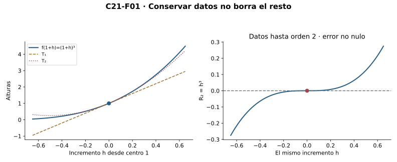
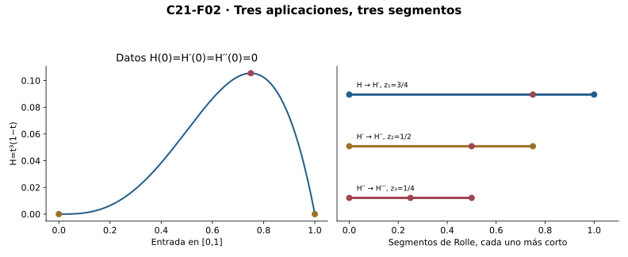
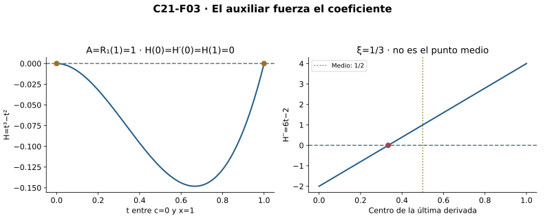
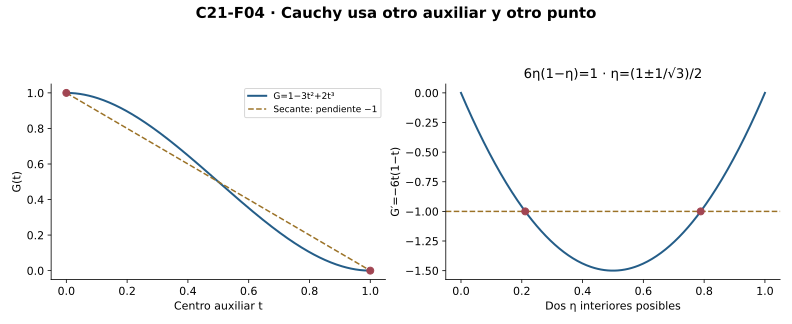
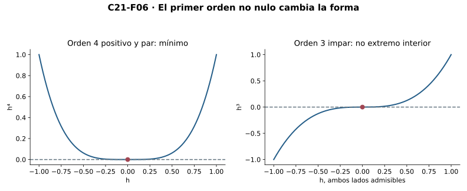

[Índice del libro](../para-matematicos/analisis-para-matematicos.html) · [Capítulo 21](analisis-para-matematicos-capitulo-21-taylor-modelos-locales-y-error.html) · [Ejercicios](analisis-para-matematicos-capitulo-21-taylor-modelos-locales-y-error-ejercicios.html) · [Soluciones](analisis-para-matematicos-capitulo-21-taylor-modelos-locales-y-error-soluciones.html) · [Soluciones de microcontroles](analisis-para-matematicos-capitulo-21-taylor-modelos-locales-y-error-microcontroles.html)

Una aproximación no queda certificada al escribir sus coeficientes. Este capítulo construye el polinomio central finito, demuestra lo que deja fuera y precisa cómo controlar ese resto. Se distinguen datos centrales, información en un segmento y cotas sobre una región completa.

C18 aporta diferenciabilidad y reglas; C19 Rolle, Lagrange y Cauchy; C20 bandas y alcance de convexidad. Inducción, sumas finitas, tipos, límites, continuidad y raíces son interfaces heredadas. No se usan integrales, sumas infinitas ni reglas nuevas para potencias reales generales. El polinomio vive en toda la recta, pero el error se evalúa sólo donde la función original existe.

## 21.1. Un polinomio para los datos de un centro

[]{#MA-SEC-ANM-01-021-001}

La recta de C18 conserva el valor y la primera derivada de una función en un centro. Si conocemos más derivadas, ¿qué polinomio conserva exactamente esos datos? Primero resolvamos este problema finito; todavía no afirmamos nada sobre el error fuera del centro.

Fijemos $n\ge0$ y un centro $c$. Escribimos $f^{(0)}=f$ y $f^{(k+1)}=(f^{(k)})'$ donde esas derivadas existen en el dominio indicado. El factorial se define por $0!=1$ y $(k+1)!=(k+1)k!$. Inducción demuestra su positividad. En fórmulas reales, $k!$ abrevia su copia real positiva mediante la incrustación de naturales; no identificamos silenciosamente los dos tipos. La potencia de exponente cero es la función constante1, también en el centro.

Busquemos $P(t)=\sum_{k=0}^n a_k(t-c)^k$. Las reglas de C18 para productos finitos dan, por inducción, que la derivada de orden $j$ del término de grado $k$ es cero si $j>k$, y es $k!/(k-j)!\,(t-c)^{k-j}$ si $j\le k$. Al evaluar en $c$, sólo sobrevive el término $k=j$. Por tanto

$$P^{(j)}(c)=j!a_j,\qquad 0\le j\le n.$$

Para imponer $P^{(j)}(c)=f^{(j)}(c)$ no hay elección libre: $a_j=f^{(j)}(c)/j!$. Queda determinado el **polinomio de Taylor de orden $n$**:

$$T_{n,c}f(t)=\sum_{k=0}^n\frac{f^{(k)}(c)}{k!}(t-c)^k.$$

Es el único polinomio de grado a lo sumo $n$ que reproduce todos esos datos en el centro. «Orden $n$» no significa grado exactamente $n$: el coeficiente superior puede ser cero. Para $n=0$ sólo retenemos el valor; para $n=1$ recuperamos la recta; para $n=2$ aparece $f''(c)(t-c)^2/2$. La definición usa datos finitos, no infinitas derivadas ni una suma infinita.

Si $f(t)=t^3$ y $c=1$, tenemos $f(c)=1$, $f'(c)=3$ y $f''(c)=6$. Así $T_{2,1}f(1+h)=1+3h+3h^2$. La identidad $(1+h)^3=1+3h+3h^2+h^3$ muestra en este caso un resto exacto $h^3$. No hemos probado todavía que todas las funciones tengan un resto semejante.

La igualdad de datos centrales tampoco determina toda una función. Para un $n$ fijo, los polinomios $P(t)$ y $P(t)+A(t-c)^{n+1}$ tienen los mismos valores derivados de órdenes0 a$n$ en $c$, para cualquier real $A$, pero difieren fuera del centro si $A\ne0$. La unicidad afirmada sólo afecta a polinomios de grado a lo sumo $n$.

{#fig-anm-c21-f01 fig-alt="El cubo centrado en1 tiene T₁=1+3h y T₂=1+3h+3h². El resto de orden2 es h³, no cero fuera del centro. Las identidades finitas prueban estos valores; la coincidencia central no determina una función completa."}

En el resto del capítulo escribiremos $R_{n,c}(x)=f(x)-T_{n,c}f(x)$. Es una función del dominio de $f$, mientras el polinomio está definido en toda $\mathbb R$. Cada comparación se hace en entradas donde la función original existe.

### Microcontroles

[]{#MA-MIC-ANM-01-021-001}

1. ¿Qué datos conserva el polinomio de Taylor de orden $n$?

[]{#MA-MIC-ANM-01-021-002}

2. ¿Cuál es el valor de $0!$ y por qué importa?

[]{#MA-MIC-ANM-01-021-003}

3. ¿Qué significa $k!$ cuando aparece en un cociente real?

[]{#MA-MIC-ANM-01-021-004}

4. ¿Qué coeficiente corresponde a la derivada de orden $j$?

[]{#MA-MIC-ANM-01-021-005}

5. ¿El orden $n$ obliga a grado exactamente $n$?

[]{#MA-MIC-ANM-01-021-006}

6. ¿Dónde está definido el polinomio y dónde el resto?

[]{#MA-MIC-ANM-01-021-007}

7. ¿Qué resto tiene $t^3$ a orden2 y centro1?

[]{#MA-MIC-ANM-01-021-008}

8. ¿Los datos centrales hasta orden $n$ determinan una función completa?

## 21.2. Rolle se repite sin perder sus hipótesis

[]{#MA-SEC-ANM-01-021-002}

Para convertir coincidencias de derivadas en una identidad del resto necesitamos una herramienta de C19 repetida un número finito de veces. Sea $x\ne c$ y $K=[\min(c,x),\max(c,x)]$. Supongamos que hay funciones $H_0,\ldots,H_n$ continuas en $K$, con $H_k'=H_{k+1}$ en su interior para $k<n$, y que $H_n$ también es derivable en el interior. Exijamos

$$H_k(c)=0\quad(0\le k\le n),\qquad H_0(x)=0.$$

No exigimos continuidad de $H_n'$ ni su existencia en los bordes.

Empezamos con $z_0=x$. Rolle aplicado a $H_0$ entre $c$ y $z_0$ da un $z_1$ estrictamente entre ambos con $H_0'(z_1)=0$. Si $n\ge1$, la identidad de la cadena dice $H_1(z_1)=0$; además $H_1(c)=0$. Ahora Rolle aplicado a $H_1$ entre $c$ y $z_1$ da $z_2$ estrictamente entre ambos. Repetimos.

El invariante del paso $k$ es $H_k(c)=H_k(z_k)=0$, con $z_k\ne c$; continuidad en el subsegmento y derivabilidad en su interior permiten obtener $z_{k+1}$ con $H_k'(z_{k+1})=0$. Para $k<n$ se convierte en $H_{k+1}(z_{k+1})=0$ y permite continuar. En el paso final obtenemos

$$H_n'(z_{n+1})=0,\qquad z_{n+1}\text{ estrictamente entre }c\text{ y }x.$$

Se han usado $n+1$ aplicaciones de Rolle, no $n$. El caso $n=0$ consiste en una sola. Si $x<c$, todos los segmentos se ordenan mediante mínimo y máximo; los nuevos puntos siguen acercándose a $c$ por el lado izquierdo. La derivada de una restricción interior coincide con la original, y cada subsegmento mantiene extremos distintos. Si $x=c$, no hay segmento no degenerado y no se afirma un punto intermedio.

Cuando una función $H$ tiene derivadas continuas hasta orden $n$ en ese segmento, tomamos $H_k=H^{(k)}$ y leemos la hipótesis como un cero central repetido, más otro cero en $x$. La continuidad de los primeros miembros es exactamente lo que permite cada Rolle; la derivada final no necesita ser continua.

Por ejemplo $H(t)=t^3(1-t)$, con $c=0$ y $x=1$, cumple $H(0)=H'(0)=H''(0)=0$ y $H(1)=0$. Una elección es $z_1=3/4$, $z_2=1/2$ y $z_3=1/4$: $H'(3/4)=0$, $H''(1/2)=0$ y $H'''(1/4)=0$. Cada nuevo punto queda dentro del segmento anterior. Estas coordenadas son particulares de este polinomio; el lema general sólo asegura existencia.

{#fig-anm-c21-f02 fig-alt="Para H=t³(1−t), con n=2, una cadena válida usa z₁=3/4, z₂=1/2 y z₃=1/4. Cada paso conserva un cero en el centro0 y obtiene el otro en el segmento anterior. Hay n+1=3 aplicaciones; los puntos exactos son particulares del ejemplo."}

No se supone una elección simultánea de puntos para todas las entradas o todos los órdenes. Para un $n$ y un $x$ fijados, una inducción finita construye las existencias necesarias. Tampoco se confunde el número de ceros de $H$ con el de sus derivadas: las igualdades centrales de cada miembro suministran un borde reutilizable en cada paso.

### Microcontroles

[]{#MA-MIC-ANM-01-021-009}

1. ¿Qué igualdades centrales se necesitan para Rolle repetido de orden $n$?

[]{#MA-MIC-ANM-01-021-010}

2. ¿Cuántas aplicaciones de Rolle produce la última derivada nula?

[]{#MA-MIC-ANM-01-021-011}

3. ¿Qué invariante permite continuar el paso $k$?

[]{#MA-MIC-ANM-01-021-012}

4. ¿Qué relación enlaza los miembros de la cadena?

[]{#MA-MIC-ANM-01-021-013}

5. ¿Se pide continuidad de la derivada final?

[]{#MA-MIC-ANM-01-021-014}

6. ¿Cómo se ordena el segmento si $x<c$?

[]{#MA-MIC-ANM-01-021-015}

7. ¿Qué punto intermedio se afirma si $x=c$?

[]{#MA-MIC-ANM-01-021-016}

8. ¿Se selecciona una familia infinita de testigos?

## 21.3. Forzar el resto: la fórmula de Lagrange

[]{#MA-SEC-ANM-01-021-003}

Tomemos una función $f$ derivable hasta orden $n+1$ en un intervalo abierto $J$, y un centro $c$ y una entrada $x$ de $J$. La existencia de cada derivada hasta orden $n+1$ hace continuas a las funciones $f,\ldots,f^{(n)}$ sobre cada segmento interior. No se supone continuidad de $f^{(n+1)}$.

Para $x=c$, $R_{n,c}(c)=0$ por construcción. Sea ahora $x\ne c$ y fijemos el coeficiente

$$A=\frac{R_{n,c}(x)}{(x-c)^{n+1}}.$$

El denominador es no nulo. El coeficiente depende de la entrada que acabamos de fijar; no representa un único valor válido para todas las entradas. Definamos en el segmento que une $c$ y $x$

$$H(t)=f(t)-T_{n,c}f(t)-A(t-c)^{n+1}.$$

La elección de $A$ fuerza $H(x)=0$. En el centro, la coincidencia de datos de Taylor y el exponente $n+1$ dan $H^{(k)}(c)=0$ para $0\le k\le n$. Los miembros hasta orden $n$ son continuos sobre el segmento y enlazan sus derivadas. El lema de Rolle repetido produce un $\xi$ estrictamente entre $c$ y $x$ con $H^{(n+1)}(\xi)=0$.

La derivada de orden $n+1$ del polinomio de Taylor es cero; la de $(t-c)^{n+1}$ es la constante $(n+1)!$. Entonces

$$0=f^{(n+1)}(\xi)-A(n+1)!.$$

Despejar $A$ y recuperar su definición demuestra la igualdad exacta

$$f(x)=T_{n,c}f(x)+\frac{f^{(n+1)}(\xi)}{(n+1)!}(x-c)^{n+1}.$$

Es Taylor finito con **resto de Lagrange**. Para $n=0$ recupera el valor medio de C19; para $n=1$ convierte la diferencia respecto de la tangente en una segunda derivada intermedia por $(x-c)^2/2$. El testigo puede depender de $f,n,c,x$ y no tiene por qué ser único o el punto medio. No se lo usa como una constante al variar esos datos.

La prueba también admite un contrato sobre un segmento cerrado: una cadena dada $f_0,\ldots,f_n$ continua incluyendo los bordes, con $f_k'=f_{k+1}$ en el interior, y $f_n'$ existente en todo el interior. El polinomio usa los valores $f_k(c)$ de esas extensiones continuas; la derivada final sólo se evalúa en $\xi$. No se presupone un operador de derivación en los bordes. Las identidades para $H_k$ y Rolle son las mismas. Este contrato incluye centros fronterizos y no pide la derivada final en el propio centro.

{#fig-anm-c21-f03 fig-alt="Para t³ en centro0, entrada1 y orden1, R=1 y A=1. El auxiliar H=t³−t² tiene los ceros centrales requeridos y otro en1. La derivada final H′′=6t−2 se anula en ξ=1/3 y devuelve R=f′′(ξ)/2=1."}

Para $f(t)=t^3$, centro1 y orden2, $f'''=6$ y el resto es $6h^3/3!=h^3$, coincidente con la expansión exacta de21.1. No hay un punto distinguido: todos los puntos interiores dan el mismo valor de tercera derivada. Para el cuadrado y orden1 ocurre lo mismo con la segunda derivada constante.

### Microcontroles

[]{#MA-MIC-ANM-01-021-017}

1. ¿Qué coeficiente fuerza la anulación del auxiliar en $x\ne c$?

[]{#MA-MIC-ANM-01-021-018}

2. ¿Qué función auxiliar se usa en la prueba de Lagrange?

[]{#MA-MIC-ANM-01-021-019}

3. ¿Por qué se anulan sus datos centrales hasta orden $n$?

[]{#MA-MIC-ANM-01-021-020}

4. ¿Qué igualdad deja el último Rolle?

[]{#MA-MIC-ANM-01-021-021}

5. ¿Qué posición tiene $\xi$?

[]{#MA-MIC-ANM-01-021-022}

6. ¿De qué datos puede depender el testigo?

[]{#MA-MIC-ANM-01-021-023}

7. ¿Es necesaria continuidad de $f^{(n+1)}$ para la prueba por Rolle?

[]{#MA-MIC-ANM-01-021-024}

8. ¿Qué se usa como dato central en el contrato cerrado?

## 21.4. Un punto desconocido, una cota verificable

[]{#MA-SEC-ANM-01-021-004}

La fórmula exacta contiene un punto desconocido. Para certificar error conviene eliminarlo mediante una cota que controle todas sus ubicaciones posibles. Bajo el contrato anterior, si $|f^{(n+1)}(t)|\le M$ en todo el interior del segmento, con $M\ge0$, obtenemos

$$|R_{n,c}(x)|\le\frac{M}{(n+1)!}|x-c|^{n+1}.$$

Para $x=c$ los dos lados son cero; para $x\ne c$ aplicamos la cota en un testigo suministrado por Lagrange. No hace falta que la derivada final alcance un máximo o sea continua. Si $M=0$, el resto es cero y no se divide por $M$.

Cuando la misma $M$ sirve en el interior de $[c-\rho,c+\rho]$, el mismo número $M\rho^{n+1}/(n+1)!$ acota todos los errores de ese segmento. El orden lógico es región, cota universal, entrada y testigo; tomar un máximo sobre puntos desconocidos sin justificarlo no resuelve el problema.

También hay una forma exacta de Cauchy. En el contrato abierto de21.3, fijemos $x$ y dejemos variar el centro auxiliar $t$:

$$G(t)=f(x)-\sum_{k=0}^n\frac{f^{(k)}(t)}{k!}(x-t)^k.$$

En el extremo $t=x$, el término de grado cero da $G(x)=0$; en $t=c$ tenemos $G(c)=R_{n,c}(x)$. Al derivar, la parte que deriva $f^{(k)}$ cancela con la que deriva la potencia del término siguiente. Los dos sumatorios finitos dejan

$$G'(t)=-\frac{f^{(n+1)}(t)}{n!}(x-t)^n.$$

Esta cancelación puede comprobarse término a término; para $n=0$ sólo hay $G'=-f'$. Lagrange aplicado a $G$ en el segmento, o Cauchy de C19 con la segunda función $t$, produce un $\eta$ estrictamente interior con

$$R_{n,c}(x)=\frac{f^{(n+1)}(\eta)}{n!}(x-\eta)^n(x-c).$$

El signo procede de $G(x)-G(c)=-R_{n,c}(x)$ y del signo negativo de $G'$. Para $n=0$ la potencia vale1, sin un cociente nulo. Como $|x-\eta|\le|x-c|$, una cota absoluta da $|R|\le M|x-c|^{n+1}/n!$. Es válida aunque, con una cota constante, suele ser menos ajustada que Lagrange. Las dos formas pueden tener testigos diferentes.

Si $m\le f^{(n+1)}\le M$, el coeficiente $R/(x-c)^{n+1}$ de Lagrange está entre $m/(n+1)!$ y $M/(n+1)!$. Para transformarlo en una banda del resto hay que atender al signo de $(x-c)^{n+1}$. Si es negativo, el orden de las cotas se invierte. Una cota absoluta evita este cambio; una banda firmada conserva información direccional.

{#fig-anm-c21-f04 fig-alt="Con f=t³, c=0, x=1 y n=1, G=1−3t²+2t³ y G′=−6t(1−t). La secante de G tiene pendiente−1 y dos testigos η=(1±1/√3)/2. Ambos dan R=6η(1−η)=1, distintos del ξ=1/3 de Lagrange."}

Con $n=1$, el exponente2 siempre es no negativo y recuperamos las bandas cuadráticas de C20. Si $n=2$ y $f'''$ es positiva, el resto es positivo a la derecha del centro y negativo a su izquierda. «Error pequeño» y «error de signo conocido» son conclusiones diferentes.

### Microcontroles

[]{#MA-MIC-ANM-01-021-025}

1. ¿Qué cota elimina el testigo de Lagrange?

[]{#MA-MIC-ANM-01-021-026}

2. ¿Qué hacer si $M=0$?

[]{#MA-MIC-ANM-01-021-027}

3. ¿Qué número controla todos los errores si $|x-c|\le\rho$?

[]{#MA-MIC-ANM-01-021-028}

4. ¿Qué función permite derivar telescópicamente la forma de Cauchy?

[]{#MA-MIC-ANM-01-021-029}

5. ¿Cuál es su derivada después de cancelar términos?

[]{#MA-MIC-ANM-01-021-030}

6. ¿Qué forma tiene el resto de Cauchy?

[]{#MA-MIC-ANM-01-021-031}

7. ¿Los testigos de Lagrange y Cauchy tienen que coincidir?

[]{#MA-MIC-ANM-01-021-032}

8. ¿Qué ocurre al multiplicar la banda de coeficientes por un incremento elevado negativo?

## 21.5. Peano: lo que desaparece al cambiar de escala

[]{#MA-SEC-ANM-01-021-005}

La cota anterior gasta una derivada adicional. Existe una conclusión local bajo menos información: para $n\ge1$, si $f$ tiene derivadas hasta orden $n-1$ en un intervalo abierto alrededor de $c$, y la función $f^{(n-1)}$ es derivable en $c$, entonces

$$R_{n,c}(c+h)=o(|h|^n)\qquad(h\to0).$$

Para $n=1$ la hipótesis significa solamente que $f$ es derivable en $c$; no pide derivabilidad en otros centros. Para $n\ge2$ las derivadas inferiores existen en un entorno, pero la de orden $n$ se exige sólo en el centro. El símbolo $o$ abrevia la condición: para cada $\varepsilon>0$ existe $\delta>0$ tal que

$$0<|h|<\delta\ \Longrightarrow\ |R_{n,c}(c+h)|<\varepsilon|h|^n.$$

El radio se mantiene dentro del dominio. La forma de **Peano** dice que el error normalizado desaparece; no suministra por sí sola una constante para $|h|^{n+1}$ ni un radio numérico calculable.

Demostremos por inducción. Para $n=1$ es exactamente la definición de derivada en $c$, multiplicada por $|h|$. Para el paso $n\ge2$, pongamos $H=f-T_{n,c}f$. El polinomio conserva todos los datos centrales, por lo que $H^{(k)}(c)=0$ para $0\le k\le n$. Aplicamos la hipótesis inductiva a $H'$ con orden $n-1$: su polinomio central es cero y

$$H'(c+u)=o(|u|^{n-1}).$$

Fijada $\varepsilon>0$, elegimos un radio donde $|H'(c+u)|<n\varepsilon|u|^{n-1}$ para toda entrada perforada. Para $0<|h|$ dentro de ese radio, Cauchy de C19 entre $c$ y $c+h$, con funciones $H(t)$ y $(t-c)^n$, da un $\xi$ interior:

$$\frac{H(c+h)}{h^n}=
\frac{H'(\xi)}{n(\xi-c)^{n-1}}.$$

Ambas funciones son continuas en el segmento y derivables en su interior: para $n\ge2$ se dispone de $H'$ en el entorno. El denominador de la derivada no es cero porque $\xi\ne c$. El incremento de la potencia es $h^n\ne0$. La cota inductiva en $\xi$ hace que el valor absoluto del cociente sea menor que $\varepsilon$. Así termina la inducción sin derivada de orden $n+1$ ni continuidad supuesta de la derivada de orden $n$ en un entorno.

Para $n=0$, la afirmación $f(c+h)-f(c)=o(1)$ es continuidad en $c$ y se trata separadamente. Tampoco se deriva un resto pequeño: de $r(h)=o(|h|^n)$ no se puede inferir una fórmula para $r'(h)$ sin hipótesis adicionales.

Un ejemplo distingue órdenes. Sea $f(h)=h^2\sqrt{|h|}$. En cero, $f'(0)=f''(0)=0$; fuera de cero, $f'(h)=(5/2)\operatorname{sgn}(h)|h|^{3/2}$ y $f''(h)=(15/4)\sqrt{|h|}$. Estas fórmulas se obtienen por producto y derivada de raíz en cada lado; los cocientes centrales verifican los dos valores nulos. Su polinomio de orden2 es cero y

$$\frac{f(h)}{|h|^2}=\sqrt{|h|}\to0,\qquad
\frac{f(h)}{|h|^3}=\frac1{\sqrt{|h|}}.$$

El segundo cociente es no acotado cerca de cero. Hay resto de Peano de orden2, pero no una cota $C|h|^3$ con constante finita en un radio. La derivada tercera fuera de cero es no acotada; que existan testigos de Lagrange en segmentos unilaterales no crea una cota uniforme.

{#fig-anm-c21-f05 fig-alt="Para R=h²√|h|, el cociente por |h|² es √|h| y tiende a cero, mientras el cociente por |h|³ es1/√|h| y no está acotado cerca de cero. Se representan distancias positivas con escala logarítmica y se excluye la entrada0. Las identidades y radios, no el dibujo, prueban ambos comportamientos."}

La escala correcta es parte del enunciado: un error que tiende a cero en valor absoluto puede seguir siendo enorme al dividirlo por $|h|^n$. El zoom muestra una regla normalizada ya demostrada y no sustituye el radio que controla todas las entradas.

### Microcontroles

[]{#MA-MIC-ANM-01-021-033}

1. ¿Qué significa $R(c+h)=o(|h|^n)$?

[]{#MA-MIC-ANM-01-021-034}

2. ¿Qué caso de Peano corresponde a$n=1$?

[]{#MA-MIC-ANM-01-021-035}

3. ¿Dónde se exige la derivada de orden$n$ en el contrato de Peano?

[]{#MA-MIC-ANM-01-021-036}

4. ¿Qué herramienta recupera$H$ desde una cota para$H\prime$ en la inducción?

[]{#MA-MIC-ANM-01-021-037}

5. ¿Peano proporciona una constante para$|h|^{n+1}$?

[]{#MA-MIC-ANM-01-021-038}

6. ¿Qué cociente tiende a cero para$h^2\sqrt{|h|}$ a orden2?

[]{#MA-MIC-ANM-01-021-039}

7. ¿Por qué ese ejemplo no tiene una cota$C|h|^3$ en un radio?

[]{#MA-MIC-ANM-01-021-040}

8. ¿Puede derivarse un símbolo$o$ sin hipótesis adicionales?

## 21.6. La primera derivada que no se anula

[]{#MA-SEC-ANM-01-021-006}

Taylor local puede decidir la forma de una función cerca de un centro, incluso cuando las primeras pendientes no distinguen el caso. Supongamos las hipótesis de Peano de orden $m\ge1$, que $f^{(k)}(c)=0$ para $1\le k<m$, y que $f^{(m)}(c)\ne0$. Con $a=f^{(m)}(c)/m!$,

$$f(c+h)-f(c)=ah^m+r(h),\qquad r(h)=o(|h|^m).$$

Elegimos un radio donde $|r(h)|<(|a|/2)|h|^m$. Para entradas no nulas dentro de él, el término principal domina: el error no puede cambiar su signo. Si $m$ es par, $h^m=|h|^m$ en ambos lados. Con $a>0$ hay un mínimo local estricto; con $a<0$, un máximo local estricto. Si $m$ es impar, el término principal cambia de signo al cambiar el lado y por ello no hay extremo local. Se requieren entradas por ambos lados; el criterio se afirma en un centro interior.

Este argumento incluye el criterio de segunda derivada en un punto estacionario, pero no necesita que $f''$ sea continua en un entorno. También explica $x^4$ y $x^3$ en cero: el primer orden no nulo es4, positivo y par en el primer caso;3, positivo e impar en el segundo. Las funciones tienen derivada primera nula en cero, pero comportamientos distintos.

Si todos los datos hasta orden $n$ se anulan, el criterio guarda silencio. Los polinomios $h^{2(n+1)}$, $-h^{2(n+1)}$ y $h^{2(n+1)+1}$ tienen los mismos datos hasta ese orden, incluidos el valor cero, y respectivamente presentan mínimo, máximo y ausencia de extremo en cero. No se dice que sus primeras derivadas no nulas sean las mismas: precisamente esa información está fuera del paquete de datos fijado.

La conclusión es local, no global. $q(h)=h^2-h^4$ tiene un mínimo local estricto en cero por el primer término no nulo positivo de orden2. Pero $q(2)=-12<q(0)=0$, de modo que cero no es un mínimo global. C20 podía pasar de pendiente cero a mínimo global porque añadía convexidad en todo el intervalo. No intercambiamos esa hipótesis con un desarrollo central.

Para un error de signo conocido también importa la paridad. Si $f^{(n+1)}$ tiene signo positivo en todo el segmento y no es cero en el testigo, el resto de Lagrange tiene el signo de $(x-c)^{n+1}$. En cambio Peano no ofrece un signo del resto; permite controlar su tamaño relativo frente a un término principal no nulo.

{#fig-anm-c21-f06 fig-alt="En cero, h⁴ tiene primer coeficiente no nulo positivo de orden4 y mínimo estricto; h³ lo tiene de orden3 y cambia de signo. El criterio usa un radio donde el resto no supera la mitad del término principal y exige un centro interior con ambos lados."}

Cuando el centro es borde, sólo hay un lado admisible y el caso impar puede comportarse como un extremo relativo. La función $x$ en $[0,1]$ tiene mínimo en cero. Antes de aplicar un criterio de paridad hay que fijar el dominio y sus entradas admisibles.

### Microcontroles

[]{#MA-MIC-ANM-01-021-041}

1. ¿Qué término decide el criterio de la primera derivada no nula?

[]{#MA-MIC-ANM-01-021-042}

2. ¿Qué tolerancia evita que el resto cambie el signo principal?

[]{#MA-MIC-ANM-01-021-043}

3. ¿Qué da un primer orden no nulo par con coeficiente positivo?

[]{#MA-MIC-ANM-01-021-044}

4. ¿Qué da un primer orden no nulo impar?

[]{#MA-MIC-ANM-01-021-045}

5. ¿Qué concluye el criterio si todas las derivadas disponibles son cero?

[]{#MA-MIC-ANM-01-021-046}

6. ¿Un mínimo local de Taylor es automáticamente global?

[]{#MA-MIC-ANM-01-021-047}

7. ¿Qué cambia al aplicar paridad en una frontera?

[]{#MA-MIC-ANM-01-021-048}

8. ¿Peano determina por sí solo el signo del resto?

## 21.7. Aproximantes con certificados racionales

[]{#MA-SEC-ANM-01-021-007}

Un número escrito en un aproximante no es todavía un certificado. Debemos identificar el dominio de todas las derivadas usadas y una cota válida en el segmento completo.

Primero tomemos $f(h)=1/(1-h)$ para $h<1$, centro0. Inducción con la regla del cociente da $f^{(k)}(h)=k!/(1-h)^{k+1}$ y por ello $T_{n,0}f(h)=\sum_{k=0}^n h^k$. La identidad geométrica finita proporciona un resto más preciso que un testigo:

$$(1-h)\sum_{k=0}^n h^k=1-h^{n+1},\qquad
R_{n,0}(h)=\frac{h^{n+1}}{1-h}.$$

Es una identidad de sumas finitas; no se ha usado una serie. En $|h|\le\rho<1$, $1-h\ge1-\rho>0$ y por tanto $|R|\le\rho^{n+1}/(1-\rho)$. La distancia a la singularidad es parte de la cota. No vale cruzar $h=1$ ni omitir ese margen.

Para una raíz, sea $g(h)=\sqrt{1+h}$, $h>-1$. C18 da

$$g'(h)=\frac1{2\sqrt{1+h}},\quad
g''(h)=-\frac1{4(1+h)^{3/2}},\quad
g'''(h)=\frac3{8(1+h)^{5/2}}.$$

Aquí $(1+h)^{3/2}$ y $(1+h)^{5/2}$ abrevian productos de potencias enteras por la raíz positiva; las fórmulas proceden de producto, cociente y cadena, no de una regla nueva para exponentes reales. En cero, el aproximante de orden2 es

$$T_{2,0}g(h)=1+\frac h2-\frac{h^2}8.$$

Para $|h|\le1/4$, $1+h\ge3/4$ y $\sqrt{1+h}\ge3/4$: la raíz de un número al menos3/4 es al menos3/4 por comparación de cuadrados y positividad. Así

$$0<g'''(h)\le\frac3{8(3/4)^2(3/4)}=\frac89.$$

Lagrange da $|R_2(h)|\le(4/27)|h|^3$. En $h=1/4$, el resto es positivo y

$$\frac{143}{128}<\sqrt{\frac54}\le\frac{143}{128}+\frac1{432}.$$

El primer número es el polinomio evaluado; la cantidad1/432 es un límite superior de error, no una cifra estimada desde una gráfica. La positividad estricta de la tercera derivada y $h>0$ justifican el extremo inferior abierto.

Podemos cotejar el certificado con un mecanismo algebraico independiente. La diferencia de cuadrados es $5/4-(143/128)^2=31/16384>0$. Racionalizar da

$$\sqrt{\frac54}-\frac{143}{128}
=\frac{31}{16384\left(\sqrt{5/4}+143/128\right)}
\le\frac{31}{34688}.$$

La última cota usa $\sqrt{5/4}\ge1$, así el denominador es al menos $16384(271/128)=34688$. Es más ajustada que1/432. La comparación no invalida Taylor: dos mecanismos pueden certificar la misma cantidad con eficiencias distintas.

{#fig-anm-c21-f07 fig-alt="Para la raíz, T₂=1+h/2−h²/8 y en |h|≤1/4 vale |R₂|≤(4/27)|h|³. En h=1/4 el aproximante143/128 es inferior a √(5/4); Taylor acota su error por1/432 y racionalización por31/34688. Los extremos izquierdos abiertos indican error estrictamente positivo; no se infiere una coordenada de raíz desde la figura."}

Ni el polinomio central ni unas pocas muestras detectan por sí solos el margen de dominio o el valor máximo posible de una derivada. El certificado reúne aproximante, región, hipótesis y cota; conserva el error como parte de la respuesta.

### Microcontroles

[]{#MA-MIC-ANM-01-021-049}

1. ¿Qué polinomio central tiene$1/(1-h)$ a orden$n$?

[]{#MA-MIC-ANM-01-021-050}

2. ¿Cuál es su resto exacto finito?

[]{#MA-MIC-ANM-01-021-051}

3. ¿Qué margen protege el denominador en$|h|\le\rho<1$?

[]{#MA-MIC-ANM-01-021-052}

4. ¿Qué polinomio de orden2 aproxima$\sqrt{1+h}$ en cero?

[]{#MA-MIC-ANM-01-021-053}

5. ¿Qué cota racional de tercera derivada sirve en$|h|\le1/4$?

[]{#MA-MIC-ANM-01-021-054}

6. ¿Qué certificado da Taylor para$\sqrt{5/4}$?

[]{#MA-MIC-ANM-01-021-055}

7. ¿Qué diferencia de cuadrados permite un cotejo independiente?

[]{#MA-MIC-ANM-01-021-056}

8. ¿Una muestra de derivada basta para certificar el error?

## 21.8. Combinar modelos y elegir la resolución

[]{#MA-SEC-ANM-01-021-008}

Los modelos locales también pueden combinarse. Para un $n\ge1$ fijo y centro0, supongamos $f(h)=P(h)+u(h)$ y $g(h)=Q(h)+v(h)$, con polinomios de grado a lo sumo$n$ y $u,v=o(|h|^n)$. La suma tiene modelo $P+Q$ porque la triangular suma los dos errores normalizados.

Para el producto,

$$fg=PQ+Pv+Qu+uv.$$

Los polinomios son acotados en un radio por continuidad en cero. Dividir $Pv$ y $Qu$ por $|h|^n$ deja un factor acotado por otro que tiende a cero. Además $v(h)\to0$, y $|uv|/|h|^n=(|u|/|h|^n)|v|\to0$. Por tanto el error del producto respecto de $PQ$ es $o(|h|^n)$. Si $PQ$ tiene términos de grado mayor que$n$, los eliminamos: su suma finita es $h^{n+1}$ por otro polinomio, y al normalizar por $|h|^n$ tiende a cero. La parte truncada es un modelo del mismo orden, sin derivar el resto.

La sustitución exige conservar dominio y escala. Por ejemplo

$$F(h)=\frac1{1-h-h^2}.$$

En $|h|\le1/4$, el denominador es al menos $1-1/4-1/16=11/16>0$. Un cálculo exacto da

$$(1+h+2h^2)(1-h-h^2)=1-3h^3-2h^4,$$

y así

$$F(h)=1+h+2h^2+\frac{3h^3+2h^4}{1-h-h^2}.$$

El resto queda acotado por $(56/11)|h|^3$ en ese segmento. Además $F(0)=1$, $F'(0)=1$ y $F''(0)=4$, por cociente y cadena, de modo que el polinomio mostrado es realmente su Taylor de orden2. Sustituir una expresión en un modelo sin comprobar denominadores podría haber perdido precisamente esta garantía.

Para elegir un grado no basta pensar «más términos, menos error». Se fija primero una región y una tolerancia, y se prueba una cota en función del grado. Para $1/(1-h)$ en $|h|\le1/4$,21.7 da

$$|R_n(h)|\le\frac{(1/4)^{n+1}}{3/4}=\frac1{3\cdot4^n}.$$

El orden4 produce1/768, mayor que1/1000; el orden5 produce1/3072, menor. Esta cota uniforme certifica el objetivo1/1000 con orden5. Es además el menor orden que funciona con esta cota: los números decrecen al multiplicar por1/4, y en $h=1/4$ la igualdad del resto hace fallar cada orden hasta4. En esa entrada el polinomio de orden5 vale1365/1024 y su error frente a4/3 es exactamente1/3072.

{#fig-anm-c21-f08 fig-alt="Para1/(1−h) en |h|≤1/4, el resto finito da cota1/(3·4ⁿ). El orden4 falla la tolerancia1/1000 porque en1/4 su error es1/768; orden5 la satisface con1/3072, que se alcanza allí. El panel izquierdo representa ocho grados finitos y no afirma una expansión infinita."}

Cambiar el centro también cambia todos los datos. Para una función polinómica conocida se puede reexpandir exactamente; para una función general no se trasladan los coeficientes centrales sin nueva información o un control del error de traslado. Aquí cada expansión conserva su centro declarado.

Finalmente, un paquete finito de derivadas y de valores muestreados no impone una función completa ni un error universal fuera de la región certificada. Si $h_1,\ldots,h_m$ son muestras no nulas y $P$ un modelo central de orden$n$, los polinomios

$$P(h)+A\,h^{n+1}\prod_{j=1}^m(h-h_j)^2$$

conservan los datos centrales hasta orden$n$ y los valores en todas las muestras. En otra entrada no nula distinta de ellas, el factor multiplicador es no cero y variar $A$ permite modificar el valor arbitrariamente. El producto vacío, si no hay muestras, vale1. Esta construcción finita muestra el límite de la información disponible.

El radio que se reduce para un orden fijo y el grado que aumenta en una región fija son controles distintos. Este capítulo demuestra polinomios finitos, residuos y certificados; no declara que una expansión infinita represente a una función. La teoría de sumas infinitas necesitará sus propias condiciones y su propia justificación del resto.

### Microcontroles

[]{#MA-MIC-ANM-01-021-057}

1. ¿Qué errores aparecen al multiplicar$P+u$ por$Q+v$?

[]{#MA-MIC-ANM-01-021-058}

2. ¿Por qué un polinomio de términos de grado mayor que$n$ es$o(|h|^n)$?

[]{#MA-MIC-ANM-01-021-059}

3. ¿Qué margen tiene$1-h-h^2$ en$|h|\le1/4$?

[]{#MA-MIC-ANM-01-021-060}

4. ¿Qué Taylor de orden2 tiene$1/(1-h-h^2)$ en cero?

[]{#MA-MIC-ANM-01-021-061}

5. ¿Qué orden certifica error menor que$1/1000$ para$1/(1-h)$ en$|h|\le1/4$?

[]{#MA-MIC-ANM-01-021-062}

6. ¿Qué dos procesos no deben confundirse?

[]{#MA-MIC-ANM-01-021-063}

7. ¿Cómo preservar datos centrales y un número finito de muestras mientras se cambia otra salida?

[]{#MA-MIC-ANM-01-021-064}

8. ¿Qué representación infinita se ha probado en este capítulo?

[Índice del libro](../para-matematicos/analisis-para-matematicos.html) · [Capítulo 21](analisis-para-matematicos-capitulo-21-taylor-modelos-locales-y-error.html) · [Ejercicios](analisis-para-matematicos-capitulo-21-taylor-modelos-locales-y-error-ejercicios.html) · [Soluciones](analisis-para-matematicos-capitulo-21-taylor-modelos-locales-y-error-soluciones.html) · [Soluciones de microcontroles](analisis-para-matematicos-capitulo-21-taylor-modelos-locales-y-error-microcontroles.html)

[← Capítulo 20](analisis-para-matematicos-capitulo-20-convexidad-y-control-por-tangentes-y-secantes.html) · [Capítulo 22 →](analisis-para-matematicos-capitulo-22-partir-refinar-acumular.html)
