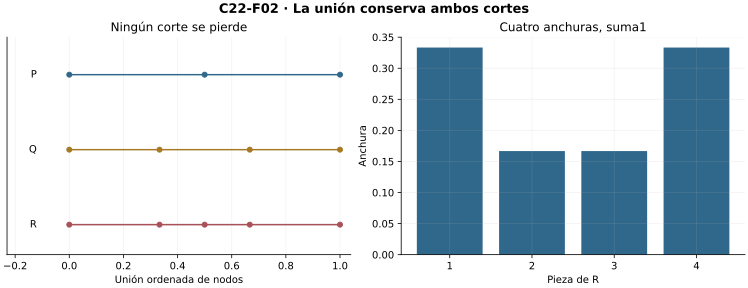
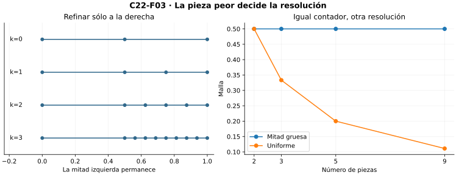
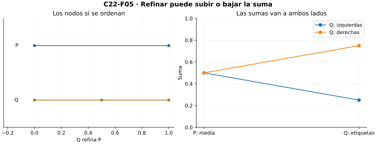
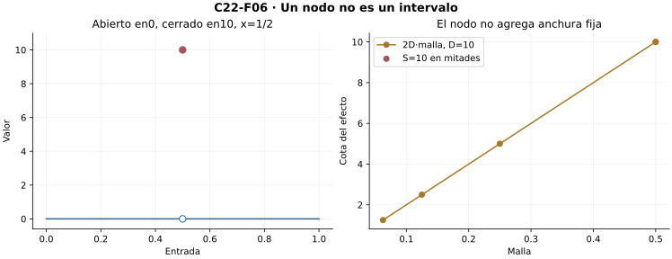

[Índice del libro](../para-matematicos/analisis-para-matematicos.html) · [Capítulo 22](analisis-para-matematicos-capitulo-22-partir-refinar-acumular.html) · [Ejercicios](analisis-para-matematicos-capitulo-22-partir-refinar-acumular-ejercicios.html) · [Soluciones](analisis-para-matematicos-capitulo-22-partir-refinar-acumular-soluciones.html) · [Soluciones de microcontroles](analisis-para-matematicos-capitulo-22-partir-refinar-acumular-microcontroles.html)

La integral elemental sugiere acumular alturas sobre anchuras. Aquí construimos los datos finitos y el control que permitirán convertir esa intuición en un número estable. Separamos cortes, resolución y elecciones de etiquetas; ninguna figura ni antiderivada proporciona por sí sola el límite.

C01–C03 aportan naturales, orden real y arquimedianidad; funciones, inducción y sumas finitas son interfaces heredadas. La integral elemental externa motiva y no se usa para demostrar. C23 reserva Darboux y sus equivalencias; C24 el teorema fundamental.

## 22.1. Un intervalo convertido en datos finitos

[]{#MA-SEC-ANM-01-022-001}

Fijemos reales $a<b$. Una partición es una lista finita estrictamente creciente

$$P=(x_0,\ldots,x_n),\qquad a=x_0<x_1<\cdots<x_n=b,\quad n\ge1.$$

La lista representa una función tipada del segmento natural $\{0,\ldots,n\}$ a $[a,b]$, junto con su longitud. El índice es natural, el nodo y la anchura son reales. La colección de tales objetos es un conjunto: sus grafos viven en el conjunto potencia de $\mathbb N\times[a,b]$; separar los grafos tipados y las listas que cumplen las condiciones da las particiones. Es no vacía porque $(a,b)$ es una partición.

Para $1\le i\le n$, llamamos $I_i=[x_{i-1},x_i]$ y $\Delta_i=x_i-x_{i-1}>0$. La inducción que añade una diferencia al final prueba la telescopía

$$\sum_{i=1}^n\Delta_i=b-a.$$

En el paso, $(x_n-a)+(x_{n+1}-x_n)=x_{n+1}-a$; no hay suma infinita. Además, estos intervalos cubren $[a,b]$. Si $t<b$, el menor índice $j$ con $t<x_j$ existe en un conjunto natural finito no vacío; entonces $x_{j-1}\le t<x_j$. Si $t=b$, usamos el último intervalo. Dos interiores distintos son disjuntos; intervalos consecutivos comparten un nodo. No llamamos disjuntos a los intervalos cerrados.

Para una representación como piezas disjuntas se puede usar $[a,x_1]$ y $(x_{i-1},x_i]$ para $i\ge2$. Más adelante distinguiremos el reparto de nodos de la longitud de las piezas. En $[0,1]$, la lista $(0,1/4,1)$ tiene anchuras $1/4,3/4$, no dos partes iguales.

La longitud $b-a$ es un dato algebraico demostrado. Un dibujo de rectángulos ayuda a reconocerla, pero aquí no presupone una noción de área para regiones curvas. Los intervalos degenerados y la orientación inversa quedan fuera de este contrato inicial.

![En \[0,1\], P=(0,1/4,1) tiene anchuras1/4 y3/4, suma1. Los cerrados vecinos comparten1/4; sus interiores son disjuntos.](../../assets/books/anm/C22/C22-F01.svg){#fig-anm-c22-f01 fig-alt="En \[0,1\], P=(0,1/4,1) tiene anchuras1/4 y3/4, suma1. Los cerrados vecinos comparten1/4; sus interiores son disjuntos."}

### Microcontroles

[]{#MA-MIC-ANM-01-022-001}

1. ¿Qué datos exige una partición de $[a,b]$?

[]{#MA-MIC-ANM-01-022-002}

2. ¿Son reales los índices?

[]{#MA-MIC-ANM-01-022-003}

3. ¿Por qué una anchura es positiva?

[]{#MA-MIC-ANM-01-022-004}

4. ¿Cuánto suman las anchuras?

[]{#MA-MIC-ANM-01-022-005}

5. ¿Son disjuntos los intervalos cerrados vecinos?

[]{#MA-MIC-ANM-01-022-006}

6. ¿Cómo se localiza una entrada $t<b$?

[]{#MA-MIC-ANM-01-022-007}

7. ¿Cuáles son las anchuras de $(0,1/4,1)$?

[]{#MA-MIC-ANM-01-022-008}

8. ¿Admite el contrato inicial $a=b$?

## 22.2. Refinar conservando los cortes

[]{#MA-SEC-ANM-01-022-002}

Escribimos $V(P)=\{x_0,\ldots,x_n\}$. La relación $P\preceq Q$ significa $V(P)\subseteq V(Q)$: el miembro derecho conserva todos los cortes antiguos. Admitimos igualdad; un refinamiento propio exige inclusión propia. Reflexividad y transitividad vienen de inclusión. Si hay inclusión en ambas direcciones, las listas estrictamente ordenadas del mismo conjunto finito coinciden: su primer nodo es el mínimo y se repite este argumento en el conjunto restante. Así tenemos antisimetría.

Para insertar $t\in(a,b)\setminus V(P)$, tomamos el menor $j$ con $t<x_j$. La minimalidad y $t\ne x_{j-1}$ dan $x_{j-1}<t<x_j$. La nueva lista copia los nodos anteriores a $j$, coloca $t$ en $j$ y desplaza una posición los demás. Sus únicas nuevas comparaciones son $x_{j-1}<t<x_j$; conserva extremos y es estricta. Divide una anchura en dos cuya suma es la antigua:

$$(t-x_{j-1})+(x_j-t)=x_j-x_{j-1}.$$

Insertar un nodo ya presente no modifica la lista. Repetir un nodo produciría una anchura cero y violaría la definición.

Para dos particiones $P,Q$, recorramos la lista de $Q$: conservamos cada nodo que ya aparece e insertamos cada otro por el procedimiento anterior. Una inducción finita construye $R$ con $V(R)=V(P)\cup V(Q)$. Entonces $P\preceq R$, $Q\preceq R$ y, si $S$ refina a ambas, la unión de nodos está contenida en $V(S)$: $R\preceq S$. Es el menor refinamiento común, no una elección de una familia infinita.

Por ejemplo, $(0,1/2,1)$ y $(0,1/3,2/3,1)$ tienen refinamiento común $(0,1/3,1/2,2/3,1)$. Sus cuatro anchuras son $1/3,1/6,1/6,1/3$. Refinar no quiere decir desplazar los cortes a posiciones aparentemente más regulares: reemplazar $1/2$ por $1/3$ pierde un nodo.

{#fig-anm-c22-f02 fig-alt="P=(0,1/2,1) y Q=(0,1/3,2/3,1) se conservan en R=(0,1/3,1/2,2/3,1). Las anchuras de R son1/3,1/6,1/6,1/3."}

### Microcontroles

[]{#MA-MIC-ANM-01-022-009}

1. ¿Qué significa $P\preceq Q$?

[]{#MA-MIC-ANM-01-022-010}

2. ¿Es una partición refinamiento de sí misma?

[]{#MA-MIC-ANM-01-022-011}

3. ¿Por qué la relación es transitiva?

[]{#MA-MIC-ANM-01-022-012}

4. ¿Dónde se inserta un punto nuevo $t$?

[]{#MA-MIC-ANM-01-022-013}

5. ¿Qué sucede si el punto ya era nodo?

[]{#MA-MIC-ANM-01-022-014}

6. ¿Cuántas piezas añade una inserción propia?

[]{#MA-MIC-ANM-01-022-015}

7. ¿Qué nodos tiene el menor refinamiento común?

[]{#MA-MIC-ANM-01-022-016}

8. ¿Reemplazar $1/2$ por $1/3$ es refinar?

## 22.3. La malla mide el peor intervalo

[]{#MA-SEC-ANM-01-022-003}

La **malla** es el máximo finito de las anchuras positivas:

$$\|P\|=\max_{1\le i\le n}\Delta_i.$$

Ese máximo existe por inducción finita: comparar el siguiente real con el máximo anterior. Se cumplen $0<\|P\|\le b-a$ y $b-a\le n\|P\|$, donde $n$ en la última expresión significa su copia real. Por tanto $\|P\|\ge(b-a)/n$.

Si $P\preceq Q$, cada pieza de $Q$ queda dentro de alguna pieza de $P$. Para verlo, localizamos su extremo izquierdo en los nodos de $P$; no puede atravesar un nodo antiguo en su interior, porque ese nodo también es de $Q$ y sus extremos son consecutivos. Su anchura es menor o igual que la antigua. Al tomar máximos, $\|Q\|\le\|P\|$. Una inserción propia puede conservar la malla si deja sin dividir una pieza máxima.

La partición uniforme $U_n$ tiene nodos $a+(b-a)i/n$ y malla $(b-a)/n$. Positividad de $n$ permite dividir; la arquimedianidad de C03 da, para $\delta>0$, un natural $n>(b-a)/\delta$, por lo que $\|U_n\|<\delta$. Hay siempre particiones suficientemente finas. Si necesitamos además conservar una partición dada, el refinamiento común con $U_n$ tiene malla menor que $\delta$.

Contar intervalos no basta. En $[0,1]$ podemos conservar $[0,1/2]$ y dividir $[1/2,1]$ en $m$ piezas iguales. Hay $m+1$ piezas, pero la malla es siempre $1/2$. Repetir este refinamiento con $m=2^k$ da una cadena anidada cuyo número de piezas crece sin que la malla tienda a cero. La resolución requerida es global sobre todas las piezas, no sólo sobre la región donde se añadieron cortes.

{#fig-anm-c22-f03 fig-alt="Dividir sólo la mitad derecha produce2^k+1 piezas y malla fija1/2. La uniforme de n piezas tiene malla1/n. Contar no controla la pieza mayor."}

### Microcontroles

[]{#MA-MIC-ANM-01-022-017}

1. ¿Qué mide la malla?

[]{#MA-MIC-ANM-01-022-018}

2. ¿Por qué existe ese máximo?

[]{#MA-MIC-ANM-01-022-019}

3. ¿Qué pasa con la malla al refinar?

[]{#MA-MIC-ANM-01-022-020}

4. ¿Un refinamiento propio reduce estrictamente la malla?

[]{#MA-MIC-ANM-01-022-021}

5. ¿Cuál es la malla uniforme de $n$ piezas?

[]{#MA-MIC-ANM-01-022-022}

6. ¿Cómo se logra malla menor que $\delta$?

[]{#MA-MIC-ANM-01-022-023}

7. ¿Por qué muchas piezas no bastan?

[]{#MA-MIC-ANM-01-022-024}

8. ¿Cómo se conserva una partición dada y se reduce su malla?

## 22.4. Etiquetas y acumulación firmada

[]{#MA-SEC-ANM-01-022-004}

Una partición etiquetada es $(P,\xi)$, con un dato real $\xi_i\in[x_{i-1},x_i]$ por cada pieza. La familia de etiquetas es una función de índices, no un conjunto que olvide cuál corresponde a cada pieza. Un nodo compartido puede etiquetar las dos piezas vecinas; no hay prohibición de repetir etiquetas. Existen etiquetas explícitas: extremos izquierdos, derechos o puntos medios.

Para $f:[a,b]\to\mathbb R$ definimos la suma finita

$$S(f;P,\xi)=\sum_{i=1}^n f(\xi_i)\Delta_i.$$

Cada altura se evalúa dentro del dominio. La suma existe incluso si $f$ no es acotada, pues se evalúa sólo un número finito de valores reales; eso no garantiza control uniforme de todas las sumas. Para $f\equiv c$, telescopía da $S=c(b-a)$ para cualquier partición y etiquetas. Alturas negativas producen contribuciones negativas: la suma es acumulación firmada, no área geométrica siempre positiva.

Por distributividad de sumas finitas,

$$S(\alpha f+\beta g;P,\xi)=\alpha S(f;P,\xi)+\beta S(g;P,\xi).$$

Si $f\le g$ en todo el intervalo, la positividad de cada anchura da $S(f;P,\xi)\le S(g;P,\xi)$. Se comparan la misma partición y las mismas etiquetas; cambiar esos datos puede cambiar el orden. Si $|f|\le M$, la triangular da $|S(f;P,\xi)|\le M(b-a)$, sin que $f$ alcance su cota.

Para $f(x)=x$ en $[0,1]$, $P=(0,1/2,1)$ tiene sumas izquierda $1/4$, media $1/2$ y derecha $3/4$. Para $f(x)=2x-1$, las mismas etiquetas producen $-1/2,0,1/2$. La cancelación de la suma media no borra las dos contribuciones de distinto signo.

![Para x en\[0,1\], dos piezas iguales dan sumas izquierda1/4, media1/2 y derecha3/4. Alturas etiquetadas, anchuras y valores se distinguen.](../../assets/books/anm/C22/C22-F04.svg){#fig-anm-c22-f04 fig-alt="Para x en\[0,1\], dos piezas iguales dan sumas izquierda1/4, media1/2 y derecha3/4. Alturas etiquetadas, anchuras y valores se distinguen."}

### Microcontroles

[]{#MA-MIC-ANM-01-022-025}

1. ¿Qué es una etiqueta?

[]{#MA-MIC-ANM-01-022-026}

2. ¿Pueden repetirse etiquetas?

[]{#MA-MIC-ANM-01-022-027}

3. ¿Cuál es la suma etiquetada?

[]{#MA-MIC-ANM-01-022-028}

4. ¿Una suma finita requiere que $f$ sea acotada?

[]{#MA-MIC-ANM-01-022-029}

5. ¿Qué suma produce la constante $c$?

[]{#MA-MIC-ANM-01-022-030}

6. ¿Qué significa una contribución negativa?

[]{#MA-MIC-ANM-01-022-031}

7. ¿Qué datos se fijan al comparar $S(f)$ y $S(g)$?

[]{#MA-MIC-ANM-01-022-032}

8. ¿Qué cota da $|f|\le M$?

## 22.5. Lo que un cambio de etiquetas puede alterar

[]{#MA-SEC-ANM-01-022-005}

En una partición fija, dos familias $\xi,\eta$ cumplen

$$|S(f;P,\xi)-S(f;P,\eta)|
\le\sum_i |f(\xi_i)-f(\eta_i)|\Delta_i.$$

Es triangular después de restar término a término. Si disponemos de números dados $d_i\ge0$ que acotan $|f(s)-f(t)|$ para todos $s,t\in I_i$, obtenemos el certificado $\sum_i d_i\Delta_i$. No se exige un máximo ni llamamos aquí $d_i$ la oscilación exacta; C23 construirá esa noción con supremos.

Si $f$ es Lipschitz con constante dada $L\ge0$, entonces $|f(s)-f(t)|\le L|s-t|$ en todo el intervalo. Como las dos etiquetas de una pieza distan a lo sumo $\Delta_i$,

$$|S(f;P,\xi)-S(f;P,\eta)|\le L\sum_i\Delta_i^2
\le L\|P\|(b-a).$$

Se ha demostrado independencia progresiva de etiquetas sobre una partición; aún no existencia de un número límite para todas las particiones.

También podemos comparar con un refinamiento $Q$. Cada pieza hija $J$ queda en un padre $I_i$ y sus anchuras suman $\Delta_i$. Reescribimos la contribución antigua como suma de $f(\xi_i)|J|$ y restamos las nuevas. Tanto la etiqueta hija como la antigua están en $I_i$; la cota Lipschitz da

$$|S(f;Q,\eta)-S(f;P,\xi)|\le L\|P\|(b-a).$$

Para $P,Q$ arbitrarias, usar su refinamiento común y una familia explícita de etiquetas en él, luego triangular, da $L(b-a)(\|P\|+\|Q\|)$. No se requiere escoger etiquetas para una familia infinita.

No hay monotonía general de sumas etiquetadas al refinar. Para $f(x)=x$, la partición trivial etiquetada en $1/2$ da $1/2$; el refinamiento en mitades con etiquetas izquierdas da $1/4$ y con derechas $3/4$. Malla decreciente y orden de valores son asuntos distintos.

{#fig-anm-c22-f05 fig-alt="Para x, la partición trivial etiquetada en1/2 da1/2. El refinamiento en mitades puede dar1/4 con izquierdas o3/4 con derechas. No hay monotonía de sumas arbitrarias."}

### Microcontroles

[]{#MA-MIC-ANM-01-022-033}

1. ¿Cómo se controla cambiar sólo etiquetas?

[]{#MA-MIC-ANM-01-022-034}

2. ¿Qué exige una cota local $d_i$?

[]{#MA-MIC-ANM-01-022-035}

3. ¿Qué cota da Lipschitz para dos etiquetas de una pieza?

[]{#MA-MIC-ANM-01-022-036}

4. ¿Por qué $\sum_i\Delta_i^2\le\|P\|(b-a)$?

[]{#MA-MIC-ANM-01-022-037}

5. ¿Qué controla comparar con un refinamiento?

[]{#MA-MIC-ANM-01-022-038}

6. ¿Cómo se comparan particiones diferentes?

[]{#MA-MIC-ANM-01-022-039}

7. ¿Refinar ordena las sumas etiquetadas?

[]{#MA-MIC-ANM-01-022-040}

8. ¿Independencia de etiquetas ya prueba existencia de integral?

## 22.6. Escalones: exactitud finita y nodos excepcionales

[]{#MA-SEC-ANM-01-022-006}

Un modelo escalonado tiene nodos $a=z_0<\cdots<z_m=b$ y valores $c_j$ constantes en cada interior $(z_{j-1},z_j)$. En los nodos permite valores reales dados, distintos de los vecinos. Definimos su acumulación elemental

$$A(s)=\sum_{j=1}^m c_j(z_j-z_{j-1}).$$

Insertar un corte dentro de una pieza copia la misma constante en las dos hijas y conserva $A$ por suma de anchuras. Si dos representaciones describen la misma función en los interiores, su refinamiento común tiene en cada interior hijo la misma constante de ambas: sumando allí muestra que $A$ no depende de la representación. Un punto interior hijo existe por el punto medio; los valores en un número finito de nodos no añaden una anchura.

No confundamos ese funcional con cualquier suma etiquetada. Si una partición respeta los cortes y sus etiquetas evitan los nodos, la suma es exactamente $A$. Si una etiqueta cae en un nodo cuyo valor es excepcional, puede perder esa igualdad.

Más generalmente, si $f,g$ sólo difieren en $k$ puntos y $|f-g|\le D$, una etiqueta que no esté en esos puntos da diferencia cero. Cada punto puede pertenecer a lo sumo a dos piezas cerradas de una partición. Por ello

$$|S(f;P,\xi)-S(g;P,\xi)|\le2kD\|P\|.$$

La cuenta puede sobreestimar, y en extremos sólo interviene una pieza; es una cota suficiente. Para $k=0$ es cero.

Probemos además estabilidad del escalón para particiones que no respetan sus cortes. Sea $B\ge0$ una cota de todos sus valores, incluidas las excepciones. Llevamos $P$ al refinamiento común con la representación del escalón. A cada hija damos como altura su constante interior; su suma es $A$. Padres cerrados que no tocan ningún nodo tienen altura constante, y contribución exactamente igual. Cada uno de los $m+1$ nodos toca a lo sumo dos padres, así que la longitud total de padres malos es como máximo $2(m+1)\|P\|$. La diferencia de alturas en cada uno es como máximo $2B$. Resulta

$$|S(s;P,\xi)-A(s)|\le4B(m+1)\|P\|.$$

Es un certificado conservador válido para cualquier partición y etiquetas; no se invoca una integral previa.

{#fig-anm-c22-f06 fig-alt="Función cero salvo valor10 en1/2: en la partición en mitades ambas etiquetas pueden caer en1/2 y dar S=10, aunque la acumulación escalonada sea0. La cota2D·malla controla el efecto cuando la malla disminuye."}

### Microcontroles

[]{#MA-MIC-ANM-01-022-041}

1. ¿Cómo se calcula la acumulación de un escalón?

[]{#MA-MIC-ANM-01-022-042}

2. ¿Por qué insertar un corte conserva $A$?

[]{#MA-MIC-ANM-01-022-043}

3. ¿Cómo se comparan dos representaciones del mismo escalón?

[]{#MA-MIC-ANM-01-022-044}

4. ¿Un valor aislado añade anchura a $A$?

[]{#MA-MIC-ANM-01-022-045}

5. ¿Cualquier suma etiquetada coincide exactamente con $A$?

[]{#MA-MIC-ANM-01-022-046}

6. ¿Cuántas piezas cerradas contienen un punto fijo?

[]{#MA-MIC-ANM-01-022-047}

7. ¿Qué cota da modificar $k$ puntos por diferencias de tamaño $D$?

[]{#MA-MIC-ANM-01-022-048}

8. ¿Qué certificado universal obtuvo el escalón?

## 22.7. Un límite que todas las etiquetas deben compartir

[]{#MA-SEC-ANM-01-022-007}

Una función $f:[a,b]\to\mathbb R$ es **integrable de Riemann** si existe un real $I$ tal que

$$\forall\varepsilon>0\ \exists\delta>0\ \forall(P,\xi):
\quad \|P\|<\delta\ \Longrightarrow\ |S(f;P,\xi)-I|<\varepsilon.$$

El radio puede depender de $f,[a,b]$ y $\varepsilon$, pero se elige antes de la partición y de todas sus etiquetas. Denotamos ese real por $\int_a^b f(x)\,dx$. Es una definición mediante sumas finitas y tolerancias; la notación no afirma una antiderivada ni integra infinitesimales. Que se vea área en una figura es interpretación, no existencia automática.

El valor es único. Si $I,J$ cumplen el contrato y $d=|I-J|>0$, pedimos tolerancia $d/3$ a ambos y tomamos una partición uniforme de malla menor que los dos radios, con etiquetas explícitas. La triangular da $d<2d/3$, contradicción. La existencia de particiones pequeñas impide que el cuantificador universal sea vacío.

Si un certificado demostrado tiene forma $|S-I|\le C\|P\|$ para todas las particiones y etiquetas, con $C\ge0$, la definición se cumple: para $C>0$ tomamos $\delta=\varepsilon/C$ y para $C=0$ cualquier radio positivo. Por la sección anterior, los escalones son integrables y su integral es $A$. La cota de diferencias en $k$ puntos prueba que cambiar valores finitos conserva cualquier integral existente: para $2kD>0$ escogemos además $\|P\|<\varepsilon/(4kD)$ y pedimos error $\varepsilon/2$ al original; los casos de constante cero se separan.

El límite de una selección de sumas es consecuencia, no sustituto del contrato. Si $\|P_r\|\to0$ y cada $\xi^{(r)}$ es una familia dada, integrabilidad implica $S(f;P_r,\xi^{(r)})\to I$: para un $\delta$ válido, las mallas eventualmente quedan por debajo. Observar sólo una familia de etiquetas o una cadena de refinamientos no controla las demás. En particular, contar piezas no demuestra ni siquiera que sus mallas tiendan a cero.

No hemos probado que toda función acotada sea integrable ni que toda continua lo sea. C23 construirá cotas inferiores/superiores, oscilación y equivalencias. C24 conectará acumulación y derivación.

![Para x en\[0,1\], todas las sumas cumplen |S−1/2|≤malla/2. Con tolerancia1/20, un radio1/10 sirve; se exige malla estrictamente menor. Las muestras sólo ilustran la banda universal demostrada.](../../assets/books/anm/C22/C22-F07.svg){#fig-anm-c22-f07 fig-alt="Para x en\[0,1\], todas las sumas cumplen |S−1/2|≤malla/2. Con tolerancia1/20, un radio1/10 sirve; se exige malla estrictamente menor. Las muestras sólo ilustran la banda universal demostrada."}

### Microcontroles

[]{#MA-MIC-ANM-01-022-049}

1. ¿En qué orden se eligen los datos del límite?

[]{#MA-MIC-ANM-01-022-050}

2. ¿Puede $\delta$ depender de las etiquetas?

[]{#MA-MIC-ANM-01-022-051}

3. ¿Por qué el contrato no es vacío?

[]{#MA-MIC-ANM-01-022-052}

4. ¿Cómo se prueba unicidad?

[]{#MA-MIC-ANM-01-022-053}

5. ¿Qué radio sirve si $|S-I|\le C\|P\|$ y $C>0$?

[]{#MA-MIC-ANM-01-022-054}

6. ¿Qué ocurre si $C=0$?

[]{#MA-MIC-ANM-01-022-055}

7. ¿Qué implica integrabilidad para una sucesión dada de mallas que tienden a cero?

[]{#MA-MIC-ANM-01-022-056}

8. ¿Ya se probó integrabilidad de toda continua?

## 22.8. Certificados antes de fórmulas de integración

[]{#MA-SEC-ANM-01-022-008}

Para $f(x)=x$ en $[a,b]$, el punto medio $m_i=(x_{i-1}+x_i)/2$ satisface

$$\sum_i m_i\Delta_i=\frac12\sum_i(x_i^2-x_{i-1}^2)=\frac{b^2-a^2}{2}.$$

Como $|\xi_i-m_i|\le\Delta_i/2$, cualquier suma etiquetada tiene error a lo sumo $(b-a)\|P\|/2$ respecto de ese número. Así queda probada su integral sin antiderivada. Para $\alpha x+\beta$, distributividad y telescopía producen valor $\alpha(b^2-a^2)/2+\beta(b-a)$ y cota $|\alpha|(b-a)\|P\|/2$.

Para $f(x)=x^2$ en $[0,1]$, pongamos $u=x_{i-1}$, $v=x_i$. La identidad del cubo da

$$\frac{v^3-u^3}{3}=(v-u)\frac{u^2+uv+v^2}{3}.$$

Todos $u^2,uv,v^2,\xi_i^2$ quedan entre $u^2$ y $v^2$. La diferencia entre $\xi_i^2$ y la media indicada es a lo sumo $v^2-u^2=(v-u)(v+u)\le2\Delta_i$. Sumando, telescopía prueba

$$\left|S(x^2;P,\xi)-\frac13\right|\le2\sum_i\Delta_i^2\le2\|P\|.$$

Existe integral y vale $1/3$. No hemos usado una regla general de integrar potencias. En la partición uniforme, sumas izquierda/derecha dan valores exactos

$$\frac13-\frac1{2n}+\frac1{6n^2},\qquad
\frac13+\frac1{2n}+\frac1{6n^2}.$$

La identidad $\sum_{i=1}^n i^2=n(n+1)(2n+1)/6$ que los produce se demuestra por inducción: el caso1 es directo; añadir $(n+1)^2$ y factorizar da la expresión con $n+1$. Las copias reales de índices y $n>0$ preceden a estas divisiones. Para $n=4$ los valores son $7/32$ y $15/32$, alrededor de $1/3$. La suma media es $1/3-1/(12n^2)$; procede de expandir $(i-1/2)^2$ y sumar. Una etiqueta central no da exactitud cuadrática.

Para error menor que $1/100$, el certificado universal $2\|P\|$ permite elegir $n>200$ en la partición uniforme, pero se aplica también a cualquier otra partición de esa malla. El límite probado conserva todas las etiquetas, incluso mezclas que no sean izquierda/derecha/media. Gráficas de unas pocas sumas ilustran este control ya demostrado. Preparar la integral es fabricar un límite estable; las cotas óptimas y las clases generales integrables pertenecen al capítulo siguiente.

![Para x² en\[0,1\], sumas uniformes izquierda/media/derecha se acercan a1/3 por fórmulas finitas. Con n4 valen7/32,21/64,15/32; el certificado2·malla sirve para toda etiqueta, no sólo estas tres.](../../assets/books/anm/C22/C22-F08.svg){#fig-anm-c22-f08 fig-alt="Para x² en\[0,1\], sumas uniformes izquierda/media/derecha se acercan a1/3 por fórmulas finitas. Con n4 valen7/32,21/64,15/32; el certificado2·malla sirve para toda etiqueta, no sólo estas tres."}

### Microcontroles

[]{#MA-MIC-ANM-01-022-057}

1. ¿Qué suma media da $x$ en $[a,b]$?

[]{#MA-MIC-ANM-01-022-058}

2. ¿Qué cota controla otras etiquetas para $x$?

[]{#MA-MIC-ANM-01-022-059}

3. ¿Qué valor tiene $\alpha x+\beta$?

[]{#MA-MIC-ANM-01-022-060}

4. ¿Qué identidad local controla $x^2$?

[]{#MA-MIC-ANM-01-022-061}

5. ¿Qué cota universal certifica $1/3$?

[]{#MA-MIC-ANM-01-022-062}

6. ¿Cuáles son las sumas izquierda y derecha para $n=4$?

[]{#MA-MIC-ANM-01-022-063}

7. ¿La etiqueta media es exacta para $x^2$?

[]{#MA-MIC-ANM-01-022-064}

8. ¿Qué se requiere para error menor que $1/100$ mediante $2\|P\|$?

[Índice del libro](../para-matematicos/analisis-para-matematicos.html) · [Capítulo 22](analisis-para-matematicos-capitulo-22-partir-refinar-acumular.html) · [Ejercicios](analisis-para-matematicos-capitulo-22-partir-refinar-acumular-ejercicios.html) · [Soluciones](analisis-para-matematicos-capitulo-22-partir-refinar-acumular-soluciones.html) · [Soluciones de microcontroles](analisis-para-matematicos-capitulo-22-partir-refinar-acumular-microcontroles.html)

[← Capítulo 21](analisis-para-matematicos-capitulo-21-taylor-modelos-locales-y-error.html) · [Capítulo 23 →](analisis-para-matematicos-capitulo-23-integral-de-riemann-y-darboux.html)
