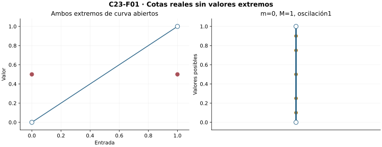
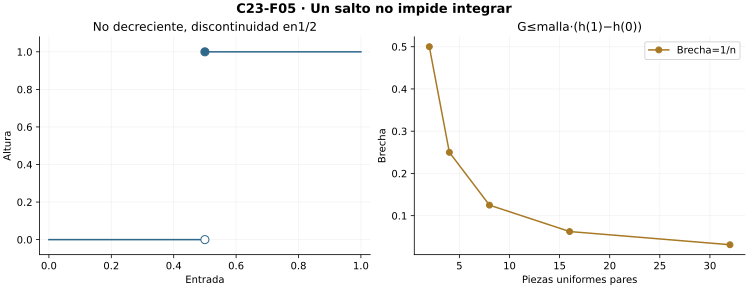
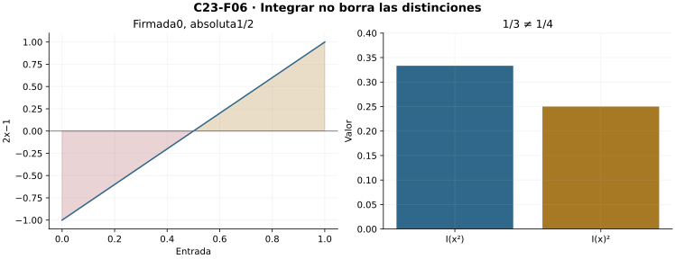
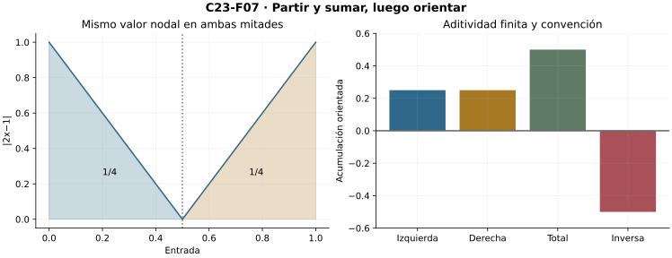
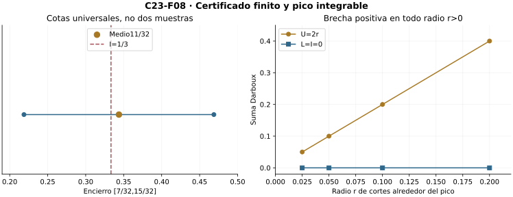

[Índice del libro](../para-matematicos/analisis-para-matematicos.html) · [Ejercicios de este capítulo](#ejercicios-23)

Una suma etiquetada puede cambiar al refinar porque también cambian las alturas elegidas. Si en cada pieza usamos la mejor cota inferior y la mejor cota superior, obtenemos en cambio dos sumas que encierran todas las elecciones posibles. El refinamiento las acercará desde lados opuestos. Construiremos la integral cuando ese intervalo de incertidumbre pueda hacerse arbitrariamente estrecho y demostraremos que coincide con el límite exigido en C22.

C02/C03 orden y completitud, C14 continuidad y C22 particiones/sumas son herramientas centrales. C16/C17 ya cerrados aportan la interfaz de compacidad y escala uniforme sólo para el caso continuo. No usamos antiderivadas ni el teorema fundamental, reservado para C24.

## 23.1. Cotas de valores y oscilación

[]{#MA-SEC-ANM-01-023-001}

Fijemos $a<b$ y una función $f:[a,b]\to\mathbb R$. Hasta que se diga otra cosa, suponemos una cota dada $|f(t)|\le B$ con $B\ge0$, válida para todas las entradas. Para cualquier conjunto no vacío $J\subseteq[a,b]$, su imagen es no vacía y acotada. Completitud de C03 da los reales

$$m(f,J)=\inf f[J],\qquad M(f,J)=\sup f[J],\qquad
\omega(f,J)=M(f,J)-m(f,J)\ge0.$$

La oscilación mide la anchura de la banda completa de valores de $f$ sobre $J$. Sus extremos pueden no alcanzarse, de modo que no basta restar dos muestras elegidas. Al restringir el conjunto de entradas desaparecen posibles valores: una cota inferior anterior sigue siendo inferior y una superior sigue siendo superior. Por ello, si $J\subseteq K$,

$$m(f,K)\le m(f,J)\le M(f,J)\le M(f,K),\qquad
\omega(f,J)\le\omega(f,K).$$

En efecto, toda cota inferior de $f[K]$ acota $f[J]$, y toda cota superior de $f[K]$ también; maximalidad del ínfimo y minimalidad del supremo prueban las comparaciones. Se dispone de $-B\le m\le M\le B$, de modo que $\omega\le2B$.

Para $\eta>0$ hay entradas $s,t\in J$ con $f(s)>M-\eta$ y $f(t)<m+\eta$: de lo contrario $M-\eta$ sería cota superior o $m+\eta$ cota inferior, contradiciendo su carácter extremo. Son testigos para la precisión fijada; no una regla que alcance el supremo.

Por ejemplo, en $[0,1]$ definamos $g(x)=x$ para $0<x<1$ y $g(0)=g(1)=1/2$. Su ínfimo es0 y su supremo1, ninguno alcanzado. Las cotas son verificables: todo valor está entre0 y1, y entradas positivas arbitrariamente próximas a0 o a1 impiden mejorarlas. La oscilación vale1. Por contraste, para $x^2$ en $[u,v]\subseteq[0,1]$, $m=u^2$, $M=v^2$ y $\omega=v^2-u^2$, pues el cuadrado preserva el orden no negativo.

{#fig-anm-c23-f01 fig-alt="g(x)=x en(0,1), con g(0)=g(1)=1/2: ínfimo0 y supremo1 no alcanzados. Extremos de curva abiertos; valores nodales cerrados en1/2."}

### Ejercicios de la sección 23.1

[]{#ejercicios-23}

#### Ejercicio 1. Cotas sin extremos alcanzados

[]{#MA-EX-ANM-01-023-001}

Para g(x)=x en(0,1) y g(0)=g(1)=1/2, prueba ínfimo0 y supremo1 sin puntos que los alcancen.

[]{#MA-SOL-ANM-01-023-001}

Ver solución del ejercicio 1

La imagen de $g$ está contenida en $(0,1)$: en el interior $g(x)=x$, y los dos extremos del dominio tienen altura $1/2$. Por tanto cero es cota inferior y uno cota superior, y ninguno pertenece a la imagen. Para $\eta>0$ tomamos $t=\min(\eta/2,1/4)$. Entonces $t$ y $1-t$ son interiores, $g(t)=t<\eta$ y $g(1-t)=1-t>1-\eta$. Una cota inferior positiva se contradice tomando $\eta$ igual a ella; una cota superior menor que uno se contradice tomando $\eta$ igual a su distancia a uno. En consecuencia $\inf g=0$ y $\sup g=1$, sin extremos alcanzados.

**Retorno visual.** Véase [C23-F01](analisis-para-matematicos-capitulo-23-integral-de-riemann-y-darboux.html#fig-anm-c23-f01), después del argumento completo: la figura permite reconocer el mecanismo y no sustituye la prueba.

#### Ejercicio 2. Restringir disminuye oscilación

[]{#MA-EX-ANM-01-023-002}

Demuestra la cadena de cotas para J⊆K no vacíos y acotados.

[]{#MA-SOL-ANM-01-023-002}

Ver solución del ejercicio 2

Escribimos $m_J=\inf f[J]$, $M_J=\sup f[J]$ y análogamente para $K$. Se requiere que las imágenes sean no vacías y acotadas. La inclusión $J\subseteq K$ implica $f[J]\subseteq f[K]$. Toda cota inferior de $f[K]$ acota también $f[J]$, de donde $m_K\le m_J$; toda cota superior de $f[K]$ acota $f[J]$, de donde $M_J\le M_K$. Una entrada de $J$ da además $m_J\le M_J$. Así $m_K\le m_J\le M_J\le M_K$, y al restar $0\le M_J-m_J\le M_K-m_K$. La conclusión depende de la inclusión de imágenes, sin continuidad.

#### Ejercicio 3. Cuadrado en una pieza

[]{#MA-EX-ANM-01-023-003}

Calcula m,M,ω de x² en[1/4,3/4] y explica por qué la restricción no negativa importa.

[]{#MA-SOL-ANM-01-023-003}

Ver solución del ejercicio 3

Para $1/4\le x\le3/4$, la monotonía del cuadrado sobre los no negativos da $1/16\le x^2\le9/16$. Los valores extremos se alcanzan en los bordes, así $m=1/16$, $M=9/16$ y $\omega=9/16-1/16=1/2$. La condición de no negatividad justifica esa monotonía: si $0\le s<t$, entonces $t^2-s^2=(t-s)(t+s)>0$. En $[-1,1]$ los dos bordes tienen altura uno, pero el mínimo del cuadrado es cero en el interior. Allí no sirve la misma regla de tomar el borde izquierdo como ínfimo.

#### Ejercicio 4. De cotas a testigos

[]{#MA-EX-ANM-01-023-004}

Demuestra que para η>0 hay s con f(s)>M−η y t con f(t)<m+η.

[]{#MA-SOL-ANM-01-023-004}

Ver solución del ejercicio 4

Sean $M=\sup f[J]$ y $m=\inf f[J]$, con imagen no vacía y acotada. Si no existiera $s\in J$ con $f(s)>M-\eta$, tendríamos $f(s)\le M-\eta$ para todas las entradas. El real $M-\eta<M$ sería entonces una cota superior, contradiciendo que $M$ sea la menor. De igual forma, la ausencia de un $t$ con $f(t)<m+\eta$ haría de $m+\eta>m$ una cota inferior, contra la maximalidad de $m$. Estos dos argumentos dan testigos para cada $\eta>0$, aunque las alturas extremas no se alcancen.

#### Ejercicio 5. Dos muestras no controlan

[]{#MA-EX-ANM-01-023-005}

Construye sobre[0,1] una función con muestras0 en0 y1 y oscilación arbitrariamente grande.

[]{#MA-SOL-ANM-01-023-005}

Ver solución del ejercicio 5

Dado un tamaño deseado $R>0$, elegimos $H=R+1$ y definimos $f(1/2)=H$, $f(x)=0$ para las demás entradas de $[0,1]$. Las muestras en cero y uno son ambas cero. Sin embargo, la imagen es $\{0,H\}$, así $m=0$, $M=H$ y $\omega=H>R$. Para cada $H$ fijo la función está acotada. Esta familia muestra que conservar las dos muestras no limita la altura de una entrada distinta y, por tanto, no limita la oscilación.

## 23.2. Dos sumas que el refinamiento sí ordena

[]{#MA-SEC-ANM-01-023-002}

Sea $P=(x_0,\ldots,x_n)$ una partición de C22, $I_i=[x_{i-1},x_i]$ y $\Delta_i>0$. Definimos

$$L(f,P)=\sum_i m(f,I_i)\Delta_i,\qquad
U(f,P)=\sum_i M(f,I_i)\Delta_i.$$

Son números reales finitos. Para cualquier familia de etiquetas admisibles,

$$-B(b-a)\le L(f,P)\le S(f;P,\xi)\le U(f,P)\le B(b-a).$$

Multiplicar $m_i\le f(\xi_i)\le M_i$ por anchuras positivas y sumar prueba el encierro. Restar suma a suma da la identidad fundamental

$$G(f,P):=U(f,P)-L(f,P)=\sum_i\omega(f,I_i)\Delta_i.$$

La brecha es no negativa porque todas las oscilaciones y anchuras lo son. Si vale cero, cada producto de la suma debe ser cero; como las anchuras son positivas, todas las oscilaciones son cero. Esto hace constante a $f$ en cada pieza cerrada. El nodo que comparten dos piezas obliga a que sus constantes coincidan y, recorriendo la lista, $f$ resulta constante en todo $[a,b]$. Para integrar una función que varía necesitaremos brechas arbitrariamente pequeñas, aunque ninguna llegue a anularse.

Si $P\preceq Q$, cada pieza hija está contenida en su padre; su ínfimo no es menor y su supremo no es mayor. Las anchuras de las hijas suman la del padre. Multiplicar las comparaciones por esas anchuras y agrupar finitamente prueba

$$L(f,P)\le L(f,Q)\le U(f,Q)\le U(f,P).$$

Aquí sí existe monotonía, a diferencia de sumas etiquetadas arbitrarias. Para particiones distintas $P,Q$, su refinamiento común $R$ da $L(f,P)\le L(f,R)\le U(f,R)\le U(f,Q)$. Toda suma inferior queda bajo toda superior, aunque procedan de cortes incompatibles.

Para $x^2$ en uniforme de $n$ piezas sobre $[0,1]$, las sumas son las izquierda y derecha calculadas en C22:

$$L_n=\frac13-\frac1{2n}+\frac1{6n^2},\quad
U_n=\frac13+\frac1{2n}+\frac1{6n^2},\quad G_n=\frac1n.$$

El encierro usa cotas verdaderas sobre cada pieza, no una colección de muestras sin garantía.

![x² en\[0,1\]: rectángulos inferiores/superiores con n2 y n4. Las cotas locales son extremos verdaderos; brechas1/2 y1/4. La recta curva es la misma en ambos paneles.](../../assets/books/anm/C23/C23-F02.svg){#fig-anm-c23-f02 fig-alt="x² en[0,1]: rectángulos inferiores/superiores con n2 y n4. Las cotas locales son extremos verdaderos; brechas1/2 y1/4. La recta curva es la misma en ambos paneles."}

### Ejercicios de la sección 23.2

#### Ejercicio 6. Sumas del cuadrado

[]{#MA-EX-ANM-01-023-006}

Calcula L,U y brecha de x² en la uniforme de cuatro piezas de[0,1].

[]{#MA-SOL-ANM-01-023-006}

Ver solución del ejercicio 6

Los nodos son $0,1/4,1/2,3/4,1$ y las cuatro anchuras valen $1/4$. Como el cuadrado es creciente allí, las alturas inferiores son $0,1/16,4/16,9/16$ y las superiores $1/16,4/16,9/16,16/16$. Por tanto $L=(0+1+4+9)/64=14/64=7/32$ y $U=(1+4+9+16)/64=30/64=15/32$. La brecha es $U-L=8/32=1/4$. Las alturas usadas son extremos de la imagen completa de cada pieza; por eso las dos sumas encierran cualquier suma etiquetada de esta partición.

**Retorno visual.** Véase [C23-F02](analisis-para-matematicos-capitulo-23-integral-de-riemann-y-darboux.html#fig-anm-c23-f02), después del argumento completo: la figura permite reconocer el mecanismo y no sustituye la prueba.

#### Ejercicio 7. Una inserción mejora

[]{#MA-EX-ANM-01-023-007}

Prueba monotonía de L y U al insertar t en una pieza[u,v].

[]{#MA-SOL-ANM-01-023-007}

Ver solución del ejercicio 7

Sean $u<t<v$, $m=\inf f([u,v])$ y $M=\sup f([u,v])$. Para las hijas ponemos $m_1,m_2,M_1,M_2$. La inclusión de cada hija en el padre da $m\le m_1,m_2$ y $M_1,M_2\le M$. Como las anchuras son positivas, $m(v-u)\le m_1(t-u)+m_2(v-t)$ y $M_1(t-u)+M_2(v-t)\le M(v-u)$. Se usó $(t-u)+(v-t)=v-u$. Las demás piezas aportan los mismos términos antes y después de insertar el corte. Así la suma inferior no baja y la superior no sube. Una sucesión finita de inserciones prueba lo mismo para cualquier refinamiento.

#### Ejercicio 8. Cruzar dos particiones

[]{#MA-EX-ANM-01-023-008}

Prueba L(P)≤U(Q) aunque P y Q no sean comparables por refinamiento.

[]{#MA-SOL-ANM-01-023-008}

Ver solución del ejercicio 8

Formamos $R$ ordenando la unión finita de los nodos de $P$ y $Q$ y eliminando repeticiones. Tiene los mismos extremos y refina ambas particiones. La monotonía respecto de $P$ da $L(f,P)\le L(f,R)$; el orden en la partición $R$ da $L(f,R)\le U(f,R)$; la monotonía respecto de $Q$ da $U(f,R)\le U(f,Q)$. Concatenar las tres comparaciones prueba $L(f,P)\le U(f,Q)$. No es preciso que las listas originales tengan igual número de piezas o compartan los cortes interiores.

#### Ejercicio 9. Brecha cero fuerza constancia

[]{#MA-EX-ANM-01-023-009}

Demuestra que si G(f,P)=0 en una partición de cerrado, f es constante global.

[]{#MA-SOL-ANM-01-023-009}

Ver solución del ejercicio 9

La igualdad $G(f,P)=\sum_i\omega_i\Delta_i=0$ es una suma finita de reales no negativos. Si alguno fuera positivo, la suma también lo sería; por tanto todos son cero. Como $\Delta_i>0$, cada $\omega_i=0$ y $m_i=M_i$. Toda altura de la pieza queda entre esos dos extremos iguales, así $f$ es constante allí. Las piezas $I_i$ e $I_{i+1}$ contienen el nodo $x_i$, donde ambas constantes deben valer $f(x_i)$. Por inducción sobre los índices, todas coinciden. El uso de piezas cerradas hace posible esa propagación de igualdad.

#### Ejercicio 10. Una suma no es una cota

[]{#MA-EX-ANM-01-023-010}

Explica por qué S=1/4 y S=3/4 para x en mitades no contradicen monotonía de Darboux al refinar.

[]{#MA-SOL-ANM-01-023-010}

Ver solución del ejercicio 10

Para $f(x)=x$, la partición trivial tiene $L=0$ y $U=1$, y su etiqueta media da $S=1/2$. En las mitades, las etiquetas izquierdas dan $S=(0+1/2)/2=1/4$ y las derechas $S=(1/2+1)/2=3/4$. Son, respectivamente, $L$ y $U$ de la partición refinada. La monotonía de Darboux se verifica en $0\le1/4$ y $3/4\le1$: mejoran las dos barreras. Comparar esas dos sumas etiquetadas con $1/2$ da movimientos opuestos, porque las etiquetas se han cambiado. Ninguna de esas comparaciones contradice la monotonía de las barreras.

## 23.3. Completitud y criterio de Darboux

[]{#MA-SEC-ANM-01-023-003}

Los conjuntos $\mathcal L_f=\{L(f,P):P\text{ partición}\}$ y $\mathcal U_f=\{U(f,P):P\text{ partición}\}$ son imágenes de funciones reales sobre el conjunto de particiones construido en C22. La partición trivial prueba que son no vacíos; las cotas de la sección anterior prueban acotación. Definimos la integral inferior $\ell_f=\sup\mathcal L_f$ y la superior $u_f=\inf\mathcal U_f$.

Para toda $P,Q$,

$$L(f,P)\le\ell_f\le u_f\le U(f,Q).$$

La desigualdad central merece prueba: cada $U(f,Q)$ acota todas las sumas inferiores, así que $\ell_f\le U(f,Q)$; al valer para todo $Q$, $\ell_f$ es cota inferior de $\mathcal U_f$ y no supera su ínfimo. No se postula una partición óptima.

Llamamos integrable de Darboux a $f$ cuando $\ell_f=u_f$. Su valor común se escribirá $I_D$. El **criterio de Darboux** es

$$\ell_f=u_f\quad\Longleftrightarrow\quad
\forall\varepsilon>0\ \exists P:\ G(f,P)<\varepsilon.$$

Si $\ell_f=u_f$, aproximamos ese valor por debajo con una suma inferior y por arriba con una superior: la propiedad del supremo da $P$ con $L(f,P)>\ell_f-\varepsilon/2$ y la del ínfimo da $Q$ con $U(f,Q)<u_f+\varepsilon/2$. Los cortes pueden ser distintos, pero su refinamiento común $R$ aumenta la suma inferior y disminuye la superior. Su brecha es, por tanto, menor que $\varepsilon$. Sólo hemos escogido dos testigos para una tolerancia fijada. En sentido inverso, la banda anterior da $0\le u_f-\ell_f\le G(f,P)$ para toda $P$. Si la diferencia fuera $d>0$, una partición con brecha menor que $d/2$ contradiría esa desigualdad. Luego la diferencia es cero.

Una partición buena conserva la precisión bajo todo refinamiento. El criterio equivale también a: para cada tolerancia existe $P$ tal que todos sus refinamientos tienen brecha menor que ella; la recíproca usa el refinamiento reflexivo $P\preceq P$.

Si $f$ es integrable, $I_D$ y todas las sumas etiquetadas de $P$ están en $[L,U]$, por lo que $|S-I_D|\le G$. El punto medio numérico $A_P=(L+U)/2$ tiene certificado más fino $|A_P-I_D|\le G/2$. No afirma que $A_P$ sea una suma etiquetada ni el valor exacto. Para $x^2$, $G_n=1/n\to0$, así que el criterio recupera el valor $1/3$ de C22, aunque ninguna partición tenga brecha cero.

![En x², los intervalos \[L_n,U_n\] para n2,4,8,16 se acercan a1/3. Con n4, medio11/32 y media anchura1/8; no se afirma exactitud del medio.](../../assets/books/anm/C23/C23-F03.svg){#fig-anm-c23-f03 fig-alt="En x², los intervalos [L_n,U_n] para n2,4,8,16 se acercan a1/3. Con n4, medio11/32 y media anchura1/8; no se afirma exactitud del medio."}

### Ejercicios de la sección 23.3

#### Ejercicio 11. Extremos de conjuntos de sumas

[]{#MA-EX-ANM-01-023-011}

Justifica existencia de $\ell$ y u y su orden, indicando las hipótesis.

[]{#MA-SOL-ANM-01-023-011}

Ver solución del ejercicio 11

Suponemos $a<b$ y $f:[a,b]\to\mathbb R$ acotada, con $|f|\le B$. La partición trivial prueba que los conjuntos $\mathcal L_f$ y $\mathcal U_f$ son no vacíos. Todas sus sumas satisfacen $-B(b-a)\le L(f,P)\le U(f,P)\le B(b-a)$, por las cotas de alturas y la identidad de longitudes. Completitud proporciona $\ell_f=\sup\mathcal L_f$ y $u_f=\inf\mathcal U_f$. Para cualquier $Q$, la comparación por refinamiento común da $L(f,P)\le U(f,Q)$ para toda $P$. Por tanto $\ell_f\le U(f,Q)$ para toda $Q$, y al tomar ínfimo queda $\ell_f\le u_f$.

#### Ejercicio 12. Una partición para dos aproximaciones

[]{#MA-EX-ANM-01-023-012}

Si $\ell$=u=I, construye una partición de brecha menor que ε sin suponer extremos alcanzados.

[]{#MA-SOL-ANM-01-023-012}

Ver solución del ejercicio 12

Sea $\varepsilon>0$. Como $I$ es el supremo de las sumas inferiores, existe $P$ con $L(f,P)>I-\varepsilon/2$; de otro modo ese real menor sería una cota superior del conjunto. Como $I$ es el ínfimo de las superiores, existe $Q$ con $U(f,Q)<I+\varepsilon/2$. Tomamos el refinamiento común $R$. La monotonía da $L(f,R)\ge L(f,P)>I-\varepsilon/2$ y $U(f,R)\le U(f,Q)<I+\varepsilon/2$. Restar prueba $G(f,R)<\varepsilon$. Las particiones aproximan los extremos; no necesitan realizarlos exactamente.

#### Ejercicio 13. La recíproca del criterio

[]{#MA-EX-ANM-01-023-013}

Demuestra que brechas arbitrariamente pequeñas fuerzan $\ell$=u.

[]{#MA-SOL-ANM-01-023-013}

Ver solución del ejercicio 13

Por definición de los dos extremos, para cada partición $P$ se tiene $L(f,P)\le\ell_f\le u_f\le U(f,P)$. De ahí $0\le u_f-\ell_f\le G(f,P)$. Supongamos que $d=u_f-\ell_f>0$. La hipótesis de brechas arbitrariamente pequeñas aplicada a $\varepsilon=d/2$ produce $P$ con $G(f,P)<d/2$. Esto daría $d\le G(f,P)<d/2$, imposible. Por no negatividad queda $d=0$ y las integrales inferior y superior coinciden.

#### Ejercicio 14. Persistencia de precisión

[]{#MA-EX-ANM-01-023-014}

Prueba equivalencia del criterio con una partición cuyos refinamientos todos tienen brecha menor que ε.

[]{#MA-SOL-ANM-01-023-014}

Ver solución del ejercicio 14

Fijada $\varepsilon>0$, si existe $P_*$ con $G(f,P_*)<\varepsilon$, toda $Q$ que la refina satisface $L(f,P_*)\le L(f,Q)$ y $U(f,Q)\le U(f,P_*)$. Restar da $G(f,Q)\le G(f,P_*)<\varepsilon$. Esto prueba la persistencia con los cuantificadores $\forall\varepsilon>0\ \exists P_*\ \forall Q\succeq P_*$. En la dirección inversa se toma $Q=P_*$: una partición se refina a sí misma. Así la condición persistente entrega una partición de brecha menor que cada tolerancia y recupera el criterio de Darboux.

#### Ejercicio 15. Centro del intervalo certificado

[]{#MA-EX-ANM-01-023-015}

Con L=7/32,U=15/32 e I=1/3, calcula el punto medio, cota y error real.

[]{#MA-SOL-ANM-01-023-015}

Ver solución del ejercicio 15

El centro de las cotas es $A=(7/32+15/32)/2=11/32$. La longitud del intervalo certificado es $15/32-7/32=1/4$, así su semilongitud es $1/8$. Como $I$ está en ese intervalo, $|A-I|\le1/8$. Con el dato $I=1/3$, el error efectivo es $|11/32-1/3|=|33/96-32/96|=1/96$. El centro sobreestima el valor en $1/96$ y cumple la cota. Esta operación promedia las dos sumas de Darboux; no es la suma con etiquetas en los puntos medios, que para estas piezas vale $21/64$.

**Retorno visual.** Véase [C23-F03](analisis-para-matematicos-capitulo-23-integral-de-riemann-y-darboux.html#fig-anm-c23-f03), después del argumento completo: la figura permite reconocer el mecanismo y no sustituye la prueba.

## 23.4. El puente hacia todas las sumas de Riemann

[]{#MA-SEC-ANM-01-023-004}

C22 definió Riemann por un real $I_R$ y el contrato $\forall\varepsilon>0\exists\delta>0\forall(P,\xi)$, malla menor que $\delta$ implica $|S-I_R|<\varepsilon$. Demostraremos su equivalencia con Darboux, con igualdad de valores.

El contrato de Riemann obliga primero a que $f$ esté acotada, aunque no se haya supuesto. Pedimos tolerancia $1$ y tomamos una partición uniforme $P$ de malla menor que el radio, con etiquetas medias. Dentro de una pieza $I_i$ dejamos fijas las otras etiquetas y variamos sólo $t\in I_i$. La suma tiene forma $f(t)\Delta_i+C_i$, donde $C_i$ permanece fijo, y el contrato la mantiene entre $I_R-1$ e $I_R+1$. Así $|f(t)|\le(|I_R|+1+|C_i|)/\Delta_i$. La anchura positiva permite dividir y proporciona una cota para cada pieza. El máximo de estas finitísimas cotas controla toda la función, pues las piezas cubren el intervalo.

Para una partición fija y $\eta>0$, hay etiquetas $\xi^+$ y $\xi^-$ con

$$U(f,P)-\eta<S(f;P,\xi^+)\le U(f,P),\quad
L(f,P)\le S(f;P,\xi^-)<L(f,P)+\eta.$$

Para aproximar la suma superior escogemos en cada pieza un valor a distancia menor que $\eta/(b-a)$ de su supremo; para la inferior hacemos lo mismo con su ínfimo. Multiplicar por las anchuras y sumar acumula un error menor que $\eta$, porque las anchuras suman $b-a$. Los testigos pueden reunirse por inducción en el número finito de piezas. Así obtenemos familias de etiquetas sin suponer extremos alcanzados ni recurrir a una elección infinita.

Si existe $I_R$, pedimos error $\varepsilon/4$ y fijamos una uniforme que cumpla el radio. El lema con $\eta=\varepsilon/4$ da $U<I_R+\varepsilon/2$ y $L>I_R-\varepsilon/2$, luego $G<\varepsilon$. Darboux existe y su valor queda entre esos extremos para cada tolerancia; si difería de $I_R$, elegir una tolerancia menor que la distancia contradice ese encierro. Por tanto $I_D=I_R$.

Para la vuelta, una partición de brecha pequeña no basta directamente: Riemann exige controlar también cortes que no la refinan. Fijemos $P_*$ con brecha menor que $\varepsilon/2$ y llamemos $q$ a su número de nodos interiores. Dada cualquier $Q$, formamos el refinamiento común $R=Q\cup P_*$. Una pieza de $Q$ sólo se modifica si contiene en su interior algún nodo interior de $P_*$. Como los interiores de las piezas son disjuntos, hay a lo sumo $q$ piezas modificadas. En cada una, la suma superior puede bajar a lo sumo $2B$ veces su anchura: la altura antigua y las alturas hijas pertenecen a $[-B,B]$, y las anchuras hijas suman la del padre. El aumento de la suma inferior tiene la misma cota. Cada anchura modificada es a lo sumo $\|Q\|$, por lo que

$$G(f,Q)\le G(f,R)+4Bq\|Q\|
\le G(f,P_*)+4Bq\|Q\|.$$

Si $Bq>0$, tomamos $\delta=\varepsilon/(8Bq)$. Malla menor da brecha menor que $\varepsilon$, y el encierro común de $S$ e $I_D$ prueba el contrato de Riemann. Si $Bq=0$, el segundo término es cero y cualquier radio positivo sirve: no se divide por cero. Queda además demostrado que, para una función acotada integrable, todas las particiones de malla suficientemente pequeña tienen brecha pequeña. Conservar los cortes y reducir la malla son rutas distintas, conectadas por este conteo finito.

![P*=(0,1/2,1), Q=(0,2/5,7/10,1). Sólo la pieza\[2/5,7/10\] de Q contiene el corte1/2 en su interior. R es la unión; q1 y malla Q2/5 controlan el coste por4Bq·malla.](../../assets/books/anm/C23/C23-F04.svg){#fig-anm-c23-f04 fig-alt="P*=(0,1/2,1), Q=(0,2/5,7/10,1). Sólo la pieza[2/5,7/10] de Q contiene el corte1/2 en su interior. R es la unión; q1 y malla Q2/5 controlan el coste por4Bq·malla."}

### Ejercicios de la sección 23.4

#### Ejercicio 16. Riemann también exige acotación

[]{#MA-EX-ANM-01-023-016}

Prueba acotación de f desde el contrato de C22, sin añadirla como hipótesis.

[]{#MA-SOL-ANM-01-023-016}

Ver solución del ejercicio 16

Aplicamos el contrato de Riemann con tolerancia uno y obtenemos $\delta>0$. Elegimos una partición uniforme con malla menor que $\delta$ y fijamos etiquetas de referencia. Para cada pieza $I_i$, mantenemos esas etiquetas en las demás y dejamos variar $t\in I_i$. La suma resultante es $S=f(t)\Delta_i+C_i$, donde $C_i$ es una suma finita fija. El contrato implica $|S-I|<1$, luego $|S|<|I|+1$ y $|f(t)|\Delta_i=|S-C_i|\le|S|+|C_i|<|I|+1+|C_i|$. Dividir por $\Delta_i>0$ da una cota en toda $I_i$. El máximo finito de esas cotas limita $|f|$ en el intervalo, porque las piezas lo cubren, incluidos sus bordes.

#### Ejercicio 17. Etiquetas próximas a U

[]{#MA-EX-ANM-01-023-017}

Para una partición fija, demuestra U−η<S para alguna familia, sin máximos.

[]{#MA-SOL-ANM-01-023-017}

Ver solución del ejercicio 17

Sean $M_i=\sup f[I_i]$ y $\eta>0$. Como $b-a>0$, el número $\eta/(b-a)$ es positivo. En cada pieza existe $\xi_i$ con $f(\xi_i)>M_i-\eta/(b-a)$. Construimos la familia por inducción finita sobre sus $n$ piezas. Al multiplicar por $\Delta_i>0$ y sumar, $S>\sum_i M_i\Delta_i-\eta\sum_i\Delta_i/(b-a)=U-\eta$. Además $S\le U$ por la cota superior de cada altura. Por tanto $U-\eta<S\le U$. La misma construcción con ínfimos proporciona $L\le S^-<L+\eta$.

#### Ejercicio 18. Un sentido del puente

[]{#MA-EX-ANM-01-023-018}

Deduce Darboux e igualdad de valor desde Riemann usando tolerancia ε/4.

[]{#MA-SOL-ANM-01-023-018}

Ver solución del ejercicio 18

La acotación ya se deduce del contrato de Riemann, así las sumas de Darboux están definidas. Para $\varepsilon>0$, tomamos una partición uniforme de malla menor que el radio que garantiza error $\varepsilon/4$ respecto de $I_R$. Aproximamos sus extremos con etiquetas para obtener $U-\varepsilon/4<S^+$ y $S^-<L+\varepsilon/4$. El contrato da $S^+<I_R+\varepsilon/4$ y $S^->I_R-\varepsilon/4$. Así $U<I_R+\varepsilon/2$ y $L>I_R-\varepsilon/2$, de donde $G<\varepsilon$. Darboux produce una integral $I_D$, que queda entre $L$ y $U$. Estas mismas desigualdades dan $|I_D-I_R|<\varepsilon/2$ para cada $\varepsilon>0$; una distancia positiva sería incompatible con una tolerancia menor. Por tanto los valores coinciden.

#### Ejercicio 19. Cortes omitidos

[]{#MA-EX-ANM-01-023-019}

Si P* tiene q nodos interiores, justifica G(Q)≤G(P*)+4Bq·malla(Q).

[]{#MA-SOL-ANM-01-023-019}

Ver solución del ejercicio 19

Sea $|f|\le B$ y formemos $R=P_*\cup Q$. Una pieza de $Q$ se divide sólo cuando contiene un nodo interior de $P_*$ en su interior. Como los interiores de las piezas son disjuntos, hay a lo sumo $q$ padres afectados; sus anchuras suman a lo sumo $q\|Q\|$. En un padre de anchura $\Delta$, el supremo antiguo y los de sus hijas están entre $-B$ y $B$. La disminución de la contribución superior es no negativa y no supera $2B\Delta$, porque las anchuras hijas suman $\Delta$. Igualmente el aumento de la contribución inferior no supera $2B\Delta$. Por tanto $G(f,Q)-G(f,R)\le4Bq\|Q\|$. Como $R$ refina $P_*$, $G(f,R)\le G(f,P_*)$. Sumando las desigualdades obtenemos $G(f,Q)\le G(f,P_*)+4Bq\|Q\|$.

**Retorno visual.** Véase [C23-F04](analisis-para-matematicos-capitulo-23-integral-de-riemann-y-darboux.html#fig-anm-c23-f04), después del argumento completo: la figura permite reconocer el mecanismo y no sustituye la prueba.

#### Ejercicio 20. Radio del puente y caso cero

[]{#MA-EX-ANM-01-023-020}

Para B=2,q=3 y brecha buena<ε/2, produce radio suficiente; trata Bq=0.

[]{#MA-SOL-ANM-01-023-020}

Ver solución del ejercicio 20

Con $B=2$ y $q=3$, la corrección del puente es $4Bq\|Q\|=24\|Q\|$. Si $G(f,P_*)<\varepsilon/2$, elegimos $\delta=\varepsilon/48>0$. Toda $Q$ de malla menor que $\delta$ cumple $G(f,Q)<\varepsilon/2+24\delta=\varepsilon$. Una suma etiquetada de $Q$ y la integral de Darboux están ambas entre $L(f,Q)$ y $U(f,Q)$, así su distancia es menor que $\varepsilon$: queda probado el contrato de Riemann. Para $Bq=0$ la corrección es cero y cualquier radio positivo sirve. Si $B=0$, la función es cero; si $q=0$, la partición buena es la trivial y todas las particiones la refinan.

## 23.5. Clases integrables y radios útiles

[]{#MA-SEC-ANM-01-023-005}

Una función no decreciente en $[a,b]$ está acotada entre sus valores extremos. En cada pieza, $m_i=f(x_{i-1})$, $M_i=f(x_i)$, de donde

$$G(f,P)=\sum_i(f(x_i)-f(x_{i-1}))\Delta_i
\le\|P\|(f(b)-f(a)).$$

Las diferencias son no negativas y su suma telescopa. Uniformes de malla pequeña y el criterio prueban integrabilidad, sin continuidad. Si la diferencia extrema es cero, la función es constante y no se divide por ella. Para funciones no crecientes se aplica lo anterior a $-f$, o se invierten los extremos; la cota es $\|P\||f(b)-f(a)|$.

Si $f$ es Lipschitz con constante $L\ge0$, en una pieza toda diferencia de valores tiene magnitud a lo sumo $L\Delta_i$. Para trasladar esa comparación a los extremos, escribimos $f(s)\le f(t)+L\Delta_i$ para todo $s,t$. Tomar primero el supremo en $s$ da $M_i\le f(t)+L\Delta_i$; tomar luego el ínfimo en $t$ da $M_i-m_i\le L\Delta_i$. De aquí $G\le L\|P\|(b-a)$ y el criterio prueba integrabilidad. Si $L>0$ la cota proporciona un radio explícito; si $L=0$, la función es constante y la brecha ya es cero.

Toda función continua en $[a,b]$ es integrable. Precisemos la herramienta heredada: C16 da compacidad del intervalo cerrado y subcubrimientos finitos; C17 conecta esa compacidad con una escala uniforme. Reconstruimos el mecanismo que necesitamos sin selección infinita. Para tolerancia1, consideramos todos los pares $(c,r)$ con $c\in[a,b]$, $r>0$ y $|f(y)-f(c)|<1$ cuando $y$ está en el dominio y $|y-c|<r$. Sus bolas de radio $r/2$ cubren el intervalo por continuidad. Un subcubrimiento finito da cota $\max_j(|f(c_j)|+1)$.

Para conseguir un control uniforme de diferencias, repetimos la construcción con error $\eta/2$, donde $\eta>0$. Un subcubrimiento finito por las bolas de radio $r_j/2$ permite fijar $\delta=\min_j r_j/2>0$. Si $|s-t|<\delta$, alguna bola interior contiene $s$. Entonces $|s-c_j|<r_j/2$ y $|t-c_j|\le|t-s|+|s-c_j|<r_j$. Ambos valores difieren del valor central menos que $\eta/2$, así que $|f(s)-f(t)|<\eta$. En una pieza de anchura menor que $\delta$ todas las diferencias satisfacen esa cota; al pasar a supremo e ínfimo obtenemos oscilación a lo sumo $\eta$. Elegimos $\eta=\varepsilon/(2(b-a))$: cualquier partición de esa malla cumple $G\le\eta(b-a)=\varepsilon/2<\varepsilon$. El margen final conserva la desigualdad estricta requerida aunque tomar extremos haya producido una cota no estricta.

C22 ya probó integrabilidad de escalones y estabilidad por modificaciones finitas; la equivalencia les asigna también el mismo valor de Darboux. Continuidad es suficiente, no necesaria. Un salto monotónico o un valor aislado puede ser integrable. La continuidad local sola sobre un intervalo abierto no suministra la compacidad ni la acotación usadas aquí.

{#fig-anm-c23-f05 fig-alt="h=0 para x<1/2 y h=1 para x≥1/2 es monótona con salto. En uniformes pares su brecha1/n tiende a0, controlada por malla, sin continuidad."}

### Ejercicios de la sección 23.5

#### Ejercicio 21. Monótona con salto

[]{#MA-EX-ANM-01-023-021}

Sea h=0 para x<1/2 y h=1 para x≥1/2 en[0,1]. Prueba integrabilidad y da cota por malla.

[]{#MA-SOL-ANM-01-023-021}

Ver solución del ejercicio 21

La función $h$ es no decreciente y sus extremos son $h(0)=0$, $h(1)=1$. En cualquier partición, $G(h,P)=\sum_i(h(x_i)-h(x_{i-1}))\Delta_i\le\|P\|\sum_i(h(x_i)-h(x_{i-1}))=\|P\|$. Para una tolerancia $\varepsilon>0$, una uniforme de malla menor que $\varepsilon$ tiene brecha menor que ella. El criterio prueba integrabilidad a pesar del salto. Para identificar el valor, insertamos $1/2$ en una uniforme cada vez más fina. La suma inferior en esa partición vale $1/2$, mientras la superior vale $1/2+d$, siendo $d$ la anchura de la pieza inmediatamente izquierda al salto. Esa pieza incluye el nodo de altura uno y aporta $d$ a la suma superior. Como $d$ puede hacerse arbitrariamente pequeño, la integral es $1/2$.

**Retorno visual.** Véase [C23-F05](analisis-para-matematicos-capitulo-23-integral-de-riemann-y-darboux.html#fig-anm-c23-f05), después del argumento completo: la figura permite reconocer el mecanismo y no sustituye la prueba.

#### Ejercicio 22. Lipschitz como certificado

[]{#MA-EX-ANM-01-023-022}

Si L=3 en un intervalo de longitud2, acota la brecha y fabrica malla para brecha<1/100.

[]{#MA-SOL-ANM-01-023-022}

Ver solución del ejercicio 22

En cada pieza de anchura $\Delta_i$, la hipótesis Lipschitz con constante tres da $|f(s)-f(t)|\le3\Delta_i$ para toda pareja de entradas. De ahí $\omega_i\le3\Delta_i$. Al ponderar y sumar, $G\le3\sum_i\Delta_i^2\le3\|P\|\sum_i\Delta_i=6\|P\|$, porque la longitud total es dos. Por tanto $\|P\|<1/600$ garantiza $G<6/600=1/100$. Una uniforme de $1201$ piezas tiene malla $2/1201<1/600$ y cumple el pedido. La hipótesis Lipschitz se usa sobre todas las parejas de cada pieza.

#### Ejercicio 23. Continua: de local a uniforme

[]{#MA-EX-ANM-01-023-023}

Explica la construcción de radio uniforme por un subcubrimiento finito, evitando escoger radios simultáneamente para todos los centros.

[]{#MA-SOL-ANM-01-023-023}

Ver solución del ejercicio 23

Fijemos un error de alturas $\eta>0$. Consideramos el conjunto de todos los pares $(c,r)$ con $c\in[a,b]$, $r>0$ y $|f(x)-f(c)|<\eta/2$ para las entradas del dominio a distancia menor que $r$ de $c$. La continuidad garantiza al menos un par por centro, así las bolas relativas de radio $r/2$ forman una cobertura abierta del cerrado. Compacidad da un subcubrimiento finito con pares $(c_j,r_j)$. Ponemos $\delta=\min_j r_j/2>0$. Si $s,t$ están en el dominio y $|s-t|<\delta$, elegimos una bola reducida que contenga a $s$. Entonces $|s-c_j|<r_j/2$ y $|t-c_j|\le|t-s|+|s-c_j|<r_j$. Los dos errores respecto del centro son menores que $\eta/2$, por lo que $|f(s)-f(t)|<\eta$. La construcción sólo extrae una lista finita de pares de la cobertura completa.

#### Ejercicio 24. El margen al tomar supremos

[]{#MA-EX-ANM-01-023-024}

Si todos los valores de una pieza difieren menos que η, explica por qué ω≤η y cómo garantizar brecha<ε.

[]{#MA-SOL-ANM-01-023-024}

Ver solución del ejercicio 24

Si $|f(s)-f(t)|<\eta$ para toda pareja de una pieza, fijar $t$ da $f(s)<f(t)+\eta$ para todo $s$. Al tomar supremo, $M\le f(t)+\eta$; al tomar ínfimo en $t$, $M\le m+\eta$. Así $\omega\le\eta$, con posible pérdida de estrictitud. Por ejemplo, para $f(x)=x$ en $(0,\eta)$, todas las diferencias son menores que $\eta$ pero la oscilación es exactamente $\eta$. Para el intervalo de longitud positiva $b-a$, pedimos la escala uniforme correspondiente a $\eta=\varepsilon/(2(b-a))$. Una partición de malla menor que esa escala cumple $G\le\eta(b-a)=\varepsilon/2<\varepsilon$.

#### Ejercicio 25. Un cerrado importa

[]{#MA-EX-ANM-01-023-025}

Da una función continua en(0,1] que no tenga la cota global usada en la prueba continua de este capítulo.

[]{#MA-SOL-ANM-01-023-025}

Ver solución del ejercicio 25

La función $f(x)=1/x$ es continua en $(0,1]$. Para cualquier $M>0$ tomamos $x=1/(M+1)$, que pertenece al dominio y satisface $f(x)=M+1>M$. Por tanto no existe cota superior global. El dominio no es compacto: la sucesión $1/(n+1)$ tiende a cero, que queda fuera de él. La construcción por subcubrimiento finito de este capítulo exige un cerrado $[a,b]$; en este ejemplo no entrega la cota necesaria para las sumas de Darboux del intervalo completo.

## 23.6. Álgebra de funciones e integrales

[]{#MA-SEC-ANM-01-023-006}

Para funciones acotadas, comparar todos los pares de valores da

$$\omega(f+g,J)\le\omega(f,J)+\omega(g,J),\qquad
\omega(\alpha f,J)=|\alpha|\omega(f,J).$$

La primera sigue porque $(f+g)(s)-(f+g)(t)$ está bajo la suma de las dos oscilaciones; tomar los extremos justifica la cota. Para $\alpha<0$, supremo e ínfimo intercambian su papel, de donde el valor absoluto; para $\alpha=0$ ambos son cero. También $||f(s)|-|f(t)||\le|f(s)-f(t)|$, por lo que $\omega(|f|,J)\le\omega(f,J)$.

Si $|f|\le B_f$, $|g|\le B_g$, la identidad

$$f(s)g(s)-f(t)g(t)=f(s)(g(s)-g(t))+g(t)(f(s)-f(t))$$

da $\omega(fg,J)\le B_f\omega(g,J)+B_g\omega(f,J)$. No se multiplica una integral por otra: es una cota local del producto de funciones.

Para trasladar estas cotas locales a la integrabilidad, necesitamos una misma partición en la que sean pequeñas las brechas de $f$ y de $g$. Elegimos una para cada función y pasamos al refinamiento común, donde ninguna brecha aumenta. Las desigualdades anteriores hacen entonces arbitrariamente pequeñas las de la suma, los múltiplos, el valor absoluto y el producto. En este último caso basta pedir a ambas brecha menor que $\varepsilon/(B_f+B_g+1)$: la suma ponderada por $B_f,B_g$ queda menor que $\varepsilon$, sin dividir por una constante que pudiera ser cero.

Los valores de sumas y múltiplos se calculan con la equivalencia de Riemann y la identidad finita de C22. Para $h=\alpha f+\beta g$, pedimos a ambos errores menores que $\varepsilon/(|\alpha|+|\beta|+1)$ y tomamos el menor de sus radios. Triangular demuestra que $S(h)$ se acerca a $\alpha I_f+\beta I_g$ con error menor que $\varepsilon$; unicidad identifica el valor. Es linealidad de la integral, no una regla de primitivas.

Si $f\le g$, entonces $I_f\le I_g$: de lo contrario su diferencia $d>0$ y una misma partición fina darían, con errores $d/3$, $S(f)>S(g)$, contradiciendo el orden de sumas con las mismas etiquetas. Como $-|f|\le f\le|f|$, el orden y la linealidad dan $|I_f|\le I_{|f|}$. Generalmente no hay igualdad. Para $f(x)=2x-1$ en $[0,1]$, C22 da $I_f=0$; dividir en $1/2$ y sumar dos triángulos mediante las fórmulas afines que justificaremos en la sección siguiente da $I_{|f|}=1/2$. El producto tampoco tiene integral $I_f I_g$: para $f=g=x$, $I_{x^2}=1/3$ frente a $I_x^2=1/4$.

{#fig-anm-c23-f06 fig-alt="f=2x−1 tiene integral firmada0 y valor absoluto integral1/2. En el panel derecho, x² tiene integral1/3 y el cuadrado de la integral de x es1/4: el producto de funciones no da producto de integrales."}

### Ejercicios de la sección 23.6

#### Ejercicio 26. Signo de un múltiplo

[]{#MA-EX-ANM-01-023-026}

Demuestra ω(αf)=|α|ω(f) incluyendo α<0 y α=0.

[]{#MA-SOL-ANM-01-023-026}

Ver solución del ejercicio 26

Si $\alpha>0$, $\alpha m$ y $\alpha M$ son, respectivamente, el ínfimo y el supremo de $\alpha f[J]$: las desigualdades escalan y los testigos próximos a los extremos prueban su optimalidad. Por ello la oscilación es $\alpha(M-m)$. Si $\alpha<0$, las desigualdades se invierten, y los mismos testigos dan $m(\alpha f,J)=\alpha M$ y $M(\alpha f,J)=\alpha m$. La diferencia es $\alpha m-\alpha M=-\alpha(M-m)=|\alpha|\omega(f,J)$. Para $\alpha=0$ la imagen es $\{0\}$ y ambas oscilaciones son cero. Quedan cubiertos los tres signos sin suponer extremos alcanzados.

#### Ejercicio 27. Producto integrable

[]{#MA-EX-ANM-01-023-027}

Con integrables f,g y cotas Bf,Bg, prueba integrabilidad de fg con particiones comunes.

[]{#MA-SOL-ANM-01-023-027}

Ver solución del ejercicio 27

Sean $|f|\le B_f$ y $|g|\le B_g$. Para $s,t$ en una pieza, la identidad $f(s)g(s)-f(t)g(t)=f(s)(g(s)-g(t))+g(t)(f(s)-f(t))$ da $\omega(fg,J)\le B_f\omega(g,J)+B_g\omega(f,J)$ al tomar extremos. El producto está acotado por $B_fB_g$. Dado $\varepsilon>0$, elegimos particiones para ambas funciones con brechas menores que $\eta=\varepsilon/(B_f+B_g+1)$ y tomamos su refinamiento común $R$. Las brechas de $f$ y $g$ conservan esa cota. Al ponderar la desigualdad local resulta $G(fg,R)\le B_fG(g,R)+B_gG(f,R)\le(B_f+B_g)\eta<\varepsilon$. La última desigualdad también cubre $B_f+B_g=0$. El criterio prueba integrabilidad del producto.

#### Ejercicio 28. Linealidad del valor

[]{#MA-EX-ANM-01-023-028}

Demuestra I(αf+βg)=αIf+βIg desde sumas y radios, sin antiderivadas.

[]{#MA-SOL-ANM-01-023-028}

Ver solución del ejercicio 28

Para cualquier partición y las mismas etiquetas, la distributividad finita da $S(\alpha f+\beta g)=\alpha S(f)+\beta S(g)$. Dado $\varepsilon>0$, ponemos $\eta=\varepsilon/(|\alpha|+|\beta|+1)$ y tomamos los radios de ambos contratos de Riemann para ese error. Con $\delta$ igual al mínimo, toda partición de malla menor que $\delta$ satisface $|S(\alpha f+\beta g)-(\alpha I_f+\beta I_g)|\le|\alpha||S(f)-I_f|+|\beta||S(g)-I_g|\le(|\alpha|+|\beta|)\eta<\varepsilon$. Esto prueba el contrato con candidato $\alpha I_f+\beta I_g$, incluidos coeficientes cero. La equivalencia y unicidad identifican ese real con la integral de Darboux.

#### Ejercicio 29. Producto no multiplicativo

[]{#MA-EX-ANM-01-023-029}

Para f=g=x en[0,1], compara I(fg) e IfIg usando C22.

[]{#MA-SOL-ANM-01-023-029}

Ver solución del ejercicio 29

En $[0,1]$, los certificados de sumas de C22 prueban $I_x=1/2$ e $I_{x^2}=1/3$ sin antiderivadas. Como $f=g=x$, su producto es $fg=x^2$. Por tanto $I(fg)=1/3$ y $I_fI_g=(1/2)(1/2)=1/4$. La diferencia es $1/12>0$. El teorema sobre productos garantiza la integrabilidad de $fg$; este cálculo muestra que el valor de su integral no se obtiene multiplicando los dos valores integrales.

**Retorno visual.** Véase [C23-F06](analisis-para-matematicos-capitulo-23-integral-de-riemann-y-darboux.html#fig-anm-c23-f06), después del argumento completo: la figura permite reconocer el mecanismo y no sustituye la prueba.

#### Ejercicio 30. Valor absoluto y orden

[]{#MA-EX-ANM-01-023-030}

Prueba |If|≤I|f| y calcula la desigualdad para2x−1 en[0,1] una vez habilitada la aditividad de23.7.

[]{#MA-SOL-ANM-01-023-030}

Ver solución del ejercicio 30

La triangular inversa implica $\omega(|f|,J)\le\omega(f,J)$ en cada pieza. Toda partición de brecha pequeña para $f$ tiene brecha al menos tan pequeña para $|f|$, así ésta es integrable. El orden $-|f|\le f\le|f|$, junto con linealidad, da $-I_{|f|}\le I_f\le I_{|f|}$, luego $|I_f|\le I_{|f|}$. Para $f(x)=2x-1$ en $[0,1]$, linealidad da $I_f=2(1/2)-1=0$. Una vez probada aditividad, partimos en $1/2$: $|f|=1-2x$ a la izquierda y $|f|=2x-1$ a la derecha. El certificado afín de C22 da $I_{[0,1/2]}x=1/8$ e $I_{[1/2,1]}x=3/8$. Las dos contribuciones son $1/2-2(1/8)=1/4$ y $2(3/8)-1/2=1/4$. Por tanto $0=|I_f|<I_{|f|}=1/2$.

## 23.7. Restringir, pegar y orientar

[]{#MA-SEC-ANM-01-023-007}

Sea $a<c<b$ y $f$ acotada. Si es integrable en $[a,b]$, también lo es en cada subintervalo. Dada una partición de brecha pequeña, insertamos $c$: la brecha no aumenta y se descompone exactamente en las dos brechas de las particiones restringidas. Como ambas son no negativas, cada una es menor que la tolerancia original. El criterio prueba las dos integrabilidades.

Recíprocamente, si las restricciones son integrables, para cada tolerancia tomamos particiones de ambas con brechas menores que $\varepsilon/2$. Concatenarlas en el nodo común $c$ da una partición de $[a,b]$ cuya brecha es la suma, menor que $\varepsilon$. Aquí el valor de $f(c)$ es uno y el mismo en ambas restricciones; no se pegan dos valores incompatibles. Así $f$ es integrable en todo el intervalo.

La concatenación permite identificar también el valor, además de demostrar existencia. Elegimos en ambos lados particiones con brechas menores que $\varepsilon/4$ y etiquetas explícitas. Al concatenarlas, las sumas cumplen exactamente $S_{a,b}=S_{a,c}+S_{c,b}$. Cada integral lateral dista de su suma menos que $\varepsilon/4$ y la integral completa dista de la suma concatenada menos que $\varepsilon/2$, porque ésa es la cota para la brecha total. La triangular da

$$\left|I_{a,b}-(I_{a,c}+I_{c,b})\right|<\varepsilon.$$

Para todo $\varepsilon$ implica igualdad. Por inducción se extiende a finitísimas piezas; no una aditividad numerable sin nuevas hipótesis.

Con ello, $|2x-1|$ se integra como $1-2x$ a la izquierda de $1/2$ y $2x-1$ a la derecha. La fórmula afín de C22 da $1/4$ en cada mitad, total $1/2$. Un único punto no aporta una anchura positiva: C22 prueba que cambiar finitos valores conserva integral; el puente de este capítulo lo traslada a Darboux, aun cuando sus sumas para una partición fija cambien.

Extendemos ahora la notación mediante las convenciones $\int_a^a f=0$ y $\int_b^a f=-\int_a^b f$, siempre que exista la integral sobre el intervalo ordenado. Las anchuras de las particiones utilizadas en la construcción siguen siendo positivas; el signo de orientación se incorpora después. Para cualquier orden de tres extremos, la aditividad se obtiene ordenándolos, aplicando la igualdad ya probada y transponiendo términos con estas convenciones. Se exige integrabilidad en el intervalo que los contiene.

{#fig-anm-c23-f07 fig-alt="|2x−1| se acumula con1/4 en cada mitad, total1/2. Orientación inversa da−1/2 por convención posterior, sin piezas de anchura negativa."}

### Ejercicios de la sección 23.7

#### Ejercicio 31. Restricción a dos lados

[]{#MA-EX-ANM-01-023-031}

Prueba integrabilidad de restricciones al insertar c en una partición buena.

[]{#MA-SOL-ANM-01-023-031}

Ver solución del ejercicio 31

Sea $a<c<b$ y $f$ integrable en $[a,b]$. Para $\varepsilon>0$, elegimos $P$ con $G(f,P)<\varepsilon$ e insertamos $c$ si todavía no es nodo. La nueva partición $R$ tiene brecha no mayor. Sus piezas se separan en dos listas que forman particiones de $[a,c]$ y $[c,b]$. Las alturas de cada pieza son las mismas para la función y su restricción correspondiente, por lo que $G(f,R)=G(f|_{[a,c]},R_1)+G(f|_{[c,b]},R_2)$. Ambas cantidades son no negativas y cada una es menor que $\varepsilon$. Las restricciones conservan la acotación de $f$ y cumplen el criterio para toda tolerancia.

#### Ejercicio 32. Pegar dos integrales

[]{#MA-EX-ANM-01-023-032}

Prueba integrabilidad global desde ambas restricciones, con el mismo valor de f(c).

[]{#MA-SOL-ANM-01-023-032}

Ver solución del ejercicio 32

Suponemos que ambas restricciones son integrables y que comparten la altura $f(c)$, con $a<c<b$. Cada lado está acotado; el máximo de sus dos cotas absolutas acota la función global. Para $\varepsilon>0$, tomamos particiones de cada lado con brechas menores que $\varepsilon/2$. Concatenamos sus nodos omitiendo la segunda copia de $c$. La lista global es estrictamente creciente y sus piezas son exactamente las de las dos listas. Como los extremos locales incluyen el mismo valor en $c$, la brecha global es la suma de las dos brechas, menor que $\varepsilon$. El criterio prueba la integrabilidad de la función en $[a,b]$.

#### Ejercicio 33. Aditividad del valor

[]{#MA-EX-ANM-01-023-033}

Demuestra Iab=Iac+Icb mediante sumas concatenadas y brechas.

[]{#MA-SOL-ANM-01-023-033}

Ver solución del ejercicio 33

Ya se sabe que las tres integrales existen. Para $\varepsilon>0$, tomamos particiones de los lados con brechas $G_1,G_2<\varepsilon/4$ y las concatenamos en $R$. La brecha global es $G_1+G_2<\varepsilon/2$. Elegimos cualquier familia de etiquetas en los lados y la concatenamos. Sus sumas satisfacen exactamente $S_{ab}=S_{ac}+S_{cb}$. El encierro de cada suma y su integral da $|I_{ab}-S_{ab}|\le G_1+G_2$, $|I_{ac}-S_{ac}|\le G_1$ y $|I_{cb}-S_{cb}|\le G_2$. Así $|I_{ab}-I_{ac}-I_{cb}|\le2(G_1+G_2)<\varepsilon$. Como esto vale para toda tolerancia positiva, la distancia es cero y $I_{ab}=I_{ac}+I_{cb}$.

**Retorno visual.** Véase [C23-F07](analisis-para-matematicos-capitulo-23-integral-de-riemann-y-darboux.html#fig-anm-c23-f07), después del argumento completo: la figura permite reconocer el mecanismo y no sustituye la prueba.

#### Ejercicio 34. Orientar sin nuevas piezas

[]{#MA-EX-ANM-01-023-034}

Si I0,1(x)=1/2 y I1,2(x)=3/2, calcula I2,0(x) e I1,1(x), indicando convenciones.

[]{#MA-SOL-ANM-01-023-034}

Ver solución del ejercicio 34

La aditividad en intervalos ordenados da $I_{0,2}(x)=I_{0,1}(x)+I_{1,2}(x)=1/2+3/2=2$. La convención de orientación inversa define $I_{2,0}(x)=-I_{0,2}(x)=-2$. La convención para un intervalo degenerado define $I_{1,1}(x)=0$. Estas dos extensiones actúan sobre los valores integrales; la construcción de las sumas sigue usando piezas de anchura positiva cuando los extremos son distintos y están ordenados.

#### Ejercicio 35. Cambiar un nodo

[]{#MA-EX-ANM-01-023-035}

Explica por qué alterar sólo f(c) conserva la integral pero puede cambiar L y U de una partición.

[]{#MA-SOL-ANM-01-023-035}

Ver solución del ejercicio 35

Sean $f$ y $g$ iguales excepto en $c$, con $D=|f(c)-g(c)|$. Una etiqueta igual a $c$ puede aparecer en a lo sumo dos piezas cerradas. Por tanto $|S_f-S_g|\le2D\|P\|$. Para una tolerancia $\varepsilon$, el contrato de $f$ con error $\varepsilon/2$ y una malla además menor que $\varepsilon/(4D)$, si $D>0$, dan el mismo contrato para $g$ y el mismo valor por triangular. Si $D=0$, las funciones coinciden. La equivalencia transfiere la conclusión a Darboux. En una partición fija, el valor de $c$ sí puede alterar un extremo local: la función cero tiene $L=U=0$, mientras al poner altura uno en $c=1/2$, sobre las mitades queda $L=0$ y $U=1$. Las dos funciones tienen integral cero.

## 23.8. Certificar un valor y reconocer el alcance

[]{#MA-SEC-ANM-01-023-008}

Las cotas de Darboux producen un certificado numérico cuando se conocen cotas locales universales. Si no calculamos los extremos exactos, pero tenemos $a_i\le f(t)\le b_i$ para todo $t\in I_i$, entonces

$$\sum_i a_i\Delta_i\le L(f,P)\le I_f\le U(f,P)\le\sum_i b_i\Delta_i$$

para una función cuya integrabilidad se haya demostrado. La anchura del intervalo exterior es un error certificado; una sola pareja de cotas estrechas no prueba integrabilidad para todas las tolerancias. Si se producen tales brechas exteriores arbitrariamente pequeñas, el criterio sí la prueba.

Para $x^2$ en $[0,1]$, $n=4$ uniforme da $[7/32,15/32]$. Su punto medio es $11/32$ y su certificado de error es $1/8$; el error real respecto de $1/3$ es $1/96$, menor que esa cota. La precisión garantizada por el punto medio de las cotas para uniforme general es $1/(2n)$; para error menor que $1/100$ basta $n>50$. Este certificado es de ese aproximante numérico, no de toda suma etiquetada, que con la misma partición tiene error a lo sumo $1/n$.

Un valor aislado separa integrabilidad de exactitud finita. Sea $p(1/2)=1$ y $p(x)=0$ para el resto de $[0,1]$. En la partición $(0,1/2,1)$, los dos cerrados contienen el pico: $L=0$, $U=1$. Para $0<r<1/2$, insertemos los nodos $1/2-r$ y $1/2+r$. Sólo las dos piezas vecinas al pico tienen supremo1; sus anchuras suman $2r$. Por tanto $L=0$, $U=2r$. Elegir $r<\min(1/2,\varepsilon/2)$ da el criterio y valor0. Ninguna partición tiene brecha cero porque el pico pertenece a por lo menos una pieza de anchura positiva. No se usa teoría de medida.

Una brecha persistente puede, por el contrario, impedir integrabilidad. Si una función acotada toma0 y1 en toda pieza no degenerada, todas sus sumas inferiores son0 y superiores $b-a$. Sus integrales extremas difieren. Es una condición universal sobre cada pieza, no una conclusión que se pueda extraer de unos puntos de dibujo; C25 estudiará ejemplos de discontinuidad y esa frontera con detalle.

La integral queda así determinada por dos procedimientos equivalentes: el límite de todas las sumas de malla pequeña y la coincidencia de las cotas extremas de Darboux. Sus operaciones proceden de comparaciones finitas y de tolerancias. La relación con las antiderivadas aún requiere otra prueba, que parta de esta acumulación ya construida.

{#fig-anm-c23-f08 fig-alt="Con n4, x² está certificado entre7/32 y15/32 y su medio11/32. Para el pico p(1/2)=1, p=0 fuera, cortes1/2±r dan L0,U2r: integral0 con toda brecha finita positiva."}

### Ejercicios de la sección 23.8

#### Ejercicio 36. Cotas exteriores

[]{#MA-EX-ANM-01-023-036}

Si se prueban ai≤f≤bi en cada pieza y f ya es integrable, demuestra el encierro exterior y su certificado medio.

[]{#MA-SOL-ANM-01-023-036}

Ver solución del ejercicio 36

Sean $A=\sum_i a_i\Delta_i$ y $C=\sum_i b_i\Delta_i$. La hipótesis universal en la pieza da $a_i\le m_i\le M_i\le b_i$. Ponderar por anchuras positivas y sumar produce $A\le L(f,P)\le I_f\le U(f,P)\le C$, usando que la integral ya existe. Para $H=(A+C)/2$, cualquier real en $[A,C]$ está a distancia a lo sumo $(C-A)/2$ de $H$. En particular $|H-I_f|\le(C-A)/2$. El certificado puede ser menos ajustado que el de Darboux si las cotas exteriores no son los extremos exactos.

#### Ejercicio 37. Elegir resolución de un certificado

[]{#MA-EX-ANM-01-023-037}

Para x², usa las cotas uniformes de Darboux para error de su medio menor que1/100.

[]{#MA-SOL-ANM-01-023-037}

Ver solución del ejercicio 37

Para la uniforme de $n\ge1$ piezas, las sumas del cuadrado son $L_n=1/3-1/(2n)+1/(6n^2)$ y $U_n=1/3+1/(2n)+1/(6n^2)$, obtenidas de las identidades finitas de C22. Su brecha es $1/n$ y su centro $H_n=1/3+1/(6n^2)$. El certificado de encierro da $|H_n-I|\le1/(2n)$. Tomando $n=51$, se obtiene $1/102<1/100$, por lo que cumple la resolución pedida. La fórmula permite además ver que el error real es $1/(6\cdot51^2)=1/15606$. Una suma etiquetada arbitraria recibe la cota $1/n$; para certificar el mismo umbral a todas ellas mediante esa cota haría falta $n>100$.

#### Ejercicio 38. El pico se encierra

[]{#MA-EX-ANM-01-023-038}

Para p(1/2)=1 y p=0 fuera, calcula L,U en P=(0,1/2−r,1/2,1/2+r,1),0<r<1/2, y demuestra integral0.

[]{#MA-SOL-ANM-01-023-038}

Ver solución del ejercicio 38

Para $0<r<1/2$, los cinco nodos dados son estrictamente crecientes. Cada pieza contiene entradas diferentes de $1/2$, donde $p=0$, así todos los ínfimos son cero y $L=0$. Sólo $[1/2-r,1/2]$ y $[1/2,1/2+r]$ contienen el pico; sus supremos son uno y cada anchura vale $r$. Por tanto $U=2r$ y $G=2r$. Dado $\varepsilon>0$, elegimos $r=\min(1/4,\varepsilon/4)$; cumple $0<r<1/2$ y $2r\le\varepsilon/2<\varepsilon$. Darboux prueba integrabilidad. Todas las sumas inferiores valen cero, así $\ell_p=0$; la coincidencia de extremos da $I_p=0$.

**Retorno visual.** Véase [C23-F08](analisis-para-matematicos-capitulo-23-integral-de-riemann-y-darboux.html#fig-anm-c23-f08), después del argumento completo: la figura permite reconocer el mecanismo y no sustituye la prueba.

#### Ejercicio 39. Integrable sin brecha cero

[]{#MA-EX-ANM-01-023-039}

Demuestra que el pico anterior no tiene ninguna partición de brecha cero.

[]{#MA-SOL-ANM-01-023-039}

Ver solución del ejercicio 39

Sea $P$ cualquier partición de $[0,1]$. Como sus piezas cubren el intervalo, alguna contiene $1/2$. Esa pieza tiene anchura positiva, por lo que contiene otra entrada distinta de $1/2$. La imagen sobre ella contiene cero y uno y sólo esas alturas, así su oscilación es uno. Su contribución a la brecha es su anchura, estrictamente positiva; las demás contribuciones son no negativas. Luego $G(p,P)>0$ para toda partición. El ejercicio anterior proporciona brechas arbitrariamente pequeñas y prueba integral cero. Así el ínfimo de las brechas puede ser cero aunque ninguna brecha lo alcance.

#### Ejercicio 40. Brecha persistente

[]{#MA-EX-ANM-01-023-040}

Bajo la hipótesis de que f toma0 y1 en toda pieza no degenerada y sólo esos valores, prueba no integrabilidad en[a,b].

[]{#MA-SOL-ANM-01-023-040}

Ver solución del ejercicio 40

Suponemos $a<b$ y que la función sólo toma cero y uno, alcanzando ambas alturas en toda pieza no degenerada. Cada pieza de cualquier partición tiene anchura positiva y por hipótesis su ínfimo es cero y su supremo uno. Por tanto $L(f,P)=0$ y $U(f,P)=\sum_i\Delta_i=b-a$. Los conjuntos de sumas son $\mathcal L_f=\{0\}$ y $\mathcal U_f=\{b-a\}$, así $\ell_f=0$ y $u_f=b-a>0$. También el criterio falla con $\varepsilon=(b-a)/2$, pues ninguna brecha es menor que ella. La hipótesis sobre todas las piezas sostiene el argumento; una colección finita de muestras no demostraría esa distribución de alturas.

[Índice del libro](../para-matematicos/analisis-para-matematicos.html) · [Ejercicios de este capítulo](#ejercicios-23)

[← Capítulo 22](analisis-para-matematicos-capitulo-22-partir-refinar-acumular.html) · [Capítulo 24 →](analisis-para-matematicos-capitulo-24-el-teorema-fundamental-del-calculo.html)
