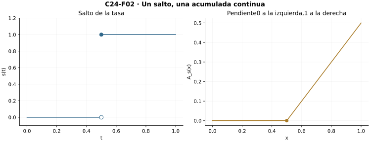
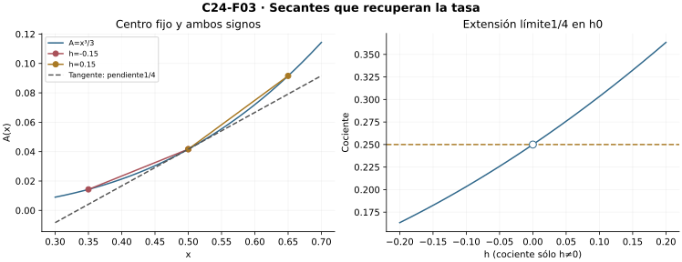
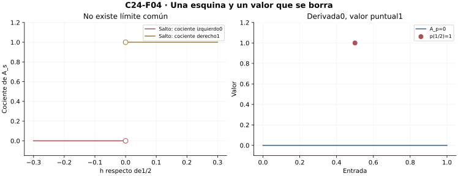
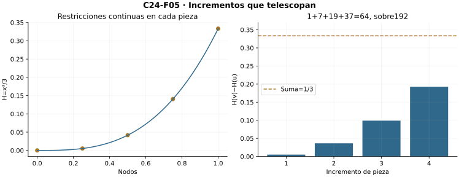
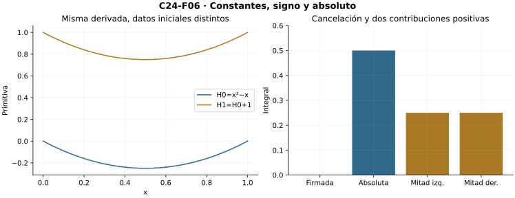

[Índice del libro](../para-matematicos/analisis-para-matematicos.html) · [Ejercicios de este capítulo](#ejercicios-24)

Al integrar una tasa en tramos cada vez más cortos, su promedio debería acercarse al valor de la tasa en el centro, siempre que ésta sea continua allí. Ésa será una dirección del teorema fundamental. La otra parte de una primitiva y compara sus incrementos con las sumas que construyeron la integral. Las dos pruebas enlazan las operaciones de C18 y C23, pero utilizan hipótesis diferentes.

C18 aporta derivadas relativas y reglas; C19, Lagrange y constancia; C23, integrabilidad, cotas, álgebra, aditividad y orientación. C14 es interfaz de continuidad. C15/C16 se declaran sólo para el promedio integral alcanzado opcional, después de las dos pruebas centrales. No se supone integrabilidad de toda derivada.

## 24.1. Construir una función de acumulación

[]{#MA-SEC-ANM-01-024-001}

Fijemos $a<b$ y una función integrable $f:[a,b]\to\mathbb R$. Para dar sentido a la acumulación hasta una entrada variable $x$, necesitamos primero que exista la integral en cada $[a,x]$. C23 proporciona esa restricción y la unicidad de su valor, además de acotación y aditividad. Podemos así asociar a cada entrada un único número acumulado.

**R1 — Acumulación con origen fijo.** Para $x\in[a,b]$ definimos
$$A_f(x)=\int_a^x f(t)\,dt.$$
La notación abrevia la integral de la restricción $f|_{[a,x]}$. Si $x>a$, existe por restricción de C23. Si $x=a$, usamos exclusivamente la convención de integral degenerada, de valor cero; no hay partición estricta de un singleton. La unicidad del valor integral hace única la salida para cada entrada.

Podemos construir el grafo como el subconjunto de $[a,b]\times\mathbb R$ formado por los pares $(x,z)$ que cumplen esa igualdad, con el caso degenerado separado. Existencia y unicidad muestran que es una función de dominio exacto $[a,b]$ y codominio real. No se elige una familia de testigos para construirla: cada salida está determinada por la relación funcional. En particular,
$$A_f(a)=0,\qquad A_f(b)=\int_a^b f.$$

**Primera identidad reutilizable.** Para $a\le x\le y\le b$, las restricciones sucesivas de $f$ conservan dominio, codominio y valores; por aditividad finita,
$$A_f(y)-A_f(x)=\int_x^y f.$$
Si $x=y$, ambos miembros son cero. Para $y<x$, la convención de orientación de C23 da la misma fórmula: invertir los límites cambia el signo. Así el incremento depende sólo del tramo entre las entradas, aunque cada valor de $A_f$ recuerde el origen $a$.

Si elegimos otro origen $c\in[a,b]$, la función $A_{f,c}(x)=\int_c^x f$ también existe para todas las entradas, incluidas las anteriores a $c$, y aditividad orientada prueba
$$A_{f,c}(x)=A_f(x)-A_f(c).$$
Cambiar el origen traslada toda la acumulación por una constante; no altera ninguno de sus incrementos. Esto se prueba antes de derivar y no presupone primitivas.

Para $f(t)=2t-1$ en $[0,1]$, la fórmula afín de C22, aplicada a cada $[0,x]$, da $A_f(x)=x^2-x$. La acumulación es negativa en el interior y vuelve a cero en $1$: las contribuciones iniciales negativas se compensan con las posteriores positivas. Su signo y su crecimiento dependen de la tasa; acumular cantidades firmadas no obliga a producir una función no negativa o creciente.

![En \[0,1\], f(t)=2t−1 y A(x)=x²−x. La acumulada tiene origen0, valor−1/4 en1/2 y valor0 en1; contribuciones firmadas de mitades opuestas.](../../assets/books/anm/C24/C24-F01.svg){#fig-anm-c24-f01 fig-alt="En [0,1], f(t)=2t−1 y A(x)=x²−x. La acumulada tiene origen0, valor−1/4 en1/2 y valor0 en1; contribuciones firmadas de mitades opuestas."}

### Ejercicios de la sección 24.1

[]{#ejercicios-24}

#### Ejercicio 1. Acumular una tasa afín

[]{#MA-EX-ANM-01-024-001}

En $[0,1]$, calcula $A_f(x)$ para $f(t)=2t-1$ usando la fórmula por sumas de C22, e identifica sus valores en $0,1/2,1$.

[]{#MA-SOL-ANM-01-024-001}

Ver solución del ejercicio 1

La tasa afín es integrable y sus restricciones también. Para $x>0$, la fórmula de C22 calcula la integral de una afín como la longitud por el promedio de sus alturas extremas. Por tanto $A_f(x)=x\big((-1)+(2x-1)\big)/2=x^2-x$. En $x=0$, la convención degenerada da cero y coincide con la fórmula. Así $A_f(0)=0$, $A_f(1/2)=-1/4$ y $A_f(1)=0$. En el interior, $x(x-1)<0$. La acumulación baja mientras la tasa es negativa y vuelve al valor inicial cuando la contribución positiva completa la compensación.

**Retorno visual.** Véase [C24-F01](analisis-para-matematicos-capitulo-24-el-teorema-fundamental-del-calculo.html#fig-anm-c24-f01), después del argumento completo: la figura permite reconocer el mecanismo y no sustituye la prueba.

#### Ejercicio 2. Cambiar de origen

[]{#MA-EX-ANM-01-024-002}

Demuestra para una integrable que $A_{f,c}(x)=A_f(x)-A_f(c)$ para toda entrada, y aplícalo a $f=1$ con $c=3/4$ en $[0,1]$.

[]{#MA-SOL-ANM-01-024-002}

Ver solución del ejercicio 2

Definimos $A_{f,c}(x)=\int_c^x f$ mediante restricción y orientación. Si $c\le x$, aditividad da $A_f(x)=A_f(c)+\int_c^x f$. Si $x<c$, da $A_f(c)=A_f(x)+\int_x^c f$; al restar y negar la integral se obtiene la misma igualdad $A_{f,c}(x)=A_f(x)-A_f(c)$. Para $x=c$ ambos lados son cero. Con $f=1$ en $[0,1]$, $A_f(x)=x$ y el nuevo origen $c=3/4$ da $A_{f,c}(x)=x-3/4$. Sus valores negativos antes de $c$ reflejan la orientación de esos tramos.

#### Ejercicio 3. Grafo sin selección

[]{#MA-EX-ANM-01-024-003}

Justifica que la relación que define $A_f$ tiene dominio exacto $[a,b]$ y codominio real, separando el borde.

[]{#MA-SOL-ANM-01-024-003}

Ver solución del ejercicio 3

Para $a<x\le b$, C23 garantiza la integrabilidad de $f|_{[a,x]}$ y la unicidad de su valor integral. En $x=a$ declaramos la única salida cero. Dentro de $[a,b]\times\mathbb R$, consideramos la relación que contiene $(a,0)$ y los pares $(x,r)$ con $a<x\le b$ y $r=\int_a^x f$. Cada entrada del intervalo tiene exactamente una salida real, y ninguna entrada exterior pertenece al producto. La relación es por tanto el grafo de una función con dominio exacto $[a,b]$. La unicidad determina las salidas, sin una selección simultánea de testigos de integración.

#### Ejercicio 4. Incremento orientado

[]{#MA-EX-ANM-01-024-004}

Prueba $A_f(y)-A_f(x)=\int_x^y f$ también cuando $y<x$ y cuando son iguales.

[]{#MA-SOL-ANM-01-024-004}

Ver solución del ejercicio 4

Si $x<y$, aditividad sobre los intervalos contiguos da $\int_a^y f=\int_a^x f+\int_x^y f$, incluyendo el caso $x=a$ por la convención degenerada. Así $A_f(y)-A_f(x)=\int_x^y f$. Si $y<x$, la identidad ordenada da $A_f(x)-A_f(y)=\int_y^x f$. Al negar se obtiene $A_f(y)-A_f(x)=-\int_y^x f=\int_x^y f$. Con $x=y$, tanto la diferencia como la integral degenerada valen cero. Las integrales existen por restricción; la inversión de extremos modifica su signo.

#### Ejercicio 5. Acumular un escalón

[]{#MA-EX-ANM-01-024-005}

Para el escalón de corte $1/2$, deduce la acumulada, incluido el valor en el corte, mediante restricciones y cambios finitos.

[]{#MA-SOL-ANM-01-024-005}

Ver solución del ejercicio 5

Sea $h(t)=0$ para $t<1/2$ y $h(t)=1$ para $t\ge1/2$. Si $0<x<1/2$, la restricción a $[0,x]$ es cero y su integral vale cero. Si $x=1/2$, difiere de la función cero sólo en su último punto; C23 conserva la integral cero. Si $x>1/2$, aditividad da $A_h(x)=\int_0^{1/2}h+\int_{1/2}^x h=0+(x-1/2)$. Junto con $A_h(0)=0$, queda $A_h(x)=0$ para $x\le1/2$ y $A_h(x)=x-1/2$ para $x\ge1/2$. Las dos fórmulas tienen el mismo valor en el corte, por lo que no hay salto en la acumulada.

## 24.2. Incrementos, cotas y continuidad

[]{#MA-SEC-ANM-01-024-002}

La identidad del incremento permite usar las cotas de $f$ en un tramo para encerrar el cambio de $A_f$ en él. Si las alturas quedan entre dos constantes, el orden de la integral sitúa la acumulación entre los productos de esas constantes por la longitud. Esta comparación permitirá demostrar continuidad antes de buscar una derivada.

**R2 — Encierro y regularidad automática.** Si $x<y$ y $m\le f(t)\le M$ para todo $t\in[x,y]$, el orden de la integral de C23 y la integral de una constante dan
$$m(y-x)\le A_f(y)-A_f(x)\le M(y-x).$$
Dividir por $y-x>0$ conserva el orden. Podemos tomar $m=\inf f([x,y])$, $M=\sup f([x,y])$, porque la imagen es no vacía y acotada; no tienen por qué alcanzarse. El cociente queda encerrado entre cotas de toda la pieza, no entre dos muestras.

La integrabilidad asegura una cota global $|f(t)|\le B$ con $B\ge0$. Para $x<y$, aplicar el encierro con $-B,B$ da $|A_f(y)-A_f(x)|\le B(y-x)$. Para $y<x$, intercambiar las entradas y usar simetría del absoluto; para igualdad, ambos lados son cero. Por tanto,
$$|A_f(y)-A_f(x)|\le B|y-x|\qquad(x,y\in[a,b]).$$
La acumulada es Lipschitz. Para cada $\varepsilon>0$, el radio $\delta=\varepsilon/(B+1)>0$ funciona para todos los pares: si $B>0$, la diferencia es menor que $B\delta<\varepsilon$; si $B=0$, es cero. Queda probada continuidad uniforme, incluso en los bordes relativos del dominio. También $|A_f(x)|\le B(b-a)$ por comparar con $a$.

**El signo gobierna incrementos.** Si $f\ge0$, cada integral sobre $[x,y]$, con $x<y$, es no negativa y $A_f$ es no decreciente. Para $f\le0$ resulta no creciente. Una barrera $f\ge m>0$ da $A_f(y)-A_f(x)\ge m(y-x)>0$ y crecimiento estricto. Un valor positivo aislado no basta: el pico de C23 tiene integral cero. Si $f$ es continua y estrictamente positiva, fijamos un punto interior de cualquier $[x,y]$; la continuidad mantiene allí $f$ por encima de la mitad de ese valor en un pequeño segmento. Su integral es positiva, y las de las piezas restantes son no negativas. La aditividad da incremento positivo en todo $[x,y]$.

Para el escalón $s(t)=0$ si $t<1/2$ y $s(t)=1$ si $t\ge1/2$ en $[0,1]$, la acumulada es $0$ hasta $1/2$ y $x-1/2$ después. El valor nodal no aporta anchura, por cambios finitos de C23. Es continua y Lipschitz de constante $1$ aunque la integranda tenga un salto.

{#fig-anm-c24-f02 fig-alt="El escalón vale0 antes de1/2 y1 desde el corte. Su acumulada vale0 hasta1/2 y x−1/2 después: continua y Lipschitz1, aunque haya salto."}

### Ejercicios de la sección 24.2

#### Ejercicio 6. Lipschitz de la acumulada

[]{#MA-EX-ANM-01-024-006}

Si $|f|\le3$ en $[-1,2]$, prueba continuidad uniforme de $A_f$ con radio explícito y una cota de su valor.

[]{#MA-SOL-ANM-01-024-006}

Ver solución del ejercicio 6

El origen es $a=-1$. Para $x<y$, el orden integral aplicado a $-3\le f\le3$ da $-3(y-x)\le\int_x^y f\le3(y-x)$. La identidad de incrementos implica $|A_f(y)-A_f(x)|\le3|y-x|$; intercambiar entradas prueba el mismo resultado si $y<x$, y la igualdad es inmediata. Dada $\varepsilon>0$, el radio $\delta=\varepsilon/4$ sirve para todos los centros: si $|y-x|<\delta$, el incremento tiene magnitud menor que $3\varepsilon/4<\varepsilon$. Esto prueba continuidad uniforme. Como $A_f(-1)=0$, también $|A_f(x)|\le3(x+1)\le9$ en todo el intervalo.

**Retorno visual.** Véase [C24-F02](analisis-para-matematicos-capitulo-24-el-teorema-fundamental-del-calculo.html#fig-anm-c24-f02), después del argumento completo: la figura permite reconocer el mecanismo y no sustituye la prueba.

#### Ejercicio 7. El caso de cota nula

[]{#MA-EX-ANM-01-024-007}

Explica por qué el radio $\varepsilon/(B+1)$ prueba continuidad uniforme incluso con $B=0$.

[]{#MA-SOL-ANM-01-024-007}

Ver solución del ejercicio 7

La cota absoluta tiene $B\ge0$, así $B+1>0$ y $\delta=\varepsilon/(B+1)$ es un radio positivo para toda tolerancia positiva. Si $B>0$ y $|y-x|<\delta$, se obtiene $|A_f(y)-A_f(x)|\le B|y-x|<B\varepsilon/(B+1)<\varepsilon$. Si $B=0$, la desigualdad $|f|\le0$ hace la tasa idénticamente cero y todos los incrementos de la acumulada son cero. El mismo radio sirve en ese caso. Como no depende del centro, demuestra continuidad uniforme.

#### Ejercicio 8. Signo y orden

[]{#MA-EX-ANM-01-024-008}

Demuestra que $f\ge m>0$ implica crecimiento estricto de su acumulada y una cota inferior de cada incremento.

[]{#MA-SOL-ANM-01-024-008}

Ver solución del ejercicio 8

Sean $x<y$. La restricción de $f$ es integrable y la constante $m$ tiene integral $m(y-x)$. El orden $f\ge m$ implica $A_f(y)-A_f(x)=\int_x^y f\ge m(y-x)$. Tanto $m$ como $y-x$ son positivos, así el incremento es estrictamente positivo. Por tanto $A_f$ es estrictamente creciente y satisface la cota cuantitativa $A_f(y)-A_f(x)\ge m(y-x)$ en todo par ordenado. Esta cota también impide que un tramo de longitud positiva tenga acumulación nula.

#### Ejercicio 9. Positivo en un punto

[]{#MA-EX-ANM-01-024-009}

Refuta que una tasa integrable no negativa, positiva en algún punto, tenga acumulada estrictamente creciente.

[]{#MA-SOL-ANM-01-024-009}

Ver solución del ejercicio 9

Definimos $p(1/2)=1$ y $p(t)=0$ para las demás entradas de $[0,1]$. Es integrable por el argumento del pico de C23, no negativa y positiva en $1/2$. En cada $[0,x]$ difiere de la función cero en a lo sumo un punto, por lo que $\int_0^x p=0$. Su acumulada es idénticamente cero y tiene iguales valores en cualesquiera dos entradas. Esto refuta el crecimiento estricto bajo la sola hipótesis de positividad en algún punto.

#### Ejercicio 10. Cociente encerrado

[]{#MA-EX-ANM-01-024-010}

Si $-2\le f\le5$ sobre $[x,y]$, $x<y$, encierra el incremento y el cociente de su acumulada. ¿Hace falta alcanzar esas cotas?

[]{#MA-SOL-ANM-01-024-010}

Ver solución del ejercicio 10

La integral de las constantes en $[x,y]$ vale, respectivamente, $-2(y-x)$ y $5(y-x)$. Al integrar las cotas universales resulta $-2(y-x)\le\int_x^y f=A_f(y)-A_f(x)\le5(y-x)$. Como $y-x>0$, dividir conserva el orden y da $-2\le(A_f(y)-A_f(x))/(y-x)\le5$. La conclusión sólo requiere que las cotas valgan para todas las entradas del tramo. No necesita que alguna altura sea exactamente menos dos o cinco, ni que esas cotas sean los extremos óptimos de la imagen.

## 24.3. La tasa reaparece en un punto

[]{#MA-SEC-ANM-01-024-003}

Ya sabemos que toda integranda integrable produce una acumulada continua. Para derivarla en un centro $x$, el cociente incremental expresa el promedio de $f$ entre $x$ y una entrada cercana. Si todos los valores de ese tramo están cerca de $f(x)$, el promedio también lo estará. La continuidad puntual proporcionará precisamente esa banda de alturas.

**Lema del promedio local.** Sean $x\ne y$ en $[a,b]$ y $\eta\ge0$. Si $|f(t)-f(x)|\le\eta$ para toda entrada del segmento que une $x$ con $y$, entonces
$$\left|\frac{A_f(y)-A_f(x)}{y-x}-f(x)\right|\le\eta.$$
Para $y>x$, integrar las cotas $f(x)-\eta\le f(t)\le f(x)+\eta$ y dividir por anchura positiva prueba la afirmación. Para $y<x$, aplicar el mismo argumento a $[y,x]$ produce el cociente $[A_f(x)-A_f(y)]/(x-y)$; cambiar los signos de numerador y denominador lo identifica con el cociente requerido. No se divide una desigualdad por un negativo conservando su orden.

**R3 — Primera parte, continuidad puntual.** Si $f$ es continua en un punto $x\in(a,b)$, entonces $A_f$ es derivable allí y $A_f'(x)=f(x)$.

Fijemos $\varepsilon>0$. Continuidad relativa de $f$ en $x$ da $\rho>0$ tal que $|t-x|<\rho$ y $t\in[a,b]$ implican $|f(t)-f(x)|<\varepsilon/2$. Elegimos
$$\delta=\min\{\rho,(x-a)/2,(b-x)/2\}>0.$$
Para cualquier $y$ admisible con $0<|y-x|<\delta$, cada punto $t$ del segmento entre ellos satisface $|t-x|\le|y-x|<\rho$. El lema con $\eta=\varepsilon/2$ da error del cociente a lo sumo $\varepsilon/2<\varepsilon$. Ese mismo radio controla todas las entradas a ambos lados; es exactamente la definición de C18. El centro acumula por ambos lados: para cualquier radio $r>0$, $x\pm\frac12\min\{r,x-a,b-x\}$ son entradas distintas suficientemente cercanas. Unicidad legitima la notación de derivada.

El radio procede de la continuidad de $f$ sólo en $x$, pero controla a la vez todos los puntos del segmento corto. La existencia de $A_f$ requiere, en cambio, integrabilidad en todo $[a,b]$. La prueba conserva separadas ambas obligaciones y no necesita representar cada promedio mediante un punto de valor medio integral.

**Certificado adicional cuando hay Lipschitz.** Si $|f(t)-f(x)|\le L|t-x|$, el lema da error del cociente a lo sumo $L|y-x|$. Hay una cota más fina: por álgebra y orden de integrales,
$$|A_f(y)-A_f(x)-f(x)(y-x)|\le \frac L2|y-x|^2.$$
Para $y>x$, integrar $|f(t)-f(x)|\le L(t-x)$ y usar la integral afín heredada da $L(y-x)^2/2$. Para $y<x$, invertir orientación y usar $L(x-t)$ sobre $[y,x]$ da el mismo resultado. No se usó Taylor. Si $L=0$, el residuo es exactamente cero.

Con $f(t)=t^2$ y $x=1/2$ en $[0,1]$, la acumulada ya calculada por sumas es $x^3/3$. Para incrementos admisibles $h\ne0$, el cociente es $1/4+h/2+h^2/3$, que converge a $f(1/2)=1/4$. El término adicional tiene signo y tamaño explícitos, sin depender de una lista de muestras.

{#fig-anm-c24-f03 fig-alt="Para f(t)=t², A(x)=x³/3 y centro1/2, el cociente con incremento h es1/4+h/2+h²/3. Desde ambos signos converge a1/4; la curva exacta, no las muestras, prueba el límite."}

### Ejercicios de la sección 24.3

#### Ejercicio 11. El lado negativo del cociente

[]{#MA-EX-ANM-01-024-011}

Prueba el lema del promedio local cuando $y<x$, sin dividir una desigualdad por un negativo.

[]{#MA-SOL-ANM-01-024-011}

Ver solución del ejercicio 11

Suponemos $y<x$ y $|f(t)-f(x)|\le\eta$ para todo $t\in[y,x]$. Integramos $f(x)-\eta\le f(t)\le f(x)+\eta$ sobre ese segmento ordenado. Su longitud positiva permite dividir y obtener $f(x)-\eta\le\big(\int_y^x f\big)/(x-y)\le f(x)+\eta$. Por aditividad, el cociente central es $(A_f(x)-A_f(y))/(x-y)$, igual a $(A_f(y)-A_f(x))/(y-x)$ al cambiar los dos signos. Restar $f(x)$ da un error entre $-\eta$ y $\eta$, equivalente a magnitud a lo sumo $\eta$. Así el lado negativo queda cubierto sin dividir una desigualdad por un número negativo.

#### Ejercicio 12. Radio puntual completo

[]{#MA-EX-ANM-01-024-012}

Escribe la prueba $\varepsilon$–$\delta$ de $A_f'(x)=f(x)$ para una integrable continua en un centro interior.

[]{#MA-SOL-ANM-01-024-012}

Ver solución del ejercicio 12

Sea $x\in(a,b)$ y $\varepsilon>0$. La continuidad de $f$ en $x$ proporciona $\rho>0$ tal que $|f(t)-f(x)|<\varepsilon/2$ para toda entrada del dominio con $|t-x|<\rho$. Tomamos $\delta=\min\{\rho,(x-a)/2,(b-x)/2\}>0$. Para cualquier $y$ con $0<|y-x|<\delta$, todo punto del segmento entre $x$ e $y$ dista de $x$ a lo sumo $|y-x|<\rho$. El error de la tasa en todo ese tramo está acotado por $\varepsilon/2$. El lema del promedio, válido para los dos órdenes, da $\left|(A_f(y)-A_f(x))/(y-x)-f(x)\right|\le\varepsilon/2<\varepsilon$. El radio precede a toda $y$ y ambos lados contienen entradas cercanas al centro, así esta es la prueba completa de $A_f'(x)=f(x)$.

#### Ejercicio 13. Cociente exacto del cuadrado

[]{#MA-EX-ANM-01-024-013}

Para $f(t)=t^2$ en $[0,1]$ y centro $1/2$, calcula el cociente con incremento $h$ admisible y no nulo, usando $A_f(x)=x^3/3$ de C22.

[]{#MA-SOL-ANM-01-024-013}

Ver solución del ejercicio 13

Los incrementos admisibles satisfacen $-1/2\le h\le1/2$ y $h\ne0$. La fórmula por sumas de C22 da $A_f(x)=x^3/3$. Por tanto el cociente en $1/2$ es $\big((1/2+h)^3-(1/2)^3\big)/(3h)$. Expandir el cubo produce numerador $3h/4+3h^2/2+h^3$ y dividir da $1/4+h/2+h^2/3$. Su diferencia respecto de $1/4$ tiene magnitud a lo sumo $|h|/2+h^2/3$. Para $|h|\le1/2$, esto no supera $2|h|/3$, que tiende a cero. La misma cuenta cubre ambos signos y confirma la derivada $1/4$.

**Retorno visual.** Véase [C24-F03](analisis-para-matematicos-capitulo-24-el-teorema-fundamental-del-calculo.html#fig-anm-c24-f03), después del argumento completo: la figura permite reconocer el mecanismo y no sustituye la prueba.

#### Ejercicio 14. Residuo cuadrático sin Taylor

[]{#MA-EX-ANM-01-024-014}

Si $f$ es Lipschitz de constante $L$, demuestra la cota $|A_f(y)-A_f(x)-f(x)(y-x)|\le L|y-x|^2/2$.

[]{#MA-SOL-ANM-01-024-014}

Ver solución del ejercicio 14

Por linealidad e incrementos, el residuo $R=A_f(y)-A_f(x)-f(x)(y-x)$ es $\int_x^y(f(t)-f(x))\,dt$. Si $x<y$, la triangular integral y Lipschitz dan $|R|\le\int_x^y|f(t)-f(x)|\,dt\le\int_x^y L(t-x)\,dt=L(y-x)^2/2$. La última evaluación es la fórmula afín de C22. Si $y<x$, invertimos orientación para trabajar en $[y,x]$, donde $|f(t)-f(x)|\le L(x-t)$; su integral vale $L(x-y)^2/2$. Si $x=y$, el residuo es cero. Así $|R|\le L|y-x|^2/2$ en todos los casos, también con $L=0$, sin usar Taylor.

#### Ejercicio 15. Continuidad local y global

[]{#MA-EX-ANM-01-024-015}

Explica qué hipótesis locales y globales se gastan al derivar la acumulada en un único centro.

[]{#MA-SOL-ANM-01-024-015}

Ver solución del ejercicio 15

La integrabilidad en todo $[a,b]$ permite restringir la tasa, construir cada valor de $A_f$ y escribir los incrementos como integrales. Además aporta una cota absoluta que demuestra continuidad de la acumulada. Para derivarla en una entrada interior fija $x$, sólo se necesita continuidad de $f$ en $x$: el radio puntual controla todas las alturas del segmento entre $x$ y una entrada cercana. El promedio local fuerza entonces el límite del cociente a $f(x)$. No interviene continuidad de la tasa en el resto del intervalo. El carácter interior del centro permite acercamientos por ambos lados; en los bordes la misma prueba produce derivadas relativas.

## 24.4. Bordes, saltos y valores aislados

[]{#MA-SEC-ANM-01-024-004}

En un extremo sólo podemos comparar la acumulación con entradas de un lado del dominio. El mismo encierro de promedios seguirá funcionando, con la continuidad relativa y el límite unilateral correspondientes.

**R4 — Bordes y límites de la recuperación.** Si $f$ es continua relativamente a $[a,b]$ en $a$, el mismo lema local prueba
$$\lim_{y\downarrow a}\frac{A_f(y)-A_f(a)}{y-a}=f(a).$$
Basta tomar el radio de continuidad para $\varepsilon/2$, reducirlo si hace falta a $(b-a)/2$, y controlar $t\in[a,y]$. En $b$, usar $[y,b]$ y cambiar ambos signos prueba el límite desde la izquierda, de valor $f(b)$. Ambos extremos acumulan unilateralmente. No se afirma una derivada bilateral de una prolongación desconocida.

Si $f$ es continua en todo $[a,b]$, C23 asegura su integrabilidad. R2 hace continua a $A_f$, R3 identifica su derivada en cada punto interior y el argumento anterior da las derivadas relativas de borde. Disponemos así de una función concreta cuya derivada recupera la tasa, incluso con el alcance unilateral que corresponde en los extremos.

**Un salto impide la derivada de la acumulada.** Para el escalón de R2, en $c=1/2$ los cocientes de la acumulada son $0$ desde la izquierda y $1$ desde la derecha. Si existiera una derivada $D$, la tolerancia $1/3$ y un radio común permitirían tomar $c-r,c+r$ dentro del dominio, con $r$ positivo menor que ese radio. Resultarían $|D|<1/3$ y $|1-D|<1/3$, contradiciendo $1\le|D|+|1-D|<2/3$. Continuidad de la acumulada no implica derivabilidad.

**Un valor aislado muestra otra falla.** Sea $p(c)=1$ y $p(t)=0$ para $t\ne c$, con $c=1/2$. Cambios finitos de C23 dan integral cero en cualquier restricción, luego $A_p\equiv0$. Su derivada existe también en $c$ y vale cero, distinta de $p(c)=1$. Sin continuidad local puede existir la derivada y fallar la igualdad. Continuidad es una condición suficiente de recuperación, no se ha probado que sea necesaria para que exista una derivada.

Modificar un valor de borde también deja todas las integrales intactas. La función que vale cero salvo $f(a)=1$ tiene acumulada cero y derivada derecha cero, distinta de ese valor de borde. Precisamente falla la continuidad relativa en $a$. El teorema no puede recuperar información que los cambios finitos borran de la integral.

{#fig-anm-c24-f04 fig-alt="En el salto, los cocientes de la acumulada en el corte son0 y1 desde lados distintos. El pico aislado tiene acumulada cero y derivada cero, diferente del valor1 en el pico."}

### Ejercicios de la sección 24.4

#### Ejercicio 16. Derivada en el borde

[]{#MA-EX-ANM-01-024-016}

Para una integrable continua relativamente en $a$, demuestra que la derivada derecha de $A_f$ vale $f(a)$.

[]{#MA-SOL-ANM-01-024-016}

Ver solución del ejercicio 16

Sea $\varepsilon>0$. La continuidad relativa de $f$ en $a$ proporciona $\rho>0$ con $|f(t)-f(a)|<\varepsilon/2$ para las entradas del dominio a distancia menor que $\rho$ de $a$. Ponemos $\delta=\min\{\rho,(b-a)/2\}>0$. Si $a<y\le b$ y $y-a<\delta$, todos los puntos de $[a,y]$ están en esa vecindad. Integrar las cotas y dividir por $y-a>0$ da $\left|(A_f(y)-A_f(a))/(y-a)-f(a)\right|\le\varepsilon/2<\varepsilon$. Como $a<b$, existen entradas derechas arbitrariamente próximas. El límite derecho, que es la derivada relativa al cerrado en $a$, vale $f(a)$.

#### Ejercicio 17. Dos pendientes incompatibles

[]{#MA-EX-ANM-01-024-017}

Prueba por contradicción cuantificada que la acumulada del escalón no tiene derivada en $1/2$.

[]{#MA-SOL-ANM-01-024-017}

Ver solución del ejercicio 17

La acumulada del escalón es cero hasta $c=1/2$ y $x-c$ después. Sus cocientes en $c$ valen cero para incrementos negativos y uno para positivos. Supongamos que tuviera derivada $D$. Con tolerancia $1/3$ existiría $\delta>0$ tal que todos los cocientes de entradas a distancia positiva menor que $\delta$ estuvieran a distancia menor que $1/3$ de $D$. Elegimos $r=\frac12\min\{\delta,1/2\}>0$. Las entradas $c-r,c+r$ pertenecen al dominio y cumplen la escala pedida. Sus cocientes dan $|D|<1/3$ y $|1-D|<1/3$. La triangular implicaría $1\le|D|+|1-D|<2/3$, contradicción. La acumulada es continua en el corte y carece de derivada allí.

#### Ejercicio 18. Derivada existente, valor no recuperado

[]{#MA-EX-ANM-01-024-018}

Para el pico aislado de altura uno, calcula su acumulada y su derivada en el pico; identifica la hipótesis fallida.

[]{#MA-SOL-ANM-01-024-018}

Ver solución del ejercicio 18

Para el pico $p(1/2)=1$, $p=0$ fuera, cada restricción a $[0,x]$ difiere de la tasa cero en a lo sumo una entrada. C23 conserva sus integrales, incluso si el punto excepcional coincide con el extremo $x$. Por ello $A_p(x)=0$ para toda entrada. En el centro $c=1/2$, todos sus cocientes son cero y $A_p'(c)=0$. En cambio $p(c)=1$. La tasa no es continua en $c$: cualquier vecindad contiene entradas distintas donde vale cero. Falla precisamente la hipótesis que permite recuperar el valor puntual de la tasa.

**Retorno visual.** Véase [C24-F04](analisis-para-matematicos-capitulo-24-el-teorema-fundamental-del-calculo.html#fig-anm-c24-f04), después del argumento completo: la figura permite reconocer el mecanismo y no sustituye la prueba.

#### Ejercicio 19. Modificar un extremo

[]{#MA-EX-ANM-01-024-019}

En $[0,1]$, toma $f(0)=1$ y $f(t)=0$ para $t>0$. Evalúa $A_f$ y su derivada derecha en cero.

[]{#MA-SOL-ANM-01-024-019}

Ver solución del ejercicio 19

La función dada difiere de cero sólo en el extremo izquierdo. Sobre cada $[0,x]$ de longitud positiva, el cambio finito conserva la integral cero; en $x=0$ la convención da también cero. Así $A_f$ es la función cero. Para $y>0$, $(A_f(y)-A_f(0))/y=0$, por lo que su derivada derecha en cero vale cero. Este valor difiere de $f(0)=1$. La continuidad relativa de la tasa falla allí, pues todas las entradas positivas próximas tienen altura cero. El ejemplo muestra que también en un borde un valor aislado puede perderse al acumular.

#### Ejercicio 20. Corolario de tasa continua

[]{#MA-EX-ANM-01-024-020}

Justifica que una continua sobre todo $[a,b]$ produce una acumulada continua y derivable con los valores relativos correctos.

[]{#MA-SOL-ANM-01-024-020}

Ver solución del ejercicio 20

Una función continua sobre $[a,b]$, con $a<b$, está acotada y es integrable por C23. Sus restricciones construyen $A_f$, y la cota absoluta prueba que esa acumulada es Lipschitz y continua en todo el cerrado. En cada punto de $(a,b)$, la continuidad puntual de la tasa permite aplicar la primera parte del fundamental y obtener $A_f'=f$. En $a$ se usa el argumento derecho; en $b$, el izquierdo. Ambos recuperan los valores de la tasa por continuidad relativa. Se obtiene una primitiva normalizada, con derivadas de borde referidas al dominio original.

## 24.5. De una primitiva a la integral

[]{#MA-SEC-ANM-01-024-005}

Para evaluar la integral a partir de una función $H$ cuya derivada sea $f$, compararemos los incrementos de $H$ con las mismas sumas inferiores y superiores que encierran la integral. Esta prueba utilizará Lagrange en cada pieza. Necesitaremos continuidad de $H$ en el cerrado y, para llegar al valor integral, integrabilidad de $f$; no tendremos que exigir continuidad de $f$.

**Primitiva en un cerrado.** Para $f:[a,b]\to\mathbb R$, llamaremos primitiva a una función $H:[a,b]\to\mathbb R$ continua en todo el cerrado, derivable en $(a,b)$ y con $H'(t)=f(t)$ allí. No pedimos derivadas bilaterales en los extremos ni incorporamos integrabilidad de $f$ a la definición. La continuidad de $H$ en los bordes será necesaria al usar C19.

**Encierro antes de integrar.** Si $f$ es acotada y $H$ es primitiva, para toda partición $P=(x_0,\ldots,x_n)$,
$$L(f,P)\le H(b)-H(a)\le U(f,P).$$
Fijado un índice $i$, la restricción de $H$ es continua en $[x_{i-1},x_i]$ y derivable dentro, por C14/C18. C19, valor medio de Lagrange, entrega $c$ interior con $H(x_i)-H(x_{i-1})=H'(c)\Delta_i=f(c)\Delta_i$. Cotas locales y $\Delta_i>0$ dan
$$m_i\Delta_i\le H(x_i)-H(x_{i-1})\le M_i\Delta_i.$$
El testigo ya no aparece en esta desigualdad. Por tanto podemos sumar la afirmación universal para todos los índices finitos sin construir una familia de puntos seleccionados. La suma central telescopa por cancelación finita y da el incremento total. La cota no ha supuesto integrabilidad.

**R5 — Newton–Leibniz.** Si además $f$ es integrable, entonces
$$\int_a^b f(t)\,dt=H(b)-H(a).$$
La integral $I$ y el incremento $D=H(b)-H(a)$ están ambos en $[L(f,P),U(f,P)]$ para cualquier $P$. Dada $\varepsilon>0$, el criterio de Darboux da una partición con brecha menor que $\varepsilon$, luego $|I-D|<\varepsilon$. Si esa distancia fuera positiva $d$, elegir $\varepsilon=d/2$ contradice el encierro; así $I=D$. Esta prueba no usa R3 ni continuidad de $f$. La primitiva es una hipótesis, su existencia no se deduce aquí de mera integrabilidad.

La restricción a cualquier $[u,v]\subseteq[a,b]$, con $u<v$, conserva todas las hipótesis y da $\int_u^v f=H(v)-H(u)$. Para igualdad, ambos lados cero; para límites invertidos, orientación de C23 cambia ambos signos. Así también $A_f(x)=H(x)-H(a)$ si existe esta primitiva, aun cuando $f$ no sea continua.

**Por qué conservar los bordes.** En $[0,1]$, tome $f\equiv0$, $H(0)=1$ y $H(x)=0$ para $x>0$. La igualdad $H'=f$ vale en el interior, pero la integral es cero y $H(1)-H(0)=-1$. Falta continuidad de la primitiva en el borde; Lagrange no se aplica al primer segmento. La fórmula de evaluación no es una nueva definición de integral.

{#fig-anm-c24-f05 fig-alt="Para H(x)=x³/3, los incrementos sobre nodos0,1/4,1/2,3/4,1 suman1/3. Cada incremento se encierra por Darboux; la suma cancela nodos interiores."}

### Ejercicios de la sección 24.5

#### Ejercicio 21. Telescopía de una primitiva

[]{#MA-EX-ANM-01-024-021}

Para una acotada $f$ y primitiva $H$, prueba el encierro de $H(b)-H(a)$ por $L(f,P),U(f,P)$ sin formar etiquetas de Lagrange.

[]{#MA-SOL-ANM-01-024-021}

Ver solución del ejercicio 21

Fijemos una pieza $[x_{i-1},x_i]$ de $P$. La continuidad de $H$ en el cerrado y su derivabilidad interior permiten aplicar Lagrange en esa pieza. Existe $c$ en su interior con $H(x_i)-H(x_{i-1})=H'(c)\Delta_i=f(c)\Delta_i$. Como $m_i\le f(c)\le M_i$ y $\Delta_i>0$, queda $m_i\Delta_i\le H(x_i)-H(x_{i-1})\le M_i\Delta_i$. El testigo ha desaparecido de esta conclusión, que vale para cualquier índice. Sumamos las desigualdades finitas; los valores de $H$ en nodos interiores se cancelan y obtenemos $L(f,P)\le H(b)-H(a)\le U(f,P)$. La acotación de $f$ garantiza extremos reales, y no se necesitó formar una familia de etiquetas ni suponer integrabilidad.

**Retorno visual.** Véase [C24-F05](analisis-para-matematicos-capitulo-24-el-teorema-fundamental-del-calculo.html#fig-anm-c24-f05), después del argumento completo: la figura permite reconocer el mecanismo y no sustituye la prueba.

#### Ejercicio 22. Encierro y evaluación

[]{#MA-EX-ANM-01-024-022}

Añade integrabilidad a la tarea anterior y deriva Newton–Leibniz mediante una tolerancia arbitraria.

[]{#MA-SOL-ANM-01-024-022}

Ver solución del ejercicio 22

Sea $I=\int_a^b f$, cuya existencia se añade como hipótesis. Para toda partición, el encierro del ejercicio anterior y el de la integral sitúan $H(b)-H(a)$ e $I$ en el mismo intervalo $[L(f,P),U(f,P)]$. Por tanto $|H(b)-H(a)-I|\le G(f,P)$. Dada $\varepsilon>0$, el criterio de Darboux produce una partición de brecha menor que $\varepsilon$, dando distancia menor que ella. Si la distancia fuera $d>0$, aplicar el criterio con $d/2$ produciría $d<d/2$, imposible. Luego $I=H(b)-H(a)$. La prueba usa Lagrange e integrabilidad; no requiere continuidad de $f$.

#### Ejercicio 23. Borde discontinuo de la candidata

[]{#MA-EX-ANM-01-024-023}

En $[0,1]$, $f=0$, $H(0)=1$ y $H(x)=0$ para $x>0$. ¿Basta $H'=f$ interior para evaluar la integral?

[]{#MA-SOL-ANM-01-024-023}

Ver solución del ejercicio 23

Para $x\in(0,1)$, la función $H$ es localmente constante cero, así $H'(x)=0=f(x)$. La tasa cero es integrable y $\int_0^1f=0$. Sin embargo, $H(1)-H(0)=0-1=-1$, así la igualdad de evaluación falla. La candidata es discontinua en cero, porque sus valores derechos son cero y su valor inicial es uno. Por tanto no es una primitiva admisible según la definición del capítulo. En cualquier primera pieza que empiece en cero, falta la continuidad requerida por Lagrange, que era el paso que conectaba la derivada interior con el incremento nodal.

#### Ejercicio 24. Subintervalo y orientación

[]{#MA-EX-ANM-01-024-024}

Si $H$ es una primitiva de una integrable, demuestra la fórmula de evaluación para todos los pares $u,v$ del dominio.

[]{#MA-SOL-ANM-01-024-024}

Ver solución del ejercicio 24

Si $u<v$, la tasa restringida a $[u,v]$ es integrable. La restricción de $H$ es continua en ese cerrado y derivable en su interior, con derivada igual a la tasa allí. Newton–Leibniz da $\int_u^v f=H(v)-H(u)$. Si $u=v$, la integral degenerada y la diferencia valen cero. Si $v<u$, aplicamos la fórmula ordenada sobre $[v,u]$ y negamos: $\int_u^v f=-\int_v^u f=-(H(u)-H(v))=H(v)-H(u)$. Así la evaluación vale para todos los pares del dominio, con la orientación correspondiente.

#### Ejercicio 25. Hipótesis independientes

[]{#MA-EX-ANM-01-024-025}

Distingue las premisas de la primera y la segunda parte del teorema.

[]{#MA-SOL-ANM-01-024-025}

Ver solución del ejercicio 25

La primera parte empieza con una tasa integrable y construye su acumulada. Para recuperar la tasa al derivar en una entrada se añade continuidad en esa entrada; si es un borde, la continuidad y la derivada son relativas. La segunda parte empieza con una tasa integrable y una primitiva $H$ ya dada, continua en el cerrado y derivable dentro, con $H'=f$ en el interior. Evalúa la integral por incrementos de $H$ sin exigir continuidad de $f$. La primera dirección construye una primitiva cuando la tasa es continua; la segunda evalúa mediante una primitiva admisible existente. Ambas conservan la hipótesis de integrabilidad que legitima sus valores integrales.

## 24.6. Normalización, cálculo y signo

[]{#MA-SEC-ANM-01-024-006}

Dos primitivas de la misma tasa tienen diferencia de derivada cero. La constancia demostrada en C19 permitirá fijar esa diferencia mediante un solo valor inicial. Con esa normalización podremos pasar de las reglas de derivación disponibles a fórmulas de integración.

**R6 — Unicidad salvo constante.** Si $H,K$ son primitivas de la misma $f$ en $[a,b]$, su diferencia es continua en el cerrado y derivable dentro, con $(H-K)'=0$ por C18. C19 aplicado a cualquier par de entradas prueba constancia: $H(x)-K(x)=C$, donde $C=H(a)-K(a)$ es único al evaluar en $a$. Recíprocamente, sumar cualquier constante a una primitiva conserva ambas condiciones. El intervalo completo importa: dos componentes separadas podrían llevar constantes distintas.

Para una $f$ continua, R4 construye la primitiva $A_f$ que se anula en $a$. R6 muestra que cualquier otra tiene forma $A_f+C$, así que imponer $H(a)=c_0$ determina exactamente $C=c_0$. La solución única de $H'=f$ entre las funciones continuas en el cerrado y derivables en el interior es, por tanto, $H(x)=c_0+A_f(x)$. La tasa está dada de antemano; esta construcción no resuelve una ecuación diferencial general en la que la función desconocida aparezca también a la derecha.

**Polinomios y potencias enteras.** C18 demostró por inducción $D(x^{n+1})=(n+1)x^n$ para enteros $n\ge0$; el denominador $n+1$ es positivo. La función $H(t)=t^{n+1}/(n+1)$ es continua y primitiva de $t^n$. Esa integranda es continua e integrable por C23, de modo que
$$\int_u^v t^n\,dt=\frac{v^{n+1}-u^{n+1}}{n+1}.$$
Con $n=0$ se recupera la integral constante sin potencias negativas. Sumas finitas y escalar de C23 permiten integrar polinomios término a término. No se extiende esta prueba a exponentes reales, ni a una serie infinita.

En particular $\int_0^1t^2\,dt=1/3$, en acuerdo con el cálculo por sumas de C22/C23. Para $f(t)=2t-1$, una primitiva es $t^2-t$, y $\int_0^1f=0$; sin embargo, partir en $1/2$ da
$$\int_0^{1/2}|2t-1|\,dt=\frac14,\qquad
\int_{1/2}^1|2t-1|\,dt=\frac14.$$
La integral de su absoluto es $1/2$. La cancelación no mide variación total ni vuelve cero a la integranda.

La acumulación de una continua positiva crece, por R3/C19 o directamente por R2. Cuando la tasa continua cambia de negativa a positiva, la acumulada puede tener un mínimo: para $2t-1$ en $[0,1]$, $A_f(1/2)=-1/4$. Ceros de la tasa corresponden a puntos estacionarios interiores por R3; no todo punto estacionario es extremo, como muestra una tasa $f(t)=3t^2$ en $[-1,1]$, cuya acumulada $t^3+1$ sigue creciendo a través de cero.

{#fig-anm-c24-f06 fig-alt="Las primitivas x²−x y x²−x+1 difieren en constante1. Integral firmada de2t−1 es0; integral absoluta1/2 y aportes absolutos1/4 por mitad."}

### Ejercicios de la sección 24.6

#### Ejercicio 26. Constante de primitivas

[]{#MA-EX-ANM-01-024-026}

Prueba unicidad salvo constante y determina la constante si $H(a)=3$ y $K(a)=-2$.

[]{#MA-SOL-ANM-01-024-026}

Ver solución del ejercicio 26

La diferencia $D=H-K$ es continua en $[a,b]$, derivable en $(a,b)$ y tiene derivada $D'=H'-K'=0$. Para cualesquiera $u<v$ del dominio, Lagrange sobre $[u,v]$ da $D(v)-D(u)=D'(c)(v-u)=0$. Por tanto $D$ es constante en todo el intervalo, incluidos los bordes. Evaluar en $a$ fija $D(a)=3-(-2)=5$, así $H(x)=K(x)+5$ para toda entrada. La misma evaluación muestra que ninguna otra constante podría satisfacer esos datos.

#### Ejercicio 27. Un dato inicial

[]{#MA-EX-ANM-01-024-027}

Para $f(t)=2t-1$ en $[0,1]$ y $H(0)=2$, encuentra y justifica la solución única del problema $H'=f$.

[]{#MA-SOL-ANM-01-024-027}

Ver solución del ejercicio 27

La acumulada de la tasa afín es $A_f(x)=x^2-x$. Por tanto proponemos $H(x)=2+x^2-x$. Es continua en $[0,1]$, derivable dentro, tiene $H'(x)=2x-1$ por las reglas de C18 y cumple $H(0)=2$. Si $K$ es otra solución admisible, $K-H$ es continua en el cerrado y tiene derivada cero en el interior. Lagrange la hace constante, y el dato inicial da $K(0)-H(0)=0$. Así $K=H$ y la solución es única entre las primitivas con la regularidad declarada.

#### Ejercicio 28. Potencia entera

[]{#MA-EX-ANM-01-024-028}

Calcula $\int_{-1}^2 t^3\,dt$ y justifica la primitiva con herramientas anteriores.

[]{#MA-SOL-ANM-01-024-028}

Ver solución del ejercicio 28

La tasa $t^3$ es continua en $[-1,2]$ y por tanto integrable. La regla de potencias enteras de C18 da $\big(t^4/4\big)'=t^3$, y la función $H(t)=t^4/4$ es continua en el cerrado y derivable dentro. Es una primitiva admisible. Newton–Leibniz permite evaluar $\int_{-1}^2t^3\,dt=H(2)-H(-1)=(16-1)/4=15/4$. Por aditividad, el tramo negativo aporta $-1/4$ y el positivo aporta cuatro, dando la misma suma firmada.

#### Ejercicio 29. Cancelación y absoluto

[]{#MA-EX-ANM-01-024-029}

Calcula las integrales de $2t-1$ y de su absoluto en $[0,1]$, sin confundirlas.

[]{#MA-SOL-ANM-01-024-029}

Ver solución del ejercicio 29

Para $2t-1$, la primitiva $H(t)=t^2-t$ da $\int_0^1(2t-1)\,dt=H(1)-H(0)=0$. Para el absoluto, partimos en $1/2$. Sobre $[0,1/2]$ vale $1-2t$ y la primitiva $t-t^2$ da $1/2-1/4=1/4$. Sobre $[1/2,1]$ vale $2t-1$ y su integral es $0-(-1/4)=1/4$. Las funciones son continuas e integrables en los segmentos usados. Aditividad produce $\int_0^1|2t-1|\,dt=1/2$. En la integral firmada los aportes son $-1/4$ y $1/4$; al tomar el absoluto se suman sus magnitudes.

**Retorno visual.** Véase [C24-F06](analisis-para-matematicos-capitulo-24-el-teorema-fundamental-del-calculo.html#fig-anm-c24-f06), después del argumento completo: la figura permite reconocer el mecanismo y no sustituye la prueba.

#### Ejercicio 30. Estacionario sin extremo

[]{#MA-EX-ANM-01-024-030}

En $[-1,1]$, toma $f(t)=3t^2$. Calcula su acumulada y demuestra que cero es estacionario sin ser extremo.

[]{#MA-SOL-ANM-01-024-030}

Ver solución del ejercicio 30

La tasa continua $3t^2$ tiene primitiva $t^3$. Con origen en menos uno, Newton–Leibniz da $A_f(x)=x^3-(-1)^3=x^3+1$. Su derivada en cero es $3\cdot0^2=0$, así el punto es estacionario. Sin embargo, $A_f(x)<1=A_f(0)$ para $x<0$ y $A_f(x)>1$ para $x>0$, con entradas de ambos tipos en toda vecindad de cero. Esto excluye tanto un máximo como un mínimo local. Además el cubo es estrictamente creciente: si $u<v$, $v^3-u^3=(v-u)(v^2+uv+u^2)>0$, pues el segundo factor sólo podría ser cero con $u=v=0$.

## 24.7. Partes y cambio de variable

[]{#MA-SEC-ANM-01-024-007}

La regla del producto y la regla de la cadena proporcionan primitivas de nuevas integrandas. Para usarlas mediante Newton–Leibniz debemos comprobar también la existencia de las integrales que aparecerán. Mantendremos explícita esa condición al obtener integración por partes y cambio de variable.

**R7a — Integración por partes.** Sean $p,q$ continuas en $[a,b]$, derivables en $(a,b)$. Sean $v,w:[a,b]\to\mathbb R$ integrables, iguales respectivamente a $p',q'$ en el interior. Los valores en los bordes son extensiones declaradas; cambios finitos no afectan integrales. Las funciones continuas $p,q$ son integrables por C23; productos y sumas de integrables lo son por su álgebra. Por tanto $pw$ y $vq$ son integrables.

La regla del producto de C18 dice que $pq$ es una primitiva, continua en el cerrado, de $vq+pw$. Newton–Leibniz y linealidad dan
$$\int_a^b p(t)w(t)\,dt
=p(b)q(b)-p(a)q(a)-\int_a^b v(t)q(t)\,dt.$$
No basta que $p',q'$ existan; aquí se exige la integrabilidad de las extensiones. Un caso suficiente es que sean continuas en el cerrado. Para $p(t)=t$, $q(t)=t^2/2$ en $[0,1]$, la identidad da $\int_0^1t^2=1/2-1/6=1/3$, con el segundo valor calculado por R6. Es comprobación, no prueba circular del valor usado.

**R7b — Cambio de variable con signo.** Sea $f:[a,b]\to\mathbb R$ continua. Sea $g:[\alpha,\beta]\to[a,b]$ continua, con $\alpha<\beta$, derivable en el interior, y sea $v$ una extensión integrable de $g'$ a ese cerrado. La composición $f\circ g$ es continua, por lo que $(f\circ g)v$ es integrable por C23. Entonces
$$\int_\alpha^\beta f(g(t))v(t)\,dt=\int_{g(\alpha)}^{g(\beta)}f(s)\,ds.$$
Para probarlo, tome $F=A_f$. R3/R4 dan su derivada relativa de valor $f$ en todo $[a,b]$, incluidos los extremos. La cadena relativa de C18 aplicada a $F\circ g$ da derivada $f(g(t))g'(t)$ en cada punto interior. Todos los centros $g(t)$ acumulan en $[a,b]$; si un incremento de $g$ se anula, la versión de la cadena de C18 no divide por él. La composición es continua en el cerrado y constituye una primitiva de la integranda. R5 evalúa su integral como $F(g(\beta))-F(g(\alpha))$, y R1 identifica ese incremento con la integral orientada requerida.

El signo de $g'$ ya registra los recorridos en sentidos opuestos, por lo que no se exige monotonía de $g$. Para $f(s)=s$ en $[0,1]$ y $g(t)=t^2$ en $[-1,1]$, el integrando es $2t^3$ y la integral vale cero: ambos extremos transformados son uno. Para $g(t)=1-t$ en $[0,1]$, obtenemos $-(1-t)$ e integral $-1/2$, igual a $\int_1^0s\,ds$. Sustituir $g'$ por $|g'|$ eliminaría esa información de orientación y produciría otra expresión.

![Con g(t)=t² en\[−1,1\] y f(s)=s, el integrando es2t³. Aportes−1/2 y1/2 cancelan; ambos extremos transformados son1. Con valor absoluto de g′ se obtiene1, una expresión diferente.](../../assets/books/anm/C24/C24-F07.svg){#fig-anm-c24-f07 fig-alt="Con g(t)=t² en[−1,1] y f(s)=s, el integrando es2t³. Aportes−1/2 y1/2 cancelan; ambos extremos transformados son1. Con valor absoluto de g′ se obtiene1, una expresión diferente."}

### Ejercicios de la sección 24.7

#### Ejercicio 31. Partes desde producto

[]{#MA-EX-ANM-01-024-031}

Demuestra integración por partes bajo las hipótesis de R7a, explicando por qué existen ambas integrales.

[]{#MA-SOL-ANM-01-024-031}

Ver solución del ejercicio 31

Suponemos $p,q$ continuas en $[a,b]$ y derivables dentro, con extensiones integrables $v,w$ de sus derivadas interiores. C23 hace integrables a $p,q$ por continuidad y a los productos $pw,vq$ y su suma por el álgebra de integrables. La función $H=pq$ es continua en el cerrado y la regla del producto da $H'=vq+pw$ en el interior. Es una primitiva admisible de esa suma. Newton–Leibniz da $\int_a^b(vq+pw)=p(b)q(b)-p(a)q(a)$. Por linealidad y existencia de ambas integrales, podemos restar $\int_a^b vq$ y obtener $\int_a^b pw=p(b)q(b)-p(a)q(a)-\int_a^b vq$. Los valores escogidos para $v,w$ en los bordes no cambian los valores integrales, por invariancia ante modificaciones finitas.

#### Ejercicio 32. Comprobar una integración por partes

[]{#MA-EX-ANM-01-024-032}

Con $p(t)=t$, $q(t)=t^2/2$ en $[0,1]$, verifica la fórmula y sus hipótesis.

[]{#MA-SOL-ANM-01-024-032}

Ver solución del ejercicio 32

Para $p(t)=t$ y $q(t)=t^2/2$, las extensiones de derivadas $v(t)=1$ y $w(t)=t$ son continuas en $[0,1]$, por tanto integrables. Los productos también lo son. La contribución de borde es $p(1)q(1)-p(0)q(0)=1/2$. La regla de potencias ya permite evaluar $\int_0^1vq=\int_0^1t^2/2=1/6$ mediante la primitiva $t^3/6$. La fórmula de partes da $\int_0^1pw=1/2-1/6=1/3$. Como $pw=t^2$, coincide con la evaluación directa por $t^3/3$. Esta comprobación utiliza valores de potencias previamente justificados.

#### Ejercicio 33. Cambio de variable decreciente

[]{#MA-EX-ANM-01-024-033}

Aplica R7b a $f(s)=s$, $g(t)=1-t$ en $[0,1]$ y explica el signo.

[]{#MA-SOL-ANM-01-024-033}

Ver solución del ejercicio 33

La tasa $f(s)=s$ es continua en $[0,1]$. La función $g(t)=1-t$ lleva $[0,1]$ a ese intervalo, es continua y tiene derivada extendida $v(t)=-1$, integrable. Así la integranda transformada es $f(g(t))v(t)=-(1-t)=t-1$. Su integral vale $[t^2/2-t]_0^1=-1/2$. Las imágenes extremas son $g(0)=1$ y $g(1)=0$, por lo que el lado derecho es $\int_1^0s\,ds=-\int_0^1s\,ds=-1/2$. El signo negativo de la derivada registra el recorrido decreciente y coincide con la orientación de los extremos transformados.

#### Ejercicio 34. Ida y vuelta sin monotonía

[]{#MA-EX-ANM-01-024-034}

Usa $f(s)=s$ en $[0,1]$ y $g(t)=t^2$ en $[-1,1]$ para verificar el cambio de variable y mostrar qué sucede con $|g'|$.

[]{#MA-SOL-ANM-01-024-034}

Ver solución del ejercicio 34

La función $g(t)=t^2$ lleva $[-1,1]$ a $[0,1]$ y tiene extensión continua de derivada $v(t)=2t$. Para la tasa continua $f(s)=s$, la integranda $f(g(t))v(t)=2t^3$ es integrable. Su primitiva $t^4/2$ da integral cero, igual a $\int_{g(-1)}^{g(1)}s\,ds=\int_1^1s\,ds=0$. Por separado, los aportes son $-1/2$ en $[-1,0]$ y $1/2$ en $[0,1]$. Si se sustituye $v$ por $|v|$, la integranda pasa a $2|t|^3$. En cada mitad su integral es $1/2$, así el total es uno. El recorrido de ida y vuelta, sin monotonía global, se cancela sólo en la fórmula con signo.

**Retorno visual.** Véase [C24-F07](analisis-para-matematicos-capitulo-24-el-teorema-fundamental-del-calculo.html#fig-anm-c24-f07), después del argumento completo: la figura permite reconocer el mecanismo y no sustituye la prueba.

#### Ejercicio 35. La imagen toca un borde

[]{#MA-EX-ANM-01-024-035}

Explica por qué la prueba con $A_f\circ g$ sigue válida si una entrada interior de $g$ tiene imagen en $a$ o $b$, o si su incremento es cero.

[]{#MA-SOL-ANM-01-024-035}

Ver solución del ejercicio 35

Sea $F=A_f$, con $f$ continua en $[a,b]$. La primera parte del fundamental da a $F$ derivadas relativas también en los extremos, con valores $f(a),f(b)$. Por tanto, si un centro interior $t$ de $g$ tiene imagen $c=g(t)$ en un borde, la aproximación de $F$ sigue siendo válida para los incrementos de imagen que permanecen en $[a,b]$. Escribimos $F(c+k)-F(c)=f(c)k+r(k)$, con $r(k)/|k|\to0$ para incrementos admisibles no nulos y $r(0)=0$. Tomando $k=g(t+h)-g(t)$, la derivabilidad de $g$ limita $|k|/|h|$ cerca de cero. Así $r(k)/h\to0$, y para $k=0$ el residuo es exactamente cero. Queda $(F\circ g)'(t)=f(g(t))g'(t)$ sin dividir por $k$. La composición es continua en el cerrado; la extensión integrable de $g'$ y el álgebra de C23 hacen integrable su tasa transformada, permitiendo Newton–Leibniz.

## 24.8. Qué invierte el teorema y qué conserva

[]{#MA-SEC-ANM-01-024-008}

La constante inicial explica la asimetría entre las dos composiciones de operaciones: derivar olvida una constante, mientras integrar desde un origen fija una normalización. Además, las hipótesis de recuperación de la tasa y de reconstrucción de una primitiva deben conservarse por separado.

**R8 — Dos direcciones y estabilidad.** En las funciones continuas $f:[a,b]\to\mathbb R$, integrar desde $a$ y después derivar recupera $f$ en el interior, y en los bordes mediante derivadas relativas. En las funciones $H$ continuas en el cerrado, derivables dentro y con una extensión integrable $f$ de su derivada, derivar e integrar recupera $H(x)-H(a)$. La constante inicial desaparece al derivar y debe reponerse al reconstruir $H$. La segunda dirección es R5 sobre cada restricción, no una consecuencia de continuidad de $f$ que no se ha exigido.

Para dos integrables $f,g$ con cota universal $|f(t)-g(t)|\le\eta$, $\eta\ge0$, la linealidad y la estimación integral dan
$$|A_f(x)-A_g(x)|\le\eta(x-a)\le\eta(b-a).$$
Además, para dos entradas, el cambio de la diferencia está acotado por $\eta|y-x|$. La acumulación amortigua perturbaciones uniformemente acotadas en el sentido de este certificado. Si $H'=f$ con $H(a)=c_0$ y otra primitiva $K'=g$ con $K(a)=d_0$, R5 sobre restricciones da
$$|H(x)-K(x)|\le |c_0-d_0|+\eta(x-a).$$
Cada hipótesis es universal sobre el intervalo: una tabla de errores pequeños no certifica la desigualdad. Si $f,g$ difieren sólo en un conjunto finito, C23 asegura integrales iguales en todas las restricciones, por lo que $A_f=A_g$ aunque no haya recuperación de sus valores excepcionales.

**Promedio alcanzado, con una herramienta adicional declarada.** Para una continua en $[u,v]$ con $u<v$, C16 da mínimo $m$ y máximo $M$ alcanzados. Orden integral encierra el promedio $\frac1{v-u}\int_u^v f$ entre ellos; C15, valor intermedio, entrega una entrada $c\in[u,v]$ donde $f(c)$ coincide con él. Es una consecuencia opcional del encierro, distinta de Lagrange y no usada en R3 ni R5. No garantiza unicidad ni un punto prescrible; para una constante, todos sirven. Para el escalón con salto a $1/2$, el promedio en $[0,1]$ es $1/2$, que no es ninguno de sus valores $0,1$: integrabilidad sola no garantiza un promedio alcanzado.

La integrabilidad basta para construir una acumulada continua, pero el escalón y el pico muestran que no basta para recuperar todos los valores de la tasa mediante su derivada. Tampoco se ha demostrado que toda derivada sea integrable o que toda integrable tenga primitiva. Los resultados anteriores se refieren a las hipótesis expresas de cada dirección, sin utilizar criterios de medida ni integrales impropias.

En el libro de cálculo estos puentes podían utilizarse como reglas. Aquí la primera dirección procede del encierro de los promedios locales; la segunda, de Lagrange y la telescopía de incrementos. Cada una se apoya en la integral ya construida y permite precisar qué información se conserva al pasar de una operación a la otra.

![En\[0,3\], tasas f(t)=t y g(t)=t+1/100 satisfacen error uniforme1/100. Diferencia de acumuladas x/100 y cota global3/100; la banda es un certificado universal probado.](../../assets/books/anm/C24/C24-F08.svg){#fig-anm-c24-f08 fig-alt="En[0,3], tasas f(t)=t y g(t)=t+1/100 satisfacen error uniforme1/100. Diferencia de acumuladas x/100 y cota global3/100; la banda es un certificado universal probado."}

### Ejercicios de la sección 24.8

#### Ejercicio 36. Error uniforme de la tasa

[]{#MA-EX-ANM-01-024-036}

Si $|f-g|\le1/100$ en $[0,3]$ y ambas son integrables, certifica el error entre sus acumuladas en cualquier entrada y en $3$.

[]{#MA-SOL-ANM-01-024-036}

Ver solución del ejercicio 36

La diferencia $f-g$ es integrable por el álgebra de C23. Para $0<x\le3$, linealidad da $A_f(x)-A_g(x)=\int_0^x(f-g)$. La cota universal $|f-g|\le1/100$ y el orden integral implican $|A_f(x)-A_g(x)|\le x/100\le3/100$. En $x=0$ la diferencia es cero y cumple la fórmula. En $x=3$ el error certificado es a lo sumo $3/100$. La cota es alcanzable, por ejemplo si $f-g$ es constantemente $1/100$, pero para tasas generales no afirma que el error efectivo alcance ese máximo.

**Retorno visual.** Véase [C24-F08](analisis-para-matematicos-capitulo-24-el-teorema-fundamental-del-calculo.html#fig-anm-c24-f08), después del argumento completo: la figura permite reconocer el mecanismo y no sustituye la prueba.

#### Ejercicio 37. Dato inicial y tasa

[]{#MA-EX-ANM-01-024-037}

Si primitivas admisibles $H,K$ tienen datos iniciales con distancia $1/10$ en $0$ y sus tasas integrables difieren a lo sumo $1/100$ en $[0,2]$, certifica la diferencia de salidas.

[]{#MA-SOL-ANM-01-024-037}

Ver solución del ejercicio 37

Sean $c_0=H(0)$ y $d_0=K(0)$, con $|c_0-d_0|=1/10$. Newton–Leibniz sobre cada restricción da $H(x)=c_0+\int_0^x f$ y $K(x)=d_0+\int_0^x g$, donde las tasas integrables satisfacen $|f-g|\le1/100$. La triangular y la cota integral producen $|H(x)-K(x)|\le1/10+x/100$ para $0\le x\le2$. En todo el dominio esto no supera $1/10+2/100=3/25$. El dato inicial aporta una diferencia fija y la discrepancia de las tasas aporta una cantidad proporcional a la longitud recorrida. Si ambas tienen el mismo signo, la cota puede alcanzarse.

#### Ejercicio 38. Misma acumulada, distintas tasas

[]{#MA-EX-ANM-01-024-038}

Construye dos integrables diferentes con acumuladas iguales y explica por qué no contradicen la primera parte.

[]{#MA-SOL-ANM-01-024-038}

Ver solución del ejercicio 38

Tomamos $f(t)=0$ en $[0,1]$ y $g(1/2)=1$, $g(t)=0$ en las demás entradas. La segunda tasa es integrable por modificación finita de la primera, y ambas son diferentes en $1/2$. Sobre cada $[0,x]$ sus integrales coinciden, así $A_f=A_g=0$ en todo el dominio. En el punto excepcional, $g$ es discontinua y la primera parte del fundamental no afirma recuperar su altura. En las demás entradas ambas tasas valen cero y son continuas relativamente, por lo que la derivada de la acumulada sí coincide con ellas. El ejemplo muestra por qué el requisito de continuidad puntual importa para identificar la tasa a partir de su acumulada.

#### Ejercicio 39. Promedio alcanzado

[]{#MA-EX-ANM-01-024-039}

Demuestra el valor medio integral para una continua en un cerrado y refuta su extensión a toda integrable mediante el escalón.

[]{#MA-SOL-ANM-01-024-039}

Ver solución del ejercicio 39

Sea $f$ continua en $[u,v]$, con $u<v$. Por C16, tiene mínimo $m$ y máximo $M$ alcanzados en entradas $s,t$. Integrar $m\le f\le M$ y dividir por $v-u>0$ da $m\le\mu\le M$, donde $\mu=(v-u)^{-1}\int_u^v f$. Si $m=M$, la función es constante y todas las entradas realizan el promedio. Si $m<M$, los puntos de los extremos son distintos; el valor intermedio en el segmento ordenado que los une entrega $c$ con $f(c)=\mu$, incluyendo los casos en que el promedio sea uno de los extremos. Para el escalón de corte $1/2$ en $[0,1]$, la integral y el promedio valen $1/2$, pero la imagen es $\{0,1\}$. Es una tasa integrable que no alcanza su promedio, así la conclusión no se extiende a toda integrable.

#### Ejercicio 40. Dos operaciones y una constante

[]{#MA-EX-ANM-01-024-040}

Formula qué recupera cada composición de derivar e integrar, e identifica una afirmación no habilitada por el capítulo.

[]{#MA-SOL-ANM-01-024-040}

Ver solución del ejercicio 40

Para una tasa continua $f$ en $[a,b]$, integrar desde $a$ produce $A_f$ y derivarla recupera $f$ en los puntos interiores y mediante derivadas relativas en los bordes. Para una función $H$ continua en el cerrado, derivable dentro y con extensión integrable $f$ de su derivada, integrar esa tasa produce $A_f(x)=H(x)-H(a)$. El valor inicial debe reponerse para reconstruir $H$. En la primera composición se conserva cada altura por continuidad; en la segunda se pierde una constante al derivar. El capítulo no demuestra que toda derivada sea integrable ni que toda tasa integrable tenga una primitiva: las hipótesis de los dos contratos siguen siendo necesarias para aplicar las fórmulas aquí probadas.

[Índice del libro](../para-matematicos/analisis-para-matematicos.html) · [Ejercicios de este capítulo](#ejercicios-24)

[← Capítulo 23](analisis-para-matematicos-capitulo-23-integral-de-riemann-y-darboux.html) · [Capítulo 25 →](analisis-para-matematicos-capitulo-25-la-frontera-de-riemann.html)
