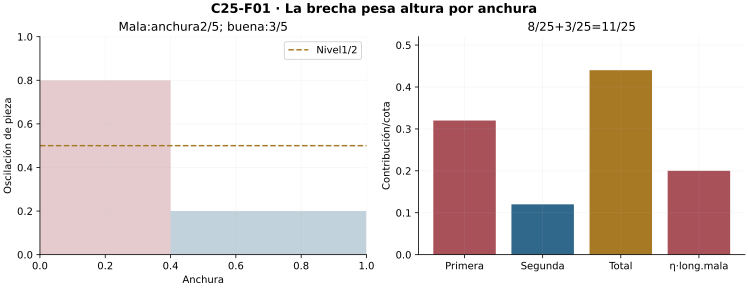
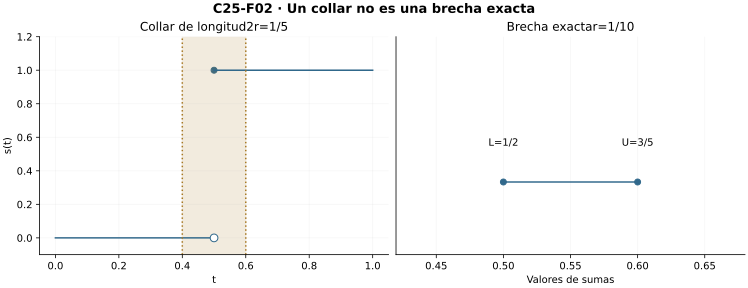
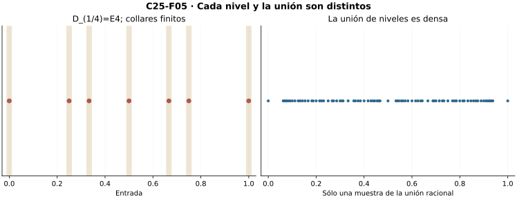
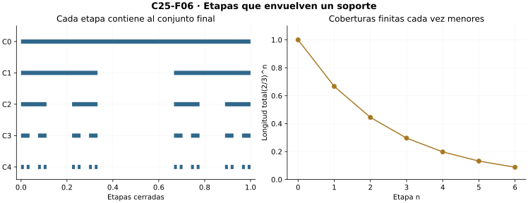
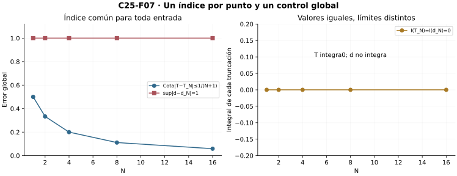
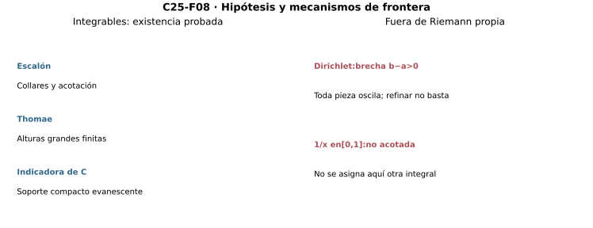

[Índice del libro](../para-matematicos/analisis-para-matematicos.html) · [Ejercicios de este capítulo](#ejercicios-25)

Un salto no impide necesariamente integrar: la oscilación puede mantenerse alta en las piezas que lo tocan y, sin embargo, esas piezas pueden ocupar una longitud cada vez menor. Dirichlet y Thomae obligarán a mirar por separado la altura de la oscilación y el lugar donde persiste. El criterio de Darboux permitirá convertir esa distinción en pruebas de integrabilidad y en una caracterización por niveles positivos.

C23 es el prerrequisito central. Completitud/arquimedianidad de C03, vecindades/cerrados de C04, geométricas de C06, continuidad de C14 y compacto de C16 son interfaces previas declaradas. Normalización racional, paridad y raíz2 pertenecen al toolbox aritmético heredado; densidad se reconstruye antes de usarla. No se construye ni se usa aquí medida o integral de Lebesgue.

## 25.1. El presupuesto de oscilación

[]{#MA-SEC-ANM-01-025-001}

En la brecha de Darboux, cada oscilación se multiplica por la anchura de su pieza. Una gran oscilación en pocas piezas cortas puede aportar poco al total, mientras una oscilación menor que persista sobre toda la longitud puede impedir que desaparezca. Fijemos $a<b$ y una función acotada $f:[a,b]\to\mathbb R$, con $|f|\le B$, $B\ge0$, para cuantificar ambas contribuciones.

**R1 — Presupuesto ponderado.** Para una partición $P$ con piezas cerradas $I_i$ y anchuras $\Delta_i>0$, escribimos $\omega_i=\sup f(I_i)-\inf f(I_i)$, de modo que
$$G(f,P)=U(f,P)-L(f,P)=\sum_i\omega_i\Delta_i.$$
Fijado $\eta>0$, llamaremos malas las piezas con $\omega_i\ge\eta$ y buenas las restantes. No contamos sólo cuántas son malas: medimos la suma finita de sus anchuras, $\lambda_P(\eta)$. Positividad y la cota $\omega_i\le2B$ dan
$$\eta\lambda_P(\eta)\le G(f,P),\qquad
G(f,P)\le\eta(b-a)+2B\lambda_P(\eta).$$
La primera desigualdad retiene sólo términos malos; la segunda acota los buenos por $\eta\Delta_i$ y los malos por $2B\Delta_i$. Los interiores disjuntos y la telescopía de anchuras, heredados de C22/C23, justifican el presupuesto de longitud. Los nodos compartidos no agregan longitud, pero sí pueden afectar oscilación en las dos piezas vecinas.

**Oscilación en un punto.** Para $x\in[a,b]$ y $r>0$, sea $V_r(x)=[a,b]\cap(x-r,x+r)$. Su imagen es no vacía, pues contiene $f(x)$, y acotada. Definimos
$$\Omega_f(x)=\inf_{r>0}\omega(f,V_r(x)).$$
El conjunto de oscilaciones es no vacío y está en $[0,2B]$; completitud asegura el ínfimo. No suponemos un radio mínimo ni un extremo alcanzado. Los radios menores no aumentan oscilación por restricción.

La igualdad $\Omega_f(x)=0$ equivale a continuidad relativa de $f$ en $x$. Si $f$ es continua, elegimos una vecindad donde cada valor dista de $f(x)$ menos que $\varepsilon/3$. Dos valores de ella difieren menos que $2\varepsilon/3$; al tomar las cotas extremas la oscilación es a lo sumo ese número. Como podemos hacerlo para todo $\varepsilon>0$, el ínfimo es cero. Recíprocamente, un ínfimo cero proporciona para cada $\varepsilon>0$ un radio cuya oscilación es menor que $\varepsilon$. El valor central pertenece a la misma banda que todos los demás, así que su distancia a cualquiera de ellos es menor que $\varepsilon$. Recuperamos la condición de continuidad.

Para cada $\eta>0$, sea $D_\eta=\{x:\Omega_f(x)\ge\eta\}$. Veremos que es cerrado relativo. Si $\Omega_f(x)<\eta$, alguna vecindad $V_r(x)$ tiene oscilación menor que $\eta$. Todo centro $y$ suficientemente próximo a $x$ admite una vecindad más pequeña contenida en $V_r(x)$; por restricción su oscilación puntual también es menor que $\eta$. Así el complemento de $D_\eta$ es abierto relativo. C16 hace compacto a este cerrado del segmento. Cada nivel separa los puntos según una amplitud que no desaparece al reducir el radio.

{#fig-anm-c25-f01 fig-alt="Dos piezas de anchuras2/5 y3/5 con oscilaciones4/5 y1/5 aportan8/25 y3/25 a la brecha, total11/25. Para nivel1/2, la longitud mala es2/5 y su contribución mínima1/5."}

### Microcontroles

#### Microcontrol 1

[]{#MA-MIC-ANM-01-025-001}

¿Qué presupuesto define la brecha?

[]{#MA-MSOL-ANM-01-025-001}

Ver solución del microcontrol 1

La brecha es $G(f,P)=\sum_i\omega(f,I_i)\Delta_i$, con $\Delta_i>0$. Cada pieza aporta su amplitud de alturas multiplicada por su anchura. Una oscilación grande puede aportar poco si está confinada en piezas cortas; una amplitud pequeña extendida sobre todo el intervalo también necesita control.

#### Microcontrol 2

[]{#MA-MIC-ANM-01-025-002}

¿Cómo se define una pieza mala para nivel $\eta>0$?

[]{#MA-MSOL-ANM-01-025-002}

Ver solución del microcontrol 2

Para un nivel fijo $\eta>0$, llamamos mala a una pieza con $\omega(f,I_i)\ge\eta$ y buena a una con oscilación menor. El caso de igualdad pertenece al grupo malo. La cantidad $\lambda_P(\eta)$ suma las anchuras de ese grupo y permite estimar su contribución total.

#### Microcontrol 3

[]{#MA-MIC-ANM-01-025-003}

¿Qué cota inferior usa las piezas malas?

[]{#MA-MSOL-ANM-01-025-003}

Ver solución del microcontrol 3

En cada pieza mala, $\omega_i\Delta_i\ge\eta\Delta_i$. Al sumar esos términos y conservar la no negatividad de los demás, queda $G(f,P)\ge\eta\sum_{i\text{ mala}}\Delta_i=\eta\lambda_P(\eta)$. Una brecha pequeña obliga a que la longitud mala sea pequeña para el nivel fijado.

#### Microcontrol 4

[]{#MA-MIC-ANM-01-025-004}

¿Qué cota superior da $|f|\le B$?

[]{#MA-MSOL-ANM-01-025-004}

Ver solución del microcontrol 4

La cota absoluta da $\omega_i\le2B$ en todas las piezas. Las buenas aportan a lo sumo $\eta$ por su longitud total; las malas, a lo sumo $2B\lambda_P(\eta)$. Por tanto $G\le\eta(b-a)+2B\lambda_P(\eta)$. Controlar nivel y longitud mala controla la brecha.

#### Microcontrol 5

[]{#MA-MIC-ANM-01-025-005}

¿La oscilación puntual exige un radio mínimo?

[]{#MA-MSOL-ANM-01-025-005}

Ver solución del microcontrol 5

Ponemos $V_r(x)=[a,b]\cap(x-r,x+r)$ y $\Omega_f(x)=\inf_{r>0}\omega(f,V_r(x))$. Cada vecindad contiene el centro y su imagen es acotada, así las oscilaciones forman un conjunto no vacío de reales no negativos. El ínfimo existe por completitud, aunque ningún radio lo realice exactamente.

#### Microcontrol 6

[]{#MA-MIC-ANM-01-025-006}

¿Qué equivale a continuidad en un punto?

[]{#MA-MSOL-ANM-01-025-006}

Ver solución del microcontrol 6

Si $f$ es continua en $x$, una vecindad con errores de altura menores que $\varepsilon/3$ respecto del centro tiene oscilación a lo sumo $2\varepsilon/3$, forzando $\Omega_f(x)=0$. Recíprocamente, un ínfimo cero proporciona para cada $\varepsilon>0$ una vecindad de oscilación menor que ella. Como contiene el centro, todos sus valores están a distancia menor que $\varepsilon$ de $f(x)$.

#### Microcontrol 7

[]{#MA-MIC-ANM-01-025-007}

¿Por qué $D_\eta$ es cerrado relativo?

[]{#MA-MSOL-ANM-01-025-007}

Ver solución del microcontrol 7

Si $\Omega_f(x)<\eta$, algún $r>0$ tiene $\omega(f,V_r(x))<\eta$. Para $|y-x|<r/2$, la vecindad $V_{r/2}(y)$ está dentro de $V_r(x)$ y su oscilación no supera la de ésta. Luego $\Omega_f(y)<\eta$. El complemento de $D_\eta$ es abierto relativo y el nivel es cerrado relativo.

#### Microcontrol 8

[]{#MA-MIC-ANM-01-025-008}

¿Qué hace compacto a $D_\eta$?

[]{#MA-MSOL-ANM-01-025-008}

Ver solución del microcontrol 8

El intervalo $[a,b]$ es compacto y $D_\eta$ es cerrado en él. La herencia de compacidad de C16 permite reducir cualquier cobertura abierta del nivel a una subcobertura finita. Esto incluye el nivel vacío, que admite la subcobertura vacía.

### Ejercicios de la sección 25.1

[]{#ejercicios-25}

#### Ejercicio 1. Longitud de las piezas malas

[]{#MA-EX-ANM-01-025-001}

Prueba las dos desigualdades de R1 usando sólo orden y sumas finitas.

[]{#MA-SOL-ANM-01-025-001}

Ver solución del ejercicio 1

Sea $\mathcal B=\{i:\omega_i\ge\eta\}$ y $\lambda=\sum_{i\in\mathcal B}\Delta_i$. En el grupo malo, $\omega_i\Delta_i\ge\eta\Delta_i$. Los restantes productos son no negativos, por lo que $G=\sum_i\omega_i\Delta_i\ge\eta\lambda$. Para la cota superior, las piezas buenas cumplen $\omega_i<\eta$ y las malas $\omega_i\le2B$, deducido de $-B\le f\le B$. Así $G\le\eta\sum_{i\notin\mathcal B}\Delta_i+2B\sum_{i\in\mathcal B}\Delta_i=\eta((b-a)-\lambda)+2B\lambda\le\eta(b-a)+2B\lambda$. Sólo se han usado orden, anchuras positivas y la suma finita de longitudes.

**Retorno visual.** Véase [C25-F01](analisis-para-matematicos-capitulo-25-la-frontera-de-riemann.html#fig-anm-c25-f01), después del argumento completo: la figura permite reconocer el mecanismo y no sustituye la prueba.

#### Ejercicio 2. Oscilación puntual y continuidad

[]{#MA-EX-ANM-01-025-002}

Demuestra ambas direcciones de la equivalencia, sin suponer un radio que alcance el ínfimo.

[]{#MA-SOL-ANM-01-025-002}

Ver solución del ejercicio 2

Si $f$ es continua relativamente en $x$, dado $\varepsilon>0$ existe $r>0$ con $|f(t)-f(x)|<\varepsilon/3$ para todas las entradas de $V_r(x)$. Dos alturas de esa vecindad difieren en magnitud menos que $2\varepsilon/3$, así su oscilación es a lo sumo esa cantidad. Luego $0\le\Omega_f(x)\le2\varepsilon/3$ para toda tolerancia, obligando a $\Omega_f(x)=0$. Recíprocamente, si el ínfimo es cero, su propiedad de aproximación proporciona para cada $\varepsilon>0$ un radio con $\omega(f,V_r(x))<\varepsilon$. El centro pertenece a la vecindad, así $|f(t)-f(x)|\le\omega(f,V_r(x))<\varepsilon$ para todas sus entradas. Ésta es continuidad con ese radio; no se necesita que el ínfimo se alcance.

#### Ejercicio 3. Nivel cerrado

[]{#MA-EX-ANM-01-025-003}

Prueba que $D_\eta$ es cerrado relativo y compacto.

[]{#MA-SOL-ANM-01-025-003}

Ver solución del ejercicio 3

Si $x\notin D_\eta$, se tiene $\Omega_f(x)<\eta$ y algún radio $r>0$ cumple $\omega(f,V_r(x))<\eta$. Para $y$ del dominio con $|y-x|<r/2$, la triangular muestra $V_{r/2}(y)\subseteq V_r(x)$. La oscilación disminuye al restringir, así $\Omega_f(y)\le\omega(f,V_{r/2}(y))\le\omega(f,V_r(x))<\eta$. Toda esa vecindad relativa de centros queda fuera del nivel. Por tanto su complemento es abierto relativo y $D_\eta$ es cerrado en $[a,b]$. Como el segmento es compacto, C16 hace compacto al nivel, incluido el caso vacío.

#### Ejercicio 4. Un presupuesto numérico

[]{#MA-EX-ANM-01-025-004}

En un intervalo de longitud3 con B=2, nivelη=1/10 y longitud malaλ=1/100, certifica una cota de brecha. ¿Es exacta?

[]{#MA-SOL-ANM-01-025-004}

Ver solución del ejercicio 4

Sustituimos los datos en la cota $G\le\eta(b-a)+2B\lambda$. Resulta $G\le(1/10)\cdot3+2\cdot2\cdot(1/100)=3/10+1/25=17/50$. Es un certificado superior de $0,34$. No determina la brecha exacta, porque las amplitudes reales de las piezas pueden ser menores que los límites usados. En particular, la suma de anchuras malas no informa por sí sola de cuánto supera cada oscilación el nivel.

#### Ejercicio 5. Nodos y oscilación

[]{#MA-EX-ANM-01-025-005}

Explica por qué un valor excepcional en un nodo puede afectar dos piezas, aunque no tenga anchura propia.

[]{#MA-SOL-ANM-01-025-005}

Ver solución del ejercicio 5

Las piezas $[x_{i-1},x_i]$ y $[x_i,x_{i+1}]$ contienen el nodo compartido $x_i$. Si la tasa es cero salvo por altura uno en ese nodo, las dos piezas tienen ínfimo cero y supremo uno. Su contribución a la brecha es la suma de sus dos anchuras. No aparece un término separado por el punto: su efecto está en las imágenes de las piezas que lo incluyen. Al afinar alrededor del nodo esas anchuras pueden hacerse pequeñas, y la invariancia ante cambios finitos de C23 conserva el valor integral.

## 25.2. Discontinuidades que caben en collares

[]{#MA-SEC-ANM-01-025-002}

Alrededor de un número finito de discontinuidades podemos reservar intervalos cortos y admitir allí la barrera global $2B$. Fuera de ellos, la continuidad reducirá la oscilación. Para sumar ambas estimaciones necesitaremos una sola partición que distinga las dos regiones.

**R2 — Un número finito de discontinuidades.** Una función acotada en $[a,b]$ y continua fuera de un conjunto finito $E$ es integrable.

Dada $\varepsilon>0$, si $B=0$ la función es cero y el resultado es inmediato. Para cubrir también ese caso sin dividir por cero, fijemos $\eta=\varepsilon/[2(b-a)]$ y $\sigma=\varepsilon/[4(B+1)]$. Si $E$ tiene $k$ puntos, cada uno puede cubrirse por un intervalo abierto de radio $r=\sigma/[4(k+1)]$. Su unión $O$ tiene una cobertura finita cuya suma de longitudes es $2kr<\sigma$. Con $E$ vacío tomamos $O$ vacío.

Fuera de $O$, la continuidad da un radio $r_x>0$ con oscilación menor que $\eta$ sobre $V_{r_x}(x)$: basta controlar la distancia de cada valor al central por $\eta/3$. Dentro de $O$, la apertura da un radio cuya vecindad queda contenida en $O$. Consideramos todos los pares centro/radio que satisfacen alguna de estas condiciones; sus vecindades de radio medio cubren $[a,b]$. Así no hace falta seleccionar un radio para cada centro antes de usar C16. Un subcubrimiento finito proporciona el mínimo positivo de esos radios medios, que llamamos $\delta$.

Tomamos una partición uniforme de malla menor que $\delta$. Dada una pieza, elegimos un punto suyo y una vecindad de radio medio que lo contenga. Si el radio grande es $r$, cualquier otro punto de la pieza dista de ese centro menos que $\delta+r/2\le r$. Toda la pieza queda entonces en la vecindad grande: está contenida en $O$ o tiene oscilación menor que $\eta$. La escala común ha convertido la información local en una alternativa válida para cada pieza completa.

Las piezas del primer tipo tienen suma de anchuras menor que $\sigma$. El hecho finito usado aquí se demuestra cortando en todos los extremos de la cobertura de $O$: cada celda cubierta contribuye una sola vez a la unión y al menos una vez a la suma de longitudes de los intervalos que la cubren. Por tanto la longitud total de piezas con interiores disjuntos contenidas en esa unión es a lo sumo dicha suma. R1 da
$$G(f,P)\le\eta(b-a)+2B\sigma
=\frac\varepsilon2+\frac{B\varepsilon}{2(B+1)}<\varepsilon.$$
El criterio de C23 concluye. No se presume uniformidad local junto a los saltos: el subcubrimiento finito fabrica la escala en las regiones donde hace falta.

En $[0,1]$, el escalón de corte $c=1/2$ tiene brecha a lo sumo igual a la anchura total de piezas que tocan ese corte. Insertando $c-r,c,c+r$, con $0<r<1/2$, las piezas que tocan el corte suman $2r$, una cota de la longitud mala. Con el valor nodal uno, la pieza derecha es constante y sólo la izquierda oscila: $L=1/2$, $U=1/2+r$ y la brecha exacta es $r\le2r$. El valor del nodo afecta ambos lados por ser piezas cerradas; C23 asegura que cambiarlo no altera el valor integral.

{#fig-anm-c25-f02 fig-alt="Escalón de corte1/2, valor nodal1, radio r=1/10. Los collares tocan dos piezas de longitud total1/5, pero la derecha es constante: L1/2,U3/5,brecha1/10."}

### Microcontroles

#### Microcontrol 9

[]{#MA-MIC-ANM-01-025-009}

¿Basta un número finito de discontinuidades para integrar?

[]{#MA-MSOL-ANM-01-025-009}

Ver solución del microcontrol 9

Una función acotada y continua fuera de un conjunto finito es integrable: cubrimos las entradas excepcionales con collares cortos y controlamos la oscilación en el resto por compacidad. La acotación limita la amplitud dentro de los collares. Sin ella, $1/x$ para $x>0$, completada por cero en $x=0$, falla integrabilidad propia aunque sólo sea discontinua en ese punto.

#### Microcontrol 10

[]{#MA-MIC-ANM-01-025-010}

¿Qué se controla con los collares?

[]{#MA-MSOL-ANM-01-025-010}

Ver solución del microcontrol 10

Dentro de los collares puede persistir una oscilación de hasta $2B$. Su contribución se limita mediante la longitud total de las piezas contenidas allí. Fuera de ellos se fabrica una escala que hace pequeña la oscilación. La brecha resulta de sumar esos dos presupuestos.

#### Microcontrol 11

[]{#MA-MIC-ANM-01-025-011}

¿Dónde se obtiene la escala común de las piezas buenas?

[]{#MA-MSOL-ANM-01-025-011}

Ver solución del microcontrol 11

Para los centros fuera de los collares, la continuidad da vecindades de oscilación menor que el nivel. Para los centros dentro, la apertura da vecindades contenidas en ellos. Las vecindades de radios medios forman una cubierta del cerrado; un subcubrimiento finito permite tomar un mínimo positivo de radios y controlar todas las piezas de una partición fina.

#### Microcontrol 12

[]{#MA-MIC-ANM-01-025-012}

¿Por qué usar todos los pares centro/radio válidos?

[]{#MA-MSOL-ANM-01-025-012}

Ver solución del microcontrol 12

En cada centro existe al menos un radio válido. Tomar el conjunto de todos los pares $(x,r)$ válidos produce directamente una cobertura, sin asignar un radio particular a cada entrada. Compacidad extrae después una lista finita de pares, que basta para construir la escala común.

#### Microcontrol 13

[]{#MA-MIC-ANM-01-025-013}

¿Qué garantiza malla menor que el mínimo radio medio?

[]{#MA-MSOL-ANM-01-025-013}

Ver solución del microcontrol 13

Si una pieza de malla menor que $\delta$ tiene un punto $t$ en una vecindad de radio $r/2$, cualquier punto $s$ de la pieza satisface $|s-c|\le|s-t|+|t-c|<\delta+r/2\le r$. La pieza entera queda en la vecindad grande. Ésta tiene oscilación pequeña o está contenida en los collares.

#### Microcontrol 14

[]{#MA-MIC-ANM-01-025-014}

¿Qué justifica sumar longitudes dentro de una unión?

[]{#MA-MSOL-ANM-01-025-014}

Ver solución del microcontrol 14

Se corta la unión en los extremos de los finitísimos intervalos que la cubren y en los extremos de las piezas. Cada celda de longitud positiva ocupada por una pieza queda en al menos un intervalo de cobertura. Las piezas tienen interiores disjuntos, así su longitud se cuenta una vez y queda acotada por la suma de longitudes de la cobertura.

#### Microcontrol 15

[]{#MA-MIC-ANM-01-025-015}

¿Qué cota de brecha da el collar del escalón con cortes $c-r,c,c+r$?

[]{#MA-MSOL-ANM-01-025-015}

Ver solución del microcontrol 15

Con valor nodal uno, sólo la pieza $[c-r,c]$ tiene alturas cero y uno; su contribución a la brecha es $r$. La pieza $[c,c+r]$ es constante uno. Por tanto la brecha exacta es $r$, aunque la longitud total de las dos piezas que tocan el corte sea $2r$ y dé una cota válida.

#### Microcontrol 16

[]{#MA-MIC-ANM-01-025-016}

¿El nodo compartido afecta una sola pieza?

[]{#MA-MSOL-ANM-01-025-016}

Ver solución del microcontrol 16

El nodo $x_i$ pertenece a las dos piezas cerradas adyacentes. Un valor excepcional puede cambiar sus dos supremos o ínfimos. Las anchuras siguen siendo $x_i-x_{i-1}$ y $x_{i+1}-x_i$; el nodo compartido no añade un término de longitud a la suma.

### Ejercicios de la sección 25.2

#### Ejercicio 6. Collares de un conjunto finito

[]{#MA-EX-ANM-01-025-006}

Si E tiene k puntos, construye una cobertura abierta de longitud total menor que σ, incluido k0.

[]{#MA-SOL-ANM-01-025-006}

Ver solución del ejercicio 6

Sea $E=\{e_1,\ldots,e_k\}$ y $\sigma>0$. Si $k>0$, tomamos $r=\sigma/[4(k+1)]>0$ y los intervalos abiertos $(e_j-r,e_j+r)$. Cubren todos los puntos, incluidos los extremos del dominio, aunque parte del collar quede fuera del segmento. La suma de longitudes es $2kr=\sigma k/[2(k+1)]<\sigma$. Si $k=0$, la cobertura vacía tiene longitud total cero y cumple el pedido. El denominador $k+1$ mantiene la fórmula definida sin dividir por el número de puntos.

#### Ejercicio 7. Fabricar una escala común

[]{#MA-EX-ANM-01-025-007}

Explica la cubierta de radios medios que prueba R2, sin seleccionar un radio para cada centro.

[]{#MA-SOL-ANM-01-025-007}

Ver solución del ejercicio 7

Sea $O$ la unión de los collares que cubren las excepciones. Consideramos todos los pares $(x,r)$ de dos tipos: si $x\in O$, se pide $V_r(x)\subseteq O$; si $x\notin O$, se pide $\omega(f,V_r(x))<\eta$. La apertura da pares del primer tipo y la continuidad fuera de las excepciones da pares del segundo. Las vecindades $V_{r/2}(x)$ de todos esos pares cubren $[a,b]$. Compacidad extrae finitísimos y permite tomar $\delta$ como el mínimo positivo de sus radios medios. Para una pieza de malla menor que $\delta$, escogemos un punto suyo en una de las vecindades medias. La triangular coloca todos los demás puntos en la vecindad grande. Así cada pieza está dentro de $O$ o tiene oscilación menor que $\eta$. La construcción sólo selecciona una lista finita de pares después de formar la cubierta completa.

#### Ejercicio 8. El escalón y su brecha

[]{#MA-EX-ANM-01-025-008}

Para el escalón con corte1/2 y P=(0,1/2−r,1/2,1/2+r,1), 0<r<1/2, calcula L,U y G.

[]{#MA-SOL-ANM-01-025-008}

Ver solución del ejercicio 8

Las anchuras de la partición son $1/2-r,r,r,1/2-r$. En las dos primeras piezas los ínfimos son cero; la segunda tiene supremo uno por incluir el corte de valor uno. Las dos últimas son constantes uno. Por tanto $L=r+(1/2-r)=1/2$ y $U=r+r+(1/2-r)=1/2+r$. La brecha exacta es $r$. Las dos piezas adyacentes al corte tienen longitud total $2r$, que proporciona una cota más amplia: sólo la izquierda oscila con la convención nodal dada. La cuenta conserva la altura del corte en las dos imágenes cerradas.

**Retorno visual.** Véase [C25-F02](analisis-para-matematicos-capitulo-25-la-frontera-de-riemann.html#fig-anm-c25-f02), después del argumento completo: la figura permite reconocer el mecanismo y no sustituye la prueba.

#### Ejercicio 9. La hipótesis de acotación

[]{#MA-EX-ANM-01-025-009}

Refuta la afirmación «continua salvo finitísimos puntos implica integrable», si se omite acotación.

[]{#MA-SOL-ANM-01-025-009}

Ver solución del ejercicio 9

En $[0,1]$, definimos $h(0)=0$ y $h(x)=1/x$ para $x>0$. Es continua en todas las entradas positivas y sólo falla en cero. Para cualquier $B>0$, la entrada $x=1/(B+1)\in(0,1]$ tiene altura $h(x)=B+1>B$. Por tanto no es acotada. C23 probó que el contrato propio de Riemann obliga acotación, así esta tasa no es integrable en ese sentido. Tener sólo un punto de discontinuidad no permite omitir la hipótesis de amplitud global finita.

#### Ejercicio 10. Gastar la tolerancia

[]{#MA-EX-ANM-01-025-010}

Verifica que η=ε/[2(b−a)] y σ=ε/[4(B+1)] aseguran G<ε bajo la clasificación de R2.

[]{#MA-SOL-ANM-01-025-010}

Ver solución del ejercicio 10

Sean $a<b$, $|f|\le B$ y $\varepsilon>0$. Con $\eta=\varepsilon/[2(b-a)]$ y $\sigma=\varepsilon/[4(B+1)]$, la clasificación de R2 da longitud mala menor que $\sigma$. La cota de R1 implica $G\le\eta(b-a)+2B\sigma=\varepsilon/2+B\varepsilon/[2(B+1)]$. Como $B/(B+1)<1$, el último número es estrictamente menor que $\varepsilon$. Las desigualdades no estrictas obtenidas al sumar no agotan el margen. Si $B=0$, la función y la brecha son cero; los mismos parámetros permanecen definidos.

## 25.3. La obstrucción densa de Dirichlet

[]{#MA-SEC-ANM-01-025-003}

Para que una oscilación impida toda reducción de la brecha, debe persistir en cualquier pieza de anchura positiva. Construiremos ese caso mediante valores racionales e irracionales. Antes de calcular los extremos locales necesitamos probar que ambos tipos de entradas aparecen en todo intervalo abierto.

**Densidad que vamos a gastar.** Entre dos reales $u<v$ existe un racional. Por arquimedianidad elija un natural positivo $n$ con $n(v-u)>1$. El principio del menor natural, después de trasladar $nu$ por un entero positivo si hace falta, proporciona un entero $k$ con $nu<k\le nu+1<nv$. Entonces $k/n\in(u,v)$. Este argumento es el lema de parte entera construido por mínimo natural; no presupone un punto racional obtenido por aproximación numérica.

También existe un irracional. Parta de un racional $q\in(u,v)$ y del irracional positivo $\sqrt2$ disponible en el toolbox de raíces. Su irracionalidad se prueba por paridad: una fracción reducida $p/q$ cuyo cuadrado fuera dos obligaría a que numerador y denominador fueran pares. Elija un natural positivo $n$ con $\sqrt2/n<v-q$. El número $q+\sqrt2/n$ está en $(u,v)$ y es irracional, pues si fuera racional restar $q$ y multiplicar por $n$ haría racional a $\sqrt2$. Las vecindades relativas de borde también contienen intervalos abiertos no degenerados. Usamos normalización de fracciones y paridad como aritmética heredada, no elección de una familia infinita.

**R3 — Dirichlet no es integrable.** Defina $d(x)=1$ si $x$ es racional y $d(x)=0$ si es irracional, sobre $[a,b]$. En toda pieza no degenerada hay valores cero y uno, de modo que sus cotas son exactamente $m_i=0,M_i=1$ y $\omega_i=1$. Por tanto, para toda partición,
$$L(d,P)=0,\qquad U(d,P)=b-a,\qquad G(d,P)=b-a>0.$$
Elegir $\varepsilon=(b-a)/2$ refuta el criterio. El factor longitud es indispensable: la suma superior no vale uno en cualquier intervalo, sólo cuando su longitud es uno.

En cada vecindad relativa hay ambos valores, luego $\Omega_d(x)=1$ en todo el dominio. Toda pieza es mala para $0<\eta\le1$ y su presupuesto total de anchura es siempre $b-a$. Refinar no reduce esa oscilación.

El contrato de sumas etiquetadas también falla directamente: dada cualquier malla tan pequeña como se desee, elegir etiquetas racionales en las finitísimas piezas produce suma $b-a$, e irracionales produce suma cero. Un mismo candidato no puede quedar a distancia menor que $(b-a)/3$ de ambos. Se instancian sólo existencias finitas por inducción, no una selección sobre todas las particiones a la vez.

La densidad demostrada es la que permite fijar las cotas exactas en cada pieza de cualquier partición. Una muestra finita de puntos racionales e irracionales no controla los intervalos que faltan, por más abundante que parezca en un dibujo.

![Dirichlet en\[−1,2\]: densidad racional e irracional prueba m0,M1 en toda pieza. Toda partición tiene L0,U3 y brecha3; el gráfico representa bandas certificadas, no una muestra que pruebe densidad.](../../assets/books/anm/C25/C25-F03.svg){#fig-anm-c25-f03 fig-alt="Dirichlet en[−1,2]: densidad racional e irracional prueba m0,M1 en toda pieza. Toda partición tiene L0,U3 y brecha3; el gráfico representa bandas certificadas, no una muestra que pruebe densidad."}

### Microcontroles

#### Microcontrol 17

[]{#MA-MIC-ANM-01-025-017}

¿Qué debe probarse para las cotas de Dirichlet?

[]{#MA-MSOL-ANM-01-025-017}

Ver solución del microcontrol 17

La función de Dirichlet vale uno en racionales y cero en irracionales. Para concluir que el ínfimo de cada pieza es cero y el supremo uno, hay que probar que ambos tipos de entradas existen en toda pieza de longitud positiva. Las dos pruebas de densidad proporcionan esos testigos.

#### Microcontrol 18

[]{#MA-MIC-ANM-01-025-018}

¿Cómo se obtiene un racional entre $u<v$?

[]{#MA-MSOL-ANM-01-025-018}

Ver solución del microcontrol 18

Elegimos $n\ge1$ con $n(v-u)>1$. Tras trasladar $nu$ por un natural $M$ para hacerlo no negativo, el mínimo natural $j>nu+M$ cumple $j-1\le nu+M$. El entero $k=j-M$ satisface $nu<k\le nu+1<nv$, y por tanto $u<k/n<v$.

#### Microcontrol 19

[]{#MA-MIC-ANM-01-025-019}

¿Cómo se obtiene un irracional después de un racional interior?

[]{#MA-MSOL-ANM-01-025-019}

Ver solución del microcontrol 19

Sea $r$ un racional interior de $(u,v)$. Arquimedianidad permite elegir $n\ge1$ con $\sqrt2/n<v-r$. Entonces $z=r+\sqrt2/n$ sigue en el intervalo. Si $z$ fuera racional, $n(z-r)=\sqrt2$ también lo sería, contradiciendo su irracionalidad.

#### Microcontrol 20

[]{#MA-MIC-ANM-01-025-020}

¿Cuál es la suma inferior de Dirichlet?

[]{#MA-MSOL-ANM-01-025-020}

Ver solución del microcontrol 20

Cada pieza contiene una entrada irracional de altura cero y todas las alturas son no negativas. Su ínfimo es entonces cero. La suma inferior pondera esos ceros por las anchuras y vale $L(d,P)=0$ para cualquier partición.

#### Microcontrol 21

[]{#MA-MIC-ANM-01-025-021}

¿Cuál es su suma superior en $[a,b]$?

[]{#MA-MSOL-ANM-01-025-021}

Ver solución del microcontrol 21

En cada pieza hay una entrada racional de altura uno y ninguna altura mayor, así el supremo es uno. Por tanto $U(d,P)=\sum_i\Delta_i=b-a$. El valor depende de la longitud del intervalo y no del número de piezas.

#### Microcontrol 22

[]{#MA-MIC-ANM-01-025-022}

¿Qué nivel puntual de oscilación tiene Dirichlet?

[]{#MA-MSOL-ANM-01-025-022}

Ver solución del microcontrol 22

Toda vecindad relativa de radio positivo contiene un segmento de longitud positiva, también en los bordes porque $a<b$. La densidad racional e irracional da ambas alturas cero y uno. Su oscilación es uno para todos los radios, así $\Omega_d(x)=1$ en todo el dominio.

#### Microcontrol 23

[]{#MA-MIC-ANM-01-025-023}

¿Refinar reduce su brecha?

[]{#MA-MSOL-ANM-01-025-023}

Ver solución del microcontrol 23

Cada nueva pieza de un refinamiento mantiene ambas alturas por densidad y tiene oscilación uno. Por ello $G(d,P)=\sum_i\Delta_i=b-a$ para todas las particiones. La brecha fija positiva no puede satisfacer el criterio de Darboux.

#### Microcontrol 24

[]{#MA-MIC-ANM-01-025-024}

¿Un dibujo de racionales certifica densidad?

[]{#MA-MSOL-ANM-01-025-024}

Ver solución del microcontrol 24

Una figura contiene una colección finita de puntos y deja intervalos pequeños sin entradas representadas. Las cotas de Dirichlet requieren testigos en un intervalo arbitrario, por pequeño que sea. Las construcciones aritméticas de racionales e irracionales cubren ese cuantificador; el dibujo sólo ilustra el resultado.

### Ejercicios de la sección 25.3

#### Ejercicio 11. Racionales en toda pieza

[]{#MA-EX-ANM-01-025-011}

Reconstruye la densidad racional mediante arquimedianidad y mínimo natural, indicando el traslado para entradas negativas.

[]{#MA-SOL-ANM-01-025-011}

Ver solución del ejercicio 11

Fijemos $u<v$. Arquimedianidad da un natural $n\ge1$ con $n(v-u)>1$. Para admitir cualquier signo de $u$, elegimos un natural $M$ con $nu+M\ge0$. El conjunto de naturales estrictamente mayores que $nu+M$ es no vacío, así tiene mínimo $j$. Como $j>0$, la minimalidad da $j-1\le nu+M$. Ponemos el entero $k=j-M$. Entonces $nu<k\le nu+1<nv$. Dividir por $n>0$ da $u<k/n<v$. El traslado por $M$ sólo permitió usar el mínimo natural; al restarlo queda un numerador entero, quizá negativo, y una fracción racional interior.

#### Ejercicio 12. Irracionales en toda pieza

[]{#MA-EX-ANM-01-025-012}

Partiendo de un racional interior y de raíz2 irracional, construye un irracional en el mismo intervalo.

[]{#MA-SOL-ANM-01-025-012}

Ver solución del ejercicio 12

Por densidad racional, tomamos $r\in\mathbb Q$ con $u<r<v$. El número $v-r$ es positivo, así arquimedianidad proporciona $n\ge1$ con $\sqrt2/n<v-r$. Definimos $z=r+\sqrt2/n$. Entonces $u<r<z<v$. Si $z$ fuera racional, la diferencia $z-r$ y su múltiplo entero $n(z-r)$ serían racionales. Pero ese múltiplo es $\sqrt2$, cuya irracionalidad se probó mediante reducción de una fracción y paridad. La contradicción hace a $z$ un testigo irracional dentro del intervalo.

#### Ejercicio 13. La longitud correcta

[]{#MA-EX-ANM-01-025-013}

Calcula las sumas de Darboux de Dirichlet en[−1,2] y refuta integrabilidad con tolerancia concreta.

[]{#MA-SOL-ANM-01-025-013}

Ver solución del ejercicio 13

Cada pieza de una partición de $[-1,2]$ tiene longitud positiva y contiene racionales e irracionales. Para Dirichlet, su imagen es por tanto $\{0,1\}$, con ínfimo cero, supremo uno y oscilación uno. Resulta $L(d,P)=0$, $U(d,P)=\sum_i\Delta_i=2-(-1)=3$ y $G(d,P)=3$ para todas las particiones. Con tolerancia $\varepsilon=3/2$, ninguna brecha es menor que ella, así falla Darboux. La suma superior es la longitud tres, no uno.

**Retorno visual.** Véase [C25-F03](analisis-para-matematicos-capitulo-25-la-frontera-de-riemann.html#fig-anm-c25-f03), después del argumento completo: la figura permite reconocer el mecanismo y no sustituye la prueba.

#### Ejercicio 14. Etiquetas incompatibles

[]{#MA-EX-ANM-01-025-014}

Prueba directamente que el contrato universal de Riemann falla para Dirichlet sobre[a,b].

[]{#MA-SOL-ANM-01-025-014}

Ver solución del ejercicio 14

Supongamos que existe un candidato integral $I$ sobre $[a,b]$, con $a<b$. Pedimos al contrato error $\varepsilon=(b-a)/3$ y obtenemos un radio $\delta>0$. C22 permite construir una uniforme de malla menor que $\delta$. En cada pieza, densidad da una etiqueta racional y una irracional; inducción finita forma las dos familias. La primera suma vale $b-a$ y la segunda cero. Ambas deberían estar a distancia menor que $\varepsilon$ de $I$. La triangular daría $b-a\le|b-a-I|+|I|<2(b-a)/3$, imposible. El problema persiste por fina que sea la malla.

#### Ejercicio 15. Una muestra no prueba densidad

[]{#MA-EX-ANM-01-025-015}

Explica por qué los puntos dibujados de Dirichlet no justifican sus cotas locales.

[]{#MA-SOL-ANM-01-025-015}

Ver solución del ejercicio 15

Una representación de Dirichlet dibuja finitísimas entradas de cada tipo. Siempre puede elegirse un intervalo pequeño que evite todas las entradas dibujadas. El cálculo de los extremos requiere, sin embargo, una altura cero y una altura uno en cada pieza no degenerada real. Las pruebas aritméticas construyen esos testigos para un intervalo arbitrario, sin depender de una resolución gráfica. Sólo después de establecer esa densidad puede concluirse que todas las oscilaciones valen uno.

## 25.4. Thomae: alturas pequeñas y picos finitos

[]{#MA-SEC-ANM-01-025-004}

Thomae también será discontinua en todos los racionales, pero su altura dependerá del denominador reducido. A partir de una altura positiva sólo quedarán finitísimos picos por aislar; el resto se controlará por una barrera pequeña válida en todas las entradas.

**R4 — Función de Thomae.** Sobre $[0,1]$, definimos $T(x)=0$ si $x$ es irracional; si $x=p/q$ en su forma reducida única, $q\ge1$, ponemos $T(x)=1/q$. En particular $T(0)=T(1)=1$, por denominador uno. La normalización racional heredada asegura una salida única; $0\le T\le1$.

Fijado un entero $N\ge1$, los racionales de denominador reducido a lo sumo $N$ forman un conjunto finito $E_N$. Para cada denominador $q$ entre $1$ y $N$, basta examinar los numeradores $0\le p\le q$. Hay a lo sumo $\sum_{q=1}^N(q+1)=N(N+3)/2$ candidatos; las fracciones repetidas sólo reducen esa cantidad. Fuera de $E_N$, un racional tiene denominador al menos $N+1$ y un irracional tiene altura cero, de modo que $T\le1/(N+1)$ en todo el complemento. En particular, todo pico mayor que $1/N$ pertenece a $E_N$.

**Continuidad exacta.** En un irracional $x$, dado $\varepsilon>0$, elija $N$ con $1/(N+1)<\varepsilon$. Como $E_N$ es finito y no contiene $x$, la mínima distancia a él es positiva. Un radio menor evita todos sus picos, y allí $|T(t)-T(x)|=T(t)\le1/(N+1)<\varepsilon$. Si el conjunto fuese vacío cualquier radio serviría. En un racional $x=p/q$, cualquier vecindad contiene un irracional de valor cero, a distancia de salida $1/q$ respecto del centro. La tolerancia $1/(2q)$ refuta continuidad, también relativamente en los bordes. Así sus discontinuidades son exactamente los racionales. Además, en $x=p/q$ podemos evitar el conjunto finito $E_q\setminus\{x\}$ con un radio positivo. En esa vecindad todos los valores son a lo sumo $1/q$ y existe un irracional de valor cero, mientras el centro vale $1/q$. Su oscilación es $1/q$; toda vecindad contiene esos dos valores y tiene oscilación al menos $1/q$. Por ello $\Omega_T(x)=1/q$, y en los irracionales es cero.

**Integral cero mediante collares finitos.** Dada $\varepsilon>0$, elija $N$ con $1/(N+1)<\varepsilon/2$. Cubra los $k=|E_N|$ picos grandes con collares de radio $r>0$ tan pequeño que $2kr<\varepsilon/2$; por ejemplo $r=\varepsilon/[8(k+1)]$. Forme una partición que incluya esos picos y los extremos de sus collares recortados a $[0,1]$, eliminando repeticiones y ordenando.

Toda pieza que contiene alguno de esos picos queda dentro de la unión de collares cerrados: los cortes a ambos lados impiden que se prolongue fuera de ella. Sus anchuras totales son a lo sumo $2kr<\varepsilon/2$. En las piezas restantes, todos los valores son a lo sumo $1/(N+1)$. Por eso
$$0\le U(T,P)\le 2kr+\frac1{N+1}<\varepsilon.$$
Cada pieza contiene un irracional, así $L(T,P)=0$. El criterio de Darboux prueba integrabilidad; el encierro $0\le I\le U(T,P)<\varepsilon$ para toda tolerancia obliga a $I=0$.

Para $N=4$, los picos que deben aislarse están en $0,1/4,1/3,1/2,2/3,3/4,1$; fuera de ellos la altura es a lo sumo $1/5$. Esta cuenta finita sirve de certificado parcial, no de dibujo del conjunto completo de discontinuidades.

![Thomae en\[0,1\]: panel izquierdo muestra sólo racionales de denominador≤16. Panel derecho aísla E4, siete picos; todo punto omitido de E4 tiene altura≤1/5. Los puntos dibujados no son toda la función.](../../assets/books/anm/C25/C25-F04.svg){#fig-anm-c25-f04 fig-alt="Thomae en[0,1]: panel izquierdo muestra sólo racionales de denominador≤16. Panel derecho aísla E4, siete picos; todo punto omitido de E4 tiene altura≤1/5. Los puntos dibujados no son toda la función."}

### Microcontroles

#### Microcontrol 25

[]{#MA-MIC-ANM-01-025-025}

¿Qué valor tiene Thomae en una fracción reducida $p/q$?

[]{#MA-MSOL-ANM-01-025-025}

Ver solución del microcontrol 25

Para $x=p/q\in[0,1]$ en forma reducida y con $q>0$, se define $T(x)=1/q$. La forma reducida tiene denominador único, así la definición no cambia con otra escritura de la misma fracción. En las entradas irracionales se define $T(x)=0$.

#### Microcontrol 26

[]{#MA-MIC-ANM-01-025-026}

¿Cuánto vale en cero?

[]{#MA-MSOL-ANM-01-025-026}

Ver solución del microcontrol 26

La representación reducida de cero es $0/1$, así $T(0)=1$. Escribir cero como $0/q$ con $q>1$ no cambia ese valor, porque primero se reduce la fracción. De igual forma $T(1)=1$ por la forma $1/1$.

#### Microcontrol 27

[]{#MA-MIC-ANM-01-025-027}

¿Por qué es finito $E_N$?

[]{#MA-MSOL-ANM-01-025-027}

Ver solución del microcontrol 27

Para $1\le q\le N$, una fracción de $[0,1]$ tiene numerador entero $0\le p\le q$, dando a lo sumo $q+1$ candidatos. La suma finita es $\sum_{q=1}^N(q+1)=N(N+3)/2$. Reducir y quitar repeticiones sólo disminuye el número, de modo que $E_N$ es finito.

#### Microcontrol 28

[]{#MA-MIC-ANM-01-025-028}

¿Qué cota vale fuera de $E_N$?

[]{#MA-MSOL-ANM-01-025-028}

Ver solución del microcontrol 28

Una entrada racional fuera de $E_N$ tiene denominador reducido entero $q>N$, luego $q\ge N+1$ y $T(x)=1/q\le1/(N+1)$. En una entrada irracional el valor cero cumple la misma cota. Así el control vale para todas las entradas omitidas.

#### Microcontrol 29

[]{#MA-MIC-ANM-01-025-029}

¿Por qué es continua en un irracional?

[]{#MA-MSOL-ANM-01-025-029}

Ver solución del microcontrol 29

Para un irracional $x$ y $\varepsilon>0$, elegimos $N$ con $1/(N+1)<\varepsilon$. Las distancias de $x$ al conjunto finito $E_N$ tienen mínimo positivo. Un radio menor que ese mínimo evita todos los picos grandes y deja $|T(t)-T(x)|=T(t)\le1/(N+1)<\varepsilon$.

#### Microcontrol 30

[]{#MA-MIC-ANM-01-025-030}

¿Por qué falla continuidad en un racional?

[]{#MA-MSOL-ANM-01-025-030}

Ver solución del microcontrol 30

Si $x=p/q$ está reducido, su altura es $1/q>0$. Cada vecindad relativa contiene un irracional $t$ con altura cero, por lo que $|T(t)-T(x)|=1/q$. Con tolerancia $1/(2q)$ ningún radio cumple continuidad. El argumento cubre también cero y uno relativamente.

#### Microcontrol 31

[]{#MA-MIC-ANM-01-025-031}

¿Cuál es la oscilación puntual en $p/q$?

[]{#MA-MSOL-ANM-01-025-031}

Ver solución del microcontrol 31

Toda vecindad del racional contiene su altura $1/q$ y una altura irracional cero, así oscila al menos $1/q$. Un radio que evite el conjunto finito $E_q\setminus\{x\}$ deja las demás alturas a lo sumo $1/(q+1)$. En esa vecindad el supremo es $1/q$ y el ínfimo cero, así el ínfimo de oscilaciones es exactamente $1/q$.

#### Microcontrol 32

[]{#MA-MIC-ANM-01-025-032}

¿Qué integral tiene Thomae?

[]{#MA-MSOL-ANM-01-025-032}

Ver solución del microcontrol 32

Los irracionales de cada pieza hacen que todas las sumas inferiores de $T$ sean cero. Para controlar las superiores, se cubren los finitísimos picos grandes con piezas de longitud total pequeña y se limita el resto por $1/(N+1)$. Esto da superiores arbitrariamente pequeñas, prueba Darboux y fija integral cero.

### Ejercicios de la sección 25.4

#### Ejercicio 16. Contar picos de denominador pequeño

[]{#MA-EX-ANM-01-025-016}

Prueba la cota cardinal N(N+3)/2 para E_N y lista E_4 en orden.

[]{#MA-SOL-ANM-01-025-016}

Ver solución del ejercicio 16

Para un denominador $q$ con $1\le q\le N$, hay $q+1$ posibles numeradores enteros de cero a $q$. Antes de reducir y quitar duplicados hay por tanto $\sum_{q=1}^N(q+1)=N(N+1)/2+N=N(N+3)/2$ candidatos. Cada entrada de $E_N$ aparece entre ellos, así ésa es una cota cardinal. Para $N=4$, las fracciones reducidas distintas dan, en orden, $E_4=\{0,1/4,1/3,1/2,2/3,3/4,1\}$. Tiene siete entradas; la cota general es catorce, mayor porque cuenta también representaciones repetidas y no reducidas.

**Retorno visual.** Véase [C25-F04](analisis-para-matematicos-capitulo-25-la-frontera-de-riemann.html#fig-anm-c25-f04), después del argumento completo: la figura permite reconocer el mecanismo y no sustituye la prueba.

#### Ejercicio 17. Un irracional evita picos grandes

[]{#MA-EX-ANM-01-025-017}

Demuestra continuidad de Thomae en un irracional, con radio positivo justificado.

[]{#MA-SOL-ANM-01-025-017}

Ver solución del ejercicio 17

Sea $x\in[0,1]$ irracional y $\varepsilon>0$. Elegimos $N\ge1$ con $1/(N+1)<\varepsilon$. El conjunto finito $E_N$ no contiene a $x$, así las distancias $|x-e|$, con $e\in E_N$, son positivas y tienen mínimo $d>0$. Si $|t-x|<d/2$, la entrada $t$ no pertenece a $E_N$. Allí la altura es cero si es irracional y a lo sumo $1/(N+1)$ si es racional. Como $T(x)=0$, queda $|T(t)-T(x)|\le1/(N+1)<\varepsilon$. El radio $d/2$ demuestra continuidad en $x$ con control de todos los picos omitidos.

#### Ejercicio 18. Oscilación en un racional

[]{#MA-EX-ANM-01-025-018}

Para x=p/q reducido, prueba Ω_T(x)=1/q y discontinuidad.

[]{#MA-SOL-ANM-01-025-018}

Ver solución del ejercicio 18

Sea $x=p/q$ en forma reducida. Cada vecindad relativa contiene al centro, con altura $1/q$, y a un irracional, con altura cero. Por tanto todas sus oscilaciones son al menos $1/q$. El conjunto $E_q\setminus\{x\}$ es finito y no contiene el centro; elegimos un radio que lo evite, mediante el mínimo de distancias positivas, o cualquier radio si es vacío. En esa vecindad las demás alturas racionales son a lo sumo $1/(q+1)$, mientras el centro conserva la mayor altura $1/q$. El ínfimo es cero por densidad irracional y el supremo $1/q$, así una oscilación vale exactamente ese número. Se concluye $\Omega_T(x)=1/q$. Los irracionales cercanos, con error $1/q$, refutan continuidad usando tolerancia $1/(2q)$.

#### Ejercicio 19. Un certificado para Thomae

[]{#MA-EX-ANM-01-025-019}

Si fuera de E_N la altura es≤1/(N+1), y las piezas que tocan E_N suman anchura≤α, prueba U≤α+1/(N+1) en[0,1].

[]{#MA-SOL-ANM-01-025-019}

Ver solución del ejercicio 19

Separamos las piezas que tocan $E_N$ de las restantes. En las primeras el supremo de $T$ es a lo sumo uno, así su suma superior aporta a lo sumo su longitud total, que no supera $\alpha$. Ninguna entrada de las otras pertenece a $E_N$, por lo que sus supremos son a lo sumo $1/(N+1)$. Sus anchuras suman a lo sumo uno, y su contribución no supera $1/(N+1)$. Así $U(T,P)\le\alpha+1/(N+1)$. Todos los ínfimos son cero por densidad irracional. Para una tolerancia elegimos primero $N$ con el segundo término menor que $\varepsilon/2$ y después collares y malla que hagan $\alpha<\varepsilon/2$. Esto prueba brechas arbitrariamente pequeñas e integral cero.

#### Ejercicio 20. Discontinuidades densas, integral cero

[]{#MA-EX-ANM-01-025-020}

Compara Thomae y Dirichlet sin usar un criterio de medida.

[]{#MA-SOL-ANM-01-025-020}

Ver solución del ejercicio 20

Dirichlet mantiene las alturas cero y uno en toda vecindad; su oscilación puntual es uno y su brecha en $[0,1]$ es siempre uno. Thomae vale cero en los irracionales y en los racionales tiene altura inversa al denominador reducido. Para cada nivel positivo sólo finitísimos picos lo alcanzan. Una cobertura corta de esos picos limita su aporte superior, y la cota universal de los demás limita el resto. Se obtienen sumas superiores arbitrariamente pequeñas y sumas inferiores cero, de modo que Thomae integra cero. Aunque ambas tienen discontinuidades en todos los racionales, sus amplitudes en vecindades pequeñas son diferentes. El argumento utiliza denominadores y coberturas finitas, sin un criterio de medida.

## 25.5. Un criterio exacto por niveles

[]{#MA-SEC-ANM-01-025-005}

Los ejemplos anteriores sugieren examinar, para cada amplitud positiva, el conjunto donde esa oscilación persiste en cualquier radio. Los conjuntos $D_\eta$ permiten hacerlo sin exigir que todas las discontinuidades puedan cubrirse de una vez con longitud pequeña. Bastarán coberturas finitas de cada nivel por separado.

**Contenido finito nulo.** Diremos que un conjunto $E\subseteq[a,b]$ tiene esta propiedad si para cada $\sigma>0$ admite una cobertura por finitísimos intervalos abiertos con extremos reales finitos cuya suma de longitudes es menor que $\sigma$. El vacío admite la cobertura vacía. No estamos definiendo una medida, ni declarando aditividad numerable. Un conjunto finito tiene la propiedad por collares; el segmento completo no la tiene, porque la longitud de una unión finita que lo cubre es al menos $b-a$, por el corte en extremos y subaditividad finita de R2.

**R5 — Criterio por niveles de oscilación.** Para una función acotada en un cerrado no degenerado,
$$f\text{ es integrable}\quad\Longleftrightarrow\quad
D_\eta\text{ tiene contenido finito nulo para todo }\eta>0.$$

**Necesidad.** Fije $\eta,\sigma>0$. El criterio de C23 entrega $P$ con $G(f,P)<\eta\sigma/4$. Las piezas con oscilación al menos $\eta$ tienen longitud total menor que $\sigma/4$, por R1. Un punto de $D_\eta$ que no sea nodo pertenece al interior de una pieza. Si esa pieza fuera buena, una vecindad del punto cabría dentro de ella y daría oscilación puntual menor que $\eta$, contradicción. Así $D_\eta$ está contenido en las piezas malas y los finitísimos nodos.

Si $P$ tiene $n$ piezas, amplíe cada pieza mala por un radio $r=\sigma/[8(n+1)]$ y cubra cada uno de los $n+1$ nodos con otro intervalo de ese radio. La longitud de esta cobertura abierta es menor que
$$\frac\sigma4+2r(2n+1)<\frac{3\sigma}4<\sigma.$$
Los nodos de borde también se cubren por intervalos reales, aunque parte de ellos quede fuera del dominio. No se ha supuesto que el conjunto de discontinuidades sea cerrado.

**Suficiencia.** Para $\varepsilon>0$ tome $\eta=\varepsilon/[2(b-a)]$ y $\sigma=\varepsilon/[4(B+1)]$. Por hipótesis cubra $D_\eta$ con finitísimos abiertos de longitud total menor que $\sigma$ y llame $O$ a su unión. Para un centro fuera de $O$, $\Omega_f(x)<\eta$, de modo que existe una vecindad con oscilación menor que $\eta$. Para un centro dentro de $O$, hay una vecindad contenida en $O$.

Las vecindades de radio medio de todos esos pares válidos cubren el segmento. C16 da un subcubrimiento finito y el mínimo de sus radios medios proporciona una escala común. Como en R2, cada pieza de malla menor que ella queda dentro de $O$ o de una vecindad con oscilación menor que $\eta$. Las piezas del primer tipo suman anchura menor que $\sigma$ por la subaditividad finita; las restantes se estiman con $\eta$. El presupuesto de R1 y las elecciones de $\eta,\sigma$ dan el mismo cálculo de R2: $G(f,P)<\varepsilon$. El criterio de C23 concluye la integrabilidad.

Los niveles compactos, no la unión de todas las discontinuidades, reciben el certificado finito. Para Thomae, $D_\eta=\{p/q:1/q\ge\eta\}$ es finito cuando $\eta>0$, aunque la unión de sus niveles positivos sea densa. Para Dirichlet, $D_\eta=[a,b]$ si $0<\eta\le1$, y falla la cobertura pequeña. No se ha desarrollado aquí el criterio de Lebesgue basado en medida.

{#fig-anm-c25-f05 fig-alt="Para Thomae, D_(1/4)=E4 es finito y admite collares pequeños. Su unión de niveles positivos contiene todos los racionales, densa; la banda inferior sólo representa una muestra, sin convertirla en un conjunto finito."}

### Microcontroles

#### Microcontrol 33

[]{#MA-MIC-ANM-01-025-033}

¿Qué significa contenido finito nulo?

[]{#MA-MSOL-ANM-01-025-033}

Ver solución del microcontrol 33

Un conjunto $E$ tiene contenido finito nulo si para cada $\sigma>0$ hay una familia finita de intervalos abiertos reales que lo cubre y cuya suma de longitudes es menor que $\sigma$. La familia y su tamaño pueden depender de la tolerancia. El vacío usa la familia vacía.

#### Microcontrol 34

[]{#MA-MIC-ANM-01-025-034}

¿Se ha definido una medida?

[]{#MA-MSOL-ANM-01-025-034}

Ver solución del microcontrol 34

Se ha definido una propiedad de coberturas finitas que permite comparar sumas de anchuras. No se ha construido una función de medida ni probado reglas para uniones numerables. Por eso los argumentos del capítulo mantienen coberturas finitas en cada tolerancia.

#### Microcontrol 35

[]{#MA-MIC-ANM-01-025-035}

¿Qué caracteriza R5?

[]{#MA-MSOL-ANM-01-025-035}

Ver solución del microcontrol 35

Para una función acotada en $[a,b]$, con $a<b$, R5 afirma que la integrabilidad equivale a que $D_\eta=\{x:\Omega_f(x)\ge\eta\}$ tenga contenido finito nulo para cada $\eta>0$. Cada nivel controla discontinuidades de amplitud al menos igual a esa cantidad.

#### Microcontrol 36

[]{#MA-MIC-ANM-01-025-036}

¿Por qué cubrir también los nodos en la necesidad?

[]{#MA-MSOL-ANM-01-025-036}

Ver solución del microcontrol 36

Si un punto del nivel queda en el interior de una pieza buena, una vecindad contenida allí contradice su oscilación puntual grande. En un nodo no hay necesariamente una vecindad que quepa en una sola pieza. Cubrir los finitísimos nodos por intervalos cortos completa la inclusión del nivel en la cobertura.

#### Microcontrol 37

[]{#MA-MIC-ANM-01-025-037}

¿Qué da $G<\eta\sigma/4$?

[]{#MA-MSOL-ANM-01-025-037}

Ver solución del microcontrol 37

La cota $\eta\lambda_P(\eta)\le G$ y $\eta>0$ dan $\lambda_P(\eta)\le G/\eta<\sigma/4$. Éste es el presupuesto de longitud de las piezas malas. Queda margen para abrir sus extremos y añadir pequeños intervalos alrededor de los nodos.

#### Microcontrol 38

[]{#MA-MIC-ANM-01-025-038}

¿Qué se cubre en la suficiencia?

[]{#MA-MSOL-ANM-01-025-038}

Ver solución del microcontrol 38

Se cubre el nivel $D_\eta$ por abiertos de longitud total menor que $\sigma$. Dentro de su unión hay vecindades contenidas en ella; fuera, $\Omega_f(x)<\eta$ proporciona vecindades de oscilación pequeña. Compacidad convierte sus radios medios en una escala común que clasifica todas las piezas finas.

#### Microcontrol 39

[]{#MA-MIC-ANM-01-025-039}

¿Se exige una cobertura pequeña de todas las discontinuidades juntas?

[]{#MA-MSOL-ANM-01-025-039}

Ver solución del microcontrol 39

La cobertura pequeña se exige para cada nivel positivo por separado. En Thomae, cada nivel contiene sólo finitísimos denominadores reducidos, pero la unión de los niveles contiene todos los racionales del intervalo. Esa unión es densa y no tiene contenido finito nulo, aunque la tasa sea integrable.

#### Microcontrol 40

[]{#MA-MIC-ANM-01-025-040}

¿Qué falla en Dirichlet según R5?

[]{#MA-MSOL-ANM-01-025-040}

Ver solución del microcontrol 40

Como $\Omega_d(x)=1$, para $0<\eta\le1$ el nivel es $D_\eta=[a,b]$. Toda cobertura finita por intervalos de ese segmento tiene suma de longitudes al menos $b-a>0$. Por tanto ese nivel no admite coberturas arbitrariamente cortas y falla R5.

### Ejercicios de la sección 25.5

#### Ejercicio 21. Cubrir los niveles desde una brecha

[]{#MA-EX-ANM-01-025-021}

Prueba la necesidad de R5, incluyendo los nodos de partición.

[]{#MA-SOL-ANM-01-025-021}

Ver solución del ejercicio 21

Fijemos $\eta,\sigma>0$. La integrabilidad proporciona $P$ con $G(f,P)<\eta\sigma/4$. Por R1, las piezas malas de oscilación al menos $\eta$ suman longitud $\lambda<\sigma/4$. Si un punto de $D_\eta$ no es nodo, está en el interior de una pieza; una pieza buena admitiría allí una vecindad de oscilación menor que $\eta$, contradicción. Así el nivel queda cubierto por las piezas malas y los nodos. Si hay $n$ piezas, ponemos $r=\sigma/[8(n+1)]$. Ampliamos cada pieza mala en $r$ por ambos lados y cubrimos cada uno de los $n+1$ nodos con un intervalo abierto de radio $r$. Hay a lo sumo $n$ malas y la longitud total de la cobertura es a lo sumo $\lambda+2r(2n+1)<\sigma/4+\sigma/2=3\sigma/4<\sigma$. Los intervalos reales también cubren los nodos de borde. Queda probado el contenido finito nulo de cada nivel.

#### Ejercicio 22. De niveles pequeños a integrabilidad

[]{#MA-EX-ANM-01-025-022}

Prueba la suficiencia de R5 con los parámetros de tolerancia.

[]{#MA-SOL-ANM-01-025-022}

Ver solución del ejercicio 22

Supongamos $|f|\le B$ y contenido finito nulo de cada nivel positivo. Para $\varepsilon>0$, fijamos $\eta=\varepsilon/[2(b-a)]$ y $\sigma=\varepsilon/[4(B+1)]$. Cubrimos $D_\eta$ por finitísimos abiertos de longitud total menor que $\sigma$, cuya unión llamamos $O$. Fuera de $O$ se tiene $\Omega_f(x)<\eta$, así algún radio da oscilación menor que $\eta$; dentro, la apertura da un radio cuya vecindad cabe en $O$. Los radios medios de todos los pares válidos cubren el segmento. Compacidad extrae una lista finita y su mínimo radio medio $\delta>0$. Una uniforme de malla menor que $\delta$ tiene cada pieza dentro de $O$ o en una vecindad buena. Las piezas malas deben ser del primer tipo, y la comparación finita de longitudes da $\lambda<\sigma$. R1 implica $G\le\varepsilon/2+B\varepsilon/[2(B+1)]<\varepsilon$. Darboux prueba integrabilidad; para $B=0$ la tasa es cero y la conclusión es inmediata.

#### Ejercicio 23. No cubrir toda la unión

[]{#MA-EX-ANM-01-025-023}

Explica por qué el criterio exige Dη para cada η>0 y no contenido finito nulo del conjunto completo de discontinuidades.

[]{#MA-SOL-ANM-01-025-023}

Ver solución del ejercicio 23

En Thomae, $\Omega_T(p/q)=1/q$ para racionales y cero para irracionales. Para un $\eta>0$ fijo, el nivel $D_\eta$ sólo puede contener denominadores $q\le1/\eta$, así es finito y admite collares arbitrariamente cortos. La unión de esos niveles sobre todos los valores positivos de $\eta$ es $\mathbb Q\cap[0,1]$, porque cada racional tiene una amplitud positiva. Esa unión es densa y cualquier cobertura abierta finita suya tiene longitud total al menos uno, como se demuestra cerrando los intervalos y usando densidad. Por tanto una tasa integrable puede tener todos los niveles con contenido finito nulo y no tener esa propiedad en el conjunto completo de discontinuidades.

**Retorno visual.** Véase [C25-F05](analisis-para-matematicos-capitulo-25-la-frontera-de-riemann.html#fig-anm-c25-f05), después del argumento completo: la figura permite reconocer el mecanismo y no sustituye la prueba.

#### Ejercicio 24. Longitud de una cobertura del segmento

[]{#MA-EX-ANM-01-025-024}

Justifica que una cobertura finita por intervalos abiertos de[a,b] tiene suma de longitudes≥b−a.

[]{#MA-SOL-ANM-01-025-024}

Ver solución del ejercicio 24

Cortamos $[a,b]$ en los finitísimos extremos de los intervalos de cobertura que queden dentro del segmento, añadiendo $a,b$. En cada celda abierta entre cortes consecutivos, la pertenencia a cada intervalo de cobertura es constante, porque no hay un extremo interior que la cambie. Como la cobertura contiene todo el segmento, cada celda está en al menos uno de los intervalos. Las longitudes de las celdas suman $b-a$. Si se suman las longitudes de los intervalos, cada celda cubierta se cuenta al menos una vez, quizá más, y las partes exteriores sólo agregan longitud. Así la suma total es al menos $b-a$. Los finitísimos cortes no aportan anchura propia.

#### Ejercicio 25. Los casos vacíos

[]{#MA-EX-ANM-01-025-025}

Verifica el contenido finito nulo del vacío y de conjuntos finitos; explica el papel del caso B0 en la suficiencia.

[]{#MA-SOL-ANM-01-025-025}

Ver solución del ejercicio 25

El vacío tiene una cobertura vacía cuya suma de longitudes es cero para cualquier tolerancia positiva. Para un conjunto de $k>0$ puntos, los collares de radio $\sigma/[4(k+1)]$ dan suma $\sigma k/[2(k+1)]<\sigma$. Así los conjuntos finitos tienen contenido finito nulo. Si la cota absoluta es $B=0$, entonces $f=0$, todas las oscilaciones puntuales son cero y todos los niveles positivos son vacíos. La brecha también es cero. En la suficiencia, el parámetro $\sigma=\varepsilon/[4(B+1)]$ sigue definido y positivo; no se requiere dividir por $B$.

## 25.6. Un soporte infinito de longitud evanescente

[]{#MA-SEC-ANM-01-025-006}

También podemos obtener integral cero concentrando una función acotada en un soporte geométrico infinito. La propiedad útil será poder encerrar todo ese soporte en una cobertura finita de longitud arbitrariamente pequeña. La compacidad permitirá ajustar las particiones a la cobertura.

**Lema de soporte compacto.** Sea $E\subseteq[a,b]$ compacto y de contenido finito nulo. Si $f$ es acotada, no negativa y cero fuera de $E$, entonces es integrable y su integral es cero. Cubra $E$ con una unión abierta $O$ de longitud total menor que $\varepsilon/(B+1)$. Para todos los pares $(x,r)$ con $x\in E$ y $V_r(x)\subseteq O$, los radios medios cubren $E$; extraiga finitos por compacidad. Si $E$ es vacío, $f=0$. Si no, su mínimo radio medio $\delta>0$ tiene esta propiedad: toda pieza de malla menor que $\delta$ que toque $E$ queda dentro de $O$. Las demás tienen supremo cero. Las primeras suman anchura menor que la cobertura, luego $0\le U(f,P)<B\varepsilon/(B+1)<\varepsilon$ si $B>0$; con $B=0$ es cero. Así $G\le U<\varepsilon$ y el encierro obliga al valor cero. Se controlan también etiquetas en extremos del soporte.

**R6 — El conjunto ternario de Cantor.** Empiece con $C_0=[0,1]$; en cada paso elimine el tercio medio abierto de cada componente cerrada. Por inducción, $C_n$ es unión de $2^n$ segmentos cerrados de longitud $3^{-n}$, con longitud total $(2/3)^n$. Defina $C=\bigcap_{n\ge0}C_n$. Es cerrado, por intersección de cerrados de C04, contenido en el compacto $[0,1]$ y por tanto compacto por C16. Contiene cero y uno.

Tiene contenido finito nulo: para cualquier $\sigma>0$, la convergencia geométrica de C06 permite elegir $n$ con $(2/3)^n<\sigma/2$. Ampliar ligeramente sus finitísimas componentes produce intervalos abiertos que cubren $C$, con longitud total menor que $\sigma$. No estamos atribuyendo una medida a la intersección: sólo construimos esa cobertura para cada tolerancia.

Tiene interior vacío. Si contuviera un intervalo abierto no degenerado, éste contendría un segmento de anchura $\ell>0$. Elija $n$ con $3^{-n}<\ell$. Ese segmento no cabe en una componente de $C_n$, ni puede atravesar el hueco entre dos de ellas manteniéndose dentro de $C_n$. Contradicción. El argumento usa orden de intervalos, no una afirmación extraída de la figura.

La indicadora $\mathbf1_C$ es discontinua exactamente en $C$. Fuera de él, la apertura del complemento da una vecindad donde vale cero. En un punto de $C$, toda vecindad relativa contiene un punto fuera de $C$, por interior vacío y también en bordes, y la salida cambia de uno a cero. El lema de soporte prueba integrabilidad y valor cero.

El conjunto es infinito: por ejemplo todos los extremos $3^{-n}$, $n\ge1$, sobreviven en $C$ y son distintos. No necesitamos demostrar aquí su cardinalidad exacta. Lo que decide esta integral son coberturas finitas de longitud pequeña, no el número de puntos. Una etapa $C_n$ no es el conjunto final; sus intervalos completos no se deben dibujar como si todos sus puntos sobrevivieran.

{#fig-anm-c25-f06 fig-alt="Etapas C0 a C4 de la construcción ternaria: cada una envuelve C y tiene2^n componentes de3^(−n), total(2/3)^n. La figura no dibuja toda la intersección ni afirma que cada punto de una etapa sobreviva."}

### Microcontroles

#### Microcontrol 41

[]{#MA-MIC-ANM-01-025-041}

¿Qué hipótesis usa el lema de soporte?

[]{#MA-MSOL-ANM-01-025-041}

Ver solución del microcontrol 41

Se supone un conjunto compacto $E$ de contenido finito nulo y una función $0\le f\le B$ que vale cero fuera de $E$. La compacidad permite controlar a la vez todas las piezas que toquen $E$, y la cobertura corta limita su contribución superior. La conclusión es integrabilidad con valor cero.

#### Microcontrol 42

[]{#MA-MIC-ANM-01-025-042}

¿Qué controla la malla en ese lema?

[]{#MA-MSOL-ANM-01-025-042}

Ver solución del microcontrol 42

Una cobertura abierta pequeña de $E$ admite un subcubrimiento finito de vecindades de radio medio. Si la malla es menor que el mínimo de esos radios, toda pieza que toca $E$ cabe en una vecindad grande dentro de la cobertura. Se incluyen las piezas que sólo tocan el soporte por un extremo.

#### Microcontrol 43

[]{#MA-MIC-ANM-01-025-043}

¿Cuántas componentes tiene $C_n$?

[]{#MA-MSOL-ANM-01-025-043}

Ver solución del microcontrol 43

En $C_0$ hay una componente. Cada paso reemplaza cada segmento por sus dos tercios extremos, separados por un hueco abierto. Así el número se duplica y la etapa $n\ge0$ tiene exactamente $2^n$ componentes cerradas.

#### Microcontrol 44

[]{#MA-MIC-ANM-01-025-044}

¿Cuál es la anchura de cada componente?

[]{#MA-MSOL-ANM-01-025-044}

Ver solución del microcontrol 44

La longitud inicial es uno y cada nueva componente mide un tercio de su padre. Tras $n$ pasos la longitud de cada segmento es $3^{-n}$. Los huecos separan las componentes, por lo que ninguna suma de etapas vuelve a unirlas.

#### Microcontrol 45

[]{#MA-MIC-ANM-01-025-045}

¿Cuál es la longitud total de una etapa?

[]{#MA-MSOL-ANM-01-025-045}

Ver solución del microcontrol 45

La etapa $C_n$ tiene $2^n$ componentes de longitud $3^{-n}$. Sumar sus anchuras da $2^n3^{-n}=(2/3)^n$, que tiende a cero. Es una suma finita de longitudes de la etapa, utilizada para construir coberturas del conjunto final.

#### Microcontrol 46

[]{#MA-MIC-ANM-01-025-046}

¿Por qué el conjunto final es compacto?

[]{#MA-MSOL-ANM-01-025-046}

Ver solución del microcontrol 46

Cada etapa es una unión finita de cerrados y por tanto cerrada. La intersección $C=\bigcap_{n\ge0}C_n$ también es cerrada y está contenida en el compacto $[0,1]$. La herencia de C16 la hace compacta. Los extremos cero y uno sobreviven en todas las etapas, así la intersección es no vacía.

#### Microcontrol 47

[]{#MA-MIC-ANM-01-025-047}

¿Dónde es discontinua $\mathbf1_C$?

[]{#MA-MSOL-ANM-01-025-047}

Ver solución del microcontrol 47

Fuera de $C$, su complemento abierto da una vecindad donde la indicadora vale cero. En $C$, el centro tiene valor uno y toda vecindad contiene alguna entrada del complemento, porque $C$ no contiene intervalos de longitud positiva. El error uno refuta continuidad allí, incluidos los bordes con vecindades relativas.

#### Microcontrol 48

[]{#MA-MIC-ANM-01-025-048}

¿Qué integral tiene esa indicadora?

[]{#MA-MSOL-ANM-01-025-048}

Ver solución del microcontrol 48

El conjunto $C$ es compacto y admite coberturas abiertas finitas de longitud arbitrariamente pequeña. Su indicadora está entre cero y uno y vale cero fuera de $C$. El lema de soporte da sumas superiores arbitrariamente pequeñas y prueba integral cero.

### Ejercicios de la sección 25.6

#### Ejercicio 26. Etapas ternarias

[]{#MA-EX-ANM-01-025-026}

Prueba por inducción el número de componentes, su longitud y la longitud total de C_n.

[]{#MA-SOL-ANM-01-025-026}

Ver solución del ejercicio 26

La etapa cero consta de $[0,1]$, con una componente de longitud uno. Supongamos que $C_n$ tiene $2^n$ componentes de longitud $3^{-n}$. Quitar el tercio medio abierto de cada una deja dos segmentos cerrados de longitud $3^{-n}/3=3^{-(n+1)}$. Los huecos nuevos y los antiguos mantienen separadas las componentes, así hay $2\cdot2^n=2^{n+1}$. Esto prueba por inducción ambas fórmulas. La suma de longitudes en la etapa $n$ es $2^n3^{-n}=(2/3)^n$, porque las componentes no se solapan.

**Retorno visual.** Véase [C25-F06](analisis-para-matematicos-capitulo-25-la-frontera-de-riemann.html#fig-anm-c25-f06), después del argumento completo: la figura permite reconocer el mecanismo y no sustituye la prueba.

#### Ejercicio 27. Una cobertura abierta del conjunto final

[]{#MA-EX-ANM-01-025-027}

A partir de C_n, construye cobertura de C con longitud total<σ y demuestra compacidad.

[]{#MA-SOL-ANM-01-025-027}

Ver solución del ejercicio 27

Cada $C_n$ es una unión finita de cerrados y $C=\bigcap_{n\ge0}C_n$ es cerrado. Está contenido en el compacto $[0,1]$, así es compacto por C16. Para $\sigma>0$, la convergencia geométrica permite elegir $n$ con $(2/3)^n<\sigma/2$. Cada una de las $2^n$ componentes $[u_j,v_j]$ se amplía al abierto $(u_j-r,v_j+r)$ con $r=\sigma/[8\cdot2^n]>0$. Cubren a $C$ porque $C\subseteq C_n$. La suma de longitudes es $(2/3)^n+2\cdot2^n r<\sigma/2+\sigma/4<\sigma$. Se obtiene contenido finito nulo mediante coberturas reales abiertas, también alrededor de cero y uno.

#### Ejercicio 28. Interior vacío

[]{#MA-EX-ANM-01-025-028}

Prueba que C no contiene un intervalo abierto no degenerado.

[]{#MA-SOL-ANM-01-025-028}

Ver solución del ejercicio 28

Supongamos que $C$ contiene un intervalo abierto no degenerado. Elegimos dentro de él un segmento cerrado $[u,v]$ de longitud $\ell=v-u>0$. Para $n$ suficientemente grande, $3^{-n}<\ell$. Como $C\subseteq C_n$, ese segmento debería quedar en la unión de las componentes de $C_n$. Si estuviera dentro de una sola, su longitud no podría exceder $3^{-n}$. Si tocara dos componentes distintas, contendría el hueco abierto que las separa, y por tanto algún punto fuera de $C_n$. Ambas posibilidades contradicen la inclusión. Luego $C$ tiene interior vacío. En sus bordes del dominio, una vecindad relativa completamente contenida en $C$ también contendría un intervalo abierto interior, así queda excluida.

#### Ejercicio 29. Indicadora y discontinuidades

[]{#MA-EX-ANM-01-025-029}

Determina los puntos de discontinuidad y la integral de la indicadora de C.

[]{#MA-SOL-ANM-01-025-029}

Ver solución del ejercicio 29

Si $x\notin C$, la cerradura de $C$ da una vecindad relativa del centro disjunta de él. Allí la indicadora vale cero y es continua. Si $x\in C$, su valor es uno, pero toda vecindad relativa contiene alguna entrada fuera de $C$ por interior vacío; allí vale cero. El error uno impide continuidad con tolerancia $1/2$. Por tanto las discontinuidades son exactamente $C$, incluidos cero y uno relativamente. La función está entre cero y uno y es cero fuera del compacto $C$ de contenido finito nulo. El lema de soporte hace su integral existente y de valor cero.

#### Ejercicio 30. Controlar todas las piezas que tocan el soporte

[]{#MA-EX-ANM-01-025-030}

Demuestra el paso de malla del lema de soporte compacto sin ignorar nodos.

[]{#MA-SOL-ANM-01-025-030}

Ver solución del ejercicio 30

Sea $E$ no vacío compacto y $O$ una unión abierta que lo cubre. Para todos los pares $(c,r)$ con $c\in E$, $r>0$ y $V_r(c)\subseteq O$, las vecindades $V_{r/2}(c)$ cubren $E$. Compacidad extrae finitísimos pares y da $\delta=\min_j r_j/2>0$. Si una pieza de malla menor que $\delta$ toca $E$ en $t$, elegimos una vecindad media que contenga a $t$. Para cualquier entrada $s$ de esa pieza, $|s-c_j|\le|s-t|+|t-c_j|<\delta+r_j/2\le r_j$, así toda la pieza está en $O$. El razonamiento funciona también cuando $t$ es un nodo de borde o compartido, y entonces controla ambas piezas que lo toquen. Sus interiores disjuntos permiten acotar la suma de anchuras por la longitud total de la cobertura. Si $E$ es vacío, no hay piezas afectadas.

## 25.7. Cambiar muchos valores y aproximar

[]{#MA-SEC-ANM-01-025-007}

C23 permite cambiar finitísimos valores sin alterar integrales. Reemplazar finito por numerable sería una afirmación diferente y puede fallar incluso en existencia.

**R7 — La cota global permite aproximar.** Sean $g$ integrable y $f$ acotada, con $|f(t)-g(t)|\le\delta$ para toda entrada. En cada pieza,
$$\omega(f,I)\le\omega(g,I)+2\delta,\qquad
G(f,P)\le G(g,P)+2\delta(b-a).$$
En efecto, para dos entradas cualesquiera la diferencia de valores de $f$ se acota por la correspondiente de $g$ más $2\delta$; tomar cotas extremas prueba la primera desigualdad, y ponderar por anchuras la segunda. Por tanto, si para toda $\delta>0$ existe una integrable $g$ con esa cota global, $f$ es integrable: dada $\varepsilon>0$, use $\delta=\varepsilon/[4(b-a)]$, y una partición de $g$ con brecha menor que $\varepsilon/2$.

Una vez probada la integrabilidad de $f$, el orden y la linealidad dan $|\int f-\int g|\le\delta(b-a)$. El argumento de brechas ha sido necesario antes: la estimación entre valores integrales sólo tiene sentido cuando ambas integrales existen.

Para Thomae, defina $T_N=T$ en $E_N$ y cero fuera. Su soporte es finito, por lo que es integrable de valor cero. La cota $|T-T_N|\le1/(N+1)$ vale para toda entrada. R7 da otra prueba de integrabilidad y del valor cero de $T$. No es sólo que para cada entrada se encuentre un índice: un único $N$ controla simultáneamente todas las entradas con la tolerancia fijada.

**Una familia distinta pierde integrabilidad.** Sea $d_N=\mathbf1_{E_N}$. Cada una tiene integral cero por cambios finitos. En un racional de denominador reducido $q$, $d_N(x)=1$ para todo $N\ge q$; en un irracional, todos los valores son cero. Por eso, en cada entrada, los valores se estabilizan en la función de Dirichlet. Esa función no es integrable por R3.

Para todo $N$ existen racionales de denominador mayor que él: el conjunto de racionales de cualquier intervalo es infinito por densidad, mientras $E_N$ es finito. En alguna entrada $|d-d_N|=1$, de modo que no existe una cota global que tienda a cero. La estabilización entrada por entrada no permite pasar de integrales existentes a integral del límite. Aquí no se escribe $\int d$ ni se intercambian símbolos que carecen de existencia.

Thomae y cero difieren en todos los racionales, aunque sus integrales coinciden; Dirichlet y cero también difieren sólo allí, pero la primera ni siquiera es integrable. Así modificaciones en una familia infinita dada requieren un argumento nuevo. Las sucesiones de funciones tendrán su teoría en C26/C27; este contraste sólo establece las estimaciones y el fallo concretos que motivan ese paso.

{#fig-anm-c25-f07 fig-alt="Truncar Thomae en E_N conserva integral0 y error global≤1/(N+1). Los indicadores de E_N también integran0 y se estabilizan entrada por entrada en Dirichlet, pero mantienen error global1."}

### Microcontroles

#### Microcontrol 49

[]{#MA-MIC-ANM-01-025-049}

¿Qué cota global compara oscilaciones de $f$ y $g$?

[]{#MA-MSOL-ANM-01-025-049}

Ver solución del microcontrol 49

Si $|f-g|\le\delta$, para dos entradas $s,t$ de $I$ se tiene $f(s)-f(t)\le g(s)-g(t)+2\delta\le\omega(g,I)+2\delta$. Tomar supremo en $s$ e ínfimo en $t$ da $\omega(f,I)\le\omega(g,I)+2\delta$. Los extremos no necesitan alcanzarse.

#### Microcontrol 50

[]{#MA-MIC-ANM-01-025-050}

¿Qué cota compara sus brechas?

[]{#MA-MSOL-ANM-01-025-050}

Ver solución del microcontrol 50

Multiplicamos la comparación local por cada anchura positiva y sumamos: $G(f,P)\le G(g,P)+2\delta\sum_i\Delta_i=G(g,P)+2\delta(b-a)$. La misma cota de error debe valer en todas las entradas del intervalo para justificar cada término.

#### Microcontrol 51

[]{#MA-MIC-ANM-01-025-051}

¿Cuándo se puede comparar los valores de sus integrales?

[]{#MA-MSOL-ANM-01-025-051}

Ver solución del microcontrol 51

Primero se demuestra integrabilidad de $f$ mediante brechas pequeñas de sus aproximantes y la cota de oscilación. Con ambas integrales existentes, linealidad y orden dan $|\int f-\int g|\le\delta(b-a)$. Esa desigualdad compara valores ya definidos.

#### Microcontrol 52

[]{#MA-MIC-ANM-01-025-052}

¿Qué soporte tiene $T_N$?

[]{#MA-MSOL-ANM-01-025-052}

Ver solución del microcontrol 52

Definimos $T_N=T$ en $E_N$ y cero fuera. Como $T$ es positiva en cada racional de $E_N$, ése es exactamente su conjunto de entradas no nulas. Es finito, así $T_N$ es una modificación finita de la función cero y tiene integral cero por C23.

#### Microcontrol 53

[]{#MA-MIC-ANM-01-025-053}

¿Qué error global aproxima Thomae?

[]{#MA-MSOL-ANM-01-025-053}

Ver solución del microcontrol 53

En $E_N$, $T-T_N=0$. Fuera, $T_N=0$ y todas las alturas de $T$ están entre cero y $1/(N+1)$. Así $|T-T_N|\le1/(N+1)$ para todas las entradas. Un único $N$ suficientemente grande controla la familia completa para una tolerancia dada.

#### Microcontrol 54

[]{#MA-MIC-ANM-01-025-054}

¿Qué límite entrada por entrada tienen $d_N=\mathbf1_{E_N}$?

[]{#MA-MSOL-ANM-01-025-054}

Ver solución del microcontrol 54

En un racional reducido de denominador $q$, se tiene $d_N(x)=1$ desde que $N\ge q$. En un irracional, siempre vale cero. Así los valores en cada entrada se estabilizan en Dirichlet, aunque el índice a partir del que ocurre depende de la entrada.

#### Microcontrol 55

[]{#MA-MIC-ANM-01-025-055}

¿Qué error global conservan esos indicadores?

[]{#MA-MSOL-ANM-01-025-055}

Ver solución del microcontrol 55

Para cada $N\ge1$, la fracción reducida $1/(N+1)$ queda fuera de $E_N$. Allí Dirichlet vale uno y $d_N$ vale cero. Como ambas funciones sólo toman cero y uno, su error global máximo es exactamente uno para todo $N$. La estabilización de cada entrada no da control simultáneo.

#### Microcontrol 56

[]{#MA-MIC-ANM-01-025-056}

¿Cambiar numerablemente muchos valores es la regla de cambios finitos?

[]{#MA-MSOL-ANM-01-025-056}

Ver solución del microcontrol 56

Thomae y Dirichlet son dos modificaciones de la tasa cero en todos los racionales. La primera es integrable con valor cero; la segunda no es integrable. Por tanto el resultado de cambios finitos no se extiende automáticamente a un conjunto numerable de entradas modificadas.

### Ejercicios de la sección 25.7

#### Ejercicio 31. Dos errores de salida, una oscilación

[]{#MA-EX-ANM-01-025-031}

Demuestra ω(f,I)≤ω(g,I)+2δ si |f−g|≤δ universalmente.

[]{#MA-SOL-ANM-01-025-031}

Ver solución del ejercicio 31

Supongamos imágenes no vacías y acotadas y $|f(t)-g(t)|\le\delta$ para toda entrada de $I$. Para $s,t\in I$, escribimos $f(s)-f(t)=(f(s)-g(s))+(g(s)-g(t))+(g(t)-f(t))\le\omega(g,I)+2\delta$. Fijado $t$, tomar supremo en $s$ da $M_f-f(t)\le\omega(g,I)+2\delta$. Luego $M_f\le f(t)+\omega(g,I)+2\delta$ para toda $t$, y tomar ínfimo en $t$ produce $M_f\le m_f+\omega(g,I)+2\delta$. Restar $m_f$ prueba $\omega(f,I)\le\omega(g,I)+2\delta$. La optimalidad de las cotas sustituye a cualquier supuesto de extremos alcanzados.

#### Ejercicio 32. Aproximantes integrables certifican existencia

[]{#MA-EX-ANM-01-025-032}

Prueba la conclusión de R7 y después la cota de diferencia de integrales.

[]{#MA-SOL-ANM-01-025-032}

Ver solución del ejercicio 32

Sea $f$ acotada y supongamos que para toda $\delta>0$ existe una integrable $g$ con error global a lo sumo $\delta$. Dada $\varepsilon>0$, elegimos $\delta=\varepsilon/[4(b-a)]$ y una $g$ correspondiente. Darboux proporciona una partición con $G(g,P)<\varepsilon/2$. La comparación de oscilaciones ponderadas da $G(f,P)\le G(g,P)+2\delta(b-a)<\varepsilon$. Por tanto $f$ es integrable. Con su integral ya existente, para cualquier aproximante integrable de error global $\delta$, la diferencia $f-g$ es integrable y satisface $-\delta\le f-g\le\delta$. Orden y linealidad dan $|\int_a^b f-\int_a^b g|\le\delta(b-a)$. La prueba de existencia precede a esta comparación de valores.

#### Ejercicio 33. Truncar alturas de Thomae

[]{#MA-EX-ANM-01-025-033}

Define T_N y demuestra error global≤1/(N+1), integrabilidad y valor integral de T.

[]{#MA-SOL-ANM-01-025-033}

Ver solución del ejercicio 33

Para $N\ge1$, definimos $T_N(x)=T(x)$ si $x\in E_N$ y cero en las demás entradas. Tiene soporte finito, por lo que es integrable con valor cero por cambios finitos de la tasa nula. En $E_N$ el error es cero; fuera, la altura de $T$ no supera $1/(N+1)$. Así $|T-T_N|\le1/(N+1)$ universalmente. Como esas cotas tienden a cero y $T$ está acotada, R7 prueba su integrabilidad. Después, la cota de diferencia de integrales en longitud uno da $|I_T|\le1/(N+1)$ para todo $N\ge1$. Una distancia positiva quedaría contradicha por un $N$ suficientemente grande, así $I_T=0$.

#### Ejercicio 34. Estabilizar entradas no controla la familia

[]{#MA-EX-ANM-01-025-034}

Prueba que d_N=1 en E_N y0 fuera se estabiliza en Dirichlet entrada por entrada, pero conserva error global1.

[]{#MA-SOL-ANM-01-025-034}

Ver solución del ejercicio 34

Para un racional $x=p/q$ reducido, se tiene $x\in E_N$ desde $N\ge q$, así $d_N(x)=1$ a partir de ese índice. Para un irracional, $d_N(x)=0$ para todo $N$. Cada entrada se estabiliza en su altura de Dirichlet. Sin embargo, para cada $N\ge1$ la entrada $x_N=1/(N+1)$ tiene denominador reducido $N+1$ y queda fuera de $E_N$. Allí $d_N(x_N)=0$ y $d(x_N)=1$. El error global es por tanto al menos uno y, como ambas alturas están entre cero y uno, exactamente uno. Ningún índice controla todas las entradas con error menor que $1/2$, aunque cada entrada fija acabe estabilizada.

**Retorno visual.** Véase [C25-F07](analisis-para-matematicos-capitulo-25-la-frontera-de-riemann.html#fig-anm-c25-f07), después del argumento completo: la figura permite reconocer el mecanismo y no sustituye la prueba.

#### Ejercicio 35. Regla finita y cambios infinitos

[]{#MA-EX-ANM-01-025-035}

Compara dos modificaciones de la función cero en los racionales y precisa sus resultados.

[]{#MA-SOL-ANM-01-025-035}

Ver solución del ejercicio 35

Sobre $[0,1]$, sustituimos las alturas de la tasa cero en los racionales de dos maneras. Si ponemos en cada fracción reducida $p/q$ la altura $1/q$, obtenemos Thomae, integrable con valor cero por la separación de picos grandes y alturas pequeñas. Si ponemos altura uno en todos los racionales, obtenemos Dirichlet, no integrable por su brecha fija. En ambos casos el conjunto modificado es la misma colección numerable de racionales. El resultado de cambios finitos de C23 no decide ninguna modificación infinita por sí solo; las amplitudes y su distribución requieren una prueba nueva.

## 25.8. La frontera y el paso que todavía falta

[]{#MA-SEC-ANM-01-025-008}

La acotación permite formar los extremos locales, pero sólo la reducción de sus brechas permite integrar. El criterio por niveles separa esas dos obligaciones y muestra por qué conjuntos densos de discontinuidades pueden tener comportamientos diferentes.

**R8 — Balance de la teoría disponible.** En un cerrado no degenerado, integrabilidad de Riemann exige acotación, como probó C23 desde su contrato universal de etiquetas. Con acotación, R5 caracteriza exactamente la existencia mediante contenido finito nulo de cada nivel positivo de oscilación. No exige ausencia de discontinuidades, ni que el conjunto completo de ellas admita una cobertura finita de longitud arbitrariamente pequeña.

En particular los racionales de $[0,1]$ no tienen contenido finito nulo. Si una unión finita de intervalos abiertos los cubre, su clausura finita cubre $[0,1]$ por densidad; la longitud de esa unión de intervalos cerrados es a lo sumo la suma de longitudes originales y al menos uno. Por tanto esa suma no puede ser menor que uno. Sin embargo, los niveles positivos de oscilación de Thomae son finitos y su integral existe. Pedir contenido finito nulo al conjunto entero de discontinuidades sería una condición suficiente más fuerte, no el criterio exacto de R5.

Tampoco basta limitar el número de discontinuidades sin verificar acotación. En $[0,1]$, declare $h(0)=0$ y $h(x)=1/x$ para $x>0$. Es continua fuera de cero, pero no acotada: para cualquier $B>0$ una entrada positiva menor que $1/(B+1)$ tiene valor mayor que $B$. No tiene integral de Riemann en el sentido propio de C23. No desarrollamos aquí una integral impropia ni inferimos su valor por un proceso distinto.

Las figuras conservan en estos ejemplos el alcance de sus estimaciones. En Thomae, la cota $1/(N+1)$ controla todos los picos omitidos de $E_N$. En Cantor, la etapa $C_n$ encierra toda la intersección y su longitud $(2/3)^n$ permite construir la cobertura. Los rectángulos de Darboux usan cotas de todas las entradas de cada pieza, incluidos los nodos compartidos. Cada dibujo representa un control previamente demostrado.

La terminología de longitud usada hasta aquí es finita y elemental. Una teoría más amplia podrá organizar coberturas numerables y tratar otras clases de funciones, pero necesitará construir sus nociones, probar sus reglas y definir otra integral. No se asigna aquí una integral alternativa a Dirichlet ni se usa el criterio de Lebesgue como una herramienta ya disponible.

El contraste entre las truncaciones de Thomae y los indicadores de $E_N$ deja una dificultad precisa: estabilizar los valores en cada entrada no basta para conservar integrabilidad. Para hacerlo, la aproximación necesita una estimación que controle todas las entradas a la vez. Esa diferencia ya aparece en los ejemplos finitos y exige distinguir cuidadosamente el orden de los cuantificadores al estudiar sucesiones de funciones.

{#fig-anm-c25-f08 fig-alt="Escalón,Thomae e indicadora de C tienen integral propia con los mecanismos probados; Dirichlet falla por brecha persistente y1/x falla por acotación. Las barras de Dirichlet son brechas, no valores integrales alternativos."}

### Microcontroles

#### Microcontrol 57

[]{#MA-MIC-ANM-01-025-057}

¿Cuál es la primera exigencia para Riemann propia?

[]{#MA-MSOL-ANM-01-025-057}

Ver solución del microcontrol 57

El contrato propio de Riemann sobre un cerrado no degenerado obliga a que la tasa esté acotada, como probó C23 variando una etiqueta. Sin esa cota no se obtiene un valor real común para todas las sumas suficientemente finas. El criterio de niveles se aplica bajo esta premisa.

#### Microcontrol 58

[]{#MA-MIC-ANM-01-025-058}

¿El conjunto completo de discontinuidades debe ser de contenido finito nulo?

[]{#MA-MSOL-ANM-01-025-058}

Ver solución del microcontrol 58

La integrabilidad sólo exige contenido finito nulo de cada $D_\eta$, para $\eta>0$. Thomae tiene niveles positivos finitos y discontinuidades en todos los racionales. Esa colección completa es densa y no tiene contenido finito nulo, mostrando que la exigencia sobre toda la unión sería más fuerte.

#### Microcontrol 59

[]{#MA-MIC-ANM-01-025-059}

¿Los racionales de $[0,1]$ tienen contenido finito nulo?

[]{#MA-MSOL-ANM-01-025-059}

Ver solución del microcontrol 59

Si una unión finita $O$ de intervalos abiertos cubre $\mathbb Q\cap[0,1]$, su clausura contiene todo el segmento por densidad. Como la unión es finita, su clausura es la unión de los intervalos cerrados correspondientes. Sus longitudes son las mismas y suman al menos uno por la comparación finita de longitudes. Así la cobertura original no puede ser arbitrariamente corta.

#### Microcontrol 60

[]{#MA-MIC-ANM-01-025-060}

¿Basta continuidad salvo un punto sin acotación?

[]{#MA-MSOL-ANM-01-025-060}

Ver solución del microcontrol 60

La función $h(0)=0$, $h(x)=1/x$ para $x>0$, es continua salvo en cero. Para cualquier $B>0$, la entrada $x=1/(B+1)$ tiene altura $B+1>B$. No existe cota global y el contrato propio de Riemann falla. El número de discontinuidades no sustituye la acotación.

#### Microcontrol 61

[]{#MA-MIC-ANM-01-025-061}

¿Una etapa finita de Cantor es su intersección?

[]{#MA-MSOL-ANM-01-025-061}

Ver solución del microcontrol 61

Cada $C_n$ contiene a $C$, pero conserva puntos que serán eliminados más adelante. Por ejemplo $1/(2\cdot3^n)$ está en la componente izquierda de $C_n$ y desaparece en el paso siguiente. La etapa ofrece una envolvente finita para cubrir la intersección.

#### Microcontrol 62

[]{#MA-MIC-ANM-01-025-062}

¿Una tabla de alturas certifica todos los picos omitidos?

[]{#MA-MSOL-ANM-01-025-062}

Ver solución del microcontrol 62

Una tabla sólo registra las alturas evaluadas. En Thomae, la reducción aritmética muestra que cualquier racional omitido de $E_N$ tiene denominador al menos $N+1$. De ahí la cota universal $T\le1/(N+1)$ fuera del conjunto, que protege todos los picos restantes sin muestrearlos.

#### Microcontrol 63

[]{#MA-MIC-ANM-01-025-063}

¿Se asignó una integral de Lebesgue a Dirichlet?

[]{#MA-MSOL-ANM-01-025-063}

Ver solución del microcontrol 63

Dirichlet queda descartada para la integral propia de Riemann por su brecha fija. El capítulo no construye una medida ni una integral de Lebesgue y no le asigna un valor mediante esa teoría. La comparación sólo motiva por qué una teoría más amplia requeriría herramientas nuevas.

#### Microcontrol 64

[]{#MA-MIC-ANM-01-025-064}

¿Qué puerta sigue después del cierre?

[]{#MA-MSOL-ANM-01-025-064}

Ver solución del microcontrol 64

El capítulo siguiente estudia sucesiones de funciones y convergencia punto por punto. El contraste entre truncaciones de Thomae e indicadores de $E_N$ muestra la dificultad que lo motiva: cada entrada puede estabilizarse sin que una sola escala controle simultáneamente todas las entradas.

### Ejercicios de la sección 25.8

#### Ejercicio 36. Una cobertura de racionales

[]{#MA-EX-ANM-01-025-036}

Prueba que Q∩[0,1] no tiene contenido finito nulo.

[]{#MA-SOL-ANM-01-025-036}

Ver solución del ejercicio 36

Supongamos una cobertura de $\mathbb Q\cap[0,1]$ por los abiertos $(u_j,v_j)$, $1\le j\le k$. Su unión $O$ contiene un conjunto denso en $[0,1]$, así $[0,1]\subseteq\overline O$. Como la unión es finita, $\overline O=\bigcup_{j=1}^k[u_j,v_j]$. Los intervalos cerrados conservan las longitudes $v_j-u_j$. Cortar en sus finitísimos extremos demuestra que una cobertura del segmento tiene suma de longitudes al menos uno. Por tanto $\sum_j(v_j-u_j)\ge1$ para la cobertura abierta original. La tolerancia $\sigma=1/2$ no admite una cobertura de ese tipo, refutando el contenido finito nulo.

#### Ejercicio 37. Un punto problemático no acotado

[]{#MA-EX-ANM-01-025-037}

Para h0 en cero y h(x)=1/x en(0,1], refuta integral propia sin analizar integrales impropias.

[]{#MA-SOL-ANM-01-025-037}

Ver solución del ejercicio 37

La tasa $h(0)=0$, $h(x)=1/x$ para $x>0$, toma valores reales en todo $[0,1]$. Si fuera integrable propiamente, C23 daría una cota absoluta finita $B\ge0$. Elegimos $x=1/(B+2)$, que está en $(0,1]$, y obtenemos $h(x)=B+2>B$, contradicción. La tasa es continua en las entradas positivas, pero la pérdida de acotación al acercarse a cero impide el contrato propio. No se necesita investigar otro tipo de integral para esta conclusión.

#### Ejercicio 38. Qué certifica una etapa de Cantor

[]{#MA-EX-ANM-01-025-038}

Distingue el significado de (2/3)^n y el del conjunto C, sin identificar una etapa con el límite.

[]{#MA-SOL-ANM-01-025-038}

Ver solución del ejercicio 38

La cantidad $(2/3)^n$ es la suma de longitudes de los finitísimos componentes de $C_n$. Como $C\subseteq C_n$, ampliar esos componentes proporciona una cobertura abierta del conjunto final con longitud próxima a esa suma. El conjunto $C$ es la intersección de todas las etapas, no una de ellas. Por ejemplo $1/(2\cdot3^n)$ está en la componente izquierda de $C_n$ y se elimina al quitar su tercio medio en el paso siguiente. La etapa certifica una envolvente útil para cubrir $C$; no afirma que todos sus intervalos sobrevivan ni construye una medida de la intersección.

#### Ejercicio 39. Frontera exacta y condición más fuerte

[]{#MA-EX-ANM-01-025-039}

Formula R5 y explica por qué exigir que todas las discontinuidades juntas tengan contenido finito nulo sería sólo suficiente.

[]{#MA-SOL-ANM-01-025-039}

Ver solución del ejercicio 39

Para una función acotada en un cerrado no degenerado, R5 afirma $f$ integrable si y sólo si cada $D_\eta=\{x:\Omega_f(x)\ge\eta\}$, con $\eta>0$, tiene contenido finito nulo. Si el conjunto completo de discontinuidades tuviera esa propiedad, cada nivel, al estar contenido en él, la heredaría y R5 daría integrabilidad. Es una condición suficiente más fuerte. Thomae muestra que no es necesaria: sus niveles positivos son finitos y la tasa integra cero, mientras sus discontinuidades son todos los racionales del segmento y no tienen contenido finito nulo.

#### Ejercicio 40. Cerrar sin importar otra integral

[]{#MA-EX-ANM-01-025-040}

Resume qué mecanismos deciden Dirichlet, Thomae y la indicadora de C, y qué teoría no se desarrolló.

[]{#MA-SOL-ANM-01-025-040}

Ver solución del ejercicio 40

Dirichlet mantiene amplitud uno en toda pieza, así su brecha positiva fija impide integrabilidad. Thomae permite separar una colección finita de picos grandes y cubrirla con longitud pequeña, mientras una cota aritmética controla todos los picos restantes; integra cero. La indicadora de Cantor confina sus alturas no nulas en un compacto con coberturas finitas arbitrariamente cortas y también integra cero. Estas decisiones usan oscilación, compacidad y sumas finitas de longitudes. El capítulo no construye una medida ni una integral de Lebesgue y no asigna con ellas un valor a Dirichlet. El contraste de aproximantes deja preparada la cuestión del control de sucesiones de funciones.

**Retorno visual.** Véase [C25-F08](analisis-para-matematicos-capitulo-25-la-frontera-de-riemann.html#fig-anm-c25-f08), después del argumento completo: la figura permite reconocer el mecanismo y no sustituye la prueba.

[Índice del libro](../para-matematicos/analisis-para-matematicos.html) · [Ejercicios de este capítulo](#ejercicios-25)

[← Capítulo 24](analisis-para-matematicos-capitulo-24-el-teorema-fundamental-del-calculo.html) · [Capítulo 26 →](analisis-para-matematicos-capitulo-26-sucesiones-de-funciones-converger-punto-por-punto.html)
