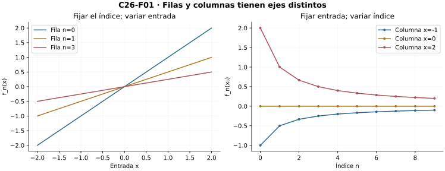
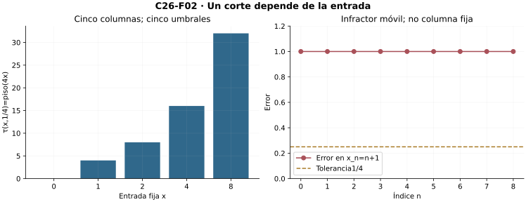
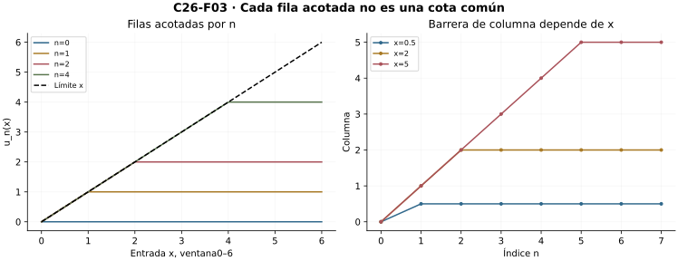
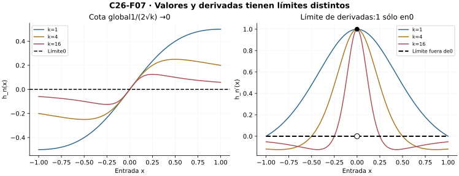

[Índice del libro](../para-matematicos/analisis-para-matematicos.html) · [Ejercicios de este capítulo](#ejercicios-26)

Una etapa entrega ahora una función entera. Miraremos sus columnas con las herramientas numéricas de C06 y preguntaremos qué cambia cuando también cambia la entrada. C12–C14 aportan tipos, límites y continuidad. C03 y las interfaces de C18/C23/C24/C25 se declaran al usarlas en pruebas y ejemplos; no se importan resultados de C27 o C28.

## 26.1. Dos índices, dos maneras de mirar

[]{#MA-SEC-ANM-01-026-001}

Una sucesión numérica entrega un número para cada índice. Ahora cada índice entrega una función completa. El dominio permanece fijo: sea $X\subseteq\mathbb R$, y para cada $n\in\mathbb N=\{0,1,2,\ldots\}$ sea $f_n:X\to\mathbb R$. El número $f_n(x)$ tiene dos argumentos de naturaleza distinta: $n$ ordena las etapas; $x$ señala una entrada del dominio. Cambiar el dominio entre etapas impide comparar columnas sin declarar antes una restricción común.

### Construir el objeto sin confundir sus representaciones

Por la teoría elemental de conjuntos y funciones declarada en C12, la colección $\mathcal F(X,\mathbb R)$ existe: sus elementos son los subconjuntos de $X\times\mathbb R$ que satisfacen existencia y unicidad de salida. Una sucesión de funciones es una aplicación $\mathbb N\to\mathcal F(X,\mathbb R)$. Equivalentemente, podemos dar una sola función
$$
F:\mathbb N\times X\to\mathbb R,\qquad F(n,x)=f_n(x).
$$
En la ida, la evaluación produce una salida única; en la vuelta, la sección $x\mapsto F(n,x)$ produce cada función. No se elige una salida entre varias. El grafo reúne pares con salidas ya únicas.

Fijar $n$ deja la fila $f_n$; fijar $x$ deja la sucesión numérica $n\mapsto f_n(x)$. La gráfica de una fila vive en $X\times\mathbb R$. Una columna se dibuja con índice horizontal y valor vertical. Usar un mismo dibujo sin distinguir esos ejes puede hacer parecer que la convergencia cambia el dominio.

Por ejemplo,
$$
f_n(x)=\frac{x}{n+1},\qquad X=\mathbb R.
$$
El denominador es positivo para todo índice, por lo que cada fila es una función real bien definida. En $x=2$ vemos $2,1,2/3,\ldots$; en $x=-1$ vemos $-1,-1/2,-1/3,\ldots$. Para una entrada fija $x$, el error respecto de cero es $|x|/(n+1)$. El destino es el mismo, pero los umbrales que lo certifican pueden depender de la columna.

### El conjunto donde las columnas convergen

No toda familia converge en todo su dominio. Definimos
$$
C=\{x\in X:\text{existe }y\in\mathbb R\text{ con }f_n(x)\to y\}.
$$
Para cada $x\in C$, la unicidad de C06 identifica un único $y$. El subconjunto
$$
G=\{(x,y)\in C\times\mathbb R:f_n(x)\to y\}
$$
es, por tanto, el grafo de una función $f:C\to\mathbb R$. No se invoca una selección numerable de límites: existencia y unicidad en cada fibra son precisamente la condición de función.

Para $f_n(x)=(-1)^n x$ en $\mathbb R$, la columna de cero es constante y converge. Si $x\ne0$, las subsecuencias pares e impares son constantes de valores $x$ y $-x$. Un supuesto límite tendría que coincidir con ambos por la transferencia a subsecuencias de C06; son distintos. Así $C=\{0\}$. Dar la fórmula de cada fila no garantiza la existencia de una función límite en todo $X$.

Si $X$ es vacío, existe una única función $X\to\mathbb R$ y toda afirmación para sus entradas es vacua. Los ejemplos y las refutaciones siguientes tendrán dominios no vacíos. Una figura con unas pocas columnas permite leer el tipo del objeto; no certifica las columnas que no muestra.

{#fig-anm-c26-f01 fig-alt="Familia x/(n+1): las filas son gráficas respecto de x; las columnas fijan entradas y dibujan valores respecto del índice. Sólo se muestran tres entradas y tres etapas: la prueba para toda entrada está en R1–R2."}

### Microcontroles

#### Microcontrol 1

[]{#MA-MIC-ANM-01-026-001}

¿Qué queda fijo al mirar una columna?

[]{#MA-MSOL-ANM-01-026-001}

Ver solución del microcontrol 1

Una columna fija la entrada $x\in X$ y deja variar $n\in\mathbb N$. Se obtiene la sucesión numérica $f_0(x),f_1(x),\ldots$, a la que se aplican los criterios de convergencia de C06. El punto $x$ permanece igual durante toda esa prueba.

#### Microcontrol 2

[]{#MA-MIC-ANM-01-026-002}

¿Qué objeto es una fila?

[]{#MA-MSOL-ANM-01-026-002}

Ver solución del microcontrol 2

Al fijar $n$ queda la función $f_n:X\to\mathbb R$. Su gráfica contiene los pares $(x,f_n(x))$ cuando $x$ recorre el dominio. Así una fila conserva el índice de etapa y permite comparar distintas entradas dentro de una misma función.

#### Microcontrol 3

[]{#MA-MIC-ANM-01-026-003}

¿Por qué se declara un dominio común?

[]{#MA-MSOL-ANM-01-026-003}

Ver solución del microcontrol 3

Un dominio común $X$ garantiza que $f_n(x)$ existe para cada par $(n,x)\in\mathbb N\times X$. Entonces cada columna tiene todos sus términos y dos filas pueden compararse en la misma entrada. Si las fórmulas tienen dominios diferentes, primero se declara una restricción común o una extensión que complete los valores faltantes.

#### Microcontrol 4

[]{#MA-MIC-ANM-01-026-004}

¿En qué producto vive el grafo de una fila?

[]{#MA-MSOL-ANM-01-026-004}

Ver solución del microcontrol 4

El grafo de $f_n$ es $\{(x,f_n(x)):x\in X\}\subseteq X\times\mathbb R$. El índice $n$ etiqueta la función que se está representando. En esa gráfica la coordenada de entrada sigue siendo $x$, no el número de etapa.

#### Microcontrol 5

[]{#MA-MIC-ANM-01-026-005}

¿Qué garantiza salida única en el grafo del límite?

[]{#MA-MSOL-ANM-01-026-005}

Ver solución del microcontrol 5

Si una columna converge a dos números reales, la unicidad de C06 obliga a que sean iguales. Por tanto, donde existe límite, la relación $(x,y)$ con $f_n(x)\to y$ tiene exactamente una salida por entrada. Esas fibras únicas forman el grafo de la función límite.

#### Microcontrol 6

[]{#MA-MIC-ANM-01-026-006}

¿Debe converger toda columna de una familia dada?

[]{#MA-MSOL-ANM-01-026-006}

Ver solución del microcontrol 6

Para $f_n(x)=(-1)^n x$, la columna de cero es constante cero. Si $x\ne0$, los índices pares tienen altura $x$ y los impares altura $-x$. Las dos subsucesiones constantes tienen destinos distintos, así la columna completa no converge. La familia sólo define un límite real sobre su conjunto de convergencia $\{0\}$.

#### Microcontrol 7

[]{#MA-MIC-ANM-01-026-007}

¿Qué sucede si el dominio es vacío?

[]{#MA-MSOL-ANM-01-026-007}

Ver solución del microcontrol 7

En $X=\varnothing$ hay una única función con ese dominio: el grafo vacío. Todas las filas y cualquier candidata real con dominio vacío son esa función. La condición de convergencia para cada entrada se satisface vacuamente, porque no hay columnas que comprobar.

#### Microcontrol 8

[]{#MA-MIC-ANM-01-026-008}

¿Bastan tres columnas dibujadas para probar convergencia en un intervalo?

[]{#MA-MSOL-ANM-01-026-008}

Ver solución del microcontrol 8

Tres columnas verifican sólo tres sucesiones numéricas. La convergencia puntual en un intervalo exige una prueba para cualquier entrada de él y cualquier tolerancia positiva. Una fórmula de corte dependiente de una entrada arbitraria puede responder a ese contrato completo; una tabla finita no lo hace.

### Ejercicios de la sección 26.1

[]{#ejercicios-26}

#### Ejercicio 1. Fila y columna

[]{#MA-EX-ANM-01-026-001}

Para $F(n,x)=(n+1)x$ en $\mathbb N\times\mathbb R$, identifica filas, columnas y las entradas donde hay límite real.

[]{#MA-SOL-ANM-01-026-001}

Ver solución del ejercicio 1

La fila $n$ es $f_n:x\mapsto(n+1)x$ sobre $\mathbb R$; la columna $x$ es la sucesión $((n+1)x)_{n\ge0}$. En $x=0$ todos los valores son cero. Si $x\ne0$, sus magnitudes $(n+1)|x|$ exceden cualquier $M>0$ desde un índice con $n+1>M/|x|$. La columna es entonces no acotada y no puede converger a un real, pues C06 hace acotada toda sucesión convergente. Para $x>0$ crece sin cota superior y para $x<0$ decrece sin cota inferior. El conjunto de convergencia real es exactamente $\{0\}$ y la función límite sobre él vale cero.

**Retorno visual.** Véase [C26-F01](analisis-para-matematicos-capitulo-26-sucesiones-de-funciones-converger-punto-por-punto.html#fig-anm-c26-f01), después del argumento completo: la figura permite reconocer el mecanismo y no sustituye la prueba.

#### Ejercicio 2. El dominio que se conserva

[]{#MA-EX-ANM-01-026-002}

Las fórmulas $f_n(x)=1/(x-n)$ tienen dominio $\mathbb R\setminus\{n\}$. Encuentra un dominio común y el límite allí.

[]{#MA-SOL-ANM-01-026-002}

Ver solución del ejercicio 2

Como los índices son $\mathbb N=\{0,1,2,\ldots\}$, la intersección de los dominios es $X=\mathbb R\setminus\mathbb N$. En ese conjunto cada denominador $x-n$ es no nulo para todo índice. Fijados $x\in X$ y $\varepsilon>0$, elegimos un natural $N>|x|+1/\varepsilon$. Para $n\ge N$, la triangular inversa da $|x-n|\ge n-|x|>1/\varepsilon$, así $|1/(x-n)|<\varepsilon$. Las restricciones convergen puntualmente a cero en $X$. Éste es el mayor dominio común de las fórmulas dadas; podrían elegirse subconjuntos suyos, pero incluir un natural exigiría declarar cómo se repara su fila singular.

#### Ejercicio 3. Alternancia dependiente de la entrada

[]{#MA-EX-ANM-01-026-003}

Calcula el conjunto de convergencia de $f_n(x)=(-1)^n(x-2)$ en $\mathbb R$.

[]{#MA-SOL-ANM-01-026-003}

Ver solución del ejercicio 3

En $x=2$ todos los valores de la columna son cero. Para $x\ne2$, los índices pares tienen altura $x-2$ y los impares altura $2-x$. Si hubiera un límite real, ambas subsucesiones deberían converger a él por C06. Son constantes y sus valores son distintos, de modo que la unicidad lo hace imposible. El conjunto de convergencia es $\{2\}$ y la función límite allí vale cero. La alternancia no depende de una etapa inicial excepcional: sigue produciendo ambos valores en índices arbitrariamente tardíos.

#### Ejercicio 4. Grafo del límite

[]{#MA-EX-ANM-01-026-004}

Explica por qué la existencia de límite real en cada columna de $X$ define una función sin escoger un límite arbitrario por entrada.

[]{#MA-SOL-ANM-01-026-004}

Ver solución del ejercicio 4

Definimos $G=\{(x,y)\in X\times\mathbb R:f_n(x)\to y\}$. La hipótesis de convergencia de cada columna proporciona al menos un $y$ para cada entrada. La unicidad del límite numérico proporciona a lo sumo uno. Por tanto $G$ es total y univaluada sobre $X$, y define una función $f:X\to\mathbb R$. La salida está determinada por una propiedad que tiene un único valor, sin elegir entre alternativas por entrada. Si $X$ es vacío, el mismo procedimiento produce el único grafo vacío.

#### Ejercicio 5. Toda entrada salvo una

[]{#MA-EX-ANM-01-026-005}

Define $f_n(x)=1$ si $x=n$ y $0$ en otro caso, en $\mathbb R$. Determina su límite y explica por qué las gráficas no bastan.

[]{#MA-SOL-ANM-01-026-005}

Ver solución del ejercicio 5

Si $x\notin\mathbb N$, ninguna fila tiene su pico en esa entrada y la columna es cero desde el inicio. Si $x=m\in\mathbb N$, el único término de altura uno es el de índice $m$; desde $N=m+1$ toda la cola es cero. Así $f_n(x)\to0$ para cada $x\in\mathbb R$. Cada fila contiene un pico de altura uno, pero éste aparece en una entrada diferente al aumentar el índice. El argumento clasifica una entrada arbitraria y controla su cola completa; unas pocas gráficas no certificarían esa afirmación universal.

## 26.2. Una cola para cada entrada

[]{#MA-SEC-ANM-01-026-002}

Decimos que $f_n$ converge **puntualmente** a $f:X\to\mathbb R$ si
$$
\forall x\in X\ \forall\varepsilon>0\ \exists N\in\mathbb N\
\forall n\ge N:\quad |f_n(x)-f(x)|<\varepsilon.
$$
Es exactamente la convergencia numérica de C06 aplicada a cada entrada fija. Recibimos $x$ y $\varepsilon$ antes de construir $N$; después controlamos toda la cola en esa entrada. Escribimos $f_n\to f$ puntualmente en $X$ y dejamos explícito el dominio.

### Responder al desafío completo

Para $f_n(x)=x/(n+1)$ y $x=0$, sirve $N=0$. Si $x\ne0$, por la arquimedianidad de C03 elegimos un natural $N>|x|/\varepsilon$. Para $n\ge N$,
$$
|f_n(x)|=\frac{|x|}{n+1}
\le\frac{|x|}{N+1}<\varepsilon.
$$
La elección sirve también para $x=0$, pero separar la columna constante muestra que no necesitamos dividir por cero. La prueba responde a todo $x$ real y a toda tolerancia; comprobar dos entradas de una tabla no lo haría.

La dependencia permitida no es una dependencia obligatoria. Una familia puede tener un corte que funcione simultáneamente en muchas entradas. La definición puntual no exige ese privilegio. Si lo hay para un conjunto finito $A=\{x_1,\ldots,x_m\}$, lo podemos obtener: para una tolerancia fija, tomamos los $m$ cortes y su máximo. Toda cola posterior satisface las $m$ obligaciones. Si $A$ es vacío, sirve cualquier corte. No se toma el máximo de una colección infinita de umbrales.

### Unicidad y negación

Si $f_n\to f$ y $f_n\to g$ puntualmente, fijemos $x$. Si $d=|f(x)-g(x)|>0$, los dos cortes para $d/3$ tienen un máximo $N$. Entonces
$$
d\le |f(x)-f_N(x)|+|f_N(x)-g(x)|<2d/3,
$$
contradicción. Por tanto $f(x)=g(x)$ para toda entrada y C12 da igualdad de funciones.

La negación, para una candidata $f$ fija, es
$$
\exists x\in X\ \exists\varepsilon_0>0\ \forall N\in\mathbb N\
\exists n\ge N:\quad |f_n(x)-f(x)|\ge\varepsilon_0.
$$
El punto infractor debe permanecer fijo cuando $N$ varía. Si ante cada corte fabricamos una entrada distinta, habremos refutado una obligación simultánea más fuerte, no necesariamente la convergencia puntual.

Para $(-1)^n x$ y candidata cero, $x=1$ y $\varepsilon_0=1/2$ dan error1 en todo índice. Esto sí es una refutación puntual. Para $x/(n+1)$, escoger $x_n=n+1$ da error1 en cada etapa, pero la entrada cambia; la prueba anterior sigue mostrando convergencia puntual en $\mathbb R$.

### Umbrales mínimos sin elegir infinitamente

Para cada par $(x,\varepsilon)$, el conjunto
$$
H(x,\varepsilon)=\{N\in\mathbb N:\forall n\ge N,\
|f_n(x)-f(x)|<\varepsilon\}
$$
es no vacío cuando hay convergencia puntual. El buen orden de los naturales da su mínimo $\tau(x,\varepsilon)$. Esta regla es única y define una función sobre los pares autorizados. Si $\varepsilon$ disminuye, las obligaciones se vuelven más fuertes y el umbral mínimo no puede disminuir. Una fórmula suficiente de corte puede ser mayor que $\tau$; minimalidad y validez son preguntas distintas.

{#fig-anm-c26-f02 fig-alt="Para x/(n+1) y tolerancia1/4, el umbral mínimo en las entradas no negativas mostradas es piso(4x). En cambio, la entrada móvil x_n=n+1 produce error1 en toda etapa. Esa ruta no refuta la convergencia puntual."}

### Microcontroles

#### Microcontrol 9

[]{#MA-MIC-ANM-01-026-009}

¿De qué datos puede depender el corte puntual?

[]{#MA-MSOL-ANM-01-026-009}

Ver solución del microcontrol 9

En el contrato puntual se reciben primero $x\in X$ y $\varepsilon>0$, y después se construye $N$. Por eso el corte puede depender de ambos. Para $x/(n+1)\to0$, por ejemplo, un natural $N>|x|/\varepsilon$ controla toda la cola de esa entrada.

#### Microcontrol 10

[]{#MA-MIC-ANM-01-026-010}

¿Qué cuantificador sigue a la elección del corte?

[]{#MA-MSOL-ANM-01-026-010}

Ver solución del microcontrol 10

Después de escoger $N$ se exige la desigualdad para todos los índices $n\ge N$. Encontrar un término próximo a la candidata, o una subsucesión de términos próximos, no controla necesariamente esa cola completa. La prueba debe conservar el error menor que la tolerancia desde el corte en adelante.

#### Microcontrol 11

[]{#MA-MIC-ANM-01-026-011}

¿Qué debe permanecer fijo al refutar convergencia hacia una candidata?

[]{#MA-MSOL-ANM-01-026-011}

Ver solución del microcontrol 11

Para refutar convergencia puntual hacia $f$, se fijan una entrada $x$ y un error $\varepsilon_0>0$ tales que cada corte $N$ admita algún $n\ge N$ con $|f_n(x)-f(x)|\ge\varepsilon_0$. La entrada y el error se eligen antes de recibir los cortes y permanecen iguales en todas las infracciones.

#### Microcontrol 12

[]{#MA-MIC-ANM-01-026-012}

¿Qué demuestra una entrada infractora que cambia con el corte?

[]{#MA-MSOL-ANM-01-026-012}

Ver solución del microcontrol 12

Si la entrada infractora se elige después del corte, puede mostrar que ninguna cola controla todas las entradas a la vez. Para $x/(n+1)$, escoger $x_n=n+1$ da error uno en cada etapa, mientras toda columna fija converge a cero. Esa ruta móvil no contradice el contrato puntual.

#### Microcontrol 13

[]{#MA-MIC-ANM-01-026-013}

¿Por qué dos funciones límite puntuales coinciden?

[]{#MA-MSOL-ANM-01-026-013}

Ver solución del microcontrol 13

Fijada $x$, si dos destinos $f(x),g(x)$ tuvieran distancia $d>0$, sus cortes para error $d/3$ tendrían un máximo $N$. En ese índice, la triangular daría $d\le|f(x)-f_N(x)|+|f_N(x)-g(x)|<2d/3$, imposible. Coinciden en cada entrada y por tanto son la misma función.

#### Microcontrol 14

[]{#MA-MIC-ANM-01-026-014}

¿Cómo se reúnen los cortes de un conjunto finito de entradas?

[]{#MA-MSOL-ANM-01-026-014}

Ver solución del microcontrol 14

Para la misma tolerancia, cada una de las finitísimas entradas aporta un corte válido. El máximo de esos naturales domina a todos y garantiza sus desigualdades para cualquier índice posterior. En el conjunto vacío sirve cero. Una colección infinita de cortes puede no tener un máximo natural.

#### Microcontrol 15

[]{#MA-MIC-ANM-01-026-015}

¿Cómo se define el umbral mínimo $\tau(x,\varepsilon)$?

[]{#MA-MSOL-ANM-01-026-015}

Ver solución del microcontrol 15

Consideramos $H(x,\varepsilon)=\{N\in\mathbb N:\forall n\ge N,\ |f_n(x)-f(x)|<\varepsilon\}$. La convergencia puntual hace no vacío este conjunto. Su mínimo por buen orden es $\tau(x,\varepsilon)$, un corte válido y único; una fórmula suficiente de corte puede ser mayor que él.

#### Microcontrol 16

[]{#MA-MIC-ANM-01-026-016}

¿Qué ocurre con $\tau$ al disminuir la tolerancia?

[]{#MA-MSOL-ANM-01-026-016}

Ver solución del microcontrol 16

Si $0<\varepsilon_1\le\varepsilon_2$, cualquier corte que controle el error por $\varepsilon_1$ también lo controla por $\varepsilon_2$. Así $H(x,\varepsilon_1)\subseteq H(x,\varepsilon_2)$ y sus mínimos satisfacen $\tau(x,\varepsilon_1)\ge\tau(x,\varepsilon_2)$. El desafío más preciso puede exigir esperar más.

### Ejercicios de la sección 26.2

#### Ejercicio 6. Certificado explícito

[]{#MA-EX-ANM-01-026-006}

Da un corte para $f_n(x)=(x^2+1)/(n+1)\to0$ en $\mathbb R$ con error estricto menor que $\varepsilon$.

[]{#MA-SOL-ANM-01-026-006}

Ver solución del ejercicio 6

Fijamos $x\in\mathbb R$ y $\varepsilon>0$. El numerador $x^2+1$ es positivo. Por arquimedianidad elegimos un natural $N>(x^2+1)/\varepsilon$. Para cualquier $n\ge N$, se tiene $0<(x^2+1)/(n+1)\le(x^2+1)/(N+1)<\varepsilon$. El corte sirve para toda la cola y depende sólo de los desafíos recibidos, la entrada y la tolerancia. Se obtiene convergencia puntual a cero en toda la recta.

#### Ejercicio 7. Negar en el orden correcto

[]{#MA-EX-ANM-01-026-007}

Escribe la negación de convergencia puntual hacia una candidata $f$ y úsala para refutar $f_n(x)=(-1)^n$ hacia cero en un dominio no vacío.

[]{#MA-SOL-ANM-01-026-007}

Ver solución del ejercicio 7

La negación hacia una candidata fija $f$ es $\exists x\in X\ \exists\varepsilon_0>0\ \forall N\in\mathbb N\ \exists n\ge N:\ |f_n(x)-f(x)|\ge\varepsilon_0$. Para la candidata cero y $f_n(x)=(-1)^n$, fijamos cualquier entrada del dominio no vacío y $\varepsilon_0=1/2$. Ante cada corte $N$, el índice $n=N$ tiene error uno, así infringe la obligación. La entrada permanece fija y la refutación sí es puntual. La familia tampoco converge a otra candidata real en esa entrada, porque las subsucesiones constantes uno y menos uno no podrían compartir un límite.

#### Ejercicio 8. Un infractor móvil

[]{#MA-EX-ANM-01-026-008}

Para $f_n(x)=x/(n+1)$ en $\mathbb R$, elige ante cada corte una entrada con error1. ¿Qué queda refutado?

[]{#MA-SOL-ANM-01-026-008}

Ver solución del ejercicio 8

El límite puntual es cero: para cada entrada fija, un corte $N>|x|/\varepsilon$ controla $|x|/(n+1)$ en toda la cola. Para refutar un corte simultáneo, fijamos tolerancia $1/2$. Ante cualquier $N$, tomamos $n=N$ y $x=N+1$, obteniendo $|f_N(x)|=1$. Se demuestra $\forall N\ \exists x\ \exists n\ge N$ con error grande. La entrada se elige después del corte, de modo que esa afirmación no es la negación del contrato puntual, cuyo infractor tendría que ser una misma entrada para todos los cortes.

**Retorno visual.** Véase [C26-F02](analisis-para-matematicos-capitulo-26-sucesiones-de-funciones-converger-punto-por-punto.html#fig-anm-c26-f02), después del argumento completo: la figura permite reconocer el mecanismo y no sustituye la prueba.

#### Ejercicio 9. Reunión finita de obligaciones

[]{#MA-EX-ANM-01-026-009}

Para $f_n(x)=x/(n+1)$ y $A=\{-3,0,5\}$, produce un corte simultáneo y justifica la generalización a un conjunto finito.

[]{#MA-SOL-ANM-01-026-009}

Ver solución del ejercicio 9

En $A=\{-3,0,5\}$, todas las magnitudes de entrada están acotadas por cinco. Un natural $N>5/\varepsilon$ da, para todo $n\ge N$ y todo $x\in A$, $|f_n(x)|\le5/(N+1)<\varepsilon$. Para una familia puntualmente convergente cualquiera sobre un conjunto finito, la tolerancia fija proporciona un corte por cada entrada. Se construye esa lista finita de cortes y se toma su máximo; cualquier índice posterior cumple todas las obligaciones. En el vacío sirve cero. La extensión a infinitas entradas necesitaría demostrar que sus umbrales tienen una barrera natural común.

#### Ejercicio 10. Umbral mínimo

[]{#MA-EX-ANM-01-026-010}

Para $f_n(x)=x/(n+1)$ calcula $\tau(x,\varepsilon)$ y comprueba la frontera estricta.

[]{#MA-SOL-ANM-01-026-010}

Ver solución del ejercicio 10

Sea $r=|x|/\varepsilon\ge0$. Como el error $|x|/(n+1)$ no aumenta con $n$, un corte $N$ es válido exactamente cuando $N+1>r$. Ponemos $m=\lfloor r\rfloor$, caracterizado por $m\le r<m+1$. El corte $N=m$ cumple la desigualdad estricta. Si un natural $N<m$, entonces $N+1\le m\le r$, de modo que ya el error en ese índice es al menos $\varepsilon$ y falla. Por tanto $\tau(x,\varepsilon)=\lfloor|x|/\varepsilon\rfloor$, incluido $x=0$, donde el mínimo es cero. Cuando $r$ es un entero positivo, el índice anterior da error exactamente igual a $\varepsilon$, que no satisface el contrato estricto.

## 26.3. Lo que se transporta columna por columna

[]{#MA-SEC-ANM-01-026-003}

Las operaciones puntuales se definen fila por fila y entrada por entrada. Para probar su convergencia fijamos primero $x$. Reutilizar resultados numéricos es legítimo porque entonces todos los términos que intervienen son reales de sucesiones ya dadas. Es útil reconstruir las estimaciones para ver dónde quedan las dependencias.

### Sumas, productos y cocientes

Si $f_n\to f$ y $g_n\to g$ puntualmente en $X$, entonces $\alpha f_n+\beta g_n\to\alpha f+\beta g$ para constantes reales. Repartimos una tolerancia entre los errores: bastan errores menores que $\varepsilon/[2(|\alpha|+1)]$ y $\varepsilon/[2(|\beta|+1)]$. El máximo de los dos cortes da error total menor que $\varepsilon$.

Para el producto, la convergencia de $f_n(x)$ da una cola con $|f_n(x)|\le |f(x)|+1=:B_x$. Allí
$$
|f_n(x)g_n(x)-f(x)g(x)|
\le B_x|g_n(x)-g(x)|+|g(x)|\,|f_n(x)-f(x)|.
$$
Elegimos los dos errores con los denominadores positivos $2(B_x+1)$ y $2(|g(x)|+1)$ y reunimos los tres cortes. No hemos obtenido una cota de $f_n$ que valga en todo $X$; sólo la cota necesaria en la entrada fijada.

Si $g(x)\ne0$, una cola con error menor que $|g(x)|/2$ satisface $|g_n(x)|>|g(x)|/2$. En esa cola el recíproco está definido y
$$
\left|\frac1{g_n(x)}-\frac1{g(x)}\right|
\le\frac{2|g_n(x)-g(x)|}{|g(x)|^2}\longrightarrow0.
$$
Esto prueba el cociente por el producto. Para hablar de una sucesión de funciones $f_n/g_n$ sobre un dominio fijo $Y$, se debe asegurar $g_n(x)\ne0$ para **todo** $n$ y $x\in Y$, o declarar valores de reparación para los ceros de cada fila. Que cada columna deje de tener ceros eventualmente no produce automáticamente un único comienzo válido para todas.

### Orden, encierro y composición

Si para la entrada fija $x$ se tiene $f_n(x)\le g_n(x)$ eventualmente, entonces $f(x)\le g(x)$. De fallar, con distancia $d=f(x)-g(x)>0$, dos errores menores que $d/3$ harían $f_n(x)>g_n(x)$ en una cola, contradicción. El comienzo de la desigualdad puede depender de $x$.

Si $a_n(x)\le f_n(x)\le b_n(x)$ eventualmente y ambos extremos convergen al mismo $h(x)$, entonces para errores extremos menores que $\varepsilon$ también $|f_n(x)-h(x)|<\varepsilon$. Para una función $\phi:D\to\mathbb R$ continua en $f(x)\in D$, y todas las entradas $f_n(x)\in D$, el radio de continuidad seguido del corte puntual prueba $\phi(f_n(x))\to\phi(f(x))$. La pertenencia al dominio va antes de componer. No se necesita continuidad de cada $f_n$ para estas reglas.

### Tres alcances de acotación

La convergencia puntual implica que para cada $x$ hay $B_x$ con $|f_n(x)|\le B_x$ para todos los índices: una cola acotada y el máximo de los términos iniciales finitos dan esa barrera por C06. No implica una constante común para todas las entradas e índices. Tampoco la acotación de cada fila implica una cota común entre filas.

En $[0,\infty)$, $u_n(x)=\min(n,x)$ converge a $u(x)=x$: para $n\ge x$ ya coincide. Cada fila está acotada por $n$, pero el límite no está acotado. En cambio, si $|f_n(x)|\le B$ para todos $n,x$, la preservación del orden da $|f(x)|\le B$ para todo $x$. La posición de la constante dentro o fuera de los cuantificadores determina qué puede heredarse.

{#fig-anm-c26-f03 fig-alt="Filas u_n(x)=min(n,x), aquí restringidas a la ventana0≤x≤6 para dibujar. Cada fila tiene barrera n; cada columna tiene barrera x. El límite en todo\[0,∞) es x, no acotado. La ventana finita no demuestra la falta de cota global."}

### Microcontroles

#### Microcontrol 17

[]{#MA-MIC-ANM-01-026-017}

¿Qué cota usa la prueba del producto?

[]{#MA-MSOL-ANM-01-026-017}

Ver solución del microcontrol 17

La convergencia en la entrada fija $x$ proporciona una cola con $|f_n(x)-f(x)|<1$, luego $|f_n(x)|\le|f(x)|+1$. Esta barrera permite estimar el producto con otra columna convergente. Su dependencia de $x$ es admisible porque la prueba continúa siendo puntual.

#### Microcontrol 18

[]{#MA-MIC-ANM-01-026-018}

¿Qué barrera necesita el recíproco?

[]{#MA-MSOL-ANM-01-026-018}

Ver solución del microcontrol 18

Si $g(x)\ne0$, pedimos $|g_n(x)-g(x)|<|g(x)|/2$ en una cola. La triangular inversa da $|g_n(x)|>|g(x)|/2>0$. Esta separación de cero permite dividir y controlar $|1/g_n(x)-1/g(x)|$ mediante el error de la columna.

#### Microcontrol 19

[]{#MA-MIC-ANM-01-026-019}

¿Garantiza un denominador límite no nulo que todas las filas del cociente estén definidas?

[]{#MA-MSOL-ANM-01-026-019}

Ver solución del microcontrol 19

Un límite $g(x)\ne0$ garantiza sólo que los denominadores posteriores de esa columna no se anulan. Puede haber ceros en etapas iniciales distintas para entradas distintas. Por ejemplo $g_n(x)=x-1/(n+1)$ se anula en una entrada de $(0,1]$ en cada fila, así sus recíprocos no están definidos en todo ese dominio común.

#### Microcontrol 20

[]{#MA-MIC-ANM-01-026-020}

¿Se hereda una desigualdad estricta eventual?

[]{#MA-MSOL-ANM-01-026-020}

Ver solución del microcontrol 20

El orden débil eventual pasa al límite: si $f_n(x)\le g_n(x)$ desde algún corte, entonces $f(x)\le g(x)$. La estrictitud puede desaparecer, como en $1/(n+1)>0$ con límite cero. Para conservar un margen positivo hace falta una hipótesis cuantitativa adicional.

#### Microcontrol 21

[]{#MA-MIC-ANM-01-026-021}

¿Qué exige componer con una función exterior continua?

[]{#MA-MSOL-ANM-01-026-021}

Ver solución del microcontrol 21

Si la función exterior $\phi$ tiene dominio $Y$, deben pertenecer a $Y$ todos los valores $f_n(x)$ y $f(x)$ usados. La continuidad relativa de $\phi$ en $f(x)$ convierte un radio de salida en uno de entrada; el corte puntual coloca la cola dentro de ese radio. Entonces $\phi(f_n(x))\to\phi(f(x))$.

#### Microcontrol 22

[]{#MA-MIC-ANM-01-026-022}

¿Qué acotación produce una columna convergente?

[]{#MA-MSOL-ANM-01-026-022}

Ver solución del microcontrol 22

Una columna convergente tiene una cola limitada por $|f(x)|+1$. El prefijo restante contiene sólo finitísimos términos, cuyas magnitudes tienen máximo. El máximo de esa cantidad y la barrera de la cola acota todos los términos de la columna, aunque pueda variar de una entrada a otra.

#### Microcontrol 23

[]{#MA-MIC-ANM-01-026-023}

¿Puede un límite puntual de filas acotadas ser no acotado?

[]{#MA-MSOL-ANM-01-026-023}

Ver solución del microcontrol 23

En $[0,\infty)$, cada fila $u_n(x)=\min(n,x)$ está entre cero y $n$, así está acotada. Para $x$ fijo, desde $n\ge x$ vale exactamente $x$. Su límite puntual es la función $u(x)=x$, que no está acotada en todo el dominio.

#### Microcontrol 24

[]{#MA-MIC-ANM-01-026-024}

¿Qué sucede si todas las filas tienen una misma barrera de magnitud?

[]{#MA-MSOL-ANM-01-026-024}

Ver solución del microcontrol 24

Si $|f_n(x)|\le B$ con la misma constante para todos los índices y entradas, fijar $x$ y pasar al límite numérico da $|f(x)|\le B$. La arbitrariedad de la entrada proporciona una cota global del límite. Esta conclusión usa una barrera común, más fuerte que la acotación separada de cada fila.

### Ejercicios de la sección 26.3

#### Ejercicio 11. Dos errores y una cota

[]{#MA-EX-ANM-01-026-011}

Prueba directamente que el producto de dos familias puntualmente convergentes converge al producto de sus límites.

[]{#MA-SOL-ANM-01-026-011}

Ver solución del ejercicio 11

Fijamos una entrada $x$ y abreviamos $f(x)=a$, $g(x)=b$. La convergencia de la primera columna da un corte de acotación con $|f_n(x)|\le B=|a|+1$. Usamos la identidad $f_ng_n-ab=f_n(g_n-b)+b(f_n-a)$. Su magnitud no supera $B|g_n-b|+|b||f_n-a|$. Pedimos a la segunda columna error menor que $\varepsilon/[2(B+1)]$ y a la primera menor que $\varepsilon/[2(|b|+1)]$. El máximo de esos dos cortes y el de acotación garantiza que la suma anterior es menor que $\varepsilon$, pues cada coeficiente sobre su denominador más uno es menor que uno. La entrada era arbitraria, así el producto converge puntualmente a $fg$. No se necesitó una cota global de las familias.

#### Ejercicio 12. Ceros por filas

[]{#MA-EX-ANM-01-026-012}

En $X=(0,1]$ sea $g_n(x)=x-1/(n+1)$. Prueba convergencia puntual y explica por qué $1/g_n$ no define una familia en todo $X$.

[]{#MA-SOL-ANM-01-026-012}

Ver solución del ejercicio 12

Para $x\in(0,1]$, $|g_n(x)-x|=1/(n+1)\to0$, así el límite puntual es $g(x)=x>0$. Sin embargo, cada fila se anula en $x_n=1/(n+1)$, que pertenece al dominio. Por eso $1/g_n$ no define una función real en todo $X$ en ninguna etapa. Un dominio común posible para los recíprocos es $Y=X\setminus\{1/(n+1):n\in\mathbb N\}$. En una entrada fija de $Y$, desde un corte con $1/(n+1)<x/2$ tenemos $g_n(x)>x/2$. Entonces $|1/g_n(x)-1/x|=|x-g_n(x)|/(x|g_n(x)|)\le2/[x^2(n+1)]\to0$. La barrera eventual justifica el límite, mientras la restricción común justifica la existencia de todas las filas.

#### Ejercicio 13. Orden eventual

[]{#MA-EX-ANM-01-026-013}

Si $f_n\to f$, $g_n\to g$ puntualmente y para cada $x$ hay un corte con $f_n(x)\le g_n(x)$ después de él, demuestra $f\le g$.

[]{#MA-SOL-ANM-01-026-013}

Ver solución del ejercicio 13

Fijemos $x$ y supongamos por contradicción que $d=f(x)-g(x)>0$. Reunimos los cortes para errores menores que $d/3$ de ambas columnas y el corte a partir del que se cumple su orden. En cualquier índice posterior, $f_n(x)>f(x)-d/3$ y $g_n(x)<g(x)+d/3$, así $f_n(x)-g_n(x)>d-2d/3=d/3>0$. Esto contradice $f_n(x)\le g_n(x)$. Por tanto $f(x)\le g(x)$ para toda entrada. La estrictitud no pasa automáticamente: las columnas $1/(n+1)>0$ y cero tienen el mismo límite cero.

#### Ejercicio 14. Filas acotadas, límite sin cota

[]{#MA-EX-ANM-01-026-014}

Analiza $u_n(x)=\min(n,x)$ en $[0,\infty)$ respecto de acotación de filas, columnas, límite y familia completa.

[]{#MA-SOL-ANM-01-026-014}

Ver solución del ejercicio 14

Para cada $n$, la fila $u_n$ satisface $0\le u_n(x)\le n$ en todo $[0,\infty)$, así está acotada. Para cada entrada fija $x$, su columna satisface $0\le u_n(x)\le x$ y desde cualquier natural $N>x$ coincide con $x$. Por tanto su límite es $u(x)=x$. Esta función no tiene cota superior en todo el dominio. Tampoco hay una barrera común para toda la familia: dado $B\ge0$, elegimos un natural $n>B$ y tomamos $x=n$, obteniendo $u_n(n)=n>B$. Las cotas por filas y por columnas son válidas, pero dependen de argumentos diferentes y ninguna proporciona esa barrera global.

**Retorno visual.** Véase [C26-F03](analisis-para-matematicos-capitulo-26-sucesiones-de-funciones-converger-punto-por-punto.html#fig-anm-c26-f03), después del argumento completo: la figura permite reconocer el mecanismo y no sustituye la prueba.

#### Ejercicio 15. Componer dentro del tipo

[]{#MA-EX-ANM-01-026-015}

Si $f_n\to f$ puntualmente y todos sus valores y los de $f$ son no negativos, demuestra $\sqrt{f_n}\to\sqrt f$ sin suponer continuidad de las filas.

[]{#MA-SOL-ANM-01-026-015}

Ver solución del ejercicio 15

Para una entrada fija, escribimos $u_n=f_n(x)\ge0$ y $u=f(x)\ge0$. Sus raíces reales están definidas. Si $u_n\ge u$, la diferencia de raíces es no negativa y $u_n-u=(\sqrt{u_n}-\sqrt u)(\sqrt{u_n}+\sqrt u)\ge(\sqrt{u_n}-\sqrt u)^2$. Intercambiar los dos valores cubre el orden inverso, así $|\sqrt{u_n}-\sqrt u|^2\le|u_n-u|$. Para $\varepsilon>0$, la convergencia de la columna da una cola con $|u_n-u|<\varepsilon^2$, luego el error de raíces es menor que $\varepsilon$. Esto también cubre $u=0$. Sólo se usa el control de la columna y la operación raíz, sin continuidad de las filas.

## 26.4. Potencias y una discontinuidad nueva

[]{#MA-SEC-ANM-01-026-004}

En $X=[0,1]$ definimos $p_0(x)=1$ y $p_{n+1}(x)=x\,p_n(x)$. Así $p_n(x)=x^n$ para $n\ge1$, sin dejar ambiguo el valor inicial en cero. Las filas son polinomios continuos por C14. El dominio compacto no evita por sí solo que el límite cambie la continuidad.

### Demostrar la convergencia, incluidos los extremos

En cero, $p_n(0)=0$ desde $n=1$; en uno, $p_n(1)=1$ siempre. Para $0<x<1$ ponemos $t=1/x-1>0$. Por inducción,
$$
(1+t)^n\ge1+nt\quad(n\in\mathbb N).
$$
El paso multiplica por $1+t>0$ y conserva el término adicional $nt^2\ge0$. Por ello
$$
0\le x^n\le\frac1{1+nt}.
$$
Para $\varepsilon>0$ elegimos $N>1/(\varepsilon t)$. Si $n\ge N$, la última cota es menor que $\varepsilon$. El límite puntual es
$$
p(x)=
\begin{cases}
0,&0\le x<1,\\
1,&x=1.
\end{cases}
$$
La prueba identifica primero los valores y después reúne las columnas; ningún argumento visual reemplaza la estimación.

La función $p$ es continua relativamente a $[0,1]$ en cada $x<1$: basta un radio menor que $1-x$ para quedar donde es constante. En uno falla. Para cualquier $\delta>0$, tomando $d=\min(\delta/2,1/2)>0$ y $y=1-d$ obtenemos $0<|y-1|<\delta$ y $|p(y)-p(1)|=1$. Con tolerancia $1/2$ ningún radio sirve. Así funciones continuas pueden tener un límite puntual discontinuo incluso en un segmento compacto.

### La entrada cercana al extremo responde tarde

Para cualquier índice $n\ge1$, el punto
$$
x_n=1-\frac1{2(n+1)}
$$
es menor que uno, por lo que $p(x_n)=0$. La desigualdad de Bernoulli en su versión $(1-s)^n\ge1-ns$, $0\le s\le1$, se obtiene por inducción: al multiplicar, el término extra $ns^2$ es no negativo. De aquí
$$
p_n(x_n)\ge1-\frac{n}{2(n+1)}>1/2.
$$
Cada etapa tiene una entrada con error grande aunque toda entrada fija menor que uno termina con error pequeño. Ante un supuesto corte común, tomar $n\ge\max(N,1)$ y ese $x_n$ lo refuta. No es una refutación de la convergencia puntual, pues la entrada varía.

Restringir a $[0,c]$ con $0<c<1$ permite usar el mismo $t_c=1/c-1$ para todas las entradas: $x^n\le c^n\le1/(1+nt_c)$. Si $c=0$, desde $n=1$ el error es cero. En $[0,1)$ el límite es continuo, pero los $x_n$ siguen perteneciendo al dominio y el error simultáneo persiste. Continuidad del límite y control simultáneo son obligaciones diferentes.

![Potencias en\[0,1\], con p0=1. El límite vale0 antes de1, punto abierto allí, y1 en1, punto cerrado. La ruta x_n=1−1/\[2(n+1)\] mantiene error mayor que1/2 mediante Bernoulli, aunque toda columna interior converge a cero.](../../assets/books/anm/C26/C26-F04.svg){#fig-anm-c26-f04 fig-alt="Potencias en\[0,1\], con p0=1. El límite vale0 antes de1, punto abierto allí, y1 en1, punto cerrado. La ruta x_n=1−1/\[2(n+1)\] mantiene error mayor que1/2 mediante Bernoulli, aunque toda columna interior converge a cero."}

### Microcontroles

#### Microcontrol 25

[]{#MA-MIC-ANM-01-026-025}

¿Cómo se define la etapa inicial de las potencias en cero?

[]{#MA-MSOL-ANM-01-026-025}

Ver solución del microcontrol 25

Se declara $p_0(x)=1$ para toda entrada, incluido cero, y se define $p_{n+1}(x)=xp_n(x)$. Así $p_n(x)=x^n$ para $n\ge1$ y $p_n(0)=0$ en esas etapas. La recurrencia especifica la fila inicial y evita depender de una interpretación de $0^0$.

#### Microcontrol 26

[]{#MA-MIC-ANM-01-026-026}

¿Cuál es el límite de las potencias en una entrada $0<x<1$?

[]{#MA-MSOL-ANM-01-026-026}

Ver solución del microcontrol 26

Para $0<x<1$, ponemos $t=1/x-1>0$. Bernoulli da $(1+t)^n\ge1+nt$ y, al tomar recíprocos positivos, $x^n\le1/(1+nt)$. Un corte $N>1/(\varepsilon t)$ hace esta cota menor que $\varepsilon$ para toda la cola. La columna tiende a cero sin usar logaritmos.

#### Microcontrol 27

[]{#MA-MIC-ANM-01-026-027}

¿Qué ocurre exactamente en uno?

[]{#MA-MSOL-ANM-01-026-027}

Ver solución del microcontrol 27

La recurrencia parte de $p_0(1)=1$ y multiplica en cada paso por uno, así $p_n(1)=1$ para todo $n$. La columna es constante y su límite es uno. Debe conservarse ese valor de borde al definir la candidata sobre $[0,1]$.

#### Microcontrol 28

[]{#MA-MIC-ANM-01-026-028}

¿Dónde falla continuidad del límite en $[0,1]$?

[]{#MA-MSOL-ANM-01-026-028}

Ver solución del microcontrol 28

El límite vale cero en $[0,1)$ y uno en el extremo uno. Toda vecindad relativa de uno contiene entradas menores que él, donde el error de altura es uno. Con tolerancia $1/2$ no hay radio de continuidad. En cada centro menor que uno, un radio que evite ese extremo deja la candidata constante cero.

#### Microcontrol 29

[]{#MA-MIC-ANM-01-026-029}

¿Qué prueba Bernoulli para $x_n=1-1/[2(n+1)]$?

[]{#MA-MSOL-ANM-01-026-029}

Ver solución del microcontrol 29

Para $s=1/[2(n+1)]$, Bernoulli en la forma $(1-s)^n\ge1-ns$ da $p_n(x_n)\ge1-n/[2(n+1)]=(n+2)/[2(n+1)]>1/2$. En $n=0$ vale por la fila inicial declarada. Como $x_n<1$, el límite en esa entrada vale cero y el error sigue grande.

#### Microcontrol 30

[]{#MA-MIC-ANM-01-026-030}

¿Por qué esa ruta no refuta convergencia puntual?

[]{#MA-MSOL-ANM-01-026-030}

Ver solución del microcontrol 30

La prueba puntual fija primero una entrada y después hace crecer el índice. En la ruta $x_n$, la entrada cambia con cada etapa y se aproxima al borde uno. Sus errores muestran que no existe una cola común para todas las entradas; cada columna fija menor que uno conserva su convergencia a cero.

#### Microcontrol 31

[]{#MA-MIC-ANM-01-026-031}

¿Qué facilita restringir a $[0,c]$ con $c<1$?

[]{#MA-MSOL-ANM-01-026-031}

Ver solución del microcontrol 31

Si $0<c<1$, para $n\ge1$ y $0\le x\le c$ tenemos $0\le p_n(x)\le c^n$. La prueba geométrica para $c$ entrega un corte que sirve a todas esas entradas. La separación del dominio respecto del borde uno hace posible esa barrera simultánea.

#### Microcontrol 32

[]{#MA-MIC-ANM-01-026-032}

¿Qué nueva columna debe examinarse en $[-1,1]$?

[]{#MA-MSOL-ANM-01-026-032}

Ver solución del microcontrol 32

En el nuevo extremo menos uno, la recurrencia produce $p_n(-1)=(-1)^n$. Las subsucesiones pares e impares son constantes uno y menos uno, así no comparten límite. Para $|x|<1$ las magnitudes tienden a cero y en uno permanecen iguales a uno.

### Ejercicios de la sección 26.4

#### Ejercicio 16. Potencias y extremos

[]{#MA-EX-ANM-01-026-016}

Demuestra el límite puntual de $p_0=1$, $p_n(x)=x^n$ para $n\ge1$, en $[0,1]$, sin logaritmos.

[]{#MA-SOL-ANM-01-026-016}

Ver solución del ejercicio 16

La recurrencia declara $p_0=1$. En cero, $p_n(0)=0$ para $n\ge1$, así el límite es cero; en uno, todos los términos son uno. Si $0<x<1$, ponemos $t=1/x-1>0$. Bernoulli, probado por inducción, da $(1+t)^n\ge1+nt$, luego $0<p_n(x)=x^n\le1/(1+nt)$. Para $\varepsilon>0$, un natural $N>1/(\varepsilon t)$ hace esta cota menor que $\varepsilon$ para todos los índices posteriores. Por tanto el límite puntual vale cero en $[0,1)$ y uno en el extremo uno. La prueba mantiene la entrada fija y no usa logaritmos.

#### Ejercicio 17. Discontinuidad relativa

[]{#MA-EX-ANM-01-026-017}

Refuta continuidad del límite de las potencias en1 con un testigo para cada radio.

[]{#MA-SOL-ANM-01-026-017}

Ver solución del ejercicio 17

Sea $p$ el límite, con $p(1)=1$ y $p(y)=0$ para $y<1$. Fijamos tolerancia $1/2$. Para cualquier $\delta>0$, tomamos $d=\min(\delta/2,1/2)>0$ y $y=1-d$. Entonces $y\in[0,1)$ y $0<|y-1|=d<\delta$, pero $|p(y)-p(1)|=1$. Ningún radio cumple continuidad relativa en uno. En un centro $x<1$, en cambio, un radio menor que $1-x$ evita el punto excepcional y deja la función constante cero. La discontinuidad nueva está exactamente en el extremo uno.

#### Ejercicio 18. Una infracción en cada etapa

[]{#MA-EX-ANM-01-026-018}

Con $x_n=1-1/[2(n+1)]$, prueba $p_n(x_n)>1/2$ y determina el alcance de la conclusión.

[]{#MA-SOL-ANM-01-026-018}

Ver solución del ejercicio 18

Para cada $n\ge0$, la entrada $x_n=1-1/[2(n+1)]$ está entre cero y uno. La versión de Bernoulli $(1-s)^n\ge1-ns$ para $0\le s\le1$ da $p_n(x_n)\ge1-n/[2(n+1)]=(n+2)/[2(n+1)]>1/2$; para $n=0$ la fila inicial vale uno. Como el límite en $x_n<1$ es cero, el error supera $1/2$ en cada etapa. Ante cualquier corte común sirve la infracción de esa misma etapa. Sin embargo, las entradas varían con el índice y se aproximan a uno. El resultado refuta control simultáneo en todo el dominio, conservando la convergencia de cada columna fija.

**Retorno visual.** Véase [C26-F04](analisis-para-matematicos-capitulo-26-sucesiones-de-funciones-converger-punto-por-punto.html#fig-anm-c26-f04), después del argumento completo: la figura permite reconocer el mecanismo y no sustituye la prueba.

#### Ejercicio 19. Cambiar el dominio

[]{#MA-EX-ANM-01-026-019}

Compara las potencias en $[0,c]$, $0<c<1$, y en $[0,1)$.

[]{#MA-SOL-ANM-01-026-019}

Ver solución del ejercicio 19

En $[0,c]$, con $0<c<1$, el límite puntual es cero. Para $n\ge1$ y todas las entradas de ese segmento, $p_n(x)\le c^n\le1/[1+n(1/c-1)]$. Un natural $N>1/[\varepsilon(1/c-1)]$, también positivo, controla toda la cola y todas las entradas a la vez. En $[0,1)$, el límite sigue siendo cero, pero las entradas $x_n=1-1/[2(n+1)]$ pertenecen al dominio y tienen error mayor que $1/2$ en cada etapa. Allí no existe un corte simultáneo para esa tolerancia. La candidata es continua en ambos dominios; la pérdida de separación respecto del borde uno cambia el control global.

#### Ejercicio 20. Dominio ampliado

[]{#MA-EX-ANM-01-026-020}

Calcula el conjunto de convergencia real de la misma familia de potencias en $[-1,1]$.

[]{#MA-SOL-ANM-01-026-020}

Ver solución del ejercicio 20

Si $|x|<1$, para $n\ge1$ tenemos $|p_n(x)|=|x|^n$. La prueba geométrica anterior aplicada a $|x|$ da límite cero, con el caso $x=0$ tratado por la recurrencia. En $x=1$, todos los valores son uno. En $x=-1$, las subsucesiones pares e impares son constantes uno y menos uno, así la columna no tiene límite real. Por tanto el conjunto de convergencia en $[-1,1]$ es $(-1,1]$. La función límite sobre él vale cero en $(-1,1)$ y uno en el extremo uno. La familia no converge puntualmente en todo el dominio ampliado porque falla la nueva columna de menos uno.

## 26.5. Cambiar la entrada mientras cambia el índice

[]{#MA-SEC-ANM-01-026-005}

La convergencia puntual mantiene fija la entrada durante toda la prueba. Una **diagonal** dada $x_n\in X$ cambia a la vez fila y columna; el dato $f_n(x_n)$ no está cubierto automáticamente por el contrato.

### Una capa de transición con fórmula racional

En $[0,1]$, sea
$$
a_n(x)=\frac{(n+1)x}{1+(n+1)x}.
$$
El denominador es al menos1; cada fila es continua. En cero vale0. Para $x>0$,
$$
|a_n(x)-1|=\frac1{1+(n+1)x}\le\frac1{(n+1)x}\longrightarrow0.
$$
Un corte natural mayor que $1/(\varepsilon x)$ controla la cola. El límite $a$ vale0 en cero y1 para $x>0$; es discontinuo en el origen, por el mismo argumento de ventana relativa usado en §26.4.

Tomemos ahora entradas explícitas:
$$
u_n=\frac1{n+1},\qquad v_n=\frac1{(n+1)^2}.
$$
Ambas convergen a cero y pertenecen al dominio, pero
$$
a_n(u_n)=1/2,\qquad
a_n(v_n)=\frac1{n+2}\longrightarrow0.
$$
Una tercera ruta, $w_n=1/\sqrt{n+1}$, da $a_n(w_n)=\sqrt{n+1}/(1+\sqrt{n+1})\to1$. La raíz positiva existe por C03; para justificar que el denominador crece, dado $M>0$ basta $n+1>M^2$. La diferencia respecto de1 es su recíproco. Las tres rutas llegan a la misma entrada y sus salidas tienen tres destinos.

Más generalmente, para $c>0$ y $u_n=c/(n+1)$, la ruta pertenece a $[0,1]$ desde un índice mayor que $c$ y allí $a_n(u_n)=c/(1+c)$. Podemos reparar el prefijo finito para obtener una ruta definida desde cero sin alterar ese límite. No basta poner una fórmula que abandona el dominio en las primeras etapas.

### Dos límites iterados efectivamente calculados

Para cada $n$ fijo, la continuidad y $a_n(0)=0$ dan
$$
\lim_{x\to0^+}a_n(x)=0,\qquad
\lim_{n\to\infty}\left(\lim_{x\to0^+}a_n(x)\right)=0.
$$
Por otra parte, para todo $x>0$ el límite en $n$ es1, de modo que
$$
\lim_{x\to0^+}\left(\lim_{n\to\infty}a_n(x)\right)=1.
$$
Se han comprobado ambas existencias antes de comparar. Que ambas operaciones de límite estén definidas no autoriza a permutarlas. Una figura de la transición muestra dónde se comprime el cambio, pero las dos evaluaciones son la prueba.

La diagonal tampoco queda resuelta sólo por la continuidad del límite. En la sección siguiente tendremos límite cero continuo y una ruta que sigue un pico de altura1. Para explicar qué dato adicional puede controlar diagonales, construiremos en §26.8 una estimación común de proximidad, sin usar aún los teoremas de C27 o C28.

![Capa a_n(x)=(n+1)x/\[1+(n+1)x\]. Las rutas1/(n+1),1/(n+1)^2 y1/√(n+1) llegan a0 pero sus salidas tienden a1/2,0 y1. Los límites iterados en entrada e índice dan0 y1; las curvas son representaciones de fórmulas probadas.](../../assets/books/anm/C26/C26-F05.svg){#fig-anm-c26-f05 fig-alt="Capa a_n(x)=(n+1)x/\[1+(n+1)x\]. Las rutas1/(n+1),1/(n+1)^2 y1/√(n+1) llegan a0 pero sus salidas tienden a1/2,0 y1. Los límites iterados en entrada e índice dan0 y1; las curvas son representaciones de fórmulas probadas."}

### Microcontroles

#### Microcontrol 33

[]{#MA-MIC-ANM-01-026-033}

¿Por qué cada fila de la capa racional está definida?

[]{#MA-MSOL-ANM-01-026-033}

Ver solución del microcontrol 33

En $[0,1]$, con $n\ge0$, el denominador $1+(n+1)x$ es al menos uno. Por tanto $a_n(x)=(n+1)x/[1+(n+1)x]$ tiene un valor real en cada entrada desde la etapa inicial. Todas las filas comparten el dominio sin ceros de denominador.

#### Microcontrol 34

[]{#MA-MIC-ANM-01-026-034}

¿Qué error prueba el destino1 en entradas positivas?

[]{#MA-MSOL-ANM-01-026-034}

Ver solución del microcontrol 34

Para $x>0$ fijo, $1-a_n(x)=1/[1+(n+1)x]\le1/[(n+1)x]$. Un natural $N>1/(\varepsilon x)$ garantiza error menor que $\varepsilon$ para $n\ge N$. El corte puede crecer cuando la entrada se acerca a cero, pero en cada entrada positiva sigue siendo finito.

#### Microcontrol 35

[]{#MA-MIC-ANM-01-026-035}

¿Cuál es la salida en la ruta $1/(n+1)$?

[]{#MA-MSOL-ANM-01-026-035}

Ver solución del microcontrol 35

Al sustituir $x=1/(n+1)$, el producto $(n+1)x$ vale uno. Así $a_n(1/(n+1))=1/(1+1)=1/2$ para todo índice. La ruta pertenece al dominio y tiende a cero, mientras sus salidas permanecen en esa altura intermedia.

#### Microcontrol 36

[]{#MA-MIC-ANM-01-026-036}

¿Cuál es la salida en la ruta $1/(n+1)^2$?

[]{#MA-MSOL-ANM-01-026-036}

Ver solución del microcontrol 36

Para $x=1/(n+1)^2$, el producto $(n+1)x$ es $1/(n+1)$. Sustituir y simplificar da $a_n(x)=1/(n+2)$, que tiende a cero. Es una ruta distinta hacia el mismo extremo de entrada y tiene un destino de salida distinto de la ruta anterior.

#### Microcontrol 37

[]{#MA-MIC-ANM-01-026-037}

¿A qué destino llevan las entradas $1/\sqrt{n+1}$?

[]{#MA-MSOL-ANM-01-026-037}

Ver solución del microcontrol 37

La ruta $w_n=1/\sqrt{n+1}$ permanece en $(0,1]$ y tiende a cero. Como $(n+1)w_n=\sqrt{n+1}$, su salida es $\sqrt{n+1}/(1+\sqrt{n+1})$. El error respecto de uno es $1/(1+\sqrt{n+1})$, que tiende a cero.

#### Microcontrol 38

[]{#MA-MIC-ANM-01-026-038}

¿Qué precaución exige la ruta $c/(n+1)$ con $c>1$?

[]{#MA-MSOL-ANM-01-026-038}

Ver solución del microcontrol 38

Si $c>1$, las primeras entradas $c/(n+1)$ pueden exceder uno. Definimos en su lugar $x_n=\min(1,c/(n+1))$, que pertenece a $[0,1]$ desde el comienzo. Desde un índice suficientemente grande coincide con la fórmula original, por lo que conserva su límite y el de las salidas posteriores.

#### Microcontrol 39

[]{#MA-MIC-ANM-01-026-039}

¿Qué valor da tomar primero el límite de entrada hacia cero?

[]{#MA-MSOL-ANM-01-026-039}

Ver solución del microcontrol 39

Fijado $n$, la fila $a_n$ es continua en cero y vale cero allí, así $\lim_{x\to0^+}a_n(x)=0$. El límite en $n$ de esos resultados es también cero. Cada límite interior se calcula antes de la operación exterior.

#### Microcontrol 40

[]{#MA-MIC-ANM-01-026-040}

¿Qué valor da tomar primero el límite del índice en entradas positivas?

[]{#MA-MSOL-ANM-01-026-040}

Ver solución del microcontrol 40

Fijada una entrada positiva, $\lim_{n\to\infty}a_n(x)=1$. Sobre el dominio perforado $(0,1]$, esa función de valores límite es constante uno. Su límite cuando $x\to0^+$ es uno, distinto del resultado obtenido al invertir el orden de las dos operaciones.

### Ejercicios de la sección 26.5

#### Ejercicio 21. Capa racional

[]{#MA-EX-ANM-01-026-021}

Para $a_n(x)=(n+1)x/[1+(n+1)x]$ en $[0,1]$, prueba el límite y su fallo de continuidad en0.

[]{#MA-SOL-ANM-01-026-021}

Ver solución del ejercicio 21

Los denominadores son al menos uno en $[0,1]$, así cada fila está definida y es continua. En cero, $a_n(0)=0$ para todo $n$. Para una entrada fija $x>0$, $|a_n(x)-1|=1/[1+(n+1)x]\le1/[(n+1)x]$. Un natural $N>1/(\varepsilon x)$ controla este error en toda la cola. El límite $a$ vale cero en cero y uno en las entradas positivas. Con tolerancia $1/2$, ante cualquier $\delta>0$ tomamos $y=\min(\delta/2,1/2)>0$; pertenece al dominio, queda a distancia menor que $\delta$ del origen y tiene $|a(y)-a(0)|=1$. Así el límite no es continuo relativamente en cero.

#### Ejercicio 22. Dos rutas, dos destinos

[]{#MA-EX-ANM-01-026-022}

Calcula $a_n(1/(n+1))$ y $a_n(1/(n+1)^2)$ y explica por qué no contradicen el límite puntual.

[]{#MA-SOL-ANM-01-026-022}

Ver solución del ejercicio 22

Ambas rutas permanecen en $[0,1]$ y tienden a cero. En la primera, $(n+1)/(n+1)=1$, así $a_n(1/(n+1))=1/2$ para todo índice. En la segunda, el producto de escala es $1/(n+1)$ y $a_n(1/(n+1)^2)=[1/(n+1)]/[1+1/(n+1)]=1/(n+2)\to0$. Sus destinos de salida son, por tanto, distintos. El límite puntual fija $x$ antes de variar $n$; ninguna de estas rutas es una columna fija. Sus resultados muestran cómo la elección simultánea de entrada e índice puede retener comportamientos que el contrato puntual no controla.

**Retorno visual.** Véase [C26-F05](analisis-para-matematicos-capitulo-26-sucesiones-de-funciones-converger-punto-por-punto.html#fig-anm-c26-f05), después del argumento completo: la figura permite reconocer el mecanismo y no sustituye la prueba.

#### Ejercicio 23. Una escala intermedia

[]{#MA-EX-ANM-01-026-023}

Para $w_n=1/\sqrt{n+1}$ calcula el destino de $a_n(w_n)$ y justifica las raíces y la convergencia.

[]{#MA-SOL-ANM-01-026-023}

Ver solución del ejercicio 23

Como $n+1\ge1$, existe su raíz positiva y satisface $\sqrt{n+1}\ge1$, así $w_n=1/\sqrt{n+1}\in(0,1]$. Para cualquier $\varepsilon>0$, desde $n+1>1/\varepsilon^2$ se tiene $w_n<\varepsilon$, por lo que la ruta tiende a cero. Usando $n+1=(\sqrt{n+1})^2$, el producto $(n+1)w_n$ es $\sqrt{n+1}$. Entonces $a_n(w_n)=\sqrt{n+1}/(1+\sqrt{n+1})$ y su error respecto de uno es $1/(1+\sqrt{n+1})\le w_n\to0$. El destino de esta escala intermedia es uno.

#### Ejercicio 24. Límites iterados

[]{#MA-EX-ANM-01-026-024}

Calcula las dos operaciones iteradas en $n\to\infty$ y $x\to0^+$ para $a_n$.

[]{#MA-SOL-ANM-01-026-024}

Ver solución del ejercicio 24

Fijado $n$, la fila es continua en cero y su valor allí es cero. Por tanto $\lim_{x\to0^+}a_n(x)=0$, y el límite en $n$ de esa sucesión constante es cero. En el orden contrario, para cada entrada positiva fija ya se probó $\lim_{n\to\infty}a_n(x)=1$. La función resultante sobre $(0,1]$ es constante uno, así su límite por $x\to0^+$ es uno. Las dos operaciones iteradas existen y dan $\lim_n\lim_{x\to0^+}a_n(x)=0$ y $\lim_{x\to0^+}\lim_n a_n(x)=1$. Su diferencia muestra que el orden de operaciones no puede intercambiarse con la sola convergencia puntual.

#### Ejercicio 25. Reparar un prefijo fuera del dominio

[]{#MA-EX-ANM-01-026-025}

Para $c>0$ construye una ruta en $[0,1]$ que coincida eventualmente con $c/(n+1)$ y calcula las salidas de $a_n$.

[]{#MA-SOL-ANM-01-026-025}

Ver solución del ejercicio 25

Para $c>0$, definimos $x_n=\min(1,c/(n+1))$. Cada entrada pertenece a $(0,1]$. Elegimos un natural $N>c$; para $n\ge N$, se tiene $c/(n+1)<1$ y la ruta coincide con la fórmula requerida. Esa cola tiende a cero, así toda la ruta también. En ella $(n+1)x_n=c$ y $a_n(x_n)=c/(1+c)$ exactamente. Las salidas iniciales pueden ser distintas, pero su prefijo finito no cambia el límite $c/(1+c)$. La reparación permite evaluar todas las etapas aunque $c>1$.

## 26.6. Picos que ninguna entrada fija retiene

[]{#MA-SEC-ANM-01-026-006}

Una anomalía puede moverse de manera que ninguna entrada fija la retenga. Para $k=n+3$, definimos en $[0,1]$
$$
t_n(x)=\max\{0,1-|kx-2|\}.
$$
El máximo se expresa por $(u+v+|u-v|)/2$, de modo que C14 prueba continuidad de cada fila. La región positiva es $(1/k,3/k)$, el centro $2/k$ tiene altura1 y los extremos del soporte tienen valor0. Como $k\ge3$, todo el soporte está dentro del segmento, también en la primera etapa.

### Captura fija y seguimiento del pico

En cero, $t_n(0)=0$. Para un $x>0$ fijo, elegimos $N$ natural con $N+3>3/x$. Si $n\ge N$, entonces $kx>3$ y $t_n(x)=0$. La columna queda exactamente en cero desde ese corte, no sólo aproximadamente. Así $t_n\to0$ puntualmente.

La ruta $z_n=2/(n+3)$ converge a cero y satisface $t_n(z_n)=1$ en todo índice. El límite cero es continuo; la diagonal vale1. De nuevo se ve el gasto de mantener fija la entrada. Hay, además, una cota común $0\le t_n\le1$: ni esa cota ni la continuidad fila por fila solucionan el cambio de entrada.

### El área y la altura son gastos distintos

Las dos ramas no nulas son
$$
t_n(x)=kx-1\ \text{en }[1/k,2/k],\qquad
t_n(x)=3-kx\ \text{en }[2/k,3/k].
$$
C23 da integrabilidad por continuidad, restricción y aditividad. Para verificar el valor sin inferirlo de una figura, una función afín en un intervalo de anchura $d$, con valores extremos $A,B$, tiene integral $d(A+B)/2$: una primitiva cuadrática de C18 y C24 lo demuestra. Cada rama tiene anchura $1/k$ y extremos0,1 o1,0. Por tanto
$$
\int_0^1t_n(x)\,dx=\frac1k\longrightarrow0.
$$
El límite puntual también tiene integral0.

Ahora normalizamos la altura:
$$
b_n(x)=k\,t_n(x).
$$
Para cada entrada positiva, desde el mismo corte el valor es exactamente cero; en cero también. Por ello $b_n\to0$ puntualmente. Cada fila sigue siendo continua e integrable. Sin embargo,
$$
b_n(z_n)=k,\qquad \int_0^1b_n(x)\,dx=1.
$$
El límite de las integrales vale1 y la integral del límite vale0. Los dos valores existen y difieren. La amplitud compensa exactamente la anchura del soporte. Este ejemplo muestra un intercambio fallido, no un teorema general sobre cuándo intercambiar.

En $t_n$ había altura común y áreas decrecientes; en $b_n$ cada columna sigue acotada por su prefijo finito y cola cero, pero las alturas de las filas crecen. Ninguna de esas observaciones permite concluir a partir de un número finito de muestreos: los puntos que siguen el pico están dados por fórmula y prueban la obstrucción para todo índice.

![Tiendas con k=n+3, soporte\[1/k,3/k\] dentro\[0,1\]. Altura1 y área1/k a la izquierda; altura k y área1 a la derecha. Ambas familias convergen puntualmente a cero; seguir2/k mantiene el pico. No se infiere el área desde el dibujo: se calculó por ramas.](../../assets/books/anm/C26/C26-F06.svg){#fig-anm-c26-f06 fig-alt="Tiendas con k=n+3, soporte\[1/k,3/k\] dentro\[0,1\]. Altura1 y área1/k a la izquierda; altura k y área1 a la derecha. Ambas familias convergen puntualmente a cero; seguir2/k mantiene el pico. No se infiere el área desde el dibujo: se calculó por ramas."}

### Microcontroles

#### Microcontrol 41

[]{#MA-MIC-ANM-01-026-041}

¿Qué región tiene valores positivos en $t_n$?

[]{#MA-MSOL-ANM-01-026-041}

Ver solución del microcontrol 41

Con $k=n+3$, $t_n(x)=\max(0,1-|kx-2|)$ es positiva exactamente cuando $|kx-2|<1$, es decir $1/k<x<3/k$. Vale cero en ambos extremos y uno en $x=2/k$. Su soporte cerrado dentro del dominio es $[1/k,3/k]$.

#### Microcontrol 42

[]{#MA-MIC-ANM-01-026-042}

¿Por qué se eligió $k=n+3$?

[]{#MA-MSOL-ANM-01-026-042}

Ver solución del microcontrol 42

La elección $k=n+3\ge3$ garantiza $0<1/k<3/k\le1$ incluso en $n=0$. Así todas las tiendas están definidas sobre el mismo dominio y sus dos ramas caben en él. El desplazamiento del índice organiza el prefijo sin cambiar el fenómeno de concentración hacia cero.

#### Microcontrol 43

[]{#MA-MIC-ANM-01-026-043}

¿Qué pasa en una entrada positiva fija?

[]{#MA-MSOL-ANM-01-026-043}

Ver solución del microcontrol 43

Para $x>0$ fijo, elegimos $N$ con $N+3>3/x$. Si $n\ge N$, entonces $(n+3)x>3$ y la entrada queda fuera de la región positiva, a la derecha del soporte. Todos los valores de esa cola son cero. En $x=0$ ya lo son desde la primera etapa.

#### Microcontrol 44

[]{#MA-MIC-ANM-01-026-044}

¿Qué ruta sigue siempre el pico?

[]{#MA-MSOL-ANM-01-026-044}

Ver solución del microcontrol 44

El centro $z_n=2/(n+3)$ pertenece a $[0,1]$ y tiende a cero. Como $(n+3)z_n=2$, se obtiene $t_n(z_n)=1$ para todo índice. Una entrada móvil puede seguir el pico que cada columna fija termina perdiendo.

#### Microcontrol 45

[]{#MA-MIC-ANM-01-026-045}

¿Qué integral tiene la tienda de altura1?

[]{#MA-MSOL-ANM-01-026-045}

Ver solución del microcontrol 45

La tienda es continua e integrable. Sus ramas son $kx-1$ en $[1/k,2/k]$ y $3-kx$ en $[2/k,3/k]$. Cada rama tiene anchura $1/k$ y promedio de alturas extremas $1/2$, así integra $1/(2k)$. Aditividad da integral total $1/k$.

#### Microcontrol 46

[]{#MA-MIC-ANM-01-026-046}

¿Qué cambia al multiplicar la altura por $k$?

[]{#MA-MSOL-ANM-01-026-046}

Ver solución del microcontrol 46

Para $b_n=kt_n$, cada columna sigue siendo eventualmente cero, así el límite puntual permanece nulo. Pero la linealidad integral multiplica el valor $1/k$ por $k$, dando $\int_0^1b_n=1$. La altura creciente compensa exactamente la anchura decreciente del soporte.

#### Microcontrol 47

[]{#MA-MIC-ANM-01-026-047}

¿Tiene $b_n$ una barrera de valores común entre etapas?

[]{#MA-MSOL-ANM-01-026-047}

Ver solución del microcontrol 47

En el centro $z_n=2/(n+3)$ se tiene $b_n(z_n)=n+3$. Dada cualquier barrera $B$, hay un índice con $n+3>B$. Esa fila y esa entrada exceden la barrera, así no existe una cota común para toda la familia, aunque cada fila individual sea acotada.

#### Microcontrol 48

[]{#MA-MIC-ANM-01-026-048}

¿Por qué no hay una constante Lipschitz común para $t_n$?

[]{#MA-MSOL-ANM-01-026-048}

Ver solución del microcontrol 48

Entre $u_n=1/k$ y $v_n=2/k$, la salida de $t_n$ cambia de cero a uno y la entrada cambia en $1/k$. Una constante Lipschitz válida para esa fila debe satisfacer $1\le L/k$, luego $L\ge k$. Como $k=n+3$ crece sin cota, ninguna constante sirve para todas las filas.

### Ejercicios de la sección 26.6

#### Ejercicio 26. Tiendas continuas

[]{#MA-EX-ANM-01-026-026}

Para $k=n+3$ demuestra continuidad, soporte y convergencia puntual a cero de $t_n(x)=\max(0,1-|kx-2|)$ en $[0,1]$.

[]{#MA-SOL-ANM-01-026-026}

Ver solución del ejercicio 26

Con $k=n+3\ge3$, la composición afín $kx-2$, su valor absoluto y el máximo con cero son continuos, por las reglas de C14. Por tanto $t_n$ es continua en $[0,1]$. Su altura es positiva si y sólo si $|kx-2|<1$, equivalente a $1/k<x<3/k$; en los dos extremos vale cero y fuera también. El soporte cerrado es $[1/k,3/k]\subseteq[0,1]$. En cero toda columna vale cero. Para $x>0$ fijo, elegimos $N$ con $N+3>3/x$; desde ese corte $(n+3)x>3$ y todos los términos son cero. Así $t_n\to0$ puntualmente, por coincidencia eventual exacta en cada entrada.

#### Ejercicio 27. Seguir el centro

[]{#MA-EX-ANM-01-026-027}

Encuentra una ruta convergente al origen que produzca salidas constantes1 en las tiendas. ¿Bastan límite continuo y cota común para evitarlo?

[]{#MA-SOL-ANM-01-026-027}

Ver solución del ejercicio 27

Tomamos $z_n=2/(n+3)$, que pertenece a $[0,1]$ y tiende al origen. En esa entrada, $(n+3)z_n=2$, así $t_n(z_n)=\max(0,1-0)=1$ para toda etapa. El límite puntual es la función cero y es continuo; todas las filas son continuas y comparten la cota $0\le t_n\le1$ en el dominio compacto. Aun así, la ruta central mantiene salidas uno, distintas de la salida cero del límite en su destino de entrada. Las condiciones mencionadas no aportan un control común de cómo varían las filas con la entrada.

#### Ejercicio 28. Certificar el área

[]{#MA-EX-ANM-01-026-028}

Calcula $\int_0^1t_n$ por ramas, acreditando existencia antes del valor.

[]{#MA-SOL-ANM-01-026-028}

Ver solución del ejercicio 28

La continuidad de $t_n$ en el cerrado prueba primero su integrabilidad por C23. Fuera del soporte su integral es cero. En $[1/k,2/k]$ vale $kx-1$, y en $[2/k,3/k]$ vale $3-kx$. Ambas ramas tienen anchura $1/k$ y alturas extremas cero y uno en orden inverso. La fórmula afín por sumas de C22 da integral $1/(2k)$ en cada rama. Restricción y aditividad producen $\int_0^1t_n=1/k=1/(n+3)$. Estos valores tienden a cero, coincidiendo en este ejemplo con la integral del límite puntual nulo. La igualdad se ha calculado para la familia dada, sin asumir un teorema general de intercambio.

#### Ejercicio 29. Altura que compensa anchura

[]{#MA-EX-ANM-01-026-029}

Para $b_n=(n+3)t_n$ demuestra convergencia puntual y compara límite de integrales e integral del límite.

[]{#MA-SOL-ANM-01-026-029}

Ver solución del ejercicio 29

Definimos $b_n=(n+3)t_n=kt_n$. Cada columna de $t_n$ es exactamente cero en una cola; multiplicar su altura por $k$ conserva ese hecho, así $b_n\to0$ puntualmente. Cada fila es continua e integrable. Por linealidad y la cuenta anterior, $\int_0^1b_n=k\int_0^1t_n=k/k=1$. La sucesión de integrales tiene límite uno, mientras la función límite cero es integrable con valor cero. Existen las dos operaciones comparadas y dan valores distintos. Aquí el aumento de altura compensa la contracción del soporte.

**Retorno visual.** Véase [C26-F06](analisis-para-matematicos-capitulo-26-sucesiones-de-funciones-converger-punto-por-punto.html#fig-anm-c26-f06), después del argumento completo: la figura permite reconocer el mecanismo y no sustituye la prueba.

#### Ejercicio 30. Pendientes sin constante común

[]{#MA-EX-ANM-01-026-030}

Demuestra que las tiendas $t_n$ no satisfacen una cota Lipschitz con la misma constante para todas las filas.

[]{#MA-SOL-ANM-01-026-030}

Ver solución del ejercicio 30

Para cualquier índice, ponemos $u_n=1/k$ y $v_n=2/k$, con $k=n+3$. Ambas entradas pertenecen al dominio y sus alturas son $t_n(u_n)=0$ y $t_n(v_n)=1$. Si existiera una constante Lipschitz común $L\ge0$, tendría que cumplirse $1=|t_n(v_n)-t_n(u_n)|\le L|v_n-u_n|=L/k$, luego $k\le L$ para todo índice. Arquimedianidad proporciona $n$ con $n+3>L$, contradicción. Cada fila sí tiene constante $k$, pues el absoluto y el máximo con cero no aumentan diferencias y la función afín tiene pendiente $k$. Lo que falta es una barrera independiente de la etapa.

## 26.7. Tres intercambios que pueden fallar

[]{#MA-SEC-ANM-01-026-007}

Antes de intercambiar operaciones, hay que comprobar que los objetos que se comparan existen. C25 ya produjo una familia en la que esta precaución decide la cuestión.

### La integrabilidad puede desaparecer

Sea $E_m\subseteq[0,1]$ el conjunto de racionales irreducibles con denominador como máximo $m$, y $d_n=\mathbf1_{E_{n+1}}$. C25 demostró finitud de $E_m$ e integral0 de su indicadora. Si $x$ es irracional, $d_n(x)=0$ siempre. Si $x=p/q$ irreducible, $d_n(x)=1$ desde $n+1\ge q$. Por ello $d_n$ converge puntualmente a la indicadora de los racionales, la función de Dirichlet.

Todas las filas son integrables, con integral0, y la familia está acotada entre0 y1. El límite no es integrable por C25. Por tanto no se puede escribir su integral de Riemann como uno de los miembros de una igualdad. El ejemplo de $b_n$ era más fuerte respecto de otra pregunta: allí existían ambas integrales comparadas y tenían valores distintos. Cada contraejemplo tiene un alcance que conviene conservar.

### Las derivadas pueden tener otro límite

Para $k=n+1$, sea en $\mathbb R$
$$
h_n(x)=\frac{x}{1+kx^2}.
$$
El denominador es positivo; las reglas de C18 dan
$$
h_n'(x)=\frac{1-kx^2}{(1+kx^2)^2}.
$$
En cero, $h_n(0)=0$. Para $x\ne0$,
$$
|h_n(x)|\le\frac1{k|x|}\longrightarrow0.
$$
Así el límite $h$ es la función cero, derivable con $h'=0$.

Pero $h_n'(0)=1$ para todo índice. Si $x\ne0$, ponemos $s=kx^2>0$ y obtenemos
$$
|h_n'(x)|\le\frac{1+s}{(1+s)^2}
=\frac1{1+s}\longrightarrow0.
$$
Las derivadas convergen puntualmente a $g=\mathbf1_{\{0\}}$, que difiere de $h'$ en cero. En este ejemplo existen tanto la derivada del límite como el límite puntual de las derivadas; no son iguales. No se está afirmando que $g$ sea una derivada. La discontinuidad de $g$ no es, por sí sola, una prueba de que ninguna función pueda tenerla como derivada; ese sería otro problema.

Incluso el error de $h_n$ admite una cota para todas las entradas:
$$
1+kx^2\ge2\sqrt{k}|x|
\quad\Longrightarrow\quad
|h_n(x)|\le\frac1{2\sqrt{k}}.
$$
La primera desigualdad procede del cuadrado $(\sqrt{k}|x|-1)^2\ge0$; en cero la segunda se verifica directamente. En $x=1/\sqrt{k}$ se alcanza la cota. Así una estimación global de los valores tampoco basta por sí sola para intercambiar derivadas. No formulamos aquí la teoría que sí permite hacerlo; C28 la desarrollará con sus hipótesis propias.

### Continuidad: dónde se rompe la prueba tentadora

Para tratar de probar continuidad de $f$, la desigualdad natural es
$$
|f(y)-f(x)|
\le |f(y)-f_n(y)|+|f_n(y)-f_n(x)|+|f_n(x)-f(x)|.
$$
El control puntual en $x$ elige un $n$ grande para el último término; la continuidad de esa fila controla el término central cerca de $x$. El primer término requiere ahora controlar entradas $y$ variables con esa misma fila. La convergencia puntual no proporciona ese control en toda la ventana. Ese es el paso inválido, no la desigualdad triangular. Los ejemplos de potencias y capa racional lo hacen visible.

{#fig-anm-c26-f07 fig-alt="h_n=x/(1+kx²) y h_n′=(1−kx²)/(1+kx²)², k=n+1. Los valores tienden a cero con máximo1/(2√k); las derivadas tienden a0 fuera de0 pero conservan1 en0. El punto excepcional del límite de derivadas está marcado; la derivada del límite vale0."}

### Microcontroles

#### Microcontrol 49

[]{#MA-MIC-ANM-01-026-049}

¿Cuál es el límite puntual de $\mathbf1_{E_{n+1}}$?

[]{#MA-MSOL-ANM-01-026-049}

Ver solución del microcontrol 49

Un irracional nunca pertenece a $E_{n+1}$ y su columna vale cero. Un racional reducido de denominador $q$ pertenece desde $n+1\ge q$ y su columna pasa a valer uno definitivamente. Por tanto el límite puntual de esas indicadoras es Dirichlet.

#### Microcontrol 50

[]{#MA-MIC-ANM-01-026-050}

¿Existe su integral de Riemann?

[]{#MA-MSOL-ANM-01-026-050}

Ver solución del microcontrol 50

El límite Dirichlet tiene oscilación uno en cada pieza no degenerada y brecha fija igual a la longitud del intervalo. C25 probó que no posee integral propia de Riemann. Aunque las integrales de los aproximantes existan, aquí falta la integral del límite para formar una igualdad de valores.

#### Microcontrol 51

[]{#MA-MIC-ANM-01-026-051}

¿Qué integral tiene cada indicadora finita?

[]{#MA-MSOL-ANM-01-026-051}

Ver solución del microcontrol 51

Cada $E_{n+1}$ es finito. Su indicadora difiere de la función cero sólo en esas finitísimas entradas, así C23 conserva la integrabilidad y el valor cero. La sucesión de valores integrales es por tanto constante cero.

#### Microcontrol 52

[]{#MA-MIC-ANM-01-026-052}

¿Qué valor tienen las derivadas $h_n^{\prime}(0)$?

[]{#MA-MSOL-ANM-01-026-052}

Ver solución del microcontrol 52

Para $h_n(x)=x/[1+(n+1)x^2]$, la regla del cociente da $h_n'(0)=1$. La función límite de los valores es idénticamente cero y su derivada en cero vale cero. Así en ese centro existen el límite de las derivadas y la derivada del límite, pero sus valores son distintos.

#### Microcontrol 53

[]{#MA-MIC-ANM-01-026-053}

¿Qué ocurre con $h_n^{\prime}(x)$ si $x\ne0$?

[]{#MA-MSOL-ANM-01-026-053}

Ver solución del microcontrol 53

Con $k=n+1$ y $x\ne0$, la fórmula $h_n'(x)=(1-kx^2)/(1+kx^2)^2$ da $|h_n'(x)|\le(1+kx^2)/(1+kx^2)^2=1/(1+kx^2)$. Como $x^2>0$, esta cota tiende a cero con $n$. El corte depende de la entrada fija.

#### Microcontrol 54

[]{#MA-MIC-ANM-01-026-054}

¿Dónde se alcanza el máximo de $|h_n|$?

[]{#MA-MSOL-ANM-01-026-054}

Ver solución del microcontrol 54

El cuadrado $(\sqrt{k}|x|-1)^2\ge0$ da $1+kx^2\ge2\sqrt{k}|x|$, de donde $|h_n(x)|\le1/(2\sqrt{k})$; en cero la cota es inmediata. Se alcanza cuando $|x|=1/\sqrt{k}$, es decir en los dos puntos indicados, con $k=n+1$.

#### Microcontrol 55

[]{#MA-MIC-ANM-01-026-055}

¿Qué término queda sin control en la prueba triangular de continuidad?

[]{#MA-MSOL-ANM-01-026-055}

Ver solución del microcontrol 55

Después de elegir una fila por el error en $x$ y un radio por la continuidad de esa fila, queda $|f(y)-f_n(y)|$ en entradas variables de esa vecindad. El corte puntual que controla ese término puede depender de $y$ y superar el índice ya fijado. La triangular es válida, pero falta una cota simultánea para el primer término.

#### Microcontrol 56

[]{#MA-MIC-ANM-01-026-056}

¿Qué debe comprobarse antes de comparar dos operaciones de límite?

[]{#MA-MSOL-ANM-01-026-056}

Ver solución del microcontrol 56

Se comprueban primero los dominios y la existencia de cada límite interior y exterior. Para un intercambio con integración o derivación también se acredita la existencia de las dos operaciones comparadas. El ejemplo de Dirichlet tiene integral del límite inexistente; el de las tiendas normalizadas tiene dos valores existentes pero diferentes.

### Ejercicios de la sección 26.7

#### Ejercicio 31. Límite sin integral propia

[]{#MA-EX-ANM-01-026-031}

Con $d_n=\mathbf1_{E_{n+1}}$ de C25, prueba límite puntual y explica qué comparación integral está mal tipada.

[]{#MA-SOL-ANM-01-026-031}

Ver solución del ejercicio 31

El conjunto $E_{n+1}$ es finito y su indicadora es una modificación finita de la tasa cero. Por tanto cada $d_n$ es integrable con valor cero. En los irracionales todas sus columnas son cero; en un racional reducido de denominador $q$ la columna vale uno desde $n+1\ge q$. El límite puntual es Dirichlet, que C25 probó no integrable. Así $\lim_n\int_0^1d_n=0$ existe, pero $\int_0^1\lim_n d_n$ no es un valor real definido como integral propia de Riemann. No hay dos valores integrales que comparar en ese caso. La cota común entre cero y uno no asegura la integrabilidad del límite.

#### Ejercicio 32. Calcular las derivadas

[]{#MA-EX-ANM-01-026-032}

Para $h_n(x)=x/[1+(n+1)x^2]$ en $\mathbb R$, calcula derivadas y demuestra convergencia puntual de valores y derivadas.

[]{#MA-SOL-ANM-01-026-032}

Ver solución del ejercicio 32

Escribimos $k=n+1>0$. El denominador $1+kx^2$ es positivo en toda la recta, y la regla del cociente da $h_n'(x)=[(1+kx^2)-x(2kx)]/(1+kx^2)^2=(1-kx^2)/(1+kx^2)^2$. En cero, $h_n(0)=0$ y $h_n'(0)=1$. Si $x\ne0$, $|h_n(x)|\le1/(k|x|)\to0$. Además $|1-kx^2|\le1+kx^2$, así $|h_n'(x)|\le1/(1+kx^2)\to0$. Cada cota ofrece un corte arquimediano para la entrada fija. Por tanto $h_n\to h=0$ y $h_n'\to g=\mathbf1_{\{0\}}$ puntualmente. La derivada de $h$ es cero y difiere de $g$ en el origen, donde ambas operaciones existen.

#### Ejercicio 33. Un máximo exacto de error

[]{#MA-EX-ANM-01-026-033}

Prueba la cota global $|h_n(x)|\le1/[2\sqrt{n+1}]$ y que se alcanza.

[]{#MA-SOL-ANM-01-026-033}

Ver solución del ejercicio 33

Sea $k=n+1$ y $r=\sqrt{k}>0$. El cuadrado $(r|x|-1)^2\ge0$ equivale a $1+kx^2\ge2r|x|$. Para $x\ne0$, dividir por los denominadores positivos da $|h_n(x)|=|x|/(1+kx^2)\le1/(2r)$. En cero el valor es cero y cumple la misma cota. En $x=\pm1/r$, el denominador es dos y la magnitud $1/(2r)$, así la cota se alcanza y es el máximo exacto. Tiende a cero al aumentar el índice y controla todos los valores simultáneamente. Sin embargo $h_n'(0)=1$ para toda etapa, por lo que esa cota global de valores no basta para intercambiar derivadas.

**Retorno visual.** Véase [C26-F07](analisis-para-matematicos-capitulo-26-sucesiones-de-funciones-converger-punto-por-punto.html#fig-anm-c26-f07), después del argumento completo: la figura permite reconocer el mecanismo y no sustituye la prueba.

#### Ejercicio 34. Auditar la prueba triangular

[]{#MA-EX-ANM-01-026-034}

En el intento de deducir continuidad del límite puntual de funciones continuas, identifica el paso no autorizado.

[]{#MA-SOL-ANM-01-026-034}

Ver solución del ejercicio 34

La triangular $|f(y)-f(x)|\le|f(y)-f_n(y)|+|f_n(y)-f_n(x)|+|f_n(x)-f(x)|$ es válida. El error puntual en $x$ permite escoger un índice para el último término. La continuidad de esa fila permite elegir un radio que controle el término central para entradas cercanas. El primer término requiere ahora controlar $|f(y)-f_n(y)|$ para todas esas entradas con el mismo índice ya escogido. La convergencia puntual sólo da cortes que pueden depender de $y$ y no proporciona ese control de ventana. Las potencias en $[0,1]$, con filas continuas y límite discontinuo en uno, prueban que la conclusión pretendida puede ser falsa.

#### Ejercicio 35. Clasificar tres fracasos

[]{#MA-EX-ANM-01-026-035}

Compara potencias, tiendas normalizadas y $d_n$ según qué propiedad falla y qué objetos existen.

[]{#MA-SOL-ANM-01-026-035}

Ver solución del ejercicio 35

En las potencias sobre $[0,1]$ todas las filas son continuas y el límite puntual existe, pero es discontinuo en uno. En las tiendas normalizadas $b_n$ existen las integrales de todas las filas y del límite nulo; el límite de las primeras es uno y la segunda vale cero. En $d_n=\mathbf1_{E_{n+1}}$, las filas tienen integral cero y límite puntual Dirichlet, pero éste carece de integral propia. Los dos ejemplos integrales fallan de formas distintas: uno da valores desiguales y el otro deja inexistente una operación. Cada afirmación debe conservar esa diferencia de alcance.

## 26.8. Certificados que recuperan control

[]{#MA-SEC-ANM-01-026-008}

El capítulo ha dado reglas válidas columna por columna y contraejemplos que impiden convertirlas sin más en reglas para toda la función. Podemos recuperar algunos controles mediante hipótesis concretas, sin adelantar los teoremas generales del capítulo siguiente.

### Una estimación común de proximidad pasa al límite

Supongamos que $f_n\to f$ puntualmente en $X$ y que existe $L\ge0$ con
$$
|f_n(x)-f_n(y)|\le L|x-y|
\quad\text{para todo }n\text{ y todo }x,y\in X.
$$
Fijados dos puntos, la regla de diferencias y la continuidad del valor absoluto permiten pasar al límite en el miembro izquierdo. La preservación del orden de §26.3 da
$$
|f(x)-f(y)|\le L|x-y|.
$$
La constante es la misma para todas las filas y pares antes de tomar límites. Esta desigualdad prueba continuidad de $f$: un radio $\delta=\varepsilon/(L+1)$ hace el error menor que $\varepsilon$. Si $L=0$, la estimación dice que todas las filas y el límite son constantes en cualquier dominio no vacío; no se divide por $L$.

Además, para cualquier ruta dada $x_n\in X$ con $x_n\to x\in X$,
$$
|f_n(x_n)-f(x)|
\le L|x_n-x|+|f_n(x)-f(x)|\longrightarrow0.
$$
Para una tolerancia, basta reunir el corte de la ruta para $\varepsilon/[2(L+1)]$ y el corte puntual en $x$ para $\varepsilon/2$. Aquí una hipótesis común ha cerrado el hueco de la diagonal. Las pendientes de las tiendas $t_n$ crecen como $n+3$, por lo que ese ejemplo no tiene una constante $L$ válida para todas sus filas.

### Monotonía por columnas y barreras dependientes de la entrada

Si para cada $x$ la columna $f_n(x)$ es creciente y tiene una cota superior real $M_x$, definimos
$$
f(x)=\sup\{f_n(x):n\in\mathbb N\}.
$$
La imagen es no vacía y acotada antes de aplicar completitud de C03. Para $\varepsilon>0$, existe $j$ con $f_j(x)>f(x)-\varepsilon$: de no existir, $f(x)-\varepsilon$ sería una cota superior menor que el supremo. Para $n\ge j$, la monotonía da
$$
f(x)-\varepsilon<f_j(x)\le f_n(x)\le f(x).
$$
Esto prueba convergencia puntual. Cada fibra tiene un único supremo, por lo que el grafo define $f$ sin seleccionar arbitrariamente cotas $M_x$. No se requiere una misma cota para todas las entradas. La versión decreciente usa el ínfimo y la desigualdad $f_{n+1}(x)\le f_n(x)$.

Para $u_n(x)=\min(n,x)$ en $[0,\infty)$, las columnas son crecientes y acotadas por $x$; el límite es $x$, no acotado en todo el dominio. Si, además, todas las filas tienen una barrera común, el límite la hereda. Que una sucesión sea monótona por columnas no significa que cada fila sea monótona respecto de su variable; son órdenes sobre argumentos distintos.

### Qué debe entregar una prueba

Un certificado puntual identifica dominio común, candidata, entrada fija, tolerancia, corte y control de toda la cola. Una refutación puntual conserva una entrada y una tolerancia mientras produce infracciones tardías. Una refutación de un corte simultáneo puede mover la entrada; una diagonal dada puede demostrar esa obstrucción sin elección numerable. Un intercambio fallido requiere declarar qué operaciones existen, como hicimos con las áreas y derivadas; si la integral del límite no existe, se informa precisamente eso.

En un conjunto finito, el máximo de umbrales resuelve todas las entradas para una tolerancia. En un conjunto infinito, ese máximo puede no existir. Compactitud del dominio, continuidad de las filas, continuidad del límite y una cota común de valores, considerados por separado, no borran las dependencias que los ejemplos han exhibido.

La siguiente pregunta queda bien formulada: ¿qué significa exigir una sola cola para todas las entradas y cómo se mide ese control? C27 dará el contrato y la distancia apropiados. Aquí ya sabemos por qué el cambio de cuantificadores es sustantivo; no usaremos sus resultados para certificar retroactivamente estas pruebas.

{#fig-anm-c26-f08 fig-alt="Familia f_n(x)=x+1/(n+1), con constante Lipschitz común L=1 y límite x. En la ruta x_n=1/(n+1), el error hacia f(0) es2/(n+1), suma de distancia de entrada y error puntual. La estimación común, no una muestra finita, justifica el control para cualquier ruta convergente dada."}

### Microcontroles

#### Microcontrol 57

[]{#MA-MIC-ANM-01-026-057}

¿Qué cota común de proximidad pasa al límite puntual?

[]{#MA-MSOL-ANM-01-026-057}

Ver solución del microcontrol 57

Se exige $|f_n(x)-f_n(y)|\le L|x-y|$ con un mismo $L\ge0$ para todos los índices y pares. Fijar $x,y$ permite pasar al límite numérico en la diferencia y su magnitud. La preservación del orden da $|f(x)-f(y)|\le L|x-y|$ para la candidata límite.

#### Microcontrol 58

[]{#MA-MIC-ANM-01-026-058}

¿Qué radio prueba continuidad del límite bajo esa cota?

[]{#MA-MSOL-ANM-01-026-058}

Ver solución del microcontrol 58

Con $\delta=\varepsilon/(L+1)$, la cota heredada da un error menor que $L\varepsilon/(L+1)<\varepsilon$ si $L>0$ y la distancia de entradas es menor que $\delta$. Para $L=0$ todos los incrementos son cero. El radio funciona en todo centro sin dividir por $L$.

#### Microcontrol 59

[]{#MA-MIC-ANM-01-026-059}

¿Qué dos errores controlan una diagonal bajo la misma hipótesis?

[]{#MA-MSOL-ANM-01-026-059}

Ver solución del microcontrol 59

La triangular separa $|f_n(x_n)-f(x)|$ en un cambio de entrada y un error de etapa: es a lo sumo $L|x_n-x|+|f_n(x)-f(x)|$. El primero tiende a cero por la ruta dada y el segundo por convergencia puntual en la entrada fija $x$. Reunir sus cortes prueba el destino de la diagonal.

#### Microcontrol 60

[]{#MA-MIC-ANM-01-026-060}

¿Qué condición de monotonía se refiere al índice?

[]{#MA-MSOL-ANM-01-026-060}

Ver solución del microcontrol 60

La monotonía por índice significa $f_n(x)\le f_{n+1}(x)$ para cada $x$ fijo. Compara dos filas en una misma entrada. La monotonía de una fila respecto de su variable compararía, en cambio, $f_n(x)$ con $f_n(y)$ para entradas ordenadas.

#### Microcontrol 61

[]{#MA-MIC-ANM-01-026-061}

¿Qué objeto produce el límite de una columna creciente acotada?

[]{#MA-MSOL-ANM-01-026-061}

Ver solución del microcontrol 61

La imagen $\{f_n(x):n\in\mathbb N\}$ contiene al menos $f_0(x)$ y tiene una cota superior por hipótesis. Completitud proporciona su supremo real. La monotonía de la columna permite aproximarlo desde abajo y conservar esa proximidad en toda la cola.

#### Microcontrol 62

[]{#MA-MIC-ANM-01-026-062}

¿Por qué hay un término mayor que el supremo menos $\varepsilon$?

[]{#MA-MSOL-ANM-01-026-062}

Ver solución del microcontrol 62

Si ningún término superara $s-\varepsilon$, ese real sería una cota superior de la imagen de la columna. Como $s-\varepsilon<s$, contradiría la minimalidad del supremo $s$. Existe por tanto algún índice $j$ con $f_j(x)>s-\varepsilon$, que inicia la cola de precisión pedida.

#### Microcontrol 63

[]{#MA-MIC-ANM-01-026-063}

¿Cómo se corrige la desigualdad para columnas decrecientes?

[]{#MA-MSOL-ANM-01-026-063}

Ver solución del microcontrol 63

Para una columna decreciente se exige $f_{n+1}(x)\le f_n(x)$ y una cota inferior. Su límite se construye mediante el ínfimo: un término menor que él más $\varepsilon$ conserva esa cota en toda la cola por monotonía. La desigualdad inversa describiría una columna creciente.

#### Microcontrol 64

[]{#MA-MIC-ANM-01-026-064}

¿Qué pregunta entrega este capítulo a C27?

[]{#MA-MSOL-ANM-01-026-064}

Ver solución del microcontrol 64

Los ejemplos dejan pendiente el contrato que exige un único corte para todas las entradas y una tolerancia dada. C27 formulará ese control simultáneo y cómo medir el error entre funciones. La convergencia puntual permite cortes dependientes de la entrada, que es la diferencia que este capítulo ha examinado.

### Ejercicios de la sección 26.8

#### Ejercicio 36. Transportar una cota común de proximidad

[]{#MA-EX-ANM-01-026-036}

Si $f_n\to f$ puntualmente y todas las filas son Lipschitz con la misma constante $L\ge0$, prueba que $f$ lo es y es continua.

[]{#MA-SOL-ANM-01-026-036}

Ver solución del ejercicio 36

Fijamos $x,y\in X$. La convergencia de sus dos columnas y el álgebra numérica dan $f_n(x)-f_n(y)\to f(x)-f(y)$. La continuidad del absoluto da convergencia de sus magnitudes. Como todas están acotadas por el mismo $L|x-y|$, la preservación del orden produce $|f(x)-f(y)|\le L|x-y|$. Esto vale para todo par, así $f$ es Lipschitz con la misma constante. Para $\varepsilon>0$, tomamos $\delta=\varepsilon/(L+1)>0$. Si $L>0$ y la distancia es menor que $\delta$, el error es menor que $L\varepsilon/(L+1)<\varepsilon$; si $L=0$, es cero. Se obtiene continuidad relativa, incluso uniforme en el dominio.

#### Ejercicio 37. Diagonal con presupuesto común

[]{#MA-EX-ANM-01-026-037}

Bajo la hipótesis del ejercicio anterior, si una ruta dada $x_n\to x\in X$ permanece en $X$, prueba $f_n(x_n)\to f(x)$.

[]{#MA-SOL-ANM-01-026-037}

Ver solución del ejercicio 37

La ruta está dada con $x_n\in X$ y $x_n\to x\in X$. La triangular y la cota común dan $|f_n(x_n)-f(x)|\le|f_n(x_n)-f_n(x)|+|f_n(x)-f(x)|\le L|x_n-x|+|f_n(x)-f(x)|$. Dada $\varepsilon>0$, tomamos el corte de la ruta para error menor que $\varepsilon/[2(L+1)]$ y el corte puntual en $x$ para error menor que $\varepsilon/2$. Su máximo garantiza que la expresión anterior es menor que $\varepsilon$. Para $L=0$ el primer término es cero y el mismo argumento sirve. La constante común controla el cambio de entrada que la convergencia puntual sola dejaba sin resolver.

#### Ejercicio 38. Monotonía sin barrera universal

[]{#MA-EX-ANM-01-026-038}

Prueba existencia de límite puntual para columnas crecientes acotadas por una barrera que puede depender de la entrada.

[]{#MA-SOL-ANM-01-026-038}

Ver solución del ejercicio 38

Para cada entrada fija $x$, la imagen de su columna es no vacía y tiene una cota superior real por hipótesis. Completitud proporciona el supremo único $s_x$. Para $\varepsilon>0$, algún índice $j$ satisface $f_j(x)>s_x-\varepsilon$; de otro modo ese número menor sería cota superior. La monotonía por índice mantiene, para $n\ge j$, $s_x-\varepsilon<f_j(x)\le f_n(x)\le s_x$. Por tanto $|f_n(x)-s_x|<\varepsilon$ en toda la cola. Los supremos únicos forman el grafo de la función límite sin seleccionar una cota arbitraria por entrada. No se requiere una barrera común sobre todo $X$, ni se concluye que el límite esté globalmente acotado.

#### Ejercicio 39. Monotonía del índice y de la variable

[]{#MA-EX-ANM-01-026-039}

Construye una familia creciente por columnas cuyas filas no sean crecientes ni decrecientes en su variable.

[]{#MA-SOL-ANM-01-026-039}

Ver solución del ejercicio 39

En $X=[-1,1]$, definimos $f_n(x)=x^2-1/(n+1)$. Para cada entrada, $f_{n+1}(x)-f_n(x)=1/[(n+1)(n+2)]>0$, así las columnas son estrictamente crecientes y convergen a $x^2$. Sin embargo, en una fila fija se tiene $f_n(-1)=f_n(1)=1-1/(n+1)$ y $f_n(0)=-1/(n+1)$, estrictamente menor. El orden $-1<0$ refuta que esa fila sea no decreciente, y $0<1$ refuta que sea no creciente. La monotonía por columnas compara etapas distintas; la monotonía respecto de la variable compara entradas distintas de una misma etapa.

#### Ejercicio 40. Un certificado y su límite de alcance

[]{#MA-EX-ANM-01-026-040}

Para $f_n(x)=x+1/(n+1)$ en $\mathbb R$, verifica límite puntual, cota Lipschitz común y toda diagonal $x_n\to x$. Compáralo con $t_n$.

[]{#MA-SOL-ANM-01-026-040}

Ver solución del ejercicio 40

Para cualquier entrada $x$, $|f_n(x)-x|=1/(n+1)\to0$, así el límite puntual es la identidad. Para todo par $u,v$, $|f_n(u)-f_n(v)|=|u-v|$, dando constante Lipschitz común uno. Si $x_n\to x$ es una ruta dada, la triangular ofrece $|f_n(x_n)-x|\le|x_n-x|+1/(n+1)\to0$, reuniendo sus dos cortes. En las tiendas, las filas y el límite también son continuos, pero sus constantes Lipschitz crecen como $n+3$. La ruta central mantiene salida uno, así esas condiciones de continuidad no reemplazan la cota común que hace funcionar la prueba positiva.

**Retorno visual.** Véase [C26-F08](analisis-para-matematicos-capitulo-26-sucesiones-de-funciones-converger-punto-por-punto.html#fig-anm-c26-f08), después del argumento completo: la figura permite reconocer el mecanismo y no sustituye la prueba.

[Índice del libro](../para-matematicos/analisis-para-matematicos.html) · [Ejercicios de este capítulo](#ejercicios-26)

[← Capítulo 25](analisis-para-matematicos-capitulo-25-la-frontera-de-riemann.html) · [Capítulo 27 →](analisis-para-matematicos-capitulo-27-convergencia-uniforme-controlar-toda-la-funcion-a-la-vez.html)
