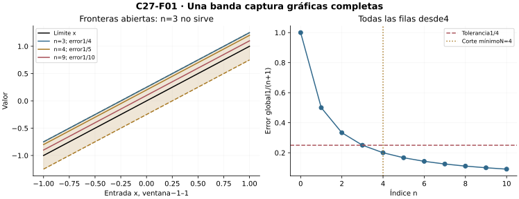
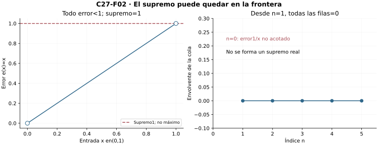

[Índice del libro](../para-matematicos/analisis-para-matematicos.html) · [Ejercicios de este capítulo](#ejercicios-27)

El contrato de C26 permitió una cola para cada entrada. Ahora exigiremos una cola común y construiremos la envolvente y la distancia que la miden. C02/C03 justifican los supremos; C10 construye destinos de columnas de Cauchy; C14 se usa en rutas dadas. No se importan teoremas de intercambio de C28 ni series de funciones o teoría métrica posterior.

## 27.1. Una cola que sirve para todas las entradas

[]{#MA-SEC-ANM-01-027-001}

C26 mantuvo fija una entrada y construyó para ella una cola. Ahora recibimos una tolerancia y debemos entregar una sola cola que funcione en todas las entradas del dominio. Sea $X\subseteq\mathbb R$, y sean $f_n,f:X\to\mathbb R$ para $n\in\mathbb N=\{0,1,\ldots\}$. Decimos que $f_n$ converge **uniformemente** a $f$ en $X$ si
$$
\forall\varepsilon>0\ \exists N\in\mathbb N\
\forall n\ge N\ \forall x\in X:\quad |f_n(x)-f(x)|<\varepsilon.
$$
Escribimos $f_n\to f$ uniformemente en $X$. La elección de $N$ precede a la entrada que habrá que controlar. El dominio es parte del contrato; una misma fórmula puede cumplirlo en un dominio y fallarlo en otro.

### Ver una banda y formular lo que significa

Para una tolerancia fija, la banda abierta
$$
\{(x,y)\in X\times\mathbb R:f(x)-\varepsilon<y<f(x)+\varepsilon\}
$$
contiene las gráficas completas de todas las filas posteriores a $N$. La anchura vertical es $2\varepsilon$. No se afirma que la banda sea horizontal ni que el límite sea continuo: está definida alrededor de los valores de una función dada. El requisito es que ninguna entrada de ninguna fila de la cola salga de ella.

Por ejemplo, $f_n(x)=x+1/(n+1)$ converge uniformemente a $f(x)=x$ en toda $\mathbb R$. Dada $\varepsilon>0$, elegimos un natural $N>1/\varepsilon$. Para todo $n\ge N$ y todo $x$,
$$
|f_n(x)-f(x)|=\frac1{n+1}\le\frac1{N+1}<\varepsilon.
$$
El corte no depende de $x$. Aunque las funciones no están acotadas en la recta, su **diferencia** sí tiene una barrera común. No se debe confundir acotación de los valores con acotación del error.

### Comparar y negar los dos contratos

La convergencia uniforme implica la puntual: el corte que funciona en todas las entradas sirve en la entrada que fijemos. La unicidad del límite puntual de C26 da también unicidad uniforme. Si $X$ es vacío, el contrato es vacuo y todas las filas y el límite son la única función vacía; no es necesario formar un supremo de una imagen vacía.

La negación hacia una candidata fija es
$$
\exists\varepsilon_0>0\ \forall N\in\mathbb N\
\exists n\ge N\ \exists x\in X:
|f_n(x)-f(x)|\ge\varepsilon_0.
$$
Ahora la entrada infractora puede cambiar con el corte y el índice. Para $g_n(x)=x/(n+1)$ en $\mathbb R$, C26 probó límite puntual cero. Con $\varepsilon_0=1/2$, ante cualquier $N$ tomamos $n=N$ y $x=N+1$: el error es1. Por tanto la convergencia no es uniforme en la recta.

No hace falta elegir infinitamente muchos puntos de conjuntos arbitrarios para esta refutación: el testigo está dado por una fórmula para cada desafío. La negación lógica afirma existencia de infracciones; convertirlas en una sucesión simultáneamente escogida requeriría justificar una regla de selección si no disponemos de fórmulas. No usaremos esa conversión como herramienta oculta.

{#fig-anm-c27-f01 fig-alt="En la ventana dibujada−1≤x≤1, f_n=x+1/(n+1) y límite f=x. La banda de tolerancia1/4 tiene fronteras abiertas: n=3 cae en la frontera y no sirve; n=4 y n=9 quedan dentro. La prueba controla toda la recta y todas las filas desdeN=4."}

### Microcontroles

#### Microcontrol 1

[]{#MA-MIC-ANM-01-027-001}

¿Qué dato recibe primero el contrato uniforme?

[]{#MA-MSOL-ANM-01-027-001}

Ver solución del microcontrol 1

Una tolerancia positiva; después se elige un corte que debe funcionar para toda entrada y toda la cola.

#### Microcontrol 2

[]{#MA-MIC-ANM-01-027-002}

¿Puede el corte uniforme depender de la entrada?

[]{#MA-MSOL-ANM-01-027-002}

Ver solución del microcontrol 2

No. Debe elegirse antes de la entrada que habrá que controlar.

#### Microcontrol 3

[]{#MA-MIC-ANM-01-027-003}

¿Qué anchura tiene la banda de tolerancia $\varepsilon$?

[]{#MA-MSOL-ANM-01-027-003}

Ver solución del microcontrol 3

Anchura vertical2ε, entre f(x)−ε y f(x)+ε, con fronteras excluidas.

#### Microcontrol 4

[]{#MA-MIC-ANM-01-027-004}

¿Implica uniformidad convergencia puntual?

[]{#MA-MSOL-ANM-01-027-004}

Ver solución del microcontrol 4

Sí; el mismo corte simultáneo sirve en cualquier entrada que fijemos.

#### Microcontrol 5

[]{#MA-MIC-ANM-01-027-005}

¿Qué entrada puede variar en una refutación uniforme?

[]{#MA-MSOL-ANM-01-027-005}

Ver solución del microcontrol 5

La entrada infractora puede depender del corte y del índice tardío elegido.

#### Microcontrol 6

[]{#MA-MIC-ANM-01-027-006}

¿Qué error tiene $x+1/(n+1)$ respecto de $x$?

[]{#MA-MSOL-ANM-01-027-006}

Ver solución del microcontrol 6

Exactamente1/(n+1) en toda la recta, aunque los valores de ambas funciones sean no acotados.

#### Microcontrol 7

[]{#MA-MIC-ANM-01-027-007}

¿Qué testigo refuta uniformidad de $x/(n+1)$ en la recta?

[]{#MA-MSOL-ANM-01-027-007}

Ver solución del microcontrol 7

En la fila n se toma x=n+1, con error1 respecto de cero.

#### Microcontrol 8

[]{#MA-MIC-ANM-01-027-008}

¿Qué ocurre en un dominio vacío?

[]{#MA-MSOL-ANM-01-027-008}

Ver solución del microcontrol 8

Hay una única función y el contrato uniforme se satisface vacuamente.

### Ejercicios de la sección 27.1

[]{#ejercicios-27}

#### Ejercicio 1. Banda sobre una función no acotada

[]{#MA-EX-ANM-01-027-001}

Prueba uniformidad de $f_n(x)=x+1/(n+1)$ hacia $x$ en $\mathbb R$ y explica qué está acotado.

[]{#MA-SOL-ANM-01-027-001}

Ver solución del ejercicio 1

Fijada $\varepsilon>0$, elegimos un natural $N>1/\varepsilon$. Para todos $n\ge N$ y $x\in\mathbb R$, el error es1/(n+1)≤1/(N+1)<ε. El corte no depende de la entrada, así la convergencia es uniforme. Los valores de cada fila y del límite son no acotados en la recta, pero sus diferencias tienen magnitud constante1/(n+1). La cota relevante para el contrato es la del error.

**Retorno visual.** Véase [C27-F01](analisis-para-matematicos-capitulo-27-convergencia-uniforme-controlar-toda-la-funcion-a-la-vez.html#fig-anm-c27-f01), después del argumento completo: la figura permite reconocer el mecanismo y no sustituye la prueba.

#### Ejercicio 2. Negación con testigo móvil

[]{#MA-EX-ANM-01-027-002}

Refuta uniformidad hacia cero de $g_n(x)=x/(n+1)$ en $\mathbb R$, sin refutar su convergencia puntual.

[]{#MA-SOL-ANM-01-027-002}

Ver solución del ejercicio 2

Usamos tolerancia $\varepsilon_0=1/2$. Dado cualquier corte $N$, tomamos $n=N$ y $x=N+1$. El error es1≥ε0. Se cumple la negación uniforme con entrada dependiente del corte. Para una entrada fija, en cambio, un natural mayor que |x|/ε controla toda la cola y prueba límite puntual cero. Los dos alcances son distintos.

#### Ejercicio 3. Unicidad sin nueva selección

[]{#MA-EX-ANM-01-027-003}

Demuestra que una familia tiene a lo sumo un límite uniforme en un dominio común, incluido el vacío.

[]{#MA-SOL-ANM-01-027-003}

Ver solución del ejercicio 3

Dos límites uniformes son también límites puntuales: cada corte simultáneo funciona en una entrada fija. Por unicidad numérica de C26, ambos valores coinciden en toda entrada; igualdad de funciones da un solo límite. Si el dominio es vacío, existe una única función vacía, así la conclusión también vale sin producir ninguna entrada. No se selecciona un punto de una colección vacía.

#### Ejercicio 4. Toda la cola, no una fila

[]{#MA-EX-ANM-01-027-004}

En un dominio no vacío, toma filas constantes $f_n=(-1)^n$. Explica por qué las filas pares no certifican convergencia uniforme.

[]{#MA-SOL-ANM-01-027-004}

Ver solución del ejercicio 4

Las filas pares son exactamente1, así esa subsucesión converge uniformemente a1. Las impares son exactamente−1. Si toda la familia tuviera límite uniforme, lo tendría puntual en cualquier entrada y las subsecuencias numéricas constantes compartirían ese destino, contradiciendo unicidad. Una fila favorable o infinitas filas favorables no controlan todas las filas de una cola.

#### Ejercicio 5. Cambiar el prefijo

[]{#MA-EX-ANM-01-027-005}

Prueba que modificar un número finito de filas no altera una convergencia uniforme dada.

[]{#MA-SOL-ANM-01-027-005}

Ver solución del ejercicio 5

Supongamos que la nueva familia coincide con la anterior para todo índice n≥M. Para una tolerancia, la familia original entrega un corte N independiente de la entrada. El corte máximo(N,M) controla todas las filas nuevas posteriores, pues coinciden con las antiguas y tienen error menor que ε en todas las entradas. Los valores del prefijo modificado no intervienen, aunque sean no acotados.

## 27.2. La envolvente de error y sus fronteras

[]{#MA-SEC-ANM-01-027-002}

Para una fila $n$ y candidata $f$, definimos el conjunto de errores
$$
A_n=\{|f_n(x)-f(x)|:x\in X\}.
$$
Si $X$ es no vacío, este conjunto es no vacío y está formado por números no negativos. Antes de escribir un supremo real debemos comprobar que tiene una cota superior. Cuando la tiene, C03 permite definir
$$
E_n=\sup A_n.
$$
Esta **envolvente de error** es una barrera, aunque ninguna entrada la alcance.

### El criterio de las envolventes, con su dominio exacto

**Proposición.** Para $X\ne\varnothing$, la convergencia uniforme equivale a que desde algún índice todos los $A_n$ sean acotados y sus supremos reales $E_n$ tiendan a cero. Se permite que unas pocas filas iniciales tengan error no acotado.

Si hay convergencia uniforme, aplicamos primero el contrato con tolerancia1. En la cola correspondiente todos los errores son menores que1, así existe cada $E_n$. Para una precisión $\varepsilon>0$, usamos ahora la tolerancia $\varepsilon/2$ y reunimos ese corte con el primero. Entonces, en toda fila de la nueva cola,
$$
0\le E_n\le\varepsilon/2<\varepsilon.
$$
La primera desigualdad no requiere un máximo; la segunda se obtiene porque $\varepsilon/2$ es cota superior de **todos** los errores de la fila.

Recíprocamente, si los $E_n$ reales de una cola convergen a cero, un corte con $E_n<\varepsilon$ da, para toda entrada,
$$
|f_n(x)-f(x)|\le E_n<\varepsilon.
$$
Eso es el contrato uniforme. La prueba incluye todos los índices posteriores, no sólo una subsucesión de filas favorables.

Podemos adoptar para el vacío la convención $E_n=0$ y conservar la equivalencia. Es una convención para el error de la función vacía; no se dice que el conjunto vacío tenga supremo real cero en el orden usual.

### Estricto en cada entrada no es estricto en el supremo

En $X=(0,1)$, la función de error $e(x)=x$ cumple $e(x)<1$ en toda entrada y tiene supremo1. No lo alcanza. Para demostrar ese supremo,1 es cota superior y cualquier $c<1$ deja algún punto mayor que $c$ dentro del intervalo, por ejemplo $(1+\max(c,0))/2$. Por tanto no se puede inferir $E_n<\varepsilon$ sólo de errores individuales menores que $\varepsilon$. La tolerancia partida de la prueba anterior convierte una cota no estricta en la precisión estricta requerida.

Tampoco se puede exigir que todos los errores iniciales sean acotados. En $X=(0,1]$, definamos $f_0(x)=1/x$ y $f_n(x)=0$ para $n\ge1$, con candidata cero. La convergencia es uniforme: sirve $N=1$ para cualquier tolerancia. Pero la imagen de errores de la primera fila no tiene cota real. Suprimir el prefijo no altera una propiedad de cola.

### Regiones de infracción

Para $\eta>0$, sea
$$
B_n(\eta)=\{x\in X:|f_n(x)-f(x)|\ge\eta\}.
$$
La convergencia uniforme dice que para cada $\eta$ esos conjuntos son vacíos en toda una cola. La puntual dice que cada entrada deja de pertenecer a ellos eventualmente, con un corte que puede depender de ella. Todos los puntos pueden salir eventualmente sin que llegue una etapa en que el conjunto entero quede vacío. Las tiendas de C26 realizan exactamente esa posibilidad.

{#fig-anm-c27-f02 fig-alt="En(0,1), e(x)=x es menor que1 en toda entrada pero tiene supremo1 no alcanzado. A la derecha, la familia f0=1/x y fn=0 desde n=1 converge uniformemente aunque la primera fila no tenga envolvente real. No se representa un supremo infinito como número."}

### Microcontroles

#### Microcontrol 9

[]{#MA-MIC-ANM-01-027-009}

¿Qué se comprueba antes de formar una envolvente real?

[]{#MA-MSOL-ANM-01-027-009}

Ver solución del microcontrol 9

Que la imagen de errores sea no vacía y acotada; el vacío se trata por una convención aparte.

#### Microcontrol 10

[]{#MA-MIC-ANM-01-027-010}

¿Se exige envolvente real para todas las filas iniciales?

[]{#MA-MSOL-ANM-01-027-010}

Ver solución del microcontrol 10

No. Basta una cola con errores acotados y supremos tendentes a cero.

#### Microcontrol 11

[]{#MA-MIC-ANM-01-027-011}

¿Qué margen convierte control puntual estricto en supremo estricto?

[]{#MA-MSOL-ANM-01-027-011}

Ver solución del microcontrol 11

Usar toleranciaε/2: el supremo es≤ε/2<ε.

#### Microcontrol 12

[]{#MA-MIC-ANM-01-027-012}

¿Puede cada error ser menor que1 y su supremo ser1?

[]{#MA-MSOL-ANM-01-027-012}

Ver solución del microcontrol 12

Sí; e(x)=x en(0,1) lo muestra sin que haya máximo.

#### Microcontrol 13

[]{#MA-MIC-ANM-01-027-013}

¿Qué diferencia entre vacío y convención de error cero se conserva?

[]{#MA-MSOL-ANM-01-027-013}

Ver solución del microcontrol 13

El error de la función vacía se define0; no se afirma que el conjunto vacío tenga supremo real0.

#### Microcontrol 14

[]{#MA-MIC-ANM-01-027-014}

¿Qué son los conjuntos $B_n(\eta)$?

[]{#MA-MSOL-ANM-01-027-014}

Ver solución del microcontrol 14

Las entradas cuyo error en la fila n es al menosη.

#### Microcontrol 15

[]{#MA-MIC-ANM-01-027-015}

¿Qué dice uniformidad sobre esos conjuntos?

[]{#MA-MSOL-ANM-01-027-015}

Ver solución del microcontrol 15

Para cadaη>0, todos son vacíos desde un único corte en adelante.

#### Microcontrol 16

[]{#MA-MIC-ANM-01-027-016}

¿Qué dice puntualidad sobre una entrada fija y esos conjuntos?

[]{#MA-MSOL-ANM-01-027-016}

Ver solución del microcontrol 16

Que esa entrada deja de pertenecer a ellos eventualmente, con un corte que puede depender de ella.

### Ejercicios de la sección 27.2

#### Ejercicio 6. Supremo y frontera abierta

[]{#MA-EX-ANM-01-027-006}

En $X=(0,1)$ demuestra que todos los errores $e(x)=x$ son menores que1 pero su supremo es1.

[]{#MA-SOL-ANM-01-027-006}

Ver solución del ejercicio 6

El número1 acota la imagen. Si c<1, el punto y=(1+máx(c,0))/2 pertenece a(0,1) y es mayor que c, por lo que c no acota todos los errores. Así el supremo es1. Ningún punto lo alcanza porque todas las entradas son menores que1. El error estricto en cada punto sólo da supremo≤1; para obtener supremo<ε se requiere usar un margen como ε/2.

**Retorno visual.** Véase [C27-F02](analisis-para-matematicos-capitulo-27-convergencia-uniforme-controlar-toda-la-funcion-a-la-vez.html#fig-anm-c27-f02), después del argumento completo: la figura permite reconocer el mecanismo y no sustituye la prueba.

#### Ejercicio 7. Una fila sin envolvente real

[]{#MA-EX-ANM-01-027-007}

En $(0,1]$, define $f_0(x)=1/x$ y $f_n=0$ para $n\ge1$. Analiza uniformidad y existencia de envolventes.

[]{#MA-SOL-ANM-01-027-007}

Ver solución del ejercicio 7

La candidata es cero. Para toda ε>0 sirve N=1, pues cada fila posterior coincide con ella, de modo que hay uniformidad. En la primera fila, dado B≥0, x=1/(B+1) pertenece al dominio y da errorB+1>B. No existe supremo real de ese conjunto de errores. Las envolventes existen desde el índice1 y valen0; la caracterización se formula sobre esa cola.

#### Ejercicio 8. Acreditar el criterio

[]{#MA-EX-ANM-01-027-008}

Demuestra que si las envolventes reales de una cola satisfacen $E_n\to0$, hay convergencia uniforme.

[]{#MA-SOL-ANM-01-027-008}

Ver solución del ejercicio 8

Para ε>0, el límite numérico entrega un corte N dentro de la cola con E_n<ε para todos n≥N. Por definición de supremo, para cualquier entrada |f_n(x)−f(x)|≤E_n<ε. El mismo N sirve para todos x y todos los índices posteriores. En el vacío se usa la convención de error0 y el contrato es vacuo.

#### Ejercicio 9. El margen al pasar al supremo

[]{#MA-EX-ANM-01-027-009}

Prueba la dirección uniforme⇒envolventes de cola tendentes a cero, cuidando la desigualdad estricta.

[]{#MA-SOL-ANM-01-027-009}

Ver solución del ejercicio 9

Uniformidad con tolerancia1 da una cola de conjuntos de error no vacíos acotados cuando X no es vacío, por lo que C03 produce sus supremos. Para ε>0, recibimos un corte uniforme para ε/2 y lo reunimos con el de existencia. Cada supremo de esa cola es≤ε/2<ε. Esto prueba el límite0. No se cambia una desigualdad estricta punto a punto por una estricta del supremo sin el margen.

#### Ejercicio 10. Regiones que nunca se vacían

[]{#MA-EX-ANM-01-027-010}

Para las tiendas $t_n$ de C26, analiza $B_n(1/2)=\{x:t_n(x)\ge1/2\}$ y sus columnas.

[]{#MA-SOL-ANM-01-027-010}

Ver solución del ejercicio 10

Con k=n+3, la condición es |kx−2|≤1/2, luego B_n(1/2)=[3/(2k),5/(2k)], no vacío para toda etapa y dentro de[0,1]. La entrada0 no pertenece a ninguno. Para x>0 fijo, desde k>3/x queda fuera del soporte y también de B_n. Así cada entrada sale eventualmente, pero ningún conjunto de infracción queda vacío. Esto distingue puntualidad de uniformidad.

## 27.3. Calcular la peor discrepancia

[]{#MA-SEC-ANM-01-027-003}

Calcular una envolvente puede acreditar el control global o detectar una obstrucción. En cada ejemplo distinguiremos la cota superior de la prueba de que es la mejor, y el supremo de su posible realización.

### Potencias: una barrera que no se alcanza

Con $p_0=1$, $p_n(x)=x^n$ para $n\ge1$ en $[0,1]$, C26 probó límite puntual $p=0$ antes de1 y $p(1)=1$. Para $n\ge1$, el error en1 es0 y en toda entrada menor que1 es $x^n<1$. No hay máximo de error, pero su supremo es1.

Para probar la última afirmación, sea $0\le c<1$ una supuesta cota menor. Elegimos $0<s<(1-c)/(n+1)$ y $x=1-s\in[0,1)$. Bernoulli de C26 da
$$
x^n\ge1-ns>c.
$$
Así $c$ no es cota. Las cotas negativas tampoco lo son porque hay error0. La envolvente vale1 en todas las filas, incluido el prefijo $p_0$, y no tiende a cero. En $[0,1)$ el límite es cero continuo, pero la misma envolvente1 impide convergencia uniforme.

En cambio, en $[0,c]$ con $0<c<1$, la candidata es cero y el máximo de error es $c^n$, alcanzado en $c$. Con $t=1/c-1>0$, Bernoulli da $c^n\le1/(1+nt)\to0$. Sobre $[0,0]$, el error es cero desde $n=1$. El dominio modifica la peor discrepancia.

### Tiendas: máximo móvil

Para $k=n+3$ y $t_n(x)=\max(0,1-|kx-2|)$ en $[0,1]$, C26 probó límite puntual cero. La cota $0\le t_n\le1$ se alcanza en $x=2/k$, de modo que $E_n=1$. Para las tiendas normalizadas $b_n=k\,t_n$, el máximo de error es $k$. Ambas familias fallan el contrato uniforme aunque sus columnas queden eventualmente en cero. Aquí la obstrucción es un máximo realizado, a diferencia de las potencias.

### Un máximo decreciente en toda la recta

Para $k=n+1$ y
$$
h_n(x)=\frac{x}{1+kx^2},\qquad x\in\mathbb R,
$$
el límite puntual es cero. El cuadrado $(\sqrt{k}|x|-1)^2\ge0$ demuestra $1+kx^2\ge2\sqrt{k}|x|$. En $x\ne0$, dividir por denominadores positivos da
$$
|h_n(x)|\le\frac1{2\sqrt{k}}.
$$
En cero se verifica directamente. La igualdad se alcanza en $x=\pm1/\sqrt{k}$, por lo que $E_n=1/(2\sqrt{k})$. Dada $\varepsilon>0$, un natural $N>1/(4\varepsilon^2)$ hace $E_n<\varepsilon$ para todo $n\ge N$. Tenemos convergencia uniforme en un dominio no acotado.

Una ventana de dibujo finita no decide el supremo sobre toda $\mathbb R$. El cuadrado positivo y los puntos de igualdad son el certificado global; la figura sólo los representa. En estos ejemplos el tamaño del dominio, por sí solo, no determina el modo de convergencia.

![Potencias en\[0,1\] y tiendas de altura1 conservan envolvente1; potencias en\[0,1/2\] tienen máximo2^(−n); h_n sobreR tiene máximo1/(2√(n+1)). Las líneas muestran envolventes certificadas por fórmulas, no supremos inferidos de un muestreo.](../../assets/books/anm/C27/C27-F03.svg){#fig-anm-c27-f03 fig-alt="Potencias en\[0,1\] y tiendas de altura1 conservan envolvente1; potencias en\[0,1/2\] tienen máximo2^(−n); h_n sobreR tiene máximo1/(2√(n+1)). Las líneas muestran envolventes certificadas por fórmulas, no supremos inferidos de un muestreo."}

### Microcontroles

#### Microcontrol 17

[]{#MA-MIC-ANM-01-027-017}

¿Cuál es la envolvente de las potencias en $[0,1]$ para $n\ge1$?

[]{#MA-MSOL-ANM-01-027-017}

Ver solución del microcontrol 17

Uno; el error no lo alcanza porque en1 vale0 y antes de1 es menor que1.

#### Microcontrol 18

[]{#MA-MIC-ANM-01-027-018}

¿Qué controla las potencias en $[0,c]$ con $c<1$?

[]{#MA-MSOL-ANM-01-027-018}

Ver solución del microcontrol 18

La cota y máximo c^n, que tiende a cero por Bernoulli.

#### Microcontrol 19

[]{#MA-MIC-ANM-01-027-019}

¿Qué ocurre si $c=0$?

[]{#MA-MSOL-ANM-01-027-019}

Ver solución del microcontrol 19

La única entrada es cero y el error de las potencias vale0 desde n=1.

#### Microcontrol 20

[]{#MA-MIC-ANM-01-027-020}

¿Dónde alcanza su error máximo la tienda $t_n$?

[]{#MA-MSOL-ANM-01-027-020}

Ver solución del microcontrol 20

En x=2/(n+3), donde vale1.

#### Microcontrol 21

[]{#MA-MIC-ANM-01-027-021}

¿Qué envolvente tiene la tienda normalizada?

[]{#MA-MSOL-ANM-01-027-021}

Ver solución del microcontrol 21

k=n+3, alcanzada en el mismo centro móvil.

#### Microcontrol 22

[]{#MA-MIC-ANM-01-027-022}

¿Qué cuadrado produce la cota global de $h_n$?

[]{#MA-MSOL-ANM-01-027-022}

Ver solución del microcontrol 22

(√k|x|−1)^2≥0, con k=n+1.

#### Microcontrol 23

[]{#MA-MIC-ANM-01-027-023}

¿Dónde alcanza $h_n$ su máximo de magnitud?

[]{#MA-MSOL-ANM-01-027-023}

Ver solución del microcontrol 23

En x=±1/√k, con valor1/(2√k).

#### Microcontrol 24

[]{#MA-MIC-ANM-01-027-024}

¿Decide un dominio no acotado que la convergencia falle?

[]{#MA-MSOL-ANM-01-027-024}

Ver solución del microcontrol 24

No. h_n converge uniformemente a cero en toda la recta mediante una cota global.

### Ejercicios de la sección 27.3

#### Ejercicio 11. Supremo sin máximo de las potencias

[]{#MA-EX-ANM-01-027-011}

Calcula la envolvente del error respecto del límite puntual de las potencias en $[0,1]$ para $n\ge1$.

[]{#MA-SOL-ANM-01-027-011}

Ver solución del ejercicio 11

En1 el error es0 y para x<1 es x^n<1, así1 es cota y no se alcanza. Dada cualquier cota propuesta0≤c<1, tomamos0<s<(1−c)/(n+1) y x=1−s. Bernoulli da x^n≥1−ns>c, así c falla. Cotas negativas fallan ante el error0. Por tanto E_n=1 sin máximo; no hay uniformidad.

#### Ejercicio 12. Una restricción con máximo

[]{#MA-EX-ANM-01-027-012}

Para $0<c<1$, calcula la envolvente de las potencias hacia cero en $[0,c]$ y un corte suficiente.

[]{#MA-SOL-ANM-01-027-012}

Ver solución del ejercicio 12

Para n≥1 y0≤x≤c se tiene x^n≤c^n, y la igualdad se alcanza en c. Así E_n=c^n. Poniendo t=1/c−1>0, Bernoulli produce c^n≤1/(1+nt). Un natural N>1/(εt), reunido con1, da E_n<ε en toda la cola. Para c=0 la familia tiene error0 desde la etapa1.

#### Ejercicio 13. Un pico que sigue siendo grande

[]{#MA-EX-ANM-01-027-013}

Calcula las envolventes de $t_n$ y $(n+3)t_n$ en $[0,1]$ y refuta sus convergencias uniformes hacia cero.

[]{#MA-SOL-ANM-01-027-013}

Ver solución del ejercicio 13

Con k=n+3, las tiendas tienen cota1 y alcanzan1 en2/k, así E_n(t)=1. Las normalizadas tienen cota k y alcanzan k en el mismo centro, así E_n(b)=k. Para tolerancia1/2, en cualquier índice posterior al corte ese centro es infractor. Los centros están en el dominio. Ninguna envolvente tiende a cero aunque los límites puntuales sean cero.

#### Ejercicio 14. Un máximo global decreciente

[]{#MA-EX-ANM-01-027-014}

Para $h_n=x/[1+(n+1)x^2]$ en $\mathbb R$, prueba el máximo exacto del error y uniformidad.

[]{#MA-SOL-ANM-01-027-014}

Ver solución del ejercicio 14

Con k=n+1, el cuadrado(√k|x|−1)^2≥0 da1+kx²≥2√k|x|. Para x≠0, dividir por factores positivos implica |h_n(x)|≤1/(2√k), y en0 el error es0. En x=±1/√k se alcanza la cota, por lo que es el máximo exacto. Un natural N>1/(4ε²) hace ese máximo menor que ε en toda la cola. No se necesita acotar el dominio.

**Retorno visual.** Véase [C27-F03](analisis-para-matematicos-capitulo-27-convergencia-uniforme-controlar-toda-la-funcion-a-la-vez.html#fig-anm-c27-f03), después del argumento completo: la figura permite reconocer el mecanismo y no sustituye la prueba.

#### Ejercicio 15. La amplitud reduce el error

[]{#MA-EX-ANM-01-027-015}

Define $v_n(x)=x^{n+1}/(n+1)$ en $[0,1]$. Calcula el máximo y demuestra uniformidad hacia cero.

[]{#MA-SOL-ANM-01-027-015}

Ver solución del ejercicio 15

En el dominio,0≤x^(n+1)≤1, así el error es≤1/(n+1). En x=1 se alcanza esa cota; es el máximo y la envolvente. Un natural N>1/ε da error menor que ε para todos n≥N y x del segmento. A diferencia de x^n, la amplitud1/(n+1) reduce también la peor discrepancia del extremo, no sólo las columnas interiores.

## 27.4. Restringir el dominio y seguir rutas

[]{#MA-SEC-ANM-01-027-004}

La convergencia uniforme se refiere a un dominio concreto. Sus reglas de transporte deben conservar ese dato; olvidar el dominio puede convertir una estimación correcta en una conclusión falsa.

### Restringir y reunir finitamente

Si $f_n\to f$ uniformemente en $X$ y $Y\subseteq X$, el mismo corte funciona en $Y$. Cuando ambos conjuntos son no vacíos y las envolventes existen, la inclusión de imágenes de error da $E_n(Y)\le E_n(X)$ por C02. La igualdad no está garantizada.

Si $X=X_1\cup\cdots\cup X_m$ y hay convergencia uniforme de las restricciones hacia la misma candidata en cada pieza, para una tolerancia tomamos los $m$ cortes y su máximo. Toda entrada de $X$ pertenece a alguna pieza y queda controlada. Las piezas vacías no añaden obligaciones. No se exige que sean abiertas o cerradas: el argumento es finito y lógico.

Una unión infinita no admite automáticamente el mismo paso. En $X=[0,1)$, sea
$$
X_j=[0,c_j],\qquad c_j=1-\frac1{j+2},\quad j\in\mathbb N.
$$
Estas piezas cubren $X$: para $x<1$, la arquimedianidad permite $1/(j+2)\le1-x$. Las potencias convergen uniformemente a cero en cada $X_j$ por §27.3, pero no en su unión. Los cortes pueden crecer con la pieza y no tienen por qué tener una barrera común.

### Un contrato que controla cualquier ruta dada

Supongamos convergencia uniforme y que está dada cualquier sucesión $x_n\in X$. El mismo corte entrega
$$
|f_n(x_n)-f(x_n)|\longrightarrow0.
$$
No necesitamos que las entradas converjan. A diferencia de C26, ahora pueden variar porque todas estaban incluidas en la obligación después del corte.

Si además $x_n\to x\in X$ y $f$ es continua en $x$, la dirección secuencial directa de C14 da $f(x_n)\to f(x)$. La desigualdad
$$
|f_n(x_n)-f(x)|
\le |f_n(x_n)-f(x_n)|+|f(x_n)-f(x)|
$$
prueba convergencia de la diagonal a $f(x)$. Aquí continuidad del límite se declara como hipótesis; aún no la hemos deducido de continuidad de las filas. C28 estudiará esa preservación.

Para detectar fracaso uniforme basta una ruta explícita con errores que no desaparecen en índices arbitrariamente tardíos. Las tiendas tienen $x_n=2/(n+3)$ y error1. No afirmamos sin hipótesis de selección que todo fracaso pueda convertirse automáticamente en una diagonal previamente dada.

### Reindexar y conservar una cola

Cambiar unas pocas filas iniciales no altera convergencia uniforme: se reúne el corte anterior con el final del prefijo modificado. Para una subsucesión de índices estrictamente crecientes $n_j$, la inducción da $n_j\ge j$, así el corte uniforme en $n$ también funciona desde $j\ge N$. Toda subsucesión converge uniformemente al mismo límite.

La conversa no vale con una sola subsucesión. Filas constantes $f_n(x)=(-1)^n$ en un dominio no vacío tienen subsucesión par uniformemente igual a1, pero la familia completa no converge ni puntualmente. Capturar algunas filas no captura toda una cola.

![A la izquierda, envolventes de potencias en dos miembros de la familia X_j=\[0,1−1/(j+2)\] y en la unión de todos sus miembros\[0,1). Cada restricción cerrada tiene cota decreciente, pero la unión infinita mantiene error supremo1. A la derecha, una ruta sin límite x_n=(−1)^n sigue teniendo error1/(n+1) bajo la familia uniforme x+1/(n+1).](../../assets/books/anm/C27/C27-F04.svg){#fig-anm-c27-f04 fig-alt="A la izquierda, envolventes de potencias en dos miembros de la familia X_j=\[0,1−1/(j+2)\] y en la unión de todos sus miembros\[0,1). Cada restricción cerrada tiene cota decreciente, pero la unión infinita mantiene error supremo1. A la derecha, una ruta sin límite x_n=(−1)^n sigue teniendo error1/(n+1) bajo la familia uniforme x+1/(n+1)."}

### Microcontroles

#### Microcontrol 25

[]{#MA-MIC-ANM-01-027-025}

¿Qué corte sirve después de restringir el dominio?

[]{#MA-MSOL-ANM-01-027-025}

Ver solución del microcontrol 25

El mismo corte de uniformidad en el dominio mayor.

#### Microcontrol 26

[]{#MA-MIC-ANM-01-027-026}

¿Cómo se reúnen finitariamente los cortes de piezas?

[]{#MA-MSOL-ANM-01-027-026}

Ver solución del microcontrol 26

Con su máximo, que domina todas las obligaciones para la tolerancia fijada.

#### Microcontrol 27

[]{#MA-MIC-ANM-01-027-027}

¿Hace falta que las piezas sean abiertas o cerradas?

[]{#MA-MSOL-ANM-01-027-027}

Ver solución del microcontrol 27

No; el argumento de reunión finita sólo usa pertenencia a alguna pieza.

#### Microcontrol 28

[]{#MA-MIC-ANM-01-027-028}

¿Qué puede fallar en una unión infinita?

[]{#MA-MSOL-ANM-01-027-028}

Ver solución del microcontrol 28

Los cortes de las piezas pueden no tener una barrera común.

#### Microcontrol 29

[]{#MA-MIC-ANM-01-027-029}

¿Qué error controla uniformidad para cualquier ruta $x_n$?

[]{#MA-MSOL-ANM-01-027-029}

Ver solución del microcontrol 29

|f_n(x_n)−f(x_n)|, sin exigir que las entradas converjan.

#### Microcontrol 30

[]{#MA-MIC-ANM-01-027-030}

¿Qué dato adicional permite comparar con $f(x)$?

[]{#MA-MSOL-ANM-01-027-030}

Ver solución del microcontrol 30

Que x_n→x∈X y que f sea continua en x.

#### Microcontrol 31

[]{#MA-MIC-ANM-01-027-031}

¿Qué cota de índices tiene una subsucesión estrictamente creciente?

[]{#MA-MSOL-ANM-01-027-031}

Ver solución del microcontrol 31

n_j≥j, por inducción en naturales; permite heredar el corte uniforme.

#### Microcontrol 32

[]{#MA-MIC-ANM-01-027-032}

¿Basta una subsucesión uniforme para afirmar uniformidad de la familia?

[]{#MA-MSOL-ANM-01-027-032}

Ver solución del microcontrol 32

No; las filas constantes alternantes tienen una subsucesión par constante y la familia no converge.

### Ejercicios de la sección 27.4

#### Ejercicio 16. Restricción con barrera común

[]{#MA-EX-ANM-01-027-016}

Si hay convergencia uniforme en $X$, demuestra uniformidad en cualquier $Y\subseteq X$ y compara envolventes cuando existen.

[]{#MA-SOL-ANM-01-027-016}

Ver solución del ejercicio 16

El corte uniforme en X ya controla todas las entradas de Y, así funciona sin cambios. Para conjuntos no vacíos, la imagen de errores de Y es subconjunto de la de X; cada cota de la mayor acota la menor y C02 da E_n(Y)≤E_n(X). En una pieza vacía se adopta error0 y no hay obligaciones. No se deduce igualdad de envolventes.

#### Ejercicio 17. Reunión de dos contratos

[]{#MA-EX-ANM-01-027-017}

Si $X=A\cup B$ y las restricciones convergen uniformemente a la misma candidata, acredita el contrato en $X$.

[]{#MA-SOL-ANM-01-027-017}

Ver solución del ejercicio 17

Para ε>0, tomamos los cortes N_A y N_B y su máximo N. Si n≥N y x∈X, pertenece a A o B y el contrato de esa pieza entrega error<ε. Los cortes son independientes de la entrada. Si alguna pieza es vacía basta el corte de la otra. El argumento no necesita topología de las piezas, sólo una unión finita.

#### Ejercicio 18. Una unión infinita falla

[]{#MA-EX-ANM-01-027-018}

Usa $X_j=[0,1-1/(j+2)]$ para mostrar que uniformidad en cada pieza no implica uniformidad en la unión.

[]{#MA-SOL-ANM-01-027-018}

Ver solución del ejercicio 18

La unión es[0,1): para cualquier x<1, la arquimedianidad permite1/(j+2)≤1−x. En cada pieza la envolvente de las potencias es c_j^n→0, así hay uniformidad hacia cero. En la unión el supremo del error es1 para todo n≥1, como en §27.3, y no hay uniformidad. Los cortes dependientes de j no tienen una barrera común que permita tomar un máximo infinito.

**Retorno visual.** Véase [C27-F04](analisis-para-matematicos-capitulo-27-convergencia-uniforme-controlar-toda-la-funcion-a-la-vez.html#fig-anm-c27-f04), después del argumento completo: la figura permite reconocer el mecanismo y no sustituye la prueba.

#### Ejercicio 19. Una ruta cualquiera

[]{#MA-EX-ANM-01-027-019}

Si $f_n\to f$ uniformemente y está dada una ruta $x_n\in X$, prueba $|f_n(x_n)-f(x_n)|\to0$. ¿Se exige convergencia de la ruta?

[]{#MA-SOL-ANM-01-027-019}

Ver solución del ejercicio 19

Para una tolerancia, el contrato entrega un corte que controla toda entrada en toda fila posterior. En particular, controla la entrada x_n de la fila n. Por ello el error diagonal respecto del valor f(x_n) es menor que ε para n≥N. No se exige convergencia de x_n. Para cambiar el destino a f(x), se necesitarían además x_n→x y un dato como continuidad de f en x.

#### Ejercicio 20. Subsucesión y prefijo

[]{#MA-EX-ANM-01-027-020}

Prueba transferencia uniforme a una subsucesión estrictamente creciente de índices y explica por qué la conversa con una sola subsucesión falla.

[]{#MA-SOL-ANM-01-027-020}

Ver solución del ejercicio 20

Por inducción, índices naturales estrictamente crecientes n_j cumplen n_j≥j. El corte uniforme N de la familia completa sirve desde j≥N, pues n_j≥N y controla todas las entradas. La conversa falla para filas constantes(−1)^n: la subsucesión par es igual a1 en todo el dominio pero la completa alterna dos destinos distintos en cada entrada. Una cola completa tiene más obligaciones que una subsucesión.

## 27.5. Operar bajo un presupuesto común

[]{#MA-SEC-ANM-01-027-005}

Una estimación para todas las entradas permite reunir presupuestos de error sin volver a escoger el corte en cada punto. Pero los factores y denominadores necesitan barreras que también valgan en todo el dominio.

### Reglas lineales y operaciones de proximidad

Si $f_n\to f$ y $g_n\to g$ uniformemente en $X$, entonces $\alpha f_n+\beta g_n\to\alpha f+\beta g$ uniformemente. Las cotas
$$
|\alpha(f_n-f)+\beta(g_n-g)|
\le|\alpha||f_n-f|+|\beta||g_n-g|
$$
valen entrada por entrada; pedimos errores menores que $\varepsilon/[2(|\alpha|+1)]$ y $\varepsilon/[2(|\beta|+1)]$ y reunimos dos cortes independientes de la entrada.

La triangular inversa prueba uniformidad de $|f_n|\to|f|$. Para el máximo de dos valores usamos
$$
\max(u,v)=\frac{u+v+|u-v|}{2};
$$
las reglas anteriores dan $\max(f_n,g_n)\to\max(f,g)$ uniformemente.

Más generalmente, si $\phi:D\to\mathbb R$ cumple una cota Lipschitz común $|\phi(u)-\phi(v)|\le L|u-v|$ y todos los valores de $f_n,f$ están en $D$, entonces $\phi\circ f_n\to\phi\circ f$ uniformemente. La precisión $\varepsilon/(L+1)$ para las entradas de $\phi$ da el error requerido, incluido $L=0$. El dominio y la constante común van antes de la composición.

### Productos: declarar la barrera que se gasta

Supongamos además $|f(x)|\le A$ y $|g(x)|\le B$ en todo $X$. Un corte uniforme para $|f_n-f|<1$ da $|f_n(x)|\le A+1$ en todas las entradas de la cola. Allí
$$
|f_n(x)g_n(x)-f(x)g(x)|
\le (A+1)|g_n(x)-g(x)|+B|f_n(x)-f(x)|.
$$
Usando errores menores que $\varepsilon/[2(A+2)]$ y $\varepsilon/[2(B+1)]$, y el corte de la barrera, obtenemos convergencia uniforme del producto.

El supuesto de valores acotados no puede eliminarse sin otro control. En $\mathbb R$, $f_n(x)=x$ converge uniformemente a $x$ con error cero y $g_n(x)=1/(n+1)$ converge uniformemente a cero. El producto $x/(n+1)$ sólo converge puntualmente a cero, como §27.1 refutó. El error pequeño del segundo factor se multiplica por entradas sin barrera.

Tampoco continuidad de la operación exterior basta por sí sola en un dominio de valores no acotado. Las funciones $x+1/(n+1)$ convergen uniformemente a $x$, pero después de elevar al cuadrado el error es
$$
\left|\frac{2x}{n+1}+\frac1{(n+1)^2}\right|,
$$
no acotado en $\mathbb R$ para ninguna fila. En un rango $[-M,M]$ común, en cambio, $|u^2-v^2|\le2M|u-v|$ certifica esa composición.

### Recíprocos con margen común

Si $|g(x)|\ge m>0$ en todo $X$ y $g_n\to g$ uniformemente, un corte para error menor que $m/2$ da $|g_n(x)|>m/2$ simultáneamente. Los recíprocos están definidos en toda esa cola y
$$
\left|\frac1{g_n(x)}-\frac1{g(x)}\right|
\le\frac{2|g_n(x)-g(x)|}{m^2}.
$$
La estimación prueba uniformidad de la cola de recíprocos. Para una familia definida desde el índice cero se requiere que las filas iniciales no tengan ceros o que se declare una reparación; la prueba sólo garantiza el dominio de la cola. Con numeradores uniformemente convergentes a una función acotada, el producto anterior da el cociente.

{#fig-anm-c27-f05 fig-alt="Familias x y1/(n+1) convergen uniformemente por separado enR, pero el producto x/(n+1) tiene error sin barrera global. Las gráficas sólo muestran una ventana; la ruta x_n=n+1 da error1 y acredita el fallo en cada etapa. La barrera de valores que exige la prueba del producto falta."}

### Microcontroles

#### Microcontrol 33

[]{#MA-MIC-ANM-01-027-033}

¿Qué permite la suma de dos errores uniformes?

[]{#MA-MSOL-ANM-01-027-033}

Ver solución del microcontrol 33

Repartir la tolerancia y tomar el máximo de dos cortes independientes de la entrada.

#### Microcontrol 34

[]{#MA-MIC-ANM-01-027-034}

¿Qué desigualdad controla el valor absoluto?

[]{#MA-MSOL-ANM-01-027-034}

Ver solución del microcontrol 34

La triangular inversa: ||u|−|v||≤|u−v|.

#### Microcontrol 35

[]{#MA-MIC-ANM-01-027-035}

¿Qué hipótesis suficiente se declara para una composición exterior?

[]{#MA-MSOL-ANM-01-027-035}

Ver solución del microcontrol 35

Una constante Lipschitz común en un dominio que contenga todos los valores utilizados.

#### Microcontrol 36

[]{#MA-MIC-ANM-01-027-036}

¿Qué barrera obtiene la prueba del producto para $f_n$?

[]{#MA-MSOL-ANM-01-027-036}

Ver solución del microcontrol 36

|f_n|≤A+1 en una cola, desde |f|≤A y error uniforme menor que1.

#### Microcontrol 37

[]{#MA-MIC-ANM-01-027-037}

¿Por qué el producto con $x$ puede perder uniformidad?

[]{#MA-MSOL-ANM-01-027-037}

Ver solución del microcontrol 37

No hay una barrera de |x| en la recta que permita convertir el pequeño error del otro factor en uno global.

#### Microcontrol 38

[]{#MA-MIC-ANM-01-027-038}

¿Basta continuidad del cuadrado para conservar uniformidad en valores no acotados?

[]{#MA-MSOL-ANM-01-027-038}

Ver solución del microcontrol 38

No; el error de cuadrar x+1/(n+1) crece sin cota al variar x.

#### Microcontrol 39

[]{#MA-MIC-ANM-01-027-039}

¿Qué margen uniforme evita ceros en denominadores?

[]{#MA-MSOL-ANM-01-027-039}

Ver solución del microcontrol 39

|g|≥m>0 y error|g_n−g|<m/2 garantizan |g_n|>m/2 en toda la cola.

#### Microcontrol 40

[]{#MA-MIC-ANM-01-027-040}

¿Qué debe revisarse para recíprocos desde el índice inicial?

[]{#MA-MSOL-ANM-01-027-040}

Ver solución del microcontrol 40

Que las filas iniciales no tengan ceros en el dominio, o que se declare su reparación.

### Ejercicios de la sección 27.5

#### Ejercicio 21. Álgebra con dos presupuestos

[]{#MA-EX-ANM-01-027-021}

Prueba convergencia uniforme de $\alpha f_n+\beta g_n$ cuando ambas familias convergen uniformemente.

[]{#MA-SOL-ANM-01-027-021}

Ver solución del ejercicio 21

Para ε>0 pedimos los errores de f_n y g_n menores que ε/[2(|α|+1)] y ε/[2(|β|+1)], respectivamente. Sus cortes no dependen de la entrada; tomamos el máximo. En cualquier fila posterior y entrada, la triangular da error≤|α||f_n−f|+|β||g_n−g|<ε. Los denominadores positivos incluyen coeficientes cero sin dividir por ellos.

#### Ejercicio 22. Producto con barreras declaradas

[]{#MA-EX-ANM-01-027-022}

Demuestra uniformidad del producto cuando $|f|\le A$, $|g|\le B$ y hay uniformidad de las dos familias hacia esos límites.

[]{#MA-SOL-ANM-01-027-022}

Ver solución del ejercicio 22

El corte para |f_n−f|<1 produce |f_n|≤A+1 en toda entrada de la cola. Allí el error de producto es≤(A+1)|g_n−g|+B|f_n−f|. Pedimos los dos errores menores que ε/[2(A+2)] y ε/[2(B+1)] y reunimos ambos cortes con el de la barrera. La suma es<ε. Las constantes A,B son globales, por lo que el corte no depende de x.

#### Ejercicio 23. Producto sin barrera

[]{#MA-EX-ANM-01-027-023}

Construye dos familias uniformemente convergentes en $\mathbb R$ cuyo producto no converge uniformemente al producto de límites.

[]{#MA-SOL-ANM-01-027-023}

Ver solución del ejercicio 23

Tomamos f_n(x)=x, con error0 hacia x, y g_n(x)=1/(n+1), con error independiente de x tendente a cero. El producto de límites es0 y el producto de filas es x/(n+1). Para cada N, la entrada x=N+1 en la fila n=N da error1; tolerancia1/2 refuta uniformidad. La barrera de f(x)=x falta en todo el dominio.

**Retorno visual.** Véase [C27-F05](analisis-para-matematicos-capitulo-27-convergencia-uniforme-controlar-toda-la-funcion-a-la-vez.html#fig-anm-c27-f05), después del argumento completo: la figura permite reconocer el mecanismo y no sustituye la prueba.

#### Ejercicio 24. Cuadrar una aproximación global

[]{#MA-EX-ANM-01-027-024}

Analiza el cuadrado de $f_n(x)=x+1/(n+1)$ en $\mathbb R$ y explica qué control permitiría cuadrar.

[]{#MA-SOL-ANM-01-027-024}

Ver solución del ejercicio 24

La familia original converge uniformemente a x. El error de los cuadrados es |2x/(n+1)+1/(n+1)^2|, no acotado para ningún n, así no hay uniformidad hacia x². Para una refutación explícita basta x=n+1: el error es2+1/(n+1)²>1. Si todos los valores de filas y límite estuvieran en[−M,M], el cuadrado tendría cota Lipschitz2M por |u²−v²|=|u−v||u+v|, que sí transportaría el contrato.

#### Ejercicio 25. Recíproco con margen

[]{#MA-EX-ANM-01-027-025}

Si $|g(x)|\ge m>0$ y $g_n\to g$ uniformemente, prueba uniformidad de los recíprocos de la cola y declara su dominio.

[]{#MA-SOL-ANM-01-027-025}

Ver solución del ejercicio 25

Un corte uniforme para error<m/2 da |g_n(x)|>m/2 en todas las entradas de la cola. Así esa cola de recíprocos está definida en X. El error es |g_n−g|/(|g_n||g|)≤2|g_n−g|/m². Un corte para error de g_n menor que εm²/2, reunido con el de dominio, hace el error recíproco<ε. Las primeras filas pueden tener ceros; para una familia desde cero deben revisarse o repararse explícitamente.

## 27.6. Una distancia entre funciones acotadas

[]{#MA-SEC-ANM-01-027-006}

Queremos que la envolvente no sea sólo una cuenta para cada ejemplo: puede medir la distancia entre dos funciones completas. Hay que elegir un conjunto donde esa distancia sea siempre un real.

### Construir el espacio y la norma

Sea
$$
\mathcal B(X)=\{u:X\to\mathbb R:\exists B\ge0\
\forall x\in X,\ |u(x)|\le B\}.
$$
Es un subconjunto de la colección de funciones de C26. Sumas y múltiplos permanecen en él por $|u+v|\le B_u+B_v$ y $|\alpha u|\le|\alpha|B_u$. La función cero pertenece a él.

Para $X\ne\varnothing$, la imagen de $|u|$ es no vacía y acotada; C03 da
$$
\|u\|_\infty=\sup_{x\in X}|u(x)|.
$$
Para $X=\varnothing$ definimos $\|u\|_\infty=0$. Verifiquemos las propiedades, sin suponer máximos inexistentes.

La norma es no negativa. Si vale cero, cada $|u(x)|\le0$, luego $u$ es cero; la conversa es inmediata. Para una constante $\alpha\ne0$, multiplicar todas las cotas por $|\alpha|$ y dividirlas de vuelta prueba
$$
\|\alpha u\|_\infty=|\alpha|\,\|u\|_\infty.
$$
Más explícitamente, $|\alpha|\|u\|_\infty$ es cota de los valores de $|\alpha u|$, y cualquier cota de éstos, dividida por $|\alpha|$, acota los de $|u|$. Para $\alpha=0$ la igualdad se comprueba aparte.

Finalmente,
$$
|u(x)+v(x)|\le\|u\|_\infty+\|v\|_\infty
$$
para todo $x$, de modo que el miembro derecho es cota superior y
$$
\|u+v\|_\infty\le\|u\|_\infty+\|v\|_\infty.
$$
Estas propiedades también valen para el vacío, donde sólo hay una función.

### La distancia suprema

Definimos
$$
d_\infty(u,v)=\|u-v\|_\infty.
$$
Es finita porque $u-v$ es acotada; es no negativa, simétrica y vale cero exactamente cuando $u=v$. Como $u-w=(u-v)+(v-w)$, la desigualdad de norma prueba
$$
d_\infty(u,w)\le d_\infty(u,v)+d_\infty(v,w).
$$
Estas son las propiedades de una distancia. La teoría general de espacios métricos llegará en C30; aquí la distancia ha sido construida y verificada en un caso concreto.

Converger para esta distancia significa $d_\infty(f_n,f)\to0$. Cuando todos los objetos pertenecen a $\mathcal B(X)$, §27.2 demuestra que equivale al contrato uniforme. La bola de radio $r>0$ está dada por $d_\infty(u,v)<r$: todas las diferencias de valores son menores que $r$. La conversa para un radio fijo puede fallar si todos los errores son menores que $r$ pero su supremo es $r$. Las bandas y las bolas dan el mismo modo de convergencia al permitir precisiones menores, no siempre el mismo conjunto para una frontera estricta fija.

### Funciones no acotadas y clases de diferencia acotada

No obtenemos una distancia real en la colección de **todas** las funciones poniendo el mismo símbolo. En $X=\mathbb R$, la diferencia entre $u(x)=x$ y cero no tiene cota superior de magnitud, así no tiene un supremo real. Tampoco el vacío se resuelve fingiendo un supremo que no existe.

Sin embargo, fijada una función cualquiera $f_0$, la clase
$$
f_0+\mathcal B(X)=\{f_0+u:u\in\mathcal B(X)\}
$$
sí tiene diferencias acotadas: entre dos miembros se cancela $f_0$. La misma fórmula define una distancia allí. Esto explica por qué $x+1/(n+1)$ puede converger uniformemente a $x$ aunque ninguna función pertenezca a $\mathcal B(\mathbb R)$. No se necesita asignar distancia finita a pares cuyo error no está acotado.

{#fig-anm-c27-f06 fig-alt="Para u(x)=x en(0,1), toda gráfica cae en la banda abierta de radio1 alrededor de cero, pero d∞(u,0)=1 queda fuera de la bola estricta. A la derecha, las diferencias entre x+1/(n+1) y x son constantes: las bases no acotadas se cancelan y viven en una clase trasladada con distancia real."}

### Microcontroles

#### Microcontrol 41

[]{#MA-MIC-ANM-01-027-041}

¿Qué funciones pertenecen a $\mathcal B(X)$?

[]{#MA-MSOL-ANM-01-027-041}

Ver solución del microcontrol 41

Las funciones reales sobre X cuyos valores tienen una barrera de magnitud válida para toda entrada.

#### Microcontrol 42

[]{#MA-MIC-ANM-01-027-042}

¿Qué principio asegura existencia de la norma cuando $X$ no es vacío?

[]{#MA-MSOL-ANM-01-027-042}

Ver solución del microcontrol 42

Completitud de C03 aplicada a la imagen no vacía acotada de |u|.

#### Microcontrol 43

[]{#MA-MIC-ANM-01-027-043}

¿Qué valor de norma se declara en el dominio vacío?

[]{#MA-MSOL-ANM-01-027-043}

Ver solución del microcontrol 43

Cero, por convención para la función única, no por un supremo real del vacío.

#### Microcontrol 44

[]{#MA-MIC-ANM-01-027-044}

¿Qué dice norma cero sobre la función?

[]{#MA-MSOL-ANM-01-027-044}

Ver solución del microcontrol 44

Que todos sus valores son0 y por tanto es la función cero.

#### Microcontrol 45

[]{#MA-MIC-ANM-01-027-045}

¿Cómo se trata el escalar cero en homogeneidad?

[]{#MA-MSOL-ANM-01-027-045}

Ver solución del microcontrol 45

Por verificación directa; no se divide por su magnitud.

#### Microcontrol 46

[]{#MA-MIC-ANM-01-027-046}

¿Qué identidad da la distancia triangular?

[]{#MA-MSOL-ANM-01-027-046}

Ver solución del microcontrol 46

u−w=(u−v)+(v−w), junto con la desigualdad triangular de la norma.

#### Microcontrol 47

[]{#MA-MIC-ANM-01-027-047}

¿Puede una gráfica estar en una banda abierta sin quedar en la bola estricta del mismo radio?

[]{#MA-MSOL-ANM-01-027-047}

Ver solución del microcontrol 47

Sí; los errores pueden ser menores que el radio y tener supremo exactamente igual a él.

#### Microcontrol 48

[]{#MA-MIC-ANM-01-027-048}

¿Qué permite una clase $f_0+\mathcal B(X)$?

[]{#MA-MSOL-ANM-01-027-048}

Ver solución del microcontrol 48

Medir diferencias acotadas aunque la base y sus traslaciones sean no acotadas.

### Ejercicios de la sección 27.6

#### Ejercicio 26. Norma y salida cero

[]{#MA-EX-ANM-01-027-026}

Prueba que $\|u\|_\infty=0$ en $\mathcal B(X)$ si y sólo si $u$ es la función cero, incluido $X$ vacío.

[]{#MA-SOL-ANM-01-027-026}

Ver solución del ejercicio 26

Para X no vacío, cada |u(x)| está entre0 y su supremo. Si el supremo es0, todos los valores son0, así u es la función cero. Si u es cero, la imagen de magnitudes es{0} y tiene supremo0. Para el vacío se declaró norma0; la única función es la función cero vacía, por lo que la equivalencia también vale sin fingir un supremo del conjunto vacío.

#### Ejercicio 27. Homogeneidad sin máximos

[]{#MA-EX-ANM-01-027-027}

Demuestra $\|\alpha u\|_\infty=|\alpha|\|u\|_\infty$ sin suponer que la norma se alcance.

[]{#MA-SOL-ANM-01-027-027}

Ver solución del ejercicio 27

Para α≠0, el número |α|‖u‖∞ acota todas las magnitudes de αu. Si C es cualquier cota de éstas, C/|α| acota las magnitudes de u; la minimalidad del supremo da |α|‖u‖∞≤C. Por tanto ese número es el supremo buscado. Para α=0 se verifican directamente ambos lados0. En el dominio vacío ambas normas fueron definidas0 y la igualdad es inmediata.

#### Ejercicio 28. Distancia triangular

[]{#MA-EX-ANM-01-027-028}

Verifica la desigualdad triangular de $d_\infty(u,v)=\|u-v\|_\infty$ para funciones acotadas.

[]{#MA-SOL-ANM-01-027-028}

Ver solución del ejercicio 28

Para cualquier entrada, |u(x)−w(x)|≤|u(x)−v(x)|+|v(x)−w(x)|≤d∞(u,v)+d∞(v,w). El miembro derecho es una cota superior real de todas las diferencias u−w. Tomando su supremo obtenemos d∞(u,w)≤d∞(u,v)+d∞(v,w). Las tres diferencias están acotadas porque las funciones lo están. En el vacío todas las distancias son0.

#### Ejercicio 29. Banda y bola de frontera estricta

[]{#MA-EX-ANM-01-027-029}

En $X=(0,1)$, compara la banda de radio1 entre $u(x)=x$ y cero con la bola $d_\infty(u,0)<1$.

[]{#MA-SOL-ANM-01-027-029}

Ver solución del ejercicio 29

Para todas las entradas, |u(x)|=x<1, así la gráfica queda en la banda abierta de radio1 alrededor de cero. Pero d∞(u,0)=sup(0,1)=1, y u no pertenece a la bola estricta de radio1. No hay contradicción: pertenencia punto a punto a una banda abierta permite supremo en la frontera. Al usar radios menores en un contrato de convergencia, esa diferencia se resuelve con ε/2.

**Retorno visual.** Véase [C27-F06](analisis-para-matematicos-capitulo-27-convergencia-uniforme-controlar-toda-la-funcion-a-la-vez.html#fig-anm-c27-f06), después del argumento completo: la figura permite reconocer el mecanismo y no sustituye la prueba.

#### Ejercicio 30. Clase trasladada

[]{#MA-EX-ANM-01-027-030}

En $\mathbb R$ explica por qué la distancia suprema no es real entre $x$ y0, pero sí entre $x+u$ y $x+v$ para $u,v$ acotadas.

[]{#MA-SOL-ANM-01-027-030}

Ver solución del ejercicio 30

La magnitud |x| no tiene cota real en toda la recta, de modo que no hay supremo real para la diferencia entre x y0. En cambio,(x+u)−(x+v)=u−v es acotada por la suma de barreras de u y v. Su supremo real existe por C03 y define una distancia en la clase x+$\mathcal B(\mathbb R)$. La parte no acotada común se cancela; no se extiende la distancia real a pares arbitrarios de funciones.

## 27.7. Cauchy uniforme y completitud

[]{#MA-SEC-ANM-01-027-007}

C10 permitió converger sin conocer previamente el destino de una sucesión real. Podemos pedir ahora que el control de pares sirva al mismo tiempo en todas las entradas.

### El criterio uniforme de Cauchy

Una familia dada es **uniformemente de Cauchy** en $X$ si
$$
\forall\varepsilon>0\ \exists N\in\mathbb N\
\forall m,n\ge N\ \forall x\in X:\quad
|f_n(x)-f_m(x)|<\varepsilon.
$$
**Teorema.** Para funciones reales en un dominio común, este contrato equivale a la existencia de una función $f:X\to\mathbb R$ hacia la que la familia converge uniformemente.

En la ida, un corte de convergencia con tolerancia $\varepsilon/3$ controla dos errores. Para $m,n$ posteriores y cualquier $x$,
$$
|f_n(x)-f_m(x)|
\le |f_n(x)-f(x)|+|f(x)-f_m(x)|
<2\varepsilon/3<\varepsilon.
$$
Esta dirección no usa completitud.

En la vuelta, fijada cualquier entrada $x$, el contrato uniforme implica que su columna es de Cauchy en $\mathbb R$. C10, y por tanto completitud de los reales, entrega su límite. C26 construye la función $f$ mediante el grafo de esas salidas únicas, sin seleccionar arbitrariamente números límite.

Fijemos ahora $\varepsilon>0$ y recibamos un único corte $N$ del contrato de Cauchy con tolerancia $\varepsilon/3$. Para cualquier $n\ge N$ y cualquier $x$, todos los índices $m\ge N$ cumplen
$$
|f_n(x)-f_m(x)|<\varepsilon/3.
$$
Mantenemos **fijos** $n$ y $x$ y hacemos tender $m$ a infinito. El álgebra numérica, continuidad del absoluto y preservación del orden de C26 dan
$$
|f_n(x)-f(x)|\le\varepsilon/3<\varepsilon.
$$
La desigualdad después del límite es no estricta y tiene ese sentido, no el inverso. Como el corte se eligió antes de $n$ y $x$, el resultado vale para toda la cola y todo el dominio. Hemos probado uniformidad, no sólo puntualidad.

En el vacío la función única resuelve el teorema vacuamente. Ninguna parte de la vuelta requiere continuidad de las filas, un dominio compacto o una fórmula explícita del límite.

### Completitud de las funciones acotadas

Para una sucesión en $\mathcal B(X)$, el criterio de Cauchy para $d_\infty$ equivale al contrato anterior. Una distancia menor que $\varepsilon$ controla cada entrada. En sentido inverso, usar el contrato con $\varepsilon/2$ da supremo como máximo $\varepsilon/2<\varepsilon$. Otra vez se cuida la frontera del supremo.

Sea una sucesión de Cauchy en esa distancia. El teorema produce un límite uniforme real $f$. Falta probar que permanece en $\mathcal B(X)$. El contrato de Cauchy con tolerancia1 da un corte $N$. Para cualquier $x$, los valores posteriores satisfacen $|f_m(x)-f_N(x)|<1$; al pasar al límite,
$$
|f(x)|\le |f_N(x)|+1\le\|f_N\|_\infty+1.
$$
Así $f$ es acotada. §27.2 da $d_\infty(f_n,f)\to0$. Hemos demostrado **completitud secuencial**: toda sucesión de Cauchy para esta distancia tiene límite dentro del espacio. La existencia del destino procede de la completitud de $\mathbb R$ en cada columna, y el control común lo conserva dentro del conjunto de funciones acotadas.

### Dos precauciones antes de reutilizar

Cauchy puntual no basta: las tiendas de C26 tienen columnas convergentes, pero no son uniformemente de Cauchy, pues de serlo el teorema las haría uniformemente convergentes al único límite puntual cero, contra §27.3.

Controlar sólo vecinos tampoco basta. Para filas constantes $q_n(x)=H_n$, donde $H_0=0$ y $H_n=\sum_{j=1}^n1/j$, las diferencias de vecinos son $1/(n+1)\to0$ en todas las entradas. Pero entre etapas $m$ y $2m$,
$$
H_{2m}-H_m=\sum_{j=m+1}^{2m}\frac1j\ge\frac12.
$$
Para un dominio no vacío, ante cualquier corte elegimos un entero $m\ge\max(N,1)$ y obtenemos dos filas tardías separadas. El contrato exige todos los pares, no sólo los consecutivos.

{#fig-anm-c27-f07 fig-alt="Filas constantes dyádicas f_n=1−2^(−n) admiten un presupuesto común para todos los pares y convergen a1. Las filas H_n tienen diferencias vecinas1/(n+1)→0, pero H_(2m)−H_m≥1/2 para todo m≥1. Las muestras de índices ilustran una cota demostrada para todos los pares tardíos necesarios."}

### Microcontroles

#### Microcontrol 49

[]{#MA-MIC-ANM-01-027-049}

¿Cuántos índices universales controla Cauchy uniforme?

[]{#MA-MSOL-ANM-01-027-049}

Ver solución del microcontrol 49

Dos, m y n, ambos posteriores a un único corte que también sirve en toda entrada.

#### Microcontrol 50

[]{#MA-MIC-ANM-01-027-050}

¿Qué dirección del criterio no usa completitud?

[]{#MA-MSOL-ANM-01-027-050}

Ver solución del microcontrol 50

Uniformemente convergente⇒uniformemente de Cauchy, mediante la triangular y dos errores.

#### Microcontrol 51

[]{#MA-MIC-ANM-01-027-051}

¿Dónde interviene completitud en la vuelta?

[]{#MA-MSOL-ANM-01-027-051}

Ver solución del microcontrol 51

En C10, al dar un límite real a cada columna de Cauchy.

#### Microcontrol 52

[]{#MA-MIC-ANM-01-027-052}

¿Qué se mantiene fijo al llevar $m$ al límite?

[]{#MA-MSOL-ANM-01-027-052}

Ver solución del microcontrol 52

El índice n≥N y la entrada x; el corte común ya se eligió antes de ambos.

#### Microcontrol 53

[]{#MA-MIC-ANM-01-027-053}

¿Qué sentido tiene la desigualdad tras ese límite?

[]{#MA-MSOL-ANM-01-027-053}

Ver solución del microcontrol 53

|f_n(x)−f(x)|≤ε/3; el límite conserva la cota superior, sin invertirla.

#### Microcontrol 54

[]{#MA-MIC-ANM-01-027-054}

¿Qué fila demuestra acotación del límite en $\mathcal B(X)$?

[]{#MA-MSOL-ANM-01-027-054}

Ver solución del microcontrol 54

Una fila de referencia f_N, con barrera final‖f_N‖∞+1 para todas las entradas.

#### Microcontrol 55

[]{#MA-MIC-ANM-01-027-055}

¿Qué significa completitud secuencial para esa distancia?

[]{#MA-MSOL-ANM-01-027-055}

Ver solución del microcontrol 55

Que toda sucesión de Cauchy tiene límite dentro de$\mathcal B(X)$ en distancia suprema.

#### Microcontrol 56

[]{#MA-MIC-ANM-01-027-056}

¿Por qué no basta que las diferencias de vecinos tiendan a cero?

[]{#MA-MSOL-ANM-01-027-056}

Ver solución del microcontrol 56

Los pares lejanos de una cola pueden seguir separados, como H_(2m)−H_m≥1/2.

### Ejercicios de la sección 27.7

#### Ejercicio 31. De destino a pares

[]{#MA-EX-ANM-01-027-031}

Prueba que convergencia uniforme implica el contrato uniforme de Cauchy e identifica el uso de completitud.

[]{#MA-SOL-ANM-01-027-031}

Ver solución del ejercicio 31

Para $\varepsilon>0$ recibimos un corte uniforme para $\varepsilon/3$. Si $m,n\ge N$ y $x\in X$, la triangular da

$$|f_n(x)-f_m(x)|\le |f_n(x)-f(x)|+|f(x)-f_m(x)|<2\varepsilon/3<\varepsilon.$$

El mismo corte controla los dos índices y toda entrada. Esta dirección sólo usa el destino ya dado y la triangular; no necesita completitud.

#### Ejercicio 32. Construir primero el límite

[]{#MA-EX-ANM-01-027-032}

Desde Cauchy uniforme, demuestra existencia de un límite uniforme sin conocer su fórmula.

[]{#MA-SOL-ANM-01-027-032}

Ver solución del ejercicio 32

Cada columna es de Cauchy real, así C10 da un límite único y C26 reúne los límites en una función f. Para ε>0 elegimos un corte común de Cauchy con ε/3. Fijados n≥N y x, todos m≥N satisfacen |f_n(x)−f_m(x)|<ε/3. Al llevar m al límite, álgebra y orden dan |f_n(x)−f(x)|≤ε/3<ε. El corte se eligió antes de n y x, así controla toda la función. La desigualdad tras el límite es≤, no≥.

#### Ejercicio 33. Conservar el destino en funciones acotadas

[]{#MA-EX-ANM-01-027-033}

Prueba completitud secuencial de $\mathcal B(X)$ para la distancia suprema.

[]{#MA-SOL-ANM-01-027-033}

Ver solución del ejercicio 33

Una sucesión de Cauchy en d∞ cumple el contrato uniforme de Cauchy y tiene límite uniforme real f por el criterio. Con tolerancia1 tomamos una fila de referencia f_N; pasar m al límite en |f_m(x)−f_N(x)|<1 da |f(x)|≤‖f_N‖∞+1 para toda entrada. Así f pertenece a$\mathcal B(X)$. El criterio de envolventes identifica la convergencia uniforme con d∞(f_n,f)→0. La existencia numérica usa C10; la barrera común conserva el espacio.

#### Ejercicio 34. Vecinos cada vez más próximos

[]{#MA-EX-ANM-01-027-034}

Para filas constantes $H_n=\sum_{j=1}^n1/j$, $H_0=0$, prueba que diferencias de vecinos tendentes a cero no bastan para Cauchy uniforme.

[]{#MA-SOL-ANM-01-027-034}

Ver solución del ejercicio 34

En un dominio no vacío, d∞(H_(n+1),H_n)=1/(n+1)→0. Pero para m≥1, H_(2m)−H_m suma m términos, cada uno≥1/(2m), así la diferencia es≥1/2. Ante un corte N elegimos m≥máx(N,1); ambos índices son posteriores y cualquier entrada muestra separación≥1/2. Tolerancia1/2 refuta Cauchy uniforme. El contrato controla todos los pares tardíos, no sólo vecinos.

**Retorno visual.** Véase [C27-F07](analisis-para-matematicos-capitulo-27-convergencia-uniforme-controlar-toda-la-funcion-a-la-vez.html#fig-anm-c27-f07), después del argumento completo: la figura permite reconocer el mecanismo y no sustituye la prueba.

#### Ejercicio 35. La completitud tiene un lugar

[]{#MA-EX-ANM-01-027-035}

Explica qué pasos del criterio uniforme de Cauchy gastan completitud y cuáles sólo usan orden y cortes.

[]{#MA-SOL-ANM-01-027-035}

Ver solución del ejercicio 35

Convergencia uniforme⇒Cauchy usa únicamente triangular y un corte común. En la vuelta, C10 usa completitud de ℝ para obtener el destino de cada columna; unicidad construye el grafo. Una vez existente la función límite, el paso de m→∞ conserva la cota no estricta por orden, y el margen ε/3 entrega el contrato uniforme. La permanencia en$\mathcal B(X)$ usa una fila acotada de referencia. No se supone compacidad ni continuidad de las filas.

## 27.8. Certificar una aproximación completa

[]{#MA-SEC-ANM-01-027-008}

Ya tenemos un modo de convergencia, una envolvente real cuando el error está acotado, una distancia en un espacio adecuado y un criterio que construye destinos. Terminemos con certificados que permiten usarlos sin adivinar una fórmula límite.

### Sumar sólo un presupuesto finito de incrementos

Supongamos que hay constantes $C\ge0$ y $0<q<1$ con
$$
|f_{j+1}(x)-f_j(x)|\le Cq^j
\quad\text{para todo }j\in\mathbb N,\ x\in X.
$$
Si $n>m$, telescopar incrementos y aplicar la triangular da
$$
|f_n(x)-f_m(x)|
\le C\sum_{j=m}^{n-1}q^j
=Cq^m\frac{1-q^{n-m}}{1-q}
\le\frac{Cq^m}{1-q}.
$$
La identidad geométrica es finita y se verifica multiplicando la suma por $1-q$; no se usa teoría de series de funciones. Para $m>n$ intercambiamos los índices y para $m=n$ la diferencia es cero. Como $q^m\to0$ por C06, un corte independiente de la entrada hace esta barrera menor que cualquier tolerancia. La familia es uniformemente de Cauchy y §27.7 produce un límite uniforme $f$.

Manteniendo fijo $m$ y pasando $n$ al límite en la cota, obtenemos el certificado posterior
$$
|f(x)-f_m(x)|\le\frac{Cq^m}{1-q}
\quad\text{para toda }x.
$$
Si $C=0$ todas las filas coinciden. Si se desea permitir $q=0$, se define la cota de incremento inicial como $C$ y las posteriores como cero; desde la etapa1 la familia es constante. No se deja un $0^0$ ambiguo dentro de un presupuesto.

Si la fila inicial está acotada, telescopar desde ella da $|f_n(x)|\le\|f_0\|_\infty+C/(1-q)$ y el límite pertenece a $\mathcal B(X)$. Si no lo está, las diferencias $f_n-f_0$ sí están acotadas por la misma constante: la familia y el límite viven en la clase $f_0+\mathcal B(X)$. La acotación del destino se concluye sólo en el caso que la acredita.

Como ejemplo, con cualquier $a$ acotada por1 y cualquier función base $r$, la familia
$$
f_n(x)=r(x)+(1-2^{-n})a(x)
$$
tiene incremento $2^{-(n+1)}a(x)$, por lo que sirve $C=1/2$ y $q=1/2$. El certificado de error es $2^{-n}$ y el límite explícito es $r+a$. La construcción funciona aunque $r$ no sea acotada.

### Hipótesis que parecen suficientes y no lo son

Columnas monótonas y límite continuo no garantizan uniformidad sin otros datos. En $[0,1]$, sea
$$
s_n(x)=\mathbf1_{(0,\,1/(n+1))}(x).
$$
La columna de cero siempre vale0. Cada entrada positiva queda fuera del intervalo eventualmente, y los intervalos se encogen: $s_{n+1}(x)\le s_n(x)$ para toda entrada. El límite puntual es cero, continuo. Sin embargo, en $x_n=1/[2(n+1)]$ todas las filas valen1 y sus envolventes son1. La convergencia no es uniforme. Las filas son discontinuas; no se puede importar un teorema sobre continuidad y monotonía omitiendo esa hipótesis.

Tampoco ser uniformemente convergente significa tener valores conjuntamente acotados si las filas son no acotadas, como mostró la traslación de $x$. Si las filas sí pertenecen a $\mathcal B(X)$, uniformidad da límite acotado y una barrera común de toda la familia: la cola se controla por una fila de referencia y el límite, y los supremos de las filas iniciales finitas se reúnen por un máximo. Cada premisa desempeña un papel.

### Volver a mirar el contrato

Para acreditar uniformidad, una cota de error válida para toda entrada y toda una cola basta; no tiene que ser el supremo exacto. Para refutarla basta una tolerancia y testigos tardíos dentro del dominio. Para usar una distancia, se declara primero la clase en que las diferencias son acotadas. Para construir un límite desde Cauchy, se rastrea la completitud de las columnas y se mantiene el corte común al pasar al límite.

El próximo capítulo preguntará qué operaciones pueden atravesar este nuevo contrato: continuidad, integración y diferenciación. C27 ha preparado la herramienta y ya sabe que el control global de valores, por sí solo, no resuelve todos los intercambios. Las hipótesis que los autorizan serán demostradas en C28, sin utilizarlas antes de tiempo aquí.

{#fig-anm-c27-f08 fig-alt="Con C=q=1/2, las cotas de incrementos son2^(−j−1) y el presupuesto posterior2^(−m). En la familia f_n=r+(1−2^(−n))a, |a|≤1, ese presupuesto controla todo el error hacia r+a, aunque r sea no acotada. El destino se acredita por Cauchy uniforme antes de usar la estimación posterior."}

### Microcontroles

#### Microcontrol 57

[]{#MA-MIC-ANM-01-027-057}

¿Qué suma usa el presupuesto geométrico de incrementos?

[]{#MA-MSOL-ANM-01-027-057}

Ver solución del microcontrol 57

Una suma finita entre las etapas m y n−1; no se presupone una serie de funciones.

#### Microcontrol 58

[]{#MA-MIC-ANM-01-027-058}

¿Qué cota común se obtiene para dos etapas con $n>m$?

[]{#MA-MSOL-ANM-01-027-058}

Ver solución del microcontrol 58

Cq^m/(1−q), válida para toda entrada.

#### Microcontrol 59

[]{#MA-MIC-ANM-01-027-059}

¿Qué error se certifica después de construir el límite?

[]{#MA-MSOL-ANM-01-027-059}

Ver solución del microcontrol 59

|f−f_m|≤Cq^m/(1−q) en todo el dominio.

#### Microcontrol 60

[]{#MA-MIC-ANM-01-027-060}

¿Qué ocurre si $C=0$?

[]{#MA-MSOL-ANM-01-027-060}

Ver solución del microcontrol 60

Todos los incrementos son0 y todas las filas coinciden.

#### Microcontrol 61

[]{#MA-MIC-ANM-01-027-061}

¿Cómo se evita ambigüedad si se permite $q=0$?

[]{#MA-MSOL-ANM-01-027-061}

Ver solución del microcontrol 61

Se declara cota inicialC y cotas posteriores0; desde la etapa1 la familia es constante.

#### Microcontrol 62

[]{#MA-MIC-ANM-01-027-062}

¿Cuándo se concluye que el límite es acotado?

[]{#MA-MSOL-ANM-01-027-062}

Ver solución del microcontrol 62

Cuando una fila de referencia está acotada; el presupuesto sólo acota diferencias si la base es arbitraria.

#### Microcontrol 63

[]{#MA-MIC-ANM-01-027-063}

¿Qué refuta $s_n=\mathbf1_{(0,1/(n+1))}$?

[]{#MA-MSOL-ANM-01-027-063}

Ver solución del microcontrol 63

Que monotonía por columnas y límite continuo basten sin otros datos: el error máximo sigue siendo1.

#### Microcontrol 64

[]{#MA-MIC-ANM-01-027-064}

¿Qué única puerta sigue a este capítulo?

[]{#MA-MSOL-ANM-01-027-064}

Ver solución del microcontrol 64

C28: demostrar con sus hipótesis cuándo continuidad, integración y diferenciación pueden atravesar los límites.

### Ejercicios de la sección 27.8

#### Ejercicio 36. Presupuesto geométrico finito

[]{#MA-EX-ANM-01-027-036}

Si $|f_{j+1}(x)-f_j(x)|\le Cq^j$ con $0<q<1$, prueba Cauchy uniforme y una cota del error posterior.

[]{#MA-SOL-ANM-01-027-036}

Ver solución del ejercicio 36

Para $n>m$, telescopar y sumar una cantidad finita de errores da, para toda entrada,

$$|f_n(x)-f_m(x)|\le C\sum_{j=m}^{n-1}q^j=Cq^m\frac{1-q^{n-m}}{1-q}\le\frac{Cq^m}{1-q}.$$

Intercambiamos índices si $m>n$; si coinciden, el error es cero. Como $q^m\to0$, hay un corte común para todos los pares, y el criterio produce $f$. Fijando $m$ y pasando $n$ al límite, obtenemos $|f(x)-f_m(x)|\le Cq^m/(1-q)$ en todo $X$.

#### Ejercicio 37. Destino acotado o diferencia acotada

[]{#MA-EX-ANM-01-027-037}

Bajo el presupuesto geométrico, compara el caso de una fila inicial acotada con el de una base arbitraria.

[]{#MA-SOL-ANM-01-027-037}

Ver solución del ejercicio 37

Telescopar desde0 da |f_n(x)−f_0(x)|≤C/(1−q). Al pasar al límite se conserva la misma barrera para f−f_0. Si f_0 está acotada, entonces |f_n| y |f| están acotados por ‖f_0‖∞+C/(1−q), y todos viven en$\mathcal B(X)$. Si f_0 no está acotada, sólo se garantiza pertenencia a f_0+$\mathcal B(X)$. No se concluye acotación de f sin esa premisa.

#### Ejercicio 38. Un presupuesto que se alcanza

[]{#MA-EX-ANM-01-027-038}

Con $|a|\le1$ y base arbitraria $r$, estudia $f_n=r+(1-2^{-n})a$ y calcula una cota uniforme de error.

[]{#MA-SOL-ANM-01-027-038}

Ver solución del ejercicio 38

El incremento es2^(−n−1)a, de magnitud≤(1/2)(1/2)^n. El presupuesto geométrico sirve con C=1/2,q=1/2 y da cota2^(−n). Directamente f_n−(r+a)=−2^(−n)a, cuya magnitud es≤2^(−n); por ello el límite uniforme es r+a. Si |a| alcanza1, la cota es el máximo exacto. Si sólo tiene supremo1, es la envolvente exacta sin exigir máximo. La base r puede ser no acotada.

**Retorno visual.** Véase [C27-F08](analisis-para-matematicos-capitulo-27-convergencia-uniforme-controlar-toda-la-funcion-a-la-vez.html#fig-anm-c27-f08), después del argumento completo: la figura permite reconocer el mecanismo y no sustituye la prueba.

#### Ejercicio 39. Monotonía con límite continuo

[]{#MA-EX-ANM-01-027-039}

En $[0,1]$, analiza $s_n=\mathbf1_{(0,1/(n+1))}$: monotonía, límite, continuidad de éste y uniformidad.

[]{#MA-SOL-ANM-01-027-039}

Ver solución del ejercicio 39

Los intervalos positivos se encogen, así s_(n+1)≤s_n entrada por entrada. En0 todas las filas valen0. Para x>0 fijo, desde n+1>1/x queda fuera y la columna vale0. El límite puntual es cero, continuo. Sin embargo x_n=1/[2(n+1)] pertenece al intervalo positivo y da error1 en toda etapa; no hay uniformidad. Las filas son discontinuas, por lo que no se puede usar un resultado que requiera continuidad de ellas omitiendo esa hipótesis.

#### Ejercicio 40. Una auditoría de condiciones

[]{#MA-EX-ANM-01-027-040}

Reúne los datos que se necesitan para afirmar uniformidad, usar la distancia suprema y comparar una diagonal con el valor límite en su destino.

[]{#MA-SOL-ANM-01-027-040}

Ver solución del ejercicio 40

Uniformidad requiere un corte por tolerancia que controle todas las entradas y todas las filas posteriores; una barrera universal tendente a cero basta. La distancia suprema real requiere diferencias acotadas en la clase utilizada, con convención explícita para el vacío; no vale sobre todas las funciones arbitrarias. Para una ruta dada, uniformidad controla f_n(x_n)−f(x_n). Si x_n→x y f es continua en x, C14 y la triangular permiten compararla con f(x). La continuidad del límite no se deduce aquí sin prueba: su preservación se trata en C28.

[Índice del libro](../para-matematicos/analisis-para-matematicos.html) · [Ejercicios de este capítulo](#ejercicios-27)

[← Capítulo 26](analisis-para-matematicos-capitulo-26-sucesiones-de-funciones-converger-punto-por-punto.html) · [Capítulo 28 →](analisis-para-matematicos-capitulo-28-intercambiar-limites-con-operaciones.html)
