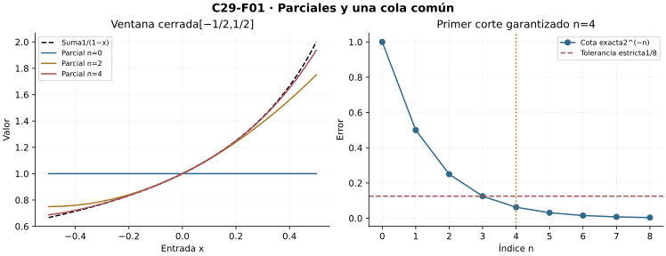

[Índice del libro](../para-matematicos/analisis-para-matematicos.html) · [Ejercicios de este capítulo](#ejercicios-29)

C11 permite controlar sumas numéricas;C27–C28 aportan uniformidad y operaciones. Ahora construiremos series funcionales, radios de potencias y certificados interiores. Las fronteras se examinan aparte. El puente hacia ACM conserva los mecanismos de magnitud sin adelantar teoremas complejos.

## 29.1. Una serie es una sucesión de sumas parciales

[]{#MA-SEC-ANM-01-029-001}

Una suma infinita todavía no es una función. Partimos de funciones $u_j:X\to\mathbb R$, $j=0,1,\ldots$, y construimos los objetos finitos
$$S_n(x)=\sum_{j=0}^n u_j(x).$$
Todos tienen dominio $X$. El dominio de convergencia $D$ contiene exactamente las entradas donde la sucesión real $S_n(x)$ tiene límite finito. Sólo allí definimos $S(x)=\lim_n S_n(x)$. Por ejemplo, los polinomios geométricos están definidos en toda la recta, pero su serie sólo converge en $(-1,1)$: fuera, sus términos no tienden a cero; en $-1$, los totales alternan entre dos valores.

La serie converge uniformemente en $Y\subset D$ cuando
$$\forall\varepsilon>0\ \exists N\ \forall n\ge N\ \forall x\in Y:\quad |S_n(x)-S(x)|<\varepsilon.$$
El corte no puede depender de la entrada. C27 aplica a $S_n$ y da el criterio de Cauchy uniforme: para cada $\varepsilon>0$ existe $N$ tal que, para todos $m>n\ge N$ y $x\in Y$,
$$\left|\sum_{j=n+1}^m u_j(x)\right|<\varepsilon.$$
La equivalencia incluye existencia: cada columna es Cauchy real, C10 construye su destino, y pasar $m$ al límite en una cota con margen $\varepsilon/2$ da un corte común para aproximarlo. No se presupone $S$ para aplicar el criterio.

El resto $R_n=S-S_n$ corresponde a términos desde $n+1$. Si tenemos una envolvente $|R_n(x)|\le E_n\to0$, basta escoger $N$ con toda su cola por debajo de la tolerancia. Cuando existe el supremo real de los errores, éste es la menor envolvente; no necesitamos que todos los prefijos estén acotados para formular Cauchy. Una cantidad finita de funciones iniciales no altera la convergencia uniforme de la serie: se cancela al comparar sumas parciales después del mismo prefijo, aunque esas funciones iniciales no estén acotadas en $Y$.

**El término individual es una alarma, no un criterio suficiente.** Si $S_n\to S$ uniformemente, para $j\ge N+1$,
$$|u_j(x)|=|S_j(x)-S_{j-1}(x)|\le |R_j(x)|+|R_{j-1}(x)|.$$
Así $u_j\to0$ uniformemente. La recíproca falla ya para funciones constantes $u_j(x)=1/(j+1)$: los términos desaparecen y la serie armónica diverge.

**Una ventana interior.** Para $|x|\le r<1$, la identidad finita geométrica y su límite dan
$$S_n(x)=\frac{1-x^{n+1}}{1-x},\qquad S(x)=\frac1{1-x},\qquad |R_n(x)|\le\frac{r^{n+1}}{1-r}.$$
En todo $(-1,1)$ falta uniformidad: cada resto $x^{n+1}/(1-x)$ es no acotado cuando $x$ se aproxima a $1$ desde dentro. Convergencia en cada ventana cerrada interior no significa convergencia uniforme en todo el dominio abierto.

{#fig-anm-c29-f01 fig-alt="En la ventana de radio1/2, los parciales geométricos convergen a1/(1−x). El resto está acotado por2^(−n), con igualdad en el extremo positivo. El corte estricto para tolerancia1/8 empieza en n4; la frontera n3 no lo acredita."}

### Microcontroles

#### Microcontrol 1

[]{#MA-MIC-ANM-01-029-001}

¿Qué objeto existe antes de definir la suma de una serie funcional?

[]{#MA-MSOL-ANM-01-029-001}

Ver solución del microcontrol 1

Existen los parciales $S_n(x)=\sum_{j=0}^n u_j(x)$, funciones definidas en el dominio común $X$. Cada uno suma sólo un número finito de valores. La función suma se definirá después, en las entradas donde esta sucesión tenga límite real.

#### Microcontrol 2

[]{#MA-MIC-ANM-01-029-002}

¿Qué define el dominio $D$?

[]{#MA-MSOL-ANM-01-029-002}

Ver solución del microcontrol 2

Es $D=\{x\in X:(S_n(x))\text{ converge en }\mathbb R\}$. Para $x\in D$ se define $S(x)=\lim_n S_n(x)$. Una entrada donde los parciales divergen o tienden a infinito queda fuera de $D$; que todos los términos estén definidos allí no basta.

#### Microcontrol 3

[]{#MA-MIC-ANM-01-029-003}

¿Desde qué índice empieza $R_n$?

[]{#MA-MSOL-ANM-01-029-003}

Ver solución del microcontrol 3

El resto $R_n(x)=S(x)-S_n(x)$ omite los términos de índices $0,\ldots,n$, de modo que empieza en $n+1$: $R_n(x)=\sum_{j=n+1}^{\infty}u_j(x)$, para $x\in D$. Este desplazamiento determina el primer término de cualquier cota de cola.

#### Microcontrol 4

[]{#MA-MIC-ANM-01-029-004}

¿Cuál es el orden de cuantificadores uniforme?

[]{#MA-MSOL-ANM-01-029-004}

Ver solución del microcontrol 4

En $Y\subseteq D$, el orden es $\forall\varepsilon>0\;\exists N\;\forall n\ge N\;\forall x\in Y:\ |S_n(x)-S(x)|<\varepsilon$. El corte puede depender de $\varepsilon$ y de la ventana $Y$, pero debe servir para todas sus entradas.

#### Microcontrol 5

[]{#MA-MIC-ANM-01-029-005}

¿Cauchy uniforme requiere conocer primero la suma?

[]{#MA-MSOL-ANM-01-029-005}

Ver solución del microcontrol 5

El criterio usa únicamente diferencias de parciales: para cada $\varepsilon>0$ existe $N$ tal que $|\sum_{j=n+1}^m u_j(x)|<\varepsilon$ para todos $m>n\ge N$ y $x\in Y$. En cada entrada, completitud de $\mathbb R$ construye el límite; pasar $m\to\infty$ con un presupuesto menor que $\varepsilon$ prueba después la uniformidad.

#### Microcontrol 6

[]{#MA-MIC-ANM-01-029-006}

¿Qué implica uniformidad sobre los términos?

[]{#MA-MSOL-ANM-01-029-006}

Ver solución del microcontrol 6

Para $j\ge1$, $u_j=S_j-S_{j-1}$. Por la desigualdad triangular, $|u_j(x)|\le|S_j(x)-S(x)|+|S_{j-1}(x)-S(x)|$. Si ambos errores son uniformemente menores que $\varepsilon/2$, resulta $|u_j(x)|<\varepsilon$ en toda la ventana. La desaparición uniforme de los términos es necesaria; no garantiza la convergencia de la serie.

#### Microcontrol 7

[]{#MA-MIC-ANM-01-029-007}

¿Por qué un prefijo no acotado puede ser inocuo?

[]{#MA-MSOL-ANM-01-029-007}

Ver solución del microcontrol 7

En $S_m-S_n$, con $m>n$ posteriores al prefijo, éste se cancela exactamente. Por ejemplo, $u_0(x)=x^2$ y $u_j(x)=2^{-j}$ para $j\ge1$ dan $S_n=x^2+1-2^{-n}$ y error $2^{-n}$ en toda $\mathbb R$. El primer término y la suma son no acotados, aunque la convergencia sea uniforme.

#### Microcontrol 8

[]{#MA-MIC-ANM-01-029-008}

¿La geométrica es uniforme en todo $(-1,1)$?

[]{#MA-MSOL-ANM-01-029-008}

Ver solución del microcontrol 8

Para $|x|<1$, el resto geométrico es $x^{n+1}/(1-x)$. Fijado $n$, su magnitud crece sin límite cuando $x\to1^-$, por lo que ningún corte controla todo $(-1,1)$. En cada ventana $[-r,r]$, $r<1$, sí vale la cota común $r^{n+1}/(1-r)\to0$.

### Ejercicios de la sección 29.1

[]{#ejercicios-29}

#### Ejercicio 1. La geométrica en dos dominios

[]{#MA-EX-ANM-01-029-001}

Para $u_j(x)=x^j$, encuentre dominio, suma y una envolvente en $[-r,r]$, $0<r<1$. Decida uniformidad en $(-1,1)$.

[]{#MA-SOL-ANM-01-029-001}

Ver solución del ejercicio 1

Para $x\ne1$, multiplicar el parcial por $1-x$ y cancelar términos da $S_n(x)=(1-x^{n+1})/(1-x)$. Si $|x|<1$, $x^{n+1}\to0$ y la suma es $S(x)=1/(1-x)$. Para $|x|\ge1$, los términos $x^j$ no tienden a cero, incluidos $x=\pm1$; por tanto $D=(-1,1)$.

La resta exacta es $R_n(x)=x^{n+1}/(1-x)$. En $[-r,r]$, $0<r<1$, $|R_n(x)|\le r^{n+1}/(1-r)\to0$. La igualdad se alcanza en $x=r$, de modo que ésta es también la envolvente exacta. Un corte con $r^{n+1}<(1-r)\varepsilon$ sirve para toda la ventana.

En todo $(-1,1)$, para cada $n$ el resto crece sin límite al acercarse a $1$ por la izquierda. La convergencia es puntual allí, pero no uniforme.

**Retorno visual.** Véase [C29-F01](analisis-para-matematicos-capitulo-29-series-de-funciones-y-series-de-potencias.html#fig-anm-c29-f01), después del argumento completo: la figura permite reconocer el mecanismo y no sustituye la prueba.

#### Ejercicio 2. Un término necesario

[]{#MA-EX-ANM-01-029-002}

Pruebe que la convergencia uniforme de una serie implica que sus términos tienden uniformemente a cero. Refute la recíproca.

[]{#MA-SOL-ANM-01-029-002}

Ver solución del ejercicio 2

Suponga $S_n\to S$ uniformemente. Dado $\varepsilon>0$, elija $N$ para que $|S_k(x)-S(x)|<\varepsilon/2$ para todo $k\ge N$ y toda entrada. Para $j\ge N+1$, $u_j=S_j-S_{j-1}$, luego $|u_j(x)|<\varepsilon$. Así los términos tienden uniformemente a cero.

El recíproco falla incluso para funciones constantes: en un conjunto no vacío, tome $u_j(x)=1/(j+1)$. Su supremo de magnitud tiende a cero, pero la serie de valores es armónica en cada entrada y diverge. La condición sobre términos aislados no controla bloques de muchos términos.

#### Ejercicio 3. Cortes dependientes de la entrada

[]{#MA-EX-ANM-01-029-003}

Diagnostique: «para todo $x$ existe un corte geométrico, así que hay un corte para todo $(-1,1)$». Exhiba entradas que impiden un corte dado.

[]{#MA-SOL-ANM-01-029-003}

Ver solución del ejercicio 3

La convergencia puntual permite elegir un corte distinto para cada $x$: $\forall x\;\forall\varepsilon>0\;\exists N(x,\varepsilon)$. La uniforme pide $\forall\varepsilon>0\;\exists N(\varepsilon)\;\forall x$. Ningún intercambio de esos cuantificadores se deduce de la primera afirmación.

En la geométrica sobre $(-1,1)$, tome $x_n=1-1/[2(n+1)]$. Es una entrada admisible para cada corte $n$. La desigualdad de Bernoulli da $x_n^{n+1}\ge1-(n+1)/[2(n+1)]=1/2$. Por ello $R_n(x_n)=x_n^{n+1}/(1-x_n)\ge n+1$.

Por ejemplo, la tolerancia $1/2$ queda incumplida en una entrada $x_n$ para todo corte. Cada entrada fija converge, pero los infractores pueden desplazarse hacia la frontera a medida que cambia el corte.

#### Ejercicio 4. Prefijo no acotado

[]{#MA-EX-ANM-01-029-004}

En $\mathbb R$ tome $u_0(x)=x^2$ y $u_j(x)=2^{-j}$ para $j\ge1$. Pruebe uniformidad y explique por qué no puede haber mayorante global finito para $u_0$.

[]{#MA-SOL-ANM-01-029-004}

Ver solución del ejercicio 4

Para $n\ge0$, $\sum_{j=1}^n2^{-j}=1-2^{-n}$, también con suma vacía cuando $n=0$. Así $S_n(x)=x^2+1-2^{-n}$ y $S(x)=x^2+1$ en toda $\mathbb R$. El resto es la constante $2^{-n}$, por lo que la convergencia es uniforme en toda la recta.

No existe un mayorante finito $M_0$ para $|u_0(x)|=x^2$ en $\mathbb R$. Esto impide aplicar el criterio M a la serie completa en esa ventana, aunque la uniformidad ya esté demostrada. En diferencias de parciales posteriores a cero el término $x^2$ se cancela; sólo importa la cola sumable.

#### Ejercicio 5. Cauchy sin suma conocida

[]{#MA-EX-ANM-01-029-005}

Suponga $|\sum_{j=n+1}^m u_j(x)|\le\eta_n$ para todos $m>n$ y $x\in X$, con $\eta_n\to0$. Construya la suma y un certificado.

[]{#MA-SOL-ANM-01-029-005}

Ver solución del ejercicio 5

Fije una entrada $x$. Para $m>n$, la hipótesis da $|S_m(x)-S_n(x)|\le\eta_n$, y $\eta_n\to0$. Para cada tolerancia hay un corte que controla todos los pares de índices posteriores; invertirlos no cambia la magnitud de la diferencia. Por completitud, existe $S(x)=\lim_m S_m(x)$ en cada entrada de $X$.

Mantenga fijos $n$ y $x$ y haga $m\to\infty$. Se obtiene $|S(x)-S_n(x)|\le\eta_n$. Como la misma sucesión de barreras sirve para todas las entradas, basta elegir $N$ con $\eta_n<\varepsilon$ para $n\ge N$. Queda construida la suma y acreditada su convergencia uniforme, sin presuponerla al estimar los bloques.

## 29.2. El criterio M y lo que no afirma

[]{#MA-SEC-ANM-01-029-002}

¿Cómo controlar todos los bloques de una serie sin conocer todavía su suma? Sustituimos cada término por un presupuesto numérico común a todas las entradas.

**Criterio M de Weierstrass.** Supongamos $M_j\ge0$, $|u_j(x)|\le M_j$ para todo $j$ y $x\in X$, y que la serie numérica $\sum_{j=0}^{\infty}M_j$ converge a $A$. Entonces $\sum u_j$ converge uniformemente en $X$. También converge uniformemente la serie de magnitudes $\sum|u_j|$, y en cada entrada la primera serie converge absolutamente.

**Prueba desde bloques finitos.** C11 entrega un corte para todas las colas finitas de la serie positiva. Después de él,
$$|S_m(x)-S_n(x)|\le\sum_{j=n+1}^m |u_j(x)|\le\sum_{j=n+1}^m M_j<\varepsilon/2.$$
No depende de $x$. Cauchy uniforme construye $S$; la misma comparación aplicada a las sumas de magnitudes construye su destino uniformemente. Fijando $n,x$ y pasando $m$ al límite, obtenemos
$$|R_n(x)|\le T_n,\qquad T_n=A-\sum_{j=0}^nM_j=\sum_{j=n+1}^{\infty}M_j.$$
Asimismo $|S(x)|\le A$. El paso al límite conserva $\le$, no una desigualdad estricta sin margen. $T_n\to0$ es un certificado disponible antes de evaluar $S$.

Para $|u_j(x)|\le C\rho^j$, $0<\rho<1$, resulta $T_n=C\rho^{n+1}/(1-\rho)$. Por ejemplo $u_j(x)=x^j$ en $[-1/2,1/2]$ tiene $E_n\le2^{-n}$: para exigir error estrictamente menor que $1/8$ basta $n\ge4$. $n=3$ es frontera; la desigualdad débil del certificado no lo admite.

**Tres propiedades distintas.** Convergencia absoluta en cada entrada, convergencia uniforme de la serie de magnitudes y existencia de mayorantes sumables comunes son afirmaciones diferentes. El criterio M implica las tres, pero no es necesario para uniformidad. En $X=\{0,1,2,\ldots\}$, pongamos $u_j(x)=1/(j+1)$ si $x=j$ y $0$ en otra entrada. Cada suma tiene a lo sumo un término no nulo. El resto tiene supremo $1/(n+2)$, tanto para la serie original como para la de magnitudes: ambas son uniformes. Sin embargo cualquier mayorante común satisface $M_j\ge1/(j+1)$, de modo que ninguna serie de mayorantes converge.

La otra separación aparece en la geométrica sobre $(-1,1)$: en cada entrada converge absolutamente, pero no uniformemente. Y la serie constante $(-1)^j/(j+1)$ converge uniformemente por el criterio alternado de C11, sin converger absolutamente. El dominio y las cancelaciones son parte del diagnóstico.

Si la comparación M sólo vale desde un índice fijo, se aplica al tramo final. El prefijo se suma aparte. No se concluye entonces $|S|\le A$ sin incluir una cota para ese prefijo; éste puede ser no acotado.

{#fig-anm-c29-f02 fig-alt="Los mayorantes geométricos2^(−j) tienen cola sumable2^(−n). En el dominio discreto de entradas enteras, los términos1/(j+1) se apoyan en una sola entrada cada uno: su serie y sus magnitudes tienen error1/(n+2), aunque las normas individuales formen una armónica divergente. La fórmula de la cola completa, no los primeros puntos, prueba uniformidad."}

### Microcontroles

#### Microcontrol 9

[]{#MA-MIC-ANM-01-029-009}

¿Qué debe dominar $M_j$?

[]{#MA-MSOL-ANM-01-029-009}

Ver solución del microcontrol 9

Debe cumplirse $|u_j(x)|\le M_j$ para todas las entradas $x$ de la ventana y cada índice $j$, con $M_j\ge0$ independiente de $x$. Una cota elegida separadamente para cada entrada no es el mayorante común requerido por el criterio M.

#### Microcontrol 10

[]{#MA-MIC-ANM-01-029-010}

¿Qué condición numérica falta si sólo se dan mayorantes?

[]{#MA-MSOL-ANM-01-029-010}

Ver solución del microcontrol 10

Falta la convergencia de la serie numérica $\sum_j M_j$. Tener cotas finitas por término no asegura que sus colas desaparezcan: $M_j=1$ domina muchos términos, pero sus bloques pueden crecer arbitrariamente. La sumabilidad proporciona un corte común a toda la ventana.

#### Microcontrol 11

[]{#MA-MIC-ANM-01-029-011}

¿Cómo se controla un bloque finito bajo M?

[]{#MA-MSOL-ANM-01-029-011}

Ver solución del microcontrol 11

Para $m>n$, $|S_m(x)-S_n(x)|\le\sum_{j=n+1}^m|u_j(x)|\le\sum_{j=n+1}^m M_j\le T_n$, donde $T_n=\sum_{j>n}M_j\to0$. Elegir $N$ con $T_n<\varepsilon$ para $n\ge N$ acredita Cauchy uniforme sin haber supuesto una función suma.

#### Microcontrol 12

[]{#MA-MIC-ANM-01-029-012}

¿Qué desigualdad queda al pasar al límite?

[]{#MA-MSOL-ANM-01-029-012}

Ver solución del microcontrol 12

Con $x$ y $n$ fijos, hacer $m\to\infty$ en la cota del bloque da $|S(x)-S_n(x)|\le T_n$. El límite conserva una desigualdad no estricta. Para certificar error estrictamente menor que $\varepsilon$, se elige un corte con $T_n<\varepsilon$.

#### Microcontrol 13

[]{#MA-MIC-ANM-01-029-013}

¿M controla la serie de magnitudes?

[]{#MA-MSOL-ANM-01-029-013}

Ver solución del microcontrol 13

También $\sum|u_j(x)|$ tiene sus bloques dominados por los mismos bloques de $\sum M_j$. Converge uniformemente y su cola satisface $\sum_{j>n}|u_j(x)|\le T_n$. Se obtiene así convergencia absoluta en cada entrada, además de uniformidad de ambas series.

#### Microcontrol 14

[]{#MA-MIC-ANM-01-029-014}

¿Es necesario M para uniformidad?

[]{#MA-MSOL-ANM-01-029-014}

Ver solución del microcontrol 14

En $X=\mathbb N_0$, tome $u_j(x)=\mathbf1_{\{j\}}(x)/(j+1)$. En cada entrada sólo hay un término distinto de cero; la cola tiene supremo $1/(n+2)$ y desaparece uniformemente. Sin embargo, cualquier mayorante común satisface $M_j\ge|u_j(j)|=1/(j+1)$, cuya serie diverge. El criterio M es suficiente.

#### Microcontrol 15

[]{#MA-MIC-ANM-01-029-015}

¿Absoluta puntual implica uniforme?

[]{#MA-MSOL-ANM-01-029-015}

Ver solución del microcontrol 15

La geométrica $\sum x^j$ converge absolutamente en cada $x\in(-1,1)$, porque $\sum|x|^j$ es geométrica de razón menor que uno. Su resto no admite un corte uniforme en todo ese intervalo. La convergencia absoluta puntual deja que el control de la cola dependa de la entrada.

#### Microcontrol 16

[]{#MA-MIC-ANM-01-029-016}

Con $E_n\le2^{-n}$, ¿qué corte certifica error menor que $1/8$?

[]{#MA-MSOL-ANM-01-029-016}

Ver solución del microcontrol 16

Hay que pedir $2^{-n}<1/8=2^{-3}$. El primer corte certificado por esta barrera es $n=4$, para el cual $E_n\le1/16<1/8$; también sirven todos los posteriores. En $n=3$ la cota sólo garantiza $E_3\le1/8$ y no acredita la desigualdad estricta solicitada.

### Ejercicios de la sección 29.2

#### Ejercicio 6. Mayorante dyádico

[]{#MA-EX-ANM-01-029-006}

Si $|u_j(x)|\le3\,2^{-j}$, dé cota de suma y cola y el primer índice garantizado para error estrictamente menor que $3/8$.

[]{#MA-SOL-ANM-01-029-006}

Ver solución del ejercicio 6

Los mayorantes suman $\sum_{j=0}^{\infty}3\,2^{-j}=6$, y su cola después del grado $n$ es $T_n=\sum_{j=n+1}^{\infty}3\,2^{-j}=3\,2^{-n}$. El criterio M construye una suma uniforme, con $|S(x)|\le6$, y da $|S-S_n|\le3\,2^{-n}$ en toda la ventana.

Para garantizar error estrictamente menor que $3/8$, se necesita $2^{-n}<1/8$. El primer corte acreditado es $n=4$, con cota $3/16$; en $n=3$ sólo se garantiza $\le3/8$. Es el primer corte que garantiza esta información: la serie positiva de términos constantes $u_j=3\,2^{-j}$ alcanza la cota y muestra por qué el corte tres no puede garantizar la desigualdad estricta.

#### Ejercicio 7. La serie de magnitudes

[]{#MA-EX-ANM-01-029-007}

Pruebe directamente que las hipótesis M hacen uniforme $\sum|u_j|$ y acotan su destino por $\sum M_j$.

[]{#MA-SOL-ANM-01-029-007}

Ver solución del ejercicio 7

Sean $|u_j(x)|\le M_j$ y $\sum M_j=M_*<\infty$. Los parciales de magnitudes $A_n(x)=\sum_{j=0}^n|u_j(x)|$ son crecientes y están acotados por $M_*$. En cada entrada tienen un límite $A(x)$.

Para $m>n$, $0\le A_m(x)-A_n(x)\le\sum_{j=n+1}^mM_j$. Al pasar $m\to\infty$ queda $0\le A(x)-A_n(x)\le T_n$, donde $T_n=\sum_{j>n}M_j\to0$ independientemente de $x$. Por tanto la serie de magnitudes converge uniformemente y $A(x)\le M_*$ en toda la ventana. La serie original converge absolutamente y su resto también está dominado por $T_n$.

#### Ejercicio 8. Uniformidad sin criterio M

[]{#MA-EX-ANM-01-029-008}

Use $u_j(x)=\mathbf1_{\{j\}}(x)/(j+1)$ en $X=\mathbb N_0$ para refutar que el criterio M sea necesario incluso para uniformidad de las magnitudes.

[]{#MA-SOL-ANM-01-029-008}

Ver solución del ejercicio 8

En la entrada $x=k\in\mathbb N_0$, sólo el término $u_k(k)=1/(k+1)$ es distinto de cero. La suma, tanto de valores como de magnitudes, es $S(k)=1/(k+1)$. Si $k\le n$ el resto es cero; si $k>n$ vale $1/(k+1)$. Luego $\sup_k|S(k)-S_n(k)|=1/(n+2)$, alcanzado en $k=n+1$.

Esto prueba convergencia uniforme absoluta directamente. Por otra parte, evaluar un supuesto mayorante en $x=j$ obliga a $M_j\ge1/(j+1)$. Su serie no puede converger, por comparación con la armónica. La uniformidad procede aquí de que las entradas activan términos distintos, aunque las máximas magnitudes individuales no sean sumables.

**Retorno visual.** Véase [C29-F02](analisis-para-matematicos-capitulo-29-series-de-funciones-y-series-de-potencias.html#fig-anm-c29-f02), después del argumento completo: la figura permite reconocer el mecanismo y no sustituye la prueba.

#### Ejercicio 9. Cancelación uniforme

[]{#MA-EX-ANM-01-029-009}

Considere $u_j(x)=(-1)^j/(j+1)$ en cualquier conjunto no vacío $X$. Decida uniformidad, absoluta y posibilidad de M.

[]{#MA-SOL-ANM-01-029-009}

Ver solución del ejercicio 9

Todos los términos son constantes respecto de $x$. La serie alternada $\sum_{j\ge0}(-1)^j/(j+1)$ converge porque sus magnitudes decrecen a cero. Su estimación de resto da $|S-S_n|\le1/(n+2)$; al ser independiente de la entrada, acredita convergencia uniforme en cualquier conjunto no vacío.

La serie de magnitudes es armónica y diverge en cada entrada. Además, cualquier mayorante debe cumplir $M_j\ge1/(j+1)$, por lo que no puede ser sumable. Se obtiene uniformidad condicional gracias a la alternancia, que el criterio M no registra.

#### Ejercicio 10. Cambio de parámetro

[]{#MA-EX-ANM-01-029-010}

En $Y=[0,1]$ sea $u_j(x)=x^j/3^j$. Encuentre una suma explícita y compare el resto exacto con M.

[]{#MA-SOL-ANM-01-029-010}

Ver solución del ejercicio 10

La razón $x/3$ está entre cero y $1/3$ en $[0,1]$. La identidad geométrica da $S(x)=1/(1-x/3)$ y $R_n(x)=(x/3)^{n+1}/(1-x/3)$. En ese intervalo, $R_n(x)\le(1/3)^{n+1}/(1-1/3)=3^{-n}/2$, con igualdad en $x=1$.

El criterio M usa $M_j=3^{-j}$. Su cola es precisamente $3^{-n}/2$, de modo que coincide con la envolvente exacta y prueba convergencia absoluta y uniforme. La coincidencia se explica porque en $x=1$ todos los términos alcanzan simultáneamente su mayorante y tienen signo positivo.

## 29.3. Operaciones sobre sumas infinitas

[]{#MA-SEC-ANM-01-029-003}

Las operaciones actúan primero sobre $S_n$, donde todo es finito. C28 decide qué presupuesto permite pasar después al límite.

**Continuidad.** Si cada $u_j$ es continua en $X$ y la serie converge uniformemente allí, cada $S_n$ es continua y C28 hace continua a $S$ en el dominio relativo. En un dominio abierto basta uniformidad en una vecindad de cada punto. No se necesita una única banda para todo el abierto. El criterio M con términos continuos proporciona una condición suficiente inmediatamente reutilizable.

**Integral propia en un marco fijo.** Sean $u_j$ integrables en $[a,b]$ y $S_n\to S$ uniformemente allí. C28 demuestra primero que $S$ es integrable y luego
$$\int_a^b S(x)\,dx=\lim_n\sum_{j=0}^n\int_a^b u_j(x)\,dx=\sum_{j=0}^{\infty}\int_a^b u_j(x)\,dx.$$
La serie de integrales converge porque sus sumas parciales convergen al destino exhibido. Si $|R_n|\le E_n$,
$$\left|\int_a^bS-\sum_{j=0}^n\int_a^b u_j\right|\le(b-a)E_n.$$
Para acumuladas desde $c\in[a,b]$, el error es a lo sumo $|x-c|E_n$. Se conserva la orientación al integrar hacia la izquierda. No se extiende este presupuesto a longitudes que crecen con $n$.

**Derivación con ancla.** Sean $u_j$ continuas en $[a,b]$, derivables en $(a,b)$, con $a<b$. Supongamos que $\sum u_j^{\prime}$ converge uniformemente en $(a,b)$ a $g$ y que la serie numérica $\sum u_j(c)$ converge a $\lambda$ en algún $c\in[a,b]$. Las sumas parciales tienen derivadas $S_n^{\prime}=\sum_{j=0}^n u_j^{\prime}$ y valores $S_n(c)\to\lambda$. C28 produce $S_n\to S$ uniformemente en $[a,b]$ y $S^{\prime}=g$ en $(a,b)$. En particular
$$\left(\sum_{j=0}^{\infty}u_j\right)^{\prime}=\sum_{j=0}^{\infty}u_j^{\prime}.$$
Si $|g-S_n^{\prime}|\le D_n$, su certificado es
$$|S(x)-S_n(x)|\le|\lambda-S_n(c)|+|x-c|D_n.$$
El ancla paga las constantes que las derivadas no ven. La prueba de C28 usa valor medio e incrementos, sin suponer continuidad de todas las derivadas ni integrar derivadas posiblemente discontinuas. Para series en toda la recta, se aplica en marcos acotados que contienen cada punto y el ancla; resulta uniformidad local.

**La sola uniformidad de valores no permite derivar.** Sea $h_n(x)=\sqrt{x^2+1/(n+1)^2}$ en $[-1,1]$. Definamos $u_0=h_0$ y, para $j\ge1$, $u_j=h_j-h_{j-1}$. Entonces $S_n=h_n$ telescópicamente y $S_n\to|x|$ uniformemente, con error máximo $1/(n+1)$. Cada término es suave, pero el destino no es derivable en $0$. Allí todas las derivadas parciales valen $0$; su límite no puede ser la derivada inexistente del destino. La regularidad infinita de las filas no reemplaza el control de la serie derivada.

{#fig-anm-c29-f03 fig-alt="La serie2^(−j)x² tiene suma2x² y parciales(2−2^(−n))x², con integrales y errores acreditados. En cambio el telescopio de raíces suavizadas converge uniformemente a|x|; sus parciales son suaves pero el destino tiene una esquina en cero. La uniformidad de valores no autoriza derivación."}

### Microcontroles

#### Microcontrol 17

[]{#MA-MIC-ANM-01-029-017}

¿Por qué son continuos los parciales si lo son los términos?

[]{#MA-MSOL-ANM-01-029-017}

Ver solución del microcontrol 17

Cada $S_n$ es una suma finita de funciones continuas, y por ello es continua. Si $S_n\to S$ uniformemente, fijar un parcial con error pequeño permite trasladar su continuidad al límite mediante $|S(x)-S(x_0)|\le|S-S_n|(x)+|S_n(x)-S_n(x_0)|+|S_n-S|(x_0)$.

#### Microcontrol 18

[]{#MA-MIC-ANM-01-029-018}

¿Cuál es el marco del intercambio de integral?

[]{#MA-MSOL-ANM-01-029-018}

Ver solución del microcontrol 18

Se trabaja en un intervalo cerrado y acotado $[a,b]$, con términos Riemann integrables y parciales que convergen uniformemente. Los parciales son integrables por aditividad finita. El teorema de límites uniformes integrables acredita la integrabilidad de la suma y el paso al límite en las integrales.

#### Microcontrol 19

[]{#MA-MIC-ANM-01-029-019}

¿Qué debe probarse antes de integrar el destino?

[]{#MA-MSOL-ANM-01-029-019}

Ver solución del microcontrol 19

Debe acreditarse que la función suma es Riemann integrable. Ésa es una conclusión del teorema de convergencia uniforme, aplicado a los parciales integrables; no se puede comenzar escribiendo una integral del límite como si ya existiera. Después se estima su diferencia con la integral de un parcial.

#### Microcontrol 20

[]{#MA-MIC-ANM-01-029-020}

¿Cuál es la cota de error integral?

[]{#MA-MSOL-ANM-01-029-020}

Ver solución del microcontrol 20

Si $|S-S_n|\le E_n$ en $[a,b]$, entonces $|\int_a^b S-\int_a^b S_n|\le(b-a)E_n$. Para acumuladas desde $c\in[a,b]$, vale $|\int_c^x(S-S_n)|\le|x-c|E_n$. La longitud aparece por integrar la barrera constante, y la orientación queda absorbida por el valor absoluto.

#### Microcontrol 21

[]{#MA-MIC-ANM-01-029-021}

¿Qué serie debe ser uniforme para derivar?

[]{#MA-MSOL-ANM-01-029-021}

Ver solución del microcontrol 21

Debe converger uniformemente la serie de derivadas $\sum_j u_j'$ en el intervalo considerado, junto con convergencia de $\sum_j u_j(c)$ en una ancla. Aplicado a los parciales, el teorema derivativo da $S'=\sum_j u_j'$. La uniformidad de la serie de valores por sí sola no acredita esa fórmula.

#### Microcontrol 22

[]{#MA-MIC-ANM-01-029-022}

¿Por qué hace falta el ancla?

[]{#MA-MSOL-ANM-01-029-022}

Ver solución del microcontrol 22

La derivación elimina las constantes: sumar una constante distinta a cada parcial no altera sus derivadas. El ancla fija esos niveles mediante convergencia de $S_n(c)$. Por ejemplo, $u_j\equiv1$ tiene serie de derivadas idénticamente cero, pero $S_n(c)=n+1$ diverge.

#### Microcontrol 23

[]{#MA-MIC-ANM-01-029-023}

¿Se exige continuidad de las derivadas en ese teorema?

[]{#MA-MSOL-ANM-01-029-023}

Ver solución del microcontrol 23

Basta que los términos sean derivables y que las derivadas de sus parciales converjan uniformemente, con el ancla convergente. La prueba del teorema usa el valor medio para controlar incrementos de diferencias de parciales. No exige continuidad de cada derivada ni necesita integrar una derivada potencialmente no integrable.

#### Microcontrol 24

[]{#MA-MIC-ANM-01-029-024}

¿Qué muestra el telescopio de raíces suavizadas?

[]{#MA-MSOL-ANM-01-029-024}

Ver solución del microcontrol 24

Con $h_n(x)=\sqrt{x^2+(n+1)^{-2}}$, tome $u_0=h_0$ y $u_j=h_j-h_{j-1}$. Entonces $S_n=h_n$ y $0\le h_n-|x|\le1/(n+1)$: la serie de términos derivables converge uniformemente a $|x|$. La suma no es derivable en cero, lo que impide deducir derivabilidad sólo a partir de esa uniformidad.

### Ejercicios de la sección 29.3

#### Ejercicio 11. Integrales y orientación

[]{#MA-EX-ANM-01-029-011}

Si una serie integrable en $[-2,3]$ tiene $|R_n|\le2^{-n}$, acote error de su integral completa y de las acumuladas desde $1$.

[]{#MA-SOL-ANM-01-029-011}

Ver solución del ejercicio 11

Los parciales son Riemann integrables como sumas finitas de términos integrables. La cota uniforme $|S-S_n|\le2^{-n}$, que tiende a cero, permite aplicar el teorema de límites uniformes integrables: la suma $S$ también es integrable en $[-2,3]$.

La longitud del intervalo es cinco, por lo que $|\int_{-2}^3 S-\sum_{j=0}^n\int_{-2}^3u_j|\le5\,2^{-n}$. Para la acumulada desde uno, $|\int_1^x S-\sum_{j=0}^n\int_1^xu_j|\le|x-1|2^{-n}\le3\,2^{-n}$. Esto da uniformidad de las acumuladas en todo el intervalo, incluida la orientación negativa cuando $x<1$.

#### Ejercicio 12. Serie derivada con ancla

[]{#MA-EX-ANM-01-029-012}

Formule y pruebe el teorema derivativo de §29.3 usando sólo el teorema de sucesiones de C28.

[]{#MA-SOL-ANM-01-029-012}

Ver solución del ejercicio 12

Sean $u_j$ continuas en $[a,b]$, derivables en $(a,b)$, con $a<b$. Suponga que $\sum_j u_j'$ converge uniformemente en $(a,b)$ a $G$ y que $\sum_j u_j(c)$ converge para alguna ancla $c\in[a,b]$. Entonces $\sum_j u_j$ converge uniformemente en $[a,b]$ a una función $S$ derivable en $(a,b)$, con $S'=G$.

Escriba $S_n=\sum_{j=0}^nu_j$. Si cada $u_j$ es derivable, la regla de suma finita da $S_n'=\sum_{j=0}^nu_j'$. La hipótesis sobre la serie derivada dice exactamente que $S_n'\to G$ uniformemente. La hipótesis del ancla dice que $S_n(c)$ converge.

Se cumplen así las hipótesis del teorema de C28 para sucesiones de funciones derivables. Éste construye el límite $S$ de los parciales, acredita su derivabilidad en el interior y da $S'=G=\sum_j u_j'$. En un intervalo acotado, el valor medio también proporciona la convergencia uniforme de $S_n$: la diferencia de dos parciales queda controlada por su diferencia en $c$ y la longitud por el error de pendientes.

La prueba no requiere continuidad de las derivadas. El ancla y la uniformidad de sus parciales son las condiciones que deben verificarse antes de usar la fórmula.

#### Ejercicio 13. Telescopio suave con esquina

[]{#MA-EX-ANM-01-029-013}

Para $h_n(x)=\sqrt{x^2+1/(n+1)^2}$ forme la serie telescópica de §29.3. Pruebe uniformidad y la falla de derivación en cero.

[]{#MA-SOL-ANM-01-029-013}

Ver solución del ejercicio 13

Defina $u_0=h_0$ y $u_j=h_j-h_{j-1}$ para $j\ge1$. Todos los términos son derivables en $\mathbb R$, pues el radicando de cada $h_n$ es estrictamente positivo. La suma finita telescópica es $S_n=h_n$.

Para $a=1/(n+1)$, las desigualdades $|x|\le\sqrt{x^2+a^2}\le|x|+a$ dan $0\le S_n(x)-|x|\le1/(n+1)$. La cota se alcanza en cero y prueba convergencia uniforme, incluso en toda la recta, a $S(x)=|x|$. Sus cocientes incrementales en cero valen $1$ por la derecha y $-1$ por la izquierda; la suma no es derivable allí.

La serie derivada tiene parciales $h_n'(x)=x/\sqrt{x^2+(n+1)^{-2}}$. Su límite puntual vale $-1$ para $x<0$, cero para $x=0$ y $1$ para $x>0$. No puede ser límite uniforme de esas funciones continuas en un intervalo que contenga cero en su interior, pues sería continuo. Falta precisamente la hipótesis derivativa.

**Retorno visual.** Véase [C29-F03](analisis-para-matematicos-capitulo-29-series-de-funciones-y-series-de-potencias.html#fig-anm-c29-f03), después del argumento completo: la figura permite reconocer el mecanismo y no sustituye la prueba.

#### Ejercicio 14. Constantes invisibles

[]{#MA-EX-ANM-01-029-014}

Dé una serie cuya serie de derivadas converja uniformemente, pero cuya serie de valores diverja. Identifique la hipótesis perdida.

[]{#MA-SOL-ANM-01-029-014}

Ver solución del ejercicio 14

Tome $u_j(x)=1$ para todos los índices en $[0,1]$. Cada derivada es cero y los parciales de la serie derivada son cero: convergen uniformemente.

Sin embargo, $S_n(x)=n+1$ en toda entrada, por lo que la serie de valores diverge. En cualquier ancla $c$, $S_n(c)$ tampoco converge. El ejemplo prueba que controlar todas las pendientes deja sin controlar las constantes de los parciales; se necesita la convergencia en una ancla para aplicar el teorema.

#### Ejercicio 15. Serie polinómica integrada

[]{#MA-EX-ANM-01-029-015}

En $[-1,1]$ tome $u_j(x)=2^{-j}x^2$. Calcule suma, derivada, integral desde cero y sus errores uniformes.

[]{#MA-SOL-ANM-01-029-015}

Ver solución del ejercicio 15

La suma de coeficientes es $\sum_{j\ge0}2^{-j}=2$. Así $S_n(x)=(2-2^{-n})x^2$ y $S(x)=2x^2$. En $[-1,1]$, los términos están dominados por $2^{-j}$, y el resto exacto es $2^{-n}x^2$, con envolvente $2^{-n}$.

Los términos derivados $2^{1-j}x$ tienen mayorantes sumables $2^{1-j}$; además, $S_n(0)=0$. El teorema derivativo da $S'=4x$, mientras $S_n'=(4-2^{1-n})x$. El resto de derivadas es $2^{1-n}x$, con envolvente $2^{1-n}$.

Integrar desde cero da $\int_0^x S(t)\,dt=2x^3/3$ y $\int_0^x S_n(t)\,dt=(2-2^{-n})x^3/3$. El resto acumulado es $2^{-n}x^3/3$, cuya envolvente es $2^{-n}/3$. Las tres envolventes se alcanzan en los extremos; el signo de $x^3$ conserva la orientación cuando $x<0$.

## 29.4. Un punto de convergencia abre una región interior

[]{#MA-SEC-ANM-01-029-004}

Una serie de potencias de centro $c$ tiene la forma
$$\sum_{j=0}^{\infty}a_j(x-c)^j,\qquad a_j,c\in\mathbb R.$$
El término de orden cero es $a_0$ también en el centro: interpretamos el monomio constante como $1$. La suma en $c$ es $a_0$, no necesariamente cero. Cada parcial es un polinomio definido en toda la recta; su límite puede tener un dominio menor.

**Lema interior.** Si la serie converge en $t\ne c$, sus términos tienden a cero y existe $M$ con $|a_j(t-c)^j|\le M$ para todos $j$. Para $0<r<|t-c|$ y $|x-c|\le r$,
$$|a_j(x-c)^j|\le M\rho^j,\qquad \rho=\frac r{|t-c|}<1.$$
El criterio M da convergencia absoluta en cada entrada y uniforme, incluso de las magnitudes, en todo el segmento. Además $|R_n(x)|\le M\rho^{n+1}/(1-\rho)$. Se emplea sólo convergencia en $t$, que podría ser condicional. El segmento de radio cero es una única entrada y se trata directamente.

**Construcción del radio.** Sea $H=\{|t-c|:\text{ la serie converge en }t\}$. Contiene $0$. Si $H$ es acotado, definimos $R=\sup H\ge0$; si es no acotado, escribimos $R=\infty$. No afirmamos que el supremo pertenezca a $H$.

Si $0<r<R$, el significado del supremo (o la no acotación) entrega una entrada convergente $t$ con $|t-c|>r$. El lema protege $[c-r,c+r]$. En consecuencia la serie converge absolutamente cuando $|x-c|<R$, y uniformemente en cada segmento cerrado interior. Si $|x-c|>R$, no puede converger: esa distancia pertenecería a $H$ y excedería su cota. Para $R=0$, sólo converge en $c$; para $R=\infty$, converge en toda la recta, uniformemente en cada segmento acotado.

Cuando $0<R<\infty$, el dominio es $(c-R,c+R)$ más ninguno, uno o ambos extremos, según las dos series numéricas obtenidas por sustitución. La convergencia en un extremo fuerza el interior, pero no la convergencia en el extremo opuesto. Todo compacto del intervalo abierto está dentro de un segmento cerrado interior: la función continua $|x-c|$ alcanza allí un máximo menor que $R$. Por restricción, la uniformidad también vale sobre ese compacto.

**Qué no promete el radio.** La geométrica tiene $R=1$ y converge uniformemente en cada $[-r,r]$, $r<1$, pero no en todo $(-1,1)$. Las cotas empeoran al aumentar $r$ hacia $1$. «Localmente uniforme» recuerda ese margen disponible alrededor de cada punto; no significa un corte común hasta la frontera.

{#fig-anm-c29-f04 fig-alt="Un punto convergente a distancia s protege cada segmento de radio r&lt;s mediante la razónr/s. Para la geométrica escalada de términos(x/2)^j se ilustran centro0, punto convergente t1 y radio interior r1/2. Su radio total es2 y los extremos±2 son abiertos. El presupuesto M1 es válido en t1; no se infiere convergencia en±2 desde el margen interior."}

### Microcontroles

#### Microcontrol 25

[]{#MA-MIC-ANM-01-029-025}

¿Cuánto vale una serie de potencias en su centro?

[]{#MA-MSOL-ANM-01-029-025}

Ver solución del microcontrol 25

En $x=c$, todos los términos de grado positivo se anulan y cada parcial vale $a_0$. El término de grado cero se define como la función constante $a_0$, también en el centro. Por tanto la serie siempre converge allí y su suma es $a_0$.

#### Microcontrol 26

[]{#MA-MIC-ANM-01-029-026}

¿Qué acotación proporciona convergencia en $t\ne c$?

[]{#MA-MSOL-ANM-01-029-026}

Ver solución del microcontrol 26

Convergencia en $t$ implica $a_j(t-c)^j\to0$; esta sucesión de términos es acotada. Existe $M$ tal que $|a_j|\,|t-c|^j\le M$ para todo $j$, incluidos los primeros. No se ha afirmado convergencia absoluta en $t$: sólo se usa la acotación necesaria de sus términos.

#### Microcontrol 27

[]{#MA-MIC-ANM-01-029-027}

¿Cuál es la razón del mayorante interior?

[]{#MA-MSOL-ANM-01-029-027}

Ver solución del microcontrol 27

En $|x-c|\le r<|t-c|$, la acotación anterior da $|a_j(x-c)^j|\le M\rho^j$, con $\rho=r/|t-c|<1$. La razón estrictamente menor que uno hace sumable el mayorante. La cola común queda acotada por $M\rho^{n+1}/(1-\rho)$.

#### Microcontrol 28

[]{#MA-MIC-ANM-01-029-028}

¿Cómo se define un radio finito?

[]{#MA-MSOL-ANM-01-029-028}

Ver solución del microcontrol 28

Sea $H=\{|t-c|:\text{la serie converge en }t\}$. Si este conjunto es acotado, se define $R=\sup H$. El centro asegura $0\in H$. El lema interior prueba convergencia absoluta para distancias menores que $R$; una convergencia a distancia mayor contradiría la definición de supremo.

#### Microcontrol 29

[]{#MA-MIC-ANM-01-029-029}

¿Debe alcanzarse el supremo?

[]{#MA-MSOL-ANM-01-029-029}

Ver solución del microcontrol 29

Para $r<R$, la propiedad de supremo garantiza una distancia $d\in H$ con $r<d\le R$. Un punto convergente a esa distancia basta para dominar toda la ventana de radio $r$. No hace falta que exista un punto convergente a distancia exactamente $R$; los extremos se estudian aparte.

#### Microcontrol 30

[]{#MA-MIC-ANM-01-029-030}

¿Qué significa $R=0$?

[]{#MA-MSOL-ANM-01-029-030}

Ver solución del microcontrol 30

La única entrada convergente es el centro, donde la suma vale $a_0$. Si hubiese convergencia a distancia positiva, ésta pertenecería a $H$ y forzaría $R>0$. Por ejemplo, los coeficientes $a_j=j!$ para $j\ge1$ producen términos que no desaparecen en ninguna distancia positiva.

#### Microcontrol 31

[]{#MA-MIC-ANM-01-029-031}

¿Qué significa $R=\infty$?

[]{#MA-MSOL-ANM-01-029-031}

Ver solución del microcontrol 31

Hay convergencia absoluta en toda entrada real y uniforme en cada ventana acotada alrededor del centro: para un radio finito $r$ se encuentra una distancia convergente mayor. Esta afirmación permite elegir un corte por ventana; no proporciona un mismo corte para toda la recta.

#### Microcontrol 32

[]{#MA-MIC-ANM-01-029-032}

¿El radio decide los dos extremos?

[]{#MA-MSOL-ANM-01-029-032}

Ver solución del microcontrol 32

Si $0<R<\infty$, quedan por estudiar $c-R$ y $c+R$. El radio decide el interior y el exterior, pero en la frontera pueden darse divergencia, convergencia condicional o absoluta. La geométrica y la serie $\sum x^j/(j+1)^2$ tienen radio uno y comportamientos distintos en sus extremos.

### Ejercicios de la sección 29.4

#### Ejercicio 16. Convergencia en una entrada

[]{#MA-EX-ANM-01-029-016}

Una serie de centro $2$ converge en $t=-1$ y satisface $|a_j(-3)^j|\le5$. Dé una ventana protegida y cota de cola sobre $[0,4]$.

[]{#MA-SOL-ANM-01-029-016}

Ver solución del ejercicio 16

El centro es $c=2$ y el punto convergente $t=-1$ está a distancia tres. En $[0,4]$ se tiene $|x-2|\le2$. De la hipótesis $|a_j(-3)^j|\le5$ se obtiene $|a_j(x-2)^j|\le5(2/3)^j$ en toda esa ventana.

El criterio M acredita convergencia absoluta y uniforme. La cola queda controlada por $\sum_{j>n}5(2/3)^j=15(2/3)^{n+1}$. Para una tolerancia $\varepsilon$, basta escoger $n$ con esa expresión menor que $\varepsilon$.

El mismo razonamiento protege cualquier ventana de radio estrictamente menor que tres. No decide el punto $x=5$, a distancia tres del centro: la acotación de términos en $-1$ no acredita convergencia en el extremo opuesto.

**Retorno visual.** Véase [C29-F04](analisis-para-matematicos-capitulo-29-series-de-funciones-y-series-de-potencias.html#fig-anm-c29-f04), después del argumento completo: la figura permite reconocer el mecanismo y no sustituye la prueba.

#### Ejercicio 17. Supremo sin pertenencia

[]{#MA-EX-ANM-01-029-017}

Reconstruya el radio a partir de $H$ y pruebe interior y exterior. Evite afirmar convergencia en la distancia $R$.

[]{#MA-SOL-ANM-01-029-017}

Ver solución del ejercicio 17

Sea $H$ el conjunto de distancias al centro de las entradas convergentes. Contiene cero. Si es acotado, tome $R=\sup H$; si es no acotado, tome $R=\infty$.

Para una distancia $r<R$, la propiedad del supremo, o la no acotación, permite encontrar $d\in H$ con $r<d$. La convergencia en una entrada a distancia $d$ da una cota de términos $M d^{-j}$ para los coeficientes. En $|x-c|\le r$, el mayorante $M(r/d)^j$ acredita convergencia absoluta y uniforme.

Si $R$ es finito, una entrada convergente a distancia mayor que $R$ añadiría a $H$ un elemento mayor que su supremo, imposible. Nada de esto exige $R\in H$. Para $0<R<\infty$, los dos puntos a distancia exactamente $R$ conservan su propio problema de convergencia.

#### Ejercicio 18. El término constante

[]{#MA-EX-ANM-01-029-018}

Diagnostique «una serie de potencias da cero en su centro». Dé un ejemplo y trate $R=0$.

[]{#MA-SOL-ANM-01-029-018}

Ver solución del ejercicio 18

En el centro, cada parcial vale $a_0$, porque el monomio de grado cero es la función constante y los restantes se anulan. Esto garantiza convergencia en $c$ aun cuando no haya ninguna otra entrada convergente.

Por ejemplo, tome $F(x)=7+\sum_{j\ge1}j!(x-c)^j$ como expresión de serie. Si $d=|x-c|>0$, los términos de magnitud $j!d^j$ tienen cociente $(j+1)d$, que eventualmente supera dos. Desde un término positivo crecen al menos geométricamente y no tienden a cero. La serie diverge fuera del centro; tiene radio cero y su única suma definida es $F(c)=7$.

#### Ejercicio 19. Compactos interiores

[]{#MA-EX-ANM-01-029-019}

Pruebe que una serie de radio $R>0$ converge uniformemente en todo compacto $K\subset(c-R,c+R)$.

[]{#MA-SOL-ANM-01-029-019}

Ver solución del ejercicio 19

Sea $K$ compacto contenido en $(c-R,c+R)$. Si no es vacío, la función continua $|x-c|$ alcanza en él un máximo $r<R$. Elija una distancia $s$ con $r<s<R$; por la propiedad del radio hay una entrada convergente a distancia mayor que $s$ y, por tanto, una cota $|a_j|s^j\le M$.

Para $x\in K$, $|a_j(x-c)^j|\le M(r/s)^j$. Si $r>0$, este mayorante es geométrico de razón menor que uno, con cola $M(r/s)^{n+1}/(1-r/s)$. Si $r=0$, $K$ sólo contiene el centro y todos los restos son cero. Así hay convergencia absoluta y uniforme en $K$. El caso vacío es inmediato. No se obtiene por ello uniformidad en todo el intervalo abierto ni en su frontera.

#### Ejercicio 20. Radios iguales no dan cortes iguales

[]{#MA-EX-ANM-01-029-020}

Compare la geométrica y $\sum x^j/(j+1)^2$, ambas de radio $1$, en todo $[-1,1]$ y en $(-1,1)$.

[]{#MA-SOL-ANM-01-029-020}

Ver solución del ejercicio 20

Para $\sum_{j\ge0}x^j$, el radio es uno, el dominio es $(-1,1)$ y el resto $x^{n+1}/(1-x)$ impide uniformidad en todo ese intervalo. En $x=\pm1$ los términos no desaparecen, por lo que no hay suma que extender por convergencia de la serie.

Para $\sum_{j\ge0}x^j/(j+1)^2$, el cociente de coeficientes tiende a uno y también $R=1$. En $[-1,1]$, los términos están dominados por $1/(j+1)^2$. Esta serie numérica converge por $1/(j+1)^2\le1/j-1/(j+1)$ para $j\ge1$, y el criterio M da convergencia absoluta y uniforme en el intervalo cerrado.

De hecho, su cola común es $\le\sum_{j=n+1}^{\infty}[1/j-1/(j+1)]=1/(n+1)$. Fuera de $[-1,1]$ los términos no tienden a cero, por cociente de magnitudes mayor que uno. El radio compartido no determina el comportamiento en el borde ni la uniformidad en la ventana máxima.

## 29.5. Calcular el radio y examinar los extremos

[]{#MA-SEC-ANM-01-029-005}

El radio ya existe antes de cualquier fórmula para calcularlo. Las siguientes pruebas proporcionan métodos suficientes; si sus límites no existen, permanece la construcción anterior.

**Comparación geométrica por cocientes.** Para una serie numérica con términos no nulos desde cierto índice, si $|b_{j+1}|/|b_j|\to L<1$, elijamos $L<q<1$. Eventualmente $|b_{j+1}|\le q|b_j|$; inducción finita da $|b_{N+k}|\le|b_N|q^k$. C11 prueba convergencia absoluta por comparación. Si el límite es $L>1$, elijamos $1<q<L$. Eventualmente las magnitudes crecen al menos como $|b_N|q^k$, así que los términos no tienden a cero y la serie diverge. El mismo argumento funciona si el cociente tiende a infinito. El caso $L=1$ queda sin decidir.

Para coeficientes eventualmente no nulos, si $|a_{j+1}/a_j|\to L$, el cociente de los términos en una entrada distinta del centro tiende a $L|x-c|$. Por ello $R=1/L$ si $0<L<\infty$, $R=\infty$ si $L=0$ y $R=0$ si $L=\infty$. Las escrituras $1/0$ y $1/\infty$ sólo son convenciones de estos casos, no divisiones reales. Si hay infinitos ceros, no se usa una división no definida.

**Comparación por raíces.** Si $|b_j|^{1/j}\to L<1$, una barrera eventual $q<1$ da $|b_j|\le q^j$. Si $L>1$, una barrera inferior $q>1$ impide que los términos desaparezcan. Para $j\ge1$, $|a_j(x-c)^j|^{1/j}=|a_j|^{1/j}|x-c|$. Si las raíces de los coeficientes tienen límite $L$ finito o infinito, resultan las mismas fórmulas de radio y los mismos casos extremos. Aquí no se introduce una fórmula con limsup sin construir esa herramienta.

**Cuatro fronteras con el mismo radio.** Centremos en cero. El coeficiente inicial de las dos series con denominador $j$ se fija como cero.

| Serie | $R$ | En $-1$ | En $1$ |
|---|---|---|---|
| $\sum_{j=0}^{\infty}x^j$ | $1$ | Diverge | Diverge |
| $\sum_{j=1}^{\infty}x^j/j$ | $1$ | Condicional | Diverge |
| $\sum_{j=1}^{\infty}(-1)^jx^j/j$ | $1$ | Diverge | Condicional |
| $\sum_{j=0}^{\infty}x^j/(j+1)^2$ | $1$ | Absoluta | Absoluta |

Los cocientes de coeficientes tienden a $1$, pero no resuelven los extremos. Allí C11 distingue términos que no desaparecen, armónica y alternada. Para la última, desde $j=1$,
$$\frac1{(j+1)^2}\le\frac1{j(j+1)}=\frac1j-\frac1{j+1},$$
así que una comparación telescópica prueba convergencia absoluta en ambos extremos, sin invocar un criterio no construido. De hecho el mismo mayorante M prueba uniformidad en todo $[-1,1]$ para esa última serie.

Una serie con sólo finitos coeficientes no nulos tiene $R=\infty$. Para $a_j=j!$, los cocientes de términos son $(j+1)|x|\to\infty$ si $x\ne0$, luego $R=0$. Para $a_j=1/j!$, los cocientes tienden a cero en cada entrada y $R=\infty$. Finalmente $\sum_{k=0}^{\infty}x^{2k}$ tiene ceros en todos los coeficientes impares: se reconoce como geométrica de razón $x^2$, de radio $1$, sin forzar un cociente entre coeficientes consecutivos.

{#fig-anm-c29-f05 fig-alt="Cuatro series de radio1 realizan las cuatro combinaciones de extremos: geométrica ninguno; x^j/j sólo−1; (−1)^jx^j/j sólo1; x^j/(j+1)² ambos. Círculos abiertos y cerrados codifican divergencia y convergencia además del color. Los tipos condicional y absoluto se indican por texto."}

### Microcontroles

#### Microcontrol 33

[]{#MA-MIC-ANM-01-029-033}

¿Qué demuestra un cociente límite menor que $1$?

[]{#MA-MSOL-ANM-01-029-033}

Ver solución del microcontrol 33

Para términos eventualmente no nulos y cociente de magnitudes con límite $L<1$, elija $L<q<1$. Desde un índice $J$ los cocientes son menores que $q$, luego $|b_{J+k}|\le|b_J|q^k$. Esta barrera geométrica acredita convergencia absoluta; el prefijo finito no cambia la conclusión.

#### Microcontrol 34

[]{#MA-MIC-ANM-01-029-034}

¿Qué demuestra un cociente límite mayor que $1$?

[]{#MA-MSOL-ANM-01-029-034}

Ver solución del microcontrol 34

Elija $1<q<L$. Desde cierto índice $J$, $|b_{J+k}|\ge|b_J|q^k$, con $b_J\ne0$. Los términos no tienden a cero y la serie diverge. Si el límite del cociente es infinito, también puede elegirse cualquier $q>1$ y obtenerse la misma conclusión.

#### Microcontrol 35

[]{#MA-MIC-ANM-01-029-035}

¿Qué decide un cociente límite igual a $1$?

[]{#MA-MSOL-ANM-01-029-035}

Ver solución del microcontrol 35

No decide la convergencia: los términos $1/(j+1)^2$ y $1/(j+1)$ tienen cocientes tendentes a uno, pero sus series convergen y divergen, respectivamente. Hace falta otro argumento en la situación de igualdad.

#### Microcontrol 36

[]{#MA-MIC-ANM-01-029-036}

¿Cuándo se prohíbe el cociente consecutivo de coeficientes?

[]{#MA-MSOL-ANM-01-029-036}

Ver solución del microcontrol 36

No puede usarse el criterio consecutivo si hay coeficientes nulos arbitrariamente lejos: las divisiones por ellos quedan indefinidas y no existe una cola de cocientes válidos. Una serie con sólo grados pares puede estudiarse agrupando esos grados como una geométrica o usando raíces.

#### Microcontrol 37

[]{#MA-MIC-ANM-01-029-037}

¿Qué radio da un límite de raíces $L\in(0,\infty)$?

[]{#MA-MSOL-ANM-01-029-037}

Ver solución del microcontrol 37

Si $|a_j|^{1/j}\to L\in(0,\infty)$, la raíz del término de grado $j$ en una entrada de distancia $d$ tiende a $Ld$. Para $Ld<1$ se obtiene una barrera geométrica; para $Ld>1$ los términos no desaparecen. Así $R=1/L$, sin conclusión automática en $d=R$.

#### Microcontrol 38

[]{#MA-MIC-ANM-01-029-038}

¿Qué radios dan los casos $L=0$ y $L=\infty$?

[]{#MA-MSOL-ANM-01-029-038}

Ver solución del microcontrol 38

Si las raíces tienden a cero, para cada distancia finita $d>0$ el producto $d|a_j|^{1/j}$ termina por ser menor que una razón $q<1$; por tanto $R=\infty$. Si tienden a infinito, en cada distancia positiva las magnitudes de los términos crecen eventualmente y $R=0$. Son conclusiones de comparación, sin dividir números reales por cero o por infinito.

#### Microcontrol 39

[]{#MA-MIC-ANM-01-029-039}

¿Cómo convergen los extremos de $\sum_{j\ge1}x^j/j$?

[]{#MA-MSOL-ANM-01-029-039}

Ver solución del microcontrol 39

En $x=-1$ queda $\sum_{j\ge1}(-1)^j/j$, que converge por el criterio alternado; la serie de magnitudes es la armónica y diverge, de modo que la convergencia es condicional. En $x=1$ aparece directamente la armónica y hay divergencia. El dominio completo es $[-1,1)$.

#### Microcontrol 40

[]{#MA-MIC-ANM-01-029-040}

¿Por qué converge $\sum1/(j+1)^2$ sin otro criterio?

[]{#MA-MSOL-ANM-01-029-040}

Ver solución del microcontrol 40

Para $j\ge1$, $1/(j+1)^2\le1/[j(j+1)]=1/j-1/(j+1)$. Sumar de $1$ a $m$ da una cota menor que uno. Los parciales positivos son crecientes y acotados, por lo que convergen; añadir el término $j=0$ sólo añade uno.

### Ejercicios de la sección 29.5

#### Ejercicio 21. Cocientes acreditados

[]{#MA-EX-ANM-01-029-021}

Pruebe el criterio de cociente cuando el límite es menor que $1$ y cuando es mayor que $1$, indicando el tratamiento de un prefijo.

[]{#MA-SOL-ANM-01-029-021}

Ver solución del ejercicio 21

Para una serie de términos eventualmente no nulos, suponga $|b_{j+1}|/|b_j|\to L$. Si $L<1$, elija $L<q<1$ y $J$ tal que los cocientes posteriores sean $\le q$. Inducción da $|b_{J+k}|\le|b_J|q^k$. La cola converge absolutamente y el prefijo finito no modifica la convergencia.

Si $L>1$, elija $1<q<L$ y un corte con cocientes $\ge q$. Se obtiene $|b_{J+k}|\ge|b_J|q^k$, y $|b_J|>0$: los términos no desaparecen. Lo mismo vale para límite infinito escogiendo un $q>1$ fijo.

Con $L=1$ no se obtiene ninguna de esas barreras. Las series $\sum1/(j+1)^2$ y $\sum1/(j+1)$ muestran ambas posibilidades. La hipótesis de términos eventualmente no nulos es la que hace lícitas las divisiones.

#### Ejercicio 22. Trasladar y escalar

[]{#MA-EX-ANM-01-029-022}

Encuentre radio y dominio de $\sum_{j=1}^{\infty}((x-2)/3)^j/j$.

[]{#MA-SOL-ANM-01-029-022}

Ver solución del ejercicio 22

Ponga $z=(x-2)/3$. La serie es $\sum_{j\ge1}z^j/j$. Como serie de potencias en $x-2$, sus coeficientes son $a_0=0$ y $a_j=1/(j3^j)$; sus cocientes tienden a $1/3$, por lo que el radio es tres.

Para $|x-2|<3$ hay convergencia absoluta. En $x=-1$, $z=-1$ y queda una alternada de magnitudes $1/j$ decrecientes a cero: converge condicionalmente. En $x=5$, $z=1$ y queda la armónica, divergente. Fuera de esas distancias, los términos no tienden a cero. El dominio completo es $[-1,5)$.

#### Ejercicio 23. Ceros en los coeficientes

[]{#MA-EX-ANM-01-029-023}

Encuentre el radio de $\sum_{k=0}^{\infty}(x-1)^{2k}$ y explique por qué no sirve el cociente consecutivo de sus coeficientes.

[]{#MA-SOL-ANM-01-029-023}

Ver solución del ejercicio 23

La serie $\sum_{k\ge0}(x-1)^{2k}$ es geométrica de razón $(x-1)^2$. Converge exactamente cuando $|x-1|<1$, con suma $1/[1-(x-1)^2]$. En $x=0$ o $x=2$ los términos valen uno; fuera del intervalo su magnitud crece. Por tanto el centro es uno, el radio es uno y el dominio es $(0,2)$.

Como serie con todos los grados, tiene coeficientes $a_{2k}=1$ y $a_{2k+1}=0$. Hay denominadores nulos arbitrariamente lejos en los cocientes consecutivos, por lo que ese criterio no puede aplicarse. La identificación geométrica usa los grados efectivamente presentes y resuelve la convergencia sin esas divisiones.

#### Ejercicio 24. Raíz sin cociente

[]{#MA-EX-ANM-01-029-024}

Para $a_j=2^j$ si $j$ es par y $a_j=2^j/(j+1)$ si es impar, calcule $R$. Justifique el límite de raíces usado.

[]{#MA-SOL-ANM-01-029-024}

Ver solución del ejercicio 24

En índices pares, $|a_j|^{1/j}=2$; en los impares vale $2/(j+1)^{1/j}$. Para probar $(j+1)^{1/j}\to1$, fije $q>1$. El cociente de $(j+1)/q^j$ tiende a $1/q<1$, de modo que esa sucesión termina dominada por una geométrica y tiende a cero. Eventualmente $j+1<q^j$, luego $1\le(j+1)^{1/j}<q$. Como vale para cualquier $q>1$, el límite es uno.

Las raíces de los coeficientes tienden así a dos y el radio es $1/2$. Los cocientes consecutivos, aunque están definidos, alternan: para $j$ par, $a_{j+1}/a_j=2/(j+2)\to0$; para $j$ impar, $a_{j+1}/a_j=2(j+1)\to\infty$. No tienen límite, por lo que el método consecutivo no determina el radio en este caso.

#### Ejercicio 25. Todos los extremos

[]{#MA-EX-ANM-01-029-025}

Construya series de radio $2$ y centro $-3$ con cada uno de los cuatro posibles dominios de extremos.

[]{#MA-SOL-ANM-01-029-025}

Ver solución del ejercicio 25

Use $z=(x+3)/2$, que envía $x=-5$ a $z=-1$ y $x=-1$ a $z=1$. Cuatro series sirven:

- $\sum_{j\ge0}z^j$: no converge en ninguno de los extremos, pues allí los términos no desaparecen; dominio $(-5,-1)$.
- $\sum_{j\ge1}z^j/j$: alternada convergente en $-5$ y armónica divergente en $-1$; dominio $[-5,-1)$.
- $\sum_{j\ge1}(-1)^jz^j/j$: armónica en $-5$ y alternada en $-1$; dominio $(-5,-1]$.
- $\sum_{j\ge0}z^j/(j+1)^2$: converge absolutamente en ambos extremos por comparación telescópica; dominio $[-5,-1]$.

En todas, el cociente de magnitudes de los coeficientes en potencias de $x+3$ tiende a $1/2$. Así tienen centro $-3$ y radio dos. Los puntos interiores convergen absolutamente y los exteriores divergen; las evaluaciones anteriores resuelven las cuatro elecciones de frontera.

**Retorno visual.** Véase [C29-F05](analisis-para-matematicos-capitulo-29-series-de-funciones-y-series-de-potencias.html#fig-anm-c29-f05), después del argumento completo: la figura permite reconocer el mecanismo y no sustituye la prueba.

## 29.6. Derivar e integrar dentro del radio

[]{#MA-SEC-ANM-01-029-006}

Sea $F(x)=\sum_{j=0}^{\infty}a_j(x-c)^j$ con $R>0$. Fijemos $0<r<s<R$. La convergencia en $c+s$ entrega $|a_j|s^j\le M$. En $|x-c|\le r$, para $j\ge1$,
$$|ja_j(x-c)^{j-1}|\le\frac M s\,j\rho^{j-1},\qquad \rho=r/s<1.$$
La serie numérica $\sum_{j=1}^{\infty}j\rho^{j-1}$ converge: el cociente de sus términos tiende a $\rho<1$, por §29.5. Más precisamente, la identidad finita obtenida al derivar el polinomio geométrico es
$$\sum_{j=1}^n j\rho^{j-1}=\frac{1-(n+1)\rho^n+n\rho^{n+1}}{(1-\rho)^2}.$$
Los términos $n\rho^n$ tienden a cero por la misma comparación de cocientes. Pasando al límite, la suma es $1/(1-\rho)^2$ y la cola desde $n+1$ es
$$\sum_{j=n+1}^{\infty}j\rho^{j-1}=\frac{\rho^n[(n+1)-n\rho]}{(1-\rho)^2}.$$
No se ha derivado una suma infinita para justificar este mayorante: sólo una identidad polinómica finita.

El criterio M hace uniforme la serie derivada en el segmento. Las sumas parciales originales valen exactamente $a_0$ en el ancla $c$. §29.3 aplica y demuestra, en su interior,
$$F^{\prime}(x)=\sum_{j=1}^{\infty}ja_j(x-c)^{j-1}.$$
Para cualquier punto con $|x-c|<R$, podemos elegir $r,s$ que lo contengan estrictamente, así que la fórmula vale en todo el intervalo abierto. Las cotas son locales, con un margen positivo respecto de $R$.

**El radio de la derivada coincide.** Acabamos de probar que la serie derivada converge absolutamente en cada distancia menor que $R$, luego su radio es al menos $R$. Recíprocamente, si la derivada converge en una entrada $t$ de distancia positiva, en cualquier distancia $d<|t-c|$ converge absolutamente por el lema interior aplicado a esa nueva serie. Allí,
$$\sum_{j=1}^{\infty}|a_j|d^j\le d\sum_{j=1}^{\infty}j|a_j|d^{j-1}<\infty.$$
Así $R\ge d$ para todo $d<|t-c|$. Ninguna distancia convergente de la derivada puede exceder $R$. Esto cubre radios infinitos y series polinómicas sin restar infinitos.

**Integral término a término.** La uniformidad en cada segmento cerrado interior y §29.3 dan
$$\int_c^x F(t)\,dt=\sum_{j=0}^{\infty}\frac{a_j}{j+1}(x-c)^{j+1},\qquad |x-c|<R.$$
La orientación está incluida. La serie integrada tiene el mismo radio. Primero converge absolutamente en el interior por comparación. Si converge en una distancia $d>0$, sus términos están acotados: $|a_j|d^{j+1}/(j+1)\le B$. En cada $0<r<d$ recuperamos
$$|a_j|r^j\le\frac B d(j+1)(r/d)^j,$$
un mayorante sumable. Por tanto el radio original es al menos cualquier $r<d$, y no puede haber distancias convergentes de la integrada por encima de $R$.

**Órdenes finitos.** Iterar la igualdad de radios y el teorema derivativo produce, para cada entero fijo $k\ge0$,
$$F^{(k)}(x)=\sum_{j=k}^{\infty}\frac{j!}{(j-k)!}a_j(x-c)^{j-k}.$$
Cada orden tiene uniformidad en segmentos interiores. El orden $k$ se fija antes del corte; no se promete control uniforme de todos los órdenes simultáneamente. Ninguna de estas pruebas autoriza derivar la serie en $c\pm R$.

{#fig-anm-c29-f06 fig-alt="La cola de valores geométricos en radio1/2 es2^(−n). La cola de derivadas es(n+2)2^(1−n). Ambas se calculan por identidades finitas; el factor de índice demora el corte, aunque el radio siga siendo1. El segundo panel muestra las primeras magnitudesj(1/2)^(j−1) del mayorante derivativo."}

### Microcontroles

#### Microcontrol 41

[]{#MA-MIC-ANM-01-029-041}

¿Por qué se reservan dos radios $r<s<R$?

[]{#MA-MSOL-ANM-01-029-041}

Ver solución del microcontrol 41

Una distancia convergente mayor que $s$ da una cota $|a_j|s^j\le M$. En la ventana de radio $r$, los términos derivados quedan dominados por $(M/s)j(r/s)^{j-1}$. El margen $r/s<1$ compensa el factor $j$ que introduce la derivación; trabajar directamente en la frontera perdería ese margen.

#### Microcontrol 42

[]{#MA-MIC-ANM-01-029-042}

¿Qué ancla tienen los parciales originales en $c$?

[]{#MA-MSOL-ANM-01-029-042}

Ver solución del microcontrol 42

Para todo $n$, $S_n(c)=a_0$. La sucesión en el ancla es constante y converge sin estimación adicional. Junto con convergencia uniforme de las derivadas en una ventana interior, satisface las hipótesis del teorema derivativo.

#### Microcontrol 43

[]{#MA-MIC-ANM-01-029-043}

¿Cómo se justifica el mayorante derivado sin circularidad?

[]{#MA-MSOL-ANM-01-029-043}

Ver solución del microcontrol 43

Se deriva la identidad de un polinomio finito $\sum_{j=0}^n\rho^j=(1-\rho^{n+1})/(1-\rho)$. Ella da una fórmula para $\sum_{j=1}^n j\rho^{j-1}$. Como $n\rho^n\to0$ para $0<\rho<1$, los parciales numéricos convergen a $1/(1-\rho)^2$. Así se demuestra la sumabilidad del mayorante antes de derivar la serie funcional infinita.

#### Microcontrol 44

[]{#MA-MIC-ANM-01-029-044}

¿Cuál es el radio de la serie derivada?

[]{#MA-MSOL-ANM-01-029-044}

Ver solución del microcontrol 44

Tiene el mismo radio $R$. La comparación con $j\rho^{j-1}$ acredita convergencia derivada en cualquier ventana interior, por lo que su radio es al menos $R$. Si convergiera a distancia $d>R$, sus términos $ja_jd^{j-1}$ serían acotados; para $j\ge1$, ello haría $|a_j|d^j$ acotado y obligaría a la original a converger en cada distancia menor que $d$, contradicción.

#### Microcontrol 45

[]{#MA-MIC-ANM-01-029-045}

¿La integrada puede aumentar el radio?

[]{#MA-MSOL-ANM-01-029-045}

Ver solución del microcontrol 45

La serie integrada conserva el radio. Convergencia de la integrada a distancia $d>0$ implica una cota $|a_j|d^{j+1}/(j+1)\le B$. Para $r<d$, se sigue $|a_j|r^j\le(B/d)(j+1)(r/d)^j$, un mayorante sumable. Un radio integrado mayor forzaría convergencia original más allá de su radio. La integración ya acredita el sentido contrario en el interior.

#### Microcontrol 46

[]{#MA-MIC-ANM-01-029-046}

¿Dónde se permite la fórmula de derivación?

[]{#MA-MSOL-ANM-01-029-046}

Ver solución del microcontrol 46

La fórmula $F'(x)=\sum_{j\ge1}ja_j(x-c)^{j-1}$ vale para $|x-c|<R$. Cada entrada interior cabe en una ventana donde la serie derivada converge uniformemente. En un extremo convergente de la original puede divergir la serie derivada, como sucede con $\sum x^j/j$ en $-1$.

#### Microcontrol 47

[]{#MA-MIC-ANM-01-029-047}

¿Qué se fija antes del corte para derivadas iteradas?

[]{#MA-MSOL-ANM-01-029-047}

Ver solución del microcontrol 47

Se fija primero un orden finito $k$ y una ventana estrictamente interior. Después se construyen mayorantes para los factores $j(j-1)\cdots(j-k+1)$ y se elige el corte según la tolerancia. El teorema para cada orden fijo no proporciona un control uniforme para órdenes que crezcan con el índice de truncación.

#### Microcontrol 48

[]{#MA-MIC-ANM-01-029-048}

¿Qué vale $F^{(k)}(c)$?

[]{#MA-MSOL-ANM-01-029-048}

Ver solución del microcontrol 48

La derivación iterada da $F^{(k)}(x)=\sum_{j\ge k}j!/(j-k)!\,a_j(x-c)^{j-k}$ en el interior. Al evaluar en $c$, sólo queda el término $j=k$, de modo que $F^{(k)}(c)=k!a_k$. También vale para $k=0$, con $0!=1$.

### Ejercicios de la sección 29.6

#### Ejercicio 26. La cola derivada

[]{#MA-EX-ANM-01-029-026}

Deduzca $\sum_{j>n}j\rho^{j-1}$, $0<\rho<1$, sin derivar una serie infinita.

[]{#MA-SOL-ANM-01-029-026}

Ver solución del ejercicio 26

Para $0<\rho<1$, derive sólo la identidad polinómica finita $\sum_{j=0}^n\rho^j=(1-\rho^{n+1})/(1-\rho)$. La regla del cociente da $\sum_{j=1}^n j\rho^{j-1}=[1-(n+1)\rho^n+n\rho^{n+1}]/(1-\rho)^2$.

La sucesión $n\rho^n$ tiende a cero: desde $n\ge1$ sus cocientes son $\rho(n+1)/n\to\rho<1$, y una barrera geométrica lo demuestra. Lo mismo vale para $(n+1)\rho^n$. Por tanto los parciales numéricos convergen a $1/(1-\rho)^2$.

Restar el parcial al total da la cola exacta $\sum_{j>n}j\rho^{j-1}=\rho^n[(n+1)-n\rho]/(1-\rho)^2$, también para $n=0$. La sumabilidad del mayorante derivativo queda establecida mediante polinomios y límites numéricos, antes de cualquier derivación de una serie infinita.

**Retorno visual.** Véase [C29-F06](analisis-para-matematicos-capitulo-29-series-de-funciones-y-series-de-potencias.html#fig-anm-c29-f06), después del argumento completo: la figura permite reconocer el mecanismo y no sustituye la prueba.

#### Ejercicio 27. Presupuesto derivativo concreto

[]{#MA-EX-ANM-01-029-027}

Si $|a_j|\le3\,2^{-j}$, acote en $[-1,1]$ el resto de la serie derivada y evalúe la cota en $n=4$.

[]{#MA-SOL-ANM-01-029-027}

Ver solución del ejercicio 27

En $[-1,1]$, $|ja_jx^{j-1}|\le3j2^{-j}$ para $j\ge1$. Esta serie de mayorantes converge por la fórmula de la cola ponderada con $\rho=1/2$. Además, los parciales originales valen $a_0$ en cero. El teorema derivativo permite identificar $F'$ con la serie de derivadas.

Después del grado $n$, su resto satisface $|F'(x)-S_n'(x)|\le3\sum_{j>n}j2^{-j}=(3/2)\sum_{j>n}j(1/2)^{j-1}=3(n+2)2^{-n}$. Para $n=4$, la barrera es $18/16=9/8$. La cola de valores, en cambio, está dominada por $3\,2^{-n}$ y da $3/16$ en ese corte.

El factor de índice explica el mayor presupuesto necesario para las derivadas. La hipótesis $|a_j|\le3\,2^{-j}$ garantiza un radio al menos dos; no obliga a que sea exactamente dos, pues los coeficientes pueden ser mucho menores o incluso terminar.

#### Ejercicio 28. Una frontera no derivable por la serie

[]{#MA-EX-ANM-01-029-028}

Para $F(x)=\sum_{j\ge1}x^j/j$, explique por qué la convergencia en $-1$ no autoriza la fórmula de serie derivada allí.

[]{#MA-SOL-ANM-01-029-028}

Ver solución del ejercicio 28

La serie $F(x)=\sum_{j\ge1}x^j/j$ tiene radio uno. En $x=-1$ converge condicionalmente por alternancia. En $|x|<1$, el teorema derivativo da $F'(x)=\sum_{j\ge1}x^{j-1}=1/(1-x)$.

Si se sustituye $x=-1$ en la serie derivada, sus términos son $(-1)^{j-1}$ y no tienden a cero. La serie diverge, por lo que no representa una derivada en esa frontera. La convergencia de los valores en el extremo no extiende el teorema derivativo hasta él. Una eventual extensión derivable de la función interior requeriría otro argumento y no convertiría esta serie divergente en una representación válida.

#### Ejercicio 29. Integral y radio

[]{#MA-EX-ANM-01-029-029}

Pruebe que dividir los coeficientes por $j+1$ e incrementar el grado no aumenta el radio de una serie de radio positivo.

[]{#MA-SOL-ANM-01-029-029}

Ver solución del ejercicio 29

La serie integrada desde el centro es $G(x)=\sum_{j\ge0}a_j(x-c)^{j+1}/(j+1)$. En cada ventana interior del radio original $R>0$, la convergencia uniforme permite integrar y da $G(x)=\int_c^xF(t)\,dt$. Por ello su radio $R_G$ es al menos $R$.

Suponga que la integrada converge a una distancia $d>0$. Sus términos son acotados, así que existe $B$ con $|a_j|d^{j+1}/(j+1)\le B$. Para $0<r<d$, resulta $|a_j|r^j\le(B/d)(j+1)(r/d)^j$. La serie de la derecha converge, pues el cociente de sus términos tiende a $r/d<1$. La original converge absolutamente en cada distancia menor que $d$.

Si $R_G>R$ con $R$ finito, escoja una distancia convergente $d>R$ para la integrada y luego $R<r<d$. La conclusión anterior contradice el radio original. Si $R=\infty$, la desigualdad inicial ya fuerza $R_G=\infty$. Por tanto $R_G=R$; la integración sí puede cambiar la convergencia en los extremos.

#### Ejercicio 30. Orden finito y ancla

[]{#MA-EX-ANM-01-029-030}

Obtenga $F^{(3)}$ y $a_3$ para una serie de centro $c$ y radio positivo. Precise la región válida.

[]{#MA-SOL-ANM-01-029-030}

Ver solución del ejercicio 30

En cualquier ventana estrictamente interior al radio, aplique tres veces el teorema derivativo. En cada paso la nueva serie conserva el radio, y los factores polinómicos en el índice se absorben reservando un margen geométrico. Se obtiene $F^{(3)}(x)=\sum_{j\ge3}j(j-1)(j-2)a_j(x-c)^{j-3}$ para $|x-c|<R$.

Al evaluar en $c$, se anulan los grados positivos y sólo queda $j=3$: $F^{(3)}(c)=6a_3$, luego $a_3=F^{(3)}(c)/6$. El orden tres está fijado antes de elegir cortes. La fórmula se acredita en el interior, sin una afirmación adicional sobre los extremos.

## 29.7. Coeficientes, funciones y certificados

[]{#MA-SEC-ANM-01-029-007}

La suma deja de ser una caja negra: las operaciones acreditadas producen fórmulas y certificados que se pueden verificar independientemente.

**Geométrica y su derivada.** En $|x|<1$,
$$\frac1{1-x}=\sum_{j=0}^{\infty}x^j,\qquad \frac1{(1-x)^2}=\sum_{j=1}^{\infty}jx^{j-1}.$$
La primera identidad procede del resto finito; la segunda emplea §29.6 y la regla derivativa de C18. Integrar la primera desde cero define la función $L(x)=\int_0^x(1-t)^{-1}\,dt$ en $(-1,1)$ y entrega $L(x)=\sum_{j=1}^{\infty}x^j/j$. No hace falta identificar $L$ con un logaritmo construido por otra vía, ni evaluar esta identidad directamente en un extremo.

**La exponencial construida por la serie.** Definimos
$$E(x)=\sum_{j=0}^{\infty}\frac{x^j}{j!}.$$
Su radio infinito, ya probado, permite derivar en cada segmento: $E^{\prime}=E$ al reindexar $j-1$ y $E(0)=1$. De aquí se obtienen propiedades sin asumirlas. Por producto y cadena, la derivada de $E(x)E(-x)$ es cero; valor medio hace constante el producto en cada segmento, y su valor en cero es $1$. Así $E(x)$ nunca es cero. Su continuidad, el valor positivo en cero y el teorema del valor intermedio hacen $E(x)>0$ para toda entrada.

Fijemos $a$. La función de $t$ dada por $E(a+t)E(-t)$ tiene derivada cero y vale $E(a)$ en cero. Como $E(t)E(-t)=1$, se sigue $E(a+t)=E(a)E(t)$. Además, si una función derivable $y$ en un intervalo que contiene cero satisface $y^{\prime}=y$ y $y(0)=1$, la derivada de $y(t)E(-t)$ es cero. Valor medio da ese producto igual a $1$, luego $y=E$ en el intervalo. Se ha probado existencia y unicidad para esta ecuación concreta, sin importar un teorema general de ecuaciones diferenciales.

**Un certificado factorial en una ventana.** Para $|x|\le r$, tomemos $n$ con $q=r/(n+2)<1$. Desde el primer término omitido los cocientes de magnitudes son a lo sumo $q$, y entonces
$$\left|E(x)-\sum_{j=0}^n\frac{x^j}{j!}\right|\le\frac{r^{n+1}}{(n+1)!}\frac1{1-r/(n+2)}.$$
En $[-1,1]$ y $n=4$, esta cota es $1/100$, por debajo de la tolerancia estricta $1/50$. Una prueba numérica en algunos puntos no reemplaza esta garantía para todas las entradas.

**Los coeficientes están determinados por la función.** La fórmula de orden $k$ en el centro deja sólo el término $j=k$:
$$F^{(k)}(c)=k!a_k.$$
Si dos series del mismo centro representan la misma función en una vecindad de $c$, con radios positivos, sus derivadas de cada orden coinciden allí y todos sus coeficientes son iguales. Esto no afirma que cualquier función infinitamente derivable sea representable por una serie. Hemos probado una propiedad de funciones que ya tienen representación convergente, no su existencia para funciones arbitrarias.

![Para la exponencial definida por su serie, en\[−1,1\] el parcial de grado4 tiene cota uniforme1/100, menor que1/50. Los coeficientes factoriales y las cotas se calculan con fracciones exactas. Las curvas sólo ilustran reglas ya acreditadas; no se infiere el certificado por muestreo.](../../assets/books/anm/C29/C29-F07.svg){#fig-anm-c29-f07 fig-alt="Para la exponencial definida por su serie, en\[−1,1\] el parcial de grado4 tiene cota uniforme1/100, menor que1/50. Los coeficientes factoriales y las cotas se calculan con fracciones exactas. Las curvas sólo ilustran reglas ya acreditadas; no se infiere el certificado por muestreo."}

### Microcontroles

#### Microcontrol 49

[]{#MA-MIC-ANM-01-029-049}

¿Por qué $E$ se deriva en toda la recta?

[]{#MA-MSOL-ANM-01-029-049}

Ver solución del microcontrol 49

Para $E(x)=\sum_{j\ge0}x^j/j!$, los cocientes de magnitudes en cualquier entrada fija tienden a cero: $|x|/(j+1)\to0$. Su radio es infinito. Toda entrada pertenece a una ventana interior finita, en la cual el teorema de series de potencias acredita la derivación.

#### Microcontrol 50

[]{#MA-MIC-ANM-01-029-050}

¿Qué reindexación da $E^{\prime}=E$?

[]{#MA-MSOL-ANM-01-029-050}

Ver solución del microcontrol 50

El término derivado para $j\ge1$ es $jx^{j-1}/j!=x^{j-1}/(j-1)!$. Poner $k=j-1$ convierte la serie en $\sum_{k\ge0}x^k/k!=E(x)$. La reindexación se hace después de justificar la derivación término a término.

#### Microcontrol 51

[]{#MA-MIC-ANM-01-029-051}

¿Cómo se acredita $E(x)E(-x)=1$?

[]{#MA-MSOL-ANM-01-029-051}

Ver solución del microcontrol 51

Sea $P(x)=E(x)E(-x)$. Por producto y cadena, $P'(x)=E(x)E(-x)-E(x)E(-x)=0$. El valor medio hace $P$ constante en $\mathbb R$, y $P(0)=E(0)^2=1$. Por tanto $E(x)E(-x)=1$ en toda entrada.

#### Microcontrol 52

[]{#MA-MIC-ANM-01-029-052}

¿Por qué $E$ es positiva?

[]{#MA-MSOL-ANM-01-029-052}

Ver solución del microcontrol 52

La identidad anterior implica que $E$ nunca se anula. Como es continua y $E(0)=1$, un valor negativo exigiría, por el valor intermedio en el segmento que lo une a cero, un punto donde $E=0$. Así $E(x)>0$ para todo $x\in\mathbb R$.

#### Microcontrol 53

[]{#MA-MIC-ANM-01-029-053}

¿Qué barrera usa la cola factorial después del grado $n$?

[]{#MA-MSOL-ANM-01-029-053}

Ver solución del microcontrol 53

En $|x|\le r$, el primer término omitido está dominado por $r^{n+1}/(n+1)!$. Los cocientes posteriores son a lo sumo $q=r/(n+2)$. Cuando $q<1$, la cola queda acotada por $[r^{n+1}/(n+1)!]/(1-q)$, una barrera válida simultáneamente en toda la ventana.

#### Microcontrol 54

[]{#MA-MIC-ANM-01-029-054}

¿Qué cota da grado cuatro en $[-1,1]$?

[]{#MA-MSOL-ANM-01-029-054}

Ver solución del microcontrol 54

En $[-1,1]$, tras grado cuatro se omite primero el grado cinco, de magnitud a lo sumo $1/120$. Desde ese término los cocientes son a lo sumo $1/6$, y por tanto el error es $\le(1/120)/(1-1/6)=1/100<1/50$. El mismo polinomio cumple la tolerancia en todo el intervalo.

#### Microcontrol 55

[]{#MA-MIC-ANM-01-029-055}

¿La unicidad de coeficientes construye una serie para toda función suave?

[]{#MA-MSOL-ANM-01-029-055}

Ver solución del microcontrol 55

La identidad $a_k=F^{(k)}(c)/k!$ determina los coeficientes de una representación por potencias que ya se ha acreditado. No prueba que la serie de esos coeficientes converja ni que su suma sea una función suave dada. Para construir tal representación se necesitaría, además, controlar el resto.

#### Microcontrol 56

[]{#MA-MIC-ANM-01-029-056}

¿Qué identifica la integral geométrica sin nombrar logaritmos?

[]{#MA-MSOL-ANM-01-029-056}

Ver solución del microcontrol 56

La geométrica converge uniformemente en cada segmento interior que une $0$ con $x$. Integrarla allí da $L(x)=\int_0^x(1-t)^{-1}\,dt=\sum_{j\ge1}x^j/j$ para $|x|<1$. El teorema fundamental identifica también $L'(x)=1/(1-x)$; no se necesita introducir una función logarítmica previamente.

### Ejercicios de la sección 29.7

#### Ejercicio 31. Certificado factorial

[]{#MA-EX-ANM-01-029-031}

Calcule la cota factorial para $E$ en $[-1,1]$ con $n=4$ y compruebe tolerancia estricta $1/50$.

[]{#MA-SOL-ANM-01-029-031}

Ver solución del ejercicio 31

Sea $P_4(x)=1+x+x^2/2+x^3/6+x^4/24$. En $|x|\le1$, el primer término de $E-P_4$ tiene magnitud a lo sumo $1/5!=1/120$. Desde ese término, el cociente de mayorantes es $1/(j+1)\le1/6$.

Por comparación geométrica, $|E(x)-P_4(x)|\le(1/120)\sum_{k\ge0}(1/6)^k=1/100<1/50$. La cota es común a toda la ventana y prueba la tolerancia estricta mediante aritmética exacta. No se necesita evaluar numéricamente $E$ ni escoger cortes distintos según $x$.

**Retorno visual.** Véase [C29-F07](analisis-para-matematicos-capitulo-29-series-de-funciones-y-series-de-potencias.html#fig-anm-c29-f07), después del argumento completo: la figura permite reconocer el mecanismo y no sustituye la prueba.

#### Ejercicio 32. Ecuación y positividad

[]{#MA-EX-ANM-01-029-032}

Pruebe $E^{\prime}=E$, $E(x)E(-x)=1$ y $E(x)>0$ usando las operaciones ya acreditadas.

[]{#MA-SOL-ANM-01-029-032}

Ver solución del ejercicio 32

Para $E(x)=\sum_{j\ge0}x^j/j!$, el cociente de magnitudes es $|x|/(j+1)\to0$ en cada entrada. Su radio es infinito, por lo que puede derivarse término a término en una ventana finita alrededor de cualquier punto. Así $E'(x)=\sum_{j\ge1}x^{j-1}/(j-1)!=E(x)$ y $E(0)=1$.

Defina $P(x)=E(x)E(-x)$. Producto y cadena dan $P'=E(x)E(-x)-E(x)E(-x)=0$. Por el valor medio, $P$ es constante; al evaluar en cero se obtiene $P=1$.

En particular $E$ no se anula. Su continuidad y el valor positivo $E(0)=1$ excluyen valores negativos: cualquier segmento que uniera cero con una entrada negativa de $E$ contendría un cero por el valor intermedio. Por tanto $E(x)>0$ en toda la recta.

#### Ejercicio 33. Unicidad de coeficientes

[]{#MA-EX-ANM-01-029-033}

Dos series del mismo centro representan la misma función cerca del centro y tienen radios positivos. Pruebe que sus coeficientes coinciden.

[]{#MA-SOL-ANM-01-029-033}

Ver solución del ejercicio 33

Sean $F$ y $G$ las sumas de dos series de potencias de centro $c$ y radios positivos. En un intervalo abierto alrededor de $c$ ambas existen y coinciden. Las series pueden derivarse cualquier número finito de veces en un intervalo más pequeño, y la igualdad de funciones implica igualdad de esas derivadas allí.

Para cada $k\ge0$, evaluar en el centro da $k!a_k=F^{(k)}(c)=G^{(k)}(c)=k!b_k$. Como $k!\ne0$, $a_k=b_k$. Esto acredita unicidad de los coeficientes de una representación existente. No afirma que cualquier función infinitamente derivable admita tal representación: esa existencia exige controlar la convergencia y el resto de su serie.

#### Ejercicio 34. Integral geométrica

[]{#MA-EX-ANM-01-029-034}

Defina $L(x)=\int_0^x(1-t)^{-1}\,dt$ en $(-1,1)$. Encuentre su serie y su derivada sin nombrar un logaritmo.

[]{#MA-SOL-ANM-01-029-034}

Ver solución del ejercicio 34

Para $|x|<1$, el segmento que une cero con $x$ cabe en $[-r,r]$ con $r<1$. La geométrica $\sum_{k\ge0}t^k=1/(1-t)$ converge uniformemente en esa ventana. Integrar sus parciales y pasar al límite da $L(x)=\int_0^xdt/(1-t)=\sum_{k\ge0}x^{k+1}/(k+1)=\sum_{j\ge1}x^j/j$.

La integranda es continua en el intervalo interior, de modo que el teorema fundamental da $L'(x)=1/(1-x)$ y $L(0)=0$. La derivación de la serie, ya acreditada por su radio uno, produce la misma geométrica. Todo vale también para $x<0$ con integrales orientadas; la identificación no necesita nombrar una función logarítmica ni presupone una fórmula en la frontera.

#### Ejercicio 35. Ley de adición y unicidad concreta

[]{#MA-EX-ANM-01-029-035}

Pruebe la ley de adición de $E$ y la unicidad de $y^{\prime}=y$, $y(0)=1$, en un intervalo que contiene cero.

[]{#MA-SOL-ANM-01-029-035}

Ver solución del ejercicio 35

Fije $a\in\mathbb R$ y considere $Q(t)=E(a+t)E(-t)$. Como $E'=E$, se tiene $Q'=0$; por el valor medio, $Q(t)=Q(0)=E(a)$. Multiplique por $E(t)$ y use $E(-t)E(t)=1$: resulta $E(a+t)=E(a)E(t)$. Esto demuestra la ley de adición en toda la recta.

Sea $y$ una solución derivable de $y'=y$, $y(0)=1$ en un intervalo que contiene cero. La derivada de $y(t)E(-t)$ es $y'(t)E(-t)-y(t)E(-t)=0$. Su valor es, por tanto, la constante uno. Multiplicar por $E(t)$ da $y(t)=E(t)$ en todo ese intervalo. La serie factorial proporciona la existencia y este argumento acredita la unicidad.

## 29.8. Productos y el puente hacia análisis complejo

[]{#MA-SEC-ANM-01-029-008}

Para sumar dos series basta sumar parciales con el mismo corte: la triangular suma sus errores. Multiplicar obliga a revisar qué región de pares de índices se está sumando.

**Producto de Cauchy de series numéricas absolutamente convergentes.** Sean $\sum\alpha_j=A$ y $\sum\beta_j=B$, con totales de magnitudes $A_*\!,B_*<\infty$. Definamos $\gamma_n=\sum_{j=0}^n\alpha_j\beta_{n-j}$, una suma finita. Los totales de magnitudes de $\gamma$ están acotados por $A_*B_*$: cada triángulo $j+k\le N$ está dentro del cuadrado $0\le j,k\le N$, y la triangular finita controla el primero por el producto de dos sumas positivas. C11 construye convergencia absoluta de $\sum\gamma_n$.

Para identificar su suma, sea $h=\lfloor N/2\rfloor$ y comparemos el triángulo $j+k\le N$ con un cuadrado $0\le j,k\le m$, $m\ge N$. Cada par del cuadrado fuera del triángulo tiene $j>h$ o $k>h$. Por consiguiente
$$\left|\Big(\sum_{j=0}^m\alpha_j\Big)\Big(\sum_{k=0}^m\beta_k\Big)-\sum_{n=0}^N\gamma_n\right|\le B_*T_\alpha(h)+A_*T_\beta(h),$$
donde $T_\alpha(h)=\sum_{j>h}|\alpha_j|$ y análogamente para $\beta$. Fijando $N$ y pasando $m$ al límite, el producto finito tiende a $AB$. Después $N\to\infty$ hace desaparecer las dos colas. Hemos probado $\sum\gamma_n=AB$ sin reordenar una suma doble infinita no justificada. Si uno de los totales de magnitudes es cero, los correspondientes términos son todos cero y la afirmación también vale.

**Producto de potencias.** Para dos series del mismo centro $c$, con radios $R_A,R_B>0$, definimos los coeficientes finitos $d_n=\sum_{j=0}^n a_jb_{n-j}$. En cada $|x-c|<\min(R_A,R_B)$, las series numéricas son absolutamente convergentes. El resultado anterior demuestra
$$F(x)G(x)=\sum_{n=0}^{\infty}d_n(x-c)^n.$$
El radio del producto es al menos el mínimo; puede ser mayor. Por ejemplo $(\sum_{n\ge0}x^n)(1-x)=1$ en $(-1,1)$: el producto tiene sólo su coeficiente constante no nulo y radio infinito. La identidad demostrada en el dominio común no declara convergente la serie geométrica fuera de él.

Si las series de magnitudes convergen uniformemente en una ventana y sus totales están acotados allí por $A_*,B_*$ comunes, la misma cota triangular prueba uniformidad del producto de Cauchy. Para potencias esto está asegurado por el criterio M en cada segmento interior. La absoluta puntual basta para identificar el producto en una entrada; la cota común es lo que protege todas las entradas a la vez.

**Puente hacia ACM.** El mecanismo interior depende de una magnitud: $|a_j(x-c)^j|\le M(r/s)^j$, y no del orden de $x$. En análisis complejo, la distancia $|z-c|$ describe discos en lugar de segmentos; la triangular y las magnitudes volverán a proteger sumas y productos. Aquí esa observación es una ruta curricular: no se afirma todavía diferenciabilidad compleja, continuación analítica, integración en curvas ni comportamiento en toda la circunferencia frontera. Se reconstruirán allí las definiciones y las pruebas pertinentes. El aprendizaje transferible es concreto: fijar una región interior, reservar un margen y controlar su cola completa.

**Cierre del capítulo.** Una serie funcional se estudia mediante sus parciales; Cauchy construye la suma; M aporta un presupuesto numérico; C28 permite operaciones bajo sus hipótesis. Las potencias añaden una geometría radial, uniformidad interior, coeficientes recuperables y productos acreditados. La siguiente puerta de ANM es C30, *Espacios métricos*: abstraerá la distancia que ya organiza estas ventanas, sin abrirse en este cierre.

{#fig-anm-c29-f08 fig-alt="El parcial de producto de Cauchy reúne pares j+k≤N, mientras el producto de parciales reúne un cuadrado. Todo par excluido del triángulo tiene algún índice mayor que floor(N/2), lo que produce la cota de dos colas. Para dos geométricas en radio1/2 se comparan la cota triangular4·2^(−floor(N/2)) y la cola exacta(N+3)2^(−N)."}

### Microcontroles

#### Microcontrol 57

[]{#MA-MIC-ANM-01-029-057}

¿Cómo se define el coeficiente del producto de Cauchy?

[]{#MA-MSOL-ANM-01-029-057}

Ver solución del microcontrol 57

Para dos series numéricas de términos $\alpha_j$ y $\beta_j$, se define $\gamma_n=\sum_{j=0}^n\alpha_j\beta_{n-j}$. Es una suma finita de todos los productos cuyos índices suman $n$. La convergencia de $\sum\gamma_n$ y su identificación con el producto de sumas requieren después un argumento sobre colas.

#### Microcontrol 58

[]{#MA-MIC-ANM-01-029-058}

¿Qué pares recoge el parcial de grado $N$?

[]{#MA-MSOL-ANM-01-029-058}

Ver solución del microcontrol 58

El parcial $\sum_{n=0}^N\gamma_n$ recoge exactamente los pares $(j,k)$ con $j,k\ge0$ y $j+k\le N$. Forma un triángulo de índices; el producto de dos parciales hasta $m$ recoge en cambio el cuadrado $0\le j,k\le m$. La diferencia entre ambas regiones explica el resto.

#### Microcontrol 59

[]{#MA-MIC-ANM-01-029-059}

¿Por qué sirve $h=\lfloor N/2\rfloor$?

[]{#MA-MSOL-ANM-01-029-059}

Ver solución del microcontrol 59

Si ambos índices fueran $\le h=\lfloor N/2\rfloor$, tendríamos $j+k\le2h\le N$. Por contraposición, fuera del triángulo al menos uno es mayor que $h$. Así la región omitida queda cubierta por dos franjas controladas por las colas de los factores.

#### Microcontrol 60

[]{#MA-MIC-ANM-01-029-060}

¿Cuál es la cota de resto del producto?

[]{#MA-MSOL-ANM-01-029-060}

Ver solución del microcontrol 60

Escribiendo $A_* =\sum|\alpha_j|$, $B_*=\sum|\beta_j|$ y $T_\alpha(h)=\sum_{j>h}|\alpha_j|$, la cota es $|AB-\sum_{n=0}^N\gamma_n|\le B_*T_\alpha(h)+A_*T_\beta(h)$. Las franjas pueden solaparse; contarlas dos veces sólo amplía una cota de cantidades no negativas.

#### Microcontrol 61

[]{#MA-MIC-ANM-01-029-061}

¿Qué límite se toma primero en la prueba?

[]{#MA-MSOL-ANM-01-029-061}

Ver solución del microcontrol 61

Se fija $N$ y se hace crecer primero el cuadrado de lado $m\ge N$: el producto de parciales tiende a $AB$, mientras el triángulo permanece fijo. La estimación finita de las franjas pasa entonces al límite. Después $N\to\infty$ hace $h=\lfloor N/2\rfloor\to\infty$ y elimina las dos colas.

#### Microcontrol 62

[]{#MA-MIC-ANM-01-029-062}

¿El radio del producto debe ser igual al mínimo?

[]{#MA-MSOL-ANM-01-029-062}

Ver solución del microcontrol 62

El radio del producto es al menos el mínimo, porque dentro de ambos radios hay convergencia absoluta y la prueba de Cauchy es aplicable. Puede ser mayor por cancelación de coeficientes: la geométrica multiplicada por $1-x$ da la serie constante $1$, de radio infinito, aunque la geométrica tenga radio uno.

#### Microcontrol 63

[]{#MA-MIC-ANM-01-029-063}

¿Qué protegen los mayorantes comunes en una ventana?

[]{#MA-MSOL-ANM-01-029-063}

Ver solución del microcontrol 63

En una ventana común, mayorantes sumables de ambos factores dan cotas uniformes para sus sumas absolutas y para sus colas. La estimación triangular queda así independiente de la entrada y tiende a cero uniformemente. Además, $\sum_n|\gamma_n(x)|$ queda dominada por el producto de las sumas de los mayorantes.

#### Microcontrol 64

[]{#MA-MIC-ANM-01-029-064}

¿Qué cambia al anticipar el plano complejo?

[]{#MA-MSOL-ANM-01-029-064}

Ver solución del microcontrol 64

Las distancias al centro pasan a ser módulos $|z-c|$ y las ventanas circulares son discos. Las cotas geométricas y las estimaciones de magnitudes sugieren el mismo radio. Esta anticipación no demuestra diferenciabilidad compleja: establecerla exige el marco y los argumentos propios del análisis complejo.

### Ejercicios de la sección 29.8

#### Ejercicio 36. Triángulo de coeficientes

[]{#MA-EX-ANM-01-029-036}

Encuentre los coeficientes del producto de dos geométricas centradas en cero e identifique la función resultante dentro de radio $1$.

[]{#MA-SOL-ANM-01-029-036}

Ver solución del ejercicio 36

Cada geométrica tiene coeficientes uno. El coeficiente de grado $n$ del producto de Cauchy es $\gamma_n=\sum_{j=0}^n1=n+1$. Para $|x|<1$, ambos factores convergen absolutamente; el teorema de producto da $\sum_{n\ge0}(n+1)x^n=[\sum_{j\ge0}x^j]^2=1/(1-x)^2$.

El cociente de magnitudes de los coeficientes es $(n+2)/(n+1)\to1$, así que el radio es uno. En $x=\pm1$, los términos tienen magnitud $n+1$ y no desaparecen. Fuera del radio también diverge; su dominio es $(-1,1)$. La identidad funcional se ha demostrado allí, donde los factores originales tienen suma.

**Retorno visual.** Véase [C29-F08](analisis-para-matematicos-capitulo-29-series-de-funciones-y-series-de-potencias.html#fig-anm-c29-f08), después del argumento completo: la figura permite reconocer el mecanismo y no sustituye la prueba.

#### Ejercicio 37. Colas del producto

[]{#MA-EX-ANM-01-029-037}

Pruebe la cota triangular del producto numérico y explique el orden de sus dos límites.

[]{#MA-SOL-ANM-01-029-037}

Ver solución del ejercicio 37

Sean $\sum\alpha_j=A$, $\sum\beta_j=B$ dos series absolutamente convergentes, y escriba $A_*=\sum|\alpha_j|$, $B_*=\sum|\beta_j|$. El parcial de Cauchy $C_N=\sum_{n=0}^N\sum_{j=0}^n\alpha_j\beta_{n-j}$ suma el triángulo $j+k\le N$.

Fije $N$, ponga $h=\lfloor N/2\rfloor$ y elija $m\ge N$. El cuadrado del producto de parciales contiene el triángulo. Cualquier par omitido tiene $j>h$ o $k>h$, pues $j,k\le h$ implicaría $j+k\le2h\le N$. Por la desigualdad triangular y sumas finitas de cantidades positivas, $|A_mB_m-C_N|\le B_*T_\alpha(h)+A_*T_\beta(h)$, donde $T_\alpha(h)=\sum_{j>h}|\alpha_j|$ y análogamente para $\beta$.

Con $N$ fijo, haga $m\to\infty$: $A_mB_m\to AB$ y queda la misma cota para $|AB-C_N|$. Después $N\to\infty$ elimina ambas colas. Esto prueba la igualdad sin cambiar el orden de una suma doble infinita sin justificación. Además, los parciales de $\sum|\gamma_n|$ están acotados por $A_*B_*$, de modo que el producto de Cauchy también converge absolutamente.

#### Ejercicio 38. El radio del producto puede crecer

[]{#MA-EX-ANM-01-029-038}

Use la geométrica y $1-x$ para refutar que el radio del producto sea siempre exactamente el mínimo de los radios.

[]{#MA-SOL-ANM-01-029-038}

Ver solución del ejercicio 38

La geométrica tiene coeficientes $a_j=1$ y radio uno. El polinomio $1-x$ tiene coeficientes $b_0=1$, $b_1=-1$ y $b_j=0$ para $j\ge2$, por lo que su radio es infinito.

El producto de Cauchy da $\gamma_0=1$ y, para $n\ge1$, $\gamma_n=a_nb_0+a_{n-1}b_1=1-1=0$. La serie resultante es la constante uno y tiene radio infinito, estrictamente mayor que el mínimo de los radios originales.

En $|x|<1$, el teorema identifica su suma con $(1-x)\sum x^j=1$. Fuera de ese intervalo, la nueva serie sigue convergiendo, pero la geométrica original no tiene suma. La ampliación del radio corresponde a la serie de coeficientes cancelados.

#### Ejercicio 39. Uniformidad del producto funcional

[]{#MA-EX-ANM-01-029-039}

Si dos series de magnitudes son uniformes en $Y$ con totales acotados por $A_*,B_*$, demuestre uniformidad de su producto de Cauchy.

[]{#MA-SOL-ANM-01-029-039}

Ver solución del ejercicio 39

Suponga que en una ventana $Y$ las series de magnitudes tienen sumas acotadas por $A_*$ y $B_*$ y convergen uniformemente. Sus colas admiten barreras $e_\alpha(h)=\sup_{x\in Y}\sum_{j>h}|\alpha_j(x)|\to0$ y $e_\beta(h)\to0$.

Para cada entrada se aplica la estimación del producto de Cauchy con $h=\lfloor N/2\rfloor$. Como los totales y las barreras son comunes, $|A(x)B(x)-C_N(x)|\le B_*e_\alpha(h)+A_*e_\beta(h)$ en toda la ventana. Escoger un corte que haga esta expresión menor que la tolerancia acredita convergencia uniforme al producto.

También hay uniformidad absoluta del producto: la suma de magnitudes de coeficientes omitidos está acotada por las mismas dos franjas, y el total es $\le A_*B_*$. Si la hipótesis se da mediante mayorantes numéricos sumables, sus totales y sus colas proporcionan directamente estas constantes y barreras. La acotación de los totales es parte de lo que se usa en la estimación.

#### Ejercicio 40. Un certificado reutilizable y su alcance

[]{#MA-EX-ANM-01-029-040}

Para el cuadrado de la geométrica en $[-1/2,1/2]$, obtenga una cota de cola de producto por triángulos y compárela con la cola exacta de coeficientes. Indique qué parte anticipa ACM.

[]{#MA-SOL-ANM-01-029-040}

Ver solución del ejercicio 40

En $|x|\le1/2$, cada geométrica tiene suma de magnitudes $\le2$ y cola tras $h$ dominada por $\sum_{j>h}2^{-j}=2^{-h}$. Con $h=\lfloor N/2\rfloor$, la barrera triangular del producto es $2\,2^{-h}+2\,2^{-h}=4\,2^{-\lfloor N/2\rfloor}$, que tiende a cero y acredita uniformidad.

Los coeficientes del producto son $n+1$. Su cola exacta de magnitudes en $x=1/2$ es $\sum_{n>N}(n+1)2^{-n}=(N+3)2^{-N}$, obtenida sumando las colas geométrica y ponderada. Para cualquier $|x|\le1/2$ la magnitud del resto está acotada por esa expresión, y la igualdad se alcanza en $x=1/2$ porque todos los términos son positivos. Es, por tanto, una envolvente exacta, más ajustada que la cobertura general por dos franjas.

Para un centro complejo, sustituir $|x|$ por $|z|$ protege igualmente el disco $|z|\le1/2$ mediante estas cotas de magnitudes. Es una conexión con el futuro estudio de series complejas; aquí sólo se anticipa la geometría del control de colas.

[Índice del libro](../para-matematicos/analisis-para-matematicos.html) · [Ejercicios de este capítulo](#ejercicios-29)

[← Capítulo 28](analisis-para-matematicos-capitulo-28-intercambiar-limites-con-operaciones.html) · [Capítulo 30 →](analisis-para-matematicos-capitulo-30-espacios-metricos.html)
