[Índice del libro](../para-matematicos/analisis-para-matematicos.html) · [Ejercicios de este capítulo](#ejercicios-3)

El intervalo $(0,1)$ tiene una menor cota superior aunque no contenga ningún elemento máximo. En $\mathbb R$, la existencia de una barrera así está garantizada para cualquier conjunto no vacío y acotado superiormente; dentro de $\mathbb Q$, las mismas hipótesis pueden dejar el problema sin solución. La diferencia persiste aunque entre dos racionales distintos siempre haya otro racional. Insertar un punto entre dos ya dados y satisfacer simultáneamente toda una familia de restricciones de orden son problemas distintos.

C00 construyó los reales y estableció su completitud. C02 desarrolló el lenguaje de cotas y extremos que permite usarla con precisión. Estudiaremos aquí sus consecuencias y sus distintas formulaciones: una menor cota superior, un número que separa dos conjuntos ordenados y un punto que pertenece a todos los intervalos de una familia compatible. Las pruebas mostrarán cómo se pasa de un objeto a otro y qué inferencia necesita realmente una garantía de existencia.

[]{#MA-SEC-ANM-01-003-001}

## 3.1. El problema heredado: definir no basta

Para $A\subseteq\mathbb R$, la familia $U(A)=\{u\in\mathbb R:\forall a\in A,\ a\le u\}$ reúne sus cotas superiores. La igualdad $\sup A=\min U(A)$ expresa qué objeto buscamos, pero su definición no demuestra por sí sola que ese mínimo exista. La no vaciedad de un conjunto tampoco asegura que tenga mínimo: $(0,1)$ es un contraejemplo inmediato. Cuando aplicamos la completitud a una familia de cotas debemos reconocer esa propiedad adicional, incluso si ya la hemos establecido y la utilizamos con familiaridad.

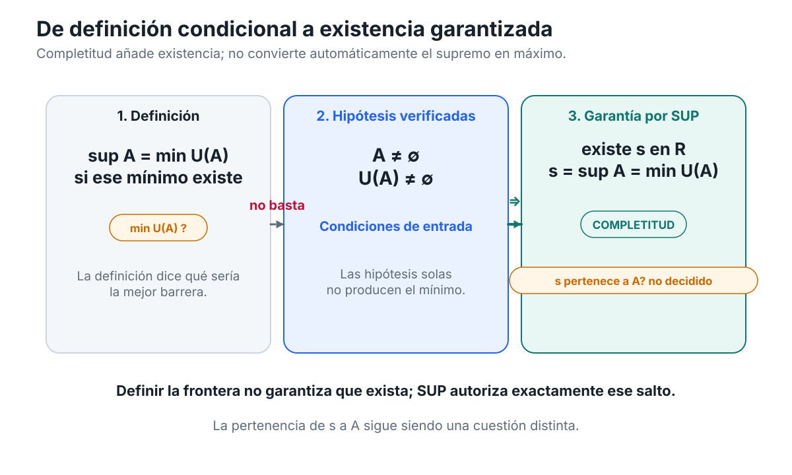{#fig-anm-c03-f01 fig-alt="Tres paneles separan definición condicional, hipótesis verificadas y existencia garantizada del supremo; una etiqueta recuerda que no se decide si el supremo pertenece al conjunto."}

El sistema numérico en que buscamos la barrera forma parte de la pregunta. Consideremos

$$
S_2=\{q\in\mathbb Q:0\le q,\ q^2<2\}.
$$

El conjunto es no vacío, pues $1\in S_2$, y tiene cotas superiores racionales; por ejemplo, $2$ es una, porque $q\ge2$ implicaría $q^2\ge4>2$. Sin embargo, $U_{\mathbb Q}(S_2)$ no posee mínimo racional. La notación recuerda que ahora sólo admitimos cotas en $\mathbb Q$.

Podemos comprobar el fallo sin identificar previamente la frontera mediante un número irracional. Si existiera un supremo racional $s$, tendríamos $s\ge1$, porque $1\in S_2$. Para modificar ese candidato dentro de los racionales usamos

$$
T(s)=\frac{2(s+1)}{s+2},\qquad
T(s)-s=\frac{2-s^2}{s+2},\qquad
2-T(s)^2=\frac{2(2-s^2)}{(s+2)^2}.
$$

Como $s+2>0$, las dos últimas expresiones tienen el signo de $2-s^2$. Si $s^2<2$, obtenemos $T(s)>s$ y $T(s)^2<2$; además $T(s)>s\ge1$, por lo que $T(s)\in S_2$. Esto contradice que $s$ sea cota superior. Si $s^2>2$, obtenemos $0<T(s)<s$ y $T(s)^2>2$. Este nuevo racional sigue siendo cota superior: un $q\in S_2$ con $q\ge T(s)>0$ tendría $q^2\ge T(s)^2>2$, imposible. Hemos encontrado entonces una cota superior menor que el supuesto supremo.

El caso $s^2=2$ tampoco puede ocurrir en $\mathbb Q$. Escribiendo $s=m/n$ con enteros positivos coprimos, la igualdad $m^2=2n^2$ obliga a que $m$ sea par. Al sustituir $m=2k$ resulta $n^2=2k^2$, y también $n$ es par, contra la elección de la fracción irreducible. Quedan excluidas las tres posibilidades para el cuadrado del candidato. El conjunto tiene cotas superiores racionales, pero ninguna es la menor.

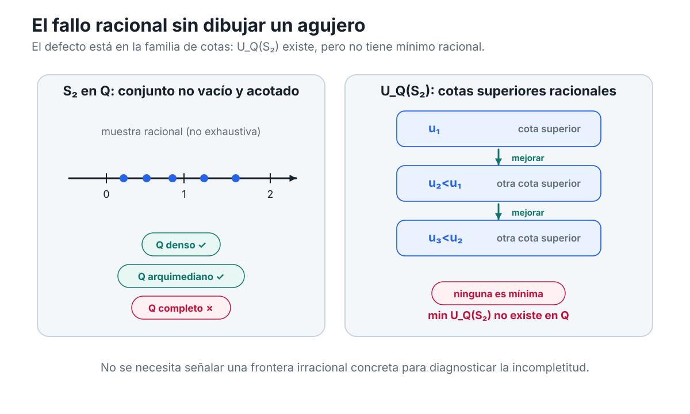{#fig-anm-c03-f02 fig-alt="Dos paneles muestran S2 racional y una familia de cotas superiores racionales mejorables sin mínimo; Q aparece como denso y arquimediano, pero incompleto."}

La densidad de $\mathbb Q$ permanece intacta: dados racionales $p<q$, su punto medio $(p+q)/2$ es otro racional situado entre ambos. Esa propiedad produce puntos intermedios a partir de dos puntos disponibles; no produce un racional que domine a todo $S_2$ y quede por debajo de todas sus cotas superiores. Tampoco basta imaginar cotas cada vez más ajustadas: la posibilidad de mejorar cualquier candidato puede ser precisamente la razón por la que no haya un mínimo.

El ejemplo admite una comprobación útil al cambiar el umbral. Para $S_4^{<}=\{q\in\mathbb Q:0\le q,\ q^2<4\}$, el supremo racional sí es $2$, aunque no se alcanza; para $S_4^{\le}=\{q\in\mathbb Q:0\le q,\ q^2\le4\}$, el mismo número es máximo. En el primer caso, todo racional $u<2$ deja por encima algún elemento del conjunto: sirve $0$ si $u<0$, y $(u+2)/2$ si $0\le u<2$. En el segundo, el propio $2$ pertenece al conjunto y lo domina. Los tres ejemplos viven en el mismo sistema denso. Cambian la existencia de la barrera y su pertenencia, no la densidad del sistema.

La etiqueta «arquimediano» de la figura C03-F02 se justificará internamente para $\mathbb Q$ en §3.4. No interviene en la prueba racional que acabamos de dar. La falta de supremo interno ya queda demostrada mediante aritmética y orden.

[]{#MA-SEC-ANM-01-003-002}

### Antes de seguir

#### Microcontrol 1

[]{#MA-MIC-ANM-01-003-001}

¿Qué información expresa la igualdad $\sup A=\min U(A)$ y qué información **no** expresa por sí sola?

[]{#MA-MSOL-ANM-01-003-001}

Ver solución del microcontrol 1

La igualdad

$$
\sup A=\min U(A)
$$

expresa **qué propiedad debe satisfacer el supremo cuando existe**: debe ser una cota superior de $A$ y, además, la menor de todas las cotas superiores. En otras palabras, identifica al supremo con el mínimo de la familia $U(A)$.

Pero la igualdad, leída como definición condicional, no demuestra por sí sola que ese mínimo exista. Antes de poder escribir un número concreto $s=\sup A$, todavía habría que justificar que

$$
U(A)\ne\varnothing
$$

y que existe

$$
\min U(A).
$$

Tampoco afirma que el supremo pertenezca a $A$; por tanto, no convierte automáticamente al supremo en máximo.

La separación lógica es:

$$
\text{definir qué sería }\sup A
\quad\not\Rightarrow\quad
\text{garantizar que }\sup A\text{ exista}.
$$

Precisamente se está distinguiendo la definición del futuro principio de existencia.

#### Microcontrol 2

[]{#MA-MIC-ANM-01-003-002}

Si $U(A)\ne\varnothing$, ¿por qué eso no obliga lógicamente a que $U(A)$ tenga un mínimo?

[]{#MA-MSOL-ANM-01-003-002}

Ver solución del microcontrol 2

De la sola afirmación

$$
U(A)\ne\varnothing
$$

sólo sabemos que hay **alguna** cota superior. No se sigue que entre todas ellas haya una menor.

El punto lógico puede verse incluso en un ejemplo elemental: el conjunto

$$
(0,1)
$$

es no vacío, pero no tiene mínimo. Dado cualquier $x\in(0,1)$, el número $x/2$ sigue perteneciendo a $(0,1)$ y satisface $x/2<x$.

En el problema específico del capítulo ocurre el mismo tipo de separación con la familia de cotas racionales de $S_2$: sabemos que

$$
U_{\mathbb Q}(S_2)\ne\varnothing,
$$

pero esa familia no posee un mínimo racional.

Por tanto,

$$
U(A)\ne\varnothing
\quad\not\Rightarrow\quad
\exists\min U(A).
$$

#### Microcontrol 3

[]{#MA-MIC-ANM-01-003-003}

Verifica que $1\in S_2$ y que $2$ es una cota superior racional de $S_2$.

[]{#MA-MSOL-ANM-01-003-003}

Ver solución del microcontrol 3

Recordemos

$$
S_2=\{q\in\mathbb Q:0\le q,\ q^2<2\}.
$$

Para verificar que $1\in S_2$ comprobamos las dos condiciones definitorias:

$$
0\le1
$$

y

$$
1^2=1<2.
$$

Luego

$$
\boxed{1\in S_2}.
$$

Ahora probemos que $2$ es una cota superior racional. Sea $q\in S_2$. Si ocurriera $q\ge2$, como $q\ge0$ tendríamos

$$
q^2\ge2^2=4>2,
$$

lo que contradice la condición $q^2<2$ que define a $S_2$. Por tanto, todo $q\in S_2$ satisface

$$
q<2,
$$

y en particular $q\le2$. Como $2\in\mathbb Q$,

$$
\boxed{2\in U_{\mathbb Q}(S_2)}.
$$

Así quedan verificadas simultáneamente la no vaciedad de $S_2$ y la existencia de al menos una cota superior racional.

#### Microcontrol 4

[]{#MA-MIC-ANM-01-003-004}

¿Qué falla exactamente para $S_2$ dentro de $\mathbb Q$: la existencia de cotas superiores o la existencia de una menor cota superior racional?

[]{#MA-MSOL-ANM-01-003-004}

Ver solución del microcontrol 4

Para $S_2$ **no falla la existencia de cotas superiores racionales**. El microcontrol anterior ya exhibe una:

$$
2\in U_{\mathbb Q}(S_2).
$$

Por tanto,

$$
U_{\mathbb Q}(S_2)\ne\varnothing.
$$

Lo que falla es la existencia de una **menor** cota superior racional:

$$
\boxed{\min U_{\mathbb Q}(S_2)\text{ no existe en }\mathbb Q.}
$$

Equivalentemente, $S_2$ no posee supremo **dentro de $\mathbb Q$**.

Ésta es la distinción que interesa al capítulo: tener barreras superiores no implica que el sistema contenga una barrera extremal que sea la mejor de todas.

#### Microcontrol 5

[]{#MA-MIC-ANM-01-003-005}

¿Por qué la densidad de $\mathbb Q$ no resuelve ese fallo?

[]{#MA-MSOL-ANM-01-003-005}

Ver solución del microcontrol 5

La densidad de $\mathbb Q$ afirma que, dados racionales $p<q$, existe otro racional $r$ tal que

$$
p<r<q.
$$

Es una propiedad **local**: permite insertar un punto entre dos puntos racionales ya dados.

El fallo de $S_2$ es de otra naturaleza. Allí preguntamos si toda la familia de cotas superiores racionales posee un elemento extremal $s$ que sea simultáneamente cota superior y menor que cualquier otra cota superior.

Poder insertar nuevos racionales entre dos racionales no produce por sí solo semejante mínimo. De hecho, aun cuando podamos encontrar cotas cada vez más ajustadas, todavía puede ocurrir que ninguna de ellas sea la menor.

Por eso

$$
\text{densidad}
\quad\not\Rightarrow\quad
\text{existencia de una menor cota superior}.
$$

La densidad permite **refinar entre puntos existentes**; no garantiza que el sistema contenga la frontera extremal exigida por una familia global de restricciones.

#### Microcontrol 6

[]{#MA-MIC-ANM-01-003-006}

¿Qué tendría que añadir una propiedad de completitud para convertir la teoría condicional de C02 en una teoría de existencia?

[]{#MA-MSOL-ANM-01-003-006}

Ver solución del microcontrol 6

La propiedad adicional tendría que transformar las hipótesis elementales de existencia de elementos y de cotas en una **garantía de existencia de la mejor cota dentro del propio sistema**.

En el caso real, la forma que necesitamos anticipar es:

$$
A\subseteq\mathbb R,
\qquad
A\ne\varnothing,
\qquad
U(A)\ne\varnothing
$$

implica que existe un número $s\in\mathbb R$ tal que

$$
s=\min U(A).
$$

Por la definición ya disponible, ese mismo número satisface

$$
s=\sup A.
$$

Así, la propiedad buscada debe autorizar el salto

$$
\boxed{
A\ne\varnothing,
\quad
A\text{ acotado superiormente}
\Longrightarrow
\exists s\in\mathbb R:\ s=\sup A.
}
$$

En §3.1 esto es todavía la **forma de la garantía que necesitamos**, no un principio ya usado para demostrar otros resultados. §3.2 será la sección encargada de formularla como propiedad estructural de $\mathbb R$.

La siguiente sección dará a esa propiedad una formulación precisa. Allí el principio del supremo dejará de aparecer como una pregunta pendiente y pasará a funcionar como la afirmación estructural que distingue, para nuestros fines, a la recta real de un sistema ordenado incompleto como $\mathbb Q$.

### Ejercicios de la sección 3.1

[]{#ejercicios-3}

#### Ejercicio 1. Qué permiten concluir las hipótesis

[]{#MA-EX-ANM-01-003-001}

Sea $X$ un sistema ordenado y sea $A\subseteq X$. Supón únicamente que

$$
A\ne\varnothing
\qquad\text{y}\qquad
U_X(A)\ne\varnothing,
$$

donde

$$
U_X(A)=\{u\in X:\forall a\in A,\ a\le u\}.
$$

Clasifica cada afirmación como **forzada por las hipótesis**, **no forzada** o **condicional**:

1. $A$ posee al menos una cota superior en $X$.
2. $U_X(A)$ posee un mínimo.
3. La expresión $\sup_X A$ designa necesariamente un elemento existente de $X$.
4. Si existe $s=\min U_X(A)$, entonces $s=\sup_X A$.
5. Si $\sup_X A$ existe, entonces necesariamente $\sup_X A\in A$.
6. Si $A$ es no vacío y está acotado superiormente, entonces $A$ posee máximo.

Para cada afirmación que no esté forzada, indica qué información adicional faltaría o da un ejemplo que muestre el fallo. No uses el principio del supremo de §3.2.

[]{#MA-SOL-ANM-01-003-001}

Ver solución del ejercicio 1

Partimos únicamente de

$$
A\ne\varnothing
\qquad\text{y}\qquad
U_X(A)\ne\varnothing.
$$

La primera afirmación está **forzada**. Decir que $U_X(A)\ne\varnothing$ significa precisamente que existe algún $u\in X$ tal que

$$
a\le u
\qquad\text{para todo }a\in A.
$$

Por tanto, $A$ posee al menos una cota superior.

La segunda afirmación **no está forzada**. Que $U_X(A)$ tenga elementos no implica que posea un elemento mínimo. El conjunto $S_2\subseteq\mathbb Q$ estudiado en §3.1 proporciona exactamente ese diagnóstico: tiene cotas superiores racionales, pero la familia de esas cotas no tiene mínimo racional.

La tercera afirmación tampoco está forzada. Bajo la convención del libro, escribir $\sup_X A$ como un objeto existente exige haber establecido que $U_X(A)$ posee mínimo. Las hipótesis sólo garantizan que $U_X(A)$ no es vacío.

La cuarta afirmación es **condicional y correcta**. Si existe

$$
s=\min U_X(A),
$$

entonces $s$ es una cota superior de $A$ y satisface

$$
s\le u
\qquad\text{para toda }u\in U_X(A).
$$

Ésa es justamente la definición de menor cota superior. Por tanto,

$$
s=\sup_X A.
$$

La quinta afirmación **no está forzada**. Por ejemplo, en $\mathbb Q$ consideremos

$$
B=\{q\in\mathbb Q:0<q<1\}.
$$

El número $1$ es su supremo racional, pero

$$
1\notin B.
$$

Así que la existencia de supremo no implica que la barrera sea alcanzada.

La sexta afirmación tampoco está forzada. El mismo conjunto $B$ es no vacío y está acotado superiormente, pero no tiene máximo: dado $q\in B$,

$$
r=\frac{q+1}{2}
$$

es racional y satisface

$$
q<r<1,
$$

de modo que $r\in B$ y $q$ no puede ser máximo.

La separación lógica es, por tanto:

$$
A\ne\varnothing,\quad U_X(A)\ne\varnothing
$$

garantiza la existencia de elementos de $A$ y de cotas superiores, pero no garantiza por sí sola ni

$$
\min U_X(A),
$$

ni un supremo existente, ni un máximo.

El ejercicio distingue precisamente lo que puede concluirse antes de disponer de una garantía de completitud.

#### Ejercicio 2. Densidad no fabrica una frontera

[]{#MA-EX-ANM-01-003-002}

Un estudiante razona así sobre

$$
S_2=\{q\in\mathbb Q:0\le q,\ q^2<2\}:
$$

> Como $\mathbb Q$ es denso y $S_2$ tiene cotas superiores racionales, podemos tomar cotas cada vez más ajustadas. Entre racionales siempre hay racionales, así que al final debe aparecer una cota racional que sea la menor. Por tanto, $S_2$ tiene supremo en $\mathbb Q$.

Diagnostica el argumento.

1. Escribe con cuantificadores qué afirma realmente la densidad de $\mathbb Q$.
2. Identifica el salto lógico que pretende pasar de «hay racionales intermedios» a «existe una menor cota superior racional».
3. Explica por qué disponer de cotas superiores cada vez menores no implica que la familia de cotas superiores tenga mínimo.
4. Reescribe la conclusión correcta que sí puede obtenerse de la densidad, sin atribuirle una propiedad de completitud.

No invoques todavía ningún principio de completitud de $\mathbb R$.

[]{#MA-SOL-ANM-01-003-002}

Ver solución del ejercicio 2

La densidad de $\mathbb Q$ afirma

$$
\forall p,q\in\mathbb Q,
\quad
p<q
\Longrightarrow
\exists r\in\mathbb Q:
p<r<q.
$$

Es una afirmación sobre **dos racionales ya dados**: si existe un intervalo no degenerado entre ellos, podemos insertar otro racional.

El argumento del estudiante cambia de problema sin justificarlo. De

$$
p<q
$$

y la densidad podemos obtener un racional intermedio. Pero la existencia de una menor cota superior exigiría un racional $s$ que satisficiera simultáneamente dos condiciones globales:

1. todo elemento de $S_2$ debe quedar por debajo de $s$;
2. toda cota superior racional debe quedar por encima de $s$.

La densidad no produce un número con esas dos propiedades.

Tampoco basta imaginar una cadena de cotas superiores

$$
u_1>u_2>u_3>\cdots.
$$

Incluso si cada $u_n$ puede mejorarse, de ello no se sigue que la familia completa posea un mínimo. De hecho, la posibilidad de mejorar **toda** cota candidata es compatible con que no exista una menor cota superior.

El segundo salto ilegítimo es la frase «al final debe aparecer». No se ha definido ningún proceso con una etapa final, ni se ha demostrado que el supuesto refinamiento produzca un elemento perteneciente a $\mathbb Q$. La expresión introduce precisamente la existencia que debía probarse.

La conclusión correcta derivada de la densidad es sólo local: entre dos racionales distintos hay otro racional. En particular, podemos refinar posiciones entre racionales ya conocidos. No podemos concluir por ello que todo subconjunto racional no vacío y acotado superiormente posea una frontera extremal racional.

El objetivo es diagnosticar por qué densidad y completitud responden preguntas lógicamente distintas.

#### Ejercicio 3. Probar el fallo racional sin nombrar la frontera

[]{#MA-EX-ANM-01-003-003}

Demuestra directamente que

$$
S_2=\{q\in\mathbb Q:0\le q,\ q^2<2\}
$$

no posee supremo en $\mathbb Q$.

Supón, buscando una contradicción, que existe

$$
s=\sup_{\mathbb Q}S_2.
$$

Como $1\in S_2$, sabemos que $s\ge1$. Define

$$
T(s)=\frac{2(s+1)}{s+2}.
$$

1. Demuestra las identidades
   $$
   T(s)-s=\frac{2-s^2}{s+2}
   $$
   y
   $$
   2-T(s)^2=\frac{2(2-s^2)}{(s+2)^2}.
   $$
2. Si $s^2<2$, demuestra que $T(s)\in S_2$ y $T(s)>s$, contradiciendo que $s$ sea cota superior.
3. Si $s^2>2$, demuestra que $0<T(s)<s$, que $T(s)^2>2$ y que $T(s)$ sigue siendo una cota superior racional de $S_2$, contradiciendo la minimalidad de $s$.
4. Excluye el caso $s^2=2$ mediante un argumento de divisibilidad para racionales escritos en términos irreducibles.
5. Concluye que $U_{\mathbb Q}(S_2)$ es no vacío pero no posee mínimo.

La demostración debe permanecer enteramente dentro de $\mathbb Q$ y no debe identificar la frontera ausente con un número real ya nombrado.

[]{#MA-SOL-ANM-01-003-003}

Ver solución del ejercicio 3

Si existiera un supremo racional $s$, cualquier modificación racional de $s$ que produjera o bien un elemento de $S_2$ mayor que $s$, o bien una cota superior menor que $s$, destruiría una de las dos propiedades que definen al supremo. La transformación

$$
T(s)=\frac{2(s+1)}{s+2}
$$

hace exactamente eso según el signo de $2-s^2$.

Supongamos

$$
s=\sup_{\mathbb Q}S_2.
$$

Como $1\in S_2$, toda cota superior de $S_2$ satisface $s\ge1$. En particular,

$$
s+2>0.
$$

Primero calculamos

$$
T(s)-s
=
\frac{2(s+1)-s(s+2)}{s+2}
=
\frac{2-s^2}{s+2}.
$$

Además,

$$
T(s)^2
=
\frac{4(s+1)^2}{(s+2)^2},
$$

de modo que

$$
2-T(s)^2
=
\frac{2(s+2)^2-4(s+1)^2}{(s+2)^2}.
$$

El numerador es

$$
2(s^2+4s+4)-4(s^2+2s+1)
=
4-2s^2
=
2(2-s^2).
$$

Por tanto,

$$
\boxed{
2-T(s)^2
=
\frac{2(2-s^2)}{(s+2)^2}.
}
$$

#### Caso 1: $s^2<2$

Entonces

$$
2-s^2>0.
$$

Como $s+2>0$,

$$
T(s)-s>0,
$$

por lo que

$$
T(s)>s.
$$

La segunda identidad da

$$
2-T(s)^2>0,
$$

así que

$$
T(s)^2<2.
$$

Además $T(s)>s\ge1$, por lo que $T(s)\ge0$. Como $T(s)$ es racional,

$$
T(s)\in S_2.
$$

Pero $T(s)>s$, contradiciendo que $s$ sea cota superior de $S_2$.

#### Caso 2: $s^2>2$

Ahora

$$
2-s^2<0.
$$

La primera identidad da

$$
T(s)<s.
$$

Como $s\ge1$,

$$
T(s)=\frac{2(s+1)}{s+2}>0.
$$

La segunda identidad produce

$$
2-T(s)^2<0,
$$

y por tanto

$$
T(s)^2>2.
$$

Mostremos que $T(s)$ sigue siendo cota superior de $S_2$. Sea $q\in S_2$. Si ocurriera $q\ge T(s)$, como ambos números son no negativos tendríamos

$$
q^2\ge T(s)^2>2,
$$

contradiciendo $q^2<2$. Luego

$$
q<T(s)
\qquad
\text{para todo }q\in S_2.
$$

Así, $T(s)$ es una cota superior racional de $S_2$ y satisface

$$
T(s)<s,
$$

lo cual contradice que $s$ sea la **menor** cota superior.

#### Caso 3: $s^2=2$

Como $s\in\mathbb Q$ y $s>0$, escribamos

$$
s=\frac{m}{n}
$$

con $m,n\in\mathbb N_{>0}$ coprimos. La igualdad $s^2=2$ implica

$$
m^2=2n^2.
$$

Entonces $m^2$ es par, y por tanto $m$ es par. Escribamos $m=2k$. Sustituyendo,

$$
4k^2=2n^2,
$$

de donde

$$
n^2=2k^2.
$$

Así, $n^2$ también es par y, por tanto, $n$ es par. Esto contradice que $m$ y $n$ fueran coprimos.

Los tres casos son imposibles. Por tanto no existe ningún racional $s$ tal que

$$
s=\sup_{\mathbb Q}S_2.
$$

Como $2$ es una cota superior racional, sabemos que

$$
U_{\mathbb Q}(S_2)\ne\varnothing.
$$

Pero acabamos de demostrar que ese conjunto de cotas superiores no posee mínimo racional:

$$
\boxed{
U_{\mathbb Q}(S_2)\ne\varnothing,
\qquad
\min U_{\mathbb Q}(S_2)\text{ no existe en }\mathbb Q.
}
$$

Toda la prueba ocurre dentro de $\mathbb Q$ y exhibe precisamente el fracaso de la garantía de existencia que C03 estudiará después.

#### Ejercicio 4. Cambiar el umbral cambia la existencia, no la densidad

[]{#MA-EX-ANM-01-003-004}

Compara los tres conjuntos racionales

$$
S_2=\{q\in\mathbb Q:0\le q,\ q^2<2\},
$$

$$
S_4^{<}=\{q\in\mathbb Q:0\le q,\ q^2<4\},
$$

y

$$
S_4^{\le}=\{q\in\mathbb Q:0\le q,\ q^2\le4\}.
$$

1. Verifica que los tres conjuntos son no vacíos y están acotados superiormente en $\mathbb Q$.
2. Usa el ejercicio anterior para recordar por qué $S_2$ no posee supremo racional.
3. Demuestra directamente, desde la definición, que
   $$
   \sup_{\mathbb Q}S_4^{<}=2,
   $$
   aunque $S_4^{<}$ no tenga máximo.
4. Demuestra que
   $$
   \max S_4^{\le}=\sup_{\mathbb Q}S_4^{\le}=2.
   $$
5. Determina $U_{\mathbb Q}(S_4^{<})$ y $U_{\mathbb Q}(S_4^{\le})$.
6. Explica por qué estos tres ejemplos impiden atribuir a la densidad de $\mathbb Q$ la existencia o inexistencia del supremo: la densidad es la misma en los tres casos, mientras que el comportamiento de la barrera extremal cambia.

No uses resultados de §3.2 o posteriores.

[]{#MA-SOL-ANM-01-003-004}

Ver solución del ejercicio 4

Los tres conjuntos viven en el mismo sistema ordenado y denso, $\mathbb Q$. Por tanto, cualquier diferencia en la existencia o pertenencia de la barrera no puede explicarse por un cambio de densidad. Debemos examinar la familia de cotas y si la barrera relevante está disponible como racional.

Los tres conjuntos son no vacíos porque

$$
0
$$

pertenece a todos ellos. También están acotados superiormente: $2$ es cota superior de $S_2$, y también lo es de $S_4^{<}$ y $S_4^{\le}$.

Para $S_2$, el ejercicio anterior demostró que

$$
\sup_{\mathbb Q}S_2
$$

no existe.

Estudiemos ahora

$$
S_4^{<}=\{q\in\mathbb Q:0\le q,\ q^2<4\}.
$$

Primero, $2$ es cota superior. Si $q\in S_4^{<}$ y $q\ge2$, entonces

$$
q^2\ge4,
$$

contradicción. Por tanto,

$$
q<2
\qquad
\text{para todo }q\in S_4^{<}.
$$

Falta probar que ninguna cota superior puede ser menor que $2$. Sea $u\in\mathbb Q$ con $u<2$.

Si $u<0$, entonces $0\in S_4^{<}$ y

$$
0>u,
$$

de modo que $u$ no es cota superior.

Si $0\le u<2$, tomemos

$$
q=\frac{u+2}{2}.
$$

Entonces $q\in\mathbb Q$ y

$$
u<q<2.
$$

Como $q\ge0$ y $q<2$,

$$
q^2<4,
$$

por lo que $q\in S_4^{<}$. De nuevo $u$ no es cota superior.

Así, $2$ es la menor cota superior racional:

$$
\boxed{\sup_{\mathbb Q}S_4^{<}=2.}
$$

Sin embargo,

$$
2\notin S_4^{<}
$$

porque $2^2=4$ y la desigualdad definitoria es estricta. Más aún, ningún elemento de $S_4^{<}$ es máximo. Si $q\in S_4^{<}$, entonces $q<2$ y

$$
r=\frac{q+2}{2}
$$

satisface

$$
q<r<2.
$$

Por tanto $r\in S_4^{<}$ y es mayor que $q$.

Consideremos ahora

$$
S_4^{\le}=\{q\in\mathbb Q:0\le q,\ q^2\le4\}.
$$

El número $2$ pertenece al conjunto y todo elemento $q$ satisface $q\le2$. Luego

$$
\boxed{
\max S_4^{\le}=2.
}
$$

Todo máximo es, en particular, la menor cota superior, así que

$$
\boxed{
\sup_{\mathbb Q}S_4^{\le}=2.
}
$$

En ambos conjuntos con umbral $4$ las cotas superiores son exactamente

$$
\boxed{
U_{\mathbb Q}(S_4^{<})
=
U_{\mathbb Q}(S_4^{\le})
=
\{u\in\mathbb Q:u\ge2\}.
}
$$

En efecto, todo $u\ge2$ domina a ambos conjuntos, mientras que acabamos de demostrar que cualquier racional $u<2$ deja algún elemento del conjunto por encima de él.

La comparación final es:

$$
\begin{array}{c|c|c}
\text{conjunto} & \text{supremo en }\mathbb Q & \text{máximo}\\
\hline
S_2 & \text{no existe} & \text{no existe}\\
S_4^{<} & 2 & \text{no existe}\\
S_4^{\le} & 2 & 2
\end{array}
$$

Los tres conjuntos viven en el mismo sistema denso $\mathbb Q$. Por tanto, la densidad no decide ninguno de los dos cambios observados. Entre $S_2$ y $S_4^{<}$ cambia la disponibilidad racional de una barrera extremal; entre $S_4^{<}$ y $S_4^{\le}$ cambia si esa misma barrera pertenece al conjunto.

Todas las conclusiones se obtienen desde el orden racional, las definiciones de cota, supremo y máximo, y el resultado racional del ejercicio anterior.

## 3.2. El principio del supremo

La propiedad de completitud establecida en C00 toma, con el lenguaje de C02, la siguiente forma. La llamaremos **SUP** y la usaremos como punto de partida para las equivalencias de este capítulo.

> **Principio del supremo.** Si $A\subseteq\mathbb R$ es no vacío y está acotado superiormente, entonces existe un número real $s$ tal que
>
> $$
> s=\sup A.
> $$

La afirmación comprende dos obligaciones previas: exhibir un elemento del conjunto y una cota superior real. Verificadas ambas, garantiza un número $s\in\mathbb R$ que satisface

$$
\forall a\in A,\ a\le s,
\qquad
\forall u\in U(A),\ s\le u.
$$

La primera condición asegura el control; la segunda, que la barrera es la menor. La unicidad ya se deduce de esas condiciones por antisimetría, como probamos en C02. La aportación específica de SUP consiste en asegurar que hay un número que las cumple. En este capítulo no volvemos a construir $\mathbb R$ ni añadimos un axioma a su construcción: estudiamos las consecuencias de aquella propiedad, tomando SUP como formulación de referencia.

Las hipótesis conservan su dirección. Para $(-2,5)$ hay un elemento, por ejemplo $0$, y una cota superior, $5$, de modo que SUP garantiza un supremo. Para $[0,\infty)$ falta acotación superior, y para $\varnothing$ falta no vaciedad; no podemos aplicar el principio. El caso vacío es especialmente revelador: todos los reales son vacíamente cotas superiores suyas y, aun así, la familia $U(\varnothing)=\mathbb R$ carece de mínimo. En $\{3\}$ sí se cumplen ambas hipótesis y el supremo es, además, máximo. En $(-2,5)$ el punto medio entre cualquier elemento y $5$ descarta que ese elemento sea máximo. SUP garantiza una barrera, pero deja abierta la cuestión de si pertenece al conjunto.

Volvamos a $S_2$. Al considerarlo como subconjunto de $\mathbb R$, las verificaciones $1\in S_2$ y $q<2$ para todo $q\in S_2$ siguen siendo válidas. Por completitud existe entonces $s=\sup_{\mathbb R}S_2$. Este $s$ no es racional: si lo fuera, sería una cota superior racional y estaría por debajo de todas las cotas superiores racionales, por estar por debajo de todas las reales. Sería así el supremo racional que §3.1 acaba de excluir. La completitud del sistema mayor proporciona una barrera que puede quedar fuera del subsistema; no vuelve completo a $\mathbb Q$.

Una vez existente $s=\sup A$, las propiedades demostradas en C02 quedan disponibles sin otra aplicación de completitud. Por ejemplo, si $r<s$, el número $r$ no puede seguir siendo cota superior, porque sería una menor que la menor. Negando la condición de cota obtenemos $a\in A$ con $r<a\le s$. Si tomamos $r=s-\varepsilon$, resulta

$$
\forall\varepsilon>0\;\exists a\in A:\quad s-\varepsilon<a\le s.
$$

En este razonamiento, SUP produjo el supremo; la minimalidad y la negación de una afirmación universal produjeron el testigo. Separar esas inferencias permite reconocer qué perderíamos en un sistema incompleto. Después de la existencia, podemos usar la definición del objeto sin volver a justificarla mediante completitud en cada línea.

[]{#MA-SEC-ANM-01-003-003}

### Antes de seguir

#### Microcontrol 7

[]{#MA-MIC-ANM-01-003-007}

Separa, en el principio del supremo, las tres hipótesis escritas sobre $A$ de la conclusión de existencia.

[]{#MA-MSOL-ANM-01-003-007}

Ver solución del microcontrol 7

Las tres hipótesis son:

$$
A\subseteq\mathbb R,
$$

$$
A\ne\varnothing,
$$

y

$$
A\text{ está acotado superiormente},
$$

lo que equivale a

$$
U(A)\ne\varnothing.
$$

La conclusión no es otra hipótesis sobre $A$, sino una afirmación de existencia:

$$
\boxed{\exists s\in\mathbb R:\ s=\sup A.}
$$

Desplegada mediante la definición de supremo, significa que existe $s\in\mathbb R$ tal que

$$
a\le s
\qquad\text{para todo }a\in A,
$$

y que, para toda cota superior $u\in U(A)$,

$$
s\le u.
$$

Por tanto, el principio transforma las tres condiciones de entrada en la existencia de una menor cota superior real.

#### Microcontrol 8

[]{#MA-MIC-ANM-01-003-008}

¿Por qué la definición $s=\min U(A)$ no basta para demostrar que $s$ existe?

[]{#MA-MSOL-ANM-01-003-008}

Ver solución del microcontrol 8

La expresión

$$
s=\min U(A)
$$

indica **qué tendría que cumplir** $s$ si el mínimo de $U(A)$ existiera. En particular, exige que

$$
s\in U(A)
$$

y que

$$
s\le u
\qquad\text{para todo }u\in U(A).
$$

Pero una definición no fabrica automáticamente un objeto que satisfaga esas condiciones.

Incluso si sabemos que

$$
U(A)\ne\varnothing,
$$

puede ocurrir que ese conjunto no tenga mínimo. Ése es precisamente el tipo de fallo diagnosticado en §3.1 para las cotas superiores racionales de $S_2$.

Así,

$$
\text{describir el mínimo de }U(A)
\quad\not\Rightarrow\quad
\text{probar que ese mínimo existe}.
$$

La existencia requiere una propiedad estructural adicional; en $\mathbb R$, esa propiedad es el principio del supremo.

#### Microcontrol 9

[]{#MA-MIC-ANM-01-003-009}

Si $A$ es no vacío y está acotado superiormente, ¿qué garantiza la completitud sobre $U(A)$?

[]{#MA-MSOL-ANM-01-003-009}

Ver solución del microcontrol 9

Como $A$ es no vacío y está acotado superiormente, el principio del supremo garantiza que existe

$$
s=\sup A\in\mathbb R.
$$

Por la definición ya establecida en C02,

$$
s=\min U(A).
$$

Por tanto, la completitud no se limita a afirmar que $U(A)$ es no vacío —eso ya venía de la hipótesis de acotación superior—, sino que garantiza que la familia de cotas superiores posee una **menor** cota superior:

$$
\boxed{\exists\min U(A).}
$$

Más precisamente,

$$
\boxed{\min U(A)=\sup A.}
$$

#### Microcontrol 10

[]{#MA-MIC-ANM-01-003-010}

Explica por qué el principio del supremo no implica que $\sup A\in A$.

[]{#MA-MSOL-ANM-01-003-010}

Ver solución del microcontrol 10

El principio del supremo garantiza que, bajo las hipótesis adecuadas, existe un número real

$$
s=\sup A
$$

que es la menor cota superior de $A$.

Pero la definición de supremo no contiene la condición

$$
s\in A.
$$

Un ejemplo es

$$
A=(0,1).
$$

El conjunto es no vacío y está acotado superiormente. Su supremo es

$$
\sup A=1,
$$

pero

$$
1\notin A.
$$

Por tanto, completitud garantiza la existencia de la **frontera extremal**, no que esa frontera sea alcanzada por el conjunto.

La condición adicional

$$
\sup A\in A
$$

es justamente la que permite identificar al supremo con un máximo.

#### Microcontrol 11

[]{#MA-MIC-ANM-01-003-011}

Para $S_2\subseteq\mathbb Q$, identifica el paso que falla en $\mathbb Q$ pero queda autorizado cuando consideramos $S_2\subseteq\mathbb R$.

[]{#MA-MSOL-ANM-01-003-011}

Ver solución del microcontrol 11

En ambos universos podemos verificar las mismas condiciones elementales:

$$
S_2\ne\varnothing
$$

y existen cotas superiores; por ejemplo, $2$ es una cota superior racional y, por tanto, también real.

Dentro de $\mathbb Q$, el paso que **no** está autorizado es

$$
\text{“como }S_2\ne\varnothing\text{ y está acotado superiormente, existe }\sup_{\mathbb Q}S_2\text{”.}
$$

De hecho, §3.1 estableció que esa menor cota superior racional no existe.

En cambio, al considerar el mismo conjunto como subconjunto de $\mathbb R$,

$$
S_2\subseteq\mathbb R,
$$

el principio del supremo sí autoriza

$$
\boxed{\exists s\in\mathbb R:\ s=\sup_{\mathbb R}S_2.}
$$

La diferencia no está en la no vaciedad, la acotación o la densidad, sino en la garantía estructural de existencia disponible en $\mathbb R$.

#### Microcontrol 12

[]{#MA-MIC-ANM-01-003-012}

En la cadena
$$
A\ne\varnothing,\ A\text{ acotado superiormente}
\Longrightarrow
s=\sup A
\Longrightarrow
\forall\varepsilon>0\;\exists a\in A:
s-\varepsilon<a\le s,
$$
¿qué flecha usa completitud y qué flecha usa resultados de C02?

[]{#MA-MSOL-ANM-01-003-012}

Ver solución del microcontrol 12

En la cadena
   $$
   A\ne\varnothing,\ A\text{ acotado superiormente}
   \Longrightarrow
   s=\sup A
   \Longrightarrow
   \forall\varepsilon>0\;\exists a\in A:
   s-\varepsilon<a\le s,
   $$
   ¿qué flecha usa completitud y qué flecha usa resultados de C02?

La primera flecha,

$$
A\ne\varnothing,\ A\text{ acotado superiormente}
\Longrightarrow
\exists s=\sup A,
$$

es el **Paso de completitud**. Las hipótesis sólo dicen que $A$ contiene elementos y posee cotas superiores; el principio del supremo garantiza que existe la menor de esas cotas.

La segunda flecha,

$$
s=\sup A
\Longrightarrow
\forall\varepsilon>0\;\exists a\in A:
s-\varepsilon<a\le s,
$$

no requiere una segunda aplicación de completitud. Es la caracterización por $\varepsilon$ del supremo demostrada en C02, aplicada a un supremo cuya existencia ya está establecida.

La cadena de dependencias es, por tanto,

$$
\boxed{
\text{hipótesis}
\Longrightarrow_{\text{completitud}}
\text{supremo existente}
\Longrightarrow_{\text{C02}}
\text{aproximación }\varepsilon.
}
$$

#### Microcontrol 13

[]{#MA-MIC-ANM-01-003-013}

¿Por qué sería incorrecto aplicar el principio del supremo a $A=\mathbb R$ sin más?

[]{#MA-MSOL-ANM-01-003-013}

Ver solución del microcontrol 13

Porque una de las hipótesis del principio falla.

El conjunto

$$
A=\mathbb R
$$

es ciertamente no vacío, pero no está acotado superiormente en $\mathbb R$.

En efecto, dado cualquier candidato $u\in\mathbb R$, el número

$$
u+1\in\mathbb R
$$

y satisface

$$
u+1>u.
$$

Por tanto, ningún real domina a todos los reales y

$$
U(\mathbb R)=\varnothing.
$$

Como falta la hipótesis de acotación superior, el principio del supremo no autoriza ninguna conclusión de existencia para $\sup\mathbb R$ como número real.

#### Microcontrol 14

[]{#MA-MIC-ANM-01-003-014}

En la prueba “si $r<\sup A$, entonces existe $a\in A$ con $r<a$”, localiza exactamente el único paso que depende de completitud.

[]{#MA-MSOL-ANM-01-003-014}

Ver solución del microcontrol 14

Supongamos que $A$ es no vacío y está acotado superiormente.

El único paso que depende de completitud es el inicial:

> **Paso de completitud.** Por el principio del supremo existe
>
> $$
> s=\sup A.
> $$

Una vez disponible $s$, tomamos un real $r<s$.

Como $s$ es la **menor** cota superior, $r$ no puede ser una cota superior de $A$: si lo fuera, la minimalidad de $s$ obligaría a

$$
s\le r,
$$

contradiciendo $r<s$.

Negar que $r$ sea cota superior significa

$$
\exists a\in A:\ a>r.
$$

Por tanto,

$$
\boxed{r<\sup A\Longrightarrow\exists a\in A:\ r<a.}
$$

La anatomía lógica es:

$$
\text{completitud}
\Longrightarrow
s=\sup A\text{ existe},
$$

seguida únicamente de minimalidad del supremo y negación de la definición de cota superior.

Hemos obtenido la garantía superior. A partir de ahora, para todo conjunto real no vacío y acotado superiormente, la mejor barrera deja de ser una posibilidad condicional y se convierte en un objeto existente.

La siguiente cuestión será inevitable: si la completitud garantiza fronteras superiores, ¿podemos obtener de la misma propiedad una garantía correspondiente para fronteras inferiores sin introducir un segundo axioma independiente?

### Ejercicios de la sección 3.2

#### Ejercicio 5. Antes de invocar el principio

[]{#MA-EX-ANM-01-003-005}

Para cada conjunto siguiente, decide si el **principio del supremo** puede aplicarse directamente en $\mathbb R$:

$$
A=(-2,5),
\qquad
B=[0,\infty),
\qquad
C=\varnothing,
\qquad
D=\{3\}.
$$

En cada caso:

1. verifica explícitamente si el conjunto es no vacío;
2. verifica explícitamente si está acotado superiormente en $\mathbb R$;
3. sólo cuando ambas hipótesis estén satisfechas, escribe la conclusión de existencia autorizada por completitud;
4. distingue esa conclusión de la afirmación más fuerte de que el conjunto tenga máximo.

No calcules supremos mediante resultados posteriores: el objetivo es entrenar la lectura exacta de las hipótesis del principio.

[]{#MA-SOL-ANM-01-003-005}

Ver solución del ejercicio 5

El principio del supremo exige simultáneamente que el conjunto sea no vacío y esté acotado superiormente en $\mathbb R$.

Para

$$
A=(-2,5),
$$

tenemos $0\in A$, así que $A\ne\varnothing$. Además, $5$ es una cota superior porque todo $a\in A$ satisface $a<5$. Por tanto, el principio se aplica y garantiza que existe

$$
\sup A\in\mathbb R.
$$

Esta conclusión no afirma que exista máximo. De hecho, $5\notin A$ y, dado cualquier $a\in A$, el número

$$
\frac{a+5}{2}
$$

pertenece a $A$ y es mayor que $a$. Así, $A$ no tiene máximo.

Para

$$
B=[0,\infty),
$$

tenemos $0\in B$, de modo que $B$ es no vacío. Pero no está acotado superiormente: dado cualquier $u\in\mathbb R$, el número

$$
b=\max\{0,u+1\}
$$

pertenece a $B$ y satisface $b>u$. Por tanto, el principio del supremo no se aplica.

Para

$$
C=\varnothing,
$$

falla la hipótesis de no vaciedad. Aunque bajo las convenciones de C02 todo real es vacíamente una cota superior de $\varnothing$, el principio adoptado en C03 exige expresamente

$$
A\ne\varnothing.
$$

Por tanto, tampoco se aplica a $C$.

Finalmente,

$$
D=\{3\}
$$

es no vacío y está acotado superiormente, por ejemplo por $3$. El principio garantiza la existencia de $\sup D$. En este caso, además, $3\in D$ y domina a todos los elementos de $D$, por lo que $D$ sí tiene máximo.

La lectura correcta es:

$$
\begin{array}{c|c|c|c}
\text{conjunto} & \ne\varnothing & \text{acotado sup.} & \text{SUP aplicable}\\
\hline
A=(-2,5) & \text{sí} & \text{sí} & \text{sí}\\
B=[0,\infty) & \text{sí} & \text{no} & \text{no}\\
C=\varnothing & \text{no} & \text{sí, vacíamente} & \text{no}\\
D=\{3\} & \text{sí} & \text{sí} & \text{sí}
\end{array}
$$

#### Ejercicio 6. El mismo conjunto, dos universos distintos

[]{#MA-EX-ANM-01-003-006}

Considera de nuevo

$$
S_2=\{q\in\mathbb Q:0\le q,\ q^2<2\}.
$$

Podemos leerlo como subconjunto de $\mathbb Q$ o, usando $\mathbb Q\subseteq\mathbb R$, como subconjunto de $\mathbb R$.

1. Verifica que $S_2$ es no vacío y posee una cota superior racional; concluye que también es no vacío y está acotado superiormente como subconjunto de $\mathbb R$.
2. Explica por qué el principio del supremo adoptado en §3.2 puede invocarse para $S_2\subseteq\mathbb R$, pero no puede invocarse como si fuese un axioma válido en $\mathbb Q$.
3. Concluye, sin calcularlo, que existe
   $$
   s=\sup_{\mathbb R}S_2.
   $$
4. Usa el resultado del ejercicio 3 para demostrar que ese $s$ no puede ser racional.
5. Explica por qué la frase «$S_2$ tiene supremo» es incompleta si no se especifica el sistema ordenado en el que se busca la menor cota superior.

No identifiques $s$ con ningún número real concreto.

[]{#MA-SOL-ANM-01-003-006}

Ver solución del ejercicio 6

Tenemos

$$
S_2=\{q\in\mathbb Q:0\le q,\ q^2<2\}.
$$

El conjunto es no vacío porque

$$
1\in S_2.
$$

Además, $2$ es una cota superior racional: si $q\in S_2$ y $q\ge2$, entonces

$$
q^2\ge4>2,
$$

contradicción. Por tanto,

$$
S_2\ne\varnothing
\qquad\text{y}\qquad
U_{\mathbb Q}(S_2)\ne\varnothing.
$$

Como $\mathbb Q\subseteq\mathbb R$, el mismo conjunto puede verse como subconjunto de $\mathbb R$. Las dos verificaciones anteriores siguen siendo válidas: $1$ sigue perteneciendo al conjunto y $2$ sigue siendo una cota superior. Así,

$$
S_2\subseteq\mathbb R,
\qquad
S_2\ne\varnothing,
\qquad
S_2\text{ está acotado superiormente en }\mathbb R.
$$

Ahora importa el universo. El principio adoptado en §3.2 es una propiedad estructural de $\mathbb R$:

$$
A\subseteq\mathbb R,
\ A\ne\varnothing,
\ A\text{ acotado superiormente}
\Longrightarrow
\exists\sup_{\mathbb R}A\in\mathbb R.
$$

Por tanto podemos aplicarlo a $S_2$ considerado como subconjunto real y concluir que existe un número

$$
s=\sup_{\mathbb R}S_2.
$$

En cambio, no hemos postulado el principio del supremo para $\mathbb Q$. De hecho, el ejercicio 3 demostró que

$$
\sup_{\mathbb Q}S_2
$$

no existe.

Mostremos ahora que el supremo real $s$ no puede ser racional. Si ocurriera

$$
s\in\mathbb Q,
$$

entonces, como $s$ es cota superior real de $S_2$, también sería una cota superior racional. Además, por ser el menor entre **todas** las cotas superiores reales, satisfaría

$$
s\le u
$$

para toda cota superior racional $u\in U_{\mathbb Q}(S_2)$. Por tanto, $s$ sería la menor cota superior racional de $S_2$, contradiciendo el ejercicio 3. Luego

$$
\boxed{s\notin\mathbb Q.}
$$

La frase «$S_2$ tiene supremo» es, por tanto, incompleta si no se especifica el universo:

$$
\sup_{\mathbb Q}S_2\text{ no existe en }\mathbb Q,
\qquad
\sup_{\mathbb R}S_2\text{ sí existe en }\mathbb R.
$$

#### Ejercicio 7. La inclusión produce una desigualdad entre supremos existentes

[]{#MA-EX-ANM-01-003-007}

Sean $A,B\subseteq\mathbb R$ tales que

$$
A\ne\varnothing,
\qquad
A\subseteq B,
\qquad
B\text{ está acotado superiormente}.
$$

Demuestra que existen $\sup A$ y $\sup B$ y que

$$
\sup A\le\sup B.
$$

La prueba debe separar explícitamente estas etapas:

1. demostrar que $B\ne\varnothing$;
2. demostrar que $A$ está acotado superiormente;
3. indicar cada aplicación del principio del supremo;
4. explicar por qué $\sup B$ es una cota superior de $A$;
5. usar la minimalidad de $\sup A$ para obtener la desigualdad final.

No cites simplemente «monotonía del supremo»: reconstruye la demostración desde las definiciones y el principio de existencia.

[]{#MA-SOL-ANM-01-003-007}

Ver solución del ejercicio 7

Antes de comparar supremos debemos justificar que ambos existen. Sólo después podremos usar la propiedad de menor cota superior.

Tenemos

$$
A\ne\varnothing
\qquad\text{y}\qquad
A\subseteq B.
$$

Como $A$ contiene algún elemento y todo elemento de $A$ pertenece a $B$, se sigue que

$$
B\ne\varnothing.
$$

Por hipótesis, $B$ está acotado superiormente. Sea $u$ una cota superior de $B$. Entonces

$$
b\le u
\qquad\text{para todo }b\in B.
$$

Como $A\subseteq B$, para todo $a\in A$ también tenemos

$$
a\le u.
$$

Así, el mismo $u$ es cota superior de $A$, y por tanto $A$ también está acotado superiormente.

> **Paso de completitud 1.** Como $A$ es no vacío y está acotado superiormente, por el principio del supremo existe
>
> $$
> s=\sup A.
> $$

> **Paso de completitud 2.** Como $B$ es no vacío y está acotado superiormente, por el principio del supremo existe
>
> $$
> t=\sup B.
> $$

Ahora usamos sólo las propiedades definitorias de los supremos ya existentes. Como

$$
t=\sup B,
$$

el número $t$ es cota superior de $B$. Puesto que $A\subseteq B$, también es cota superior de $A$.

Pero $s=\sup A$ es la **menor** cota superior de $A$. Como $t$ es una de esas cotas,

$$
s\le t.
$$

Por tanto,

$$
\boxed{\sup A\le\sup B.}
$$

#### Ejercicio 8. Trasladar un conjunto sin gastar completitud dos veces

[]{#MA-EX-ANM-01-003-008}

Sea $A\subseteq\mathbb R$ no vacío y acotado superiormente, y sea $c\in\mathbb R$. Define

$$
A+c=\{a+c:a\in A\}.
$$

Demuestra que

$$
\sup(A+c)=\sup A+c.
$$

Tu demostración debe organizarse de modo que el principio del supremo se use **una sola vez**:

1. aplica completitud a $A$ y escribe $s=\sup A$;
2. demuestra directamente que $s+c$ es una cota superior de $A+c$;
3. demuestra directamente que cualquier cota superior $v$ de $A+c$ satisface $s+c\le v$;
4. concluye, por la definición de supremo, que $s+c=\sup(A+c)$, sin volver a invocar el principio del supremo;
5. usando la caracterización $\varepsilon$ de C02, deduce que para todo $\varepsilon>0$ existe $y\in A+c$ tal que
   $$
   s+c-\varepsilon<y\le s+c.
   $$

Al final, identifica qué paso usa completitud y cuáles usan sólo orden, álgebra y resultados ya demostrados en C02.

[]{#MA-SOL-ANM-01-003-008}

Ver solución del ejercicio 8

Usaremos completitud para obtener una sola frontera, $s=\sup A$. Después trasladaremos las dos propiedades que caracterizan a esa frontera. De ese modo, la existencia del supremo del conjunto trasladado quedará demostrada directamente, sin una segunda invocación del principio.

Como $A$ es no vacío y está acotado superiormente, podemos escribir:

> **Paso de completitud.** Por el principio del supremo existe
>
> $$
> s=\sup A.
> $$

Sea

$$
A+c=\{a+c:a\in A\}.
$$

Mostremos primero que $s+c$ es cota superior de $A+c$. Si $y\in A+c$, entonces existe $a\in A$ tal que

$$
y=a+c.
$$

Como $s$ es cota superior de $A$,

$$
a\le s.
$$

Sumando $c$,

$$
y=a+c\le s+c.
$$

Por tanto, $s+c$ es cota superior de $A+c$.

Ahora sea $v$ cualquier cota superior de $A+c$. Entonces para todo $a\in A$ tenemos

$$
a+c\le v.
$$

Restando $c$,

$$
a\le v-c
\qquad\text{para todo }a\in A.
$$

Así,

$$
v-c
$$

es una cota superior de $A$. Como $s=\sup A$ es la menor cota superior de $A$,

$$
s\le v-c.
$$

Sumando $c$,

$$
s+c\le v.
$$

Hemos demostrado que $s+c$ es una cota superior de $A+c$ y que está por debajo de toda cota superior de $A+c$. Por definición,

$$
\boxed{s+c=\sup(A+c).}
$$

No fue necesario aplicar de nuevo el principio del supremo: la existencia del nuevo supremo quedó establecida exhibiendo directamente un número que satisface su definición.

Finalmente, la caracterización $\varepsilon$ de C02 aplicada al supremo ya identificado de $A+c$ dice que para todo $\varepsilon>0$ existe $y\in A+c$ tal que

$$
(s+c)-\varepsilon<y\le s+c.
$$

Esto es exactamente

$$
\boxed{
\forall\varepsilon>0\;\exists y\in A+c:
\quad
s+c-\varepsilon<y\le s+c.
}
$$

La anatomía lógica queda así:

$$
\text{completitud}
\Longrightarrow
s=\sup A\text{ existe}
$$

y después

$$
\text{orden + traslación + definición de supremo}
\Longrightarrow
\sup(A+c)=s+c,
$$

seguido de

$$
\text{caracterización de C02}
\Longrightarrow
\text{aproximación }\varepsilon.
$$

#### Ejercicio 9. Un supremo real no vuelve completo a $\mathbb Q$

[]{#MA-EX-ANM-01-003-009}

Un estudiante afirma:

> Todo conjunto $A\subseteq\mathbb Q$ no vacío y acotado superiormente en $\mathbb Q$ también es un subconjunto no vacío y acotado superiormente de $\mathbb R$. Por el principio del supremo, $A$ tiene un supremo real. Por tanto, $\mathbb Q$ satisface el principio del supremo y es completo.

Diagnostica el razonamiento.

1. Determina qué parte del argumento es correcta.
2. Formula exactamente qué tendría que garantizar el principio del supremo **interno a $\mathbb Q$**.
3. Explica por qué la existencia de $\sup_{\mathbb R}A$ no implica que exista $\sup_{\mathbb Q}A$.
4. Usa $S_2$ como contraejemplo decisivo.
5. Reescribe la conclusión correcta: ¿qué sí proporciona la completitud de $\mathbb R$ a un subconjunto racional no vacío y racionalmente acotado superiormente?
6. Identifica el paso en el que el estudiante cambia ilegítimamente el universo al que debe pertenecer el objeto cuya existencia se reclama.

La respuesta debe distinguir **existencia externa en $\mathbb R$** de **existencia interna en $\mathbb Q$**.

[]{#MA-SOL-ANM-01-003-009}

Ver solución del ejercicio 9

La primera parte del argumento del estudiante es correcta.

Sea $A\subseteq\mathbb Q$ no vacío y acotado superiormente en $\mathbb Q$. Como existe alguna cota superior racional $u\in\mathbb Q$, el mismo número $u$ pertenece a $\mathbb R$ y sigue satisfaciendo

$$
a\le u
\qquad\text{para todo }a\in A.
$$

Por tanto, al considerar $A$ como subconjunto de $\mathbb R$, sigue siendo no vacío y acotado superiormente.

Así, por la completitud de $\mathbb R$, existe

$$
s=\sup_{\mathbb R}A\in\mathbb R.
$$

Hasta aquí no hay error.

El error aparece en la conclusión «por tanto, $\mathbb Q$ satisface el principio del supremo». Para que $\mathbb Q$ satisficiera internamente ese principio, tendría que cumplirse:

$$
A\subseteq\mathbb Q,
\quad
A\ne\varnothing,
\quad
A\text{ acotado superiormente en }\mathbb Q
$$

implica

$$
\exists s\in\mathbb Q:
\quad
s=\sup_{\mathbb Q}A.
$$

La pertenencia

$$
s\in\mathbb Q
$$

es parte esencial de la afirmación interna. La completitud de $\mathbb R$ sólo entrega

$$
s\in\mathbb R.
$$

No hay ninguna razón para que ese número pertenezca al subsistema racional.

El conjunto

$$
S_2=\{q\in\mathbb Q:0\le q,\ q^2<2\}
$$

es el contraejemplo decisivo. Es no vacío y está acotado superiormente en $\mathbb Q$. La completitud de $\mathbb R$ garantiza que existe

$$
\sup_{\mathbb R}S_2.
$$

Pero el ejercicio 3 demostró que

$$
\sup_{\mathbb Q}S_2
$$

no existe. De hecho, el ejercicio 6 mostró que el supremo real de $S_2$ no puede ser racional.

Por tanto, la conclusión correcta es:

> todo subconjunto no vacío de $\mathbb Q$ que esté acotado superiormente por algún racional posee una menor cota superior **en $\mathbb R$** cuando se lo considera como subconjunto real;
> pero esa cota extremal no tiene por qué pertenecer a $\mathbb Q$.

El cambio ilegítimo ocurre al pasar de

$$
\exists s\in\mathbb R
$$

a

$$
\exists s\in\mathbb Q.
$$

Ese paso no está justificado.

## 3.3. La cara dual: el principio del ínfimo

Para obtener una garantía inferior podemos reflejar el conjunto y emplear SUP. Sea $A\subseteq\mathbb R$ no vacío y acotado inferiormente. Su reflejo $-A=\{-a:a\in A\}$ es no vacío; si $l$ es cota inferior de $A$, de $l\le a$ se sigue $-a\le-l$, de modo que $-l$ es cota superior del reflejo. Las hipótesis de SUP se cumplen para $-A$, y por completitud existe $s=\sup(-A)$.

Definamos $i=-s$. Para cada $a\in A$, la desigualdad $-a\le s$ da $i=-s\le a$, así que $i$ es cota inferior. Si $l$ es cualquier otra cota inferior de $A$, entonces $-l$ es cota superior de $-A$; por minimalidad, $s\le-l$, y al cambiar de signo obtenemos $l\le-s=i$. Por tanto, $i$ es la mayor cota inferior y

$$
\inf A=-\sup(-A).
$$

> **Principio del ínfimo derivado.** Si $A\subseteq\mathbb R$ es no vacío y está acotado inferiormente, entonces existe un número real $i$ tal que
>
> $$
> i=\inf A.
> $$

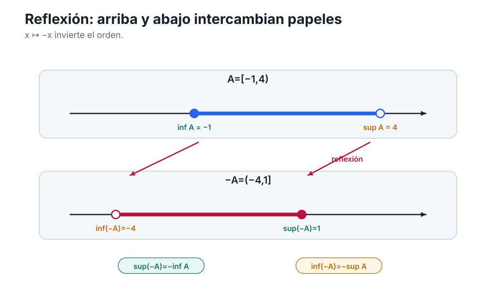{#fig-anm-c03-reflexion-c02-f07 fig-alt="Dos rectas muestran A=\[-1,4) y -A=(-4,1\]. Flechas de reflexión relacionan inf A con sup(-A) y sup A con inf(-A)."}

La garantía inferior, que llamaremos **INF**, procede de SUP aplicado una vez al reflejo. La reflexión realiza el resto del argumento: invierte el orden y transporta cotas y extremalidad. Como identidades de familias completas tenemos $U(-A)=-L(A)$ y $L(-A)=-U(A)$, ya justificadas en C02. La existencia garantizada permite usarlas para obtener un extremo a partir del otro.

La relación puede recorrerse en sentido contrario. Supongamos INF y sea $A$ no vacío y acotado superiormente. El reflejo $-A$ está acotado inferiormente, por lo que existe $j=\inf(-A)$. El número $-j$ es cota superior de $A$, porque $j\le-a$ para todo $a\in A$. Si $u$ es cota superior de $A$, entonces $-u$ es cota inferior de $-A$ y $-u\le j$, de donde $-j\le u$. Así, $-j$ es la menor cota superior. Queda demostrada la equivalencia

$$
\mathrm{SUP}\Longleftrightarrow\mathrm{INF},
\qquad
\sup A=-\inf(-A),\qquad \inf A=-\sup(-A),
$$

con las hipótesis apropiadas para cada extremo. Podemos escoger una de las formulaciones como base y deducir la otra; la equivalencia no exige dos principios independientes.

La acotación necesaria puede ser unilateral. Para $A=(2,\infty)$ no hay cotas superiores, pero sí una inferior, $2$. El reflejo $(-\infty,-2)$ tiene supremo $-2$, y por la identidad anterior $\inf A=2$. No necesitamos acotar $A$ también por arriba para garantizar su ínfimo.

Si $i=\inf A$ y $r>i$, la maximalidad implica que $r$ ya no es cota inferior; existe, pues, $a\in A$ con $i\le a<r$. Tomando $r=i+\varepsilon$ recuperamos la caracterización inferior

$$
\forall\varepsilon>0\;\exists a\in A:\quad i\le a<i+\varepsilon.
$$

La existencia del ínfimo proviene de completitud a través del reflejo; la localización del testigo procede de su maximalidad. Es la misma división de tareas que encontramos para el supremo.

[]{#MA-SEC-ANM-01-003-004}

### Antes de seguir

#### Microcontrol 15

[]{#MA-MIC-ANM-01-003-015}

Si $A$ es no vacío y está acotado inferiormente, ¿por qué $-A$ está acotado superiormente?

[]{#MA-MSOL-ANM-01-003-015}

Ver solución del microcontrol 15

Como $A$ está acotado inferiormente, existe algún $l\in\mathbb R$ tal que

$$
l\le a
\qquad\text{para todo }a\in A.
$$

Multiplicar por $-1$ invierte la desigualdad:

$$
-a\le -l
\qquad\text{para todo }a\in A.
$$

Pero los elementos de $-A$ son precisamente los números $-a$ con $a\in A$. Por tanto, $-l$ domina a todos los elementos de $-A$ y

$$
\boxed{-l\in U(-A).}
$$

Así, $-A$ está acotado superiormente. Además, como $A\ne\varnothing$, si $a_0\in A$ entonces $-a_0\in -A$, de modo que $-A\ne\varnothing$.

Sólo se usan la hipótesis de acotación inferior y la inversión del orden bajo la reflexión.

#### Microcontrol 16

[]{#MA-MIC-ANM-01-003-016}

En la prueba de existencia de $\inf A$, ¿cuál es exactamente el **Paso de completitud**?

[]{#MA-MSOL-ANM-01-003-016}

Ver solución del microcontrol 16

Primero se verifican dos hechos elementales:

$$
-A\ne\varnothing
$$

y

$$
-A\text{ está acotado superiormente}.
$$

Sólo después aparece el paso estructural:

> **Paso de completitud.** Por el principio del supremo, existe
>
> $$
> s=\sup(-A).
> $$

Éste es el único paso directo de completitud. La definición posterior

$$
i=-s
$$

y la demostración de que $i$ es la mayor cota inferior de $A$ usan únicamente orden, reflexión y las propiedades de un supremo ya existente.

Por tanto, la anatomía es

$$
A\text{ acotado inferiormente}
\Longrightarrow
-A\text{ acotado superiormente}
\Longrightarrow_{\text{completitud}}
\exists s=\sup(-A)
\Longrightarrow
\inf A=-s.
$$

#### Microcontrol 17

[]{#MA-MIC-ANM-01-003-017}

Si $s=\sup(-A)$, demuestra sin omitir la inversión de desigualdades que $-s$ es una cota inferior de $A$.

[]{#MA-MSOL-ANM-01-003-017}

Ver solución del microcontrol 17

Sea $a\in A$ cualquiera. Entonces

$$
-a\in -A.
$$

Como $s=\sup(-A)$, el número $s$ es una cota superior de $-A$. Por tanto,

$$
-a\le s.
$$

Multiplicamos ambos miembros por $-1$. Al hacerlo, el sentido de la desigualdad se invierte:

$$
a\ge -s.
$$

Es decir,

$$
-s\le a.
$$

Como $a\in A$ era arbitrario,

$$
\boxed{-s\le a\quad\text{para todo }a\in A.}
$$

Por definición, $-s$ es una cota inferior de $A$.

Se usa solamente que el supremo $s$ ya existe y que es cota superior de $-A$.

#### Microcontrol 18

[]{#MA-MIC-ANM-01-003-018}

Si $l$ es una cota inferior cualquiera de $A$, ¿por qué $-l$ es una cota superior de $-A$ y cómo conduce eso a $l\le -s$?

[]{#MA-MSOL-ANM-01-003-018}

Ver solución del microcontrol 18

Si $l$ es cota inferior de $A$, entonces

$$
l\le a
\qquad\text{para todo }a\in A.
$$

Multiplicando por $-1$ e invirtiendo la desigualdad,

$$
-a\le -l
\qquad\text{para todo }a\in A.
$$

Como cada elemento de $-A$ tiene la forma $-a$, esto significa que

$$
-l\in U(-A).
$$

Ahora usamos la minimalidad de

$$
s=\sup(-A).
$$

Como $-l$ es una cota superior de $-A$, necesariamente

$$
s\le -l.
$$

Multiplicando otra vez por $-1$ e invirtiendo el sentido,

$$
\boxed{l\le -s.}
$$

Así, toda cota inferior $l$ de $A$ queda por debajo de $-s$. Junto con el microcontrol anterior, esto muestra que $-s$ es la **mayor** cota inferior.

#### Microcontrol 19

[]{#MA-MIC-ANM-01-003-019}

Explica por qué la identidad $\inf A=-\sup(-A)$ cumple ahora una función de existencia que no tenía en C02.

[]{#MA-MSOL-ANM-01-003-019}

Ver solución del microcontrol 19

C02 ya demostró que, si existe $s=\sup(-A)$, entonces $-s$ es el ínfimo de $A$. No era necesario suponer previamente la existencia de ambos extremos: la reflexión transportaba la existencia de uno al otro.

Lo que faltaba era garantizar el punto de partida para cualquier conjunto no vacío acotado inferiormente. Si $l$ es una cota inferior de $A$, entonces $-l$ es cota superior de $-A$, y la no vaciedad también se conserva. El principio del supremo proporciona ahora

$$
s=\sup(-A).
$$

La prueba de C02 se aplica a ese número y da $\inf A=-s$. Así, C03 añade la garantía general que permite iniciar el transporte; las inversiones de desigualdad y la identificación del ínfimo ya eran válidas en C02.

#### Microcontrol 20

[]{#MA-MIC-ANM-01-003-020}

Demuestra la implicación `INF ⇒ SUP` usando sólo la reflexión.

[]{#MA-MSOL-ANM-01-003-020}

Ver solución del microcontrol 20

Supongamos como principio **INF**:

> todo subconjunto no vacío de $\mathbb R$ acotado inferiormente posee ínfimo.

Sea $A\subseteq\mathbb R$ no vacío y acotado superiormente. Entonces $-A$ es no vacío. Además, si $u$ es una cota superior de $A$, de

$$
a\le u
\qquad\text{para todo }a\in A
$$

obtenemos, al multiplicar por $-1$,

$$
-u\le -a
\qquad\text{para todo }a\in A.
$$

Así, $-u$ es una cota inferior de $-A$, de modo que $-A$ está acotado inferiormente.

Por **INF** existe

$$
j=\inf(-A).
$$

Definamos

$$
s=-j.
$$

Probemos que $s=\sup A$.

Si $a\in A$, entonces $-a\in -A$. Como $j$ es cota inferior de $-A$,

$$
j\le -a.
$$

Multiplicando por $-1$,

$$
a\le -j=s.
$$

Así, $s$ es cota superior de $A$.

Ahora sea $u$ cualquier cota superior de $A$. Entonces $-u$ es cota inferior de $-A$. Como $j$ es la **mayor** cota inferior,

$$
-u\le j.
$$

Multiplicando por $-1$,

$$
-j\le u,
$$

es decir,

$$
s\le u.
$$

Por tanto $s$ es la menor cota superior de $A$:

$$
\boxed{s=\sup A.}
$$

Luego

$$
\boxed{\mathrm{INF}\Longrightarrow\mathrm{SUP}.}
$$

La prueba usa sólo el principio INF supuesto y la reflexión del orden.

#### Microcontrol 21

[]{#MA-MIC-ANM-01-003-021}

¿Por qué `SUP ⇔ INF` no significa que hayamos adoptado dos axiomas independientes?

[]{#MA-MSOL-ANM-01-003-021}

Ver solución del microcontrol 21

Porque una equivalencia lógica permite derivar cada formulación a partir de la otra.

En el desarrollo del libro se eligió **SUP** como principio estructural inicial. Después se demostró

$$
\mathrm{SUP}\Longrightarrow\mathrm{INF}
$$

mediante la reflexión $A\mapsto -A$. El microcontrol anterior muestra también

$$
\mathrm{INF}\Longrightarrow\mathrm{SUP}.
$$

Por tanto,

$$
\boxed{\mathrm{SUP}\Longleftrightarrow\mathrm{INF}.}
$$

Pero sólo **SUP** fue postulado como punto de partida. INF es recuperable como teorema derivado. Si hubiéramos elegido INF como base, SUP habría sido el teorema derivado.

Así, la equivalencia significa “misma información estructural expresada en dos lenguajes”, no “dos hipótesis independientes que deban acumularse”.

#### Microcontrol 22

[]{#MA-MIC-ANM-01-003-022}

Para $A=(2,\infty)$, identifica qué principio puede aplicarse, qué reflejo conviene estudiar y cuál es el ínfimo.

[]{#MA-MSOL-ANM-01-003-022}

Ver solución del microcontrol 22

El conjunto

$$
A=(2,\infty)
$$

no está acotado superiormente, de modo que el principio del supremo no puede aplicarse **directamente a $A$**.

Sí está acotado inferiormente; por ejemplo, $2$ es una cota inferior. Por ello puede aplicarse el **principio del ínfimo derivado**.

Para abrir su fundamento conviene reflejar:

$$
-A=(-\infty,-2).
$$

Este conjunto es no vacío y está acotado superiormente. Su supremo es

$$
\sup(-A)=-2.
$$

Por la identidad de reflexión,

$$
\inf A=-\sup(-A)=-(-2)=2.
$$

Por tanto,

$$
\boxed{\inf(2,\infty)=2.}
$$

Obsérvese que $2\notin A$: el ínfimo existe aunque no sea mínimo.

#### Microcontrol 23

[]{#MA-MIC-ANM-01-003-023}

En la cadena que conduce a la caracterización $\varepsilon$ del ínfimo, distingue el paso que usa completitud del paso que usa C02.

[]{#MA-MSOL-ANM-01-003-023}

Ver solución del microcontrol 23

La cadena es

$$
A\ne\varnothing,
\quad
A\text{ acotado inferiormente}
\Longrightarrow
\exists i=\inf A
\Longrightarrow
\forall\varepsilon>0\;\exists a\in A:
\quad i\le a<i+\varepsilon.
$$

La **primera flecha** depende de completitud. Si abrimos el principio del ínfimo derivado, el mecanismo es

$$
A\text{ acotado inferiormente}
\Longrightarrow
-A\text{ acotado superiormente}
\Longrightarrow_{\mathrm{SUP}}
\exists s=\sup(-A)
\Longrightarrow
\exists i=-s=\inf A.
$$

El único gasto directo de completitud está en la existencia de $s=\sup(-A)$.

La **segunda flecha** no usa una nueva completitud. Una vez que $i=\inf A$ existe, la afirmación

$$
\forall\varepsilon>0\;\exists a\in A:
\quad i\le a<i+\varepsilon
$$

es exactamente la caracterización por $\varepsilon$ del ínfimo demostrada en C02.

Por tanto,

$$
\boxed{
\text{hipótesis inferiores}
\Longrightarrow_{\text{completitud}}
\text{ínfimo existente}
\Longrightarrow_{\text{C02}}
\text{aproximación }\varepsilon.
}
$$

La completitud de orden ya puede leerse desde ambas direcciones de la recta. Podemos garantizar la frontera superior de un conjunto acotado por arriba y la frontera inferior de uno acotado por abajo, sin duplicar nuestras hipótesis estructurales.

La siguiente pregunta cambiará de naturaleza. En vez de buscar otra formulación dual, usaremos la completitud para demostrar una propiedad aritmética decisiva de $\mathbb R$: que los números naturales no pueden quedar encerrados bajo una barrera real.

### Ejercicios de la sección 3.3

#### Ejercicio 10. Traducir una prueba superior a lenguaje inferior

[]{#MA-EX-ANM-01-003-010}

Sea $A\subseteq\mathbb R$ no vacío y acotado inferiormente, y define

$$
B=-A=\{-a:a\in A\}.
$$

Construye un **diccionario de reflexión** que traduzca, línea por línea, las siguientes afirmaciones sobre $B$ a afirmaciones equivalentes sobre $A$:

1. $u$ es una cota superior de $B$;
2. $s=\sup B$;
3. $b\le s$ para todo $b\in B$;
4. si $u$ es cota superior de $B$, entonces $s\le u$;
5. para todo $\varepsilon>0$ existe $b\in B$ tal que
   $$
   s-\varepsilon<b\le s.
   $$

En cada traducción debes sustituir explícitamente $b=-a$, indicar cuándo una desigualdad cambia de sentido al multiplicar por $-1$ y expresar el resultado final en términos de $A$ y de $i=-s$.

Concluye qué papel desempeña la reflexión en el paso de supremo a ínfimo. No invoques todavía ningún resultado de §3.4 o posteriores.

[]{#MA-SOL-ANM-01-003-010}

Ver solución del ejercicio 10

La reflexión

$$
x\longmapsto -x
$$

es una biyección de $\mathbb R$ que invierte el orden. Ésa es la única regla de traducción que necesitamos, pero debe aplicarse sin saltos.

Sea

$$
B=-A
$$

y escribamos

$$
i=-s.
$$

**1. Cota superior de $B$.** Decir que $u$ es cota superior de $B$ significa

$$
\forall b\in B,\qquad b\le u.
$$

Cada $b\in B$ tiene la forma $b=-a$ con $a\in A$. Por tanto,

$$
-a\le u
\qquad\text{para todo }a\in A.
$$

Multiplicando por $-1$ se invierte el sentido:

$$
-u\le a
\qquad\text{para todo }a\in A.
$$

Así,

$$
\boxed{
u\in U(B)
\quad\Longleftrightarrow\quad
-u\in L(A).
}
$$

**2. Supremo de $B$.** Si

$$
s=\sup B,
$$

entonces $s$ es la menor cota superior de $B$. Reflejando esa afirmación, $-s$ será la mayor cota inferior de $A$. Es decir,

$$
\boxed{i=-s=\inf A.}
$$

Los dos apartados siguientes verifican las dos mitades de esa afirmación.

**3. La condición de cota.** Como $b\le s$ para todo $b\in B$, sustituyendo $b=-a$ obtenemos

$$
-a\le s.
$$

Al multiplicar por $-1$,

$$
-s\le a.
$$

Por tanto,

$$
i=-s\le a
\qquad\text{para todo }a\in A,
$$

de modo que $i$ es cota inferior de $A$.

**4. La optimalidad.** Si $u$ es cota superior de $B$, la minimalidad de $s$ dice

$$
s\le u.
$$

Multiplicando por $-1$,

$$
-u\le -s=i.
$$

Pero, por el primer apartado, $-u$ es una cota inferior de $A$. Así, toda cota inferior obtenida por reflexión queda por debajo de $i$; como toda cota inferior de $A$ surge de esta manera, $i$ es la mayor cota inferior.

**5. Caracterización $\varepsilon$.** Supongamos

$$
\forall\varepsilon>0\;\exists b\in B:
\quad
s-\varepsilon<b\le s.
$$

Escribimos $b=-a$. Entonces

$$
s-\varepsilon<-a\le s.
$$

Multiplicar toda la cadena por $-1$ invierte ambos signos:

$$
-s\le a<-s+\varepsilon.
$$

Como $i=-s$,

$$
\boxed{
\forall\varepsilon>0\;\exists a\in A:
\quad
i\le a<i+\varepsilon.
}
$$

Hemos traducido la caracterización $\varepsilon$ del supremo en la caracterización $\varepsilon$ del ínfimo.

El diccionario esencial es

$$
\begin{array}{c|c}
\text{lenguaje superior de }-A & \text{lenguaje inferior de }A\\
\hline
u\in U(-A) & -u\in L(A)\\
s=\sup(-A) & -s=\inf A\\
b\le s & -s\le a\\
s\le u & -u\le -s\\
s-\varepsilon<b\le s & -s\le a<-s+\varepsilon
\end{array}
$$

La reflexión no aporta una segunda completitud. Su papel es transportar, con inversión de orden, la información superior hacia la inferior.

#### Ejercicio 11. Las familias completas de cotas también se reflejan

[]{#MA-EX-ANM-01-003-011}

Para un conjunto $A\subseteq\mathbb R$, define

$$
L(A)=\{l\in\mathbb R:\forall a\in A,\ l\le a\}
$$

y, para cualquier conjunto $E\subseteq\mathbb R$,

$$
-E=\{-x:x\in E\}.
$$

Supón que $A$ es no vacío y está acotado inferiormente.

1. Demuestra la igualdad de conjuntos
   $$
   U(-A)=-L(A).
   $$
2. Verifica, antes de usar completitud, que $-A$ es no vacío y está acotado superiormente.
3. Aplica el principio del supremo a $-A$ y escribe
   $$
   s=\sup(-A).
   $$
4. Usa la igualdad del apartado 1 para demostrar que
   $$
   -s=\max L(A).
   $$
5. Concluye que
   $$
   \inf A=-\sup(-A).
   $$

La prueba debe localizar exactamente el único paso de completitud y separar la existencia de $s$ de las manipulaciones de las familias de cotas.

[]{#MA-SOL-ANM-01-003-011}

Ver solución del ejercicio 11

Queremos probar

$$
U(-A)=-L(A).
$$

Hagamos las dos inclusiones.

Sea primero

$$
u\in U(-A).
$$

Entonces

$$
-a\le u
\qquad\text{para todo }a\in A.
$$

Al multiplicar por $-1$,

$$
-u\le a
\qquad\text{para todo }a\in A.
$$

Por definición,

$$
-u\in L(A).
$$

Entonces $u=-(-u)$ pertenece a $-L(A)$. Así,

$$
U(-A)\subseteq -L(A).
$$

Recíprocamente, sea

$$
u\in -L(A).
$$

Por definición de conjunto reflejado, existe $l\in L(A)$ tal que

$$
u=-l.
$$

Como $l$ es cota inferior de $A$,

$$
l\le a
\qquad\text{para todo }a\in A.
$$

Multiplicando por $-1$,

$$
-a\le -l=u
\qquad\text{para todo }a\in A.
$$

Esto dice que $u$ es cota superior de $-A$. Por tanto,

$$
-L(A)\subseteq U(-A).
$$

Concluimos

$$
\boxed{U(-A)=-L(A).}
$$

Ahora verifiquemos las hipótesis de completitud. Como $A\ne\varnothing$, existe $a_0\in A$, y entonces

$$
-a_0\in -A,
$$

de modo que $-A\ne\varnothing$.

Como $A$ está acotado inferiormente, existe $l_0\in\mathbb R$ tal que

$$
l_0\le a
\qquad\text{para todo }a\in A.
$$

Reflejando,

$$
-a\le -l_0
\qquad\text{para todo }a\in A,
$$

así que $-l_0$ es cota superior de $-A$.

> **Paso de completitud.** El conjunto $-A$ es no vacío y está acotado superiormente. Por el principio del supremo existe
>
> $$
> s=\sup(-A).
> $$

Por definición de supremo,

$$
s=\min U(-A).
$$

Usando la igualdad ya demostrada,

$$
s=\min(-L(A)).
$$

Queremos reflejar ahora esta minimalidad. Como $s\in -L(A)$, existe $l_*\in L(A)$ con

$$
s=-l_*.
$$

Por tanto,

$$
l_*=-s.
$$

Sea $l\in L(A)$ cualquiera. Entonces $-l\in -L(A)=U(-A)$. Como $s$ es el mínimo de ese conjunto,

$$
s\le -l.
$$

Multiplicando por $-1$,

$$
l\le -s=l_*.
$$

Así, $l_*$ pertenece a $L(A)$ y domina a toda cota inferior. Por definición,

$$
\boxed{-s=\max L(A).}
$$

Pero la mayor cota inferior es precisamente el ínfimo. Luego

$$
\boxed{
\inf A=-\sup(-A).
}
$$

#### Ejercicio 12. El ínfimo de una unión

[]{#MA-EX-ANM-01-003-012}

Sean $A,B\subseteq\mathbb R$ conjuntos no vacíos y acotados inferiormente.

Demuestra que $A\cup B$ es no vacío y está acotado inferiormente y prueba que

$$
\boxed{
\inf(A\cup B)=\min\{\inf A,\inf B\}.
}
$$

La demostración debe incluir:

1. una construcción explícita de una cota inferior de $A\cup B$ a partir de cotas inferiores de $A$ y de $B$;
2. la justificación de existencia de los tres ínfimos que aparecen;
3. la prueba de que
   $$
   m=\min\{\inf A,\inf B\}
   $$
   es cota inferior de $A\cup B$;
4. la prueba de que cualquier cota inferior de $A\cup B$ es menor o igual que $m$.

No cites una fórmula conocida para uniones: deriva la igualdad desde las definiciones y el principio del ínfimo ya obtenido en §3.3.

[]{#MA-SOL-ANM-01-003-012}

Ver solución del ejercicio 12

Como $A$ y $B$ son no vacíos, existen

$$
a_0\in A,
\qquad
b_0\in B.
$$

En particular,

$$
A\cup B\ne\varnothing.
$$

Como $A$ está acotado inferiormente, existe una cota inferior $l_A$ de $A$; como $B$ está acotado inferiormente, existe una cota inferior $l_B$ de $B$.

Definamos

$$
l=\min\{l_A,l_B\}.
$$

Si $x\in A\cup B$, entonces ocurre una de dos cosas.

Si $x\in A$, tenemos

$$
l\le l_A\le x.
$$

Si $x\in B$, tenemos

$$
l\le l_B\le x.
$$

Por tanto,

$$
l\le x
\qquad\text{para todo }x\in A\cup B,
$$

así que $A\cup B$ está acotado inferiormente.

Ahora usamos el principio del ínfimo derivado de §3.3. Como los tres conjuntos son no vacíos y están acotados inferiormente, existen

$$
i_A=\inf A,
\qquad
i_B=\inf B,
\qquad
i=\inf(A\cup B).
$$

Esta existencia hereda completitud del principio del supremo mediante la reflexión demostrada en §3.3.

Definamos

$$
m=\min\{i_A,i_B\}.
$$

Mostremos que $m$ es una cota inferior de $A\cup B$.

Si $x\in A$, entonces

$$
i_A\le x.
$$

Como $m\le i_A$,

$$
m\le x.
$$

Si $x\in B$, análogamente

$$
m\le i_B\le x.
$$

Así,

$$
m\in L(A\cup B).
$$

Falta demostrar que es la **mayor** cota inferior. Sea $l'$ una cota inferior cualquiera de $A\cup B$. Entonces, como

$$
A\subseteq A\cup B,
\qquad
B\subseteq A\cup B,
$$

el mismo $l'$ es cota inferior de $A$ y de $B$. Por la maximalidad de los ínfimos,

$$
l'\le i_A
\qquad\text{y}\qquad
l'\le i_B.
$$

Por tanto,

$$
l'\le \min\{i_A,i_B\}=m.
$$

Hemos demostrado que $m$ es cota inferior de $A\cup B$ y que toda otra cota inferior queda por debajo de $m$. Luego

$$
\boxed{
\inf(A\cup B)=\min\{\inf A,\inf B\}.
}
$$

#### Ejercicio 13. Trasladar un ínfimo abriendo la caja negra

[]{#MA-EX-ANM-01-003-013}

Sea $A\subseteq\mathbb R$ no vacío y acotado inferiormente, y sea $c\in\mathbb R$. Define

$$
A+c=\{a+c:a\in A\}.
$$

Demuestra

$$
\inf(A+c)=\inf A+c,
$$

pero con la siguiente restricción de trazabilidad:

- no puedes invocar el principio del ínfimo como una caja negra;
- debes abrir su demostración y usar el **principio del supremo exactamente una vez**, aplicado a $-A$;
- después de obtener $s=\sup(-A)$ y $i=-s$, todo el resto debe probarse directamente mediante orden y álgebra.

En particular:

1. verifica las hipótesis sobre $-A$;
2. señala el único `Paso de completitud`;
3. demuestra que $i=\inf A$;
4. demuestra directamente que $i+c$ es la mayor cota inferior de $A+c$;
5. explica por qué no fue necesario gastar completitud una segunda vez para $A+c$.

[]{#MA-SOL-ANM-01-003-013}

Ver solución del ejercicio 13

No invocaremos `INF` como una regla independiente. Reconstruiremos el ínfimo desde `SUP`.

Como $A\ne\varnothing$, también

$$
-A\ne\varnothing.
$$

Como $A$ está acotado inferiormente, existe $l\in\mathbb R$ tal que

$$
l\le a
\qquad\text{para todo }a\in A.
$$

Reflejando,

$$
-a\le -l
\qquad\text{para todo }a\in A,
$$

de modo que $-A$ está acotado superiormente.

> **Único Paso de completitud.** Por el principio del supremo existe
>
> $$
> s=\sup(-A).
> $$

Definimos

$$
i=-s.
$$

Demostremos brevemente, sin otra aplicación de completitud, que $i=\inf A$.

Si $a\in A$, entonces $-a\in -A$. Como $s$ es cota superior de $-A$,

$$
-a\le s,
$$

y al reflejar,

$$
i=-s\le a.
$$

Así, $i$ es cota inferior de $A$.

Si $q$ es cualquier cota inferior de $A$, entonces

$$
q\le a
\qquad\text{para todo }a\in A.
$$

Reflejando,

$$
-a\le -q,
$$

de modo que $-q$ es cota superior de $-A$. La minimalidad de $s$ da

$$
s\le -q,
$$

y por reflexión

$$
q\le -s=i.
$$

Por tanto,

$$
i=\inf A.
$$

Ahora estudiemos $A+c$.

Primero probemos que $i+c$ es cota inferior. Si $y\in A+c$, existe $a\in A$ tal que

$$
y=a+c.
$$

Como $i\le a$,

$$
i+c\le a+c=y.
$$

Así, $i+c$ es cota inferior de $A+c$.

Sea ahora $v$ cualquier cota inferior de $A+c$. Para todo $a\in A$ tenemos

$$
v\le a+c.
$$

Restando $c$,

$$
v-c\le a
\qquad\text{para todo }a\in A.
$$

Por tanto, $v-c$ es una cota inferior de $A$. Como $i=\inf A$ es la mayor cota inferior,

$$
v-c\le i.
$$

Sumando $c$,

$$
v\le i+c.
$$

Así, $i+c$ es la mayor cota inferior de $A+c$. En consecuencia,

$$
\boxed{
\inf(A+c)=i+c=\inf A+c.
}
$$

No fue necesario aplicar completitud a $A+c$. Una vez construido $i$ mediante la única aplicación de SUP a $-A$, la nueva frontera se obtuvo transportando directamente las dos propiedades definitorias del ínfimo.

La trazabilidad exacta es

$$
A\text{ inferiormente acotado}
\Longrightarrow
-A\text{ superiormente acotado}
\Longrightarrow_{\mathrm{SUP}}
\sup(-A)
\Longrightarrow
\inf A
\Longrightarrow
\inf(A+c).
$$

Sólo la flecha marcada `SUP` consume completitud.

#### Ejercicio 14. Una transformación afín decreciente intercambia las fronteras

[]{#MA-EX-ANM-01-003-014}

Sea $A\subseteq\mathbb R$ no vacío y acotado tanto superior como inferiormente. Sean

$$
\lambda<0,
\qquad
c\in\mathbb R,
$$

y define

$$
\lambda A+c=\{\lambda a+c:a\in A\}.
$$

Demuestra las dos identidades

$$
\boxed{
\sup(\lambda A+c)=\lambda\inf A+c,
}
$$

y

$$
\boxed{
\inf(\lambda A+c)=\lambda\sup A+c.
}
$$

Tu prueba debe:

1. justificar la existencia de $\sup A$ e $\inf A$ a partir de §3.2–§3.3;
2. demostrar directamente que $\lambda\inf A+c$ es cota superior del conjunto transformado y es menor o igual que toda otra cota superior;
3. demostrar de manera dual la segunda identidad;
4. indicar en qué pasos se invierte el sentido de las desigualdades por ser $\lambda<0$;
5. explicar conceptualmente por qué una transformación afín **decreciente** intercambia supremo e ínfimo, mientras que una traslación no los intercambia.

No uses propiedad arquimediana, sucesiones ni resultados de §3.4 o posteriores.

[]{#MA-SOL-ANM-01-003-014}

Ver solución del ejercicio 14

Como $A$ es no vacío y está acotado superior e inferiormente, §3.2 y §3.3 garantizan la existencia de

$$
S=\sup A,
\qquad
i=\inf A.
$$

Sea

$$
T(A)=\lambda A+c
$$

con $\lambda<0$.

#### Primera identidad: el supremo de la imagen

Queremos demostrar

$$
\sup T(A)=\lambda i+c.
$$

Sea $y\in T(A)$. Entonces existe $a\in A$ tal que

$$
y=\lambda a+c.
$$

Como $i=\inf A$,

$$
i\le a.
$$

Al multiplicar por $\lambda<0$, la desigualdad **se invierte**:

$$
\lambda a\le \lambda i.
$$

Sumando $c$,

$$
y=\lambda a+c\le \lambda i+c.
$$

Por tanto, $\lambda i+c$ es una cota superior de $T(A)$.

Ahora sea $u$ cualquier cota superior de $T(A)$. Para todo $a\in A$,

$$
\lambda a+c\le u.
$$

Restando $c$,

$$
\lambda a\le u-c.
$$

Al dividir por $\lambda<0$, la desigualdad vuelve a **invertirse**:

$$
a\ge \frac{u-c}{\lambda}.
$$

Así,

$$
\frac{u-c}{\lambda}
$$

es una cota inferior de $A$. Como $i$ es la mayor cota inferior,

$$
\frac{u-c}{\lambda}\le i.
$$

Multiplicar esta desigualdad por $\lambda<0$ invierte nuevamente el sentido:

$$
u-c\ge \lambda i.
$$

Por tanto,

$$
u\ge \lambda i+c.
$$

Hemos mostrado que $\lambda i+c$ es cota superior y que queda por debajo de toda cota superior. Luego

$$
\boxed{
\sup(\lambda A+c)=\lambda\inf A+c.
}
$$

#### Segunda identidad: el ínfimo de la imagen

Ahora partimos de

$$
a\le S
\qquad\text{para todo }a\in A.
$$

Multiplicando por $\lambda<0$,

$$
\lambda a\ge \lambda S.
$$

Sumando $c$,

$$
\lambda a+c\ge \lambda S+c.
$$

Así, $\lambda S+c$ es una cota inferior de $T(A)$.

Sea $v$ cualquier cota inferior de $T(A)$. Entonces

$$
v\le \lambda a+c
\qquad\text{para todo }a\in A.
$$

Restando $c$,

$$
v-c\le \lambda a.
$$

Dividiendo por $\lambda<0$ se invierte el sentido:

$$
\frac{v-c}{\lambda}\ge a
\qquad\text{para todo }a\in A.
$$

Por tanto,

$$
\frac{v-c}{\lambda}
$$

es una cota superior de $A$. Como $S=\sup A$ es la menor cota superior,

$$
S\le \frac{v-c}{\lambda}.
$$

Multiplicando por $\lambda<0$ se invierte la desigualdad:

$$
\lambda S\ge v-c,
$$

y entonces

$$
\lambda S+c\ge v.
$$

Es decir,

$$
v\le \lambda S+c.
$$

Así, $\lambda S+c$ es la mayor cota inferior de $T(A)$. Por tanto,

$$
\boxed{
\inf(\lambda A+c)=\lambda\sup A+c.
}
$$

La explicación conceptual es que una traslación

$$
x\mapsto x+c
$$

preserva el orden, mientras que una transformación con pendiente negativa

$$
x\mapsto \lambda x+c,
\qquad \lambda<0,
$$

lo invierte. Lo que estaba abajo pasa arriba y lo que estaba arriba pasa abajo. Por eso el ínfimo origina el supremo de la imagen y el supremo origina su ínfimo.

## 3.4. Una consecuencia decisiva: la propiedad arquimediana

La construcción de C00 ya permitió superar cualquier barrera real mediante algún natural. Podemos reconstruir esa propiedad a partir de SUP para ver cuánto de la estructura de los reales contiene por sí sola la completitud de orden.

> **Teorema.** El conjunto $\mathbb N$ no está acotado superiormente en $\mathbb R$.

Supongamos, por contradicción, que $\mathbb N$ estuviera acotado superiormente. Como es no vacío, SUP garantizaría la existencia de $s=\sup\mathbb N$. La elección de $s-1$ busca aprovechar que el sucesor de un natural vuelve a ser natural: si encontramos un natural a menos de una unidad por debajo de $s$, su sucesor romperá la cota.

Por minimalidad, $s-1<s$ no es cota superior. Existe entonces $n\in\mathbb N$ con $n>s-1$, y al sumar una unidad resulta $n+1>s$. Pero $n+1\in\mathbb N$, en contradicción con que $s$ dominara a todos los naturales. SUP se usó al producir el supuesto supremo; los pasos posteriores emplearon su definición, el orden y la operación de sucesor.

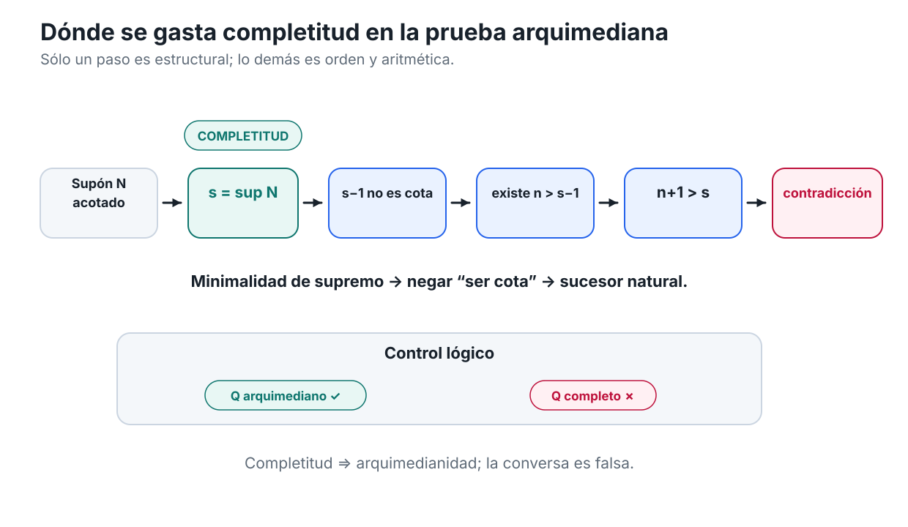{#fig-anm-c03-f04 fig-alt="Cadena lógica desde suponer N acotado hasta la contradicción n+1>s; sólo el nodo s=sup N lleva la marca COMPLETITUD."}

La negación de estar acotado superiormente nos da la **propiedad arquimediana** en forma cuantificada:

$$
\forall x\in\mathbb R\;\exists n\in\mathbb N:\quad n>x.
$$

Esta propiedad equivale a disponer de recíprocos naturales arbitrariamente pequeños. Si $\varepsilon>0$, elegimos $n>1/\varepsilon$; el natural es positivo y, al invertir la desigualdad entre positivos, obtenemos $1/n<\varepsilon$. Recíprocamente, si para todo $\varepsilon>0$ hay un natural positivo con $1/n<\varepsilon$, dado $x>0$ podemos usar $\varepsilon=1/x$ y concluir $n>x$. Para $x\le0$ basta cualquier natural positivo. Así,

$$
\forall\varepsilon>0\;\exists n\in\mathbb N_{>0}:\quad \frac1n<\varepsilon
$$

expresa la misma propiedad sin introducir una noción de convergencia. Para una longitud fija $L>0$, elegir $n>L/\varepsilon$ da también $L/n<\varepsilon$. Una tolerancia positiva determina una elección finita, aunque no hayamos fijado de antemano cuántos pasos necesitaremos.

La completitud implica arquimedianidad, pero la conversa falla. Podemos probar directamente la propiedad arquimediana de $\mathbb Q$ sin usar SUP: si $q=m/k$ con $m\in\mathbb Z$ y $k\ge1$, sirve $n=1$ cuando $m\le0$; cuando $m>0$, tenemos $q\le m<m+1$ y sirve $n=m+1$. Para una tolerancia racional positiva $p/r$, el natural $n=r+1$ satisface $1/n<1/r\le p/r$. Los racionales permiten, pues, superar sus barreras y obtener escalas tan pequeñas como cualquier tolerancia racional; aun así, $S_2$ carece de supremo racional.

También es insuficiente argumentar que $\mathbb N$ no tiene máximo porque cada $n$ tiene un sucesor mayor. Esa observación excluye un máximo, pero no una posible cota exterior: $(0,1)$ muestra que un conjunto sin máximo puede estar acotado. En la prueba con SUP, el sucesor hace algo más preciso: transforma un testigo situado por encima de $s-1$ en un elemento situado por encima de la supuesta cota $s$. Ésa es la contradicción que elimina todas las cotas posibles.

[]{#MA-SEC-ANM-01-003-005}

### Antes de seguir

#### Microcontrol 24

[]{#MA-MIC-ANM-01-003-024}

¿Por qué la hipótesis “$\mathbb N$ está acotado superiormente” permite invocar el principio del supremo?

[]{#MA-MSOL-ANM-01-003-024}

Ver solución del microcontrol 24

El principio del supremo exige dos condiciones sobre el conjunto al que se aplica: que sea no vacío y que esté acotado superiormente.

Bajo la hipótesis contradictoria del argumento ya tenemos la segunda:

$$
\mathbb N\text{ está acotado superiormente en }\mathbb R.
$$

La primera es elemental: $\mathbb N\ne\varnothing$; por ejemplo, $1\in\mathbb N$.

Por tanto, bajo esa hipótesis, quedan verificadas exactamente las condiciones de entrada del principio del supremo:

$$
\mathbb N\ne\varnothing,
\qquad
\mathbb N\text{ acotado superiormente}.
$$

Sólo entonces estamos autorizados a concluir que existe

$$
s=\sup\mathbb N.
$$

#### Microcontrol 25

[]{#MA-MIC-ANM-01-003-025}

En la prueba de arquimedianidad, ¿cuál es exactamente el único **Paso de completitud**?

[]{#MA-MSOL-ANM-01-003-025}

Ver solución del microcontrol 25

El único paso directo es éste:

> **Paso de completitud.** Suponiendo, para obtener una contradicción, que $\mathbb N$ está acotado superiormente, como además $\mathbb N\ne\varnothing$, el principio del supremo garantiza que existe
>
> $$
> s=\sup\mathbb N.
> $$

Todo lo que viene después usa propiedades de ese supremo ya existente, el orden y la aritmética elemental:

$$
s-1<s,
$$

la minimalidad de $s$, la negación de “ser cota superior”, la existencia de $n\in\mathbb N$ con $n>s-1$, la suma de $1$ y la clausura $n+1\in\mathbb N$.

La trazabilidad completa es

$$
\mathbb N\text{ acotado}
\Longrightarrow_{\text{completitud}}
\exists s=\sup\mathbb N
\Longrightarrow_{\text{orden + aritmética}}
\text{contradicción}.
$$

#### Microcontrol 26

[]{#MA-MIC-ANM-01-003-026}

¿Por qué $s-1$ no puede ser una cota superior si $s=\sup\mathbb N$?

[]{#MA-MSOL-ANM-01-003-026}

Ver solución del microcontrol 26

Como

$$
s-1<s,
$$

si $s-1$ fuera también una cota superior de $\mathbb N$, tendríamos una cota superior estrictamente menor que $s$.

Pero $s=\sup\mathbb N$ significa precisamente que $s$ es la **menor** de todas las cotas superiores. En particular, para toda cota superior $u$ de $\mathbb N$ debe cumplirse

$$
s\le u.
$$

Aplicando esto al supuesto $u=s-1$ obtendríamos

$$
s\le s-1,
$$

lo cual contradice $s-1<s$.

Por tanto,

$$
\boxed{s-1\text{ no es una cota superior de }\mathbb N.}
$$

Sólo se usa la minimalidad del supremo cuya existencia ya fue obtenida.

#### Microcontrol 27

[]{#MA-MIC-ANM-01-003-027}

Explica cuidadosamente cómo la negación de “$s-1$ es cota superior” produce un natural $n$ con $n>s-1$.

[]{#MA-MSOL-ANM-01-003-027}

Ver solución del microcontrol 27

Decir que $s-1$ es una cota superior de $\mathbb N$ significa

$$
\forall n\in\mathbb N,
\qquad
n\le s-1.
$$

Negar esta afirmación cuantificada da

$$
\exists n\in\mathbb N
\quad\text{tal que}\quad
\neg(n\le s-1).
$$

Como el orden de $\mathbb R$ es total,

$$
\neg(n\le s-1)
\quad\Longleftrightarrow\quad
n>s-1.
$$

Por tanto,

$$
\boxed{\exists n\in\mathbb N:\ n>s-1.}
$$

El testigo $n$ no lo produce una nueva aplicación de completitud. Aparece al negar correctamente la definición universal de cota superior.

#### Microcontrol 28

[]{#MA-MIC-ANM-01-003-028}

¿Dónde se usa que $n+1$ vuelve a pertenecer a $\mathbb N$?

[]{#MA-MSOL-ANM-01-003-028}

Ver solución del microcontrol 28

Del paso anterior obtenemos un natural $n$ tal que

$$
n>s-1.
$$

Sumando $1$ a ambos miembros,

$$
n+1>s.
$$

Para convertir esta desigualdad en una contradicción con el hecho de que $s$ es cota superior de $\mathbb N$, necesitamos saber que el número que acaba de superar a $s$ sigue perteneciendo al conjunto que $s$ debía dominar.

Ahí se usa exactamente la clausura de los naturales bajo sucesor:

$$
n\in\mathbb N
\quad\Longrightarrow\quad
n+1\in\mathbb N.
$$

Como $s$ es cota superior de $\mathbb N$, todo elemento de $\mathbb N$ debería satisfacer $m\le s$. Pero $m=n+1\in\mathbb N$ satisface $n+1>s$. Ésa es la contradicción.

#### Microcontrol 29

[]{#MA-MIC-ANM-01-003-029}

Demuestra que “$\mathbb N$ no está acotado superiormente” equivale a “para todo $x\in\mathbb R$ existe $n\in\mathbb N$ con $n>x$”.

[]{#MA-MSOL-ANM-01-003-029}

Ver solución del microcontrol 29

Probemos las dos implicaciones.

**Primera dirección.** Supongamos que $\mathbb N$ no está acotado superiormente. Sea $x\in\mathbb R$. Si no existiera ningún $n\in\mathbb N$ con $n>x$, entonces tendríamos

$$
\forall n\in\mathbb N,
\qquad
n\le x.
$$

Eso diría exactamente que $x$ es una cota superior de $\mathbb N$, contradiciendo la hipótesis. Luego existe $n\in\mathbb N$ tal que

$$
n>x.
$$

**Segunda dirección.** Supongamos ahora que

$$
\forall x\in\mathbb R\;\exists n\in\mathbb N:\ n>x.
$$

Si $\mathbb N$ tuviera una cota superior $M\in\mathbb R$, la propiedad aplicada a $x=M$ produciría un natural $n$ con

$$
n>M,
$$

contradiciendo que $M$ domina a todos los naturales.

Por tanto,

$$
\boxed{
\mathbb N\text{ no está acotado superiormente}
\Longleftrightarrow
\forall x\in\mathbb R\;\exists n\in\mathbb N:\ n>x.
}
$$

La completitud fue necesaria antes para demostrar que la primera formulación es verdadera en $\mathbb R$.

#### Microcontrol 30

[]{#MA-MIC-ANM-01-003-030}

Dado $\varepsilon>0$, justifica cada paso de la deducción
$$
n>\frac{1}{\varepsilon}
\quad\Longrightarrow\quad
\frac{1}{n}<\varepsilon.
$$

[]{#MA-MSOL-ANM-01-003-030}

Ver solución del microcontrol 30

$$
   n>\frac{1}{\varepsilon}
   \quad\Longrightarrow\quad
   \frac{1}{n}<\varepsilon.
   $$

Como $\varepsilon>0$, tenemos

$$
\frac{1}{\varepsilon}>0.
$$

Si

$$
n>\frac{1}{\varepsilon},
$$

entonces en particular $n>0$. Por tanto $n\varepsilon>0$ y podemos multiplicar la desigualdad original por el número positivo $\varepsilon$ sin cambiar su sentido:

$$
n\varepsilon>1.
$$

Ahora dividimos por el número positivo $n$:

$$
\varepsilon>\frac{1}{n}.
$$

Es decir,

$$
\boxed{\frac{1}{n}<\varepsilon.}
$$

Equivalentemente, puesto que $n$ y $1/\varepsilon$ son positivos, tomar recíprocos invierte el orden:

$$
n>\frac1\varepsilon
\quad\Longrightarrow\quad
\frac1n<\varepsilon.
$$

La positividad es indispensable para justificar tanto las divisiones como el sentido de las desigualdades.

#### Microcontrol 31

[]{#MA-MIC-ANM-01-003-031}

¿Por qué la afirmación $\forall\varepsilon>0\;\exists n:1/n<\varepsilon$ no necesita todavía el lenguaje de convergencia?

[]{#MA-MSOL-ANM-01-003-031}

Ver solución del microcontrol 31

Porque la afirmación ya tiene un significado completo usando sólo cuantificadores, orden y aritmética:

$$
\forall\varepsilon>0\;\exists n\in\mathbb N_{>0}
\quad\text{tal que}\quad
\frac1n<\varepsilon.
$$

Para cada tolerancia positiva se pide **algún** natural cuyo recíproco quede por debajo de ella. Eso es una afirmación de existencia de una escala suficientemente pequeña.

No hace falta introducir una definición de límite ni afirmar todavía que

$$
\frac1n\longrightarrow0.
$$

En particular, aquí no estamos usando como argumento una condición “eventual” del tipo “existe $N$ tal que para todo $n\ge N$...”. Sólo necesitamos elegir un natural adecuado para la tolerancia concreta dada.

Por tanto, el contenido de §3.4 permanece enteramente dentro de la propiedad arquimediana y del orden.

#### Microcontrol 32

[]{#MA-MIC-ANM-01-003-032}

¿Qué muestra $\mathbb Q$ acerca de la conversa “arquimediano $\Rightarrow$ completo”?

[]{#MA-MSOL-ANM-01-003-032}

Ver solución del microcontrol 32

Muestra que la conversa es falsa.

Los racionales son arquimedianos: dado cualquier $q\in\mathbb Q$, existe un natural $n$ con

$$
n>q.
$$

Sin embargo, $\mathbb Q$ no es completo en el sentido de orden usado en C03. El conjunto racional

$$
S_2=\{q\in\mathbb Q:0\le q,\ q^2<2\}
$$

es no vacío y está acotado superiormente dentro de $\mathbb Q$, pero no posee supremo racional.

Así,

$$
\boxed{
\text{arquimedianidad}
\not\Longrightarrow
\text{completitud}.
}
$$

La implicación demostrada en la sección es sólo

$$
\text{completitud}\Longrightarrow\text{arquimedianidad}.
$$

$\mathbb Q$ conserva la propiedad arquimediana pero carece de la garantía general de existencia de supremos.

#### Microcontrol 33

[]{#MA-MIC-ANM-01-003-033}

En una prueba futura que use $1/n<\varepsilon$, ¿qué dependencia estructural queda escondida detrás de esa elección de $n$?

[]{#MA-MSOL-ANM-01-003-033}

Ver solución del microcontrol 33

La elección de $n$ usa la propiedad arquimediana en la forma

$$
\forall\varepsilon>0\;\exists n\in\mathbb N_{>0}:
\frac1n<\varepsilon.
$$

Pero en este capítulo esa propiedad no fue tomada como axioma independiente. Se obtuvo a partir de la completitud mediante la cadena

$$
\text{SUP}
\Longrightarrow
\mathbb N\text{ no acotado superiormente}
\Longrightarrow
\text{propiedad arquimediana}
\Longrightarrow
\forall\varepsilon>0\;\exists n:\frac1n<\varepsilon.
$$

Por eso, cuando una prueba posterior diga simplemente “elija $n$ suficientemente grande para que $1/n<\varepsilon$”, el uso de completitud será **indirecto**: la completitud ya fue consumida al demostrar la propiedad arquimediana que autoriza esa elección.

La trazabilidad correcta es

$$
\boxed{
\text{completitud}
\Longrightarrow
\text{arquimedianidad}
\Longrightarrow
\text{escala }1/n<\varepsilon.
}
$$

No hay una nueva aplicación directa del principio del supremo en cada elección de $n$; hay una dependencia heredada del teorema arquimediano.

Hemos obtenido de la completitud una herramienta aritmética decisiva: siempre podemos superar una barrera real con un natural y, equivalentemente, encontrar escalas recíprocas tan pequeñas como exija una tolerancia positiva.

La siguiente sección utilizará nuevamente el principio del supremo, pero ahora en un contexto geométrico: una familia de intervalos cerrados encajados conservará al menos un punto común aun cuando las restricciones se vayan refinando.

### Ejercicios de la sección 3.4

#### Ejercicio 15. Un paso positivo repetido supera cualquier barrera

[]{#MA-EX-ANM-01-003-015}

Sean

$$
h>0,
\qquad
M\in\mathbb R.
$$

Demuestra que existe $n\in\mathbb N$ tal que

$$
nh>M.
$$

Tu prueba debe:

1. identificar el número real al que conviene aplicar la propiedad arquimediana;
2. explicar por qué multiplicar la desigualdad obtenida por $h$ no cambia su sentido;
3. distinguir el uso **directo** de completitud del uso **indirecto** de una consecuencia ya demostrada de completitud;
4. explicar por qué el resultado sigue siendo válido aunque $M<0$.

No vuelvas a demostrar desde cero la propiedad arquimediana: úsala como el resultado ya obtenido en §3.4.

[]{#MA-SOL-ANM-01-003-015}

Ver solución del ejercicio 15

Como $h>0$, el cociente

$$
\frac{M}{h}
$$

es un número real. Por la propiedad arquimediana existe $n\in\mathbb N$ tal que

$$
n>\frac{M}{h}.
$$

Ahora multiplicamos por $h$. Como $h$ es positivo, el sentido de la desigualdad se conserva:

$$
nh>M.
$$

Por tanto,

$$
\boxed{
\forall h>0\;\forall M\in\mathbb R\;\exists n\in\mathbb N:
\quad nh>M.
}
$$

La elección de $n$ usa la propiedad arquimediana demostrada a partir de completitud en §3.4. Si $M<0$, el argumento sigue siendo válido sin cambio alguno: $M/h$ continúa siendo un real y arquimedianidad proporciona un natural mayor. De hecho, en ese caso cualquier natural positivo ya produce $nh>0>M$, pero no necesitamos separar el caso para que la prueba general funcione.

La anatomía lógica es

$$
M/h\in\mathbb R
\Longrightarrow_{\text{arquimedianidad}}
\exists n:\ n>M/h
\Longrightarrow_{h>0}
nh>M.
$$

#### Ejercicio 16. Construir una malla finita más fina que una tolerancia

[]{#MA-EX-ANM-01-003-016}

Sean $a,b\in\mathbb R$ con $a<b$ y sea $\varepsilon>0$.

Demuestra que existe $N\in\mathbb N_{>0}$ tal que, al definir

$$
x_k=a+k\frac{b-a}{N},
\qquad
k=0,1,\dots,N,
$$

se cumple

$$
x_0=a,
\qquad
x_N=b,
$$

y, para cada $k=0,1,\dots,N-1$,

$$
0<x_{k+1}-x_k<\varepsilon.
$$

La demostración debe justificar explícitamente:

1. por qué $(b-a)/\varepsilon$ es un real positivo;
2. cómo elegir $N$ mediante arquimedianidad;
3. por qué esa elección implica $(b-a)/N<\varepsilon$;
4. por qué la construcción usa sólo una familia **finita** de puntos y no necesita sucesiones ni límites.

No uses resultados de §3.5 o posteriores.

[]{#MA-SOL-ANM-01-003-016}

Ver solución del ejercicio 16

Como $a<b$,

$$
b-a>0.
$$

Además $\varepsilon>0$, de modo que

$$
\frac{b-a}{\varepsilon}>0.
$$

Por la propiedad arquimediana existe $N\in\mathbb N$ tal que

$$
N>\frac{b-a}{\varepsilon}.
$$

Como el lado derecho es positivo, necesariamente $N>0$; por tanto,

$$
N\in\mathbb N_{>0}.
$$

Multiplicando la desigualdad por $\varepsilon>0$ obtenemos

$$
N\varepsilon>b-a.
$$

Como $N>0$, dividir por $N$ conserva el sentido:

$$
\varepsilon>\frac{b-a}{N}.
$$

Es decir,

$$
0<\frac{b-a}{N}<\varepsilon.
$$

Definamos ahora, para los enteros $k=0,1,\dots,N$,

$$
x_k=a+k\frac{b-a}{N}.
$$

En los extremos,

$$
x_0=a
$$

y

$$
x_N
=a+N\frac{b-a}{N}
=a+(b-a)
=b.
$$

Para $k=0,1,\dots,N-1$,

$$
\begin{aligned}
x_{k+1}-x_k
&=\left(a+(k+1)\frac{b-a}{N}\right)
 -\left(a+k\frac{b-a}{N}\right)\\
&=\frac{b-a}{N}.
\end{aligned}
$$

Por la elección de $N$,

$$
\boxed{
0<x_{k+1}-x_k<\varepsilon.
}
$$

Elegir $N$ usa la propiedad arquimediana, cuya demostración en §3.4 dependió de completitud. La construcción contiene exactamente $N+1$ puntos. Es una subdivisión finita de $[a,b]$; no se ha definido una sucesión infinita ni se ha formulado ningún límite.

#### Ejercicio 17. Abrir toda la cadena: de SUP a una escala $L/N<\varepsilon$

[]{#MA-EX-ANM-01-003-017}

Sean

$$
L>0,
\qquad
\varepsilon>0.
$$

Partiendo del **principio del supremo** y sin citar la propiedad arquimediana como una caja negra, demuestra que existe $N\in\mathbb N_{>0}$ tal que

$$
\frac{L}{N}<\varepsilon.
$$

Organiza la prueba en dos capas.

**Capa A — obtener arquimedianidad desde completitud.** Supón por contradicción que $\mathbb N$ está acotado superiormente, usa exactamente una vez el principio del supremo para producir $s=\sup\mathbb N$ y completa la contradicción mediante $s-1$ y $n+1$.

**Capa B — producir la escala.** Aplica el resultado de la capa A a $L/\varepsilon$ y deduce la desigualdad requerida.

Al final clasifica cada paso como:

- uso directo de completitud;
- orden y aritmética;
- uso posterior de un resultado ya derivado.

La respuesta debe dejar visible por qué la existencia de $N$ depende estructuralmente de completitud aunque la desigualdad final no invoque de nuevo el supremo.

[]{#MA-SOL-ANM-01-003-017}

Ver solución del ejercicio 17

Queremos partir del principio del supremo y mantener visible cada dependencia.

#### Capa A. Derivar arquimedianidad

Supongamos, buscando una contradicción, que

$$
\mathbb N
$$

está acotado superiormente en $\mathbb R$.

Como $\mathbb N\ne\varnothing$, quedan satisfechas las hipótesis de SUP.

> **Único Paso directo de completitud.** Por el principio del supremo existe
>
> $$
> s=\sup\mathbb N.
> $$

A partir de aquí no usamos de nuevo completitud.

Como

$$
s-1<s,
$$

el número $s-1$ no puede ser una cota superior de $\mathbb N$: si lo fuera, sería una cota superior estrictamente menor que el supremo.

Negar que $s-1$ sea cota superior significa que existe $n\in\mathbb N$ tal que

$$
n>s-1.
$$

Sumando $1$,

$$
n+1>s.
$$

Pero $n+1\in\mathbb N$, lo que contradice que $s$ sea cota superior de $\mathbb N$.

Por tanto,

$$
\mathbb N
$$

no está acotado superiormente. Equivalentemente,

$$
\forall x\in\mathbb R\;\exists n\in\mathbb N:
\quad n>x.
$$

#### Capa B. Producir la escala

Como $L>0$ y $\varepsilon>0$,

$$
\frac{L}{\varepsilon}>0.
$$

Aplicando la propiedad recién derivada, existe $N\in\mathbb N$ tal que

$$
N>\frac{L}{\varepsilon}.
$$

El lado derecho es positivo, de modo que $N>0$. Entonces

$$
N\varepsilon>L,
$$

y al dividir por $N>0$,

$$
\boxed{
\frac{L}{N}<\varepsilon.
}
$$

La cadena completa es

$$
\mathrm{SUP}
\Longrightarrow
\mathbb N\text{ no acotado}
\Longrightarrow
\exists N>\frac{L}{\varepsilon}
\Longrightarrow
\frac{L}{N}<\varepsilon.
$$

Clasificación:

- **uso directo de completitud:** únicamente la existencia de $s=\sup\mathbb N$ bajo la hipótesis contradictoria de acotación;
- **orden y aritmética:** $s-1$ no es cota, la negación de ser cota, $n+1>s$ y las manipulaciones con $L,\varepsilon,N$;
- **uso posterior de un resultado derivado:** una vez cerrada la capa A, escoger $N>L/\varepsilon$ usa arquimedianidad como consecuencia ya establecida.

Así, la desigualdad final no contiene un símbolo de supremo, pero su disponibilidad dentro de este desarrollo tiene una dependencia estructural precisa en completitud.

#### Ejercicio 18. «No tiene máximo» no significa «no está acotado»

[]{#MA-EX-ANM-01-003-018}

Un estudiante propone esta prueba de la propiedad arquimediana:

> Los naturales no tienen máximo, porque para cada $n\in\mathbb N$ también $n+1\in\mathbb N$ y $n+1>n$. Todo conjunto sin máximo es no acotado superiormente. Por tanto, $\mathbb N$ no está acotado superiormente y no necesitamos completitud.

Diagnostica el argumento.

1. Identifica exactamente la afirmación falsa.
2. Da un subconjunto no vacío de $\mathbb R$ que esté acotado superiormente y no tenga máximo.
3. Explica por qué $n+1>n$ sólo demuestra que $\mathbb N$ no tiene máximo, pero por sí solo no excluye una cota superior no alcanzada.
4. Repara la prueba suponiendo que $\mathbb N$ está acotado superiormente y señalando el punto exacto donde el principio del supremo elimina la posibilidad de una barrera no alcanzada.
5. Explica por qué la prueba reparada no contradice el contraejemplo del apartado 2.

[]{#MA-SOL-ANM-01-003-018}

Ver solución del ejercicio 18

La afirmación falsa del argumento es:

> todo conjunto sin máximo es no acotado superiormente.

No es cierto. Por ejemplo,

$$
A=(0,1)
$$

es no vacío y está acotado superiormente —$1$ es una cota superior—, pero no tiene máximo. Si $x\in(0,1)$, entonces

$$
y=\frac{x+1}{2}
$$

satisface

$$
x<y<1,
$$

de modo que ningún $x$ puede ser máximo.

Volvamos a $\mathbb N$. El hecho de que

$$
n+1\in\mathbb N,
\qquad
n+1>n,
$$

para todo $n\in\mathbb N$ prueba correctamente que $\mathbb N$ no tiene máximo. Pero eso sólo excluye una cota superior **alcanzada como mayor elemento**. No excluye una posible cota superior exterior o no alcanzada.

Para eliminar esa posibilidad necesitamos una información adicional.

Supongamos, buscando una contradicción, que $\mathbb N$ está acotado superiormente. Como es no vacío, el principio del supremo autoriza

> **Paso de completitud.** Existe
>
> $$
> s=\sup\mathbb N.
> $$

El número $s-1<s$ no puede ser cota superior. Por tanto existe $n\in\mathbb N$ con

$$
n>s-1.
$$

Entonces

$$
n+1>s,
$$

pero $n+1\in\mathbb N$, contradiciendo que $s$ sea cota superior.

La prueba reparada no contradice el ejemplo $(0,1)$. En ese conjunto, la existencia del supremo no genera un nuevo elemento del conjunto que cruce la barrera: de $s=1$ y $s-1=0$ sólo obtenemos algún elemento de $(0,1)$ mayor que $0$, lo cual no contradice que $1$ sea cota superior. En $\mathbb N$, en cambio, la estabilidad bajo $n\mapsto n+1$ transforma el testigo $n>s-1$ en un nuevo elemento $n+1>s$ que sí rompe la barrera.

#### Ejercicio 19. Arquimediano no implica completo

[]{#MA-EX-ANM-01-003-019}

Usa $\mathbb Q$ para refutar la conversa

$$
\text{arquimediano}
\Longrightarrow
\text{completo}.
$$

La demostración debe ser autosuficiente en los siguientes puntos:

1. demuestra directamente que para todo $q\in\mathbb Q$ existe $n\in\mathbb N$ con $n>q$;
2. deduce también que para todo $\varepsilon\in\mathbb Q$ con $\varepsilon>0$ existe $n\in\mathbb N_{>0}$ tal que
   $$
   \frac1n<\varepsilon;
   $$
3. recuerda el conjunto
   $$
   S_2=\{q\in\mathbb Q:0\le q,\ q^2<2\}
   $$
   y usa el ejercicio 3 para justificar que es no vacío, está acotado superiormente en $\mathbb Q$ y no posee supremo racional;
4. concluye con una separación lógica explícita entre
   $$
   \text{completitud}\Longrightarrow\text{arquimedianidad}
   $$
   y la conversa, que es falsa.

No identifiques el hueco de $S_2$ con ningún número real concreto: utiliza únicamente el fallo interno del supremo racional ya demostrado.

[]{#MA-SOL-ANM-01-003-019}

Ver solución del ejercicio 19

Debemos verificar dos propiedades distintas de $\mathbb Q$.

#### 1. $\mathbb Q$ es arquimediano

Sea

$$
q\in\mathbb Q.
$$

Escribamos

$$
q=\frac{m}{k},
\qquad
m\in\mathbb Z,
\quad
k\in\mathbb N_{>0}.
$$

Si $m\le0$, basta tomar $n=1$, pues

$$
1>q.
$$

Supongamos ahora $m>0$. Como $k\ge1$,

$$
\frac{m}{k}\le m.
$$

Tomando

$$
n=m+1\in\mathbb N,
$$

obtenemos

$$
n=m+1>m\ge\frac{m}{k}=q.
$$

Por tanto,

$$
\boxed{
\forall q\in\mathbb Q\;\exists n\in\mathbb N:
\quad n>q.
}
$$

Esta demostración es interna a la aritmética racional; no necesita el principio del supremo de $\mathbb R$.

#### 2. Recíprocos racionales arbitrariamente pequeños

Sea $\varepsilon\in\mathbb Q$ con $\varepsilon>0$. Escribamos

$$
\varepsilon=\frac{p}{r},
\qquad
p,r\in\mathbb N_{>0}.
$$

Tomemos

$$
n=r+1.
$$

Entonces

$$
\frac1n=\frac1{r+1}<\frac1r.
$$

Como $p\ge1$,

$$
\frac1r\le\frac{p}{r}=\varepsilon.
$$

Luego

$$
\boxed{
\frac1n<\varepsilon.
}
$$

Así, $\mathbb Q$ satisface también la formulación de escalas recíprocas de la propiedad arquimediana.

#### 3. $\mathbb Q$ no es completo

Consideremos

$$
S_2=\{q\in\mathbb Q:0\le q,\ q^2<2\}.
$$

El ejercicio 3 estableció dentro de $\mathbb Q$ que:

- $S_2\ne\varnothing$;
- $S_2$ está acotado superiormente en $\mathbb Q$;
- no existe $\sup_{\mathbb Q}S_2$.

Por tanto, $\mathbb Q$ no satisface el principio del supremo y no es completo en el sentido de orden usado en C03.

Tenemos entonces un sistema que cumple

$$
\text{arquimedianidad}
$$

pero falla

$$
\text{completitud}.
$$

En consecuencia,

$$
\boxed{
\text{completitud}
\Longrightarrow
\text{arquimedianidad},
\qquad
\text{arquimedianidad}
\not\Longrightarrow
\text{completitud}.
}
$$

## 3.5. Intervalos encajados: conservar un punto al refinar

Consideremos una familia $I_n=[a_n,b_n]$ de intervalos cerrados no vacíos, indexada por $n\in\mathbb N_{>0}$, y supongamos $I_{n+1}\subseteq I_n$ para todo $n$. Cada intervalo impone una restricción más fuerte que la anterior. Buscamos un número que cumpla todas, sin suponer que los anchos se hagan pequeños.

El encajamiento da $a_n\le a_{n+1}$ y $b_{n+1}\le b_n$, porque ambos extremos del intervalo menor pertenecen al mayor. La información decisiva relaciona extremos de índices distintos.

> **Compatibilidad cruzada.** Para cualesquiera $m,n\in\mathbb N_{>0}$,
> $$
> a_m\le b_n.
> $$

Si $m\le n$, la monotonía da $a_m\le a_n\le b_n$. Si $m>n$, el encajamiento iterado da $I_m\subseteq I_n$ y, como $a_m\in I_m$, resulta de nuevo $a_m\le b_n$. Por tanto, cada extremo derecho domina a **todos** los extremos izquierdos.

Reunamos los extremos izquierdos en $A=\{a_n:n\ge1\}$. Este conjunto es no vacío, pues contiene $a_1$, y está acotado superiormente por $b_1$. En realidad, la compatibilidad cruzada muestra que cada $b_n$ es una cota superior de $A$. Por completitud existe $x=\sup A$. La elección del conjunto auxiliar permite utilizar las dos condiciones de ese supremo: como $a_n\in A$, tenemos $a_n\le x$; como $b_n$ es cota superior de $A$, la minimalidad da $x\le b_n$. Así,

$$
a_n\le x\le b_n\qquad(n\ge1),
$$

y el cierre de cada intervalo permite concluir $x\in I_n$ para todo $n$.

> **Teorema de intervalos cerrados encajados — forma numerable.** Si
> $$
> I_n=[a_n,b_n]
> $$
> es una familia numerable de intervalos cerrados no vacíos y
> $$
> I_{n+1}\subseteq I_n
> $$
> para todo $n$, entonces
> $$
> \bigcap_{n=1}^{\infty}I_n\ne\varnothing.
> $$

La prueba usa completitud una vez para producir $x$. Las desigualdades que lo sitúan en cada intervalo proceden después de la condición de cota y de la minimalidad del mismo supremo. No necesitamos haber demostrado que los extremos convergen: las relaciones de orden bastan para colocar el punto en todas las restricciones.

El cierre importa porque sólo obtuvimos desigualdades no estrictas. Para $J_n=(0,1/n)$, los intervalos son no vacíos y están encajados, pero no hay un punto común. Si lo hubiera, sería un $x>0$; la propiedad arquimediana proporciona un natural positivo con $1/n<x$, incompatible con $x\in J_n$. El mismo razonamiento funciona para los semiabiertos $(0,1/n]$. Por otra parte, si retiramos el encajamiento, los intervalos cerrados $[n,n+1]$ pueden tener intersección vacía: ya $[1,2]$ y $[3,4]$ son disjuntos. Cada ejemplo muestra que retirar una hipótesis puede destruir la garantía, sin afirmar que siempre la destruya.

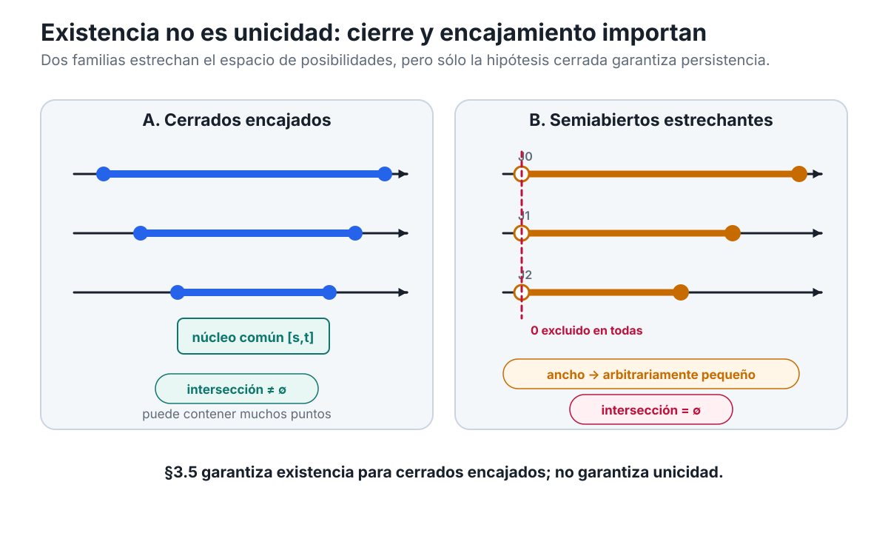{#fig-anm-c03-f06 fig-alt="Dos paneles contrastan cerrados encajados con núcleo no degenerado y semiabiertos estrechantes con intersección vacía."}

La existencia tampoco implica unicidad. Para la familia constante $I_n=[0,1]$, la intersección es todo $[0,1]$. Incluso si los extremos se mueven, puede conservarse un segmento: los intervalos $[0,1+1/n]$ tienen intersección $[0,1]$. La inclusión de este último intervalo en todos ellos es inmediata; si $x>1$, elegimos $n$ con $1/n<x-1$ y descartamos que $x$ pertenezca a todos.

Podemos precisar toda la intersección mediante las dos barreras de los conjuntos de extremos. Sea $A=\{a_n:n\ge1\}$ y $B=\{b_n:n\ge1\}$. La compatibilidad cruzada permite obtener $s=\sup A$ y $t=\inf B$. Como $s\le b_n$ para todo $n$, el número $s$ es cota inferior de $B$ y $s\le t$. Si $x$ pertenece a todos los intervalos, es cota superior de $A$ e inferior de $B$, por lo que $s\le x\le t$. Recíprocamente, si $s\le x\le t$, entonces $a_n\le s\le x\le t\le b_n$ para todo $n$. Queda demostrada la identidad

$$
\bigcap_{n=1}^{\infty}[a_n,b_n]
=[s,t]
=\left[\sup\{a_n:n\ge1\},\inf\{b_n:n\ge1\}\right].
$$

El punto $s$ de la primera prueba es, en particular, un punto común; también lo es $t$, obtenido desde la versión inferior. La igualdad entre ambos requiere información adicional.

[]{#MA-SEC-ANM-01-003-006}

### Antes de seguir

#### Microcontrol 34

[]{#MA-MIC-ANM-01-003-034}

Si $I_{n+1}\subseteq I_n$, demuestra directamente que $a_n\le a_{n+1}$ y $b_{n+1}\le b_n$.

[]{#MA-MSOL-ANM-01-003-034}

Ver solución del microcontrol 34

Como

$$
I_{n+1}=[a_{n+1},b_{n+1}]
\subseteq
I_n=[a_n,b_n],
$$

los dos extremos de $I_{n+1}$ pertenecen también a $I_n$.

Primero,

$$
a_{n+1}\in I_{n+1}\subseteq I_n.
$$

Pertenecer a $I_n=[a_n,b_n]$ significa

$$
a_n\le a_{n+1}\le b_n.
$$

En particular,

$$
\boxed{a_n\le a_{n+1}.}
$$

Del mismo modo,

$$
b_{n+1}\in I_{n+1}\subseteq I_n,
$$

así que

$$
a_n\le b_{n+1}\le b_n.
$$

Por tanto,

$$
\boxed{b_{n+1}\le b_n.}
$$

La inclusión de intervalos fuerza, pues, que los extremos izquierdos avancen hacia la derecha y los derechos retrocedan hacia la izquierda.

Sólo se usa pertenencia a intervalos cerrados e inclusión.

#### Microcontrol 35

[]{#MA-MIC-ANM-01-003-035}

Demuestra por casos que $a_m\le b_n$ para cualesquiera $m,n\ge1$.

[]{#MA-MSOL-ANM-01-003-035}

Ver solución del microcontrol 35

Sean $m,n\ge1$.

**Caso 1: $m\le n$.** Por el resultado anterior,

$$
a_m\le a_n.
$$

Como $I_n=[a_n,b_n]$ es no vacío,

$$
a_n\le b_n.
$$

Por transitividad,

$$
a_m\le b_n.
$$

**Caso 2: $m>n$.** Del encajamiento iterado obtenemos

$$
I_m\subseteq I_n.
$$

Como $a_m\in I_m$, también

$$
a_m\in I_n=[a_n,b_n].
$$

Por definición de intervalo cerrado,

$$
a_n\le a_m\le b_n.
$$

En particular,

$$
a_m\le b_n.
$$

En ambos casos,

$$
\boxed{a_m\le b_n\qquad\text{para todos }m,n\ge1.}
$$

La compatibilidad cruzada procede sólo del encajamiento y del orden.

#### Microcontrol 36

[]{#MA-MIC-ANM-01-003-036}

¿Por qué el conjunto $A=\{a_n:n\ge1\}$ es no vacío?

[]{#MA-MSOL-ANM-01-003-036}

Ver solución del microcontrol 36

Por definición,

$$
A=\{a_n:n\ge1\}.
$$

Como la familia comienza en $n=1$, el extremo izquierdo

$$
a_1
$$

pertenece a $A$. Por tanto,

$$
\boxed{A\ne\varnothing.}
$$

Esta verificación es necesaria antes de invocar el principio del supremo.

Sólo se exhibe un elemento de $A$.

#### Microcontrol 37

[]{#MA-MIC-ANM-01-003-037}

¿Por qué **cada** $b_n$ es una cota superior de $A$?

[]{#MA-MSOL-ANM-01-003-037}

Ver solución del microcontrol 37

Fijemos un índice $n\ge1$.

Para probar que $b_n$ es cota superior de

$$
A=\{a_m:m\ge1\},
$$

debemos verificar que todo elemento de $A$ queda por debajo de $b_n$.

Pero la compatibilidad cruzada ya demostrada afirma que, para todo $m\ge1$,

$$
a_m\le b_n.
$$

Como los elementos de $A$ son precisamente los $a_m$, se sigue que

$$
\forall a\in A,\qquad a\le b_n.
$$

Por definición,

$$
\boxed{b_n\in U(A).}
$$

Como $n$ era arbitrario, esto vale para **cada** extremo derecho $b_n$.

Esta acotación se deduce de la compatibilidad cruzada.

#### Microcontrol 38

[]{#MA-MIC-ANM-01-003-038}

Localiza exactamente el único **Paso de completitud** en la prueba del teorema.

[]{#MA-MSOL-ANM-01-003-038}

Ver solución del microcontrol 38

Antes de usar completitud se verifican dos hechos:

$$
A=\{a_n:n\ge1\}\ne\varnothing
$$

y

$$
A\text{ está acotado superiormente},
$$

porque, por ejemplo, $b_1$ —y de hecho cada $b_n$— es una cota superior de $A$.

Sólo entonces aparece el paso estructural:

> **Paso de completitud.** Por el principio del supremo, existe
>
> $$
> x=\sup A.
> $$

Éste es el único uso directo de completitud.

Después, las desigualdades

$$
a_n\le x
$$

y

$$
x\le b_n
$$

proceden respectivamente de que $x$ es cota superior de $A$ y de que $x$ es la menor cota superior de $A$.

La trazabilidad es

$$
\boxed{
A\ne\varnothing,\ A\text{ acotado superiormente}
\Longrightarrow_{\text{completitud}}
\exists x=\sup A
\Longrightarrow_{\text{orden}}
x\in I_n\ \forall n.
}
$$

#### Microcontrol 39

[]{#MA-MIC-ANM-01-003-039}

Una vez definido $x=\sup A$, ¿qué propiedad del supremo da $a_n\le x$?

[]{#MA-MSOL-ANM-01-003-039}

Ver solución del microcontrol 39

Como

$$
a_n\in A
$$

y

$$
x=\sup A,
$$

el número $x$ es, por definición, una **cota superior** de $A$.

Por tanto todo elemento de $A$ satisface

$$
a\le x.
$$

Aplicando esto al elemento concreto $a_n\in A$ obtenemos

$$
\boxed{a_n\le x.}
$$

La completitud garantizó previamente que $x$ existe; esta desigualdad usa sólo la propiedad de cota superior del supremo.

#### Microcontrol 40

[]{#MA-MIC-ANM-01-003-040}

¿Qué propiedad del supremo da $x\le b_n$?

[]{#MA-MSOL-ANM-01-003-040}

Ver solución del microcontrol 40

Ya sabemos que, para cada $n$,

$$
b_n
$$

es una cota superior de $A$.

Como

$$
x=\sup A
$$

es la **menor** de todas las cotas superiores de $A$, debe quedar por debajo de cualquier otra cota superior. En particular,

$$
\boxed{x\le b_n.}
$$

Se usa únicamente la minimalidad del supremo ya existente.

#### Microcontrol 41

[]{#MA-MIC-ANM-01-003-041}

¿Por qué esas dos desigualdades permiten concluir $x\in I_n$ sólo porque $I_n$ es cerrado?

[]{#MA-MSOL-ANM-01-003-041}

Ver solución del microcontrol 41

Las dos desigualdades son

$$
a_n\le x\le b_n.
$$

Para un intervalo cerrado,

$$
I_n=[a_n,b_n],
$$

la condición de pertenencia es exactamente

$$
x\in I_n
\quad\Longleftrightarrow\quad
a_n\le x\le b_n.
$$

Por tanto,

$$
\boxed{x\in I_n.}
$$

El carácter **cerrado** es decisivo porque los extremos están incluidos. Si sólo supiéramos que

$$
a_n\le x\le b_n
$$

y el intervalo fuera abierto,

$$
(a_n,b_n),
$$

todavía podría ocurrir que $x=a_n$ o $x=b_n$, casos en los que $x$ no pertenecería al intervalo.

Así, las desigualdades no bastan para un intervalo abierto, pero sí bastan exactamente para $[a_n,b_n]$.

#### Microcontrol 42

[]{#MA-MIC-ANM-01-003-042}

Verifica sin lenguaje de límites que los intervalos $J_n=(0,1/n)$ están encajados y tienen intersección vacía.

[]{#MA-MSOL-ANM-01-003-042}

Ver solución del microcontrol 42

Primero probemos el encajamiento.

Para todo $n\ge1$,

$$
n+1>n>0.
$$

Al tomar recíprocos positivos se invierte el orden:

$$
\frac1{n+1}<\frac1n.
$$

Por tanto, si

$$
x\in J_{n+1}=\left(0,\frac1{n+1}\right),
$$

entonces

$$
0<x<\frac1{n+1}<\frac1n,
$$

de modo que

$$
x\in J_n.
$$

Así,

$$
\boxed{J_{n+1}\subseteq J_n.}
$$

Ahora supongamos, para obtener una contradicción, que existe

$$
x\in\bigcap_{n=1}^{\infty}J_n.
$$

Entonces, por pertenecer a cada $J_n$,

$$
x>0.
$$

La propiedad arquimediana de §3.4 permite elegir $n\in\mathbb N_{>0}$ tal que

$$
\frac1n<x.
$$

Pero la pertenencia $x\in J_n$ exige simultáneamente

$$
x<\frac1n.
$$

Contradicción.

Por tanto,

$$
\boxed{
\bigcap_{n=1}^{\infty}\left(0,\frac1n\right)=\varnothing.
}
$$

No se ha usado lenguaje de límites. La única dependencia no elemental es la propiedad arquimediana ya demostrada en §3.4, que a su vez depende indirectamente de completitud.

#### Microcontrol 43

[]{#MA-MIC-ANM-01-003-043}

Da un ejemplo de intervalos cerrados encajados cuya intersección contenga más de un punto.

[]{#MA-MSOL-ANM-01-003-043}

Ver solución del microcontrol 43

Tomemos la familia constante

$$
I_n=[0,1]
\qquad\text{para todo }n\ge1.
$$

Cada intervalo es cerrado y no vacío. Además,

$$
I_{n+1}=I_n,
$$

por lo que ciertamente

$$
I_{n+1}\subseteq I_n.
$$

La intersección es

$$
\bigcap_{n=1}^{\infty}I_n=[0,1].
$$

Este conjunto contiene, por ejemplo, tanto $0$ como $1$, y de hecho infinitos puntos.

Por tanto, una familia cerrada y encajada puede satisfacer todas las hipótesis de §3.5 sin que su intersección sea un singleton.

#### Microcontrol 44

[]{#MA-MIC-ANM-01-003-044}

¿Por qué el teorema de esta sección garantiza existencia pero no unicidad?

[]{#MA-MSOL-ANM-01-003-044}

Ver solución del microcontrol 44

La conclusión demostrada en §3.5 es únicamente

$$
\boxed{
\bigcap_{n=1}^{\infty}I_n\ne\varnothing.
}
$$

Eso significa que existe **al menos un** punto común a todos los intervalos.

En ninguna parte de las hipótesis se exige que la anchura de los intervalos se haga arbitrariamente pequeña. Por ello puede sobrevivir una región completa.

El ejemplo

$$
I_n=[0,1]
\qquad\forall n
$$

satisface cierre, no vaciedad y encajamiento, pero

$$
\bigcap_{n=1}^{\infty}I_n=[0,1].
$$

Así, las hipótesis de §3.5 son suficientes para **existencia**, pero no para **unicidad**.

La unicidad requerirá una condición adicional de estrechamiento, reservada para §3.6; aquí no la usamos todavía.

#### Microcontrol 45

[]{#MA-MIC-ANM-01-003-045}

¿Qué diferencia de estatus lógico debemos conservar entre el caso numerable encajado de §3.5 y el principio general de intersección que aparecerá en §3.7?

[]{#MA-MSOL-ANM-01-003-045}

Ver solución del microcontrol 45

El resultado de §3.5 es una **consecuencia concreta** de la completitud:

$$
\text{completitud}
\Longrightarrow
\text{intersección no vacía para una familia numerable de intervalos cerrados encajados}.
$$

Su estructura particular incluye un índice numerable y la condición fuerte

$$
I_{n+1}\subseteq I_n.
$$

En cambio, §3.7 introducirá una formulación intervalar más general basada en una familia de intervalos cerrados cuyos extremos satisfacen una condición cruzada del tipo

$$
a_i\le b_j
\qquad\text{para todos los índices }i,j.
$$

Esa formulación general será incorporada a la cadena de **equivalencias** de completitud.

Por tanto debemos evitar el salto lógico

$$
\text{caso numerable encajado}
\quad\Longrightarrow\quad
\text{“ésta es ya la formulación intervalar general equivalente”.}
$$

La relación correcta en este punto es:

$$
\boxed{
\text{§3.5: consecuencia especializada}
\qquad\text{vs.}\qquad
\text{§3.7: formulación general equivalente}.
}
$$

Aquí sólo registramos esa diferencia de estatus, tal como la sección la anuncia; no adelantamos todavía la demostración de la equivalencia general.

Ya sabemos que una familia numerable de intervalos cerrados encajados conserva al menos un punto común. El siguiente problema será determinar qué condición adicional impide que sobrevivan dos puntos distintos.

### Ejercicios de la sección 3.5

#### Ejercicio 20. Antes de aplicar el teorema de intervalos encajados

[]{#MA-EX-ANM-01-003-020}

Para cada una de las siguientes familias, decide si el **teorema numerable de intervalos cerrados encajados** de §3.5 puede aplicarse directamente:

$$
I_n=\left[0,1+\frac1n\right],
$$

$$
J_n=\left(0,\frac1n\right],
$$

$$
K_n=[n,n+1],
$$

y

$$
L_n=[-1,1],
\qquad n\in\mathbb N_{>0}.
$$

En cada caso verifica por separado:

1. que cada intervalo sea no vacío;
2. que sea un intervalo **cerrado** de $\mathbb R$;
3. que la familia esté encajada, es decir,
   $$
   I_{n+1}\subseteq I_n
   $$
   con la letra correspondiente;
4. sólo si se cumplen las tres condiciones, escribe la conclusión de existencia autorizada por el teorema.

No calcules todavía la intersección cuando no sea necesario. El objetivo es entrenar la lectura exacta de hipótesis antes de invocar una consecuencia de completitud.

[]{#MA-SOL-ANM-01-003-020}

Ver solución del ejercicio 20

El teorema de §3.5 exige simultáneamente, para cada $n$:

$$
I_n=[a_n,b_n]\ne\varnothing
$$

y

$$
I_{n+1}\subseteq I_n.
$$

Además, los intervalos deben ser cerrados.

#### Familia $I_n=[0,1+1/n]$

Cada intervalo es no vacío porque

$$
0\le1+\frac1n.
$$

Es cerrado por tener la forma $[a,b]$. Para el encajamiento observamos que

$$
\frac1{n+1}<\frac1n,
$$

y por tanto

$$
1+\frac1{n+1}<1+\frac1n.
$$

El extremo izquierdo permanece fijo en $0$ y el derecho se desplaza hacia la izquierda. Luego

$$
I_{n+1}\subseteq I_n.
$$

Las tres hipótesis están satisfechas. El teorema autoriza concluir

$$
\boxed{
\bigcap_{n=1}^{\infty}I_n\ne\varnothing.
}
$$

No es necesario calcular la intersección para obtener esta existencia.

#### Familia $J_n=(0,1/n]$

Cada $J_n$ es no vacío. Por ejemplo,

$$
\frac1{2n}\in J_n.
$$

También está encajada, pues

$$
0< x\le\frac1{n+1}
\Longrightarrow
0<x\le\frac1n.
$$

Sin embargo, $J_n$ no es un intervalo cerrado de $\mathbb R$: el extremo $0$ está excluido. Por tanto el teorema de §3.5 **no** puede invocarse directamente.

La lectura correcta no es “la intersección es vacía porque el teorema no se aplica”. La única conclusión lógica es que este teorema no decide el caso a partir de sus hipótesis, porque una de ellas falla.

#### Familia $K_n=[n,n+1]$

Cada $K_n$ es cerrado y no vacío. Pero no hay encajamiento. Por ejemplo,

$$
K_1=[1,2],
\qquad
K_2=[2,3],
$$

y

$$
K_2\not\subseteq K_1
$$

porque, por ejemplo, $3\in K_2$ y $3\notin K_1$.

Así, el teorema tampoco es aplicable a esta familia.

#### Familia $L_n=[-1,1]$

Cada intervalo es cerrado y no vacío. Además,

$$
L_{n+1}=L_n
$$

para todo $n$, de modo que ciertamente

$$
L_{n+1}\subseteq L_n.
$$

El teorema se aplica y garantiza

$$
\boxed{
\bigcap_{n=1}^{\infty}L_n\ne\varnothing.
}
$$

En este ejemplo la intersección es incluso el intervalo completo $[-1,1]$, lo que recuerda que §3.5 garantiza existencia, no unicidad.

La clasificación final es

$$
\begin{array}{c|c|c|c|c}
\text{familia} & \text{no vacía} & \text{cerrada} & \text{encajada} & \text{teorema aplicable}\\
\hline
I_n & \text{sí} & \text{sí} & \text{sí} & \text{sí}\\
J_n & \text{sí} & \text{no} & \text{sí} & \text{no}\\
K_n & \text{sí} & \text{sí} & \text{no} & \text{no}\\
L_n & \text{sí} & \text{sí} & \text{sí} & \text{sí}
\end{array}
$$

#### Ejercicio 21. La misma existencia vista desde los extremos derechos

[]{#MA-EX-ANM-01-003-021}

Sean

$$
I_n=[a_n,b_n],
\qquad n\in\mathbb N_{>0},
$$

intervalos cerrados no vacíos tales que

$$
I_{n+1}\subseteq I_n
\qquad\text{para todo }n.
$$

En §3.5 se construyó un punto común usando el supremo de los extremos izquierdos. Da una demostración **dual** usando los extremos derechos.

Define

$$
B=\{b_n:n\in\mathbb N_{>0}\}.
$$

Debes demostrar, en este orden:

1. $B\ne\varnothing$;
2. cada $a_m$ es una cota inferior de $B$;
3. existe
   $$
   y=\inf B;
   $$
4. para cada $n$,
   $$
   a_n\le y\le b_n;
   $$
5. por tanto,
   $$
   y\in\bigcap_{n=1}^{\infty}I_n.
   $$

Localiza el paso que hereda completitud a través del principio del ínfimo de §3.3 y explica por qué las desigualdades posteriores no consumen una nueva aplicación de completitud.

[]{#MA-SOL-ANM-01-003-021}

Ver solución del ejercicio 21

Tenemos intervalos

$$
I_n=[a_n,b_n]
$$

cerrados, no vacíos y encajados.

La compatibilidad cruzada demostrada en §3.5 afirma

$$
a_m\le b_n
\qquad
\text{para todos }m,n\ge1.
$$

Definamos

$$
B=\{b_n:n\ge1\}.
$$

El conjunto $B$ es no vacío porque

$$
b_1\in B.
$$

Fijemos ahora un índice $m$. Por compatibilidad cruzada,

$$
a_m\le b_n
\qquad
\text{para todo }n.
$$

Por definición, esto significa que $a_m$ es una cota inferior de $B$.

En particular, tomando $m=1$, obtenemos al menos una cota inferior de $B$. Así,

$$
B\ne\varnothing
\qquad\text{y}\qquad
B\text{ está acotado inferiormente}.
$$

> **Paso de completitud heredado por INF.** El principio del ínfimo de §3.3, derivado del principio del supremo, garantiza que existe
>
> $$
> y=\inf B.
> $$

A partir de aquí no necesitamos una nueva aplicación de completitud.

Fijemos $n$.

Como $a_n$ es una cota inferior de $B$ y $y=\inf B$ es la **mayor** cota inferior,

$$
a_n\le y.
$$

Por otra parte,

$$
b_n\in B.
$$

Como el ínfimo es una cota inferior de $B$,

$$
y\le b_n.
$$

Por tanto,

$$
a_n\le y\le b_n,
$$

lo que equivale a

$$
y\in[a_n,b_n]=I_n.
$$

Como $n$ era arbitrario,

$$
\boxed{
y\in\bigcap_{n=1}^{\infty}I_n.
}
$$

La anatomía lógica es dual a la prueba con supremos:

$$
\text{encajamiento}
\Longrightarrow
\text{compatibilidad cruzada}
\Longrightarrow
B\text{ no vacío y acotado inferiormente}
\Longrightarrow_{\mathrm{INF}}
y=\inf B
\Longrightarrow
\forall n:\ a_n\le y\le b_n.
$$

#### Ejercicio 22. Describir toda la intersección, no sólo encontrar un punto

[]{#MA-EX-ANM-01-003-022}

Bajo las mismas hipótesis del ejercicio anterior, define

$$
A=\{a_n:n\ge1\},
\qquad
B=\{b_n:n\ge1\},
$$

y escribe

$$
s=\sup A,
\qquad
t=\inf B.
$$

Demuestra que ambos extremos existen y prueba la identidad

$$
\boxed{
\bigcap_{n=1}^{\infty}[a_n,b_n]=[s,t].
}
$$

La prueba debe incluir:

1. la compatibilidad cruzada
   $$
   a_m\le b_n
   \qquad\text{para todos }m,n;
   $$
2. la deducción
   $$
   s\le t;
   $$
3. la inclusión
   $$
   \bigcap_n I_n\subseteq[s,t];
   $$
4. la inclusión recíproca
   $$
   [s,t]\subseteq\bigcap_n I_n.
   $$

No añadas ninguna hipótesis de estrechamiento. El resultado debe dejar abierta la posibilidad de que $s<t$ y la intersección contenga más de un punto.

[]{#MA-SOL-ANM-01-003-022}

Ver solución del ejercicio 22

Definimos

$$
A=\{a_n:n\ge1\},
\qquad
B=\{b_n:n\ge1\}.
$$

Por el encajamiento y la no vaciedad de los intervalos tenemos la compatibilidad cruzada

$$
\boxed{
a_m\le b_n
\qquad\text{para todos }m,n\ge1.
}
$$

#### Existencia de $s$ y $t$

El conjunto $A$ es no vacío porque $a_1\in A$. Para cualquier $n$ fijo, $b_n$ es cota superior de $A$, pues

$$
a_m\le b_n
\qquad
\text{para todo }m.
$$

Así, por completitud, existe

$$
s=\sup A.
$$

Análogamente, $B$ es no vacío porque $b_1\in B$, y cualquier $a_m$ es cota inferior de $B$. Por el principio del ínfimo existe

$$
t=\inf B.
$$

#### Probar $s\le t$

Fijemos $n$. Ya sabemos que $b_n$ es cota superior de $A$. Como $s$ es la menor cota superior,

$$
s\le b_n
\qquad
\text{para todo }n.
$$

Esto significa que $s$ es una cota inferior del conjunto $B$. Como $t=\inf B$ es la mayor cota inferior de $B$,

$$
\boxed{s\le t.}
$$

Por tanto, el intervalo $[s,t]$ es no vacío.

#### Primera inclusión

Sea

$$
x\in\bigcap_{n=1}^{\infty}I_n.
$$

Entonces para todo $n$,

$$
a_n\le x\le b_n.
$$

La desigualdad izquierda para todos los $n$ dice que $x$ es una cota superior de $A$. Por la minimalidad de $s$,

$$
s\le x.
$$

La desigualdad derecha para todos los $n$ dice que $x$ es una cota inferior de $B$. Por la maximalidad de $t$,

$$
x\le t.
$$

Así,

$$
x\in[s,t],
$$

y por tanto

$$
\bigcap_{n=1}^{\infty}I_n\subseteq[s,t].
$$

#### Inclusión recíproca

Sea ahora

$$
x\in[s,t].
$$

Entonces

$$
s\le x\le t.
$$

Como $s=\sup A$ es cota superior de $A$,

$$
a_n\le s
\qquad
\text{para todo }n.
$$

Por tanto,

$$
a_n\le s\le x.
$$

Como $t=\inf B$ es cota inferior de $B$,

$$
t\le b_n
\qquad
\text{para todo }n.
$$

Entonces

$$
x\le t\le b_n.
$$

Juntando ambas cadenas,

$$
a_n\le x\le b_n
$$

para todo $n$. Así,

$$
x\in I_n
$$

para todo $n$, y por consiguiente

$$
[s,t]\subseteq\bigcap_{n=1}^{\infty}I_n.
$$

Concluimos

$$
\boxed{
\bigcap_{n=1}^{\infty}[a_n,b_n]
=
[\sup_n a_n,\inf_n b_n].
}
$$

La fórmula no fuerza $s=t$. Si $s<t$, la intersección contiene todo el intervalo no degenerado $[s,t]$.

#### Ejercicio 23. Un solo gasto de completitud, tres usos del supremo

[]{#MA-EX-ANM-01-003-023}

Considera la prueba estándar de §3.5 y el conjunto

$$
A=\{a_n:n\ge1\}.
$$

Un lector marca como “uso de completitud” las tres líneas siguientes:

1. existe $x=\sup A$;
2. como $a_n\in A$, entonces $a_n\le x$;
3. como $b_n$ es cota superior de $A$, entonces $x\le b_n$.

Audita esas marcas.

Tu respuesta debe:

1. justificar antes de la línea 1 que $A$ es no vacío y está acotado superiormente;
2. clasificar cada una de las tres líneas como **uso directo de completitud** o **uso de propiedades de un supremo ya existente**;
3. identificar en la línea 2 qué parte de la definición de supremo se usa;
4. identificar en la línea 3 qué parte de la definición de supremo se usa;
5. explicar por qué concluir
   $$
   x\in[a_n,b_n]
   $$
   depende además de que los extremos pertenezcan al intervalo cerrado;
6. escribir la cadena completa de dependencias desde el encajamiento hasta el punto común, marcando exactamente una sola flecha con `COMPLETITUD`.

No introduzcas convergencia, compactidad ni resultados de §3.6 o posteriores.

[]{#MA-SOL-ANM-01-003-023}

Ver solución del ejercicio 23

Partimos de una familia cerrada, no vacía y encajada

$$
I_n=[a_n,b_n].
$$

El encajamiento produce la compatibilidad cruzada

$$
a_m\le b_n
\qquad
\text{para todos }m,n.
$$

Formamos

$$
A=\{a_n:n\ge1\}.
$$

El conjunto $A$ es no vacío porque $a_1\in A$. Además, por ejemplo $b_1$ es una cota superior de $A$, pues

$$
a_m\le b_1
\qquad
\text{para todo }m.
$$

Sólo ahora aparece el paso estructural de existencia:

> **Único Paso directo de completitud.** Como $A$ es no vacío y está acotado superiormente, por el principio del supremo existe
>
> $$
> x=\sup A.
> $$

Examinemos las otras dos líneas.

#### Línea 2: $a_n\le x$

Como

$$
a_n\in A
$$

y $x=\sup A$, usamos la parte de la definición que afirma que el supremo es una **cota superior**:

$$
a_n\le x.
$$

No se produce aquí ningún objeto nuevo. Completitud ya hizo su trabajo al garantizar la existencia de $x$.

#### Línea 3: $x\le b_n$

La compatibilidad cruzada muestra que

$$
b_n
$$

es una cota superior de $A$. Como $x=\sup A$ es la **menor** cota superior,

$$
x\le b_n.
$$

De nuevo, esto es una propiedad definitoria del supremo ya existente, no una segunda aplicación de completitud.

Juntando ambas desigualdades,

$$
a_n\le x\le b_n.
$$

Para concluir

$$
x\in I_n
$$

usamos que

$$
I_n=[a_n,b_n]
$$

incluye sus extremos. Si tuviéramos un intervalo abierto, las desigualdades no estrictas no bastarían por sí solas para garantizar pertenencia.

La cadena completa es

$$
\begin{aligned}
I_{n+1}\subseteq I_n
&\Longrightarrow
\forall m,n:\ a_m\le b_n\\
&\Longrightarrow
A=\{a_n\}\ne\varnothing
\text{ y }A\text{ acotado superiormente}\\
&\Longrightarrow_{\mathrm{COMPLETITUD}}
\exists x=\sup A\\
&\Longrightarrow
\forall n:\ a_n\le x\le b_n\\
&\Longrightarrow
x\in\bigcap_n I_n.
\end{aligned}
$$

Sólo una flecha está marcada con `COMPLETITUD`.

#### Ejercicio 24. Qué ocurre al retirar una hipótesis

[]{#MA-EX-ANM-01-003-024}

Construye y analiza dos familias que muestren que las hipótesis del teorema de §3.5 no son decorativas.

**A. Encajamiento sin cierre.** Considera

$$
J_n=\left(0,\frac1n\right).
$$

Demuestra, sin lenguaje de límites, que cada $J_n$ es no vacío, que

$$
J_{n+1}\subseteq J_n,
$$

pero que

$$
\bigcap_{n=1}^{\infty}J_n=\varnothing.
$$

Señala exactamente qué hipótesis del teorema falla.

**B. Cierre sin encajamiento.** Considera

$$
K_n=[n,n+1].
$$

Demuestra que cada $K_n$ es cerrado y no vacío, pero que la familia no está encajada y que

$$
\bigcap_{n=1}^{\infty}K_n=\varnothing.
$$

Concluye qué muestran estos ejemplos —y qué **no** muestran— acerca del papel de las hipótesis de cierre y encajamiento.

[]{#MA-SOL-ANM-01-003-024}

Ver solución del ejercicio 24

#### A. Encajamiento sin cierre

Consideremos

$$
J_n=\left(0,\frac1n\right).
$$

Cada intervalo es no vacío. Por ejemplo,

$$
\frac1{2n}
$$

satisface

$$
0<\frac1{2n}<\frac1n.
$$

Además,

$$
\frac1{n+1}<\frac1n.
$$

Por tanto, si $x\in J_{n+1}$, entonces

$$
0<x<\frac1{n+1}<\frac1n,
$$

de modo que $x\in J_n$. Así,

$$
J_{n+1}\subseteq J_n.
$$

Mostremos que la intersección es vacía. Supongamos que existe

$$
x\in\bigcap_{n=1}^{\infty}J_n.
$$

Entonces, en particular,

$$
x>0.
$$

Por la formulación arquimediana de §3.4 aplicada a la tolerancia $x>0$, existe $n\in\mathbb N_{>0}$ tal que

$$
\frac1n<x.
$$

Pero pertenecer a $J_n$ exigiría

$$
x<\frac1n,
$$

contradicción. Por tanto,

$$
\boxed{
\bigcap_{n=1}^{\infty}J_n=\varnothing.
}
$$

La hipótesis que falla es el **cierre**: $J_n$ es abierto y no contiene ninguno de sus extremos.

#### B. Cierre sin encajamiento

Consideremos

$$
K_n=[n,n+1].
$$

Cada $K_n$ es cerrado y no vacío. Sin embargo, la familia no está encajada. Por ejemplo,

$$
K_1=[1,2]
$$

y

$$
K_3=[3,4]
$$

son disjuntos. En particular,

$$
K_3\not\subseteq K_1.
$$

Si existiera un punto

$$
x\in\bigcap_{n=1}^{\infty}K_n,
$$

entonces tendría que pertenecer simultáneamente a $K_1$ y a $K_3$, lo cual es imposible. Luego

$$
\boxed{
\bigcap_{n=1}^{\infty}K_n=\varnothing.
}
$$

Estos dos ejemplos muestran que, si retiramos el cierre o si retiramos el encajamiento, la conclusión de no vaciedad **puede** fallar.

No muestran que toda familia no cerrada tenga intersección vacía ni que toda familia no encajada la tenga. Las hipótesis del teorema son condiciones suficientes para garantizar la conclusión; los contraejemplos muestran que no podemos simplemente eliminarlas del enunciado y conservar una garantía universal.

#### Ejercicio 25. Transportar intervalos encajados por una transformación afín

[]{#MA-EX-ANM-01-003-025}

Sea

$$
T(x)=\lambda x+c,
\qquad
\lambda\ne0,
$$

y sea

$$
I_n=[a_n,b_n]
$$

una familia de intervalos cerrados no vacíos con

$$
I_{n+1}\subseteq I_n
\qquad\text{para todo }n.
$$

Define

$$
J_n=T(I_n)=\{T(x):x\in I_n\}.
$$

Demuestra que:

1. si $\lambda>0$, entonces
   $$
   J_n=[\lambda a_n+c,\lambda b_n+c];
   $$
2. si $\lambda<0$, entonces
   $$
   J_n=[\lambda b_n+c,\lambda a_n+c];
   $$
3. en ambos casos, cada $J_n$ es cerrado y no vacío y
   $$
   J_{n+1}\subseteq J_n;
   $$
4. como $T$ es biyectiva,
   $$
   T\!\left(\bigcap_{n=1}^{\infty}I_n\right)
   =
   \bigcap_{n=1}^{\infty}T(I_n);
   $$
5. el teorema de §3.5 aplicado a cualquiera de las dos familias da una conclusión equivalente de no vaciedad de la intersección.

Explica conceptualmente por qué una transformación afín biyectiva puede invertir el orden cuando $\lambda<0$ y, sin embargo, preservar el fenómeno de “restricciones cerradas encajadas con punto común”. No uses la hipótesis de estrechamiento de §3.6.

[]{#MA-SOL-ANM-01-003-025}

Ver solución del ejercicio 25

Sea

$$
T(x)=\lambda x+c,
\qquad
\lambda\ne0.
$$

Como $\lambda\ne0$, $T$ es biyectiva, con inversa

$$
T^{-1}(y)=\frac{y-c}{\lambda}.
$$

#### Caso $\lambda>0$

La transformación preserva el orden. Si

$$
a_n\le x\le b_n,
$$

entonces

$$
\lambda a_n+c
\le
\lambda x+c
\le
\lambda b_n+c.
$$

Recíprocamente, cualquier número entre esos dos extremos tiene una preimagen entre $a_n$ y $b_n$. Por tanto,

$$
\boxed{
T(I_n)=[\lambda a_n+c,\lambda b_n+c].
}
$$

#### Caso $\lambda<0$

Ahora la multiplicación por $\lambda$ invierte ambas desigualdades. De

$$
a_n\le x\le b_n
$$

obtenemos

$$
\lambda a_n\ge\lambda x\ge\lambda b_n,
$$

y, sumando $c$,

$$
\lambda b_n+c
\le
T(x)
\le
\lambda a_n+c.
$$

Así,

$$
\boxed{
T(I_n)=[\lambda b_n+c,\lambda a_n+c].
}
$$

En ambos casos $J_n=T(I_n)$ es un intervalo cerrado. También es no vacío, porque si $x_n\in I_n$, entonces

$$
T(x_n)\in J_n.
$$

El encajamiento se preserva por imagen de conjuntos: si

$$
I_{n+1}\subseteq I_n,
$$

entonces toda imagen de un elemento de $I_{n+1}$ es también imagen de un elemento de $I_n$. Por tanto,

$$
\boxed{J_{n+1}\subseteq J_n.}
$$

#### La intersección y la biyección

Para cualquier función se tiene siempre

$$
T\!\left(\bigcap_n I_n\right)
\subseteq
\bigcap_n T(I_n).
$$

En nuestro caso podemos probar la inclusión recíproca porque $T$ es inyectiva y, de hecho, biyectiva.

Sea

$$
y\in\bigcap_n T(I_n).
$$

Como $T$ es biyectiva, existe un único

$$
x=T^{-1}(y).
$$

Para cada $n$, la pertenencia $y\in T(I_n)$ implica que existe $x_n\in I_n$ con

$$
T(x_n)=y.
$$

Por inyectividad,

$$
x_n=x.
$$

Así,

$$
x\in I_n
$$

para todo $n$, y por tanto

$$
x\in\bigcap_n I_n.
$$

Entonces

$$
y=T(x)\in T\!\left(\bigcap_n I_n\right).
$$

Concluimos

$$
\boxed{
T\!\left(\bigcap_{n=1}^{\infty}I_n\right)
=
\bigcap_{n=1}^{\infty}T(I_n).
}
$$

El teorema de §3.5 garantiza que

$$
\bigcap_n I_n\ne\varnothing.
$$

Aplicar $T$ a un punto común produce un punto común de todos los $J_n$. Recíprocamente, cualquier punto común de los $J_n$ tiene por la biyección una única preimagen común a todos los $I_n$.

Así, la afirmación de no vaciedad de la intersección es transportada exactamente por $T$.

Conceptualmente, el signo de $\lambda$ modifica la **orientación** del intervalo: si $\lambda<0$, izquierda y derecha se intercambian. Pero una biyección no destruye la relación de inclusión entre conjuntos ni la existencia de un elemento común. Por eso el fenómeno de restricciones cerradas encajadas con punto común es estable bajo estas transformaciones afines.

## 3.6. Refinar hasta aislar un único punto

Si dos puntos distintos $x,y$ pertenecen a un mismo intervalo $[a_n,b_n]$, su distancia satisface $|x-y|\le b_n-a_n$. Esto sugiere cómo excluir dos candidatos a punto común: basta disponer de un intervalo cuyo ancho sea menor que la distancia positiva entre ellos.

> **Lema de unicidad por estrechamiento.** Si una familia de intervalos $I_n=[a_n,b_n]$ satisface
> $$
> \forall\varepsilon>0\;\exists n:
> b_n-a_n<\varepsilon,
> $$
> entonces
> $$
> \bigcap_{n=1}^{\infty}I_n
> $$
> contiene **a lo sumo un punto**.

En efecto, si $x\ne y$ pertenecieran a la intersección, podríamos aplicar la hipótesis con $\varepsilon=\delta=|x-y|>0$. Obtendríamos un índice $n$ tal que $b_n-a_n<\delta$. Si $x<y$, la pertenencia a $I_n$ da $a_n\le x<y\le b_n$ y, restando, $\delta=y-x\le b_n-a_n$; el caso $y<x$ se obtiene intercambiando los nombres. Resultaría $\delta\le b_n-a_n<\delta$, contradicción.

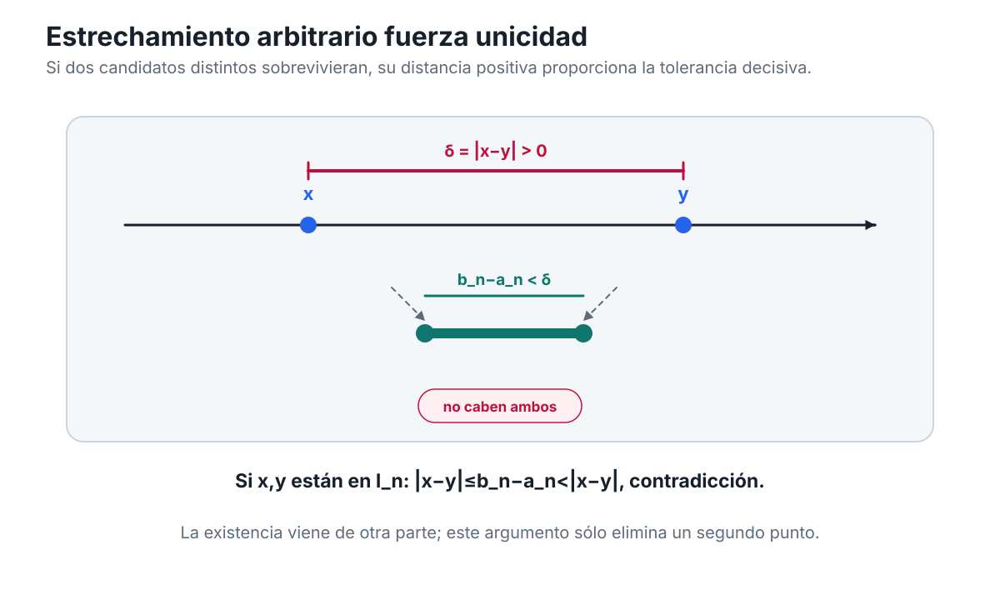{#fig-anm-c03-f07 fig-alt="Dos puntos x e y determinan delta igual a su distancia; un intervalo de ancho menor que delta no puede contenerlos a ambos."}

Este argumento de unicidad no usa encajamiento ni una aplicación de completitud. Sólo compara la distancia de dos hipotéticos puntos comunes con un ancho disponible menor. Tampoco produciría por sí solo un punto común: los intervalos $(0,1/n)$ se estrechan arbitrariamente y su intersección es vacía. Al recuperar las hipótesis del teorema anterior, la completitud asegura existencia y el estrechamiento asegura que no hay dos puntos distintos.

> **Teorema de unicidad por estrechamiento.** Sea
> $$
> I_n=[a_n,b_n]
> \ne\varnothing
> $$
> una familia numerable de intervalos cerrados encajados. Si además
> $$
> \forall\varepsilon>0\;\exists n:
> b_n-a_n<\varepsilon,
> $$
> entonces existe un único $x\in\mathbb R$ tal que
> $$
> x\in I_n
> \qquad\text{para todo }n.
> $$
> Equivalentemente,
> $$
> \bigcap_{n=1}^{\infty}I_n=\{x\}.
> $$

La familia constante $[0,1]$ muestra exactamente qué falta sin estrechamiento: para $\varepsilon=1/2$ ninguno de sus anchos queda por debajo de la tolerancia. Una manera concreta de obtenerlo es la **bisección**. Partimos de $J_0=[a,b]$. Si $a=b$, ya hay un único punto; supongamos $a<b$ y escribamos $L=b-a>0$. Dividimos en el punto medio $(a+b)/2$ y retenemos una de las dos mitades cerradas. Repitiendo la operación sobre el intervalo retenido obtenemos una familia cerrada no vacía y encajada. Por inducción, después de $k$ pasos su ancho es

$$
\operatorname{anch}(J_k)=\frac L{2^k}.
$$

Para demostrar estrechamiento no basta observar que cada ancho es menor que el anterior. Dada una tolerancia $\varepsilon>0$, necesitamos encontrar un índice finito cuyo ancho quede por debajo de ella. La propiedad arquimediana permite elegir $m\in\mathbb N_{>0}$ con $m>L/\varepsilon$. Por inducción, $2^r\ge r+1$ para todo $r\ge1$: vale para $r=1$, y de $2^r\ge r+1$ se sigue $2^{r+1}\ge2(r+1)\ge r+2$. Tomando $k=m$ obtenemos

$$
2^k\ge k+1>k=m>\frac L\varepsilon,
\qquad\text{y, por tanto,}\qquad
\frac L{2^k}<\varepsilon.
$$

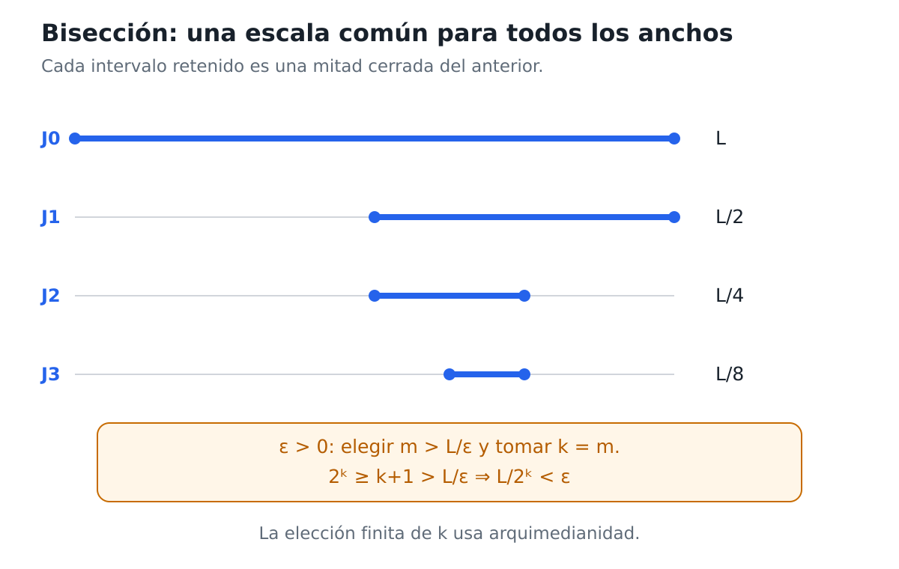{#fig-anm-c03-f08 fig-alt="Cuatro intervalos cerrados encajados muestran en una misma escala anchos exactamente L, L/2, L/4 y L/8; una regla arquimediana permite elegir k finito para cada tolerancia."}

La elección del índice usa arquimedianidad, derivada de completitud en §3.4; la existencia del punto común usa el teorema de intervalos cerrados encajados; la unicidad usa la contradicción métrica anterior. Las tres tareas se encuentran en la misma construcción, pero tienen justificaciones distintas. La conclusión es $\bigcap_{k=0}^{\infty}J_k=\{x\}$ para un único real $x$, sin necesidad de introducir todavía convergencia de sucesiones.

En una familia cerrada encajada, la descripción de §3.5 permite otra lectura. Si los anchos se estrechan arbitrariamente, $0\le t-s\le b_n-a_n$ fuerza $s=t$. Recíprocamente, si $s=t$ y $\varepsilon>0$, las caracterizaciones de C02 proporcionan índices $m,n$ con $a_m>s-\varepsilon/2$ y $b_n<s+\varepsilon/2$. Para $r=\max\{m,n\}$, el encajamiento da $a_r\ge a_m$ y $b_r\le b_n$, de modo que $b_r-a_r<\varepsilon$. Así, bajo estas hipótesis, el estrechamiento, la igualdad de barreras y la intersección puntual se reconocen mutuamente. La solución 31 desarrolla las tres equivalencias y su figura mantiene visibles las hipótesis de la familia.

[]{#MA-SEC-ANM-01-003-007}

### Antes de seguir

#### Microcontrol 46

[]{#MA-MIC-ANM-01-003-046}

¿Por qué el estrechamiento arbitrario, por sí solo, garantiza como máximo un punto pero no existencia?

[]{#MA-MSOL-ANM-01-003-046}

Ver solución del microcontrol 46

La hipótesis de estrechamiento dice

$$
\forall\varepsilon>0\;\exists n:
\quad b_n-a_n<\varepsilon.
$$

Supongamos que dos puntos distintos $x$ e $y$ pertenecen a todos los intervalos. Entonces

$$
\delta=|x-y|>0.
$$

Podemos usar $\varepsilon=\delta$ en la hipótesis y obtener un índice $n$ con

$$
b_n-a_n<\delta.
$$

Pero, como $x,y\in[a_n,b_n]$, necesariamente

$$
|x-y|\le b_n-a_n,
$$

lo que produce

$$
\delta\le b_n-a_n<\delta,
$$

una contradicción. Por tanto la intersección contiene **a lo sumo un punto**.

Sin embargo, esta argumentación comienza suponiendo que hay dos puntos candidatos; no construye ninguno. Una intersección puede ser vacía y satisfacer vacíamente la propiedad “contiene a lo sumo un punto”.

Así,

$$
\boxed{
\text{estrechamiento arbitrario}
\Longrightarrow
\left|\bigcap_n I_n\right|\le1,
}
$$

pero no

$$
\text{estrechamiento arbitrario}
\Longrightarrow
\bigcap_n I_n\ne\varnothing.
$$

Esta respuesta describe sólo el mecanismo de unicidad.

#### Microcontrol 47

[]{#MA-MIC-ANM-01-003-047}

Si $x\ne y$ pertenecieran a todos los intervalos, ¿por qué $\delta=|x-y|$ es una tolerancia legítima en la hipótesis de estrechamiento?

[]{#MA-MSOL-ANM-01-003-047}

Ver solución del microcontrol 47

La hipótesis de estrechamiento puede aplicarse a **cualquier** número real positivo $\varepsilon$.

Si

$$
x\ne y,
$$

entonces, por la propiedad definida positiva del valor absoluto,

$$
|x-y|>0.
$$

Por tanto

$$
\delta=|x-y|
$$

es un número real estrictamente positivo y satisface exactamente la condición exigida para desempeñar el papel de $\varepsilon$.

Así podemos sustituir legítimamente

$$
\varepsilon:=\delta=|x-y|
$$

en

$$
\forall\varepsilon>0\;\exists n:
\quad b_n-a_n<\varepsilon,
$$

y concluir que existe $n$ tal que

$$
\boxed{b_n-a_n<|x-y|.}
$$

No se ha elegido una tolerancia especial desde fuera del problema: la propia separación positiva entre los dos candidatos proporciona la escala que el estrechamiento debe superar.

#### Microcontrol 48

[]{#MA-MIC-ANM-01-003-048}

Si $x,y\in[a_n,b_n]$, demuestra que $|x-y|\le b_n-a_n$.

[]{#MA-MSOL-ANM-01-003-048}

Ver solución del microcontrol 48

Como

$$
x,y\in[a_n,b_n],
$$

tenemos

$$
a_n\le x\le b_n,
\qquad
a_n\le y\le b_n.
$$

Hay dos casos.

Si $x\le y$, entonces

$$
a_n\le x\le y\le b_n.
$$

Restando $x$ en la desigualdad $y\le b_n$ obtenemos

$$
y-x\le b_n-x.
$$

Y de $a_n\le x$ se sigue

$$
b_n-x\le b_n-a_n.
$$

Por transitividad,

$$
y-x\le b_n-a_n.
$$

Como $x\le y$,

$$
|x-y|=y-x,
$$

y por tanto

$$
|x-y|\le b_n-a_n.
$$

Si $y\le x$, el mismo argumento intercambiando $x$ e $y$ da

$$
x-y\le b_n-a_n.
$$

Ahora

$$
|x-y|=x-y.
$$

En ambos casos,

$$
\boxed{|x-y|\le b_n-a_n.}
$$

#### Microcontrol 49

[]{#MA-MIC-ANM-01-003-049}

¿Dónde aparece la contradicción al elegir $n$ con $b_n-a_n<|x-y|$?

[]{#MA-MSOL-ANM-01-003-049}

Ver solución del microcontrol 49

Si $x$ e $y$ pertenecen a todos los intervalos, entonces también pertenecen al intervalo particular $I_n=[a_n,b_n]$ elegido mediante el estrechamiento.

Por el microcontrol anterior,

$$
|x-y|\le b_n-a_n.
$$

Pero el índice $n$ fue escogido precisamente para que

$$
b_n-a_n<|x-y|.
$$

Al encadenar ambas desigualdades obtenemos

$$
\boxed{|x-y|\le b_n-a_n<|x-y|.}
$$

Por transitividad esto implicaría

$$
|x-y|<|x-y|,
$$

lo cual es imposible.

Ésa es la contradicción exacta. Por tanto la hipótesis $x\ne y$ no puede mantenerse y necesariamente

$$
x=y.
$$

La contradicción usa sólo pertenencia al intervalo, distancia y estrechamiento.

#### Microcontrol 50

[]{#MA-MIC-ANM-01-003-050}

¿Qué parte del teorema “la intersección es un singleton” hereda completitud desde §3.5?

[]{#MA-MSOL-ANM-01-003-050}

Ver solución del microcontrol 50

La conclusión

$$
\bigcap_{n=1}^{\infty}I_n=\{x\}
$$

combina dos afirmaciones lógicamente distintas.

La primera es **existencia**:

$$
\bigcap_{n=1}^{\infty}I_n\ne\varnothing.
$$

Ésta es la parte heredada de §3.5. Allí se construyó

$$
A=\{a_n:n\ge1\}
$$

y se usó completitud exactamente para obtener

$$
x=\sup A.
$$

Después se probó que $x\in I_n$ para todo $n$.

La segunda afirmación es **unicidad**:

$$
\left|\bigcap_{n=1}^{\infty}I_n\right|\le1.
$$

Ésta procede del estrechamiento arbitrario y no requiere una segunda aplicación del principio del supremo.

Por tanto,

$$
\boxed{
\underbrace{\text{existencia}}_{\text{hereda completitud desde §3.5}}
+
\underbrace{\text{unicidad}}_{\text{estrechamiento}}
\Longrightarrow
\text{singleton}.
}
$$

#### Microcontrol 51

[]{#MA-MIC-ANM-01-003-051}

¿Por qué la prueba de unicidad no necesita una segunda aplicación del principio del supremo?

[]{#MA-MSOL-ANM-01-003-051}

Ver solución del microcontrol 51

Una vez que estudiamos la unicidad, el argumento ya no necesita producir un nuevo extremo.

Suponemos que existen dos candidatos comunes $x$ e $y$ y, buscando contradicción, que

$$
x\ne y.
$$

Entonces

$$
\delta=|x-y|>0.
$$

La hipótesis de estrechamiento produce un índice $n$ con

$$
b_n-a_n<\delta.
$$

Como ambos puntos pertenecen a $I_n$,

$$
\delta=|x-y|\le b_n-a_n,
$$

y aparece la contradicción.

En ninguno de esos pasos se construye un supremo ni un ínfimo. Se usan solamente:

- positividad de la distancia entre puntos distintos;
- la hipótesis cuantificada de estrechamiento;
- la desigualdad $|x-y|\le b_n-a_n$ para dos puntos de un mismo intervalo.

Así,

$$
\boxed{
\text{la completitud produce existencia una vez;}
\quad
\text{el estrechamiento fuerza unicidad sin otro SUP.}
}
$$

#### Microcontrol 52

[]{#MA-MIC-ANM-01-003-052}

Explica por qué $I_n=[0,1]$ viola exactamente la hipótesis de estrechamiento.

[]{#MA-MSOL-ANM-01-003-052}

Ver solución del microcontrol 52

Para la familia constante

$$
I_n=[0,1]
\qquad\text{para todo }n,
$$

el ancho de cada intervalo es

$$
b_n-a_n=1-0=1.
$$

La hipótesis de estrechamiento exigiría que para **todo** $\varepsilon>0$ existiera algún $n$ con

$$
1<\varepsilon.
$$

Basta elegir una tolerancia positiva menor que $1$, por ejemplo

$$
\varepsilon=\frac12.
$$

Entonces la condición requerida sería

$$
1<\frac12,
$$

lo cual es falso para todos los índices.

Por tanto,

$$
\boxed{
\exists\varepsilon>0\;\forall n:
\quad b_n-a_n\ge\varepsilon,
}
$$

y falla exactamente el estrechamiento arbitrario.

Las demás hipótesis sí se cumplen: los intervalos son cerrados, no vacíos y encajados. Por eso este ejemplo aísla con precisión la necesidad de la nueva condición para obtener unicidad.

#### Microcontrol 53

[]{#MA-MIC-ANM-01-003-053}

¿Por qué los intervalos abiertos $(0,1/n)$ muestran que estrechamiento no sustituye a la hipótesis de existencia?

[]{#MA-MSOL-ANM-01-003-053}

Ver solución del microcontrol 53

Consideremos

$$
J_n=\left(0,\frac1n\right).
$$

Su ancho es

$$
\frac1n-0=\frac1n.
$$

Dado cualquier $\varepsilon>0$, la propiedad arquimediana permite elegir $n$ tal que

$$
\frac1n<\varepsilon.
$$

Por tanto la familia satisface la condición de estrechamiento arbitrario.

Sin embargo, como ya se demostró en §3.5,

$$
\bigcap_{n=1}^{\infty}J_n=\varnothing.
$$

El problema es que los intervalos son abiertos: el mecanismo de existencia de §3.5 para intervalos **cerrados** encajados no se aplica.

Así, el estrechamiento sólo controla cuántos puntos podrían sobrevivir; no obliga a que sobreviva alguno:

$$
\boxed{
\text{estrechamiento}
\not\Rightarrow
\text{existencia}.
}
$$

La existencia y la unicidad son capas lógicas distintas.

En este argumento, la finura $1/n<\varepsilon$ usa indirectamente la completitud a través de la propiedad arquimediana, pero eso no repara la falta de la hipótesis cerrada de existencia.

#### Microcontrol 54

[]{#MA-MIC-ANM-01-003-054}

Verifica por inducción que tras $k$ bisecciones el ancho es $L/2^k$.

[]{#MA-MSOL-ANM-01-003-054}

Ver solución del microcontrol 54

Sea $L>0$ el ancho inicial del intervalo $J_0$.

Demostraremos por inducción que

$$
\operatorname{anch}(J_k)=\frac{L}{2^k}
$$

para todo $k\ge0$.

**Caso base: $k=0$.** Por definición,

$$
\operatorname{anch}(J_0)=L=\frac{L}{2^0}.
$$

**Paso inductivo.** Supongamos que para cierto $k\ge0$ se cumple

$$
\operatorname{anch}(J_k)=\frac{L}{2^k}.
$$

La siguiente etapa conserva una de las dos mitades cerradas de $J_k$. Cada mitad tiene exactamente la mitad del ancho de $J_k$. Por tanto,

$$
\operatorname{anch}(J_{k+1})
=\frac12\operatorname{anch}(J_k)
=\frac12\frac{L}{2^k}
=\frac{L}{2^{k+1}}.
$$

Por inducción,

$$
\boxed{
\operatorname{anch}(J_k)=\frac{L}{2^k}
\quad\text{para todo }k\ge0.
}
$$

#### Microcontrol 55

[]{#MA-MIC-ANM-01-003-055}

Demuestra por inducción que $2^r\ge r+1$ para todo $r\ge1$.

[]{#MA-MSOL-ANM-01-003-055}

Ver solución del microcontrol 55

Procedemos por inducción sobre $r$.

**Caso base: $r=1$.**

$$
2^1=2=1+1.
$$

Luego la desigualdad vale para $r=1$.

**Paso inductivo.** Supongamos que para cierto $r\ge1$ tenemos

$$
2^r\ge r+1.
$$

Multiplicando por $2>0$,

$$
2^{r+1}=2\cdot2^r\ge2(r+1).
$$

Ahora

$$
2(r+1)=2r+2
$$

y, como $r\ge0$,

$$
2r+2\ge r+2.
$$

Por tanto,

$$
2^{r+1}\ge r+2=(r+1)+1.
$$

La propiedad queda demostrada para $r+1$.

Concluimos por inducción que

$$
\boxed{2^r\ge r+1\quad\text{para todo }r\ge1.}
$$

#### Microcontrol 56

[]{#MA-MIC-ANM-01-003-056}

Dado $\varepsilon>0$, reconstruye el argumento finito que produce $k$ con $L/2^k<\varepsilon$ sin usar notación de límite.

[]{#MA-MSOL-ANM-01-003-056}

Ver solución del microcontrol 56

Supongamos $L>0$ y fijemos

$$
\varepsilon>0.
$$

Como

$$
\frac{L}{\varepsilon}>0,
$$

la propiedad arquimediana garantiza que existe

$$
m\in\mathbb N_{>0}
$$

tal que

$$
m>\frac{L}{\varepsilon}.
$$

Tomemos

$$
k=m.
$$

Por el resultado inductivo anterior,

$$
2^k=2^m\ge m+1>m>\frac{L}{\varepsilon}.
$$

Todos los términos son positivos. Al tomar recíprocos, el orden se invierte:

$$
\frac1{2^k}<\frac{\varepsilon}{L}.
$$

Multiplicando por $L>0$ obtenemos

$$
\boxed{
\frac{L}{2^k}<\varepsilon.
}
$$

El argumento es enteramente finito: dada una tolerancia concreta, produce un entero concreto $k$ cuya existencia queda garantizada por arquimedianidad. No se ha escrito ni utilizado ninguna afirmación de límite.

En este argumento, la elección de $m$ usa arquimedianidad; ésta fue derivada previamente de completitud, de modo que aquí la dependencia de completitud es indirecta.

#### Microcontrol 57

[]{#MA-MIC-ANM-01-003-057}

Señala por separado dónde intervienen completitud, arquimedianidad, encajamiento y estrechamiento en el argumento de bisección.

[]{#MA-MSOL-ANM-01-003-057}

Ver solución del microcontrol 57

Las cuatro piezas cumplen funciones distintas.

**1. Encajamiento.** La construcción por bisección conserva una mitad de la etapa anterior, de modo que

$$
J_{k+1}\subseteq J_k.
$$

Junto con cierre y no vaciedad, esto prepara la aplicación del resultado de §3.5.

**2. Completitud.** En §3.5, para una familia cerrada, no vacía y encajada, la completitud produce un punto común mediante

$$
x=\sup\{a_k:k\ge0\}.
$$

Por tanto,

$$
\bigcap_k J_k\ne\varnothing.
$$

Éste es el componente de existencia.

**3. Arquimedianidad.** Dada $\varepsilon>0$, permite elegir un entero $m$ con

$$
m>\frac{L}{\varepsilon}.
$$

Combinada con $2^m\ge m+1$, produce un $k$ finito tal que

$$
\frac{L}{2^k}<\varepsilon.
$$

Así se verifica que la bisección puede hacerse arbitrariamente fina. Como la arquimedianidad fue derivada de completitud, ésta es una dependencia **indirecta**.

**4. Estrechamiento.** Una vez establecida

$$
\forall\varepsilon>0\;\exists k:
\operatorname{anch}(J_k)<\varepsilon,
$$

si dos puntos distintos sobrevivieran en todos los intervalos, su distancia positiva proporcionaría una tolerancia incompatible con algún ancho. Esto da unicidad.

La arquitectura completa es, por tanto,

$$
\boxed{
\begin{aligned}
\text{encajamiento + cierre}
&\Longrightarrow_{\text{completitud}}
\text{existencia},\\
\text{completitud}
&\Longrightarrow
\text{arquimedianidad}
\Longrightarrow
\text{bisección arbitrariamente fina},\\
\text{estrechamiento}
&\Longrightarrow
\text{unicidad}.
\end{aligned}
}
$$

No se usa convergencia como argumento en ninguna de estas tres cadenas.

Ya podemos pasar de “queda algún punto” a “queda exactamente uno” cuando las restricciones cerradas pueden estrecharse por debajo de cualquier tolerancia positiva. La siguiente sección comparará esta formulación de refinamiento con otros lenguajes de completitud, cuidando de distinguir equivalencias estructurales de consecuencias particulares.

### Ejercicios de la sección 3.6

#### Ejercicio 26. El estrechamiento controla la cardinalidad sin usar encajamiento

[]{#MA-EX-ANM-01-003-026}

Sea
$$
I_n=[a_n,b_n],
\qquad n\in\mathbb N_{>0},
$$
una familia de intervalos no vacíos. No supongas que está encajada.

Supón únicamente que
$$
\forall\varepsilon>0\;\exists n\in\mathbb N_{>0}:
\quad b_n-a_n<\varepsilon.
$$

Demuestra que
$$
\left|\bigcap_{n=1}^{\infty}I_n\right|\le1.
$$

La prueba debe:

1. comenzar suponiendo que existen dos puntos distintos
   $$
   x,y\in\bigcap_n I_n;
   $$
2. definir
   $$
   \delta=|x-y|>0;
   $$
3. usar la hipótesis de estrechamiento con $\varepsilon=\delta$;
4. demostrar directamente que, si $x,y\in[a_n,b_n]$, entonces
   $$
   |x-y|\le b_n-a_n;
   $$
5. obtener la contradicción
   $$
   \delta\le b_n-a_n<\delta.
   $$

Al final, identifica cuáles de las hipótesis habituales de §3.5 —cierre, encajamiento y completitud— no son necesarias para esta afirmación de **a lo sumo un punto**.

[]{#MA-SOL-ANM-01-003-026}

Ver solución del ejercicio 26

Supongamos que existen dos puntos distintos
$$
x,y\in\bigcap_{n=1}^{\infty}I_n.
$$
Como $x\ne y$,
$$
\delta=|x-y|>0.
$$
La hipótesis de estrechamiento puede aplicarse con la tolerancia positiva $\varepsilon=\delta$. Existe entonces un índice $n$ tal que
$$
b_n-a_n<\delta.
$$

Como $x,y$ pertenecen a la intersección, ambos pertenecen en particular a $I_n=[a_n,b_n]$. Por tanto,
$$
a_n\le x\le b_n,
\qquad
a_n\le y\le b_n.
$$

Si $x\le y$, entonces
$$
0\le y-x\le b_n-a_n,
$$
y como en este caso $|x-y|=y-x$,
$$
|x-y|\le b_n-a_n.
$$
Si $y\le x$, el mismo argumento con los nombres intercambiados da
$$
|x-y|=x-y\le b_n-a_n.
$$
En ambos casos,
$$
\delta=|x-y|\le b_n-a_n.
$$
Junto con la elección de $n$ obtenemos
$$
\delta\le b_n-a_n<\delta,
$$
contradicción.

Así no pueden existir dos puntos distintos en la intersección:
$$
\boxed{
\left|\bigcap_{n=1}^{\infty}I_n\right|\le1.
}
$$

Es importante notar qué **no** se usó. No usamos que la familia estuviera encajada. Tampoco usamos completitud ni el principio del supremo. El argumento sólo necesita que los dos candidatos hipotéticos pertenezcan simultáneamente a cada intervalo y que exista algún intervalo más estrecho que su distancia.

El cierre tampoco participa en la contradicción de unicidad en sí misma: incluso para intervalos abiertos o semiabiertos, si dos puntos pertenecen a un mismo intervalo de extremos $a_n<b_n$, su distancia no puede superar $b_n-a_n$. El cierre es crucial en §3.5 para la **garantía de existencia**, no para esta afirmación de cardinalidad máxima.

Es una prueba puramente métrica y de orden.

#### Ejercicio 27. Desmontar el teorema del singleton en piezas lógicas

[]{#MA-EX-ANM-01-003-027}

Sean
$$
I_n=[a_n,b_n]\ne\varnothing
$$
intervalos cerrados encajados que satisfacen
$$
\forall\varepsilon>0\;\exists n:
\quad b_n-a_n<\varepsilon.
$$

Reconstruye la afirmación
$$
\bigcap_n I_n=\{x\}
$$
como una cadena de dependencias y clasifica cada paso en una de estas categorías:

- **completitud directa**;
- **consecuencia ya demostrada de completitud**;
- **orden / distancia / teoría elemental de conjuntos**;
- **hipótesis adicional de estrechamiento**.

Tu auditoría debe separar explícitamente:

1. la existencia de algún punto común mediante §3.5;
2. el paso de §3.5 donde se produce
   $$
   x=\sup\{a_n:n\ge1\};
   $$
3. la prueba de que dos puntos distintos no pueden sobrevivir al estrechamiento;
4. la inferencia
   $$
   \text{al menos uno}+\text{a lo sumo uno}
   \Longrightarrow
   \text{exactamente uno};
   $$
5. el caso especial en que el estrechamiento se obtiene por bisección y se usa la propiedad arquimediana para elegir un número finito de refinamientos.

Dibuja al final, en texto matemático, dos rutas de dependencia: una para **existencia** y otra para **unicidad**, y explica por qué no deben fusionarse en una sola apelación vaga a “completitud”.

[]{#MA-SOL-ANM-01-003-027}

Ver solución del ejercicio 27

La conclusión
$$
\bigcap_n I_n=\{x\}
$$
combina dos afirmaciones diferentes:

$$
\bigcap_n I_n\ne\varnothing
$$
y
$$
\left|\bigcap_n I_n\right|\le1.
$$

#### Ruta de existencia

Como los intervalos son cerrados, no vacíos y encajados, §3.5 forma
$$
A=\{a_n:n\ge1\}.
$$
El encajamiento produce la compatibilidad cruzada
$$
a_m\le b_n
\qquad\text{para todos }m,n,
$$
de modo que $A$ es no vacío y está acotado superiormente.

Entonces aparece el único paso **directo** de completitud de esta ruta:
$$
\boxed{
A\ne\varnothing,\ A\text{ acotado superiormente}
\Longrightarrow_{\mathrm{SUP}}
\exists x=\sup A.
}
$$
Después,
$$
a_n\le x\le b_n
$$
se deduce de que $x$ es cota superior de $A$ y de que es la menor de esas cotas. El cierre permite transformar esas desigualdades en
$$
x\in[a_n,b_n].
$$
Por tanto,
$$
x\in\bigcap_n I_n.
$$

Clasificación:

- compatibilidad cruzada: orden e inclusión;
- no vaciedad y acotación de $A$: teoría elemental de conjuntos y orden;
- existencia de $x=\sup A$: **completitud directa**;
- $a_n\le x\le b_n$: propiedades del supremo ya existente;
- $x\in I_n$: definición de intervalo cerrado.

#### Ruta de unicidad

Supongamos que
$$
x,y\in\bigcap_n I_n
$$
y que $x\ne y$. Entonces
$$
\delta=|x-y|>0.
$$
La **hipótesis adicional de estrechamiento** produce un índice $n$ con
$$
b_n-a_n<\delta.
$$
Pero la pertenencia simultánea de $x$ e $y$ a $I_n$ da
$$
\delta=|x-y|\le b_n-a_n,
$$
contradicción.

Esta ruta usa sólo:

- distancia;
- orden;
- pertenencia a intervalos;
- la hipótesis cuantificada de estrechamiento.

No hay una nueva aplicación de completitud.

#### Combinar las rutas

La primera ruta da
$$
\left|\bigcap_n I_n\right|\ge1.
$$
La segunda da
$$
\left|\bigcap_n I_n\right|\le1.
$$
Por tanto,
$$
\boxed{
\left|\bigcap_n I_n\right|=1.
}
$$

#### Si el estrechamiento proviene de bisección

En una bisección,
$$
\operatorname{anch}(J_k)=\frac{L}{2^k}.
$$
Para una tolerancia dada $\varepsilon>0$, la propiedad arquimediana permite escoger un natural $m>L/\varepsilon$. Junto con
$$
2^m\ge m+1>m
$$
obtenemos
$$
2^m>\frac{L}{\varepsilon},
$$
y por tanto
$$
\frac{L}{2^m}<\varepsilon.
$$

Aquí la propiedad arquimediana es una **consecuencia ya demostrada de completitud** en §3.4. Por eso la bisección tiene una dependencia indirecta adicional:

$$
\text{completitud}
\Longrightarrow
\text{arquimedianidad}
\Longrightarrow
\text{estrechamiento de bisección}.
$$

Las dos rutas básicas quedan así:
$$
\boxed{
\text{completitud}
\Longrightarrow
\text{existencia en intervalos cerrados encajados},
}
$$
y
$$
\boxed{
\text{estrechamiento arbitrario}
\Longrightarrow
\text{unicidad}.
}
$$

Fusionarlas en la frase “por completitud queda un único punto” borra una diferencia lógica importante: completitud produce aquí el **objeto existente**; el estrechamiento elimina la posibilidad de que haya dos objetos distintos.

#### Ejercicio 28. «Se hace cada vez más pequeño» no es todavía una prueba

[]{#MA-EX-ANM-01-003-028}

Un estudiante parte de un intervalo de ancho $L>0$, lo biseca repetidamente y escribe:

> Después de $k$ bisecciones el ancho es $L/2^k$. Como cada vez es más pequeño, para cualquier $\varepsilon>0$ llegará un momento en que $L/2^k<\varepsilon$. Por tanto la intersección contiene exactamente un punto.

Diagnostica el argumento.

1. Explica por qué la frase «cada vez es más pequeño» no demuestra por sí sola la afirmación cuantificada
   $$
   \forall\varepsilon>0\;\exists k:
   \quad \frac{L}{2^k}<\varepsilon.
   $$
2. Repara ese paso sin usar límites: parte de la propiedad arquimediana y de
   $$
   2^r\ge r+1
   \qquad(r\ge1)
   $$
   para producir explícitamente un $k$ finito adecuado.
3. Identifica un segundo salto lógico en la frase «por tanto la intersección contiene exactamente un punto»: ¿qué argumento adicional garantiza **existencia**?
4. Separa finalmente qué parte usa arquimedianidad, qué parte hereda completitud de §3.5 y qué parte es la prueba elemental de unicidad.

No escribas $\lim_{k\to\infty}L/2^k$ ni cites resultados sobre sucesiones.

[]{#MA-SOL-ANM-01-003-028}

Ver solución del ejercicio 28

La frase “cada vez es más pequeño” sólo afirma, en el mejor de los casos, que
$$
\frac{L}{2^{k+1}}<\frac{L}{2^k}.
$$
Eso es una comparación entre etapas consecutivas. La afirmación que necesitamos es mucho más fuerte:
$$
\forall\varepsilon>0\;\exists k:
\quad
\frac{L}{2^k}<\varepsilon.
$$
La primera proposición no contiene por sí sola la cuantificación sobre **toda** tolerancia positiva.

Reparemos el argumento sin límites.

Sea $\varepsilon>0$. Como
$$
\frac{L}{\varepsilon}>0,
$$
la propiedad arquimediana proporciona
$$
m\in\mathbb N_{>0}
$$
tal que
$$
m>\frac{L}{\varepsilon}.
$$
Por inducción elemental sabemos que
$$
2^r\ge r+1
\qquad(r\ge1).
$$
Tomando $k=m$,
$$
2^k=2^m\ge m+1>m>\frac{L}{\varepsilon}.
$$
Todos los términos son positivos, así que
$$
\frac1{2^k}<\frac{\varepsilon}{L},
$$
y multiplicando por $L>0$,
$$
\boxed{
\frac{L}{2^k}<\varepsilon.
}
$$

Éste es un argumento **finito**: dada la tolerancia, produce un índice concreto cuya existencia está justificada por arquimedianidad.

Queda un segundo problema en el razonamiento del estudiante. Del estrechamiento sólo se deduce que la intersección contiene **a lo sumo un punto**. Para afirmar que contiene exactamente uno necesitamos antes una garantía de existencia.

En la construcción por bisección, los intervalos retenidos son:

- cerrados;
- no vacíos;
- encajados.

Por §3.5,
$$
\bigcap_k J_k\ne\varnothing.
$$
Esa existencia hereda el uso directo de completitud presente en la prueba de §3.5.

Una vez existe algún punto común, el estrechamiento demostrado arriba da unicidad:
$$
\left|\bigcap_k J_k\right|\le1.
$$
Combinando ambas afirmaciones,
$$
\boxed{
\left|\bigcap_k J_k\right|=1.
}
$$

La trazabilidad correcta es:

- **arquimedianidad:** produce un número finito de refinamientos suficiente para una tolerancia dada;
- **completitud vía §3.5:** garantiza que la intersección cerrada y encajada no es vacía;
- **orden y distancia:** prueban que el estrechamiento impide dos puntos distintos.

No se necesita ninguna afirmación sobre convergencia.

#### Ejercicio 29. Estrechamiento arbitrario sin punto común

[]{#MA-EX-ANM-01-003-029}

Considera la familia semiabierta
$$
J_k=\left(0,\frac1{2^k}\right],
\qquad k=0,1,2,\dots.
$$

Demuestra que:

1. cada $J_k$ es no vacío;
2. la familia está encajada:
   $$
   J_{k+1}\subseteq J_k;
   $$
3. para toda $\varepsilon>0$ existe un $k$ finito tal que
   $$
   \frac1{2^k}<\varepsilon;
   $$
4. sin embargo,
   $$
   \bigcap_{k=0}^{\infty}J_k=\varnothing.
   $$

En los apartados 3 y 4 no uses lenguaje de límites. Puedes usar la propiedad arquimediana y la desigualdad elemental $2^r\ge r+1$.

Concluye con precisión qué demuestra este ejemplo acerca de la afirmación
$$
\text{estrechamiento arbitrario}
\Longrightarrow
\text{existencia de un punto común}.
$$

[]{#MA-SOL-ANM-01-003-029}

Ver solución del ejercicio 29

Consideremos
$$
J_k=\left(0,\frac1{2^k}\right].
$$

Cada intervalo es no vacío porque, por ejemplo,
$$
\frac1{2^{k+1}}\in J_k:
$$
en efecto,
$$
0<\frac1{2^{k+1}}<\frac1{2^k}.
$$

Además,
$$
\frac1{2^{k+1}}<\frac1{2^k},
$$
de modo que
$$
0<x\le\frac1{2^{k+1}}
\Longrightarrow
0<x\le\frac1{2^k}.
$$
Por tanto,
$$
\boxed{J_{k+1}\subseteq J_k.}
$$

Ahora sea $\varepsilon>0$. Por arquimedianidad existe
$$
m\in\mathbb N_{>0}
$$
tal que
$$
m>\frac1{\varepsilon}.
$$
Como
$$
2^m\ge m+1>m>\frac1{\varepsilon},
$$
al invertir obtenemos
$$
\boxed{
\frac1{2^m}<\varepsilon.
}
$$
Así la familia posee estrechamiento arbitrario.

Falta estudiar la intersección. Supongamos que
$$
x\in\bigcap_{k=0}^{\infty}J_k.
$$
Entonces, por pertenecer a todos los $J_k$,
$$
x>0.
$$
Aplicamos el argumento anterior con $\varepsilon=x$. Existe $k$ tal que
$$
\frac1{2^k}<x.
$$
Pero pertenecer a $J_k$ exigiría
$$
x\le\frac1{2^k},
$$
contradicción.

Luego
$$
\boxed{
\bigcap_{k=0}^{\infty}J_k=\varnothing.
}
$$

La familia es no vacía etapa por etapa, está encajada y puede hacerse arbitrariamente estrecha, pero excluye el punto fronterizo que sería necesario para conservar una intersección.

Por tanto es falsa la implicación universal
$$
\text{estrechamiento arbitrario}
\Longrightarrow
\text{existencia de punto común}.
$$
El estrechamiento controla **cuántos** puntos pueden sobrevivir, no garantiza que sobreviva alguno.

#### Ejercicio 30. Refinar en $p$ partes en vez de bisecar

[]{#MA-EX-ANM-01-003-030}

Sea
$$
p\in\mathbb N,
\qquad p\ge2,
$$
y sea
$$
J_0=[a,b],
\qquad a<b,
\qquad L=b-a.
$$

En cada etapa divide el intervalo retenido en $p$ subintervalos cerrados de igual ancho y conserva uno de ellos. Así se obtiene una cadena
$$
J_0\supseteq J_1\supseteq J_2\supseteq\cdots.
$$

Demuestra que:

1. después de $k$ refinamientos,
   $$
   \operatorname{anch}(J_k)=\frac{L}{p^k};
   $$
2. para todo $r\ge1$,
   $$
   p^r\ge2^r\ge r+1;
   $$
3. dado $\varepsilon>0$, la propiedad arquimediana permite elegir un $k$ finito con
   $$
   \frac{L}{p^k}<\varepsilon;
   $$
4. la familia satisface las hipótesis de existencia de §3.5 y la hipótesis de unicidad de §3.6;
5. por tanto existe un único $x\in\mathbb R$ tal que
   $$
   \bigcap_{k=0}^{\infty}J_k=\{x\}.
   $$

Explica qué parte del argumento cambia respecto de la bisección y qué parte permanece idéntica. No uses teoría de convergencia.

[]{#MA-SOL-ANM-01-003-030}

Ver solución del ejercicio 30

Partimos de
$$
J_0=[a,b],
\qquad
L=b-a>0.
$$

En cada paso el intervalo retenido se divide en $p$ partes de igual ancho y se conserva una de ellas. Por tanto, cada refinamiento divide el ancho por $p$.

Demostremos por inducción que
$$
\operatorname{anch}(J_k)=\frac{L}{p^k}.
$$

Para $k=0$,
$$
\operatorname{anch}(J_0)=L=\frac{L}{p^0}.
$$
Si
$$
\operatorname{anch}(J_k)=\frac{L}{p^k},
$$
cada uno de los $p$ subintervalos tiene ancho
$$
\frac1p\frac{L}{p^k}
=
\frac{L}{p^{k+1}}.
$$
Así la fórmula vale para todo $k$.

Como $p\ge2$,
$$
p^r\ge2^r
$$
para todo $r\ge1$. Además, por la inducción ya usada en §3.6,
$$
2^r\ge r+1.
$$
Luego
$$
\boxed{
p^r\ge2^r\ge r+1.
}
$$

Sea ahora $\varepsilon>0$. La propiedad arquimediana da un natural positivo $m$ con
$$
m>\frac{L}{\varepsilon}.
$$
Tomemos
$$
k=m.
$$
Entonces
$$
p^k\ge2^k\ge k+1>k=m>\frac{L}{\varepsilon}.
$$
Al invertir y multiplicar por $L>0$,
$$
\boxed{
\frac{L}{p^k}<\varepsilon.
}
$$
Por tanto la familia se estrecha por debajo de cualquier tolerancia positiva.

Además, en cada etapa el intervalo retenido es uno de los subintervalos cerrados de $J_k$. Por construcción:

- $J_k$ es cerrado;
- $J_k\ne\varnothing$;
- $J_{k+1}\subseteq J_k$.

El teorema de §3.5 garantiza
$$
\bigcap_{k=0}^{\infty}J_k\ne\varnothing.
$$
El estrechamiento demostrado arriba garantiza
$$
\left|\bigcap_{k=0}^{\infty}J_k\right|\le1.
$$
En consecuencia existe un único real $x$ con
$$
\boxed{
\bigcap_{k=0}^{\infty}J_k=\{x\}.
}
$$

Respecto de la bisección sólo cambia la razón de reducción del ancho:
$$
\frac12
\quad\longrightarrow\quad
\frac1p.
$$
Permanece idéntica la arquitectura lógica:

$$
\text{familia cerrada y encajada}
\Longrightarrow_{\text{§3.5}}
\text{existencia},
$$
y
$$
\text{ancho arbitrariamente pequeño}
\Longrightarrow
\text{unicidad}.
$$

#### Ejercicio 31. Tres formas de reconocer que el núcleo es un solo punto

[]{#MA-EX-ANM-01-003-031}

Sea
$$
I_n=[a_n,b_n]\ne\varnothing
$$
una familia numerable de intervalos cerrados encajados. Define
$$
A=\{a_n:n\ge1\},
\qquad
B=\{b_n:n\ge1\},
$$
y, usando §3.5,
$$
s=\sup A,
\qquad
t=\inf B.
$$

Demuestra la equivalencia entre las siguientes afirmaciones:

1. **estrechamiento arbitrario**
   $$
   \forall\varepsilon>0\;\exists n:
   \quad b_n-a_n<\varepsilon;
   $$
2. **coincidencia de las barreras**
   $$
   s=t;
   $$
3. **intersección puntual**
   $$
   \bigcap_{n=1}^{\infty}I_n
   \text{ contiene exactamente un punto}.
   $$

Para probar $1\Rightarrow2$, no uses convergencia: demuestra que
$$
0\le t-s\le b_n-a_n
$$
para todo $n$ y aplica el estrechamiento a la tolerancia $t-s$ si fuera positiva.

Para probar $2\Rightarrow1$, usa las caracterizaciones $\varepsilon$ del supremo y del ínfimo de C02: para una tolerancia dada, encuentra índices $m,n$ que acerquen $a_m$ a $s$ y $b_n$ a $t$, y usa el encajamiento con un índice posterior común.

Para relacionar 2 y 3, puedes usar el resultado de §3.5
$$
\bigcap_n I_n=[s,t].
$$

Cierra el ejercicio indicando exactamente dónde se requiere completitud para disponer de $s$ y $t$, y por qué las equivalencias posteriores no constituyen nuevas aplicaciones del principio del supremo.

[]{#MA-SOL-ANM-01-003-031}

Ver solución del ejercicio 31

Por §3.5, para la familia cerrada, no vacía y encajada existen
$$
s=\sup A,
\qquad
t=\inf B,
$$
y además
$$
\boxed{
\bigcap_{n=1}^{\infty}I_n=[s,t].
}
$$
En particular,
$$
s\le t.
$$

Demostraremos
$$
1\Longleftrightarrow2\Longleftrightarrow3.
$$

#### $1\Rightarrow2$: estrechamiento implica coincidencia de barreras

Para cada $n$,
$$
a_n\le s\le t\le b_n.
$$
La primera desigualdad usa que $s$ es cota superior de $A$; la última, que $t$ es cota inferior de $B$.

Restando,
$$
0\le t-s\le b_n-a_n
$$
para todo $n$.

Supongamos que
$$
t-s>0.
$$
Podemos usar la hipótesis de estrechamiento con
$$
\varepsilon=t-s.
$$
Existe entonces $n$ tal que
$$
b_n-a_n<t-s.
$$
Pero ya sabemos que
$$
t-s\le b_n-a_n.
$$
Contradicción. Por tanto,
$$
\boxed{s=t.}
$$

#### $2\Rightarrow1$: coincidencia de barreras implica estrechamiento

Supongamos ahora
$$
s=t
$$
y sea $\varepsilon>0$.

Por la caracterización $\varepsilon$ del supremo de C02, existe un índice $m$ tal que
$$
s-\frac{\varepsilon}{2}<a_m\le s.
$$
Por la caracterización $\varepsilon$ del ínfimo, existe un índice $n$ tal que
$$
t\le b_n<t+\frac{\varepsilon}{2}.
$$

Como $s=t$, obtenemos
$$
a_m>s-\frac{\varepsilon}{2},
\qquad
b_n<s+\frac{\varepsilon}{2}.
$$

Tomemos
$$
r=\max\{m,n\}.
$$
El encajamiento implica que los extremos izquierdos no retroceden y los derechos no avanzan:
$$
a_m\le a_r,
\qquad
b_r\le b_n.
$$
Por tanto,
$$
a_r>s-\frac{\varepsilon}{2}
$$
y
$$
b_r<s+\frac{\varepsilon}{2}.
$$
Restando,
$$
b_r-a_r
<
\left(s+\frac{\varepsilon}{2}\right)
-
\left(s-\frac{\varepsilon}{2}\right)
=
\varepsilon.
$$
Así,
$$
\boxed{
\forall\varepsilon>0\;\exists r:
\quad b_r-a_r<\varepsilon.
}
$$

No hemos usado convergencia: sólo las caracterizaciones $\varepsilon$ del supremo e ínfimo y el encajamiento.

#### $2\Longleftrightarrow3$: barreras coincidentes e intersección puntual

Como
$$
\bigcap_n I_n=[s,t],
$$
si $s=t$ entonces
$$
\bigcap_n I_n=[s,s]=\{s\},
$$
de modo que la intersección contiene exactamente un punto.

Recíprocamente, si la intersección contiene exactamente un punto, el intervalo
$$
[s,t]
$$
contiene exactamente un punto. Como $s\le t$, esto sólo puede ocurrir si
$$
s=t.
$$

Concluimos la equivalencia completa:
$$
\boxed{
\begin{aligned}
&\forall\varepsilon>0\;\exists n:\ b_n-a_n<\varepsilon\\
&\qquad\Longleftrightarrow\qquad
\sup_n a_n=\inf_n b_n\\
&\qquad\Longleftrightarrow\qquad
\bigcap_n[a_n,b_n]\text{ es un singleton}.
\end{aligned}
}
$$

La trazabilidad es importante. La completitud se usa para garantizar que existen
$$
s=\sup A
\qquad\text{y}\qquad
t=\inf B
$$
bajo las hipótesis correspondientes. Una vez disponibles esas barreras, las implicaciones anteriores usan únicamente:

- orden;
- encajamiento;
- caracterizaciones $\varepsilon$ ya demostradas;
- teoría elemental de intervalos.

Por tanto, las equivalencias posteriores no son nuevas aplicaciones del principio del supremo.

La figura [C03-F11](#fig-anm-c03-f11) comprime estas tres descripciones equivalentes y mantiene fuera del triángulo el único antecedente estructural: la existencia previa de $s$ y $t$.

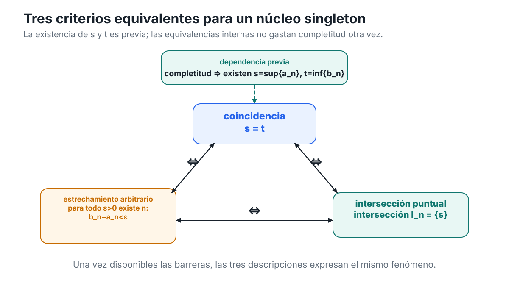{#fig-anm-c03-f11 fig-alt="Diagrama triangular de equivalencias entre estrechamiento, coincidencia s=t e intersección puntual, con completitud indicada sólo como dependencia previa para la existencia de s y t."}

## 3.7. Tres lenguajes para una recta sin huecos

La prueba de intervalos encajados construyó un punto entre todos los extremos izquierdos y todos los derechos. Ese mecanismo puede estudiarse directamente con dos conjuntos. La **propiedad de separación**, que abreviaremos **SEP**, afirma que si $A,B\subseteq\mathbb R$ son no vacíos y

$$
a\le b\qquad\text{para todo }a\in A,\ b\in B,
$$

existe $c\in\mathbb R$ tal que $a\le c\le b$ para todo ese par de elementos. No se exige una distancia positiva entre los conjuntos ni que el separador quede fuera de ellos. Puede incluso pertenecer a ambos.

Para obtener SEP a partir de SUP, usamos que algún $b_0\in B$ es cota superior de $A$. Como $A$ es no vacío, por completitud existe $s=\sup A$. La condición de cota da $a\le s$ para todo $a\in A$, y cada $b\in B$ es otra cota superior, así que la minimalidad da $s\le b$. El propio $s$ separa las dos clases.

La conversa revela por qué la separación tiene tanta fuerza. Sea $A$ no vacío y acotado superiormente. Las clases $A$ y $U(A)$ son no vacías y satisfacen $a\le u$ para todo $a\in A$ y $u\in U(A)$. Si SEP produce $c$ entre ambas, la desigualdad $a\le c$ para todos los elementos hace de $c$ una cota superior, mientras que $c\le u$ para todas las cotas asegura su minimalidad. Por tanto, $c=\sup A$ y

$$
\mathrm{SUP}\Longleftrightarrow\mathrm{SEP}.
$$

### Familias generales de intervalos cerrados

Consideremos una familia $([a_i,b_i])_{i\in I}$, con $I\ne\varnothing$, que satisface la **condición cruzada**

$$
a_i\le b_j\qquad\text{para todos }i,j\in I.
$$

Al tomar índices iguales se obtiene $a_i\le b_i$, de modo que cada intervalo es no vacío. El **principio general de intersección de intervalos cerrados**, abreviado **GCI**, afirma que bajo esa condición hay un real $c$ que pertenece a todos los intervalos:

$$
\bigcap_{i\in I}[a_i,b_i]\ne\varnothing.
$$

El conjunto de índices puede ser arbitrario; no suponemos numerabilidad ni encajamiento. Para deducir GCI de SEP, formamos $A_L=\{a_i:i\in I\}$ y $A_R=\{b_i:i\in I\}$. Son no vacíos y la condición cruzada dice que cada elemento de $A_L$ es menor o igual que cada elemento de $A_R$. SEP produce $c$ con $a_i\le c\le b_j$ para todos los índices; tomando $j=i$, ese mismo $c$ pertenece a cada intervalo.

Para deducir SEP de GCI, partimos de dos clases no vacías $A,B$ con $a\le b$ para todo par. Tomamos la familia de intervalos $[a,b]$ indexada por $A\times B$. Si $(a,b)$ y $(a',b')$ son índices cualesquiera, la hipótesis da $a\le b'$, que es la condición cruzada requerida. GCI proporciona un punto $c$ común a todos. Fijando $b_0\in B$ y dejando variar $a$, obtenemos $a\le c$ para todo $a\in A$; fijando $a_0\in A$ y dejando variar $b$, obtenemos $c\le b$ para todo $b\in B$. La no vaciedad de ambas clases permite esas elecciones y completa la prueba de separación.

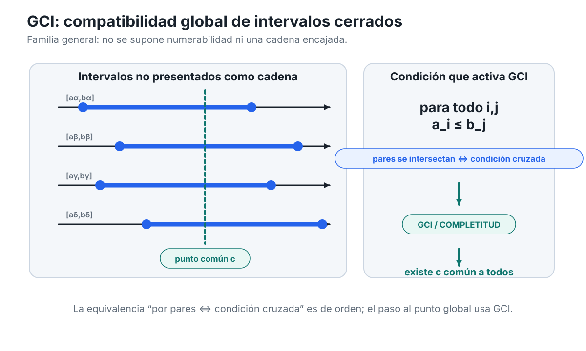{#fig-anm-c03-f05 fig-alt="Varios intervalos cerrados no presentados como cadena comparten un punto; un panel lateral separa condición cruzada, compatibilidad por pares y el uso de GCI."}

La condición cruzada equivale, para estos intervalos en una recta ordenada, a que se intersecten por pares. Si un punto $x$ pertenece a $[a_i,b_i]\cap[a_j,b_j]$, entonces $a_i\le x\le b_j$ y $a_i\le b_j$. En sentido inverso, supongamos la condición cruzada y fijemos $i,j$. El punto $l=\max\{a_i,a_j\}$ es mayor o igual que ambos extremos izquierdos y menor o igual que ambos derechos, pues cada extremo izquierdo está por debajo de cada extremo derecho. Así $l$ pertenece a los dos intervalos. Esta equivalencia usa sólo el orden y la definición de intervalo; el paso de intersecciones por pares a un punto común a **toda** la familia es el que requiere GCI.

Combinando las demostraciones con la reflexión de §3.3 obtenemos

$$
\mathrm{SUP}\Longleftrightarrow\mathrm{INF}
\Longleftrightarrow\mathrm{SEP}\Longleftrightarrow\mathrm{GCI}.
$$

Podemos expresar la misma completitud mediante una barrera extremal, un separador o un punto común. Las equivalencias convierten los objetos que cada formulación produce; por eso no necesitamos acumular cuatro principios independientes.

### Recuperar una barrera desde intervalos

La familia $\{[a,u]:(a,u)\in A\times U(A)\}$ permite ver directamente cómo GCI recupera SUP. Si $A$ es no vacío y acotado superiormente, también lo es el conjunto de índices $A\times U(A)$. Para dos índices $(a,u)$ y $(a',u')$, tenemos $a\le u'$ porque $u'$ domina a todo $A$. Un punto común $c$ satisface $a\le c\le u$ para cada par: es cota superior de $A$ y menor o igual que todas sus cotas superiores, luego es su supremo. En sentido inverso, cualquier supremo de $A$ pertenece a todos esos intervalos. La barrera, el separador y el punto común son aquí el mismo número.

También podemos obtener GCI directamente de SUP: los extremos izquierdos forman un conjunto no vacío acotado superiormente por cada extremo derecho. Su supremo queda por encima de todos los primeros y por debajo de todos los segundos. La prueba de §3.5 es la misma construcción aplicada a una familia cuya condición cruzada proviene del encajamiento.

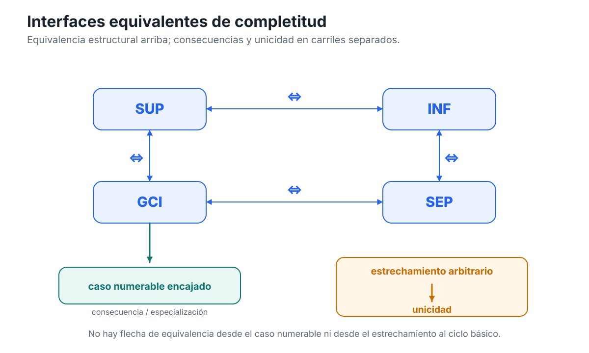{#fig-anm-c03-f09 fig-alt="Cuatro nodos equivalentes forman un ciclo; una flecha unilateral baja al caso numerable encajado y un carril separado lleva del estrechamiento a unicidad."}

El teorema numerable encajado queda así como una especialización de GCI. La dirección demostrada es $\mathrm{GCI}\Rightarrow\mathrm{NESTED\_INTERVALS}_{\mathbb N}$. No invertimos esa flecha sin demostrar la conversa y precisar las hipótesis del sistema ordenado en que se formula. En particular, una frase informal sobre «intervalos encajados» no permite identificar versiones distintas del principio. La condición de estrechamiento añade otra conclusión: garantiza unicidad una vez asegurada existencia y no es una hipótesis de GCI.

El fallo racional de §3.1 se expresa en los tres lenguajes. Tomemos $A=S_2$ y $B=U_{\mathbb Q}(S_2)$. Ambas clases son no vacías y todo elemento de $A$ es menor o igual que todo elemento de $B$. Si hubiera un separador racional $c$, sería cota superior racional y quedaría por debajo de todas las demás: sería el supremo racional inexistente. Tampoco puede haber un punto racional común a todos los intervalos $[a,b]_{\mathbb Q}=\{q\in\mathbb Q:a\le q\le b\}$, indexados por $A\times B$, porque ese punto sería un separador. Los intervalos satisfacen la condición cruzada y se intersectan por pares; lo que falla dentro de $\mathbb Q$ es la intersección global. La densidad no resuelve esa exigencia simultánea.

[]{#MA-SEC-ANM-01-003-008}

### Antes de seguir

#### Microcontrol 58

[]{#MA-MIC-ANM-01-003-058}

En la prueba `SUP ⇒ SEP`, ¿por qué la no vaciedad de $B$ permite demostrar que $A$ está acotado superiormente?

[]{#MA-MSOL-ANM-01-003-058}

Ver solución del microcontrol 58

La no vaciedad de $B$ permite **elegir un testigo concreto** $b_0\in B$.

La hipótesis cruzada de separación dice

$$
a\le b
\qquad
\text{para todo }a\in A,\ b\in B.
$$

Como $b_0\in B$, podemos especializar el cuantificador universal en $b=b_0$. Entonces

$$
a\le b_0
\qquad
\text{para todo }a\in A.
$$

Ésta es exactamente la definición de que $b_0$ sea una cota superior de $A$. Por tanto,

$$
b_0\in U(A),
$$

y en particular

$$
U(A)\ne\varnothing.
$$

Así, la no vaciedad de $B$ no es decorativa: proporciona el elemento que certifica la acotación superior de $A$, una de las hipótesis necesarias para aplicar **SUP**.

Aquí sólo se verifica la hipótesis de acotación superior.

#### Microcontrol 59

[]{#MA-MIC-ANM-01-003-059}

Una vez definido $s=\sup A$, ¿por qué cada $b\in B$ debe satisfacer $s\le b$?

[]{#MA-MSOL-ANM-01-003-059}

Ver solución del microcontrol 59

Sea $b\in B$ cualquiera.

Por la condición cruzada,

$$
a\le b
\qquad
\text{para todo }a\in A.
$$

Luego $b$ es una cota superior de $A$:

$$
b\in U(A).
$$

Como

$$
s=\sup A
$$

es la **menor** de todas las cotas superiores de $A$, debe cumplirse

$$
s\le b.
$$

Y como $b\in B$ era arbitrario,

$$
\boxed{s\le b\quad\text{para todo }b\in B.}
$$

Junto con $a\le s$ para todo $a\in A$, esto demuestra que $s$ separa ambas clases.

La completitud proporcionó $s=\sup A$; la desigualdad posterior usa su minimalidad.

#### Microcontrol 60

[]{#MA-MIC-ANM-01-003-060}

En la prueba `SEP ⇒ SUP`, ¿por qué un separador entre $A$ y $U(A)$ es automáticamente una cota superior de $A$?

[]{#MA-MSOL-ANM-01-003-060}

Ver solución del microcontrol 60

En la prueba **SEP $\Rightarrow$ SUP** aplicamos separación a las dos clases

$$
A
\qquad\text{y}\qquad
U(A).
$$

El separador $c$ satisface

$$
a\le c\le u
\qquad
\text{para todo }a\in A,\ u\in U(A).
$$

La mitad izquierda de esta doble desigualdad es

$$
a\le c
\qquad
\forall a\in A.
$$

Pero ésa es exactamente la definición de cota superior. Por tanto,

$$
\boxed{c\in U(A).}
$$

No hace falta ninguna inferencia adicional: la propiedad de separación ya entrega universalmente que $c$ domina a todos los elementos de $A$.

#### Microcontrol 61

[]{#MA-MIC-ANM-01-003-061}

¿Qué parte de la desigualdad $a\le c\le u$ demuestra que $c$ es la **menor** cota superior?

[]{#MA-MSOL-ANM-01-003-061}

Ver solución del microcontrol 61

La desigualdad

$$
a\le c\le u
\qquad
\forall a\in A,\ u\in U(A)
$$

contiene dos informaciones distintas.

La primera,

$$
a\le c
\qquad
\forall a\in A,
$$

demuestra que $c$ es una cota superior de $A$, es decir,

$$
c\in U(A).
$$

La segunda,

$$
c\le u
\qquad
\forall u\in U(A),
$$

afirma que $c$ está por debajo de **toda** cota superior de $A$.

Por tanto, entre los elementos de $U(A)$, $c$ es el menor:

$$
c=\min U(A).
$$

Y por la definición de supremo,

$$
\boxed{c=\sup A.}
$$

Así, la parte que demuestra la **minimalidad** es precisamente

$$
\boxed{c\le u\quad\forall u\in U(A).}
$$

#### Microcontrol 62

[]{#MA-MIC-ANM-01-003-062}

Formula con todos sus cuantificadores la condición cruzada de **GCI**.

[]{#MA-MSOL-ANM-01-003-062}

Ver solución del microcontrol 62

Sea una familia no vacía de intervalos cerrados

$$
\bigl([a_i,b_i]\bigr)_{i\in I},
\qquad
I\ne\varnothing.
$$

La condición cruzada de **GCI** se escribe con todos sus cuantificadores como

$$
\boxed{
\forall i\in I\;\forall j\in I:
\quad a_i\le b_j.
}
$$

Es importante que los índices sean **independientes**: no se exige sólo

$$
a_i\le b_i,
$$

sino que cada extremo izquierdo $a_i$ quede a la izquierda de **cada** extremo derecho $b_j$, incluso cuando $i\ne j$.

Ésta es la compatibilidad global que permitirá encontrar un mismo real $c$ con

$$
a_i\le c\le b_i
\qquad
\forall i\in I.
$$

#### Microcontrol 63

[]{#MA-MIC-ANM-01-003-063}

¿Por qué la condición cruzada implica que cada intervalo $[a_i,b_i]$ es no vacío?

[]{#MA-MSOL-ANM-01-003-063}

Ver solución del microcontrol 63

La condición cruzada afirma

$$
\forall i,j\in I:
\quad a_i\le b_j.
$$

En particular podemos tomar

$$
j=i.
$$

Entonces, para cada $i\in I$,

$$
a_i\le b_i.
$$

Pero un intervalo cerrado

$$
[a_i,b_i]
$$

es no vacío exactamente cuando su extremo izquierdo no excede al derecho. De hecho,

$$
a_i\in[a_i,b_i]
$$

porque

$$
a_i\le a_i\le b_i.
$$

Por tanto,

$$
\boxed{[a_i,b_i]\ne\varnothing\quad\text{para todo }i\in I.}
$$

La no vaciedad individual de cada intervalo es así una consecuencia inmediata de la condición cruzada.

#### Microcontrol 64

[]{#MA-MIC-ANM-01-003-064}

En la prueba `SEP ⇒ GCI`, explica por qué separar los conjuntos de extremos izquierdos y derechos produce un punto perteneciente a **todos** los intervalos.

[]{#MA-MSOL-ANM-01-003-064}

Ver solución del microcontrol 64

En la prueba **SEP $\Rightarrow$ GCI** formamos los conjuntos de extremos

$$
A_L=\{a_i:i\in I\},
\qquad
A_R=\{b_i:i\in I\}.
$$

La condición cruzada

$$
a_i\le b_j
\qquad
\forall i,j\in I
$$

dice exactamente que

$$
a\le b
\qquad
\forall a\in A_L,\ b\in A_R.
$$

Por **SEP** existe entonces un real $c$ tal que

$$
a\le c\le b
\qquad
\forall a\in A_L,\ b\in A_R.
$$

Ahora fijemos un índice $i\in I$. Como

$$
a_i\in A_L
\qquad\text{y}\qquad
b_i\in A_R,
$$

la propiedad del separador da

$$
a_i\le c\le b_i.
$$

Luego

$$
c\in[a_i,b_i].
$$

Como $i$ era arbitrario,

$$
\boxed{
c\in\bigcap_{i\in I}[a_i,b_i].
}
$$

La clave es que SEP controla simultáneamente **todos** los extremos izquierdos y **todos** los derechos; por eso el mismo $c$ pertenece a cada intervalo.

#### Microcontrol 65

[]{#MA-MIC-ANM-01-003-065}

En la prueba `GCI ⇒ SEP`, ¿por qué usamos la familia indexada por $A\times B$?

[]{#MA-MSOL-ANM-01-003-065}

Ver solución del microcontrol 65

En **GCI $\Rightarrow$ SEP** partimos de dos conjuntos no vacíos $A,B\subseteq\mathbb R$ tales que

$$
a\le b
\qquad
\forall a\in A,\ b\in B.
$$

Queremos obtener un único $c$ que satisfaga simultáneamente

$$
a\le c
\qquad\forall a\in A
$$

y

$$
c\le b
\qquad\forall b\in B.
$$

Para codificar **todas** esas desigualdades en lenguaje intervalar necesitamos imponer la restricción

$$
c\in[a,b]
$$

para cada combinación posible de un extremo izquierdo $a\in A$ y un extremo derecho $b\in B$.

La colección natural de índices es, por tanto,

$$
A\times B.
$$

A cada par $(a,b)$ asociamos

$$
I_{(a,b)}=[a,b].
$$

Usar sólo algunos pares podría dejar fuera alguna de las restricciones universales. En cambio, indexar por el producto cartesiano conserva exactamente los dos cuantificadores:

$$
\boxed{
\forall a\in A\;\forall b\in B.
}
$$

Por eso $A\times B$ es la indexación correcta.

#### Microcontrol 66

[]{#MA-MIC-ANM-01-003-066}

Justifica cuidadosamente por qué un punto común a todos los intervalos $[a,b]$, con $(a,b)\in A\times B$, queda por encima de todo $A$ y por debajo de todo $B$.

[]{#MA-MSOL-ANM-01-003-066}

Ver solución del microcontrol 66

Supongamos que

$$
c\in[a,b]
\qquad
\text{para todo }(a,b)\in A\times B.
$$

Debemos separar los dos cuantificadores.

Como $B\ne\varnothing$, fijemos un elemento

$$
b_0\in B.
$$

Sea ahora $a\in A$ arbitrario. Entonces

$$
(a,b_0)\in A\times B.
$$

Por la propiedad de $c$,

$$
c\in[a,b_0],
$$

y por tanto

$$
a\le c.
$$

Como $a$ era arbitrario,

$$
\boxed{a\le c\quad\forall a\in A.}
$$

Análogamente, como $A\ne\varnothing$, fijemos

$$
a_0\in A.
$$

Para cualquier $b\in B$,

$$
(a_0,b)\in A\times B,
$$

de modo que

$$
c\in[a_0,b]
$$

y, por tanto,

$$
c\le b.
$$

Como $b$ era arbitrario,

$$
\boxed{c\le b\quad\forall b\in B.}
$$

Juntando ambas conclusiones,

$$
\boxed{
a\le c\le b
\qquad
\forall a\in A,\ b\in B.
}
$$

Así el punto común es exactamente un separador.

#### Microcontrol 67

[]{#MA-MIC-ANM-01-003-067}

¿Cómo recupera directamente **GCI** el supremo de un conjunto $A$ usando la familia $[a,u]$ con $u\in U(A)$?

[]{#MA-MSOL-ANM-01-003-067}

Ver solución del microcontrol 67

Sea $A\subseteq\mathbb R$ no vacío y acotado superiormente. Entonces

$$
U(A)\ne\varnothing.
$$

Consideremos la familia de intervalos

$$
[a,u],
\qquad
(a,u)\in A\times U(A).
$$

La familia es no vacía porque ambos factores lo son.

Verifiquemos la condición cruzada de **GCI**. Tomemos dos índices

$$
(a,u),\ (a',u')\in A\times U(A).
$$

Como $u'\in U(A)$, el número $u'$ es cota superior de $A$. En particular, como $a\in A$,

$$
a\le u'.
$$

Por GCI existe un punto común $c$ a todos los intervalos:

$$
c\in[a,u]
\qquad
\forall(a,u)\in A\times U(A).
$$

De aquí obtenemos las dos propiedades del supremo.

Fijando cualquier $u_0\in U(A)$, para todo $a\in A$,

$$
c\in[a,u_0]
\Longrightarrow
a\le c.
$$

Luego $c$ es cota superior de $A$.

Fijando cualquier $a_0\in A$, para todo $u\in U(A)$,

$$
c\in[a_0,u]
\Longrightarrow
c\le u.
$$

Así $c$ es menor o igual que toda cota superior.

Por tanto,

$$
\boxed{c=\sup A.}
$$

Esto muestra directamente

$$
\boxed{\mathrm{GCI}\Longrightarrow\mathrm{SUP}.}
$$

#### Microcontrol 68

[]{#MA-MIC-ANM-01-003-068}

¿Por qué el caso numerable encajado de §3.5 satisface la condición cruzada?

[]{#MA-MSOL-ANM-01-003-068}

Ver solución del microcontrol 68

En §3.5, para una familia cerrada y encajada

$$
I_n=[a_n,b_n],
\qquad
I_{n+1}\subseteq I_n,
$$

se demostró que los extremos satisfacen

$$
a_m\le b_n
\qquad
\text{para todos }m,n\in\mathbb N_{>0}.
$$

Ésta es exactamente la condición cruzada de **GCI** para la familia indexada por

$$
I=\mathbb N_{>0}:
$$

$$
\forall m\in\mathbb N_{>0}\;
\forall n\in\mathbb N_{>0}:
\quad a_m\le b_n.
$$

Por tanto toda familia numerable de intervalos cerrados no vacíos y encajados considerada en §3.5 es un caso particular de las familias admitidas por GCI.

De ahí,

$$
\boxed{
\mathrm{GCI}
\Longrightarrow
\bigcap_{n=1}^{\infty}[a_n,b_n]\ne\varnothing.
}
$$

#### Microcontrol 69

[]{#MA-MIC-ANM-01-003-069}

¿Por qué en este libro escribimos `GCI ⇒ caso numerable encajado` y no cerramos automáticamente una equivalencia en sentido inverso?

[]{#MA-MSOL-ANM-01-003-069}

Ver solución del microcontrol 69

Porque lo demostrado en esta arquitectura es una implicación **desde la formulación general hacia un caso particular**:

$$
\mathrm{GCI}
\Longrightarrow
\mathrm{NESTED\_INTERVALS}_{\mathbb N}.
$$

La razón es que una familia numerable encajada satisface la condición cruzada y, por tanto, entra en GCI.

Pero de que una propiedad valga para una clase particular de familias —las numerables y encajadas— no se sigue automáticamente que permita resolver el caso general de familias arbitrariamente indexadas y sólo cruzadamente compatibles.

Para escribir una equivalencia inversa habría que demostrar explícitamente

$$
\mathrm{NESTED\_INTERVALS}_{\mathbb N}
\Longrightarrow
\mathrm{GCI},
$$

con las hipótesis exactas necesarias. Esa demostración no se ha establecido como parte de la arquitectura de C03.

Por eso el libro conserva la afirmación lógicamente justificada:

$$
\boxed{
\mathrm{GCI}
\Longrightarrow
\text{caso numerable encajado},
}
$$

y evita convertir “caso particular” en “formulación equivalente” por mera semejanza verbal.

#### Microcontrol 70

[]{#MA-MIC-ANM-01-003-070}

Explica por qué el estrechamiento arbitrario pertenece a la capa de unicidad y no a la equivalencia básica `SUP ⇔ INF ⇔ SEP ⇔ GCI`.

[]{#MA-MSOL-ANM-01-003-070}

Ver solución del microcontrol 70

La cadena básica de equivalencias trata de **existencia estructural**:

$$
\mathrm{SUP}
\Longleftrightarrow
\mathrm{INF}
\Longleftrightarrow
\mathrm{SEP}
\Longleftrightarrow
\mathrm{GCI}.
$$

Cada una de esas formulaciones garantiza, en un lenguaje distinto, la existencia de un objeto requerido: una barrera extremal, un separador o un punto común.

El estrechamiento arbitrario,

$$
\forall\varepsilon>0\;\exists n:
\quad b_n-a_n<\varepsilon,
$$

cumple otra función. Si dos puntos distintos $x,y$ pertenecieran a todos los intervalos, entonces

$$
\delta=|x-y|>0
$$

sería una tolerancia legítima. El estrechamiento produciría un intervalo con ancho menor que $\delta$, contradiciendo que contenga a ambos.

Por tanto,

$$
\boxed{
\text{estrechamiento arbitrario}
\Longrightarrow
\text{unicidad},
}
$$

no existencia.

La existencia del punto proviene de la infraestructura de completitud; el estrechamiento elimina la posibilidad de que sobrevivan dos puntos diferentes. Por eso pertenece a una capa adicional y no constituye, sin más, una quinta formulación equivalente.

#### Microcontrol 71

[]{#MA-MIC-ANM-01-003-071}

Para $S_2\subseteq\mathbb Q$, demuestra que un separador racional entre $S_2$ y sus cotas superiores racionales sería necesariamente $\sup_{\mathbb Q}S_2$.

[]{#MA-MSOL-ANM-01-003-071}

Ver solución del microcontrol 71

Sea

$$
S_2\subseteq\mathbb Q
$$

y sea

$$
U_{\mathbb Q}(S_2)
$$

el conjunto de sus cotas superiores racionales.

Supongamos que existiera un separador racional

$$
c\in\mathbb Q
$$

tal que

$$
a\le c\le u
\qquad
\forall a\in S_2,\ 
\forall u\in U_{\mathbb Q}(S_2).
$$

La mitad izquierda,

$$
a\le c
\qquad
\forall a\in S_2,
$$

dice que $c$ es una cota superior racional de $S_2$. Por tanto,

$$
c\in U_{\mathbb Q}(S_2).
$$

La mitad derecha,

$$
c\le u
\qquad
\forall u\in U_{\mathbb Q}(S_2),
$$

dice que $c$ es menor o igual que toda cota superior racional.

Así,

$$
c=\min U_{\mathbb Q}(S_2),
$$

es decir,

$$
\boxed{c=\sup_{\mathbb Q}S_2.}
$$

Pero §3.1 estableció que ese supremo racional no existe. Por contradicción, tampoco puede existir tal separador racional.

Así se traduce exactamente el fallo de SUP al lenguaje SEP.

#### Microcontrol 72

[]{#MA-MIC-ANM-01-003-072}

Explica cómo el mismo fallo de $\mathbb Q$ puede leerse como ausencia de supremo, ausencia de separador y fallo de una intersección general de intervalos cerrados racionales.

[]{#MA-MSOL-ANM-01-003-072}

Ver solución del microcontrol 72

El mismo defecto estructural de $\mathbb Q$ puede describirse en tres vocabularios.

**1. Lenguaje de supremos.**

Para

$$
S_2=\{q\in\mathbb Q:0\le q,\ q^2<2\},
$$

sabemos que $S_2\ne\varnothing$ y que está acotado superiormente en $\mathbb Q$, pero

$$
\boxed{\sup_{\mathbb Q}S_2\text{ no existe}.}
$$

Éste es el fallo de **SUP**.

**2. Lenguaje de separación.**

Tomemos

$$
A=S_2,
\qquad
B=U_{\mathbb Q}(S_2).
$$

Ambos son no vacíos y

$$
a\le b
\qquad
\forall a\in A,\ b\in B.
$$

Si existiera un separador racional $c$, el microcontrol anterior demuestra que necesariamente

$$
c=\sup_{\mathbb Q}S_2,
$$

lo cual es imposible. Por tanto,

$$
\boxed{\text{no existe separador racional para }A\text{ y }B.}
$$

Éste es el fallo de **SEP**.

**3. Lenguaje intervalar.**

Para cada

$$
(a,b)\in A\times B
$$

consideremos el intervalo cerrado racional

$$
[a,b]_{\mathbb Q}
=
\{q\in\mathbb Q:a\le q\le b\}.
$$

La familia satisface la condición cruzada. Si existiera

$$
c\in\bigcap_{(a,b)\in A\times B}[a,b]_{\mathbb Q},
$$

entonces $c$ estaría por encima de todo $A$ y por debajo de todo $B$. Sería, por tanto, un separador racional y finalmente el supremo racional inexistente.

Luego

$$
\boxed{
\bigcap_{(a,b)\in A\times B}[a,b]_{\mathbb Q}
=\varnothing.
}
$$

Éste es el fallo de **GCI**.

Por tanto, no son tres defectos independientes:

$$
\boxed{
\text{sin supremo racional}
\Longleftrightarrow
\text{sin separador racional}
\Longleftrightarrow
\text{falla la intersección general racional}.
}
$$

La densidad de $\mathbb Q$ no corrige ninguno de estos fallos; lo que falta es la garantía de existencia de la frontera compatible exigida.

Hemos comprobado que “no tener huecos” no es una metáfora única, sino una estructura que puede reconocerse en varios lenguajes equivalentes. La última sección del capítulo ya no añadirá una nueva formulación: organizará **dónde se gasta la completitud**, qué resultados la usan directamente y cuáles la heredan a través de consecuencias ya demostradas.

### Ejercicios de la sección 3.7

#### Ejercicio 32. El mismo objeto en tres lenguajes

[]{#MA-EX-ANM-01-003-032}

Sea $A\subseteq\mathbb R$ no vacío y acotado superiormente, y sea

$$
U(A)=\{u\in\mathbb R:\forall a\in A,\ a\le u\}.
$$

Traduce la búsqueda de $\sup A$ a los otros dos lenguajes equivalentes de §3.7.

1. En lenguaje **SUP**, escribe las dos propiedades que debe satisfacer un número $s$ para ser $\sup A$.
2. En lenguaje **SEP**, considera las clases $A$ y $U(A)$. Demuestra que un número $c$ las separa,
   $$
   a\le c\le u
   \qquad
   \forall a\in A,\ \forall u\in U(A),
   $$
   si y sólo si $c=\sup A$.
3. En lenguaje **GCI**, considera la familia
   $$
   \mathcal I_A=\{[a,u]:(a,u)\in A\times U(A)\}.
   $$
   Verifica su condición cruzada y demuestra que un punto común $c$ a todos los intervalos de $\mathcal I_A$ existe exactamente cuando existe un separador entre $A$ y $U(A)$.
4. Concluye que, para este conjunto $A$, los tres vocabularios no producen tres objetos distintos: cualquier testigo válido debe ser el mismo real.

Indica qué parte del argumento es una mera **traducción lógica** y qué parte necesita una hipótesis estructural de existencia si todavía no sabemos que el objeto existe.

[]{#MA-SOL-ANM-01-003-032}

Ver solución del ejercicio 32

Partimos de un conjunto

$$
A\subseteq\mathbb R,
\qquad
A\ne\varnothing,
$$

acotado superiormente. Por tanto,

$$
U(A)\ne\varnothing.
$$

La traducción debe conservar exactamente las dos propiedades que caracterizan a la menor cota superior.

#### Lenguaje SUP

Un número $s$ es el supremo de $A$ si y sólo si satisface simultáneamente:

1. **condición de cota superior**
   $$
   a\le s
   \qquad
   \forall a\in A;
   $$
2. **minimalidad entre las cotas superiores**
   $$
   s\le u
   \qquad
   \forall u\in U(A).
   $$

Juntas,

$$
\boxed{
\forall a\in A\;\forall u\in U(A):
\quad a\le s\le u.
}
$$

#### Lenguaje SEP

Un separador $c$ entre $A$ y $U(A)$ satisface, por definición,

$$
a\le c\le u
\qquad
\forall a\in A,\ \forall u\in U(A).
$$

La desigualdad izquierda dice que $c$ es cota superior de $A$:

$$
c\in U(A).
$$

La desigualdad derecha dice que $c$ queda por debajo de **toda** cota superior de $A$.

Por tanto, $c$ es la menor cota superior:

$$
\boxed{c=\sup A.}
$$

Recíprocamente, si $s=\sup A$, entonces por las dos propiedades definitorias anteriores

$$
a\le s\le u
\qquad
\forall a\in A,\ \forall u\in U(A),
$$

de modo que $s$ separa $A$ y $U(A)$.

Así,

$$
\boxed{
c\text{ separa }A\text{ y }U(A)
\Longleftrightarrow
c=\sup A.
}
$$

#### Lenguaje GCI

Consideremos

$$
\mathcal I_A
=
\{[a,u]:(a,u)\in A\times U(A)\}.
$$

Como $A\ne\varnothing$ y $U(A)\ne\varnothing$,

$$
A\times U(A)\ne\varnothing.
$$

Verifiquemos la condición cruzada. Tomemos dos índices cualesquiera

$$
(a,u),\ (a',u')\in A\times U(A).
$$

Como $u'$ es cota superior de $A$ y $a\in A$,

$$
a\le u'.
$$

Ésta es precisamente la condición cruzada entre el extremo izquierdo del primer intervalo y el extremo derecho del segundo.

Ahora sea $c$ un punto común a toda la familia. Entonces

$$
c\in[a,u]
\qquad
\forall(a,u)\in A\times U(A).
$$

Esto significa

$$
a\le c\le u
\qquad
\forall a\in A,\ \forall u\in U(A),
$$

porque, para fijar un $a$ cualquiera, podemos combinarlo con alguna cota superior $u_0\in U(A)$, y para fijar un $u$ cualquiera podemos combinarlo con algún $a_0\in A$.

Por tanto, un punto común de $\mathcal I_A$ es exactamente un separador entre $A$ y $U(A)$.

Recíprocamente, si $c$ separa $A$ y $U(A)$, entonces para todo par $(a,u)$ tenemos

$$
a\le c\le u,
$$

y por tanto

$$
c\in[a,u].
$$

Así,

$$
\boxed{
c\in\bigcap_{(a,u)\in A\times U(A)}[a,u]
\Longleftrightarrow
c\text{ separa }A\text{ y }U(A).
}
$$

Combinando las traducciones,

$$
\boxed{
\begin{aligned}
c=\sup A
&\Longleftrightarrow
c\text{ separa }A\text{ y }U(A)\\
&\Longleftrightarrow
c\in\bigcap_{(a,u)\in A\times U(A)}[a,u].
\end{aligned}
}
$$

No aparecen tres objetos distintos. Aparecen tres descripciones del mismo testigo.

La **traducción** entre las descripciones usa sólo definiciones, cuantificadores y orden. Otra cuestión es la **existencia** del testigo. Si no sabemos todavía que existe, necesitamos alguna formulación estructural de completitud —SUP, SEP o GCI— para producirlo.

#### Ejercicio 33. De SUP a GCI sin pasar por SEP

[]{#MA-EX-ANM-01-003-033}

Supón válido el principio del supremo **SUP**. Sea

$$
\bigl([a_i,b_i]\bigr)_{i\in I}
$$

una familia no vacía de intervalos cerrados que satisface la condición cruzada

$$
a_i\le b_j
\qquad
\forall i,j\in I.
$$

Demuestra **directamente**, sin invocar SEP como lema intermedio, que

$$
\bigcap_{i\in I}[a_i,b_i]\ne\varnothing.
$$

Tu prueba debe:

1. definir
   $$
   L=\{a_i:i\in I\};
   $$
2. justificar que $L\ne\varnothing$;
3. demostrar que cualquier extremo derecho $b_j$ es una cota superior de $L$;
4. localizar el único `Paso de completitud` al producir
   $$
   s=\sup L;
   $$
5. demostrar para cada $i\in I$ que
   $$
   a_i\le s\le b_i;
   $$
6. concluir que $s$ pertenece a todos los intervalos.

Cierra comparando esta ruta directa con la ruta `SUP ⇒ SEP ⇒ GCI`: ¿qué parte matemática es la misma aunque cambie el vocabulario intermedio?

[]{#MA-SOL-ANM-01-003-033}

Ver solución del ejercicio 33

Sea

$$
\bigl([a_i,b_i]\bigr)_{i\in I}
$$

una familia no vacía que satisface

$$
a_i\le b_j
\qquad
\forall i,j\in I.
$$

Definamos el conjunto de extremos izquierdos

$$
L=\{a_i:i\in I\}.
$$

#### No vaciedad de $L$

Como la familia es no vacía,

$$
I\ne\varnothing.
$$

Elegimos algún índice $i_0\in I$. Entonces

$$
a_{i_0}\in L,
$$

de modo que

$$
L\ne\varnothing.
$$

#### Acotación superior de $L$

Fijemos cualquier índice $j\in I$. La condición cruzada afirma que

$$
a_i\le b_j
\qquad
\forall i\in I.
$$

Por definición, eso significa que

$$
b_j
$$

es una cota superior de $L$.

Como al menos existe un índice $j$, hemos demostrado que $L$ está acotado superiormente.

> **Único Paso de completitud.** Como $L$ es no vacío y está acotado superiormente, SUP garantiza que existe
>
> $$
> s=\sup L.
> $$

A partir de aquí usamos sólo las propiedades definitorias del supremo ya existente.

#### El punto $s$ pertenece a todos los intervalos

Fijemos $i\in I$.

Como

$$
a_i\in L
$$

y $s$ es cota superior de $L$,

$$
a_i\le s.
$$

Por otra parte, acabamos de demostrar que **cada** $b_i$ es una cota superior de $L$. Como $s=\sup L$ es la menor cota superior,

$$
s\le b_i.
$$

Por tanto,

$$
a_i\le s\le b_i,
$$

y así

$$
s\in[a_i,b_i].
$$

Como $i$ era arbitrario,

$$
\boxed{
s\in\bigcap_{i\in I}[a_i,b_i].
}
$$

En particular,

$$
\boxed{
\bigcap_{i\in I}[a_i,b_i]\ne\varnothing.
}
$$

Hemos probado directamente

$$
\mathrm{SUP}\Longrightarrow\mathrm{GCI}.
$$

La ruta `SUP ⇒ SEP ⇒ GCI` y esta ruta directa comparten la misma estructura profunda. En ambas:

1. los extremos izquierdos forman una clase no vacía;
2. los extremos derechos proporcionan cotas superiores;
3. completitud produce una frontera real;
4. la minimalidad de esa frontera la coloca por debajo de todos los extremos derechos.

La ruta con SEP hace visible un vocabulario intermedio; la ruta directa comprime esas dos últimas lecturas en el conjunto $L$ de extremos izquierdos.

#### Ejercicio 34. «Intervalos encajados» no basta para decir «equivalente»

[]{#MA-EX-ANM-01-003-034}

Un estudiante resume §3.7 así:

> GCI es equivalente a SUP. El teorema de §3.5 también habla de intervalos cerrados y dice que una familia encajada tiene intersección no vacía. Por tanto, el teorema numerable de intervalos encajados de §3.5 es automáticamente equivalente a completitud.

Diagnostica esta conclusión.

1. Escribe con precisión las hipótesis de **GCI**: tipo de familia, conjunto de índices y condición cruzada.
2. Escribe con precisión las hipótesis del teorema numerable encajado de §3.5.
3. Demuestra la dirección que sí está establecida en el capítulo:
   $$
   \mathrm{GCI}
   \Longrightarrow
   \mathrm{NESTED\_INTERVALS}_{\mathbb N}.
   $$
4. Explica por qué esta implicación, por sí sola, no autoriza a invertir la flecha.
5. Señala dos diferencias estructurales que impiden identificar sin prueba ambos enunciados: la generalidad del conjunto de índices y la sustitución de la condición cruzada general por una cadena encajada.
6. Explica por qué la hipótesis de estrechamiento de §3.6 tampoco debe incorporarse al ciclo básico de equivalencias.

La respuesta debe distinguir cuidadosamente **equivalencia demostrada**, **consecuencia** y **especialización**.

[]{#MA-SOL-ANM-01-003-034}

Ver solución del ejercicio 34

El argumento del estudiante mezcla dos enunciados distintos sólo porque ambos están formulados con intervalos cerrados.

#### GCI

GCI parte de una familia no vacía

$$
([a_i,b_i])_{i\in I}
$$

con un conjunto de índices $I$ **arbitrario y no vacío**. No exige que $I=\mathbb N$ ni que los intervalos formen una cadena.

Su hipótesis estructural es

$$
\boxed{
a_i\le b_j
\qquad
\forall i,j\in I.
}
$$

Su conclusión es

$$
\bigcap_{i\in I}[a_i,b_i]\ne\varnothing.
$$

#### Teorema numerable encajado de §3.5

Allí tenemos una familia

$$
I_n=[a_n,b_n],
\qquad
n\in\mathbb N_{>0},
$$

con tres rasgos explícitos:

1. cada intervalo es cerrado;
2. cada intervalo es no vacío;
3. existe una cadena de inclusiones
   $$
   I_{n+1}\subseteq I_n.
   $$

La conclusión es igualmente la no vaciedad de la intersección.

#### La dirección demostrada

Del encajamiento se deduce la compatibilidad cruzada. En efecto, dados $m,n$, si $m\ge n$, entonces

$$
I_m\subseteq I_n,
$$

y como $a_m\in I_m\subseteq I_n$,

$$
a_m\le b_n.
$$

Si $m<n$, entonces

$$
I_n\subseteq I_m,
$$

y como $a_m\le a_n\le b_n$, obtenemos otra vez

$$
a_m\le b_n.
$$

Por tanto,

$$
a_m\le b_n
\qquad
\forall m,n.
$$

Así la familia numerable encajada satisface las hipótesis de GCI. En consecuencia,

$$
\boxed{
\mathrm{GCI}
\Longrightarrow
\mathrm{NESTED\_INTERVALS}_{\mathbb N}.
}
$$

#### Por qué no podemos invertir automáticamente la flecha

De una implicación

$$
P\Longrightarrow Q
$$

no se deduce

$$
Q\Longrightarrow P.
$$

Para afirmar equivalencia necesitamos una demostración independiente de la conversa.

Aquí, además, el enunciado numerable encajado está restringido en dos sentidos:

- sólo trata una familia indexada por $\mathbb N$;
- sólo trata familias organizadas como una cadena por inclusión.

GCI permite un conjunto de índices arbitrario y familias que no tienen por qué estar linealmente organizadas por inclusión; sólo exige compatibilidad cruzada entre todos los extremos izquierdos y derechos.

Por eso el caso de §3.5 es una **especialización** del patrón general, no algo que pueda identificarse sin más con él.

#### El estrechamiento pertenece a otra capa

La condición

$$
\forall\varepsilon>0\;\exists n:
\quad b_n-a_n<\varepsilon
$$

no se necesita para la existencia de un punto común en §3.5 ni para GCI. Su función en §3.6 es producir **unicidad** una vez que la existencia ya está garantizada.

Incorporarla al ciclo

$$
\mathrm{SUP}\Longleftrightarrow\mathrm{INF}
\Longleftrightarrow\mathrm{SEP}
\Longleftrightarrow\mathrm{GCI}
$$

mezclaría dos cuestiones distintas: existencia estructural y control cuantitativo suficiente para unicidad.

La clasificación correcta es:

$$
\boxed{
\begin{array}{rcl}
\mathrm{SUP},\mathrm{INF},\mathrm{SEP},\mathrm{GCI}
&:& \text{formulaciones equivalentes};\\
\mathrm{NESTED\_INTERVALS}_{\mathbb N}
&:& \text{especialización/consecuencia de GCI};\\
\text{estrechamiento}
&:& \text{hipótesis adicional de unicidad}.
\end{array}
}
$$

#### Ejercicio 35. El mismo fallo racional en tres idiomas

[]{#MA-EX-ANM-01-003-035}

Trabaja enteramente dentro de $\mathbb Q$. Sea

$$
A=S_2=\{q\in\mathbb Q:0\le q,\ q^2<2\}
$$

y sea

$$
B=U_{\mathbb Q}(A)
$$

el conjunto de cotas superiores racionales de $A$.

Sabemos por el ejercicio 3 que $A$ es no vacío, $B$ es no vacío y $A$ no posee supremo en $\mathbb Q$.

1. Demuestra que
   $$
   a\le b
   \qquad
   \forall a\in A,\ \forall b\in B.
   $$
2. Demuestra que un racional $c$ separa $A$ y $B$ si y sólo si
   $$
   c=\sup_{\mathbb Q}A.
   $$
3. Para cada $(a,b)\in A\times B$, define el intervalo racional
   $$
   [a,b]_{\mathbb Q}=\{q\in\mathbb Q:a\le q\le b\}.
   $$
   Demuestra que la familia satisface la condición cruzada racional.
4. Demuestra que un racional $c$ pertenece a **todos** esos intervalos si y sólo si separa $A$ y $B$.
5. Concluye que el mismo defecto puede expresarse como:
   $$
   \text{fallo de SUP}
   \Longleftrightarrow
   \text{fallo de SEP}
   \Longleftrightarrow
   \text{fallo de GCI}
   $$
   para esta instancia concreta dentro de $\mathbb Q$.

No nombres la frontera real ausente ni uses la completitud de $\mathbb R$ para resolver el problema.

[]{#MA-SOL-ANM-01-003-035}

Ver solución del ejercicio 35

Trabajamos únicamente en $\mathbb Q$. Definimos

$$
A=S_2
$$

y

$$
B=U_{\mathbb Q}(A).
$$

Por los ejercicios anteriores,

$$
A\ne\varnothing,
\qquad
B\ne\varnothing,
$$

pero

$$
\sup_{\mathbb Q}A
$$

no existe.

#### Condición cruzada entre $A$ y $B$

Por definición, $b\in B$ significa que $b$ es una cota superior racional de $A$. Por tanto,

$$
a\le b
\qquad
\forall a\in A.
$$

Como $b$ era arbitrario,

$$
\boxed{
a\le b
\qquad
\forall a\in A,\ \forall b\in B.
}
$$

#### Separador racional y supremo racional

Supongamos que existe $c\in\mathbb Q$ tal que

$$
a\le c\le b
\qquad
\forall a\in A,\ \forall b\in B.
$$

La primera desigualdad dice que $c$ es una cota superior racional de $A$:

$$
c\in B.
$$

La segunda dice que $c$ es menor o igual que toda cota superior racional.

Por tanto,

$$
c=\min B=\sup_{\mathbb Q}A.
$$

Recíprocamente, si existiera $s=\sup_{\mathbb Q}A$, entonces

$$
a\le s
\qquad
\forall a\in A
$$

y

$$
s\le b
\qquad
\forall b\in B,
$$

de modo que $s$ sería un separador racional.

Así,

$$
\boxed{
\exists c\in\mathbb Q\text{ separador de }A,B
\Longleftrightarrow
\exists\sup_{\mathbb Q}A.
}
$$

Como el miembro derecho es falso, tampoco existe separador racional.

#### La familia de intervalos racionales

Para cada

$$
(a,b)\in A\times B
$$

definimos

$$
[a,b]_{\mathbb Q}
=
\{q\in\mathbb Q:a\le q\le b\}.
$$

La familia es no vacía porque $A$ y $B$ son no vacíos.

Tomemos dos índices

$$
(a,b),\ (a',b')\in A\times B.
$$

Como $b'$ es cota superior de $A$ y $a\in A$,

$$
a\le b'.
$$

Por tanto se satisface la condición cruzada racional.

Supongamos ahora que existe un punto común racional

$$
c\in\bigcap_{(a,b)\in A\times B}[a,b]_{\mathbb Q}.
$$

Entonces, para todo par $(a,b)$,

$$
a\le c\le b.
$$

Como $A$ y $B$ son no vacíos, podemos fijar un elemento de una clase mientras dejamos variar la otra. Así obtenemos

$$
a\le c
\qquad
\forall a\in A
$$

y

$$
c\le b
\qquad
\forall b\in B.
$$

Es decir, $c$ separa $A$ y $B$.

Recíprocamente, cualquier separador racional satisface

$$
a\le c\le b
$$

para todo $(a,b)$, y por tanto pertenece a todos los intervalos racionales.

Luego

$$
\boxed{
\bigcap_{(a,b)\in A\times B}[a,b]_{\mathbb Q}\ne\varnothing
\Longleftrightarrow
\exists c\in\mathbb Q\text{ separador de }A,B.
}
$$

Como no existe separador racional, la intersección general racional falla para esta familia.

La misma instancia queda entonces expresada en tres lenguajes:

$$
\boxed{
\begin{array}{c}
\sup_{\mathbb Q}A\text{ no existe}\\[2mm]
\Updownarrow\\[2mm]
\text{no existe separador racional entre }A\text{ y }B\\[2mm]
\Updownarrow\\[2mm]
\displaystyle
\bigcap_{(a,b)\in A\times B}[a,b]_{\mathbb Q}=\varnothing.
\end{array}
}
$$

No hemos identificado ninguna frontera real externa. El argumento describe exclusivamente el fallo interno de $\mathbb Q$.

El ejercicio traduce un contraejemplo de incompletitud ya establecido dentro de $\mathbb Q$.

#### Ejercicio 36. De intersecciones por pares a una intersección global

[]{#MA-EX-ANM-01-003-036}

Sea

$$
\bigl([a_i,b_i]\bigr)_{i\in I}
$$

una familia no vacía de intervalos cerrados de $\mathbb R$.

Demuestra que las siguientes condiciones son equivalentes:

1. todos los pares de intervalos se intersectan:
   $$
   [a_i,b_i]\cap[a_j,b_j]\ne\varnothing
   \qquad
   \forall i,j\in I;
   $$
2. se cumple la condición cruzada de GCI:
   $$
   a_i\le b_j
   \qquad
   \forall i,j\in I.
   $$

Después usa **GCI** para deducir

$$
\boxed{
\bigcap_{i\in I}[a_i,b_i]\ne\varnothing.
}
$$

La solución debe separar dos capas:

- la equivalencia «intersección por pares ⇔ condición cruzada», que debe probarse sólo con orden e intervalos;
- el paso de compatibilidad por pares a **un punto común para toda la familia**, que usa la formulación GCI de completitud.

Explica por qué, en esta prueba, el hecho de trabajar en la recta ordenada es esencial para convertir la intersección por pares en desigualdades entre extremos.

[]{#MA-SOL-ANM-01-003-036}

Ver solución del ejercicio 36

Sea

$$
\bigl([a_i,b_i]\bigr)_{i\in I}
$$

una familia no vacía de intervalos cerrados.

#### Intersección por pares implica condición cruzada

Supongamos que

$$
[a_i,b_i]\cap[a_j,b_j]\ne\varnothing
\qquad
\forall i,j\in I.
$$

Fijemos $i,j$. Existe algún real $x$ tal que

$$
x\in[a_i,b_i]\cap[a_j,b_j].
$$

Entonces

$$
a_i\le x\le b_i
$$

y

$$
a_j\le x\le b_j.
$$

De la primera desigualdad izquierda y la segunda desigualdad derecha obtenemos

$$
a_i\le x\le b_j,
$$

y por transitividad

$$
a_i\le b_j.
$$

Como $i,j$ eran arbitrarios,

$$
\boxed{
a_i\le b_j
\qquad
\forall i,j\in I.
}
$$

#### Condición cruzada implica intersección por pares

Supongamos ahora

$$
a_i\le b_j
\qquad
\forall i,j\in I.
$$

Fijemos $i,j$. Tenemos simultáneamente

$$
a_i\le b_j
$$

y, intercambiando los índices,

$$
a_j\le b_i.
$$

Definamos

$$
l=\max\{a_i,a_j\}.
$$

Queremos mostrar que $l$ pertenece a ambos intervalos.

Por definición,

$$
a_i\le l,
\qquad
a_j\le l.
$$

Además, como $a_i\le b_i$ y $a_j\le b_i$, ambos extremos izquierdos son menores o iguales que $b_i$, de modo que

$$
l\le b_i.
$$

Análogamente, de $a_i\le b_j$ y $a_j\le b_j$ obtenemos

$$
l\le b_j.
$$

Por tanto,

$$
l\in[a_i,b_i]\cap[a_j,b_j].
$$

Así,

$$
\boxed{
[a_i,b_i]\cap[a_j,b_j]\ne\varnothing
\qquad
\forall i,j.
}
$$

Hemos demostrado la equivalencia elemental

$$
\boxed{
\text{intersección por pares}
\Longleftrightarrow
\text{condición cruzada}.
}
$$

#### De la compatibilidad por pares al punto común global

Ahora sí usamos la infraestructura de completitud.

La condición cruzada es exactamente la hipótesis de GCI. Por tanto,

> **Paso de completitud en lenguaje GCI.** Existe un real $c$ tal que
> $$
> c\in[a_i,b_i]
> \qquad
> \forall i\in I.
> $$

En consecuencia,

$$
\boxed{
\bigcap_{i\in I}[a_i,b_i]\ne\varnothing.
}
$$

La separación de capas es esencial:

1. `intersección por pares ⇔ condición cruzada` usa sólo la geometría de intervalos en una recta ordenada;
2. `condición cruzada ⇒ intersección global` es GCI y, por §3.7, contiene toda la fuerza de completitud de orden.

¿Por qué importa la recta? Porque cada intervalo está determinado por dos extremos comparables. Un punto común a dos intervalos fuerza desigualdades entre el extremo izquierdo de uno y el extremo derecho del otro, y esas desigualdades cruzadas son suficientes para describir compatibilidad global. Esa reducción depende fuertemente del orden lineal de los intervalos reales.

#### Ejercicio 37. GCI más estrechamiento: unicidad sin numerabilidad ni encajamiento

[]{#MA-EX-ANM-01-003-037}

Sea

$$
\bigl([a_i,b_i]\bigr)_{i\in I}
$$

una familia no vacía de intervalos cerrados de $\mathbb R$ que satisface la condición cruzada

$$
a_i\le b_j
\qquad
\forall i,j\in I.
$$

No supongas que $I$ es numerable ni que la familia está encajada. Supón además la condición cuantitativa

$$
\forall\varepsilon>0\;\exists i\in I:
\quad b_i-a_i<\varepsilon.
$$

Demuestra que existe un único real $x$ tal que

$$
\boxed{
\bigcap_{i\in I}[a_i,b_i]=\{x\}.
}
$$

Organiza la demostración en dos rutas:

1. **existencia:** usa GCI y localiza qué infraestructura de completitud está siendo invocada;
2. **unicidad:** si $x\ne y$ fueran dos puntos comunes, toma
   $$
   \delta=|x-y|>0
   $$
   y usa un intervalo de ancho menor que $\delta$ para obtener una contradicción.

Concluye comparando este resultado con §3.6: determina exactamente qué hipótesis de la versión numerable encajada eran necesarias para **obtener existencia allí**, pero no son necesarias una vez que la existencia es proporcionada directamente por GCI.

[]{#MA-SOL-ANM-01-003-037}

Ver solución del ejercicio 37

Tenemos una familia no vacía

$$
([a_i,b_i])_{i\in I}
$$

que satisface la condición cruzada

$$
a_i\le b_j
\qquad
\forall i,j\in I,
$$

y además

$$
\forall\varepsilon>0\;\exists i\in I:
\quad b_i-a_i<\varepsilon.
$$

No suponemos que $I$ sea numerable ni que exista una cadena de inclusiones.

#### Ruta 1: existencia

La condición cruzada es exactamente la hipótesis de GCI. Por tanto,

> **Paso de completitud en lenguaje GCI.** Existe al menos un real $x$ tal que
> $$
> x\in[a_i,b_i]
> \qquad
> \forall i\in I.
> $$

Así,

$$
\bigcap_{i\in I}[a_i,b_i]\ne\varnothing.
$$

Ésta es toda la ruta de existencia. No necesitamos reconstruir una familia numerable encajada porque GCI proporciona directamente el objeto común bajo la compatibilidad general.

#### Ruta 2: unicidad

Supongamos, buscando una contradicción, que existen dos puntos distintos

$$
x,y\in\bigcap_{i\in I}[a_i,b_i].
$$

Como $x\ne y$,

$$
\delta=|x-y|>0.
$$

Aplicamos la hipótesis de estrechamiento a esta tolerancia positiva. Existe un índice $i_0\in I$ tal que

$$
b_{i_0}-a_{i_0}<\delta.
$$

Pero $x$ e $y$ pertenecen a **todos** los intervalos, en particular a

$$
[a_{i_0},b_{i_0}].
$$

Por tanto,

$$
a_{i_0}\le x,y\le b_{i_0}.
$$

Si $x\le y$, entonces

$$
|x-y|=y-x\le b_{i_0}-a_{i_0}.
$$

Si $y\le x$, análogamente

$$
|x-y|=x-y\le b_{i_0}-a_{i_0}.
$$

En cualquier caso,

$$
\delta=|x-y|
\le
b_{i_0}-a_{i_0}
<
\delta,
$$

contradicción.

Por tanto la intersección contiene a lo sumo un punto.

Como GCI ya garantizó que contiene al menos uno,

$$
\boxed{
\left|\bigcap_{i\in I}[a_i,b_i]\right|=1.
}
$$

Existe entonces un único real $x$ con

$$
\boxed{
\bigcap_{i\in I}[a_i,b_i]=\{x\}.
}
$$

#### Comparación con §3.6

En §3.6 trabajábamos con una familia numerable, cerrada y encajada. Allí esas hipótesis servían para activar el teorema de §3.5 y obtener **existencia** de un punto común. Después, el estrechamiento producía **unicidad**.

Aquí la existencia llega por otra interfaz:

$$
\text{condición cruzada}
\Longrightarrow_{\mathrm{GCI}}
\text{punto común}.
$$

Por eso ya no necesitamos:

- numerabilidad;
- una cadena encajada.

Sí mantenemos intervalos cerrados porque forman parte de la formulación GCI adoptada en §3.7, y mantenemos la condición cuantitativa de estrechamiento porque es la pieza que elimina la posibilidad de dos puntos distintos.

La arquitectura lógica general queda:

$$
\boxed{
\begin{aligned}
\mathrm{GCI}
&\Longrightarrow
\text{existencia},\\
\text{estrechamiento arbitrario}
&\Longrightarrow
\text{unicidad}.
\end{aligned}
}
$$

Este ejercicio conecta §3.6 y §3.7 sin confundir sus papeles: cambiar la interfaz de existencia no modifica la prueba elemental de unicidad.

## 3.8. Dónde se gasta la completitud

En la prueba de intervalos encajados, la información de orden prepara un conjunto auxiliar, la completitud produce su supremo y la definición de supremo sitúa el punto en todos los intervalos. Las tres operaciones se enlazan en una sola demostración, pero podemos examinarlas por separado. Si después usamos ese teorema como resultado conocido, su garantía de existencia conserva la dependencia que acabamos de localizar.

La misma distinción aparece en la bisección. Obtener un punto común a los intervalos cerrados encajados usa completitud a través de §3.5. Elegir un número finito de refinamientos que reduzca el ancho por debajo de una tolerancia usa arquimedianidad, demostrada desde SUP en §3.4. Excluir dos puntos distintos compara su distancia con el ancho y usa sólo orden y métrica. Cuando el estrechamiento figura directamente como hipótesis, la prueba de unicidad no necesita derivarlo de arquimedianidad.

| Operación de la prueba | Justificación |
|---|---|
| Deducir compatibilidad cruzada del encajamiento | Inclusión y orden |
| Verificar no vaciedad y acotación de los extremos izquierdos | Definiciones y condición cruzada |
| Producir su supremo | Aplicación directa de completitud |
| Probar que el supremo pertenece a todos los intervalos | Condición de cota, minimalidad y cierre |
| Obtener bisecciones suficientemente finas | Arquimedianidad, derivada de completitud |
| Probar unicidad bajo estrechamiento dado | Distancia y orden |

La existencia del ínfimo ofrece otra dependencia que podemos abrir cuando haga falta: procede de un supremo del reflejo. Las equivalencias de §3.7 permiten invocar SEP o GCI con el mismo contenido de existencia. Cambiar la formulación utilizada no añade una fuente independiente ni convierte la conclusión en una consecuencia de las definiciones. Por otra parte, las propiedades condicionales de C02 —unicidad, monotonía, reflexión y caracterizaciones epsilon de extremos existentes— siguen siendo argumentos de orden y álgebra, también válidos en $\mathbb Q$ bajo sus hipótesis locales.

Los racionales permiten comprobar el alcance de estas distinciones. Conservan el orden, la densidad y la propiedad arquimediana, y podemos definir sus cotas y hablar de extremos cuando existen. Lo que no satisfacen es la garantía universal de SUP, SEP o GCI. El conjunto $S_2$ y sus cotas racionales proporcionan el mismo contraejemplo en los tres lenguajes; no hace falta atribuir su fallo a la falta de puntos intermedios ni a una incapacidad de obtener escalas pequeñas.

{#fig-anm-c03-f10 fig-alt="Grafo con C03 en el centro: C07, C08, C16 y C23 reciben flechas de consumo estructural; C10 y C31 flechas de comparación o reformulación; todos están marcados FUTURO."}

En capítulos posteriores, estas garantías permitirán construir candidatos que después habrá que estudiar con nuevas herramientas. C07 usará la barrera de los valores de una sucesión monótona acotada como candidato a límite; C08 desarrollará la extracción de Bolzano–Weierstrass; C16 estudiará Heine–Borel; C23 necesitará supremos e ínfimos para las construcciones de Darboux. C10 y C31 compararán la completitud de orden con las formulaciones mediante Cauchy y con la completitud métrica. Las conexiones señalan dependencias previstas: no sustituyen las definiciones ni las demostraciones propias de esos capítulos.

La expresión «una recta sin huecos» adquiere aquí un contenido que podemos usar dentro de las pruebas: todo subconjunto real no vacío y acotado superiormente tiene una menor cota superior real. Las demostraciones de equivalencia muestran que esa misma propiedad asegura separadores para clases globalmente ordenadas y puntos comunes para familias compatibles de intervalos cerrados. Al emplearla, podremos reconocer qué objeto proporciona y qué parte del argumento debe hacerse todavía una vez que ese objeto existe.

### Antes de cerrar el capítulo

#### Microcontrol 73

[]{#MA-MIC-ANM-01-003-073}

Da un ejemplo de una afirmación sobre supremos que use sólo la **definición** y no la garantía general de existencia.

[]{#MA-MSOL-ANM-01-003-073}

Ver solución del microcontrol 73

Un ejemplo es la afirmación siguiente:

> Si $s=\sup A$ y $u$ es una cota superior de $A$, entonces $s\le u$.

Aquí suponemos que el supremo ya existe y vale $s$. Por definición, ser supremo significa precisamente dos cosas:

1. $s$ es cota superior de $A$;
2. $s$ es menor o igual que toda cota superior de $A$.

Así, si

$$
u\in U(A),
$$

la segunda cláusula da inmediatamente

$$
\boxed{s\le u.}
$$

No hemos usado el principio del supremo para producir $s$. Sólo hemos explotado la propiedad definitoria de un objeto cuya existencia estaba ya supuesta.

Por tanto,

$$
\boxed{
 s=\sup A\text{ existe}
 \Longrightarrow
 s\le u\quad\forall u\in U(A)
}
$$

es una afirmación de **Nivel 1: orden y definición**, no un nuevo gasto de completitud.

#### Microcontrol 74

[]{#MA-MIC-ANM-01-003-074}

En la prueba de existencia del ínfimo, ¿dónde se encuentra exactamente el uso heredado del principio del supremo?

[]{#MA-MSOL-ANM-01-003-074}

Ver solución del microcontrol 74

Sea $A\subseteq\mathbb R$ no vacío y acotado inferiormente.

Primero, por reflexión, se demuestra sin completitud que

$$
-A\ne\varnothing
$$

y que $-A$ está acotado superiormente. Si $l$ es una cota inferior de $A$, entonces

$$
l\le a\quad\forall a\in A
$$

implica

$$
-a\le -l\quad\forall a\in A,
$$

de modo que $-l$ es cota superior de $-A$.

El uso heredado del principio del supremo aparece exactamente en la línea

$$
\boxed{
-A\ne\varnothing,
\quad
-A\text{ acotado superiormente}
\Longrightarrow_{\mathrm{SUP}}
\exists s=\sup(-A).
}
$$

Después se define

$$
i=-s
$$

y se demuestra mediante orden y reflexión que $i$ es la mayor cota inferior de $A$.

Por tanto,

$$
\boxed{
\text{el gasto de completitud está en la existencia de }\sup(-A),
}
$$

no en las inversiones posteriores de desigualdad ni en la definición $i=-s$.

#### Microcontrol 75

[]{#MA-MIC-ANM-01-003-075}

En la prueba de arquimedianidad, separa el único paso que usa completitud de los pasos puramente aritméticos.

[]{#MA-MSOL-ANM-01-003-075}

Ver solución del microcontrol 75

La prueba comienza suponiendo, para obtener una contradicción, que

$$
\mathbb N
$$

está acotado superiormente.

Como además $\mathbb N\ne\varnothing$, aparece el único paso de completitud:

$$
\boxed{
\mathbb N\text{ acotado superiormente}
\Longrightarrow_{\text{completitud}}
\exists s=\sup\mathbb N.
}
$$

A partir de ahí no se vuelve a invocar completitud.

Los pasos restantes son de orden y aritmética:

1. Como $s-1<s$, el número $s-1$ no puede ser cota superior de $\mathbb N$, pues $s$ es la menor cota superior.
2. Negar que $s-1$ sea cota superior produce
   $$
   \exists n\in\mathbb N:\quad n>s-1.
   $$
3. Sumando $1$ a ambos lados,
   $$
   n+1>s.
   $$
4. Por clausura de $\mathbb N$ bajo sucesor,
   $$
   n+1\in\mathbb N.
   $$
5. Esto contradice que $s$ sea cota superior de todos los naturales.

La anatomía completa queda

$$
\boxed{
\text{completitud: }\exists\sup\mathbb N
\quad+
\quad
\text{orden y aritmética: contradicción}.
}
$$

#### Microcontrol 76

[]{#MA-MIC-ANM-01-003-076}

¿Por qué usar después la afirmación $1/n<\varepsilon$ puede constituir un uso **indirecto** de completitud?

[]{#MA-MSOL-ANM-01-003-076}

Ver solución del microcontrol 76

La afirmación pertinente es

$$
\forall\varepsilon>0\;\exists n\in\mathbb N_{>0}:
\frac1n<\varepsilon.
$$

Cuando la usamos en una prueba posterior, normalmente no escribimos de nuevo «por el principio del supremo». Elegimos simplemente un natural $n$ suficientemente grande.

Sin embargo, en este capítulo esa posibilidad fue demostrada a partir de la propiedad arquimediana, y la propiedad arquimediana fue obtenida usando completitud en la existencia hipotética de

$$
\sup\mathbb N.
$$

Por tanto la cadena de dependencia es

$$
\boxed{
\text{completitud}
\Longrightarrow
\text{arquimedianidad}
\Longrightarrow
\forall\varepsilon>0\;\exists n:\frac1n<\varepsilon.
}
$$

Así, una prueba que invoque sólo el último eslabón puede no tener un **uso directo** del principio del supremo, pero sí un uso **indirecto o heredado** de completitud.

Eso es precisamente lo que significa encapsular una dependencia en un teorema previo.

#### Microcontrol 77

[]{#MA-MIC-ANM-01-003-077}

En el teorema de intervalos cerrados encajados, identifica las líneas de orden y la línea exacta de existencia proporcionada por completitud.

[]{#MA-MSOL-ANM-01-003-077}

Ver solución del microcontrol 77

Sea

$$
I_n=[a_n,b_n]
$$

una familia de intervalos cerrados no vacíos y encajados.

Las primeras líneas son puramente de orden. Del encajamiento se obtiene la monotonía de los extremos y, en particular, la compatibilidad cruzada

$$
\boxed{a_m\le b_n\qquad\forall m,n.}
$$

Luego se forma

$$
A=\{a_n:n\ge1\}.
$$

También por razones elementales:

- $A\ne\varnothing$;
- para cada $n$, el número $b_n$ es una cota superior de $A$, porque $a_m\le b_n$ para todo $m$.

Sólo entonces aparece la línea de existencia proporcionada por completitud:

$$
\boxed{
A\ne\varnothing,
\quad
A\text{ acotado superiormente}
\Longrightarrow_{\text{completitud}}
\exists x=\sup A.
}
$$

Una vez que $x$ existe, vuelven los pasos de orden:

$$
a_n\le x
$$

porque $x$ es cota superior de $A$, y

$$
x\le b_n
$$

porque cada $b_n$ es una cota superior de $A$ y $x$ es la menor.

Así,

$$
a_n\le x\le b_n,
$$

por lo que

$$
x\in I_n
\qquad\forall n.
$$

La completitud se gasta exactamente una vez: en producir $x=\sup A$.

#### Microcontrol 78

[]{#MA-MIC-ANM-01-003-078}

¿Por qué la unicidad por estrechamiento no necesita otra aplicación del principio del supremo?

[]{#MA-MSOL-ANM-01-003-078}

Ver solución del microcontrol 78

Supongamos que ya existen dos puntos

$$
x,y\in\bigcap_n I_n
$$

y que la familia satisface

$$
\forall\varepsilon>0\;\exists n:
 b_n-a_n<\varepsilon.
$$

Para demostrar unicidad razonamos por contradicción. Si $x\ne y$, entonces

$$
\delta=|x-y|>0.
$$

Por estrechamiento existe un índice $n$ tal que

$$
b_n-a_n<\delta.
$$

Como $x,y\in I_n=[a_n,b_n]$, ambos están contenidos en el mismo intervalo y por tanto

$$
|x-y|\le b_n-a_n.
$$

Combinando,

$$
|x-y|
\le b_n-a_n
<\delta
=|x-y|,
$$

contradicción.

Toda esta prueba usa únicamente:

- la existencia ya disponible de $x$ e $y$;
- el orden dentro de un intervalo;
- la distancia $|x-y|$;
- la hipótesis cuantificada de estrechamiento.

No se construye ningún nuevo supremo. Por eso

$$
\boxed{
\text{estrechamiento}\Longrightarrow\text{unicidad}
}
$$

no consume completitud de forma directa.

#### Microcontrol 79

[]{#MA-MIC-ANM-01-003-079}

Explica cómo una sola prueba puede contener a la vez una dependencia directa, una dependencia indirecta y pasos puramente elementales.

[]{#MA-MSOL-ANM-01-003-079}

Ver solución del microcontrol 79

La construcción por bisección de §3.6 proporciona un ejemplo completo.

**Dependencia directa.** Para una familia cerrada y encajada, la existencia de un punto común procede del teorema de §3.5. Si abrimos su demostración, aparece

$$
x=\sup\{a_n:n\ge1\},
$$

y esa existencia usa directamente completitud.

**Dependencia indirecta.** Para demostrar que la bisección alcanza un ancho menor que cualquier $\varepsilon>0$, usamos la propiedad arquimediana, ya derivada de completitud. Con ancho inicial $L$ obtenemos un $k$ tal que

$$
\frac{L}{2^k}<\varepsilon.
$$

Aquí no se invoca SUP de nuevo, pero la dependencia está heredada a través de arquimedianidad.

**Pasos elementales.** Entre ambos aparecen hechos que sólo usan orden y álgebra, por ejemplo:

$$
\operatorname{anch}(J_k)=\frac{L}{2^k},
$$

la inclusión encajada de los intervalos y la desigualdad

$$
|x-y|\le \operatorname{anch}(J_k)
$$

para dos puntos del mismo intervalo.

Por tanto, dentro de una sola prueba puede aparecer el esquema

$$
\boxed{
\text{uso directo}
+
\text{uso indirecto}
+
\text{pasos elementales}.
}
$$

Clasificar la demostración completa con una única etiqueta ocultaría esta estructura interna.

#### Microcontrol 80

[]{#MA-MIC-ANM-01-003-080}

¿Por qué `SUP`, `INF`, `SEP` y `GCI` deben entenderse como interfaces equivalentes y no como cuatro axiomas acumulativos?

[]{#MA-MSOL-ANM-01-003-080}

Ver solución del microcontrol 80

El principio del supremo permite obtener el del ínfimo por reflexión. También permite separar dos clases no vacías $A,B$ con $a\le b$ para todo $a\in A$, $b\in B$: basta tomar $\sup A$, pues cada miembro de $B$ es cota superior de $A$.

Recíprocamente, separar $A$ de $U(A)$ produce un número que domina a todo $A$ y queda por debajo de toda cota superior: es el supremo. La separación se traduce a intersecciones al reunir los extremos izquierdos y derechos; en la dirección inversa se utilizan los intervalos $[a,b]$ para $(a,b)\in A\times B$.

Estas demostraciones justifican

$$
\mathrm{SUP}\Longleftrightarrow\mathrm{INF}
\Longleftrightarrow\mathrm{SEP}\Longleftrightarrow\mathrm{GCI}.
$$

Por tanto, basta adoptar una de las cuatro propiedades y demostrar las otras. Al usar separación o intersección general estamos aplicando una formulación equivalente de la misma propiedad de existencia.

#### Microcontrol 81

[]{#MA-MIC-ANM-01-003-081}

¿Qué propiedades relevantes conserva $\mathbb Q$ y qué garantía de existencia general le falta?

[]{#MA-MSOL-ANM-01-003-081}

Ver solución del microcontrol 81

El contraste del capítulo muestra que $\mathbb Q$ conserva mucha estructura relevante.

Dentro de $\mathbb Q$ podemos:

- usar las operaciones de campo;
- trabajar con un orden total compatible con esas operaciones;
- comparar números y desigualdades;
- definir cotas superiores e inferiores;
- definir qué significaría ser supremo o ínfimo;
- demostrar unicidad de esos extremos **si existen**;
- reflejar desigualdades;
- trabajar con intervalos racionales;
- usar densidad;
- usar la propiedad arquimediana.

Lo que falta es la garantía general

$$
A\ne\varnothing,
\quad
A\subseteq\mathbb Q,
\quad
A\text{ acotado superiormente en }\mathbb Q
\Longrightarrow
\exists\sup_{\mathbb Q}A.
$$

Esta implicación es falsa en general. El conjunto

$$
S_2=\{q\in\mathbb Q:0\le q,\ q^2<2\}
$$

es el ejemplo de control: es no vacío y está acotado superiormente en $\mathbb Q$, pero no tiene supremo racional.

Así,

$$
\boxed{
\mathbb Q\text{ conserva orden, densidad y arquimedianidad,}
\quad
\text{pero carece de completitud de orden.}
}
$$

Por equivalencia, también pueden fallar allí las garantías generales SEP y GCI.

#### Microcontrol 82

[]{#MA-MIC-ANM-01-003-082}

¿Por qué el hecho de que $\mathbb Q$ sea denso no repara su falta de completitud?

[]{#MA-MSOL-ANM-01-003-082}

Ver solución del microcontrol 82

La densidad responde a una pregunta local:

$$
p<q,
\quad p,q\in\mathbb Q
\Longrightarrow
\exists r\in\mathbb Q:
 p<r<q.
$$

Es decir, dados **dos puntos ya existentes**, podemos insertar otro racional entre ellos.

La completitud responde a una pregunta diferente: dada una familia global de restricciones compatibles, ¿existe dentro del sistema la frontera extremal o el separador requerido?

El conjunto $S_2$ muestra que la densidad no implica completitud. Aunque $\mathbb Q$ es denso, la familia de sus cotas superiores racionales para $S_2$ no posee mínimo racional.

Por tanto,

$$
\boxed{
\text{tener puntos intermedios}
\not\Rightarrow
\text{tener la frontera extremal exigida}.
}
$$

La densidad permite refinar entre racionales existentes, pero no crea el objeto que falta cuando una familia completa de restricciones exige una menor cota superior no racional.

#### Microcontrol 83

[]{#MA-MIC-ANM-01-003-083}

Distingue el papel futuro de C07, C10 y C23 respecto de C03 sin demostrar todavía ninguno de sus resultados.

[]{#MA-MSOL-ANM-01-003-083}

Ver solución del microcontrol 83

En C07, una sucesión monótona acotada tendrá un supremo o un ínfimo en su conjunto de valores. Ese extremo será el candidato a límite; probar que satisface la definición de límite requerirá el argumento propio de C07.

C10 estudiará sucesiones de Cauchy y relacionará la existencia de sus límites con la completitud de orden. Esa relación necesita demostración: las dos formulaciones no se identifican por definición.

C23 usará supremos e ínfimos para las construcciones de Darboux. La completitud garantiza los extremos bajo las hipótesis de acotación correspondientes, mientras que las propiedades de la integral dependerán de las definiciones y pruebas de ese capítulo.

Así, C07 y C23 aplicarán garantías de existencia; C10 comparará formulaciones de completitud. Aquí sólo se precisan esas dependencias.

#### Microcontrol 84

[]{#MA-MIC-ANM-01-003-084}

Formula con tus propias palabras la idea de «recta sin huecos» sin usar como definición ni «recta continua» ni «tener muchísimos puntos».

[]{#MA-MSOL-ANM-01-003-084}

Ver solución del microcontrol 84

Un conjunto no vacío de reales puede tener cotas superiores sin contener su supremo. La completitud asegura que, si está acotado superiormente, la menor de sus cotas superiores existe en $\mathbb R$, aunque quede fuera del conjunto.

La misma propiedad se expresa mediante separación: dos clases no vacías que satisfacen $a\le b$ para todos sus pares admiten un real $c$ con $a\le c\le b$. También se expresa mediante intervalos cerrados: una familia no vacía con $a_i\le b_j$ para todos los índices tiene un punto común.

Éste es el sentido preciso de «sin huecos»: las restricciones de orden descritas por esos principios se realizan dentro del sistema real. La densidad sólo permite insertar un punto entre dos ya dados; $\mathbb Q$ muestra que esa posibilidad puede coexistir con la ausencia de la menor cota superior requerida.

Con esto queda cerrada la **redacción seccional** del capítulo. La completitud ha dejado de ser una intuición gráfica vaga y se ha convertido en una dependencia matemática rastreable: sabemos qué garantiza, qué no garantiza, qué formulaciones equivalentes admite y qué resultados futuros deberán declarar cuándo la consumen.

### Ejercicios de la sección 3.8

#### Ejercicio 38. Auditar una prueba con tres capas de dependencia

[]{#MA-EX-ANM-01-003-038}

Sea

$$
I_n=[a_n,b_n],
\qquad n\in\mathbb N_{>0},
$$

una familia de intervalos cerrados, no vacíos y encajados. Supón además que el estrechamiento se verifica mediante una construcción de refinamiento para la cual, dado todo $\varepsilon>0$, la propiedad arquimediana permite elegir un índice $k$ con

$$
b_k-a_k<\varepsilon.
$$

Queremos justificar que la intersección contiene exactamente un punto.

Audita la siguiente cadena, clasificando cada paso como **elemental**, **uso directo de completitud** o **uso indirecto/heredado de completitud**:

1. del encajamiento se obtiene
   $$
   a_m\le b_n
   \qquad
   \forall m,n;
   $$
2. el conjunto
   $$
   A=\{a_n:n\ge1\}
   $$
   es no vacío y está acotado superiormente;
3. existe
   $$
   x=\sup A;
   $$
4. para todo $n$,
   $$
   a_n\le x\le b_n,
   $$
   y por tanto $x\in I_n$;
5. si $x,y$ son dos puntos comunes distintos, se define
   $$
   \delta=|x-y|>0;
   $$
6. se elige un índice $k$ con
   $$
   b_k-a_k<\delta;
   $$
7. de $x,y\in I_k$ se deduce
   $$
   |x-y|\le b_k-a_k<|x-y|,
   $$
   contradicción.

Tu respuesta debe:

- señalar la **única línea** en la que se invoca directamente el principio del supremo;
- explicar por qué las líneas 1, 2, 4, 5 y 7 no gastan completitud de nuevo;
- explicar por qué la línea 6 puede constituir una dependencia **indirecta** cuando la elección de $k$ usa arquimedianidad;
- dibujar al final un grafo de dependencias que distinga la ruta de **existencia** de la ruta de **unicidad**.

No resumas todo diciendo simplemente «la prueba usa completitud».

[]{#MA-SOL-ANM-01-003-038}

Ver solución del ejercicio 38

La prueba combina tres tipos de dependencia distintos. Conviene clasificarlos línea por línea.

#### Línea 1: compatibilidad cruzada

Del encajamiento

$$
I_{n+1}\subseteq I_n
$$

se deduce que los extremos izquierdos no retroceden y los derechos no avanzan. En particular, para cualesquiera $m,n$,

$$
a_m\le b_n.
$$

Esta línea usa sólo inclusión de intervalos y orden.

**Clasificación:** elemental.

#### Línea 2: no vaciedad y acotación de $A$

Definimos

$$
A=\{a_n:n\ge1\}.
$$

Como $a_1\in A$,

$$
A\ne\varnothing.
$$

Además, fijado cualquier $n$, la compatibilidad cruzada da

$$
a_m\le b_n
\qquad
\forall m,
$$

de modo que $b_n$ es una cota superior de $A$.

No se ha producido todavía ninguna menor cota superior; sólo se verificaron las hipótesis que permitirán pedirla.

**Clasificación:** elemental.

#### Línea 3: producir $x=\sup A$

Ahora sí aparece la transición estructural:

$$
A\ne\varnothing,
\qquad
A\text{ acotado superiormente}
$$

implica

$$
\boxed{
\exists x=\sup A.
}
$$

Ésta no es una consecuencia de la definición de supremo. Es la garantía de existencia proporcionada por el principio del supremo.

**Clasificación:** uso directo de completitud.

Ésta es la única línea de la prueba donde se invoca directamente SUP.

#### Línea 4: poner el punto dentro de todos los intervalos

Como

$$
a_n\in A,
$$

y $x$ es una cota superior de $A$,

$$
a_n\le x.
$$

Por compatibilidad cruzada, $b_n$ es una cota superior de $A$. Como $x$ es la menor cota superior,

$$
x\le b_n.
$$

Así,

$$
a_n\le x\le b_n.
$$

Como $I_n=[a_n,b_n]$ contiene sus extremos,

$$
x\in I_n.
$$

Aquí no se produce un objeto nuevo. Se usan las propiedades definitorias del supremo ya existente y la definición de intervalo cerrado.

**Clasificación:** elemental una vez disponible $x$.

#### Línea 5: fijar la distancia entre dos candidatos

Si hubiera dos puntos comunes distintos $x$ e $y$, entonces

$$
\delta=|x-y|>0.
$$

Esta afirmación usa la métrica de la recta y la positividad de la distancia entre puntos distintos.

**Clasificación:** elemental.

#### Línea 6: encontrar un intervalo más estrecho que $\delta$

Por hipótesis sabemos que el procedimiento de refinamiento permite, dada una tolerancia positiva, elegir un índice $k$ con

$$
b_k-a_k<\delta.
$$

Si esa disponibilidad ha sido demostrada mediante la propiedad arquimediana, entonces la cadena histórica es

$$
\text{completitud}
\Longrightarrow
\text{arquimedianidad}
\Longrightarrow
\exists k:\ b_k-a_k<\delta.
$$

No se invoca aquí SUP de nuevo, pero se usa un resultado cuya demostración fundacional sí dependió de SUP.

**Clasificación:** uso indirecto o heredado de completitud.

Si, en otro contexto, el estrechamiento fuese una hipótesis dada directamente, esta línea sería simplemente una aplicación de esa hipótesis y no tendría por sí misma dependencia adicional de completitud.

#### Línea 7: contradicción métrica

Como $x,y\in I_k=[a_k,b_k]$,

$$
|x-y|\le b_k-a_k.
$$

Pero la elección de $k$ da

$$
b_k-a_k<\delta=|x-y|.
$$

Por tanto,

$$
|x-y|
\le
b_k-a_k
<
|x-y|,
$$

contradicción.

**Clasificación:** elemental, una vez elegido $k$.

#### Grafo de dependencias

La ruta de existencia es

$$
\boxed{
\text{encajamiento}
\Longrightarrow
\text{compatibilidad cruzada}
\Longrightarrow
A\ne\varnothing\text{ y acotado}
\Longrightarrow_{\mathrm{SUP}}
\exists x
\Longrightarrow
x\in\bigcap_n I_n.
}
$$

Sólo la flecha marcada `SUP` es uso directo de completitud.

En la ruta de unicidad primero se suponen dos puntos comunes distintos y se fija $\delta=|x-y|>0$. La construcción de refinamiento, apoyada en arquimedianidad, produce entonces un intervalo de ancho menor que $\delta$. La pertenencia de ambos puntos a ese intervalo contradice $|x-y|\le b_k-a_k<|x-y|$. La definición de $\delta$ es elemental; la elección del intervalo es el paso que hereda la dependencia de arquimedianidad.

Cuando la disponibilidad del estrechamiento procede de arquimedianidad, hay una dependencia heredada

$$
\text{completitud}
\Longrightarrow
\text{arquimedianidad}.
$$

Finalmente,

$$
\text{existencia}
+
\text{a lo sumo un punto}
\Longrightarrow
\text{exactamente un punto}.
$$

Esta última inferencia es lógica elemental.

#### Ejercicio 39. Recompilar la prueba usando separación en lugar de SUP

[]{#MA-EX-ANM-01-003-039}

En §3.5, la existencia de un punto común para una familia numerable de intervalos cerrados encajados se demostró usando

$$
x=\sup\{a_n:n\ge1\}.
$$

Reescribe esa demostración usando como interfaz de completitud únicamente la propiedad de separación **SEP**:

> si $A,B\subseteq\mathbb R$ son no vacíos y
> $$
> a\le b
> \qquad
> \forall a\in A,\ b\in B,
> $$
> entonces existe $c\in\mathbb R$ tal que
> $$
> a\le c\le b
> \qquad
> \forall a\in A,\ b\in B.
> $$

Sea

$$
I_n=[a_n,b_n]\ne\varnothing,
\qquad
I_{n+1}\subseteq I_n.
$$

Debes:

1. definir
   $$
   A_L=\{a_n:n\ge1\},
   \qquad
   A_R=\{b_n:n\ge1\};
   $$
2. demostrar que ambos conjuntos son no vacíos;
3. deducir del encajamiento la condición cruzada
   $$
   a_m\le b_n
   \qquad
   \forall m,n;
   $$
4. aplicar **SEP** para producir un real $c$ con
   $$
   a_n\le c\le b_n
   \qquad
   \forall n;
   $$
5. concluir
   $$
   c\in\bigcap_{n=1}^{\infty}I_n;
   $$
6. explicar por qué esta prueba no usa una «segunda» completitud distinta de SUP, sino una interfaz equivalente ya establecida en §3.7;
7. comparar el punto exacto de gasto estructural en la versión con SUP y en la versión con SEP.

No introduzcas supremos ni ínfimos en la prueba recompilada.

[]{#MA-SOL-ANM-01-003-039}

Ver solución del ejercicio 39

Queremos probar la no vaciedad de

$$
\bigcap_{n=1}^{\infty}I_n
$$

sin introducir ningún supremo o ínfimo.

Partimos de

$$
I_n=[a_n,b_n]\ne\varnothing
$$

y

$$
I_{n+1}\subseteq I_n.
$$

#### 1. Formar las dos clases de extremos

Definimos

$$
A_L=\{a_n:n\ge1\},
\qquad
A_R=\{b_n:n\ge1\}.
$$

Como existe al menos un intervalo, tenemos

$$
a_1\in A_L,
\qquad
b_1\in A_R.
$$

Por tanto,

$$
A_L\ne\varnothing,
\qquad
A_R\ne\varnothing.
$$

#### 2. Obtener la condición cruzada

El encajamiento implica, como se demostró en §3.5,

$$
\boxed{
a_m\le b_n
\qquad
\forall m,n\ge1.
}
$$

En el nuevo lenguaje esto dice exactamente

$$
l\le r
\qquad
\forall l\in A_L,\ r\in A_R.
$$

Las dos clases satisfacen las hipótesis de SEP.

#### 3. El gasto estructural expresado con SEP

Aplicamos la propiedad de separación:

> **Paso de completitud, interfaz SEP.** Existe $c\in\mathbb R$ tal que
> $$
> l\le c\le r
> \qquad
> \forall l\in A_L,\ r\in A_R.
> $$

En particular, tomando

$$
l=a_n,
\qquad
r=b_n,
$$

obtenemos para cada $n$

$$
a_n\le c\le b_n.
$$

Por la definición de intervalo cerrado,

$$
c\in[a_n,b_n]=I_n
$$

para todo $n$.

Por tanto,

$$
\boxed{
c\in\bigcap_{n=1}^{\infty}I_n.}
$$

Así,

$$
\boxed{
\bigcap_{n=1}^{\infty}I_n\ne\varnothing.
}
$$

#### Comparación con la versión basada en SUP

La prueba original seguía el esquema

$$
\text{compatibilidad cruzada}
\Longrightarrow
A_L\text{ acotado superiormente}
\Longrightarrow_{\mathrm{SUP}}
\sup A_L
\Longrightarrow
\text{punto común}.
$$

La prueba recompilada sigue

$$
\text{compatibilidad cruzada}
\Longrightarrow_{\mathrm{SEP}}
\text{separador }c
\Longrightarrow
\text{punto común}.
$$

Las dos pruebas aplican formulaciones equivalentes de completitud.

En §3.7 se demostró

$$
\mathrm{SUP}\Longleftrightarrow\mathrm{SEP}.
$$

La demostración de esa equivalencia permite sustituir una aplicación de SUP por una de SEP. La existencia sigue dependiendo de la completitud, expresada mediante separación.

En la versión SUP, el objeto estructural producido es

$$
\sup A_L.
$$

En la versión SEP, el objeto estructural producido es directamente un número

$$
c
$$

situado entre todos los extremos izquierdos y todos los derechos.

Después de producir ese objeto, las dos pruebas terminan con pasos elementales de orden y pertenencia a intervalos.

La figura [C03-F12](#fig-anm-c03-f12) coloca ambas compilaciones en paralelo: cambia el objeto estructural intermedio, pero no aparece una segunda fuente de existencia.

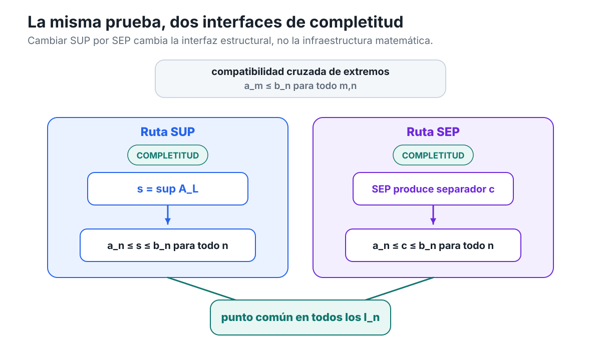{#fig-anm-c03-f12 fig-alt="Dos flujos paralelos parten de la compatibilidad cruzada y terminan en un punto común; uno usa SUP y otro SEP, cada cual con una sola marca COMPLETITUD."}

#### Ejercicio 40. Qué sobrevive sin completitud y qué debe exportar C03

[]{#MA-EX-ANM-01-003-040}

Compara estructuralmente $\mathbb R$ con $\mathbb Q$ usando únicamente los resultados establecidos en C02–C03 y el conjunto

$$
S_2=\{q\in\mathbb Q:0\le q,\ q^2<2\}.
$$

Construye una tabla razonada para las siguientes afirmaciones:

1. se pueden definir cotas, supremos e ínfimos de manera condicional;
2. si un supremo existe, es único;
3. el sistema es denso;
4. el sistema es arquimediano;
5. todo subconjunto no vacío y acotado superiormente posee supremo interno;
6. toda pareja de clases no vacías globalmente ordenadas admite un separador interno;
7. toda familia GCI de intervalos cerrados posee un punto común interno.

Para cada afirmación indica si:

- está disponible tanto en $\mathbb Q$ como en $\mathbb R$;
- está garantizada en $\mathbb R$ por la infraestructura de completitud;
- falla en $\mathbb Q$, usando $S_2$ cuando corresponda.

Después responde estas cuestiones de conexión:

1. ¿por qué densidad y arquimedianidad no bastan para recuperar completitud?
2. ¿qué significa decir que `SUP`, `SEP` y `GCI` son distintas **interfaces** de una misma infraestructura?
3. usando sólo el mapa de dependencias de §3.8, clasifica los papeles futuros de C07, C10 y C23 como:
   - **consumo de una garantía de existencia**,
   - **comparación/reformulación de la noción de completitud**,
   - o ambos si el texto de §3.8 lo justificara;
4. explica por qué esta clasificación no constituye todavía una demostración de ningún teorema de C07, C10 o C23.

Cierra formulando en una sola frase matemática —sin apelar a la imagen informal de una línea continua— qué aporta la completitud de $\mathbb R$.

[]{#MA-SOL-ANM-01-003-040}

Ver solución del ejercicio 40

Las diferencias pueden reunirse en la siguiente tabla. En las afirmaciones universales, «no» significa que existe al menos un contraejemplo.

| Afirmación | $\mathbb Q$ | $\mathbb R$ | Justificación |
|---|---|---|---|
| Definir cotas, supremos e ínfimos | Sí | Sí | Se formulan mediante el orden; nombrar un extremo requiere que exista. |
| Unicidad del supremo, si existe | Sí | Sí | Dos menores cotas superiores satisfacen las dos desigualdades opuestas. |
| Densidad | Sí | Sí | Entre $p<q$, el punto $(p+q)/2$ pertenece al mismo sistema y está estrictamente entre ambos. |
| Arquimedianidad | Sí | Sí | En $\mathbb Q$ se prueba directamente con numeradores y denominadores; para $\mathbb R$ se derivó de SUP. |
| Todo conjunto no vacío acotado superiormente posee supremo interno | No | Sí | $S_2$ falla en $\mathbb Q$; en $\mathbb R$ lo garantiza SUP. |
| Dos clases no vacías con $a\le b$ para todo par admiten separador interno | No | Sí | El par $S_2,U_{\mathbb Q}(S_2)$ falla en $\mathbb Q$; SEP se deduce de SUP en $\mathbb R$. |
| Toda familia no vacía de intervalos cerrados con $a_i\le b_j$ para todo par tiene punto común interno | No | Sí | Los intervalos racionales $[a,u]_{\mathbb Q}$ asociados a $S_2$ tienen intersección vacía; GCI garantiza el punto real. |

El mismo conjunto $S_2$ explica los tres fallos racionales. Si un racional $c$ separara $S_2$ de sus cotas, sería cota superior y menor que cualquier otra: sería su supremo racional, que el ejercicio 3 demostró inexistente. Un punto común racional de todos los intervalos $[a,u]_{\mathbb Q}$ tendría exactamente esa propiedad de separación. La densidad y la arquimedianidad de $\mathbb Q$ permanecen válidas, por lo que ninguna de ellas basta para garantizar completitud.

Las equivalencias

$$
\mathrm{SUP}\Longleftrightarrow\mathrm{INF}
\Longleftrightarrow\mathrm{SEP}\Longleftrightarrow\mathrm{GCI}
$$

permiten usar distintos lenguajes para una misma propiedad. SUP proporciona una menor cota superior; SEP, un separador; GCI, un punto común. Las pruebas que convierten uno de esos objetos en otro muestran por qué estas formulaciones tienen la misma fuerza, sin añadir nuevos axiomas.

En C07, el extremo de los valores de una sucesión monótona acotada será un candidato a límite. En C23, supremos e ínfimos permitirán construir las cantidades de Darboux. Ambos capítulos aplicarán la garantía de existencia. C10 comparará la completitud de orden con la formulación mediante sucesiones de Cauchy. Este reparto sólo identifica qué propiedad se utilizará: las afirmaciones sobre límites e integrales necesitan sus definiciones, hipótesis y demostraciones posteriores.

La aportación de la completitud puede expresarse así: todo subconjunto no vacío de $\mathbb R$ acotado superiormente tiene una menor cota superior en $\mathbb R$. Las equivalencias probadas permiten reconocer esa misma garantía en los problemas de separación e intersección.

[Índice del libro](../para-matematicos/analisis-para-matematicos.html) · [Ejercicios de este capítulo](#ejercicios-3)

[← Capítulo 2](analisis-para-matematicos-capitulo-2-cotas-extremos-y-barreras.html) · [Capítulo 4 →](analisis-para-matematicos-capitulo-4-mirar-localmente-un-conjunto.html)
