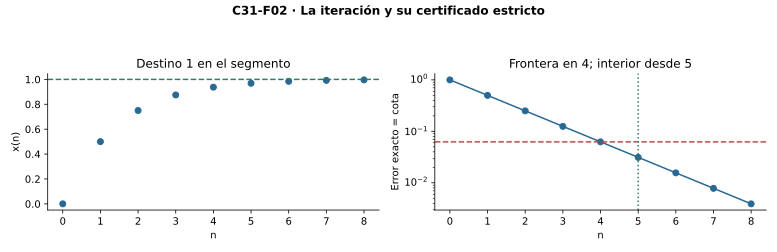

[Índice del libro](../para-matematicos/analisis-para-matematicos.html) · [Ejercicios de este capítulo](#ejercicios-31)

La sucesión de recíprocos puede ser de Cauchy en un intervalo abierto y tener su único destino fuera de él. Una métrica hace posible formular esa pérdida, pero no la resuelve. La completitud exigirá conservar los destinos; las redes finitas controlarán cuántos lugares distintos quedan a cada escala; las coberturas definirán compacidad y las separaciones, conexidad. Las pruebas distinguirán cuándo usan una sucesión dada y cuándo necesitan seleccionar puntos nuevos, y los resultados de dimensión finita conservarán sus métricas expresas.

## 31.1. Dar destino a todas las sucesiones de Cauchy

[]{#MA-SEC-ANM-01-031-001}

En $(0,1)$, los términos $x_n=1/(n+2)$ se acercan entre sí tanto como queramos, pero su único posible límite real es cero y queda fuera del espacio. Queremos distinguir los espacios en los que esto puede ocurrir de aquellos que contienen un destino para toda cola de Cauchy.

Un espacio métrico $(X,d)$ es **completo** si toda sucesión de Cauchy $x:\mathbb N\to X$ converge a un punto de $X$. No se exige que toda sucesión converja; en $\mathbb R$, la sucesión $n$ no es Cauchy. El espacio vacío es completo de modo vacuo. Un espacio discreto también es completo: la condición de Cauchy para $\varepsilon=1/2$ obliga a una cola constante, cuyo valor es el destino. Esto no implica que el espacio sea finito.

La recta usual es completa por C10. Para $\mathbb R^m$, con $m\ge1$ finito y $d_\infty(x,y)=\max_i|x_i-y_i|$, una sucesión de Cauchy hace Cauchy cada coordenada. C10 produce sus $m$ límites $a_i$. Para una tolerancia dada tomamos el máximo de los $m$ cortes, y entonces $d_\infty(x_n,a)<\varepsilon$. Sólo se combinan finitamente muchos destinos y cortes. Las constantes $d_\infty\le d_1\le m d_\infty$ dan el mismo resultado para $d_1$ por C30.

**Dónde puede cerrarse un subespacio.** Si $Y\subset X$ es cerrado y $X$ completo, una sucesión Cauchy de $Y$ lo es en $X$, tiene límite $a\in X$ y, por el criterio directo de cerrado de C30, $a\in Y$. Por tanto $Y$ es completo. Para el converso no necesitamos que $X$ sea completo, pero sí producir testigos: si $Y$ es completo y $a\in\operatorname{cl}_X Y$, elegimos $y_n\in Y\cap B(a,1/(n+1))$. Esta elección usa elección numerable para subconjuntos de $Y$, o una familia ya suministrada. La sucesión converge a $a$ en $X$, es Cauchy y tiene límite $b\in Y$; la unicidad en $X$ fuerza $a=b$. Así $Y$ es cerrado bajo esa hipótesis de selección.

**Convención fundacional de este capítulo.** Las pruebas con una sucesión ya dada, las iteraciones de una función dada y las pruebas directas por coberturas no incorporan elección infinita implícita. Para las equivalencias generales que construyen sucesiones o eligen redes a todas las escalas, trabajamos explícitamente en el marco clásico con elección: fijamos selectores para las familias no vacías que aparecen. Esto incluye elección dependiente cuando la siguiente selección depende de las anteriores. No se deduce esta convención de la completitud de $\mathbb R$. Señalaremos cada uso; se pueden leer los resultados correspondientes como condicionales a los selectores descritos. C8 ya declaraba esta base para conjuntos reales; aquí se amplía expresamente a los espacios generales empleados.

**Un espacio de funciones completo.** Sea $T\ne\varnothing$ y $\mathcal B(T)$ el conjunto de funciones reales acotadas con $D_\infty(f,g)=\sup_{t\in T}|f(t)-g(t)|$, métrica construida en C30. Si $(f_n)$ es Cauchy en esta métrica, cada columna $(f_n(t))$ es Cauchy real y tiene un único límite $f(t)$. La unicidad define la función $f$ sin escoger entre varios destinos. Dado $\varepsilon>0$, fijamos $N$ de Cauchy para $\varepsilon/2$. Para $n,k\ge N$, $|f_n(t)-f_k(t)|<\varepsilon/2$ para todo $t$. Al pasar $k$ al límite queda $|f_n(t)-f(t)|\le\varepsilon/2$, y entonces $D_\infty(f_n,f)\le\varepsilon/2<\varepsilon$.

Antes de usar esa métrica debemos acreditar $f\in\mathcal B(T)$. Para $\varepsilon=1$, el argumento anterior da un índice $N$ con $|f(t)-f_N(t)|\le1/2$ para todo $t$. Si $|f_N(t)|\le M$, resulta $|f(t)|\le M+1/2$. La función límite es acotada y la convergencia en supremo está justificada. Sobre un espacio métrico $T$, las funciones acotadas continuas forman un subespacio completo: el límite uniforme es continuo por la prueba de tres errores de C28, que se reconstruye con bolas en el dominio y valor absoluto en el codominio. Concretamente, elegimos una función a distancia menor que $\varepsilon/3$ del límite y usamos su continuidad para el error central. No se exige compacidad de $T$.

![La misma cola recíproca tiene destino cero en [0,1] y carece de destino interno en (0,1). El recinto se declara antes de identificar su límite. Los primeros ocho términos son una muestra; la cota de Cauchy y la unicidad prueban el resultado para toda la cola.](../../assets/books/anm/C31/C31-F01.svg){#fig-anm-c31-f01 fig-alt="La misma cola recíproca tiene destino cero en [0,1] y carece de destino interno en (0,1). El recinto se declara antes de identificar su límite. Los primeros ocho términos son una muestra; la cota de Cauchy y la unicidad prueban el resultado para toda la cola."}

### Ejercicios de la sección 31.1

[]{#ejercicios-31}

#### Ejercicio 1

[]{#MA-EX-ANM-01-031-001}

Prueba que un espacio métrico finito es completo, sin suponer que su métrica sea discreta.

[]{#MA-SOL-ANM-01-031-001}

Ver solución del ejercicio 1

Si $X$ es vacío, no tiene sucesiones y la condición de completitud es vacua. Si tiene un solo punto, toda sucesión es constante y converge a él.

Si tiene al menos dos puntos, las distancias entre puntos distintos forman un conjunto finito no vacío de reales positivos. Su mínimo $\eta$ es positivo. Para una sucesión Cauchy, tome el corte correspondiente a $\eta/2$. Todos los pares de la cola tienen distancia menor que $\eta/2$, mientras dos puntos distintos tendrían distancia al menos $\eta$.

Así todos los términos tardíos coinciden con el término del corte. Esa cola constante converge a un punto de $X$, acreditando completitud. La métrica no necesita ser discreta: basta la separación mínima que permite la finitud.

**Volver a la figura.** [C31-F01](analisis-para-matematicos-capitulo-31-completitud-compacidad-y-conexidad-en-espacios-metricos.html#fig-anm-c31-f01): confronta el mecanismo de esta solución con las hipótesis y fronteras indicadas en su pie.

#### Ejercicio 2

[]{#MA-EX-ANM-01-031-002}

Decide si $(0,1]$ con distancia usual es completo, y acredita todos los pasos del contraejemplo.

[]{#MA-SOL-ANM-01-031-002}

Ver solución del ejercicio 2

La sucesión $x_n=1/(n+1)$ pertenece a $(0,1]$ para todo $n\ge0$. Para $p,q\ge N$, ambos valores están en $(0,1/(N+1)]$, luego $|x_p-x_q|\le1/(N+1)$. Escoger $N$ con esa barrera menor que la tolerancia acredita Cauchy en el subespacio.

En $\mathbb R$, los términos convergen a cero. Si existiera un límite $a\in(0,1]$, la igualdad entre distancias del subespacio y de la recta acreditaría también límite real $a$. Unicidad obligaría a $a=0$, que no es admisible. Hay una Cauchy sin límite interno y el espacio no es completo.

#### Ejercicio 3

[]{#MA-EX-ANM-01-031-003}

Sea $X$ completo y $a\in X$. Prueba que la bola cerrada $C(a,r)$, $r\ge0$, es completa.

[]{#MA-SOL-ANM-01-031-003}

Ver solución del ejercicio 3

La bola $C(a,r)=\{x\in X:d(x,a)\le r\}$ es cerrada. En efecto, si $d(x,a)>r$, el radio $s=[d(x,a)-r]/2>0$ cumple, para $d(x,y)<s$, $d(y,a)\ge d(x,a)-d(x,y)>d(x,a)-s>r$. Su complemento es abierto.

Una Cauchy de $C(a,r)$ es Cauchy en $X$ y tiene por completitud un límite $b\in X$. También puede verificarse directamente que queda en la bola: $|d(x_n,a)-d(b,a)|\le d(x_n,b)\to0$ y todos los primeros valores son $\le r$, luego $d(b,a)\le r$. La sucesión converge internamente a $b$.

Para $r=0$, separación hace $C(a,0)=\{a\}$, completo por ser singleton. La prueba usa cerradura de la bola, sin identificarla con la clausura de la bola abierta.

#### Ejercicio 4

[]{#MA-EX-ANM-01-031-004}

Sea $T\ne\varnothing$ y $(f_n)$ Cauchy en $\mathcal B(T)$. Explica por qué no es legítimo escribir primero $D_\infty(f_n,f)$ sin acreditar que $f$ es acotada, y completa la prueba.

[]{#MA-SOL-ANM-01-031-004}

Ver solución del ejercicio 4

Para cada $t\in T$, $|f_n(t)-f_m(t)|\le D_\infty(f_n,f_m)$, por lo que la columna es Cauchy real. Completitud y unicidad definen $f(t)=\lim_n f_n(t)$. No se escoge entre varios destinos.

Un corte Cauchy $N$ para $1/2$ da $|f_N(t)-f_m(t)|<1/2$ para $m\ge N$. Pasar $m\to\infty$ con $t$ fijo produce $|f_N(t)-f(t)|\le1/2$ en toda entrada. Como $f_N$ está acotada por algún $M$, $|f(t)|\le M+1/2$. Ahora $f\in\mathcal B(T)$ y la distancia de supremo a ella está definida en el espacio de funciones.

Para $\varepsilon>0$, tome otro corte Cauchy para $\varepsilon/2$. Para $n,m$ posteriores, pase $m$ al límite columna por columna: $|f_n(t)-f(t)|\le\varepsilon/2$ para todo $t$. Su supremo es $\le\varepsilon/2<\varepsilon$. Así $f_n\to f$ en $D_\infty$. Escribir esa distancia antes de acreditar acotación habría usado una expresión fuera de la métrica declarada.

#### Ejercicio 5

[]{#MA-EX-ANM-01-031-005}

Sea $Y$ un subespacio completo de $X$. Demuestra que es cerrado declarando exactamente la selección requerida.

[]{#MA-SOL-ANM-01-031-005}

Ver solución del ejercicio 5

Si $Y$ es vacío, ya es cerrado. Para $a\in\operatorname{cl}_X Y$, cada $W_n=Y\cap B_X(a,1/(n+1))$ es no vacío. Declare elección numerable para esta familia de subconjuntos de $Y$, o una familia suministrada de testigos $y_n\in W_n$.

La cota $d(y_n,a)<1/(n+1)$ acredita $y_n\to a$ en $X$. Toda convergente es Cauchy; las distancias restringidas coinciden, luego es Cauchy en $Y$. Por completitud de $Y$, converge a algún $b\in Y$. Visto en $X$, ese segundo límite sigue siendo $b$.

Unicidad en $X$ implica $a=b\in Y$. Por tanto $Y$ contiene su clausura y es cerrado. No se requiere que $X$ sea completo; la selección de los testigos es la obligación adicional explícita que permite construir la sucesión.

## 31.2. Encerrar un destino y construirlo por iteración

[]{#MA-SEC-ANM-01-031-002}

La completitud puede reconocerse mirando recintos que se estrechan. Sea $(X,d)$ completo y sea $F_0\supset F_1\supset\cdots$ una familia de conjuntos cerrados no vacíos, de diámetro finito, con $\operatorname{diam}F_n\to0$. El diámetro es $\sup\{d(x,y):x,y\in F_n\}$. Para construir una sucesión fijamos testigos $x_n\in F_n$; éste es un uso de elección numerable, salvo que los testigos formen parte de los datos.

Si $p,q\ge N$, ambos testigos están en $F_N$, de modo que $d(x_p,x_q)\le\operatorname{diam}F_N$. La sucesión es Cauchy y tiene un límite $a$ por completitud. Para cada $N$, su cola está en el cerrado $F_N$ y por ello también $a\in F_N$. Si dos puntos $a,b$ pertenecieran a todos los recintos, su distancia sería a lo sumo $\operatorname{diam}F_N$ para todo $N$; al tender esos diámetros a cero resulta $a=b$. Hay un único punto común. Sin encogimiento puede fallar la unicidad, como en $F_n=[0,1]$. Sin completitud puede fallar la existencia: en $X=(0,1)$, los conjuntos $F_n=(0,1/(n+2)]$ son cerrados relativos no vacíos, anidados, de diámetro $1/(n+2)$ y con intersección vacía.[^C31-recintos]

**Una función puede suministrar sus propios testigos.** Sea $X\ne\varnothing$ completo y $T:X\to X$ una **contracción**: existe $q\in[0,1)$ con $d(Tx,Ty)\le qd(x,y)$ para todos los pares. Partimos de un $x_0$ dado y definimos $x_{n+1}=Tx_n$. Esta recursión es determinada; no se elige de nuevo en cada paso. Escribamos $C=d(x_1,x_0)$. Por inducción $d(x_{n+1},x_n)\le Cq^n$. Para $p>n$, sumar el bloque finito da
$$d(x_p,x_n)\le C\sum_{j=n}^{p-1}q^j\le\frac{Cq^n}{1-q}.$$
Con la convención $q^0=1$, esto incluye $q=0$: desde $x_1$ la sucesión es constante. Para $0<q<1$, las potencias tienden a cero y la cola es Cauchy. En ambos casos la completitud da un destino $a\in X$.

La desigualdad de contracción implica continuidad: para $q>0$ sirve $\delta=\varepsilon/q$, y para $q=0$ las imágenes tienen distancia cero. Por tanto $Tx_n\to Ta$. Pero $Tx_n=x_{n+1}\to a$, luego $Ta=a$. Si $Tb=b$, entonces $d(a,b)\le qd(a,b)$, y $(1-q)d(a,b)\le0$ obliga a $a=b$. Hemos probado existencia y unicidad de un punto fijo. Al pasar $p$ al límite en el bloque anterior obtenemos el certificado
$$d(x_n,a)\le\frac{Cq^n}{1-q}.$$
También $d(x_n,a)\le d(x_n,x_{n+1})+qd(x_n,a)$, por lo que el error es a lo sumo $d(x_n,x_{n+1})/(1-q)$: se certifica con el salto observado.

En $X=[0,1]$, $T(x)=(x+1)/2$ es una contracción de razón $1/2$. Desde $x_0=0$, $x_n=1-2^{-n}$ y el destino es $1$. La cota anterior es exactamente $2^{-n}$. Para error estrictamente menor que $1/16$ necesitamos $n\ge5$; $n=4$ cae en la frontera. En $(0,1)$ la misma función sigue llevando el espacio a sí mismo y sigue contrayendo, pero su punto fijo $1$ está fuera. La hipótesis de completitud no es un adorno. Tampoco basta $d(Tx,Ty)<d(x,y)$ para cada par distinto: en $[1,\infty)$, $T(x)=x+1/x$ cumple
$$|T(y)-T(x)|=(y-x)\left(1-\frac1{xy}\right)<y-x\quad(1\le x<y),$$
pero no tiene punto fijo. Los cocientes se acercan a $1$ y no hay una razón común menor que $1$.

{#fig-anm-c31-f02 fig-alt="La iteración x(n+1)=(x(n)+1)/2 desde cero produce x(n)=1−2^(−n). El destino 1 pertenece al segmento y queda fuera del intervalo abierto. El error exacto coincide con la cota geométrica; para error estrictamente menor que 1/16 el primer corte es 5, no 4."}

### Ejercicios de la sección 31.2

#### Ejercicio 6

[]{#MA-EX-ANM-01-031-006}

En $\mathbb R$ considera $F_n=[1-2^{-n},1+2^{-n}]$, $n\ge0$. Encuentra la intersección y acredita el teorema de recintos.

[]{#MA-SOL-ANM-01-031-006}

Ver solución del ejercicio 6

Cada $F_n$ es un intervalo cerrado no vacío, y contiene a uno. Como $2^{-(n+1)}\le2^{-n}$, $F_{n+1}\subseteq F_n$. Su diámetro es la distancia entre extremos, $2\cdot2^{-n}=2^{1-n}$, que tiende a cero.

La recta es completa y los testigos pueden darse como $x_n=1$ en todos los recintos, por lo que aquí no se necesita seleccionar una familia arbitraria. Se cumplen las hipótesis del teorema de recintos.

La intersección es exactamente $\{1\}$. Ya se sabe que contiene a uno; si $a$ estuviera en todos los intervalos, $|a-1|\le2^{-n}$ para todo $n$. Una distancia positiva quedaría por encima de alguna de esas barreras, imposible. Así $a=1$, acreditando también la unicidad directamente.

**Volver a la figura.** [C31-F02](analisis-para-matematicos-capitulo-31-completitud-compacidad-y-conexidad-en-espacios-metricos.html#fig-anm-c31-f02): confronta el mecanismo de esta solución con las hipótesis y fronteras indicadas en su pie.

#### Ejercicio 7

[]{#MA-EX-ANM-01-031-007}

Con $T(x)=(x+1)/2$ en $[0,1]$ y $x_0=0$, calcula la iteración y el primer corte para error estrictamente menor que $1/16$.

[]{#MA-SOL-ANM-01-031-007}

Ver solución del ejercicio 7

La aplicación $T(x)=(x+1)/2$ lleva $[0,1]$ a sí mismo y cumple $|T(x)-T(y)|=|x-y|/2$. El intervalo es cerrado en la recta completa, de modo que el teorema de contracción garantiza un único punto fijo; resolver $a=(a+1)/2$ da $a=1$.

Desde $x_0=0$, inducción prueba $x_n=1-2^{-n}$. La fórmula vale en cero, y sustituirla en $T$ da $(2-2^{-n})/2=1-2^{-(n+1)}$ para el siguiente paso.

El error exacto es $|x_n-1|=2^{-n}$. Para que sea estrictamente menor que $1/16$, se necesita $n>4$. El primer corte es cinco, y todos los posteriores tienen error $\le1/32<1/16$. En cuatro el error es exactamente la tolerancia.

#### Ejercicio 8

[]{#MA-EX-ANM-01-031-008}

Para una contracción de razón $q\in[0,1)$, prueba la cota a posteriori $d(x_n,a)\le d(x_n,x_{n+1})/(1-q)$.

[]{#MA-SOL-ANM-01-031-008}

Ver solución del ejercicio 8

Sea $a$ el punto fijo ya acreditado, $Ta=a$. Para cualquier iterado, triangular y contracción dan $d(x_n,a)\le d(x_n,Tx_n)+d(Tx_n,Ta)\le d(x_n,x_{n+1})+q\,d(x_n,a)$.

Restar el segundo término real de ambos lados y dividir por $1-q>0$ da $d(x_n,a)\le d(x_n,x_{n+1})/(1-q)$. El certificado usa el salto observado en el paso actual, por lo que puede emplearse sin conocer una fórmula explícita para el límite.

También vale con $q=0$: el error inicial queda bajo el primer salto y los posteriores son cero. La estimación presupone un punto fijo; para asegurar su existencia mediante el teorema se requiere un espacio completo no vacío y una contracción que lo lleve a sí mismo.

#### Ejercicio 9

[]{#MA-EX-ANM-01-031-009}

Muestra que la misma contracción $T(x)=(x+1)/2$ en $(0,1)$ no tiene punto fijo, aunque lleve el espacio a sí mismo.

[]{#MA-SOL-ANM-01-031-009}

Ver solución del ejercicio 9

Si $0<x<1$, entonces $1/2<T(x)<1$, de modo que $T$ es una autoaplicación de $(0,1)$. Para todo par, $|T(x)-T(y)|=|x-y|/2$: sigue siendo una contracción de razón $1/2$.

La ecuación de punto fijo $x=(x+1)/2$ sólo tiene la solución uno, fuera del dominio. No hay punto fijo interno. El espacio no es completo: por ejemplo $1/(n+2)$ es Cauchy y su único límite real es cero, también exterior.

La propia iteración desde un $x_0\in(0,1)$ da $x_n=1-(1-x_0)2^{-n}$ y se acerca a uno sin alcanzarlo. Se cumplen autoaplicación y contracción, pero falta la completitud que convertiría esa cola en un destino dentro del espacio.

#### Ejercicio 10

[]{#MA-EX-ANM-01-031-010}

Verifica que $T(x)=x+1/x$ en $[1,\infty)$ reduce estrictamente las distancias de pares distintos y carece de punto fijo.

[]{#MA-SOL-ANM-01-031-010}

Ver solución del ejercicio 10

Para $x\ge1$, $T(x)=x+1/x\ge1$, por lo que es una autoaplicación de $[1,\infty)$. Si $1\le x<y$, entonces $xy>1$ y $T(y)-T(x)=(y-x)+(1/y-1/x)=(y-x)(1-1/(xy))$. El factor está estrictamente entre cero y uno, de modo que $|T(y)-T(x)|<|y-x|$.

La ecuación $T(x)=x$ exigiría $1/x=0$, imposible. El dominio es cerrado en la recta y completo, así que la pérdida no proviene aquí de completitud.

Para $x=n$, $y=n+1$, las razones entre distancia de imágenes y distancia de entradas son $1-1/[n(n+1)]\to1$. Dado cualquier $q<1$, alguna razón es mayor que $q$. No existe una razón uniforme de contracción, aunque cada par distinto reduzca estrictamente su distancia.

## 31.3. Cubrir con pocas bolas a cada escala

[]{#MA-SEC-ANM-01-031-003}

En un espacio discreto infinito, una sola bola de radio dos contiene todos los puntos, pues sus distancias no superan uno. Sin embargo, cada bola de radio $1/2$ contiene sólo su centro y ninguna cantidad finita cubre el espacio. Para describir esa diferencia necesitamos exigir redes finitas a cada escala, además de una cota global.

Un espacio $X$ es **totalmente acotado** si para cada $\varepsilon>0$ existen finitos centros $a_1,\ldots,a_r\in X$ tales que $X=\bigcup_{i=1}^rB(a_i,\varepsilon)$. Llamamos a esos centros una red finita de radio $\varepsilon$. Para $X=\varnothing$ se admite $r=0$. La definición exige todas las escalas; una cobertura para un único radio sólo acredita una información parcial.

Si $X\ne\varnothing$ es totalmente acotado, una red de radio $1$ y un centro fijo $a$ dan $d(x,a)<1+\max_i d(a_i,a)$ para cualquier $x$: primero elegimos una bola que contenga ese punto. Esa selección individual es finita y no construye una familia infinita. Así la acotación total implica acotación. La discreta infinita prueba que el converso falla.

**Los subespacios heredan redes, con ajuste del radio.** Si $A\subset X$ y $X$ es totalmente acotado, tomamos una red de radio $\varepsilon/2$ en $X$. Para cada bola que corte $A$ elegimos un punto $b_i$ de esa intersección; son sólo finitas elecciones. Si $x\in A$ está en esa bola, $d(x,b_i)<\varepsilon$. Los $b_i$ son centros de una red de $A$. No podemos dejar centros exteriores al subespacio sin explicar esta conversión. La clausura también es totalmente acotada: una red de $A$ de radio $\varepsilon/2$, junto con un punto de $A$ a distancia menor que $\varepsilon/2$ del punto de clausura considerado, da una cobertura de $\operatorname{cl}A$ de radio $\varepsilon$. El caso $A=\varnothing$ es separado.

**Las coordenadas finitas admiten mallas.** Todo subconjunto acotado de $(\mathbb R^m,d_\infty)$ es totalmente acotado. Encerramos el conjunto en $[-M,M]^m$, elegimos un paso $h<\varepsilon$ y dividimos cada intervalo en finitos tramos de longitud a lo sumo $h$. Hay finitas celdas. De cada celda que corte el conjunto tomamos un representante; dos puntos de esa celda tienen distancia máximo a lo sumo $h<\varepsilon$. Los representantes forman una red. Se usa finitud, no una extracción simultánea de infinitos centros. Por comparación de métricas sirve para $d_1$, ajustando el paso a $h<\varepsilon/m$.

Los propios puntos de un conjunto finito forman una red para cualquier radio positivo. El intervalo $(0,1)$ también admite redes finitas por la construcción de mallas, pero pierde el destino de los recíprocos. La discreta infinita conserva todos los destinos de Cauchy, aunque no admite redes finitas pequeñas. La falta de destinos y el exceso de puntos separados son obstáculos independientes.

**La obstrucción separada.** Si existe $\eta>0$ y una sucesión con $d(x_n,x_k)\ge\eta$ para índices distintos, ninguna bola de radio $\eta/2$ puede contener dos términos. La triangular daría una distancia estrictamente menor que $\eta$. Una red finita es imposible. El argumento vale también para cualquier conjunto infinito de puntos separados, sin enumerarlo previamente: cada bola contiene a lo sumo un punto y una unión finita sólo contiene finitos puntos del conjunto.

![Cinco centros 0,1/4,1/2,3/4,1 cubren [0,1] con bolas relativas de radio 3/20: el peor error es 1/8, menor que el radio. En la discreta infinita cada bola de radio 1/2 sólo contiene un punto. Los seis puntos dibujados representan el patrón, no un espacio finito completo.](../../assets/books/anm/C31/C31-F03.svg){#fig-anm-c31-f03 fig-alt="Cinco centros 0,1/4,1/2,3/4,1 cubren [0,1] con bolas relativas de radio 3/20: el peor error es 1/8, menor que el radio. En la discreta infinita cada bola de radio 1/2 sólo contiene un punto. Los seis puntos dibujados representan el patrón, no un espacio finito completo."}

### Ejercicios de la sección 31.3

#### Ejercicio 11

[]{#MA-EX-ANM-01-031-011}

Construye para $(0,1)$ una red de radio $\varepsilon>0$ con centros interiores.

[]{#MA-SOL-ANM-01-031-011}

Ver solución del ejercicio 11

Dado $\varepsilon>0$, elija $m\ge1$ con $1/(2m)<\varepsilon$. Los puntos $a_j=(j+1/2)/m$, $j=0,\ldots,m-1$, son finitísimos y todos pertenecen a $(0,1)$.

Cada $x\in(0,1)$ está en alguna de las celdas $[j/m,(j+1)/m]$. Su distancia al punto medio es $\le1/(2m)<\varepsilon$, incluso en una frontera de celda. Por tanto las bolas abiertas $B_{(0,1)}(a_j,\varepsilon)$ cubren el intervalo. Los centros son internos y la desigualdad estricta se obtiene escogiendo la malla con margen.

**Volver a la figura.** [C31-F03](analisis-para-matematicos-capitulo-31-completitud-compacidad-y-conexidad-en-espacios-metricos.html#fig-anm-c31-f03): confronta el mecanismo de esta solución con las hipótesis y fronteras indicadas en su pie.

#### Ejercicio 12

[]{#MA-EX-ANM-01-031-012}

Prueba que en un espacio discreto la acotación total equivale a finitud.

[]{#MA-SOL-ANM-01-031-012}

Ver solución del ejercicio 12

Si un espacio discreto es finito, sus propios puntos forman una red para cualquier radio positivo: cada punto pertenece a la bola centrada en él. El vacío se cubre con la red vacía.

Si es totalmente acotado, aplique la definición con radio $1/2$. Cada bola es un singleton; una red finita cubre el espacio por finitísimos singletons. El espacio debe ser finito. Así en la discreta, acotación total equivale exactamente a finitud, aunque la acotación de todas las distancias se cumpla también para espacios infinitos.

#### Ejercicio 13

[]{#MA-EX-ANM-01-031-013}

Sea $A\subset X$ y $X$ totalmente acotado. Justifica una red para $A$ con centros en $A$.

[]{#MA-SOL-ANM-01-031-013}

Ver solución del ejercicio 13

Si $A$ es vacío, use la red vacía. Para $A\ne\varnothing$ y $\varepsilon>0$, tome una red finita ambiental de radio $\varepsilon/2$, con centros $a_i\in X$.

Retenga sólo los índices de bolas que cortan $A$, y en cada una de esas finitísimas intersecciones tome $b_i\in A\cap B_X(a_i,\varepsilon/2)$. Para $x\in A$, alguna bola original lo cubre; su índice fue retenido. Entonces $d(x,b_i)\le d(x,a_i)+d(a_i,b_i)<\varepsilon$.

Las bolas relativas de centro $b_i$ y radio $\varepsilon$ cubren $A$. La selección es finita y los centros ya pertenecen al subespacio, como pide su definición de acotación total.

#### Ejercicio 14

[]{#MA-EX-ANM-01-031-014}

En $[-1,1]^2$ con $d_\infty$, construye una red de radio $1/3$ usando una malla explícita.

[]{#MA-SOL-ANM-01-031-014}

Ver solución del ejercicio 14

Divida cada coordenada de $[-1,1]$ en cuatro intervalos cerrados de longitud $1/2$. Sus puntos medios son $-3/4,-1/4,1/4,3/4$. Tome como centros los dieciséis pares formados con esos cuatro valores.

Cada punto del cuadrado pertenece a alguna celda producto, y cada coordenada dista a lo sumo $1/4$ del punto medio correspondiente. Por ello su distancia $d_\infty$ al centro de esa celda es $\le1/4<1/3$. Las dieciséis bolas abiertas de radio $1/3$ cubren el cuadrado. Las fronteras de celdas y del cuadrado están cubiertas gracias al margen entre $1/4$ y $1/3$.

#### Ejercicio 15

[]{#MA-EX-ANM-01-031-015}

Prueba que una sucesión con $d(x_n,x_m)\ge\eta>0$ para índices distintos impide acotación total.

[]{#MA-SOL-ANM-01-031-015}

Ver solución del ejercicio 15

Dos términos distintos no pueden estar en una misma bola abierta de radio $\eta/2$: triangular daría distancia menor que $\eta$, contradiciendo la separación $\ge\eta$.

Si hubiese una red con $r$ centros a esa escala, cada bola contendría a lo sumo un término, y la unión cubriría a lo sumo $r$ términos. Los primeros $r+1$ son todos distintos y darían contradicción. Así el espacio no es totalmente acotado. Usar radio $\eta/2$ conserva la desigualdad estricta necesaria; un radio $\eta$ no proporciona la misma exclusión de dos términos.

## 31.4. Compacidad: reducir cualquier cobertura

[]{#MA-SEC-ANM-01-031-004}

En C16, la compacidad de la recta se formuló mediante coberturas. La definición se transporta sin coordenadas: $K\subset X$ es **compacto** si de toda familia de abiertos de $X$ que cubra $K$ se puede extraer una subfamilia finita que aún lo cubra. Equivalentemente usamos abiertos relativos de $K$, porque cada uno es intersección con un abierto de $X$ y toda cobertura ambiental induce una relativa. La propiedad pertenece al subespacio; no exige que el ambiente entero sea compacto. El vacío y los conjuntos finitos son compactos: basta cero abiertos, o un abierto por cada punto de una lista finita.

**El primer efecto cuantitativo.** Las bolas $B(k,\varepsilon)$, con $k\in K$, cubren $K$ para cada $\varepsilon>0$. La compacidad deja finitos centros de esa misma familia. Por tanto todo compacto métrico es totalmente acotado y, si no vacío, acotado. No se ha escogido una red para todos los radios a la vez; para cada radio se aplica la propiedad.

**Un compacto métrico es cerrado.** Para $a\notin K$ y cada $k\in K$, consideramos $U_k=B(k,d(a,k)/3)$. Una subcobertura finita tiene centros $k_1,\ldots,k_r$. Si $K\ne\varnothing$, $\delta=\min_i d(a,k_i)/3>0$. Ningún $z\in B(a,\delta)$ puede estar en un $U_{k_i}$: eso daría
$$d(a,k_i)\le d(a,z)+d(z,k_i)<\delta+d(a,k_i)/3\le2d(a,k_i)/3.$$
Así $B(a,\delta)$ evita $K$. Si $K$ es vacío, el complemento ya es todo el ambiente. El complemento es abierto y $K$ es cerrado. La separación métrica aporta la positividad que esta prueba necesita.

**La forma dual: intersecciones finitas.** En un compacto $K$, una familia de cerrados relativos con la **propiedad de intersección finita** —cada subfamilia finita tiene intersección no vacía— tiene intersección total no vacía. Si la intersección total fuese vacía, los complementos serían una cobertura abierta; una subcobertura finita contradiría aquella propiedad. El converso se obtiene tomando complementos de una cobertura sin subcobertura finita. Para $K=\varnothing$ no puede existir una familia con esa propiedad si se incluye la subfamilia vacía, cuya intersección es $K$; esta convención elimina una excepción artificial.

**Compacidad da completitud sin construir testigos nuevos.** Sea $(x_n)$ Cauchy en $K$ compacto. Los cerrados relativos $F_N=\operatorname{cl}_K\{x_n:n\ge N\}$ son no vacíos y anidados, por lo que tienen punto común $a$. Para $\varepsilon>0$ fijamos $N$ tal que $d(x_n,x_m)<\varepsilon/2$ para $n,m\ge N$. Para cada $n\ge N$, todos los términos de la cola $N$ están en la bola cerrada $C(x_n,\varepsilon/2)$. Esa bola es cerrada por C30; contiene $F_N$ y por tanto $a$. Luego $d(x_n,a)\le\varepsilon/2<\varepsilon$. La sucesión converge dentro de $K$. Se usó una sucesión ya dada y la propiedad de coberturas, sin seleccionar una sucesión adicional.

Un cerrado relativo de un compacto es compacto: una cobertura de $F$ se completa con $K\setminus F$, y una subcobertura finita de $K$ deja finitos abiertos para $F$. Una unión finita de compactos también es compacta, al unir sus subcoberturas finitas. Una unión infinita puede fallar: los singletons $\{n\}$ son compactos, pero $\mathbb N$ en la recta es no acotado y no compacto. En la discreta infinita, la cobertura por singletons no admite reducción finita, aunque el espacio sea completo y acotado.

![Las coberturas se reducen reteniendo miembros originales. Las dos ventanas (−1,3/4) y (1/4,2) cubren [0,1]. Para los recintos de colas de 1/(n+1), la clausura dentro de [0,1] contiene cero y tiene diámetro 1/(N+1); la anidación y la compacidad suministran el destino interno.](../../assets/books/anm/C31/C31-F04.svg){#fig-anm-c31-f04 fig-alt="Las coberturas se reducen reteniendo miembros originales. Las dos ventanas (−1,3/4) y (1/4,2) cubren [0,1]. Para los recintos de colas de 1/(n+1), la clausura dentro de [0,1] contiene cero y tiene diámetro 1/(N+1); la anidación y la compacidad suministran el destino interno."}

### Ejercicios de la sección 31.4

#### Ejercicio 16

[]{#MA-EX-ANM-01-031-016}

Prueba que una unión finita de compactos en un espacio métrico es compacta.

[]{#MA-SOL-ANM-01-031-016}

Ver solución del ejercicio 16

Sean $K_1,\ldots,K_m$ compactos y $K=\bigcup_{i=1}^m K_i$. Una cobertura abierta de $K$ induce una cobertura abierta relativa de cada pieza. Para cada una de las finitísimas piezas, compacidad entrega una subfamilia finita de miembros de la cobertura original.

La unión de esas listas finitas es finita y cubre todas las piezas, por tanto cubre $K$. Se ha construido una subcobertura finita de la cobertura recibida. Sólo se han realizado finitísimas elecciones de listas. Para $m=0$, la unión es vacía y cualquier cobertura se reduce a la subfamilia vacía.

**Volver a la figura.** [C31-F04](analisis-para-matematicos-capitulo-31-completitud-compacidad-y-conexidad-en-espacios-metricos.html#fig-anm-c31-f04): confronta el mecanismo de esta solución con las hipótesis y fronteras indicadas en su pie.

#### Ejercicio 17

[]{#MA-EX-ANM-01-031-017}

En la discreta sobre $\mathbb N$, exhibe una cobertura abierta que refute compacidad.

[]{#MA-SOL-ANM-01-031-017}

Ver solución del ejercicio 17

La familia $U_n=\{n\}=B_D(n,1/2)$ consta de abiertos discretos y cubre $\mathbb N$. Una subfamilia finita tiene como unión sólo los naturales usados como índices.

Si la lista es no vacía, un natural mayor que todos sus índices queda sin cubrir; si es vacía, no cubre ningún natural. Por tanto esta cobertura abierta no tiene subcobertura finita y el espacio no es compacto. Es una refutación directa por la definición, compatible con que la discreta sea completa y acotada.

#### Ejercicio 18

[]{#MA-EX-ANM-01-031-018}

Deduce la propiedad de intersección finita de la compacidad usando complementos.

[]{#MA-SOL-ANM-01-031-018}

Ver solución del ejercicio 18

Sea $K$ compacto y $(F_i)_{i\in I}$ una familia de cerrados relativos con la propiedad de intersección finita. Si $\bigcap_iF_i$ fuese vacía, los abiertos relativos $K\setminus F_i$ cubrirían $K$ por De Morgan.

Compacidad daría una lista finita de índices $J\subseteq I$ que aún cubre. De nuevo por De Morgan, $\bigcap_{j\in J}F_j=\varnothing$, contradiciendo la propiedad de intersección finita. Así la intersección total es no vacía.

La convención incluye la subfamilia vacía, cuya intersección es $K$. Si $K$ fuera vacío, ninguna familia satisfaría esa premisa. Si la familia misma es vacía y satisface la premisa, se tiene $K\ne\varnothing$ y su intersección total es precisamente $K$, como requiere la conclusión.

#### Ejercicio 19

[]{#MA-EX-ANM-01-031-019}

Prueba directamente que un compacto métrico es completo usando clausuras de colas.

[]{#MA-SOL-ANM-01-031-019}

Ver solución del ejercicio 19

Sea $(x_n)$ una Cauchy ya dada en el compacto $K$. Defina $F_N=\operatorname{cl}_K\{x_n:n\ge N\}$. Cada conjunto es cerrado relativo, contiene a $x_N$ y es no vacío; además están anidados. Toda intersección finita contiene al de mayor índice, luego tiene la propiedad de intersección finita.

Compacidad proporciona $a\in\bigcap_N F_N$. Dado $\varepsilon>0$, elija un corte Cauchy $N$ para $\varepsilon/2$. Para cada $n\ge N$, toda la cola de índice $N$ está en la bola cerrada relativa $C_K(x_n,\varepsilon/2)$. Ésta es cerrada, por lo que contiene también la clausura $F_N$.

En particular, $d(x_n,a)\le\varepsilon/2<\varepsilon$ para todo $n\ge N$. La sucesión converge internamente a $a$ y $K$ es completo. Se usa la sucesión recibida y un punto de una intersección común; no se fabrica una nueva sucesión de testigos.

#### Ejercicio 20

[]{#MA-EX-ANM-01-031-020}

Sea $K\ne\varnothing$ compacto y $a\notin K$. Prueba que $\inf_{k\in K}d(a,k)>0$ sin suponer un mínimo alcanzado.

[]{#MA-SOL-ANM-01-031-020}

Ver solución del ejercicio 20

Como $a\notin K$, para cada $k\in K$ la distancia $d(a,k)$ es positiva. Las bolas $B(k,d(a,k)/3)$ forman una cobertura abierta de $K$. Retenga una subcobertura finita con centros $k_1,\ldots,k_r$, y ponga $\delta=\min_i d(a,k_i)/3>0$. La lista no es vacía porque $K$ no lo es.

Si algún $z\in B(a,\delta)$ perteneciera a una bola retenida, triangular daría $d(a,k_i)<\delta+d(a,k_i)/3\le2d(a,k_i)/3$, imposible. Por tanto $B(a,\delta)\cap K=\varnothing$ y $d(a,k)\ge\delta$ para todos los puntos de $K$.

El conjunto de distancias es no vacío, acotado inferiormente por cero y contiene valores finitos, de modo que tiene ínfimo real. La cota común da $\inf_{k\in K}d(a,k)\ge\delta>0$. No se ha supuesto que exista un punto minimizante.

## 31.5. La equivalencia métrica y sus elecciones

[]{#MA-SEC-ANM-01-031-005}

La compacidad ya ha proporcionado completitud y redes finitas sin construir sucesiones nuevas. Para obtener la dirección inversa escogeremos redes a diferentes escalas y extraeremos recorridos. Conservaremos en estas construcciones la convención clásica de selección declarada en §31.1, distinguiéndola de los mínimos naturales que determinan índices de una sucesión ya dada.

Un espacio es **secuencialmente compacto** si toda sucesión en él tiene una subsucesión convergente con límite interno. El vacío satisface esta condición de modo vacuo. En un espacio totalmente acotado, fijamos una red finita para cada radio $2^{-j}$, $j=1,2,\ldots$; elegir la lista de redes usa elección numerable de tales listas. Sea $(x_n)$ una sucesión. Entre las bolas de la primera red, alguna captura infinitos índices. Escogemos la primera de una enumeración finita con esa propiedad, y conservamos sus índices. A cada nivel hacemos lo mismo dentro del conjunto infinito anterior, obteniendo conjuntos de índices $I_1\supset I_2\supset\cdots$, cada uno contenido en una bola de radio $2^{-j}$. El desempate finito se hace por menor posición de la lista, no por escoger un punto del espacio.

De los conjuntos de índices anidados extraemos una subsucesión mediante mínimos: $n_1=\min I_1$ y $n_{j+1}=\min\{n\in I_{j+1}:n>n_j\}$. El segundo conjunto es no vacío porque $I_{j+1}$ es infinito y un conjunto infinito de naturales no está acotado. Para $p,q\ge j$, ambos puntos $x_{n_p},x_{n_q}$ están en la bola del nivel $j$, así que su distancia es menor que $2^{1-j}$. La subsucesión es de Cauchy. Si el espacio es completo, obtiene un destino interno y hemos probado compacidad secuencial. Las redes a todas las escalas usaron selección; una vez dadas, la extracción de índices quedó determinada por mínimos.

**La secuencia impide una escala rebelde.** Si un espacio secuencialmente compacto no fuese totalmente acotado, existiría $\varepsilon>0$ para el que ninguna colección finita de bolas cubriera. Elegimos $x_0\in X$ y, recursivamente,
$$x_{n+1}\notin\bigcup_{i=0}^nB(x_i,\varepsilon).$$
El complemento es no vacío. Un selector fijo de subconjuntos no vacíos de $X$ determina esta recursión; es elección dependiente explícita. Los puntos quedan a distancia al menos $\varepsilon$ entre sí. Ninguna subsucesión es Cauchy, contradiciendo la convergencia de una subsucesión. Así el espacio es totalmente acotado. También es completo: una sucesión de Cauchy posee una subsucesión convergente y C30 transporta ese destino a toda la sucesión.

**De una cobertura a un radio común.** Sea $X$ secuencialmente compacto y $\mathcal U$ una cobertura abierta. Existe $\lambda>0$ tal que para todo $x\in X$ alguna $U\in\mathcal U$ contiene $B(x,\lambda)$. Si no, para cada $n$ elegimos $x_n$ cuya bola de radio $1/(n+1)$ no esté contenida en ningún miembro. Aquí se usa elección numerable para los puntos infractores. Una subsucesión converge a $a$. Elegimos un $U$ de la cobertura que contenga $a$ y un $r>0$ con $B(a,r)\subset U$. Para un índice de la subsucesión suficientemente grande, tanto $d(x_{n_j},a)<r/2$ como $1/(n_j+1)<r/2$. La triangular implica $B(x_{n_j},1/(n_j+1))\subset B(a,r)\subset U$, contradicción. Esta propiedad es una forma de **lema del número de Lebesgue**.

Como el espacio es totalmente acotado, una red finita de radio $\lambda/2$ cubre $X$. Para cada uno de sus finitos centros $a_i$, escogemos $U_i$ que contenga $B(a_i,\lambda)$; son elecciones finitas. Los $U_i$ cubren $X$. Por tanto secuencialmente compacto implica compacto. Juntando las pruebas, bajo la convención de selección indicada,
$$X\text{ compacto}\quad\Longleftrightarrow\quad X\text{ completo y totalmente acotado}\quad\Longleftrightarrow\quad X\text{ secuencialmente compacto}.$$
La diferencia con la recta queda localizada: allí acotación y acotación total coinciden por las mallas finitas. En un espacio métrico general no coinciden. Reemplazar «totalmente acotado» por «acotado» haría falsa la equivalencia. La extracción tampoco convierte cualquier sucesión original en convergente: en $[0,1]$, una sucesión alternante entre $0$ y $1$ tiene selecciones convergentes y carece de límite global.

{#fig-anm-c31-f05 fig-alt="El mapa de prueba señala las direcciones entre compacto, completo más totalmente acotado y secuencialmente compacto. La dirección de coberturas a completitud y redes es directa. Las otras construcciones indican redes elegidas por niveles, selección dependiente o puntos infractores. Todas las equivalencias se leen bajo la convención de selección explícita del capítulo."}

### Ejercicios de la sección 31.5

#### Ejercicio 21

[]{#MA-EX-ANM-01-031-021}

Explica por qué una extracción en redes de radios $2^{-j}$ produce una subsucesión de Cauchy y qué selecciones emplea.

[]{#MA-SOL-ANM-01-031-021}

Ver solución del ejercicio 21

Fije para cada $j\ge1$ una red finita de radio $2^{-j}$, con una lista ordenada de sus centros. Reunir esas redes para todas las escalas usa elección numerable de listas, o redes dadas. Sea $(x_n)$ la sucesión de la que se quiere extraer.

La primera red tiene alguna bola que contiene términos de infinitos índices: una unión finita de conjuntos finitos de índices no podría cubrir $\mathbb N$. Tome la primera bola de la lista con esa propiedad y conserve su conjunto infinito $I_1$. En cada nivel posterior, haga lo mismo con los índices de $I_{j-1}$, obteniendo $I_j\subseteq I_{j-1}$ infinito dentro de una bola de radio $2^{-j}$.

Defina $n_1=\min I_1$ y $n_{j+1}=\min\{n\in I_{j+1}:n>n_j\}$. Existen porque los conjuntos infinitos de naturales no están acotados. Para $p,q\ge j$, los términos $x_{n_p},x_{n_q}$ están en la misma bola del nivel $j$, luego su distancia es menor que $2^{1-j}\to0$. La extracción es Cauchy. Las redes requieren selección; la primera bola de una lista y los índices mínimos quedan determinados por los datos. Completitud, si se tiene, proporciona después un destino interno.

**Volver a la figura.** [C31-F05](analisis-para-matematicos-capitulo-31-completitud-compacidad-y-conexidad-en-espacios-metricos.html#fig-anm-c31-f05): confronta el mecanismo de esta solución con las hipótesis y fronteras indicadas en su pie.

#### Ejercicio 22

[]{#MA-EX-ANM-01-031-022}

Supón que ninguna red finita de radio $\varepsilon$ cubre $X$. Construye una sucesión separada, declarando la regla de selección.

[]{#MA-SOL-ANM-01-031-022}

Ver solución del ejercicio 22

La hipótesis implica que $X$ es no vacío y, para cada lista finita de centros, $X\setminus\bigcup_i B(x_i,\varepsilon)$ es no vacío. Declare elección dependiente para elegir sucesivamente en esos complementos, o suministre un selector $s$ que asigne un punto a cada conjunto no vacío empleado.

Con el selector dado, tome $x_0=s(X)$ y $x_{n+1}=s(X\setminus\bigcup_{i=0}^nB(x_i,\varepsilon))$. La no vacuidad de cada complemento justifica la recursión. Al quedar fuera de las bolas anteriores, $d(x_{n+1},x_i)\ge\varepsilon$ para $i\le n$; simetría da esa separación para cualquier par de índices distintos.

La sucesión es separada y ninguna subsucesión puede ser Cauchy. El paso de una familia de candidatos no vacíos a una ruta sucesiva utiliza la regla de selección declarada. La completitud no suministra esos candidatos ni esa regla.

#### Ejercicio 23

[]{#MA-EX-ANM-01-031-023}

Prueba que un espacio secuencialmente compacto es completo sin fabricar otra sucesión.

[]{#MA-SOL-ANM-01-031-023}

Ver solución del ejercicio 23

Sea $(x_n)$ una Cauchy del espacio secuencialmente compacto. La definición proporciona una subsucesión $x_{n_j}$ que converge a algún $a\in X$. Se utiliza esta extracción de la sucesión recibida.

Para $\varepsilon>0$, tome un corte Cauchy $N$ para $\varepsilon/2$ y un término fijo de la subsucesión que esté después de $N$ y a distancia menor que $\varepsilon/2$ de $a$. Para todo $n\ge N$, $d(x_n,a)\le d(x_n,x_{n_j})+d(x_{n_j},a)<\varepsilon$.

Así converge la sucesión completa a $a$, y el espacio es completo. No se construye una sucesión adicional de puntos arbitrarios: la hipótesis de compacidad secuencial se aplica a la Cauchy dada.

#### Ejercicio 24

[]{#MA-EX-ANM-01-031-024}

Para la cobertura de $[0,1]$ por $U=(-1,3/4)$ y $V=(1/4,2)$, verifica un número de Lebesgue en forma de bolas relativas.

[]{#MA-SOL-ANM-01-031-024}

Ver solución del ejercicio 24

Sirve $\lambda=1/4$. Las bolas se toman en el subespacio $[0,1]$, es decir $B_{[0,1]}(x,\lambda)=\{y\in[0,1]:|y-x|<\lambda\}$.

Si $x\le1/2$, todo $y$ en esa bola cumple $y<x+1/4\le3/4$ y $y\ge0>-1$. Luego la bola está en $U=(-1,3/4)$. Si $x>1/2$, todo $y$ cumple $y>x-1/4>1/4$ y $y\le1<2$, luego está en $V=(1/4,2)$.

Cada bola del radio común queda en uno de los miembros de la cobertura. En $x=1/2$ la desigualdad estricta $y<3/4$ resuelve la frontera del primer caso. Éste es un número de Lebesgue válido en la forma declarada, sin afirmar que sea máximo.

#### Ejercicio 25

[]{#MA-EX-ANM-01-031-025}

En un compacto, ¿toda sucesión converge? Da una refutación y dos subsucesiones.

[]{#MA-SOL-ANM-01-031-025}

Ver solución del ejercicio 25

El intervalo $[0,1]$ es compacto. En él, defina $x_n=0$ para índices pares y $x_n=1$ para impares. La subsucesión $x_{2j}$ es constante y converge a cero; $x_{2j+1}$ es constante y converge a uno.

Si la sucesión completa tuviera límite, toda subsucesión tendría ese mismo límite. Las dos anteriores forzarían simultáneamente cero y uno, contradiciendo unicidad. Por tanto la sucesión no converge. La compacidad secuencial garantiza alguna subsucesión convergente de cada sucesión, sin imponer convergencia de la totalidad.

## 31.6. Transportar compacidad por continuidad

[]{#MA-SEC-ANM-01-031-006}

Para transportar compacidad mediante una función continua $f:K\to Y$, partimos de una cobertura abierta de $f(K)$. Sus preimágenes son abiertas relativas y cubren $K$. La compacidad de éste deja una subcobertura finita y los mismos miembros originales cubren la imagen. El argumento no necesita escoger una preimagen de cada punto ni exige inyectividad o sobreyectividad sobre todo $Y$.

Para $f:K\to\mathbb R$ continua y $K\ne\varnothing$ compacto, $f(K)$ es no vacío, compacto, cerrado y acotado. Su supremo $s$ existe por C3. Toda bola real de radio $\varepsilon>0$ alrededor de $s$ corta $f(K)$, porque $s-\varepsilon$ no es cota superior. Así $s\in\operatorname{cl}f(K)=f(K)$. Hay un $a\in K$ con $f(a)=s$. El ínfimo se trata del mismo modo. La selección de un punto que alcanza cada extremo es una existencia aislada, no una familia infinita. Se recupera el teorema de extremos de C16 para una función real sobre cualquier compacto métrico. Para codominio métrico arbitrario podemos concluir imagen compacta y acotada, pero «máximo» requiere orden adicional.

**Continuidad uniforme desde coberturas.** Sea $f:K\to Y$ continua y $\varepsilon>0$. Para cada $a\in K$ existe un radio $r>0$ tal que $d(x,a)<r$ implica $\rho(f(x),f(a))<\varepsilon/2$. Para evitar elegir un radio simultáneamente para cada punto, consideramos la familia de **todos** los pares admisibles $(a,r)$. Las bolas $B(a,r/2)$ de esa familia cubren $K$. La compacidad deja finitos pares $(a_i,r_i)$, y $\delta=\min_i r_i/2>0$ si $K$ no es vacío. Si $x,y\in K$ y $d(x,y)<\delta$, una de las bolas reducidas contiene $x$. Entonces
$$d(y,a_i)\le d(y,x)+d(x,a_i)<\delta+r_i/2\le r_i.$$
Ambas imágenes están a distancia menor que $\varepsilon/2$ de $f(a_i)$, luego $\rho(f(x),f(y))<\varepsilon$. La prueba es directa y no usa elección infinita. En el dominio vacío la afirmación es vacua. Así toda función continua desde un compacto métrico es uniformemente continua.

Si $f$ es una biyección continua de un compacto $K$ a un espacio métrico $Y$, su inversa es continua. Para un cerrado $F\subset K$, $F$ es compacto, $f(F)$ es compacto y por tanto cerrado en $Y$. Es precisamente la preimagen de $F$ por $f^{-1}$; el criterio por cerrados de C30 prueba la continuidad. La compacidad corrige el fallo de la biyección continua de la discreta a la recta usual estudiado en C30.

**Heine–Borel en dimensión finita, con la métrica declarada.** Un subconjunto $K\subset(\mathbb R^m,d_\infty)$ es compacto si y sólo si es cerrado y acotado. El sentido directo ya está demostrado. En el otro, la recta completa por coordenadas hace completo $\mathbb R^m$; cerrado hace completo el subespacio; acotado produce mallas finitas de §31.3; §31.5 da compacidad, bajo su convención de selección. Para $d_1$ las constantes de comparación conservan todas estas propiedades. No se importa una norma euclídea sin definirla.

La continuidad uniforme procede aquí de compacidad, no de completitud y acotación por separado. En §31.8 construiremos un dominio que sí es completo y acotado, la recta con métrica truncada, sobre el que $x\mapsto x^2$ sigue siendo continua y falla la uniformidad. La ausencia de redes finitas pequeñas explicará por qué no podemos aplicar el argumento de la cubierta finita.

![Para f(t)=t² en [0,1], la imagen es [0,1] y contiene ambos extremos. Las bolas relativas de centros 0,1/4,1/2,3/4,1 y radio reducido 3/20 cubren el dominio. Los radios completos 3/10 controlan error de imagen menor que 3/5; con tolerancia 6/5, el mínimo de radios reducidos ofrece un control global de entrada.](../../assets/books/anm/C31/C31-F06.svg){#fig-anm-c31-f06 fig-alt="Para f(t)=t² en [0,1], la imagen es [0,1] y contiene ambos extremos. Las bolas relativas de centros 0,1/4,1/2,3/4,1 y radio reducido 3/20 cubren el dominio. Los radios completos 3/10 controlan error de imagen menor que 3/5; con tolerancia 6/5, el mínimo de radios reducidos ofrece un control global de entrada."}

### Ejercicios de la sección 31.6

#### Ejercicio 26

[]{#MA-EX-ANM-01-031-026}

Sea $f:K\to Y$ continua y $K$ compacto. Prueba compacidad de $f(K)$ conservando los índices de una cobertura.

[]{#MA-SOL-ANM-01-031-026}

Ver solución del ejercicio 26

Sea $(U_i)_{i\in I}$ una cobertura abierta ambiental de $f(K)$. Las preimágenes $f^{-1}[U_i]$ son abiertas relativas en $K$ por continuidad. Cubren $K$, pues cada valor $f(x)$ está en algún $U_i$.

Compacidad proporciona un conjunto finito de índices $J\subseteq I$ que aún cubre $K$ por esas preimágenes. Si $y\in f(K)$, existe $x\in K$ con $f(x)=y$; algún $j\in J$ tiene $x\in f^{-1}[U_j]$, luego $y\in U_j$. Así los mismos índices cubren la imagen.

La conclusión también vale para coberturas abiertas relativas de la imagen, por su equivalencia con coberturas ambientales. No se necesita inyectividad ni seleccionar una inversa para todas las fibras. Si $K$ es vacío, la imagen es vacía y la subfamilia vacía basta.

**Volver a la figura.** [C31-F06](analisis-para-matematicos-capitulo-31-completitud-compacidad-y-conexidad-en-espacios-metricos.html#fig-anm-c31-f06): confronta el mecanismo de esta solución con las hipótesis y fronteras indicadas en su pie.

#### Ejercicio 27

[]{#MA-EX-ANM-01-031-027}

Una función continua $f:K\to\mathbb R$ sobre un compacto no vacío alcanza supremo. Prueba el paso de supremo a valor alcanzado.

[]{#MA-SOL-ANM-01-031-027}

Ver solución del ejercicio 27

La imagen $A=f(K)$ es no vacía y compacta; en la recta, es cerrada y acotada. Por la propiedad de supremo real, existe $s=\sup A$.

Para cualquier $\varepsilon>0$, $s-\varepsilon$ no es cota superior de $A$: si lo fuera, contradiciría la menor cota $s$. Hay por tanto $v\in A$ con $s-\varepsilon<v\le s$, y $|v-s|<\varepsilon$. Cada bola de $s$ encuentra a $A$, luego $s\in\operatorname{cl}_{\mathbb R}A$.

Como $A$ es cerrado, $s\in A$. Por la definición de imagen, existe $a\in K$ con $f(a)=s$. El paso de cota superior a valor alcanzado usa adherencia y cerradura; no requiere una sucesión elegida de valores casi máximos.

#### Ejercicio 28

[]{#MA-EX-ANM-01-031-028}

Reconstruye la continuidad uniforme de una continua sobre un compacto sin elegir una función de radios sobre todos los puntos.

[]{#MA-SOL-ANM-01-031-028}

Ver solución del ejercicio 28

Para $K$ vacío la condición uniforme es vacua. Si no lo es, fije $\varepsilon>0$ y considere todos los pares $(a,r)$, $a\in K$, $r>0$, que satisfacen $d(x,a)<r\Rightarrow\rho(f(x),f(a))<\varepsilon/2$ para todo $x\in K$. Continuidad asegura al menos un par admisible en cada centro, sin escoger una función global de radios.

Las bolas relativas $B_K(a,r/2)$ de todos esos pares cubren $K$. Retenga una subcobertura finita de pares $(a_i,r_i)$ y defina $\delta=\min_i r_i/2>0$.

Si $d(x,y)<\delta$, alguna bola reducida contiene a $x$. Para su índice $i$, $d(x,a_i)<r_i/2<r_i$ y $d(y,a_i)\le d(y,x)+d(x,a_i)<\delta+r_i/2\le r_i$. Ambas imágenes quedan a distancia menor que $\varepsilon/2$ de $f(a_i)$; triangular da $\rho(f(x),f(y))<\varepsilon$. El radio es común a todos los pares, y la prueba sólo retiene finitísimos radios de la familia completa.

#### Ejercicio 29

[]{#MA-EX-ANM-01-031-029}

Sea $f:K\to Y$ una biyección continua, $K$ compacto y $Y$ métrico. Prueba continuidad de su inversa.

[]{#MA-SOL-ANM-01-031-029}

Ver solución del ejercicio 29

La biyección acredita una función inversa $g:Y\to K$. Sea $F$ cerrado relativo de $K$. Como $K$ es compacto, $F$ es compacto: una cobertura de $F$ se completa con $K\setminus F$ y se reduce finitamente en $K$.

Por continuidad, $f(F)$ es compacto, y todo compacto de un espacio métrico es cerrado. Además $g^{-1}[F]=f(F)$, porque $g$ es la inversa de la biyección. Así todas las preimágenes por $g$ de cerrados de $K$ son cerradas en $Y$.

El criterio por cerrados, equivalente al de abiertos mediante complementos, da continuidad de $g$. La compacidad del dominio aporta la cerradura de las imágenes que una biyección continua general no garantiza.

#### Ejercicio 30

[]{#MA-EX-ANM-01-031-030}

Clasifica $K=\{(x,y):\max(|x|,|y|)\le1\}$ en $\mathbb R^2$ con $d_\infty$: completitud, compacidad y conexidad por caminos.

[]{#MA-SOL-ANM-01-031-030}

Ver solución del ejercicio 30

El conjunto es el cuadrado $K=[-1,1]^2$. El espacio $(\mathbb R^2,d_\infty)$ es completo: una Cauchy hace Cauchy cada coordenada real, sus dos límites forman un punto del plano y el máximo de los dos cortes acredita convergencia en $d_\infty$. El cuadrado es la bola cerrada de radio uno del origen, luego es completo como subespacio cerrado.

Tiene redes finitas a toda escala mediante una partición suficientemente fina de ambas coordenadas en celdas con puntos medios internos. La máxima distancia al centro de una celda es menor que el radio solicitado. Así es totalmente acotado y, junto con completitud, compacto bajo la selección declarada en §31.5.

Para $a,b\in K$, defina $\gamma(t)=(1-t)a+tb$, $0\le t\le1$. Cada coordenada cumple $|\gamma_i(t)|\le(1-t)|a_i|+t|b_i|\le1$, de modo que el camino permanece en $K$. Además $d_\infty(\gamma(t),\gamma(s))=|t-s|d_\infty(a,b)$, que acredita continuidad, incluidos los pares iguales. Por tanto es conexo por caminos y conexo.

## 31.7. Conexidad: impedir una separación

[]{#MA-SEC-ANM-01-031-007}

Completitud se ocupa de colas; compacidad, de coberturas. La tercera pregunta es si el espacio puede dividirse en dos regiones abiertas que no se toquen. Una **separación** de $X$ es una pareja de abiertos relativos no vacíos $U,V$ con $X=U\cup V$ y $U\cap V=\varnothing$. El espacio es **conexo** si no admite una separación. El vacío y los singletons son conexos. Un espacio discreto con al menos dos puntos no lo es: un singleton y su complemento dan una separación.

La definición equivale a no tener subconjuntos abiertos y cerrados a la vez salvo $\varnothing$ y $X$. En una separación cada abierto es complemento del otro y por tanto cerrado. Recíprocamente, un conjunto abierto y cerrado propio y no vacío forma una separación con su complemento. Hay una segunda lectura útil: $X$ es conexo si y sólo si toda función continua a $\{0,1\}$ con métrica discreta es constante. Una función no constante produce por preimagen la separación de los dos singletons. Una separación produce la función que vale $0$ en una parte y $1$ en la otra; las cuatro posibles preimágenes de abiertos del codominio son abiertas. Es un certificado binario de desconexión.

**Una imagen continua conserva conexidad.** Si $f(X)$ tuviera una separación relativa, las preimágenes de sus dos partes serían abiertas disjuntas que cubren $X$. Ambas serían no vacías porque cada parte contiene algún valor de la función. Esto separaría $X$ y contradice la conexidad. La prueba usa preimágenes y no necesita construir sucesiones ni seleccionar infinitos puntos; tampoco exige que la imagen de un abierto sea abierta.

**En la recta usual, conexo significa intervalo.** Si $A$ es conexo y contiene $a<b$, pero no contiene algún $c\in(a,b)$, entonces $A\cap(-\infty,c)$ y $A\cap(c,\infty)$ son una separación. Por tanto contiene todos los puntos intermedios. Para probar el converso, sea $I$ un intervalo y supongamos una separación $U,V$. Tomamos $u\in U$, $v\in V$; intercambiando nombres si hace falta, $u<v$. El segmento $[u,v]$ pertenece a $I$. El conjunto $S=U\cap[u,v]$ es no vacío y acotado, de modo que tiene supremo $s\in[u,v]$.

Como $V$ es abierto relativo y contiene $v$, una ventana a la izquierda de $v$ evita $U$, así que $s<v$. Si $s\in U$, una ventana relativa en $s$ permite un punto de $U\cap[u,v]$ estrictamente mayor que $s$, contradiciendo que es cota. Si $s\in V$, entonces $s\ne u$ y una ventana a la izquierda de $s$ en $I$ evita $U$. Pero por el supremo hay puntos de $S$ mayores que $s-\eta$ para todo $\eta>0$; eligiendo $\eta$ menor que aquella ventana y que $s-u$ obtenemos contradicción. Como $s\in I=U\cup V$, no queda alternativa. El intervalo es conexo. El orden y el supremo se usan aquí sobre la recta; no se declaran disponibles en cualquier espacio.

La clausura de un conexo $A$ es conexa. Si su clausura se separara en $U,V$, la restricción a $A$ obliga a que $A$ esté íntegramente en una parte, digamos $U$. Un punto de la otra parte $V$, abierta relativa y no vacía, tiene una bola ambiental cuya intersección con la clausura está en $V$; por adherencia esa bola corta $A$, contradicción. Si $A$ es vacío, su clausura también lo es. Asimismo una unión de conjuntos conexos que comparten un punto es conexa: en una supuesta separación, cada conjunto debe estar en una sola parte, y el punto común obliga a que todos estén en la misma.

Un **camino** de $a$ a $b$ es una función continua $\gamma:[0,1]\to X$ con extremos $a,b$. Un espacio es conexo por caminos si cada par puede unirse así; en el vacío la condición es vacua. Todo espacio conexo por caminos es conexo: una separación y un punto en cada parte producirían por el camino una separación del intervalo mediante preimágenes. El converso no se afirma sin prueba. En $\mathbb R^m$ las operaciones coordenadas permiten caminos lineales $\gamma(t)=(1-t)a+tb$ dentro de cualquier conjunto convexo; la estimación $d_\infty(\gamma(t),\gamma(s))=|t-s|d_\infty(a,b)$ acredita continuidad. Una imagen real continua de un conexo toma todos los valores intermedios entre dos de sus valores, pues su imagen es un intervalo. Ésta es la forma métrica del mecanismo de C15.

{#fig-anm-c31-f07 fig-alt="Dos segmentos separados admiten una función continua binaria que vale cero a la izquierda y uno a la derecha. Sobre el intervalo completo, el mismo salto no es continuo: una ventana alrededor de cero ve ambos valores. Conexidad se diagnostica con abiertos relativos o preimágenes, sin confundirla con compacidad de los dos segmentos."}

### Ejercicios de la sección 31.7

#### Ejercicio 31

[]{#MA-EX-ANM-01-031-031}

Prueba que conexidad equivale a que los únicos subconjuntos abiertos y cerrados sean el vacío y el espacio.

[]{#MA-SOL-ANM-01-031-031}

Ver solución del ejercicio 31

Si $X$ tiene una separación $U,V$, ambas partes son abiertas, no vacías y complementarias. Por ello $U$ también es cerrado y es un subconjunto propio no vacío abierto y cerrado. Esto contradice que los únicos conjuntos con ambas propiedades sean $\varnothing$ y $X$.

Recíprocamente, si existe un subconjunto $A$ propio y no vacío abierto y cerrado, su complemento es abierto y no vacío. Ambos son disjuntos y cubren $X$, dando una separación. Así ausencia de tales subconjuntos equivale a conexidad. El vacío y el singleton también satisfacen la caracterización, pues no tienen un subconjunto propio no vacío.

**Volver a la figura.** [C31-F07](analisis-para-matematicos-capitulo-31-completitud-compacidad-y-conexidad-en-espacios-metricos.html#fig-anm-c31-f07): confronta el mecanismo de esta solución con las hipótesis y fronteras indicadas en su pie.

#### Ejercicio 32

[]{#MA-EX-ANM-01-031-032}

En $A=[-2,-1]\cup[1,2]$ usual, acredita compacidad y una separación relativa.

[]{#MA-SOL-ANM-01-031-032}

Ver solución del ejercicio 32

Los segmentos $[-2,-1]$ y $[1,2]$ son compactos en la recta, por Heine–Borel. Su unión finita $A$ es compacta.

Las partes $U=A\cap(-\infty,0)=[-2,-1]$ y $V=A\cap(0,\infty)=[1,2]$ son abiertas relativas en $A$, aunque no sean abiertas en toda la recta. Son no vacías, disjuntas y cubren $A$; constituyen una separación. Por ello $A$ no es conexo. La compacidad no impide que un conjunto tenga dos regiones separadas.

#### Ejercicio 33

[]{#MA-EX-ANM-01-031-033}

Sea $X$ conexo y $f:X\to\{0,1\}$ continua con codominio discreto. Prueba que $f$ es constante.

[]{#MA-SOL-ANM-01-031-033}

Ver solución del ejercicio 33

Los singletons $\{0\}$ y $\{1\}$ son abiertos en el codominio discreto. Si $f$ tomara ambos valores, sus preimágenes serían abiertas por continuidad, no vacías, disjuntas y cubrirían $X$. Eso sería una separación del dominio conexo.

Así la función toma a lo sumo un valor. Si $X$ es no vacío, tomar un punto $a$ da $f(x)=f(a)$ en todo el dominio: es constante. Si $X$ es vacío, no puede tomar dos valores diferentes; la misma afirmación se cumple vacuamente.

#### Ejercicio 34

[]{#MA-EX-ANM-01-031-034}

Prueba que la imagen real de una función continua sobre un conexo contiene todos los valores entre dos de sus valores.

[]{#MA-SOL-ANM-01-031-034}

Ver solución del ejercicio 34

Sea $A=f(X)$ la imagen real del conexo por una función continua. Es conexa: una separación relativa de $A$ daría, por preimágenes, abiertos no vacíos disjuntos que cubren $X$.

Suponga que $u<v$ pertenecen a $A$ y que $c\in(u,v)$ no pertenece. Entonces $A\cap(-\infty,c)$ y $A\cap(c,\infty)$ son abiertos relativos, disjuntos y cubren $A$. Son no vacíos porque contienen a $u$ y a $v$. Contradicen su conexidad.

Por tanto $c\in A$ y existe un punto del dominio con valor $c$. El argumento usa el orden en la imagen real; no necesita que el dominio sea un intervalo ni que la función sea monótona.

#### Ejercicio 35

[]{#MA-EX-ANM-01-031-035}

Prueba que una unión de conjuntos conexos con un punto común es conexa.

[]{#MA-SOL-ANM-01-031-035}

Ver solución del ejercicio 35

Sea $A=\bigcup_i A_i$, con todos los $A_i$ conexos y un punto común $p$. Si hubiera una separación relativa $U,V$ de $A$, cada $A_i$ tendría sus intersecciones con ambas partes abiertas relativas, disjuntas y con unión $A_i$.

Por conexidad, no podrían ser ambas no vacías, luego cada $A_i$ quedaría en una única parte. El punto común pertenece a una de ellas, digamos $U$, y pertenece a todos los $A_i$. Obliga a que todos queden en $U$, dejando $V$ vacía, contradicción.

Así la unión es conexa. Si la familia es vacía, su unión es el vacío y también es conexa, tratado directamente sin necesitar un punto común.

## 31.8. Comparar lo que sobrevive y cerrar la ruta

[]{#MA-SEC-ANM-01-031-008}

Podemos comparar las propiedades globales en espacios conocidos, manteniendo indicada la métrica. La completitud pide destinos para colas de Cauchy; la acotación total pide redes a cualquier escala; la compacidad pide subcoberturas finitas y la conexidad impide separaciones. Los ejemplos siguientes muestran que ninguna de esas obligaciones debe sustituirse por otra sin una prueba.

| Espacio con métrica indicada | Completo | Totalmente acotado | Compacto | Conexo |
|---|---|---|---|---|
| $[0,1]$, usual | Sí | Sí | Sí | Sí |
| $(0,1)$, usual | No | Sí | No | Sí |
| $\mathbb R$, usual | Sí | No | No | Sí |
| $\{0,1\}$, usual | Sí | Sí | Sí | No |
| $\mathbb N$, discreta | Sí | No | No | No |

El segmento $[0,1]$ es cerrado y acotado en la recta, además de intervalo. El abierto $(0,1)$ conserva las redes finitas y la conexidad, pero pierde el destino de los recíprocos. La recta es completa y conexa, aunque contiene los enteros separados y no es totalmente acotada. Dos puntos forman un compacto finito que se puede separar. En la discreta infinita, toda Cauchy es eventualmente constante, pero cada bola pequeña sólo cubre un punto. Esta última fila es además acotada y refuta que esa propiedad baste para compacidad.

**Acotar la regla de medir no acota la complejidad.** En $\mathbb R$ pongamos $d'(x,y)=\min\{|x-y|,1\}$. C30 probó que es una métrica con los mismos abiertos, convergencias y sucesiones de Cauchy que la usual. Por tanto es completa y conexa. Todo el espacio está acotado, pues $d'\le1$. Sin embargo los enteros distintos tienen distancia $1$, no hay red finita de radio $1/2$ y el espacio no es compacto. La función $f(x)=x^2$ es continua porque la topología del dominio es la usual, pero no uniformemente continua: para $x_n=n$, $y_n=n+1/n$, $n\ge1$, $d'(x_n,y_n)=1/n\to0$ mientras
$$|f(y_n)-f(x_n)|=2+1/n^2\ge2.$$
Una tolerancia de salida $1$ refuta cualquier radio de entrada global. Se acredita así el contraejemplo anunciado en §31.6, con dominio realmente completo y acotado.

**La topología no recuerda todas las Cauchy.** C30 construyó $e(x,y)=|\phi(x)-\phi(y)|$ en $\mathbb R$, donde $\phi(x)=x/(1+|x|)$ es una biyección continua con inversa continua hacia $(-1,1)$. Este espacio tiene los mismos abiertos que la recta usual, por lo que es conexo y no compacto: ambas propiedades se expresan con abiertos. Es totalmente acotado porque es isométrico a un intervalo acotado. Para construir una red, tomamos una red de $(-1,1)$ y transportamos sus finitos centros mediante la inversa. Pero no es completo: $\phi(n)=n/(n+1)$ es Cauchy real con destino $1$ exterior a $(-1,1)$. Si $n$ convergiera en $e$ a $a\in\mathbb R$, sus imágenes convergerían a $\phi(a)<1$, contradiciendo la unicidad real.

Las comparaciones por constantes positivas de C30 conservan abiertos, Cauchy, acotación total y completitud. Para una comparación $c d\le e\le C d$, una red $d$ de radio $\varepsilon/C$ es una red $e$ de radio $\varepsilon$, y se razona al revés con $c$. Un **homeomorfismo**, biyección continua con inversa continua, conserva compacidad y conexidad por las pruebas de imágenes, pero no tiene por qué conservar completitud o acotación total. Una biyección uniformemente continua con inversa uniformemente continua sí conserva esas dos: transporta Cauchy; si la imagen tiene un destino, la inversa lo devuelve; y para redes transforma una tolerancia de salida en un radio común de entrada. No basta continuidad punto a punto para esta última conversión.

Sobre un compacto, un homeomorfismo métrico y su inversa son uniformemente continuos por §31.6. Fuera de él, las comparaciones anteriores separan las propiedades que sólo recuerdan los abiertos de las que necesitan un control común de distancias. Las pruebas permiten reconocer qué procedía del orden de la recta y qué puede reutilizarse en coordenadas finitas, espacios de funciones o regiones del análisis complejo. Las teorías posteriores de medida e integración tendrán que construir los controles de longitud que amplíen los usados aquí; esas extensiones no se deducen de la sola abstracción métrica.

{#fig-anm-c31-f08 fig-alt="La métrica truncada en la recta conserva Cauchy y completitud, pero hace acotado un espacio todavía no compacto. Los pares n y n+1/n tienen entrada 1/n que tiende a cero y salida cuadrática 2+1/n² al menos 2. La tabla compara cuatro modelos y mantiene separadas completitud, redes finitas, compacidad y conexidad."}

[^C31-recintos]: En el testigo fuente aparece $(0,1/(n+1)]$ para $n\ge0$ dentro de $(0,1)$. Su término inicial contiene el punto $1$, ajeno a ese espacio. La edición revisada desplaza el denominador a $n+2$ y el diámetro a $1/(n+2)$; así todos los recintos son subespacios del ambiente declarado. El original se conserva íntegro en la trazabilidad.

### Ejercicios de la sección 31.8

#### Ejercicio 36

[]{#MA-EX-ANM-01-031-036}

Clasifica $(\mathbb R,d_*)$, $d_*(x,y)=\min(|x-y|,1)$: acotación, completitud, compacidad y conexidad.

[]{#MA-SOL-ANM-01-031-036}

Ver solución del ejercicio 36

Como $d_*\le1$, toda la recta está en la bola de radio dos centrada en cero; el espacio es acotado. Para tolerancias menores que uno, $d_*<\eta$ fuerza $|x-y|<\eta$ y ambas distancias coinciden. C30 acredita así las mismas Cauchy y convergencias que en la usual. Completitud real da completitud de $d_*$.

Entre dos enteros distintos, $d_*=1$. Una bola abierta de radio $1/2$ contiene a lo sumo un entero, y ninguna red finita cubre la recta. No es totalmente acotada y no puede ser compacta.

Para radios abiertos $\le1$, las bolas coinciden con las usuales, por lo que la topología es la misma. La recta es un intervalo conexo y permanece conexa. Se obtiene un espacio completo, acotado y conexo que no es compacto.

**Volver a la figura.** [C31-F08](analisis-para-matematicos-capitulo-31-completitud-compacidad-y-conexidad-en-espacios-metricos.html#fig-anm-c31-f08): confronta el mecanismo de esta solución con las hipótesis y fronteras indicadas en su pie.

#### Ejercicio 37

[]{#MA-EX-ANM-01-031-037}

Con esa métrica truncada en el dominio, refuta continuidad uniforme de $f(x)=x^2$ hacia la recta usual.

[]{#MA-SOL-ANM-01-031-037}

Ver solución del ejercicio 37

La función $x\mapsto x^2$ es continua para la usual, y también lo es desde la métrica truncada, que tiene los mismos abiertos. Puede verse con un radio local menor que uno, donde la distancia de entrada coincide con la usual.

Para $n\ge1$, tome $x_n=n$ y $y_n=n+1/n$. Su distancia truncada es $1/n\to0$, mientras $|y_n^2-x_n^2|=2+1/n^2\ge2$. Fije tolerancia de salida uno. Para cualquier $\delta>0$, hay $n$ con $1/n<\delta$, y ese par incumple la tolerancia.

Por tanto no es uniformemente continua, aunque el dominio truncado sea completo y acotado. Esas dos propiedades no reemplazan compacidad en el teorema de continuidad uniforme.

#### Ejercicio 38

[]{#MA-EX-ANM-01-031-038}

Clasifica la métrica $e(x,y)=|\phi(x)-\phi(y)|$ en $\mathbb R$, $\phi(x)=x/(1+|x|)$, sin confundir topología y completitud.

[]{#MA-SOL-ANM-01-031-038}

Ver solución del ejercicio 38

La biyección $\phi:\mathbb R\to(-1,1)$, $\phi(x)=x/(1+|x|)$, tiene inversa $\psi(t)=t/(1-|t|)$. Por definición $e(x,y)=|\phi(x)-\phi(y)|$, de modo que es una isometría hacia ese intervalo usual.

El intervalo es totalmente acotado: sus particiones finitas proporcionan centros internos a cualquier escala. Aplicar $\psi$ a esos centros transporta redes al espacio $(\mathbb R,e)$. También es acotado, porque todas sus distancias son menores que dos.

La sucesión $n$ es Cauchy: sus imágenes $n/(n+1)$ tienen separaciones de cola $\le1/(N+1)$. Si tuviera un destino real $a$ para $e$, sus imágenes convergerían usualmente a $\phi(a)$, y la fórmula las hace converger a uno. Unicidad exigiría $\phi(a)=1$, fuera del recorrido. No es completo ni compacto. La topología coincide con la usual, por la continuidad de $\phi$ y $\psi$, y es conexo. La isometría transporta las propiedades del intervalo abierto; éste tampoco es completo.

#### Ejercicio 39

[]{#MA-EX-ANM-01-031-039}

Supón $c d\le e\le C d$ con $c,C>0$. Prueba preservación de acotación total y completitud.

[]{#MA-SOL-ANM-01-031-039}

Ver solución del ejercicio 39

Suponga $c\,d(x,y)\le e(x,y)\le C\,d(x,y)$ para todos los pares, con $c,C>0$. Una red $d$ de radio $\varepsilon/C$ cubre también en $e$ con radio $\varepsilon$, usando los mismos centros. Una red $e$ de radio $c\varepsilon$ cubre en $d$ con radio $\varepsilon$. Así acotación total se conserva en ambos sentidos.

Si $d$ es completa y $(x_n)$ es Cauchy en $e$, el control de pares $d\le e/c$ la hace Cauchy en $d$. Existe un destino $a$ en el espacio. La cota $e\le C d$ transporta su convergencia a $e$, acreditando completitud de ésta.

Para la vuelta, $e\le C d$ convierte una Cauchy $d$ en Cauchy $e$; completitud de $e$ da un destino y $d\le e/c$ transporta convergencia. Estas son cotas globales, con tolerancias comunes; no basta saber que las bolas generan los mismos abiertos.

#### Ejercicio 40

[]{#MA-EX-ANM-01-031-040}

¿Qué propiedades conserva necesariamente un homeomorfismo entre espacios métricos? Justifica compacidad y conexidad y refuta completitud.

[]{#MA-SOL-ANM-01-031-040}

Ver solución del ejercicio 40

Un homeomorfismo es una biyección continua con inversa continua. La imagen continua de un compacto es compacta; aplicar esta propiedad a la función y a su inversa conserva compacidad en ambos sentidos. El mismo argumento con imágenes de conexos conserva conexidad.

Para refutar preservación de completitud, use $\phi(x)=x/(1+|x|)$ entre la recta usual y $(-1,1)$ usual. Su inversa $t/(1-|t|)$ es continua, así que es un homeomorfismo. La recta es completa, mientras $t_n=1-1/(n+2)$ es Cauchy en el intervalo y su único límite real es uno, exterior. El intervalo no es completo.

Completitud depende de los controles de Cauchy que un homeomorfismo general no transporta. Si ambas direcciones fueran uniformemente continuas, una Cauchy podría transportarse al espacio completo y su destino volver por continuidad, dando una hipótesis adicional suficiente. El acuerdo topológico por sí solo no la proporciona.

[Índice del libro](../para-matematicos/analisis-para-matematicos.html) · [Ejercicios de este capítulo](#ejercicios-31)

[← Capítulo 30](analisis-para-matematicos-capitulo-30-espacios-metricos.html) · [Epílogo →](analisis-para-matematicos-epilogo.html)
