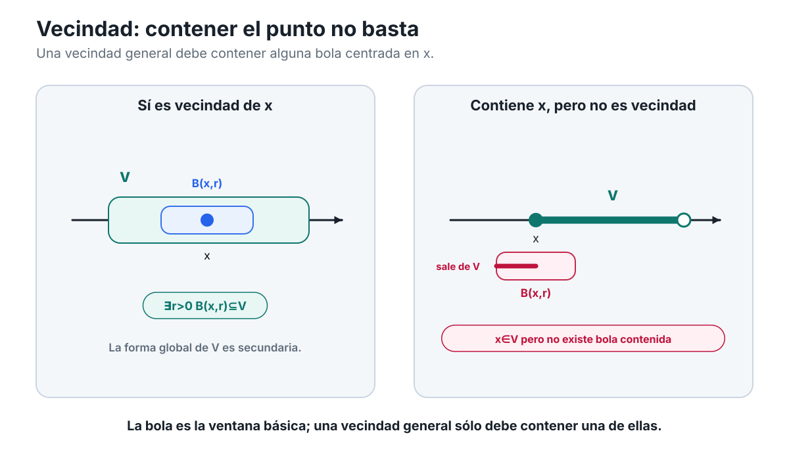
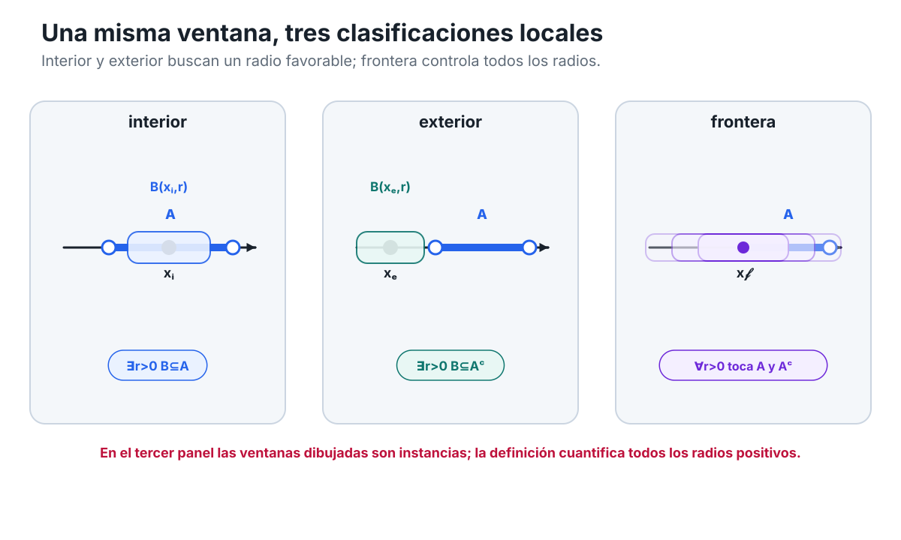
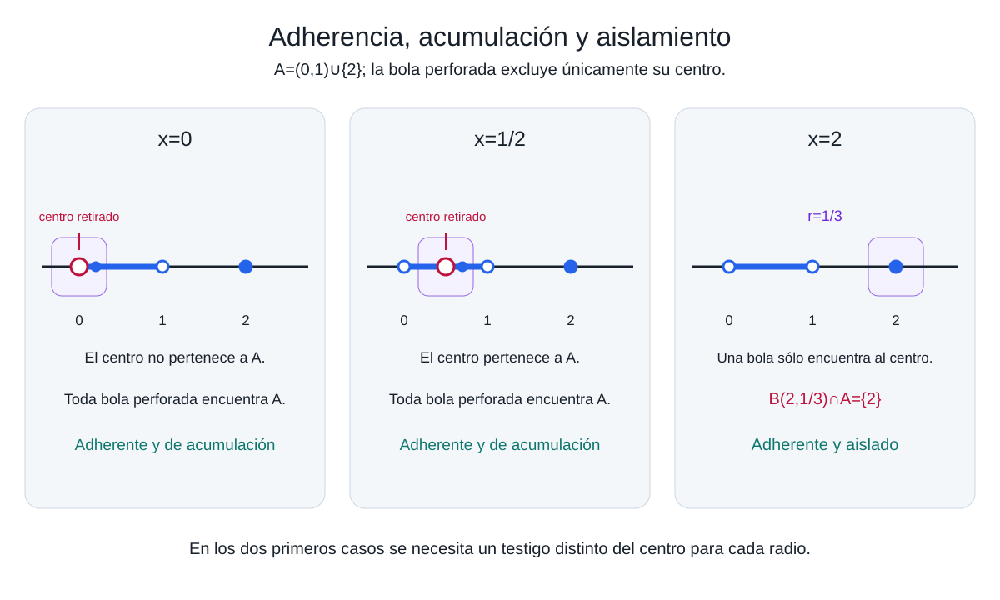
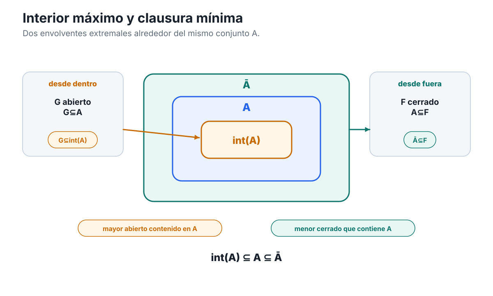
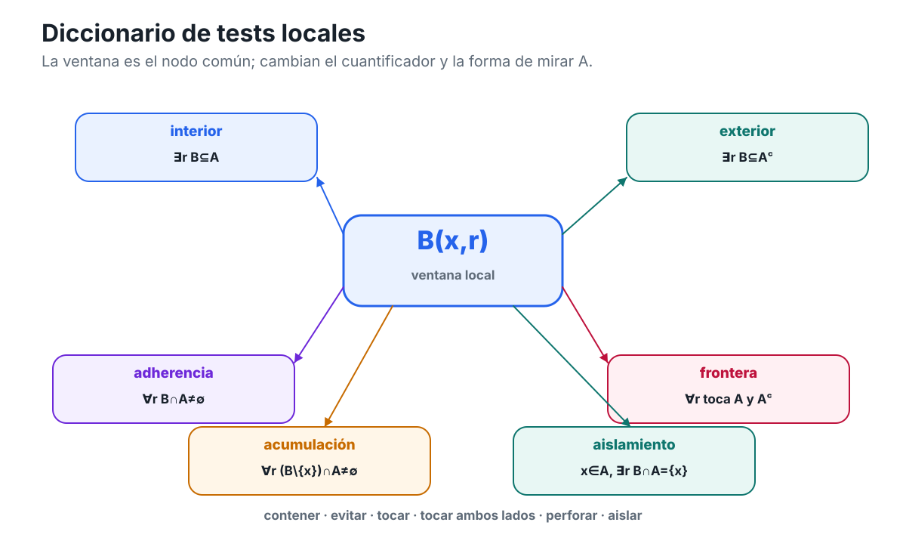

[Índice del libro](../para-matematicos/analisis-para-matematicos.html) · [Ejercicios de este capítulo](#ejercicios-4)

El orden permite comparar puntos y reconocer cotas; la distancia permite examinar lo que ocurre cerca de un centro. En C02 estudiamos las barreras de un conjunto y en C03 las consecuencias y las formulaciones de la completitud establecida en C00. Ahora fijaremos un punto y estudiaremos su relación con un conjunto mediante las bolas de C01:

$$
B(x,r)=\{y\in\mathbb R:|y-x|<r\}=(x-r,x+r),\qquad r>0.
$$

El radio determina la escala de observación. Algunas propiedades pedirán encontrar una bola favorable; otras exigirán controlar todas las bolas positivas, por pequeñas que sean. Esa diferencia de cuantificadores permitirá distinguir tener margen, no poder evitar un conjunto y encontrar puntos distintos del centro arbitrariamente cerca. Ninguno de estos argumentos necesita sucesiones, límites ni una nueva aplicación de la completitud.

## 4.1. Ventanas alrededor de un punto: vecindades

[]{#MA-SEC-ANM-01-004-001}

La bola $B(2,1/3)=(5/3,7/3)$ contiene exactamente los puntos cuya distancia a $2$ es menor que $1/3$. Sus extremos quedan fuera: la desigualdad que define la bola es estricta. 

> **Vecindad básica.** Si $x\in\mathbb R$ y $r>0$, la bola
>
> $$
> B(x,r)=(x-r,x+r)
> $$
>
> es una vecindad básica de $x$.

> **Vecindad de un punto.** Sea $x\in\mathbb R$. Un conjunto $V\subseteq\mathbb R$ es una **vecindad de $x$** si existe un radio $r>0$ tal que
>
> $$
> B(x,r)\subseteq V.
> $$

La definición sólo exige que una parte de $V$ proporcione margen alrededor de $x$. Por ejemplo, $V=(-1,1)\cup\{3\}$ es vecindad de $0$: sirven tanto $r=1$ como $r=1/2$. El punto separado $3$ no interviene en esa verificación. En cambio, $[0,2)$ no es vecindad de $0$. Dado cualquier $r>0$, el punto $-r/2$ pertenece a $B(0,r)$ y queda fuera del conjunto.

{#fig-anm-c04-f01 fig-alt="Dos paneles comparan un conjunto que contiene una bola centrada en x con otro que contiene a x sólo como punto de borde y no es vecindad."}

> Si $V$ es una vecindad de $x$, entonces $x\in V$.

En efecto, $|x-x|=0<r$. La conversa falla en el ejemplo anterior: pertenecer al conjunto no asegura margen a ambos lados del centro. Además, una vecindad puede contener puntos separados y no tiene por qué ser un intervalo ni una bola.

Hay tres operaciones elementales que usaremos repetidamente. Si $B(x,r)\subseteq V$ y $0<s\le r$, entonces $B(x,s)\subseteq B(x,r)\subseteq V$: reducir el radio conserva la inclusión. Si $V\subseteq W$, la misma bola certifica que $W$ es vecindad de $x$. Y si $V$ y $W$ son vecindades de $x$, elegimos radios $r,s>0$ que certifiquen ambas propiedades y tomamos $\rho=\min\{r,s\}>0$. Así,

$$
B(x,\rho)\subseteq B(x,r)\cap B(x,s)\subseteq V\cap W.
$$

La intersección de un número finito de vecindades vuelve a ser una vecindad: basta tomar el mínimo de sus radios. La positividad de ese mínimo depende de que la lista sea finita.

También podemos cambiar el centro sin abandonar una bola, siempre que ajustemos el radio.

> **Margen interno de una bola.** Si $y\in B(x,r)$, existe $\delta>0$ tal que
>
> $$
> B(y,\delta)\subseteq B(x,r).
> $$

Si $y\in B(x,r)$, queda un margen $\delta=r-|y-x|>0$. Para $z\in B(y,\delta)$, la desigualdad triangular da

$$
|z-x|\le |z-y|+|y-x|<\delta+|y-x|=r.
$$

Por tanto $B(y,\delta)\subseteq B(x,r)$. El radio depende de la posición de $y$: cuanto más próximo esté al borde, menor será el margen que garantiza este argumento. En $(-2,2)$, por ejemplo, $B(0,1)$ queda dentro del intervalo y también $B(1.9,0.05)$, aunque los radios sean distintos. Esta dependencia será decisiva al pasar de propiedades de un punto a propiedades de un conjunto.

### Ejercicios de la sección 4.1

[]{#ejercicios-4}

#### Ejercicio 1. Una definición, varias formas lógicas

[]{#MA-EX-ANM-01-004-001}

Sean $V\subseteq\mathbb R$ y $x\in\mathbb R$. Considera las afirmaciones:

1. existe $r>0$ tal que
   $$
   B(x,r)\subseteq V;
   $$
2. existe $r>0$ tal que, para todo $y\in\mathbb R$,
   $$
   |y-x|<r
   \Longrightarrow
   y\in V;
   $$
3. existe $r>0$ tal que
   $$
   (x-r,x+r)\subseteq V;
   $$
4. para todo $r>0$ existe $y\in V$ tal que
   $$
   |y-x|<r.
   $$

a) Demuestra que las afirmaciones 1, 2 y 3 son equivalentes.

b) Explica por qué la afirmación 4 tiene una estructura lógica distinta. Identifica con precisión el orden de los cuantificadores en 2 y en 4.

c) Da un ejemplo de $V$ y $x$ para el cual 4 sea verdadera pero 1 sea falsa.

d) Formula con palabras qué información adicional exige una vecindad respecto de la mera afirmación de que siempre aparecen puntos de $V$ cerca de $x$.

No uses ninguna terminología de secciones posteriores.

[]{#MA-SOL-ANM-01-004-001}

Ver solución del ejercicio 1

La primera afirmación dice

$$
\exists r>0:
B(x,r)\subseteq V.
$$

Por definición de bola,

$$
y\in B(x,r)
\iff
|y-x|<r.
$$

Por tanto la inclusión

$$
B(x,r)\subseteq V
$$

significa exactamente que todo $y\in\mathbb R$ que satisfaga $|y-x|<r$ pertenece a $V$. Así, 1 equivale a

$$
\exists r>0\ \forall y\in\mathbb R:
\bigl(|y-x|<r\Longrightarrow y\in V\bigr),
$$

que es la afirmación 2.

En $\mathbb R$ tenemos además

$$
B(x,r)=(x-r,x+r).
$$

Sustituir la bola por ese intervalo transforma 1 en

$$
\exists r>0:
(x-r,x+r)\subseteq V,
$$

que es 3. Por tanto,

$$
\boxed{1\iff2\iff3.}
$$

La afirmación 4 es distinta:

$$
\forall r>0\ \exists y\in V:
|y-x|<r.
$$

En 2 elegimos **un** radio y, una vez elegido, exigimos que **todo** punto de la bola pertenezca a $V$. En 4, en cambio, cada radio puede tener su propio testigo $y$, y sólo se exige encontrar al menos un punto de $V$ dentro de la bola.

Un contraejemplo simple es

$$
V=[0,\infty),
\qquad
x=0.
$$

Para cualquier $r>0$, el punto

$$
y=\frac r2
$$

satisface

$$
y\in V
\qquad\text{y}\qquad
|y|<r.
$$

Así, 4 es verdadera.

Sin embargo, ningún $r>0$ satisface

$$
B(0,r)\subseteq V,
$$

porque

$$
-\frac r2\in B(0,r)
$$

pero

$$
-\frac r2\notin[0,\infty).
$$

Por tanto 1 es falsa.

La diferencia conceptual es que encontrar puntos de $V$ arbitrariamente cerca de $x$ sólo exige **intersección**. Ser vecindad exige algo más fuerte: debe existir una ventana completa alrededor de $x$ cuyos puntos estén todos dentro de $V$.

#### Ejercicio 2. El conjunto de radios que realmente sirven

[]{#MA-EX-ANM-01-004-002}

Sea

$$
V=(-4,3)\cup\{100\}.
$$

Para un punto $x\in V$, define el conjunto de radios admisibles

$$
R_V(x)
=
\{r>0:B(x,r)\subseteq V\}.
$$

a) Determina exactamente $R_V(-1)$.

b) Determina exactamente $R_V(2)$.

c) Decide si $R_V(100)$ es vacío o no vacío y justifica tu respuesta.

d) Explica por qué el punto aislado $\{100\}$ no ayuda a aumentar los radios admisibles alrededor de $-1$ ni alrededor de $2$.

e) Compara $R_V(-1)$ y $R_V(2)$ y explica qué muestra el ejemplo acerca de la dependencia del radio respecto del centro.

Tu respuesta debe distinguir entre «pertenecer a $V$» y «disponer de un radio positivo cuya bola completa quede dentro de $V$».

[]{#MA-SOL-ANM-01-004-002}

Ver solución del ejercicio 2

Partimos de

$$
V=(-4,3)\cup\{100\}.
$$

Para $x=-1$ buscamos todos los $r>0$ tales que

$$
B(-1,r)=(-1-r,-1+r)
$$

quede contenido en $V$.

El obstáculo más cercano está a la izquierda, en $-4$. La distancia es

$$
|-1-(-4)|=3.
$$

Si $0<r\le3$, entonces

$$
-1-r\ge-4
$$

y, como la bola es abierta, el punto $-4$ no queda incluido cuando $r=3$. Además,

$$
-1+r\le2<3.
$$

Por tanto,

$$
B(-1,r)\subseteq(-4,3)\subseteq V.
$$

Si $r>3$, tomemos

$$
\varepsilon=\frac{r-3}{2}>0
$$

y definamos

$$
y=-4-\varepsilon.
$$

Entonces

$$
|y+1|
=
3+\varepsilon
=
\frac{r+3}{2}
<r,
$$

de modo que $y\in B(-1,r)$, pero $y\notin V$. Así,

$$
\boxed{
R_V(-1)=(0,3].
}
$$

Para $x=2$, la barrera más cercana es ahora el extremo derecho $3$, a distancia

$$
|3-2|=1.
$$

Si $0<r\le1$, entonces

$$
B(2,r)\subseteq(-4,3).
$$

Si $r>1$, tomando

$$
y=3+\min\left\{\frac{r-1}{2},1\right\}
$$

obtenemos $3<y\le4$, de modo que $y\notin V$, incluido el punto remoto $100$. Además, $|y-2|=1+\min\{(r-1)/2,1\}<r$. Por tanto,

$$
\boxed{
R_V(2)=(0,1].
}
$$

Para $x=100$, cualquier bola positiva contiene puntos distintos de $100$. En particular, dado $r>0$,

$$
y=100+\frac r2
$$

pertenece a $B(100,r)$, pero no pertenece a $V$, porque el único punto de $V$ cerca de $100$ es el propio $100$. Por tanto,

$$
\boxed{
R_V(100)=\varnothing.
}
$$

El punto remoto $100$ no amplía los radios admisibles alrededor de $-1$ o $2$. Una bola centrada en uno de esos puntos debe contener **todos** sus puntos en $V$; no puede saltar sobre el hueco entre $3$ y $100$ para aprovechar un punto aislado lejano.

Finalmente,

$$
R_V(-1)=(0,3]
\qquad\text{y}\qquad
R_V(2)=(0,1].
$$

Ambos centros pertenecen a la misma componente intervalar de $V$, pero el margen disponible depende de su posición. El radio que certifica una vecindad es una información local ligada al par $(x,V)$, no una propiedad uniforme del conjunto.

#### Ejercicio 3. Intersecciones finitas sí; intersecciones arbitrarias, no

[]{#MA-EX-ANM-01-004-003}

Sea $x\in\mathbb R$ y sean

$$
V_1,\dots,V_n
$$

vecindades de $x$.

a) Demuestra que

$$
\bigcap_{k=1}^nV_k
$$

también es una vecindad de $x$.

Tu prueba debe:

1. elegir, para cada $k$, un radio $r_k>0$ con
   $$
   B(x,r_k)\subseteq V_k;
   $$
2. construir un único radio positivo que funcione simultáneamente para todos los conjuntos;
3. indicar exactamente por qué la finitud de la familia permite hacer esa elección.

b) Considera ahora, para cada $r>0$,

$$
V_r=(-r,r).
$$

Demuestra que cada $V_r$ es una vecindad de $0$, pero que

$$
\bigcap_{r>0}V_r=\{0\}.
$$

c) Concluye que una intersección arbitraria de vecindades de un mismo punto no tiene por qué ser una vecindad de ese punto.

No uses teoría de conjuntos abiertos ni resultados de §4.7.

[]{#MA-SOL-ANM-01-004-003}

Ver solución del ejercicio 3

Cada vecindad $V_k$ aporta algún radio $r_k>0$. Para satisfacer simultáneamente todas las inclusiones necesitamos un radio que no exceda ninguno de ellos. La finitud permite tomar un mínimo.

Para cada

$$
k\in\{1,\dots,n\},
$$

como $V_k$ es vecindad de $x$, existe $r_k>0$ tal que

$$
B(x,r_k)\subseteq V_k.
$$

Definimos

$$
\rho=\min\{r_1,\dots,r_n\}.
$$

Como se trata de un conjunto finito de números positivos,

$$
\rho>0.
$$

Además,

$$
\rho\le r_k
$$

para todo $k$, y por tanto

$$
B(x,\rho)\subseteq B(x,r_k)\subseteq V_k.
$$

La misma bola queda contenida en todos los $V_k$, de modo que

$$
B(x,\rho)
\subseteq
\bigcap_{k=1}^nV_k.
$$

Así,

$$
\boxed{
\bigcap_{k=1}^nV_k
\text{ es una vecindad de }x.
}
$$

La finitud interviene exactamente al permitirnos formar el mínimo de la lista

$$
r_1,\dots,r_n
$$

y conservar un número estrictamente positivo.

Veamos ahora qué ocurre con una familia arbitraria. Para cada $r>0$,

$$
V_r=(-r,r)=B(0,r),
$$

por lo que $V_r$ es una vecindad de $0$.

Afirmamos que

$$
\bigcap_{r>0}V_r=\{0\}.
$$

Primero,

$$
0\in(-r,r)
$$

para todo $r>0$, así que $0$ pertenece a la intersección.

Sea ahora $x\ne0$. Elegimos

$$
r=\frac{|x|}{2}>0.
$$

Entonces

$$
|x|>r,
$$

por lo que

$$
x\notin(-r,r)=V_r.
$$

Así, ningún $x\ne0$ pertenece a la intersección. Queda probado que

$$
\bigcap_{r>0}V_r=\{0\}.
$$

Pero $\{0\}$ no es una vecindad de $0$: para cualquier $\rho>0$, el punto $\rho/2$ pertenece a $B(0,\rho)$ y es distinto de $0$. Por tanto,

$$
B(0,\rho)\nsubseteq\{0\}.
$$

Concluimos que la estabilidad de las vecindades bajo intersección es una propiedad **finita**, no arbitraria.

#### Ejercicio 4. Cuando «tocar» una ventana se confunde con «llenarla»

[]{#MA-EX-ANM-01-004-004}

Un estudiante quiere demostrar que

$$
V=[0,\infty)
$$

es una vecindad de $0$ y escribe:

> Sea $r>0$. El número $r/2$ pertenece a $V$ y además $|r/2|<r$. Por tanto
> $$
> B(0,r)\cap V\ne\varnothing.
> $$
> Como esto ocurre para todo $r>0$, $V$ contiene puntos arbitrariamente cercanos a $0$. Luego $V$ es una vecindad de $0$.

Audita el argumento.

a) Identifica exactamente qué afirmación cuantificada ha demostrado el estudiante.

b) Escribe la afirmación cuantificada que realmente tendría que demostrar para concluir que $V$ es vecindad de $0$.

c) Localiza el cambio ilegítimo entre ambas afirmaciones.

d) Demuestra directamente que $V$ no es una vecindad de $0$: para un radio arbitrario $r>0$, construye un punto de $B(0,r)$ que no pertenezca a $V$.

e) Repara la conclusión del estudiante sin introducir aún nombres de conceptos posteriores: expresa sólo qué propiedad local de $V$ alrededor de $0$ sí quedó demostrada.

[]{#MA-SOL-ANM-01-004-004}

Ver solución del ejercicio 4

El estudiante demuestra correctamente que, para todo $r>0$,

$$
B(0,r)\cap V\ne\varnothing,
$$

donde

$$
V=[0,\infty).
$$

En forma desplegada, su argumento establece

$$
\forall r>0\ \exists y\in V:
|y|<r.
$$

De hecho, el testigo elegido es

$$
y=\frac r2.
$$

Pero para demostrar que $V$ es vecindad de $0$ tendría que probar

$$
\exists r_0>0\ \forall y\in\mathbb R:
\bigl(|y|<r_0\Longrightarrow y\in V\bigr),
$$

o, equivalentemente,

$$
\exists r_0>0:
B(0,r_0)\subseteq V.
$$

El salto ilegítimo cambia simultáneamente dos cosas. Primero, transforma

$$
\forall r\ \exists y
$$

en una afirmación con la forma

$$
\exists r\ \forall y.
$$

Segundo, sustituye una condición de **intersección no vacía** por una condición de **inclusión completa**.

La conclusión de vecindad es falsa. Sea $r>0$ arbitrario y tomemos

$$
z=-\frac r2.
$$

Entonces

$$
|z|=\frac r2<r,
$$

así que

$$
z\in B(0,r).
$$

Sin embargo,

$$
z<0,
$$

de modo que

$$
z\notin[0,\infty).
$$

Por tanto,

$$
B(0,r)\nsubseteq V
$$

para todo $r>0$. No existe ningún radio que certifique que $V$ sea una vecindad de $0$.

La reparación correcta consiste en conservar únicamente lo demostrado:

> para toda bola positiva centrada en $0$, existe al menos un punto de $V$ dentro de esa bola.

Esta afirmación describe una proximidad local real, pero es lógicamente más débil que contener una ventana completa alrededor del centro.

## 4.2. Interior y exterior: tener margen

[]{#MA-SEC-ANM-01-004-002}

Fijado $A\subseteq\mathbb R$, diremos que $x$ es **interior a $A$** cuando $A$ sea vecindad de $x$. El conjunto de esos puntos es el interior:

$$
\operatorname{int}(A)=\{x\in\mathbb R:\exists r>0,\ B(x,r)\subseteq A\}.
$$

Como el centro pertenece a toda bola positiva, $\operatorname{int}(A)\subseteq A$. Para $a<x<b$, las distancias $x-a$ y $b-x$ son positivas; el radio $r_x=\tfrac12\min\{x-a,b-x\}$ produce una bola contenida en $(a,b)$. En cambio, alrededor de $a$ toda bola contiene puntos menores que $a$, y alrededor de $b$ contiene puntos mayores que $b$. Por ello, incluir un extremo no lo convierte en interior. Para $a<b$,

$$
\operatorname{int}((a,b))=\operatorname{int}([a,b])
=\operatorname{int}([a,b))=\operatorname{int}((a,b])=(a,b).
$$

Así, de los puntos $-2,0,3$ del conjunto $[-2,3]$, sólo $0$ es interior; por ejemplo, sirve $r=1$. Para excluir los extremos no basta fracasar con un radio particular: los puntos $-2-r/2$ y $3+r/2$ prueban el fracaso de cualquier $r>0$.

El mismo test aplicado al complemento define el **exterior**:

$$
\operatorname{ext}(A)=\operatorname{int}(A^c)
=\{x\in\mathbb R:\exists r>0,\ B(x,r)\cap A=\varnothing\}.
$$

Ser exterior significa disponer de una bola que evita todo el conjunto. En particular, $\operatorname{ext}(A)\subseteq A^c$, pero no todo punto que falta en $A$ es exterior. Para $A=(0,1)$, el punto $0$ no pertenece a $A$ y, sin embargo, toda bola $B(0,r)$ encuentra al conjunto: contiene $a=\min\{r/2,1/2\}\in(0,1)$. La misma observación, reflejada en $1$, se aplica al otro extremo.

{#fig-anm-c04-f02 fig-alt="Tres paneles muestran interior, exterior y frontera con la misma gramática de ventanas; el tercer panel recuerda que la definición cuantifica todos los radios."}

Para $A=[0,1)$ obtenemos $\operatorname{int}(A)=(0,1)$ y $\operatorname{ext}(A)=(-\infty,0)\cup(1,\infty)$. Si $x<0$, el radio $-x/2$ evita $A$; si $x>1$, sirve $(x-1)/2$. Los puntos $0$ y $1$ no son interiores ni exteriores: toda bola encuentra puntos del conjunto y de su complemento. En $0$ sirve el propio centro para encontrar $A$, mientras que en $1$ usamos $1-\min\{r/2,1/2\}$. Para encontrar el complemento sirven, respectivamente, $-r/2$ y el centro $1$.

Interior y exterior son disjuntos. Si un punto perteneciera a ambos, su centro tendría que estar simultáneamente en $A$ y en $A^c$. No agotan necesariamente la recta, como muestran los extremos anteriores. Las negaciones explican la clase que falta: no ser interior significa que toda bola encuentra $A^c$, y no ser exterior significa que toda bola encuentra $A$.

La inclusión de conjuntos conserva margen interior y reduce margen exterior. Si $A\subseteq B$ y $B(x,r)\subseteq A$, también $B(x,r)\subseteq B$, luego $\operatorname{int}(A)\subseteq\operatorname{int}(B)$. Como $B^c\subseteq A^c$, se deduce $\operatorname{ext}(B)\subseteq\operatorname{ext}(A)$. En los casos extremos, el interior de $\mathbb R$ y el exterior del vacío son $\mathbb R$; el interior del vacío y el exterior de $\mathbb R$ son vacíos.

Los radios se eligen después del centro. En $(0,1)$, la fórmula $r_x=\tfrac12\min\{x,1-x\}$ funciona para cada $x$, pero no hay un radio positivo común. En efecto, dado $r>0$, tomamos $x=\min\{r/2,1/2\}$. Entonces $0<x<1$, y $0\in B(x,r)$ porque $x<r$, aunque $0\notin(0,1)$. La afirmación $\forall x\in A\ \exists r_x>0$ permite esa dependencia; $\exists r>0\ \forall x\in A$ exige algo más fuerte. En $A=\mathbb R$ sí funciona cualquier radio fijo, de modo que apertura no prohibirá un radio uniforme: simplemente no lo exigirá.

### Ejercicios de la sección 4.2

#### Ejercicio 5. Negar correctamente el margen

[]{#MA-EX-ANM-01-004-005}

Sean $A\subseteq\mathbb R$ y $x\in\mathbb R$. Considera

$$
I(x,A):
\exists r>0:\ B(x,r)\subseteq A
$$

y

$$
E(x,A):
\exists r>0:\ B(x,r)\subseteq A^c.
$$

a) Escribe la negación de $I(x,A)$ sin usar la expresión «no es interior». La fórmula final debe comenzar con $\forall r>0$.

b) Escribe de la misma manera la negación de $E(x,A)$.

c) Demuestra que $I(x,A)$ y $E(x,A)$ no pueden ser verdaderas simultáneamente.

d) Muestra que sus negaciones sí pueden ser verdaderas simultáneamente. Usa

$$
A=[0,1],
\qquad
x=0,
$$

y verifica directamente las dos condiciones cuantificadas.

e) Explica por qué la alternativa «interior o exterior» no agota necesariamente todos los puntos de $\mathbb R$.

No nombres todavía la tercera clase local que aparecerá más adelante.

[]{#MA-SOL-ANM-01-004-005}

Ver solución del ejercicio 5

La negación de

$$
I(x,A):
\exists r>0:\ B(x,r)\subseteq A
$$

es

$$
\forall r>0:\ B(x,r)\not\subseteq A.
$$

Negar la inclusión significa que en cada bola existe al menos un punto fuera de $A$. Por tanto,

$$
\boxed{
\neg I(x,A)
\iff
\forall r>0:
B(x,r)\cap A^c\ne\varnothing.
}
$$

Del mismo modo,

$$
\boxed{
\neg E(x,A)
\iff
\forall r>0:
B(x,r)\cap A\ne\varnothing.
}
$$

Las afirmaciones $I(x,A)$ y $E(x,A)$ no pueden ser verdaderas simultáneamente. En efecto, la primera implica $x\in A$, mientras que la segunda implica $x\in A^c$, porque el centro pertenece a toda bola centrada en él. Eso obligaría a

$$
x\in A\cap A^c,
$$

lo cual es imposible.

Tomemos ahora

$$
A=[0,1],
\qquad
x=0.
$$

Dado $r>0$,

$$
-\frac r2\in B(0,r)\cap A^c,
$$

así que ninguna bola positiva centrada en $0$ queda contenida en $A$.

Por otro lado,

$$
0\in B(0,r)\cap A
$$

para todo $r>0$. Por tanto ninguna bola centrada en $0$ queda contenida en $A^c$.

Así,

$$
\neg I(0,A)
\qquad\text{y}\qquad
\neg E(0,A).
$$

Interior y exterior son incompatibles, pero no exhaustivos: puede haber puntos para los cuales no exista margen completo en ninguno de los dos lados.

#### Ejercicio 6. Dos familias de radios alrededor del mismo conjunto

[]{#MA-EX-ANM-01-004-006}

Sea

$$
A=(-3,-1]\cup(1,4).
$$

Para $x\in\mathbb R$, define

$$
R_{\mathrm{in}}(x)
=
\{r>0:B(x,r)\subseteq A\}
$$

y

$$
R_{\mathrm{out}}(x)
=
\{r>0:B(x,r)\subseteq A^c\}.
$$

Determina exactamente ambas familias de radios para

$$
x=-2,\qquad x=0,\qquad x=-1,\qquad x=4.
$$

Después:

a) identifica qué puntos son interiores, cuáles son exteriores y cuáles no pertenecen a ninguna de esas dos clases;

b) explica qué información aporta conocer el conjunto completo de radios admisibles, en lugar de limitarse a saber si existe alguno;

c) compara los casos $x=-1$ y $x=4$: uno pertenece a $A$ y el otro no, pero ambos producen el mismo patrón de radios admisibles. Explica por qué esto confirma que pertenencia y margen local son datos distintos.

[]{#MA-SOL-ANM-01-004-006}

Ver solución del ejercicio 6

Sea

$$
A=(-3,-1]\cup(1,4).
$$

Para $x=-2$, una bola permanece dentro del primer intervalo exactamente mientras su radio no supere la distancia $1$ a los dos extremos relevantes. Por tanto,

$$
\boxed{
R_{\mathrm{in}}(-2)=(0,1].
}
$$

Si $r>1$, elegimos $y=-1+\min\{(r-1)/2,1/2\}$. Entonces $-1<y\le-1/2$, de modo que $y\notin A$, y $|y+2|=1+\min\{(r-1)/2,1/2\}<r$. Además, como $-2\in A$, ninguna bola centrada en $-2$ puede quedar contenida en $A^c$. Luego

$$
\boxed{
R_{\mathrm{out}}(-2)=\varnothing.
}
$$

Para $x=0$ tenemos

$$
B(0,1)=(-1,1)\subseteq A^c.
$$

Todo radio $0<r\le1$ sigue funcionando. Si $r>1$, entonces

$$
-1\in B(0,r)\cap A,
$$

de modo que el radio deja de ser exterior. Como $0\notin A$, ningún radio puede certificar interioridad. Así,

$$
\boxed{
R_{\mathrm{in}}(0)=\varnothing,
\qquad
R_{\mathrm{out}}(0)=(0,1].
}
$$

Para $x=-1$, el centro pertenece a $A$, así que

$$
R_{\mathrm{out}}(-1)=\varnothing.
$$

Pero tampoco existe radio interior. Dado $r>0$, el punto

$$
y=-1+\frac12\min\{r,1\}
$$

satisface $|y+1|<r$ y pertenece a $(-1,0]$, que está fuera de $A$. Por tanto,

$$
\boxed{
R_{\mathrm{in}}(-1)=R_{\mathrm{out}}(-1)=\varnothing.
}
$$

Finalmente, $4\notin A$, de modo que $R_{\mathrm{in}}(4)=\varnothing$. Para cualquier $r>0$, el punto

$$
y=4-\frac12\min\{r,1\}
$$

satisface $|y-4|<r$ y, además,

$$
3.5\le y<4,
$$

por lo que $y\in(1,4)\subseteq A$. Así ninguna bola centrada en $4$ queda contenida en $A^c$, y

$$
\boxed{
R_{\mathrm{in}}(4)=R_{\mathrm{out}}(4)=\varnothing.
}
$$

La clasificación es entonces:

- $-2$ es interior;
- $0$ es exterior;
- $-1$ y $4$ no son ni interiores ni exteriores.

Conocer toda la familia de radios aporta una escala local. Por ejemplo, $R_{\mathrm{in}}(-2)=(0,1]$ no sólo dice que $-2$ es interior: muestra exactamente hasta qué radio puede agrandarse una bola centrada allí sin salir del conjunto.

Los puntos $-1$ y $4$ tienen el mismo patrón de radios admisibles, aunque sólo el primero pertenece a $A$. Esto confirma que pertenencia y margen local son informaciones distintas.

#### Ejercicio 7. Clasificar todo un conjunto por margen local

[]{#MA-EX-ANM-01-004-007}

Considera

$$
A=[-2,-1)\cup\{0\}\cup(1,3].
$$

Determina exactamente

$$
\operatorname{int}(A)
$$

y

$$
\operatorname{ext}(A).
$$

Tu respuesta debe ser una demostración por casos, no una inspección gráfica.

En particular:

a) construye radios explícitos para los puntos que afirmes interiores;

b) construye radios explícitos para los puntos que afirmes exteriores;

c) demuestra que ninguno de los puntos

$$
-2,\qquad -1,\qquad 0,\qquad 1,\qquad 3
$$

es interior ni exterior;

d) verifica al final que cada punto real ha quedado clasificado como interior, exterior o dentro del conjunto excepcional anterior.

No uses todavía ninguna noción posterior a §4.2.

[]{#MA-SOL-ANM-01-004-007}

Ver solución del ejercicio 7

Sea

$$
A=[-2,-1)\cup\{0\}\cup(1,3].
$$

Si $-2<x<-1$, entonces

$$
r_x
=
\frac12\min\{x+2,-1-x\}>0
$$

satisface

$$
B(x,r_x)\subseteq(-2,-1)\subseteq A.
$$

Si $1<x<3$, entonces

$$
r_x
=
\frac12\min\{x-1,3-x\}>0
$$

satisface

$$
B(x,r_x)\subseteq(1,3)\subseteq A.
$$

Por tanto,

$$
(-2,-1)\cup(1,3)
\subseteq
\operatorname{int}(A).
$$

Los puntos $-1$ y $1$ no pertenecen a $A$ y, por tanto, no son interiores. Para cualquier radio $r>0$, los puntos $-2-r/2$ y $3+r/2$ están en las bolas centradas en $-2$ y $3$, respectivamente, y fuera de $A$. En la bola centrada en $0$, el punto $\min\{r/2,1/2\}$ está en $(0,1)\subseteq A^c$. Así, tampoco $-2$, $0$ ni $3$ son interiores.

Así,

$$
\boxed{
\operatorname{int}(A)
=
(-2,-1)\cup(1,3).
}
$$

Calculemos el exterior.

Si $x<-2$, el radio

$$
r=\frac{-2-x}{2}
$$

produce una bola contenida en $(-\infty,-2)$.

Si $-1<x<0$, tomamos

$$
r=\frac12\min\{x+1,-x\},
$$

y la bola queda contenida en $(-1,0)$.

Si $0<x<1$, tomamos

$$
r=\frac12\min\{x,1-x\},
$$

y obtenemos una bola contenida en $(0,1)$.

Si $x>3$, el radio

$$
r=\frac{x-3}{2}
$$

produce una bola contenida en $(3,\infty)$.

Todas esas regiones están dentro de $A^c$, de modo que

$$
(-\infty,-2)\cup(-1,0)\cup(0,1)\cup(3,\infty)
\subseteq
\operatorname{ext}(A).
$$

No hay más puntos exteriores. Los puntos $-2,0,3$ pertenecen a $A$, así que no pueden ser exteriores. Para un radio arbitrario $r>0$, el punto $-1-\min\{r/2,1/2\}$ está en $A\cap B(-1,r)$, y $1+\min\{r/2,1/2\}$ está en $A\cap B(1,r)$. Por tanto, tampoco $-1$ ni $1$ son exteriores.

Por tanto,

$$
\boxed{
\operatorname{ext}(A)
=
(-\infty,-2)\cup(-1,0)\cup(0,1)\cup(3,\infty).
}
$$

Los únicos puntos que no quedaron en interior ni exterior son

$$
\boxed{
\{-2,-1,0,1,3\}.
}
$$

Con esto se han agotado todos los puntos de $\mathbb R$ sin usar ninguna noción posterior a §4.2.

#### Ejercicio 8. Cómo se comporta el interior bajo operaciones de conjuntos

[]{#MA-EX-ANM-01-004-008}

Sean $A,B\subseteq\mathbb R$.

a) Demuestra directamente que

$$
\operatorname{int}(A\cap B)
=
\operatorname{int}(A)\cap\operatorname{int}(B).
$$

En la inclusión no inmediata deberás sincronizar dos radios.

b) Usa

$$
\operatorname{ext}(C)=\operatorname{int}(C^c)
$$

y una ley de De Morgan para deducir

$$
\operatorname{ext}(A\cup B)
=
\operatorname{ext}(A)\cap\operatorname{ext}(B).
$$

c) Demuestra que siempre

$$
\operatorname{int}(A)\cup\operatorname{int}(B)
\subseteq
\operatorname{int}(A\cup B).
$$

d) Muestra que la inclusión del apartado c) puede ser estricta usando

$$
A=[-1,0],
\qquad
B=[0,1].
$$

Identifica el punto que pertenece al interior de $A\cup B$ pero no a $\operatorname{int}(A)\cup\operatorname{int}(B)$.

[]{#MA-SOL-ANM-01-004-008}

Ver solución del ejercicio 8

Para probar

$$
\operatorname{int}(A\cap B)
=
\operatorname{int}(A)\cap\operatorname{int}(B),
$$

demostramos ambas inclusiones.

Si

$$
x\in\operatorname{int}(A\cap B),
$$

existe $r>0$ tal que

$$
B(x,r)\subseteq A\cap B.
$$

La misma bola queda contenida en $A$ y en $B$. Por tanto,

$$
x\in\operatorname{int}(A)\cap\operatorname{int}(B).
$$

Recíprocamente, supongamos

$$
x\in\operatorname{int}(A)\cap\operatorname{int}(B).
$$

Existen $r,s>0$ tales que

$$
B(x,r)\subseteq A,
\qquad
B(x,s)\subseteq B.
$$

Tomamos

$$
\rho=\min\{r,s\}>0.
$$

Entonces

$$
B(x,\rho)\subseteq A\cap B,
$$

y por tanto $x\in\operatorname{int}(A\cap B)$.

Así,

$$
\boxed{
\operatorname{int}(A\cap B)
=
\operatorname{int}(A)\cap\operatorname{int}(B).
}
$$

Para el exterior usamos

$$
\operatorname{ext}(C)=\operatorname{int}(C^c).
$$

Por De Morgan y la identidad recién probada,

$$
\begin{aligned}
\operatorname{ext}(A\cup B)
&=
\operatorname{int}\bigl((A\cup B)^c\bigr)\\
&=
\operatorname{int}(A^c\cap B^c)\\
&=
\operatorname{int}(A^c)\cap\operatorname{int}(B^c)\\
&=
\operatorname{ext}(A)\cap\operatorname{ext}(B).
\end{aligned}
$$

Por tanto,

$$
\boxed{
\operatorname{ext}(A\cup B)
=
\operatorname{ext}(A)\cap\operatorname{ext}(B).
}
$$

Además,

$$
A\subseteq A\cup B
\qquad\text{y}\qquad
B\subseteq A\cup B.
$$

La monotonicidad del interior da

$$
\operatorname{int}(A)\subseteq\operatorname{int}(A\cup B)
$$

y

$$
\operatorname{int}(B)\subseteq\operatorname{int}(A\cup B).
$$

Luego

$$
\boxed{
\operatorname{int}(A)\cup\operatorname{int}(B)
\subseteq
\operatorname{int}(A\cup B).
}
$$

La inclusión puede ser estricta. Si

$$
A=[-1,0],
\qquad
B=[0,1],
$$

entonces

$$
\operatorname{int}(A)=(-1,0),
\qquad
\operatorname{int}(B)=(0,1),
$$

pero

$$
A\cup B=[-1,1]
$$

y

$$
\operatorname{int}(A\cup B)=(-1,1).
$$

El punto $0$ pertenece al interior de la unión, pero no al interior de ninguno de los dos conjuntos por separado.

#### Ejercicio 9. Añadir puntos sin crear margen

[]{#MA-EX-ANM-01-004-009}

Sea $t>1$ y considera

$$
A_t=(0,1)\cup\{t\},
$$

y

$$
B_t=[0,1)\cup\{t\}.
$$

a) Demuestra que, para todo $t>1$,

$$
\operatorname{int}(A_t)
=
\operatorname{int}(B_t)
=
(0,1).
$$

b) Demuestra que

$$
\operatorname{ext}(A_t)
=
\operatorname{ext}(B_t)
=
(-\infty,0)\cup(1,t)\cup(t,\infty).
$$

c) Compara $A_t$ con $(0,1)$. ¿Qué efecto tiene añadir el punto $t$ sobre el interior? ¿Qué efecto tiene sobre el exterior?

d) Compara $A_t$ con $B_t$. El punto $0$ cambia de pertenencia, pero el interior y el exterior no cambian. Justifica por qué.

e) Formula con tus propias palabras una conclusión general: ¿qué muestra esta familia acerca de la diferencia entre modificar la pertenencia de algunos puntos y modificar el margen local?

[]{#MA-SOL-ANM-01-004-009}

Ver solución del ejercicio 9

Sea $t>1$.

Para cualquier $x\in(0,1)$, el radio

$$
r_x
=
\frac12\min\{x,1-x\}>0
$$

satisface

$$
B(x,r_x)\subseteq(0,1),
$$

de modo que $x$ es interior tanto a $A_t$ como a $B_t$.

El punto $0$ no es interior a $B_t$, porque toda bola centrada en $0$ contiene números negativos; no es interior a $A_t$ porque no pertenece a él. El punto $1$ no pertenece a ninguno de los dos conjuntos y tampoco puede ser interior. El punto $t$ tampoco es interior a ninguno de los dos conjuntos: dado $r>0$, el punto

$$
t+\frac r2
$$

pertenece a $B(t,r)$ y queda fuera de ambos conjuntos.

Así,

$$
\boxed{
\operatorname{int}(A_t)
=
\operatorname{int}(B_t)
=
(0,1).
}
$$

Para el exterior, si $x<0$, el radio

$$
r=\frac{-x}{2}
$$

produce una bola disjunta de ambos conjuntos.

Si $1<x<t$, tomamos

$$
r
=
\frac12\min\{x-1,t-x\}>0,
$$

y entonces

$$
B(x,r)\subset(1,t).
$$

Si $x>t$, el radio

$$
r=\frac{x-t}{2}
$$

produce una bola contenida en $(t,\infty)$.

Así,

$$
(-\infty,0)\cup(1,t)\cup(t,\infty)
$$

está contenido en los dos exteriores.

No hay otros puntos exteriores. Los puntos de $(0,1)$ y el punto $t$ pertenecen a ambos conjuntos. Toda bola centrada en $0$ toca $(0,1)$, y toda bola centrada en $1$ toca puntos de $(0,1)$. Por tanto,

$$
\boxed{
\operatorname{ext}(A_t)
=
\operatorname{ext}(B_t)
=
(-\infty,0)\cup(1,t)\cup(t,\infty).
}
$$

Para

$$
C=(0,1),
$$

tenemos

$$
\operatorname{int}(C)=(0,1)
$$

y

$$
\operatorname{ext}(C)=(-\infty,0)\cup(1,\infty).
$$

Añadir el punto $t$ no crea margen interior alrededor de $t$, pero hace que ese punto deje de ser exterior. El resto de los puntos de $(1,\infty)$ conserva margen exterior.

Pasar de $A_t$ a $B_t$ añade únicamente el punto $0$. La pertenencia de $0$ cambia, pero no aparece una bola completa contenida en el conjunto ni una bola completa contenida en el complemento. Por eso interior y exterior permanecen iguales.

La familia muestra que cambiar la pertenencia de algunos puntos no equivale a cambiar el margen local. Interior y exterior registran cómo se comportan ventanas completas alrededor del centro, no sólo si el centro pertenece al conjunto.

## 4.3. Clausura: puntos que no pueden evitar al conjunto

[]{#MA-SEC-ANM-01-004-003}

Negar exterioridad conduce a una propiedad nueva. Un punto $x$ es **adherente a $A$** si toda bola positiva centrada en él intersecta $A$. La **clausura** reúne esos puntos:

$$
x\in\overline A\iff\forall r>0:\ B(x,r)\cap A\ne\varnothing.
$$

La definición no obliga a que $x$ pertenezca a $A$. Sí asegura la inclusión $A\subseteq\overline A$: si $x\in A$, el centro proporciona un testigo para cada radio. Los extremos $0$ y $1$ de $(0,1)$ son adherentes sin pertenecer al intervalo. Para un radio arbitrario, los testigos $\min\{r/2,1/2\}$ y $1-\min\{r/2,1/2\}$ prueban ambas afirmaciones.

La negación del cuantificador permite escribir

$$
\overline A=(\operatorname{ext}(A))^c
=\bigl(\operatorname{int}(A^c)\bigr)^c.
$$

Por tanto, para demostrar adherencia debemos responder a todo radio; para excluirla basta construir uno que evite el conjunto. Esta diferencia organiza el cálculo de clausuras.

Consideremos $A=(0,1)\setminus\{1/2\}$. Los puntos que ya pertenecen a $A$ son adherentes. Para los tres puntos que faltan en $[0,1]$, fijamos $r>0$ y ponemos $h=\min\{r/2,1/4\}>0$. Los puntos $h$, $1/2+h$ y $1-h$ pertenecen a $A$ y quedan, respectivamente, a distancia menor que $r$ de $0$, $1/2$ y $1$. Si $x<0$, la bola de radio $-x/2$ queda a la izquierda de $0$; si $x>1$, la de radio $(x-1)/2$ queda a la derecha de $1$. Ambas evitan $A$. Hemos probado $\overline A=[0,1]$, sin rellenar ningún hueco por una regla geométrica supuesta: cada punto añadido ha pasado el test local.

{#fig-anm-c04-f03 fig-alt="Dos rectas muestran un intervalo abierto perforado en un medio y su clausura; una lupa local muestra que toda ventana alrededor de la perforación vuelve a encontrar el conjunto."}

Podemos usar vecindades en lugar de bolas: $x\in\overline A$ si y sólo si toda vecindad de $x$ intersecta $A$. Si $x$ es adherente y $V$ contiene $B(x,r)$, un punto de $B(x,r)\cap A$ pertenece también a $V\cap A$. Recíprocamente, cada bola es una vecindad, así que el test para todas las vecindades incluye el test para todas las bolas.

La clausura es monótona. Si $A\subseteq B$, cualquier punto de $B(x,r)\cap A$ pertenece a $B(x,r)\cap B$, luego $\overline A\subseteq\overline B$. Además, clausurar dos veces no añade puntos:

$$
\overline{\overline A}=\overline A.
$$

Una inclusión se sigue de $C\subseteq\overline C$, aplicada a $C=\overline A$. Para la otra, sea $x\in\overline{\overline A}$ y fijemos $r>0$. Primero elegimos $y\in B(x,r/2)\cap\overline A$. Como $y$ es adherente a $A$, elegimos después $a\in B(y,r/2)\cap A$. Entonces

$$
|a-x|\le |a-y|+|y-x|<r/2+r/2=r.
$$

Así, $a\in B(x,r)\cap A$. El radio era arbitrario, por lo que $x\in\overline A$. Los radios auxiliares se reparten el margen total antes de sumar distancias; usar $r$ en ambos pasos sólo daría una cota $2r$ y no cerraría esta prueba. Finalmente, $\overline\varnothing=\varnothing$ y $\overline{\mathbb R}=\mathbb R$, directamente por las intersecciones que exige la definición.

### Ejercicios de la sección 4.3

#### Ejercicio 10. Una clausura con intervalos y un punto separado

[]{#MA-EX-ANM-01-004-010}

Sea

$$
A=(-2,-1)\cup\{0\}\cup(1,2).
$$

Determina exactamente $\overline A$.

Tu demostración debe separar tres tipos de puntos:

1. puntos que ya pertenecen a $A$;
2. puntos que no pertenecen a $A$ pero que toda bola positiva alrededor de ellos obliga a tocar $A$;
3. puntos para los cuales puedes construir una bola positiva disjunta de $A$.

No basta escribir la respuesta por analogía con intervalos. Debes justificar explícitamente qué ocurre en

$$
-2,\quad -1,\quad 0,\quad 1,\quad 2
$$

y explicar por qué no hay otros puntos adherentes.

[]{#MA-SOL-ANM-01-004-010}

Ver solución del ejercicio 10

Sea

$$
A=(-2,-1)\cup\{0\}\cup(1,2).
$$

Todo punto de $A$ es adherente, porque siempre

$$
A\subseteq\overline A.
$$

Por tanto,

$$
(-2,-1)\cup\{0\}\cup(1,2)
\subseteq
\overline A.
$$

Quedan por estudiar los puntos que no pertenecen al conjunto.

Empecemos por los cuatro extremos intervalares.

Para $x=-2$ y un radio arbitrario $r>0$, tomemos

$$
a=-2+\min\left\{\frac r2,\frac14\right\}.
$$

Entonces

$$
-2<a<-1,
$$

de modo que $a\in A$, y además

$$
|a-(-2)|<r.
$$

Por tanto toda bola centrada en $-2$ intersecta $A$, así que

$$
-2\in\overline A.
$$

El mismo mecanismo funciona en $-1$. Dado $r>0$, podemos tomar

$$
a=-1-\min\left\{\frac r2,\frac14\right\}\in(-2,-1)\cap B(-1,r),
$$

y concluimos

$$
-1\in\overline A.
$$

Para $x=1$, tomamos

$$
a=1+\min\left\{\frac r2,\frac14\right\},
$$

y para $x=2$,

$$
a=2-\min\left\{\frac r2,\frac14\right\}.
$$

En ambos casos obtenemos puntos de $(1,2)$ dentro de la bola arbitraria correspondiente. Por tanto,

$$
1,2\in\overline A.
$$

El punto $0$ ya pertenece a $A$, de modo que es adherente automáticamente.

Así hemos demostrado

$$
[-2,-1]\cup\{0\}\cup[1,2]
\subseteq
\overline A.
$$

Falta excluir todos los demás puntos.

Si $x<-2$, el radio

$$
r=\frac{-2-x}{2}>0
$$

satisface

$$
B(x,r)\subset(-\infty,-2),
$$

y la bola es disjunta de $A$.

Si $-1<x<0$, tomemos

$$
r=\frac12\min\{x+1,-x\}>0.
$$

Entonces

$$
B(x,r)\subset(-1,0),
$$

que no contiene puntos de $A$.

Si $0<x<1$, el radio

$$
r=\frac12\min\{x,1-x\}>0
$$

produce una bola contenida en $(0,1)$ y disjunta de $A$.

Finalmente, si $x>2$, basta tomar

$$
r=\frac{x-2}{2}>0.
$$

No quedan más casos. Por tanto,

$$
\boxed{
\overline A
=
[-2,-1]\cup\{0\}\cup[1,2].
}
$$

La clausura añade los extremos de los dos intervalos, pero no rellena los huecos completos entre ellos: sólo incorpora los puntos que ninguna bola positiva puede separar del conjunto.

#### Ejercicio 11. La clausura de una unión finita

[]{#MA-EX-ANM-01-004-011}

Sean $A,B\subseteq\mathbb R$.

Demuestra que

$$
\boxed{
\overline{A\cup B}
=
\overline A\cup\overline B.
}
$$

Organiza la prueba como una igualdad de conjuntos.

Para una de las inclusiones puedes usar la monotonicidad de la clausura ya demostrada en §4.3. Para la otra, si decides argumentar por contradicción, deberás:

1. suponer que un punto no pertenece ni a $\overline A$ ni a $\overline B$;
2. obtener dos radios positivos que eviten respectivamente a $A$ y a $B$;
3. sincronizar esos radios;
4. explicar por qué la bola resultante evita a $A\cup B$.

Al final, identifica dónde se usa que sólo hay **dos** conjuntos.

[]{#MA-SOL-ANM-01-004-011}

Ver solución del ejercicio 11

Queremos probar

$$
\overline{A\cup B}
=
\overline A\cup\overline B.
$$

Como se trata de una igualdad de conjuntos, probaremos las dos inclusiones.

Primero, como

$$
A\subseteq A\cup B,
$$

la monotonicidad de la clausura da

$$
\overline A
\subseteq
\overline{A\cup B}.
$$

Del mismo modo,

$$
\overline B
\subseteq
\overline{A\cup B}.
$$

Por tanto,

$$
\overline A\cup\overline B
\subseteq
\overline{A\cup B}.
$$

Para la inclusión contraria, supongamos que

$$
x\notin\overline A\cup\overline B.
$$

Entonces

$$
x\notin\overline A
\qquad\text{y}\qquad
x\notin\overline B.
$$

Negando la definición de adherencia, existen $r>0$ y $s>0$ tales que

$$
B(x,r)\cap A=\varnothing
$$

y

$$
B(x,s)\cap B=\varnothing.
$$

Tomemos

$$
\rho=\min\{r,s\}>0.
$$

Entonces

$$
B(x,\rho)\subseteq B(x,r)
$$

y

$$
B(x,\rho)\subseteq B(x,s).
$$

Por tanto la misma bola evita simultáneamente a $A$ y a $B$:

$$
B(x,\rho)\cap A=\varnothing,
\qquad
B(x,\rho)\cap B=\varnothing.
$$

De aquí se sigue

$$
B(x,\rho)\cap(A\cup B)=\varnothing.
$$

Por tanto,

$$
x\notin\overline{A\cup B}.
$$

Hemos probado la contraposición de

$$
\overline{A\cup B}
\subseteq
\overline A\cup\overline B.
$$

Juntando ambas inclusiones,

$$
\boxed{
\overline{A\cup B}
=
\overline A\cup\overline B.
}
$$

La finitud aparece en la sincronización de radios. Para dos conjuntos basta tomar $\min\{r,s\}$. El mismo argumento funciona para cualquier familia finita, porque podemos tomar el mínimo de una lista finita de radios positivos.

#### Ejercicio 12. La intersección se comporta de otra manera

[]{#MA-EX-ANM-01-004-012}

Sean $A,B\subseteq\mathbb R$.

a) Demuestra que siempre

$$
\boxed{
\overline{A\cap B}
\subseteq
\overline A\cap\overline B.
}
$$

b) Decide si la igualdad tiene que cumplirse siempre.

c) Si no es así, usa

$$
A=(-1,0),
\qquad
B=(0,1)
$$

para demostrar que la inclusión puede ser estricta.

d) Explica por qué el fracaso de la igualdad no contradice la identidad del ejercicio anterior.

Tu solución no debe invocar conjuntos cerrados ni resultados de §4.7.

[]{#MA-SOL-ANM-01-004-012}

Ver solución del ejercicio 12

Como

$$
A\cap B\subseteq A,
$$

la monotonicidad de la clausura da

$$
\overline{A\cap B}
\subseteq
\overline A.
$$

También

$$
A\cap B\subseteq B,
$$

por lo que

$$
\overline{A\cap B}
\subseteq
\overline B.
$$

Así,

$$
\boxed{
\overline{A\cap B}
\subseteq
\overline A\cap\overline B.
}
$$

La igualdad no tiene por qué cumplirse.

Tomemos

$$
A=(-1,0),
\qquad
B=(0,1).
$$

Entonces

$$
A\cap B=\varnothing,
$$

de modo que

$$
\overline{A\cap B}
=
\overline\varnothing
=
\varnothing.
$$

En cambio,

$$
\overline A=[-1,0]
$$

y

$$
\overline B=[0,1].
$$

Por tanto,

$$
\overline A\cap\overline B
=
\{0\}.
$$

Así,

$$
\boxed{
\overline{A\cap B}
\subsetneq
\overline A\cap\overline B.
}
$$

No hay contradicción con el ejercicio anterior. La clausura de una unión y la clausura de una intersección responden a formas lógicas distintas.

Para ser adherente a $A\cup B$, cada bola sólo necesita encontrar al menos un punto en **alguno** de los dos conjuntos. Si un punto deja de ser adherente a ambos por separado, podemos sincronizar dos bolas que los eviten y obtener una bola que evita la unión.

En cambio, un punto puede ser adherente a $A$ y a $B$ porque ambos conjuntos se acercan al mismo centro desde lados distintos, aunque ninguna bola contenga un punto que pertenezca simultáneamente a $A$ y a $B$. Eso ocurre exactamente en $0$ para el ejemplo anterior.

#### Ejercicio 13. Reparar una prueba de idempotencia

[]{#MA-EX-ANM-01-004-013}

Un estudiante intenta demostrar

$$
\overline{\overline A}\subseteq\overline A
$$

de la siguiente manera:

> Sea $x\in\overline{\overline A}$ y sea $r>0$. Como $x$ es adherente a $\overline A$, existe
> $$
> y\in B(x,r)\cap\overline A.
> $$
> Como $y\in\overline A$, existe
> $$
> a\in B(y,r)\cap A.
> $$
> Por la desigualdad triangular,
> $$
> |a-x|
> \le |a-y|+|y-x|
> <r+r.
> $$
> Luego $a\in B(x,r)$, y por tanto $x\in\overline A$.

Audita el argumento.

a) Identifica la línea exacta que no está justificada.

b) Explica qué conclusión sí permite obtener la estimación

$$
|a-x|<2r.
$$

c) Repara la prueba cambiando únicamente la elección de los radios de las dos bolas auxiliares.

d) Explica por qué la elección corregida permite cerrar el argumento para un radio **arbitrario** $r>0$.

e) Resume en una frase el mecanismo reutilizable de la reparación.

[]{#MA-SOL-ANM-01-004-013}

Ver solución del ejercicio 13

La línea defectuosa es

> de $|a-x|<r+r$ se concluye $a\in B(x,r)$.

La estimación obtenida sólo permite afirmar

$$
|a-x|<2r,
$$

y por tanto

$$
a\in B(x,2r).
$$

Eso no basta para demostrar que la bola original $B(x,r)$ intersecta $A$.

La reparación consiste en reservar parte del radio para cada uno de los dos desplazamientos.

Sea

$$
x\in\overline{\overline A}
$$

y sea $r>0$ arbitrario.

Como $x$ es adherente a $\overline A$, la bola de radio $r/2$ alrededor de $x$ intersecta $\overline A$. Existe, pues,

$$
y\in
B\left(x,\frac r2\right)\cap\overline A.
$$

Como $y\in\overline A$, la bola de radio $r/2$ alrededor de $y$ intersecta $A$. Existe entonces

$$
a\in
B\left(y,\frac r2\right)\cap A.
$$

Ahora la desigualdad triangular produce

$$
|a-x|
\le
|a-y|+|y-x|
<
\frac r2+\frac r2
=
r.
$$

Por tanto,

$$
a\in B(x,r)\cap A.
$$

Como $r>0$ era arbitrario,

$$
B(x,r)\cap A\ne\varnothing
$$

para todo $r>0$, y así

$$
x\in\overline A.
$$

Hemos demostrado

$$
\overline{\overline A}
\subseteq
\overline A.
$$

La elección $r/2$ funciona porque divide de antemano el presupuesto total $r$ entre los dos desplazamientos que luego sumará la desigualdad triangular.

El mecanismo reutilizable es:

> cuando dos desplazamientos consecutivos deben caber dentro de un radio total, conviene repartir el margen antes de aplicar la desigualdad triangular.

#### Ejercicio 14. Perforar, rellenar y añadir un punto separado

[]{#MA-EX-ANM-01-004-014}

Sea $t\in(0,1)$ y define

$$
A_t=(0,1)\setminus\{t\},
$$

$$
B_t=A_t\cup\{t\}=(0,1),
$$

y

$$
C_t=A_t\cup\{2\}.
$$

a) Demuestra directamente, sin sucesiones, que

$$
\overline{A_t}=[0,1].
$$

Tu argumento debe tratar por separado:

- los puntos de $A_t$;
- el punto perforado $t$;
- los extremos $0$ y $1$;
- los puntos exteriores a $[0,1]$.

b) Deduce que

$$
\overline{B_t}=[0,1].
$$

c) Demuestra que

$$
\overline{C_t}=[0,1]\cup\{2\}.
$$

Puedes usar el resultado del ejercicio 11.

d) Compara las tres operaciones:

1. quitar el punto interior $t$;
2. volver a añadirlo;
3. añadir el punto separado $2$.

Explica por qué las dos primeras no cambian la clausura, mientras que la tercera sí.

e) Formula una conclusión conceptual: ¿qué información local detecta la clausura que la simple pertenencia de un punto no registra?

[]{#MA-SOL-ANM-01-004-014}

Ver solución del ejercicio 14

Sea $t\in(0,1)$ y

$$
A_t=(0,1)\setminus\{t\}.
$$

Demostraremos primero que

$$
\overline{A_t}=[0,1].
$$

Todo punto de $A_t$ es adherente automáticamente.

Veamos el punto perforado $t$. Sea $r>0$. Definimos

$$
\delta
=
\min\left\{
\frac r2,
\frac{1-t}{2}
\right\}>0
$$

y tomamos

$$
a=t+\delta.
$$

Entonces

$$
t<a<1,
$$

de modo que $a\in A_t$, y además

$$
|a-t|=\delta<r.
$$

Por tanto toda bola centrada en $t$ intersecta $A_t$, así que

$$
t\in\overline{A_t}.
$$

Para $x=0$, dado $r>0$, tomemos

$$
a=
\min\left\{
\frac r2,
\frac t2,
\frac14
\right\}.
$$

Como $t>0$, tenemos $a>0$, y además $a<t$, por lo que $a\ne t$. Así,

$$
a\in A_t\cap B(0,r).
$$

Luego

$$
0\in\overline{A_t}.
$$

Para $x=1$, tomemos

$$
a=
1-
\min\left\{
\frac r2,
\frac{1-t}{2},
\frac14
\right\}.
$$

Entonces

$$
t<a<1,
$$

por lo que $a\in A_t$, y además $|a-1|<r$. Así,

$$
1\in\overline{A_t}.
$$

Hemos probado

$$
[0,1]\subseteq\overline{A_t}.
$$

Falta excluir los puntos exteriores a $[0,1]$.

Si $x<0$, el radio

$$
r=\frac{-x}{2}
$$

produce una bola contenida en $(-\infty,0)$ y, por tanto, disjunta de $A_t$.

Si $x>1$, el radio

$$
r=\frac{x-1}{2}
$$

produce una bola contenida en $(1,\infty)$, también disjunta de $A_t$.

Así,

$$
\boxed{
\overline{A_t}=[0,1].
}
$$

Ahora

$$
B_t=A_t\cup\{t\}=(0,1).
$$

Por tanto, usando el cálculo ya conocido para un intervalo abierto,

$$
\boxed{
\overline{B_t}=[0,1].
}
$$

La perforación y su posterior relleno no cambian la clausura.

Consideremos finalmente

$$
C_t=A_t\cup\{2\}.
$$

Por el ejercicio 11,

$$
\overline{C_t}
=
\overline{A_t}\cup\overline{\{2\}}.
$$

Como

$$
\overline{A_t}=[0,1],
$$

sólo falta observar que

$$
\overline{\{2\}}=\{2\}.
$$

En efecto, $2$ es adherente al singleton porque pertenece a él. Si $x\ne2$, el radio

$$
r=\frac{|x-2|}{2}>0
$$

produce una bola que no contiene a $2$, de modo que $x$ no es adherente a $\{2\}$.

Por tanto,

$$
\boxed{
\overline{C_t}
=
[0,1]\cup\{2\}.
}
$$

La comparación final es instructiva.

Quitar $t$ no cambia la clausura porque, aunque $t$ deja de pertenecer al conjunto, siguen apareciendo puntos de $A_t$ dentro de **toda** bola centrada en $t$.

Volver a añadir $t$ tampoco cambia la clausura, porque $t$ ya era adherente.

En cambio, añadir el punto separado $2$ sí modifica la clausura: el nuevo punto pertenece al conjunto y, por ello, debe pertenecer a su clausura; además, existe una ventana suficientemente pequeña alrededor de $2$ que no toca la parte situada en $(0,1)$.

La clausura registra, por tanto, qué puntos son localmente imposibles de separar del conjunto. Esa información no coincide con la simple pertenencia: un punto puede salir del conjunto sin salir de su clausura, o puede entrar como un nuevo punto separado y ampliar efectivamente la clausura.

## 4.4. Frontera: toda ventana ve ambos lados

[]{#MA-SEC-ANM-01-004-004}

Los puntos que no tienen margen interior ni exterior obligan a toda bola a encontrar ambos conjuntos. Definimos la **frontera** por

$$
x\in\partial A\iff\forall r>0:\quad
\begin{cases}
B(x,r)\cap A\ne\varnothing,\\
B(x,r)\cap A^c\ne\varnothing.
\end{cases}
$$

El mismo radio rige las dos condiciones. Los testigos pueden ser diferentes y alguno puede ser el centro; lo exigido es que ambos lados aparezcan dentro de cada bola examinada. Al comparar con la definición de clausura obtenemos $\partial A=\overline A\cap\overline{A^c}$. Intercambiar $A$ y $A^c$ no cambia la condición, de modo que $\partial(A^c)=\partial A$.

La dualidad de la sección anterior aplicada a $A^c$ da $\overline{A^c}=(\operatorname{int}(A))^c$. En consecuencia,

$$
\partial A=\overline A\setminus\operatorname{int}(A).
$$

Esta igualdad separa la pertenencia al conjunto de la clasificación local. Los intervalos $(0,1)$, $[0,1]$, $[0,1)$ y $(0,1]$ tienen todos interior $(0,1)$, clausura $[0,1]$ y frontera $\{0,1\}$. Incluir un extremo cambia su pertenencia, pero no elimina la presencia de ambos lados en cada bola.

{#fig-anm-c04-f05 fig-alt="Cuatro filas muestran los intervalos (0,1), \[0,1\], \[0,1) y (0,1\]; la pertenencia de los extremos cambia pero la frontera permanece igual a {0,1}."}

Para $A=[-1,2)$, por ejemplo, la frontera es $\{-1,2\}$. Si $r>0$, el extremo $-1$ pertenece a $A$ y $-1-r/2$ pertenece al complemento; en el otro extremo, $2$ pertenece al complemento y $2-\min\{r/2,1\}$ pertenece a $A$. Si $x<-1$, sirve el radio $(-1-x)/2$ para evitar el conjunto; si $x>2$, sirve $(x-2)/2$. Los puntos estrictamente entre los extremos son interiores, de modo que no quedan otros puntos fronterizos.

La frontera tampoco se limita a los extremos globales. Para el intervalo perforado de §4.3, el interior es $(0,1/2)\cup(1/2,1)$: cada punto tiene margen hasta el extremo o la perforación más próximos. La clausura es $[0,1]$, por lo que $\partial A=\{0,1/2,1\}$. La perforación es fronteriza aunque quede entre otros puntos del conjunto. La configuración de la figura C04-F02 también puede leerse ahora mediante estos dos tests simultáneos.

Todo punto de la recta pertenece exactamente a una de tres clases:

$$
\mathbb R=\operatorname{int}(A)\,\dot\cup\,\partial A\,\dot\cup\,\operatorname{ext}(A).
$$

Ya sabemos que interior y exterior son disjuntos. Si $x$ es interior, una bola no encuentra $A^c$, así que $x$ no es fronterizo; si es exterior, una bola no encuentra $A$, con la misma conclusión. Finalmente, si no es interior ni exterior, las negaciones de ambos tests dicen que toda bola encuentra los dos lados: es fronterizo. Esto prueba a la vez exhaustividad y disjunción. Para el vacío y para la recta la frontera es vacía, porque uno de los dos lados no puede aportar ningún testigo.

### Ejercicios de la sección 4.4

#### Ejercicio 15. El espacio lógico de tres estados locales

[]{#MA-EX-ANM-01-004-015}

Sean $A\subseteq\mathbb R$ y $x\in\mathbb R$. Considera las dos preguntas:

$$
P_A(x):
\exists r>0:\ B(x,r)\subseteq A,
$$

y

$$
Q_A(x):
\exists r>0:\ B(x,r)\subseteq A^c.
$$

Representa el estado local de $x$ mediante el par de respuestas

$$
\bigl(P_A(x),Q_A(x)\bigr).
$$

a) Explica por qué el estado

$$
(\text{sí},\text{sí})
$$

es imposible.

b) Interpreta matemáticamente los estados

$$
(\text{sí},\text{no}),
\qquad
(\text{no},\text{sí}),
\qquad
(\text{no},\text{no}).
$$

c) Demuestra que el estado $(\text{no},\text{no})$ equivale a

$$
\forall r>0:
\bigl(B(x,r)\cap A\ne\varnothing\bigr)
\ \text{y}\
\bigl(B(x,r)\cap A^c\ne\varnothing\bigr).
$$

d) Resume el resultado en una tabla con tres filas: interior, exterior y frontera. La tabla debe mostrar qué cambia en el cuantificador y en el lado del conjunto que ocupa la ventana.

[]{#MA-SOL-ANM-01-004-015}

Ver solución del ejercicio 15

Las dos preguntas son

$$
P_A(x):
\exists r>0:\ B(x,r)\subseteq A
$$

y

$$
Q_A(x):
\exists r>0:\ B(x,r)\subseteq A^c.
$$

El estado $(\text{sí},\text{sí})$ es imposible. Si existieran $r,s>0$ tales que

$$
B(x,r)\subseteq A
$$

y

$$
B(x,s)\subseteq A^c,
$$

entonces el centro $x$ pertenecería simultáneamente a $A$ y a $A^c$, porque

$$
x\in B(x,r)\cap B(x,s).
$$

Esto es imposible.

El estado

$$
(\text{sí},\text{no})
$$

significa que existe una bola contenida en $A$: $x$ es interior a $A$.

El estado

$$
(\text{no},\text{sí})
$$

significa que existe una bola contenida en $A^c$: $x$ es exterior a $A$.

Queda el estado

$$
(\text{no},\text{no}).
$$

La negación de $P_A(x)$ es

$$
\forall r>0:
B(x,r)\not\subseteq A.
$$

Esto equivale a

$$
\forall r>0:
B(x,r)\cap A^c\ne\varnothing.
$$

Análogamente, la negación de $Q_A(x)$ equivale a

$$
\forall r>0:
B(x,r)\cap A\ne\varnothing.
$$

Por tanto,

$$
(\text{no},\text{no})
$$

equivale exactamente a

$$
\forall r>0:
\bigl(B(x,r)\cap A\ne\varnothing\bigr)
\ \text{y}\
\bigl(B(x,r)\cap A^c\ne\varnothing\bigr).
$$

Ésta es la definición de punto de frontera.

La representación completa es:

| Estado | Condición local | Clase |
|---|---|---|
| $(\text{sí},\text{no})$ | alguna bola queda en $A$ | interior |
| $(\text{no},\text{sí})$ | alguna bola queda en $A^c$ | exterior |
| $(\text{no},\text{no})$ | toda bola toca ambos lados | frontera |

La cuarta combinación lógica no aparece porque interioridad y exterioridad son incompatibles.

#### Ejercicio 16. Clasificar una configuración completa

[]{#MA-EX-ANM-01-004-016}

Sea

$$
A=[-2,-1)\cup\{0\}\cup(1,2].
$$

Determina exactamente

$$
\operatorname{int}(A),
\qquad
\operatorname{ext}(A),
\qquad
\partial A.
$$

Tu solución debe justificar explícitamente:

1. qué radios sirven para puntos interiores;
2. qué radios sirven para puntos exteriores;
3. por qué
   $$
   -2,\ -1,\ 0,\ 1,\ 2
   $$
   son puntos de frontera;
4. por qué no hay otros puntos fronterizos.

Al final, verifica directamente la partición

$$
\mathbb R
=
\operatorname{int}(A)
\,\dot\cup\,
\partial A
\,\dot\cup\,
\operatorname{ext}(A).
$$

[]{#MA-SOL-ANM-01-004-016}

Ver solución del ejercicio 16

Sea

$$
A=[-2,-1)\cup\{0\}\cup(1,2].
$$

Si

$$
-2<x<-1,
$$

podemos tomar

$$
r_x
=
\frac12\min\{x+2,-1-x\}>0,
$$

y entonces

$$
B(x,r_x)\subseteq(-2,-1)\subseteq A.
$$

Si

$$
1<x<2,
$$

el radio

$$
r_x
=
\frac12\min\{x-1,2-x\}>0
$$

satisface

$$
B(x,r_x)\subseteq(1,2)\subseteq A.
$$

Por tanto,

$$
\boxed{
\operatorname{int}(A)
=
(-2,-1)\cup(1,2).
}
$$

Calculemos el exterior.

Si $x<-2$, el radio

$$
r=\frac{-2-x}{2}
$$

produce una bola contenida en $(-\infty,-2)$.

Si $-1<x<0$, tomamos

$$
r=\frac12\min\{x+1,-x\}.
$$

Si $0<x<1$, tomamos

$$
r=\frac12\min\{x,1-x\}.
$$

Si $x>2$, tomamos

$$
r=\frac{x-2}{2}.
$$

En cada caso la bola queda contenida en $A^c$. Así,

$$
\boxed{
\operatorname{ext}(A)
=
(-\infty,-2)
\cup
(-1,0)
\cup
(0,1)
\cup
(2,\infty).
}
$$

Quedan los cinco puntos

$$
-2,\ -1,\ 0,\ 1,\ 2.
$$

Mostremos que todos son fronterizos.

Para $x=-2$, toda bola contiene al propio centro, que pertenece a $A$, y también contiene puntos menores que $-2$, que pertenecen a $A^c$.

Para $x=-1$, dado $r>0$, el punto

$$
-1-\frac12\min\{r,1\}
$$

pertenece a $A\cap B(-1,r)$, mientras que

$$
-1+\frac12\min\{r,1\}
$$

pertenece a $A^c\cap B(-1,r)$.

Para $x=0$, el centro pertenece a $A$, mientras que cualquier punto

$$
\frac12\min\{r,1\}>0
$$

suficientemente pequeño pertenece a $(0,1)\subseteq A^c$.

Para $x=1$, podemos elegir simétricamente puntos a izquierda y derecha de $1$: uno en $(0,1)\subseteq A^c$ y otro en $(1,2]\subseteq A$.

Para $x=2$, toda bola contiene al centro $2\in A$ y también puntos mayores que $2$, que están en $A^c$.

Así,

$$
\boxed{
\partial A
=
\{-2,-1,0,1,2\}.
}
$$

No hay más puntos fronterizos porque todos los demás puntos ya pertenecen al interior o al exterior, y esas clases son disjuntas de la frontera.

Por tanto,

$$
\mathbb R
=
\bigl((-2,-1)\cup(1,2)\bigr)
\,\dot\cup\,
\{-2,-1,0,1,2\}
\,\dot\cup\,
\bigl((-\infty,-2)\cup(-1,0)\cup(0,1)\cup(2,\infty)\bigr).
$$

La partición queda verificada directamente.

#### Ejercicio 17. La frontera de una unión no puede aparecer de la nada

[]{#MA-EX-ANM-01-004-017}

Sean $A,B\subseteq\mathbb R$.

a) Demuestra que

$$
\boxed{
\partial(A\cup B)
\subseteq
\partial A\cup\partial B.
}
$$

Puedes organizar la prueba por contraposición usando la partición local interior–frontera–exterior.

b) Usa la identidad

$$
\partial(C^c)=\partial C
$$

y una ley de De Morgan para deducir

$$
\boxed{
\partial(A\cap B)
\subseteq
\partial A\cup\partial B.
}
$$

c) Muestra que la inclusión del apartado a) puede ser estricta con

$$
A=[-1,0],
\qquad
B=[0,1].
$$

d) Explica geométricamente por qué el punto $0$ desaparece de la frontera cuando pasamos de los dos conjuntos separados a su unión.

[]{#MA-SOL-ANM-01-004-017}

Ver solución del ejercicio 17

Queremos demostrar

$$
\partial(A\cup B)
\subseteq
\partial A\cup\partial B.
$$

Trabajaremos por contraposición.

Supongamos que

$$
x\notin\partial A\cup\partial B.
$$

Entonces

$$
x\notin\partial A
\qquad\text{y}\qquad
x\notin\partial B.
$$

Por la partición local de §4.4, respecto de cada conjunto el punto debe ser interior o exterior.

Hay cuatro combinaciones posibles.

Si $x$ es interior a $A$, entonces existe una bola contenida en $A$, y por tanto contenida en $A\cup B$. Así, $x$ es interior a la unión y no es fronterizo.

Lo mismo ocurre si $x$ es interior a $B$.

La única posibilidad restante es que $x$ sea exterior tanto a $A$ como a $B$. Entonces existen $r,s>0$ tales que

$$
B(x,r)\subseteq A^c
$$

y

$$
B(x,s)\subseteq B^c.
$$

Tomando

$$
\rho=\min\{r,s\},
$$

obtenemos

$$
B(x,\rho)
\subseteq
A^c\cap B^c
=
(A\cup B)^c.
$$

Por tanto $x$ es exterior a $A\cup B$ y tampoco es fronterizo.

En todos los casos,

$$
x\notin\partial(A\cup B).
$$

Queda demostrada la contraposición y, por tanto,

$$
\boxed{
\partial(A\cup B)
\subseteq
\partial A\cup\partial B.
}
$$

Para la intersección usamos complementos:

$$
A\cap B
=
(A^c\cup B^c)^c.
$$

Por la invariancia de la frontera bajo complemento,

$$
\partial(A\cap B)
=
\partial(A^c\cup B^c).
$$

Aplicando el resultado recién demostrado,

$$
\partial(A^c\cup B^c)
\subseteq
\partial(A^c)\cup\partial(B^c).
$$

Como

$$
\partial(A^c)=\partial A
\qquad\text{y}\qquad
\partial(B^c)=\partial B,
$$

obtenemos

$$
\boxed{
\partial(A\cap B)
\subseteq
\partial A\cup\partial B.
}
$$

La inclusión para la unión puede ser estricta. Si

$$
A=[-1,0],
\qquad
B=[0,1],
$$

entonces

$$
\partial A=\{-1,0\},
$$

y

$$
\partial B=\{0,1\}.
$$

Por tanto,

$$
\partial A\cup\partial B
=
\{-1,0,1\}.
$$

Pero

$$
A\cup B=[-1,1],
$$

de modo que

$$
\partial(A\cup B)=\{-1,1\}.
$$

El punto $0$ desaparece de la frontera porque, después de unir los dos intervalos, queda rodeado por una ventana completa contenida en $[-1,1]$. Una frontera interna de las piezas puede desaparecer al rellenarse localmente desde el otro conjunto.

#### Ejercicio 18. Dos radios que no están sincronizados

[]{#MA-EX-ANM-01-004-018}

Un estudiante quiere probar que $x\in\partial A$ y dispone de la siguiente información:

- para todo $r>0$, existe
  $$
  a_r\in A
  $$
  con
  $$
  |a_r-x|<r;
  $$
- para todo $r>0$, existe
  $$
  b_r\in A^c
  $$
  con
  $$
  |b_r-x|<2r.
  $$

Entonces escribe:

> Para un radio arbitrario $r>0$, los puntos $a_r$ y $b_r$ están ambos suficientemente cerca de $x$. Por tanto
> $$
> B(x,r)
> $$
> intersecta a $A$ y a $A^c$, así que $x\in\partial A$.

a) Identifica el paso no justificado.

b) Explica qué sí garantiza la desigualdad $|b_r-x|<2r$.

c) Decide si las hipótesis del estudiante son suficientes para demostrar que $x\in\partial A$.

d) Si lo son, repara la demostración mediante una reparametrización adecuada del segundo radio.

e) Explica qué enseña este ejemplo sobre la necesidad de sincronizar escalas cuando una definición exige dos condiciones dentro de la **misma** bola.

[]{#MA-SOL-ANM-01-004-018}

Ver solución del ejercicio 18

El error está en afirmar que $b_r$ pertenece necesariamente a $B(x,r)$.

La hipótesis sólo garantiza

$$
|b_r-x|<2r,
$$

por lo que podemos concluir

$$
b_r\in B(x,2r).
$$

Eso no implica

$$
b_r\in B(x,r).
$$

Sin embargo, las hipótesis sí son suficientes para demostrar que $x$ es fronterizo.

Sea $R>0$ arbitrario. La primera hipótesis, aplicada directamente con $r=R$, proporciona un punto

$$
a_R\in A
$$

tal que

$$
|a_R-x|<R.
$$

Por tanto,

$$
a_R\in B(x,R)\cap A.
$$

Para el complemento no usamos el parámetro $R$ directamente. Aplicamos la segunda hipótesis con

$$
r=\frac R2.
$$

Existe entonces

$$
b_{R/2}\in A^c
$$

tal que

$$
|b_{R/2}-x|
<
2\left(\frac R2\right)
=
R.
$$

Así,

$$
b_{R/2}\in B(x,R)\cap A^c.
$$

Como $R>0$ era arbitrario, toda bola positiva centrada en $x$ intersecta simultáneamente $A$ y $A^c$. Por tanto,

$$
\boxed{
x\in\partial A.
}
$$

La reparación no cambia las hipótesis: sólo sincroniza las escalas mediante una reparametrización.

La lección es que, cuando una definición exige dos condiciones dentro de la misma bola, no basta con tener testigos «aproximadamente» cercanos. Hay que ajustar los radios para que ambos queden realmente dentro de la ventana que se está evaluando.

#### Ejercicio 19. La frontera no es monótona

[]{#MA-EX-ANM-01-004-019}

Una primera intuición podría sugerir que, si

$$
A\subseteq B,
$$

entonces debería cumplirse

$$
\partial A\subseteq\partial B.
$$

Construye una familia paramétrica que destruya esa intuición.

Sea $c\in\mathbb R$ y $R>0$. Define

$$
A=\{c\},
\qquad
B=(c-R,c+R).
$$

a) Demuestra que $A\subseteq B$.

b) Calcula directamente

$$
\partial A
$$

y

$$
\partial B.
$$

c) Concluye que

$$
\partial A\not\subseteq\partial B.
$$

d) Observa además que

$$
\partial B\not\subseteq\partial A.
$$

e) Demuestra que, de hecho,

$$
\partial A\cap\partial B=\varnothing.
$$

f) Explica por qué agrandar un conjunto puede hacer desaparecer una frontera antigua y crear otra en una región diferente.

Tu argumento debe usar únicamente las definiciones locales disponibles hasta §4.4.

[]{#MA-SOL-ANM-01-004-019}

Ver solución del ejercicio 19

Sea

$$
A=\{c\},
\qquad
B=(c-R,c+R),
$$

con $R>0$.

Como

$$
c-R<c<c+R,
$$

tenemos

$$
c\in B,
$$

y por tanto

$$
A\subseteq B.
$$

Calculemos primero la frontera de $A$.

El punto $c$ es fronterizo: toda bola centrada en $c$ contiene al propio centro, que pertenece a $A$, y contiene también puntos distintos de $c$, que pertenecen a $A^c$.

Si $x\ne c$, tomemos

$$
r=\frac{|x-c|}{2}>0.
$$

Entonces

$$
B(x,r)
$$

no contiene a $c$, de modo que

$$
B(x,r)\subseteq A^c.
$$

Por tanto $x$ es exterior a $A$ y no es fronterizo.

Así,

$$
\boxed{
\partial A=\{c\}.
}
$$

Ahora consideremos

$$
B=(c-R,c+R).
$$

Los puntos estrictamente interiores al intervalo son interiores a $B$, y los puntos fuera de

$$
[c-R,c+R]
$$

son exteriores.

En los extremos

$$
c-R
\qquad\text{y}\qquad
c+R,
$$

toda bola positiva contiene puntos del intervalo y puntos de su complemento. Por tanto,

$$
\boxed{
\partial B=\{c-R,c+R\}.
}
$$

Como $R>0$,

$$
c\ne c-R
\qquad\text{y}\qquad
c\ne c+R.
$$

Por ello,

$$
\partial A=\{c\}
\not\subseteq
\{c-R,c+R\}
=
\partial B.
$$

También,

$$
\partial B
\not\subseteq
\partial A.
$$

Más aún,

$$
\boxed{
\partial A\cap\partial B=\varnothing.
}
$$

Este ejemplo muestra que la operación frontera no es monótona respecto de la inclusión. Al agrandar el singleton hasta convertirlo en un intervalo abierto, el punto $c$ deja de ser fronterizo porque adquiere margen interior. A la vez aparecen dos fronteras nuevas en los extremos del intervalo.

Agrandar un conjunto puede, por tanto, destruir fronteras existentes y crear otras en posiciones diferentes.

## 4.5. Acumulación: el conjunto reaparece alrededor del punto

[]{#MA-SEC-ANM-01-004-005}

La adherencia puede apoyarse únicamente en el centro. Para distinguir ese caso retiramos $x$ de la bola: $x$ es **punto de acumulación de $A$** si

$$
x\in\operatorname{Acc}(A)\iff\forall r>0:\
(B(x,r)\setminus\{x\})\cap A\ne\varnothing.
$$

Equivalentemente, para cada $r>0$ debe existir $a\in A$ tal que $0<|a-x|<r$. El testigo puede depender del radio y siempre debe ser distinto del centro. Como la bola perforada está contenida en la bola, $\operatorname{Acc}(A)\subseteq\overline A$; por tanto, ningún punto exterior es de acumulación.

En $A=(0,1)\cup\{2\}$ aparecen tres comportamientos. Para $x=0$, dado $r>0$, el punto $\min\{r/2,1/2\}$ prueba acumulación aunque $0\notin A$. Para $x=1/2$, sirve $1/2+\min\{r/2,1/4\}$: el centro pertenece a $A$, pero no lo usamos como testigo. En cambio, $B(2,1/2)\cap A=\{2\}$. El punto $2$ es adherente por pertenecer al conjunto, pero no es de acumulación: la bola perforada correspondiente no encuentra nada.

{#fig-anm-c04-f04 fig-alt="Tres paneles para x igual a cero, un medio y dos comparan bola completa, bola perforada y ventana aislante en A igual a (0,1) unido con el punto 2."}

Esta diferencia produce una identidad fundamental:

$$
\overline A=A\cup\operatorname{Acc}(A).
$$

La inclusión de derecha a izquierda reúne dos propiedades ya probadas. Para la otra, sea $x\in\overline A$. Si $x\in A$, ya pertenece a la unión. Si $x\notin A$, para cada $r>0$ la adherencia proporciona un punto de $B(x,r)\cap A$; ese punto necesariamente es distinto de $x$. Por tanto $x\in\operatorname{Acc}(A)$. En particular, todo punto adherente que falta en el conjunto es de acumulación, pero no es exterior en el sentido técnico: ninguna bola puede separarlo del conjunto.

La acumulación es monótona: si $A\subseteq B$, todo testigo distinto del centro que sirva para $A$ sirve para $B$, luego $\operatorname{Acc}(A)\subseteq\operatorname{Acc}(B)$. La pertenencia al conjunto no interviene en esta inclusión.

Para $a<b$, podemos calcular directamente $\operatorname{Acc}((a,b))=[a,b]$. Si $a<x<b$ y $r>0$, tomamos $h=\min\{r/2,(b-x)/2\}$ y el testigo $x+h$. Para el centro $a$, usamos $a+\min\{r/2,(b-a)/2\}$; para $b$, usamos $b-\min\{r/2,(b-a)/2\}$. En los tres casos el testigo pertenece al intervalo, es distinto del centro y queda a distancia menor que $r$. Si $x<a$, la bola de radio $(a-x)/2$ evita el intervalo; si $x>b$, sirve $(x-b)/2$. No quedan otros puntos de acumulación. La prueba sólo usa bolas y elecciones de distancias positivas.

### Ejercicios de la sección 4.5

#### Ejercicio 20. Negar una bola perforada

[]{#MA-EX-ANM-01-004-020}

Sean $A\subseteq\mathbb R$ y $x\in\mathbb R$.

a) Escribe con cuantificadores la afirmación
$$
x\in\operatorname{Acc}(A).
$$

b) Niega correctamente esa afirmación y demuestra que
$$
x\notin\operatorname{Acc}(A)
\iff
\exists r>0:
\bigl(B(x,r)\setminus\{x\}\bigr)\cap A=\varnothing.
$$

c) Compara esta negación con $x\notin\overline A$. Explica con precisión qué papel desempeña el centro $x$ en cada caso.

d) Usa $A=\{0\}$ y $x=0$ para mostrar que puede ocurrir
$$
x\in\overline A
\qquad\text{y}\qquad
x\notin\operatorname{Acc}(A).
$$

e) Usa $A=(0,1)$ y $x=0$ para mostrar que un punto puede pertenecer a $\operatorname{Acc}(A)$ sin pertenecer a $A$.

[]{#MA-SOL-ANM-01-004-020}

Ver solución del ejercicio 20

Por definición,
$$
x\in\operatorname{Acc}(A)
\iff
\forall r>0:
\bigl(B(x,r)\setminus\{x\}\bigr)\cap A\ne\varnothing.
$$

Negar la afirmación cambia el cuantificador universal por uno existencial y la intersección no vacía por una intersección vacía:
$$
x\notin\operatorname{Acc}(A)
\iff
\exists r>0:
\bigl(B(x,r)\setminus\{x\}\bigr)\cap A=\varnothing.
$$

En cambio,
$$
x\notin\overline A
\iff
\exists r>0:
B(x,r)\cap A=\varnothing.
$$

La diferencia está en el centro. Para negar acumulación, la bola puede tocar a $A$ únicamente en $x$; para negar adherencia, ni siquiera el centro puede aportar un punto de $A$.

Si $A=\{0\}$ y $x=0$, entonces $0\in\overline A$ porque pertenece a $A$, pero
$$
\bigl(B(0,r)\setminus\{0\}\bigr)\cap A=\varnothing
$$
para todo $r>0$. Así, $0\notin\operatorname{Acc}(A)$.

Si $A=(0,1)$ y $x=0$, dado $r>0$ tomamos
$$
a=\min\left\{\frac r2,\frac12\right\}.
$$
Entonces $a\in A$, $a\ne0$ y $|a|<r$, de modo que
$$
a\in\bigl(B(0,r)\setminus\{0\}\bigr)\cap A.
$$
Por tanto, $0\in\operatorname{Acc}(A)$ aunque $0\notin A$.

#### Ejercicio 21. Calcular todos los puntos de acumulación

[]{#MA-EX-ANM-01-004-021}

Sea
$$
A=(-2,-1)\cup\{0\}\cup(1,2].
$$

Determina exactamente $\operatorname{Acc}(A)$.

Tu demostración debe tratar por separado los puntos interiores de los dos intervalos, los cuatro extremos $-2,-1,1,2$, el punto $0$, los puntos de los huecos $(-1,0)$ y $(0,1)$ y los puntos exteriores a $[-2,2]$.

Para cada punto que afirmes de acumulación, comienza con un radio arbitrario $r>0$ y construye un punto de $A$ distinto del centro dentro de la bola perforada. Para cada punto que excluyas, exhibe un radio positivo que destruya la condición universal.

[]{#MA-SOL-ANM-01-004-021}

Ver solución del ejercicio 21

Sea
$$
A=(-2,-1)\cup\{0\}\cup(1,2].
$$

Afirmamos que
$$
\operatorname{Acc}(A)
=
[-2,-1]\cup[1,2].
$$

Si $x\in(-2,-1)$, dado $r>0$ tomamos
$$
\delta=\min\left\{\frac r2,\frac{-1-x}{2}\right\}>0
$$
y $a=x+\delta$. Entonces $a\in A$, $a\ne x$ y $|a-x|<r$. Para $x\in(1,2)$, elegimos $\delta=\min\{r/2,(2-x)/2\}$ y $a=x+\delta$, que cumple $x<a<2$ y $|a-x|<r$.

En los extremos usamos desplazamientos hacia el interior de los intervalos. Por ejemplo, para $x=-2$ tomamos
$$
a=-2+\min\left\{\frac r2,\frac14\right\},
$$
y para $x=-1$,
$$
a=-1-\min\left\{\frac r2,\frac14\right\}.
$$
Para $x=1$, sirve $a=1+\min\{r/2,1/4\}$; para $x=2$, sirve $a=2-\min\{r/2,1/4\}$. Ambos puntos están en $(1,2)$, son distintos del centro y quedan a distancia menor que $r$. Por tanto,
$$
[-2,-1]\cup[1,2]
\subseteq
\operatorname{Acc}(A).
$$

Para $x=0$, la bola $B(0,1/2)$ sólo encuentra a $A$ en el centro:
$$
B\left(0,\frac12\right)\cap A=\{0\}.
$$
Al perforar el centro, la intersección queda vacía; por tanto, $0\notin\operatorname{Acc}(A)$.

Si $-1<x<0$, tomamos
$$
r=\frac12\min\{x+1,-x\}>0.
$$
Entonces $B(x,r)\subset(-1,0)$ y no toca a $A$. Para $0<x<1$ usamos
$$
r=\frac12\min\{x,1-x\}.
$$
Si $x<-2$ o $x>2$, basta tomar la mitad de la distancia al extremo más cercano del intervalo $[-2,2]$.

Así no hay otros puntos de acumulación, y
$$
\boxed{
\operatorname{Acc}(A)
=
[-2,-1]\cup[1,2].
}
$$

#### Ejercicio 22. La acumulación de una unión finita

[]{#MA-EX-ANM-01-004-022}

Sean $A,B\subseteq\mathbb R$. Demuestra que
$$
\operatorname{Acc}(A\cup B)
=
\operatorname{Acc}(A)\cup\operatorname{Acc}(B).
$$

La prueba debe incluir la inclusión obtenida por monotonicidad y la inclusión contraria por contraposición, usando la negación correcta del test de acumulación y un único radio que haga fallar dicho test para $A\cup B$.

Explica al final por qué el argumento depende de que la unión sea finita. No uses sucesiones.

[]{#MA-SOL-ANM-01-004-022}

Ver solución del ejercicio 22

Por monotonicidad,
$$
\operatorname{Acc}(A)\cup\operatorname{Acc}(B)
\subseteq
\operatorname{Acc}(A\cup B).
$$

Para la inclusión contraria trabajamos por contraposición. Supongamos
$$
x\notin\operatorname{Acc}(A)
\qquad\text{y}\qquad
x\notin\operatorname{Acc}(B).
$$

Existen $r,s>0$ tales que
$$
\bigl(B(x,r)\setminus\{x\}\bigr)\cap A=\varnothing
$$
y
$$
\bigl(B(x,s)\setminus\{x\}\bigr)\cap B=\varnothing.
$$

Tomemos
$$
\rho=\min\{r,s\}>0.
$$
Entonces la bola perforada $B(x,\rho)\setminus\{x\}$ evita simultáneamente a $A$ y a $B$, de modo que
$$
\bigl(B(x,\rho)\setminus\{x\}\bigr)\cap(A\cup B)=\varnothing.
$$

Por tanto,
$$
x\notin\operatorname{Acc}(A\cup B).
$$

Queda demostrada la contraposición y, en consecuencia,
$$
\boxed{
\operatorname{Acc}(A\cup B)
=
\operatorname{Acc}(A)\cup\operatorname{Acc}(B).
}
$$

La finitud interviene al sincronizar los radios. Para una familia finita, el mínimo de los radios positivos sigue siendo positivo; para una familia arbitraria no existe una garantía semejante.

#### Ejercicio 23. Dos testigos distintos no producen un testigo común

[]{#MA-EX-ANM-01-004-023}

Un estudiante afirma que
$$
\operatorname{Acc}(A\cap B)
=
\operatorname{Acc}(A)\cap\operatorname{Acc}(B)
$$
porque toda bola perforada que toca a $A$ y a $B$ debería tocar a $A\cap B$.

a) Identifica el salto lógico.

b) Usa
$$
A=(-1,0),\qquad B=(0,1),\qquad x=0
$$
para refutar la igualdad.

c) Demuestra la inclusión correcta
$$
\operatorname{Acc}(A\cap B)
\subseteq
\operatorname{Acc}(A)\cap\operatorname{Acc}(B).
$$

d) Explica por qué «existe un punto de $A$ y existe un punto de $B$» no equivale a «existe un mismo punto de $A\cap B$».

[]{#MA-SOL-ANM-01-004-023}

Ver solución del ejercicio 23

La falla está en confundir dos testigos potencialmente distintos con un único testigo común.

Tomemos
$$
A=(-1,0),
\qquad
B=(0,1).
$$

Para todo $r>0$ existen puntos de $A$ y de $B$ distintos de $0$ dentro de $B(0,r)$; por tanto,
$$
0\in\operatorname{Acc}(A)\cap\operatorname{Acc}(B).
$$

Pero
$$
A\cap B=\varnothing,
$$
de modo que
$$
\operatorname{Acc}(A\cap B)
=
\varnothing.
$$

Así, la igualdad propuesta es falsa.

La inclusión correcta se obtiene por monotonicidad:
$$
A\cap B\subseteq A
\quad\Longrightarrow\quad
\operatorname{Acc}(A\cap B)\subseteq\operatorname{Acc}(A),
$$
y también
$$
A\cap B\subseteq B
\quad\Longrightarrow\quad
\operatorname{Acc}(A\cap B)\subseteq\operatorname{Acc}(B).
$$
Por tanto,
$$
\boxed{
\operatorname{Acc}(A\cap B)
\subseteq
\operatorname{Acc}(A)\cap\operatorname{Acc}(B).
}
$$

La conclusión correcta es que un punto de acumulación de la intersección debe ser de acumulación de cada conjunto por separado; la conversa puede fallar porque los testigos locales pueden ser diferentes.

#### Ejercicio 24. Quitar un punto, añadirlo y colocar otro lejos

[]{#MA-EX-ANM-01-004-024}

Sean $s\in(0,1)$ y $t>1$, y define
$$
A=(0,1),\qquad
B=(0,1)\setminus\{s\},\qquad
C=(0,1)\cup\{t\}.
$$

Demuestra, sin sucesiones, que
$$
\operatorname{Acc}(A)
=
\operatorname{Acc}(B)
=
\operatorname{Acc}(C)
=
[0,1].
$$

Justifica específicamente por qué quitar $s$ no destruye la acumulación en $s$, por qué los demás puntos de $[0,1]$ siguen siendo de acumulación, por qué $t$ no se convierte en punto de acumulación y por qué no aparecen nuevos puntos de acumulación fuera de $[0,1]$.

Concluye explicando qué diferencia conceptual existe entre modificar la pertenencia de algunos puntos y modificar el conjunto de puntos de acumulación.

[]{#MA-SOL-ANM-01-004-024}

Ver solución del ejercicio 24

Para
$$
A=(0,1)
$$
ya sabemos que
$$
\operatorname{Acc}(A)=[0,1].
$$

Sea ahora
$$
B=(0,1)\setminus\{s\},
\qquad s\in(0,1).
$$

El punto $s$ sigue siendo de acumulación. Dado $r>0$, tomemos
$$
\delta=\min\left\{\frac r2,\frac{1-s}{2}\right\}>0
$$
y $b=s+\delta$. Entonces $b\in B$, $b\ne s$ y $|b-s|<r$.

Si $x\in(0,1)$ y $x\ne s$, definimos
$$
\eta=
\frac12\min\{r,1-x,|x-s|\}>0
$$
y $y=x+\eta$. Entonces $y\in(0,1)$, $y\ne x$, $y\ne s$ y $|y-x|<r$. Así, todo punto interior sigue siendo de acumulación.

En $0$, sirve $b=\min\{r/2,s/2,1/4\}$: es positivo, menor que $s$ y menor que $r$. En $1$, sirve $b=1-\min\{r/2,(1-s)/2,1/4\}$: queda estrictamente entre $s$ y $1$ y a distancia menor que $r$ del centro. Estos testigos pertenecen a $B$ y son distintos de los extremos. Ningún punto fuera de $[0,1]$ puede ser de acumulación porque admite una bola disjunta de $(0,1)$. Por tanto,
$$
\operatorname{Acc}(B)=[0,1].
$$

Consideremos
$$
C=(0,1)\cup\{t\},
\qquad t>1.
$$

Como $A\subseteq C$, la monotonicidad da
$$
[0,1]\subseteq\operatorname{Acc}(C).
$$

El punto $t$ no es de acumulación. Con
$$
r=\frac{t-1}{2}>0
$$
la bola $B(t,r)$ no toca $(0,1)$; tras perforar el centro, tampoco toca a $\{t\}$.

Si $x>1$ y $x\ne t$, el radio
$$
r=\frac12\min\{x-1,|x-t|\}>0
$$
evita tanto al intervalo como al punto $t$. Si $x<0$, podemos tomar
$$
r=\frac12\min\{-x,t-x\}>0.
$$

Así no aparecen nuevos puntos de acumulación fuera de $[0,1]$, y
$$
\operatorname{Acc}(C)=[0,1].
$$

En conclusión,
$$
\boxed{
\operatorname{Acc}(A)
=
\operatorname{Acc}(B)
=
\operatorname{Acc}(C)
=
[0,1].
}
$$

Quitar $s$ cambia la pertenencia de ese punto, pero no elimina la presencia de otros puntos del conjunto arbitrariamente cerca. Añadir $t$ también cambia la pertenencia, pero el nuevo punto queda separado del intervalo por un margen positivo.

El operador $\operatorname{Acc}$ registra repetición local alrededor de un centro, no la mera pertenencia. Por eso puede permanecer inalterado bajo ciertas modificaciones finitas.

## 4.6. Puntos aislados y descomposición local

[]{#MA-SEC-ANM-01-004-006}

El comportamiento de $2$ en el ejemplo anterior merece un nombre. Un punto $x$ es **aislado en $A$** si $x\in A$ y existe $r>0$ tal que $B(x,r)\cap A=\{x\}$. La pertenencia es parte de la definición: estar lejos de un conjunto no convierte a un punto ajeno en un punto aislado de él.

Si $x\in A$, negar acumulación significa que alguna bola perforada evita $A$. Al devolver el centro, esa misma bola encuentra exactamente $\{x\}$. Recíprocamente, una bola que sólo encuentra al centro queda vacía de puntos de $A$ al perforarla. Por tanto,

$$
x\text{ aislado en }A\iff x\in A\setminus\operatorname{Acc}(A).
$$

En particular, un punto aislado es adherente y no es de acumulación. El aislamiento es relativo al conjunto observado: $\{x\}$ no contiene ninguna bola positiva de la recta, pues $x+r/2\in B(x,r)$ es distinto de $x$.

Dentro de $A$ hay una descomposición disjunta:

$$
A=(A\cap\operatorname{Acc}(A))\,\dot\cup\,(A\setminus\operatorname{Acc}(A)).
$$

La primera parte contiene los puntos del conjunto acompañados por otros puntos en toda bola; la segunda contiene sus puntos aislados. Para $A=(0,1)\cup\{2\}$, los centros $0,1/2,2$ permiten comparar las nociones sin identificarlas:

| Centro | Pertenece a $A$ | Adherente | De acumulación | Aislado en $A$ |
|---|---|---|---|---|
| $0$ | No | Sí | Sí | No |
| $1/2$ | Sí | Sí | Sí | No |
| $2$ | Sí | Sí | No | Sí |

La figura C04-F04 sirve también para leer esta tabla: en los dos primeros paneles la bola perforada sigue encontrando puntos del conjunto; en el tercero existe una bola que aísla al centro.

Cada entero $n$ es aislado en $\mathbb Z$, porque todo entero distinto de $n$ dista al menos $1$ de él y $B(n,1/2)\cap\mathbb Z=\{n\}$. Así, $\mathbb Z\cap\operatorname{Acc}(\mathbb Z)=\varnothing$. Este argumento muestra que un conjunto infinito puede tener todos sus propios puntos aislados. La afirmación se refiere a centros enteros y no constituye por sí sola un examen de posibles centros ajenos al conjunto; aquí no necesitamos esa clasificación adicional.

Para un conjunto finito $F$ podemos completar ambos exámenes. Si $F=\{x\}$, cualquier radio positivo aísla su único punto. Si $F$ tiene más elementos y $x\in F$, la lista finita de distancias $|y-x|$, con $y\in F\setminus\{x\}$, tiene un mínimo positivo $d$. El radio $d/2$ aísla a $x$. Si $x\notin F$ y $F\ne\varnothing$, todas las distancias $|y-x|$, con $y\in F$, son positivas; la mitad de su mínimo produce una bola disjunta de $F$. Por ello no hay puntos de acumulación ni dentro ni fuera de $F$: $\operatorname{Acc}(F)=\varnothing$. Para $F=\varnothing$, la conclusión es inmediata. En particular, en $\{-2,1,4\}$ cada punto es aislado y no hay ningún punto de acumulación.

### Ejercicios de la sección 4.6

#### Ejercicio 25. Dos comportamientos dentro del mismo conjunto

[]{#MA-EX-ANM-01-004-025}

Sea

$$
A=(-2,-1)\cup\{0,2\}.
$$

Clasifica **cada punto de $A$** como punto de acumulación de $A$ o como punto aislado de $A$.

Tu solución debe:

a) demostrar que todo

$$
x\in(-2,-1)
$$

es punto de acumulación mediante una bola perforada arbitraria;

b) exhibir un radio que aísle al punto $0$;

c) exhibir un radio que aísle al punto $2$;

d) escribir al final la descomposición

$$
A
=
\bigl(A\cap\operatorname{Acc}(A)\bigr)
\,\dot\cup\,
\bigl(A\setminus\operatorname{Acc}(A)\bigr)
$$

para este conjunto concreto;

e) explicar qué información adicional aporta esta descomposición respecto de la mera afirmación $A\subseteq\overline A$.

[]{#MA-SOL-ANM-01-004-025}

Ver solución del ejercicio 25

Sea

$$
A=(-2,-1)\cup\{0,2\}.
$$

Consideremos primero

$$
x\in(-2,-1).
$$

Sea $r>0$. Definimos

$$
\delta
=
\min\left\{
\frac r2,
\frac{-1-x}{2}
\right\}>0
$$

y tomamos

$$
a=x+\delta.
$$

Entonces

$$
x<a<-1,
$$

por lo que

$$
a\in(-2,-1)\subseteq A.
$$

Además,

$$
a\ne x
$$

y

$$
|a-x|=\delta<r.
$$

Así,

$$
a\in
\bigl(B(x,r)\setminus\{x\}\bigr)\cap A.
$$

Como $r>0$ era arbitrario,

$$
x\in\operatorname{Acc}(A).
$$

Por tanto,

$$
(-2,-1)\subseteq A\cap\operatorname{Acc}(A).
$$

Veamos ahora el punto $0$. La bola

$$
B\left(0,\frac12\right)
=
\left(-\frac12,\frac12\right)
$$

no alcanza ni el intervalo $(-2,-1)$ ni el punto $2$. Por tanto,

$$
B\left(0,\frac12\right)\cap A=\{0\},
$$

y $0$ es aislado en $A$.

Para $2$ sirve, por ejemplo,

$$
r=\frac12.
$$

En efecto,

$$
B\left(2,\frac12\right)
=
\left(\frac32,\frac52\right)
$$

no contiene ningún punto de $A$ distinto de $2$. Así,

$$
B\left(2,\frac12\right)\cap A=\{2\},
$$

y $2$ también es aislado.

Dentro del conjunto $A$ no hay más puntos. Por tanto,

$$
A\cap\operatorname{Acc}(A)
=
(-2,-1)
$$

y

$$
A\setminus\operatorname{Acc}(A)
=
\{0,2\}.
$$

La descomposición queda

$$
\boxed{
A
=
(-2,-1)
\,\dot\cup\,
\{0,2\}.
}
$$

La primera parte está formada por puntos de $A$ que son de acumulación; la segunda, por puntos aislados.

La inclusión

$$
A\subseteq\overline A
$$

sólo dice que todo punto del conjunto es adherente. La descomposición anterior añade una información más fina: distingue si esa adherencia se sostiene gracias a otros puntos del conjunto arbitrariamente cerca o únicamente gracias al propio centro.

#### Ejercicio 26. Aislamiento expresado mediante vecindades

[]{#MA-EX-ANM-01-004-026}

Sean $A\subseteq\mathbb R$ y $x\in A$.

Demuestra la equivalencia

$$
\boxed{
x\text{ es aislado en }A
\iff
\exists V\text{ vecindad de }x:
V\cap A=\{x\}.
}
$$

La demostración debe cubrir ambos sentidos.

En la dirección de izquierda a derecha, explica por qué una bola que aísla al centro es ya una vecindad adecuada.

En la dirección de derecha a izquierda, parte de una vecindad general $V$ y vuelve explícitamente a una bola

$$
B(x,r)\subseteq V.
$$

Concluye explicando por qué la palabra «vecindad» no cambia el contenido matemático de la definición, sino sólo comprime la existencia de una bola suficientemente pequeña.

[]{#MA-SOL-ANM-01-004-026}

Ver solución del ejercicio 26

Supongamos primero que $x$ es aislado en $A$.

Por definición,

$$
x\in A
$$

y existe $r>0$ tal que

$$
B(x,r)\cap A=\{x\}.
$$

La propia bola

$$
V=B(x,r)
$$

es una vecindad de $x$. Además,

$$
V\cap A=\{x\}.
$$

Por tanto existe una vecindad con la propiedad requerida.

Recíprocamente, supongamos que existe una vecindad $V$ de $x$ tal que

$$
V\cap A=\{x\}.
$$

Como $V$ es vecindad de $x$, por definición existe $r>0$ con

$$
B(x,r)\subseteq V.
$$

Entonces

$$
B(x,r)\cap A
\subseteq
V\cap A
=
\{x\}.
$$

Pero

$$
x\in A
$$

por hipótesis y, además,

$$
x\in B(x,r).
$$

Así,

$$
x\in B(x,r)\cap A.
$$

Por ambas inclusiones,

$$
B(x,r)\cap A=\{x\}.
$$

Por tanto $x$ es aislado en $A$.

Hemos demostrado

$$
\boxed{
x\text{ aislado en }A
\iff
\exists V\text{ vecindad de }x:
V\cap A=\{x\}.
}
$$

La formulación con vecindades no cambia el contenido matemático. Sólo oculta temporalmente el radio concreto: en cuanto necesitamos verificar la definición, volvemos a desplegar la vecindad como un conjunto que contiene alguna bola centrada en $x$.

#### Ejercicio 27. No ser de acumulación no basta para ser aislado

[]{#MA-EX-ANM-01-004-027}

Refuta la afirmación

> Si $x\notin\operatorname{Acc}(A)$, entonces $x$ es aislado en $A$.

Tu respuesta debe:

a) dar un contraejemplo con un conjunto elemental de la recta real;

b) verificar directamente que

$$
x\notin\operatorname{Acc}(A);
$$

c) explicar por qué $x$ no puede ser aislado en $A$;

d) identificar la hipótesis exacta que falta para convertir la afirmación falsa en la equivalencia correcta;

e) escribir esa equivalencia correcta.

[]{#MA-SOL-ANM-01-004-027}

Ver solución del ejercicio 27

Tomemos

$$
A=(0,1)
$$

y

$$
x=2.
$$

Mostremos primero que

$$
2\notin\operatorname{Acc}(A).
$$

La distancia desde $2$ al intervalo $(0,1)$ es al menos $1$. Por ejemplo,

$$
B\left(2,\frac12\right)
=
\left(\frac32,\frac52\right)
$$

es disjunta de $A$. En particular,

$$
\left(
B\left(2,\frac12\right)\setminus\{2\}
\right)
\cap A
=
\varnothing.
$$

Por tanto,

$$
2\notin\operatorname{Acc}(A).
$$

Sin embargo, $2$ no puede ser aislado en $A$, porque la definición de punto aislado exige en primer lugar

$$
x\in A,
$$

y aquí

$$
2\notin(0,1).
$$

El contraejemplo refuta la afirmación propuesta.

La hipótesis que faltaba era precisamente la pertenencia del centro al conjunto. La equivalencia correcta es

$$
\boxed{
x\text{ aislado en }A
\iff
x\in A
\ \text{y}\
x\notin\operatorname{Acc}(A).
}
$$

O, de forma equivalente,

$$
\boxed{
x\text{ aislado en }A
\iff
x\in A\setminus\operatorname{Acc}(A).
}
$$

La diferencia es lógica: «no ser de acumulación» sólo describe el fracaso de la bola perforada; para hablar de aislamiento debemos además saber que el centro pertenece al conjunto.

#### Ejercicio 28. El aislamiento no se conserva al agrandar el conjunto

[]{#MA-EX-ANM-01-004-028}

Refuta la afirmación

> Si $A\subseteq B$ y $x$ es aislado en $A$, entonces $x$ es aislado en $B$.

Usa

$$
A=\{0\},
\qquad
B=(-1,1).
$$

a) Demuestra que $0$ es aislado en $A$.

b) Demuestra que $0$ no es aislado en $B$.

c) Prueba además que

$$
0\in\operatorname{Acc}(B).
$$

d) Formula y demuestra la propiedad que sí es válida en la dirección opuesta:

> si $C\subseteq A$, $x\in C$ y $x$ es aislado en $A$, entonces $x$ es aislado en $C$.

e) Explica por qué añadir puntos cerca del centro puede destruir aislamiento, mientras que retirar puntos conservando el centro no puede hacerlo.

[]{#MA-SOL-ANM-01-004-028}

Ver solución del ejercicio 28

Tomemos

$$
A=\{0\},
\qquad
B=(-1,1).
$$

Es claro que

$$
A\subseteq B.
$$

El punto $0$ es aislado en $A$. De hecho, para cualquier $r>0$,

$$
B(0,r)\cap A=\{0\}.
$$

En particular, podemos tomar $r=1$.

En cambio, $0$ no es aislado en $B$. Sea $r>0$. El punto

$$
y=\frac12\min\{r,1\}
$$

satisface

$$
0<y<1,
$$

de modo que

$$
y\in B.
$$

Además,

$$
y\ne0
$$

y

$$
|y|<r.
$$

Así,

$$
y\in
\bigl(B(0,r)\setminus\{0\}\bigr)\cap B.
$$

Como $r>0$ era arbitrario,

$$
0\in\operatorname{Acc}(B).
$$

Por tanto $0$ no es aislado en $B$.

Esto refuta la supuesta monotonicidad ascendente del aislamiento.

Sí existe una propiedad válida en la dirección opuesta. Supongamos

$$
C\subseteq A,
\qquad
x\in C,
$$

y que $x$ es aislado en $A$.

Entonces existe $r>0$ tal que

$$
B(x,r)\cap A=\{x\}.
$$

Como

$$
C\subseteq A,
$$

tenemos

$$
B(x,r)\cap C
\subseteq
B(x,r)\cap A
=
\{x\}.
$$

Pero $x\in C$ y $x\in B(x,r)$, así que $x$ pertenece a la intersección. Por tanto,

$$
B(x,r)\cap C=\{x\}.
$$

Luego $x$ es aislado en $C$.

La explicación local es clara: añadir puntos puede introducir nuevos puntos del conjunto dentro de toda ventana alrededor de $x$ y destruir el aislamiento. Retirar puntos, en cambio, no puede crear nuevos vecinos del centro.

#### Ejercicio 29. Qué modificaciones puede ignorar un punto aislado

[]{#MA-EX-ANM-01-004-029}

Sea $A\subseteq\mathbb R$ y supón que $x$ es aislado en $A$. Fija un radio $r_0>0$ tal que

$$
B(x,r_0)\cap A=\{x\}.
$$

a) Sea $C\subseteq\mathbb R$ un conjunto tal que

$$
C\cap B(x,r_0)=\varnothing.
$$

Demuestra que $x$ sigue siendo aislado en

$$
A\cup C.
$$

b) Sea $D\subseteq A\setminus\{x\}$. Demuestra que $x$ sigue siendo aislado en

$$
A\setminus D.
$$

c) Combina ambos apartados: si primero quitas puntos de $A$ distintos de $x$ y luego añades un conjunto completamente exterior a $B(x,r_0)$, demuestra que el mismo radio $r_0$ sigue certificando aislamiento.

d) Muestra que la condición del apartado a) no puede suprimirse. Usa

$$
A=\{0\},
\qquad
x=0,
\qquad
C=(0,1).
$$

e) Extrae una conclusión local: explica por qué el aislamiento depende únicamente de lo que ocurre en alguna ventana suficientemente pequeña alrededor de $x$, y no del comportamiento global del conjunto lejos del centro.

[]{#MA-SOL-ANM-01-004-029}

Ver solución del ejercicio 29

Supongamos que $x$ es aislado en $A$ y que

$$
B(x,r_0)\cap A=\{x\}.
$$

Sea primero $C\subseteq\mathbb R$ tal que

$$
C\cap B(x,r_0)=\varnothing.
$$

Entonces

$$
B(x,r_0)\cap(A\cup C)
=
\bigl(B(x,r_0)\cap A\bigr)
\cup
\bigl(B(x,r_0)\cap C\bigr).
$$

Por las hipótesis,

$$
B(x,r_0)\cap A=\{x\}
$$

y

$$
B(x,r_0)\cap C=\varnothing.
$$

Por tanto,

$$
B(x,r_0)\cap(A\cup C)=\{x\}.
$$

Así, el mismo radio $r_0$ demuestra que $x$ sigue siendo aislado en $A\cup C$.

Ahora sea

$$
D\subseteq A\setminus\{x\}.
$$

Como $x\notin D$, tenemos

$$
x\in A\setminus D.
$$

Además,

$$
B(x,r_0)\cap(A\setminus D)
\subseteq
B(x,r_0)\cap A
=
\{x\}.
$$

Y como el centro pertenece a $A\setminus D$, la intersección no es vacía. Por tanto,

$$
B(x,r_0)\cap(A\setminus D)=\{x\}.
$$

Así, $x$ sigue siendo aislado después de quitar cualquier colección de puntos de $A$ distinta del centro.

Combinemos ambos pasos. Definamos

$$
E=(A\setminus D)\cup C.
$$

Entonces

$$
B(x,r_0)\cap E
=
\bigl(B(x,r_0)\cap(A\setminus D)\bigr)
\cup
\bigl(B(x,r_0)\cap C\bigr)
=
\{x\}\cup\varnothing
=
\{x\}.
$$

Por tanto el mismo radio $r_0$ sigue certificando aislamiento.

La condición sobre $C$ sí es necesaria para este argumento. Tomemos

$$
A=\{0\},
\qquad
x=0,
\qquad
C=(0,1).
$$

El punto $0$ es aislado en $A$. Sin embargo,

$$
A\cup C=[0,1).
$$

Para cualquier $r>0$, el punto

$$
y=\frac12\min\{r,1\}
$$

pertenece a $(0,1)$, es distinto de $0$ y satisface $|y|<r$. Por tanto,

$$
0\in\operatorname{Acc}(A\cup C),
$$

y $0$ deja de ser aislado.

La conclusión es estrictamente local: una vez encontrada una ventana que aísla a $x$, cualquier modificación del conjunto que ocurra completamente fuera de esa ventana es invisible para el aislamiento de $x$. Sólo las modificaciones que introducen o eliminan puntos dentro de una ventana relevante pueden cambiar ese comportamiento local.

## 4.7. Abiertos y cerrados: de lo local a lo global

[]{#MA-SEC-ANM-01-004-007}

Diremos que $A$ es **abierto** si todos sus puntos son interiores:

$$
\forall x\in A\ \exists r_x>0:\ B(x,r_x)\subseteq A.
$$

Como siempre $\operatorname{int}(A)\subseteq A$, esto equivale a $A=\operatorname{int}(A)$. Los intervalos abiertos cumplen la definición por los radios construidos en §4.2. También cada bola es abierta: si $x\in B(a,R)$, el margen $R-|x-a|>0$ y la desigualdad triangular dan una bola centrada en $x$ contenida en $B(a,R)$.

Si $\{A_i\}_{i\in I}$ es una familia de abiertos, su unión es abierta. Para $x\in\bigcup_i A_i$, existe un índice $j$ con $x\in A_j$; la apertura de $A_j$ proporciona $B(x,r)\subseteq A_j\subseteq\bigcup_i A_i$. Basta una pieza que contenga al punto, de modo que la familia puede ser arbitraria, incluida la vacía: su unión es el vacío y la condición de apertura se cumple sin puntos que examinar.

La intersección de dos abiertos es abierta por una razón diferente. Para $x\in A\cap B$ elegimos una bola contenida en cada conjunto y tomamos el mínimo de sus radios. El mismo argumento sirve para una intersección finita. Para la familia vacía, la intersección es $\mathbb R$, que también es abierta porque cualquier bola queda en la recta.

La finitud no se puede eliminar. Cada $A_r=(-r,r)$, con $r>0$, es abierto y $\bigcap_{r>0}A_r=\{0\}$. El punto $0$ pertenece a todos ellos; si $x\ne0$, el índice $r=|x|/2$ lo excluye. El singleton no es abierto, pues toda bola positiva centrada en $0$ contiene $r/2\ne0$. Una familia arbitraria de radios positivos puede carecer de un margen positivo común.

Un conjunto $F$ es **cerrado** si $F^c$ es abierto. Desplegando la definición, cada $x\notin F$ debe admitir un radio $r_x>0$ con $B(x,r_x)\cap F=\varnothing$. Así, para un cerrado, todos los puntos que no pertenecen al conjunto son exteriores en el sentido técnico: $F^c=\operatorname{ext}(F)$.

{#fig-anm-c04-f06 fig-alt="Dos paneles muestran varios radios locales distintos en un abierto y ventanas exteriores que evitan un cerrado; una banda inferior contrasta el orden correcto de cuantificadores con un radio global falso."}

Podemos reconocer los cerrados por su clausura:

$$
F\text{ cerrado}\iff F=\overline F.
$$

Si $F$ es cerrado y $x\notin F$, la apertura de $F^c$ da una bola que evita $F$, por lo que $x\notin\overline F$. Esto prueba $\overline F\subseteq F$; la otra inclusión vale para todo conjunto. Recíprocamente, si $F=\overline F$ y $x\in F^c$, entonces $x\notin\overline F$; negar adherencia proporciona una bola disjunta de $F$ y contenida en $F^c$. Cada punto del complemento es interior, de modo que $F^c$ es abierto y $F$ es cerrado.

La identidad $\overline A=A\cup\operatorname{Acc}(A)$ permite otra lectura:

$$
A\text{ cerrado}\iff\operatorname{Acc}(A)\subseteq A.
$$

En efecto, $A=A\cup\operatorname{Acc}(A)$ equivale exactamente a esa inclusión. Un cerrado puede contener puntos aislados; lo que exige es contener todos sus puntos de acumulación. Por ejemplo, $\{a\}$ es cerrado: para $x\ne a$, el radio $|x-a|/2$ da una bola que evita al singleton.

La idempotencia de la clausura muestra ahora que $\overline A$ es cerrado, porque coincide con su propia clausura. Además, es el menor cerrado que contiene a $A$. Si $F$ es cerrado y $A\subseteq F$, la monotonicidad da $\overline A\subseteq\overline F=F$. Junto con $A\subseteq\overline A$, esto prueba la propiedad extremal. La descripción global se obtiene de la definición local, una vez introducidos los cerrados.

Las leyes de De Morgan trasladan las operaciones de abiertos a cerrados. Para una familia arbitraria de cerrados $\{F_i\}_{i\in I}$, el complemento de $\bigcap_i F_i$ es $\bigcup_i F_i^c$, unión de abiertos; por tanto, la intersección es cerrada. Para $F_1,\ldots,F_n$ cerrados, el complemento de su unión es la intersección finita de los abiertos $F_k^c$; por tanto, la unión finita es cerrada. Los casos vacíos también quedan incluidos: $\varnothing$ y $\mathbb R$ son abiertos y, por ser complementarios, cerrados.

Para $a<b$, el intervalo $[a,b]$ es cerrado porque su complemento $(-\infty,a)\cup(b,\infty)$ es abierto; los semirrayos son abiertos usando la mitad de la distancia al extremo. Los intervalos $[a,b)$ y $(a,b]$ no son abiertos ni cerrados: tienen un extremo incluido sin margen interior y un extremo adherente excluido. Por ello, «cerrado» no significa «no abierto»; la relación que define ambos conceptos pasa por el complemento.

### Ejercicios de la sección 4.7

#### Ejercicio 30. Un radio por punto no es un radio para todos

[]{#MA-EX-ANM-01-004-030}

Considera el intervalo

$$
A=(0,1).
$$

a) Demuestra directamente que

$$
\forall x\in A\ \exists r_x>0:
B(x,r_x)\subseteq A.
$$

b) Demuestra que es falsa la afirmación más fuerte

$$
\exists r>0\ \forall x\in A:
B(x,r)\subseteq A.
$$

Tu argumento debe comenzar con un radio arbitrario $r>0$ y construir un punto $x\in(0,1)$ para el cual ese radio no sirve.

c) Explica con palabras por qué intercambiar el orden de

$$
\forall x
\qquad\text{y}\qquad
\exists r_x
$$

cambia la afirmación matemática.

d) Da un ejemplo de conjunto para el cual la afirmación fuerte sí sea verdadera.

[]{#MA-SOL-ANM-01-004-030}

Ver solución del ejercicio 30

Sea

$$
A=(0,1).
$$

Fijemos

$$
x\in(0,1).
$$

Las cantidades

$$
x
\qquad\text{y}\qquad
1-x
$$

son positivas. Por tanto,

$$
r_x
=
\frac12\min\{x,1-x\}>0
$$

satisface

$$
B(x,r_x)\subseteq(0,1).
$$

Así hemos demostrado

$$
\forall x\in A\ \exists r_x>0:
B(x,r_x)\subseteq A.
$$

Veamos ahora que no existe un radio único que funcione para todos los puntos.

Sea $r>0$ arbitrario. Tomemos

$$
x=\min\left\{\frac r2,\frac12\right\}.
$$

Entonces

$$
0<x<1,
$$

así que $x\in A$.

Pero el punto

$$
y=x-\frac{3x}{2}
=
-\frac x2
$$

satisface

$$
|y-x|=\frac{3x}{2}.
$$

Como $x\le r/2$, tenemos

$$
\frac{3x}{2}\le\frac{3r}{4}<r,
$$

de modo que

$$
y\in B(x,r).
$$

Sin embargo,

$$
y=-\frac x2<0,
$$

por lo que

$$
y\notin(0,1).
$$

Así,

$$
B(x,r)\not\subseteq(0,1).
$$

Como $r>0$ era arbitrario, no existe un radio positivo común para todos los puntos del intervalo.

La diferencia lógica es fundamental:

$$
\forall x\in A\ \exists r_x>0
$$

permite que el radio dependa del punto. En cambio,

$$
\exists r>0\ \forall x\in A
$$

exige una única escala que funcione simultáneamente en todos los centros.

Un conjunto para el cual la afirmación fuerte sí es verdadera es

$$
A=\mathbb R.
$$

Cualquier radio fijo, por ejemplo $r=1$, satisface

$$
B(x,1)\subseteq\mathbb R
$$

para todo $x\in\mathbb R$.

#### Ejercicio 31. Del margen local al complemento cerrado

[]{#MA-EX-ANM-01-004-031}

Sea

$$
U=(-2,0)\cup(1,\infty)
$$

y define

$$
F=U^c.
$$

a) Escribe explícitamente $F$.

b) Demuestra que $U$ es abierto construyendo, para cada tipo de punto $x\in U$, un radio $r_x>0$ con

$$
B(x,r_x)\subseteq U.
$$

c) Usa únicamente la definición por complemento para concluir que $F$ es cerrado.

d) Reinterpreta la misma situación desde $F$: para cada $x\notin F$, exhibe una bola centrada en $x$ que no intersecte $F$.

e) Explica por qué los radios deben depender de $x$ y por qué una figura que dibuje sólo unas pocas ventanas no sustituye la condición

$$
\forall x\in U\ \exists r_x>0.
$$

[]{#MA-SOL-ANM-01-004-031}

Ver solución del ejercicio 31

Partimos de

$$
U=(-2,0)\cup(1,\infty).
$$

Su complemento es

$$
\boxed{
F=(-\infty,-2]\cup[0,1].
}
$$

Demostremos que $U$ es abierto.

Si

$$
x\in(-2,0),
$$

podemos tomar

$$
r_x
=
\frac12\min\{x+2,-x\}>0.
$$

Entonces

$$
B(x,r_x)\subseteq(-2,0)\subseteq U.
$$

Si

$$
x>1,
$$

tomamos

$$
r_x=\frac{x-1}{2}>0.
$$

Entonces

$$
B(x,r_x)\subseteq(1,\infty)\subseteq U.
$$

Todo punto de $U$ posee así una bola contenida en $U$, por lo que $U$ es abierto.

Como

$$
F=U^c,
$$

la definición de conjunto cerrado da inmediatamente:

$$
\boxed{
F\text{ es cerrado.}
}
$$

La misma información puede leerse desde $F$. Si $x\notin F$, entonces $x\in U$. Los radios construidos arriba producen una bola contenida en $U=F^c$, y por tanto

$$
B(x,r_x)\cap F=\varnothing.
$$

Así, todo punto que no pertenece a $F$ es exterior a $F$: tiene una bola disjunta del conjunto.

Los radios dependen del centro. Cerca de $-2$, $0$ o $1$ el margen disponible puede hacerse tan pequeño como sea necesario. Por eso unas pocas ventanas dibujadas sólo ilustran casos concretos: la afirmación de apertura exige controlar **cada** punto de $U$, aunque el radio elegido pueda cambiar de un punto a otro.

#### Ejercicio 32. Interior e intersecciones: qué sobrevive para familias arbitrarias

[]{#MA-EX-ANM-01-004-032}

Sea $\{A_i\}_{i\in I}$ una familia no vacía de subconjuntos de $\mathbb R$.

a) Demuestra que siempre

$$
\boxed{
\operatorname{int}\left(\bigcap_{i\in I}A_i\right)
\subseteq
\bigcap_{i\in I}\operatorname{int}(A_i).
}
$$

b) Demuestra que, si $I$ es finito, entonces la inclusión es una igualdad.

c) Muestra que para una familia arbitraria la igualdad puede fallar. Usa

$$
A_r=(-r,r),
\qquad
r>0.
$$

Calcula

$$
\operatorname{int}\left(\bigcap_{r>0}A_r\right)
$$

y

$$
\bigcap_{r>0}\operatorname{int}(A_r).
$$

d) Identifica exactamente qué paso de la demostración finita deja de estar disponible en la familia arbitraria.

[]{#MA-SOL-ANM-01-004-032}

Ver solución del ejercicio 32

Sea

$$
x\in
\operatorname{int}\left(\bigcap_{i\in I}A_i\right).
$$

Existe $r>0$ tal que

$$
B(x,r)\subseteq\bigcap_{i\in I}A_i.
$$

Por definición de intersección, esto implica

$$
B(x,r)\subseteq A_i
$$

para todo $i\in I$. Por tanto,

$$
x\in\operatorname{int}(A_i)
$$

para todo $i$, y así

$$
x\in
\bigcap_{i\in I}\operatorname{int}(A_i).
$$

Hemos demostrado

$$
\boxed{
\operatorname{int}\left(\bigcap_{i\in I}A_i\right)
\subseteq
\bigcap_{i\in I}\operatorname{int}(A_i).
}
$$

Supongamos ahora que

$$
I=\{1,\dots,n\}
$$

es finito y que

$$
x\in
\bigcap_{k=1}^n\operatorname{int}(A_k).
$$

Para cada $k$ existe $r_k>0$ con

$$
B(x,r_k)\subseteq A_k.
$$

Tomamos

$$
\rho=\min\{r_1,\dots,r_n\}>0.
$$

Entonces

$$
B(x,\rho)\subseteq A_k
$$

para todo $k$, y por tanto

$$
B(x,\rho)
\subseteq
\bigcap_{k=1}^nA_k.
$$

Así,

$$
x\in
\operatorname{int}\left(\bigcap_{k=1}^nA_k\right).
$$

En el caso finito obtenemos la igualdad

$$
\boxed{
\operatorname{int}\left(\bigcap_{k=1}^nA_k\right)
=
\bigcap_{k=1}^n\operatorname{int}(A_k).
}
$$

Veamos el fallo para una familia arbitraria. Sea

$$
A_r=(-r,r),
\qquad
r>0.
$$

Cada $A_r$ es abierto, así que

$$
\operatorname{int}(A_r)=A_r.
$$

Además,

$$
\bigcap_{r>0}A_r=\{0\}.
$$

Como el singleton no contiene ninguna bola positiva alrededor de $0$,

$$
\operatorname{int}(\{0\})=\varnothing.
$$

Por tanto,

$$
\operatorname{int}\left(\bigcap_{r>0}A_r\right)
=
\varnothing,
$$

mientras que

$$
\bigcap_{r>0}\operatorname{int}(A_r)
=
\bigcap_{r>0}A_r
=
\{0\}.
$$

La inclusión es estricta.

El paso finito que falla es la elección de un único radio positivo menor o igual que todos los radios disponibles. Para una familia arbitraria de radios positivos no tiene por qué existir un mínimo positivo.

#### Ejercicio 33. La frontera siempre es cerrada

[]{#MA-EX-ANM-01-004-033}

Sea $A\subseteq\mathbb R$.

Demuestra que

$$
\boxed{
\partial A
\text{ es un conjunto cerrado.}
}
$$

Puedes usar los resultados ya demostrados:

$$
\partial A
=
\overline A\cap\overline{A^c},
$$

la idempotencia de la clausura y la caracterización

$$
F\text{ cerrado}
\iff
F=\overline F.
$$

Tu prueba debe dejar explícito:

a) por qué $\overline A$ es cerrado;

b) por qué $\overline{A^c}$ es cerrado;

c) por qué la intersección de esos dos conjuntos es cerrada.

Concluye explicando por qué este resultado no afirma que la frontera deba ser finita ni que deba estar contenida en $A$.

[]{#MA-SOL-ANM-01-004-033}

Ver solución del ejercicio 33

Partimos de

$$
\partial A
=
\overline A\cap\overline{A^c}.
$$

Primero mostraremos que $\overline A$ es cerrado. Por idempotencia,

$$
\overline{\overline A}
=
\overline A.
$$

Y por la caracterización de §4.7,

$$
F\text{ cerrado}
\iff
F=\overline F.
$$

Aplicada a $F=\overline A$, esta igualdad muestra que

$$
\overline A
$$

es cerrado.

El mismo argumento aplicado a $A^c$ demuestra que

$$
\overline{A^c}
$$

también es cerrado.

La intersección de dos cerrados es cerrada, porque las intersecciones arbitrarias de cerrados son cerradas. Por tanto,

$$
\overline A\cap\overline{A^c}
$$

es cerrado.

Como este conjunto es precisamente $\partial A$, concluimos

$$
\boxed{
\partial A
\text{ es cerrado.}
}
$$

El resultado habla del comportamiento topológico de la frontera, no de su tamaño ni de su pertenencia al conjunto original. Una frontera puede contener puntos que pertenecen a $A$ y puntos que no pertenecen a $A$; además, nada en la demostración exige que sea finita.

#### Ejercicio 34. El mínimo de infinitos radios puede desaparecer

[]{#MA-EX-ANM-01-004-034}

Un estudiante intenta demostrar que una intersección arbitraria de abiertos es abierta:

> Sea $\{U_i\}_{i\in I}$ una familia de abiertos y sea
> $$
> x\in\bigcap_{i\in I}U_i.
> $$
> Para cada $i$ existe $r_i>0$ tal que
> $$
> B(x,r_i)\subseteq U_i.
> $$
> Tomamos
> $$
> r=\min_{i\in I}r_i>0.
> $$
> Entonces
> $$
> B(x,r)\subseteq\bigcap_{i\in I}U_i.
> $$
> Por tanto la intersección es abierta.

a) Identifica la afirmación no justificada.

b) Explica por qué el hecho de que cada $r_i$ sea positivo no garantiza un mínimo positivo para una familia arbitraria.

c) Usa la familia

$$
U_t=(-t,t),
\qquad
t>0,
$$

para mostrar concretamente el fallo.

d) Calcula

$$
\bigcap_{t>0}U_t
$$

y demuestra que ese conjunto no es abierto.

e) Repara el enunciado del estudiante sustituyendo «arbitraria» por la hipótesis exacta que sí permite la prueba con un mínimo de radios.

[]{#MA-SOL-ANM-01-004-034}

Ver solución del ejercicio 34

La línea no justificada es

$$
r=\min_{i\in I}r_i>0.
$$

Que cada $r_i$ sea positivo no implica que una familia arbitraria de ellos posea un mínimo positivo.

El ejemplo canónico es

$$
U_t=(-t,t),
\qquad
t>0.
$$

Cada $U_t$ es abierto.

El punto $0$ pertenece a todos los $U_t$. Para cada $t>0$, podemos certificar el margen en $0$ con, por ejemplo,

$$
r_t=\frac t2>0.
$$

Pero la familia

$$
\left\{\frac t2:t>0\right\}
$$

no posee mínimo positivo: dado cualquier candidato $a>0$, el número $a/2$ es un elemento positivo menor.

Calculemos la intersección. El punto $0$ pertenece a todos los intervalos. Si $x\ne0$, elegimos

$$
t=\frac{|x|}{2}>0.
$$

Entonces

$$
|x|>t,
$$

por lo que

$$
x\notin(-t,t).
$$

Así,

$$
\bigcap_{t>0}U_t=\{0\}.
$$

Pero $\{0\}$ no es abierto: ninguna bola positiva centrada en $0$ queda contenida en el singleton.

Por tanto, una intersección arbitraria de abiertos puede no ser abierta.

La reparación correcta del enunciado es:

> **una intersección finita de conjuntos abiertos es abierta.**

En ese caso sólo intervienen finitísimos radios positivos y su mínimo sí existe y sigue siendo positivo.

#### Ejercicio 35. Una unión arbitraria de cerrados puede dejar de ser cerrada

[]{#MA-EX-ANM-01-004-035}

Para cada $r>0$, define

$$
F_r=[r,\infty).
$$

a) Demuestra que cada $F_r$ es cerrado.

b) Calcula exactamente

$$
\bigcup_{r>0}F_r.
$$

c) Demuestra que la unión obtenida no es cerrada.

d) Explica por qué esto no contradice el teorema de que las uniones **finitas** de cerrados son cerradas.

e) Pasa al complemento y explica cómo este mismo ejemplo refleja el fallo de estabilidad de los abiertos bajo intersecciones arbitrarias.

[]{#MA-SOL-ANM-01-004-035}

Ver solución del ejercicio 35

Para cada $r>0$, sea

$$
F_r=[r,\infty).
$$

Su complemento es

$$
F_r^c=(-\infty,r),
$$

que es abierto. Por tanto,

$$
F_r
$$

es cerrado.

Afirmamos que

$$
\bigcup_{r>0}F_r=(0,\infty).
$$

Si $x$ pertenece a la unión, existe $r>0$ tal que $x\ge r$, de modo que $x>0$.

Recíprocamente, si $x>0$, elegimos, por ejemplo,

$$
r=\frac x2>0.
$$

Entonces

$$
x\ge r,
$$

así que $x\in F_r$ y, por tanto, pertenece a la unión.

Queda demostrada la igualdad.

El conjunto

$$
(0,\infty)
$$

no es cerrado. Su clausura contiene a $0$, porque toda bola positiva centrada en $0$ intersecta $(0,\infty)$, pero

$$
0\notin(0,\infty).
$$

Equivalentemente, su complemento

$$
(-\infty,0]
$$

no es abierto.

Así, una unión arbitraria de cerrados puede dejar de ser cerrada.

No hay contradicción con el teorema de §4.7, que sólo garantiza estabilidad bajo **uniones finitas** de cerrados.

Al pasar a complementos,

$$
F_r^c=(-\infty,r),
$$

y por De Morgan,

$$
\left(\bigcup_{r>0}F_r\right)^c
=
\bigcap_{r>0}F_r^c
=
(-\infty,0].
$$

Esta intersección arbitraria de abiertos no es abierta. El mismo fenómeno aparece así en su forma dual.

#### Ejercicio 36. Dos envolventes extremales de un conjunto

[]{#MA-EX-ANM-01-004-036}

Sea $A\subseteq\mathbb R$.

a) Demuestra directamente que $\operatorname{int}(A)$ es abierto.

b) Demuestra que, si $G$ es abierto y

$$
G\subseteq A,
$$

entonces

$$
G\subseteq\operatorname{int}(A).
$$

Concluye que $\operatorname{int}(A)$ es el **mayor conjunto abierto contenido en $A$**.

c) Demuestra que $\overline A$ es cerrado.

d) Sea $F$ cerrado y supón

$$
A\subseteq F.
$$

Demuestra que

$$
\overline A\subseteq F.
$$

Concluye que $\overline A$ es el **menor conjunto cerrado que contiene a $A$**.

e) Organiza los dos resultados en un esquema dual:

$$
\operatorname{int}(A)
\subseteq
A
\subseteq
\overline A.
$$

Explica qué significa que las dos operaciones actúen como envolventes extremales desde lados opuestos.

f) Aplica el esquema a

$$
A=[0,1)
$$

y determina las dos envolventes.

[]{#MA-SOL-ANM-01-004-036}

Ver solución del ejercicio 36

Sea $A\subseteq\mathbb R$.

#### El interior es abierto

Tomemos

$$
x\in\operatorname{int}(A).
$$

Por definición, existe $r>0$ tal que

$$
B(x,r)\subseteq A.
$$

Queremos demostrar que $x$ es interior también a $\operatorname{int}(A)$.

Sea

$$
y\in B(x,r).
$$

Como

$$
|y-x|<r,
$$

queda un margen positivo

$$
\delta_y=r-|y-x|>0.
$$

Por el margen interno de una bola,

$$
B(y,\delta_y)\subseteq B(x,r)\subseteq A.
$$

Así,

$$
y\in\operatorname{int}(A).
$$

Como esto vale para todo $y\in B(x,r)$,

$$
B(x,r)\subseteq\operatorname{int}(A).
$$

Por tanto cada punto de $\operatorname{int}(A)$ es interior a $\operatorname{int}(A)$, y concluimos que

$$
\boxed{
\operatorname{int}(A)
\text{ es abierto.}
}
$$

#### El interior es el mayor abierto contenido en $A$

Sea $G$ abierto y supongamos

$$
G\subseteq A.
$$

Tomemos

$$
x\in G.
$$

Como $G$ es abierto, existe $r>0$ tal que

$$
B(x,r)\subseteq G.
$$

Y como $G\subseteq A$,

$$
B(x,r)\subseteq A.
$$

Por tanto

$$
x\in\operatorname{int}(A).
$$

Así,

$$
G\subseteq\operatorname{int}(A).
$$

Como además

$$
\operatorname{int}(A)\subseteq A,
$$

obtenemos la propiedad extremal:

$$
\boxed{
\operatorname{int}(A)
=
\text{el mayor conjunto abierto contenido en }A.
}
$$

#### La clausura es cerrada

Por idempotencia,

$$
\overline{\overline A}
=
\overline A.
$$

Como un conjunto $F$ es cerrado si y sólo si

$$
F=\overline F,
$$

se sigue que

$$
\boxed{
\overline A
\text{ es cerrado.}
}
$$

#### La clausura es el menor cerrado que contiene a $A$

Sea $F$ cerrado y supongamos

$$
A\subseteq F.
$$

Por monotonicidad de la clausura,

$$
\overline A\subseteq\overline F.
$$

Como $F$ es cerrado,

$$
\overline F=F.
$$

Por tanto,

$$
\overline A\subseteq F.
$$

Y como siempre

$$
A\subseteq\overline A,
$$

concluimos que

$$
\boxed{
\overline A
=
\text{el menor conjunto cerrado que contiene a }A.
}
$$

Las dos operaciones enmarcan al conjunto:

$$
\boxed{
\operatorname{int}(A)
\subseteq
A
\subseteq
\overline A.
}
$$

El interior aproxima $A$ desde dentro mediante el mayor conjunto abierto que puede conservarse sin salir de $A$. La clausura aproxima $A$ desde fuera mediante el menor conjunto cerrado que debe contenerlo.

Para

$$
A=[0,1),
$$

tenemos

$$
\boxed{
\operatorname{int}(A)=(0,1)
}
$$

y

$$
\boxed{
\overline A=[0,1].
}
$$

Así, en este ejemplo las dos envolventes se obtienen retirando el extremo sin margen interior y añadiendo el extremo adherente que faltaba.

{#fig-anm-c04-f09 fig-alt="Tres regiones anidadas muestran int(A), A y la clausura de A; a la izquierda todo abierto G contenido en A queda dentro de int(A), y a la derecha todo cerrado F que contiene A contiene también la clausura de A."}

## 4.8. Un diccionario local para leer conjuntos

[]{#MA-SEC-ANM-01-004-008}

Las definiciones pueden compararse atendiendo al cuantificador, al lado observado y al tratamiento del centro. El siguiente diccionario mantiene a la vista esas tres decisiones:

| Noción | Test local |
|---|---|
| Interior | $\exists r>0:\ B(x,r)\subseteq A$ |
| Exterior | $\exists r>0:\ B(x,r)\subseteq A^c$ |
| Adherencia | $\forall r>0:\ B(x,r)\cap A\ne\varnothing$ |
| Frontera | Para todo $r>0$, tanto $B(x,r)\cap A$ como $B(x,r)\cap A^c$ son no vacíos |
| Acumulación | $\forall r>0:\ (B(x,r)\setminus\{x\})\cap A\ne\varnothing$ |
| Aislamiento | $x\in A$ y $\exists r>0:\ B(x,r)\cap A=\{x\}$ |

{#fig-anm-c04-f08 fig-alt="Mapa lógico con B(x,r) en el centro y seis nodos para interior, exterior, adherencia, frontera, acumulación y aislamiento."}

Interior y exterior buscan un radio favorable. Adherencia, frontera y acumulación obligan a responder a todos los radios. La frontera exige testigos en los dos lados; la acumulación impide usar el centro. Al negar estos tests se invierten los cuantificadores: no ser interior significa que toda bola encuentra el complemento; no ser adherente significa que alguna bola evita $A$; no ser de acumulación significa que alguna bola perforada evita $A$. En este último caso, si el centro pertenece a $A$, es aislado; si no pertenece, la bola entera evita $A$ y el punto es exterior.

El interior también es idempotente. La inclusión $\operatorname{int}(\operatorname{int}(A))\subseteq\operatorname{int}(A)$ vale por la inclusión general del interior en el conjunto. Para la otra, sea $x\in\operatorname{int}(A)$ y elijamos $B(x,r)\subseteq A$. Si $y\in B(x,r)$, el margen $\delta_y=r-|y-x|>0$ produce $B(y,\delta_y)\subseteq B(x,r)\subseteq A$, de modo que $y\in\operatorname{int}(A)$. Así, $B(x,r)\subseteq\operatorname{int}(A)$, lo cual prueba que $x$ es interior al interior. Hemos obtenido

$$
\operatorname{int}(\operatorname{int}(A))=\operatorname{int}(A).
$$

Para la clausura repartimos $r$ entre dos desplazamientos; para el interior usamos el margen que conserva una bola al cambiar de centro. Ambas operaciones quedan estables después de una aplicación, pero los argumentos responden a sus distintos cuantificadores.

Los ejemplos básicos permiten separar las nociones globales:

| Conjunto, con $a<b$ | Interior | Clausura | Frontera | Abierto / cerrado |
|---|---|---|---|---|
| $(a,b)$ | $(a,b)$ | $[a,b]$ | $\{a,b\}$ | Sí / no |
| $[a,b]$ | $(a,b)$ | $[a,b]$ | $\{a,b\}$ | No / sí |
| $[a,b)$ | $(a,b)$ | $[a,b]$ | $\{a,b\}$ | No / no |

En los tres casos los puntos de acumulación forman $[a,b]$: el intervalo abierto está contenido en los otros dos, y ninguno tiene puntos de clausura fuera de $[a,b]$. En cambio, cada entero es aislado en $\mathbb Z$. La infinitud de un conjunto no obliga a que sus propios puntos sean de acumulación.

Para $A=(0,1)\cup\{2\}$ tenemos $\operatorname{int}(A)=(0,1)$, $\overline A=[0,1]\cup\{2\}$, $\operatorname{Acc}(A)=[0,1]$ y $\partial A=\{0,1,2\}$. Los testigos de §4.5 prueban acumulación en $[0,1]$; fuera de ese intervalo y de $2$, la mitad de la menor distancia al intervalo y al punto separado da una bola disjunta de $A$. El punto $2$ es el único aislado. Este ejemplo distingue clausura, frontera y acumulación en un mismo conjunto.

Para $A=(0,1)\setminus\{1/2\}$, la unión $(0,1/2)\cup(1/2,1)$ muestra además que el conjunto es abierto. El punto ausente $1/2$ pertenece a su clausura, frontera y conjunto de acumulación: para cada $r>0$, el punto $1/2+\min\{r/2,1/4\}$ encuentra $A$ sin usar el centro, mientras que el centro mismo encuentra $A^c$. La perforación cambia la pertenencia sin crear una separación local del conjunto.

En los capítulos siguientes, este lenguaje tendrá usos nuevos. C06 formulará la convergencia mediante captura eventual en vecindades; C08 volverá sobre acumulación al estudiar Bolzano–Weierstrass; C13 y C14 usarán vecindades en límites y continuidad. Interior, clausura, frontera, abiertos y cerrados entrarán en los argumentos de conexidad y compacidad de C15 y C16, y C30 trasladará la lógica de bolas a espacios métricos generales. Aquí hemos construido sus tests sobre la recta: para aplicarlos será necesario conservar el orden de los cuantificadores y reconocer qué puntos pueden servir como testigos.

### Ejercicios de la sección 4.8

#### Ejercicio 37. Reconstruir el diccionario desde tres decisiones

[]{#MA-EX-ANM-01-004-037}

Sea $A\subseteq\mathbb R$ y fija $x\in\mathbb R$.

Sin consultar una tabla previa, reconstruye las seis nociones locales del capítulo a partir de estas tres decisiones:

1. cuantificador sobre el radio:
   $$
   \exists r>0
   \qquad\text{o}\qquad
   \forall r>0;
   $$
2. lado observado:
   $$
   A,\qquad A^c,\qquad\text{o ambos};
   $$
3. centro permitido o perforado.

Tu reconstrucción debe producir las condiciones para:

- interior;
- exterior;
- adherencia;
- frontera;
- acumulación;
- aislamiento.

Después demuestra las relaciones

$$
\operatorname{int}(A)\subseteq A\subseteq\overline A,
$$

$$
\operatorname{ext}(A)=\operatorname{int}(A^c),
$$

$$
\partial A=\overline A\cap\overline{A^c},
$$

y

$$
x\text{ aislado en }A
\iff
x\in A\setminus\operatorname{Acc}(A).
$$

Finalmente, explica cuál de las seis nociones no puede decidirse sólo con información sobre bolas completas porque exige perforar explícitamente el centro.

[]{#MA-SOL-ANM-01-004-037}

Ver solución del ejercicio 37

Partimos siempre de una bola

$$
B(x,r).
$$

Las seis nociones aparecen al cambiar el cuantificador, el lado observado y el tratamiento del centro.

Para interior buscamos **algún** radio cuya bola completa quede dentro de $A$:

$$
x\in\operatorname{int}(A)
\iff
\exists r>0:
B(x,r)\subseteq A.
$$

Para exterior usamos el mismo cuantificador, pero miramos el complemento:

$$
x\in\operatorname{ext}(A)
\iff
\exists r>0:
B(x,r)\subseteq A^c.
$$

Para adherencia cambiamos a cuantificador universal y sólo exigimos intersección:

$$
x\in\overline A
\iff
\forall r>0:
B(x,r)\cap A\ne\varnothing.
$$

Para frontera controlamos simultáneamente ambos lados:

$$
x\in\partial A\iff\forall r>0:\quad
\begin{cases}
B(x,r)\cap A\ne\varnothing,\\
B(x,r)\cap A^c\ne\varnothing.
\end{cases}
$$

Para acumulación perforamos el centro:

$$
x\in\operatorname{Acc}(A)
\iff
\forall r>0:
\bigl(B(x,r)\setminus\{x\}\bigr)\cap A\ne\varnothing.
$$

Finalmente, aislamiento exige pertenencia del centro y una ventana en la cual no aparezca ningún otro punto de $A$:

$$
x\text{ aislado en }A
\iff
x\in A
\ \text{y}\
\exists r>0:
B(x,r)\cap A=\{x\}.
$$

Las inclusiones

$$
\operatorname{int}(A)\subseteq A\subseteq\overline A
$$

son inmediatas desde las definiciones. Si una bola queda contenida en $A$, su centro pertenece a $A$. Y si $x\in A$, toda bola centrada en $x$ intersecta $A$ al menos en el propio centro.

La dualidad exterior–interior es

$$
\operatorname{ext}(A)
=
\operatorname{int}(A^c),
$$

porque ambas condiciones significan exactamente que existe una bola centrada en $x$ contenida en $A^c$.

Para la frontera,

$$
x\in\partial A
$$

equivale a ser adherente a $A$ y adherente a $A^c$. Por tanto,

$$
\partial A
=
\overline A\cap\overline{A^c}.
$$

Por último, si $x\in A$, negar la acumulación significa que existe $r>0$ tal que

$$
\bigl(B(x,r)\setminus\{x\}\bigr)\cap A
=
\varnothing.
$$

Como el centro sí pertenece a $A$, esto equivale a

$$
B(x,r)\cap A=\{x\}.
$$

Así,

$$
x\text{ aislado en }A
\iff
x\in A\setminus\operatorname{Acc}(A).
$$

La noción que exige explícitamente una bola perforada es la acumulación. Precisamente allí debemos impedir que el centro se use como testigo automático.

#### Ejercicio 38. Radiografía completa de un conjunto mixto

[]{#MA-EX-ANM-01-004-038}

Sea

$$
A=(-2,-1]\cup
\left((0,1)\setminus\left\{\frac12\right\}\right)
\cup\{2\}.
$$

Determina exactamente:

$$
\operatorname{int}(A),
\qquad
\overline A,
\qquad
\partial A,
\qquad
\operatorname{Acc}(A),
$$

y el conjunto de puntos aislados de $A$.

Después determina:

1. $\operatorname{ext}(A)$;
2. si $A$ es abierto;
3. si $A$ es cerrado.

Tu solución debe usar las identidades del capítulo para reducir trabajo cuando sea legítimo, pero debe justificar directamente al menos:

- por qué $1/2$ pertenece a $\operatorname{Acc}(A)$;
- por qué $2$ es aislado;
- por qué $-1$ pertenece a la frontera aunque pertenezca a $A$.

[]{#MA-SOL-ANM-01-004-038}

Ver solución del ejercicio 38

Sea

$$
A=(-2,-1]\cup
\left((0,1)\setminus\left\{\frac12\right\}\right)
\cup\{2\}.
$$

#### Interior

Los puntos con margen interior son exactamente los que quedan dentro de los dos intervalos, lejos de extremos y de la perforación:

$$
\boxed{
\operatorname{int}(A)
=
(-2,-1)
\cup
\left(0,\frac12\right)
\cup
\left(\frac12,1\right).
}
$$

El punto $-1$ pertenece a $A$ pero carece de margen por la derecha. El punto $2$ está aislado y tampoco posee una bola completa contenida en $A$.

#### Clausura

La primera componente aporta

$$
[-2,-1].
$$

La componente perforada aporta todo

$$
[0,1],
$$

porque los extremos y el punto $1/2$ son adherentes. El singleton $\{2\}$ aporta el propio punto.

Por tanto,

$$
\boxed{
\overline A
=
[-2,-1]\cup[0,1]\cup\{2\}.
}
$$

#### Acumulación

En la primera componente, todos los puntos de

$$
[-2,-1]
$$

son de acumulación.

En la parte perforada, todos los puntos de

$$
[0,1]
$$

son de acumulación. En particular, para $x=1/2$ y $r>0$ podemos tomar

$$
a=
\frac12
+
\min\left\{
\frac r2,\frac14
\right\}.
$$

Entonces

$$
a\in A,
\qquad
a\ne\frac12,
\qquad
\left|a-\frac12\right|<r.
$$

Así,

$$
\frac12\in\operatorname{Acc}(A).
$$

El punto $2$ no es de acumulación. Por ejemplo,

$$
B\left(2,\frac12\right)\cap A=\{2\},
$$

de modo que la bola perforada no encuentra ningún punto de $A$.

Por tanto,

$$
\boxed{
\operatorname{Acc}(A)
=
[-2,-1]\cup[0,1].
}
$$

El único punto aislado es

$$
\boxed{\{2\}.}
$$

#### Frontera

Usamos

$$
\partial A
=
\overline A\setminus\operatorname{int}(A).
$$

Sustituyendo los cálculos anteriores,

$$
\boxed{
\partial A
=
\left\{
-2,-1,0,\frac12,1,2
\right\}.
}
$$

El punto $-1$ ilustra que frontera y pertenencia son independientes. Aunque

$$
-1\in A,
$$

toda bola alrededor de $-1$ contiene puntos de $(-2,-1)\subseteq A$ y puntos a la derecha de $-1$ que no pertenecen a $A$. Por tanto,

$$
-1\in\partial A.
$$

#### Exterior

Como

$$
\operatorname{ext}(A)
=
\mathbb R\setminus\overline A,
$$

obtenemos

$$
\boxed{
\operatorname{ext}(A)
=
(-\infty,-2)
\cup
(-1,0)
\cup
(1,2)
\cup
(2,\infty).
}
$$

#### Abierto y cerrado

El conjunto no es abierto porque

$$
-1\in A
$$

pero

$$
-1\notin\operatorname{int}(A).
$$

Tampoco es cerrado porque, por ejemplo,

$$
0\in\overline A
$$

pero

$$
0\notin A.
$$

Así,

$$
\boxed{
A\text{ no es abierto ni cerrado.}
}
$$

#### Ejercicio 39. Cinco formas de reconocer que un conjunto es cerrado

[]{#MA-EX-ANM-01-004-039}

Sea $A\subseteq\mathbb R$.

Demuestra la equivalencia entre las cinco afirmaciones siguientes:

1. $A$ es cerrado;
2. $A^c$ es abierto;
3. $A=\overline A$;
4. $\operatorname{Acc}(A)\subseteq A$;
5. $\partial A\subseteq A$.

No repitas cinco pruebas independientes. Organiza el argumento como una red eficiente de implicaciones, indicando qué resultados previos utilizas en cada paso.

Como parte de la prueba de $5\Rightarrow3$, puedes usar

$$
\overline A
=
\operatorname{int}(A)
\cup
\partial A,
$$

pero debes justificar esa identidad a partir de

$$
\partial A
=
\overline A\setminus\operatorname{int}(A)
$$

y

$$
\operatorname{int}(A)\subseteq A\subseteq\overline A.
$$

Al final, explica qué aporta la quinta caracterización respecto de las otras cuatro: ¿qué dice de los puntos donde toda ventana ve ambos lados?

[]{#MA-SOL-ANM-01-004-039}

Ver solución del ejercicio 39

Las dos primeras afirmaciones son equivalentes por definición:

$$
A\text{ cerrado}
\iff
A^c\text{ abierto}.
$$

Por §4.7 sabemos además que

$$
A\text{ cerrado}
\iff
A=\overline A.
$$

Así,

$$
1\iff2\iff3.
$$

También sabemos que

$$
\overline A
=
A\cup\operatorname{Acc}(A).
$$

Por tanto,

$$
A=\overline A
$$

equivale a

$$
A=A\cup\operatorname{Acc}(A),
$$

lo cual ocurre exactamente cuando

$$
\operatorname{Acc}(A)\subseteq A.
$$

Así,

$$
3\iff4.
$$

Falta incorporar la frontera.

Supongamos primero que

$$
A=\overline A.
$$

Como

$$
\partial A\subseteq\overline A,
$$

obtenemos inmediatamente

$$
\partial A\subseteq A.
$$

Por tanto,

$$
3\Rightarrow5.
$$

Ahora supongamos

$$
\partial A\subseteq A.
$$

Partimos de

$$
\partial A
=
\overline A\setminus\operatorname{int}(A).
$$

Como

$$
\operatorname{int}(A)\subseteq\overline A,
$$

la clausura se descompone como

$$
\overline A
=
\operatorname{int}(A)\cup\partial A.
$$

Además,

$$
\operatorname{int}(A)\subseteq A
$$

y, por hipótesis,

$$
\partial A\subseteq A.
$$

Por tanto,

$$
\overline A\subseteq A.
$$

Pero siempre

$$
A\subseteq\overline A.
$$

Luego

$$
A=\overline A.
$$

Así,

$$
5\Rightarrow3.
$$

Concluimos

$$
\boxed{
1\iff2\iff3\iff4\iff5.
}
$$

La quinta caracterización ofrece una lectura especialmente local: un conjunto es cerrado exactamente cuando todos los puntos donde toda ventana ve simultáneamente al conjunto y a su complemento ya pertenecen al conjunto. Ninguna frontera queda excluida.

#### Ejercicio 40. Reconstrucción inversa a partir de datos locales

[]{#MA-EX-ANM-01-004-040}

Se sabe que un conjunto $A\subseteq\mathbb R$ satisface simultáneamente:

$$
\operatorname{int}(A)
=
(-3,-1)\cup(0,1),
$$

$$
\operatorname{Acc}(A)
=
[-3,-1]\cup[0,1],
$$

el conjunto de puntos aislados de $A$ es

$$
\{2\},
$$

y además

$$
-3\in A,
\qquad
-1\notin A,
\qquad
0\notin A,
\qquad
1\notin A.
$$

a) Reconstruye $A$.

b) Demuestra que tu respuesta satisface todos los datos dados.

c) Calcula después

$$
\overline A,
\qquad
\partial A,
\qquad
\operatorname{ext}(A).
$$

d) Decide si $A$ es abierto o cerrado.

e) Demuestra que los datos determinan $A$ de manera única.

La prueba de unicidad debe usar la descomposición

$$
A
=
\bigl(A\cap\operatorname{Acc}(A)\bigr)
\,\dot\cup\,
\{\text{puntos aislados de }A\}
$$

y no una mera inspección de la respuesta propuesta.

[]{#MA-SOL-ANM-01-004-040}

Ver solución del ejercicio 40

Se nos da

$$
\operatorname{int}(A)
=
(-3,-1)\cup(0,1),
$$

$$
\operatorname{Acc}(A)
=
[-3,-1]\cup[0,1],
$$

y el conjunto de puntos aislados de $A$ es

$$
\{2\}.
$$

Además,

$$
-3\in A,
\qquad
-1,0,1\notin A.
$$

La descomposición interna del conjunto es

$$
A
=
\bigl(A\cap\operatorname{Acc}(A)\bigr)
\,\dot\cup\,
\{\text{puntos aislados de }A\}.
$$

Como todo punto interior pertenece a $A$,

$$
(-3,-1)\cup(0,1)
\subseteq A.
$$

Además,

$$
-3\in A.
$$

Los puntos

$$
-1,\quad0,\quad1
$$

son de acumulación, pero se nos dice explícitamente que no pertenecen a $A$.

El conjunto $\operatorname{Acc}(A)=[-3,-1]\cup[0,1]$ no contiene otros puntos que puedan añadirse a $A$ sin estar ya forzados por el interior o por la pertenencia de $-3$.

La parte de $A$ formada por puntos de acumulación es, por tanto,

$$
A\cap\operatorname{Acc}(A)
=
[-3,-1)\cup(0,1).
$$

Añadimos ahora el único punto aislado:

$$
\boxed{
A
=
[-3,-1)\cup(0,1)\cup\{2\}.
}
$$

Verifiquemos los datos.

El interior de $[-3,-1)$ es

$$
(-3,-1),
$$

el interior de $(0,1)$ es el propio intervalo y el singleton $\{2\}$ no aporta interior. Así,

$$
\operatorname{int}(A)
=
(-3,-1)\cup(0,1).
$$

Los puntos de acumulación de la primera componente forman

$$
[-3,-1],
$$

los de la segunda forman

$$
[0,1],
$$

y el punto $2$ es aislado. Por tanto,

$$
\operatorname{Acc}(A)
=
[-3,-1]\cup[0,1].
$$

Además, $2$ es aislado porque, por ejemplo,

$$
B\left(2,\frac12\right)\cap A=\{2\}.
$$

La clausura se obtiene mediante

$$
\overline A
=
A\cup\operatorname{Acc}(A),
$$

de modo que

$$
\boxed{
\overline A
=
[-3,-1]\cup[0,1]\cup\{2\}.
}
$$

La frontera es

$$
\partial A
=
\overline A\setminus\operatorname{int}(A),
$$

y por tanto

$$
\boxed{
\partial A
=
\{-3,-1,0,1,2\}.
}
$$

El exterior es el complemento de la clausura:

$$
\boxed{
\operatorname{ext}(A)
=
(-\infty,-3)
\cup
(-1,0)
\cup
(1,2)
\cup
(2,\infty).
}
$$

El conjunto no es abierto porque

$$
-3\in A
$$

pero $-3$ no es interior. Tampoco es cerrado porque, por ejemplo,

$$
-1\in\overline A
$$

y

$$
-1\notin A.
$$

Así,

$$
\boxed{
A\text{ no es abierto ni cerrado.}
}
$$

Queda demostrar unicidad.

Sea $A'$ cualquier conjunto que satisfaga los mismos datos. Por la descomposición

$$
A'
=
\bigl(A'\cap\operatorname{Acc}(A')\bigr)
\,\dot\cup\,
\{\text{puntos aislados de }A'\},
$$

todo punto de $A'$ debe pertenecer o bien a

$$
[-3,-1]\cup[0,1]
$$

o bien al singleton aislado $\{2\}$.

Dentro del conjunto de acumulación, los puntos interiores

$$
(-3,-1)\cup(0,1)
$$

deben pertenecer a $A'$, y también debe pertenecer $-3$ por el dato adicional. Los puntos $-1$, $0$ y $1$ están excluidos explícitamente.

No queda ningún otro punto posible dentro de $\operatorname{Acc}(A')$. Fuera de él, el único punto permitido de $A'$ es el único punto aislado prescrito, $2$.

Por tanto,

$$
A'
=
[-3,-1)\cup(0,1)\cup\{2\}
=
A.
$$

La reconstrucción es única.

[Índice del libro](../para-matematicos/analisis-para-matematicos.html) · [Ejercicios de este capítulo](#ejercicios-4)

[← Capítulo 3](analisis-para-matematicos-capitulo-3-completitud.html) · [Capítulo 5 →](analisis-para-matematicos-capitulo-5-sucesiones-y-comportamiento-eventual.html)
