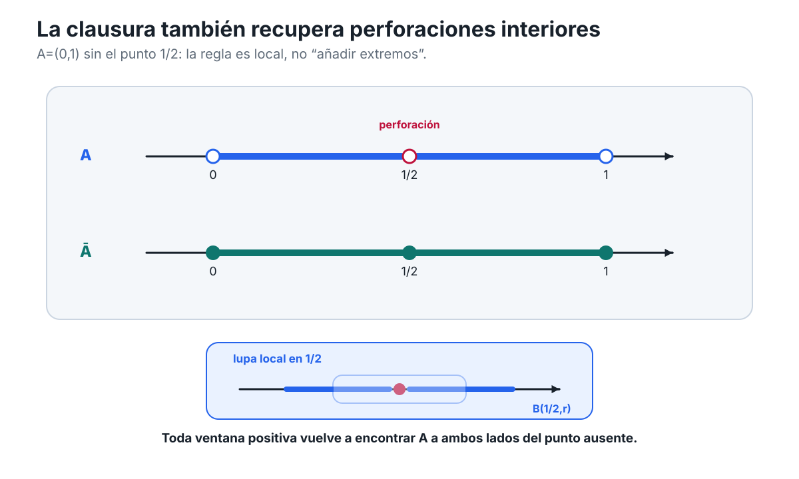
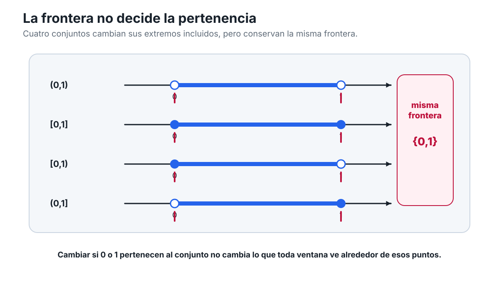
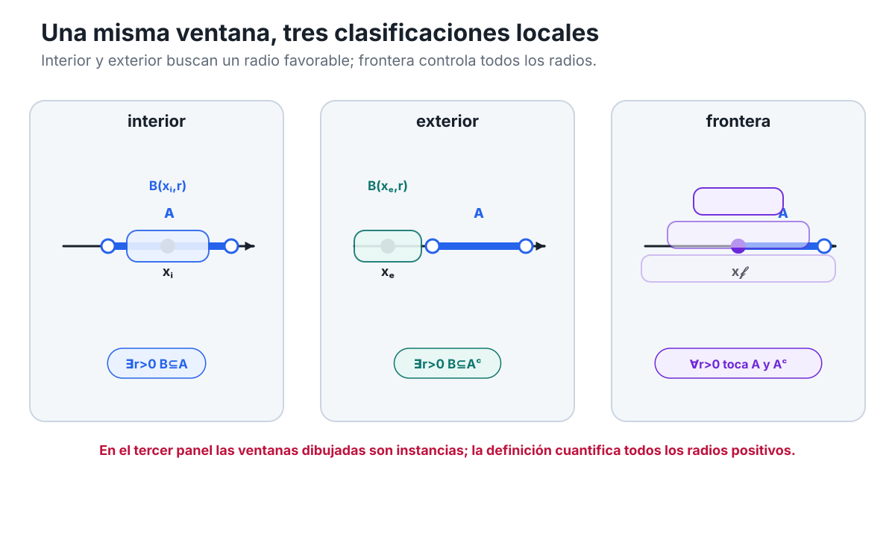
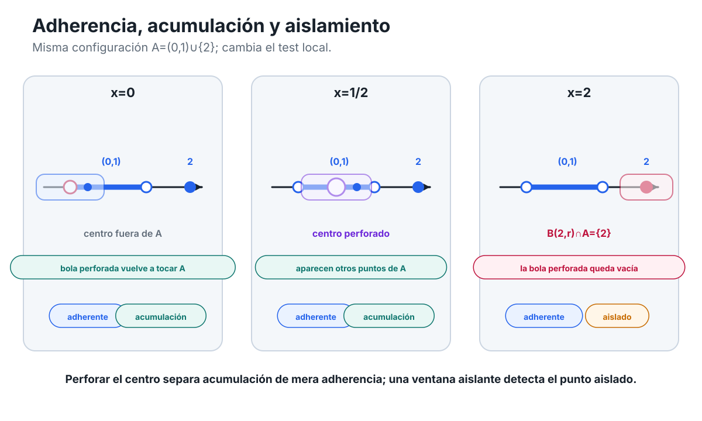
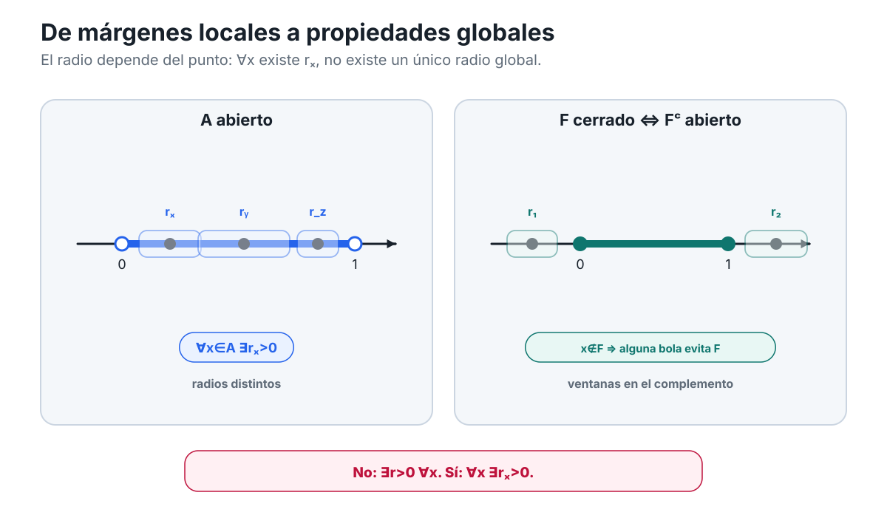

[Índice del libro](../para-matematicos/analisis-para-matematicos.html) · [Ejercicios de este capítulo](#ejercicios-4)

[]{#MA-SEC-ANM-01-004-008}

Hasta ahora hemos mirado la recta real desde tres escalas distintas. En C01 aprendimos a reconocer su orden y su geometría métrica: intervalos, distancia, valor absoluto y bolas. En C02 usamos el orden para describir barreras de conjuntos, y en C03 añadimos la completitud que garantiza ciertas fronteras extremales. Ahora cambiaremos otra vez el punto de vista.

Esta vez no preguntaremos primero qué ocurre en todo un conjunto ni cuáles son sus mejores cotas. Fijaremos un punto $x$ y miraremos solamente lo que sucede **alrededor de él**.

La pregunta rectora del capítulo será:

> **¿Qué puede saberse de un conjunto mirando ventanas cada vez más pequeñas alrededor de un punto?**

La palabra «ventana» será sólo una metáfora visual. El objeto matemático ya lo conocemos. En C01 definimos, para $x\in\mathbb R$ y $r>0$, la bola abierta

$$
B(x,r)=\{y\in\mathbb R:|y-x|<r\}=(x-r,x+r).
$$

Una bola nos permite decidir qué parte de la recta estamos observando alrededor de $x$. Cambiar el radio cambia la escala de observación.

La novedad de C04 consistirá en usar sistemáticamente esas ventanas para clasificar la relación entre un punto y un conjunto $A\subseteq\mathbb R$.

Más adelante aparecerán preguntas de este tipo:

- ¿hay alguna ventana alrededor de $x$ que quede completamente dentro de $A$?;
- ¿puede alguna ventana evitar por completo a $A$?;
- ¿toda ventana, por pequeña que sea, vuelve a encontrar puntos de $A$?;
- ¿toda ventana encuentra simultáneamente puntos de $A$ y puntos que no pertenecen a $A$?;
- ¿qué cambia si, al mirar alrededor de $x$, excluimos el propio centro?

Estas preguntas darán origen a las nociones de interior, exterior, clausura, frontera, acumulación y aislamiento. Después veremos cómo ciertas condiciones locales, verificadas punto por punto, se convierten en propiedades globales como ser abierto o cerrado.

Pero no conviene introducir todos esos nombres a la vez. Primero necesitamos fijar con precisión el lenguaje de las ventanas.

Hay además una decisión metodológica importante. En este capítulo no usaremos sucesiones para definir ninguna de estas nociones. No necesitaremos escribir $x_n\to x$, ni invocar límites, compactidad o Bolzano–Weierstrass. Todo el lenguaje fundamental de C04 puede construirse directamente a partir de las bolas de C01 y de los cuantificadores «existe» y «para todo».

Eso hará visible una idea que reaparecerá durante todo el análisis:

$$
\boxed{
\text{muchas propiedades globales}
\quad\text{se reconocen mediante pruebas locales.}
}
$$

Empecemos entonces por el objeto que permitirá comprimir esas pruebas locales sin ocultar su contenido: la **vecindad** de un punto.

## 4.1. Ventanas alrededor de un punto: vecindades

En C01 una bola servía para traducir entre distancia, valor absoluto e intervalos. Si $x\in\mathbb R$ y $r>0$, las cuatro expresiones

$$
y\in B(x,r),
$$

$$
|y-x|<r,
$$

$$
d(x,y)<r,
$$

y

$$
x-r<y<x+r
$$

describen la misma condición.

Ahora nos interesa una lectura distinta. La bola $B(x,r)$ será una región de observación alrededor del centro $x$. El radio $r$ mide cuánto margen admitimos a ambos lados.

### Una ventana básica

Llamaremos **vecindad básica** de $x$ a cualquier bola abierta centrada en $x$:

> **Vecindad básica.** Si $x\in\mathbb R$ y $r>0$, la bola
>
> $$
> B(x,r)=(x-r,x+r)
> $$
>
> es una vecindad básica de $x$.

La palabra «básica» es importante. No queremos que «vecindad» sea simplemente otro nombre para «bola».

Por ejemplo,

$$
B(2,3)=(-1,5)
$$

es una vecindad básica de $2$, y

$$
B\left(2,\frac12\right)=\left(\frac32,\frac52\right)
$$

también lo es. Ninguna de las dos tiene privilegio sobre la otra. Alrededor del mismo punto hay infinitas ventanas básicas, una para cada radio positivo.

Si disminuimos el radio, la bola sólo puede hacerse más pequeña. En efecto, si

$$
0<s\le r,
$$

entonces

$$
B(x,s)\subseteq B(x,r).
$$

La demostración es inmediata a partir de la distancia. Si $y\in B(x,s)$, entonces

$$
|y-x|<s\le r,
$$

por lo que $y\in B(x,r)$.

Esta observación, elemental en apariencia, será decisiva: una vez que cierta propiedad es válida en una bola alrededor de $x$, también lo será en todas las bolas centradas en $x$ suficientemente pequeñas que queden dentro de ella.

### Una vecindad no tiene por qué ser una bola

Supongamos ahora que tenemos un conjunto $V\subseteq\mathbb R$ que rodea a $x$ de una manera menos regular. Quizá $V$ sea un intervalo grande; quizá tenga componentes alejadas que no nos importan; quizá contenga puntos aislados muy lejos del centro.

Para estudiar el comportamiento **local** alrededor de $x$, todo eso es secundario. Lo único que necesitamos saber es si dentro de $V$ cabe al menos una bola completa centrada en $x$.

Ésa será nuestra definición general.

> **Vecindad de un punto.** Sea $x\in\mathbb R$. Un conjunto $V\subseteq\mathbb R$ es una **vecindad de $x$** si existe un radio $r>0$ tal que
>
> $$
> B(x,r)\subseteq V.
> $$

En símbolos,

$$
V\text{ es vecindad de }x
\iff
\exists r>0:\ B(x,r)\subseteq V.
$$

Conviene mirar con cuidado el cuantificador. La definición dice

$$
\exists r>0,
$$

no

$$
\forall r>0.
$$

Basta encontrar **una** bola positiva centrada en $x$ que quede contenida en $V$.

Por supuesto, una vez encontrada una, obtenemos automáticamente muchas más. Si

$$
B(x,r_0)\subseteq V,
$$

y $0<s\le r_0$, entonces

$$
B(x,s)\subseteq B(x,r_0)\subseteq V.
$$

Así que la existencia de un radio admisible implica la existencia de ventanas arbitrariamente pequeñas alrededor de $x$ contenidas en $V$.

Éste es el sentido local de la definición.

### Un ejemplo: información lejana que no importa

Consideremos

$$
V=(-1,1)\cup\{3\}.
$$

¿Es $V$ una vecindad de $0$?

Sí. Por ejemplo,

$$
B\left(0,\frac12\right)=\left(-\frac12,\frac12\right)
\subseteq(-1,1)
\subseteq V.
$$

Por tanto,

$$
V\text{ es vecindad de }0.
$$

El punto $3$ no cumple ninguna función en esta verificación. Podríamos quitarlo, añadir otros puntos lejanos o modificar $V$ fuera de una región pequeña alrededor de $0$ sin cambiar el hecho esencial.

La definición de vecindad está diseñada precisamente para ignorar la información remota cuando queremos estudiar lo que ocurre localmente.

Esto permite formular una primera regla conceptual:

> **Para decidir si $V$ es vecindad de $x$, no necesitamos comprender todo $V$; necesitamos encontrar margen alrededor de $x$.**

Ese margen queda expresado por algún $r>0$ con

$$
(x-r,x+r)\subseteq V.
$$

### Pertenecer no basta

Hay una confusión que conviene eliminar desde el comienzo:

$$
x\in V
$$

no implica, por sí solo, que $V$ sea una vecindad de $x$.

Tomemos

$$
W=[0,1].
$$

Es cierto que

$$
0\in W.
$$

Pero $W$ no es una vecindad de $0$.

¿Por qué?

Para que lo fuera tendría que existir $r>0$ tal que

$$
B(0,r)=(-r,r)\subseteq[0,1].
$$

Eso es imposible. Para cualquier $r>0$, el número

$$
-\frac r2
$$

satisface

$$
-\frac r2\in(-r,r)=B(0,r),
$$

pero

$$
-\frac r2\notin[0,1].
$$

Por tanto ninguna bola positiva centrada en $0$ cabe dentro de $W$.

Tenemos entonces

$$
0\in W,
$$

pero

$$
W\text{ no es vecindad de }0.
$$

Esta diferencia será una de las ideas centrales del capítulo. Una cosa es que un punto pertenezca a un conjunto; otra, mucho más fuerte, es que el conjunto deje **margen en todas las direcciones de la recta** alrededor de ese punto.

En una dimensión, «todas las direcciones» significa simplemente izquierda y derecha. Si $x$ queda pegado a un borde del conjunto, la pertenencia puede mantenerse aunque desaparezca el margen.

### Toda vecindad contiene a su centro

La implicación contraria sí es automática:

> Si $V$ es una vecindad de $x$, entonces $x\in V$.

En efecto, si $V$ es vecindad de $x$, existe $r>0$ tal que

$$
B(x,r)\subseteq V.
$$

Pero

$$
|x-x|=0<r,
$$

de modo que

$$
x\in B(x,r).
$$

Por inclusión,

$$
x\in V.
$$

Así obtenemos una implicación que no puede invertirse:

$$
V\text{ vecindad de }x
\Longrightarrow
x\in V,
$$

pero, en general,

$$
x\in V
\centernot\Longrightarrow
V\text{ vecindad de }x.
$$

El conjunto $[0,1]$ en el punto $0$ proporciona ya un contraejemplo.

### La diferencia entre «estar cerca» y «ser una vecindad»

En lenguaje cotidiano decimos que un punto está «cerca» de otro sin especificar cuánto. En análisis, esa frase por sí sola no expresa una condición matemática completa.

Si queremos decir que $y$ está dentro de una tolerancia $r$ respecto de $x$, escribimos

$$
|y-x|<r
$$

o equivalentemente

$$
y\in B(x,r).
$$

Una vecindad, en cambio, no describe la relación entre dos puntos particulares. Describe un **conjunto que deja margen alrededor de un centro**.

Por eso son preguntas distintas:

1. ¿está $y$ dentro de la bola $B(x,r)$?;
2. ¿es $V$ una vecindad de $x$?

La primera se responde verificando una desigualdad de distancia.

La segunda se responde encontrando algún radio positivo cuya bola completa quede dentro de $V$.

En forma lógica:

$$
y\in B(x,r)
\iff
|y-x|<r,
$$

mientras que

$$
V\text{ vecindad de }x
\iff
\exists r>0\ \forall y\in\mathbb R:
\bigl(|y-x|<r\Rightarrow y\in V\bigr).
$$

La segunda expresión despliega la inclusión

$$
B(x,r)\subseteq V
$$

en cuantificadores. Es más larga, pero deja ver exactamente la estructura de la definición.

Hay un radio que debemos encontrar; una vez fijado ese radio, **todo** punto suficientemente cercano al centro debe pertenecer a $V$.

### Dos propiedades elementales de las vecindades

La definición contiene ya algunas consecuencias útiles. No necesitaremos axiomas de topología para obtenerlas; basta trabajar directamente con bolas e inclusiones.

#### Ampliar una vecindad conserva la vecindad

Supongamos que $V$ es vecindad de $x$ y que

$$
V\subseteq W.
$$

Como $V$ es vecindad, existe $r>0$ tal que

$$
B(x,r)\subseteq V.
$$

Entonces

$$
B(x,r)\subseteq V\subseteq W,
$$

por lo que $W$ también es vecindad de $x$.

La idea es sencilla: una vez que un conjunto contiene una ventana completa alrededor de $x$, añadirle puntos no puede destruir esa ventana.

#### Intersectar dos vecindades conserva una vecindad

Supongamos ahora que $V$ y $W$ son vecindades de $x$.

Entonces existen $r>0$ y $s>0$ tales que

$$
B(x,r)\subseteq V
$$

y

$$
B(x,s)\subseteq W.
$$

Tomemos

$$
\rho=\min\{r,s\}.
$$

Como $\rho>0$ y $\rho\le r,s$, tenemos

$$
B(x,\rho)\subseteq B(x,r)
$$

y

$$
B(x,\rho)\subseteq B(x,s).
$$

Por tanto,

$$
B(x,\rho)\subseteq V\cap W.
$$

Así que

$$
V\cap W
$$

también es una vecindad de $x$.

El argumento es importante porque muestra un patrón que veremos muchas veces: cuando dos condiciones locales vienen acompañadas de dos radios distintos, podemos satisfacer ambas a la vez tomando el menor de los dos.

La operación

$$
\rho=\min\{r,s\}
$$

funciona como un mecanismo de **sincronización de tolerancias**.

No estamos formulando todavía axiomas abstractos de una topología. Simplemente estamos leyendo lo que la definición de vecindad ya obliga a cumplir en $\mathbb R$.

### La figura que necesitaremos

La figura `[C04-F01](#fig-anm-c04-f01)` distingue una vecindad básica de una vecindad general. La matemática no depende de la figura, pero el contraste hace visible el margen exigido por la definición.

{#fig-anm-c04-f01 fig-alt="Dos paneles comparan un conjunto que contiene una bola centrada en x con otro que contiene a x sólo como punto de borde y no es vecindad."}

La idea que la figura hace visible puede expresarse también sin dibujo:

$$
\boxed{
V\text{ es vecindad de }x
\iff
\text{alguna bola centrada en }x\text{ cabe dentro de }V.
}
$$

El aspecto exterior de $V$ puede ser complicado. Lo decisivo es el pequeño núcleo de margen alrededor de $x$.

La misma figura muestra también un contraste: un conjunto puede contener a $x$ y, sin embargo, no contener ninguna bola centrada en $x$. El ejemplo $[0,1]$ alrededor de $0$ ya nos proporciona ese caso.

### Una precisión sobre «arbitrariamente pequeño»

A veces se dice informalmente que una vecindad permite mirar «tan cerca de $x$ como queramos». Esa frase es correcta, pero debe interpretarse con cuidado.

La definición de vecindad exige solamente

$$
\exists r_0>0:
B(x,r_0)\subseteq V.
$$

A partir de ahí, para cualquier $s$ con

$$
0<s\le r_0,
$$

obtenemos

$$
B(x,s)\subseteq V.
$$

Por tanto podemos escoger radios positivos tan pequeños como deseemos **dentro del margen ya garantizado por $r_0$**.

Lo que no podemos afirmar es que todas las bolas, cualquiera sea su radio, estén contenidas en $V$.

Por ejemplo, para

$$
V=(-1,1)
$$

y $x=0$, tenemos

$$
B\left(0,\frac12\right)\subseteq V,
$$

pero

$$
B(0,2)=(-2,2)\not\subseteq V.
$$

Así que la lógica correcta es

$$
\exists r_0>0
\quad\Longrightarrow\quad
\forall s\in(0,r_0],
$$

no

$$
\forall r>0.
$$

Esta diferencia entre «existe un radio» y «para todo radio» será una de las principales fuentes de estructura en C04. Algunas nociones exigirán encontrar una ventana favorable; otras exigirán que **ninguna** ventana positiva pueda escapar de cierta condición.

Todavía no introduciremos esas nociones. Por ahora basta con aprender a leer correctamente el cuantificador de vecindad.

### Un margen que puede cambiar con el punto

También conviene evitar otra interpretación excesiva. El radio que certifica una vecindad pertenece al par formado por el punto y el conjunto.

Si $V$ es vecindad de distintos puntos, no existe razón para que el mismo radio funcione en todos ellos.

Por ejemplo, consideremos

$$
V=(-2,2).
$$

Para $x=0$ podemos tomar, entre muchas posibilidades,

$$
r=1.
$$

Pero si elegimos

$$
x=\frac{19}{10},
$$

el radio $1$ ya no sirve: la bola

$$
B\left(\frac{19}{10},1\right)
$$

se extiende más allá de $2$.

Sin embargo, un radio pequeño sí funciona. Por ejemplo,

$$
B\left(\frac{19}{10},\frac1{20}\right)
\subseteq(-2,2).
$$

El margen disponible depende de la posición del punto.

Esta observación será importante más adelante cuando pasemos de una afirmación local a una propiedad de todo un conjunto. La forma típica será

$$
\forall x\in A\ \exists r_x>0:
\text{cierta condición local se cumple alrededor de }x.
$$

El subíndice $x$ en $r_x$ recuerda que el radio puede depender del punto. No debemos transformarlo indebidamente en un único radio global.

### Una prueba geométrica útil: margen dentro de una bola

Las propias bolas tienen una estabilidad local especialmente clara. Si

$$
y\in B(x,r),
$$

entonces $y$ no está sobre la frontera de la bola: por definición,

$$
|y-x|<r.
$$

Queda por tanto un margen positivo

$$
\delta=r-|y-x|>0.
$$

Ese margen permite colocar una nueva bola centrada en $y$ completamente dentro de la bola original:

$$
B(y,\delta)\subseteq B(x,r).
$$

Veámoslo.

Si $z\in B(y,\delta)$, entonces

$$
|z-y|<\delta.
$$

Por la desigualdad triangular,

$$
|z-x|
\le |z-y|+|y-x|
<\delta+|y-x|.
$$

Como

$$
\delta=r-|y-x|,
$$

se obtiene

$$
|z-x|<r.
$$

Por tanto

$$
z\in B(x,r).
$$

Hemos demostrado:

> **Margen interno de una bola.** Si $y\in B(x,r)$, existe $\delta>0$ tal que
>
> $$
> B(y,\delta)\subseteq B(x,r).
> $$

La demostración no usa completitud. Sólo usa la desigualdad triangular y el hecho de que pertenecer a una bola abierta deja una diferencia positiva entre la distancia al centro y el radio.

Este pequeño resultado anticipa una idea que volverá a aparecer cuando estudiemos conjuntos con margen alrededor de cada uno de sus puntos. Por ahora lo importante es reconocer el mecanismo:

$$
\text{distancia al borde}
\quad\longrightarrow\quad
\text{radio local disponible}.
$$

### Qué hemos ganado al introducir vecindades

Podríamos formular todo el capítulo usando únicamente bolas. De hecho, cuando haya riesgo de ambigüedad, volveremos a ellas.

Entonces, ¿para qué introducir «vecindad»?

Porque el término nos permite separar dos niveles:

1. la **infraestructura métrica concreta**,
   $$
   B(x,r)=(x-r,x+r);
   $$
2. la **idea local abstractada sólo lo necesario**: un conjunto que contiene alguna de esas bolas.

Así podemos decir, por ejemplo, que $V$ es vecindad de $x$ sin tener que especificar de antemano la forma completa de $V$.

Pero no perderemos de vista qué significa esa frase. Cada vez que sea necesario podremos desplegarla como

$$
\exists r>0:\ B(x,r)\subseteq V.
$$

Ésta será una regla de lectura durante todo C04:

> **Cuando un término topológico comprima una condición local, debemos poder volver a escribir los cuantificadores y las bolas que contiene.**

De ese modo evitaremos aprender una lista de nombres desconectados de la geometría que los origina.

### Antes de seguir

#### Microcontrol 1

[]{#MA-MIC-ANM-01-004-001}

Escribe $B(2,1/3)$ como intervalo abierto y explica qué desigualdad de valor absoluto describe sus puntos.

[]{#MA-MSOL-ANM-01-004-001}

Ver solución del microcontrol 1

Por definición,

$$
B\left(2,\frac13\right)
=
\left\{
y\in\mathbb R:
|y-2|<\frac13
\right\}.
$$

La desigualdad

$$
|y-2|<\frac13
$$

equivale a

$$
-\frac13<y-2<\frac13.
$$

Sumando $2$ en los tres miembros,

$$
\frac53<y<\frac73.
$$

Por tanto,

$$
\boxed{
B\left(2,\frac13\right)
=
\left(\frac53,\frac73\right).
}
$$

La desigualdad de valor absoluto expresa exactamente que la distancia de $y$ al centro $2$ es menor que el radio $1/3$.

#### Microcontrol 2

[]{#MA-MIC-ANM-01-004-002}

Para $V=(-1,1)\cup\{3\}$, exhibe dos radios distintos que certifiquen que $V$ es vecindad de $0$.

[]{#MA-MSOL-ANM-01-004-002}

Ver solución del microcontrol 2

Podemos elegir, por ejemplo,

$$
r_1=1
\qquad\text{y}\qquad
r_2=\frac12.
$$

En efecto,

$$
B(0,1)=(-1,1)\subseteq V,
$$

y también

$$
B\left(0,\frac12\right)
=
\left(-\frac12,\frac12\right)
\subseteq(-1,1)\subseteq V.
$$

Por tanto existen al menos dos radios positivos que certifican que $V$ es vecindad de $0$.

El punto aislado $3$ no interviene en la certificación: basta con que alguna bola centrada en $0$ quede contenida en $V$.

#### Microcontrol 3

[]{#MA-MIC-ANM-01-004-003}

Decide si $[0,2)$ es una vecindad de $0$. No basta responder sí o no: debes justificarlo directamente a partir de la definición.

[]{#MA-MSOL-ANM-01-004-003}

Ver solución del microcontrol 3

No es una vecindad de $0$.

Para que lo fuera tendría que existir $r>0$ tal que

$$
B(0,r)\subseteq[0,2).
$$

Sea, sin embargo, $r>0$ arbitrario. El punto

$$
-\frac r2
$$

satisface

$$
\left|-\frac r2\right|
=
\frac r2<r,
$$

de modo que

$$
-\frac r2\in B(0,r).
$$

Pero

$$
-\frac r2<0,
$$

por lo que

$$
-\frac r2\notin[0,2).
$$

Así,

$$
B(0,r)\not\subseteq[0,2)
$$

para todo $r>0$. Por tanto,

$$
\boxed{
[0,2)\text{ no es vecindad de }0.
}
$$

La pertenencia

$$
0\in[0,2)
$$

no basta: falta margen a la izquierda del centro.

#### Microcontrol 4

[]{#MA-MIC-ANM-01-004-004}

Demuestra que si $V$ es vecindad de $x$, entonces $x\in V$. Da después un contraejemplo que muestre que la conversa es falsa.

[]{#MA-MSOL-ANM-01-004-004}

Ver solución del microcontrol 4

Si $V$ es vecindad de $x$, existe $r>0$ tal que

$$
B(x,r)\subseteq V.
$$

Como

$$
|x-x|=0<r,
$$

tenemos

$$
x\in B(x,r).
$$

La inclusión anterior da entonces

$$
x\in V.
$$

Por tanto,

$$
\boxed{
V\text{ vecindad de }x
\Longrightarrow
x\in V.
}
$$

La conversa es falsa. Tomemos

$$
V=[0,2),
\qquad
x=0.
$$

Tenemos

$$
0\in V,
$$

pero el microcontrol anterior demuestra que ninguna bola positiva centrada en $0$ queda contenida en $V$.

Así,

$$
x\in V
\quad\not\Rightarrow\quad
V\text{ es vecindad de }x.
$$

#### Microcontrol 5

[]{#MA-MIC-ANM-01-004-005}

Supón que $V$ es vecindad de $x$ y que $V\subseteq W$. Demuestra que $W$ también es vecindad de $x$.

[]{#MA-MSOL-ANM-01-004-005}

Ver solución del microcontrol 5

Como $V$ es vecindad de $x$, existe $r>0$ tal que

$$
B(x,r)\subseteq V.
$$

Por hipótesis,

$$
V\subseteq W.
$$

Encadenando las inclusiones,

$$
B(x,r)\subseteq V\subseteq W.
$$

Así, el mismo radio $r$ certifica que

$$
\boxed{
W\text{ es vecindad de }x.
}
$$

Geométricamente, agrandar un conjunto no destruye una ventana que ya cabía dentro de él.

#### Microcontrol 6

[]{#MA-MIC-ANM-01-004-006}

Si $V$ y $W$ son vecindades de $x$, demuestra que $V\cap W$ es vecindad de $x$ indicando explícitamente qué radio eliges.

[]{#MA-MSOL-ANM-01-004-006}

Ver solución del microcontrol 6

Como $V$ es vecindad de $x$, existe $r>0$ tal que

$$
B(x,r)\subseteq V.
$$

Como $W$ es vecindad de $x$, existe $s>0$ tal que

$$
B(x,s)\subseteq W.
$$

Elegimos

$$
\rho=\min\{r,s\}.
$$

Como $r,s>0$,

$$
\rho>0.
$$

Además,

$$
\rho\le r
\qquad\text{y}\qquad
\rho\le s.
$$

Por tanto,

$$
B(x,\rho)\subseteq B(x,r)\subseteq V
$$

y

$$
B(x,\rho)\subseteq B(x,s)\subseteq W.
$$

Luego

$$
B(x,\rho)\subseteq V\cap W.
$$

Así,

$$
\boxed{
V\cap W\text{ es vecindad de }x.
}
$$

El radio elegido es exactamente

$$
\boxed{\rho=\min\{r,s\}.}
$$

#### Microcontrol 7

[]{#MA-MIC-ANM-01-004-007}

Si $B(x,r)\subseteq V$ y $0<s\le r$, demuestra que $B(x,s)\subseteq V$. ¿Qué te dice esto sobre la frase «podemos mirar con ventanas arbitrariamente pequeñas»?

[]{#MA-MSOL-ANM-01-004-007}

Ver solución del microcontrol 7

Sea

$$
y\in B(x,s).
$$

Entonces

$$
|y-x|<s.
$$

Como

$$
s\le r,
$$

obtenemos

$$
|y-x|<r,
$$

y por tanto

$$
y\in B(x,r).
$$

Así,

$$
B(x,s)\subseteq B(x,r).
$$

Como por hipótesis

$$
B(x,r)\subseteq V,
$$

concluimos

$$
\boxed{
B(x,s)\subseteq V.
}
$$

La frase «podemos mirar con ventanas arbitrariamente pequeñas» significa que, una vez encontrado un radio $r>0$ que funciona, **todo radio positivo menor o igual que $r$ también funciona**.

No significa que todos los radios positivos funcionen. La estructura lógica es

$$
\exists r>0
\quad\Longrightarrow\quad
\forall s\in(0,r].
$$

#### Microcontrol 8

[]{#MA-MIC-ANM-01-004-008}

Sea $y\in B(x,r)$. Construye un $\delta>0$ en función de $r$ y $|y-x|$ tal que $B(y,\delta)\subseteq B(x,r)$, y señala exactamente dónde usas la desigualdad triangular.

[]{#MA-MSOL-ANM-01-004-008}

Ver solución del microcontrol 8

Como

$$
y\in B(x,r),
$$

tenemos

$$
|y-x|<r.
$$

Por tanto,

$$
\delta=r-|y-x|
$$

es positivo.

Afirmamos que

$$
B(y,\delta)\subseteq B(x,r).
$$

Sea

$$
z\in B(y,\delta).
$$

Entonces

$$
|z-y|<\delta.
$$

Aquí usamos la desigualdad triangular:

$$
|z-x|
\le
|z-y|+|y-x|.
$$

Como

$$
|z-y|<\delta,
$$

se sigue que

$$
|z-x|
<
\delta+|y-x|.
$$

Sustituyendo

$$
\delta=r-|y-x|,
$$

obtenemos

$$
|z-x|
<
r-|y-x|+|y-x|
=
r.
$$

Por tanto,

$$
z\in B(x,r).
$$

Como $z$ era arbitrario,

$$
\boxed{
B(y,\delta)\subseteq B(x,r),
\qquad
\delta=r-|y-x|>0.
}
$$

La desigualdad triangular se usa exactamente en el paso

$$
|z-x|
\le
|z-y|+|y-x|.
$$

Ya tenemos el lenguaje mínimo para empezar a clasificar puntos. En la siguiente sección la pregunta cambiará de «¿es $V$ una vecindad de $x$?» a «¿qué ocurre cuando el propio conjunto $A$ deja —o no deja— margen alrededor del punto?». Ese cambio dará la primera clasificación local propiamente dicha.

### Ejercicios de la sección 4.1

[]{#ejercicios-4}

#### Ejercicio 1. Una definición, varias formas lógicas

[]{#MA-EX-ANM-01-004-001}

Sean $V\subseteq\mathbb R$ y $x\in\mathbb R$. Considera las afirmaciones:

1. existe $r>0$ tal que
   $$
   B(x,r)\subseteq V;
   $$
2. existe $r>0$ tal que, para todo $y\in\mathbb R$,
   $$
   |y-x|<r
   \Longrightarrow
   y\in V;
   $$
3. existe $r>0$ tal que
   $$
   (x-r,x+r)\subseteq V;
   $$
4. para todo $r>0$ existe $y\in V$ tal que
   $$
   |y-x|<r.
   $$

a) Demuestra que las afirmaciones 1, 2 y 3 son equivalentes.

b) Explica por qué la afirmación 4 tiene una estructura lógica distinta. Identifica con precisión el orden de los cuantificadores en 2 y en 4.

c) Da un ejemplo de $V$ y $x$ para el cual 4 sea verdadera pero 1 sea falsa.

d) Formula con palabras qué información adicional exige una vecindad respecto de la mera afirmación de que siempre aparecen puntos de $V$ cerca de $x$.

No uses ninguna terminología de secciones posteriores.

[]{#MA-SOL-ANM-01-004-001}

Ver solución del ejercicio 1

La primera afirmación dice

$$
\exists r>0:
B(x,r)\subseteq V.
$$

Por definición de bola,

$$
y\in B(x,r)
\iff
|y-x|<r.
$$

Por tanto la inclusión

$$
B(x,r)\subseteq V
$$

significa exactamente que todo $y\in\mathbb R$ que satisfaga $|y-x|<r$ pertenece a $V$. Así, 1 equivale a

$$
\exists r>0\ \forall y\in\mathbb R:
\bigl(|y-x|<r\Longrightarrow y\in V\bigr),
$$

que es la afirmación 2.

En $\mathbb R$ tenemos además

$$
B(x,r)=(x-r,x+r).
$$

Sustituir la bola por ese intervalo transforma 1 en

$$
\exists r>0:
(x-r,x+r)\subseteq V,
$$

que es 3. Por tanto,

$$
\boxed{1\iff2\iff3.}
$$

La afirmación 4 es distinta:

$$
\forall r>0\ \exists y\in V:
|y-x|<r.
$$

En 2 elegimos **un** radio y, una vez elegido, exigimos que **todo** punto de la bola pertenezca a $V$. En 4, en cambio, cada radio puede tener su propio testigo $y$, y sólo se exige encontrar al menos un punto de $V$ dentro de la bola.

Un contraejemplo simple es

$$
V=[0,\infty),
\qquad
x=0.
$$

Para cualquier $r>0$, el punto

$$
y=\frac r2
$$

satisface

$$
y\in V
\qquad\text{y}\qquad
|y|<r.
$$

Así, 4 es verdadera.

Sin embargo, ningún $r>0$ satisface

$$
B(0,r)\subseteq V,
$$

porque

$$
-\frac r2\in B(0,r)
$$

pero

$$
-\frac r2\notin[0,\infty).
$$

Por tanto 1 es falsa.

La diferencia conceptual es que encontrar puntos de $V$ arbitrariamente cerca de $x$ sólo exige **intersección**. Ser vecindad exige algo más fuerte: debe existir una ventana completa alrededor de $x$ cuyos puntos estén todos dentro de $V$.

#### Ejercicio 2. El conjunto de radios que realmente sirven

[]{#MA-EX-ANM-01-004-002}

Sea

$$
V=(-4,3)\cup\{100\}.
$$

Para un punto $x\in V$, define el conjunto de radios admisibles

$$
R_V(x)
=
\{r>0:B(x,r)\subseteq V\}.
$$

a) Determina exactamente $R_V(-1)$.

b) Determina exactamente $R_V(2)$.

c) Decide si $R_V(100)$ es vacío o no vacío y justifica tu respuesta.

d) Explica por qué el punto aislado $\{100\}$ no ayuda a aumentar los radios admisibles alrededor de $-1$ ni alrededor de $2$.

e) Compara $R_V(-1)$ y $R_V(2)$ y explica qué muestra el ejemplo acerca de la dependencia del radio respecto del centro.

Tu respuesta debe distinguir entre «pertenecer a $V$» y «disponer de un radio positivo cuya bola completa quede dentro de $V$».

[]{#MA-SOL-ANM-01-004-002}

Ver solución del ejercicio 2

Partimos de

$$
V=(-4,3)\cup\{100\}.
$$

Para $x=-1$ buscamos todos los $r>0$ tales que

$$
B(-1,r)=(-1-r,-1+r)
$$

quede contenido en $V$.

El obstáculo más cercano está a la izquierda, en $-4$. La distancia es

$$
|-1-(-4)|=3.
$$

Si $0<r\le3$, entonces

$$
-1-r\ge-4
$$

y, como la bola es abierta, el punto $-4$ no queda incluido cuando $r=3$. Además,

$$
-1+r\le2<3.
$$

Por tanto,

$$
B(-1,r)\subseteq(-4,3)\subseteq V.
$$

Si $r>3$, tomemos

$$
\varepsilon=\frac{r-3}{2}>0
$$

y definamos

$$
y=-4-\varepsilon.
$$

Entonces

$$
|y+1|
=
3+\varepsilon
=
\frac{r+3}{2}
<r,
$$

de modo que $y\in B(-1,r)$, pero $y\notin V$. Así,

$$
\boxed{
R_V(-1)=(0,3].
}
$$

Para $x=2$, la barrera más cercana es ahora el extremo derecho $3$, a distancia

$$
|3-2|=1.
$$

Si $0<r\le1$, entonces

$$
B(2,r)\subseteq(-4,3).
$$

Si $r>1$, tomando

$$
y=3+\frac{r-1}{2}
$$

obtenemos $|y-2|<r$ y $y\notin V$. Por tanto,

$$
\boxed{
R_V(2)=(0,1].
}
$$

Para $x=100$, cualquier bola positiva contiene puntos distintos de $100$. En particular, dado $r>0$,

$$
y=100+\frac r2
$$

pertenece a $B(100,r)$, pero no pertenece a $V$, porque el único punto de $V$ cerca de $100$ es el propio $100$. Por tanto,

$$
\boxed{
R_V(100)=\varnothing.
}
$$

El punto remoto $100$ no amplía los radios admisibles alrededor de $-1$ o $2$. Una bola centrada en uno de esos puntos debe contener **todos** sus puntos en $V$; no puede saltar sobre el hueco entre $3$ y $100$ para aprovechar un punto aislado lejano.

Finalmente,

$$
R_V(-1)=(0,3]
\qquad\text{y}\qquad
R_V(2)=(0,1].
$$

Ambos centros pertenecen a la misma componente intervalar de $V$, pero el margen disponible depende de su posición. El radio que certifica una vecindad es una información local ligada al par $(x,V)$, no una propiedad uniforme del conjunto.

#### Ejercicio 3. Intersecciones finitas sí; intersecciones arbitrarias, no

[]{#MA-EX-ANM-01-004-003}

Sea $x\in\mathbb R$ y sean

$$
V_1,\dots,V_n
$$

vecindades de $x$.

a) Demuestra que

$$
\bigcap_{k=1}^nV_k
$$

también es una vecindad de $x$.

Tu prueba debe:

1. elegir, para cada $k$, un radio $r_k>0$ con
   $$
   B(x,r_k)\subseteq V_k;
   $$
2. construir un único radio positivo que funcione simultáneamente para todos los conjuntos;
3. indicar exactamente por qué la finitud de la familia permite hacer esa elección.

b) Considera ahora, para cada $r>0$,

$$
V_r=(-r,r).
$$

Demuestra que cada $V_r$ es una vecindad de $0$, pero que

$$
\bigcap_{r>0}V_r=\{0\}.
$$

c) Concluye que una intersección arbitraria de vecindades de un mismo punto no tiene por qué ser una vecindad de ese punto.

No uses teoría de conjuntos abiertos ni resultados de §4.7.

[]{#MA-SOL-ANM-01-004-003}

Ver solución del ejercicio 3

**Estrategia.** Cada vecindad $V_k$ aporta algún radio $r_k>0$. Para satisfacer simultáneamente todas las inclusiones necesitamos un radio que no exceda ninguno de ellos. La finitud permite tomar un mínimo.

Para cada

$$
k\in\{1,\dots,n\},
$$

como $V_k$ es vecindad de $x$, existe $r_k>0$ tal que

$$
B(x,r_k)\subseteq V_k.
$$

Definimos

$$
\rho=\min\{r_1,\dots,r_n\}.
$$

Como se trata de un conjunto finito de números positivos,

$$
\rho>0.
$$

Además,

$$
\rho\le r_k
$$

para todo $k$, y por tanto

$$
B(x,\rho)\subseteq B(x,r_k)\subseteq V_k.
$$

La misma bola queda contenida en todos los $V_k$, de modo que

$$
B(x,\rho)
\subseteq
\bigcap_{k=1}^nV_k.
$$

Así,

$$
\boxed{
\bigcap_{k=1}^nV_k
\text{ es una vecindad de }x.
}
$$

La finitud interviene exactamente al permitirnos formar el mínimo de la lista

$$
r_1,\dots,r_n
$$

y conservar un número estrictamente positivo.

Veamos ahora qué ocurre con una familia arbitraria. Para cada $r>0$,

$$
V_r=(-r,r)=B(0,r),
$$

por lo que $V_r$ es una vecindad de $0$.

Afirmamos que

$$
\bigcap_{r>0}V_r=\{0\}.
$$

Primero,

$$
0\in(-r,r)
$$

para todo $r>0$, así que $0$ pertenece a la intersección.

Sea ahora $x\ne0$. Elegimos

$$
r=\frac{|x|}{2}>0.
$$

Entonces

$$
|x|>r,
$$

por lo que

$$
x\notin(-r,r)=V_r.
$$

Así, ningún $x\ne0$ pertenece a la intersección. Queda probado que

$$
\bigcap_{r>0}V_r=\{0\}.
$$

Pero $\{0\}$ no es una vecindad de $0$: para cualquier $\rho>0$, el punto $\rho/2$ pertenece a $B(0,\rho)$ y es distinto de $0$. Por tanto,

$$
B(0,\rho)\nsubseteq\{0\}.
$$

Concluimos que la estabilidad de las vecindades bajo intersección es una propiedad **finita**, no arbitraria.

#### Ejercicio 4. Cuando «tocar» una ventana se confunde con «llenarla»

[]{#MA-EX-ANM-01-004-004}

Un estudiante quiere demostrar que

$$
V=[0,\infty)
$$

es una vecindad de $0$ y escribe:

> Sea $r>0$. El número $r/2$ pertenece a $V$ y además $|r/2|<r$. Por tanto
> $$
> B(0,r)\cap V\ne\varnothing.
> $$
> Como esto ocurre para todo $r>0$, $V$ contiene puntos arbitrariamente cercanos a $0$. Luego $V$ es una vecindad de $0$.

Audita el argumento.

a) Identifica exactamente qué afirmación cuantificada ha demostrado el estudiante.

b) Escribe la afirmación cuantificada que realmente tendría que demostrar para concluir que $V$ es vecindad de $0$.

c) Localiza el cambio ilegítimo entre ambas afirmaciones.

d) Demuestra directamente que $V$ no es una vecindad de $0$: para un radio arbitrario $r>0$, construye un punto de $B(0,r)$ que no pertenezca a $V$.

e) Repara la conclusión del estudiante sin introducir aún nombres de conceptos posteriores: expresa sólo qué propiedad local de $V$ alrededor de $0$ sí quedó demostrada.

[]{#MA-SOL-ANM-01-004-004}

Ver solución del ejercicio 4

El estudiante demuestra correctamente que, para todo $r>0$,

$$
B(0,r)\cap V\ne\varnothing,
$$

donde

$$
V=[0,\infty).
$$

En forma desplegada, su argumento establece

$$
\forall r>0\ \exists y\in V:
|y|<r.
$$

De hecho, el testigo elegido es

$$
y=\frac r2.
$$

Pero para demostrar que $V$ es vecindad de $0$ tendría que probar

$$
\exists r_0>0\ \forall y\in\mathbb R:
\bigl(|y|<r_0\Longrightarrow y\in V\bigr),
$$

o, equivalentemente,

$$
\exists r_0>0:
B(0,r_0)\subseteq V.
$$

El salto ilegítimo cambia simultáneamente dos cosas. Primero, transforma

$$
\forall r\ \exists y
$$

en una afirmación con la forma

$$
\exists r\ \forall y.
$$

Segundo, sustituye una condición de **intersección no vacía** por una condición de **inclusión completa**.

La conclusión de vecindad es falsa. Sea $r>0$ arbitrario y tomemos

$$
z=-\frac r2.
$$

Entonces

$$
|z|=\frac r2<r,
$$

así que

$$
z\in B(0,r).
$$

Sin embargo,

$$
z<0,
$$

de modo que

$$
z\notin[0,\infty).
$$

Por tanto,

$$
B(0,r)\nsubseteq V
$$

para todo $r>0$. No existe ningún radio que certifique que $V$ sea una vecindad de $0$.

La reparación correcta consiste en conservar únicamente lo demostrado:

> para toda bola positiva centrada en $0$, existe al menos un punto de $V$ dentro de esa bola.

Esta afirmación describe una proximidad local real, pero es lógicamente más débil que contener una ventana completa alrededor del centro.

## 4.2. Interior y exterior: tener margen

En §4.1 introdujimos una forma precisa de decir que un conjunto deja espacio alrededor de un punto. Si $V$ es vecindad de $x$, existe algún radio positivo para el cual

$$
B(x,r)\subseteq V.
$$

Ahora aplicaremos esa misma idea al propio conjunto que queremos estudiar.

Fijemos

$$
A\subseteq\mathbb R.
$$

La primera pregunta local será:

> **¿Puede colocarse alrededor de $x$ una ventana completa que permanezca dentro de $A$?**

Si la respuesta es afirmativa, entonces $x$ no sólo pertenece al conjunto: dispone de un margen positivo antes de encontrar puntos exteriores a él.

### Punto interior: pertenecer con margen

Diremos que $x$ es un **punto interior** de $A$ si existe $r>0$ tal que

$$
B(x,r)\subseteq A.
$$

En símbolos,

$$
x\text{ es interior a }A
\iff
\exists r>0:\ B(x,r)\subseteq A.
$$

La definición es exactamente la noción de vecindad de §4.1 aplicada a $A$:

$$
\boxed{
x\text{ es interior a }A
\iff
A\text{ es vecindad de }x.
}
$$

Esto permite leer la palabra «interior» geométricamente. No basta saber que el punto está dentro del conjunto. Debemos poder movernos una distancia positiva hacia ambos lados de $x$ sin salir de $A$.

El radio no es parte del punto interior. Es un **certificado** de interioridad. Puede haber muchos radios que funcionen.

Por ejemplo, si

$$
A=(0,4)
$$

y

$$
x=1,
$$

entonces

$$
B\left(1,\frac12\right)
=\left(\frac12,\frac32\right)
\subseteq(0,4).
$$

Por tanto $1$ es interior a $A$.

También serviría cualquier radio menor o igual que $1$; lo único que exige la definición es la existencia de al menos uno.

### Pertenecer no basta

La distinción entre pertenencia e interioridad es fundamental.

Consideremos

$$
A=[0,1].
$$

El punto

$$
0\in A.
$$

Sin embargo, $0$ no es interior a $A$.

En efecto, tomemos cualquier $r>0$. El número

$$
-\frac r2
$$

satisface

$$
\left|-\frac r2-0\right|=\frac r2<r,
$$

por lo que

$$
-\frac r2\in B(0,r).
$$

Pero

$$
-\frac r2\notin[0,1].
$$

Así, para todo $r>0$,

$$
B(0,r)\not\subseteq[0,1].
$$

Luego $0$ pertenece al conjunto, pero carece de margen interior.

En cambio, si

$$
0<x<1,
$$

podemos tomar, por ejemplo,

$$
r=\frac12\min\{x,1-x\}>0.
$$

Entonces

$$
B(x,r)\subseteq(0,1)\subseteq[0,1].
$$

Por tanto todos los puntos estrictamente comprendidos entre $0$ y $1$ son interiores a $[0,1]$.

El contraste es:

$$
0\in[0,1]
\quad\text{pero}\quad
0\text{ no es interior},
$$

mientras que

$$
\frac12\in[0,1]
\quad\text{y}\quad
\frac12\text{ sí es interior}.
$$

La diferencia no está en la pertenencia. Está en la existencia de margen.

### El interior como conjunto de puntos

Reunimos ahora todos los puntos interiores de $A$ en un nuevo conjunto.

Definimos el **interior de $A$** por

$$
\operatorname{int}(A)
=
\{x\in\mathbb R:\exists r>0,\ B(x,r)\subseteq A\}.
$$

La definición implica inmediatamente

$$
\boxed{\operatorname{int}(A)\subseteq A.}
$$

La demostración es mínima pero importante.

Si

$$
x\in\operatorname{int}(A),
$$

existe $r>0$ con

$$
B(x,r)\subseteq A.
$$

Como el centro pertenece a toda bola centrada en él,

$$
x\in B(x,r).
$$

Por tanto

$$
x\in A.
$$

Así, ser interior implica pertenecer.

La conversa, como acabamos de ver con $0\in[0,1]$, es falsa en general.

### Qué ocurre con los intervalos

Los intervalos permiten ver con claridad qué elimina la operación interior.

Supongamos

$$
a<b.
$$

Para cualquiera de los cuatro intervalos acotados usuales,

$$
(a,b),\qquad [a,b],\qquad [a,b),\qquad (a,b],
$$

los puntos interiores son exactamente los puntos estrictamente comprendidos entre $a$ y $b$.

Por tanto,

$$
\operatorname{int}((a,b))=(a,b),
$$

$$
\operatorname{int}([a,b])=(a,b),
$$

$$
\operatorname{int}([a,b))=(a,b),
$$

y

$$
\operatorname{int}((a,b])=(a,b).
$$

El motivo es siempre el mismo.

Si

$$
a<x<b,
$$

entonces las dos cantidades

$$
x-a
\qquad\text{y}\qquad
b-x
$$

son positivas. Podemos elegir

$$
r=\frac12\min\{x-a,b-x\}>0,
$$

y obtenemos una bola que queda completamente entre $a$ y $b$.

En cambio, si un extremo está incluido en el conjunto, pertenecer al conjunto no le proporciona margen por el lado exterior.

Así, el interior no pregunta qué símbolos de corchete aparecen en una representación concreta. Pregunta qué puntos admiten una ventana completa dentro del conjunto.

### Punto exterior: tener margen fuera del conjunto

Existe una pregunta dual.

En lugar de pedir una ventana completamente contenida en $A$, podemos pedir una ventana que quede completamente fuera de $A$.

Diremos que $x$ es un **punto exterior** de $A$ si existe $r>0$ tal que

$$
B(x,r)\subseteq A^c.
$$

Equivalentemente,

$$
B(x,r)\cap A=\varnothing.
$$

Las dos formulaciones dicen exactamente lo mismo:

$$
B(x,r)\subseteq A^c
\iff
B(x,r)\cap A=\varnothing.
$$

Por tanto,

$$
x\text{ es exterior a }A
\iff
\exists r>0:\ B(x,r)\cap A=\varnothing.
$$

Reunimos todos esos puntos en el **exterior de $A$**:

$$
\operatorname{ext}(A)
=
\{x\in\mathbb R:\exists r>0,\ B(x,r)\subseteq A^c\}.
$$

Pero esta definición es exactamente la definición de interior aplicada al complemento. Luego

$$
\boxed{
\operatorname{ext}(A)=\operatorname{int}(A^c).
}
$$

Esta identidad no es una coincidencia de notación. Expresa la dualidad local:

> estar exterior a $A$ significa estar interior al complemento de $A$.

Como todo punto interior de $A^c$ pertenece a $A^c$, obtenemos además

$$
\operatorname{ext}(A)\subseteq A^c.
$$

Así como interioridad implica pertenencia, exterioridad implica no pertenencia.

Pero, otra vez, la conversa falla.

### No pertenecer tampoco basta

Tomemos ahora

$$
A=(0,1)
$$

y consideremos el punto

$$
x=0.
$$

Es claro que

$$
0\notin A.
$$

Sin embargo, $0$ no es exterior a $A$.

Para que lo fuera debería existir $r>0$ tal que

$$
B(0,r)\cap(0,1)=\varnothing.
$$

Pero para cualquier $r>0$ podemos elegir

$$
y=\min\left\{\frac r2,\frac12\right\}>0.
$$

Entonces

$$
y<r,
$$

de modo que

$$
y\in B(0,r),
$$

y además

$$
0<y<1,
$$
por lo que

$$
y\in A.
$$

Así,

$$
B(0,r)\cap A\ne\varnothing
$$

para todo $r>0$. No existe ninguna ventana alrededor de $0$ que evite por completo al conjunto.

Por tanto,

$$
0\notin A
\quad\text{pero}\quad
0\notin\operatorname{ext}(A).
$$

Este ejemplo es el dual exacto del extremo incluido de $[0,1]$:

- pertenecer a $A$ no garantiza ser interior;
- no pertenecer a $A$ no garantiza ser exterior.

El lenguaje local es más fino que la sola pregunta de pertenencia.

### Interior, exterior y una tercera posibilidad todavía sin nombre

Ya podemos distinguir dos comportamientos locales:

1. **interior:** alguna bola queda completamente dentro de $A$;
2. **exterior:** alguna bola queda completamente dentro de $A^c$.

Un punto no puede ser ambas cosas a la vez.

En efecto,

$$
\operatorname{int}(A)\subseteq A
$$

y

$$
\operatorname{ext}(A)\subseteq A^c,
$$

por lo que

$$
\boxed{
\operatorname{int}(A)\cap\operatorname{ext}(A)=\varnothing.
}
$$

Pero esto no significa que todo punto real deba ser interior o exterior.

Para

$$
A=[0,1],
$$

los puntos $0$ y $1$ no son interiores. Tampoco son exteriores, porque pertenecen a $A$ y toda bola centrada en ellos contiene al propio centro.

Para

$$
A=(0,1),
$$

los mismos puntos $0$ y $1$ tampoco son interiores ni exteriores: ahora no pertenecen a $A$, pero toda bola centrada en ellos alcanza puntos del intervalo.

Por tanto existe una tercera clase de comportamiento local que todavía no hemos nombrado.

No la definiremos aquí. Lo importante por ahora es reconocer que

$$
\mathbb R
\ne
\operatorname{int}(A)\cup\operatorname{ext}(A)
$$

en general.

Hay puntos para los cuales ninguna ventana queda completamente dentro de $A$ y ninguna ventana queda completamente fuera de $A$.

### Un ejemplo completo: $A=[0,1)$

Consideremos

$$
A=[0,1).
$$

Su interior es

$$
\operatorname{int}(A)=(0,1).
$$

Su exterior es

$$
\operatorname{ext}(A)=(-\infty,0)\cup(1,\infty).
$$

Quedan dos puntos especiales:

$$
0
\qquad\text{y}\qquad
1.
$$

El punto $0$ pertenece a $A$ pero no es interior.

El punto $1$ no pertenece a $A$ pero no es exterior.

En ambos casos toda ventana alrededor del punto contiene puntos de $A$ y puntos que no pertenecen a $A$.

Todavía no convertiremos esta observación en definición. Sólo la registramos como problema pendiente.

Este ejemplo resume una distinción que conviene conservar:

$$
\begin{array}{c|c|c}
\text{tipo de punto} & \text{pertenencia} & \text{margen local}\\
\hline
\text{interior} & x\in A & \exists r>0:\ B(x,r)\subseteq A\\
\text{exterior} & x\notin A & \exists r>0:\ B(x,r)\subseteq A^c\\
\text{ni interior ni exterior} & \text{puede ocurrir cualquiera} & \text{ninguno de los dos márgenes existe}
\end{array}
$$

La pertenencia del centro y el comportamiento de las ventanas son datos distintos.

### La figura de comparación local

La figura `[C04-F02](#fig-anm-c04-f02)`, integrada físicamente en §4.4 una vez definida la frontera, compara con una misma gramática de ventanas los distintos comportamientos locales. En esta sección anticipamos sólo sus dos primeros casos: interior y exterior.

La parte ya disponible puede escribirse sin dibujo como

$$
\begin{aligned}
x_I\text{ interior a }A
&\iff
\exists r>0:\ B(x_I,r)\subseteq A,\\
x_E\text{ exterior a }A
&\iff
\exists r>0:\ B(x_E,r)\subseteq A^c.
\end{aligned}
$$

En ambos casos aparece el mismo cuantificador:

$$
\exists r>0.
$$

Lo que cambia es el lado en el cual debe caber la ventana.

### Monotonicidad del interior

La noción de interior responde de manera natural a la inclusión de conjuntos.

Supongamos que

$$
A\subseteq B.
$$

Si $x$ es interior a $A$, existe $r>0$ tal que

$$
B(x,r)\subseteq A.
$$

Como

$$
A\subseteq B,
$$

se sigue que

$$
B(x,r)\subseteq B.
$$

Por tanto $x$ también es interior a $B$.

Hemos demostrado la **monotonicidad del interior**:

$$
\boxed{
A\subseteq B
\quad\Longrightarrow\quad
\operatorname{int}(A)\subseteq\operatorname{int}(B).
}
$$

La lectura geométrica es inmediata: agrandar un conjunto no destruye una ventana que ya cabía dentro de él.

La exterioridad se comporta en sentido contrario. Si

$$
A\subseteq B,
$$

entonces

$$
B^c\subseteq A^c.
$$

Aplicando la monotonicidad del interior,

$$
\operatorname{int}(B^c)
\subseteq
\operatorname{int}(A^c).
$$

Por la identidad entre exterior e interior del complemento,

$$
\boxed{
A\subseteq B
\quad\Longrightarrow\quad
\operatorname{ext}(B)\subseteq\operatorname{ext}(A).
}
$$

Agrandar $A$ puede crear nuevos puntos interiores, pero puede destruir puntos exteriores, porque queda menos espacio disponible para que una ventana evite al conjunto.

### El radio depende del punto

Hay una sutileza de cuantificadores que conviene fijar antes de seguir.

Supongamos que cada punto de un conjunto $A$ tiene margen interior. La forma lógica de esa afirmación sería

$$
\forall x\in A\ \exists r_x>0:
B(x,r_x)\subseteq A.
$$

El radio puede depender de $x$.

No debemos reemplazar indebidamente esa afirmación por

$$
\exists r>0\ \forall x\in A:
B(x,r)\subseteq A.
$$

La segunda es mucho más fuerte.

El intervalo

$$
A=(0,1)
$$

muestra la diferencia. Cada $x\in(0,1)$ posee algún margen positivo. Por ejemplo,

$$
r_x=\frac12\min\{x,1-x\}
$$

funciona.

Pero no existe un único $r>0$ que sirva simultáneamente para todos los puntos del intervalo. Cerca de $0$ o de $1$, el margen disponible puede hacerse tan pequeño como sea necesario.

Éste será un patrón recurrente en análisis:

$$
\forall x\ \exists r_x
$$

no significa

$$
\exists r\ \forall x.
$$

La geometría local obliga a respetar el orden de los cuantificadores.

### Casos extremos

Las definiciones funcionan también para los dos conjuntos extremos de la recta.

Para

$$
A=\mathbb R,
$$

cada punto real admite cualquier bola positiva dentro de $\mathbb R$. Por tanto

$$
\operatorname{int}(\mathbb R)=\mathbb R.
$$

Y como

$$
\mathbb R^c=\varnothing,
$$

ningún punto puede ser exterior a toda la recta:

$$
\operatorname{ext}(\mathbb R)=\varnothing.
$$

Por otro lado,

$$
\operatorname{int}(\varnothing)=\varnothing,
$$

porque ninguna bola contiene cero puntos: siempre contiene, al menos, su centro.

Como

$$
\varnothing^c=\mathbb R,
$$

se obtiene

$$
\operatorname{ext}(\varnothing)=\mathbb R.
$$

Estos ejemplos confirman la dualidad

$$
\operatorname{ext}(A)=\operatorname{int}(A^c)
$$

en los casos más extremos posibles.

### Qué hemos aprendido del margen

La idea central de esta sección puede resumirse en dos tests:

$$
\boxed{
\begin{aligned}
x\in\operatorname{int}(A)
&\iff
\exists r>0:\ B(x,r)\subseteq A,\\
x\in\operatorname{ext}(A)
&\iff
\exists r>0:\ B(x,r)\subseteq A^c.
\end{aligned}
}
$$

Ambos preguntan por la existencia de una ventana favorable.

La diferencia entre ellos no es cuánto vale el radio, sino **qué lado puede ocupar toda la ventana**.

También hemos separado dos niveles de información:

$$
\text{pertenencia}
\qquad\text{y}\qquad
\text{comportamiento local alrededor del punto}.
$$

La primera sólo dice dónde está el centro. La segunda pregunta qué ocurre en una región completa alrededor de él.

Esa distinción permitirá tratar los puntos para los cuales ninguna de las dos ventanas favorables existe.

### Antes de seguir

#### Microcontrol 9

[]{#MA-MIC-ANM-01-004-009}

Para $A=[-2,3]$, determina cuáles de los puntos $-2$, $0$ y $3$ son interiores. En cada caso interior, exhibe un radio que funcione; en cada caso no interior, demuestra que ningún radio puede funcionar.

[]{#MA-MSOL-ANM-01-004-009}

Ver solución del microcontrol 9

El punto $0$ es interior. Por ejemplo,

$$
B(0,1)=(-1,1)\subseteq[-2,3].
$$

Por tanto,

$$
0\in\operatorname{int}(A).
$$

En cambio, $-2$ no es interior. Sea $r>0$. El punto

$$
-2-\frac r2
$$

pertenece a $B(-2,r)$, pero no a $[-2,3]$. Luego ninguna bola positiva centrada en $-2$ queda contenida en $A$.

De manera análoga, para cualquier $r>0$,

$$
3+\frac r2\in B(3,r)
$$

y

$$
3+\frac r2\notin[-2,3].
$$

Así, $3$ tampoco es interior.

En conclusión,

$$
\boxed{
0\text{ es interior, mientras que }-2\text{ y }3\text{ no lo son.}
}
$$

#### Microcontrol 10

[]{#MA-MIC-ANM-01-004-010}

Demuestra directamente desde la definición que $\operatorname{int}(A)\subseteq A$ para todo $A\subseteq\mathbb R$.

[]{#MA-MSOL-ANM-01-004-010}

Ver solución del microcontrol 10

Sea

$$
x\in\operatorname{int}(A).
$$

Por definición, existe $r>0$ tal que

$$
B(x,r)\subseteq A.
$$

Como el centro pertenece a su propia bola,

$$
x\in B(x,r).
$$

Por la inclusión,

$$
x\in A.
$$

Como $x$ era arbitrario,

$$
\boxed{
\operatorname{int}(A)\subseteq A.
}
$$

#### Microcontrol 11

[]{#MA-MIC-ANM-01-004-011}

Sea $A=(a,b)$ con $a<b$ y $x\in(a,b)$. Construye un radio explícito en función de $x-a$ y $b-x$ que certifique que $x$ es interior.

[]{#MA-MSOL-ANM-01-004-011}

Ver solución del microcontrol 11

Como

$$
a<x<b,
$$

las cantidades

$$
x-a
\qquad\text{y}\qquad
b-x
$$

son positivas.

Podemos elegir

$$
r=
\frac12\min\{x-a,b-x\}>0.
$$

Si

$$
y\in B(x,r),
$$

entonces

$$
|y-x|<r.
$$

En particular,

$$
y>x-r
\ge
x-\frac{x-a}{2}
>
a,
$$

y también

$$
y<x+r
\le
x+\frac{b-x}{2}
<
b.
$$

Por tanto,

$$
a<y<b,
$$

de modo que

$$
B(x,r)\subseteq(a,b).
$$

Así,

$$
\boxed{
r=\frac12\min\{x-a,b-x\}
}
$$

certifica que $x$ es interior a $(a,b)$.

#### Microcontrol 12

[]{#MA-MIC-ANM-01-004-012}

Para $A=(0,1)$, explica por qué $0\notin A$ pero $0$ no es exterior a $A$. Tu argumento debe comenzar con un radio arbitrario $r>0$.

[]{#MA-MSOL-ANM-01-004-012}

Ver solución del microcontrol 12

Es claro que

$$
0\notin(0,1).
$$

Para que $0$ fuera exterior tendría que existir $r>0$ tal que

$$
B(0,r)\cap(0,1)=\varnothing.
$$

Veamos que esto nunca ocurre.

Sea $r>0$ arbitrario y tomemos

$$
y=
\min\left\{\frac r2,\frac12\right\}.
$$

Entonces

$$
0<y<1,
$$

por lo que

$$
y\in A.
$$

Además,

$$
|y|=y<r,
$$

así que

$$
y\in B(0,r).
$$

Por tanto,

$$
B(0,r)\cap A\ne\varnothing
$$

para todo $r>0$.

Concluimos

$$
\boxed{
0\notin A
\quad\text{pero}\quad
0\notin\operatorname{ext}(A).
}
$$

No pertenecer al conjunto no basta para tener margen exterior.

#### Microcontrol 13

[]{#MA-MIC-ANM-01-004-013}

Demuestra que $x$ es exterior a $A$ si y sólo si $A^c$ es vecindad de $x$.

[]{#MA-MSOL-ANM-01-004-013}

Ver solución del microcontrol 13

Por definición,

$$
x\in\operatorname{ext}(A)
$$

si y sólo si existe $r>0$ tal que

$$
B(x,r)\subseteq A^c.
$$

Pero ésta es exactamente la condición que define que $A^c$ sea una vecindad de $x$.

Por tanto,

$$
\boxed{
x\in\operatorname{ext}(A)
\iff
A^c\text{ es vecindad de }x.
}
$$

#### Microcontrol 14

[]{#MA-MIC-ANM-01-004-014}

Prueba la identidad $\operatorname{ext}(A)=\operatorname{int}(A^c)$ sin usar ninguna noción posterior de este capítulo.

[]{#MA-MSOL-ANM-01-004-014}

Ver solución del microcontrol 14

Sea $x\in\mathbb R$.

Por definición,

$$
x\in\operatorname{ext}(A)
\iff
\exists r>0:
B(x,r)\subseteq A^c.
$$

Pero la condición de la derecha es precisamente la definición de

$$
x\in\operatorname{int}(A^c).
$$

Así, para todo $x\in\mathbb R$,

$$
x\in\operatorname{ext}(A)
\iff
x\in\operatorname{int}(A^c).
$$

Por extensionalidad,

$$
\boxed{
\operatorname{ext}(A)=\operatorname{int}(A^c).
}
$$

#### Microcontrol 15

[]{#MA-MIC-ANM-01-004-015}

Si $A\subseteq B$, demuestra $\operatorname{int}(A)\subseteq\operatorname{int}(B)$ y deriva después $\operatorname{ext}(B)\subseteq\operatorname{ext}(A)$.

[]{#MA-MSOL-ANM-01-004-015}

Ver solución del microcontrol 15

Supongamos

$$
A\subseteq B.
$$

Sea

$$
x\in\operatorname{int}(A).
$$

Existe $r>0$ tal que

$$
B(x,r)\subseteq A.
$$

Como

$$
A\subseteq B,
$$

tenemos

$$
B(x,r)\subseteq B.
$$

Por tanto,

$$
x\in\operatorname{int}(B).
$$

Así,

$$
\boxed{
\operatorname{int}(A)\subseteq\operatorname{int}(B).
}
$$

Para el exterior observamos que

$$
A\subseteq B
\quad\Longrightarrow\quad
B^c\subseteq A^c.
$$

Aplicando la monotonicidad del interior,

$$
\operatorname{int}(B^c)
\subseteq
\operatorname{int}(A^c).
$$

Usando

$$
\operatorname{ext}(C)=\operatorname{int}(C^c),
$$

obtenemos

$$
\boxed{
\operatorname{ext}(B)
\subseteq
\operatorname{ext}(A).
}
$$

#### Microcontrol 16

[]{#MA-MIC-ANM-01-004-016}

Para $A=[0,1)$, verifica que
$$
\operatorname{int}(A)=(0,1)
$$
y
$$
\operatorname{ext}(A)=(-\infty,0)\cup(1,\infty).
$$
¿Qué ocurre localmente en $0$ y en $1$ que impide clasificarlos en cualquiera de esos dos conjuntos?

[]{#MA-MSOL-ANM-01-004-016}

Ver solución del microcontrol 16

Primero calculemos el interior.

Si

$$
0<x<1,
$$

el radio

$$
r=
\frac12\min\{x,1-x\}>0
$$

satisface

$$
B(x,r)\subseteq(0,1)\subseteq[0,1).
$$

Por tanto,

$$
(0,1)\subseteq\operatorname{int}(A).
$$

El punto $0$ no es interior porque, para todo $r>0$,

$$
-\frac r2\in B(0,r)
$$

pero

$$
-\frac r2\notin A.
$$

No hay otros puntos de $A$. Así,

$$
\boxed{
\operatorname{int}(A)=(0,1).
}
$$

Ahora calculemos el exterior.

Si $x<0$, podemos tomar

$$
r=\frac{-x}{2}>0.
$$

Entonces

$$
B(x,r)\subset(-\infty,0)\subseteq A^c.
$$

Si $x>1$, sirve

$$
r=\frac{x-1}{2}>0,
$$

y entonces

$$
B(x,r)\subset(1,\infty)\subseteq A^c.
$$

Por tanto,

$$
(-\infty,0)\cup(1,\infty)
\subseteq
\operatorname{ext}(A).
$$

El punto $1$ no es exterior. Dado $r>0$, tomemos

$$
y=
1-
\min\left\{\frac r2,\frac12\right\}.
$$

Entonces

$$
0<y<1,
$$

de modo que

$$
y\in A,
$$

y además

$$
|y-1|<r.
$$

Por tanto toda bola centrada en $1$ toca a $A$.

El punto $0$ tampoco es exterior porque pertenece a $A$ y toda bola centrada en él contiene al propio centro.

Así,

$$
\boxed{
\operatorname{ext}(A)
=
(-\infty,0)\cup(1,\infty).
}
$$

Localmente, en $0$ ninguna bola queda completamente dentro de $A$ porque siempre aparecen puntos negativos, y ninguna bola queda completamente fuera porque el centro pertenece a $A$.

En $1$, ninguna bola queda completamente dentro de $A$ porque $1\notin A$, y ninguna queda completamente fuera porque toda bola alcanza puntos de $(0,1)$.

Por eso ninguno de los dos extremos pertenece al interior ni al exterior.

Hasta aquí hemos estudiado dos maneras de disponer de margen: quedar completamente dentro de $A$ o completamente fuera de él. Pero el ejemplo de los extremos muestra una tercera situación: puede ocurrir que **ninguna** ventana alrededor del punto logre evitar al conjunto, aunque el punto mismo no pertenezca a él.

La siguiente sección aislará precisamente esa condición. En lugar de preguntar si existe una ventana favorable, preguntaremos qué sucede cuando **toda** ventana positiva alrededor de un punto está obligada a tocar el conjunto.

### Ejercicios de la sección 4.2

#### Ejercicio 5. Negar correctamente el margen

[]{#MA-EX-ANM-01-004-005}

Sean $A\subseteq\mathbb R$ y $x\in\mathbb R$. Considera

$$
I(x,A):
\exists r>0:\ B(x,r)\subseteq A
$$

y

$$
E(x,A):
\exists r>0:\ B(x,r)\subseteq A^c.
$$

a) Escribe la negación de $I(x,A)$ sin usar la expresión «no es interior». La fórmula final debe comenzar con $\forall r>0$.

b) Escribe de la misma manera la negación de $E(x,A)$.

c) Demuestra que $I(x,A)$ y $E(x,A)$ no pueden ser verdaderas simultáneamente.

d) Muestra que sus negaciones sí pueden ser verdaderas simultáneamente. Usa

$$
A=[0,1],
\qquad
x=0,
$$

y verifica directamente las dos condiciones cuantificadas.

e) Explica por qué la alternativa «interior o exterior» no agota necesariamente todos los puntos de $\mathbb R$.

No nombres todavía la tercera clase local que aparecerá más adelante.

[]{#MA-SOL-ANM-01-004-005}

Ver solución del ejercicio 5

La negación de

$$
I(x,A):
\exists r>0:\ B(x,r)\subseteq A
$$

es

$$
\forall r>0:\ B(x,r)\not\subseteq A.
$$

Negar la inclusión significa que en cada bola existe al menos un punto fuera de $A$. Por tanto,

$$
\boxed{
\neg I(x,A)
\iff
\forall r>0:
B(x,r)\cap A^c\ne\varnothing.
}
$$

Del mismo modo,

$$
\boxed{
\neg E(x,A)
\iff
\forall r>0:
B(x,r)\cap A\ne\varnothing.
}
$$

Las afirmaciones $I(x,A)$ y $E(x,A)$ no pueden ser verdaderas simultáneamente. En efecto, la primera implica $x\in A$, mientras que la segunda implica $x\in A^c$, porque el centro pertenece a toda bola centrada en él. Eso obligaría a

$$
x\in A\cap A^c,
$$

lo cual es imposible.

Tomemos ahora

$$
A=[0,1],
\qquad
x=0.
$$

Dado $r>0$,

$$
-\frac r2\in B(0,r)\cap A^c,
$$

así que ninguna bola positiva centrada en $0$ queda contenida en $A$.

Por otro lado,

$$
0\in B(0,r)\cap A
$$

para todo $r>0$. Por tanto ninguna bola centrada en $0$ queda contenida en $A^c$.

Así,

$$
\neg I(0,A)
\qquad\text{y}\qquad
\neg E(0,A).
$$

Interior y exterior son incompatibles, pero no exhaustivos: puede haber puntos para los cuales no exista margen completo en ninguno de los dos lados.

#### Ejercicio 6. Dos familias de radios alrededor del mismo conjunto

[]{#MA-EX-ANM-01-004-006}

Sea

$$
A=(-3,-1]\cup(1,4).
$$

Para $x\in\mathbb R$, define

$$
R_{\mathrm{in}}(x)
=
\{r>0:B(x,r)\subseteq A\}
$$

y

$$
R_{\mathrm{out}}(x)
=
\{r>0:B(x,r)\subseteq A^c\}.
$$

Determina exactamente ambas familias de radios para

$$
x=-2,\qquad x=0,\qquad x=-1,\qquad x=4.
$$

Después:

a) identifica qué puntos son interiores, cuáles son exteriores y cuáles no pertenecen a ninguna de esas dos clases;

b) explica qué información aporta conocer el conjunto completo de radios admisibles, en lugar de limitarse a saber si existe alguno;

c) compara los casos $x=-1$ y $x=4$: uno pertenece a $A$ y el otro no, pero ambos producen el mismo patrón de radios admisibles. Explica por qué esto confirma que pertenencia y margen local son datos distintos.

[]{#MA-SOL-ANM-01-004-006}

Ver solución del ejercicio 6

Sea

$$
A=(-3,-1]\cup(1,4).
$$

Para $x=-2$, una bola permanece dentro del primer intervalo exactamente mientras su radio no supere la distancia $1$ a los dos extremos relevantes. Por tanto,

$$
\boxed{
R_{\mathrm{in}}(-2)=(0,1].
}
$$

Si $r>1$, la bola contiene puntos de $(-1,1)$, que no pertenecen a $A$. Además, como $-2\in A$, ninguna bola centrada en $-2$ puede quedar contenida en $A^c$. Luego

$$
\boxed{
R_{\mathrm{out}}(-2)=\varnothing.
}
$$

Para $x=0$ tenemos

$$
B(0,1)=(-1,1)\subseteq A^c.
$$

Todo radio $0<r\le1$ sigue funcionando. Si $r>1$, entonces

$$
-1\in B(0,r)\cap A,
$$

de modo que el radio deja de ser exterior. Como $0\notin A$, ningún radio puede certificar interioridad. Así,

$$
\boxed{
R_{\mathrm{in}}(0)=\varnothing,
\qquad
R_{\mathrm{out}}(0)=(0,1].
}
$$

Para $x=-1$, el centro pertenece a $A$, así que

$$
R_{\mathrm{out}}(-1)=\varnothing.
$$

Pero tampoco existe radio interior. Dado $r>0$, el punto

$$
y=-1+\frac12\min\{r,1\}
$$

satisface $|y+1|<r$ y pertenece a $(-1,0]$, que está fuera de $A$. Por tanto,

$$
\boxed{
R_{\mathrm{in}}(-1)=R_{\mathrm{out}}(-1)=\varnothing.
}
$$

Finalmente, $4\notin A$, de modo que $R_{\mathrm{in}}(4)=\varnothing$. Para cualquier $r>0$, el punto

$$
y=4-\frac12\min\{r,1\}
$$

satisface $|y-4|<r$ y, además,

$$
3.5\le y<4,
$$

por lo que $y\in(1,4)\subseteq A$. Así ninguna bola centrada en $4$ queda contenida en $A^c$, y

$$
\boxed{
R_{\mathrm{in}}(4)=R_{\mathrm{out}}(4)=\varnothing.
}
$$

La clasificación es entonces:

- $-2$ es interior;
- $0$ es exterior;
- $-1$ y $4$ no son ni interiores ni exteriores.

Conocer toda la familia de radios aporta una escala local. Por ejemplo, $R_{\mathrm{in}}(-2)=(0,1]$ no sólo dice que $-2$ es interior: muestra exactamente hasta qué radio puede agrandarse una bola centrada allí sin salir del conjunto.

Los puntos $-1$ y $4$ tienen el mismo patrón de radios admisibles, aunque sólo el primero pertenece a $A$. Esto confirma que pertenencia y margen local son informaciones distintas.

#### Ejercicio 7. Clasificar todo un conjunto por margen local

[]{#MA-EX-ANM-01-004-007}

Considera

$$
A=[-2,-1)\cup\{0\}\cup(1,3].
$$

Determina exactamente

$$
\operatorname{int}(A)
$$

y

$$
\operatorname{ext}(A).
$$

Tu respuesta debe ser una demostración por casos, no una inspección gráfica.

En particular:

a) construye radios explícitos para los puntos que afirmes interiores;

b) construye radios explícitos para los puntos que afirmes exteriores;

c) demuestra que ninguno de los puntos

$$
-2,\qquad -1,\qquad 0,\qquad 1,\qquad 3
$$

es interior ni exterior;

d) verifica al final que cada punto real ha quedado clasificado como interior, exterior o dentro del conjunto excepcional anterior.

No uses todavía ninguna noción posterior a §4.2.

[]{#MA-SOL-ANM-01-004-007}

Ver solución del ejercicio 7

Sea

$$
A=[-2,-1)\cup\{0\}\cup(1,3].
$$

Si $-2<x<-1$, entonces

$$
r_x
=
\frac12\min\{x+2,-1-x\}>0
$$

satisface

$$
B(x,r_x)\subseteq(-2,-1)\subseteq A.
$$

Si $1<x<3$, entonces

$$
r_x
=
\frac12\min\{x-1,3-x\}>0
$$

satisface

$$
B(x,r_x)\subseteq(1,3)\subseteq A.
$$

Por tanto,

$$
(-2,-1)\cup(1,3)
\subseteq
\operatorname{int}(A).
$$

Ninguno de los cinco puntos $-2,-1,0,1,3$ es interior. En cada extremo de intervalo, toda bola sale inmediatamente de $A$ por uno de los lados; alrededor de $0$, toda bola contiene puntos distintos de $0$ que no pertenecen a $A$.

Así,

$$
\boxed{
\operatorname{int}(A)
=
(-2,-1)\cup(1,3).
}
$$

Calculemos el exterior.

Si $x<-2$, el radio

$$
r=\frac{-2-x}{2}
$$

produce una bola contenida en $(-\infty,-2)$.

Si $-1<x<0$, tomamos

$$
r=\frac12\min\{x+1,-x\},
$$

y la bola queda contenida en $(-1,0)$.

Si $0<x<1$, tomamos

$$
r=\frac12\min\{x,1-x\},
$$

y obtenemos una bola contenida en $(0,1)$.

Si $x>3$, el radio

$$
r=\frac{x-3}{2}
$$

produce una bola contenida en $(3,\infty)$.

Todas esas regiones están dentro de $A^c$, de modo que

$$
(-\infty,-2)\cup(-1,0)\cup(0,1)\cup(3,\infty)
\subseteq
\operatorname{ext}(A).
$$

No hay más puntos exteriores. Los puntos $-2,0,3$ pertenecen a $A$, así que no pueden ser exteriores. Toda bola alrededor de $-1$ encuentra puntos de $[-2,-1)$ y toda bola alrededor de $1$ encuentra puntos de $(1,3]$.

Por tanto,

$$
\boxed{
\operatorname{ext}(A)
=
(-\infty,-2)\cup(-1,0)\cup(0,1)\cup(3,\infty).
}
$$

Los únicos puntos que no quedaron en interior ni exterior son

$$
\boxed{
\{-2,-1,0,1,3\}.
}
$$

Con esto se han agotado todos los puntos de $\mathbb R$ sin usar ninguna noción posterior a §4.2.

#### Ejercicio 8. Cómo se comporta el interior bajo operaciones de conjuntos

[]{#MA-EX-ANM-01-004-008}

Sean $A,B\subseteq\mathbb R$.

a) Demuestra directamente que

$$
\operatorname{int}(A\cap B)
=
\operatorname{int}(A)\cap\operatorname{int}(B).
$$

En la inclusión no inmediata deberás sincronizar dos radios.

b) Usa

$$
\operatorname{ext}(C)=\operatorname{int}(C^c)
$$

y una ley de De Morgan para deducir

$$
\operatorname{ext}(A\cup B)
=
\operatorname{ext}(A)\cap\operatorname{ext}(B).
$$

c) Demuestra que siempre

$$
\operatorname{int}(A)\cup\operatorname{int}(B)
\subseteq
\operatorname{int}(A\cup B).
$$

d) Muestra que la inclusión del apartado c) puede ser estricta usando

$$
A=[-1,0],
\qquad
B=[0,1].
$$

Identifica el punto que pertenece al interior de $A\cup B$ pero no a $\operatorname{int}(A)\cup\operatorname{int}(B)$.

[]{#MA-SOL-ANM-01-004-008}

Ver solución del ejercicio 8

Para probar

$$
\operatorname{int}(A\cap B)
=
\operatorname{int}(A)\cap\operatorname{int}(B),
$$

demostramos ambas inclusiones.

Si

$$
x\in\operatorname{int}(A\cap B),
$$

existe $r>0$ tal que

$$
B(x,r)\subseteq A\cap B.
$$

La misma bola queda contenida en $A$ y en $B$. Por tanto,

$$
x\in\operatorname{int}(A)\cap\operatorname{int}(B).
$$

Recíprocamente, supongamos

$$
x\in\operatorname{int}(A)\cap\operatorname{int}(B).
$$

Existen $r,s>0$ tales que

$$
B(x,r)\subseteq A,
\qquad
B(x,s)\subseteq B.
$$

Tomamos

$$
\rho=\min\{r,s\}>0.
$$

Entonces

$$
B(x,\rho)\subseteq A\cap B,
$$

y por tanto $x\in\operatorname{int}(A\cap B)$.

Así,

$$
\boxed{
\operatorname{int}(A\cap B)
=
\operatorname{int}(A)\cap\operatorname{int}(B).
}
$$

Para el exterior usamos

$$
\operatorname{ext}(C)=\operatorname{int}(C^c).
$$

Por De Morgan y la identidad recién probada,

$$
\begin{aligned}
\operatorname{ext}(A\cup B)
&=
\operatorname{int}\bigl((A\cup B)^c\bigr)\\
&=
\operatorname{int}(A^c\cap B^c)\\
&=
\operatorname{int}(A^c)\cap\operatorname{int}(B^c)\\
&=
\operatorname{ext}(A)\cap\operatorname{ext}(B).
\end{aligned}
$$

Por tanto,

$$
\boxed{
\operatorname{ext}(A\cup B)
=
\operatorname{ext}(A)\cap\operatorname{ext}(B).
}
$$

Además,

$$
A\subseteq A\cup B
\qquad\text{y}\qquad
B\subseteq A\cup B.
$$

La monotonicidad del interior da

$$
\operatorname{int}(A)\subseteq\operatorname{int}(A\cup B)
$$

y

$$
\operatorname{int}(B)\subseteq\operatorname{int}(A\cup B).
$$

Luego

$$
\boxed{
\operatorname{int}(A)\cup\operatorname{int}(B)
\subseteq
\operatorname{int}(A\cup B).
}
$$

La inclusión puede ser estricta. Si

$$
A=[-1,0],
\qquad
B=[0,1],
$$

entonces

$$
\operatorname{int}(A)=(-1,0),
\qquad
\operatorname{int}(B)=(0,1),
$$

pero

$$
A\cup B=[-1,1]
$$

y

$$
\operatorname{int}(A\cup B)=(-1,1).
$$

El punto $0$ pertenece al interior de la unión, pero no al interior de ninguno de los dos conjuntos por separado.

#### Ejercicio 9. Añadir puntos sin crear margen

[]{#MA-EX-ANM-01-004-009}

Sea $t>1$ y considera

$$
A_t=(0,1)\cup\{t\},
$$

y

$$
B_t=[0,1)\cup\{t\}.
$$

a) Demuestra que, para todo $t>1$,

$$
\operatorname{int}(A_t)
=
\operatorname{int}(B_t)
=
(0,1).
$$

b) Demuestra que

$$
\operatorname{ext}(A_t)
=
\operatorname{ext}(B_t)
=
(-\infty,0)\cup(1,t)\cup(t,\infty).
$$

c) Compara $A_t$ con $(0,1)$. ¿Qué efecto tiene añadir el punto $t$ sobre el interior? ¿Qué efecto tiene sobre el exterior?

d) Compara $A_t$ con $B_t$. El punto $0$ cambia de pertenencia, pero el interior y el exterior no cambian. Justifica por qué.

e) Formula con tus propias palabras una conclusión general: ¿qué muestra esta familia acerca de la diferencia entre modificar la pertenencia de algunos puntos y modificar el margen local?

[]{#MA-SOL-ANM-01-004-009}

Ver solución del ejercicio 9

Sea $t>1$.

Para cualquier $x\in(0,1)$, el radio

$$
r_x
=
\frac12\min\{x,1-x\}>0
$$

satisface

$$
B(x,r_x)\subseteq(0,1),
$$

de modo que $x$ es interior tanto a $A_t$ como a $B_t$.

El punto $0$ no es interior a $B_t$, porque toda bola centrada en $0$ contiene números negativos. El punto $t$ tampoco es interior a ninguno de los dos conjuntos: dado $r>0$, el punto

$$
t+\frac r2
$$

pertenece a $B(t,r)$ y queda fuera de ambos conjuntos.

Así,

$$
\boxed{
\operatorname{int}(A_t)
=
\operatorname{int}(B_t)
=
(0,1).
}
$$

Para el exterior, si $x<0$, el radio

$$
r=\frac{-x}{2}
$$

produce una bola disjunta de ambos conjuntos.

Si $1<x<t$, tomamos

$$
r
=
\frac12\min\{x-1,t-x\}>0,
$$

y entonces

$$
B(x,r)\subset(1,t).
$$

Si $x>t$, el radio

$$
r=\frac{x-t}{2}
$$

produce una bola contenida en $(t,\infty)$.

Así,

$$
(-\infty,0)\cup(1,t)\cup(t,\infty)
$$

está contenido en los dos exteriores.

No hay otros puntos exteriores. Los puntos de $(0,1)$ y el punto $t$ pertenecen a ambos conjuntos. Toda bola centrada en $0$ toca $(0,1)$, y toda bola centrada en $1$ toca puntos de $(0,1)$. Por tanto,

$$
\boxed{
\operatorname{ext}(A_t)
=
\operatorname{ext}(B_t)
=
(-\infty,0)\cup(1,t)\cup(t,\infty).
}
$$

Para

$$
C=(0,1),
$$

tenemos

$$
\operatorname{int}(C)=(0,1)
$$

y

$$
\operatorname{ext}(C)=(-\infty,0)\cup(1,\infty).
$$

Añadir el punto $t$ no crea margen interior alrededor de $t$, pero hace que ese punto deje de ser exterior. El resto de los puntos de $(1,\infty)$ conserva margen exterior.

Pasar de $A_t$ a $B_t$ añade únicamente el punto $0$. La pertenencia de $0$ cambia, pero no aparece una bola completa contenida en el conjunto ni una bola completa contenida en el complemento. Por eso interior y exterior permanecen iguales.

La familia muestra que cambiar la pertenencia de algunos puntos no equivale a cambiar el margen local. Interior y exterior registran cómo se comportan ventanas completas alrededor del centro, no sólo si el centro pertenece al conjunto.

## 4.3. Clausura: puntos que no pueden evitar al conjunto

La sección anterior distinguió dos situaciones locales mediante un cuantificador existencial. Un punto era interior cuando **alguna** bola quedaba completamente dentro de $A$, y era exterior cuando **alguna** bola evitaba por completo a $A$.

Ahora cambiaremos el cuantificador.

En vez de preguntar si existe una ventana favorable, preguntaremos qué sucede cuando ninguna ventana positiva centrada en $x$ consigue evitar al conjunto.

La condición es

$$
\forall r>0:
B(x,r)\cap A\ne\varnothing.
$$

Esta afirmación no exige que una bola completa quede dentro de $A$. Sólo exige que, por pequeña que sea la bola, aparezca al menos un punto de $A$ en su interior.

### Punto adherente y clausura

Sea $A\subseteq\mathbb R$.

Diremos que $x\in\mathbb R$ es un **punto adherente** de $A$ si

$$
\boxed{
\forall r>0:\ B(x,r)\cap A\ne\varnothing.
}
$$

La **clausura** de $A$ es el conjunto de todos sus puntos adherentes y se denota por

$$
\boxed{
\overline A
=
\{x\in\mathbb R:\forall r>0,\ B(x,r)\cap A\ne\varnothing\}.
}
$$

Conviene separar desde el principio los dos niveles terminológicos:

- **punto adherente** describe a un punto $x$;
- **clausura** describe al conjunto formado por todos esos puntos.

En este capítulo no usaremos «punto de clausura» como término principal. La notación

$$
x\in\overline A
$$

se leerá como «$x$ es adherente a $A$».

La pregunta diagnóstica es:

> **¿puede alguna ventana positiva alrededor de $x$ evitar por completo al conjunto?**

Si la respuesta es no, entonces $x$ es adherente.

### Adherencia como negación exacta de exterioridad

En §4.2 definimos que $x$ es exterior a $A$ cuando

$$
\exists r>0:\ B(x,r)\cap A=\varnothing.
$$

Neguemos esa afirmación.

La negación de

$$
\exists r>0:\ B(x,r)\cap A=\varnothing
$$

es

$$
\forall r>0:\ B(x,r)\cap A\ne\varnothing.
$$

Pero ésta es exactamente la definición de punto adherente.

Por tanto,

$$
\boxed{
x\in\overline A
\iff
x\notin\operatorname{ext}(A).
}
$$

Como igualdad de conjuntos,

$$
\boxed{
\overline A
=
\bigl(\operatorname{ext}(A)\bigr)^c.
}
$$

Y como en §4.2 demostramos que

$$
\operatorname{ext}(A)=\operatorname{int}(A^c),
$$

obtenemos la dualidad

$$
\boxed{
\overline A
=
\bigl(\operatorname{int}(A^c)\bigr)^c.
}
$$

Esta identidad es importante porque muestra que clausura e interior no son conceptos independientes colocados arbitrariamente uno al lado del otro. Se transforman uno en otro al pasar al complemento.

No hemos usado todavía la noción de conjunto cerrado. Esa lectura aparecerá más adelante, después de definirla en §4.7.

### Todo punto del conjunto es adherente

La definición tiene una consecuencia inmediata.

Supongamos que

$$
x\in A.
$$

Sea $r>0$ cualquiera. Como toda bola contiene a su centro,

$$
x\in B(x,r).
$$

Y como también $x\in A$, tenemos

$$
x\in B(x,r)\cap A.
$$

Por tanto

$$
B(x,r)\cap A\ne\varnothing
$$

para todo $r>0$.

Así,

$$
x\in\overline A.
$$

Hemos demostrado:

$$
\boxed{
A\subseteq\overline A.
}
$$

Este resultado explica por qué la clausura nunca elimina puntos del conjunto original.

Pero no dice que

$$
\overline A=A.
$$

La clausura puede contener puntos que no pertenecen a $A$.

### Un punto adherente puede quedar fuera del conjunto

Consideremos

$$
A=(0,1)
$$

y el punto

$$
x=0.
$$

Sabemos que

$$
0\notin A.
$$

Sin embargo, para todo $r>0$ podemos tomar

$$
a=\min\left\{\frac r2,\frac12\right\}.
$$

Entonces

$$
0<a<1
$$

y

$$
|a-0|=a<r.
$$

Por tanto

$$
a\in B(0,r)\cap A.
$$

Como el radio $r>0$ era arbitrario,

$$
0\in\overline A.
$$

Así obtenemos el contraste

$$
\boxed{
0\notin(0,1)
\qquad\text{pero}\qquad
0\in\overline{(0,1)}.
}
$$

Lo mismo ocurre con $1$.

La adherencia no pregunta si el centro pertenece al conjunto. Pregunta si el conjunto puede ser evitado localmente.

Ésta es una diferencia fundamental:

$$
\text{pertenencia}
\quad\neq\quad
\text{adherencia}.
$$

Todo punto perteneciente es adherente, pero un punto adherente puede estar fuera del conjunto.

### Clausura no significa «añadir los extremos»

Los intervalos pueden producir una intuición engañosa. Si miramos sólo

$$
A=(0,1),
$$

vemos que su clausura será

$$
[0,1],
$$

y podríamos concluir demasiado deprisa que clausurar un conjunto significa simplemente «añadir los extremos que faltan».

Esa regla no es la definición y falla incluso en ejemplos muy elementales.

Consideremos

$$
A=(0,1)\setminus\left\{\frac12\right\}.
$$

El conjunto tiene dos extremos ausentes, $0$ y $1$, pero además posee una perforación en un punto que está estrictamente entre ellos.

Mostraremos que

$$
\boxed{
\overline A=[0,1].
}
$$

Los puntos de $A$ son adherentes automáticamente porque

$$
A\subseteq\overline A.
$$

Quedan por comprobar

$$
0,
\qquad
\frac12,
\qquad
1.
$$

Para $x=0$ y un radio arbitrario $r>0$, tomemos

$$
a_0=\min\left\{\frac r2,\frac14\right\}.
$$

Entonces

$$
0<a_0\le\frac14,
$$

de modo que $a_0\in A$, y además

$$
|a_0|<r.
$$

Por tanto toda bola centrada en $0$ intersecta $A$.

Para $x=1$, tomemos

$$
a_1=1-\min\left\{\frac r2,\frac14\right\}.
$$

Así

$$
\frac34\le a_1<1,
$$

de modo que $a_1\in A$, y

$$
|a_1-1|<r.
$$

Por último, para el punto perforado $x=1/2$, tomemos

$$
a_{1/2}
=
\frac12+\min\left\{\frac r2,\frac14\right\}.
$$

Entonces

$$
\frac12<a_{1/2}\le\frac34,
$$

de modo que $a_{1/2}\in A$, y

$$
\left|a_{1/2}-\frac12\right|<r.
$$

Así, los tres puntos faltantes son adherentes.

Ahora veamos que ningún punto exterior a $[0,1]$ es adherente.

Si $x<0$, tomemos

$$
r=\frac{-x}{2}>0.
$$

Entonces

$$
B(x,r)\subset(-\infty,0),
$$

y por tanto

$$
B(x,r)\cap A=\varnothing.
$$

Si $x>1$, tomemos

$$
r=\frac{x-1}{2}>0.
$$

Entonces

$$
B(x,r)\subset(1,\infty),
$$

y otra vez

$$
B(x,r)\cap A=\varnothing.
$$

No hay más puntos adherentes. Por tanto

$$
\overline{(0,1)\setminus\{1/2\}}=[0,1].
$$

El punto $1/2$ muestra por qué la imagen «añadir extremos» es insuficiente. La regla verdadera es local:

> **un punto pertenece a la clausura exactamente cuando ninguna bola positiva centrada en él logra evitar al conjunto.**

### La figura de clausura

La figura `[C04-F03](#fig-anm-c04-f03)` rompe precisamente la falsa identificación entre clausura y «cerrar extremos».

{#fig-anm-c04-f03 fig-alt="Dos rectas muestran un intervalo abierto perforado en un medio y su clausura; una lupa local muestra que toda ventana alrededor de la perforación vuelve a encontrar el conjunto."}

La figura usa el ejemplo

$$
A=(0,1)\setminus\left\{\frac12\right\}
$$

junto con

$$
\overline A=[0,1].
$$

Debe leerse con una precaución obligatoria: ninguna cantidad finita de ventanas dibujadas demuestra una afirmación de la forma

$$
\forall r>0.
$$

Los radios visibles serán sólo **instancias** del test local. La demostración sigue siendo el argumento cuantificado que acabamos de dar.

### Reformulación mediante vecindades

La definición de adherencia puede expresarse también usando el lenguaje de §4.1.

Afirmamos que

$$
\boxed{
x\in\overline A
\iff
\text{toda vecindad de }x\text{ intersecta }A.
}
$$

Demostremos ambas direcciones.

Supongamos primero que

$$
x\in\overline A.
$$

Sea $V$ una vecindad de $x$. Por definición de vecindad, existe $r>0$ tal que

$$
B(x,r)\subseteq V.
$$

Como $x$ es adherente,

$$
B(x,r)\cap A\ne\varnothing.
$$

Por la inclusión anterior,

$$
V\cap A\ne\varnothing.
$$

Recíprocamente, supongamos que toda vecindad de $x$ intersecta $A$. Cada bola $B(x,r)$ con $r>0$ es una vecindad de $x$. Por tanto

$$
B(x,r)\cap A\ne\varnothing
$$

para todo $r>0$.

Así,

$$
x\in\overline A.
$$

La versión con vecindades comprime la definición, pero no cambia su contenido. Siempre podemos volver al test explícito con bolas.

### Monotonicidad de la clausura

La clausura también respeta la inclusión de conjuntos.

Supongamos que

$$
A\subseteq B.
$$

Sea

$$
x\in\overline A.
$$

Entonces para todo $r>0$,

$$
B(x,r)\cap A\ne\varnothing.
$$

Como $A\subseteq B$, cualquier punto que pertenezca a $B(x,r)\cap A$ pertenece también a $B(x,r)\cap B$. Por tanto

$$
B(x,r)\cap B\ne\varnothing
$$

para todo $r>0$.

Así,

$$
x\in\overline B.
$$

Hemos demostrado:

$$
\boxed{
A\subseteq B
\quad\Longrightarrow\quad
\overline A\subseteq\overline B.
}
$$

La lectura geométrica es natural: si un conjunto pequeño es imposible de evitar alrededor de cierto punto, un conjunto que lo contiene tampoco puede ser evitado allí.

### Clausurar dos veces no añade nada nuevo

La operación de clausura es **idempotente**:

$$
\boxed{
\overline{\overline A}=\overline A.
}
$$

Una inclusión es inmediata. Como

$$
A\subseteq\overline A,
$$

la monotonicidad da

$$
\overline A\subseteq\overline{\overline A}.
$$

La dirección contraria contiene la idea interesante.

Supongamos que

$$
x\in\overline{\overline A}.
$$

Queremos demostrar que

$$
x\in\overline A.
$$

Sea $r>0$ arbitrario.

Como $x$ es adherente a $\overline A$, la bola de radio $r/2$ alrededor de $x$ intersecta $\overline A$. Existe, por tanto,

$$
y\in B\left(x,\frac r2\right)\cap\overline A.
$$

Como $y\in\overline A$, la bola de radio $r/2$ alrededor de $y$ intersecta $A$. Existe entonces

$$
a\in B\left(y,\frac r2\right)\cap A.
$$

Por la desigualdad triangular,

$$
|a-x|
\le
|a-y|+|y-x|
<
\frac r2+\frac r2
=r.
$$

Por tanto

$$
a\in B(x,r)\cap A.
$$

Como $r>0$ era arbitrario,

$$
x\in\overline A.
$$

Así obtenemos la inclusión

$$
\overline{\overline A}\subseteq\overline A,
$$

y por ambas direcciones,

$$
\overline{\overline A}=\overline A.
$$

Esta demostración es completamente local. No hemos usado la noción de conjunto cerrado, sucesiones ni completitud. Sólo hemos usado bolas, la definición de adherencia y la desigualdad triangular.

### Casos extremos

Las definiciones se comportan como cabe esperar en los extremos.

Para el conjunto vacío,

$$
\overline\varnothing=\varnothing.
$$

En efecto, para cualquier $x\in\mathbb R$ y cualquier $r>0$,

$$
B(x,r)\cap\varnothing=\varnothing,
$$

así que ningún punto es adherente a $\varnothing$.

Para toda la recta,

$$
\overline{\mathbb R}=\mathbb R,
$$

porque cada bola centrada en un punto real contiene al menos al propio centro y, por tanto, intersecta $\mathbb R$.

Estas dos identidades son compatibles con

$$
A\subseteq\overline A
$$

y con la idempotencia.

### Qué información añade la clausura

Podemos resumir lo aprendido mediante tres niveles:

$$
\boxed{
\begin{array}{c|c}
\text{pregunta} & \text{test local}\\
\hline
x\in A & \text{¿el centro pertenece a }A?\\
x\in\operatorname{ext}(A) & \exists r>0:\ B(x,r)\cap A=\varnothing\\
x\in\overline A & \forall r>0:\ B(x,r)\cap A\ne\varnothing
\end{array}
}
$$

La segunda y la tercera fila son negaciones exactas.

Por eso

$$
\mathbb R
=
\overline A\,\dot\cup\,\operatorname{ext}(A).
$$

Todo punto real pertenece exactamente a una de esas dos clases: o existe una ventana que evita $A$, o ninguna ventana positiva puede evitarlo.

Esto todavía no nos dice si una ventana alrededor de un punto adherente ve también puntos del complemento. Esa pregunta será distinta y exigirá considerar simultáneamente a $A$ y a $A^c$.

### Antes de seguir

#### Microcontrol 17

[]{#MA-MIC-ANM-01-004-017}

Despliega la negación lógica de
$$
\exists r>0:\ B(x,r)\cap A=\varnothing
$$
y explica por qué produce exactamente la definición de punto adherente.

[]{#MA-MSOL-ANM-01-004-017}

Ver solución del microcontrol 17

Negar
$$
\exists r>0:\ B(x,r)\cap A=\varnothing
$$
cambia el cuantificador existencial por uno universal y niega la igualdad:
$$
\forall r>0:\ B(x,r)\cap A\ne\varnothing.
$$
Ésta es exactamente la definición de adherencia:
$$
\boxed{
x\in\overline A
\iff
\forall r>0:\ B(x,r)\cap A\ne\varnothing.
}
$$
Por tanto, ser adherente a $A$ es la negación exacta de ser exterior a $A$.

#### Microcontrol 18

[]{#MA-MIC-ANM-01-004-018}

Demuestra directamente que $A\subseteq\overline A$ para todo $A\subseteq\mathbb R$.

[]{#MA-MSOL-ANM-01-004-018}

Ver solución del microcontrol 18

Sea $x\in A$. Para cualquier $r>0$, el centro pertenece a su propia bola:
$$
x\in B(x,r).
$$
Como también $x\in A$,
$$
x\in B(x,r)\cap A.
$$
Así,
$$
B(x,r)\cap A\ne\varnothing
$$
para todo $r>0$, y por tanto
$$
x\in\overline A.
$$
Como $x$ era arbitrario,
$$
\boxed{
A\subseteq\overline A.
}
$$

#### Microcontrol 19

[]{#MA-MIC-ANM-01-004-019}

Para $A=(0,1)$, prueba con un radio arbitrario que $0,1\in\overline A$, aunque ninguno de los dos pertenezca a $A$.

[]{#MA-MSOL-ANM-01-004-019}

Ver solución del microcontrol 19

Es claro que
$$
0,1\notin(0,1).
$$
Sea $r>0$. Para $0$, tomemos
$$
a_0=\min\left\{\frac r2,\frac12\right\}.
$$
Entonces $0<a_0<1$ y $a_0<r$, de modo que
$$
a_0\in B(0,r)\cap A.
$$
Así,
$$
0\in\overline A.
$$

Para $1$, tomemos
$$
a_1=1-\min\left\{\frac r2,\frac12\right\}.
$$
Entonces $0<a_1<1$ y $|a_1-1|<r$, por lo que
$$
a_1\in B(1,r)\cap A.
$$
Así,
$$
1\in\overline A.
$$

Por tanto,
$$
\boxed{
0,1\in\overline{(0,1)}
\quad\text{aunque}\quad
0,1\notin(0,1).
}
$$

#### Microcontrol 20

[]{#MA-MIC-ANM-01-004-020}

Demuestra
$$
\overline A=(\operatorname{ext}(A))^c=(\operatorname{int}(A^c))^c.
$$

[]{#MA-MSOL-ANM-01-004-020}

Ver solución del microcontrol 20

Por definición,
$$
x\in\overline A
\iff
\forall r>0:\ B(x,r)\cap A\ne\varnothing.
$$
Esta afirmación es la negación de
$$
\exists r>0:\ B(x,r)\cap A=\varnothing,
$$
que equivale a
$$
x\in\operatorname{ext}(A).
$$
Por tanto,
$$
x\in\overline A
\iff
x\notin\operatorname{ext}(A),
$$
y así
$$
\boxed{
\overline A=(\operatorname{ext}(A))^c.
}
$$

Como
$$
\operatorname{ext}(A)=\operatorname{int}(A^c),
$$
se obtiene
$$
\boxed{
\overline A=(\operatorname{int}(A^c))^c.
}
$$

#### Microcontrol 21

[]{#MA-MIC-ANM-01-004-021}

Si $A\subseteq B$, demuestra la monotonicidad
$$
\overline A\subseteq\overline B.
$$

[]{#MA-MSOL-ANM-01-004-021}

Ver solución del microcontrol 21

Supongamos $A\subseteq B$ y sea
$$
x\in\overline A.
$$
Entonces, para todo $r>0$,
$$
B(x,r)\cap A\ne\varnothing.
$$
Sea $r>0$. Elijamos
$$
a\in B(x,r)\cap A.
$$
Como $A\subseteq B$, también $a\in B$, de modo que
$$
a\in B(x,r)\cap B.
$$
Por tanto,
$$
B(x,r)\cap B\ne\varnothing
$$
para todo $r>0$, y así
$$
x\in\overline B.
$$
Concluimos
$$
\boxed{
A\subseteq B
\Longrightarrow
\overline A\subseteq\overline B.
}
$$

#### Microcontrol 22

[]{#MA-MIC-ANM-01-004-022}

Reproduce la prueba de
$$
\overline{\overline A}=\overline A
$$
indicando por qué se usan radios $r/2$ y dónde interviene la desigualdad triangular.

[]{#MA-MSOL-ANM-01-004-022}

Ver solución del microcontrol 22

Como
$$
A\subseteq\overline A,
$$
la monotonicidad da
$$
\overline A\subseteq\overline{\overline A}.
$$

Para la inclusión contraria, sea
$$
x\in\overline{\overline A}
$$
y sea $r>0$ arbitrario. Como $x$ es adherente a $\overline A$, existe
$$
y\in B\left(x,\frac r2\right)\cap\overline A.
$$
Como $y\in\overline A$, existe
$$
a\in B\left(y,\frac r2\right)\cap A.
$$
Aquí usamos la desigualdad triangular:
$$
|a-x|
\le
|a-y|+|y-x|
<
\frac r2+\frac r2
=
r.
$$
Por tanto,
$$
a\in B(x,r)\cap A.
$$
Como $r$ era arbitrario,
$$
x\in\overline A.
$$
Así,
$$
\overline{\overline A}\subseteq\overline A,
$$
y por ambas inclusiones,
$$
\boxed{
\overline{\overline A}=\overline A.
}
$$

Los radios $r/2$ reparten el margen total $r$ entre los dos desplazamientos que después suma la desigualdad triangular.

#### Microcontrol 23

[]{#MA-MIC-ANM-01-004-023}

Sea
$$
A=(0,1)\setminus\left\{\frac12\right\}.
$$
Demuestra sin usar sucesiones que $1/2\in\overline A$ y que ningún punto de $(-\infty,0)\cup(1,\infty)$ pertenece a $\overline A$.

[]{#MA-MSOL-ANM-01-004-023}

Ver solución del microcontrol 23

Sea $r>0$. Para $x=1/2$, tomemos
$$
a=
\frac12+
\min\left\{
\frac r2,\frac14
\right\}.
$$
Entonces
$$
\frac12<a\le\frac34<1,
$$
por lo que $a\in A$, y además
$$
\left|a-\frac12\right|<r.
$$
Así,
$$
\frac12\in\overline A.
$$

Si $x<0$, tomemos
$$
r=\frac{-x}{2}>0.
$$
Entonces
$$
B(x,r)\subset(-\infty,0),
$$
por lo que
$$
B(x,r)\cap A=\varnothing.
$$
Así $x\notin\overline A$.

Si $x>1$, tomemos
$$
r=\frac{x-1}{2}>0.
$$
Entonces
$$
B(x,r)\subset(1,\infty),
$$
y otra vez
$$
B(x,r)\cap A=\varnothing.
$$
Por tanto ningún punto de
$$
(-\infty,0)\cup(1,\infty)
$$
pertenece a $\overline A$.

#### Microcontrol 24

[]{#MA-MIC-ANM-01-004-024}

Demuestra que $x\in\overline A$ si y sólo si toda vecindad de $x$ intersecta $A$. Tu prueba debe volver explícitamente a una bola contenida en la vecindad.

[]{#MA-MSOL-ANM-01-004-024}

Ver solución del microcontrol 24

Supongamos primero que
$$
x\in\overline A.
$$
Sea $V$ una vecindad de $x$. Existe $r>0$ tal que
$$
B(x,r)\subseteq V.
$$
Como $x$ es adherente,
$$
B(x,r)\cap A\ne\varnothing.
$$
Si
$$
a\in B(x,r)\cap A,
$$
entonces, por la inclusión,
$$
a\in V\cap A.
$$
Así,
$$
V\cap A\ne\varnothing.
$$

Recíprocamente, supongamos que toda vecindad de $x$ intersecta $A$. Sea $r>0$. La propia bola $B(x,r)$ es una vecindad de $x$, de modo que
$$
B(x,r)\cap A\ne\varnothing.
$$
Como esto vale para todo $r>0$,
$$
x\in\overline A.
$$

Por tanto,
$$
\boxed{
x\in\overline A
\iff
\text{toda vecindad de }x\text{ intersecta }A.
}
$$

La clausura responde a una pregunta unilateral: **¿puede la ventana evitar a $A$?** Para un punto adherente la respuesta es no.

Pero todavía puede ocurrir que alguna ventana quede completamente dentro de $A$. En ese caso el punto es interior. También puede ocurrir que toda ventana toque a $A$ y, al mismo tiempo, toque a su complemento.

La siguiente sección aislará esta segunda situación. Allí la ventana deberá mirar obligatoriamente **ambos lados**.

### Ejercicios de la sección 4.3

#### Ejercicio 10. Una clausura con intervalos y un punto separado

[]{#MA-EX-ANM-01-004-010}

Sea

$$
A=(-2,-1)\cup\{0\}\cup(1,2).
$$

Determina exactamente $\overline A$.

Tu demostración debe separar tres tipos de puntos:

1. puntos que ya pertenecen a $A$;
2. puntos que no pertenecen a $A$ pero que toda bola positiva alrededor de ellos obliga a tocar $A$;
3. puntos para los cuales puedes construir una bola positiva disjunta de $A$.

No basta escribir la respuesta por analogía con intervalos. Debes justificar explícitamente qué ocurre en

$$
-2,\quad -1,\quad 0,\quad 1,\quad 2
$$

y explicar por qué no hay otros puntos adherentes.

[]{#MA-SOL-ANM-01-004-010}

Ver solución del ejercicio 10

Sea

$$
A=(-2,-1)\cup\{0\}\cup(1,2).
$$

Todo punto de $A$ es adherente, porque siempre

$$
A\subseteq\overline A.
$$

Por tanto,

$$
(-2,-1)\cup\{0\}\cup(1,2)
\subseteq
\overline A.
$$

Quedan por estudiar los puntos que no pertenecen al conjunto.

Empecemos por los cuatro extremos intervalares.

Para $x=-2$ y un radio arbitrario $r>0$, tomemos

$$
a=-2+\min\left\{\frac r2,\frac14\right\}.
$$

Entonces

$$
-2<a<-1,
$$

de modo que $a\in A$, y además

$$
|a-(-2)|<r.
$$

Por tanto toda bola centrada en $-2$ intersecta $A$, así que

$$
-2\in\overline A.
$$

El mismo mecanismo funciona en $-1$. Dado $r>0$, podemos tomar

$$
a=-1-\min\left\{\frac r2,\frac14\right\}\in(-2,-1)\cap B(-1,r),
$$

y concluimos

$$
-1\in\overline A.
$$

Para $x=1$, tomamos

$$
a=1+\min\left\{\frac r2,\frac14\right\},
$$

y para $x=2$,

$$
a=2-\min\left\{\frac r2,\frac14\right\}.
$$

En ambos casos obtenemos puntos de $(1,2)$ dentro de la bola arbitraria correspondiente. Por tanto,

$$
1,2\in\overline A.
$$

El punto $0$ ya pertenece a $A$, de modo que es adherente automáticamente.

Así hemos demostrado

$$
[-2,-1]\cup\{0\}\cup[1,2]
\subseteq
\overline A.
$$

Falta excluir todos los demás puntos.

Si $x<-2$, el radio

$$
r=\frac{-2-x}{2}>0
$$

satisface

$$
B(x,r)\subset(-\infty,-2),
$$

y la bola es disjunta de $A$.

Si $-1<x<0$, tomemos

$$
r=\frac12\min\{x+1,-x\}>0.
$$

Entonces

$$
B(x,r)\subset(-1,0),
$$

que no contiene puntos de $A$.

Si $0<x<1$, el radio

$$
r=\frac12\min\{x,1-x\}>0
$$

produce una bola contenida en $(0,1)$ y disjunta de $A$.

Finalmente, si $x>2$, basta tomar

$$
r=\frac{x-2}{2}>0.
$$

No quedan más casos. Por tanto,

$$
\boxed{
\overline A
=
[-2,-1]\cup\{0\}\cup[1,2].
}
$$

La clausura añade los extremos de los dos intervalos, pero no rellena los huecos completos entre ellos: sólo incorpora los puntos que ninguna bola positiva puede separar del conjunto.

#### Ejercicio 11. La clausura de una unión finita

[]{#MA-EX-ANM-01-004-011}

Sean $A,B\subseteq\mathbb R$.

Demuestra que

$$
\boxed{
\overline{A\cup B}
=
\overline A\cup\overline B.
}
$$

Organiza la prueba como una igualdad de conjuntos.

Para una de las inclusiones puedes usar la monotonicidad de la clausura ya demostrada en §4.3. Para la otra, si decides argumentar por contradicción, deberás:

1. suponer que un punto no pertenece ni a $\overline A$ ni a $\overline B$;
2. obtener dos radios positivos que eviten respectivamente a $A$ y a $B$;
3. sincronizar esos radios;
4. explicar por qué la bola resultante evita a $A\cup B$.

Al final, identifica dónde se usa que sólo hay **dos** conjuntos.

[]{#MA-SOL-ANM-01-004-011}

Ver solución del ejercicio 11

Queremos probar

$$
\overline{A\cup B}
=
\overline A\cup\overline B.
$$

Como se trata de una igualdad de conjuntos, probaremos las dos inclusiones.

Primero, como

$$
A\subseteq A\cup B,
$$

la monotonicidad de la clausura da

$$
\overline A
\subseteq
\overline{A\cup B}.
$$

Del mismo modo,

$$
\overline B
\subseteq
\overline{A\cup B}.
$$

Por tanto,

$$
\overline A\cup\overline B
\subseteq
\overline{A\cup B}.
$$

Para la inclusión contraria, supongamos que

$$
x\notin\overline A\cup\overline B.
$$

Entonces

$$
x\notin\overline A
\qquad\text{y}\qquad
x\notin\overline B.
$$

Negando la definición de adherencia, existen $r>0$ y $s>0$ tales que

$$
B(x,r)\cap A=\varnothing
$$

y

$$
B(x,s)\cap B=\varnothing.
$$

Tomemos

$$
\rho=\min\{r,s\}>0.
$$

Entonces

$$
B(x,\rho)\subseteq B(x,r)
$$

y

$$
B(x,\rho)\subseteq B(x,s).
$$

Por tanto la misma bola evita simultáneamente a $A$ y a $B$:

$$
B(x,\rho)\cap A=\varnothing,
\qquad
B(x,\rho)\cap B=\varnothing.
$$

De aquí se sigue

$$
B(x,\rho)\cap(A\cup B)=\varnothing.
$$

Por tanto,

$$
x\notin\overline{A\cup B}.
$$

Hemos probado la contraposición de

$$
\overline{A\cup B}
\subseteq
\overline A\cup\overline B.
$$

Juntando ambas inclusiones,

$$
\boxed{
\overline{A\cup B}
=
\overline A\cup\overline B.
}
$$

La finitud aparece en la sincronización de radios. Para dos conjuntos basta tomar $\min\{r,s\}$. El mismo argumento funciona para cualquier familia finita, porque podemos tomar el mínimo de una lista finita de radios positivos.

#### Ejercicio 12. La intersección se comporta de otra manera

[]{#MA-EX-ANM-01-004-012}

Sean $A,B\subseteq\mathbb R$.

a) Demuestra que siempre

$$
\boxed{
\overline{A\cap B}
\subseteq
\overline A\cap\overline B.
}
$$

b) Decide si la igualdad tiene que cumplirse siempre.

c) Si no es así, usa

$$
A=(-1,0),
\qquad
B=(0,1)
$$

para demostrar que la inclusión puede ser estricta.

d) Explica por qué el fracaso de la igualdad no contradice la identidad del ejercicio anterior.

Tu solución no debe invocar conjuntos cerrados ni resultados de §4.7.

[]{#MA-SOL-ANM-01-004-012}

Ver solución del ejercicio 12

Como

$$
A\cap B\subseteq A,
$$

la monotonicidad de la clausura da

$$
\overline{A\cap B}
\subseteq
\overline A.
$$

También

$$
A\cap B\subseteq B,
$$

por lo que

$$
\overline{A\cap B}
\subseteq
\overline B.
$$

Así,

$$
\boxed{
\overline{A\cap B}
\subseteq
\overline A\cap\overline B.
}
$$

La igualdad no tiene por qué cumplirse.

Tomemos

$$
A=(-1,0),
\qquad
B=(0,1).
$$

Entonces

$$
A\cap B=\varnothing,
$$

de modo que

$$
\overline{A\cap B}
=
\overline\varnothing
=
\varnothing.
$$

En cambio,

$$
\overline A=[-1,0]
$$

y

$$
\overline B=[0,1].
$$

Por tanto,

$$
\overline A\cap\overline B
=
\{0\}.
$$

Así,

$$
\boxed{
\overline{A\cap B}
\subsetneq
\overline A\cap\overline B.
}
$$

No hay contradicción con el ejercicio anterior. La clausura de una unión y la clausura de una intersección responden a formas lógicas distintas.

Para ser adherente a $A\cup B$, cada bola sólo necesita encontrar al menos un punto en **alguno** de los dos conjuntos. Si un punto deja de ser adherente a ambos por separado, podemos sincronizar dos bolas que los eviten y obtener una bola que evita la unión.

En cambio, un punto puede ser adherente a $A$ y a $B$ porque ambos conjuntos se acercan al mismo centro desde lados distintos, aunque ninguna bola contenga un punto que pertenezca simultáneamente a $A$ y a $B$. Eso ocurre exactamente en $0$ para el ejemplo anterior.

#### Ejercicio 13. Reparar una prueba de idempotencia

[]{#MA-EX-ANM-01-004-013}

Un estudiante intenta demostrar

$$
\overline{\overline A}\subseteq\overline A
$$

de la siguiente manera:

> Sea $x\in\overline{\overline A}$ y sea $r>0$. Como $x$ es adherente a $\overline A$, existe
> $$
> y\in B(x,r)\cap\overline A.
> $$
> Como $y\in\overline A$, existe
> $$
> a\in B(y,r)\cap A.
> $$
> Por la desigualdad triangular,
> $$
> |a-x|
> \le |a-y|+|y-x|
> <r+r.
> $$
> Luego $a\in B(x,r)$, y por tanto $x\in\overline A$.

Audita el argumento.

a) Identifica la línea exacta que no está justificada.

b) Explica qué conclusión sí permite obtener la estimación

$$
|a-x|<2r.
$$

c) Repara la prueba cambiando únicamente la elección de los radios de las dos bolas auxiliares.

d) Explica por qué la elección corregida permite cerrar el argumento para un radio **arbitrario** $r>0$.

e) Resume en una frase el mecanismo reutilizable de la reparación.

[]{#MA-SOL-ANM-01-004-013}

Ver solución del ejercicio 13

La línea defectuosa es

> de $|a-x|<r+r$ se concluye $a\in B(x,r)$.

La estimación obtenida sólo permite afirmar

$$
|a-x|<2r,
$$

y por tanto

$$
a\in B(x,2r).
$$

Eso no basta para demostrar que la bola original $B(x,r)$ intersecta $A$.

La reparación consiste en reservar parte del radio para cada uno de los dos desplazamientos.

Sea

$$
x\in\overline{\overline A}
$$

y sea $r>0$ arbitrario.

Como $x$ es adherente a $\overline A$, la bola de radio $r/2$ alrededor de $x$ intersecta $\overline A$. Existe, pues,

$$
y\in
B\left(x,\frac r2\right)\cap\overline A.
$$

Como $y\in\overline A$, la bola de radio $r/2$ alrededor de $y$ intersecta $A$. Existe entonces

$$
a\in
B\left(y,\frac r2\right)\cap A.
$$

Ahora la desigualdad triangular produce

$$
|a-x|
\le
|a-y|+|y-x|
<
\frac r2+\frac r2
=
r.
$$

Por tanto,

$$
a\in B(x,r)\cap A.
$$

Como $r>0$ era arbitrario,

$$
B(x,r)\cap A\ne\varnothing
$$

para todo $r>0$, y así

$$
x\in\overline A.
$$

Hemos demostrado

$$
\overline{\overline A}
\subseteq
\overline A.
$$

La elección $r/2$ funciona porque divide de antemano el presupuesto total $r$ entre los dos desplazamientos que luego sumará la desigualdad triangular.

El mecanismo reutilizable es:

> cuando dos desplazamientos consecutivos deben caber dentro de un radio total, conviene repartir el margen antes de aplicar la desigualdad triangular.

#### Ejercicio 14. Perforar, rellenar y añadir un punto separado

[]{#MA-EX-ANM-01-004-014}

Sea $t\in(0,1)$ y define

$$
A_t=(0,1)\setminus\{t\},
$$

$$
B_t=A_t\cup\{t\}=(0,1),
$$

y

$$
C_t=A_t\cup\{2\}.
$$

a) Demuestra directamente, sin sucesiones, que

$$
\overline{A_t}=[0,1].
$$

Tu argumento debe tratar por separado:

- los puntos de $A_t$;
- el punto perforado $t$;
- los extremos $0$ y $1$;
- los puntos exteriores a $[0,1]$.

b) Deduce que

$$
\overline{B_t}=[0,1].
$$

c) Demuestra que

$$
\overline{C_t}=[0,1]\cup\{2\}.
$$

Puedes usar el resultado del ejercicio 11.

d) Compara las tres operaciones:

1. quitar el punto interior $t$;
2. volver a añadirlo;
3. añadir el punto separado $2$.

Explica por qué las dos primeras no cambian la clausura, mientras que la tercera sí.

e) Formula una conclusión conceptual: ¿qué información local detecta la clausura que la simple pertenencia de un punto no registra?

[]{#MA-SOL-ANM-01-004-014}

Ver solución del ejercicio 14

Sea $t\in(0,1)$ y

$$
A_t=(0,1)\setminus\{t\}.
$$

Demostraremos primero que

$$
\overline{A_t}=[0,1].
$$

Todo punto de $A_t$ es adherente automáticamente.

Veamos el punto perforado $t$. Sea $r>0$. Definimos

$$
\delta
=
\min\left\{
\frac r2,
\frac{1-t}{2}
\right\}>0
$$

y tomamos

$$
a=t+\delta.
$$

Entonces

$$
t<a<1,
$$

de modo que $a\in A_t$, y además

$$
|a-t|=\delta<r.
$$

Por tanto toda bola centrada en $t$ intersecta $A_t$, así que

$$
t\in\overline{A_t}.
$$

Para $x=0$, dado $r>0$, tomemos

$$
a=
\min\left\{
\frac r2,
\frac t2,
\frac14
\right\}.
$$

Como $t>0$, tenemos $a>0$, y además $a<t$, por lo que $a\ne t$. Así,

$$
a\in A_t\cap B(0,r).
$$

Luego

$$
0\in\overline{A_t}.
$$

Para $x=1$, tomemos

$$
a=
1-
\min\left\{
\frac r2,
\frac{1-t}{2},
\frac14
\right\}.
$$

Entonces

$$
t<a<1,
$$

por lo que $a\in A_t$, y además $|a-1|<r$. Así,

$$
1\in\overline{A_t}.
$$

Hemos probado

$$
[0,1]\subseteq\overline{A_t}.
$$

Falta excluir los puntos exteriores a $[0,1]$.

Si $x<0$, el radio

$$
r=\frac{-x}{2}
$$

produce una bola contenida en $(-\infty,0)$ y, por tanto, disjunta de $A_t$.

Si $x>1$, el radio

$$
r=\frac{x-1}{2}
$$

produce una bola contenida en $(1,\infty)$, también disjunta de $A_t$.

Así,

$$
\boxed{
\overline{A_t}=[0,1].
}
$$

Ahora

$$
B_t=A_t\cup\{t\}=(0,1).
$$

Por tanto, usando el cálculo ya conocido para un intervalo abierto,

$$
\boxed{
\overline{B_t}=[0,1].
}
$$

La perforación y su posterior relleno no cambian la clausura.

Consideremos finalmente

$$
C_t=A_t\cup\{2\}.
$$

Por el ejercicio 11,

$$
\overline{C_t}
=
\overline{A_t}\cup\overline{\{2\}}.
$$

Como

$$
\overline{A_t}=[0,1],
$$

sólo falta observar que

$$
\overline{\{2\}}=\{2\}.
$$

En efecto, $2$ es adherente al singleton porque pertenece a él. Si $x\ne2$, el radio

$$
r=\frac{|x-2|}{2}>0
$$

produce una bola que no contiene a $2$, de modo que $x$ no es adherente a $\{2\}$.

Por tanto,

$$
\boxed{
\overline{C_t}
=
[0,1]\cup\{2\}.
}
$$

La comparación final es instructiva.

Quitar $t$ no cambia la clausura porque, aunque $t$ deja de pertenecer al conjunto, siguen apareciendo puntos de $A_t$ dentro de **toda** bola centrada en $t$.

Volver a añadir $t$ tampoco cambia la clausura, porque $t$ ya era adherente.

En cambio, añadir el punto separado $2$ sí modifica la clausura: el nuevo punto pertenece al conjunto y, por ello, debe pertenecer a su clausura; además, existe una ventana suficientemente pequeña alrededor de $2$ que no toca la parte situada en $(0,1)$.

La clausura registra, por tanto, qué puntos son localmente imposibles de separar del conjunto. Esa información no coincide con la simple pertenencia: un punto puede salir del conjunto sin salir de su clausura, o puede entrar como un nuevo punto separado y ampliar efectivamente la clausura.

## 4.4. Frontera: toda ventana ve ambos lados

En §4.2 aparecieron puntos para los cuales no existe margen interior ni margen exterior. En §4.3 aprendimos a describir una de las razones posibles: un punto puede ser imposible de separar localmente del conjunto, es decir, puede pertenecer a su clausura.

Ahora queremos una condición más exigente.

No basta con que toda ventana toque a $A$. Queremos que ninguna ventana pueda quedarse completamente de un solo lado.

La pregunta local es:

> **¿Qué puntos obligan a toda ventana a ver simultáneamente al conjunto y a su complemento?**

### Punto de frontera

Sea

$$
A\subseteq\mathbb R.
$$

Diremos que $x\in\mathbb R$ es un **punto de frontera de $A$** si para todo $r>0$ se cumplen simultáneamente

$$
B(x,r)\cap A\ne\varnothing
$$

y

$$
B(x,r)\cap A^c\ne\varnothing.
$$

El conjunto de todos los puntos de frontera de $A$ se llama **frontera de $A$** y se denota por

$$
\partial A.
$$

Por tanto,

$$
\boxed{
x\in\partial A
\iff
\forall r>0:
\bigl(B(x,r)\cap A\ne\varnothing\bigr)
\ \text{y}\
\bigl(B(x,r)\cap A^c\ne\varnothing\bigr).
}
$$

La definición contiene dos condiciones universales al mismo tiempo.

Un punto fronterizo no permite encontrar:

- una bola que evite a $A$;
- ni una bola que evite a $A^c$.

Toda ventana positiva ve ambos lados.

### La frontera como intersección de dos clausuras

La definición puede leerse inmediatamente con el lenguaje de §4.3.

Recordemos que

$$
x\in\overline A
\iff
\forall r>0:\ B(x,r)\cap A\ne\varnothing.
$$

Aplicando la misma definición al complemento,

$$
x\in\overline{A^c}
\iff
\forall r>0:\ B(x,r)\cap A^c\ne\varnothing.
$$

Por tanto, exigir ambas condiciones simultáneamente equivale a exigir

$$
x\in\overline A
\quad\text{y}\quad
x\in\overline{A^c}.
$$

Hemos demostrado:

$$
\boxed{
\partial A
=
\overline A\cap\overline{A^c}.
}
$$

Esta identidad explica por qué la frontera es perfectamente simétrica respecto de $A$ y su complemento.

En efecto,

$$
\partial(A^c)
=
\overline{A^c}\cap\overline{(A^c)^c}
=
\overline{A^c}\cap\overline A,
$$

de modo que

$$
\boxed{
\partial(A^c)=\partial A.
}
$$

Cambiar qué lado llamamos «conjunto» y qué lado llamamos «complemento» no cambia los puntos donde toda ventana ve ambos.

### La pertenencia no decide la frontera

La definición de frontera no contiene la condición

$$
x\in A
$$

ni la condición

$$
x\notin A.
$$

Sólo pregunta qué ocurre dentro de todas las bolas centradas en $x$.

Por eso un punto de frontera puede pertenecer al conjunto o quedar fuera de él.

Consideremos primero

$$
A=[0,1].
$$

Mostremos que $0$ es fronterizo.

Sea $r>0$. Como $0\in A$,

$$
0\in B(0,r)\cap A,
$$

de modo que la bola intersecta $A$.

Además,

$$
-\frac r2\in B(0,r)
$$

y

$$
-\frac r2\notin[0,1],
$$

por lo que

$$
B(0,r)\cap A^c\ne\varnothing.
$$

Así,

$$
0\in\partial[0,1].
$$

Aquí el punto de frontera **pertenece** al conjunto.

Ahora tomemos

$$
A=(0,1).
$$

Otra vez $0$ es fronterizo.

Para cualquier $r>0$, el punto

$$
-\frac r2
$$

pertenece a $A^c\cap B(0,r)$.

Para encontrar un punto de $A$ dentro de la misma bola, podemos tomar

$$
a=\min\left\{\frac r2,\frac12\right\}.
$$

Entonces

$$
0<a<1
$$

y

$$
a<r,
$$

de modo que

$$
a\in A\cap B(0,r).
$$

Por tanto,

$$
0\in\partial(0,1),
$$

aunque

$$
0\notin(0,1).
$$

La conclusión es esencial:

$$
\boxed{
x\in\partial A
\quad\text{no decide}\quad
x\in A.
}
$$

La frontera es una propiedad del **entorno local del punto**, no de la pertenencia del centro considerada aisladamente.

### Cuatro intervalos, una misma frontera

La independencia anterior puede verse de manera especialmente limpia comparando

$$
(0,1),\qquad
[0,1],\qquad
[0,1),\qquad
(0,1].
$$

En los cuatro casos,

$$
\boxed{
\partial A=\{0,1\}.
}
$$

La razón es la misma en cada variante.

Si

$$
0<x<1,
$$

entonces existe margen interior. Por ejemplo,

$$
r_x=\frac12\min\{x,1-x\}>0
$$

satisface

$$
B(x,r_x)\subseteq(0,1),
$$

y por tanto la bola queda dentro de cualquiera de los cuatro conjuntos en los que $x$ pertenece. Ese punto no puede ser fronterizo porque hemos encontrado una ventana que no toca el complemento.

Si

$$
x<0,
$$

podemos escoger una bola suficientemente pequeña contenida en $(-\infty,0)$; si

$$
x>1,
$$

podemos escoger una bola suficientemente pequeña contenida en $(1,\infty)$. En ambos casos existe margen exterior, de modo que esos puntos tampoco son fronterizos.

Quedan únicamente

$$
0
\qquad\text{y}\qquad
1.
$$

Alrededor de cada uno, toda bola positiva contiene puntos del intervalo $(0,1)$ y también puntos exteriores a $[0,1]$. Por tanto ambos son fronterizos, independientemente de que el extremo concreto haya sido incluido o excluido del conjunto.

La figura `[C04-F05](#fig-anm-c04-f05)` hace visible exactamente esta independencia.

{#fig-anm-c04-f05 fig-alt="Cuatro filas muestran los intervalos (0,1), [0,1], [0,1) y (0,1]; la pertenencia de los extremos cambia pero la frontera permanece igual a {0,1}."}

La figura no define frontera mediante «extremos». Muestra sólo un ejemplo donde modificar la pertenencia de los extremos deja inalterado el test local de frontera.

### La frontera no significa «los extremos»

Los intervalos anteriores pueden inducir otra falsa regla:

> «la frontera de un conjunto está formada por sus extremos».

Eso es cierto para esos intervalos, pero no constituye una definición general.

Volvamos al conjunto perforado de §4.3:

$$
A=(0,1)\setminus\left\{\frac12\right\}.
$$

Ya sabemos que

$$
\overline A=[0,1].
$$

El punto

$$
x=\frac12
$$

no es un extremo de $(0,1)$.

Sin embargo, es fronterizo.

Sea $r>0$. El propio centro satisface

$$
\frac12\in A^c\cap B\left(\frac12,r\right).
$$

Por otro lado, como demostramos en §4.3, existe un punto de $A$ arbitrariamente cerca de $1/2$. Por ejemplo,

$$
a=
\frac12+
\min\left\{\frac r2,\frac14\right\}
$$

satisface

$$
a\in A\cap B\left(\frac12,r\right).
$$

Por tanto toda bola centrada en $1/2$ intersecta ambos lados:

$$
\frac12\in\partial A.
$$

Los puntos $0$ y $1$ son fronterizos por el mismo argumento usado para los extremos de los intervalos anteriores. Si, en cambio,

$$
x\in(0,1)\setminus\left\{\frac12\right\},
$$

podemos elegir un radio menor que las tres distancias positivas

$$
x,\qquad 1-x,\qquad \left|x-\frac12\right|,
$$

y obtener una bola contenida en $A$; por tanto $x$ no es fronterizo. Los puntos exteriores a $[0,1]$ admiten una bola disjunta de $A$ y tampoco son fronterizos.

Así hemos agotado todos los casos y podemos concluir:

$$
\boxed{
\partial\left((0,1)\setminus\left\{\frac12\right\}\right)
=
\left\{0,\frac12,1\right\}.
}
$$

La frontera detecta cambios locales entre $A$ y $A^c$, aunque esos cambios ocurran en una perforación interior y no en un extremo global.

### Una segunda identidad: clausura menos interior

La frontera también puede describirse usando solamente clausura e interior.

Partimos de

$$
\partial A
=
\overline A\cap\overline{A^c}.
$$

Por la dualidad de §4.3 aplicada a $A^c$,

$$
\overline{A^c}
=
\bigl(\operatorname{int}((A^c)^c)\bigr)^c
=
\bigl(\operatorname{int}(A)\bigr)^c.
$$

Sustituyendo,

$$
\partial A
=
\overline A
\cap
\bigl(\operatorname{int}(A)\bigr)^c.
$$

Y, por definición de diferencia de conjuntos,

$$
\boxed{
\partial A
=
\overline A\setminus\operatorname{int}(A).
}
$$

Esta identidad tiene una lectura geométrica precisa.

Los puntos de $\overline A$ son aquellos para los cuales ninguna ventana puede evitar a $A$.

Entre ellos, los puntos de $\operatorname{int}(A)$ son los que sí admiten alguna ventana completamente contenida en $A$.

Al quitar esos puntos interiores de la clausura quedan exactamente aquellos para los cuales:

- ninguna ventana evita a $A$;
- ninguna ventana queda completamente dentro de $A$.

Es decir, quedan los puntos donde toda ventana ve los dos lados.

### Interior, frontera y exterior agotan la recta

Ya disponemos de tres clases locales:

$$
\operatorname{int}(A),
\qquad
\partial A,
\qquad
\operatorname{ext}(A).
$$

Mostraremos ahora que son disjuntas dos a dos y que juntas cubren toda la recta.

Primero,

$$
\operatorname{int}(A)\cap\operatorname{ext}(A)=\varnothing
$$

por §4.2.

Además, si $x\in\partial A$, toda bola centrada en $x$ intersecta $A^c$. Por tanto no puede existir una bola contenida en $A$, y así

$$
x\notin\operatorname{int}(A).
$$

Análogamente, toda bola centrada en un punto fronterizo intersecta $A$, de modo que ninguna puede quedar contenida en $A^c$. Por tanto

$$
x\notin\operatorname{ext}(A).
$$

Así, las tres clases son disjuntas dos a dos.

Falta demostrar que no queda ningún punto fuera de ellas.

Sea

$$
x\in\mathbb R.
$$

Hay dos posibilidades.

Si

$$
x\in\operatorname{ext}(A),
$$

ya está clasificado.

Si

$$
x\notin\operatorname{ext}(A),
$$

entonces, por §4.3,

$$
x\in\overline A.
$$

Dentro de $\overline A$ hay nuevamente dos posibilidades:

- si $x\in\operatorname{int}(A)$, queda clasificado como interior;
- si $x\notin\operatorname{int}(A)$, entonces
  $$
  x\in\overline A\setminus\operatorname{int}(A)
  =
  \partial A.
  $$

Por tanto todo punto real pertenece a exactamente una de las tres clases:

$$
\boxed{
\mathbb R
=
\operatorname{int}(A)
\,\dot\cup\,
\partial A
\,\dot\cup\,
\operatorname{ext}(A).
}
$$

El símbolo $\dot\cup$ recuerda que la unión es disjunta.

Esta partición resume geométricamente las tres respuestas posibles al test de ventanas:

1. **interior:** alguna ventana queda enteramente en $A$;
2. **exterior:** alguna ventana queda enteramente en $A^c$;
3. **frontera:** ninguna de las dos cosas ocurre; toda ventana ve ambos lados.

### Relectura de la figura central de ventanas

`[C04-F02](#fig-anm-c04-f02)`, registrada en §4.2, estaba deliberadamente incompleta en su primera lectura. Allí usamos sólo los casos interior y exterior.

Ahora ya puede leerse su tercer panel.

{#fig-anm-c04-f02 fig-alt="Tres paneles muestran interior, exterior y frontera con la misma gramática de ventanas; el tercer panel recuerda que la definición cuantifica todos los radios."}

La comparación lógica completa es

$$
\begin{aligned}
x_I\in\operatorname{int}(A)
&\iff
\exists r>0:\ B(x_I,r)\subseteq A,\\
x_E\in\operatorname{ext}(A)
&\iff
\exists r>0:\ B(x_E,r)\subseteq A^c,\\
x_F\in\partial A
&\iff
\forall r>0:
\begin{cases}
B(x_F,r)\cap A\ne\varnothing,\\
B(x_F,r)\cap A^c\ne\varnothing.
\end{cases}
\end{aligned}
$$

La diferencia fundamental no consiste solamente en cambiar $A$ por $A^c$.

En los dos primeros casos buscamos **algún** radio favorable:

$$
\exists r>0.
$$

En la frontera debemos controlar **todos** los radios positivos:

$$
\forall r>0.
$$

Por eso una cantidad finita de ventanas dibujadas nunca puede demostrar que un punto sea fronterizo. La figura mostrará instancias; la definición y la prueba contienen el cuantificador universal.

### Casos extremos y simetría

Para el conjunto vacío,

$$
\partial\varnothing=\varnothing.
$$

En efecto, ninguna bola puede intersectar $\varnothing$.

Para toda la recta,

$$
\partial\mathbb R=\varnothing,
$$

porque ninguna bola puede intersectar el complemento vacío.

Estos dos casos son compatibles con la simetría

$$
\partial(A^c)=\partial A.
$$

También muestran que la frontera no debe entenderse como una colección de «puntos extremos» que todo conjunto necesariamente posee. Puede ser vacía.

### Qué hemos ganado con la frontera

Las nociones introducidas hasta aquí forman ya un pequeño sistema.

Para cada $x\in\mathbb R$ podemos preguntar:

$$
\text{¿existe una ventana enteramente en }A?
$$

Si la respuesta es sí, $x$ es interior.

Podemos preguntar:

$$
\text{¿existe una ventana enteramente en }A^c?
$$

Si la respuesta es sí, $x$ es exterior.

Y si ambas respuestas son no, entonces toda ventana toca simultáneamente $A$ y $A^c$, de modo que $x$ es fronterizo.

La frontera puede leerse de tres maneras equivalentes:

$$
\boxed{
\begin{aligned}
x\in\partial A
&\iff
\forall r>0:\ 
B(x,r)\cap A\ne\varnothing
\ \text{y}\
B(x,r)\cap A^c\ne\varnothing,\\
&\iff
x\in\overline A\cap\overline{A^c},\\
&\iff
x\in\overline A\setminus\operatorname{int}(A).
\end{aligned}
}
$$

Cada forma ilumina una relación distinta:

- la primera muestra el test local;
- la segunda muestra la simetría entre $A$ y $A^c$;
- la tercera sitúa la frontera dentro de la clausura, después de retirar el margen interior.

### Antes de seguir

#### Microcontrol 25

[]{#MA-MIC-ANM-01-004-025}

Demuestra directamente desde la definición que
$$
\partial(A^c)=\partial A.
$$

[]{#MA-MSOL-ANM-01-004-025}

Ver solución del microcontrol 25

Por definición,

$$
x\in\partial(A^c)
$$

si y sólo si, para todo $r>0$,

$$
B(x,r)\cap A^c\ne\varnothing
$$

y

$$
B(x,r)\cap(A^c)^c\ne\varnothing.
$$

Como

$$
(A^c)^c=A,
$$

la condición anterior equivale a

$$
\forall r>0:
\bigl(B(x,r)\cap A^c\ne\varnothing\bigr)
\ \text{y}\
\bigl(B(x,r)\cap A\ne\varnothing\bigr).
$$

El orden de las dos condiciones no importa. Por tanto,

$$
x\in\partial(A^c)
\iff
x\in\partial A.
$$

Así,

$$
\boxed{
\partial(A^c)=\partial A.
}
$$

#### Microcontrol 26

[]{#MA-MIC-ANM-01-004-026}

Para $A=[-1,2)$, demuestra que
$$
\partial A=\{-1,2\},
$$
indicando en cada extremo cómo encuentras, para un radio arbitrario, un punto de $A$ y uno de $A^c$ dentro de la bola.

[]{#MA-MSOL-ANM-01-004-026}

Ver solución del microcontrol 26

Primero consideremos $x=-1$.

Sea $r>0$. Como

$$
-1\in A,
$$

el propio centro pertenece a

$$
B(-1,r)\cap A.
$$

Además,

$$
-1-\frac r2\in B(-1,r)
$$

y

$$
-1-\frac r2<-1,
$$

de modo que

$$
-1-\frac r2\in A^c.
$$

Así,

$$
-1\in\partial A.
$$

Ahora consideremos $x=2$.

Sea $r>0$. El punto

$$
2+\frac r2
$$

pertenece a

$$
B(2,r)\cap A^c.
$$

Para encontrar un punto de $A$ dentro de la misma bola, tomemos

$$
a=
2-\min\left\{\frac r2,\frac12\right\}.
$$

Entonces

$$
-1<a<2,
$$

por lo que

$$
a\in A,
$$

y además

$$
|a-2|<r.
$$

Así,

$$
2\in\partial A.
$$

Si

$$
-1<x<2,
$$

podemos elegir

$$
\rho=
\frac12\min\{x+1,2-x\}>0,
$$

y entonces

$$
B(x,\rho)\subseteq[-1,2),
$$

de modo que $x$ no es fronterizo.

Si $x<-1$ o $x>2$, existe una bola suficientemente pequeña completamente contenida en $A^c$, por lo que tampoco es fronterizo.

Concluimos

$$
\boxed{
\partial[-1,2)=\{-1,2\}.
}
$$

#### Microcontrol 27

[]{#MA-MIC-ANM-01-004-027}

Demuestra
$$
\partial A=\overline A\cap\overline{A^c}
$$
desplegando ambos lados únicamente mediante cuantificadores sobre bolas.

[]{#MA-MSOL-ANM-01-004-027}

Ver solución del microcontrol 27

Sea $x\in\mathbb R$.

Por definición,

$$
x\in\partial A
$$

si y sólo si

$$
\forall r>0:
B(x,r)\cap A\ne\varnothing
$$

y

$$
\forall r>0:
B(x,r)\cap A^c\ne\varnothing.
$$

La primera condición equivale a

$$
x\in\overline A,
$$

y la segunda a

$$
x\in\overline{A^c}.
$$

Por tanto,

$$
x\in\partial A
\iff
x\in\overline A
\ \text{y}\
x\in\overline{A^c}.
$$

Es decir,

$$
x\in\partial A
\iff
x\in
\overline A\cap\overline{A^c}.
$$

Como esto vale para todo $x$,

$$
\boxed{
\partial A
=
\overline A\cap\overline{A^c}.
}
$$

#### Microcontrol 28

[]{#MA-MIC-ANM-01-004-028}

Deduce de la identidad anterior que
$$
\partial A=\overline A\setminus\operatorname{int}(A).
$$

[]{#MA-MSOL-ANM-01-004-028}

Ver solución del microcontrol 28

Partimos de

$$
\partial A
=
\overline A\cap\overline{A^c}.
$$

Por la dualidad de clausura e interior,

$$
\overline{A^c}
=
\bigl(\operatorname{int}((A^c)^c)\bigr)^c
=
\bigl(\operatorname{int}(A)\bigr)^c.
$$

Sustituyendo,

$$
\partial A
=
\overline A
\cap
\bigl(\operatorname{int}(A)\bigr)^c.
$$

Por definición de diferencia de conjuntos,

$$
X\setminus Y=X\cap Y^c.
$$

Por tanto,

$$
\boxed{
\partial A
=
\overline A\setminus\operatorname{int}(A).
}
$$

#### Microcontrol 29

[]{#MA-MIC-ANM-01-004-029}

Para
$$
A=(0,1)\setminus\left\{\frac12\right\},
$$
demuestra que
$$
\partial A=\left\{0,\frac12,1\right\}.
$$
Explica por qué este ejemplo impide definir frontera como «conjunto de extremos».

[]{#MA-MSOL-ANM-01-004-029}

Ver solución del microcontrol 29

Sabemos que

$$
\overline A=[0,1].
$$

También,

$$
\operatorname{int}(A)
=
\left(0,\frac12\right)
\cup
\left(\frac12,1\right).
$$

Usando

$$
\partial A
=
\overline A\setminus\operatorname{int}(A),
$$

obtenemos

$$
\partial A
=
[0,1]
\setminus
\left[
\left(0,\frac12\right)
\cup
\left(\frac12,1\right)
\right].
$$

Por tanto,

$$
\boxed{
\partial A
=
\left\{
0,\frac12,1
\right\}.
}
$$

El punto

$$
\frac12
$$

no es un extremo global del intervalo $(0,1)$, pero sí es fronterizo: toda bola centrada en $1/2$ contiene al propio centro, que pertenece a $A^c$, y también puntos de $A$ arbitrariamente cercanos.

Por eso la frontera no puede definirse como «conjunto de extremos». Es una propiedad local de las ventanas alrededor de cada punto.

#### Microcontrol 30

[]{#MA-MIC-ANM-01-004-030}

Demuestra que ningún punto interior y ningún punto exterior puede pertenecer a $\partial A$.

[]{#MA-MSOL-ANM-01-004-030}

Ver solución del microcontrol 30

Supongamos

$$
x\in\operatorname{int}(A).
$$

Existe $r>0$ tal que

$$
B(x,r)\subseteq A.
$$

Entonces

$$
B(x,r)\cap A^c=\varnothing.
$$

Pero para que $x$ fuera fronterizo, **toda** bola positiva centrada en $x$ tendría que intersectar $A^c$. Este radio lo contradice.

Por tanto,

$$
x\notin\partial A.
$$

Así,

$$
\operatorname{int}(A)\cap\partial A=\varnothing.
$$

Del mismo modo, si

$$
x\in\operatorname{ext}(A),
$$

existe $r>0$ tal que

$$
B(x,r)\subseteq A^c,
$$

y entonces

$$
B(x,r)\cap A=\varnothing.
$$

Por tanto $x$ tampoco puede ser fronterizo.

Así,

$$
\boxed{
\operatorname{int}(A)\cap\partial A=\varnothing,
\qquad
\operatorname{ext}(A)\cap\partial A=\varnothing.
}
$$

#### Microcontrol 31

[]{#MA-MIC-ANM-01-004-031}

Prueba la partición disjunta
$$
\mathbb R
=
\operatorname{int}(A)
\,\dot\cup\,
\partial A
\,\dot\cup\,
\operatorname{ext}(A).
$$

[]{#MA-MSOL-ANM-01-004-031}

Ver solución del microcontrol 31

Ya sabemos que

$$
\operatorname{int}(A),
\qquad
\partial A,
\qquad
\operatorname{ext}(A)
$$

son disjuntos dos a dos.

Falta demostrar que su unión es toda la recta.

Sea

$$
x\in\mathbb R.
$$

Si

$$
x\in\operatorname{ext}(A),
$$

ya está clasificado.

Supongamos ahora

$$
x\notin\operatorname{ext}(A).
$$

Como

$$
\overline A
=
(\operatorname{ext}(A))^c,
$$

tenemos

$$
x\in\overline A.
$$

Dentro de $\overline A$ hay dos casos.

Si

$$
x\in\operatorname{int}(A),
$$

queda clasificado como interior.

Si

$$
x\notin\operatorname{int}(A),
$$

entonces

$$
x\in
\overline A\setminus\operatorname{int}(A)
=
\partial A.
$$

Por tanto, todo real pertenece a una de las tres clases.

Así,

$$
\boxed{
\mathbb R
=
\operatorname{int}(A)
\,\dot\cup\,
\partial A
\,\dot\cup\,
\operatorname{ext}(A).
}
$$

#### Microcontrol 32

[]{#MA-MIC-ANM-01-004-032}

Compara $(0,1)$, $[0,1]$, $[0,1)$ y $(0,1]$. ¿Qué cambia al incluir o excluir los extremos y qué permanece invariante respecto de la frontera?

[]{#MA-MSOL-ANM-01-004-032}

Ver solución del microcontrol 32

En los cuatro conjuntos, los puntos estrictamente interiores al intervalo satisfacen

$$
0<x<1,
$$

y poseen margen interior.

Los puntos fuera de $[0,1]$ poseen margen exterior.

En cambio, alrededor de $0$ y $1$, toda bola positiva contiene puntos de $(0,1)$ y también puntos exteriores a $[0,1]$.

Por eso, en los cuatro casos,

$$
\boxed{
\partial A=\{0,1\}.
}
$$

Lo que sí cambia es la pertenencia de los extremos:

- en $(0,1)$, ninguno pertenece;
- en $[0,1]$, ambos pertenecen;
- en $[0,1)$, sólo $0$ pertenece;
- en $(0,1]$, sólo $1$ pertenece.

Así, incluir o excluir un extremo modifica la pertenencia del centro, pero no cambia su comportamiento fronterizo.

La frontera depende de lo que ve **toda ventana alrededor del punto**, no de si el propio centro fue incluido o excluido del conjunto.

La frontera exige que toda ventana encuentre puntos de $A$ y de $A^c$. Pero todavía no hemos preguntado si, al buscar puntos de $A$ cerca de $x$, está permitido usar siempre el propio centro.

Esa diferencia será decisiva en la siguiente sección. Allí perforaremos la ventana en $x$ y preguntaremos si el conjunto **reaparece** alrededor del punto incluso después de excluir el centro.

### Ejercicios de la sección 4.4

#### Ejercicio 15. El espacio lógico de tres estados locales

[]{#MA-EX-ANM-01-004-015}

Sean $A\subseteq\mathbb R$ y $x\in\mathbb R$. Considera las dos preguntas:

$$
P_A(x):
\exists r>0:\ B(x,r)\subseteq A,
$$

y

$$
Q_A(x):
\exists r>0:\ B(x,r)\subseteq A^c.
$$

Representa el estado local de $x$ mediante el par de respuestas

$$
\bigl(P_A(x),Q_A(x)\bigr).
$$

a) Explica por qué el estado

$$
(\text{sí},\text{sí})
$$

es imposible.

b) Interpreta matemáticamente los estados

$$
(\text{sí},\text{no}),
\qquad
(\text{no},\text{sí}),
\qquad
(\text{no},\text{no}).
$$

c) Demuestra que el estado $(\text{no},\text{no})$ equivale a

$$
\forall r>0:
\bigl(B(x,r)\cap A\ne\varnothing\bigr)
\ \text{y}\
\bigl(B(x,r)\cap A^c\ne\varnothing\bigr).
$$

d) Resume el resultado en una tabla con tres filas: interior, exterior y frontera. La tabla debe mostrar qué cambia en el cuantificador y en el lado del conjunto que ocupa la ventana.

[]{#MA-SOL-ANM-01-004-015}

Ver solución del ejercicio 15

Las dos preguntas son

$$
P_A(x):
\exists r>0:\ B(x,r)\subseteq A
$$

y

$$
Q_A(x):
\exists r>0:\ B(x,r)\subseteq A^c.
$$

El estado $(\text{sí},\text{sí})$ es imposible. Si existieran $r,s>0$ tales que

$$
B(x,r)\subseteq A
$$

y

$$
B(x,s)\subseteq A^c,
$$

entonces el centro $x$ pertenecería simultáneamente a $A$ y a $A^c$, porque

$$
x\in B(x,r)\cap B(x,s).
$$

Esto es imposible.

El estado

$$
(\text{sí},\text{no})
$$

significa que existe una bola contenida en $A$: $x$ es interior a $A$.

El estado

$$
(\text{no},\text{sí})
$$

significa que existe una bola contenida en $A^c$: $x$ es exterior a $A$.

Queda el estado

$$
(\text{no},\text{no}).
$$

La negación de $P_A(x)$ es

$$
\forall r>0:
B(x,r)\not\subseteq A.
$$

Esto equivale a

$$
\forall r>0:
B(x,r)\cap A^c\ne\varnothing.
$$

Análogamente, la negación de $Q_A(x)$ equivale a

$$
\forall r>0:
B(x,r)\cap A\ne\varnothing.
$$

Por tanto,

$$
(\text{no},\text{no})
$$

equivale exactamente a

$$
\forall r>0:
\bigl(B(x,r)\cap A\ne\varnothing\bigr)
\ \text{y}\
\bigl(B(x,r)\cap A^c\ne\varnothing\bigr).
$$

Ésta es la definición de punto de frontera.

La representación completa es:

| Estado | Condición local | Clase |
|---|---|---|
| $(\text{sí},\text{no})$ | alguna bola queda en $A$ | interior |
| $(\text{no},\text{sí})$ | alguna bola queda en $A^c$ | exterior |
| $(\text{no},\text{no})$ | toda bola toca ambos lados | frontera |

La cuarta combinación lógica no aparece porque interioridad y exterioridad son incompatibles.

#### Ejercicio 16. Clasificar una configuración completa

[]{#MA-EX-ANM-01-004-016}

Sea

$$
A=[-2,-1)\cup\{0\}\cup(1,2].
$$

Determina exactamente

$$
\operatorname{int}(A),
\qquad
\operatorname{ext}(A),
\qquad
\partial A.
$$

Tu solución debe justificar explícitamente:

1. qué radios sirven para puntos interiores;
2. qué radios sirven para puntos exteriores;
3. por qué
   $$
   -2,\ -1,\ 0,\ 1,\ 2
   $$
   son puntos de frontera;
4. por qué no hay otros puntos fronterizos.

Al final, verifica directamente la partición

$$
\mathbb R
=
\operatorname{int}(A)
\,\dot\cup\,
\partial A
\,\dot\cup\,
\operatorname{ext}(A).
$$

[]{#MA-SOL-ANM-01-004-016}

Ver solución del ejercicio 16

Sea

$$
A=[-2,-1)\cup\{0\}\cup(1,2].
$$

Si

$$
-2<x<-1,
$$

podemos tomar

$$
r_x
=
\frac12\min\{x+2,-1-x\}>0,
$$

y entonces

$$
B(x,r_x)\subseteq(-2,-1)\subseteq A.
$$

Si

$$
1<x<2,
$$

el radio

$$
r_x
=
\frac12\min\{x-1,2-x\}>0
$$

satisface

$$
B(x,r_x)\subseteq(1,2)\subseteq A.
$$

Por tanto,

$$
\boxed{
\operatorname{int}(A)
=
(-2,-1)\cup(1,2).
}
$$

Calculemos el exterior.

Si $x<-2$, el radio

$$
r=\frac{-2-x}{2}
$$

produce una bola contenida en $(-\infty,-2)$.

Si $-1<x<0$, tomamos

$$
r=\frac12\min\{x+1,-x\}.
$$

Si $0<x<1$, tomamos

$$
r=\frac12\min\{x,1-x\}.
$$

Si $x>2$, tomamos

$$
r=\frac{x-2}{2}.
$$

En cada caso la bola queda contenida en $A^c$. Así,

$$
\boxed{
\operatorname{ext}(A)
=
(-\infty,-2)
\cup
(-1,0)
\cup
(0,1)
\cup
(2,\infty).
}
$$

Quedan los cinco puntos

$$
-2,\ -1,\ 0,\ 1,\ 2.
$$

Mostremos que todos son fronterizos.

Para $x=-2$, toda bola contiene al propio centro, que pertenece a $A$, y también contiene puntos menores que $-2$, que pertenecen a $A^c$.

Para $x=-1$, dado $r>0$, el punto

$$
-1-\frac12\min\{r,1\}
$$

pertenece a $A\cap B(-1,r)$, mientras que

$$
-1+\frac12\min\{r,1\}
$$

pertenece a $A^c\cap B(-1,r)$.

Para $x=0$, el centro pertenece a $A$, mientras que cualquier punto

$$
\frac12\min\{r,1\}>0
$$

suficientemente pequeño pertenece a $(0,1)\subseteq A^c$.

Para $x=1$, podemos elegir simétricamente puntos a izquierda y derecha de $1$: uno en $(0,1)\subseteq A^c$ y otro en $(1,2]\subseteq A$.

Para $x=2$, toda bola contiene al centro $2\in A$ y también puntos mayores que $2$, que están en $A^c$.

Así,

$$
\boxed{
\partial A
=
\{-2,-1,0,1,2\}.
}
$$

No hay más puntos fronterizos porque todos los demás puntos ya pertenecen al interior o al exterior, y esas clases son disjuntas de la frontera.

Por tanto,

$$
\mathbb R
=
\bigl((-2,-1)\cup(1,2)\bigr)
\,\dot\cup\,
\{-2,-1,0,1,2\}
\,\dot\cup\,
\bigl((-\infty,-2)\cup(-1,0)\cup(0,1)\cup(2,\infty)\bigr).
$$

La partición queda verificada directamente.

#### Ejercicio 17. La frontera de una unión no puede aparecer de la nada

[]{#MA-EX-ANM-01-004-017}

Sean $A,B\subseteq\mathbb R$.

a) Demuestra que

$$
\boxed{
\partial(A\cup B)
\subseteq
\partial A\cup\partial B.
}
$$

Puedes organizar la prueba por contraposición usando la partición local interior–frontera–exterior.

b) Usa la identidad

$$
\partial(C^c)=\partial C
$$

y una ley de De Morgan para deducir

$$
\boxed{
\partial(A\cap B)
\subseteq
\partial A\cup\partial B.
}
$$

c) Muestra que la inclusión del apartado a) puede ser estricta con

$$
A=[-1,0],
\qquad
B=[0,1].
$$

d) Explica geométricamente por qué el punto $0$ desaparece de la frontera cuando pasamos de los dos conjuntos separados a su unión.

[]{#MA-SOL-ANM-01-004-017}

Ver solución del ejercicio 17

Queremos demostrar

$$
\partial(A\cup B)
\subseteq
\partial A\cup\partial B.
$$

Trabajaremos por contraposición.

Supongamos que

$$
x\notin\partial A\cup\partial B.
$$

Entonces

$$
x\notin\partial A
\qquad\text{y}\qquad
x\notin\partial B.
$$

Por la partición local de §4.4, respecto de cada conjunto el punto debe ser interior o exterior.

Hay cuatro combinaciones posibles.

Si $x$ es interior a $A$, entonces existe una bola contenida en $A$, y por tanto contenida en $A\cup B$. Así, $x$ es interior a la unión y no es fronterizo.

Lo mismo ocurre si $x$ es interior a $B$.

La única posibilidad restante es que $x$ sea exterior tanto a $A$ como a $B$. Entonces existen $r,s>0$ tales que

$$
B(x,r)\subseteq A^c
$$

y

$$
B(x,s)\subseteq B^c.
$$

Tomando

$$
\rho=\min\{r,s\},
$$

obtenemos

$$
B(x,\rho)
\subseteq
A^c\cap B^c
=
(A\cup B)^c.
$$

Por tanto $x$ es exterior a $A\cup B$ y tampoco es fronterizo.

En todos los casos,

$$
x\notin\partial(A\cup B).
$$

Queda demostrada la contraposición y, por tanto,

$$
\boxed{
\partial(A\cup B)
\subseteq
\partial A\cup\partial B.
}
$$

Para la intersección usamos complementos:

$$
A\cap B
=
(A^c\cup B^c)^c.
$$

Por la invariancia de la frontera bajo complemento,

$$
\partial(A\cap B)
=
\partial(A^c\cup B^c).
$$

Aplicando el resultado recién demostrado,

$$
\partial(A^c\cup B^c)
\subseteq
\partial(A^c)\cup\partial(B^c).
$$

Como

$$
\partial(A^c)=\partial A
\qquad\text{y}\qquad
\partial(B^c)=\partial B,
$$

obtenemos

$$
\boxed{
\partial(A\cap B)
\subseteq
\partial A\cup\partial B.
}
$$

La inclusión para la unión puede ser estricta. Si

$$
A=[-1,0],
\qquad
B=[0,1],
$$

entonces

$$
\partial A=\{-1,0\},
$$

y

$$
\partial B=\{0,1\}.
$$

Por tanto,

$$
\partial A\cup\partial B
=
\{-1,0,1\}.
$$

Pero

$$
A\cup B=[-1,1],
$$

de modo que

$$
\partial(A\cup B)=\{-1,1\}.
$$

El punto $0$ desaparece de la frontera porque, después de unir los dos intervalos, queda rodeado por una ventana completa contenida en $[-1,1]$. Una frontera interna de las piezas puede desaparecer al rellenarse localmente desde el otro conjunto.

#### Ejercicio 18. Dos radios que no están sincronizados

[]{#MA-EX-ANM-01-004-018}

Un estudiante quiere probar que $x\in\partial A$ y dispone de la siguiente información:

- para todo $r>0$, existe
  $$
  a_r\in A
  $$
  con
  $$
  |a_r-x|<r;
  $$
- para todo $r>0$, existe
  $$
  b_r\in A^c
  $$
  con
  $$
  |b_r-x|<2r.
  $$

Entonces escribe:

> Para un radio arbitrario $r>0$, los puntos $a_r$ y $b_r$ están ambos suficientemente cerca de $x$. Por tanto
> $$
> B(x,r)
> $$
> intersecta a $A$ y a $A^c$, así que $x\in\partial A$.

a) Identifica el paso no justificado.

b) Explica qué sí garantiza la desigualdad $|b_r-x|<2r$.

c) Decide si las hipótesis del estudiante son suficientes para demostrar que $x\in\partial A$.

d) Si lo son, repara la demostración mediante una reparametrización adecuada del segundo radio.

e) Explica qué enseña este ejemplo sobre la necesidad de sincronizar escalas cuando una definición exige dos condiciones dentro de la **misma** bola.

[]{#MA-SOL-ANM-01-004-018}

Ver solución del ejercicio 18

El error está en afirmar que $b_r$ pertenece necesariamente a $B(x,r)$.

La hipótesis sólo garantiza

$$
|b_r-x|<2r,
$$

por lo que podemos concluir

$$
b_r\in B(x,2r).
$$

Eso no implica

$$
b_r\in B(x,r).
$$

Sin embargo, las hipótesis sí son suficientes para demostrar que $x$ es fronterizo.

Sea $R>0$ arbitrario. La primera hipótesis, aplicada directamente con $r=R$, proporciona un punto

$$
a_R\in A
$$

tal que

$$
|a_R-x|<R.
$$

Por tanto,

$$
a_R\in B(x,R)\cap A.
$$

Para el complemento no usamos el parámetro $R$ directamente. Aplicamos la segunda hipótesis con

$$
r=\frac R2.
$$

Existe entonces

$$
b_{R/2}\in A^c
$$

tal que

$$
|b_{R/2}-x|
<
2\left(\frac R2\right)
=
R.
$$

Así,

$$
b_{R/2}\in B(x,R)\cap A^c.
$$

Como $R>0$ era arbitrario, toda bola positiva centrada en $x$ intersecta simultáneamente $A$ y $A^c$. Por tanto,

$$
\boxed{
x\in\partial A.
}
$$

La reparación no cambia las hipótesis: sólo sincroniza las escalas mediante una reparametrización.

La lección es que, cuando una definición exige dos condiciones dentro de la misma bola, no basta con tener testigos «aproximadamente» cercanos. Hay que ajustar los radios para que ambos queden realmente dentro de la ventana que se está evaluando.

#### Ejercicio 19. La frontera no es monótona

[]{#MA-EX-ANM-01-004-019}

Una primera intuición podría sugerir que, si

$$
A\subseteq B,
$$

entonces debería cumplirse

$$
\partial A\subseteq\partial B.
$$

Construye una familia paramétrica que destruya esa intuición.

Sea $c\in\mathbb R$ y $R>0$. Define

$$
A=\{c\},
\qquad
B=(c-R,c+R).
$$

a) Demuestra que $A\subseteq B$.

b) Calcula directamente

$$
\partial A
$$

y

$$
\partial B.
$$

c) Concluye que

$$
\partial A\not\subseteq\partial B.
$$

d) Observa además que

$$
\partial B\not\subseteq\partial A.
$$

e) Demuestra que, de hecho,

$$
\partial A\cap\partial B=\varnothing.
$$

f) Explica por qué agrandar un conjunto puede hacer desaparecer una frontera antigua y crear otra en una región diferente.

Tu argumento debe usar únicamente las definiciones locales disponibles hasta §4.4.

[]{#MA-SOL-ANM-01-004-019}

Ver solución del ejercicio 19

Sea

$$
A=\{c\},
\qquad
B=(c-R,c+R),
$$

con $R>0$.

Como

$$
c-R<c<c+R,
$$

tenemos

$$
c\in B,
$$

y por tanto

$$
A\subseteq B.
$$

Calculemos primero la frontera de $A$.

El punto $c$ es fronterizo: toda bola centrada en $c$ contiene al propio centro, que pertenece a $A$, y contiene también puntos distintos de $c$, que pertenecen a $A^c$.

Si $x\ne c$, tomemos

$$
r=\frac{|x-c|}{2}>0.
$$

Entonces

$$
B(x,r)
$$

no contiene a $c$, de modo que

$$
B(x,r)\subseteq A^c.
$$

Por tanto $x$ es exterior a $A$ y no es fronterizo.

Así,

$$
\boxed{
\partial A=\{c\}.
}
$$

Ahora consideremos

$$
B=(c-R,c+R).
$$

Los puntos estrictamente interiores al intervalo son interiores a $B$, y los puntos fuera de

$$
[c-R,c+R]
$$

son exteriores.

En los extremos

$$
c-R
\qquad\text{y}\qquad
c+R,
$$

toda bola positiva contiene puntos del intervalo y puntos de su complemento. Por tanto,

$$
\boxed{
\partial B=\{c-R,c+R\}.
}
$$

Como $R>0$,

$$
c\ne c-R
\qquad\text{y}\qquad
c\ne c+R.
$$

Por ello,

$$
\partial A=\{c\}
\not\subseteq
\{c-R,c+R\}
=
\partial B.
$$

También,

$$
\partial B
\not\subseteq
\partial A.
$$

Más aún,

$$
\boxed{
\partial A\cap\partial B=\varnothing.
}
$$

Este ejemplo muestra que la operación frontera no es monótona respecto de la inclusión. Al agrandar el singleton hasta convertirlo en un intervalo abierto, el punto $c$ deja de ser fronterizo porque adquiere margen interior. A la vez aparecen dos fronteras nuevas en los extremos del intervalo.

Agrandar un conjunto puede, por tanto, destruir fronteras existentes y crear otras en posiciones diferentes.

## 4.5. Acumulación: el conjunto reaparece alrededor del punto

La clausura responde a una pregunta muy precisa:

> **¿puede alguna ventana alrededor de $x$ evitar completamente al conjunto $A$?**

Si la respuesta es no, entonces $x$ es adherente a $A$.

Pero esa definición permite un caso que ahora debemos separar.

Si

$$
x\in A,
$$

entonces toda bola centrada en $x$ intersecta automáticamente a $A$, porque contiene al propio centro:

$$
x\in B(x,r)\cap A
$$

para todo $r>0$.

Por tanto, para un punto perteneciente al conjunto, la adherencia puede estar garantizada por un único testigo que se repite siempre: el propio $x$.

Si queremos detectar que $A$ **reaparece alrededor de $x$**, necesitamos impedir que el centro se use como testigo.

La modificación es mínima, pero cambia la noción.

### Perforar el centro

Sea

$$
A\subseteq\mathbb R.
$$

Diremos que $x\in\mathbb R$ es un **punto de acumulación de $A$** si para todo $r>0$,

$$
\bigl(B(x,r)\setminus\{x\}\bigr)\cap A\ne\varnothing.
$$

Denotaremos por

$$
\operatorname{Acc}(A)
$$

el conjunto de todos los puntos de acumulación de $A$.

Así,

$$
\boxed{
x\in\operatorname{Acc}(A)
\iff
\forall r>0:
\bigl(B(x,r)\setminus\{x\}\bigr)\cap A\ne\varnothing.
}
$$

La única diferencia formal respecto de la adherencia es la perforación del centro:

$$
B(x,r)
\qquad\longrightarrow\qquad
B(x,r)\setminus\{x\}.
$$

Pero esa diferencia impide que $x$ pueda justificar por sí solo la intersección con $A$.

La frase «$A$ se acumula en $x$» significa precisamente que, por pequeña que sea la ventana, aparece algún punto de $A$ **distinto de $x$**.

### Adherencia y acumulación no son lo mismo

Comparemos las dos condiciones:

$$
x\in\overline A
\iff
\forall r>0:\ B(x,r)\cap A\ne\varnothing,
$$

mientras que

$$
x\in\operatorname{Acc}(A)
\iff
\forall r>0:
\bigl(B(x,r)\setminus\{x\}\bigr)\cap A\ne\varnothing.
$$

Como

$$
B(x,r)\setminus\{x\}
\subseteq
B(x,r),
$$

toda intersección no vacía del primer conjunto perforado con $A$ produce también una intersección no vacía de la bola completa con $A$.

Por tanto,

$$
\boxed{
\operatorname{Acc}(A)\subseteq\overline A.
}
$$

Todo punto de acumulación es adherente.

La conversa, sin embargo, puede fallar.

Tomemos

$$
A=(0,1)\cup\{2\}.
$$

Como

$$
2\in A,
$$

sabemos automáticamente que

$$
2\in\overline A.
$$

Pero $2$ no es punto de acumulación.

En efecto, si tomamos por ejemplo

$$
r=\frac12,
$$

entonces

$$
B\left(2,\frac12\right)
=
\left(\frac32,\frac52\right).
$$

Dentro de esa bola, el único punto de $A$ es $2$:

$$
B\left(2,\frac12\right)\cap A=\{2\}.
$$

Al perforar el centro queda

$$
\left(B\left(2,\frac12\right)\setminus\{2\}\right)\cap A
=
\varnothing.
$$

Así,

$$
2\in\overline A
\qquad\text{pero}\qquad
2\notin\operatorname{Acc}(A).
$$

La perforación ha separado dos comportamientos que la clausura por sí sola no distingue.

### Un punto de acumulación no necesita pertenecer al conjunto

La acumulación tampoco implica pertenencia.

Con el mismo conjunto

$$
A=(0,1)\cup\{2\},
$$

consideremos

$$
x=0.
$$

Tenemos

$$
0\notin A.
$$

Sin embargo, $0$ es punto de acumulación de $A$.

Sea $r>0$. Tomemos

$$
a=
\min\left\{\frac r2,\frac12\right\}.
$$

Entonces

$$
0<a<1,
$$

de modo que

$$
a\in A.
$$

Además,

$$
a\ne0
$$

y

$$
|a-0|=a<r.
$$

Por tanto,

$$
a\in
\bigl(B(0,r)\setminus\{0\}\bigr)\cap A.
$$

Como $r>0$ era arbitrario,

$$
0\in\operatorname{Acc}(A).
$$

Así obtenemos una segunda distinción fundamental:

$$
\boxed{
x\in\operatorname{Acc}(A)
\quad\text{no decide}\quad
x\in A.
}
$$

Un punto de acumulación puede pertenecer al conjunto o no pertenecer a él.

Por ejemplo, todavía para

$$
A=(0,1)\cup\{2\},
$$

el punto

$$
x=\frac12
$$

sí pertenece a $A$ y también es de acumulación.

Dado $r>0$, tomemos

$$
\delta=\min\left\{\frac r2,\frac14\right\}
$$

y definamos

$$
a=\frac12+\delta.
$$

Entonces

$$
\frac12<a\le\frac34<1,
$$

por lo que

$$
a\in A,
$$

mientras que

$$
a\ne\frac12
$$

y

$$
\left|a-\frac12\right|=\delta<r.
$$

Por tanto,

$$
\frac12\in\operatorname{Acc}(A).
$$

La misma configuración contiene así tres situaciones distintas:

$$
\begin{array}{c|c|c}
x & x\in\overline A? & x\in\operatorname{Acc}(A)?\\
\hline
0 & \text{sí} & \text{sí}\\
1/2 & \text{sí} & \text{sí}\\
2 & \text{sí} & \text{no}
\end{array}
$$

La pertenencia a $A$ cambia entre los casos, pero no es el criterio que decide la acumulación.

### La figura de la bola perforada

La figura `[C04-F04](#fig-anm-c04-f04)`, integrada físicamente en §4.6, compara adherencia, acumulación y el fenómeno representado por el punto $2$ en el ejemplo anterior.

La figura hace visible que la diferencia matemática no consiste en cambiar el radio, sino en cambiar el **conjunto que se inspecciona**:

$$
B(x,r)
\qquad\text{frente a}\qquad
B(x,r)\setminus\{x\}.
$$

Como siempre, varios radios dibujados serán sólo instancias. La condición de acumulación sigue cuantificando

$$
\forall r>0.
$$

### Ningún punto exterior puede ser de acumulación

La relación entre exterior y acumulación es inmediata, pero importante.

Supongamos que

$$
x\in\operatorname{ext}(A).
$$

Entonces existe $r>0$ tal que

$$
B(x,r)\cap A=\varnothing.
$$

Por tanto también

$$
\bigl(B(x,r)\setminus\{x\}\bigr)\cap A=\varnothing.
$$

Ese único radio basta para negar la condición universal de acumulación.

Así,

$$
x\notin\operatorname{Acc}(A).
$$

Hemos demostrado

$$
\boxed{
\operatorname{Acc}(A)\cap\operatorname{ext}(A)=\varnothing.
}
$$

Equivalentemente,

$$
\operatorname{Acc}(A)
\subseteq
\overline A,
$$

como ya sabíamos.

La lectura geométrica es directa: si existe una ventana que no ve ningún punto de $A$, mucho menos puede la ventana perforada estar obligada a encontrar puntos de $A$ distintos del centro.

### La clausura se descompone en puntos del conjunto y puntos de acumulación

Ahora podemos afinar la relación entre adherencia y acumulación.

Afirmamos que

$$
\boxed{
\overline A
=
A\cup\operatorname{Acc}(A).
}
$$

Demostremos ambas inclusiones.

Primero,

$$
A\subseteq\overline A
$$

por §4.3, y

$$
\operatorname{Acc}(A)\subseteq\overline A
$$

por lo demostrado al comienzo de esta sección.

Por tanto,

$$
A\cup\operatorname{Acc}(A)
\subseteq
\overline A.
$$

Para la inclusión contraria, sea

$$
x\in\overline A.
$$

Si

$$
x\in A,
$$

entonces inmediatamente

$$
x\in A\cup\operatorname{Acc}(A).
$$

Queda el caso

$$
x\notin A.
$$

Como $x$ es adherente, para todo $r>0$,

$$
B(x,r)\cap A\ne\varnothing.
$$

Pero $x\notin A$. Por tanto cualquier punto de

$$
B(x,r)\cap A
$$

es necesariamente distinto de $x$.

Así,

$$
\bigl(B(x,r)\setminus\{x\}\bigr)\cap A\ne\varnothing
$$

para todo $r>0$.

Luego

$$
x\in\operatorname{Acc}(A).
$$

Por tanto,

$$
\overline A
\subseteq
A\cup\operatorname{Acc}(A),
$$

y queda demostrada la igualdad.

Esta fórmula muestra exactamente qué información puede añadir la clausura:

> todo punto adherente que no pertenece ya a $A$ tiene que ser un punto de acumulación.

Lo que queda sin clasificar dentro de $A$ son precisamente aquellos puntos que pertenecen al conjunto pero no son de acumulación. Esa será la cuestión de §4.6.

### Monotonicidad de la acumulación

El operador de acumulación también respeta la inclusión.

Supongamos que

$$
A\subseteq B.
$$

Sea

$$
x\in\operatorname{Acc}(A).
$$

Entonces, para todo $r>0$,

$$
\bigl(B(x,r)\setminus\{x\}\bigr)\cap A\ne\varnothing.
$$

Como

$$
A\subseteq B,
$$

el mismo testigo pertenece a $B$. Por tanto,

$$
\bigl(B(x,r)\setminus\{x\}\bigr)\cap B\ne\varnothing
$$

para todo $r>0$.

Así,

$$
x\in\operatorname{Acc}(B).
$$

Hemos demostrado:

$$
\boxed{
A\subseteq B
\quad\Longrightarrow\quad
\operatorname{Acc}(A)\subseteq\operatorname{Acc}(B).
}
$$

Agrandar el conjunto no puede destruir puntos que ya reaparecían arbitrariamente cerca del centro.

### Conjuntos finitos: adherencia sin acumulación

El contraste más extremo aparece en un conjunto finito.

Sea, por ejemplo,

$$
F=\{-2,1,4\}.
$$

Cada punto de $F$ es adherente a $F$, porque

$$
F\subseteq\overline F.
$$

Pero ninguno es punto de acumulación.

Consideremos $x=1$. La distancia desde $1$ a los otros dos puntos es

$$
|1-(-2)|=3,
\qquad
|1-4|=3.
$$

Por tanto, con cualquier radio

$$
0<r<3,
$$

tenemos

$$
B(1,r)\cap F=\{1\}.
$$

Al perforar el centro,

$$
\bigl(B(1,r)\setminus\{1\}\bigr)\cap F=\varnothing.
$$

El mismo argumento funciona en los otros puntos tomando un radio menor que la distancia al punto diferente más cercano.

Así,

$$
\operatorname{Acc}(F)=\varnothing.
$$

Este ejemplo muestra que un conjunto puede tener puntos y, sin embargo, no acumularse en ninguno de ellos.

No introduciremos todavía el nombre formal para estos puntos separados del resto del conjunto. Ese será exactamente el objeto de §4.6.

### El caso de un intervalo

En el extremo opuesto, un intervalo abierto no contiene puntos separados de los demás.

Sea

$$
A=(a,b),
\qquad
a<b.
$$

Si

$$
x\in(a,b),
$$

queremos demostrar que $x$ es punto de acumulación de $A$.

Sea $r>0$. Definamos

$$
\delta
=
\min\left\{
\frac r2,
\frac{b-x}{2}
\right\}.
$$

Como $x<b$, tenemos $\delta>0$.

Tomemos

$$
y=x+\delta.
$$

Entonces

$$
y>x,
$$

de modo que

$$
y\ne x.
$$

Además,

$$
y
\le
x+\frac{b-x}{2}
=
\frac{x+b}{2}
<b,
$$

y como $x>a$,

$$
y>a.
$$

Por tanto

$$
y\in(a,b).
$$

Finalmente,

$$
|y-x|=\delta<r.
$$

Así,

$$
y\in
\bigl(B(x,r)\setminus\{x\}\bigr)\cap A.
$$

Como $r>0$ era arbitrario,

$$
x\in\operatorname{Acc}(A).
$$

Los extremos $a$ y $b$, aunque no pertenecen al intervalo, también son puntos de acumulación. El argumento es análogo al usado en §4.3 para adherencia, con la ventaja de que el punto encontrado pertenece siempre al intervalo y es distinto del centro.

Por tanto,

$$
[a,b]\subseteq\operatorname{Acc}((a,b)).
$$

De hecho, ningún punto fuera de $[a,b]$ puede acumular puntos de $(a,b)$ porque posee margen exterior. Así,

$$
\boxed{
\operatorname{Acc}((a,b))=[a,b].
}
$$

Este ejemplo muestra otra vez que acumulación y pertenencia son preguntas independientes.

### No hemos usado sucesiones

Existe una caracterización muy conocida de los puntos de acumulación mediante sucesiones de puntos distintos que convergen al centro.

No la usaremos aquí.

En la arquitectura de este libro, C05 introduce sucesiones y C06 estudia convergencia. Por eso la definición operativa de C04 permanece enteramente local:

$$
\forall r>0:
\bigl(B(x,r)\setminus\{x\}\bigr)\cap A\ne\varnothing.
$$

Todas las pruebas de esta sección se han construido con:

- bolas;
- radios positivos;
- intersecciones;
- complementos;
- desigualdades elementales.

No necesitamos completitud ni ninguna teoría secuencial.

Esta restricción no debilita la noción. Al contrario, deja visible su contenido geométrico antes de traducirlo a otros lenguajes.

### Qué cambia al perforar una ventana

Podemos resumir la diferencia entre adherencia y acumulación así:

$$
\boxed{
\begin{aligned}
x\in\overline A
&\iff
\forall r>0:\ B(x,r)\cap A\ne\varnothing,\\
x\in\operatorname{Acc}(A)
&\iff
\forall r>0:\
\bigl(B(x,r)\setminus\{x\}\bigr)\cap A\ne\varnothing.
\end{aligned}
}
$$

La segunda condición es más fuerte porque elimina el testigo automático proporcionado por el centro cuando $x\in A$.

De ahí se obtienen las relaciones

$$
\operatorname{Acc}(A)\subseteq\overline A
$$

y

$$
\overline A=A\cup\operatorname{Acc}(A).
$$

Estas dos fórmulas separan exactamente las dos maneras en que un punto puede pertenecer a la clausura:

1. pertenecer ya al conjunto;
2. ser alcanzado arbitrariamente de cerca por puntos del conjunto distintos del centro.

En §4.6 estudiaremos lo que queda cuando ocurre la primera condición pero falla la segunda.

### Antes de seguir

#### Microcontrol 33

[]{#MA-MIC-ANM-01-004-033}

Escribe en cuantificadores la diferencia exacta entre
$$
x\in\overline A
$$
y
$$
x\in\operatorname{Acc}(A).
$$
¿Qué único conjunto cambia dentro de la intersección?

[]{#MA-MSOL-ANM-01-004-033}

Ver solución del microcontrol 33

La adherencia se expresa como

$$
x\in\overline A
\iff
\forall r>0:
B(x,r)\cap A\ne\varnothing.
$$

La acumulación exige

$$
x\in\operatorname{Acc}(A)
\iff
\forall r>0:
\bigl(B(x,r)\setminus\{x\}\bigr)\cap A\ne\varnothing.
$$

La diferencia exacta es la perforación del centro:

$$
B(x,r)
\quad\longrightarrow\quad
B(x,r)\setminus\{x\}.
$$

Todo lo demás permanece igual: el cuantificador es universal y seguimos pidiendo intersección no vacía con $A$.

La acumulación es más exigente porque impide usar siempre el propio centro como testigo cuando $x\in A$.

#### Microcontrol 34

[]{#MA-MIC-ANM-01-004-034}

Demuestra directamente que
$$
\operatorname{Acc}(A)\subseteq\overline A.
$$

[]{#MA-MSOL-ANM-01-004-034}

Ver solución del microcontrol 34

Sea

$$
x\in\operatorname{Acc}(A).
$$

Entonces, para todo $r>0$,

$$
\bigl(B(x,r)\setminus\{x\}\bigr)\cap A\ne\varnothing.
$$

Como

$$
B(x,r)\setminus\{x\}
\subseteq
B(x,r),
$$

se sigue que

$$
B(x,r)\cap A\ne\varnothing
$$

para todo $r>0$.

Por tanto,

$$
x\in\overline A.
$$

Así,

$$
\boxed{
\operatorname{Acc}(A)\subseteq\overline A.
}
$$

#### Microcontrol 35

[]{#MA-MIC-ANM-01-004-035}

Para
$$
A=(0,1)\cup\{2\},
$$
demuestra que $0$ y $1/2$ son puntos de acumulación, mientras que $2$ no lo es.

[]{#MA-MSOL-ANM-01-004-035}

Ver solución del microcontrol 35

Primero, sea $r>0$. Para $x=0$, tomemos

$$
a=
\min\left\{
\frac r2,\frac12
\right\}.
$$

Entonces

$$
0<a<1,
$$

por lo que $a\in A$, además $a\ne0$ y $|a|<r$. Así,

$$
a\in
\bigl(B(0,r)\setminus\{0\}\bigr)\cap A.
$$

Por tanto,

$$
0\in\operatorname{Acc}(A).
$$

Para $x=1/2$, sea

$$
\delta=
\min\left\{
\frac r2,\frac14
\right\}>0
$$

y tomemos

$$
a=\frac12+\delta.
$$

Entonces

$$
\frac12<a<1,
$$

de modo que $a\in A$, $a\ne1/2$ y

$$
\left|a-\frac12\right|<r.
$$

Así,

$$
\frac12\in\operatorname{Acc}(A).
$$

En cambio,

$$
B\left(2,\frac12\right)
=
\left(\frac32,\frac52\right)
$$

sólo encuentra al conjunto $A$ en el propio punto $2$:

$$
B\left(2,\frac12\right)\cap A=\{2\}.
$$

Al perforar el centro,

$$
\left(
B\left(2,\frac12\right)\setminus\{2\}
\right)\cap A
=
\varnothing.
$$

Por tanto,

$$
\boxed{
0,\frac12\in\operatorname{Acc}(A),
\qquad
2\notin\operatorname{Acc}(A).
}
$$

#### Microcontrol 36

[]{#MA-MIC-ANM-01-004-036}

Da un ejemplo de un punto de acumulación que no pertenezca al conjunto y otro de un punto de acumulación que sí pertenezca.

[]{#MA-MSOL-ANM-01-004-036}

Ver solución del microcontrol 36

Podemos usar otra vez

$$
A=(0,1)\cup\{2\}.
$$

El punto

$$
0
$$

no pertenece a $A$, pero el microcontrol anterior muestra que

$$
0\in\operatorname{Acc}(A).
$$

Así, $0$ es un punto de acumulación exterior al conjunto.

Por otro lado,

$$
\frac12\in A
$$

y también

$$
\frac12\in\operatorname{Acc}(A).
$$

Por tanto,

$$
\boxed{
0\notin A,\ 0\in\operatorname{Acc}(A),
}
$$

mientras que

$$
\boxed{
\frac12\in A\cap\operatorname{Acc}(A).
}
$$

La acumulación no decide la pertenencia del centro.

#### Microcontrol 37

[]{#MA-MIC-ANM-01-004-037}

Demuestra que ningún punto exterior a $A$ puede pertenecer a $\operatorname{Acc}(A)$.

[]{#MA-MSOL-ANM-01-004-037}

Ver solución del microcontrol 37

Supongamos

$$
x\in\operatorname{ext}(A).
$$

Entonces existe $r>0$ tal que

$$
B(x,r)\cap A=\varnothing.
$$

Como

$$
B(x,r)\setminus\{x\}
\subseteq
B(x,r),
$$

también

$$
\bigl(B(x,r)\setminus\{x\}\bigr)\cap A=\varnothing.
$$

Así hemos encontrado un radio positivo para el cual falla la condición universal de acumulación.

Por tanto,

$$
x\notin\operatorname{Acc}(A).
$$

Concluimos

$$
\boxed{
\operatorname{Acc}(A)\cap\operatorname{ext}(A)=\varnothing.
}
$$

#### Microcontrol 38

[]{#MA-MIC-ANM-01-004-038}

Prueba
$$
\overline A=A\cup\operatorname{Acc}(A)
$$
sin usar sucesiones.

[]{#MA-MSOL-ANM-01-004-038}

Ver solución del microcontrol 38

Primero,

$$
A\subseteq\overline A
$$

y

$$
\operatorname{Acc}(A)\subseteq\overline A.
$$

Por tanto,

$$
A\cup\operatorname{Acc}(A)
\subseteq
\overline A.
$$

Para la inclusión contraria, sea

$$
x\in\overline A.
$$

Si

$$
x\in A,
$$

entonces ya tenemos

$$
x\in A\cup\operatorname{Acc}(A).
$$

Supongamos ahora

$$
x\notin A.
$$

Como $x\in\overline A$, para todo $r>0$,

$$
B(x,r)\cap A\ne\varnothing.
$$

Pero como $x\notin A$, cualquier punto de esa intersección es automáticamente distinto de $x$.

Por tanto,

$$
\bigl(B(x,r)\setminus\{x\}\bigr)\cap A\ne\varnothing
$$

para todo $r>0$.

Así,

$$
x\in\operatorname{Acc}(A).
$$

Luego,

$$
\overline A
\subseteq
A\cup\operatorname{Acc}(A).
$$

Por ambas inclusiones,

$$
\boxed{
\overline A
=
A\cup\operatorname{Acc}(A).
}
$$

#### Microcontrol 39

[]{#MA-MIC-ANM-01-004-039}

Si $A\subseteq B$, demuestra
$$
\operatorname{Acc}(A)\subseteq\operatorname{Acc}(B).
$$

[]{#MA-MSOL-ANM-01-004-039}

Ver solución del microcontrol 39

Supongamos

$$
A\subseteq B
$$

y sea

$$
x\in\operatorname{Acc}(A).
$$

Entonces para todo $r>0$,

$$
\bigl(B(x,r)\setminus\{x\}\bigr)\cap A\ne\varnothing.
$$

Sea $r>0$. Elijamos

$$
a\in
\bigl(B(x,r)\setminus\{x\}\bigr)\cap A.
$$

Como $A\subseteq B$, el mismo punto satisface

$$
a\in B.
$$

Así,

$$
a\in
\bigl(B(x,r)\setminus\{x\}\bigr)\cap B.
$$

Por tanto,

$$
\bigl(B(x,r)\setminus\{x\}\bigr)\cap B\ne\varnothing
$$

para todo $r>0$.

Luego,

$$
x\in\operatorname{Acc}(B).
$$

Concluimos

$$
\boxed{
A\subseteq B
\Longrightarrow
\operatorname{Acc}(A)\subseteq\operatorname{Acc}(B).
}
$$

#### Microcontrol 40

[]{#MA-MIC-ANM-01-004-040}

Para $a<b$, demuestra directamente mediante bolas perforadas que
$$
\operatorname{Acc}((a,b))=[a,b].
$$

[]{#MA-MSOL-ANM-01-004-040}

Ver solución del microcontrol 40

Sea

$$
A=(a,b).
$$

Primero demostremos

$$
[a,b]\subseteq\operatorname{Acc}(A).
$$

Si

$$
x\in(a,b),
$$

sea $r>0$. Tomemos

$$
\delta
=
\min\left\{
\frac r2,\frac{b-x}{2}
\right\}>0
$$

y definamos

$$
y=x+\delta.
$$

Entonces

$$
x<y<b,
$$

de modo que $y\in A$, además $y\ne x$ y $|y-x|<r$. Así,

$$
x\in\operatorname{Acc}(A).
$$

Para $x=a$, dado $r>0$, tomemos

$$
y=
a+
\min\left\{
\frac r2,\frac{b-a}{2}
\right\}.
$$

Entonces

$$
a<y<b,
$$

$y\ne a$ y $|y-a|<r$. Por tanto,

$$
a\in\operatorname{Acc}(A).
$$

Para $x=b$, tomemos

$$
y=
b-
\min\left\{
\frac r2,\frac{b-a}{2}
\right\}.
$$

Análogamente,

$$
a<y<b,
$$

$y\ne b$ y $|y-b|<r$, de modo que

$$
b\in\operatorname{Acc}(A).
$$

Así,

$$
[a,b]\subseteq\operatorname{Acc}(A).
$$

Ahora sea

$$
x<a.
$$

Tomemos

$$
r=\frac{a-x}{2}>0.
$$

Entonces

$$
B(x,r)\subset(-\infty,a),
$$

por lo que

$$
B(x,r)\cap A=\varnothing.
$$

Así,

$$
x\notin\operatorname{Acc}(A).
$$

Si

$$
x>b,
$$

tomamos

$$
r=\frac{x-b}{2}>0,
$$

y obtenemos una bola disjunta de $A$. Por tanto tampoco es punto de acumulación.

No quedan más casos. Luego,

$$
\boxed{
\operatorname{Acc}((a,b))=[a,b].
}
$$

Ya podemos distinguir dos formas de pertenecer a la clausura. Un punto puede estar acompañado por otros puntos del conjunto arbitrariamente cerca, o puede quedar solo dentro de alguna ventana suficientemente pequeña.

La siguiente sección dará nombre y estructura a este segundo comportamiento.

### Ejercicios de la sección 4.5

#### Ejercicio 20. Negar una bola perforada

[]{#MA-EX-ANM-01-004-020}

Sean $A\subseteq\mathbb R$ y $x\in\mathbb R$.

a) Escribe con cuantificadores la afirmación
$$
x\in\operatorname{Acc}(A).
$$

b) Niega correctamente esa afirmación y demuestra que
$$
x\notin\operatorname{Acc}(A)
\iff
\exists r>0:
\bigl(B(x,r)\setminus\{x\}\bigr)\cap A=\varnothing.
$$

c) Compara esta negación con $x\notin\overline A$. Explica con precisión qué papel desempeña el centro $x$ en cada caso.

d) Usa $A=\{0\}$ y $x=0$ para mostrar que puede ocurrir
$$
x\in\overline A
\qquad\text{y}\qquad
x\notin\operatorname{Acc}(A).
$$

e) Usa $A=(0,1)$ y $x=0$ para mostrar que un punto puede pertenecer a $\operatorname{Acc}(A)$ sin pertenecer a $A$.

[]{#MA-SOL-ANM-01-004-020}

Ver solución del ejercicio 20

Por definición,
$$
x\in\operatorname{Acc}(A)
\iff
\forall r>0:
\bigl(B(x,r)\setminus\{x\}\bigr)\cap A\ne\varnothing.
$$

Negar la afirmación cambia el cuantificador universal por uno existencial y la intersección no vacía por una intersección vacía:
$$
x\notin\operatorname{Acc}(A)
\iff
\exists r>0:
\bigl(B(x,r)\setminus\{x\}\bigr)\cap A=\varnothing.
$$

En cambio,
$$
x\notin\overline A
\iff
\exists r>0:
B(x,r)\cap A=\varnothing.
$$

La diferencia está en el centro. Para negar acumulación, la bola puede tocar a $A$ únicamente en $x$; para negar adherencia, ni siquiera el centro puede aportar un punto de $A$.

Si $A=\{0\}$ y $x=0$, entonces $0\in\overline A$ porque pertenece a $A$, pero
$$
\bigl(B(0,r)\setminus\{0\}\bigr)\cap A=\varnothing
$$
para todo $r>0$. Así, $0\notin\operatorname{Acc}(A)$.

Si $A=(0,1)$ y $x=0$, dado $r>0$ tomamos
$$
a=\min\left\{\frac r2,\frac12\right\}.
$$
Entonces $a\in A$, $a\ne0$ y $|a|<r$, de modo que
$$
a\in\bigl(B(0,r)\setminus\{0\}\bigr)\cap A.
$$
Por tanto, $0\in\operatorname{Acc}(A)$ aunque $0\notin A$.

#### Ejercicio 21. Calcular todos los puntos de acumulación

[]{#MA-EX-ANM-01-004-021}

Sea
$$
A=(-2,-1)\cup\{0\}\cup(1,2].
$$

Determina exactamente $\operatorname{Acc}(A)$.

Tu demostración debe tratar por separado los puntos interiores de los dos intervalos, los cuatro extremos $-2,-1,1,2$, el punto $0$, los puntos de los huecos $(-1,0)$ y $(0,1)$ y los puntos exteriores a $[-2,2]$.

Para cada punto que afirmes de acumulación, comienza con un radio arbitrario $r>0$ y construye un punto de $A$ distinto del centro dentro de la bola perforada. Para cada punto que excluyas, exhibe un radio positivo que destruya la condición universal.

[]{#MA-SOL-ANM-01-004-021}

Ver solución del ejercicio 21

Sea
$$
A=(-2,-1)\cup\{0\}\cup(1,2].
$$

Afirmamos que
$$
\operatorname{Acc}(A)
=
[-2,-1]\cup[1,2].
$$

Si $x\in(-2,-1)$, dado $r>0$ tomamos
$$
\delta=\min\left\{\frac r2,\frac{-1-x}{2}\right\}>0
$$
y $a=x+\delta$. Entonces $a\in A$, $a\ne x$ y $|a-x|<r$. El mismo argumento funciona para $x\in(1,2)$.

En los extremos usamos desplazamientos hacia el interior de los intervalos. Por ejemplo, para $x=-2$ tomamos
$$
a=-2+\min\left\{\frac r2,\frac14\right\},
$$
y para $x=-1$,
$$
a=-1-\min\left\{\frac r2,\frac14\right\}.
$$
Los casos $1$ y $2$ son análogos. Por tanto,
$$
[-2,-1]\cup[1,2]
\subseteq
\operatorname{Acc}(A).
$$

Para $x=0$, la bola $B(0,1/2)$ sólo encuentra a $A$ en el centro:
$$
B\left(0,\frac12\right)\cap A=\{0\}.
$$
Al perforar el centro, la intersección queda vacía; por tanto, $0\notin\operatorname{Acc}(A)$.

Si $-1<x<0$, tomamos
$$
r=\frac12\min\{x+1,-x\}>0.
$$
Entonces $B(x,r)\subset(-1,0)$ y no toca a $A$. Para $0<x<1$ usamos
$$
r=\frac12\min\{x,1-x\}.
$$
Si $x<-2$ o $x>2$, basta tomar la mitad de la distancia al extremo más cercano del intervalo $[-2,2]$.

Así no hay otros puntos de acumulación, y
$$
\boxed{
\operatorname{Acc}(A)
=
[-2,-1]\cup[1,2].
}
$$

#### Ejercicio 22. La acumulación de una unión finita

[]{#MA-EX-ANM-01-004-022}

Sean $A,B\subseteq\mathbb R$. Demuestra que
$$
\operatorname{Acc}(A\cup B)
=
\operatorname{Acc}(A)\cup\operatorname{Acc}(B).
$$

La prueba debe incluir la inclusión obtenida por monotonicidad y la inclusión contraria por contraposición, usando la negación correcta del test de acumulación y un único radio que haga fallar dicho test para $A\cup B$.

Explica al final por qué el argumento depende de que la unión sea finita. No uses sucesiones.

[]{#MA-SOL-ANM-01-004-022}

Ver solución del ejercicio 22

Por monotonicidad,
$$
\operatorname{Acc}(A)\cup\operatorname{Acc}(B)
\subseteq
\operatorname{Acc}(A\cup B).
$$

Para la inclusión contraria trabajamos por contraposición. Supongamos
$$
x\notin\operatorname{Acc}(A)
\qquad\text{y}\qquad
x\notin\operatorname{Acc}(B).
$$

Existen $r,s>0$ tales que
$$
\bigl(B(x,r)\setminus\{x\}\bigr)\cap A=\varnothing
$$
y
$$
\bigl(B(x,s)\setminus\{x\}\bigr)\cap B=\varnothing.
$$

Tomemos
$$
\rho=\min\{r,s\}>0.
$$
Entonces la bola perforada $B(x,\rho)\setminus\{x\}$ evita simultáneamente a $A$ y a $B$, de modo que
$$
\bigl(B(x,\rho)\setminus\{x\}\bigr)\cap(A\cup B)=\varnothing.
$$

Por tanto,
$$
x\notin\operatorname{Acc}(A\cup B).
$$

Queda demostrada la contraposición y, en consecuencia,
$$
\boxed{
\operatorname{Acc}(A\cup B)
=
\operatorname{Acc}(A)\cup\operatorname{Acc}(B).
}
$$

La finitud interviene al sincronizar los radios. Para una familia finita, el mínimo de los radios positivos sigue siendo positivo; para una familia arbitraria no existe una garantía semejante.

#### Ejercicio 23. Dos testigos distintos no producen un testigo común

[]{#MA-EX-ANM-01-004-023}

Un estudiante afirma que
$$
\operatorname{Acc}(A\cap B)
=
\operatorname{Acc}(A)\cap\operatorname{Acc}(B)
$$
porque toda bola perforada que toca a $A$ y a $B$ debería tocar a $A\cap B$.

a) Identifica el salto lógico.

b) Usa
$$
A=(-1,0),\qquad B=(0,1),\qquad x=0
$$
para refutar la igualdad.

c) Demuestra la inclusión correcta
$$
\operatorname{Acc}(A\cap B)
\subseteq
\operatorname{Acc}(A)\cap\operatorname{Acc}(B).
$$

d) Explica por qué «existe un punto de $A$ y existe un punto de $B$» no equivale a «existe un mismo punto de $A\cap B$».

[]{#MA-SOL-ANM-01-004-023}

Ver solución del ejercicio 23

La falla está en confundir dos testigos potencialmente distintos con un único testigo común.

Tomemos
$$
A=(-1,0),
\qquad
B=(0,1).
$$

Para todo $r>0$ existen puntos de $A$ y de $B$ distintos de $0$ dentro de $B(0,r)$; por tanto,
$$
0\in\operatorname{Acc}(A)\cap\operatorname{Acc}(B).
$$

Pero
$$
A\cap B=\varnothing,
$$
de modo que
$$
\operatorname{Acc}(A\cap B)
=
\varnothing.
$$

Así, la igualdad propuesta es falsa.

La inclusión correcta se obtiene por monotonicidad:
$$
A\cap B\subseteq A
\quad\Longrightarrow\quad
\operatorname{Acc}(A\cap B)\subseteq\operatorname{Acc}(A),
$$
y también
$$
A\cap B\subseteq B
\quad\Longrightarrow\quad
\operatorname{Acc}(A\cap B)\subseteq\operatorname{Acc}(B).
$$
Por tanto,
$$
\boxed{
\operatorname{Acc}(A\cap B)
\subseteq
\operatorname{Acc}(A)\cap\operatorname{Acc}(B).
}
$$

La conclusión correcta es que un punto de acumulación de la intersección debe ser de acumulación de cada conjunto por separado; la conversa puede fallar porque los testigos locales pueden ser diferentes.

#### Ejercicio 24. Quitar un punto, añadirlo y colocar otro lejos

[]{#MA-EX-ANM-01-004-024}

Sean $s\in(0,1)$ y $t>1$, y define
$$
A=(0,1),\qquad
B=(0,1)\setminus\{s\},\qquad
C=(0,1)\cup\{t\}.
$$

Demuestra, sin sucesiones, que
$$
\operatorname{Acc}(A)
=
\operatorname{Acc}(B)
=
\operatorname{Acc}(C)
=
[0,1].
$$

Justifica específicamente por qué quitar $s$ no destruye la acumulación en $s$, por qué los demás puntos de $[0,1]$ siguen siendo de acumulación, por qué $t$ no se convierte en punto de acumulación y por qué no aparecen nuevos puntos de acumulación fuera de $[0,1]$.

Concluye explicando qué diferencia conceptual existe entre modificar la pertenencia de algunos puntos y modificar el conjunto de puntos de acumulación.

[]{#MA-SOL-ANM-01-004-024}

Ver solución del ejercicio 24

Para
$$
A=(0,1)
$$
ya sabemos que
$$
\operatorname{Acc}(A)=[0,1].
$$

Sea ahora
$$
B=(0,1)\setminus\{s\},
\qquad s\in(0,1).
$$

El punto $s$ sigue siendo de acumulación. Dado $r>0$, tomemos
$$
\delta=\min\left\{\frac r2,\frac{1-s}{2}\right\}>0
$$
y $b=s+\delta$. Entonces $b\in B$, $b\ne s$ y $|b-s|<r$.

Si $x\in(0,1)$ y $x\ne s$, definimos
$$
\eta=
\frac12\min\{r,1-x,|x-s|\}>0
$$
y $y=x+\eta$. Entonces $y\in(0,1)$, $y\ne x$, $y\ne s$ y $|y-x|<r$. Así, todo punto interior sigue siendo de acumulación.

Los extremos $0$ y $1$ también siguen siendo de acumulación, eligiendo puntos de $B$ suficientemente cercanos desde el interior. Ningún punto fuera de $[0,1]$ puede ser de acumulación porque admite una bola disjunta de $(0,1)$. Por tanto,
$$
\operatorname{Acc}(B)=[0,1].
$$

Consideremos
$$
C=(0,1)\cup\{t\},
\qquad t>1.
$$

Como $A\subseteq C$, la monotonicidad da
$$
[0,1]\subseteq\operatorname{Acc}(C).
$$

El punto $t$ no es de acumulación. Con
$$
r=\frac{t-1}{2}>0
$$
la bola $B(t,r)$ no toca $(0,1)$; tras perforar el centro, tampoco toca a $\{t\}$.

Si $x>1$ y $x\ne t$, el radio
$$
r=\frac12\min\{x-1,|x-t|\}>0
$$
evita tanto al intervalo como al punto $t$. Si $x<0$, podemos tomar
$$
r=\frac12\min\{-x,t-x\}>0.
$$

Así no aparecen nuevos puntos de acumulación fuera de $[0,1]$, y
$$
\operatorname{Acc}(C)=[0,1].
$$

En conclusión,
$$
\boxed{
\operatorname{Acc}(A)
=
\operatorname{Acc}(B)
=
\operatorname{Acc}(C)
=
[0,1].
}
$$

Quitar $s$ cambia la pertenencia de ese punto, pero no elimina la presencia de otros puntos del conjunto arbitrariamente cerca. Añadir $t$ también cambia la pertenencia, pero el nuevo punto queda separado del intervalo por un margen positivo.

El operador $\operatorname{Acc}$ registra repetición local alrededor de un centro, no la mera pertenencia. Por eso puede permanecer inalterado bajo ciertas modificaciones finitas.

## 4.6. Puntos aislados y descomposición local

En §4.5 vimos que un punto puede pertenecer a la clausura de un conjunto por dos razones distintas:

- porque pertenece al propio conjunto;
- porque, aunque quizá no pertenezca, el conjunto reaparece arbitrariamente cerca de él.

La identidad

$$
\overline A=A\cup\operatorname{Acc}(A)
$$

resume esa situación.

Pero dentro del primer grupo queda todavía una distinción importante. Un punto de $A$ puede estar rodeado por otros puntos de $A$ arbitrariamente cerca, o puede quedar solo cuando miramos con una ventana suficientemente pequeña.

Ésta es la noción que ahora aislaremos.

### Punto aislado

Sea

$$
A\subseteq\mathbb R.
$$

Diremos que $x$ es un **punto aislado de $A$** si

$$
x\in A
$$

y existe $r>0$ tal que

$$
B(x,r)\cap A=\{x\}.
$$

En símbolos,

$$
\boxed{
x\text{ es aislado en }A
\iff
x\in A
\ \text{y}\
\exists r>0:\ B(x,r)\cap A=\{x\}.
}
$$

La condición contiene dos partes.

Primero, el centro debe pertenecer al conjunto.

Segundo, debe existir una ventana suficientemente pequeña que no contenga ningún otro punto de $A$.

Por eso «aislado» es una propiedad de un punto **respecto de un conjunto**.

No significa que el punto esté aislado de toda la recta real.

### Aislado no significa que el singleton sea abierto en $\mathbb R$

Este punto merece una separación explícita.

Volvamos a

$$
A=(0,1)\cup\{2\}.
$$

En §4.5 comprobamos que

$$
B\left(2,\frac12\right)\cap A=\{2\}.
$$

Por tanto $2$ es aislado en $A$.

Pero eso no significa que exista $r>0$ tal que

$$
B(2,r)\subseteq\{2\}.
$$

De hecho, toda bola abierta centrada en $2$ contiene infinitos números reales distintos de $2$.

Así,

$$
\{2\}
$$

no contiene ninguna bola alrededor de $2$.

La afirmación correcta es solamente

$$
B\left(2,\frac12\right)\cap A=\{2\}.
$$

La ventana sigue conteniendo muchos puntos de $\mathbb R$; lo que ocurre es que, entre los puntos de $A$, sólo sobrevive el centro.

Ésta es la lectura geométrica adecuada:

> **un punto aislado no está solo en la recta; está solo respecto del conjunto que estamos observando.**

### Aislamiento y acumulación son exactamente opuestos dentro de $A$

La definición de acumulación decía

$$
x\in\operatorname{Acc}(A)
\iff
\forall r>0:
\bigl(B(x,r)\setminus\{x\}\bigr)\cap A\ne\varnothing.
$$

Negar esta condición produce

$$
x\notin\operatorname{Acc}(A)
\iff
\exists r>0:
\bigl(B(x,r)\setminus\{x\}\bigr)\cap A=\varnothing.
$$

Ahora supongamos además que

$$
x\in A.
$$

Como el centro pertenece tanto a $B(x,r)$ como a $A$, la igualdad anterior equivale a

$$
B(x,r)\cap A=\{x\}.
$$

Por tanto,

$$
\boxed{
x\text{ es aislado en }A
\iff
x\in A
\ \text{y}\
x\notin\operatorname{Acc}(A).
}
$$

O, de manera más compacta,

$$
\boxed{
x\text{ es aislado en }A
\iff
x\in A\setminus\operatorname{Acc}(A).
}
$$

Ésta es la relación estructural central de la sección.

Dentro del propio conjunto, acumulación y aislamiento se excluyen mutuamente:

- si $x\in A\cap\operatorname{Acc}(A)$, otros puntos de $A$ reaparecen arbitrariamente cerca;
- si $x\in A\setminus\operatorname{Acc}(A)$, alguna ventana deja al centro como único punto de $A$.

No hay una tercera posibilidad para un punto que ya sabemos que pertenece a $A$.

### Descomposición de los puntos de un conjunto

La equivalencia anterior permite escribir

$$
A
=
\bigl(A\cap\operatorname{Acc}(A)\bigr)
\,\dot\cup\,
\bigl(A\setminus\operatorname{Acc}(A)\bigr).
$$

La primera parte contiene los puntos de $A$ que son también puntos de acumulación.

La segunda parte contiene exactamente los puntos aislados de $A$.

Así, todo punto del conjunto cae en una y sólo una de dos clases:

$$
\boxed{
\text{punto de }A
\quad\Longrightarrow\quad
\begin{cases}
\text{punto de acumulación de }A,\\
\text{o}\\
\text{punto aislado de }A.
\end{cases}
}
$$

La disyunción es exclusiva.

Esta descomposición no clasifica todos los puntos de la recta. Un punto de acumulación puede estar fuera de $A$, como ocurrió con $0$ para

$$
A=(0,1)\cup\{2\}.
$$

Lo que clasifica exhaustivamente es el comportamiento de los **puntos pertenecientes a $A$** frente al test de la bola perforada.

### La configuración canónica: $(0,1)\cup\{2\}$

Reunamos ahora las observaciones dispersas de las secciones anteriores para

$$
A=(0,1)\cup\{2\}.
$$

Consideremos tres puntos:

$$
0,
\qquad
\frac12,
\qquad
2.
$$

Para $x=0$:

- $0\notin A$;
- $0\in\overline A$;
- $0\in\operatorname{Acc}(A)$;
- por no pertenecer a $A$, no puede ser un punto aislado de $A$.

Para $x=1/2$:

- $1/2\in A$;
- $1/2\in\overline A$;
- $1/2\in\operatorname{Acc}(A)$;
- por tanto no es aislado.

Para $x=2$:

- $2\in A$;
- $2\in\overline A$;
- $2\notin\operatorname{Acc}(A)$;
- por tanto es aislado.

Podemos resumir:

$$
\begin{array}{c|c|c|c|c}
x & x\in A & x\in\overline A & x\in\operatorname{Acc}(A) & \text{aislado en }A\\
\hline
0 & \text{no} & \text{sí} & \text{sí} & \text{no}\\
1/2 & \text{sí} & \text{sí} & \text{sí} & \text{no}\\
2 & \text{sí} & \text{sí} & \text{no} & \text{sí}
\end{array}
$$

Esta configuración separa cuatro preguntas distintas:

1. ¿pertenece el centro a $A$?
2. ¿toda ventana toca a $A$?
3. ¿toda ventana perforada toca a $A$?
4. ¿alguna ventana deja al centro como único punto de $A$?

Confundir cualquiera de ellas con otra destruye la clasificación local.

### Relectura de `[C04-F04](#fig-anm-c04-f04)`

La figura `[C04-F04](#fig-anm-c04-f04)`, anticipada en §4.5, puede leerse ahora con su tercer concepto.

{#fig-anm-c04-f04 fig-alt="Tres paneles para x igual a cero, un medio y dos comparan bola completa, bola perforada y ventana aislante en A igual a (0,1) unido con el punto 2."}

En $x=2$ la figura muestra una ventana con

$$
B(2,r)\cap A=\{2\}.
$$

La misma ventana, al perforarse en el centro, satisface

$$
\bigl(B(2,r)\setminus\{2\}\bigr)\cap A=\varnothing.
$$

En cambio, para $x=1/2$, toda ventana perforada sigue encontrando puntos de $(0,1)$.

El contraste visual no es entonces «muchos puntos frente a pocos puntos», sino

$$
\exists r>0:
B(x,r)\cap A=\{x\}
$$

frente a

$$
\forall r>0:
\bigl(B(x,r)\setminus\{x\}\bigr)\cap A\ne\varnothing.
$$

Una sola ventana favorable demuestra aislamiento.

Para demostrar acumulación debemos controlar todas las ventanas positivas.

### Los enteros: todos los puntos son aislados

El conjunto

$$
\mathbb Z
$$

proporciona un ejemplo canónico de aislamiento sistemático.

Sea

$$
n\in\mathbb Z.
$$

Tomemos

$$
r=\frac12.
$$

Si

$$
m\in\mathbb Z
$$

y

$$
m\ne n,
$$

entonces

$$
|m-n|\ge1.
$$

Por tanto ningún entero distinto de $n$ pertenece a

$$
B\left(n,\frac12\right).
$$

Así,

$$
B\left(n,\frac12\right)\cap\mathbb Z=\{n\}.
$$

Como $n$ era arbitrario, **todo entero es un punto aislado de $\mathbb Z$**.

En particular,

$$
\mathbb Z\cap\operatorname{Acc}(\mathbb Z)=\varnothing.
$$

Esta conclusión es exactamente la que necesitamos aquí: ninguno de los puntos pertenecientes a $\mathbb Z$ es punto de acumulación de $\mathbb Z$.

No necesitamos clasificar en esta sección todos los centros reales que quedan fuera de $\mathbb Z$. Hacerlo requeriría añadir infraestructura global sobre la localización de un real entre enteros consecutivos, mientras que el objetivo actual es únicamente reconocer el aislamiento de los puntos del propio conjunto.

La imagen geométrica relevante es suficiente: alrededor de cada entero hay un margen uniforme de separación respecto de los demás enteros.

### Todo conjunto finito tiene únicamente puntos aislados

La misma idea funciona para cualquier conjunto finito no vacío.

Sea

$$
F=\{x_1,\dots,x_n\}
$$

con puntos distintos.

Fijemos

$$
x_k\in F.
$$

Si $F$ tiene un solo punto, cualquier radio positivo sirve.

Si tiene al menos dos, consideremos las distancias positivas

$$
|x_k-x_j|,
\qquad
j\ne k.
$$

Como hay sólo un número finito de ellas, existe una mínima:

$$
d_k
=
\min_{j\ne k}|x_k-x_j|
>0.
$$

Tomemos

$$
r=\frac{d_k}{2}.
$$

Entonces ningún $x_j$ con $j\ne k$ puede pertenecer a $B(x_k,r)$.

Por tanto,

$$
B(x_k,r)\cap F=\{x_k\}.
$$

Así, cada punto de $F$ es aislado.

Para concluir que $F$ no posee ningún punto de acumulación falta excluir también los centros que no pertenecen a $F$. Sea, pues,

$$
x\notin F.
$$

Las distancias

$$
|x-x_1|,\dots,|x-x_n|
$$

son todas positivas. Como la lista es finita, existe

$$
d=\min_{1\le j\le n}|x-x_j|>0.
$$

Si tomamos

$$
r=\frac d2,
$$

entonces

$$
B(x,r)\cap F=\varnothing.
$$

Así, $x$ tampoco puede ser punto de acumulación de $F$.

Hemos controlado tanto los centros pertenecientes a $F$ como los exteriores a él. Por tanto,

$$
\boxed{
F\text{ finito}
\quad\Longrightarrow\quad
\operatorname{Acc}(F)=\varnothing.
}
$$

La finitud interviene exactamente al garantizar un mínimo positivo entre un número finito de distancias.

No estamos afirmando que todo conjunto infinito tenga puntos de acumulación. El aislamiento de cada entero en $\mathbb Z$ ya muestra que infinitud y acumulación local son nociones distintas.

### Infinito no significa acumulado

La comparación entre un intervalo y $\mathbb Z$ permite evitar otra falsa intuición.

El conjunto

$$
(0,1)
$$

es infinito y cada uno de sus puntos es de acumulación.

El conjunto

$$
\mathbb Z
$$

también es infinito, pero ninguno de sus propios puntos es de acumulación:

$$
\mathbb Z\cap\operatorname{Acc}(\mathbb Z)=\varnothing.
$$

Por tanto,

$$
\text{infinito}
\quad\not\Rightarrow\quad
\text{tener puntos de acumulación}.
$$

La acumulación no mide cuántos puntos posee globalmente el conjunto. Mide cómo se distribuyen **localmente** alrededor de un centro.

Un conjunto puede tener infinitos puntos y mantenerlos separados unos de otros por ventanas individuales.

### Un punto aislado sigue siendo adherente

Si $x$ es aislado en $A$, entonces

$$
x\in A.
$$

Y desde §4.3 sabemos que

$$
A\subseteq\overline A.
$$

Por tanto,

$$
x\in\overline A.
$$

Así,

$$
\boxed{
x\text{ aislado en }A
\quad\Longrightarrow\quad
x\in\overline A
\ \text{y}\
x\notin\operatorname{Acc}(A).
}
$$

Esto muestra por qué adherencia es una condición más débil que acumulación.

Para un punto aislado, toda bola toca a $A$, pero puede hacerlo únicamente en el propio centro.

La clausura no distingue ese caso de uno donde aparecen infinitamente muchos puntos del conjunto cada vez más cerca. La bola perforada sí lo distingue.

### Un diagnóstico local completo para puntos de $A$

Ya podemos realizar un pequeño árbol de decisión.

Supongamos que

$$
x\in A.
$$

Automáticamente,

$$
x\in\overline A.
$$

Ahora preguntamos:

> ¿toda bola perforada centrada en $x$ intersecta $A$?

Si la respuesta es sí,

$$
x\in\operatorname{Acc}(A).
$$

Si la respuesta es no, existe $r>0$ con

$$
\bigl(B(x,r)\setminus\{x\}\bigr)\cap A=\varnothing.
$$

Como $x\in A$, esto equivale a

$$
B(x,r)\cap A=\{x\},
$$

y entonces $x$ es aislado.

Por tanto, para puntos pertenecientes al conjunto,

$$
\boxed{
x\in A
\quad\Longrightarrow\quad
\text{acumulación o aislamiento, exactamente uno de los dos}.
}
$$

Este principio de clasificación será útil cuando pasemos de tipos de puntos a propiedades globales del conjunto.

### Antes de seguir

#### Microcontrol 41

[]{#MA-MIC-ANM-01-004-041}

Demuestra directamente que si $x$ es aislado en $A$, entonces
$$
x\in\overline A
$$
pero
$$
x\notin\operatorname{Acc}(A).
$$

[]{#MA-MSOL-ANM-01-004-041}

Ver solución del microcontrol 41

Si $x$ es aislado en $A$, entonces

$$
x\in A
$$

y existe $r>0$ tal que

$$
B(x,r)\cap A=\{x\}.
$$

Como $x\in A$ y siempre $A\subseteq\overline A$, obtenemos

$$
x\in\overline A.
$$

Además,

$$
\bigl(B(x,r)\setminus\{x\}\bigr)\cap A=\varnothing.
$$

Así existe un radio positivo para el cual falla el test universal de acumulación. Por tanto,

$$
x\notin\operatorname{Acc}(A).
$$

En conclusión,

$$
\boxed{
x\text{ aislado en }A
\Longrightarrow
x\in\overline A
\ \text{y}\
x\notin\operatorname{Acc}(A).
}
$$

#### Microcontrol 42

[]{#MA-MIC-ANM-01-004-042}

Prueba la equivalencia
$$
x\text{ aislado en }A
\iff
x\in A\setminus\operatorname{Acc}(A).
$$

[]{#MA-MSOL-ANM-01-004-042}

Ver solución del microcontrol 42

Supongamos primero que $x$ es aislado en $A$. Entonces

$$
x\in A
$$

y, por el microcontrol anterior,

$$
x\notin\operatorname{Acc}(A).
$$

Por tanto,

$$
x\in A\setminus\operatorname{Acc}(A).
$$

Recíprocamente, supongamos

$$
x\in A\setminus\operatorname{Acc}(A).
$$

Entonces $x\in A$ y

$$
x\notin\operatorname{Acc}(A).
$$

Negar la acumulación significa que existe $r>0$ tal que

$$
\bigl(B(x,r)\setminus\{x\}\bigr)\cap A=\varnothing.
$$

Como además $x\in A$ y $x\in B(x,r)$, la única intersección posible es el propio centro:

$$
B(x,r)\cap A=\{x\}.
$$

Así, $x$ es aislado en $A$.

Por tanto,

$$
\boxed{
x\text{ aislado en }A
\iff
x\in A\setminus\operatorname{Acc}(A).
}
$$

#### Microcontrol 43

[]{#MA-MIC-ANM-01-004-043}

Para
$$
A=(0,1)\cup\{2\},
$$
clasifica $0$, $1/2$ y $2$ respecto de pertenencia, adherencia, acumulación y aislamiento.

[]{#MA-MSOL-ANM-01-004-043}

Ver solución del microcontrol 43

Para $x=0$:

$$
0\notin A.
$$

Sin embargo, toda bola positiva centrada en $0$ intersecta $(0,1)$, por lo que

$$
0\in\overline A
$$

y

$$
0\in\operatorname{Acc}(A).
$$

Como $0\notin A$, no puede ser aislado en $A$.

Para $x=1/2$:

$$
\frac12\in A.
$$

Además, aparecen puntos de $(0,1)$ distintos de $1/2$ arbitrariamente cerca, de modo que

$$
\frac12\in\overline A
$$

y

$$
\frac12\in\operatorname{Acc}(A).
$$

Por tanto no es aislado.

Para $x=2$:

$$
2\in A\subseteq\overline A.
$$

Pero

$$
B\left(2,\frac12\right)\cap A=\{2\},
$$

de modo que

$$
2\notin\operatorname{Acc}(A).
$$

Así, $2$ es aislado en $A$.

La clasificación es

$$
\begin{array}{c|c|c|c|c}
x & x\in A & x\in\overline A & x\in\operatorname{Acc}(A) & \text{aislado}\\
\hline
0 & \text{no} & \text{sí} & \text{sí} & \text{no}\\
1/2 & \text{sí} & \text{sí} & \text{sí} & \text{no}\\
2 & \text{sí} & \text{sí} & \text{no} & \text{sí}
\end{array}
$$

#### Microcontrol 44

[]{#MA-MIC-ANM-01-004-044}

Demuestra que todo $n\in\mathbb Z$ es aislado en $\mathbb Z$ usando un radio que pueda elegirse igual para todos los enteros.

[]{#MA-MSOL-ANM-01-004-044}

Ver solución del microcontrol 44

Sea

$$
n\in\mathbb Z.
$$

Tomemos el radio uniforme

$$
r=\frac12.
$$

Si

$$
m\in\mathbb Z
$$

y

$$
m\ne n,
$$

entonces

$$
|m-n|\ge1.
$$

Por tanto ningún entero distinto de $n$ pertenece a

$$
B\left(n,\frac12\right).
$$

Como $n$ sí pertenece a esa bola,

$$
B\left(n,\frac12\right)\cap\mathbb Z=\{n\}.
$$

Así,

$$
\boxed{
\text{todo }n\in\mathbb Z\text{ es aislado en }\mathbb Z.
}
$$

El mismo radio $1/2$ sirve para todos los enteros.

#### Microcontrol 45

[]{#MA-MIC-ANM-01-004-045}

Demuestra directamente que
$$
\mathbb Z\cap\operatorname{Acc}(\mathbb Z)=\varnothing.
$$

[]{#MA-MSOL-ANM-01-004-045}

Ver solución del microcontrol 45

Sea

$$
n\in\mathbb Z.
$$

Por el microcontrol anterior,

$$
B\left(n,\frac12\right)\cap\mathbb Z=\{n\}.
$$

Al perforar el centro,

$$
\left(
B\left(n,\frac12\right)\setminus\{n\}
\right)\cap\mathbb Z
=
\varnothing.
$$

Por tanto,

$$
n\notin\operatorname{Acc}(\mathbb Z).
$$

Como esto vale para todo

$$
n\in\mathbb Z,
$$

ningún punto del propio conjunto $\mathbb Z$ es de acumulación.

Así,

$$
\boxed{
\mathbb Z\cap\operatorname{Acc}(\mathbb Z)=\varnothing.
}
$$

Esta afirmación es local respecto de los puntos pertenecientes a $\mathbb Z$ y no requiere clasificar aquí los centros reales exteriores a $\mathbb Z$.

#### Microcontrol 46

[]{#MA-MIC-ANM-01-004-046}

Sea $F\subseteq\mathbb R$ finito. Demuestra que cada punto de $F$ es aislado. Separa explícitamente el caso en que $F$ tiene un solo elemento.

[]{#MA-MSOL-ANM-01-004-046}

Ver solución del microcontrol 46

Si

$$
F=\{x\},
$$

entonces cualquier radio $r>0$ satisface

$$
B(x,r)\cap F=\{x\}.
$$

Por tanto $x$ es aislado.

Supongamos ahora que

$$
F=\{x_1,\dots,x_n\},
\qquad
n\ge2,
$$

con puntos distintos.

Fijemos

$$
x_k\in F.
$$

Las distancias

$$
|x_k-x_j|,
\qquad
j\ne k,
$$

son positivas y forman una familia finita. Por tanto existe

$$
d_k=
\min_{j\ne k}|x_k-x_j|>0.
$$

Tomemos

$$
r=\frac{d_k}{2}.
$$

Si $j\ne k$, entonces

$$
|x_j-x_k|\ge d_k>r,
$$

de modo que

$$
x_j\notin B(x_k,r).
$$

El único punto de $F$ dentro de la bola es $x_k$:

$$
B(x_k,r)\cap F=\{x_k\}.
$$

Así, $x_k$ es aislado.

Como $x_k$ era arbitrario,

$$
\boxed{
\text{todo punto de un conjunto finito }F\text{ es aislado en }F.
}
$$

#### Microcontrol 47

[]{#MA-MIC-ANM-01-004-047}

Explica por qué el hecho de que $x$ sea aislado en $A$ no implica que $\{x\}$ contenga una bola abierta de $\mathbb R$ alrededor de $x$.

[]{#MA-MSOL-ANM-01-004-047}

Ver solución del microcontrol 47

Que $x$ sea aislado en $A$ significa que existe $r>0$ tal que

$$
B(x,r)\cap A=\{x\}.
$$

Esta igualdad sólo controla qué puntos de **$A$** aparecen dentro de la bola.

No afirma

$$
B(x,r)\subseteq\{x\}.
$$

De hecho, toda bola positiva centrada en $x$ contiene infinitos números reales distintos de $x$. Por ejemplo,

$$
x+\frac r2\in B(x,r)
$$

y

$$
x+\frac r2\ne x.
$$

Por tanto,

$$
B(x,r)\not\subseteq\{x\}.
$$

Así, aislamiento significa que $x$ queda solo **respecto del conjunto $A$**, no que el singleton $\{x\}$ contenga una bola de la recta real.

#### Microcontrol 48

[]{#MA-MIC-ANM-01-004-048}

Demuestra la descomposición disjunta
$$
A
=
\bigl(A\cap\operatorname{Acc}(A)\bigr)
\,\dot\cup\,
\bigl(A\setminus\operatorname{Acc}(A)\bigr),
$$
e interpreta matemáticamente ambas partes.

[]{#MA-MSOL-ANM-01-004-048}

Ver solución del microcontrol 48

Todo punto de $A$ cae en una de dos posibilidades:

$$
x\in\operatorname{Acc}(A)
$$

o

$$
x\notin\operatorname{Acc}(A).
$$

Por tanto,

$$
A
=
\bigl(A\cap\operatorname{Acc}(A)\bigr)
\cup
\bigl(A\setminus\operatorname{Acc}(A)\bigr).
$$

Las dos partes son disjuntas por definición: ningún punto puede pertenecer simultáneamente a $\operatorname{Acc}(A)$ y a su complemento.

Así,

$$
\boxed{
A
=
\bigl(A\cap\operatorname{Acc}(A)\bigr)
\,\dot\cup\,
\bigl(A\setminus\operatorname{Acc}(A)\bigr).
}
$$

La primera parte contiene los puntos de $A$ que son puntos de acumulación: otros puntos de $A$ reaparecen arbitrariamente cerca.

La segunda parte contiene exactamente los puntos aislados, porque

$$
x\text{ aislado en }A
\iff
x\in A\setminus\operatorname{Acc}(A).
$$

Por tanto la descomposición separa exhaustivamente, dentro del propio conjunto, los puntos acumulados de los puntos aislados.

Hasta ahora hemos clasificado puntos mediante ventanas. El siguiente cambio de escala será convertir estas condiciones locales, verificadas punto por punto, en propiedades de conjuntos completos.

En particular, preguntaremos qué significa que **cada** punto de un conjunto posea margen interior y qué significa, dualmente, que todo punto exterior pueda separarse del conjunto mediante una ventana.

### Ejercicios de la sección 4.6

#### Ejercicio 25. Dos comportamientos dentro del mismo conjunto

[]{#MA-EX-ANM-01-004-025}

Sea

$$
A=(-2,-1)\cup\{0,2\}.
$$

Clasifica **cada punto de $A$** como punto de acumulación de $A$ o como punto aislado de $A$.

Tu solución debe:

a) demostrar que todo

$$
x\in(-2,-1)
$$

es punto de acumulación mediante una bola perforada arbitraria;

b) exhibir un radio que aísle al punto $0$;

c) exhibir un radio que aísle al punto $2$;

d) escribir al final la descomposición

$$
A
=
\bigl(A\cap\operatorname{Acc}(A)\bigr)
\,\dot\cup\,
\bigl(A\setminus\operatorname{Acc}(A)\bigr)
$$

para este conjunto concreto;

e) explicar qué información adicional aporta esta descomposición respecto de la mera afirmación $A\subseteq\overline A$.

[]{#MA-SOL-ANM-01-004-025}

Ver solución del ejercicio 25

Sea

$$
A=(-2,-1)\cup\{0,2\}.
$$

Consideremos primero

$$
x\in(-2,-1).
$$

Sea $r>0$. Definimos

$$
\delta
=
\min\left\{
\frac r2,
\frac{-1-x}{2}
\right\}>0
$$

y tomamos

$$
a=x+\delta.
$$

Entonces

$$
x<a<-1,
$$

por lo que

$$
a\in(-2,-1)\subseteq A.
$$

Además,

$$
a\ne x
$$

y

$$
|a-x|=\delta<r.
$$

Así,

$$
a\in
\bigl(B(x,r)\setminus\{x\}\bigr)\cap A.
$$

Como $r>0$ era arbitrario,

$$
x\in\operatorname{Acc}(A).
$$

Por tanto,

$$
(-2,-1)\subseteq A\cap\operatorname{Acc}(A).
$$

Veamos ahora el punto $0$. La bola

$$
B\left(0,\frac12\right)
=
\left(-\frac12,\frac12\right)
$$

no alcanza ni el intervalo $(-2,-1)$ ni el punto $2$. Por tanto,

$$
B\left(0,\frac12\right)\cap A=\{0\},
$$

y $0$ es aislado en $A$.

Para $2$ sirve, por ejemplo,

$$
r=\frac12.
$$

En efecto,

$$
B\left(2,\frac12\right)
=
\left(\frac32,\frac52\right)
$$

no contiene ningún punto de $A$ distinto de $2$. Así,

$$
B\left(2,\frac12\right)\cap A=\{2\},
$$

y $2$ también es aislado.

Dentro del conjunto $A$ no hay más puntos. Por tanto,

$$
A\cap\operatorname{Acc}(A)
=
(-2,-1)
$$

y

$$
A\setminus\operatorname{Acc}(A)
=
\{0,2\}.
$$

La descomposición queda

$$
\boxed{
A
=
(-2,-1)
\,\dot\cup\,
\{0,2\}.
}
$$

La primera parte está formada por puntos de $A$ que son de acumulación; la segunda, por puntos aislados.

La inclusión

$$
A\subseteq\overline A
$$

sólo dice que todo punto del conjunto es adherente. La descomposición anterior añade una información más fina: distingue si esa adherencia se sostiene gracias a otros puntos del conjunto arbitrariamente cerca o únicamente gracias al propio centro.

#### Ejercicio 26. Aislamiento expresado mediante vecindades

[]{#MA-EX-ANM-01-004-026}

Sean $A\subseteq\mathbb R$ y $x\in A$.

Demuestra la equivalencia

$$
\boxed{
x\text{ es aislado en }A
\iff
\exists V\text{ vecindad de }x:
V\cap A=\{x\}.
}
$$

La demostración debe cubrir ambos sentidos.

En la dirección de izquierda a derecha, explica por qué una bola que aísla al centro es ya una vecindad adecuada.

En la dirección de derecha a izquierda, parte de una vecindad general $V$ y vuelve explícitamente a una bola

$$
B(x,r)\subseteq V.
$$

Concluye explicando por qué la palabra «vecindad» no cambia el contenido matemático de la definición, sino sólo comprime la existencia de una bola suficientemente pequeña.

[]{#MA-SOL-ANM-01-004-026}

Ver solución del ejercicio 26

Supongamos primero que $x$ es aislado en $A$.

Por definición,

$$
x\in A
$$

y existe $r>0$ tal que

$$
B(x,r)\cap A=\{x\}.
$$

La propia bola

$$
V=B(x,r)
$$

es una vecindad de $x$. Además,

$$
V\cap A=\{x\}.
$$

Por tanto existe una vecindad con la propiedad requerida.

Recíprocamente, supongamos que existe una vecindad $V$ de $x$ tal que

$$
V\cap A=\{x\}.
$$

Como $V$ es vecindad de $x$, por definición existe $r>0$ con

$$
B(x,r)\subseteq V.
$$

Entonces

$$
B(x,r)\cap A
\subseteq
V\cap A
=
\{x\}.
$$

Pero

$$
x\in A
$$

por hipótesis y, además,

$$
x\in B(x,r).
$$

Así,

$$
x\in B(x,r)\cap A.
$$

Por ambas inclusiones,

$$
B(x,r)\cap A=\{x\}.
$$

Por tanto $x$ es aislado en $A$.

Hemos demostrado

$$
\boxed{
x\text{ aislado en }A
\iff
\exists V\text{ vecindad de }x:
V\cap A=\{x\}.
}
$$

La formulación con vecindades no cambia el contenido matemático. Sólo oculta temporalmente el radio concreto: en cuanto necesitamos verificar la definición, volvemos a desplegar la vecindad como un conjunto que contiene alguna bola centrada en $x$.

#### Ejercicio 27. No ser de acumulación no basta para ser aislado

[]{#MA-EX-ANM-01-004-027}

Refuta la afirmación

> Si $x\notin\operatorname{Acc}(A)$, entonces $x$ es aislado en $A$.

Tu respuesta debe:

a) dar un contraejemplo con un conjunto elemental de la recta real;

b) verificar directamente que

$$
x\notin\operatorname{Acc}(A);
$$

c) explicar por qué $x$ no puede ser aislado en $A$;

d) identificar la hipótesis exacta que falta para convertir la afirmación falsa en la equivalencia correcta;

e) escribir esa equivalencia correcta.

[]{#MA-SOL-ANM-01-004-027}

Ver solución del ejercicio 27

Tomemos

$$
A=(0,1)
$$

y

$$
x=2.
$$

Mostremos primero que

$$
2\notin\operatorname{Acc}(A).
$$

La distancia desde $2$ al intervalo $(0,1)$ es al menos $1$. Por ejemplo,

$$
B\left(2,\frac12\right)
=
\left(\frac32,\frac52\right)
$$

es disjunta de $A$. En particular,

$$
\left(
B\left(2,\frac12\right)\setminus\{2\}
\right)
\cap A
=
\varnothing.
$$

Por tanto,

$$
2\notin\operatorname{Acc}(A).
$$

Sin embargo, $2$ no puede ser aislado en $A$, porque la definición de punto aislado exige en primer lugar

$$
x\in A,
$$

y aquí

$$
2\notin(0,1).
$$

El contraejemplo refuta la afirmación propuesta.

La hipótesis que faltaba era precisamente la pertenencia del centro al conjunto. La equivalencia correcta es

$$
\boxed{
x\text{ aislado en }A
\iff
x\in A
\ \text{y}\
x\notin\operatorname{Acc}(A).
}
$$

O, de forma equivalente,

$$
\boxed{
x\text{ aislado en }A
\iff
x\in A\setminus\operatorname{Acc}(A).
}
$$

La diferencia es lógica: «no ser de acumulación» sólo describe el fracaso de la bola perforada; para hablar de aislamiento debemos además saber que el centro pertenece al conjunto.

#### Ejercicio 28. El aislamiento no se conserva al agrandar el conjunto

[]{#MA-EX-ANM-01-004-028}

Refuta la afirmación

> Si $A\subseteq B$ y $x$ es aislado en $A$, entonces $x$ es aislado en $B$.

Usa

$$
A=\{0\},
\qquad
B=(-1,1).
$$

a) Demuestra que $0$ es aislado en $A$.

b) Demuestra que $0$ no es aislado en $B$.

c) Prueba además que

$$
0\in\operatorname{Acc}(B).
$$

d) Formula y demuestra la propiedad que sí es válida en la dirección opuesta:

> si $C\subseteq A$, $x\in C$ y $x$ es aislado en $A$, entonces $x$ es aislado en $C$.

e) Explica por qué añadir puntos cerca del centro puede destruir aislamiento, mientras que retirar puntos conservando el centro no puede hacerlo.

[]{#MA-SOL-ANM-01-004-028}

Ver solución del ejercicio 28

Tomemos

$$
A=\{0\},
\qquad
B=(-1,1).
$$

Es claro que

$$
A\subseteq B.
$$

El punto $0$ es aislado en $A$. De hecho, para cualquier $r>0$,

$$
B(0,r)\cap A=\{0\}.
$$

En particular, podemos tomar $r=1$.

En cambio, $0$ no es aislado en $B$. Sea $r>0$. El punto

$$
y=\frac12\min\{r,1\}
$$

satisface

$$
0<y<1,
$$

de modo que

$$
y\in B.
$$

Además,

$$
y\ne0
$$

y

$$
|y|<r.
$$

Así,

$$
y\in
\bigl(B(0,r)\setminus\{0\}\bigr)\cap B.
$$

Como $r>0$ era arbitrario,

$$
0\in\operatorname{Acc}(B).
$$

Por tanto $0$ no es aislado en $B$.

Esto refuta la supuesta monotonicidad ascendente del aislamiento.

Sí existe una propiedad válida en la dirección opuesta. Supongamos

$$
C\subseteq A,
\qquad
x\in C,
$$

y que $x$ es aislado en $A$.

Entonces existe $r>0$ tal que

$$
B(x,r)\cap A=\{x\}.
$$

Como

$$
C\subseteq A,
$$

tenemos

$$
B(x,r)\cap C
\subseteq
B(x,r)\cap A
=
\{x\}.
$$

Pero $x\in C$ y $x\in B(x,r)$, así que $x$ pertenece a la intersección. Por tanto,

$$
B(x,r)\cap C=\{x\}.
$$

Luego $x$ es aislado en $C$.

La explicación local es clara: añadir puntos puede introducir nuevos puntos del conjunto dentro de toda ventana alrededor de $x$ y destruir el aislamiento. Retirar puntos, en cambio, no puede crear nuevos vecinos del centro.

#### Ejercicio 29. Qué modificaciones puede ignorar un punto aislado

[]{#MA-EX-ANM-01-004-029}

Sea $A\subseteq\mathbb R$ y supón que $x$ es aislado en $A$. Fija un radio $r_0>0$ tal que

$$
B(x,r_0)\cap A=\{x\}.
$$

a) Sea $C\subseteq\mathbb R$ un conjunto tal que

$$
C\cap B(x,r_0)=\varnothing.
$$

Demuestra que $x$ sigue siendo aislado en

$$
A\cup C.
$$

b) Sea $D\subseteq A\setminus\{x\}$. Demuestra que $x$ sigue siendo aislado en

$$
A\setminus D.
$$

c) Combina ambos apartados: si primero quitas puntos de $A$ distintos de $x$ y luego añades un conjunto completamente exterior a $B(x,r_0)$, demuestra que el mismo radio $r_0$ sigue certificando aislamiento.

d) Muestra que la condición del apartado a) no puede suprimirse. Usa

$$
A=\{0\},
\qquad
x=0,
\qquad
C=(0,1).
$$

e) Extrae una conclusión local: explica por qué el aislamiento depende únicamente de lo que ocurre en alguna ventana suficientemente pequeña alrededor de $x$, y no del comportamiento global del conjunto lejos del centro.

[]{#MA-SOL-ANM-01-004-029}

Ver solución del ejercicio 29

Supongamos que $x$ es aislado en $A$ y que

$$
B(x,r_0)\cap A=\{x\}.
$$

Sea primero $C\subseteq\mathbb R$ tal que

$$
C\cap B(x,r_0)=\varnothing.
$$

Entonces

$$
B(x,r_0)\cap(A\cup C)
=
\bigl(B(x,r_0)\cap A\bigr)
\cup
\bigl(B(x,r_0)\cap C\bigr).
$$

Por las hipótesis,

$$
B(x,r_0)\cap A=\{x\}
$$

y

$$
B(x,r_0)\cap C=\varnothing.
$$

Por tanto,

$$
B(x,r_0)\cap(A\cup C)=\{x\}.
$$

Así, el mismo radio $r_0$ demuestra que $x$ sigue siendo aislado en $A\cup C$.

Ahora sea

$$
D\subseteq A\setminus\{x\}.
$$

Como $x\notin D$, tenemos

$$
x\in A\setminus D.
$$

Además,

$$
B(x,r_0)\cap(A\setminus D)
\subseteq
B(x,r_0)\cap A
=
\{x\}.
$$

Y como el centro pertenece a $A\setminus D$, la intersección no es vacía. Por tanto,

$$
B(x,r_0)\cap(A\setminus D)=\{x\}.
$$

Así, $x$ sigue siendo aislado después de quitar cualquier colección de puntos de $A$ distinta del centro.

Combinemos ambos pasos. Definamos

$$
E=(A\setminus D)\cup C.
$$

Entonces

$$
B(x,r_0)\cap E
=
\bigl(B(x,r_0)\cap(A\setminus D)\bigr)
\cup
\bigl(B(x,r_0)\cap C\bigr)
=
\{x\}\cup\varnothing
=
\{x\}.
$$

Por tanto el mismo radio $r_0$ sigue certificando aislamiento.

La condición sobre $C$ sí es necesaria para este argumento. Tomemos

$$
A=\{0\},
\qquad
x=0,
\qquad
C=(0,1).
$$

El punto $0$ es aislado en $A$. Sin embargo,

$$
A\cup C=[0,1).
$$

Para cualquier $r>0$, el punto

$$
y=\frac12\min\{r,1\}
$$

pertenece a $(0,1)$, es distinto de $0$ y satisface $|y|<r$. Por tanto,

$$
0\in\operatorname{Acc}(A\cup C),
$$

y $0$ deja de ser aislado.

La conclusión es estrictamente local: una vez encontrada una ventana que aísla a $x$, cualquier modificación del conjunto que ocurra completamente fuera de esa ventana es invisible para el aislamiento de $x$. Sólo las modificaciones que introducen o eliminan puntos dentro de una ventana relevante pueden cambiar ese comportamiento local.

## 4.7. Abiertos y cerrados: de lo local a lo global

Hasta ahora todas nuestras definiciones han comenzado fijando un punto y examinando qué ocurre dentro de las bolas centradas en él.

Ahora invertiremos la perspectiva.

En lugar de clasificar un punto particular, preguntaremos si **todos los puntos de un conjunto** satisfacen cierto comportamiento local. Ese cambio convierte una colección de condiciones puntuales en una propiedad global del conjunto.

La primera de esas propiedades nace directamente de la interioridad.

### Conjuntos abiertos

Sea

$$
A\subseteq\mathbb R.
$$

Diremos que $A$ es **abierto** si cada punto de $A$ es interior a $A$.

En cuantificadores,

$$
\boxed{
A\text{ es abierto}
\iff
\forall x\in A\ \exists r_x>0:
B(x,r_x)\subseteq A.
}
$$

El subíndice en $r_x$ es importante: el radio puede depender del punto.

Por §4.2 sabemos siempre que

$$
\operatorname{int}(A)\subseteq A.
$$

Si $A$ es abierto, cada punto de $A$ es interior, de modo que también

$$
A\subseteq\operatorname{int}(A).
$$

Por ambas inclusiones,

$$
A=\operatorname{int}(A).
$$

Recíprocamente, si

$$
A=\operatorname{int}(A),
$$

entonces todo punto de $A$ pertenece a su interior y, por definición, dispone de una bola contenida en $A$.

Por tanto,

$$
\boxed{
A\text{ es abierto}
\iff
A=\operatorname{int}(A).
}
$$

La igualdad no debe leerse como una nueva definición independiente. Es la forma global de decir que **todos** los puntos del conjunto poseen margen interior.

### Una bola abierta es abierta

El resultado de margen interno demostrado en §4.1 adquiere ahora una interpretación global inmediata.

Tomemos una bola

$$
B(a,R),
\qquad
R>0.
$$

Sea

$$
x\in B(a,R).
$$

Entonces

$$
|x-a|<R.
$$

Definimos

$$
\delta=R-|x-a|>0.
$$

Como demostramos en §4.1,

$$
B(x,\delta)\subseteq B(a,R).
$$

Así, cada punto $x$ de la bola es interior a la propia bola.

Por tanto,

$$
\boxed{
B(a,R)\text{ es un conjunto abierto.}
}
$$

En la recta real esto implica, en particular, que todo intervalo abierto

$$
(a,b)
$$

es abierto.

La prueba no usa completitud. Usa únicamente la desigualdad triangular y el margen positivo que queda entre un punto interior de la bola y su frontera.

### El radio es local, no global

El intervalo

$$
A=(0,1)
$$

es abierto.

Para cada

$$
x\in(0,1)
$$

podemos tomar, por ejemplo,

$$
r_x
=
\frac12\min\{x,1-x\}>0.
$$

Entonces

$$
B(x,r_x)\subseteq(0,1).
$$

Pero no existe un único radio positivo que funcione simultáneamente para todos los puntos de $(0,1)$.

Por eso la forma lógica correcta es

$$
\forall x\in A\ \exists r_x>0,
$$

y no

$$
\exists r>0\ \forall x\in A.
$$

Ser abierto es una propiedad global construida a partir de márgenes **locales**.

### Uniones arbitrarias de abiertos

Sea $\{A_i\}_{i\in I}$ una familia cualquiera de conjuntos abiertos y definamos

$$
A=\bigcup_{i\in I}A_i.
$$

Queremos demostrar que $A$ es abierto.

Sea

$$
x\in A.
$$

Por definición de unión, existe al menos un índice $j\in I$ tal que

$$
x\in A_j.
$$

Como $A_j$ es abierto, existe $r>0$ con

$$
B(x,r)\subseteq A_j.
$$

Pero

$$
A_j\subseteq\bigcup_{i\in I}A_i=A.
$$

Por tanto,

$$
B(x,r)\subseteq A.
$$

Así, $x$ es interior a $A$.

Como $x$ era arbitrario,

$$
\boxed{
\bigcup_{i\in I}A_i
\text{ es abierto.}
}
$$

La familia puede ser finita o infinita. La razón es lógica: para demostrar que un punto de la unión tiene margen, basta encontrar **uno** de los conjuntos abiertos de la familia al que pertenezca.

### Intersecciones finitas de abiertos

El comportamiento de las intersecciones es distinto.

Sean $A$ y $B$ abiertos y tomemos

$$
x\in A\cap B.
$$

Como $A$ es abierto, existe $r>0$ tal que

$$
B(x,r)\subseteq A.
$$

Como $B$ es abierto, existe $s>0$ tal que

$$
B(x,s)\subseteq B.
$$

Tomemos

$$
\rho=\min\{r,s\}>0.
$$

Entonces

$$
B(x,\rho)\subseteq A
$$

y

$$
B(x,\rho)\subseteq B.
$$

Por tanto,

$$
B(x,\rho)\subseteq A\cap B.
$$

Así, $A\cap B$ es abierto.

Repitiendo el mismo argumento un número finito de veces obtenemos:

$$
\boxed{
A_1,\dots,A_n\text{ abiertos}
\quad\Longrightarrow\quad
\bigcap_{k=1}^n A_k\text{ abierto}.
}
$$

Aquí reaparece el mecanismo de sincronización de tolerancias de §4.1: para satisfacer simultáneamente un número finito de condiciones locales, tomamos el mínimo de un número finito de radios positivos.

No afirmamos lo mismo para intersecciones arbitrarias.

Para cada $r>0$, consideremos el abierto

$$
A_r=(-r,r).
$$

Entonces

$$
\bigcap_{r>0}A_r=\{0\}.
$$

En efecto, $0$ pertenece a todos los $A_r$. Si $x\ne0$, basta elegir

$$
r=\frac{|x|}{2}>0.
$$

Entonces

$$
|x|>r,
$$

de modo que

$$
x\notin(-r,r)=A_r.
$$

Sin embargo, $\{0\}$ no es abierto en $\mathbb R$: ninguna bola positiva centrada en $0$ queda contenida en el singleton.

Así vemos, usando sólo la estructura métrica disponible desde C01, por qué la palabra **finita** en el teorema de intersecciones no puede borrarse.

### Los dos conjuntos extremos

El conjunto vacío es abierto.

En efecto, la afirmación

$$
\forall x\in\varnothing\ \exists r_x>0:
B(x,r_x)\subseteq\varnothing
$$

es verdadera porque no existe ningún $x\in\varnothing$ que pueda violarla.

También $\mathbb R$ es abierto. Si $x\in\mathbb R$, cualquier radio positivo satisface

$$
B(x,r)\subseteq\mathbb R.
$$

Por tanto,

$$
\boxed{
\varnothing\text{ y }\mathbb R\text{ son abiertos.}
}
$$

### Conjuntos cerrados

La segunda propiedad global se define por dualidad.

Diremos que

$$
F\subseteq\mathbb R
$$

es **cerrado** si su complemento

$$
F^c
$$

es abierto.

Así,

$$
\boxed{
F\text{ es cerrado}
\iff
F^c\text{ es abierto}.
}
$$

Desplegando la definición de abierto,

$$
F\text{ es cerrado}
\iff
\forall x\notin F\ \exists r_x>0:
B(x,r_x)\subseteq F^c.
$$

Equivalentemente,

$$
\boxed{
F\text{ es cerrado}
\iff
\forall x\notin F\ \exists r_x>0:
B(x,r_x)\cap F=\varnothing.
}
$$

La interpretación es clara:

> **un conjunto es cerrado cuando todo punto que queda fuera de él puede separarse localmente del conjunto mediante alguna ventana.**

Esta formulación conecta directamente «cerrado» con el exterior:

$$
F\text{ cerrado}
\iff
F^c=\operatorname{ext}(F).
$$

### La figura local → global

La figura `[C04-F06](#fig-anm-c04-f06)` muestra el cambio de escala de esta sección.

{#fig-anm-c04-f06 fig-alt="Dos paneles muestran varios radios locales distintos en un abierto y ventanas exteriores que evitan un cerrado; una banda inferior contrasta el orden correcto de cuantificadores con un radio global falso."}

El panel de abierto representa varios puntos

$$
x\in A
$$

con radios potencialmente distintos $r_x$ tales que

$$
B(x,r_x)\subseteq A.
$$

El panel de cerrado muestra puntos

$$
x\notin F
$$

con ventanas contenidas en $F^c$, o equivalentemente disjuntas de $F$.

La figura evita sugerir que exista un radio global común.

La condición es

$$
\forall x\in A\ \exists r_x>0,
$$

no

$$
\exists r>0\ \forall x\in A.
$$

### Cerrado significa contener todos sus puntos adherentes

Ahora que «cerrado» ya está definido, podemos relacionarlo con la clausura.

Afirmamos:

$$
\boxed{
F\text{ es cerrado}
\iff
F=\overline F.
}
$$

Demostremos primero la dirección de izquierda a derecha.

Supongamos que $F$ es cerrado.

Entonces $F^c$ es abierto.

Si

$$
x\notin F,
$$

tenemos

$$
x\in F^c.
$$

Como $F^c$ es abierto, existe $r>0$ tal que

$$
B(x,r)\subseteq F^c.
$$

Por tanto,

$$
B(x,r)\cap F=\varnothing.
$$

Así, $x$ no es adherente a $F$:

$$
x\notin\overline F.
$$

Hemos demostrado

$$
\overline F\subseteq F.
$$

Pero siempre

$$
F\subseteq\overline F.
$$

Luego

$$
F=\overline F.
$$

Recíprocamente, supongamos que

$$
F=\overline F.
$$

Tomemos

$$
x\in F^c.
$$

Entonces

$$
x\notin\overline F.
$$

Por la caracterización de §4.3, existe $r>0$ tal que

$$
B(x,r)\cap F=\varnothing.
$$

Equivalentemente,

$$
B(x,r)\subseteq F^c.
$$

Así, cada punto de $F^c$ es interior a $F^c$.

Por tanto $F^c$ es abierto, y en consecuencia $F$ es cerrado.

La igualdad

$$
F=\overline F
$$

expresa entonces que clausurar $F$ no obliga a añadir ningún punto nuevo.

### Cerrado significa contener todos los puntos de acumulación

En §4.5 demostramos

$$
\overline A
=
A\cup\operatorname{Acc}(A).
$$

Combinemos esa identidad con la caracterización recién obtenida.

Si $A$ es cerrado,

$$
A=\overline A
=
A\cup\operatorname{Acc}(A).
$$

Eso sólo puede ocurrir si

$$
\operatorname{Acc}(A)\subseteq A.
$$

Recíprocamente, si

$$
\operatorname{Acc}(A)\subseteq A,
$$

entonces

$$
\overline A
=
A\cup\operatorname{Acc}(A)
=
A.
$$

Por la caracterización anterior, $A$ es cerrado.

Así,

$$
\boxed{
A\text{ es cerrado}
\iff
\operatorname{Acc}(A)\subseteq A.
}
$$

Esta afirmación no dice que todo punto de un conjunto cerrado sea de acumulación.

Un conjunto cerrado puede contener puntos aislados.

Por ejemplo, cualquier singleton

$$
\{a\}
$$

es cerrado, aunque su único punto sea aislado y no sea punto de acumulación.

Lo que cerrado exige es otra cosa:

> **si el conjunto acumula puntos alrededor de algún centro, ese centro no puede quedar fuera del conjunto.**

### La clausura es el menor cerrado que contiene al conjunto

Ahora podemos justificar una descripción global de la clausura que deliberadamente no usamos antes de introducir «cerrado».

Ya sabemos que

$$
A\subseteq\overline A.
$$

Además, por la idempotencia demostrada en §4.3,

$$
\overline{\overline A}=\overline A.
$$

Aplicando la caracterización de cerrados,

$$
\overline A
$$

es cerrado.

Por tanto la clausura es un conjunto cerrado que contiene a $A$.

Falta demostrar que es el menor de todos ellos respecto de la inclusión.

Sea $F$ cerrado y supongamos

$$
A\subseteq F.
$$

Por monotonicidad de la clausura,

$$
\overline A\subseteq\overline F.
$$

Como $F$ es cerrado,

$$
\overline F=F.
$$

Por tanto,

$$
\overline A\subseteq F.
$$

Hemos demostrado:

$$
\boxed{
\overline A
=
\text{el menor conjunto cerrado que contiene a }A.
}
$$

Ahora sí esta descripción es legítima, porque «cerrado» ya ha sido definido y caracterizado.

La definición fundamental de clausura sigue siendo local:

$$
x\in\overline A
\iff
\forall r>0:\ B(x,r)\cap A\ne\varnothing.
$$

La caracterización como menor cerrado es un teorema derivado, no el punto de partida.

### Intersecciones arbitrarias de cerrados

Sea $\{F_i\}_{i\in I}$ una familia de conjuntos cerrados.

Queremos demostrar que

$$
F=\bigcap_{i\in I}F_i
$$

es cerrado.

Usamos complementos.

Por las leyes de De Morgan,

$$
F^c
=
\left(\bigcap_{i\in I}F_i\right)^c
=
\bigcup_{i\in I}F_i^c.
$$

Cada $F_i$ es cerrado, por lo que cada $F_i^c$ es abierto.

Como las uniones arbitrarias de abiertos son abiertas,

$$
\bigcup_{i\in I}F_i^c
$$

es abierto.

Por tanto $F^c$ es abierto y, en consecuencia,

$$
\boxed{
\bigcap_{i\in I}F_i
\text{ es cerrado.}
}
$$

### Uniones finitas de cerrados

Sean ahora $F_1,\dots,F_n$ cerrados.

Entonces

$$
\left(\bigcup_{k=1}^nF_k\right)^c
=
\bigcap_{k=1}^nF_k^c.
$$

Cada $F_k^c$ es abierto.

Como una intersección finita de abiertos es abierta,

$$
\bigcap_{k=1}^nF_k^c
$$

es abierto.

Por tanto,

$$
\boxed{
\bigcup_{k=1}^nF_k
\text{ es cerrado.}
}
$$

La restricción a familias finitas es dual a la restricción que ya apareció para intersecciones de abiertos.

### Vacío y recta: abiertos y cerrados a la vez

Ya sabemos que

$$
\varnothing
\qquad\text{y}\qquad
\mathbb R
$$

son abiertos.

Como son complementos uno del otro,

$$
\varnothing^c=\mathbb R,
\qquad
\mathbb R^c=\varnothing,
$$

también son cerrados.

Por tanto,

$$
\boxed{
\varnothing\text{ y }\mathbb R
\text{ son simultáneamente abiertos y cerrados.}
}
$$

Esto muestra que «abierto» y «cerrado» no son palabras opuestas en el sentido ordinario de que una excluya necesariamente a la otra.

Tampoco debemos interpretar «cerrado» como «no abierto».

La relación correcta es por complemento:

$$
A\text{ cerrado}
\iff
A^c\text{ abierto}.
$$

### Ejemplos básicos

Para $a<b$,

$$
(a,b)
$$

es abierto.

En cambio,

$$
[a,b]
$$

es cerrado.

Una manera de verlo es calcular su complemento:

$$
[a,b]^c
=
(-\infty,a)\cup(b,\infty),
$$

que es unión de dos conjuntos abiertos.

Los intervalos semiabiertos

$$
[a,b)
\qquad\text{y}\qquad
(a,b]
$$

no son abiertos ni cerrados en $\mathbb R$.

Por ejemplo, en $[a,b)$ el punto $a$ pertenece al conjunto pero no es interior, de modo que el conjunto no es abierto.

Además,

$$
b\in\overline{[a,b)}
$$

pero

$$
b\notin[a,b),
$$

de modo que

$$
[a,b)\ne\overline{[a,b)}
$$

y el conjunto no es cerrado.

Estos ejemplos vuelven a mostrar que inclusión o exclusión de extremos no determina por sí sola una etiqueta formal. Lo decisivo son los tests locales.

### El diccionario local–global

La sección puede resumirse mediante cuatro equivalencias:

$$
\boxed{
\begin{aligned}
A\text{ abierto}
&\iff
A=\operatorname{int}(A),\\
A\text{ cerrado}
&\iff
A^c\text{ abierto},\\
A\text{ cerrado}
&\iff
A=\overline A,\\
A\text{ cerrado}
&\iff
\operatorname{Acc}(A)\subseteq A.
\end{aligned}
}
$$

Las cuatro expresiones hablan del mismo objeto desde ángulos distintos:

- margen interior de cada punto;
- margen exterior de cada punto del complemento;
- ausencia de puntos adherentes nuevos;
- captura de todos los puntos de acumulación.

No hemos introducido una topología abstracta ni sus axiomas.

Hemos demostrado directamente estas propiedades en $\mathbb R$ utilizando las bolas y el lenguaje local desarrollado desde §4.1.

### Antes de seguir

#### Microcontrol 49

[]{#MA-MIC-ANM-01-004-049}

Demuestra directamente, usando la definición, que todo intervalo abierto $(a,b)$ es un conjunto abierto.

[]{#MA-MSOL-ANM-01-004-049}

Ver solución del microcontrol 49

Sea

$$
x\in(a,b).
$$

Entonces

$$
x-a>0
\qquad\text{y}\qquad
b-x>0.
$$

Tomemos

$$
r_x=
\frac12\min\{x-a,b-x\}>0.
$$

Si

$$
y\in B(x,r_x),
$$

entonces

$$
|y-x|<r_x.
$$

De aquí se sigue

$$
a<y<b.
$$

Por tanto,

$$
B(x,r_x)\subseteq(a,b).
$$

Como $x\in(a,b)$ era arbitrario, cada punto del intervalo posee una bola contenida en él.

Así,

$$
\boxed{
(a,b)\text{ es abierto.}
}
$$

#### Microcontrol 50

[]{#MA-MIC-ANM-01-004-050}

Prueba
$$
A\text{ abierto}
\iff
A=\operatorname{int}(A).
$$

[]{#MA-MSOL-ANM-01-004-050}

Ver solución del microcontrol 50

Supongamos primero que $A$ es abierto.

Entonces todo punto de $A$ es interior a $A$, de modo que

$$
A\subseteq\operatorname{int}(A).
$$

Pero siempre

$$
\operatorname{int}(A)\subseteq A.
$$

Por ambas inclusiones,

$$
A=\operatorname{int}(A).
$$

Recíprocamente, supongamos

$$
A=\operatorname{int}(A).
$$

Sea

$$
x\in A.
$$

Entonces

$$
x\in\operatorname{int}(A),
$$

por lo que existe $r>0$ tal que

$$
B(x,r)\subseteq A.
$$

Así, todo punto de $A$ es interior y, por definición,

$$
A\text{ es abierto}.
$$

Por tanto,

$$
\boxed{
A\text{ abierto}
\iff
A=\operatorname{int}(A).
}
$$

#### Microcontrol 51

[]{#MA-MIC-ANM-01-004-051}

Sea $\{A_i\}_{i\in I}$ una familia arbitraria de abiertos. Demuestra que
$$
\bigcup_{i\in I}A_i
$$
es abierto, identificando exactamente dónde se elige un índice de la familia.

[]{#MA-MSOL-ANM-01-004-051}

Ver solución del microcontrol 51

Definamos

$$
A=\bigcup_{i\in I}A_i.
$$

Sea

$$
x\in A.
$$

Por definición de unión, existe al menos un índice

$$
j\in I
$$

tal que

$$
x\in A_j.
$$

Aquí se elige el índice de la familia.

Como $A_j$ es abierto, existe $r>0$ tal que

$$
B(x,r)\subseteq A_j.
$$

Y como

$$
A_j\subseteq\bigcup_{i\in I}A_i=A,
$$

obtenemos

$$
B(x,r)\subseteq A.
$$

Por tanto $x$ es interior a $A$.

Como $x$ era arbitrario,

$$
\boxed{
\bigcup_{i\in I}A_i
\text{ es abierto.}
}
$$

La familia puede ser arbitraria porque, para un punto de la unión, basta encontrar **un** conjunto de la familia que lo contenga.

#### Microcontrol 52

[]{#MA-MIC-ANM-01-004-052}

Demuestra que la intersección de dos abiertos es abierta y explica por qué aparece el radio
$$
\min\{r,s\}.
$$

[]{#MA-MSOL-ANM-01-004-052}

Ver solución del microcontrol 52

Sean $A$ y $B$ abiertos y sea

$$
x\in A\cap B.
$$

Como $A$ es abierto, existe $r>0$ tal que

$$
B(x,r)\subseteq A.
$$

Como $B$ es abierto, existe $s>0$ tal que

$$
B(x,s)\subseteq B.
$$

Para satisfacer simultáneamente ambas inclusiones, elegimos

$$
\rho=\min\{r,s\}>0.
$$

Entonces

$$
B(x,\rho)\subseteq B(x,r)\subseteq A
$$

y

$$
B(x,\rho)\subseteq B(x,s)\subseteq B.
$$

Por tanto,

$$
B(x,\rho)\subseteq A\cap B.
$$

Así, $x$ es interior a $A\cap B$.

Como $x$ era arbitrario,

$$
\boxed{
A\cap B\text{ es abierto.}
}
$$

El mínimo aparece porque necesitamos un único radio que no exceda ninguno de los dos radios disponibles.

#### Microcontrol 53

[]{#MA-MIC-ANM-01-004-053}

Prueba
$$
F\text{ cerrado}
\iff
F=\overline F
$$
únicamente con las definiciones y la dualidad entre exterior y clausura.

[]{#MA-MSOL-ANM-01-004-053}

Ver solución del microcontrol 53

Supongamos primero que $F$ es cerrado.

Entonces

$$
F^c
$$

es abierto.

Sea

$$
x\notin F.
$$

Entonces

$$
x\in F^c.
$$

Como $F^c$ es abierto, existe $r>0$ tal que

$$
B(x,r)\subseteq F^c.
$$

Por tanto,

$$
B(x,r)\cap F=\varnothing,
$$

de modo que

$$
x\notin\overline F.
$$

Hemos probado

$$
\overline F\subseteq F.
$$

Pero siempre

$$
F\subseteq\overline F.
$$

Así,

$$
F=\overline F.
$$

Recíprocamente, supongamos

$$
F=\overline F.
$$

Sea

$$
x\in F^c.
$$

Entonces

$$
x\notin\overline F.
$$

Como

$$
\overline F
=
(\operatorname{ext}(F))^c,
$$

se sigue que

$$
x\in\operatorname{ext}(F).
$$

Por tanto existe $r>0$ tal que

$$
B(x,r)\subseteq F^c.
$$

Así, todo punto de $F^c$ es interior a $F^c$, y por tanto $F^c$ es abierto.

Luego,

$$
F\text{ es cerrado}.
$$

Concluimos

$$
\boxed{
F\text{ cerrado}
\iff
F=\overline F.
}
$$

#### Microcontrol 54

[]{#MA-MIC-ANM-01-004-054}

Deduce
$$
A\text{ cerrado}
\iff
\operatorname{Acc}(A)\subseteq A.
$$

[]{#MA-MSOL-ANM-01-004-054}

Ver solución del microcontrol 54

Sabemos que

$$
A\text{ cerrado}
\iff
A=\overline A.
$$

También sabemos que

$$
\overline A
=
A\cup\operatorname{Acc}(A).
$$

Por tanto,

$$
A\text{ cerrado}
$$

si y sólo si

$$
A
=
A\cup\operatorname{Acc}(A).
$$

Esta igualdad ocurre exactamente cuando

$$
\operatorname{Acc}(A)\subseteq A.
$$

Así,

$$
\boxed{
A\text{ cerrado}
\iff
\operatorname{Acc}(A)\subseteq A.
}
$$

La condición no dice que todos los puntos de $A$ sean de acumulación; sólo exige que ningún punto de acumulación quede fuera del conjunto.

#### Microcontrol 55

[]{#MA-MIC-ANM-01-004-055}

Demuestra que $\overline A$ es el menor conjunto cerrado que contiene a $A$.

[]{#MA-MSOL-ANM-01-004-055}

Ver solución del microcontrol 55

Primero,

$$
A\subseteq\overline A.
$$

Además, por idempotencia,

$$
\overline{\overline A}
=
\overline A.
$$

Por la caracterización de cerrados,

$$
\overline A
$$

es cerrado.

Así, $\overline A$ es un conjunto cerrado que contiene a $A$.

Ahora sea $F$ cualquier conjunto cerrado con

$$
A\subseteq F.
$$

Por monotonicidad de la clausura,

$$
\overline A
\subseteq
\overline F.
$$

Como $F$ es cerrado,

$$
\overline F=F.
$$

Por tanto,

$$
\overline A\subseteq F.
$$

Así,

$$
\boxed{
\overline A
\text{ es el menor conjunto cerrado que contiene a }A.
}
$$

#### Microcontrol 56

[]{#MA-MIC-ANM-01-004-056}

Usa complementos y las leyes de De Morgan para demostrar que las intersecciones arbitrarias de cerrados son cerradas y las uniones finitas de cerrados son cerradas.

[]{#MA-MSOL-ANM-01-004-056}

Ver solución del microcontrol 56

Sea

$$
\{F_i\}_{i\in I}
$$

una familia de conjuntos cerrados.

Entonces cada

$$
F_i^c
$$

es abierto.

Por De Morgan,

$$
\left(
\bigcap_{i\in I}F_i
\right)^c
=
\bigcup_{i\in I}F_i^c.
$$

La unión arbitraria de abiertos es abierta. Por tanto,

$$
\left(
\bigcap_{i\in I}F_i
\right)^c
$$

es abierto, y así

$$
\boxed{
\bigcap_{i\in I}F_i
\text{ es cerrado.}
}
$$

Ahora sean

$$
F_1,\dots,F_n
$$

cerrados.

Por De Morgan,

$$
\left(
\bigcup_{k=1}^nF_k
\right)^c
=
\bigcap_{k=1}^nF_k^c.
$$

Cada complemento es abierto y una intersección finita de abiertos es abierta. Por tanto,

$$
\left(
\bigcup_{k=1}^nF_k
\right)^c
$$

es abierto.

Así,

$$
\boxed{
\bigcup_{k=1}^nF_k
\text{ es cerrado.}
}
$$

#### Microcontrol 57

[]{#MA-MIC-ANM-01-004-057}

Clasifica $(0,1)$, $[0,1]$, $[0,1)$, $\varnothing$ y $\mathbb R$ como abiertos, cerrados, ambos o ninguno, justificando cada respuesta mediante los criterios de esta sección.

[]{#MA-MSOL-ANM-01-004-057}

Ver solución del microcontrol 57

Para

$$
(0,1),
$$

cada punto posee margen interior, así que el conjunto es abierto. No es cerrado porque

$$
\overline{(0,1)}=[0,1]\ne(0,1).
$$

Por tanto,

$$
\boxed{
(0,1)\text{ es abierto y no cerrado.}
}
$$

Para

$$
[0,1],
$$

tenemos

$$
\overline{[0,1]}=[0,1],
$$

así que es cerrado. No es abierto porque $0$ y $1$ no son puntos interiores.

Por tanto,

$$
\boxed{
[0,1]\text{ es cerrado y no abierto.}
}
$$

Para

$$
[0,1),
$$

el punto $0$ pertenece al conjunto pero no es interior, de modo que no es abierto.

Además,

$$
1\in\overline{[0,1)}
$$

pero

$$
1\notin[0,1),
$$

así que

$$
[0,1)\ne\overline{[0,1)}.
$$

Por tanto,

$$
\boxed{
[0,1)\text{ no es abierto ni cerrado.}
}
$$

El conjunto vacío es abierto por vacuidad. Como

$$
\varnothing^c=\mathbb R
$$

y $\mathbb R$ es abierto, $\varnothing$ también es cerrado.

Así,

$$
\boxed{
\varnothing\text{ es abierto y cerrado.}
}
$$

Finalmente, $\mathbb R$ es abierto porque toda bola real permanece en $\mathbb R$. Como

$$
\mathbb R^c=\varnothing
$$

y $\varnothing$ es abierto, $\mathbb R$ también es cerrado.

Por tanto,

$$
\boxed{
\mathbb R\text{ es abierto y cerrado.}
}
$$

Ya disponemos de todas las nociones locales fundamentales de C04.

La última sección no introducirá una nueva clase de puntos. Su función será comprimir el capítulo en un **diccionario de tests locales**, comparar qué cambia entre las definiciones y preparar los lugares del análisis donde cada una volverá a aparecer.

### Ejercicios de la sección 4.7

#### Ejercicio 30. Un radio por punto no es un radio para todos

[]{#MA-EX-ANM-01-004-030}

Considera el intervalo

$$
A=(0,1).
$$

a) Demuestra directamente que

$$
\forall x\in A\ \exists r_x>0:
B(x,r_x)\subseteq A.
$$

b) Demuestra que es falsa la afirmación más fuerte

$$
\exists r>0\ \forall x\in A:
B(x,r)\subseteq A.
$$

Tu argumento debe comenzar con un radio arbitrario $r>0$ y construir un punto $x\in(0,1)$ para el cual ese radio no sirve.

c) Explica con palabras por qué intercambiar el orden de

$$
\forall x
\qquad\text{y}\qquad
\exists r_x
$$

cambia la afirmación matemática.

d) Da un ejemplo de conjunto para el cual la afirmación fuerte sí sea verdadera.

[]{#MA-SOL-ANM-01-004-030}

Ver solución del ejercicio 30

Sea

$$
A=(0,1).
$$

Fijemos

$$
x\in(0,1).
$$

Las cantidades

$$
x
\qquad\text{y}\qquad
1-x
$$

son positivas. Por tanto,

$$
r_x
=
\frac12\min\{x,1-x\}>0
$$

satisface

$$
B(x,r_x)\subseteq(0,1).
$$

Así hemos demostrado

$$
\forall x\in A\ \exists r_x>0:
B(x,r_x)\subseteq A.
$$

Veamos ahora que no existe un radio único que funcione para todos los puntos.

Sea $r>0$ arbitrario. Tomemos

$$
x=\min\left\{\frac r2,\frac12\right\}.
$$

Entonces

$$
0<x<1,
$$

así que $x\in A$.

Pero el punto

$$
y=x-\frac{3x}{2}
=
-\frac x2
$$

satisface

$$
|y-x|=\frac{3x}{2}.
$$

Como $x\le r/2$, tenemos

$$
\frac{3x}{2}\le\frac{3r}{4}<r,
$$

de modo que

$$
y\in B(x,r).
$$

Sin embargo,

$$
y=-\frac x2<0,
$$

por lo que

$$
y\notin(0,1).
$$

Así,

$$
B(x,r)\not\subseteq(0,1).
$$

Como $r>0$ era arbitrario, no existe un radio positivo común para todos los puntos del intervalo.

La diferencia lógica es fundamental:

$$
\forall x\in A\ \exists r_x>0
$$

permite que el radio dependa del punto. En cambio,

$$
\exists r>0\ \forall x\in A
$$

exige una única escala que funcione simultáneamente en todos los centros.

Un conjunto para el cual la afirmación fuerte sí es verdadera es

$$
A=\mathbb R.
$$

Cualquier radio fijo, por ejemplo $r=1$, satisface

$$
B(x,1)\subseteq\mathbb R
$$

para todo $x\in\mathbb R$.

#### Ejercicio 31. Del margen local al complemento cerrado

[]{#MA-EX-ANM-01-004-031}

Sea

$$
U=(-2,0)\cup(1,\infty)
$$

y define

$$
F=U^c.
$$

a) Escribe explícitamente $F$.

b) Demuestra que $U$ es abierto construyendo, para cada tipo de punto $x\in U$, un radio $r_x>0$ con

$$
B(x,r_x)\subseteq U.
$$

c) Usa únicamente la definición por complemento para concluir que $F$ es cerrado.

d) Reinterpreta la misma situación desde $F$: para cada $x\notin F$, exhibe una bola centrada en $x$ que no intersecte $F$.

e) Explica por qué los radios deben depender de $x$ y por qué una figura que dibuje sólo unas pocas ventanas no sustituye la condición

$$
\forall x\in U\ \exists r_x>0.
$$

[]{#MA-SOL-ANM-01-004-031}

Ver solución del ejercicio 31

Partimos de

$$
U=(-2,0)\cup(1,\infty).
$$

Su complemento es

$$
\boxed{
F=(-\infty,-2]\cup[0,1].
}
$$

Demostremos que $U$ es abierto.

Si

$$
x\in(-2,0),
$$

podemos tomar

$$
r_x
=
\frac12\min\{x+2,-x\}>0.
$$

Entonces

$$
B(x,r_x)\subseteq(-2,0)\subseteq U.
$$

Si

$$
x>1,
$$

tomamos

$$
r_x=\frac{x-1}{2}>0.
$$

Entonces

$$
B(x,r_x)\subseteq(1,\infty)\subseteq U.
$$

Todo punto de $U$ posee así una bola contenida en $U$, por lo que $U$ es abierto.

Como

$$
F=U^c,
$$

la definición de conjunto cerrado da inmediatamente:

$$
\boxed{
F\text{ es cerrado.}
}
$$

La misma información puede leerse desde $F$. Si $x\notin F$, entonces $x\in U$. Los radios construidos arriba producen una bola contenida en $U=F^c$, y por tanto

$$
B(x,r_x)\cap F=\varnothing.
$$

Así, todo punto exterior a $F$ puede separarse localmente de $F$.

Los radios dependen del centro. Cerca de $-2$, $0$ o $1$ el margen disponible puede hacerse tan pequeño como sea necesario. Por eso unas pocas ventanas dibujadas sólo ilustran casos concretos: la afirmación de apertura exige controlar **cada** punto de $U$, aunque el radio elegido pueda cambiar de un punto a otro.

#### Ejercicio 32. Interior e intersecciones: qué sobrevive para familias arbitrarias

[]{#MA-EX-ANM-01-004-032}

Sea $\{A_i\}_{i\in I}$ una familia no vacía de subconjuntos de $\mathbb R$.

a) Demuestra que siempre

$$
\boxed{
\operatorname{int}\left(\bigcap_{i\in I}A_i\right)
\subseteq
\bigcap_{i\in I}\operatorname{int}(A_i).
}
$$

b) Demuestra que, si $I$ es finito, entonces la inclusión es una igualdad.

c) Muestra que para una familia arbitraria la igualdad puede fallar. Usa

$$
A_r=(-r,r),
\qquad
r>0.
$$

Calcula

$$
\operatorname{int}\left(\bigcap_{r>0}A_r\right)
$$

y

$$
\bigcap_{r>0}\operatorname{int}(A_r).
$$

d) Identifica exactamente qué paso de la demostración finita deja de estar disponible en la familia arbitraria.

[]{#MA-SOL-ANM-01-004-032}

Ver solución del ejercicio 32

Sea

$$
x\in
\operatorname{int}\left(\bigcap_{i\in I}A_i\right).
$$

Existe $r>0$ tal que

$$
B(x,r)\subseteq\bigcap_{i\in I}A_i.
$$

Por definición de intersección, esto implica

$$
B(x,r)\subseteq A_i
$$

para todo $i\in I$. Por tanto,

$$
x\in\operatorname{int}(A_i)
$$

para todo $i$, y así

$$
x\in
\bigcap_{i\in I}\operatorname{int}(A_i).
$$

Hemos demostrado

$$
\boxed{
\operatorname{int}\left(\bigcap_{i\in I}A_i\right)
\subseteq
\bigcap_{i\in I}\operatorname{int}(A_i).
}
$$

Supongamos ahora que

$$
I=\{1,\dots,n\}
$$

es finito y que

$$
x\in
\bigcap_{k=1}^n\operatorname{int}(A_k).
$$

Para cada $k$ existe $r_k>0$ con

$$
B(x,r_k)\subseteq A_k.
$$

Tomamos

$$
\rho=\min\{r_1,\dots,r_n\}>0.
$$

Entonces

$$
B(x,\rho)\subseteq A_k
$$

para todo $k$, y por tanto

$$
B(x,\rho)
\subseteq
\bigcap_{k=1}^nA_k.
$$

Así,

$$
x\in
\operatorname{int}\left(\bigcap_{k=1}^nA_k\right).
$$

En el caso finito obtenemos la igualdad

$$
\boxed{
\operatorname{int}\left(\bigcap_{k=1}^nA_k\right)
=
\bigcap_{k=1}^n\operatorname{int}(A_k).
}
$$

Veamos el fallo para una familia arbitraria. Sea

$$
A_r=(-r,r),
\qquad
r>0.
$$

Cada $A_r$ es abierto, así que

$$
\operatorname{int}(A_r)=A_r.
$$

Además,

$$
\bigcap_{r>0}A_r=\{0\}.
$$

Como el singleton no contiene ninguna bola positiva alrededor de $0$,

$$
\operatorname{int}(\{0\})=\varnothing.
$$

Por tanto,

$$
\operatorname{int}\left(\bigcap_{r>0}A_r\right)
=
\varnothing,
$$

mientras que

$$
\bigcap_{r>0}\operatorname{int}(A_r)
=
\bigcap_{r>0}A_r
=
\{0\}.
$$

La inclusión es estricta.

El paso finito que falla es la elección de un único radio positivo menor o igual que todos los radios disponibles. Para una familia arbitraria de radios positivos no tiene por qué existir un mínimo positivo.

#### Ejercicio 33. La frontera siempre es cerrada

[]{#MA-EX-ANM-01-004-033}

Sea $A\subseteq\mathbb R$.

Demuestra que

$$
\boxed{
\partial A
\text{ es un conjunto cerrado.}
}
$$

Puedes usar los resultados ya demostrados:

$$
\partial A
=
\overline A\cap\overline{A^c},
$$

la idempotencia de la clausura y la caracterización

$$
F\text{ cerrado}
\iff
F=\overline F.
$$

Tu prueba debe dejar explícito:

a) por qué $\overline A$ es cerrado;

b) por qué $\overline{A^c}$ es cerrado;

c) por qué la intersección de esos dos conjuntos es cerrada.

Concluye explicando por qué este resultado no afirma que la frontera deba ser finita ni que deba estar contenida en $A$.

[]{#MA-SOL-ANM-01-004-033}

Ver solución del ejercicio 33

Partimos de

$$
\partial A
=
\overline A\cap\overline{A^c}.
$$

Primero mostraremos que $\overline A$ es cerrado. Por idempotencia,

$$
\overline{\overline A}
=
\overline A.
$$

Y por la caracterización de §4.7,

$$
F\text{ cerrado}
\iff
F=\overline F.
$$

Aplicada a $F=\overline A$, esta igualdad muestra que

$$
\overline A
$$

es cerrado.

El mismo argumento aplicado a $A^c$ demuestra que

$$
\overline{A^c}
$$

también es cerrado.

La intersección de dos cerrados es cerrada, porque las intersecciones arbitrarias de cerrados son cerradas. Por tanto,

$$
\overline A\cap\overline{A^c}
$$

es cerrado.

Como este conjunto es precisamente $\partial A$, concluimos

$$
\boxed{
\partial A
\text{ es cerrado.}
}
$$

El resultado habla del comportamiento topológico de la frontera, no de su tamaño ni de su pertenencia al conjunto original. Una frontera puede contener puntos que pertenecen a $A$ y puntos que no pertenecen a $A$; además, nada en la demostración exige que sea finita.

#### Ejercicio 34. El mínimo de infinitos radios puede desaparecer

[]{#MA-EX-ANM-01-004-034}

Un estudiante intenta demostrar que una intersección arbitraria de abiertos es abierta:

> Sea $\{U_i\}_{i\in I}$ una familia de abiertos y sea
> $$
> x\in\bigcap_{i\in I}U_i.
> $$
> Para cada $i$ existe $r_i>0$ tal que
> $$
> B(x,r_i)\subseteq U_i.
> $$
> Tomamos
> $$
> r=\min_{i\in I}r_i>0.
> $$
> Entonces
> $$
> B(x,r)\subseteq\bigcap_{i\in I}U_i.
> $$
> Por tanto la intersección es abierta.

a) Identifica la afirmación no justificada.

b) Explica por qué el hecho de que cada $r_i$ sea positivo no garantiza un mínimo positivo para una familia arbitraria.

c) Usa la familia

$$
U_t=(-t,t),
\qquad
t>0,
$$

para mostrar concretamente el fallo.

d) Calcula

$$
\bigcap_{t>0}U_t
$$

y demuestra que ese conjunto no es abierto.

e) Repara el enunciado del estudiante sustituyendo «arbitraria» por la hipótesis exacta que sí permite la prueba con un mínimo de radios.

[]{#MA-SOL-ANM-01-004-034}

Ver solución del ejercicio 34

La línea no justificada es

$$
r=\min_{i\in I}r_i>0.
$$

Que cada $r_i$ sea positivo no implica que una familia arbitraria de ellos posea un mínimo positivo.

El ejemplo canónico es

$$
U_t=(-t,t),
\qquad
t>0.
$$

Cada $U_t$ es abierto.

El punto $0$ pertenece a todos los $U_t$. Para cada $t>0$, podemos certificar el margen en $0$ con, por ejemplo,

$$
r_t=\frac t2>0.
$$

Pero la familia

$$
\left\{\frac t2:t>0\right\}
$$

no posee mínimo positivo: dado cualquier candidato $a>0$, el número $a/2$ es un elemento positivo menor.

Calculemos la intersección. El punto $0$ pertenece a todos los intervalos. Si $x\ne0$, elegimos

$$
t=\frac{|x|}{2}>0.
$$

Entonces

$$
|x|>t,
$$

por lo que

$$
x\notin(-t,t).
$$

Así,

$$
\bigcap_{t>0}U_t=\{0\}.
$$

Pero $\{0\}$ no es abierto: ninguna bola positiva centrada en $0$ queda contenida en el singleton.

Por tanto, una intersección arbitraria de abiertos puede no ser abierta.

La reparación correcta del enunciado es:

> **una intersección finita de conjuntos abiertos es abierta.**

En ese caso sólo intervienen finitísimos radios positivos y su mínimo sí existe y sigue siendo positivo.

#### Ejercicio 35. Una unión arbitraria de cerrados puede dejar de ser cerrada

[]{#MA-EX-ANM-01-004-035}

Para cada $r>0$, define

$$
F_r=[r,\infty).
$$

a) Demuestra que cada $F_r$ es cerrado.

b) Calcula exactamente

$$
\bigcup_{r>0}F_r.
$$

c) Demuestra que la unión obtenida no es cerrada.

d) Explica por qué esto no contradice el teorema de que las uniones **finitas** de cerrados son cerradas.

e) Pasa al complemento y explica cómo este mismo ejemplo refleja el fallo de estabilidad de los abiertos bajo intersecciones arbitrarias.

[]{#MA-SOL-ANM-01-004-035}

Ver solución del ejercicio 35

Para cada $r>0$, sea

$$
F_r=[r,\infty).
$$

Su complemento es

$$
F_r^c=(-\infty,r),
$$

que es abierto. Por tanto,

$$
F_r
$$

es cerrado.

Afirmamos que

$$
\bigcup_{r>0}F_r=(0,\infty).
$$

Si $x$ pertenece a la unión, existe $r>0$ tal que $x\ge r$, de modo que $x>0$.

Recíprocamente, si $x>0$, elegimos, por ejemplo,

$$
r=\frac x2>0.
$$

Entonces

$$
x\ge r,
$$

así que $x\in F_r$ y, por tanto, pertenece a la unión.

Queda demostrada la igualdad.

El conjunto

$$
(0,\infty)
$$

no es cerrado. Su clausura contiene a $0$, porque toda bola positiva centrada en $0$ intersecta $(0,\infty)$, pero

$$
0\notin(0,\infty).
$$

Equivalentemente, su complemento

$$
(-\infty,0]
$$

no es abierto.

Así, una unión arbitraria de cerrados puede dejar de ser cerrada.

No hay contradicción con el teorema de §4.7, que sólo garantiza estabilidad bajo **uniones finitas** de cerrados.

Al pasar a complementos,

$$
F_r^c=(-\infty,r),
$$

y por De Morgan,

$$
\left(\bigcup_{r>0}F_r\right)^c
=
\bigcap_{r>0}F_r^c
=
(-\infty,0].
$$

Esta intersección arbitraria de abiertos no es abierta. El mismo fenómeno aparece así en su forma dual.

#### Ejercicio 36. Dos envolventes extremales de un conjunto

[]{#MA-EX-ANM-01-004-036}

Sea $A\subseteq\mathbb R$.

a) Demuestra directamente que $\operatorname{int}(A)$ es abierto.

b) Demuestra que, si $G$ es abierto y

$$
G\subseteq A,
$$

entonces

$$
G\subseteq\operatorname{int}(A).
$$

Concluye que $\operatorname{int}(A)$ es el **mayor conjunto abierto contenido en $A$**.

c) Demuestra que $\overline A$ es cerrado.

d) Sea $F$ cerrado y supón

$$
A\subseteq F.
$$

Demuestra que

$$
\overline A\subseteq F.
$$

Concluye que $\overline A$ es el **menor conjunto cerrado que contiene a $A$**.

e) Organiza los dos resultados en un esquema dual:

$$
\operatorname{int}(A)
\subseteq
A
\subseteq
\overline A.
$$

Explica qué significa que las dos operaciones actúen como envolventes extremales desde lados opuestos.

f) Aplica el esquema a

$$
A=[0,1)
$$

y determina las dos envolventes.

[]{#MA-SOL-ANM-01-004-036}

Ver solución del ejercicio 36

Sea $A\subseteq\mathbb R$.

#### El interior es abierto

Tomemos

$$
x\in\operatorname{int}(A).
$$

Por definición, existe $r>0$ tal que

$$
B(x,r)\subseteq A.
$$

Queremos demostrar que $x$ es interior también a $\operatorname{int}(A)$.

Sea

$$
y\in B(x,r).
$$

Como

$$
|y-x|<r,
$$

queda un margen positivo

$$
\delta_y=r-|y-x|>0.
$$

Por el margen interno de una bola,

$$
B(y,\delta_y)\subseteq B(x,r)\subseteq A.
$$

Así,

$$
y\in\operatorname{int}(A).
$$

Como esto vale para todo $y\in B(x,r)$,

$$
B(x,r)\subseteq\operatorname{int}(A).
$$

Por tanto cada punto de $\operatorname{int}(A)$ es interior a $\operatorname{int}(A)$, y concluimos que

$$
\boxed{
\operatorname{int}(A)
\text{ es abierto.}
}
$$

#### El interior es el mayor abierto contenido en $A$

Sea $G$ abierto y supongamos

$$
G\subseteq A.
$$

Tomemos

$$
x\in G.
$$

Como $G$ es abierto, existe $r>0$ tal que

$$
B(x,r)\subseteq G.
$$

Y como $G\subseteq A$,

$$
B(x,r)\subseteq A.
$$

Por tanto

$$
x\in\operatorname{int}(A).
$$

Así,

$$
G\subseteq\operatorname{int}(A).
$$

Como además

$$
\operatorname{int}(A)\subseteq A,
$$

obtenemos la propiedad extremal:

$$
\boxed{
\operatorname{int}(A)
=
\text{el mayor conjunto abierto contenido en }A.
}
$$

#### La clausura es cerrada

Por idempotencia,

$$
\overline{\overline A}
=
\overline A.
$$

Como un conjunto $F$ es cerrado si y sólo si

$$
F=\overline F,
$$

se sigue que

$$
\boxed{
\overline A
\text{ es cerrado.}
}
$$

#### La clausura es el menor cerrado que contiene a $A$

Sea $F$ cerrado y supongamos

$$
A\subseteq F.
$$

Por monotonicidad de la clausura,

$$
\overline A\subseteq\overline F.
$$

Como $F$ es cerrado,

$$
\overline F=F.
$$

Por tanto,

$$
\overline A\subseteq F.
$$

Y como siempre

$$
A\subseteq\overline A,
$$

concluimos que

$$
\boxed{
\overline A
=
\text{el menor conjunto cerrado que contiene a }A.
}
$$

Las dos operaciones enmarcan al conjunto:

$$
\boxed{
\operatorname{int}(A)
\subseteq
A
\subseteq
\overline A.
}
$$

El interior aproxima $A$ desde dentro mediante el mayor conjunto abierto que puede conservarse sin salir de $A$. La clausura aproxima $A$ desde fuera mediante el menor conjunto cerrado que debe contenerlo.

Para

$$
A=[0,1),
$$

tenemos

$$
\boxed{
\operatorname{int}(A)=(0,1)
}
$$

y

$$
\boxed{
\overline A=[0,1].
}
$$

Así, en este ejemplo las dos envolventes se obtienen retirando el extremo sin margen interior y añadiendo el extremo adherente que faltaba.

{#fig-anm-c04-f09 fig-alt="Tres regiones anidadas muestran int(A), A y la clausura de A; a la izquierda todo abierto G contenido en A queda dentro de int(A), y a la derecha todo cerrado F que contiene A contiene también la clausura de A."}

## 4.8. Un diccionario local para leer conjuntos

Llegados a este punto, ya no necesitamos otra clase de puntos. Lo que necesitamos es ver la estructura común que las definiciones anteriores estaban construyendo.

Todas parten del mismo gesto: fijamos un punto $x$, abrimos una ventana $B(x,r)$ y preguntamos qué ocurre cuando variamos tres decisiones:

1. si buscamos **algún** radio o controlamos **todos** los radios;
2. si miramos $A$, su complemento $A^c$ o ambos;
3. si permitimos usar el centro como testigo o lo retiramos.

Éste es el diccionario local del capítulo.

### Un mismo objeto, seis tests

Para $A\subseteq\mathbb R$ y $x\in\mathbb R$, las nociones fundamentales pueden colocarse lado a lado:

| Noción | Test local |
|---|---|
| $x$ interior a $A$ | $\exists r>0:\ B(x,r)\subseteq A$ |
| $x$ exterior a $A$ | $\exists r>0:\ B(x,r)\subseteq A^c$ |
| $x$ adherente a $A$ | $\forall r>0:\ B(x,r)\cap A\ne\varnothing$ |
| $x$ de frontera de $A$ | $\forall r>0:\ B(x,r)\cap A\ne\varnothing$ y $B(x,r)\cap A^c\ne\varnothing$ |
| $x$ de acumulación de $A$ | $\forall r>0:\ (B(x,r)\setminus\{x\})\cap A\ne\varnothing$ |
| $x$ aislado en $A$ | $x\in A$ y $\exists r>0:\ B(x,r)\cap A=\{x\}$ |

La tabla no debe memorizarse como seis fórmulas independientes. Conviene leer qué cambia de una fila a otra.

Interior y exterior buscan un **radio favorable**. Adherencia, frontera y acumulación exigen controlar **todo radio positivo**. La frontera mira simultáneamente los dos lados. La acumulación perfora el centro. El aislamiento vuelve a un cuantificador existencial, pero ahora exige que el centro sea el único punto de $A$ visible dentro de cierta ventana.

Esta comparación revela la economía del capítulo: no hemos acumulado definiciones arbitrarias; hemos variado de manera controlada un mismo mecanismo local.

### El mapa de inclusiones y dualidades

Las relaciones principales pueden comprimirse en

$$
\boxed{
\operatorname{int}(A)
\subseteq
A
\subseteq
\overline A.
}
$$

La primera inclusión expresa que un punto interior pertenece al conjunto. La segunda expresa que todo punto del conjunto es adherente.

El complemento intercambia interior y exterior:

$$
\boxed{
\operatorname{ext}(A)
=
\operatorname{int}(A^c).
}
$$

Y, al negar exterioridad, obtenemos la dualidad entre clausura e interior:

$$
\boxed{
\overline A
=
\bigl(\operatorname{int}(A^c)\bigr)^c.
}
$$

La frontera puede leerse desde cualquiera de los dos lados:

$$
\boxed{
\partial A
=
\overline A\cap\overline{A^c}
=
\overline A\setminus\operatorname{int}(A).
}
$$

Por eso la recta se descompone en tres regiones locales disjuntas:

$$
\boxed{
\mathbb R
=
\operatorname{int}(A)
\,\dot\cup\,
\partial A
\,\dot\cup\,
\operatorname{ext}(A).
}
$$

Finalmente, la bola perforada separa acumulación de mera adherencia:

$$
\boxed{
\overline A
=
A\cup\operatorname{Acc}(A),
}
$$

mientras que, dentro del conjunto,

$$
\boxed{
x\text{ aislado en }A
\iff
x\in A\setminus\operatorname{Acc}(A).
}
$$

Cada fórmula responde a una pregunta diferente. Juntas forman una red de traducciones entre pertenencia, margen, imposibilidad de separación y repetición local del conjunto.

### Interior y clausura como operadores estables

Ya demostramos en §4.3 que clausurar dos veces no añade información:

$$
\overline{\overline A}=\overline A.
$$

El interior posee la propiedad dual:

$$
\boxed{
\operatorname{int}(\operatorname{int}(A))
=
\operatorname{int}(A).
}
$$

La inclusión

$$
\operatorname{int}(\operatorname{int}(A))
\subseteq
\operatorname{int}(A)
$$

se sigue de la propiedad general $\operatorname{int}(B)\subseteq B$, aplicada a $B=\operatorname{int}(A)$.

Para la inclusión inversa, sea $x\in\operatorname{int}(A)$. Existe $r>0$ tal que

$$
B(x,r)\subseteq A.
$$

Por §4.7, la bola $B(x,r)$ es abierta, de modo que

$$
B(x,r)=\operatorname{int}(B(x,r)).
$$

Como $B(x,r)\subseteq A$, la monotonicidad del interior da

$$
B(x,r)
\subseteq
\operatorname{int}(A).
$$

Por tanto $x$ es interior a $\operatorname{int}(A)$, y así

$$
\operatorname{int}(A)
\subseteq
\operatorname{int}(\operatorname{int}(A)).
$$

Quedan demostradas ambas inclusiones.

La idea estructural es sencilla: el interior ya contiene sólo puntos con margen interior, y la clausura ya contiene todos los puntos imposibles de separar localmente del conjunto. Repetir cualquiera de las dos operaciones no descubre una capa nueva.

### De puntos a conjuntos

Las nociones globales de §4.7 también pueden leerse desde el diccionario local.

Un conjunto $A$ es abierto exactamente cuando todos sus puntos pasan el test de interioridad:

$$
\boxed{
A\text{ abierto}
\iff
A=\operatorname{int}(A).
}
$$

Un conjunto $A$ es cerrado exactamente cuando ya contiene todos sus puntos adherentes:

$$
\boxed{
A\text{ cerrado}
\iff
A=\overline A.
}
$$

Como

$$
\overline A=A\cup\operatorname{Acc}(A),
$$

la misma condición puede leerse en términos de acumulación:

$$
\boxed{
A\text{ cerrado}
\iff
\operatorname{Acc}(A)\subseteq A.
}
$$

Estas equivalencias muestran el cambio de escala que recorrió el capítulo:

$$
\text{test en una ventana}
\longrightarrow
\text{clasificación de un punto}
\longrightarrow
\text{propiedad del conjunto entero}.
$$

### Seis conjuntos para probar el diccionario

Una síntesis es útil sólo si permite leer ejemplos sin confundir las nociones. Revisemos los conjuntos que han acompañado el capítulo, pero preguntando en cada caso qué rasgo es decisivo.

#### 1. El intervalo abierto $(a,b)$

Para $a<b$,

$$
\operatorname{int}((a,b))=(a,b),
\qquad
\overline{(a,b)}=[a,b],
$$

y

$$
\partial(a,b)=\{a,b\}.
$$

En §4.5 vimos además que

$$
\operatorname{Acc}((a,b))=[a,b].
$$

Los extremos no pertenecen al intervalo, pero toda ventana alrededor de ellos vuelve a encontrar puntos del conjunto.

#### 2. El intervalo cerrado $[a,b]$

Ahora los extremos sí pertenecen al conjunto, pero su condición fronteriza no cambia:

$$
\operatorname{int}([a,b])=(a,b),
\qquad
\overline{[a,b]}=[a,b],
$$

y

$$
\partial[a,b]=\{a,b\}.
$$

Por tanto $[a,b]$ es cerrado y, cuando $a<b$, no es abierto. Sus extremos son puntos de acumulación además de pertenecer al conjunto.

El contraste con $(a,b)$ vuelve a separar pertenencia y frontera.

#### 3. El intervalo semiabierto $[a,b)$

Aquí,

$$
\operatorname{int}([a,b))=(a,b),
\qquad
\overline{[a,b)}=[a,b],
$$

y por tanto

$$
\partial[a,b)=\{a,b\}.
$$

El conjunto no coincide ni con su interior ni con su clausura. Para $a<b$, no es abierto ni cerrado.

Así, «no abierto» no significa «cerrado», ni «no cerrado» significa «abierto».

#### 4. Los enteros $\mathbb Z$

En §4.6 demostramos que cada $n\in\mathbb Z$ es aislado en $\mathbb Z$, porque

$$
B\left(n,\frac12\right)\cap\mathbb Z=\{n\}.
$$

Por tanto ningún entero pertenece a $\operatorname{Acc}(\mathbb Z)$.

Éste es el papel de $\mathbb Z$ en nuestro diccionario: recordar que un conjunto puede ser infinito y, aun así, poseer puntos separados localmente de todos los demás puntos del propio conjunto. No necesitamos aquí una clasificación global adicional; el rasgo relevante es el aislamiento.

#### 5. Un intervalo acompañado por un punto aislado

Sea

$$
A=(0,1)\cup\{2\}.
$$

Entonces

$$
\operatorname{int}(A)=(0,1),
\qquad
\overline A=[0,1]\cup\{2\},
$$

mientras que

$$
\operatorname{Acc}(A)=[0,1].
$$

Por tanto $2\in A\setminus\operatorname{Acc}(A)$ y es aislado.

La frontera es

$$
\partial A=\{0,1,2\}.
$$

Este único ejemplo muestra por qué clausura, acumulación y frontera no pueden identificarse entre sí.

#### 6. Un intervalo con una perforación interior

Sea

$$
A=(0,1)\setminus\left\{\frac12\right\}.
$$

Aunque falta el punto $1/2$, el conjunto sigue siendo abierto, pues

$$
A=
\left(0,\frac12\right)
\cup
\left(\frac12,1\right),
$$

unión de dos abiertos.

Su clausura es

$$
\overline A=[0,1],
$$

y su frontera,

$$
\partial A=
\left\{0,\frac12,1\right\}.
$$

La perforación muestra algo que un simple intervalo no deja ver: un punto puede quedar en la frontera sin ser un extremo global del conjunto.

### La figura de síntesis

La figura `[C04-F08](#fig-anm-c04-f08)` representa el diccionario anterior sin convertirlo en una tabla para memorizar.

{#fig-anm-c04-f08 fig-alt="Mapa lógico con B(x,r) en el centro y seis nodos para interior, exterior, adherencia, frontera, acumulación y aislamiento."}

La figura conserva como objeto común la ventana $B(x,r)$ y hace visibles sólo las modificaciones estructurales: contener $A$ o $A^c$, tocar $A$, tocar simultáneamente ambos lados, perforar el centro o aislarlo.

Su propósito no es reemplazar las definiciones, sino mostrar qué permanece invariante cuando pasamos de una noción a otra.

### Leer la forma lógica antes de probar

El capítulo deja también una herramienta de trabajo reutilizable. Cuando aparezca una nueva afirmación local, antes de intentar demostrarla conviene preguntar:

- ¿el enunciado comienza con $\exists r>0$ o con $\forall r>0$?;
- ¿el radio depende del punto?;
- ¿se exige inclusión o sólo intersección no vacía?;
- ¿aparece el complemento?;
- ¿hay que excluir el centro?;
- ¿queremos probar una igualdad de conjuntos y, por tanto, necesitamos dos inclusiones?

Estas preguntas determinan la arquitectura de la prueba.

Para demostrar

$$
\partial A
=
\overline A\cap\overline{A^c},
$$

por ejemplo, la igualdad de conjuntos obliga a controlar pertenencia en ambos sentidos, mientras que las dos clausuras hacen visibles las dos condiciones universales contenidas en la definición de frontera.

Del mismo modo, para negar que un punto sea de acumulación basta encontrar **un** radio para el cual la bola perforada no toque a $A$. La negación correcta del cuantificador universal decide la estrategia.

La lección es transferible: antes de manipular símbolos, conviene identificar qué obligación lógica impone realmente el enunciado.

### Qué queda disponible para los capítulos siguientes

C04 ha construido un vocabulario que reaparecerá con funciones nuevas.

En C06, la convergencia se reinterpretará mediante captura eventual dentro de vecindades del límite. En C08, los puntos de acumulación volverán en el estudio de Bolzano–Weierstrass. En C13 y C14, las vecindades servirán para formular límites y continuidad. En C15 y C16, interior, clausura, frontera, abiertos y cerrados formarán parte de los argumentos sobre conexidad y compacidad. Finalmente, C30 abstraerá esta lógica de bolas y vecindades desde $\mathbb R$ hacia espacios métricos generales.

Nada de eso ha sido necesario para construir C04. El trabajo del capítulo queda contenido en una idea elemental:

> **para comprender un conjunto, fijamos un punto, reducimos la escala y preguntamos qué sigue apareciendo dentro de cada ventana.**

A partir de esa pregunta obtuvimos interior, exterior, clausura, frontera, acumulación, aislamiento y las nociones de conjunto abierto y cerrado, sin recurrir a sucesiones, límites ni completitud.

### Antes de cerrar el capítulo

#### Microcontrol 58

[]{#MA-MIC-ANM-01-004-058}

Completa, sin consultar las secciones anteriores, los seis tests locales para interior, exterior, adherencia, frontera, acumulación y aislamiento. Después verifica cada cuantificador.

[]{#MA-MSOL-ANM-01-004-058}

Ver solución del microcontrol 58

Los seis tests son

$$
x\in\operatorname{int}(A)
\iff
\exists r>0:\ B(x,r)\subseteq A,
$$

$$
x\in\operatorname{ext}(A)
\iff
\exists r>0:\ B(x,r)\subseteq A^c,
$$

$$
x\in\overline A
\iff
\forall r>0:\ B(x,r)\cap A\ne\varnothing,
$$

$$
x\in\partial A
\iff
\forall r>0:
\begin{cases}
B(x,r)\cap A\ne\varnothing,\\
B(x,r)\cap A^c\ne\varnothing,
\end{cases}
$$

$$
x\in\operatorname{Acc}(A)
\iff
\forall r>0:
\bigl(B(x,r)\setminus\{x\}\bigr)\cap A\ne\varnothing,
$$

y

$$
x\text{ aislado en }A
\iff
x\in A
\ \text{y}\
\exists r>0:\ B(x,r)\cap A=\{x\}.
$$

Interior, exterior y aislamiento buscan algún radio favorable. Adherencia, frontera y acumulación exigen controlar todo radio positivo. La frontera observa simultáneamente $A$ y $A^c$; la acumulación perfora el centro.

#### Microcontrol 59

[]{#MA-MIC-ANM-01-004-059}

Demuestra de nuevo
$$
\operatorname{int}(A)\subseteq A\subseteq\overline A,
$$
indicando qué definición justifica cada inclusión.

[]{#MA-MSOL-ANM-01-004-059}

Ver solución del microcontrol 59

Sea

$$
x\in\operatorname{int}(A).
$$

Existe $r>0$ tal que

$$
B(x,r)\subseteq A.
$$

Como $x\in B(x,r)$, se sigue que $x\in A$. Por tanto,

$$
\operatorname{int}(A)\subseteq A.
$$

Ahora sea $x\in A$. Para cualquier $r>0$,

$$
x\in B(x,r)\cap A.
$$

Así,

$$
B(x,r)\cap A\ne\varnothing
$$

para todo $r>0$, y por tanto $x\in\overline A$.

Concluimos

$$
\boxed{
\operatorname{int}(A)\subseteq A\subseteq\overline A.
}
$$

La primera inclusión usa la definición de interior; la segunda, la definición de adherencia.

#### Microcontrol 60

[]{#MA-MIC-ANM-01-004-060}

Prueba
$$
\operatorname{int}(\operatorname{int}(A))
=
\operatorname{int}(A)
$$
y compara su mecanismo con la prueba de
$$
\overline{\overline A}=\overline A.
$$

[]{#MA-MSOL-ANM-01-004-060}

Ver solución del microcontrol 60

Siempre,

$$
\operatorname{int}(\operatorname{int}(A))
\subseteq
\operatorname{int}(A),
$$

porque $\operatorname{int}(B)\subseteq B$ para todo conjunto $B$.

Para la inclusión contraria, sea $x\in\operatorname{int}(A)$. Existe $r>0$ tal que

$$
B(x,r)\subseteq A.
$$

La bola $B(x,r)$ es abierta, de modo que todos sus puntos son interiores a $A$:

$$
B(x,r)\subseteq\operatorname{int}(A).
$$

Así,

$$
x\in\operatorname{int}(\operatorname{int}(A)).
$$

Por tanto,

$$
\boxed{
\operatorname{int}(\operatorname{int}(A))
=
\operatorname{int}(A).
}
$$

El mecanismo es dual al de la idempotencia de la clausura: una vez aplicada la operación, repetirla no descubre una capa local nueva.

#### Microcontrol 61

[]{#MA-MIC-ANM-01-004-061}

Para $a<b$, construye una tabla con interior, clausura, frontera y condición abierto/cerrado de $(a,b)$, $[a,b]$ y $[a,b)$.

[]{#MA-MSOL-ANM-01-004-061}

Ver solución del microcontrol 61

Los tres conjuntos tienen

$$
\operatorname{int}(A)=(a,b),
\qquad
\overline A=[a,b],
\qquad
\partial A=\{a,b\}.
$$

La clasificación es

$$
\begin{array}{c|c|c|c|c}
A & \operatorname{int}(A) & \overline A & \partial A & \text{clasificación}\\
\hline
(a,b) & (a,b) & [a,b] & \{a,b\} & \text{abierto, no cerrado}\\
{}[a,b] & (a,b) & [a,b] & \{a,b\} & \text{cerrado, no abierto}\\
{}[a,b) & (a,b) & [a,b] & \{a,b\} & \text{ni abierto ni cerrado}
\end{array}
$$

La diferencia está en la pertenencia de los extremos, mientras que la clausura y la frontera permanecen invariantes.

#### Microcontrol 62

[]{#MA-MIC-ANM-01-004-062}

Para
$$
A=(0,1)\cup\{2\},
$$
determina $\operatorname{int}(A)$, $\overline A$, $\partial A$ y $\operatorname{Acc}(A)$, y explica qué propiedad local distingue al punto $2$.

[]{#MA-MSOL-ANM-01-004-062}

Ver solución del microcontrol 62

Tenemos

$$
\operatorname{int}(A)=(0,1),
$$

$$
\overline A=[0,1]\cup\{2\},
$$

$$
\partial A=\{0,1,2\},
$$

y

$$
\operatorname{Acc}(A)=[0,1].
$$

El punto $2$ se distingue porque es aislado. Por ejemplo,

$$
B\left(2,\frac12\right)\cap A=\{2\}.
$$

Así,

$$
2\in A\setminus\operatorname{Acc}(A).
$$

Es adherente y fronterizo, pero no es punto de acumulación.

#### Microcontrol 63

[]{#MA-MIC-ANM-01-004-063}

Para
$$
A=(0,1)\setminus\left\{\frac12\right\},
$$
explica por qué $1/2$ pertenece simultáneamente a $\overline A$, $\partial A$ y $\operatorname{Acc}(A)$, pero no a $A$.

[]{#MA-MSOL-ANM-01-004-063}

Ver solución del microcontrol 63

Por construcción,

$$
\frac12\notin A.
$$

Sea $r>0$ y tomemos

$$
a=
\frac12+
\min\left\{
\frac r2,\frac14
\right\}.
$$

Entonces $a\in A$, $a\ne1/2$ y

$$
\left|a-\frac12\right|<r.
$$

Por tanto,

$$
\frac12\in\operatorname{Acc}(A).
$$

Como $\operatorname{Acc}(A)\subseteq\overline A$,

$$
\frac12\in\overline A.
$$

Además, el propio centro $1/2$ pertenece a $A^c$ y a toda bola centrada en él. Así, toda bola toca $A$ y $A^c$:

$$
\frac12\in\partial A.
$$

Por tanto,

$$
\boxed{
\frac12\notin A,
\qquad
\frac12\in\overline A\cap\partial A\cap\operatorname{Acc}(A).
}
$$

#### Microcontrol 64

[]{#MA-MIC-ANM-01-004-064}

Decide cuál es la negación correcta de cada afirmación:
$$
\exists r>0:\ B(x,r)\subseteq A,
$$
$$
\forall r>0:\ B(x,r)\cap A\ne\varnothing,
$$
y
$$
\forall r>0:\ (B(x,r)\setminus\{x\})\cap A\ne\varnothing.
$$
Explica qué noción del capítulo aparece al interpretar cada negación.

[]{#MA-MSOL-ANM-01-004-064}

Ver solución del microcontrol 64

La negación de

$$
\exists r>0:\ B(x,r)\subseteq A
$$

es

$$
\forall r>0:\ B(x,r)\not\subseteq A.
$$

Equivalentemente,

$$
\forall r>0:\ B(x,r)\cap A^c\ne\varnothing,
$$

es decir,

$$
x\in\overline{A^c}.
$$

La negación de

$$
\forall r>0:\ B(x,r)\cap A\ne\varnothing
$$

es

$$
\exists r>0:\ B(x,r)\cap A=\varnothing,
$$

que equivale a

$$
x\in\operatorname{ext}(A).
$$

La negación de

$$
\forall r>0:
(B(x,r)\setminus\{x\})\cap A\ne\varnothing
$$

es

$$
\exists r>0:
(B(x,r)\setminus\{x\})\cap A=\varnothing.
$$

Si además $x\in A$, esto equivale a

$$
B(x,r)\cap A=\{x\},
$$

y por tanto $x$ es aislado en $A$.

Así, negar un universal produce un radio testigo, mientras que negar un existencial obliga a controlar todos los radios.

#### Microcontrol 65

[]{#MA-MIC-ANM-01-004-065}

Resume en dos o tres frases el mecanismo común de C04 sin enumerar definiciones. Tu resumen debe explicar qué papel cumplen la ventana, el cuantificador y el conjunto observado.

[]{#MA-MSOL-ANM-01-004-065}

Ver solución del microcontrol 65

C04 estudia un conjunto fijando un punto y observando qué puede o debe ocurrir dentro de las ventanas $B(x,r)$ al cambiar la escala. El cuantificador decide si basta encontrar una ventana favorable o si la condición debe cumplirse para todas, mientras que el conjunto observado —$A$, $A^c$, ambos lados o la bola perforada— determina qué rasgo local se está leyendo.

Una misma infraestructura métrica produce así todo el diccionario local del capítulo.

Con esto termina la arquitectura conceptual del capítulo. Lo que comenzó como una bola

$$
B(x,r)
$$

heredada de C01 se ha convertido en un lenguaje para leer la estructura local de los subconjuntos de la recta real.

### Ejercicios de la sección 4.8

#### Ejercicio 37. Reconstruir el diccionario desde tres decisiones

[]{#MA-EX-ANM-01-004-037}

Sea $A\subseteq\mathbb R$ y fija $x\in\mathbb R$.

Sin consultar una tabla previa, reconstruye las seis nociones locales del capítulo a partir de estas tres decisiones:

1. cuantificador sobre el radio:
   $$
   \exists r>0
   \qquad\text{o}\qquad
   \forall r>0;
   $$
2. lado observado:
   $$
   A,\qquad A^c,\qquad\text{o ambos};
   $$
3. centro permitido o perforado.

Tu reconstrucción debe producir las condiciones para:

- interior;
- exterior;
- adherencia;
- frontera;
- acumulación;
- aislamiento.

Después demuestra las relaciones

$$
\operatorname{int}(A)\subseteq A\subseteq\overline A,
$$

$$
\operatorname{ext}(A)=\operatorname{int}(A^c),
$$

$$
\partial A=\overline A\cap\overline{A^c},
$$

y

$$
x\text{ aislado en }A
\iff
x\in A\setminus\operatorname{Acc}(A).
$$

Finalmente, explica cuál de las seis nociones no puede decidirse sólo con información sobre bolas completas porque exige perforar explícitamente el centro.

[]{#MA-SOL-ANM-01-004-037}

Ver solución del ejercicio 37

Partimos siempre de una bola

$$
B(x,r).
$$

Las seis nociones aparecen al cambiar el cuantificador, el lado observado y el tratamiento del centro.

Para interior buscamos **algún** radio cuya bola completa quede dentro de $A$:

$$
x\in\operatorname{int}(A)
\iff
\exists r>0:
B(x,r)\subseteq A.
$$

Para exterior usamos el mismo cuantificador, pero miramos el complemento:

$$
x\in\operatorname{ext}(A)
\iff
\exists r>0:
B(x,r)\subseteq A^c.
$$

Para adherencia cambiamos a cuantificador universal y sólo exigimos intersección:

$$
x\in\overline A
\iff
\forall r>0:
B(x,r)\cap A\ne\varnothing.
$$

Para frontera controlamos simultáneamente ambos lados:

$$
x\in\partial A
\iff
\forall r>0:
B(x,r)\cap A\ne\varnothing
$$

y

$$
B(x,r)\cap A^c\ne\varnothing.
$$

Para acumulación perforamos el centro:

$$
x\in\operatorname{Acc}(A)
\iff
\forall r>0:
\bigl(B(x,r)\setminus\{x\}\bigr)\cap A\ne\varnothing.
$$

Finalmente, aislamiento exige pertenencia del centro y una ventana en la cual no aparezca ningún otro punto de $A$:

$$
x\text{ aislado en }A
\iff
x\in A
\ \text{y}\
\exists r>0:
B(x,r)\cap A=\{x\}.
$$

Las inclusiones

$$
\operatorname{int}(A)\subseteq A\subseteq\overline A
$$

son inmediatas desde las definiciones. Si una bola queda contenida en $A$, su centro pertenece a $A$. Y si $x\in A$, toda bola centrada en $x$ intersecta $A$ al menos en el propio centro.

La dualidad exterior–interior es

$$
\operatorname{ext}(A)
=
\operatorname{int}(A^c),
$$

porque ambas condiciones significan exactamente que existe una bola centrada en $x$ contenida en $A^c$.

Para la frontera,

$$
x\in\partial A
$$

equivale a ser adherente a $A$ y adherente a $A^c$. Por tanto,

$$
\partial A
=
\overline A\cap\overline{A^c}.
$$

Por último, si $x\in A$, negar la acumulación significa que existe $r>0$ tal que

$$
\bigl(B(x,r)\setminus\{x\}\bigr)\cap A
=
\varnothing.
$$

Como el centro sí pertenece a $A$, esto equivale a

$$
B(x,r)\cap A=\{x\}.
$$

Así,

$$
x\text{ aislado en }A
\iff
x\in A\setminus\operatorname{Acc}(A).
$$

La noción que exige explícitamente una bola perforada es la acumulación. Precisamente allí debemos impedir que el centro se use como testigo automático.

#### Ejercicio 38. Radiografía completa de un conjunto mixto

[]{#MA-EX-ANM-01-004-038}

Sea

$$
A=(-2,-1]\cup
\left((0,1)\setminus\left\{\frac12\right\}\right)
\cup\{2\}.
$$

Determina exactamente:

$$
\operatorname{int}(A),
\qquad
\overline A,
\qquad
\partial A,
\qquad
\operatorname{Acc}(A),
$$

y el conjunto de puntos aislados de $A$.

Después determina:

1. $\operatorname{ext}(A)$;
2. si $A$ es abierto;
3. si $A$ es cerrado.

Tu solución debe usar las identidades del capítulo para reducir trabajo cuando sea legítimo, pero debe justificar directamente al menos:

- por qué $1/2$ pertenece a $\operatorname{Acc}(A)$;
- por qué $2$ es aislado;
- por qué $-1$ pertenece a la frontera aunque pertenezca a $A$.

[]{#MA-SOL-ANM-01-004-038}

Ver solución del ejercicio 38

Sea

$$
A=(-2,-1]\cup
\left((0,1)\setminus\left\{\frac12\right\}\right)
\cup\{2\}.
$$

#### Interior

Los puntos con margen interior son exactamente los que quedan dentro de los dos intervalos, lejos de extremos y de la perforación:

$$
\boxed{
\operatorname{int}(A)
=
(-2,-1)
\cup
\left(0,\frac12\right)
\cup
\left(\frac12,1\right).
}
$$

El punto $-1$ pertenece a $A$ pero carece de margen por la derecha. El punto $2$ está aislado y tampoco posee una bola completa contenida en $A$.

#### Clausura

La primera componente aporta

$$
[-2,-1].
$$

La componente perforada aporta todo

$$
[0,1],
$$

porque los extremos y el punto $1/2$ son adherentes. El singleton $\{2\}$ aporta el propio punto.

Por tanto,

$$
\boxed{
\overline A
=
[-2,-1]\cup[0,1]\cup\{2\}.
}
$$

#### Acumulación

En la primera componente, todos los puntos de

$$
[-2,-1]
$$

son de acumulación.

En la parte perforada, todos los puntos de

$$
[0,1]
$$

son de acumulación. En particular, para $x=1/2$ y $r>0$ podemos tomar

$$
a=
\frac12
+
\min\left\{
\frac r2,\frac14
\right\}.
$$

Entonces

$$
a\in A,
\qquad
a\ne\frac12,
\qquad
\left|a-\frac12\right|<r.
$$

Así,

$$
\frac12\in\operatorname{Acc}(A).
$$

El punto $2$ no es de acumulación. Por ejemplo,

$$
B\left(2,\frac12\right)\cap A=\{2\},
$$

de modo que la bola perforada no encuentra ningún punto de $A$.

Por tanto,

$$
\boxed{
\operatorname{Acc}(A)
=
[-2,-1]\cup[0,1].
}
$$

El único punto aislado es

$$
\boxed{\{2\}.}
$$

#### Frontera

Usamos

$$
\partial A
=
\overline A\setminus\operatorname{int}(A).
$$

Sustituyendo los cálculos anteriores,

$$
\boxed{
\partial A
=
\left\{
-2,-1,0,\frac12,1,2
\right\}.
}
$$

El punto $-1$ ilustra que frontera y pertenencia son independientes. Aunque

$$
-1\in A,
$$

toda bola alrededor de $-1$ contiene puntos de $(-2,-1)\subseteq A$ y puntos a la derecha de $-1$ que no pertenecen a $A$. Por tanto,

$$
-1\in\partial A.
$$

#### Exterior

Como

$$
\operatorname{ext}(A)
=
\mathbb R\setminus\overline A,
$$

obtenemos

$$
\boxed{
\operatorname{ext}(A)
=
(-\infty,-2)
\cup
(-1,0)
\cup
(1,2)
\cup
(2,\infty).
}
$$

#### Abierto y cerrado

El conjunto no es abierto porque

$$
-1\in A
$$

pero

$$
-1\notin\operatorname{int}(A).
$$

Tampoco es cerrado porque, por ejemplo,

$$
0\in\overline A
$$

pero

$$
0\notin A.
$$

Así,

$$
\boxed{
A\text{ no es abierto ni cerrado.}
}
$$

#### Ejercicio 39. Cinco formas de reconocer que un conjunto es cerrado

[]{#MA-EX-ANM-01-004-039}

Sea $A\subseteq\mathbb R$.

Demuestra la equivalencia entre las cinco afirmaciones siguientes:

1. $A$ es cerrado;
2. $A^c$ es abierto;
3. $A=\overline A$;
4. $\operatorname{Acc}(A)\subseteq A$;
5. $\partial A\subseteq A$.

No repitas cinco pruebas independientes. Organiza el argumento como una red eficiente de implicaciones, indicando qué resultados previos utilizas en cada paso.

Como parte de la prueba de $5\Rightarrow3$, puedes usar

$$
\overline A
=
\operatorname{int}(A)
\cup
\partial A,
$$

pero debes justificar esa identidad a partir de

$$
\partial A
=
\overline A\setminus\operatorname{int}(A)
$$

y

$$
\operatorname{int}(A)\subseteq A\subseteq\overline A.
$$

Al final, explica qué aporta la quinta caracterización respecto de las otras cuatro: ¿qué dice de los puntos donde toda ventana ve ambos lados?

[]{#MA-SOL-ANM-01-004-039}

Ver solución del ejercicio 39

Las dos primeras afirmaciones son equivalentes por definición:

$$
A\text{ cerrado}
\iff
A^c\text{ abierto}.
$$

Por §4.7 sabemos además que

$$
A\text{ cerrado}
\iff
A=\overline A.
$$

Así,

$$
1\iff2\iff3.
$$

También sabemos que

$$
\overline A
=
A\cup\operatorname{Acc}(A).
$$

Por tanto,

$$
A=\overline A
$$

equivale a

$$
A=A\cup\operatorname{Acc}(A),
$$

lo cual ocurre exactamente cuando

$$
\operatorname{Acc}(A)\subseteq A.
$$

Así,

$$
3\iff4.
$$

Falta incorporar la frontera.

Supongamos primero que

$$
A=\overline A.
$$

Como

$$
\partial A\subseteq\overline A,
$$

obtenemos inmediatamente

$$
\partial A\subseteq A.
$$

Por tanto,

$$
3\Rightarrow5.
$$

Ahora supongamos

$$
\partial A\subseteq A.
$$

Partimos de

$$
\partial A
=
\overline A\setminus\operatorname{int}(A).
$$

Como

$$
\operatorname{int}(A)\subseteq\overline A,
$$

la clausura se descompone como

$$
\overline A
=
\operatorname{int}(A)\cup\partial A.
$$

Además,

$$
\operatorname{int}(A)\subseteq A
$$

y, por hipótesis,

$$
\partial A\subseteq A.
$$

Por tanto,

$$
\overline A\subseteq A.
$$

Pero siempre

$$
A\subseteq\overline A.
$$

Luego

$$
A=\overline A.
$$

Así,

$$
5\Rightarrow3.
$$

Concluimos

$$
\boxed{
1\iff2\iff3\iff4\iff5.
}
$$

La quinta caracterización ofrece una lectura especialmente local: un conjunto es cerrado exactamente cuando todos los puntos donde toda ventana ve simultáneamente al conjunto y a su complemento ya pertenecen al conjunto. Ninguna frontera queda excluida.

#### Ejercicio 40. Reconstrucción inversa a partir de datos locales

[]{#MA-EX-ANM-01-004-040}

Se sabe que un conjunto $A\subseteq\mathbb R$ satisface simultáneamente:

$$
\operatorname{int}(A)
=
(-3,-1)\cup(0,1),
$$

$$
\operatorname{Acc}(A)
=
[-3,-1]\cup[0,1],
$$

el conjunto de puntos aislados de $A$ es

$$
\{2\},
$$

y además

$$
-3\in A,
\qquad
-1\notin A,
\qquad
0\notin A,
\qquad
1\notin A.
$$

a) Reconstruye $A$.

b) Demuestra que tu respuesta satisface todos los datos dados.

c) Calcula después

$$
\overline A,
\qquad
\partial A,
\qquad
\operatorname{ext}(A).
$$

d) Decide si $A$ es abierto o cerrado.

e) Demuestra que los datos determinan $A$ de manera única.

La prueba de unicidad debe usar la descomposición

$$
A
=
\bigl(A\cap\operatorname{Acc}(A)\bigr)
\,\dot\cup\,
\{\text{puntos aislados de }A\}
$$

y no una mera inspección de la respuesta propuesta.

[]{#MA-SOL-ANM-01-004-040}

Ver solución del ejercicio 40

Se nos da

$$
\operatorname{int}(A)
=
(-3,-1)\cup(0,1),
$$

$$
\operatorname{Acc}(A)
=
[-3,-1]\cup[0,1],
$$

y el conjunto de puntos aislados de $A$ es

$$
\{2\}.
$$

Además,

$$
-3\in A,
\qquad
-1,0,1\notin A.
$$

La descomposición interna del conjunto es

$$
A
=
\bigl(A\cap\operatorname{Acc}(A)\bigr)
\,\dot\cup\,
\{\text{puntos aislados de }A\}.
$$

Como todo punto interior pertenece a $A$,

$$
(-3,-1)\cup(0,1)
\subseteq A.
$$

Además,

$$
-3\in A.
$$

Los puntos

$$
-1,\quad0,\quad1
$$

son de acumulación, pero se nos dice explícitamente que no pertenecen a $A$.

No hay otros puntos de

$$
\operatorname{Acc}(A)
=
[-3,-1]\cup[0,1].
$$

que puedan añadirse a $A$ sin estar ya forzados por el interior o por la pertenencia de $-3$.

La parte de $A$ formada por puntos de acumulación es, por tanto,

$$
A\cap\operatorname{Acc}(A)
=
[-3,-1)\cup(0,1).
$$

Añadimos ahora el único punto aislado:

$$
\boxed{
A
=
[-3,-1)\cup(0,1)\cup\{2\}.
}
$$

Verifiquemos los datos.

El interior de $[-3,-1)$ es

$$
(-3,-1),
$$

el interior de $(0,1)$ es el propio intervalo y el singleton $\{2\}$ no aporta interior. Así,

$$
\operatorname{int}(A)
=
(-3,-1)\cup(0,1).
$$

Los puntos de acumulación de la primera componente forman

$$
[-3,-1],
$$

los de la segunda forman

$$
[0,1],
$$

y el punto $2$ es aislado. Por tanto,

$$
\operatorname{Acc}(A)
=
[-3,-1]\cup[0,1].
$$

Además, $2$ es aislado porque, por ejemplo,

$$
B\left(2,\frac12\right)\cap A=\{2\}.
$$

La clausura se obtiene mediante

$$
\overline A
=
A\cup\operatorname{Acc}(A),
$$

de modo que

$$
\boxed{
\overline A
=
[-3,-1]\cup[0,1]\cup\{2\}.
}
$$

La frontera es

$$
\partial A
=
\overline A\setminus\operatorname{int}(A),
$$

y por tanto

$$
\boxed{
\partial A
=
\{-3,-1,0,1,2\}.
}
$$

El exterior es el complemento de la clausura:

$$
\boxed{
\operatorname{ext}(A)
=
(-\infty,-3)
\cup
(-1,0)
\cup
(1,2)
\cup
(2,\infty).
}
$$

El conjunto no es abierto porque

$$
-3\in A
$$

pero $-3$ no es interior. Tampoco es cerrado porque, por ejemplo,

$$
-1\in\overline A
$$

y

$$
-1\notin A.
$$

Así,

$$
\boxed{
A\text{ no es abierto ni cerrado.}
}
$$

Queda demostrar unicidad.

Sea $A'$ cualquier conjunto que satisfaga los mismos datos. Por la descomposición

$$
A'
=
\bigl(A'\cap\operatorname{Acc}(A')\bigr)
\,\dot\cup\,
\{\text{puntos aislados de }A'\},
$$

todo punto de $A'$ debe pertenecer o bien a

$$
[-3,-1]\cup[0,1]
$$

o bien al singleton aislado $\{2\}$.

Dentro del conjunto de acumulación, los puntos interiores

$$
(-3,-1)\cup(0,1)
$$

deben pertenecer a $A'$, y también debe pertenecer $-3$ por el dato adicional. Los puntos $-1$, $0$ y $1$ están excluidos explícitamente.

No queda ningún otro punto posible dentro de $\operatorname{Acc}(A')$. Fuera de él, el único punto permitido de $A'$ es el único punto aislado prescrito, $2$.

Por tanto,

$$
A'
=
[-3,-1)\cup(0,1)\cup\{2\}
=
A.
$$

La reconstrucción es única.

[Índice del libro](../para-matematicos/analisis-para-matematicos.html) · [Ejercicios de este capítulo](#ejercicios-4)

[← Capítulo 3](analisis-para-matematicos-capitulo-3-completitud.html) · [Capítulo 5 →](analisis-para-matematicos-capitulo-5-sucesiones-y-comportamiento-eventual.html)
