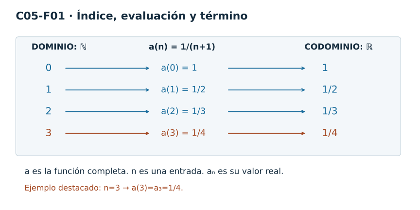
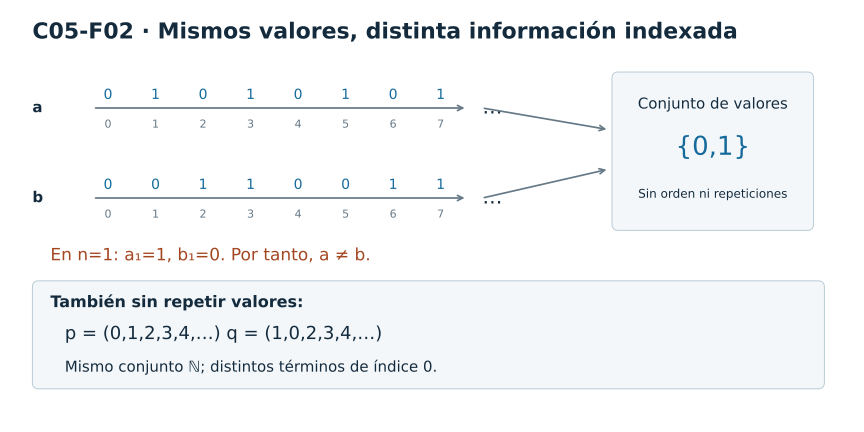
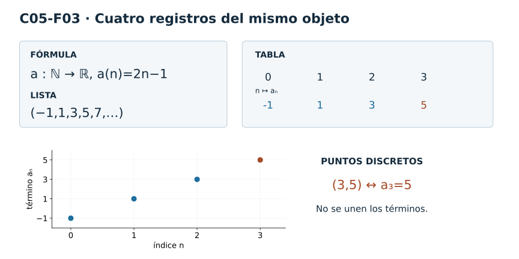
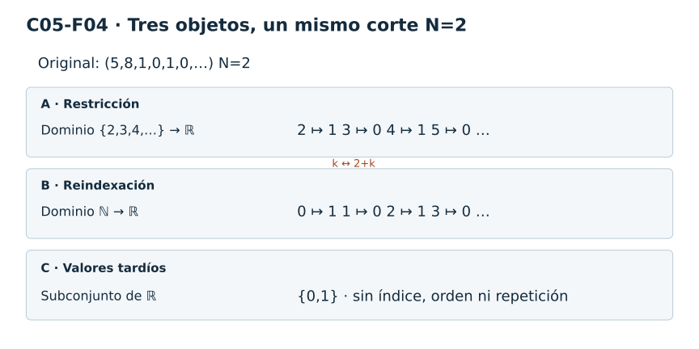
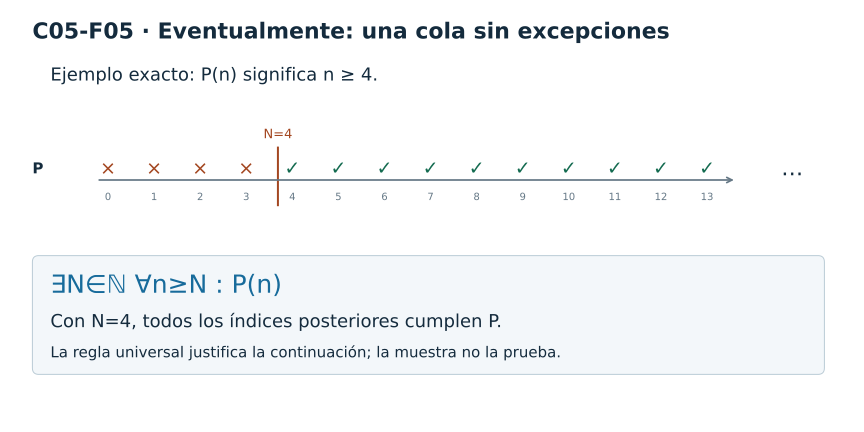
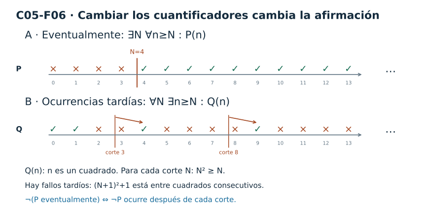
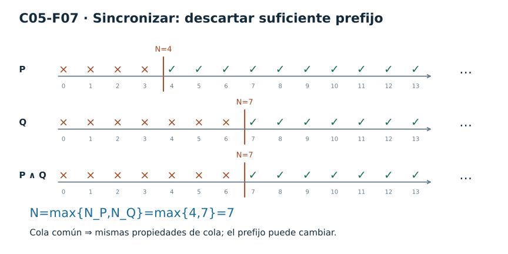
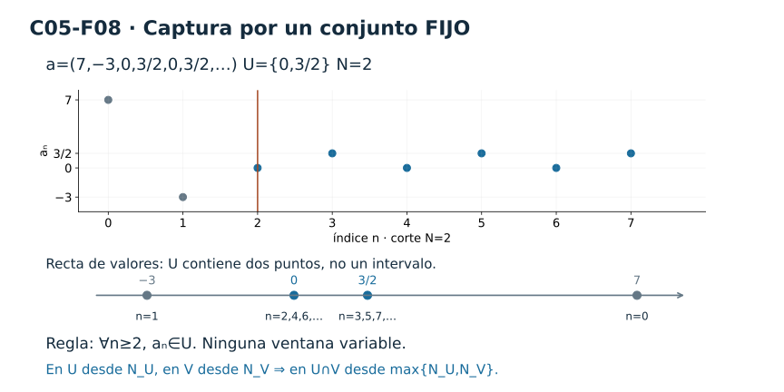

[Índice del libro](../para-matematicos/analisis-para-matematicos.html) · [Ejercicios de este capítulo](#ejercicios-5)

[]{#MA-SEC-ANM-01-005-008}

Con C05 comienza la Parte II — *El infinito bajo control*. Hasta ahora el objeto principal de estudio había sido, casi siempre, estático: la recta real, sus subconjuntos, sus cotas, sus regiones locales. A partir de aquí aparecerá una nueva clase de objeto. Ya no miraremos solamente **qué puntos hay**, sino también **en qué orden aparecen**.

Pensemos, por ejemplo, en la escritura

$$
2,\,-1,\,2,\,0,\,2,\,-1,\ldots
$$

No es sólo una colección de números reales. El primer $2$ ocupa una posición, el $-1$ aparece después, el $2$ vuelve a aparecer, y cada nueva entrada tiene un lugar preciso. Si olvidáramos las posiciones y conserváramos únicamente los valores que alguna vez aparecen, perderíamos parte de la información.

El capítulo se dedicará a hacer rigurosa esa idea. La pregunta no será todavía si una sucesión «se acerca» a algún número. Esa pregunta pertenece a C06. Antes necesitamos construir el lenguaje que permitirá formularla sin que los cuantificadores aparezcan de golpe.

La columna conceptual será:

$$
\boxed{
\text{sucesión}
\longrightarrow
\text{índice y término}
\longrightarrow
\text{cola}
\longrightarrow
\text{eventualidad}
\longrightarrow
\text{captura eventual}.
}
$$

La noción decisiva será que una propiedad puede no cumplirse al principio y, sin embargo, hacerse estable **desde cierto índice en adelante**. Más adelante aprenderemos a expresar esto con precisión. Por ahora conviene empezar por una cuestión más elemental: ¿qué clase de objeto es, exactamente, una sucesión?

Hay una convención que fijaremos desde el comienzo. En este capítulo,

$$
\mathbb N=\{0,1,2,\ldots\}.
$$

Por tanto, una sucesión real comenzará en el índice $0$ y podrá escribirse

$$
a=(a_0,a_1,a_2,\ldots).
$$

Esta notación parece una lista, y esa imagen será útil. Pero la definición formal será más precisa: una sucesión es una **función**.

## 5.1. Una sucesión es una función: índice y término

Ya conocemos funciones. Si

$$
f:D\to Y,
$$

entonces a cada elemento $x\in D$ la función le asigna un único valor $f(x)\in Y$.

Una sucesión real es un caso particular de esa idea en el que el dominio es discreto y está ordenado por los números naturales.

> **Sucesión real.** Una **sucesión real** es una función
>
> $$
> a:\mathbb N\to\mathbb R.
> $$
>
> Para cada $n\in\mathbb N$, escribimos
>
> $$
> a_n=a(n)
> $$
>
> y llamamos $a_n$ al **término de índice $n$** de la sucesión.

La definición contiene tres objetos que conviene mantener separados:

$$
\boxed{
a:\mathbb N\to\mathbb R,
\qquad
n\in\mathbb N,
\qquad
a_n\in\mathbb R.
}
$$

El símbolo $a$ designa la función completa. El símbolo $n$ designa un índice. El símbolo $a_n$ designa el valor que la función toma en ese índice.

Esta distinción parece pequeña, pero será una de las piezas más importantes del capítulo.

### La notación $a_n$ es notación de función

Cuando escribimos

$$
a_n,
$$

no estamos introduciendo un objeto distinto de $a(n)$. Estamos usando una notación especialmente cómoda para funciones cuyo dominio es $\mathbb N$:

$$
a_n=a(n).
$$

Por ejemplo, si definimos

$$
a_n=\frac{1}{n+1},
\qquad n\in\mathbb N,
$$

entonces la afirmación completa es que existe una función

$$
a:\mathbb N\to\mathbb R
$$

dada por

$$
a(n)=\frac{1}{n+1}.
$$

Sus primeros valores son

| $n$ | $a_n$ |
|---:|---:|
| $0$ | $1$ |
| $1$ | $\frac12$ |
| $2$ | $\frac13$ |
| $3$ | $\frac14$ |
| $4$ | $\frac15$ |

La primera columna pertenece al dominio. La segunda contiene valores de la función.

Si fijamos, por ejemplo, $n=3$, entonces

$$
a_3=a(3)=\frac14.
$$

Aquí aparecen dos números, $3$ y $\frac14$, pero desempeñan papeles diferentes:

$$
3\in\mathbb N
\qquad\text{es un índice},
$$

mientras que

$$
\frac14\in\mathbb R
\qquad\text{es el término seleccionado}.
$$

No debemos confundir el lugar con el valor que ocupa ese lugar.

### El dominio forma parte del objeto

Una misma expresión algebraica puede definir funciones distintas si cambia el dominio.

Compárese

$$
f:\mathbb R\to\mathbb R,
\qquad
f(x)=x^2,
$$

con

$$
a:\mathbb N\to\mathbb R,
\qquad
a_n=n^2.
$$

La fórmula visible es casi la misma, pero los objetos no lo son. En el primer caso la variable de entrada puede recorrer todos los números reales. En el segundo, sólo se evalúa en

$$
0,1,2,3,\ldots
$$

y obtenemos

$$
a=(0,1,4,9,16,\ldots).
$$

Entre $n=2$ y $n=3$ no hay índices como $2.1$ o $2.7$. La sucesión no contiene términos $a_{2.1}$ ni $a_{2.7}$, porque esos números no pertenecen al dominio que hemos fijado.

Éste es el diagnóstico que debemos conservar durante todo C05:

> **En $a_n$, el símbolo $n$ es un índice discreto. No es una coordenada real que se recorra continuamente y tampoco es el valor del término.**

La diferencia de tipos puede expresarse de forma muy breve:

$$
n\in\mathbb N
\quad\overset{a}{\longmapsto}\quad
a_n\in\mathbb R.
$$

La flecha es la evaluación de la función.

### Una lista ordenada es una representación de la función

Como el dominio natural está ordenado,

$$
0<1<2<3<\cdots,
$$

podemos escribir los valores de $a$ en ese mismo orden:

$$
(a_0,a_1,a_2,a_3,\ldots).
$$

Esta lista ordenada es una representación muy útil de la sucesión. Pero la definición formal sigue siendo la función

$$
a:\mathbb N\to\mathbb R.
$$

La lista no debe hacernos olvidar el dominio que la organiza.

Por ejemplo, la sucesión

$$
b_n=(-1)^n
$$

puede escribirse

$$
b=(1,-1,1,-1,1,-1,\ldots).
$$

El mismo valor puede aparecer muchas veces. Una función no tiene prohibido enviar distintos índices al mismo número real. En este caso,

$$
b_0=b_2=b_4=\cdots=1
$$

y

$$
b_1=b_3=b_5=\cdots=-1.
$$

Las repeticiones no son un defecto ni una redundancia que debamos borrar. Son parte de la información indexada.

Todavía no analizaremos qué sucede si conservamos sólo los valores $1$ y $-1$ y olvidamos cuándo aparecen. Ése será precisamente el problema de §5.2.

### Índice y término no son intercambiables

Consideremos ahora

$$
c_n=2n-3.
$$

Entonces

$$
c_0=-3,\qquad
c_1=-1,\qquad
c_2=1,\qquad
c_3=3.
$$

La igualdad

$$
c_3=3
$$

puede resultar engañosa porque el índice y el término tienen el mismo valor numérico. Sin embargo, siguen siendo objetos con papeles distintos dentro de la función:

$$
3\in\mathbb N
\quad\text{es la entrada},
$$

y

$$
c_3=3\in\mathbb R
\quad\text{es la salida}.
$$

Que coincidan numéricamente no elimina la diferencia de tipo.

Si cambiamos ligeramente el ejemplo,

$$
d_n=2n,
$$

tenemos

$$
d_3=6.
$$

Ahora la separación vuelve a ser visible: el índice es $3$ y el término es $6$.

Una buena práctica será preguntar siempre:

1. ¿cuál es la función?;
2. ¿cuál es el índice?;
3. ¿cuál es el término correspondiente?;
4. ¿en qué conjunto vive cada objeto?

Este control de tipos será una regla de lectura durante todo el capítulo.

### Igualdad de sucesiones

Como las sucesiones son funciones, su igualdad es igualdad de funciones.

Sean

$$
a,b:\mathbb N\to\mathbb R.
$$

Entonces

$$
a=b
$$

significa que ambas funciones asignan el mismo valor a cada índice:

$$
\boxed{
a=b
\iff
\forall n\in\mathbb N,\ a_n=b_n.
}
$$

No basta con que coincidan algunos términos. Tampoco basta con que ambas sucesiones utilicen los mismos números reales en posiciones distintas.

Por ejemplo,

$$
a=(0,1,0,1,0,1,\ldots)
$$

y

$$
b=(1,0,1,0,1,0,\ldots)
$$

no son la misma sucesión, porque ya en el índice $0$ tenemos

$$
a_0=0\ne1=b_0.
$$

No desarrollaremos todavía la comparación entre los conjuntos de valores de $a$ y $b$. Lo importante aquí es que la igualdad de sucesiones se decide **índice por índice**.

### El orden de los índices añade estructura

Una función con dominio $\mathbb N$ no sólo posee entradas discretas. Esas entradas vienen con un orden natural:

$$
0<1<2<3<\cdots.
$$

Eso nos permite hablar de «antes» y «después» sin introducir tiempo físico. Decir que $a_5$ aparece después de $a_2$ significa simplemente que

$$
2<5.
$$

Esta estructura de orden será esencial cuando definamos colas. Una cola no será una colección arbitraria de términos: será lo que queda al conservar todos los índices desde cierto $N$ en adelante.

Todavía no necesitamos esa definición. Por ahora basta observar que el orden de $\mathbb N$ hace posible distinguir un comienzo, una posición posterior y una región de índices tardíos.

La sucesión contiene, por tanto, más que valores reales:

$$
\boxed{
\text{valor}
+
\text{índice}
+
\text{orden de los índices}.
}
$$

Esa tercera pieza será la puerta de entrada a todo el lenguaje eventual.

### Leer la figura

{#fig-anm-c05-f01 fig-alt="Dominio natural, evaluación por 1/(n+1) y valores reales; índice 3 y valor 1/4 destacados."}

**Figura [C05-F01](#fig-anm-c05-f01).** El índice 3 selecciona el término 1/4; índice, evaluación y valor pertenecen a niveles distintos.

La figura permite seguir un mismo término en tres niveles:

$$
n
\quad\longmapsto\quad
a(n)
\quad=\quad
a_n.
$$

A la izquierda aparece el índice en $\mathbb N$; en el centro, la evaluación de la función; a la derecha, el valor correspondiente en la recta real.

La lectura tipológica distingue además cuatro objetos:

$$
\begin{aligned}
n &:\ \text{índice},\\
a_n &:\ \text{término},\\
a &:\ \text{función }\mathbb N\to\mathbb R,\\
\{a_n:n\in\mathbb N\} &:\ \text{conjunto de valores}.
\end{aligned}
$$

El cuarto objeto sólo queda anunciado aquí. En §5.2 estudiaremos qué información se pierde cuando una sucesión se reemplaza por ese conjunto.

### No hay una curva escondida entre los términos

La fórmula de una sucesión puede recordar la fórmula de una función real de variable real. Eso no autoriza a rellenar los espacios entre índices.

Si

$$
a_n=\frac{1}{n+1},
$$

los términos están definidos para

$$
n=0,1,2,\ldots
$$

No forman, por definición, una curva continua.

Podemos dibujar los puntos

$$
(n,a_n)
$$

en el plano. Pero una línea que los una sería una representación adicional elegida por nosotros, no parte del objeto matemático original.

Esta observación será desarrollada con más detalle en §5.3. Aquí cumple una función diagnóstica: recordar que el dominio de la sucesión sigue siendo $\mathbb N$ incluso cuando una fórmula pueda evaluarse también en números reales.

### Qué hemos fijado

La definición de sucesión real puede comprimirse en una línea:

$$
a:\mathbb N\to\mathbb R.
$$

Pero leerla correctamente exige desplegar varias distinciones:

$$
\boxed{
\begin{aligned}
&a &&\text{es la sucesión completa},\\
&n &&\text{es un índice natural},\\
&a_n=a(n) &&\text{es un término real},\\
&0<1<2<\cdots &&\text{ordena las posiciones}.
\end{aligned}
}
$$

Nada de esto requiere completitud de $\mathbb R$. Tampoco hemos introducido límites, convergencia, subsucesiones o propiedades asintóticas. Hemos fijado solamente el objeto sobre el que construiremos esas ideas más adelante.

El siguiente paso será someter a prueba una intuición muy común: pensar que una sucesión queda determinada por «los valores que contiene». Veremos que no. El orden de las visitas y las repeticiones también son información matemática.

### Antes de seguir

#### Microcontrol 1

[]{#MA-MIC-ANM-01-005-001}

Sea $a_n=3n-2$. Identifica el dominio, el codominio, el índice y el término cuando $n=4$.

[]{#MA-MSOL-ANM-01-005-001}

Ver solución del microcontrol 1

La sucesión es la función $a:\mathbb N\to\mathbb R$ dada por $a(n)=3n-2$. Su dominio es $\mathbb N=\{0,1,2,\ldots\}$ y su codominio es $\mathbb R$. Al fijar $n=4$, el índice es $4\in\mathbb N$ y el término correspondiente es $a_4=3\cdot4-2=10\in\mathbb R$. La función $a$, la entrada $4$ y el valor $10$ cumplen papeles distintos.

#### Microcontrol 2

[]{#MA-MIC-ANM-01-005-002}

Escribe los primeros cinco términos de $a_n=1/(n+1)$ usando la convención $\mathbb N=\{0,1,2,\ldots\}$.

[]{#MA-MSOL-ANM-01-005-002}

Ver solución del microcontrol 2

Los primeros cinco índices son $0,1,2,3,4$. Sustituyéndolos en la fórmula obtenemos $a_0=1$, $a_1=1/2$, $a_2=1/3$, $a_3=1/4$ y $a_4=1/5$. Por tanto, los primeros cinco términos, en su orden, son $(1,1/2,1/3,1/4,1/5)$. Comenzar en $n=1$ omitiría el primer término.

#### Microcontrol 3

[]{#MA-MIC-ANM-01-005-003}

Explica por qué las expresiones $f(x)=x^2$ con $f:\mathbb R\to\mathbb R$ y $a_n=n^2$ con $a:\mathbb N\to\mathbb R$ no definen el mismo objeto matemático.

[]{#MA-MSOL-ANM-01-005-003}

Ver solución del microcontrol 3

Los dominios son diferentes: $f$ admite cualquier entrada real, mientras que $a$ sólo admite índices naturales; ambas tienen codominio $\mathbb R$. Por ejemplo, $f(1/2)=1/4$ está definido, pero $a_{1/2}$ no está definido porque $1/2\notin\mathbb N$. Para cada $n\in\mathbb N$ sí se cumple $a_n=f(n)$: $a$ es la restricción de $f$ a $\mathbb N$. Esa coincidencia de valores en los naturales no hace iguales las dos funciones, pues el dominio forma parte del objeto.

#### Microcontrol 4

[]{#MA-MIC-ANM-01-005-004}

Decide si la frase «$a_3$ es el tercer índice de la sucesión» es correcta. Si no lo es, reescríbela con los tipos adecuados.

[]{#MA-MSOL-ANM-01-005-004}

Ver solución del microcontrol 4

La frase es incorrecta. La redacción adecuada es: «$a_3$ es el término de índice $3$ de la sucesión». El índice es $3\in\mathbb N$ y el término es $a_3=a(3)\in\mathbb R$. Con la indexación desde $0$, $3$ ocupa la cuarta posición entre los índices y $a_3$ es el cuarto término. Aunque en alguna sucesión se tenga $a_3=3$, esa igualdad numérica no identifica el papel de entrada con el de salida ni identifica un término con la función completa.

#### Microcontrol 5

[]{#MA-MIC-ANM-01-005-005}

Sean $a,b:\mathbb N\to\mathbb R$ tales que $a_n=b_n$ para todo $n\in\mathbb N$. Justifica, usando la definición de igualdad de funciones, por qué $a=b$.

[]{#MA-MSOL-ANM-01-005-005}

Ver solución del microcontrol 5

Las funciones $a$ y $b$ tienen el mismo dominio $\mathbb N$ y el mismo codominio $\mathbb R$. La hipótesis dice que, para cada entrada $n\in\mathbb N$, sus valores satisfacen $a(n)=a_n=b_n=b(n)$. Como la igualdad de funciones exige precisamente el mismo dominio, el mismo codominio y la misma asignación en cada entrada, se concluye que $a=b$.

#### Microcontrol 6

[]{#MA-MIC-ANM-01-005-006}

Construye una sucesión real en la que el mismo valor aparezca en infinitos índices distintos. Explica por qué esto no contradice que una sucesión sea una función.

[]{#MA-MSOL-ANM-01-005-006}

Ver solución del microcontrol 6

Definamos $a:\mathbb N\to\mathbb R$ por $a(n)=2$ para todo $n\in\mathbb N$. El valor $2$ aparece en todos los índices $0,1,2,\ldots$, que son infinitos y distintos. Cada índice recibe un único valor, como exige la definición de función; la definición permite que índices diferentes reciban el mismo valor.

#### Microcontrol 7

[]{#MA-MIC-ANM-01-005-007}

En una gráfica de puntos $(n,a_n)$ alguien une todos los puntos con una curva y afirma que esa curva «es la sucesión». Localiza el error.

[]{#MA-MSOL-ANM-01-005-007}

Ver solución del microcontrol 7

La gráfica de la sucesión es la colección discreta $\{(n,a_n):n\in\mathbb N\}$. Al unir los puntos se añaden puntos cuyas primeras coordenadas pueden no ser naturales; por ejemplo, no existe un término de índice $1/2$. La curva es una representación adicional escogida por quien dibuja y no la gráfica de la función $a:\mathbb N\to\mathbb R$. Los puntos originales permiten recuperar la sucesión: para cada índice natural $n$, la segunda coordenada del par $(n,a_n)$ determina su único valor.

#### Microcontrol 8

[]{#MA-MIC-ANM-01-005-008}

En la notación $\{a_n:n\in\mathbb N\}$ se ha olvidado parte de la información de la sucesión. Sin desarrollar todavía §5.2, indica qué clase de información sospechas que ya no puede recuperarse.

[]{#MA-MSOL-ANM-01-005-008}

Ver solución del microcontrol 8

El conjunto conserva qué valores aparecen, pero no registra qué valor corresponde a cada índice. Por ello se pierde el orden de aparición y la información sobre repeticiones: en qué índices se repite un valor y cuántas veces aparece. Esos datos pertenecen a la asignación $n\mapsto a_n$ y no quedan guardados al reunir los valores en un conjunto.

La definición ya está en su sitio. En §5.2 veremos por qué conservar solamente los valores no basta: una sucesión también recuerda **en qué orden** fueron visitados.

### Ejercicios de la sección 5.1

[]{#ejercicios-5}

#### Ejercicio 1. Entrada, salida y repetición

[]{#MA-EX-ANM-01-005-001}

Sea la sucesión real

$$
a:\mathbb N\to\mathbb R,
\qquad
a_n=(n-2)^2-1.
$$

a) Calcula $a_0$, $a_1$, $a_2$, $a_3$ y $a_5$.

b) Para cada una de las expresiones siguientes, indica qué tipo de objeto designa:

$$
a,
\qquad
5,
\qquad
a_5,
\qquad
a(5).
$$

No basta con dar su valor numérico: debes decir si se trata de la función completa, de un índice o de un término.

c) Observa que dos índices distintos producen el mismo valor. Encuentra esos dos índices entre $0,1,2,3$ y escribe las dos igualdades correspondientes.

d) Explica por qué esa repetición no contradice que $a$ sea una función.

[]{#MA-SOL-ANM-01-005-001}

Ver solución del ejercicio 1

La sucesión está dada por

$$
a_n=(n-2)^2-1.
$$

Sustituyendo cada índice obtenemos

$$
a_0=4-1=3,
$$

$$
a_1=1-1=0,
$$

$$
a_2=0-1=-1,
$$

$$
a_3=1-1=0,
$$

y

$$
a_5=9-1=8.
$$

Ahora separamos los tipos:

- $a$ es la función completa $a:\mathbb N\to\mathbb R$;
- $5$ es un índice, es decir, un elemento de $\mathbb N$;
- $a_5$ es el término real seleccionado por el índice $5$;
- $a(5)$ es otra notación para ese mismo término.

Por tanto,

$$
a_5=a(5)=8,
$$

pero el índice sigue siendo $5$ y el término sigue siendo $8$.

Además,

$$
a_1=0=a_3,
$$

aunque

$$
1\ne3.
$$

Esto no contradice la definición de función. Una función exige que cada entrada tenga una única salida; no exige que entradas distintas tengan salidas distintas. Aquí el índice $1$ tiene una sola imagen, $0$, y el índice $3$ también tiene una sola imagen, $0$.

#### Ejercicio 2. La misma regla no determina la misma función

[]{#MA-EX-ANM-01-005-002}

Considera

$$
f:\mathbb R\to\mathbb R,
\qquad
f(x)=2x+1,
$$

$$
a:\mathbb N\to\mathbb R,
\qquad
a_n=2n+1,
$$

y

$$
c:\mathbb Z\to\mathbb R,
\qquad
c(k)=2k+1.
$$

a) Calcula $f(3)$, $a_3$ y $c(3)$.

b) ¿Son iguales como funciones $f$, $a$ y $c$? Justifica tu respuesta usando el dominio como parte del objeto matemático.

c) Decide cuáles de las expresiones siguientes están definidas y, cuando lo estén, calcula su valor:

$$
a_{-1},
\qquad
c(-1),
\qquad
f\!\left(\frac12\right),
\qquad
a_{1/2}.
$$

d) Formula con precisión la relación que sí existe entre $f$ y $a$: ¿qué ocurre cuando ambos se evalúan en un mismo $n\in\mathbb N$?

[]{#MA-SOL-ANM-01-005-002}

Ver solución del ejercicio 2

En el índice o argumento $3$ las tres reglas producen el mismo valor:

$$
f(3)=2\cdot3+1=7,
$$

$$
a_3=2\cdot3+1=7,
$$

y

$$
c(3)=2\cdot3+1=7.
$$

Sin embargo, $f$, $a$ y $c$ no son iguales como funciones. Sus dominios son distintos:

$$
\operatorname{Dom}(f)=\mathbb R,
\qquad
\operatorname{Dom}(a)=\mathbb N,
\qquad
\operatorname{Dom}(c)=\mathbb Z.
$$

La fórmula algebraica no determina por sí sola el objeto función; el dominio forma parte de él.

Revisemos ahora las cuatro expresiones propuestas.

Como $-1\notin\mathbb N$, la expresión

$$
a_{-1}
$$

no está definida para la sucesión $a$.

En cambio, $-1\in\mathbb Z$, de modo que

$$
c(-1)=2(-1)+1=-1.
$$

Como $1/2\in\mathbb R$,

$$
f\!\left(\frac12\right)=2\cdot\frac12+1=2.
$$

Pero $1/2\notin\mathbb N$, así que

$$
a_{1/2}
$$

no está definido.

La relación correcta entre $f$ y $a$ es ésta: para todo $n\in\mathbb N$, ambos objetos pueden evaluarse en $n$ y dan el mismo valor,

$$
a_n=f(n)=2n+1.
$$

Eso no convierte a $a$ y $f$ en la misma función, porque sus dominios siguen siendo distintos.

#### Ejercicio 3. Tres registros para una misma sucesión

[]{#MA-EX-ANM-01-005-003}

Sea $b:\mathbb N\to\mathbb R$ definida por

$$
b_n=
\begin{cases}
4, & \text{si }n\equiv0\pmod 3,\\
-1, & \text{si }n\equiv1\pmod 3,\\
0, & \text{si }n\equiv2\pmod 3.
\end{cases}
$$

a) Construye una tabla con dos columnas, $n$ y $b_n$, para $0\le n\le8$.

b) Escribe esos nueve términos como una lista ordenada

$$
(b_0,b_1,\ldots,b_8).
$$

c) Escribe explícitamente las nueve asignaciones

$$
n\longmapsto b_n
$$

para $0\le n\le8$.

d) Señala qué información permanece visible en las tres representaciones y explica por qué la aparición repetida de $4$, $-1$ y $0$ es compatible con la definición de función.

[]{#MA-SOL-ANM-01-005-003}

Ver solución del ejercicio 3

La definición depende del resto de $n$ al dividir por $3$. Para $0\le n\le8$ obtenemos:

| $n$ | $b_n$ |
|---:|---:|
| $0$ | $4$ |
| $1$ | $-1$ |
| $2$ | $0$ |
| $3$ | $4$ |
| $4$ | $-1$ |
| $5$ | $0$ |
| $6$ | $4$ |
| $7$ | $-1$ |
| $8$ | $0$ |

La lista ordenada correspondiente es

$$
(4,-1,0,4,-1,0,4,-1,0).
$$

Las mismas nueve evaluaciones pueden escribirse como

$$
\begin{aligned}
0&\longmapsto4,\\
1&\longmapsto-1,\\
2&\longmapsto0,\\
3&\longmapsto4,\\
4&\longmapsto-1,\\
5&\longmapsto0,\\
6&\longmapsto4,\\
7&\longmapsto-1,\\
8&\longmapsto0.
\end{aligned}
$$

La tabla muestra directamente qué índice corresponde a cada término. La lista conserva esa correspondencia porque sus posiciones están ordenadas como $0,1,2,\ldots$. Las asignaciones $n\mapsto b_n$ hacen explícita la evaluación de la función.

En los tres registros se conserva la asociación entre posición y valor. La repetición de $4$, $-1$ y $0$ no crea ambigüedad: cada índice sigue teniendo exactamente una salida. Por ejemplo,

$$
b_0=b_3=b_6=4,
$$

pero cada uno de los índices $0$, $3$ y $6$ tiene una imagen única.

#### Ejercicio 4. Una fórmula, tres errores de tipo

[]{#MA-EX-ANM-01-005-004}

Sea

$$
c:\mathbb N\to\mathbb R,
\qquad
c_n=2n-3.
$$

Un estudiante escribe:

> Como $c_3=3$, el índice $3$ y el término $c_3$ son el mismo objeto. Además, la función $g:\mathbb R\to\mathbb R$ dada por $g(x)=2x-3$ es igual a $c$, porque ambas usan la misma fórmula. Por tanto $c$ también tiene un término de índice $3.5$, y ese término vale $4$.

Analiza el argumento completo.

a) Localiza tres errores distintos.

b) Para cada error, identifica qué distinción de tipos o de dominios se ha perdido.

c) Reescribe el razonamiento de forma correcta, conservando todas las afirmaciones verdaderas que puedan rescatarse.

d) Indica qué habría que comprobar para poder afirmar que dos sucesiones $u,v:\mathbb N\to\mathbb R$ son iguales.

[]{#MA-SOL-ANM-01-005-004}

Ver solución del ejercicio 4

El argumento mezcla tres cuestiones diferentes: igualdad numérica, igualdad de objetos y pertenencia al dominio.

La igualdad $c_3=3$ es verdadera como igualdad numérica. Puesto que los naturales se consideran incluidos en los reales, ambas expresiones pueden designar el mismo número. La dificultad aparece cuando se intercambian sus papeles: $3$ es la entrada en la evaluación $c(3)$, mientras que $c_3=c(3)$ es su salida. Esa coincidencia en una evaluación no convierte el índice en la función completa ni permite confundir dominio y codominio.

El segundo error consiste en afirmar que $g$ y $c$ son la misma función porque comparten la expresión $2x-3$. No lo son, pues

$$
g:\mathbb R\to\mathbb R
$$

y

$$
c:\mathbb N\to\mathbb R
$$

tienen dominios distintos. Lo que sí es correcto es que para cada $n\in\mathbb N$,

$$
g(n)=2n-3=c_n.
$$

El tercer error es introducir un supuesto término $c_{3.5}$. Como

$$
3.5\notin\mathbb N,
$$

$3.5$ no es un índice permitido de $c$. La expresión $g(3.5)$ sí está definida y vale

$$
g(3.5)=2(3.5)-3=4,
$$

pero ese valor pertenece a una evaluación de $g$ y no a un término de $c$ con índice $3.5$.

Una versión corregida del razonamiento es:

$$
c_3=3,
$$

de modo que el índice $3$ y el término correspondiente tienen el mismo valor numérico, aunque desempeñan papeles distintos. La función $g$ y la sucesión $c$ obedecen a la misma regla algebraica en los índices naturales, pero no son la misma función porque sus dominios difieren. Por eso $g(3.5)=4$ está definido, mientras que $c_{3.5}$ no lo está.

Finalmente, si

$$
u,v:\mathbb N\to\mathbb R,
$$

entonces para afirmar que son la misma sucesión debemos comprobar igualdad índice por índice:

$$
\boxed{
\forall n\in\mathbb N,
\quad
u_n=v_n.
}
$$

## 5.2. El orden de las visitas importa

En §5.1 fijamos el objeto completo: una sucesión real es una función

$$
a:\mathbb N\to\mathbb R.
$$

De una función podemos extraer un conjunto más pequeño de información: su **conjunto de valores**,

$$
\{a_n:n\in\mathbb N\}=a(\mathbb N)\subseteq\mathbb R.
$$

Este conjunto responde a una pregunta sencilla:

> **¿Qué números reales aparecen alguna vez como términos de la sucesión?**

Pero no responde a otra pregunta igualmente importante:

> **¿En qué índices aparecen y en qué orden se producen esas visitas?**

Al pasar de la sucesión al conjunto de valores conservamos los números visitados y descartamos la organización de esas visitas.

### Mismo conjunto de valores, sucesiones distintas

Consideremos

$$
a=(0,1,0,1,0,1,\ldots)
$$

y

$$
b=(0,0,1,1,0,0,1,1,\ldots).
$$

Ambas sucesiones sólo toman los valores $0$ y $1$. Por tanto,

$$
\{a_n:n\in\mathbb N\}
=
\{b_n:n\in\mathbb N\}
=
\{0,1\}.
$$

Sin embargo, no son la misma sucesión. Basta mirar el índice $1$:

$$
a_1=1,
\qquad
b_1=0.
$$

Como la igualdad de sucesiones exige igualdad en **cada** índice, se sigue que

$$
a\ne b.
$$

El conjunto de valores ha olvidado exactamente la información que permite distinguirlas.

Podemos formular la situación de manera general:

> **La sucesión determina su conjunto de valores, pero el conjunto de valores no determina la sucesión.**

En símbolos, para sucesiones reales $a$ y $b$,

$$
a=b
\Longrightarrow
\{a_n:n\in\mathbb N\}
=
\{b_n:n\in\mathbb N\},
$$

pero la conversa es falsa.

La implicación directa no requiere ningún teorema nuevo. Si $a=b$, entonces $a_n=b_n$ para todo $n\in\mathbb N$; por tanto, todo valor tomado por una sucesión es tomado también por la otra. El ejemplo anterior destruye la conversa.

### Un conjunto tampoco recuerda las repeticiones

La pérdida de información no se limita al orden.

Compárese

$$
c=(0,1,1,1,1,1,\ldots)
$$

con

$$
d=(0,1,0,1,0,1,\ldots).
$$

De nuevo,

$$
\{c_n:n\in\mathbb N\}
=
\{d_n:n\in\mathbb N\}
=
\{0,1\}.
$$

Pero el valor $0$ ocupa papeles muy distintos. En $c$ aparece en el índice $0$ y no vuelve a aparecer; en $d$ aparece en todos los índices pares:

$$
d_0=d_2=d_4=\cdots=0.
$$

El conjunto $\{0,1\}$ no registra ninguna de esas diferencias. En un conjunto, escribir un elemento una vez o muchas veces no cambia el conjunto.

Ésta es una distinción de tipos tan importante como la de §5.1:

$$
\boxed{
\text{sucesión indexada}
\ne
\text{conjunto de valores}.
}
$$

La sucesión conserva qué valor corresponde a cada índice. El conjunto conserva únicamente cuáles valores aparecen al menos una vez.

### Cambiar el orden puede cambiar la sucesión sin cambiar sus valores

La pérdida de orden no es un fenómeno particular de sucesiones periódicas. Consideremos

$$
p_n=n,
\qquad n\in\mathbb N,
$$

de modo que

$$
p=(0,1,2,3,4,\ldots).
$$

Definamos otra sucesión intercambiando sólo los dos primeros términos:

$$
q_0=1,
\qquad
q_1=0,
\qquad
q_n=n\quad(n\ge2).
$$

Entonces

$$
q=(1,0,2,3,4,\ldots).
$$

Sus conjuntos de valores coinciden:

$$
\{p_n:n\in\mathbb N\}
=
\{q_n:n\in\mathbb N\}
=
\mathbb N,
$$

donde $\mathbb N$ se considera, como siempre en este capítulo, contenido en $\mathbb R$ mediante la copia habitual.

No obstante,

$$
p_0=0\ne1=q_0,
$$

así que $p\ne q$.

Este ejemplo elimina una posible distracción: incluso cuando cada valor aparece una sola vez, el conjunto de valores sigue sin recordar el orden de aparición.

### Permutar los índices: conservar los valores, cambiar la organización

La idea anterior admite una formulación compacta. Supongamos que

$$
\sigma:\mathbb N\to\mathbb N
$$

es una biyección y definimos

$$
b_n=a_{\sigma(n)}.
$$

La aplicación $\sigma$ sólo reorganiza los índices: como es biyectiva, utiliza todos los índices originales exactamente una vez. Por ello,

$$
\{b_n:n\in\mathbb N\}
=
\{a_n:n\in\mathbb N\}.
$$

Pero no tiene por qué ocurrir $a=b$. Para que ambas sucesiones fueran iguales necesitaríamos

$$
a_n=a_{\sigma(n)}
$$

para todo $n$, condición que puede fallar.

No convertiremos esta observación en una teoría de permutaciones. Su función aquí es diagnóstica: el orden de los índices forma parte del objeto, mientras que el conjunto de valores lo descarta.

### Qué información sobrevive al colapso

Podemos pensar el paso

$$
a:\mathbb N\to\mathbb R
\quad\longmapsto\quad
\{a_n:n\in\mathbb N\}
$$

como un **colapso de información**.

Sobrevive:

- qué valores reales aparecen.

Se pierde, en general:

- en qué índice aparece cada valor;
- qué valor aparece antes o después de otro;
- qué patrones de repetición presenta la sucesión;
- qué cambios de posición distinguen dos sucesiones con el mismo conjunto de valores.

Esto explica por qué el lenguaje de conjuntos, aunque indispensable, no puede sustituir al lenguaje de sucesiones. Un conjunto no tiene memoria del recorrido que lo produjo.

La distinción puede resumirse así:

$$
\boxed{
\begin{aligned}
\text{sucesión }a&:\quad n\longmapsto a_n,\\
\text{conjunto de valores}&:\quad \text{olvida }n\text{ y conserva sólo }a_n.
\end{aligned}
}
$$

### Leer la figura

{#fig-anm-c05-f02 fig-alt="Dos sucesiones de ceros y unos con distinto orden y mismo conjunto; intercambio no periódico de 0 y 1."}

**Figura [C05-F02](#fig-anm-c05-f02).** El conjunto {0,1} no distingue los dos patrones de visitas. También cambia el orden al intercambiar dos valores sin repeticiones.

La figura muestra, en carriles de índices paralelos, las sucesiones

$$
a=(0,1,0,1,\ldots)
$$

y

$$
b=(0,0,1,1,\ldots),
$$

junto a su colapso al mismo conjunto

$$
\{0,1\}.
$$

La flecha de colapso tiene una función precisa: recordar que reemplazar una sucesión por su conjunto de valores **pierde orden y repeticiones**. El intercambio de los dos primeros términos de $(0,1,2,3,\ldots)$ muestra que el fenómeno también aparece sin repeticiones.

### Una advertencia sobre la palabra «comportamiento»

Decir que dos sucesiones con el mismo conjunto de valores pueden tener comportamientos distintos no significa todavía que hayamos definido una noción asintótica de comportamiento. No hemos introducido convergencia, colas, eventualidad ni subsucesiones.

Por ahora la afirmación es más elemental: dos funciones $\mathbb N\to\mathbb R$ pueden visitar exactamente los mismos valores y, aun así, asignarlos a los índices de maneras diferentes.

Esa diferencia será precisamente la materia prima que las secciones siguientes aprenderán a representar y, más tarde, a analizar desde índices suficientemente tardíos.

### Antes de seguir

#### Microcontrol 9

[]{#MA-MIC-ANM-01-005-009}

Para $a_n=(-1)^n$, determina el conjunto de valores y explica qué información de la sucesión no queda registrada en ese conjunto.

[]{#MA-MSOL-ANM-01-005-009}

Ver solución del microcontrol 9

Si $n=2k$ con $k\in\mathbb N$, entonces $a_n=1$; si $n=2k+1$, entonces $a_n=-1$. Ambos valores aparecen, por ejemplo en $n=0$ y $n=1$, y no aparece ningún otro. Por tanto, el conjunto de valores es $\{-1,1\}\subseteq\mathbb R$. Ese conjunto no registra que $1$ corresponde a los índices pares y $-1$ a los impares, ni el orden de las visitas ni sus repeticiones.

#### Microcontrol 10

[]{#MA-MIC-ANM-01-005-010}

Sean $a=(0,1,0,1,\ldots)$ y $b=(0,0,1,1,0,0,1,1,\ldots)$. Demuestra que tienen el mismo conjunto de valores pero que $a\ne b$.

[]{#MA-MSOL-ANM-01-005-010}

Ver solución del microcontrol 10

Cada una de las dos sucesiones toma sólo los valores $0$ y $1$, y ambas toman los dos: en $a$ aparecen en los índices $0$ y $1$, y en $b$ en los índices $0$ y $2$. Sus conjuntos de valores son, por tanto, $\{0,1\}$. Sin embargo, $a_1=1$ y $b_1=0$; la diferencia en esa entrada impide la igualdad de las funciones $a,b:\mathbb N\to\mathbb R$.

#### Microcontrol 11

[]{#MA-MIC-ANM-01-005-011}

Construye dos sucesiones distintas con conjunto de valores $\{0,1,2\}$ y con órdenes de aparición diferentes.

[]{#MA-MSOL-ANM-01-005-011}

Ver solución del microcontrol 11

Definamos $a,b:\mathbb N\to\mathbb R$ mediante $a_0=0$, $a_1=1$, $a_n=2$ para $n\ge2$, y $b_0=1$, $b_1=0$, $b_n=2$ para $n\ge2$. Así, $a=(0,1,2,2,2,\ldots)$ y $b=(1,0,2,2,2,\ldots)$. En ambas aparecen los tres valores $0,1,2$ y ningún otro. El orden de aparición de $0$ y $1$ está intercambiado, y $a_0=0\ne1=b_0$ prueba que son distintas.

#### Microcontrol 12

[]{#MA-MIC-ANM-01-005-012}

Construye dos sucesiones con el mismo conjunto de valores en las que el valor $0$ tenga patrones de repetición distintos. Describe la diferencia usando índices concretos.

[]{#MA-MSOL-ANM-01-005-012}

Ver solución del microcontrol 12

Tomemos $a_0=0$ y $a_n=1$ para $n\ge1$. Definamos $b_{2k}=0$ y $b_{2k+1}=1$ para cada $k\in\mathbb N$. Ambas son funciones $\mathbb N\to\mathbb R$ con conjunto de valores $\{0,1\}$. En $a$, el valor $0$ aparece sólo en el índice $0$; en $b$, aparece en los índices $0,2,4,6,\ldots$. Por ejemplo, $a_2=a_4=1$, mientras que $b_2=b_4=0$. El conjunto de valores no distingue esos patrones.

#### Microcontrol 13

[]{#MA-MIC-ANM-01-005-013}

Demuestra que si $a=b$ como sucesiones, entonces $\{a_n:n\in\mathbb N\}=\{b_n:n\in\mathbb N\}$. Explica por qué el recíproco falla.

[]{#MA-MSOL-ANM-01-005-013}

Ver solución del microcontrol 13

Sea $x\in\{a_n:n\in\mathbb N\}$. Existe un índice $m\in\mathbb N$ con $x=a_m$. Como $a=b$, se tiene $a_m=b_m$, de modo que $x$ pertenece también al conjunto de valores de $b$. Esto prueba una inclusión; intercambiando $a$ y $b$ obtenemos la otra y, por tanto, la igualdad de conjuntos. El recíproco falla: las sucesiones $(0,1,0,1,\ldots)$ y $(0,0,1,1,0,0,1,1,\ldots)$ tienen conjunto de valores $\{0,1\}$, pero sus términos de índice $1$ son diferentes.

#### Microcontrol 14

[]{#MA-MIC-ANM-01-005-014}

Sea $p_n=n$ y define $q=(1,0,2,3,4,\ldots)$. Verifica que $p$ y $q$ tienen el mismo conjunto de valores y localiza un índice que pruebe que son distintas.

[]{#MA-MSOL-ANM-01-005-014}

Ver solución del microcontrol 14

El conjunto de valores de $p$ es $\mathbb N$, considerado como subconjunto de $\mathbb R$: cada natural $k$ aparece como $p_k=k$. Para $q$, tenemos $q_0=1$, $q_1=0$ y $q_n=n$ para $n\ge2$. Todos sus valores son naturales; además, $0$ aparece en el índice $1$, $1$ en el índice $0$ y cada $k\ge2$ en el índice $k$. Por tanto, su conjunto de valores también es $\mathbb N$. Las sucesiones son distintas porque $p_0=0\ne1=q_0$.

#### Microcontrol 15

[]{#MA-MIC-ANM-01-005-015}

Si $\sigma:\mathbb N\to\mathbb N$ es biyectiva y $b_n=a_{\sigma(n)}$, demuestra directamente que $a$ y $b$ tienen el mismo conjunto de valores. ¿Por qué eso no prueba que $a=b$?

[]{#MA-MSOL-ANM-01-005-015}

Ver solución del microcontrol 15

Si $x$ es un valor de $b$, existe $n\in\mathbb N$ tal que $x=b_n=a_{\sigma(n)}$. Como $\sigma(n)\in\mathbb N$, $x$ es un valor de $a$. Recíprocamente, si $x=a_m$ para algún $m\in\mathbb N$, la sobreyectividad de $\sigma$ proporciona un $n\in\mathbb N$ con $\sigma(n)=m$; entonces $x=a_m=b_n$. Las dos inclusiones prueban la igualdad de conjuntos de valores. Esta prueba permite que el índice $n$ de $b$ sea distinto del índice $m$ de $a$, mientras que $a=b$ exigiría $a_n=a_{\sigma(n)}$ para cada mismo índice $n$. Por ejemplo, con $a_n=n$ y la biyección que intercambia $0$ y $1$ y deja fijos los demás índices, resulta $a_0=0$ y $b_0=1$.

#### Microcontrol 16

[]{#MA-MIC-ANM-01-005-016}

Explica con tus propias palabras qué información conserva la lista ordenada $(a_0,a_1,a_2,\ldots)$ que desaparece al pasar al conjunto $\{a_n:n\in\mathbb N\}$.

[]{#MA-MSOL-ANM-01-005-016}

Ver solución del microcontrol 16

La lista ordenada permite recuperar el valor asignado a cada índice: la primera entrada es $a_0$, la segunda es $a_1$, y así sucesivamente. Conserva en qué posiciones aparece cada valor, el orden de las visitas y las repeticiones. El conjunto $\{a_n:n\in\mathbb N\}$ guarda únicamente qué valores aparecen al menos una vez; no indica sus posiciones ni cuántas veces se repiten.

Ya sabemos qué se pierde cuando borramos los índices. En §5.3 haremos lo contrario: compararemos varias representaciones de una sucesión y exigiremos que cada una conserve, de una forma u otra, la información indexada que ahora sabemos que es esencial.

### Ejercicios de la sección 5.2

#### Ejercicio 5. Los valores y los índices que los visitan

[]{#MA-EX-ANM-01-005-005}

Sea la sucesión $a:\mathbb N\to\mathbb R$ definida por

$$
a_n=
\begin{cases}
0, & \text{si }n\equiv0\pmod 4,\\
2, & \text{si }n\equiv1\text{ o }2\pmod 4,\\
-1, & \text{si }n\equiv3\pmod 4.
\end{cases}
$$

Para cada $x\in\mathbb R$, define el conjunto de índices de aparición de $x$ por

$$
I_a(x)=\{n\in\mathbb N:a_n=x\}.
$$

a) Determina el conjunto de valores $a(\mathbb N)$.

b) Describe exactamente $I_a(0)$, $I_a(2)$ e $I_a(-1)$.

c) Indica el tipo matemático de cada objeto:

$$
a,
\qquad
a(\mathbb N),
\qquad
I_a(2),
\qquad
a_6.
$$

d) Explica qué información conservan los conjuntos $I_a(x)$ que desaparece si sólo conocemos $a(\mathbb N)$.

[]{#MA-SOL-ANM-01-005-005}

Ver solución del ejercicio 5

La definición depende del resto de $n$ módulo $4$.

Los valores posibles son únicamente $0$, $2$ y $-1$, y cada uno aparece: $a_0=0$, $a_1=2$ y $a_3=-1$. Por tanto,

$$
\boxed{a(\mathbb N)=\{-1,0,2\}.}
$$

Los índices que producen $0$ son exactamente los múltiplos de $4$:

$$
\boxed{I_a(0)=\{4k:k\in\mathbb N\}.}
$$

El valor $2$ aparece en los índices congruentes con $1$ o $2$ módulo $4$:

$$
\boxed{
I_a(2)
=
\{4k+1:k\in\mathbb N\}
\cup
\{4k+2:k\in\mathbb N\}.
}
$$

Finalmente,

$$
\boxed{I_a(-1)=\{4k+3:k\in\mathbb N\}.}
$$

Los tipos son distintos:

- $a$ es la función completa $\mathbb N\to\mathbb R$;
- $a(\mathbb N)$ es un subconjunto de $\mathbb R$;
- $I_a(2)$ es un subconjunto de $\mathbb N$;
- $a_6$ es un número real, y como $6\equiv2\pmod4$, vale $2$.

El conjunto de valores sólo dice **qué** números aparecen. Los conjuntos $I_a(x)$ dicen además **dónde** aparecen. Por ejemplo, de $a(\mathbb N)=\{-1,0,2\}$ no puede recuperarse que $0$ aparezca exactamente en los múltiplos de $4$ ni que $2$ ocupe dos clases de congruencia distintas.

#### Ejercicio 6. Recuperar la sucesión a partir de sus índices de aparición

[]{#MA-EX-ANM-01-005-006}

Sean $a,b:\mathbb N\to\mathbb R$. Para cada $x\in\mathbb R$, define

$$
I_a(x)=\{n\in\mathbb N:a_n=x\},
\qquad
I_b(x)=\{n\in\mathbb N:b_n=x\}.
$$

Demuestra la equivalencia

$$
\boxed{
a=b
\iff
\forall x\in\mathbb R,\ I_a(x)=I_b(x).
}
$$

Después demuestra que

$$
a(\mathbb N)
=
\{x\in\mathbb R:I_a(x)\ne\varnothing\}.
$$

Concluye explicando por qué conocer todos los conjuntos $I_a(x)$ contiene estrictamente más información que conocer sólo el conjunto de valores $a(\mathbb N)$.

[]{#MA-SOL-ANM-01-005-006}

Ver solución del ejercicio 6

Supongamos primero que

$$
a=b.
$$

Entonces, para todo $n\in\mathbb N$,

$$
a_n=b_n.
$$

Fijemos $x\in\mathbb R$. Para cualquier $n\in\mathbb N$,

$$
n\in I_a(x)
\iff
a_n=x
\iff b_n=x
\iff n\in I_b(x).
$$

Por extensionalidad,

$$
I_a(x)=I_b(x).
$$

Como $x$ era arbitrario,

$$
\forall x\in\mathbb R,\ I_a(x)=I_b(x).
$$

Probemos la conversa. Supongamos ahora que

$$
\forall x\in\mathbb R,\ I_a(x)=I_b(x).
$$

Fijemos un índice arbitrario $n\in\mathbb N$ y pongamos

$$
x=a_n.
$$

Entonces $n\in I_a(x)$. Por la igualdad de conjuntos de índices,

$$
n\in I_b(x),
$$

y, por definición de $I_b(x)$,

$$
b_n=x=a_n.
$$

Como esto vale para todo $n\in\mathbb N$,

$$
a=b.
$$

Hemos demostrado

$$
\boxed{
a=b
\iff
\forall x\in\mathbb R,\ I_a(x)=I_b(x).
}
$$

Para la segunda identidad, un real $x$ pertenece al conjunto de valores si y sólo si aparece en al menos un índice:

$$
\begin{aligned}
x\in a(\mathbb N)
&\iff \exists n\in\mathbb N:\ a_n=x\\
&\iff I_a(x)\ne\varnothing.
\end{aligned}
$$

Por tanto,

$$
\boxed{
a(\mathbb N)
=
\{x\in\mathbb R:I_a(x)\ne\varnothing\}.
}
$$

El conjunto de valores conserva solamente cuáles conjuntos $I_a(x)$ son vacíos o no vacíos. Conocer cada $I_a(x)$ conserva además todos los índices en los que aparece cada valor, y esa información basta incluso para reconstruir la sucesión completa.

#### Ejercicio 7. Dos existencias no alinean los índices

[]{#MA-EX-ANM-01-005-007}

Un estudiante escribe:

> Si dos sucesiones $a,b:\mathbb N\to\mathbb R$ tienen el mismo conjunto de valores, entonces cada término $a_n$ aparece en algún lugar de $b$ y cada término $b_m$ aparece en algún lugar de $a$. Por tanto, para todo $n$ se tiene $a_n=b_n$, y las sucesiones son iguales.

Audita el argumento.

a) Traduce la igualdad de conjuntos de valores en dos afirmaciones cuantificadas que expresen «cada término aparece en algún lugar de la otra sucesión».

b) Escribe la afirmación cuantificada que sería necesaria para concluir $a=b$.

c) Localiza el paso ilegítimo: explica por qué un índice $m$ cuya existencia depende de $n$ no puede reemplazarse sin más por ese mismo $n$.

d) Usa

$$
a=(0,1,0,1,\ldots),
\qquad
b=(1,0,1,0,\ldots)
$$

para mostrar concretamente que las dos afirmaciones existenciales pueden ser verdaderas mientras $a\ne b$.

e) Reescribe la conclusión correcta del argumento del estudiante.

[]{#MA-SOL-ANM-01-005-007}

Ver solución del ejercicio 7

La igualdad de conjuntos de valores

$$
a(\mathbb N)=b(\mathbb N)
$$

implica dos afirmaciones correctas:

$$
\forall n\in\mathbb N\ \exists m\in\mathbb N:
\ a_n=b_m,
$$

y

$$
\forall m\in\mathbb N\ \exists n\in\mathbb N:
\ b_m=a_n.
$$

Estas fórmulas dicen que cada valor visitado por una sucesión aparece **en algún índice** de la otra.

Para concluir igualdad de sucesiones necesitaríamos algo distinto:

$$
\boxed{
\forall n\in\mathbb N:\ a_n=b_n.
}
$$

El error consiste en sustituir

$$
\forall n\ \exists m
$$

por una afirmación en la que el testigo $m$ queda forzado a ser el mismo índice $n$. La existencia de algún $m$ no garantiza $m=n$; además, el índice testigo puede depender del valor de $n$.

En el ejemplo

$$
a=(0,1,0,1,\ldots),
\qquad
b=(1,0,1,0,\ldots),
$$

ambas sucesiones tienen conjunto de valores $\{0,1\}$. En $b$, el valor $0$ aparece en los índices impares y el valor $1$ en los pares. Para todo $n$, el testigo $m=n+1$ cumple $b_m=a_n$; en la dirección recíproca, el mismo desplazamiento cumple $a_{n+1}=b_n$. Por tanto, ambas afirmaciones existenciales son verdaderas, aunque la coincidencia nunca se dé en el mismo índice.

Sin embargo, en el índice $0$,

$$
a_0=0
\qquad\text{y}\qquad
b_0=1,
$$

de modo que

$$
a\ne b.
$$

La conclusión correcta es únicamente:

> si dos sucesiones tienen el mismo conjunto de valores, cada valor tomado por una de ellas es tomado también por la otra, quizá en índices distintos.

No puede recuperarse la igualdad índice por índice a partir de esa información.

#### Ejercicio 8. Ningún prefijo finito fija el orden completo

[]{#MA-EX-ANM-01-005-008}

Sea $M\in\mathbb N$ arbitrario.

Construye dos sucesiones $a,b:\mathbb N\to\mathbb R$ que satisfagan simultáneamente:

1. $a_n=b_n$ para todo $0\le n\le M$;
2. $a(\mathbb N)=b(\mathbb N)=\mathbb N$;
3. cada valor natural aparece exactamente una vez en cada sucesión;
4. $a\ne b$.

Tu construcción debe funcionar para **todo** $M$.

Después identifica un índice concreto que demuestre $a\ne b$ y explica qué refuta el ejemplo acerca de la posibilidad de reconstruir una sucesión conociendo su conjunto de valores y una cantidad finita, aunque arbitrariamente grande, de términos iniciales.

[]{#MA-SOL-ANM-01-005-008}

Ver solución del ejercicio 8

Fijemos $M\in\mathbb N$. Definimos

$$
a_n=n
$$

para todo $n\in\mathbb N$ y construimos $b$ intercambiando únicamente los valores situados en los índices $M+1$ y $M+2$:

$$
b_n=
\begin{cases}
M+2, & n=M+1,\\
M+1, & n=M+2,\\
n, & \text{en cualquier otro caso}.
\end{cases}
$$

Para todo $0\le n\le M$ no se ha modificado nada, así que

$$
a_n=b_n.
$$

La sucesión $a$ visita cada número natural exactamente una vez. La sucesión $b$ hace lo mismo: sólo hemos permutado las posiciones de $M+1$ y $M+2$. Por tanto,

$$
a(\mathbb N)=b(\mathbb N)=\mathbb N,
$$

y cada valor aparece exactamente una vez en ambas.

Pero en el índice $M+1$ tenemos

$$
a_{M+1}=M+1
$$

mientras que

$$
b_{M+1}=M+2.
$$

Luego

$$
\boxed{a\ne b.}
$$

Como $M$ era arbitrario, el acuerdo puede hacerse tan largo como queramos sin forzar igualdad global. Incluso conocer el conjunto completo de valores y cualquier cantidad finita prefijada de términos iniciales deja abierta la posibilidad de reorganizar valores en índices posteriores.

El ejemplo separa dos clases de información: el conjunto de valores registra qué números aparecen; la sucesión registra además en qué índice aparece cada uno.

#### Ejercicio 9. El mismo conjunto de valores, muchos ritmos de repetición

[]{#MA-EX-ANM-01-005-009}

Para cada entero $r\ge1$, define una sucesión $b^{(r)}:\mathbb N\to\mathbb R$ por bloques. Para $q\in\mathbb N$ y $j\in\{0,1,\ldots,r-1\}$, fija

$$
b^{(r)}_{3rq+j}=0,
$$

$$
b^{(r)}_{3rq+r+j}=1,
$$

y

$$
b^{(r)}_{3rq+2r+j}=2.
$$

Así, cada ciclo contiene $r$ ceros, luego $r$ unos y luego $r$ doses.

a) Escribe los primeros doce términos de $b^{(1)}$, $b^{(2)}$ y $b^{(3)}$.

b) Demuestra que, para todo $r\ge1$,

$$
b^{(r)}(\mathbb N)=\{0,1,2\}.
$$

c) Demuestra que si $1\le r<s$, entonces

$$
b^{(r)}_r=1
\qquad\text{y}\qquad
b^{(s)}_r=0.
$$

Concluye que las sucesiones $b^{(r)}$ son dos a dos distintas.

d) Describe el conjunto de índices en los que $b^{(r)}$ toma el valor $0$.

e) Explica qué aspecto de la sucesión cambia con $r$ y por qué ese cambio es completamente invisible en el conjunto de valores $\{0,1,2\}$.

[]{#MA-SOL-ANM-01-005-009}

Ver solución del ejercicio 9

Para $r=1$ obtenemos ciclos de longitud $3$:

$$
b^{(1)}=(0,1,2,0,1,2,0,1,2,0,1,2,\ldots).
$$

Para $r=2$ los valores aparecen en bloques de longitud $2$:

$$
b^{(2)}=(0,0,1,1,2,2,0,0,1,1,2,2,\ldots).
$$

Para $r=3$ aparecen en bloques de longitud $3$:

$$
b^{(3)}=(0,0,0,1,1,1,2,2,2,0,0,0,\ldots).
$$

Fijemos ahora $r\ge1$. Por definición, todos los términos de $b^{(r)}$ pertenecen a $\{0,1,2\}$. Además, tomando $q=0$ y $j=0$ obtenemos

$$
b^{(r)}_0=0,
\qquad
b^{(r)}_r=1,
\qquad
b^{(r)}_{2r}=2.
$$

Por tanto los tres valores aparecen y no aparece ningún otro:

$$
\boxed{b^{(r)}(\mathbb N)=\{0,1,2\}.}
$$

Sean ahora $1\le r<s$. En la sucesión $b^{(r)}$, el primer bloque de ceros ocupa los índices

$$
0,1,\ldots,r-1,
$$

de modo que el índice $r$ ya pertenece al primer bloque de unos. Así,

$$
b^{(r)}_r=1.
$$

En cambio, para $b^{(s)}$ el primer bloque de ceros ocupa

$$
0,1,\ldots,s-1.
$$

Como $r<s$,

$$
b^{(s)}_r=0.
$$

Luego

$$
b^{(r)}_r\ne b^{(s)}_r,
$$

y por tanto

$$
\boxed{b^{(r)}\ne b^{(s)}}
$$

siempre que $r\ne s$.

Los índices en los que aparece $0$ forman, para cada ciclo $q$, el bloque

$$
\{3rq,3rq+1,\ldots,3rq+r-1\}.
$$

Por tanto,

$$
\boxed{
I_{b^{(r)}}(0)
=
\bigcup_{q\in\mathbb N}
\{3rq+j:0\le j\le r-1\}.
}
$$

Al variar $r$ cambia la longitud de los bloques y, con ella, el patrón de repetición y el orden local de las visitas. El conjunto de valores no registra ninguna de esas diferencias: para todos los parámetros colapsa al mismo conjunto $\{0,1,2\}$.

La familia muestra de forma paramétrica que conservar los valores visitados no equivale a conservar la organización indexada de esas visitas.

## 5.3. Ver una sucesión sin perder el índice

En §5.2 vimos que reemplazar una sucesión por su conjunto de valores borra información. El problema no estaba en los números mismos, sino en haber eliminado los índices que los organizaban.

Ahora haremos la pregunta inversa:

> **¿Cómo podemos representar una sucesión de manera que el índice siga visible?**

No hay una única respuesta. Una misma sucesión puede escribirse mediante una fórmula, una lista ordenada, una tabla o una colección discreta de puntos. Cada registro destaca algo distinto, pero todos deben ser compatibles con el mismo objeto matemático:

$$
a:\mathbb N\to\mathbb R.
$$

La regla de control será simple:

> **Una representación adecuada puede cambiar la apariencia de la sucesión, pero no debe borrar la correspondencia $n\mapsto a_n$.**

### Un mismo ejemplo en varios registros

Consideremos la sucesión

$$
a_n=2n-1,
\qquad n\in\mathbb N.
$$

Ésta es su **fórmula**. Permite calcular cualquier término a partir del índice. Por ejemplo,

$$
a_0=-1,
\qquad
a_1=1,
\qquad
a_2=3,
\qquad
a_3=5.
$$

Podemos registrar esos mismos valores como **lista ordenada**:

$$
a=(-1,1,3,5,7,\ldots).
$$

La lista hace visible el orden de aparición, pero comprime la escritura del índice: sabemos que el primer lugar corresponde a $0$, el segundo a $1$, y así sucesivamente, porque ya hemos fijado la convención de indexación.

También podemos usar una **tabla**:

| $n$ | $a_n$ |
|---:|---:|
| $0$ | $-1$ |
| $1$ | $1$ |
| $2$ | $3$ |
| $3$ | $5$ |
| $4$ | $7$ |

Aquí la correspondencia funcional queda completamente explícita. Cada fila registra una entrada y su salida:

$$
n\longmapsto a_n.
$$

Finalmente podemos representar la sucesión mediante los puntos

$$
(0,-1),\ (1,1),\ (2,3),\ (3,5),\ (4,7),\ldots
$$

en el plano.

La gráfica de la sucesión es, por tanto, el conjunto discreto

$$
\{(n,a_n):n\in\mathbb N\}\subseteq\mathbb N\times\mathbb R.
$$

Si identificamos los naturales con sus posiciones habituales en el eje horizontal, podemos verla como una nube de puntos en el plano. La coordenada horizontal conserva el índice; la vertical registra el término.

### La gráfica conserva dos datos a la vez

La representación por puntos tiene una ventaja especial. En un mismo objeto visual podemos leer simultáneamente

$$
\boxed{
\text{cuándo: }n
\qquad\text{y}\qquad
\text{dónde: }a_n.
}
$$

La palabra «cuándo» no introduce tiempo físico. Significa únicamente **en qué posición del dominio ordenado $\mathbb N$** aparece el término.

Por ejemplo, para

$$
b_n=(-1)^n,
$$

los valores $1$ y $-1$ se repiten. Sobre la recta real sólo hay dos posiciones posibles, pero en la gráfica aparecen puntos distintos:

$$
(0,1),\ (1,-1),\ (2,1),\ (3,-1),\ldots
$$

Los puntos $(0,1)$ y $(2,1)$ tienen la misma altura, pero no son el mismo punto del plano. La diferencia horizontal recuerda que el valor $1$ fue visitado en índices distintos.

Ésta es exactamente la información que se perdía en §5.2 al colapsar la sucesión al conjunto

$$
\{-1,1\}.
$$

### Unir los puntos inventa información nueva

Aquí aparece un error gráfico muy frecuente. Supongamos nuevamente que

$$
a_n=2n-1.
$$

Los puntos de la sucesión están definidos para

$$
n=0,1,2,3,\ldots
$$

Nada en la definición proporciona términos entre $a_2$ y $a_3$. En particular, expresiones como

$$
a_{2.4}
$$

no pertenecen a la sucesión, porque $2.4\notin\mathbb N$.

Si dibujamos segmentos o una curva que una los puntos, hemos añadido valores para posiciones horizontales que no forman parte del dominio original. Esa curva puede ser útil como adorno o como construcción auxiliar en otro contexto, pero no es la sucesión.

Por eso la regla visual de C05 es vinculante:

$$
\boxed{
\text{gráfica de sucesión}
=
\text{puntos discretos, no curva intermedia}.
}
$$

No estamos prohibiendo que una persona trace una línea para guiar la vista. Estamos diciendo algo más preciso: **la línea no pertenece al objeto matemático definido por $a:\mathbb N\to\mathbb R$**.

### La fórmula tampoco es la sucesión

También conviene evitar el error opuesto: identificar una sucesión con una fórmula particular.

La escritura

$$
a_n=2n-1
$$

es una manera compacta de especificar esta sucesión. Pero el objeto matemático es la función $a:\mathbb N\to\mathbb R$, no la cadena de símbolos que usamos para describirla.

La misma función podría especificarse mediante una tabla que registre todos los pares $(n,a_n)$ o, cuando exista, mediante otra regla exacta que determine un único valor real para cada índice natural. No toda sucesión necesita admitir una fórmula cerrada o una descripción finita sencilla; una fórmula es muy cómoda, pero no forma parte de la definición general de sucesión.

Podemos separar así dos niveles:

$$
\boxed{
\begin{aligned}
\text{objeto} &:\quad a:\mathbb N\to\mathbb R,\\
\text{representaciones} &:\quad \text{fórmula, lista, tabla, puntos, etiquetas.}
\end{aligned}
}
$$

Confundir ambos niveles sería como confundir un número con una de sus escrituras decimales.

### Qué gana y qué pierde cada registro

Ninguna representación es siempre la mejor. Depende de qué queramos leer.

La **fórmula** suele ser compacta y permite calcular términos lejanos, pero puede ocultar el aspecto de los primeros valores.

La **lista ordenada** hace visibles rápidamente repeticiones y alternancias, aunque deja implícita la columna de índices.

La **tabla** expone sin ambigüedad cada asociación $n\mapsto a_n$, pero ocupa mucho espacio.

La **gráfica discreta** combina índice y valor en una misma imagen y permite comparar posiciones, alturas y repeticiones.

Una representación sobre la **recta real** puede ser útil para ver dónde caen los valores, pero exige etiquetas de índice si queremos conservar la información secuencial. Si quitamos esas etiquetas y dejamos sólo las posiciones visitadas, volvemos al conjunto de valores estudiado en §5.2.

Por tanto, mirar una sucesión sobre la recta real exige una precaución:

$$
\boxed{
\text{posición del valor sin etiqueta de índice}
\quad\text{puede borrar la sucesión}. 
}
$$

### Traducir entre registros

Volvamos al ejemplo

$$
a_n=2n-1.
$$

Podemos recorrer una cadena de traducciones:

$$
\text{fórmula}
\longrightarrow
\text{tabla}
\longrightarrow
\text{lista}
\longrightarrow
\text{puntos }(n,a_n).
$$

En cada paso cambia la apariencia, pero deben preservarse afirmaciones como

$$
a_3=5.
$$

En la fórmula, se obtiene sustituyendo $n=3$.

En la tabla, aparece en la fila cuyo primer componente es $3$.

En la lista, $5$ ocupa la posición correspondiente al índice $3$.

En la gráfica, aparece el punto

$$
(3,5).
$$

Esta compatibilidad es una prueba práctica de que estamos mirando cuatro representaciones del mismo objeto y no cuatro objetos distintos.

### Leer la figura

{#fig-anm-c05-f03 fig-alt="Fórmula 2n−1, lista, tabla y puntos discretos; par (3,5) destacado."}

**Figura [C05-F03](#fig-anm-c05-f03).** Fórmula, lista, tabla y puntos conservan el mismo par (3,5). No se añaden valores entre índices.

La figura muestra pocos términos explícitos y destaca un mismo término. Su función no es añadir contenido matemático, sino permitir que el lector siga un mismo par

$$
(n,a_n)
$$

a través de varios registros.

El panel gráfico obedece la regla ya fijada:

> **Los puntos pueden compartir alturas, pero no se unirán mediante una curva que sugiera valores intermedios de la sucesión.**

### Qué hemos ganado

Después de §§5.1–5.3 podemos leer una sucesión sin confundir sus componentes ni sus representaciones.

Sabemos distinguir

$$
\boxed{
\begin{aligned}
&a:\mathbb N\to\mathbb R &&\text{sucesión},\\
&n\in\mathbb N &&\text{índice},\\
&a_n\in\mathbb R &&\text{término},\\
&\{a_n:n\in\mathbb N\} &&\text{conjunto de valores},\\
&\{(n,a_n):n\in\mathbb N\} &&\text{gráfica discreta}.
\end{aligned}
}
$$

La siguiente pregunta ya no será cómo representar **toda** la sucesión. Preguntaremos qué significa conservar sólo la parte situada desde cierto índice en adelante. Esa operación abrirá el lenguaje de las colas en §5.4.

### Antes de seguir

#### Microcontrol 17

[]{#MA-MIC-ANM-01-005-017}

Para $a_n=3-2n$, escribe los primeros cinco términos, una tabla con índices $0$ a $4$ y los cinco puntos correspondientes de la gráfica discreta.

[]{#MA-MSOL-ANM-01-005-017}

Ver solución del microcontrol 17

Al evaluar $a_n=3-2n$ en $n=0,1,2,3,4$, obtenemos los términos $(3,1,-1,-3,-5)$ en ese orden. La tabla mantiene explícita cada entrada y su valor:

| $n$ | $a_n$ |
|---:|---:|
| $0$ | $3$ |
| $1$ | $1$ |
| $2$ | $-1$ |
| $3$ | $-3$ |
| $4$ | $-5$ |

Los cinco puntos correspondientes son $(0,3)$, $(1,1)$, $(2,-1)$, $(3,-3)$ y $(4,-5)$. Son puntos de la gráfica discreta de $a:\mathbb N\to\mathbb R$; no se añaden segmentos entre ellos.

#### Microcontrol 18

[]{#MA-MIC-ANM-01-005-018}

En la sucesión $b_n=(-1)^n$, explica por qué los puntos $(0,1)$ y $(2,1)$ contienen más información que la sola marca $1$ sobre la recta real.

[]{#MA-MSOL-ANM-01-005-018}

Ver solución del microcontrol 18

Los puntos $(0,1)$ y $(2,1)$ registran las dos asignaciones $b_0=1$ y $b_2=1$. Tienen la misma coordenada vertical, pero son distintos porque sus primeras coordenadas son $0$ y $2$. Una sola marca en $1$ sobre la recta real indica que ese valor aparece; sin etiquetas no identifica ninguno de esos índices ni muestra que corresponda a más de una entrada.

#### Microcontrol 19

[]{#MA-MIC-ANM-01-005-019}

Un estudiante dibuja los puntos de $a_n=n^2$ y los une con la parábola $y=x^2$. Explica qué parte del dibujo representa la sucesión y qué parte es información adicional.

[]{#MA-MSOL-ANM-01-005-019}

Ver solución del microcontrol 19

La sucesión está representada por los puntos $\{(n,n^2):n\in\mathbb N\}$, con dominio $\mathbb N=\{0,1,2,\ldots\}$ y codominio $\mathbb R$. La parábola completa es la gráfica de la función $f:\mathbb R\to\mathbb R$, $f(x)=x^2$. Contiene los puntos de la sucesión, pero también puntos como $(1/2,1/4)$, que no pertenecen a ella porque $1/2$ no es un índice natural. Toda parte de la curva ajena a los puntos de índice natural es información adicional.

#### Microcontrol 20

[]{#MA-MIC-ANM-01-005-020}

Decide si una lista ordenada puede representar correctamente una sucesión sin escribir explícitamente todos los índices. ¿Qué convención permite hacerlo?

[]{#MA-MSOL-ANM-01-005-020}

Ver solución del microcontrol 20

Sí, si se fija la convención $\mathbb N=\{0,1,2,\ldots\}$ y se escriben los términos en ese orden: el primer lugar de $(a_0,a_1,a_2,\ldots)$ corresponde al índice $0$, el segundo al índice $1$ y el lugar $n+1$ al índice $n$. Así los índices quedan implícitos en las posiciones. Una lista de sólo unos pocos términos, acompañada de puntos suspensivos sin una regla de continuación determinada, no especifica por sí sola toda la función.

#### Microcontrol 21

[]{#MA-MIC-ANM-01-005-021}

Da un ejemplo de una representación sobre la recta real que pierda información de índice y explica cómo repararla mediante etiquetas.

[]{#MA-MSOL-ANM-01-005-021}

Ver solución del microcontrol 21

Para $b_n=(-1)^n$, marcar únicamente $-1$ y $1$ en la recta real representa su conjunto de valores y pierde la asignación a los índices. Se repara asociando a la marca $1$ las etiquetas $n=0,2,4,\ldots$ y a la marca $-1$ las etiquetas $n=1,3,5,\ldots$, o indicando respectivamente «$n=2k$, $k\in\mathbb N$» y «$n=2k+1$, $k\in\mathbb N$». Las etiquetas permiten recuperar qué valor corresponde a cada índice, incluidas las repeticiones.

#### Microcontrol 22

[]{#MA-MIC-ANM-01-005-022}

Para $a_n=2n-1$, localiza la afirmación $a_3=5$ en la fórmula, la lista, la tabla y la gráfica discreta.

[]{#MA-MSOL-ANM-01-005-022}

Ver solución del microcontrol 22

En la fórmula, sustituir $n=3$ da $a_3=2\cdot3-1=5$. En la lista $(-1,1,3,5,7,\ldots)$, el $5$ ocupa el cuarto lugar, que corresponde al índice $3$ porque se comienza en $0$. En la tabla, la afirmación está en la fila con entrada $3$ y valor $5$. En la gráfica discreta, está representada por el punto $(3,5)$. Los cuatro registros conservan la misma asignación $3\mapsto5$.

#### Microcontrol 23

[]{#MA-MIC-ANM-01-005-023}

Explica por qué una fórmula cerrada no forma parte de la definición de sucesión, aunque muchas sucesiones de ejemplo se presenten mediante fórmulas.

[]{#MA-MSOL-ANM-01-005-023}

Ver solución del microcontrol 23

La definición exige una función $a:\mathbb N\to\mathbb R$: a cada índice natural debe corresponderle un único valor real. No exige que esa asignación tenga una fórmula cerrada. Una fórmula es una manera de describir la función; también la describe la colección completa de sus pares $(n,a_n)$, y dos expresiones diferentes pueden determinar la misma asignación. Por ejemplo, $a_0=0$ y $a_{n+1}=a_n^2+1$ determinan una sucesión por recurrencia: el valor inicial está fijado y cada valor ya determinado produce un único valor real siguiente. Esta descripción define la asignación completa sin requerir una fórmula cerrada. Por ello, usar fórmulas en muchos ejemplos no añade una condición a la definición general.

#### Microcontrol 24

[]{#MA-MIC-ANM-01-005-024}

Compara el conjunto $\{a_n:n\in\mathbb N\}$ con la gráfica $\{(n,a_n):n\in\mathbb N\}$. ¿Cuál de los dos conserva necesariamente el índice?

[]{#MA-MSOL-ANM-01-005-024}

Ver solución del microcontrol 24

El conjunto de valores $\{a_n:n\in\mathbb N\}\subseteq\mathbb R$ conserva sólo los valores que aparecen. La gráfica $\{(n,a_n):n\in\mathbb N\}\subseteq\mathbb N\times\mathbb R$ conserva necesariamente el índice en la primera coordenada y su término en la segunda. Para cada $n$, su único punto de primera coordenada $n$ permite recuperar $a_n$. Si un valor se repite, los pares siguen siendo distintos por sus índices; el conjunto de valores reúne todas esas apariciones en un solo elemento.

Ya podemos cambiar de representación sin perder de vista el objeto. En §5.4 introduciremos la primera operación estructural nueva sobre una sucesión: conservar sólo los términos cuyos índices están desde cierto punto en adelante.

### Ejercicios de la sección 5.3

#### Ejercicio 10. Del conjunto de puntos a tres registros coordinados

[]{#MA-EX-ANM-01-005-010}

Los primeros ocho términos de una sucesión $a:\mathbb N\to\mathbb R$ están representados por el conjunto de puntos

$$
G_7=
\{(0,3),(1,1),(2,3),(3,-1),(4,1),(5,3),(6,-1),(7,1)\}.
$$

Este conjunto registra sólo los índices $0$ a $7$; no se afirma nada todavía sobre los términos posteriores.

a) Reconstruye una tabla con columnas $n$ y $a_n$ para $0\le n\le7$.

b) Escribe el mismo bloque como lista ordenada

$$
(a_0,a_1,\ldots,a_7).
$$

c) Representa esos ocho términos sobre la recta real usando únicamente las posiciones $-1$, $1$ y $3$, pero añade junto a cada posición **todos** los índices que llegan a ella.

d) Localiza la afirmación

$$
a_5=3
$$

en los tres registros: conjunto de puntos, tabla y recta real etiquetada.

e) Borra ahora las etiquetas de índice de la representación sobre la recta real. ¿Qué información queda y qué información deja de poder recuperarse acerca de los primeros ocho términos?

[]{#MA-SOL-ANM-01-005-010}

Ver solución del ejercicio 10

Cada punto $(n,a_n)$ contiene simultáneamente el índice y el término. La tabla es, por tanto,

| $n$ | $a_n$ |
|---:|---:|
| $0$ | $3$ |
| $1$ | $1$ |
| $2$ | $3$ |
| $3$ | $-1$ |
| $4$ | $1$ |
| $5$ | $3$ |
| $6$ | $-1$ |
| $7$ | $1$ |

El bloque ordenado correspondiente es

$$
(a_0,a_1,\ldots,a_7)
=
(3,1,3,-1,1,3,-1,1).
$$

Sobre la recta real sólo aparecen tres posiciones. Para conservar la información indexada debemos añadir las etiquetas:

$$
-1:\ \{3,6\},
\qquad
1:\ \{1,4,7\},
\qquad
3:\ \{0,2,5\}.
$$

La igualdad $a_5=3$ aparece en el conjunto de puntos como

$$
(5,3)\in G_7,
$$

en la tabla como la fila cuya primera entrada es $5$, y en la recta etiquetada mediante la presencia del índice $5$ junto a la posición $3$.

Si borramos todas las etiquetas de índice, sólo queda el conjunto

$$
\{-1,1,3\}.
$$

Ese registro conserva qué valores aparecen en el bloque, pero ya no indica en qué posiciones aparecen, en qué orden se recorren ni cuántas veces aparece cada uno dentro de los ocho términos observados. La pérdida se produce precisamente al eliminar la asociación

$$
n\longmapsto a_n.
$$

#### Ejercicio 11. Una codificación fiel que no es la gráfica estándar

[]{#MA-EX-ANM-01-005-011}

Sea

$$
a_n=(-1)^n(n+1),
\qquad n\in\mathbb N.
$$

Considera dos conjuntos de puntos:

$$
G=\{(n,a_n):n\in\mathbb N\}
$$

y

$$
H=\{(2n+1,a_n):n\in\mathbb N\}.
$$

a) Escribe los primeros cinco puntos de $G$ y los primeros cinco puntos de $H$.

b) Explica por qué $G$ es la gráfica de la sucesión en el sentido estándar de §5.3.

c) El conjunto $H$ no usa el índice original como coordenada horizontal. Demuestra, sin embargo, que conserva toda la información de la sucesión si se declara la regla de decodificación

$$
n=\frac{x-1}{2}.
$$

En particular, muestra cómo recuperar $a_3$ a partir del punto correspondiente de $H$.

d) Explica por qué $H$ es una representación codificada fiel, pero no es literalmente la gráfica

$$
\{(n,a_n):n\in\mathbb N\}.
$$

e) Si de $G$ o de $H$ conservamos únicamente las alturas y borramos por completo la coordenada horizontal, ¿qué estructura de la sucesión se pierde?

[]{#MA-SOL-ANM-01-005-011}

Ver solución del ejercicio 11

Los primeros valores son

$$
a_0=1,
\quad
a_1=-2,
\quad
a_2=3,
\quad
a_3=-4,
\quad
a_4=5.
$$

Por tanto, los primeros cinco puntos de la gráfica estándar son

$$
(0,1),\ (1,-2),\ (2,3),\ (3,-4),\ (4,5),
$$

y los primeros cinco puntos de $H$ son

$$
(1,1),\ (3,-2),\ (5,3),\ (7,-4),\ (9,5).
$$

El conjunto

$$
G=\{(n,a_n):n\in\mathbb N\}
$$

es la gráfica estándar porque su primera coordenada es literalmente el índice $n$ de la sucesión.

En $H$ la primera coordenada ha sido reemplazada por

$$
x=2n+1.
$$

La transformación es reversible sobre las coordenadas que aparecen en $H$: si conocemos $x$, recuperamos el índice mediante

$$
n=\frac{x-1}{2}.
$$

Por ejemplo, el término $a_3$ corresponde al punto cuya primera coordenada es

$$
2\cdot3+1=7.
$$

Como

$$
(7,-4)\in H,
$$

recuperamos

$$
a_3=-4.
$$

Así, $H$ conserva toda la asociación índice–término siempre que la regla de decodificación forme parte de la representación. No es, sin embargo, la gráfica estándar de $a$, porque sus puntos no tienen la forma $(n,a_n)$: la coordenada horizontal es $2n+1$, no $n$.

Si borramos la coordenada horizontal, en cualquiera de los dos registros quedan sólo las alturas

$$
\{1,-2,3,-4,5,-6,\ldots\}.
$$

Se pierde la correspondencia explícita entre cada índice y su valor. El hecho de que en este ejemplo los valores sean distintos no cambia el tipo de información eliminada: la proyección vertical ya no registra por sí misma la función $n\mapsto a_n$.

#### Ejercicio 12. Dos curvas distintas, una sola sucesión

[]{#MA-EX-ANM-01-005-012}

Considera las funciones reales

$$
f:\mathbb R\to\mathbb R,
\qquad
f(x)=x,
$$

y

$$
g:\mathbb R\to\mathbb R,
\qquad
g(x)=x+\sin(\pi x).
$$

A partir de ellas se definen dos sucesiones

$$
a_n=f(n),
\qquad
b_n=g(n),
\qquad n\in\mathbb N.
$$

Un estudiante afirma:

> Las gráficas de $f$ y $g$ son distintas como curvas del plano. Por tanto, las sucesiones $a$ y $b$ también son distintas.

a) Demuestra que para todo $n\in\mathbb N$ se cumple

$$
a_n=b_n=n.
$$

b) Concluye, usando la igualdad de sucesiones índice por índice, que $a=b$.

c) Exhibe un número real $x\notin\mathbb N$ para el cual $f(x)\ne g(x)$ y verifica numéricamente la desigualdad.

d) Localiza con precisión el error del estudiante: ¿qué dos objetos está identificando indebidamente?

e) Escribe la gráfica discreta común de $a$ y $b$ y explica por qué los valores de $f$ y $g$ entre dos índices naturales consecutivos no pertenecen a ninguna de las dos sucesiones.

[]{#MA-SOL-ANM-01-005-012}

Ver solución del ejercicio 12

Para todo $n\in\mathbb N$, el número $n$ es entero y por tanto

$$
\sin(\pi n)=0.
$$

De aquí se obtiene

$$
b_n=g(n)=n+\sin(\pi n)=n.
$$

Además,

$$
a_n=f(n)=n.
$$

Luego, para todo $n\in\mathbb N$,

$$
a_n=b_n.
$$

Como ambas sucesiones tienen el mismo dominio $\mathbb N$, la igualdad índice por índice implica

$$
\boxed{a=b.}
$$

Las funciones reales $f$ y $g$ sí son distintas. Por ejemplo, para

$$
x=\frac12
$$

tenemos

$$
f\!\left(\frac12\right)=\frac12,
$$

mientras que

$$
g\!\left(\frac12\right)
=
\frac12+\sin\!\left(\frac\pi2\right)
=
\frac32.
$$

El error del estudiante consiste en identificar las funciones de variable real $f,g:\mathbb R\to\mathbb R$ con sus restricciones al dominio discreto $\mathbb N$. Las curvas completas pueden ser distintas aunque coincidan en cada índice natural.

La gráfica discreta común de las dos sucesiones es

$$
\boxed{
\{(n,n):n\in\mathbb N\}.
}
$$

Los valores de $f(x)$ y $g(x)$ para $x\notin\mathbb N$ pertenecen a las funciones reales auxiliares, no a las sucesiones $a$ y $b$. Unir los puntos naturales mediante una curva añade información que la definición de sucesión no contiene.

#### Ejercicio 13. Cuánto puede cambiar una representación sin perder la sucesión

[]{#MA-EX-ANM-01-005-013}

Sea $a:\mathbb N\to\mathbb R$ la sucesión periódica

$$
a_n=
\begin{cases}
2, & n\equiv0\pmod 3,\\
0, & n\equiv1\pmod 3,\\
1, & n\equiv2\pmod 3.
\end{cases}
$$

Considera los siguientes registros de información:

1. la gráfica estándar
   $$
   G=\{(n,a_n):n\in\mathbb N\};
   $$
2. una tabla que contiene todos los pares $(n,a_n)$, pero cuyas filas han sido reordenadas arbitrariamente;
3. el conjunto codificado
   $$
   H=\{(n+10,a_n):n\in\mathbb N\},
   $$
   acompañado de la regla «el índice original es $x-10$»;
4. el conjunto de valores
   $$
   V=\{a_n:n\in\mathbb N\}.
   $$

a) Decide para cada registro si permite reconstruir exactamente la sucesión $a$. Justifica cada respuesta.

b) Para el registro 2, explica por qué el orden físico de las filas es irrelevante mientras cada fila conserve su etiqueta $n$.

c) Para el registro 3, da una fórmula explícita que permita recuperar $a_n$ a partir del punto cuya coordenada horizontal es $n+10$.

d) Calcula $V$ y construye una sucesión $b:\mathbb N\to\mathbb R$ distinta de $a$ que tenga exactamente ese mismo conjunto de valores.

e) Formula un criterio general, en una sola frase matemática, para decidir cuándo un cambio de representación conserva la sucesión y cuándo la ha colapsado a un objeto más pobre.

[]{#MA-SOL-ANM-01-005-013}

Ver solución del ejercicio 13

La sucesión comienza

$$
a=(2,0,1,2,0,1,2,0,1,\ldots).
$$

El registro 1 permite reconstruirla directamente: para cada índice $n$, el único punto de primera coordenada $n$ tiene segunda coordenada $a_n$.

El registro 2 también conserva toda la sucesión. Reordenar físicamente las filas no modifica los pares etiquetados

$$
(n,a_n).
$$

Mientras la columna del índice permanezca, podemos buscar la fila con etiqueta $n$ y recuperar su término. El orden de presentación de las filas no debe confundirse con el orden matemático de los índices.

El registro 3 también es fiel porque la codificación horizontal es reversible. El punto correspondiente al índice $n$ tiene primera coordenada

$$
x=n+10.
$$

Dado ese punto, la regla declarada permite recuperar

$$
n=x-10,
$$

y su segunda coordenada es precisamente $a_n$.

En cambio, el registro 4 es

$$
V=\{0,1,2\}.
$$

No conserva la asociación entre índices y valores. Por ejemplo, definamos

$$
b_n=
\begin{cases}
0, & n\equiv0\pmod 3,\\
1, & n\equiv1\pmod 3,\\
2, & n\equiv2\pmod 3.
\end{cases}
$$

Entonces

$$
b(\mathbb N)=\{0,1,2\}=a(\mathbb N),
$$

pero

$$
a_0=2\ne0=b_0.
$$

Por tanto,

$$
a\ne b.
$$

Los tres primeros registros admiten una reconstrucción exacta de la correspondencia

$$
n\longmapsto a_n;
$$

el cuarto no.

Un criterio general es:

> **Un cambio de representación conserva la sucesión cuando mantiene, de manera directa o mediante una codificación invertible declarada, información suficiente para recuperar cada par $(n,a_n)$. Si esa asociación deja de ser recuperable, la representación ha colapsado la sucesión a un objeto más pobre.**

## 5.4. Colas: olvidar un comienzo finito

Hasta ahora hemos mirado la sucesión completa,

$$
a=(a_0,a_1,a_2,\ldots),
$$

con todos sus índices visibles desde $0$ en adelante. Pero muchas preguntas posteriores no dependerán de los primeros términos. Para preparar ese lenguaje necesitamos una operación muy simple: **descartar un comienzo finito y conservar todo lo que viene después**.

Fijemos un índice

$$
N\in\mathbb N.
$$

El conjunto de índices que sobreviven es

$$
\mathbb N_{\ge N}
=
\{n\in\mathbb N:n\ge N\}
=
\{N,N+1,N+2,\ldots\}.
$$

Lo llamaremos **segmento final** de $\mathbb N$ a partir de $N$.

Los índices que hemos eliminado forman el prefijo finito

$$
\{0,1,\ldots,N-1\},
$$

cuando $N>0$. Si $N=0$, ese prefijo es vacío y no hemos eliminado nada.

La idea central de esta sección será:

$$
\boxed{
\text{pasar a una cola}
=
\text{olvidar sólo un prefijo finito}.
}
$$

Pero hay que precisar qué objeto llamamos «cola», porque aparecen tres construcciones relacionadas que no son idénticas.

### Primera construcción: restringir la función

Como una sucesión es una función

$$
a:\mathbb N\to\mathbb R,
$$

la manera más directa de conservar sólo los índices desde $N$ en adelante es restringir su dominio:

$$
a|_{\mathbb N_{\ge N}}
:
\mathbb N_{\ge N}\to\mathbb R.
$$

Esta función conserva exactamente las asignaciones

$$
N\mapsto a_N,\qquad
N+1\mapsto a_{N+1},\qquad
N+2\mapsto a_{N+2},\ldots
$$

y recuerda los **índices originales**.

Llamaremos a este objeto la **cola restringida desde $N$**.

Obsérvese el tipo:

$$
\boxed{
a|_{\mathbb N_{\ge N}}
:
\mathbb N_{\ge N}\to\mathbb R.
}
$$

Su dominio ya no es todo $\mathbb N$. Empieza literalmente en $N$.

Esto importa porque dos funciones sólo pueden identificarse como la misma función si también coincide su dominio. La cola restringida no debe confundirse, por tanto, con una sucesión real escrita nuevamente con índices $0,1,2,\ldots$.

### Segunda construcción: reindexar la cola

A veces queremos que la parte tardía vuelva a presentarse como una sucesión real con dominio $\mathbb N$.

Para ello definimos el corrimiento

$$
\tau_N:\mathbb N\to\mathbb N_{\ge N},
\qquad
\tau_N(k)=N+k.
$$

Esta función simplemente renombra los índices:

$$
0\mapsto N,\qquad
1\mapsto N+1,\qquad
2\mapsto N+2,\ldots
$$

Conviene verificar directamente que no estamos perdiendo ni duplicando índices.

> **Lema de reindexación.** Para cada $N\in\mathbb N$, la aplicación
>
> $$
> \tau_N(k)=N+k
> $$
>
> es una biyección de $\mathbb N$ sobre $\mathbb N_{\ge N}$.

**Demostración.** Si

$$
\tau_N(k)=\tau_N(\ell),
$$

entonces

$$
N+k=N+\ell,
$$

y por cancelación,

$$
k=\ell.
$$

Así, $\tau_N$ es inyectiva.

Por otra parte, si $n\in\mathbb N_{\ge N}$, entonces $n\ge N$ y existe un natural

$$
k=n-N.
$$

Para ese $k$,

$$
\tau_N(k)=N+(n-N)=n.
$$

Por tanto, $\tau_N$ es sobreyectiva. Luego es biyectiva. $\square$

Este pequeño lema será reutilizable: permite trasladar una cola cuyo dominio empieza en $N$ a una sucesión que vuelve a empezar en $0$.

Definimos entonces la **cola reindexada desde $N$** por

$$
a^{\langle N\rangle}
=
a\circ\tau_N
:
\mathbb N\to\mathbb R.
$$

En términos de sus términos,

$$
\boxed{
a^{\langle N\rangle}_k
=
a_{N+k},
\qquad k\in\mathbb N.
}
$$

Así,

$$
a^{\langle N\rangle}
=
(a_N,a_{N+1},a_{N+2},\ldots).
$$

La cola restringida y la cola reindexada contienen la misma información ordenada, pero no son literalmente el mismo objeto:

$$
a|_{\mathbb N_{\ge N}}
:
\mathbb N_{\ge N}\to\mathbb R,
$$

mientras que

$$
a^{\langle N\rangle}
:
\mathbb N\to\mathbb R.
$$

La primera conserva los índices originales. La segunda los vuelve a numerar desde $0$.

### Una correspondencia que conviene mantener visible

La relación entre ambas colas puede escribirse como

$$
k
\longleftrightarrow
N+k
\longmapsto
a_{N+k}.
$$

Aquí aparecen tres objetos distintos:

$$
\boxed{
k\in\mathbb N,
\qquad
N+k\in\mathbb N_{\ge N},
\qquad
a_{N+k}\in\mathbb R.
}
$$

El índice $k$ pertenece a la cola reindexada. El índice $N+k$ pertenece a la sucesión original. El valor real es el mismo en ambas representaciones.

Por ejemplo,

$$
a^{\langle N\rangle}_3
=
a_{N+3}.
$$

No significa que el término de índice $3$ de la sucesión original haya cambiado. Significa que el antiguo término $a_{N+3}$ ocupa ahora la posición $3$ de la cola reindexada.

Este control de tipos será indispensable más adelante, cuando varias colas aparezcan simultáneamente.

### Tercera construcción: conservar sólo los valores tardíos

Existe todavía un tercer objeto, más pobre en información:

$$
\{a_n:n\ge N\}\subseteq\mathbb R.
$$

Éste es el **conjunto de valores tardíos desde $N$**.

Contiene todos los números reales que aparecen en algún índice $n\ge N$, pero ha olvidado otra vez la indexación:

$$
\boxed{
\text{conjunto de valores tardíos}
\ne
\text{cola restringida}
\ne
\text{cola reindexada}.
}
$$

La diferencia es la misma que ya vimos en §5.2. Un conjunto no registra en qué índice aparece cada valor, no conserva el orden y tampoco registra repeticiones.

### Un ejemplo con los tres objetos

Consideremos la sucesión

$$
a=(7,-2,4,1,4,1,4,1,\ldots)
$$

y fijemos

$$
N=2.
$$

La cola restringida es la función

$$
a|_{\mathbb N_{\ge2}}
:
\mathbb N_{\ge2}\to\mathbb R,
$$

con

$$
2\mapsto4,\qquad
3\mapsto1,\qquad
4\mapsto4,\qquad
5\mapsto1,\ldots
$$

La cola reindexada es

$$
a^{\langle2\rangle}
=
(4,1,4,1,4,1,\ldots),
$$

de modo que

$$
a^{\langle2\rangle}_0=a_2=4,
\qquad
a^{\langle2\rangle}_1=a_3=1.
$$

En cambio, el conjunto de valores tardíos es simplemente

$$
\{a_n:n\ge2\}
=
\{1,4\}.
$$

En ese último paso han desaparecido las posiciones y las repeticiones.

Este ejemplo permite ver con claridad qué significa «olvidar el comienzo». Los valores $7$ y $-2$ han quedado fuera de la cola desde $2$, pero el resto de la sucesión conserva su orden.

### Aumentar el umbral descarta más información inicial

Supongamos ahora que

$$
M\ge N.
$$

Entonces

$$
\mathbb N_{\ge M}
\subseteq
\mathbb N_{\ge N}.
$$

Por tanto, la cola restringida desde $M$ es una restricción adicional de la cola desde $N$:

$$
a|_{\mathbb N_{\ge M}}
=
\left(
a|_{\mathbb N_{\ge N}}
\right)\Big|_{\mathbb N_{\ge M}}.
$$

La misma relación puede expresarse con colas reindexadas. Como $M-N\in\mathbb N$,

$$
a^{\langle M\rangle}_k
=
a_{M+k}
=
a_{N+(M-N)+k}
=
a^{\langle N\rangle}_{(M-N)+k}.
$$

Es decir,

$$
\boxed{
a^{\langle M\rangle}
=
\left(a^{\langle N\rangle}\right)^{\langle M-N\rangle}.
}
$$

Tomar una cola más tardía equivale a tomar una nueva cola de una cola anterior.

Para los conjuntos de valores tardíos obtenemos además la inclusión

$$
\{a_n:n\ge M\}
\subseteq
\{a_n:n\ge N\}.
$$

Al desplazar el umbral hacia la derecha podemos perder valores que sólo aparecían antes de $M$, pero no podemos crear valores nuevos que no estuvieran ya presentes desde $N$.

### Qué preserva una cola

Pasar de $a$ a una cola desde $N$ elimina exactamente el prefijo

$$
a_0,a_1,\ldots,a_{N-1}.
$$

Todo lo que sucede desde $N$ en adelante permanece disponible.

La cola restringida preserva:

- los términos tardíos;
- sus índices originales;
- su orden;
- sus repeticiones.

La cola reindexada preserva:

- los mismos términos tardíos;
- el mismo orden relativo;
- las mismas repeticiones;

pero reemplaza cada índice original $N+k$ por el nuevo índice $k$.

El conjunto de valores tardíos preserva únicamente:

- cuáles valores aparecen desde $N$ en adelante.

Esta separación puede resumirse así:

$$
\boxed{
\begin{aligned}
a|_{\mathbb N_{\ge N}}
&:\ \text{mismos índices tardíos},\\
a^{\langle N\rangle}
&:\ \text{mismos términos, índices reiniciados},\\
\{a_n:n\ge N\}
&:\ \text{sólo valores tardíos}.
\end{aligned}
}
$$

### Leer la figura

{#fig-anm-c05-f04 fig-alt="Tres objetos de cola desde 2: dominio desde 2, nuevo dominio desde 0 y conjunto {0,1}."}

**Figura [C05-F04](#fig-anm-c05-f04).** Con N=2, la restricción conserva los índices originales; la reindexación empieza en 0; el conjunto de valores elimina la indexación.

La figura muestra tres carriles coordinados:

$$
a|_{\mathbb N_{\ge N}},
\qquad
a^{\langle N\rangle},
\qquad
\{a_n:n\ge N\}.
$$

Entre los dos primeros carriles aparece explícitamente la correspondencia

$$
k
\longleftrightarrow
N+k
\longleftrightarrow
a_{N+k}.
$$

El tercer carril reúne los términos en un conjunto de valores reales para hacer visible qué información desaparece al pasar del objeto indexado al conjunto.

### Todavía no hemos definido «eventualmente»

Hablar de colas nos permite separar un comienzo finito de todo lo que queda después. Eso todavía no es una propiedad eventual.

En esta sección sólo hemos construido los objetos sobre los que podrá formularse esa idea. No hemos definido convergencia, no hemos introducido tolerancias $\varepsilon$ y tampoco hemos fijado todavía el patrón cuantificado que significa «a partir de cierto momento».

La caja de herramientas que sale de §5.4 es más elemental:

$$
\boxed{
\text{segmento final}
+
\text{restricción}
+
\text{reindexación}
+
\text{valores tardíos}.
}
$$

En §5.5 usaremos esta infraestructura para precisar qué significa que una propiedad sea verdadera desde algún índice en adelante.

### Antes de seguir

#### Microcontrol 25

[]{#MA-MIC-ANM-01-005-025}

Para $a_n=2n+1$ y $N=3$, escribe la cola restringida desde $3$ indicando su dominio y calcula sus primeros cuatro valores.

[]{#MA-MSOL-ANM-01-005-025}

Ver solución del microcontrol 25

La cola restringida es $a|_{\mathbb N_{\ge3}}:\mathbb N_{\ge3}\to\mathbb R$, con dominio $\{3,4,5,\ldots\}$ y regla $n\mapsto2n+1$. Sus primeros cuatro valores, en los índices originales $3,4,5,6$, son $7,9,11,13$.

#### Microcontrol 26

[]{#MA-MIC-ANM-01-005-026}

Para la misma sucesión, escribe la cola reindexada $a^{\langle3\rangle}$ y verifica que $a^{\langle3\rangle}_2=a_5$.

[]{#MA-MSOL-ANM-01-005-026}

Ver solución del microcontrol 26

La cola reindexada tiene dominio $\mathbb N$ y regla $a^{\langle3\rangle}_k=a_{3+k}=2(3+k)+1=2k+7$. Al tomar $k=2$, resulta $a^{\langle3\rangle}_2=11=a_5$. El nuevo índice $2$ corresponde al antiguo índice $5$.

#### Microcontrol 27

[]{#MA-MIC-ANM-01-005-027}

Explica por qué $a|_{\mathbb N_{\ge3}}$ y $a^{\langle3\rangle}$ contienen la misma información ordenada pero no son la misma función.

[]{#MA-MSOL-ANM-01-005-027}

Ver solución del microcontrol 27

La restricción conserva los índices $3,4,5,\ldots$; la reindexación usa $0,1,2,\ldots$ y asigna a $k$ el antiguo valor $a_{3+k}$. El corrimiento biyectivo $k\mapsto3+k$ permite recuperar una representación desde la otra sin alterar el orden. Sus dominios son distintos, de modo que no son la misma función, aunque tengan el mismo codominio $\mathbb R$.

#### Microcontrol 28

[]{#MA-MIC-ANM-01-005-028}

Sea $a=(5,8,1,0,1,0,1,0,\ldots)$. Para $N=2$, determina la cola reindexada y el conjunto de valores tardíos. ¿Qué información pierde el segundo objeto?

[]{#MA-MSOL-ANM-01-005-028}

Ver solución del microcontrol 28

La cola reindexada desde $2$ es $a^{\langle2\rangle}=(1,0,1,0,\ldots)$, con valor $1$ en índices nuevos pares y $0$ en impares. El conjunto de valores tardíos es $\{0,1\}$. Este conjunto olvida las posiciones originales y nuevas, el orden de alternancia y las repeticiones.

#### Microcontrol 29

[]{#MA-MIC-ANM-01-005-029}

Demuestra directamente que $\tau_N(k)=N+k$ es biyectiva de $\mathbb N$ sobre $\mathbb N_{\ge N}$.

[]{#MA-MSOL-ANM-01-005-029}

Ver solución del microcontrol 29

Para $k\in\mathbb N$, $N+k\ge N$, por lo que $\tau_N$ toma valores en $\mathbb N_{\ge N}$. Si $N+k=N+\ell$, la cancelación da $k=\ell$, luego es inyectiva. Dado $n\in\mathbb N_{\ge N}$, el natural $k=n-N$ satisface $\tau_N(k)=n$; por tanto es sobreyectiva y, en consecuencia, biyectiva.

#### Microcontrol 30

[]{#MA-MIC-ANM-01-005-030}

Si $M\ge N$, demuestra que $\{a_n:n\ge M\}\subseteq\{a_n:n\ge N\}$.

[]{#MA-MSOL-ANM-01-005-030}

Ver solución del microcontrol 30

Sea $x\in\{a_n:n\ge M\}$. Existe $n\in\mathbb N$ con $n\ge M$ y $x=a_n$. Como $M\ge N$, también $n\ge N$, de modo que $x\in\{a_n:n\ge N\}$. Esto prueba la inclusión.

#### Microcontrol 31

[]{#MA-MIC-ANM-01-005-031}

Verifica la identidad $a^{\langle M\rangle}=(a^{\langle N\rangle})^{\langle M-N\rangle}$ cuando $M\ge N$.

[]{#MA-MSOL-ANM-01-005-031}

Ver solución del microcontrol 31

Como $M-N\in\mathbb N$, la reindexación de la derecha está definida. Para cada $k\in\mathbb N$, su término es $(a^{\langle N\rangle})_{M-N+k}=a_{N+(M-N+k)}=a_{M+k}=a^{\langle M\rangle}_k$. Ambas funciones tienen dominio $\mathbb N$, codominio $\mathbb R$ y valores iguales en cada índice, luego son iguales.

#### Microcontrol 32

[]{#MA-MIC-ANM-01-005-032}

Explica qué sucede cuando $N=0$: ¿cuál es el prefijo eliminado, qué es la cola restringida y qué es la cola reindexada?

[]{#MA-MSOL-ANM-01-005-032}

Ver solución del microcontrol 32

El prefijo eliminado es vacío. Como $\mathbb N_{\ge0}=\mathbb N$, la cola restringida es $a$ misma. También $a^{\langle0\rangle}_k=a_{0+k}=a_k$ para todo $k\in\mathbb N$, así que la cola reindexada es $a$. No cambia ningún índice ni término.

Ahora ya podemos hablar con precisión de «lo que ocurre después de cierto índice». En §5.5 convertiremos esa intuición en lenguaje lógico y definiremos qué significa que una propiedad sea **eventual**.

### Ejercicios de la sección 5.4

#### Ejercicio 14. Tres objetos después del mismo corte

[]{#MA-EX-ANM-01-005-014}

Sea $a:\mathbb N\to\mathbb R$ la sucesión periódica

$$
a_n=
\begin{cases}
5, & n\equiv0\pmod 3,\\
-1, & n\equiv1\pmod 3,\\
2, & n\equiv2\pmod 3.
\end{cases}
$$

Fija $N=4$ y define

$$
R=a|_{\mathbb N_{\ge4}},
\qquad
T=a^{\langle4\rangle},
\qquad
V_4=\{a_n:n\ge4\}.
$$

a) Escribe el dominio y el codominio de $R$ y de $T$.

b) Escribe las primeras seis asignaciones de $R$ y los primeros seis términos de $T$.

c) Determina $V_4$.

d) Calcula $R(6)$ y $T_2$ y explica por qué ambos valores coinciden aunque $R$ y $T$ no sean la misma función.

e) Clasifica tipológicamente $R$, $T$ y $V_4$: ¿cuáles son funciones y cuál es sólo un subconjunto de $\mathbb R$?

[]{#MA-SOL-ANM-01-005-014}

Ver solución del ejercicio 14

Como $4\equiv1\pmod3$, desde el índice $4$ los valores se repiten según el patrón

$$
-1,2,5,-1,2,5,\ldots
$$

La cola restringida es

$$
R=a|_{\mathbb N_{\ge4}}:\mathbb N_{\ge4}\to\mathbb R,
$$

y la cola reindexada es

$$
T=a^{\langle4\rangle}:\mathbb N\to\mathbb R.
$$

Las primeras seis asignaciones de $R$ son

$$
4\mapsto-1,
\quad
5\mapsto2,
\quad
6\mapsto5,
\quad
7\mapsto-1,
\quad
8\mapsto2,
\quad
9\mapsto5.
$$

Los primeros seis términos de $T$ son

$$
T=(-1,2,5,-1,2,5,\ldots).
$$

Por tanto,

$$
V_4=\{-1,2,5\}.
$$

Además,

$$
R(6)=a_6=5
$$

y

$$
T_2=a^{\langle4\rangle}_2=a_{4+2}=a_6=5.
$$

Los valores coinciden porque el nuevo índice $2$ de la cola reindexada corresponde al índice original $6$. Sin embargo, las funciones no son iguales: sus dominios son distintos,

$$
\operatorname{Dom}(R)=\mathbb N_{\ge4},
\qquad
\operatorname{Dom}(T)=\mathbb N.
$$

Finalmente, $R$ y $T$ son funciones con valores reales, mientras que $V_4$ es un subconjunto de $\mathbb R$. El conjunto $V_4$ ya no conserva ni índices ni repeticiones.

#### Ejercicio 15. Reparar una igualdad mal tipada

[]{#MA-EX-ANM-01-005-015}

Sea $a:\mathbb N\to\mathbb R$ y fija $N\in\mathbb N$. Un estudiante escribe

$$
a|_{\mathbb N_{\ge N}}
=
a^{\langle N\rangle}
=
\{a_n:n\ge N\}.
$$

Audita la cadena.

a) Escribe el tipo exacto de cada uno de los tres objetos.

b) Examina las dos igualdades escritas, separando el caso $N=0$ del caso $N>0$. Indica cuándo los dominios impiden la primera igualdad y por qué la segunda confunde una función con su conjunto de valores.

c) Sea

$$
\tau_N:\mathbb N\to\mathbb N_{\ge N},
\qquad
\tau_N(k)=N+k.
$$

Demuestra la relación correcta

$$
\boxed{
a^{\langle N\rangle}
=
\left(a|_{\mathbb N_{\ge N}}\right)\circ\tau_N.
}
$$

d) Demuestra además que las imágenes de las dos funciones coinciden y son precisamente el conjunto de valores tardíos:

$$
\boxed{
\left(a|_{\mathbb N_{\ge N}}\right)(\mathbb N_{\ge N})
=
a^{\langle N\rangle}(\mathbb N)
=
\{a_n:n\ge N\}.
}
$$

[]{#MA-SOL-ANM-01-005-015}

Ver solución del ejercicio 15

Introduzcamos

$$
R_N=a|_{\mathbb N_{\ge N}},
\qquad
T_N=a^{\langle N\rangle},
\qquad
V_N=\{a_n:n\ge N\}.
$$

Sus tipos son

$$
R_N:\mathbb N_{\ge N}\to\mathbb R,
$$

$$
T_N:\mathbb N\to\mathbb R,
$$

y

$$
V_N\subseteq\mathbb R.
$$

Si $N>0$, la primera igualdad es falsa porque $R_N$ tiene dominio $\mathbb N_{\ge N}$ y $T_N$ tiene dominio $\mathbb N$. Para $N=0$, en cambio, ambos dominios son $\mathbb N$ y se cumple $R_0=T_0=a$: la restricción y la reindexación no cambian la sucesión. La segunda igualdad confunde, para cualquier $N$, una función con su conjunto de valores. Ese conjunto conserva las salidas, pero no la asignación de cada índice a su término.

La relación correcta entre las dos funciones usa el corrimiento

$$
\tau_N(k)=N+k.
$$

Para todo $k\in\mathbb N$,

$$
\begin{aligned}
\left(R_N\circ\tau_N\right)(k)
&=R_N(N+k)\\
&=a_{N+k}\\
&=a^{\langle N\rangle}_k\\
&=T_N(k).
\end{aligned}
$$

Como ambas funciones tienen dominio $\mathbb N$ y codominio $\mathbb R$ después de la composición, obtenemos

$$
\boxed{T_N=R_N\circ\tau_N.}
$$

Veamos ahora sus imágenes. Un real $x$ pertenece a $R_N(\mathbb N_{\ge N})$ si y sólo si existe $n\ge N$ tal que

$$
x=a_n.
$$

Por tanto,

$$
R_N(\mathbb N_{\ge N})=V_N.
$$

Análogamente, $x\in T_N(\mathbb N)$ si y sólo si existe $k\in\mathbb N$ con

$$
x=a_{N+k}.
$$

Como $N+k$ recorre exactamente $\mathbb N_{\ge N}$,

$$
T_N(\mathbb N)=V_N.
$$

Luego

$$
\boxed{
R_N(\mathbb N_{\ge N})
=
T_N(\mathbb N)
=
V_N.
}
$$

La igualdad correcta aparece al comparar **imágenes**, no al identificar objetos de tipos distintos.

#### Ejercicio 16. Una misma cola en cuatro registros

[]{#MA-EX-ANM-01-005-016}

Sea $a:\mathbb N\to\mathbb R$ dada por

$$
a_n=
\begin{cases}
3, & n\equiv0\pmod 4,\\
-1, & n\equiv1\pmod 4,\\
2, & n\equiv2\pmod 4,\\
-1, & n\equiv3\pmod 4.
\end{cases}
$$

Fija $N=5$.

a) Construye una tabla con los pares $(n,a_n)$ para $5\le n\le10$.

b) Escribe ese mismo bloque como parte inicial de la cola restringida $a|_{\mathbb N_{\ge5}}$, conservando los índices originales.

c) Reescríbelo como los primeros seis términos de la cola reindexada $a^{\langle5\rangle}$, usando índices $k=0,\ldots,5$.

d) Escribe los seis puntos correspondientes de la gráfica discreta de la cola reindexada,

$$
(k,a^{\langle5\rangle}_k).
$$

e) Determina el conjunto completo de valores tardíos $\{a_n:n\ge5\}$ y explica qué información presente en los tres registros anteriores desaparece al pasar a este conjunto.

[]{#MA-SOL-ANM-01-005-016}

Ver solución del ejercicio 16

Para $5\le n\le10$ tenemos:

| $n$ | $a_n$ |
|---:|---:|
| $5$ | $-1$ |
| $6$ | $2$ |
| $7$ | $-1$ |
| $8$ | $3$ |
| $9$ | $-1$ |
| $10$ | $2$ |

Como parte inicial de la cola restringida, la misma información se escribe

$$
5\mapsto-1,
\quad
6\mapsto2,
\quad
7\mapsto-1,
\quad
8\mapsto3,
\quad
9\mapsto-1,
\quad
10\mapsto2.
$$

Al reindexar desde $5$, los nuevos índices son $k=0,1,\ldots$. Los primeros seis términos quedan

| $k$ | $a^{\langle5\rangle}_k=a_{5+k}$ |
|---:|---:|
| $0$ | $-1$ |
| $1$ | $2$ |
| $2$ | $-1$ |
| $3$ | $3$ |
| $4$ | $-1$ |
| $5$ | $2$ |

La gráfica discreta de este bloque de la cola reindexada contiene los puntos

$$
(0,-1),
(1,2),
(2,-1),
(3,3),
(4,-1),
(5,2).
$$

El patrón continúa periódicamente. Desde $n=5$ siguen apareciendo los tres valores $-1$, $2$ y $3$, de modo que

$$
\boxed{\{a_n:n\ge5\}=\{-1,2,3\}.}
$$

La tabla, la cola restringida y la cola reindexada conservan la organización de las visitas. El conjunto de valores tardíos sólo conserva cuáles números aparecen: pierde los índices, el orden de aparición y las repeticiones.

#### Ejercicio 17. Reconstruir el corte desde las nuevas posiciones

[]{#MA-EX-ANM-01-005-017}

Sea $a:\mathbb N\to\mathbb R$ una sucesión y supón que queremos reindexar una de sus colas. No estamos comparando valores numéricos por coincidencia accidental: cuando escribimos

$$
r\longleftrightarrow p,
$$

queremos decir que el término original $a_p$ debe ocupar exactamente el nuevo índice $r$ de la cola reindexada.

a) Decide si existe un corte $N$ que satisfaga simultáneamente

$$
3\longleftrightarrow14,
\qquad
9\longleftrightarrow20.
$$

Si existe, encuéntralo y verifica ambas correspondencias.

b) Manteniendo esas dos exigencias, ¿puede añadirse también

$$
4\longleftrightarrow16?
$$

Justifica.

c) Sean en general $r,s,p,q\in\mathbb N$. Demuestra que existe un mismo corte $N$ para el cual

$$
r\longleftrightarrow p,
\qquad
s\longleftrightarrow q
$$

en la cola $a^{\langle N\rangle}$ si y sólo si

$$
\boxed{p-r=q-s\ge0.}
$$

Cuando existe, identifica el único valor posible de $N$.

[]{#MA-SOL-ANM-01-005-017}

Ver solución del ejercicio 17

En una cola reindexada desde $N$, el nuevo índice $r$ corresponde al índice original

$$
N+r.
$$

Por tanto, la exigencia

$$
3\longleftrightarrow14
$$

obliga a

$$
N+3=14,
$$

de donde

$$
N=11.
$$

La segunda exigencia da

$$
N+9=20,
$$

y produce el mismo valor

$$
N=11.
$$

Así, las dos correspondencias son compatibles y el corte es único:

$$
\boxed{N=11.}
$$

En efecto,

$$
a^{\langle11\rangle}_3=a_{14},
\qquad
a^{\langle11\rangle}_9=a_{20}.
$$

Si añadimos

$$
4\longleftrightarrow16,
$$

la nueva condición exige

$$
N+4=16,
$$

o sea,

$$
N=12.
$$

Esto contradice el valor $N=11$ impuesto por las dos correspondencias anteriores. Por tanto, las tres exigencias no pueden satisfacerse simultáneamente.

En general,

$$
r\longleftrightarrow p
$$

y

$$
s\longleftrightarrow q
$$

significan

$$
p=N+r,
\qquad
q=N+s.
$$

Restando,

$$
p-r=N
\qquad\text{y}\qquad
q-s=N.
$$

Por tanto, una condición necesaria es

$$
p-r=q-s\ge0.
$$

Recíprocamente, si

$$
p-r=q-s\ge0,
$$

definimos

$$
N=p-r=q-s.
$$

Entonces $N\in\mathbb N$ y se cumplen

$$
N+r=p,
\qquad
N+s=q.
$$

Así,

$$
\boxed{
\exists N\in\mathbb N\text{ compatible con ambas correspondencias}
\iff
p-r=q-s\ge0.
}
$$

Cuando existe, el corte es necesariamente

$$
\boxed{N=p-r=q-s,}
$$

y por ello es único.

#### Ejercicio 18. Componer reindexaciones

[]{#MA-EX-ANM-01-005-018}

Sea $a:\mathbb N\to\mathbb R$ y sean $N,K\in\mathbb N$.

a) Demuestra, como igualdad de funciones $\mathbb N\to\mathbb R$, que

$$
\boxed{
\left(a^{\langle N\rangle}\right)^{\langle K\rangle}
=
a^{\langle N+K\rangle}.
}
$$

Tu prueba debe comenzar con un índice arbitrario $j\in\mathbb N$ y seguir explícitamente qué índice original de $a$ representa cada término.

b) Explica la cadena de índices

$$
j
\longmapsto
K+j
\longmapsto
N+K+j.
$$

c) Deduce como caso particular que, si $M\ge N$, entonces

$$
\boxed{
a^{\langle M\rangle}
=
\left(a^{\langle N\rangle}\right)^{\langle M-N\rangle}.
}
$$

d) Explica por qué esta identidad habla de reindexar dos veces y no de eliminar dos bloques independientes de términos.

[]{#MA-SOL-ANM-01-005-018}

Ver solución del ejercicio 18

Fijemos $j\in\mathbb N$. Por definición de cola reindexada,

$$
\left(a^{\langle N\rangle}\right)^{\langle K\rangle}_j
=
a^{\langle N\rangle}_{K+j}.
$$

Aplicando nuevamente la definición,

$$
a^{\langle N\rangle}_{K+j}
=
a_{N+(K+j)}.
$$

Por asociatividad de la suma,

$$
a_{N+(K+j)}=a_{(N+K)+j}.
$$

Pero el miembro derecho es precisamente

$$
a^{\langle N+K\rangle}_j.
$$

Hemos probado que, para todo $j\in\mathbb N$,

$$
\left(a^{\langle N\rangle}\right)^{\langle K\rangle}_j
=
a^{\langle N+K\rangle}_j.
$$

Ambos objetos son funciones $\mathbb N\to\mathbb R$. Por igualdad índice a índice,

$$
\boxed{
\left(a^{\langle N\rangle}\right)^{\langle K\rangle}
=
a^{\langle N+K\rangle}.
}
$$

La cadena

$$
j\longmapsto K+j\longmapsto N+K+j
$$

se interpreta así: $j$ es el índice de la segunda reindexación; $K+j$ es el índice correspondiente dentro de la primera cola reindexada; $N+K+j$ es el índice original en $a$.

Si $M\ge N$, entonces

$$
K=M-N\in\mathbb N.
$$

La identidad general produce

$$
\left(a^{\langle N\rangle}\right)^{\langle M-N\rangle}
=
a^{\langle N+(M-N)\rangle}
=
a^{\langle M\rangle}.
$$

Por tanto,

$$
\boxed{
a^{\langle M\rangle}
=
\left(a^{\langle N\rangle}\right)^{\langle M-N\rangle}.
}
$$

No se están eliminando dos bloques independientes. El segundo corte actúa **dentro de la primera cola ya reindexada**: descarta sus primeros $K$ términos, que corresponden exactamente a los índices originales $N,N+1,\ldots,N+K-1$. El efecto acumulado es un único corte original en $N+K$.

#### Ejercicio 19. Cuándo deja de encogerse el conjunto de valores tardíos

[]{#MA-EX-ANM-01-005-019}

Para una sucesión $a:\mathbb N\to\mathbb R$ define

$$
V_N(a)=\{a_n:n\ge N\}.
$$

Sean $M,N\in\mathbb N$ con $M\ge N$.

a) Demuestra que

$$
V_M(a)\subseteq V_N(a).
$$

b) Demuestra la equivalencia

$$
\boxed{
V_N(a)=V_M(a)
\iff
\forall n\in\{N,N+1,\ldots,M-1\}\;\exists m\ge M:\ a_n=a_m.
}
$$

Interpreta verbalmente la condición de la derecha.

c) Explica qué ocurre en el caso $M=N$.

d) Da un ejemplo en el que la inclusión de a) sea estricta y otro en el que haya igualdad aunque $M>N$.

e) Explica por qué la igualdad de conjuntos $V_N(a)=V_M(a)$ no implica que las colas restringidas desde $N$ y desde $M$ sean la misma función.

[]{#MA-SOL-ANM-01-005-019}

Ver solución del ejercicio 19

Definimos

$$
V_N(a)=\{a_n:n\ge N\}.
$$

Como $M\ge N$, todo índice $m\ge M$ satisface también $m\ge N$. Si $x\in V_M(a)$, existe $m\ge M$ tal que

$$
x=a_m.
$$

Entonces $m\ge N$, y por tanto $x\in V_N(a)$. Así,

$$
\boxed{V_M(a)\subseteq V_N(a).}
$$

Probemos ahora la equivalencia.

Supongamos primero que

$$
V_N(a)=V_M(a).
$$

Sea

$$
n\in\{N,N+1,\ldots,M-1\}.
$$

Como $n\ge N$, tenemos $a_n\in V_N(a)$. Por la igualdad de conjuntos,

$$
a_n\in V_M(a).
$$

Por definición de $V_M(a)$, existe $m\ge M$ tal que

$$
a_m=a_n.
$$

Por tanto,

$$
\forall n\in\{N,\ldots,M-1\}\;\exists m\ge M:\ a_n=a_m.
$$

Para la conversa, supongamos esta última condición y tomemos $x\in V_N(a)$. Existe $n\ge N$ con

$$
x=a_n.
$$

Hay dos casos.

Si $n\ge M$, entonces directamente

$$
x\in V_M(a).
$$

Si $N\le n<M$, la hipótesis proporciona un índice $m\ge M$ tal que

$$
a_m=a_n=x.
$$

De nuevo $x\in V_M(a)$. Hemos probado

$$
V_N(a)\subseteq V_M(a).
$$

Junto con la inclusión siempre válida de la primera parte, obtenemos

$$
\boxed{
V_N(a)=V_M(a)
\iff
\forall n\in\{N,\ldots,M-1\}\;\exists m\ge M:\ a_n=a_m.
}
$$

La condición dice: **ningún valor que aparezca en el bloque eliminado entre $N$ y $M-1$ desaparece definitivamente al mover el corte hasta $M$; cada uno reaparece en algún índice posterior**.

Si $M=N$, el bloque

$$
\{N,N+1,\ldots,M-1\}
$$

es vacío. La condición universal sobre ese bloque es vacuamente verdadera y, naturalmente,

$$
V_N(a)=V_N(a).
$$

Para una inclusión estricta, tomemos

$$
a=(0,1,1,1,1,\ldots),
\qquad N=0,
\qquad M=1.
$$

Entonces

$$
V_0(a)=\{0,1\},
\qquad
V_1(a)=\{1\},
$$

de modo que

$$
V_1(a)\subsetneq V_0(a).
$$

Para un caso de igualdad con $M>N$, tomemos

$$
a_n=(-1)^n,
\qquad N=0,
\qquad M=1.
$$

Tenemos

$$
V_0(a)=V_1(a)=\{-1,1\},
$$

porque el valor $a_0=1$ reaparece en índices pares posteriores a $1$.

Finalmente, la igualdad de conjuntos de valores tardíos no convierte las colas restringidas en la misma función. Si $M>N$, sus dominios son distintos:

$$
\mathbb N_{\ge N}\ne\mathbb N_{\ge M}.
$$

Además, aun cuando sus imágenes coincidan, los índices originales y el orden de las visitas siguen siendo información propia de cada cola. La igualdad

$$
V_N(a)=V_M(a)
$$

es una igualdad de subconjuntos de $\mathbb R$, no una igualdad de funciones restringidas.

## 5.5. «A partir de cierto momento»: propiedades eventuales

En §5.4 aprendimos a cortar una sucesión en un índice $N$ y conservar todo lo que ocurre desde allí en adelante. Esa operación permite formalizar una expresión que aparecerá una y otra vez en análisis:

> **a partir de cierto momento.**

La frase parece informal, pero tiene una estructura lógica muy precisa. Supongamos que $P(n)$ es una propiedad que puede ser verdadera o falsa para cada índice $n\in\mathbb N$. Por ejemplo:

- $a_n>0$;
- $a_n\in I$, donde $I\subseteq\mathbb R$ es un intervalo fijo;
- $a_n\ne0$.

Diremos que la propiedad $P(n)$ ocurre **eventualmente** si existe un índice a partir del cual ya no vuelve a fallar.

> **Propiedad eventual.** La propiedad $P(n)$ ocurre **eventualmente** si
>
> $$
> \boxed{
> \exists N\in\mathbb N\;\forall n\ge N:\ P(n).
> }
> $$

El índice $N$ se llama un **umbral** o **testigo de eventualidad**.

La definición contiene dos cuantificadores y el orden importa. Primero debemos encontrar **un** índice $N$. Después de fijarlo, la propiedad debe cumplirse para **todos** los índices posteriores:

$$
N
\quad\text{elegido primero},
\qquad
n\ge N
\quad\text{arbitrario después}.
$$

La lectura verbal completa es:

> **Existe un umbral $N$ tal que, para todo índice $n$ situado desde $N$ en adelante, se cumple $P(n)$.**

### Cómo verificar un testigo

Consideremos

$$
a_n=2n-7.
$$

Queremos comprobar que

$$
a_n>0
$$

eventualmente.

Un candidato natural es

$$
N=4.
$$

En efecto, si $n\ge4$, entonces

$$
2n\ge8,
$$

y por tanto

$$
a_n=2n-7\ge1>0.
$$

Hemos probado

$$
\forall n\ge4:\ a_n>0.
$$

Luego

$$
\boxed{
a_n>0\text{ eventualmente}.
}
$$

La prueba no consiste en calcular muchos términos positivos. Consiste en exhibir un testigo $N$ y demostrar que **todo** índice posterior satisface la propiedad.

El esquema de verificación será siempre:

$$
\boxed{
\text{proponer }N
\longrightarrow
\text{tomar }n\ge N
\longrightarrow
\text{deducir }P(n).
}
$$

Este patrón será una pieza básica de nuestra caja de herramientas.

### Un testigo no tiene que ser el primero

La definición exige encontrar **algún** umbral que funcione. No exige localizar el menor.

En el ejemplo anterior, $N=4$ es un testigo. Pero también lo son

$$
5,\ 6,\ 7,\ldots
$$

porque, una vez que la propiedad vale para todos los índices desde $4$ en adelante, seguirá valiendo si empezamos todavía más tarde.

Esta observación merece registrarse.

> **Persistencia de los testigos.** Si $N$ es un testigo de que $P(n)$ ocurre eventualmente y $M\ge N$, entonces $M$ también es un testigo.

**Demostración.** Supongamos que

$$
\forall n\ge N:\ P(n)
$$

y que $M\ge N$.

Tomemos un índice cualquiera $n\ge M$. Entonces

$$
n\ge M\ge N,
$$

de modo que $n\ge N$. Por la propiedad del testigo $N$, se sigue que

$$
P(n).
$$

Como esto vale para todo $n\ge M$,

$$
\forall n\ge M:\ P(n).
$$

Por tanto, $M$ también es un testigo. $\square$

Este resultado explica por qué normalmente no buscaremos un «primer instante» exacto. Para demostrar eventualidad basta encontrar un umbral cómodo.

### Global no es lo mismo que eventual

Una propiedad puede cumplirse en todos los índices o sólo después de cierto comienzo.

La afirmación global

$$
\forall n\in\mathbb N:\ P(n)
$$

implica inmediatamente la afirmación eventual: basta elegir

$$
N=0.
$$

Por tanto,

$$
\boxed{
P(n)\text{ para todo }n
\Longrightarrow
P(n)\text{ eventualmente}.
}
$$

La conversa es falsa.

Para

$$
a_n=2n-7,
$$

la propiedad $a_n>0$ es eventual, pero no es global. Por ejemplo,

$$
a_0=-7<0.
$$

Así, la eventualidad permite un número finito de excepciones iniciales.

Ésta es la diferencia estructural que debemos conservar:

$$
\boxed{
\text{global}
=
\text{sin excepciones},
\qquad
\text{eventual}
=
\text{sin excepciones después de algún umbral}.
}
$$

### La misma definición vista mediante colas

La infraestructura de §5.4 permite reformular la eventualidad.

Decir

$$
\exists N\;\forall n\ge N:\ P(n)
$$

significa que existe una cola restringida de la sucesión en la que la propiedad vale en cada índice del dominio.

Si usamos la cola reindexada, la misma información se expresa como

$$
\exists N\;\forall k\in\mathbb N:\ P(N+k).
$$

La equivalencia es directa porque

$$
n\ge N
\iff
n=N+k
\quad\text{para algún }k\in\mathbb N.
$$

Así, la frase «$P$ ocurre eventualmente» puede leerse como:

> **alguna cola completa de la sucesión satisface $P$.**

Esta lectura conecta exactamente las dos herramientas nuevas del capítulo:

$$
\boxed{
\text{cola}
\longrightarrow
\text{eventualidad}.
}
$$

### Un intervalo fijo

Consideremos ahora

$$
b_n=\frac{1}{n+1}
$$

y el intervalo fijo

$$
I=\left(0,\frac13\right).
$$

Queremos decidir si

$$
b_n\in I
$$

eventualmente.

Tomemos

$$
N=3.
$$

Si $n\ge3$, entonces

$$
n+1\ge4,
$$

de modo que

$$
0<\frac{1}{n+1}\le\frac14<\frac13.
$$

Por tanto,

$$
b_n\in\left(0,\frac13\right)
$$

para todo $n\ge3$.

Así,

$$
\boxed{
b_n\in I\text{ eventualmente}.
}
$$

Lo importante es que el intervalo $I$ está fijado **antes** de buscar el umbral. No estamos cambiando la región a medida que cambia $n$.

En términos del conjunto de valores tardíos,

$$
\{b_n:n\ge3\}
\subseteq
\left(0,\frac13\right).
$$

Esta formulación usa la misma cola, pero ahora sólo necesitamos la información de pertenencia a una región fija.

### Los parámetros se fijan antes de elegir el umbral

La notación $P(n)$ puede ocultar otros datos. Por ejemplo, si $I$ es un intervalo fijo, podemos considerar

$$
P_I(n):
\quad
a_n\in I.
$$

En una afirmación de eventualidad, $I$ permanece fijo mientras buscamos $N$:

$$
I\text{ fijo}
\quad\longrightarrow\quad
\exists N
\quad\longrightarrow\quad
\forall n\ge N.
$$

Del mismo modo, si $c\in\mathbb R$ está fijado y estudiamos

$$
a_n>c,
$$

el número $c$ se considera elegido antes del umbral.

Esta disciplina será crucial más adelante. Por ahora basta fijar la regla:

> **Dentro de una afirmación de eventualidad, sólo el índice $n$ recorre la cola. Los demás parámetros ya han sido fijados antes de elegir el testigo $N$.**

No introducimos todavía ninguna dependencia $N(\varepsilon)$ ni tolerancias variables. Ese nivel pertenece a C06.

### Un ejemplo de eventual no nulidad

Definamos

$$
c_n=
\begin{cases}
0, & n=0,1,2,\\
1, & n\ge3.
\end{cases}
$$

La afirmación

$$
c_n\ne0
$$

no es verdadera para todos los índices. Sin embargo, si elegimos

$$
N=3,
$$

entonces

$$
\forall n\ge3:\ c_n=1\ne0.
$$

Por tanto,

$$
c_n\ne0
$$

eventualmente.

Este ejemplo muestra que el prefijo eliminado puede contener fallos reales de la propiedad. La eventualidad no los borra del objeto original; simplemente afirma que, desde alguna cola en adelante, ya no aparecen nuevos fallos.

### Qué no basta para probar eventualidad

Una tabla finita nunca puede, por sí sola, demostrar una afirmación del tipo

$$
\forall n\ge N:\ P(n).
$$

Ver que

$$
P(N),\ P(N+1),\ldots,P(N+100)
$$

son verdaderas sólo controla cien o ciento un índices concretos. La definición exige todos los índices posteriores, sin final.

Por eso necesitamos una razón general: una desigualdad, una identidad, una definición por casos o cualquier argumento que abarque el segmento final completo.

Este punto será visible también en la figura de la sección: una flecha hacia la derecha debe representar que la cola continúa indefinidamente, pero la prueba matemática seguirá estando en la fórmula cuantificada.

### Leer la figura

{#fig-anm-c05-f05 fig-alt="Éxitos desde 4 y fallos anteriores; corte en eje de índices y regla universal."}

**Figura [C05-F05](#fig-anm-c05-f05).** Para P(n): n≥4, N=4 deja una cola sin excepciones. La regla universal justifica la continuación más allá del dibujo.

La figura muestra un prefijo en el que pueden aparecer aciertos y fallos y, después de un umbral $N$, una cola completa en la que todos los índices satisfacen $P$.

La fórmula

$$
\exists N\in\mathbb N\;\forall n\ge N:\ P(n)
$$

forma parte inseparable de la lectura visual. Una sucesión finita de marcas correctas no debe sugerir por sí sola el cuantificador universal.

### Lo que hemos añadido a la caja de herramientas

La nueva herramienta no depende de completitud, de límites ni de tolerancias.

Hemos aprendido a reconocer la estructura

$$
\boxed{
\exists N\;\forall n\ge N
}
$$

como el lenguaje preciso de «a partir de cierto momento».

También sabemos:

- qué significa que $N$ sea un testigo;
- cómo verificar un testigo;
- que cualquier umbral posterior también funciona;
- que una propiedad global es, en particular, eventual;
- que una propiedad eventual puede fallar en un prefijo finito;
- que la eventualidad equivale a que alguna cola completa satisfaga la propiedad.

Todavía no hemos comparado esta estructura con otras formas de repetición tardía. Esa diferencia exige cambiar el orden de los cuantificadores y será el tema de §5.6.

### Antes de seguir

#### Microcontrol 33

[]{#MA-MIC-ANM-01-005-033}

Sea $a_n=3n-10$. Encuentra un testigo $N$ de que $a_n>0$ eventualmente y verifica tu elección para todo $n\ge N$.

[]{#MA-MSOL-ANM-01-005-033}

Ver solución del microcontrol 33

Elegimos $N=4$. Para cualquier $n\ge4$, $3n-10\ge12-10=2>0$, así que $a_n>0$ en toda la cola desde $4$. El índice $3$ aún da $a_3=-1$, por lo que la propiedad no vale desde $3$.

#### Microcontrol 34

[]{#MA-MIC-ANM-01-005-034}

Explica por qué, si $N$ es un testigo de eventualidad, todo $M\ge N$ también lo es.

[]{#MA-MSOL-ANM-01-005-034}

Ver solución del microcontrol 34

Si $\forall n\ge N:P(n)$ y $M\ge N$, cualquier índice $n\ge M$ satisface también $n\ge N$. Por tanto, $P(n)$ vale para todos los índices desde $M$, que también es un testigo.

#### Microcontrol 35

[]{#MA-MIC-ANM-01-005-035}

Construye una propiedad de una sucesión que sea eventual pero no verdadera para todos los índices.

[]{#MA-MSOL-ANM-01-005-035}

Ver solución del microcontrol 35

Definamos $a_0=-1$ y $a_n=1$ para $n\ge1$. La propiedad $P(n):a_n>0$ vale para todos los índices desde $N=1$, pero falla en $n=0$. Es eventual y no global.

#### Microcontrol 36

[]{#MA-MIC-ANM-01-005-036}

Para $b_n=1/(n+1)$, demuestra que $b_n\in(0,1/5)$ eventualmente usando un intervalo fijo y un testigo explícito.

[]{#MA-MSOL-ANM-01-005-036}

Ver solución del microcontrol 36

Elegimos $N=5$. Si $n\ge5$, entonces $n+1\ge6$, de modo que $0<1/(n+1)\le1/6<1/5$. Así $b_n\in(0,1/5)$ para toda la cola desde $5$. El extremo estricto importa: $b_4=1/5$ no pertenece al intervalo.

#### Microcontrol 37

[]{#MA-MIC-ANM-01-005-037}

Reescribe $\exists N\,\forall n\ge N:P(n)$ usando la cola reindexada y la variable $k$.

[]{#MA-MSOL-ANM-01-005-037}

Ver solución del microcontrol 37

El cambio $n=N+k$ da la formulación equivalente $\exists N\in\mathbb N\,\forall k\in\mathbb N:P(N+k)$. Si $P(n)$ tiene la forma $R(a_n)$ para un predicado fijo $R$, puede escribirse $\exists N\in\mathbb N\,\forall k\in\mathbb N:R(a^{\langle N\rangle}_k)$. En un predicado general se conserva el índice original $N+k$; no se reemplaza sin más por $k$.

#### Microcontrol 38

[]{#MA-MIC-ANM-01-005-038}

Decide si comprobar $P(10),P(11),\ldots,P(1000)$ basta para demostrar que $P(n)$ ocurre eventualmente. Justifica.

[]{#MA-MSOL-ANM-01-005-038}

Ver solución del microcontrol 38

No. Esas verificaciones no controlan los índices mayores que $1000$. Por ejemplo, $a_n=1$ para $n\le1000$ y $a_n=-1$ para $n>1000$ satisface $P(n):a_n>0$ en todos los índices comprobados. Pero dado cualquier $N$, el índice $n=N+1001$ cumple $n\ge N$ y $a_n=-1$, así que ninguna cola satisface $P$ por completo.

#### Microcontrol 39

[]{#MA-MIC-ANM-01-005-039}

Si una propiedad vale para todo $n\in\mathbb N$, ¿qué testigo de eventualidad puede elegirse inmediatamente?

[]{#MA-MSOL-ANM-01-005-039}

Ver solución del microcontrol 39

Puede elegirse $N=0$. La cola desde $0$ contiene todo el dominio natural, y la hipótesis garantiza $P(n)$ en cada uno de sus índices.

#### Microcontrol 40

[]{#MA-MIC-ANM-01-005-040}

En la afirmación «eventualmente $a_n\in I$», explica qué objeto debe estar fijado antes de elegir $N$ y qué variable continúa recorriendo la cola.

[]{#MA-MSOL-ANM-01-005-040}

Ver solución del microcontrol 40

El conjunto $I\subseteq\mathbb R$ debe estar fijado antes de buscar el umbral $N\in\mathbb N$. Después, $n$ recorre todos los índices naturales con $n\ge N$ y se exige que cada término $a_n$ pertenezca al mismo $I$. El umbral puede depender de $I$; $I$ no cambia al recorrer la cola.

Ya tenemos el operador lógico que expresa «desde algún punto en adelante». En §5.6 veremos por qué cambiar el orden de los cuantificadores produce una noción distinta.

### Ejercicios de la sección 5.5

#### Ejercicio 20. Todos los testigos de una desigualdad eventual

[]{#MA-EX-ANM-01-005-020}

Sea

$$
a_n=4n-13,
\qquad n\in\mathbb N,
$$

y considera la propiedad

$$
P(n):\quad a_n\ge7.
$$

a) Encuentra un testigo $N$ de que $P(n)$ ocurre eventualmente y verifica tu elección para un índice arbitrario $n\ge N$.

b) Determina **todos** los valores de $N\in\mathbb N$ que sirven como testigos de eventualidad.

c) Explica por qué no es necesario elegir el menor testigo para demostrar que $P$ es eventual, aunque en este ejemplo pueda identificarse.

[]{#MA-SOL-ANM-01-005-020}

Ver solución del ejercicio 20

La propiedad es

$$
4n-13\ge7.
$$

Si elegimos $N=5$ y tomamos un índice arbitrario $n\ge5$, entonces

$$
4n\ge20,
$$

y por tanto

$$
a_n=4n-13\ge7.
$$

Así, $N=5$ es un testigo.

Caractericemos ahora todos los testigos. Si $N\ge5$ y $n\ge N$, entonces también $n\ge5$, de modo que el argumento anterior da $a_n\ge7$. Por tanto todo $N\ge5$ funciona.

En cambio, si $N\le4$, el propio índice $n=N$ pertenece a la cola que comienza en $N$, pero

$$
a_N=4N-13\le4\cdot4-13=3<7.
$$

Luego ningún $N\le4$ es testigo. El conjunto completo de testigos es

$$
\boxed{\{N\in\mathbb N:N\ge5\}=\mathbb N_{\ge5}.}
$$

Para demostrar eventualidad bastaba exhibir un único elemento de este conjunto, por ejemplo $N=5$ o $N=100$. La definición exige existencia de un testigo, no minimalidad.

#### Ejercicio 21. Un intervalo fijo y el conjunto exacto de testigos

[]{#MA-EX-ANM-01-005-021}

Sea

$$
b_n=\frac{2n+1}{n+2},
\qquad n\in\mathbb N,
$$

y fija, **antes de elegir cualquier umbral**, el intervalo

$$
I=\left(\frac32,2\right).
$$

a) Demuestra que $b_n<2$ para todo $n\in\mathbb N$.

b) Encuentra un testigo $N$ de que $b_n\in I$ eventualmente.

c) Caracteriza exactamente el conjunto de todos los testigos para esta propiedad.

d) Identifica en tu prueba qué dato estaba fijado antes de elegir $N$ y qué variable quedó arbitraria después de fijar el umbral.

[]{#MA-SOL-ANM-01-005-021}

Ver solución del ejercicio 21

El denominador $n+2$ es positivo para todo $n\in\mathbb N$. Para la cota superior,

$$
2n+1<2n+4=2(n+2),
$$

de modo que

$$
\boxed{b_n<2}
$$

para todo $n\in\mathbb N$.

Para la cota inferior queremos

$$
\frac{2n+1}{n+2}>\frac32.
$$

Como $2(n+2)>0$, podemos multiplicar sin invertir la desigualdad:

$$
2(2n+1)>3(n+2).
$$

Esto equivale a

$$
4n+2>3n+6,
$$

y por tanto a

$$
n>4.
$$

Así, si $n\ge5$,

$$
\frac32<b_n<2.
$$

Por ello $N=5$ es un testigo de que $b_n\in I$ eventualmente.

Más aún, todo $N\ge5$ es testigo: si $n\ge N$, entonces $n\ge5$ y la doble desigualdad anterior vale. Si $N\le4$, podemos tomar $n=N$. En ese caso $n\le4$, luego

$$
b_n\le\frac32,
$$

por lo que $b_n\notin I$. Así,

$$
\boxed{
\{N:\forall n\ge N,\ b_n\in I\}
=
\mathbb N_{\ge5}.
}
$$

El orden de elecciones es esencial. Primero se fijó

$$
I=\left(\frac32,2\right).
$$

Después se buscó $N$. Una vez elegido el umbral, el índice $n\ge N$ quedó arbitrario y la prueba tuvo que cubrir todos esos índices.

#### Ejercicio 22. El conjunto de testigos y la cola reindexada

[]{#MA-EX-ANM-01-005-022}

Sea $P(n)$ una propiedad definida para cada $n\in\mathbb N$ y define

$$
W_P
=
\{N\in\mathbb N:\forall n\ge N,\ P(n)\}.
$$

Demuestra las tres afirmaciones siguientes.

a) $P(n)$ ocurre eventualmente si y sólo si $W_P\ne\varnothing$.

b) Si $N\in W_P$ y $M\ge N$, entonces $M\in W_P$.

c) Para cada $N\in\mathbb N$,

$$
\boxed{
N\in W_P
\iff
\forall k\in\mathbb N:\ P(N+k).
}
$$

Concluye explicando por qué el conjunto de testigos, cuando no es vacío, está cerrado hacia índices posteriores y cómo la parte c) traduce la eventualidad al lenguaje de una cola reindexada.

[]{#MA-SOL-ANM-01-005-022}

Ver solución del ejercicio 22

Por definición,

$$
P(n)\text{ ocurre eventualmente}
$$

significa

$$
\exists N\in\mathbb N\;\forall n\ge N:\ P(n).
$$

Pero afirmar que existe tal $N$ es exactamente afirmar que existe un elemento de

$$
W_P
=
\{N\in\mathbb N:\forall n\ge N,\ P(n)\}.
$$

Por tanto,

$$
\boxed{
P\text{ eventual}
\iff
W_P\ne\varnothing.
}
$$

Para la segunda afirmación, supongamos que $N\in W_P$ y $M\ge N$. Entonces

$$
\forall n\ge N:\ P(n).
$$

Tomemos un índice arbitrario $n\ge M$. Como

$$
n\ge M\ge N,
$$

tenemos $n\ge N$ y, por la propiedad de $N$, se cumple $P(n)$. Como esto vale para todo $n\ge M$,

$$
M\in W_P.
$$

Así, cuando $W_P$ no es vacío, queda cerrado hacia índices posteriores.

Probemos ahora la equivalencia reindexada. Si $N\in W_P$, entonces $P(n)$ vale para todo $n\ge N$. Para cualquier $k\in\mathbb N$, el índice

$$
n=N+k
$$

satisface $n\ge N$, luego $P(N+k)$ es verdadera.

Recíprocamente, supongamos

$$
\forall k\in\mathbb N:\ P(N+k).
$$

Sea $n\ge N$. Entonces

$$
k=n-N\in\mathbb N
$$

y $n=N+k$. Por hipótesis, $P(N+k)$ es verdadera; es decir, $P(n)$ es verdadera. Por tanto $N\in W_P$.

Hemos demostrado

$$
\boxed{
N\in W_P
\iff
\forall k\in\mathbb N:\ P(N+k).
}
$$

La parte derecha es la lectura de la misma cola después de reiniciar sus índices en $0$: cada nuevo índice $k$ representa el índice original $N+k$.

#### Ejercicio 23. Un millón de verificaciones no produce un cuantificador universal

[]{#MA-EX-ANM-01-005-023}

Un estudiante quiere demostrar que una propiedad $P(n)$ ocurre eventualmente y escribe:

> He comprobado $P(n)$ para todos los índices desde $1000$ hasta $10^6$. Por tanto puedo tomar $N=1000$ y concluir que $P(n)$ es verdadera para todo $n\ge1000$.

a) Escribe la afirmación cuantificada que el estudiante necesita demostrar para que $N=1000$ sea un testigo.

b) Localiza el salto lógico entre lo que verificó y lo que concluyó.

c) Construye una propiedad explícita $P(n)$ que sea verdadera para **todos** los índices $1000\le n\le10^6$ y, sin embargo, no sea eventual.

d) Demuestra desde la definición que tu propiedad no es eventual.

e) Indica qué tipo de argumento adicional, más allá de una lista finita de comprobaciones, repararía la prueba original.

[]{#MA-SOL-ANM-01-005-023}

Ver solución del ejercicio 23

Para que $N=1000$ sea un testigo, el estudiante debe demostrar

$$
\boxed{
\forall n\ge1000:\ P(n).
}
$$

Sin embargo, sólo verificó la afirmación en el conjunto finito

$$
\{1000,1001,\ldots,10^6\}.
$$

Faltan todos los índices mayores que $10^6$. La conclusión universal sobre la cola completa no se sigue de una cantidad finita de casos.

Un contraejemplo explícito es

$$
P(n):\quad n\le10^6.
$$

Esta propiedad es verdadera para cada índice entre $1000$ y $10^6$, exactamente como exige la comprobación del estudiante.

No obstante, $P$ no es eventual. En efecto, sea $N\in\mathbb N$ cualquier umbral propuesto. Tomemos

$$
n=N+10^6+1.
$$

Entonces $n\ge N$ y además $n>10^6$. Por tanto $P(n)$ es falsa. Como esto puede hacerse para cualquier $N$, no existe un umbral después del cual $P$ sea siempre verdadera.

El argumento original se repararía sustituyendo la lista finita de verificaciones por una razón general que cubra **todo** índice $n\ge1000$: por ejemplo, una desigualdad, una identidad o una definición por casos que permita deducir $P(n)$ a partir de la hipótesis arbitraria $n\ge1000$.

#### Ejercicio 24. Mover una única excepción mueve el umbral

[]{#MA-EX-ANM-01-005-024}

Para cada $r\in\mathbb N$, fija primero el parámetro $r$ y define la sucesión

$$
d^{(r)}_n=
\begin{cases}
0, & n=r,\\
1, & n\ne r.
\end{cases}
$$

Considera la propiedad

$$
P_r(n):\quad d^{(r)}_n=1.
$$

a) Demuestra que, para cada $r$ fijo, $P_r(n)$ ocurre eventualmente.

b) Determina exactamente todos los testigos $N$ para $P_r$.

c) Explica por qué ningún $N\le r$ puede ser testigo.

d) ¿Es $P_r(n)$ verdadera para todo $n\in\mathbb N$? Justifica.

e) Compara los casos $r$ y $r+10$: ¿qué cambia en el conjunto de testigos y qué estructura lógica de la definición permanece idéntica?

[]{#MA-SOL-ANM-01-005-024}

Ver solución del ejercicio 24

Fijemos primero $r\in\mathbb N$. La única falla de la propiedad

$$
P_r(n):\quad d^{(r)}_n=1
$$

ocurre en el índice $r$.

Si elegimos

$$
N=r+1,
$$

y tomamos cualquier $n\ge N$, entonces $n\ge r+1$, de modo que $n\ne r$. Por definición,

$$
d^{(r)}_n=1.
$$

Luego $P_r$ es eventual.

Todo $N\ge r+1$ también es testigo por el mismo argumento. En cambio, si $N\le r$, el índice $n=r$ satisface $n\ge N$, pero

$$
d^{(r)}_r=0\ne1.
$$

Por tanto ningún $N\le r$ funciona y el conjunto exacto de testigos es

$$
\boxed{
\{N:\forall n\ge N,\ d^{(r)}_n=1\}
=
\mathbb N_{\ge r+1}.
}
$$

La propiedad no es global, porque falla precisamente en $n=r$.

Si reemplazamos $r$ por $r+10$, la excepción se desplaza diez lugares hacia la derecha y el conjunto de testigos pasa de

$$
\mathbb N_{\ge r+1}
$$

a

$$
\mathbb N_{\ge r+11}.
$$

Lo que no cambia es la arquitectura lógica: primero se fija el parámetro de la sucesión, después se elige un umbral y, finalmente, la propiedad debe verificarse para todo índice posterior.

#### Ejercicio 25. Tres lenguajes para la misma eventualidad

[]{#MA-EX-ANM-01-005-025}

Sea $a:\mathbb N\to\mathbb R$ y sea $I\subseteq\mathbb R$ un intervalo **fijo**. Demuestra que son equivalentes las afirmaciones siguientes:

1. $a_n\in I$ eventualmente;
2. existe $N\in\mathbb N$ tal que
   $$
   a(\mathbb N_{\ge N})\subseteq I;
   $$
3. existe $N\in\mathbb N$ tal que
   $$
   \forall k\in\mathbb N:\ a^{\langle N\rangle}_k\in I.
   $$

Después responde:

a) Si $a_n\in I$ para todo $n\in\mathbb N$, ¿qué testigo puede elegirse inmediatamente?

b) Da un ejemplo explícito en el que $a_n\in I$ sea eventual pero no global.

c) Explica por qué el intervalo $I$ debe considerarse fijado antes de buscar el testigo $N$.

d) Resume en una sola cadena conceptual cómo intervienen en esta equivalencia el segmento final, la cola reindexada y el patrón $\exists N\,\forall n\ge N$.

[]{#MA-SOL-ANM-01-005-025}

Ver solución del ejercicio 25

La primera afirmación significa, por definición,

$$
\exists N\in\mathbb N\;\forall n\ge N:\ a_n\in I.
$$

Para cada $N$, la imagen del segmento final es

$$
a(\mathbb N_{\ge N})
=
\{a_n:n\ge N\}.
$$

Por tanto,

$$
\forall n\ge N:\ a_n\in I
$$

es equivalente a

$$
a(\mathbb N_{\ge N})\subseteq I.
$$

Esto prueba la equivalencia entre 1 y 2.

Comparemos ahora 1 y 3. Si existe $N$ tal que $a_n\in I$ para todo $n\ge N$, entonces para cada $k\in\mathbb N$ el índice $N+k$ satisface $N+k\ge N$. Por tanto,

$$
a^{\langle N\rangle}_k
=
a_{N+k}
\in I.
$$

Recíprocamente, supongamos que para cierto $N$,

$$
\forall k\in\mathbb N:\ a^{\langle N\rangle}_k\in I.
$$

Sea $n\ge N$. Entonces $k=n-N\in\mathbb N$ y

$$
a_n
=
a_{N+k}
=
a^{\langle N\rangle}_k
\in I.
$$

Luego 3 implica 1. En consecuencia,

$$
\boxed{
1\iff2\iff3.
}
$$

Si $a_n\in I$ para todo $n\in\mathbb N$, podemos elegir inmediatamente $N=0$.

La conversa falla. Por ejemplo, toma

$$
a_0=0,
\qquad
a_n=2\quad(n\ge1),
$$

y

$$
I=(1,3).
$$

Entonces $a_0\notin I$, de modo que la propiedad no es global, pero para todo $n\ge1$ tenemos $a_n=2\in I$. Así, $N=1$ es un testigo de eventualidad.

El intervalo $I$ debe estar fijado antes de buscar $N$: la afirmación estudia si **una misma región previamente elegida** contiene todos los términos de alguna cola. Una vez fijados $I$ y $N$, sólo el índice recorre la cola.

La cadena conceptual puede escribirse así:

$$
\boxed{
\mathbb N_{\ge N}
\longleftrightarrow
\text{cola desde }N
\longleftrightarrow
\forall n\ge N
\longleftrightarrow
\text{propiedad eventual}.
}
$$

La cola reindexada expresa la misma estructura sustituyendo cada índice original $n\ge N$ por $k=n-N$.

## 5.6. Eventualmente no significa infinitas veces

En §5.5 fijamos una forma cuantificada para decir que una propiedad termina por estabilizarse:

$$
\exists N\in\mathbb N\;\forall n\ge N:\ P(n).
$$

Hay otra idea que, en lenguaje cotidiano, puede parecer cercana: que $P(n)$ siga ocurriendo una y otra vez, sin importar cuánto avancemos en los índices. Esa idea es distinta. No exige una cola completa en la que $P$ sea siempre verdadera; exige únicamente que nunca podamos cortar la sucesión tan tarde como para impedir nuevas apariciones de $P$.

La diferencia está en el orden de los cuantificadores.

> **Ocurrir infinitas veces.** Diremos que la propiedad $P(n)$ ocurre **infinitas veces** si
>
> $$
> \boxed{
> \forall N\in\mathbb N\;\exists n\ge N:\ P(n).
> }
> $$

La lectura verbal es:

> **Sea cual sea el umbral $N$ que elijamos, existe algún índice $n\ge N$ en el que $P(n)$ vuelve a cumplirse.**

No estamos definiendo esta expresión por una intuición cardinal vaga como «hay muchos índices». La definición operativa es el patrón cuantificado

$$
\forall N\;\exists n\ge N.
$$

Su contenido es temporal sólo en sentido ordinal: siempre puede encontrarse una nueva ocurrencia **más allá de cualquier corte finito**.

### Dos patrones que no deben confundirse

Pongamos las dos formas una junto a la otra:

$$
\boxed{
\begin{aligned}
P\text{ eventualmente}
&\iff
\exists N\;\forall n\ge N:\ P(n),\\[2mm]
P\text{ infinitas veces}
&\iff
\forall N\;\exists n\ge N:\ P(n).
\end{aligned}
}
$$

La diferencia no es tipográfica. En la primera afirmación buscamos **un solo corte** después del cual ya no hay excepciones. En la segunda, alguien puede proponernos **cualquier corte**, y sólo debemos encontrar una nueva ocurrencia de $P$ después de él.

Podemos resumir la geometría lógica así:

$$
\begin{array}{ccl}
\text{eventualmente} &:& \text{una cola completa de éxitos},\\
\text{infinitas veces} &:& \text{éxitos arbitrariamente tardíos, con posibles fallos entre ellos}.
\end{array}
$$

En particular, que $P$ ocurra infinitas veces no impide que $P$ falle también infinitas veces.

### El ejemplo alternante

Consideremos

$$
a_n=(-1)^n
$$

y la propiedad

$$
P(n):\quad a_n=1.
$$

Los primeros términos son

$$
1,-1,1,-1,1,-1,\ldots
$$

La propiedad $P$ ocurre infinitas veces. En efecto, tomemos un umbral arbitrario $N$.

- Si $N$ es par, elegimos $n=N$.
- Si $N$ es impar, elegimos $n=N+1$.

En ambos casos $n\ge N$ y $n$ es par, luego

$$
a_n=1.
$$

Como esto puede hacerse para **todo** $N$,

$$
\forall N\;\exists n\ge N:\ a_n=1.
$$

Sin embargo, $a_n=1$ no ocurre eventualmente. Para cualquier umbral propuesto siguen existiendo índices impares posteriores, y en ellos

$$
a_n=-1.
$$

Por tanto, nunca aparece una cola completa formada sólo por términos iguales a $1$.

Este ejemplo destruye la posible identificación

$$
\text{infinitas veces}
\stackrel{?}{=}
\text{eventualmente}.
$$

### Eventual implica infinitas veces

Aunque las dos nociones no sean equivalentes, sí existe una implicación en una dirección.

> **Proposición.** Si $P(n)$ ocurre eventualmente, entonces $P(n)$ ocurre infinitas veces.

**Demostración.** Supongamos que existe $N_0\in\mathbb N$ tal que

$$
\forall n\ge N_0:\ P(n).
$$

Debemos probar que

$$
\forall N\;\exists n\ge N:\ P(n).
$$

Tomemos un $N\in\mathbb N$ arbitrario y elijamos

$$
n=N+N_0.
$$

Entonces

$$
n\ge N
\qquad\text{y}\qquad
n\ge N_0.
$$

Como $n\ge N_0$, la eventualidad de $P$ nos da $P(n)$. Hemos encontrado, para el umbral arbitrario $N$, un índice $n\ge N$ donde vale $P$. Por tanto, $P$ ocurre infinitas veces. $\square$

La conversa es falsa, como muestra la sucesión alternante.

Así obtenemos la relación correcta:

$$
\boxed{
P\text{ eventualmente}
\Longrightarrow
P\text{ infinitas veces},
}
$$

pero no al revés.

### Negar eventualidad: los fallos reaparecen arbitrariamente tarde

La diferencia entre ambas nociones se vuelve especialmente clara cuando negamos la definición de eventualidad.

Partimos de

$$
P\text{ eventualmente}
\iff
\exists N\;\forall n\ge N:\ P(n).
$$

Negar esta afirmación produce

$$
\neg\bigl(\exists N\;\forall n\ge N:\ P(n)\bigr).
$$

Aplicamos las reglas de negación de cuantificadores, respetando el orden:

$$
\begin{aligned}
\neg\bigl(\exists N\;\forall n\ge N:\ P(n)\bigr)
&\iff
\forall N\;\neg\bigl(\forall n\ge N:\ P(n)\bigr)\\
&\iff
\forall N\;\exists n\ge N:\ \neg P(n).
\end{aligned}
$$

Pero la última expresión es exactamente la definición de que $\neg P$ ocurra infinitas veces. Por tanto,

$$
\boxed{
\neg\bigl(P\text{ ocurre eventualmente}\bigr)
\iff
\neg P\text{ ocurre infinitas veces}.
}
$$

Esta equivalencia es más informativa que decir simplemente «$P$ no se estabiliza». Afirma algo preciso: **por tarde que cortemos, todavía encontraremos un fallo de $P$ después del corte**.

En el ejemplo $a_n=(-1)^n$ con $P(n):a_n=1$, los fallos de $P$ son exactamente los índices impares. Esos fallos aparecen arbitrariamente lejos, y por eso $P$ no es eventual.

### Una propiedad y su negación pueden ocurrir infinitas veces

El ejemplo alternante muestra un fenómeno que vale la pena aislar. Para

$$
P(n):\quad a_n=1,
$$

tenemos simultáneamente

$$
P\text{ ocurre infinitas veces}
$$

y

$$
\neg P\text{ ocurre infinitas veces}.
$$

No hay contradicción. Cada afirmación pide sólo una ocurrencia posterior a cada umbral; ninguna exige que todos los índices posteriores tengan el mismo comportamiento.

Esto contrasta con la eventualidad. Si $P$ ocurre eventualmente, entonces $\neg P$ no puede ocurrir infinitas veces, porque a partir de algún umbral ya no queda ningún fallo.

La oposición correcta es, por tanto,

$$
\boxed{
P\text{ eventual}
\quad\Longleftrightarrow\quad
\neg P\text{ no ocurre infinitas veces}.
}
$$

Ésta es la misma equivalencia anterior, escrita desde el otro lado.

### Un ejemplo con apariciones irregulares

No debemos asociar «infinitas veces» con periodicidad. Definamos una propiedad sólo en los índices cuadrados:

$$
P(n):\quad n=m^2\text{ para algún }m\in\mathbb N.
$$

La propiedad ocurre infinitas veces en el sentido cuantificado. Dado cualquier $N\in\mathbb N$, podemos tomar

$$
m=N+1
$$

y entonces

$$
n=m^2=(N+1)^2\ge N.
$$

Por construcción, $P(n)$ es verdadera.

Pero $P$ no es eventual: entre cuadrados consecutivos aparecen índices que no son cuadrados, y esos fallos continúan arbitrariamente lejos.

La separación entre apariciones puede crecer; eso no importa. La definición sólo exige que después de cada umbral exista **alguna** nueva aparición.

### Tres situaciones distintas

Conviene distinguir tres patrones que una tabla corta puede confundir:

1. **$P$ ocurre eventualmente.** Desde algún umbral, todos los índices satisfacen $P$.
2. **$P$ ocurre infinitas veces pero no eventualmente.** Hay apariciones arbitrariamente tardías de $P$, pero también hay fallos arbitrariamente tardíos.
3. **$P$ no ocurre infinitas veces.** Existe algún umbral después del cual $P$ no vuelve a aparecer.

El tercer caso puede escribirse negando la definición de «infinitas veces»:

$$
\begin{aligned}
\neg\bigl(\forall N\;\exists n\ge N:\ P(n)\bigr)
&\iff
\exists N\;\forall n\ge N:\ \neg P(n).
\end{aligned}
$$

Es decir,

$$
\boxed{
P\text{ no ocurre infinitas veces}
\iff
\neg P\text{ ocurre eventualmente}.
}
$$

Las dos negaciones encajan exactamente:

$$
\begin{array}{ccc}
P\text{ eventual}
&\Longleftrightarrow&
\neg P\text{ no infinitas veces},\\[1mm]
P\text{ no eventual}
&\Longleftrightarrow&
\neg P\text{ infinitas veces}.
\end{array}
$$

### Leer la figura

{#fig-anm-c05-f06 fig-alt="Eventualidad desde 4 frente a éxitos en cuadrados; cortes y testigos posteriores junto a fallos tardíos."}

**Figura [C05-F06](#fig-anm-c05-f06).** Una cola de éxitos y ocurrencias posteriores a cada corte tienen cuantificadores distintos. Los cuadrados reaparecen sin llenar ninguna cola.

La figura tiene dos paneles. En el primero, un único corte $N$ deja a su derecha sólo marcas que satisfacen $P$. En el segundo, varios cortes muestran que después de cada uno aparece alguna nueva marca que satisface $P$, aunque entre esas apariciones puedan seguir existiendo fallos.

Las ocurrencias en los cuadrados tienen espaciado irregular para que el lector no confunda la estructura lógica con una frecuencia determinada.

La comparación simbólica central es

$$
\exists N\;\forall n\ge N
\qquad\text{frente a}\qquad
\forall N\;\exists n\ge N.
$$

### Qué hemos aprendido a diagnosticar

A estas alturas podemos leer una afirmación sobre índices tardíos y preguntar inmediatamente qué cuantificador aparece primero.

Si encontramos

$$
\exists N\;\forall n\ge N,
$$

estamos ante estabilización en una cola.

Si encontramos

$$
\forall N\;\exists n\ge N,
$$

estamos ante reapariciones arbitrariamente tardías.

Una sola permutación de cuantificadores cambia el contenido matemático. Esta diferencia será importante más adelante cuando estudiemos fenómenos de oscilación y acumulación; en C05 no introduciremos todavía esas teorías.

### Antes de seguir

#### Microcontrol 41

[]{#MA-MIC-ANM-01-005-041}

Para $a_n=(-1)^n$ y $P(n):a_n=1$, demuestra desde la definición que $P$ ocurre infinitas veces y que no ocurre eventualmente.

[]{#MA-MSOL-ANM-01-005-041}

Ver solución del microcontrol 41

Dado cualquier corte $N\in\mathbb N$, el índice par $n=2N$ cumple $n\ge N$ y $a_n=1$. Por tanto, $P$ ocurre infinitas veces. Para el mismo corte, el índice impar $m=2N+1$ cumple $m\ge N$ y $a_m=-1$, por lo que $P(m)$ falla. Ningún corte elimina todas las excepciones y $P$ no ocurre eventualmente.

#### Microcontrol 42

[]{#MA-MIC-ANM-01-005-042}

Escribe con palabras la afirmación $\forall N\in\mathbb N\,\exists n\ge N:P(n)$ sin usar la expresión «infinitas veces».

[]{#MA-MSOL-ANM-01-005-042}

Ver solución del microcontrol 42

Para cada índice de corte $N$, se puede encontrar al menos un índice $n$ igual o posterior a ese corte en el que $P(n)$ es verdadera. El índice encontrado puede depender del corte elegido.

#### Microcontrol 43

[]{#MA-MIC-ANM-01-005-043}

Demuestra directamente que si $P$ ocurre eventualmente, entonces ocurre infinitas veces, sin usar todavía el lema de sincronización de §5.7.

[]{#MA-MSOL-ANM-01-005-043}

Ver solución del microcontrol 43

Sea $N_0$ un testigo de eventualidad. Dado cualquier corte $M$, tomemos $n=M+N_0$. Como los dos sumandos son naturales no negativos, $n\ge M$ y $n\ge N_0$. La segunda desigualdad garantiza $P(n)$; la primera muestra una ocurrencia posterior al corte arbitrario. Esto prueba $\forall M\,\exists n\ge M:P(n)$ sin usar el lema de sincronización.

#### Microcontrol 44

[]{#MA-MIC-ANM-01-005-044}

Niega paso a paso la afirmación $\exists N\,\forall n\ge N:P(n)$ y explica por qué el resultado significa que $\neg P$ ocurre infinitas veces.

[]{#MA-MSOL-ANM-01-005-044}

Ver solución del microcontrol 44

Negar la existencia de un testigo da $\forall N\in\mathbb N\,\neg(\forall n\in\mathbb N,\ n\ge N\Rightarrow P(n))$. Negar el universal interior produce $\forall N\in\mathbb N\,\exists n\in\mathbb N:\neg(n\ge N\Rightarrow P(n))$. La negación de la implicación es $n\ge N\land\neg P(n)$. Por tanto, la fórmula final es $\forall N\,\exists n\ge N:\neg P(n)$: después de cada corte aparece un fallo de $P$.

#### Microcontrol 45

[]{#MA-MIC-ANM-01-005-045}

Construye una propiedad $P$ tal que tanto $P$ como $\neg P$ ocurran infinitas veces.

[]{#MA-MSOL-ANM-01-005-045}

Ver solución del microcontrol 45

Tomemos $a_n=(-1)^n$ y $P(n):a_n=1$. Para cualquier $N$, $2N\ge N$ es una ocurrencia de $P$, y $2N+1\ge N$ es una ocurrencia de $\neg P$. Ambas propiedades tienen ocurrencias posteriores a cualquier corte.

#### Microcontrol 46

[]{#MA-MIC-ANM-01-005-046}

Decide si «$P$ ocurre en cien mil índices distintos» basta para concluir que $P$ ocurre infinitas veces en el sentido de esta sección. Justifica.

[]{#MA-MSOL-ANM-01-005-046}

Ver solución del microcontrol 46

No. Una cantidad finita de ocurrencias, por grande que sea, no garantiza una ocurrencia después de cada corte. Por ejemplo, $P(n):n<100000$ vale en cien mil índices distintos, $0,\ldots,99999$, pero no vale en ningún índice $n\ge100000$.

#### Microcontrol 47

[]{#MA-MIC-ANM-01-005-047}

Para $P(n):n$ es un cuadrado perfecto, demuestra que $P$ ocurre infinitas veces pero no eventualmente.

[]{#MA-MSOL-ANM-01-005-047}

Ver solución del microcontrol 47

Dado $N\in\mathbb N$, el número $n=N^2$ es un cuadrado y satisface $n\ge N$: para $N=0$ es inmediato, y para $N\ge1$ se tiene $N^2\ge N$. Así $P$ ocurre infinitas veces. Para demostrar que no es eventual, tomemos $k=N+1$ y $m=k^2+1\ge N$. Como $k\ge1$, $k^2<m<(k+1)^2$, pues $1<2k+1$. No hay ningún cuadrado de un natural entre esos dos cuadrados consecutivos. Luego $m$ no es cuadrado y hay un fallo después de cada corte.

#### Microcontrol 48

[]{#MA-MIC-ANM-01-005-048}

Completa y justifica las equivalencias: «$P$ no ocurre infinitas veces» $\iff$ ______ ocurre eventualmente; «$P$ no ocurre eventualmente» $\iff$ ______ ocurre infinitas veces.

[]{#MA-MSOL-ANM-01-005-048}

Ver solución del microcontrol 48

En ambos espacios corresponde $\neg P$. Negar $\forall N\,\exists n\ge N:P(n)$ da $\exists N\,\forall n\ge N:\neg P(n)$, es decir, $\neg P$ eventualmente. Negar $\exists N\,\forall n\ge N:P(n)$ da $\forall N\,\exists n\ge N:\neg P(n)$, es decir, $\neg P$ ocurre infinitas veces.

Ya distinguimos estabilización de reaparición arbitrariamente tardía. En §5.7 volveremos a las propiedades eventuales para aprender a combinar varios umbrales y para precisar qué aspectos del comportamiento tardío sobreviven a una modificación finita del comienzo.

### Ejercicios de la sección 5.6

#### Ejercicio 26. El conjunto de ocurrencias visto desde cada cola

[]{#MA-EX-ANM-01-005-026}

Sea $P(n)$ una propiedad definida para cada $n\in\mathbb N$ y define su conjunto de ocurrencias por

$$
A_P=\{n\in\mathbb N:P(n)\}.
$$

Para $N\in\mathbb N$, recuerda que

$$
\mathbb N_{\ge N}=\{n\in\mathbb N:n\ge N\}.
$$

Demuestra las equivalencias

$$
\boxed{
P\text{ ocurre infinitas veces}
\iff
\forall N\in\mathbb N:\ A_P\cap\mathbb N_{\ge N}\ne\varnothing,
}
$$

y

$$
\boxed{
P\text{ ocurre eventualmente}
\iff
\exists N\in\mathbb N:\ \mathbb N_{\ge N}\subseteq A_P.
}
$$

Después:

a) usa únicamente estas dos caracterizaciones para demostrar que toda propiedad eventual ocurre infinitas veces;

b) explica, en lenguaje de conjuntos, la diferencia entre «una cola completa queda dentro de $A_P$» y «cada cola corta a $A_P$ en al menos un punto»;

c) indica cuál de las dos caracterizaciones permite que haya fallos de $P$ arbitrariamente tardíos.

[]{#MA-SOL-ANM-01-005-026}

Ver solución del ejercicio 26

Por definición,

$$
A_P=\{n\in\mathbb N:P(n)\}.
$$

La propiedad $P$ ocurre infinitas veces si y sólo si

$$
\forall N\in\mathbb N\;\exists n\ge N:\ P(n).
$$

Para un $N$ fijo, afirmar que existe $n\ge N$ con $P(n)$ equivale a afirmar que existe un índice perteneciente simultáneamente a $A_P$ y a $\mathbb N_{\ge N}$. Por tanto,

$$
\exists n\ge N:\ P(n)
\iff
A_P\cap\mathbb N_{\ge N}\ne\varnothing.
$$

Como la equivalencia vale para cada $N$,

$$
\boxed{
P\text{ ocurre infinitas veces}
\iff
\forall N:\ A_P\cap\mathbb N_{\ge N}\ne\varnothing.
}
$$

Análogamente, $P$ ocurre eventualmente si y sólo si existe $N$ tal que

$$
\forall n\ge N:\ P(n).
$$

Esto significa exactamente que cada elemento de $\mathbb N_{\ge N}$ pertenece a $A_P$; es decir,

$$
\boxed{
P\text{ ocurre eventualmente}
\iff
\exists N:\ \mathbb N_{\ge N}\subseteq A_P.
}
$$

Supongamos ahora que $P$ es eventual. Existe $N_0$ con

$$
\mathbb N_{\ge N_0}\subseteq A_P.
$$

Tomemos un umbral arbitrario $N$. El índice

$$
n=N+N_0
$$

satisface $n\ge N$ y $n\ge N_0$. Por tanto,

$$
n\in\mathbb N_{\ge N}\cap\mathbb N_{\ge N_0}
$$

y, como $\mathbb N_{\ge N_0}\subseteq A_P$,

$$
n\in A_P\cap\mathbb N_{\ge N}.
$$

Así, toda cola corta a $A_P$, de modo que $P$ ocurre infinitas veces.

La diferencia entre las dos condiciones es estructural. La eventualidad exige una inclusión completa:

$$
\mathbb N_{\ge N_0}\subseteq A_P.
$$

Desde $N_0$ no queda ningún fallo. En cambio, «infinitas veces» sólo exige

$$
A_P\cap\mathbb N_{\ge N}\ne\varnothing
$$

para cada $N$. Puede haber muchos índices de la cola que no pertenezcan a $A_P$; basta con que siempre sobreviva alguna nueva ocurrencia más allá del corte. Por eso esta segunda condición permite fallos arbitrariamente tardíos.

#### Ejercicio 27. Apariciones arbitrariamente tardías no llenan una cola

[]{#MA-EX-ANM-01-005-027}

Define la propiedad

$$
P(n):\quad n=2^k\text{ para algún }k\in\mathbb N.
$$

Un estudiante razona:

> Para cualquier umbral $N$ puedo encontrar una potencia de $2$ situada después de $N$. Por tanto, llega un momento a partir del cual todos los índices son potencias de $2$, así que $P$ es eventual.

Audita el argumento.

a) Escribe la afirmación cuantificada que expresa correctamente que $P$ ocurre infinitas veces.

b) Demuestra esa afirmación construyendo, para un $N$ arbitrario, un índice testigo $n\ge N$ que sea potencia de $2$.

c) Localiza con precisión el cambio ilegítimo de orden o alcance de cuantificadores en el razonamiento del estudiante.

d) Demuestra que $P$ **no** es eventual: dado un umbral arbitrario $N$, construye un índice $m\ge N$ que no sea potencia de $2$.

e) Reescribe la conclusión correcta sin cambiar ninguna premisa verdadera del argumento original.

[]{#MA-SOL-ANM-01-005-027}

Ver solución del ejercicio 27

La afirmación correcta de que $P$ ocurre infinitas veces es

$$
\boxed{
\forall N\in\mathbb N\;\exists n\ge N:\ n=2^k
\text{ para algún }k\in\mathbb N.
}
$$

Fijemos un umbral arbitrario $N$. Podemos tomar

$$
n=2^{N+1}.
$$

Entonces $n$ es una potencia de $2$. Además,

$$
2^{N+1}\ge N
$$

para todo $N\in\mathbb N$. En efecto, $2^j\ge j+1$ se prueba por inducción: vale para $j=0$ y, si vale para $j$, entonces $2^{j+1}\ge2(j+1)\ge j+2$. Aplicando esta desigualdad a $j=N+1$ obtenemos incluso $2^{N+1}\ge N+2$. Hemos construido una ocurrencia de $P$ después de cualquier corte; por tanto $P$ ocurre infinitas veces.

El estudiante transforma indebidamente

$$
\forall N\;\exists n\ge N:\ P(n)
$$

en

$$
\exists N\;\forall n\ge N:\ P(n).
$$

En la primera fórmula, el índice testigo $n$ puede depender del umbral $N$ y sólo se exige **alguna** ocurrencia posterior. En la segunda debe existir un único corte después del cual **todos** los índices satisfagan $P$. No hay ninguna regla lógica que permita intercambiar esos cuantificadores.

Veamos directamente que $P$ no es eventual. Sea $N\in\mathbb N$ arbitrario y define

$$
m=2^{N+1}+1.
$$

Claramente $m\ge N$. Además,

$$
2^{N+1}<m<2^{N+2},
$$

porque $1<2^{N+1}$. Por tanto $m$ queda estrictamente entre dos potencias consecutivas de $2$ y no puede ser una potencia de $2$. Así, después de cualquier umbral aparece todavía un fallo de $P$.

La conclusión correcta es:

$$
\boxed{
P\text{ ocurre infinitas veces, pero no ocurre eventualmente}.
}
$$

El argumento original sí demostraba la existencia de potencias de $2$ arbitrariamente tardías; lo único falso era convertir esas apariciones aisladas en una cola completa de éxitos.

#### Ejercicio 28. Bloques cada vez más largos sin estabilización

[]{#MA-EX-ANM-01-005-028}

Define una propiedad $P(n)$ de los naturales de la siguiente manera. Para cada entero $k\ge1$, declara verdadera a $P$ en el bloque

$$
k^2\le n<k^2+k
$$

y falsa en el bloque siguiente

$$
k^2+k\le n<(k+1)^2.
$$

Además, fija $P(0)$ como falsa.

a) Escribe el patrón de verdad de $P(n)$ para $0\le n\le20$, agrupando los índices en bloques consecutivos de verdad y falsedad.

b) Demuestra directamente desde la definición que $P$ ocurre infinitas veces.

c) Demuestra directamente que $\neg P$ ocurre infinitas veces.

d) Concluye que ni $P$ ni $\neg P$ son eventuales.

e) Demuestra algo más fuerte: para cada $L\ge1$ existe un bloque de al menos $L$ índices consecutivos en los que $P$ es verdadera y también un bloque de al menos $L$ índices consecutivos en los que $P$ es falsa.

f) Explica qué falsa inferencia destruye este ejemplo acerca de observar bloques finitos cada vez más largos.

[]{#MA-SOL-ANM-01-005-028}

Ver solución del ejercicio 28

Para $k=1$ tenemos un bloque verdadero en $n=1$ y un bloque falso en $n=2,3$. Para $k=2$, $P$ es verdadera en $4,5$ y falsa en $6,7,8$. Para $k=3$, es verdadera en $9,10,11$ y falsa en $12,13,14,15$. Para $k=4$, es verdadera en $16,17,18,19$ y falsa desde $20$ hasta $24$.

Así, entre $0$ y $20$ el patrón puede registrarse como

$$
\begin{array}{c|l}
\text{valor lógico} & \text{índices}\\
\hline
\text{falso} & 0\\
\text{verdadero} & 1\\
\text{falso} & 2,3\\
\text{verdadero} & 4,5\\
\text{falso} & 6,7,8\\
\text{verdadero} & 9,10,11\\
\text{falso} & 12,13,14,15\\
\text{verdadero} & 16,17,18,19\\
\text{falso} & 20.
\end{array}
$$

Probemos que $P$ ocurre infinitas veces. Sea $N\in\mathbb N$ arbitrario. Elijamos

$$
k=N+1
$$

y tomemos

$$
n=k^2.
$$

Entonces $n\ge N$ y, por definición,

$$
k^2\le n<k^2+k,
$$

de modo que $P(n)$ es verdadera. Como esto funciona para todo $N$, $P$ ocurre infinitas veces.

Para $\neg P$ usamos el mismo $k=N+1$ y tomamos

$$
m=k^2+k.
$$

Se cumple $m\ge N$ y además

$$
k^2+k\le m<(k+1)^2,
$$

pues

$$
k^2+k<k^2+2k+1=(k+1)^2.
$$

Por tanto $P(m)$ es falsa. Así, $\neg P$ también ocurre infinitas veces.

Como $\neg P$ ocurre infinitas veces, $P$ no puede ser eventual. Simétricamente, como $P$ ocurre infinitas veces, $\neg P$ no puede ser eventual. En consecuencia,

$$
\boxed{
P\text{ y }\neg P\text{ ocurren infinitas veces, y ninguna es eventual}.
}
$$

Veamos ahora la longitud de los bloques. El bloque verdadero correspondiente a $k$ contiene

$$
k^2,k^2+1,\ldots,k^2+k-1,
$$

exactamente $k$ índices. El bloque falso siguiente contiene

$$
k^2+k,k^2+k+1,\ldots,(k+1)^2-1,
$$

y su longitud es

$$
(k+1)^2-(k^2+k)=k+1.
$$

Dado $L\ge1$, basta elegir $k\ge L$. Entonces aparece un bloque verdadero de longitud al menos $L$ y un bloque falso de longitud al menos $L$.

El ejemplo destruye la inferencia

> «si una propiedad aparece en bloques consecutivos cada vez más largos, entonces termina por hacerse eventual».

La eventualidad no pide bloques finitos muy largos. Pide una **cola infinita completa** sin nuevas excepciones.

#### Ejercicio 29. Tricotomía del comportamiento tardío de una propiedad

[]{#MA-EX-ANM-01-005-029}

Sea $P(n)$ una propiedad cualquiera sobre $\mathbb N$. Demuestra que **exactamente una** de las tres situaciones siguientes ocurre:

1. $P$ ocurre eventualmente;
2. $\neg P$ ocurre eventualmente;
3. tanto $P$ como $\neg P$ ocurren infinitas veces.

Tu demostración debe cumplir estas condiciones:

a) prueba primero que las tres situaciones son mutuamente excluyentes usando sólo los resultados de §5.6;

b) prueba después que siempre ocurre al menos una de ellas, separando los casos según si $P$ es eventual o no y, cuando corresponda, según si $\neg P$ es eventual o no;

c) deduce como corolario que, para cualquier propiedad $P$, al menos una de $P$ o $\neg P$ ocurre infinitas veces;

d) explica por qué esta tricotomía es más precisa que dividir simplemente entre «eventual» y «no eventual».

No utilices el lema de sincronización de §5.7.

[]{#MA-SOL-ANM-01-005-029}

Ver solución del ejercicio 29

Usaremos dos equivalencias de §5.6:

$$
\neg(P\text{ eventual})
\iff
\neg P\text{ ocurre infinitas veces},
$$

y, aplicando la misma equivalencia a $\neg P$,

$$
\neg(\neg P\text{ eventual})
\iff
P\text{ ocurre infinitas veces}.
$$

Primero probemos exclusión mutua.

Si $P$ ocurre eventualmente, entonces $\neg P$ **no** ocurre infinitas veces. Por tanto no puede darse la situación 3. Tampoco puede ocurrir $\neg P$ eventualmente, porque toda propiedad eventual ocurre infinitas veces; eso obligaría a que $\neg P$ ocurriera infinitas veces, contradicción. Así, la situación 1 excluye a 2 y 3.

El mismo argumento, intercambiando $P$ y $\neg P$, muestra que la situación 2 excluye a 1 y 3.

Finalmente, si ocurre la situación 3, entonces $\neg P$ ocurre infinitas veces, de modo que $P$ no es eventual; y $P$ ocurre infinitas veces, de modo que $\neg P$ no es eventual. Por tanto 3 excluye a 1 y 2.

Probemos ahora que alguna de las tres situaciones siempre ocurre.

- Si $P$ es eventual, estamos en la situación 1.
- Supongamos que $P$ no es eventual. Entonces, por la primera equivalencia, $\neg P$ ocurre infinitas veces.
  - Si $\neg P$ es eventual, estamos en la situación 2.
  - Si $\neg P$ no es eventual, la segunda equivalencia implica que $P$ ocurre infinitas veces. Como ya sabíamos que $\neg P$ ocurre infinitas veces, estamos en la situación 3.

Hemos demostrado que las tres situaciones son exhaustivas y mutuamente excluyentes. Por tanto,

$$
\boxed{
\text{exactamente una de 1, 2 o 3 ocurre.}
}
$$

Como corolario, al menos una de $P$ o $\neg P$ ocurre infinitas veces. En efecto, en la situación 1, $P$ es eventual y por tanto ocurre infinitas veces; en la situación 2, ocurre infinitas veces $\neg P$; y en la situación 3 ocurren infinitas veces ambas.

La tricotomía es más precisa que la división «eventual / no eventual» porque el caso no eventual se separa en dos mecanismos diferentes: o bien la negación termina estabilizándose, o bien continúan reapareciendo arbitrariamente tarde tanto éxitos como fallos.

#### Ejercicio 30. Cuando el testigo depende de otro parámetro

[]{#MA-EX-ANM-01-005-030}

Para cada entero $r\ge1$, define la propiedad

$$
P_r(n):\quad r\mid n.
$$

Analiza con cuidado el orden de los cuantificadores.

a) Demuestra que, para cada $r\ge1$ fijo, $P_r(n)$ ocurre infinitas veces. Tu prueba debe construir explícitamente un índice $n=n(r,N)\ge N$ para un umbral arbitrario $N$.

b) Concluye que es verdadera la afirmación

$$
\forall r\ge1\;\forall N\in\mathbb N\;\exists n\ge N:\ r\mid n.
$$

c) Demuestra, en cambio, que es falsa la afirmación

$$
\forall N\in\mathbb N\;\exists n\ge N\;\forall r\ge1:\ r\mid n.
$$

Basta analizar cuidadosamente el caso $N=1$.

d) Explica por qué los testigos obtenidos en a), que pueden depender de $r$ y de $N$, no autorizan a producir un único $n$ que funcione simultáneamente para todos los enteros positivos $r$.

e) Fija ahora un entero $m\ge1$ y reemplaza la familia infinita $r\ge1$ por la familia finita $1\le r\le m$. Demuestra que

$$
\forall N\in\mathbb N\;\exists n\ge N\;\forall r\in\{1,\ldots,m\}:\ r\mid n.
$$

Construye un testigo explícito y explica qué cambió al pasar de una familia infinita a una familia finita de divisores.

[]{#MA-SOL-ANM-01-005-030}

Ver solución del ejercicio 30

Fijemos primero $r\ge1$ y un umbral arbitrario $N\in\mathbb N$. Definimos

$$
n=r(N+1).
$$

Entonces $r\mid n$ por construcción. Además, como $r\ge1$,

$$
n=r(N+1)\ge N+1>N.
$$

Por tanto $n\ge N$. Hemos mostrado que, para cada $r$ fijo y para todo umbral $N$, existe un índice posterior divisible por $r$. Así,

$$
\boxed{
\forall r\ge1\;\forall N\in\mathbb N\;\exists n\ge N:\ r\mid n.
}
$$

El testigo obtenido es

$$
n(r,N)=r(N+1),
$$

y depende explícitamente de los dos datos elegidos antes.

Consideremos ahora la afirmación

$$
\forall N\in\mathbb N\;\exists n\ge N\;\forall r\ge1:\ r\mid n.
$$

Tomemos $N=1$. Si existiera un $n\ge1$ divisible por todo entero positivo, podríamos elegir

$$
r=n+1.
$$

Entonces la condición exigiría

$$
n+1\mid n.
$$

Pero un entero positivo estrictamente mayor que $n$ no puede dividir a $n$. Contradicción. Por tanto la afirmación es falsa.

La diferencia lógica está en la dependencia del testigo. En

$$
\forall r\;\forall N\;\exists n,
$$

el valor de $n$ puede cambiar cuando cambia $r$ o cuando cambia $N$. La fórmula no produce un mismo índice válido para todos los $r$. En cambio,

$$
\forall N\;\exists n\;\forall r
$$

exige que, después de fijar $N$, se encuentre **un único** $n$ que satisfaga simultáneamente todas las divisibilidades. Es una obligación mucho más fuerte.

Fijemos finalmente $m\ge1$ y restrinjamos la familia a

$$
1\le r\le m.
$$

Para un umbral arbitrario $N$, tomemos

$$
n=m!(N+1).
$$

Entonces $n\ge N$ y, para cada $r\in\{1,\ldots,m\}$, se tiene $r\mid m!$, luego

$$
r\mid n.
$$

Por tanto,

$$
\boxed{
\forall N\;\exists n\ge N\;\forall r\in\{1,\ldots,m\}:\ r\mid n.
}
$$

Al pasar de la familia infinita a una familia finita apareció un múltiplo común explícito, $m!$, que permite satisfacer simultáneamente todas las condiciones. El punto lógico no es que los testigos anteriores pudieran fusionarse automáticamente, sino que la nueva familia finita admite una construcción aritmética común que la familia de **todos** los enteros positivos no admite para ningún $n\ge1$.

## 5.7. Sincronizar colas y olvidar perturbaciones finitas

En §§5.5–5.6 aprendimos a reconocer dos patrones distintos de comportamiento tardío. Volvamos ahora al primero: una propiedad eventual dispone de algún umbral a partir del cual ya no falla.

Supongamos que tenemos **dos** propiedades, $P(n)$ y $Q(n)$, y que cada una se vuelve verdadera a partir de un momento posiblemente distinto. Es decir, existen índices

$$
N_P,N_Q\in\mathbb N
$$

tales que

$$
\forall n\ge N_P:\ P(n)
$$

y

$$
\forall n\ge N_Q:\ Q(n).
$$

Si queremos utilizar ambas condiciones al mismo tiempo, necesitamos una sola cola en la que las dos estén ya activas. La pregunta es sencilla:

> **¿qué corte garantiza simultáneamente todas las obligaciones que ya sabemos verdaderas eventualmente?**

La respuesta es tomar el corte más tardío.

### El lema de sincronización

> **Lema de sincronización de umbrales.** Si $P(n)$ ocurre eventualmente y $Q(n)$ ocurre eventualmente, entonces $P(n)\land Q(n)$ ocurre eventualmente. Más precisamente, si $N_P$ es un testigo para $P$ y $N_Q$ es un testigo para $Q$, entonces
>
> $$
> \boxed{
> N=\max\{N_P,N_Q\}
> }
> $$
>
> es un testigo común para ambas propiedades.

**Demostración.** Definamos

$$
N=\max\{N_P,N_Q\}.
$$

Entonces

$$
N\ge N_P
\qquad\text{y}\qquad
N\ge N_Q.
$$

Tomemos ahora un índice cualquiera $n\ge N$. Por transitividad,

$$
n\ge N\ge N_P,
$$

de modo que $P(n)$ es verdadera. Del mismo modo,

$$
n\ge N\ge N_Q,
$$

y por tanto $Q(n)$ es verdadera. Así,

$$
P(n)\land Q(n)
$$

para todo $n\ge N$. Luego $P\land Q$ ocurre eventualmente. $\square$

La función del máximo no es mejorar ninguna estimación. Su papel es **sincronizar** dos colas: descartamos suficiente prefijo para entrar en una región de índices donde las dos condiciones ya pueden utilizarse a la vez.

Esta idea se registrará como nuestro **lema de compresión**: en lugar de arrastrar dos frases distintas —«desde $N_P$» y «desde $N_Q$»—, podemos reemplazarlas por una sola —«desde $N$»—.

### Un ejemplo con dos cortes distintos

Consideremos una sucesión $a$ para la cual sabemos que

$$
a_n>0
\qquad\text{para todo }n\ge 4,
$$

y también que

$$
a_n<10
\qquad\text{para todo }n\ge 7.
$$

La primera condición está disponible desde $4$ y la segunda desde $7$. Si necesitamos ambas simultáneamente, elegimos

$$
N=\max\{4,7\}=7.
$$

Entonces, para todo $n\ge7$,

$$
0<a_n<10.
$$

No hemos demostrado que $7$ sea el menor umbral posible. Tampoco lo necesitamos. Como vimos en §5.5, un testigo de eventualidad sólo tiene que funcionar.

### Sincronizar un número finito de condiciones

El mismo argumento no depende de que haya exactamente dos propiedades. Supongamos que

$$
P_1(n),P_2(n),\ldots,P_k(n)
$$

son propiedades eventuales y que disponemos de testigos

$$
N_1,N_2,\ldots,N_k.
$$

Como la familia es finita, podemos formar

$$
N=\max\{N_1,N_2,\ldots,N_k\}.
$$

Para cada $i\in\{1,\ldots,k\}$ tenemos $N\ge N_i$. Por tanto, si $n\ge N$, entonces $n\ge N_i$ para todos los $i$, y se cumplen simultáneamente

$$
P_1(n),P_2(n),\ldots,P_k(n).
$$

En consecuencia,

$$
\boxed{
P_1,\ldots,P_k\text{ eventuales}
\Longrightarrow
P_1\land\cdots\land P_k\text{ eventual}.
}
$$

La finitud es importante para este argumento concreto: estamos tomando el máximo de **una lista finita de umbrales**. No abriremos aquí el problema de sincronizar familias infinitas de condiciones.

### Coincidencia eventual de dos sucesiones

La misma perspectiva permite precisar una frase que utilizaremos con cautela: dos sucesiones pueden diferir al comienzo y, sin embargo, coincidir desde cierto índice en adelante.

> **Coincidencia eventual.** Dos sucesiones reales
>
> $$
> a,b:\mathbb N\to\mathbb R
> $$
>
> **coinciden eventualmente** si
>
> $$
> \boxed{
> \exists N\in\mathbb N\;\forall n\ge N:\ a_n=b_n.
> }
> $$

Preferiremos hablar de **coincidencia eventual** y no de «igualdad eventual». La razón es tipológica: la igualdad de funciones

$$
a=b
$$

significa

$$
\forall n\in\mathbb N:\ a_n=b_n,
$$

desde el índice $0$. La coincidencia eventual permite diferencias en un prefijo finito.

No introduciremos una notación especial como $a\sim_{\mathrm{ev}}b$: en este capítulo la expresión verbal y la fórmula cuantificada bastan, y no desarrollaremos una teoría de clases de equivalencia ni cocientes.

### Tener una cola común

Si $a$ y $b$ coinciden desde un umbral $N_E$, entonces sus colas restringidas desde $N_E$ son literalmente la misma función sobre el mismo dominio:

$$
a|_{\mathbb N_{\ge N_E}}
=
b|_{\mathbb N_{\ge N_E}}.
$$

Equivalentemente, sus colas reindexadas desde $N_E$ coinciden término a término:

$$
a^{\langle N_E\rangle}_k
=
b^{\langle N_E\rangle}_k
\qquad\text{para todo }k\in\mathbb N.
$$

Ésta es la interpretación estructural de la coincidencia eventual:

$$
\boxed{
\text{dos sucesiones pueden tener prefijos distintos y una cola común}.
}
$$

### Transferir una propiedad eventual término a término

Supongamos que $a$ y $b$ coinciden desde $N_E$ y que, para un predicado fijo $R(x)$ sobre números reales,

$$
R(a_n)
$$

ocurre eventualmente. Sea $N_R$ un testigo, de modo que

$$
\forall n\ge N_R:\ R(a_n).
$$

Tomemos

$$
M=\max\{N_E,N_R\}.
$$

Si $n\ge M$, entonces $n\ge N_E$, así que

$$
a_n=b_n,
$$

y además $n\ge N_R$, por lo que

$$
R(a_n)
$$

es verdadera. Como $a_n=b_n$, obtenemos

$$
R(b_n).
$$

Por tanto, $R(b_n)$ ocurre eventualmente.

La afirmación es simétrica: las propiedades **término a término** formuladas sobre una cola común y con parámetros ya fijados se transfieren entre sucesiones que coinciden eventualmente.

Este argumento pertenece todavía a la construcción de la herramienta de §5.7. El primer uso posterior del lema de sincronización como resultado ya comprimido quedará para §5.8.

### Qué significa «cambiar sólo un comienzo finito»

Consideremos ahora una sucesión $a$ y construyamos otra sucesión $b$ modificando únicamente los primeros términos. Por ejemplo,

$$
a=(3,-1,5,2,2,2,2,\ldots)
$$

y

$$
b=(100,7,-8,2,2,2,2,\ldots).
$$

Las dos sucesiones difieren en los índices $0,1,2$, pero coinciden desde $3$:

$$
\forall n\ge3:\ a_n=b_n.
$$

Por tanto, cualquier afirmación que dependa exclusivamente de una cola suficientemente tardía verá exactamente el mismo objeto después de ese corte.

La idea se extiende a cualquier modificación en un número finito de índices. Si sólo se han cambiado finitísimos índices, todos ellos quedan contenidos en algún prefijo

$$
\{0,1,\ldots,N-1\}.
$$

Desde $N$ en adelante, las dos sucesiones vuelven a coincidir.

### La restricción que no debemos olvidar

Sería incorrecto concluir:

> «Modificar finitos términos no cambia las propiedades de una sucesión».

Esa frase es demasiado fuerte.

Por ejemplo, la propiedad

$$
a_0=0
$$

puede destruirse cambiando un único término. También pueden cambiar el primer término, el máximo de un conjunto finito de valores iniciales o cualquier otra propiedad que mire explícitamente el prefijo modificado.

La afirmación correcta es más precisa:

> **Las propiedades que dependen exclusivamente de una cola suficientemente tardía —en particular, los predicados eventuales término a término— son invariantes frente a modificaciones finitas del comienzo.**

Podemos representarlo como

$$
\boxed{
\text{cambio finito en el prefijo}
\quad\Longrightarrow\quad
\text{misma cola suficientemente tardía}
\quad\Longrightarrow\quad
\text{mismas propiedades de cola}.
}
$$

La primera flecha no dice que las sucesiones sean iguales. La segunda no autoriza transferir propiedades que dependan del prefijo. Cada conclusión está limitada a la parte de la estructura que realmente se ha preservado.

### Un ejemplo de transferencia correcta y otro incorrecto

Tomemos

$$
a=(0,-5,1,1,1,1,\ldots)
$$

y

$$
b=(9,12,1,1,1,1,\ldots).
$$

Ambas sucesiones coinciden desde $N=2$.

La propiedad

$$
a_n>0
$$

ocurre eventualmente: desde $2$ todos sus términos valen $1$. Como $a$ y $b$ tienen una cola común desde ese mismo índice, también

$$
b_n>0
$$

ocurre eventualmente.

En cambio, la afirmación

$$
a_0=0
$$

es verdadera y

$$
b_0=0
$$

es falsa. No hay contradicción: esa afirmación no es una propiedad de cola.

Esta pareja de ejemplos fija exactamente el alcance de la invariancia.

### Leer la figura

{#fig-anm-c05-f07 fig-alt="Carriles P desde 4, Q desde 7 y conjunción desde 7; máximo y alcance de invariancia."}

**Figura [C05-F07](#fig-anm-c05-f07).** Desde el máximo de los cortes ambas obligaciones están activas. La coincidencia de colas sólo permite transferir propiedades de cola.

La figura principal tiene tres carriles alineados. Los dos primeros muestran las condiciones $P$ y $Q$ activas desde umbrales distintos; el tercero usa

$$
N=\max\{N_P,N_Q\}
$$

como un único corte después del cual ambas obligaciones están disponibles.

La extensión a una familia finita usa

$$
N=\max\{N_1,\ldots,N_k\}
$$

para la extensión finita. La nota sobre invariancia se refiere a dos sucesiones con prefijos diferentes y una cola común, descritas por la fórmula

$$
\exists N\;\forall n\ge N:\ a_n=b_n.
$$

La figura no afirma que toda propiedad sea invariante bajo cambios finitos. El rótulo recuerda explícitamente que sólo se transfieren las propiedades que dependen de la cola común.

### Lo que hemos comprimido

Hasta aquí, una demostración con dos propiedades eventuales podía obligarnos a recordar dos umbrales. El lema de sincronización permite reemplazarlos por uno solo:

$$
\boxed{
N_P,\ N_Q
\quad\longmapsto\quad
\max\{N_P,N_Q\}.
}
$$

Con un número finito de condiciones hacemos lo mismo mediante el máximo de todos los testigos disponibles.

También hemos precisado una segunda regla:

$$
\boxed{
\text{coincidencia eventual}
\Longrightarrow
\text{transferencia de propiedades de cola, no de propiedades arbitrarias}.
}
$$

Nada de esto utiliza completitud de $\mathbb R$, límites, subsucesiones, Cauchy o resultados posteriores. La herramienta es lógica y estructural: organizar colas, umbrales y el alcance exacto de lo que permanece verdadero después de ignorar información inicial finita.

En §5.8 la reutilizaremos por primera vez fuera de su construcción: dos capturas eventuales por conjuntos fijos producirán una captura eventual por su intersección.

### Antes de seguir

#### Microcontrol 49

[]{#MA-MIC-ANM-01-005-049}

Supón que $P(n)$ vale para todo $n\ge5$ y $Q(n)$ para todo $n\ge9$. Encuentra un testigo común y demuestra que $P(n)\land Q(n)$ vale desde ese índice.

[]{#MA-MSOL-ANM-01-005-049}

Ver solución del microcontrol 49

Elegimos $N=9=\max\{5,9\}$. Si $n\ge9$, entonces $n\ge5$ y $n\ge9$, de modo que ambas hipótesis se aplican y $P(n)\land Q(n)$ es verdadera.

#### Microcontrol 50

[]{#MA-MIC-ANM-01-005-050}

Sean $P_1,P_2,P_3$ propiedades eventuales con testigos $4$, $11$ y $7$. ¿Qué umbral común produce el lema de sincronización? Justifica por qué funciona.

[]{#MA-MSOL-ANM-01-005-050}

Ver solución del microcontrol 50

El umbral común es $N=\max\{4,11,7\}=11$. Cualquier $n\ge11$ supera o iguala los tres testigos, por lo que satisface simultáneamente $P_1(n)$, $P_2(n)$ y $P_3(n)$.

#### Microcontrol 51

[]{#MA-MIC-ANM-01-005-051}

Explica por qué el máximo de los umbrales no necesita ser el menor testigo posible para la conjunción.

[]{#MA-MSOL-ANM-01-005-051}

Ver solución del microcontrol 51

Los testigos dados sólo garantizan validez desde sus respectivos cortes; no afirman que los cortes sean mínimos. Por ejemplo, si $P$ y $Q$ son verdaderas en todos los índices, $5$ y $9$ son testigos válidos, pero su conjunción tiene el testigo menor $0$. El máximo de los testigos suministrados garantiza un corte común sin pretender optimizarlo.

#### Microcontrol 52

[]{#MA-MIC-ANM-01-005-052}

Sean $a=(3,4,5,6,7,\ldots)$ y $b=(-100,4,5,6,7,\ldots)$. Determina desde qué índice coinciden eventualmente y explica por qué no son iguales como funciones.

[]{#MA-MSOL-ANM-01-005-052}

Ver solución del microcontrol 52

Coinciden desde el índice $1$: para todo $n\ge1$, $a_n=b_n=n+3$. No son iguales como funciones $\mathbb N\to\mathbb R$, porque en $n=0$ se tiene $a_0=3$ y $b_0=-100$. El menor testigo de coincidencia es $1$.

#### Microcontrol 53

[]{#MA-MIC-ANM-01-005-053}

Demuestra que si $a$ y $b$ coinciden eventualmente y $a_n>0$ eventualmente, entonces $b_n>0$ eventualmente. Haz visible el umbral común que utilizas.

[]{#MA-MSOL-ANM-01-005-053}

Ver solución del microcontrol 53

Sean $N_E$ un testigo de $a_n=b_n$ y $N_P$ un testigo de $a_n>0$. Tomemos $M=\max\{N_E,N_P\}$. Para cada $n\ge M$ se cumplen las dos condiciones, así que $b_n=a_n>0$. Por tanto, $M$ es un testigo de la positividad eventual de $b$.

#### Microcontrol 54

[]{#MA-MIC-ANM-01-005-054}

Da un contraejemplo a la frase «toda propiedad de una sucesión es invariante al modificar finitos términos» y explica qué parte de la formulación correcta falta en esa frase.

[]{#MA-MSOL-ANM-01-005-054}

Ver solución del microcontrol 54

La sucesión constante $a_n=0$ satisface $a_0=0$. Si cambiamos sólo el primer término, definiendo $b_0=1$ y $b_n=0$ para $n\ge1$, la propiedad $b_0=0$ es falsa. La invariancia correcta se restringe a propiedades que dependen exclusivamente de una cola suficientemente tardía; la afirmación sobre el índice $0$ no cumple esa condición.

#### Microcontrol 55

[]{#MA-MIC-ANM-01-005-055}

Dos sucesiones difieren sólo en los índices $2$, $8$ y $13$. Encuentra un índice a partir del cual necesariamente coinciden y explica qué tipo de propiedades pueden transferirse desde allí.

[]{#MA-MSOL-ANM-01-005-055}

Ver solución del microcontrol 55

Desde $N=14$ coinciden necesariamente, porque todos los índices modificados son menores que $14$. Se pueden transferir propiedades que dependen exclusivamente de una cola común suficientemente tardía. En particular, si un predicado fijo $R(a_n)$ tiene testigo $N_R$, entonces $R(b_n)$ vale desde $\max\{14,N_R\}$. No se transfieren por esta razón propiedades que miren los índices modificados.

#### Microcontrol 56

[]{#MA-MIC-ANM-01-005-056}

Sin desarrollar todavía §5.8, explica por qué disponer de un único umbral común será útil cuando una misma cola deba satisfacer simultáneamente dos condiciones de pertenencia.

[]{#MA-MSOL-ANM-01-005-056}

Ver solución del microcontrol 56

Si una condición de pertenencia tiene testigo $N_1$ y otra tiene testigo $N_2$, el corte común $\max\{N_1,N_2\}$ permite usar ambas en cada mismo índice posterior. Así se trabaja con una única cola sobre la que las dos obligaciones están disponibles simultáneamente, sin confundir términos de índices distintos.

Ya sabemos combinar obligaciones eventuales y separar con precisión lo que depende de una cola de lo que depende del comienzo. En §5.8 usaremos esta herramienta para expresar geométricamente que una cola completa queda capturada dentro de un conjunto fijo.

### Ejercicios de la sección 5.7

#### Ejercicio 31. Un solo corte para tres obligaciones

[]{#MA-EX-ANM-01-005-031}

Sean $P(n)$, $Q(n)$ y $R(n)$ tres propiedades sobre $\mathbb N$. Se sabe que

$$
\forall n\ge4:\ P(n),
$$

$$
\forall n\ge9:\ Q(n),
$$

y

$$
\forall n\ge6:\ R(n).
$$

No se afirma que $4$, $9$ y $6$ sean los menores testigos posibles.

a) Construye un único umbral $N$ que garantice simultáneamente $P(n)$, $Q(n)$ y $R(n)$ para todo $n\ge N$.

b) Verifica tu elección tomando un índice arbitrario $n\ge N$ y siguiendo explícitamente las tres comparaciones de índices.

c) Determina todos los valores $M$ que, **sólo a partir de la información dada**, están garantizados como testigos comunes.

d) Explica por qué los datos no permiten concluir que tu umbral sea el menor testigo posible de $P\land Q\land R$.

e) Identifica qué función lógica cumple el máximo de los tres umbrales: ¿mejora alguna estimación o sincroniza tres colas?

[]{#MA-SOL-ANM-01-005-031}

Ver solución del ejercicio 31

Tomamos

$$
N=\max\{4,9,6\}=9.
$$

Si $n\ge9$, entonces

$$
n\ge9\ge4,
\qquad
n\ge9,
\qquad
n\ge9\ge6.
$$

Por las tres hipótesis se siguen simultáneamente

$$
P(n),\qquad Q(n),\qquad R(n).
$$

Por tanto, $9$ es un testigo común para

$$
P\land Q\land R.
$$

Más generalmente, todo $M\ge9$ está garantizado como testigo común. En efecto, si $n\ge M\ge9$, entonces $n$ queda también por encima de $4$ y $6$, de modo que las tres propiedades están disponibles.

Un umbral $M<9$ no está garantizado. Para comprobarlo, tomemos $P(n)$ y $R(n)$ verdaderas para todo $n$, y $Q(n)$ verdadera exactamente cuando $n\ge9$. Estas propiedades satisfacen las tres hipótesis; sin embargo, la conjunción falla en $n=M\ge M$. Así, a partir de la información dada, el conjunto de umbrales **garantizados** es

$$
\boxed{\mathbb N_{\ge9}.}
$$

Esto no significa que $9$ sea necesariamente el menor testigo real de la conjunción. Las hipótesis sólo dicen que $4$, $9$ y $6$ funcionan para las propiedades por separado; no dicen que sean sus umbrales mínimos. Podría ocurrir, por ejemplo, que $Q$ ya fuera verdadera desde $7$ aunque sólo se nos haya informado que vale desde $9$.

La función del máximo es lógica: sincroniza tres colas. No mejora las estimaciones disponibles; descarta suficiente prefijo para entrar en una cola en la que las tres obligaciones ya están simultáneamente activas.

#### Ejercicio 32. Intersecar conjuntos de testigos

[]{#MA-EX-ANM-01-005-032}

Sea $P(n)$ una propiedad sobre $\mathbb N$ y define

$$
W_P=\{N\in\mathbb N:\forall n\ge N,\ P(n)\}.
$$

Sean ahora $P_1,\ldots,P_k$ propiedades, con $k\ge1$ finito.

a) Demuestra que

$$
\boxed{
W_{P_1\land\cdots\land P_k}
=
W_{P_1}\cap\cdots\cap W_{P_k}.
}
$$

b) Supón que cada $P_i$ es eventual. Elige un testigo $N_i\in W_{P_i}$ para cada $i$ y demuestra que

$$
N=\max\{N_1,\ldots,N_k\}
$$

pertenece a la intersección de a).

c) Concluye que una conjunción finita de propiedades eventuales es eventual.

d) Explica con precisión dónde se usa la finitud de la familia en esta demostración. No concluyas nada sobre familias infinitas.

[]{#MA-SOL-ANM-01-005-032}

Ver solución del ejercicio 32

Por definición,

$$
N\in W_{P_1\land\cdots\land P_k}
$$

si y sólo si

$$
\forall n\ge N:\ P_1(n)\land\cdots\land P_k(n).
$$

Una conjunción es verdadera exactamente cuando lo son todos sus componentes. Por tanto, la afirmación anterior equivale a

$$
\forall i\in\{1,\ldots,k\}\;\forall n\ge N:\ P_i(n).
$$

Eso significa precisamente

$$
N\in W_{P_i}
$$

para cada $i$. Luego

$$
\boxed{
W_{P_1\land\cdots\land P_k}
=
\bigcap_{i=1}^k W_{P_i}.
}
$$

Supongamos ahora que cada $P_i$ es eventual. Entonces cada $W_{P_i}$ es no vacío. Elijamos

$$
N_i\in W_{P_i}
$$

para $i=1,\ldots,k$ y definamos

$$
N=\max\{N_1,\ldots,N_k\}.
$$

Como $N\ge N_i$ para todo $i$, y los conjuntos de testigos son estables hacia índices posteriores, se tiene

$$
N\in W_{P_i}
$$

para cada $i$. Así,

$$
N\in\bigcap_{i=1}^k W_{P_i}
=
W_{P_1\land\cdots\land P_k}.
$$

La conjunción finita es, por tanto, eventual.

La finitud se usa al formar un máximo de la lista

$$
N_1,\ldots,N_k.
$$

Para una familia infinita, este argumento concreto ya no proporciona automáticamente un natural que domine todos los testigos. Nada de lo demostrado aquí autoriza a extender sin más la conclusión a una familia infinita.

#### Ejercicio 33. Encadenar coincidencias eventuales

[]{#MA-EX-ANM-01-005-033}

Sean

$$
a,b,c:\mathbb N\to\mathbb R.
$$

Supón que $a$ y $b$ coinciden desde $N_{ab}$, mientras que $b$ y $c$ coinciden desde $N_{bc}$:

$$
\forall n\ge N_{ab}:\ a_n=b_n,
$$

y

$$
\forall n\ge N_{bc}:\ b_n=c_n.
$$

a) Define

$$
M=\max\{N_{ab},N_{bc}\}
$$

y demuestra que $a$ y $c$ coinciden desde $M$.

b) Demuestra algo más fuerte: desde ese mismo $M$, las tres sucesiones coinciden término a término,

$$
\forall n\ge M:\ a_n=b_n=c_n.
$$

c) Traduce b) al lenguaje de colas reindexadas y demuestra

$$
\boxed{
a^{\langle M\rangle}
=
b^{\langle M\rangle}
=
c^{\langle M\rangle}.
}
$$

d) Explica por qué a), b) y c) no autorizan a concluir $a=b=c$ como funciones sobre todo $\mathbb N$.

[]{#MA-SOL-ANM-01-005-033}

Ver solución del ejercicio 33

Definimos

$$
M=\max\{N_{ab},N_{bc}\}.
$$

Sea $n\ge M$. Entonces

$$
n\ge M\ge N_{ab}
$$

y

$$
n\ge M\ge N_{bc}.
$$

Por las hipótesis,

$$
a_n=b_n
$$

y

$$
b_n=c_n.
$$

Por transitividad de la igualdad,

$$
a_n=c_n.
$$

Como esto vale para todo $n\ge M$, $a$ y $c$ coinciden eventualmente. Más aún, para todo $n\ge M$,

$$
\boxed{a_n=b_n=c_n.}
$$

Pasemos a las colas reindexadas. Para cualquier $k\in\mathbb N$, el índice original

$$
M+k
$$

satisface $M+k\ge M$. Por tanto,

$$
a_{M+k}=b_{M+k}=c_{M+k}.
$$

Usando la definición de cola reindexada,

$$
a^{\langle M\rangle}_k
=
a_{M+k},
$$

$$
b^{\langle M\rangle}_k
=
b_{M+k},
$$

y

$$
c^{\langle M\rangle}_k
=
c_{M+k}.
$$

Luego las tres funciones $\mathbb N\to\mathbb R$ coinciden índice por índice:

$$
\boxed{
a^{\langle M\rangle}
=
b^{\langle M\rangle}
=
c^{\langle M\rangle}.
}
$$

Nada de esto obliga a que las sucesiones originales sean iguales en los índices menores que $M$. La igualdad de funciones $a=b=c$ exigiría igualdad para **todo** $n\in\mathbb N$, no sólo sobre una cola común.

#### Ejercicio 34. «Cambiar finitos términos no cambia nada»

[]{#MA-EX-ANM-01-005-034}

Considera

$$
a=(0,1,1,1,1,\ldots)
$$

y

$$
b=(9,1,1,1,1,\ldots).
$$

Un estudiante escribe:

> Las dos sucesiones sólo difieren en un término. Por tanto son la misma sucesión a partir de una modificación irrelevante, y cualquier propiedad verdadera de $a$ también es verdadera de $b$.

Audita la afirmación.

a) Decide si $a=b$ como funciones y justifica tu respuesta.

b) Determina un umbral desde el cual $a$ y $b$ coinciden eventualmente.

c) Da una propiedad del prefijo que sea verdadera para $a$ y falsa para $b$.

d) Da una propiedad término a término que ocurra eventualmente para ambas y exhibe un umbral común.

e) Reescribe la afirmación del estudiante en una forma correcta que delimite exactamente qué clase de propiedades se conservan bajo una modificación finita.

f) Explica por qué la frase «los primeros términos son irrelevantes» es matemáticamente demasiado fuerte si no se especifica **para qué tipo de afirmación** son irrelevantes.

[]{#MA-SOL-ANM-01-005-034}

Ver solución del ejercicio 34

Las sucesiones no son iguales como funciones. Ya en el índice $0$,

$$
a_0=0
\ne
9=b_0.
$$

Por tanto,

$$
\boxed{a\ne b.}
$$

Sin embargo, desde el índice $1$ coinciden:

$$
\forall n\ge1:\ a_n=b_n=1.
$$

Así, $N_E=1$ es un testigo de coincidencia eventual.

Una propiedad sensible al prefijo es

$$
a_0=0.
$$

Es verdadera para $a$ y falsa para $b$. También cambiaría cualquier afirmación que mencione explícitamente el primer término.

En cambio, la propiedad término a término

$$
x=1
$$

aplicada a los términos es eventual en ambas sucesiones:

$$
\forall n\ge1:\ a_n=1
$$

y

$$
\forall n\ge1:\ b_n=1.
$$

El mismo umbral $N=1$ funciona para las dos.

La afirmación correcta es:

> Si dos sucesiones coinciden desde algún índice en adelante, entonces comparten las propiedades que dependen exclusivamente de una cola suficientemente tardía; en particular, los predicados término a término que son eventuales se transfieren entre ellas.

No se preservan necesariamente las propiedades que miran el prefijo modificado.

Por eso «los primeros términos son irrelevantes» es una frase incompleta. Los primeros términos son irrelevantes **para propiedades de cola**; pueden ser decisivos para propiedades globales o localizadas en índices iniciales.

#### Ejercicio 35. Mismos valores tardíos en cada corte, pero sin cola común

[]{#MA-EX-ANM-01-005-035}

Construye dos sucesiones $a,b:\mathbb N\to\mathbb R$ que satisfagan simultáneamente:

$$
\forall N\in\mathbb N:
\{a_n:n\ge N\}
=
\{b_n:n\ge N\},
$$

pero que **no** coincidan eventualmente.

Tu contraejemplo debe cumplir además:

a) los conjuntos de valores tardíos anteriores deben tener exactamente dos elementos para todo $N$;

b) debes demostrar la igualdad de esos conjuntos para un $N$ arbitrario, no sólo para algunos cortes;

c) debes demostrar que para todo $M\in\mathbb N$ existe $n\ge M$ con $a_n\ne b_n$;

d) concluye explicando por qué la igualdad de todos los conjuntos de valores tardíos no recupera la información indexada necesaria para una cola común.

[]{#MA-SOL-ANM-01-005-035}

Ver solución del ejercicio 35

Tomemos

$$
a_n=(-1)^n
$$

y

$$
b_n=(-1)^{n+1}.
$$

Las sucesiones son

$$
a=(1,-1,1,-1,\ldots)
$$

y

$$
b=(-1,1,-1,1,\ldots).
$$

Fijemos un $N\in\mathbb N$ arbitrario. Entre los índices $N$ y $N+1$ hay uno par y uno impar. Por tanto, en la cola de $a$ aparecen tanto $1$ como $-1$. No aparece ningún otro valor, de modo que

$$
\{a_n:n\ge N\}=\{-1,1\}.
$$

El mismo argumento vale para $b$:

$$
\{b_n:n\ge N\}=\{-1,1\}.
$$

Así, para todo $N$,

$$
\boxed{
\{a_n:n\ge N\}
=
\{b_n:n\ge N\}
=
\{-1,1\}.
}
$$

No obstante, las sucesiones nunca coinciden en un mismo índice. Para todo $n$,

$$
b_n=(-1)^{n+1}=-(-1)^n=-a_n.
$$

Como $a_n\in\{-1,1\}$, se tiene

$$
a_n\ne b_n
$$

para todo $n\in\mathbb N$. En particular, dado cualquier $M$, basta elegir $n=M$ para obtener un índice $n\ge M$ en el que difieren.

Por tanto no existe una cola común y las sucesiones no coinciden eventualmente.

El contraejemplo muestra que incluso conocer **todos** los conjuntos de valores tardíos puede ser insuficiente: esos conjuntos registran qué valores aparecen después de cada corte, pero siguen sin registrar qué valor corresponde a cada índice. La coincidencia eventual exige precisamente esa información indexada.

#### Ejercicio 36. Sincronizar primero o transferir primero

[]{#MA-EX-ANM-01-005-036}

Sean $a,b:\mathbb N\to\mathbb R$ dos sucesiones que coinciden desde un umbral $N_E$:

$$
\forall n\ge N_E:\ a_n=b_n.
$$

Sean además $P(x)$ y $Q(x)$ dos predicados fijos sobre números reales. Supón que

$$
\forall n\ge N_P:\ P(a_n)
$$

y

$$
\forall n\ge N_Q:\ Q(a_n).
$$

Demuestra que $P(b_n)\land Q(b_n)$ ocurre eventualmente siguiendo **dos rutas distintas**.

**Ruta A.** Sincroniza primero $P(a_n)$ y $Q(a_n)$ sobre la sucesión $a$ y después transfiere la conjunción a $b$ usando la coincidencia eventual.

**Ruta B.** Transfiere primero $P$ y $Q$ por separado desde $a$ hacia $b$ y después sincroniza las dos propiedades ya transferidas.

En ambos casos:

a) escribe todos los umbrales intermedios;

b) demuestra que puede elegirse finalmente

$$
\boxed{M=\max\{N_E,N_P,N_Q\};}
$$

c) explica por qué las dos rutas producen el mismo corte efectivo aunque agrupen los máximos de manera distinta;

d) generaliza el argumento a una familia finita $P_1,\ldots,P_k$ de predicados eventuales sobre $a$, con testigos $N_1,\ldots,N_k$;

e) indica por qué el mismo argumento no transfiere una propiedad como «$a_0=0$».

[]{#MA-SOL-ANM-01-005-036}

Ver solución del ejercicio 36

Tenemos tres umbrales:

$$
N_E,
\qquad
N_P,
\qquad
N_Q.
$$

La coincidencia eventual proporciona

$$
\forall n\ge N_E:\ a_n=b_n,
$$

mientras que las dos propiedades sobre $a$ están disponibles desde $N_P$ y $N_Q$.

#### Ruta A: sincronizar en $a$ y luego transferir

Primero sincronizamos $P(a_n)$ y $Q(a_n)$ con

$$
N_A=\max\{N_P,N_Q\}.
$$

Entonces

$$
\forall n\ge N_A:\ P(a_n)\land Q(a_n).
$$

Ahora sincronizamos esta cola con la cola de coincidencia entre $a$ y $b$:

$$
M_A=\max\{N_E,N_A\}.
$$

Si $n\ge M_A$, entonces $a_n=b_n$ y además $P(a_n)\land Q(a_n)$. Como los predicados se aplican al mismo número real,

$$
P(b_n)\land Q(b_n).
$$

Por tanto la conjunción ocurre eventualmente en $b$.

#### Ruta B: transferir por separado y luego sincronizar

Transferimos primero $P$. Un umbral válido es

$$
M_P=\max\{N_E,N_P\}.
$$

Desde $M_P$ tenemos $a_n=b_n$ y $P(a_n)$, de donde $P(b_n)$.

Análogamente,

$$
M_Q=\max\{N_E,N_Q\}
$$

es un testigo para $Q(b_n)$.

Sincronizamos ambas propiedades ya transferidas mediante

$$
M_B=\max\{M_P,M_Q\}.
$$

Entonces, para todo $n\ge M_B$,

$$
P(b_n)\land Q(b_n).
$$

Comparemos los cortes. En la ruta A,

$$
M_A
=
\max\{N_E,\max\{N_P,N_Q\}\}.
$$

En la ruta B,

$$
M_B
=
\max\{\max\{N_E,N_P\},\max\{N_E,N_Q\}\}.
$$

Ambos números son simplemente el mayor de los tres umbrales originales:

$$
\boxed{
M_A=M_B=\max\{N_E,N_P,N_Q\}.
}
$$

La diferencia entre las rutas es organizativa, no matemática: ambas construyen una cola común en la que ya están activas la coincidencia y las dos propiedades.

Para una familia finita $P_1,\ldots,P_k$, con testigos $N_1,\ldots,N_k$ sobre $a$, basta tomar

$$
\boxed{
M=\max\{N_E,N_1,\ldots,N_k\}.
}
$$

Si $n\ge M$, entonces $a_n=b_n$ y cada $P_i(a_n)$ es verdadera. Por sustitución de iguales,

$$
P_i(b_n)
$$

para todo $i=1,\ldots,k$. Así, todas las propiedades se transfieren simultáneamente a una sola cola de $b$.

El argumento no sirve para una propiedad como

$$
a_0=0,
$$

porque esa afirmación no depende de una cola tardía: mira específicamente el índice $0$. La coincidencia eventual puede comenzar mucho después y no proporciona ninguna información sobre ese término inicial.

## 5.8. Captura eventual: la puerta a $\varepsilon$–$N$

En §5.7 aprendimos a combinar obligaciones eventuales que empiezan en umbrales distintos. Ahora aplicaremos esa herramienta a una situación geométrica muy simple: pedir que, desde cierto índice en adelante, todos los términos de una sucesión pertenezcan a un mismo conjunto de números reales.

Fijemos una sucesión

$$
a:\mathbb N\to\mathbb R
$$

y un conjunto **fijo**

$$
U\subseteq\mathbb R.
$$

La palabra «fijo» es esencial: primero elegimos $U$; sólo después preguntamos si existe una cola completa de la sucesión contenida en él.

> **Captura eventual por un conjunto fijo.** Diremos que la sucesión $a$ está **eventualmente en $U$** si
>
> $$
> \boxed{
> \exists N\in\mathbb N\;\forall n\ge N:\ a_n\in U.
> }
> $$

No hemos introducido una noción nueva de lógica. Ésta es exactamente la definición de propiedad eventual de §5.5 aplicada al predicado

$$
P_U(n):\quad a_n\in U.
$$

Lo nuevo es la lectura geométrica: una vez fijado $U$, buscamos un corte $N$ después del cual **toda la cola** queda dentro de ese conjunto.

### La misma afirmación vista de tres maneras

La condición

$$
\exists N\;\forall n\ge N:\ a_n\in U
$$

puede leerse en tres registros equivalentes.

En lenguaje de índices:

$$
\exists N\;\forall n\ge N:\ a_n\in U.
$$

En lenguaje de cola restringida:

> existe un segmento final $\mathbb N_{\ge N}$ cuya imagen por $a$ queda contenida en $U$.

En lenguaje de valores tardíos:

$$
\boxed{
\exists N:\ \{a_n:n\ge N\}\subseteq U.
}
$$

La última escritura descarta la indexación porque, para esta pregunta concreta, sólo necesitamos saber si **todos** los valores de la cola pertenecen a $U$. Sin embargo, el testigo $N$ sigue siendo una afirmación sobre índices.

### Un conjunto fijo no tiene que ser un intervalo

No imponemos ninguna forma especial a $U$.

Puede ser un intervalo, una unión de conjuntos, un conjunto finito o cualquier subconjunto de $\mathbb R$.

Por ejemplo, consideremos

$$
a=(7,-3,0,\tfrac32,0,\tfrac32,0,\tfrac32,\ldots)
$$

y el conjunto fijo

$$
U=\left\{0,\frac32\right\}.
$$

Los dos primeros términos quedan fuera de $U$, pero desde el índice $2$ tenemos

$$
a_2=0,\quad a_3=\frac32,\quad a_4=0,\quad a_5=\frac32,\ldots
$$

y, de hecho,

$$
\forall n\ge2:\ a_n\in U.
$$

Por tanto,

$$
\boxed{
a\text{ está eventualmente en }U.
}
$$

Este ejemplo elimina una posible asociación incorrecta: la captura eventual no exige que $U$ sea un intervalo ni una banda alrededor de un punto.

Tampoco exige que $U$ sea abierto o cerrado. Esas propiedades pueden ser importantes en otros problemas, pero no forman parte de esta definición.

### «Captura» es una metáfora, no una estructura adicional

Visualmente podemos imaginar que el conjunto $U$ forma una región en la recta real y que, desde cierto índice $N$, todos los términos quedan dentro de ella.

La imagen es útil, pero la afirmación matemática completa sigue siendo

$$
\exists N\;\forall n\ge N:\ a_n\in U.
$$

Nada obliga a que los términos tardíos permanezcan cerca unos de otros dentro de $U$. Pueden alternar, repetirse o recorrer partes muy distintas del conjunto.

En el ejemplo anterior, los términos tardíos saltan permanentemente entre $0$ y $3/2$. La captura dice sólo que ya no salen de $U$.

Por eso conviene separar dos ideas:

$$
\boxed{
\text{estar eventualmente en un conjunto fijo}
\ne
\text{haber definido convergencia}.
}
$$

C05 sólo ha construido la primera.

### Por qué el conjunto debe estar fijado antes del umbral

Si permitiéramos que el conjunto cambiara libremente con el índice, la afirmación podría perder todo contenido.

Por ejemplo, para cualquier sucesión podríamos definir

$$
U_n=\{a_n\}.
$$

Entonces, trivialmente,

$$
a_n\in U_n
$$

para todo $n$.

Eso no expresa ninguna estabilización de la sucesión dentro de una región previamente elegida. Por eso la arquitectura lógica correcta es

$$
\boxed{
U\text{ fijo}
\quad\longrightarrow\quad
\exists N
\quad\longrightarrow\quad
\forall n\ge N:\ a_n\in U.
}
$$

El conjunto se decide primero; el umbral puede depender de ese conjunto fijo; después todos los índices de la cola deben obedecer la condición.

Esta disciplina anticipa la importancia del orden de elecciones que aparecerá en C06, pero todavía no añadiremos allí ningún cuantificador nuevo dentro de C05.

### Primer reuso del lema de compresión

En §5.7 demostramos que dos propiedades eventuales pueden sincronizarse tomando el máximo de sus umbrales. Éste es el primer momento en que utilizaremos ese resultado como una herramienta ya disponible, sin reconstruirlo desde cero.

Supongamos que $U,V\subseteq\mathbb R$ son dos conjuntos fijos y que la sucesión está eventualmente en ambos.

Entonces existen $N_U,N_V\in\mathbb N$ tales que

$$
\forall n\ge N_U:\ a_n\in U
$$

y

$$
\forall n\ge N_V:\ a_n\in V.
$$

Aplicamos el lema de sincronización y elegimos

$$
N=\max\{N_U,N_V\}.
$$

Si $n\ge N$, entonces simultáneamente

$$
n\ge N_U
\qquad\text{y}\qquad
n\ge N_V.
$$

Por tanto,

$$
a_n\in U
\qquad\text{y}\qquad
a_n\in V,
$$

de donde

$$
a_n\in U\cap V.
$$

Hemos probado:

> **Intersección de capturas eventuales.** Si una sucesión está eventualmente en dos conjuntos fijos $U$ y $V$, entonces está eventualmente en $U\cap V$.

El testigo producido es

$$
\boxed{
N=\max\{N_U,N_V\}.
}
$$

Aquí se ve la función real del lema de compresión: dos obligaciones con dos cortes distintos se convierten en una sola obligación sobre una cola común.

### Una consecuencia de compatibilidad

El resultado anterior también sirve como control de coherencia.

Si

$$
U\cap V=\varnothing,
$$

una sucesión real no puede estar eventualmente en ambos conjuntos a la vez. Si lo estuviera, el lema anterior produciría un umbral $N$ tal que

$$
\forall n\ge N:\ a_n\in\varnothing,
$$

lo cual es imposible porque todo segmento final de $\mathbb N$ contiene índices.

Así, dos capturas eventuales simultáneas imponen una compatibilidad geométrica sobre las regiones que pretenden contener la misma cola.

### Intersecciones finitas

La extensión finita de §5.7 da inmediatamente una versión más general.

Supongamos que, para cada $j=1,\ldots,k$, la sucesión está eventualmente en un conjunto fijo $U_j$, con testigo $N_j$.

Tomamos

$$
N=\max\{N_1,\ldots,N_k\}.
$$

Entonces, para todo $n\ge N$,

$$
a_n\in U_j
$$

para cada $j$, y por tanto

$$
a_n\in\bigcap_{j=1}^k U_j.
$$

De modo que

$$
\boxed{
a\text{ eventualmente en cada }U_j
\Longrightarrow
a\text{ eventualmente en }\bigcap_{j=1}^k U_j.
}
$$

No necesitamos convertir este hecho en una teoría independiente. Su función es mostrar que la caja de herramientas de C05 ya permite combinar varias restricciones tardías sin volver a gestionar manualmente todos sus umbrales.

### Una bola fija es sólo un caso particular

La geometría de capítulos anteriores nos permite reconocer un ejemplo importante de conjunto fijo. Si fijamos un punto $L\in\mathbb R$ y un radio $r>0$, entonces

$$
B(L,r)
$$

es un subconjunto fijo de la recta real.

Preguntar si

$$
\exists N\;\forall n\ge N:\ a_n\in B(L,r)
$$

es, dentro de C05, una sola pregunta de captura eventual: el centro y el radio ya han sido fijados antes de buscar el umbral.

Esta observación aún no define que la sucesión «tienda» a $L$. Controlar una sola ventana fija no basta para formular esa idea.

Lo que cambia en C06 será la **arquitectura de elecciones**. Ya no habrá una sola región elegida de una vez para siempre. Aparecerá una tolerancia que podrá exigirse más pequeña, y el umbral tendrá que responder a esa exigencia.

La nueva secuencia conceptual será

$$
\boxed{
\text{tolerancia}
\longrightarrow
\text{umbral}
\longrightarrow
\text{todos los índices posteriores}.
}
$$

C05 se detiene aquí. La formalización completa de ese nuevo juego de cuantificadores pertenece a C06.

### Leer la figura

{#fig-anm-c05-f08 fig-alt="Puntos 7,−3,0,3/2,... con corte 2; recta con U={0,3/2}; sincronización para intersección."}

**Figura [C05-F08](#fig-anm-c05-f08).** El conjunto fijo U={0,3/2} contiene toda la cola desde 2 y no es un intervalo. Dos capturas se sincronizan para U∩V.

La figura combina dos registros sincronizados. En la gráfica discreta $(n,a_n)$ aparece un corte vertical en $N$; en la recta real aparece el conjunto fijo $U$ con todos los términos tardíos dentro de él.

La fórmula inferior reutiliza el lema de compresión:

$$
N_U,\ N_V
\quad\longmapsto\quad
\max\{N_U,N_V\}
$$

para mostrar que dos capturas simultáneas producen captura en $U\cap V$.

El contraste curricular que acompaña la figura distingue:

$$
\begin{array}{ccl}
\text{C05} &:& \text{un conjunto fijo }U,\\
\text{C06} &:& \text{una exigencia de tolerancia que puede variar}.
\end{array}
$$

No aparece ninguna flecha $a_n\to L$ ni se rotula la escena como convergencia.

### La caja de herramientas que sale de C05

El capítulo comenzó distinguiendo índice y término. Ahora disponemos de una infraestructura completa para hablar de comportamiento tardío sin haber definido todavía límites.

Podemos reconocer y usar:

$$
\boxed{
\begin{aligned}
&a:\mathbb N\to\mathbb R &&\text{sucesión},\\
&a|_{\mathbb N_{\ge N}},\ a^{\langle N\rangle} &&\text{colas},\\
&\exists N\;\forall n\ge N &&\text{eventualidad},\\
&\forall N\;\exists n\ge N &&\text{ocurre infinitas veces},\\
&\max\{N_1,\ldots,N_k\} &&\text{sincronización finita},\\
&\exists N\;\forall n\ge N:\ a_n=b_n &&\text{coincidencia eventual},\\
&\exists N\;\forall n\ge N:\ a_n\in U &&\text{captura eventual en }U.
\end{aligned}
}
$$

También sabemos exactamente qué afirmaciones sobreviven a cambios finitos del comienzo: las que dependen exclusivamente de una cola suficientemente tardía.

Nada de esta caja de herramientas ha utilizado completitud de $\mathbb R$, la propiedad arquimediana, convergencia, subsucesiones, Cauchy, Bolzano–Weierstrass o $\limsup/\liminf$.

El capítulo entrega, por tanto, una sola pieza nueva y reutilizable al resto del libro: **el lenguaje de las colas y de la eventualidad**.

### Antes de seguir

#### Microcontrol 57

[]{#MA-MIC-ANM-01-005-057}

Sea $a=(5,-2,1,1,1,\ldots)$ y $U=\{1\}$. Encuentra un testigo explícito de que $a$ está eventualmente en $U$.

[]{#MA-MSOL-ANM-01-005-057}

Ver solución del microcontrol 57

El testigo es $N=2$. Para todo $n\ge2$ se tiene $a_n=1\in U=\{1\}$. Los valores iniciales $5$ y $-2$ no pertenecen a $U$, pero quedan fuera de esa cola.

#### Microcontrol 58

[]{#MA-MIC-ANM-01-005-058}

Reescribe «$a$ está eventualmente en $U$» usando el conjunto de valores tardíos $\{a_n:n\ge N\}$.

[]{#MA-MSOL-ANM-01-005-058}

Ver solución del microcontrol 58

La formulación es $\exists N\in\mathbb N:\{a_n:n\in\mathbb N,\ n\ge N\}\subseteq U$. La inclusión significa que cada valor de la cola pertenece al mismo conjunto fijo $U$, y equivale a $\forall n\ge N:a_n\in U$ para ese testigo.

#### Microcontrol 59

[]{#MA-MIC-ANM-01-005-059}

Da un ejemplo de un conjunto fijo $U$ que no sea un intervalo y de una sucesión que esté eventualmente en él.

[]{#MA-MSOL-ANM-01-005-059}

Ver solución del microcontrol 59

Tomemos $U=\{0,2\}$ y $a_0=5$, $a_n=0$ si $n\ge1$ es par, $a_n=2$ si $n$ es impar. Desde $N=1$, todos los términos pertenecen a $U$. El conjunto no es un intervalo: contiene $0$ y $2$, pero no contiene el número intermedio $1$.

#### Microcontrol 60

[]{#MA-MIC-ANM-01-005-060}

Explica por qué permitir $U_n=\{a_n\}$ para cada índice destruiría el contenido de la noción de captura eventual.

[]{#MA-MSOL-ANM-01-005-060}

Ver solución del microcontrol 60

La elección $U_n=\{a_n\}$ asegura automáticamente $a_n\in U_n$ para cada índice de cualquier sucesión. La región se adapta al término en vez de imponerle una condición previamente fijada. Así no se exige que una cola permanezca en un mismo conjunto $U$ elegido antes del umbral.

#### Microcontrol 61

[]{#MA-MIC-ANM-01-005-061}

Supón que $a$ está eventualmente en $U$ desde $N_U=4$ y eventualmente en $V$ desde $N_V=9$. Demuestra que está eventualmente en $U\cap V$ e identifica un testigo.

[]{#MA-MSOL-ANM-01-005-061}

Ver solución del microcontrol 61

Por el lema de sincronización, elegimos $N=\max\{4,9\}=9$. Si $n\ge9$, entonces $n\ge4$ y $n\ge9$, por lo que $a_n\in U$ y $a_n\in V$. Por definición de intersección, $a_n\in U\cap V$ en toda esa cola.

#### Microcontrol 62

[]{#MA-MIC-ANM-01-005-062}

Si $U\cap V=\varnothing$, explica por qué una sucesión no puede estar eventualmente en ambos conjuntos.

[]{#MA-MSOL-ANM-01-005-062}

Ver solución del microcontrol 62

Si hubiera testigos $N_U$ y $N_V$, el máximo $N=\max\{N_U,N_V\}$ garantizaría $a_n\in U\cap V$ para todo $n\ge N$. En particular, $a_N$ tendría que pertenecer al conjunto vacío, lo cual es imposible. El índice $N$ existe y pertenece a la cola, así que la obligación no es vacía.

#### Microcontrol 63

[]{#MA-MIC-ANM-01-005-063}

Fija $L\in\mathbb R$ y $r>0$. Explica por qué «eventualmente $a_n\in B(L,r)$» sigue siendo sólo una captura por un conjunto fijo y no constituye todavía la definición de convergencia.

[]{#MA-MSOL-ANM-01-005-063}

Ver solución del microcontrol 63

Al fijar $L$ y $r>0$, queda fijado el conjunto $B(L,r)=(L-r,L+r)$. La afirmación controla una sola región. Por ejemplo, la sucesión constante $a_n=L+r/2$ pertenece a esa bola en todos los índices, pero no pertenece a la bola más pequeña $B(L,r/4)$ en ningún índice. Por tanto, una captura en la primera bola no garantiza las exigencias de tolerancia más pequeñas necesarias para hablar de convergencia hacia $L$.

#### Microcontrol 64

[]{#MA-MIC-ANM-01-005-064}

Describe con palabras el cambio de arquitectura entre C05 y C06 usando el esquema «tolerancia → umbral → todos los índices posteriores», sin escribir aún la definición formal de convergencia.

[]{#MA-MSOL-ANM-01-005-064}

Ver solución del microcontrol 64

En C05 se fija una región y se busca un umbral desde el que todos los términos permanecen en ella. En C06 la tolerancia podrá exigirse tan pequeña como se quiera: primero se elegirá esa tolerancia, después un umbral que responda a ella y, finalmente, se controlarán todos los índices posteriores. El umbral podrá cambiar con la tolerancia; una única región fija deja de ser suficiente.

Con esto queda completa la preparación lógica de C05. Sabemos hablar de colas, propiedades eventuales, reapariciones arbitrariamente tardías, umbrales comunes y capturas por conjuntos fijos. C06 añadirá la exigencia que aquí hemos dejado deliberadamente fuera: permitir que la tolerancia se ajuste y pedir que la cola responda a cada elección.

### Ejercicios de la sección 5.8

#### Ejercicio 37. El último escape determina todos los testigos

[]{#MA-EX-ANM-01-005-037}

Sea $U\subsetneq\mathbb R$ un conjunto no vacío. Fija dos números

$$
u\in U,
\qquad
v\notin U,
$$

y sea $F\subseteq\mathbb N$ un conjunto finito no vacío. Define una sucesión $a:\mathbb N\to\mathbb R$ por

$$
a_n=
\begin{cases}
v, & n\in F,\\
u, & n\notin F.
\end{cases}
$$

Sea

$$
m=\max F.
$$

a) Demuestra que $a$ está eventualmente en $U$.

b) Determina **exactamente** el conjunto de todos los testigos de captura

$$
W_U(a)=\{N\in\mathbb N:\forall n\ge N,\ a_n\in U\}.
$$

c) Reescribe el resultado de b) mediante la inclusión de valores tardíos

$$
\{a_n:n\ge N\}\subseteq U.
$$

d) Explica por qué el número decisivo es el último índice modificado, $m$, y no la cantidad de elementos de $F$.

e) ¿Qué cambia si $F=\varnothing$? Formula el conjunto de testigos en ese caso.

[]{#MA-SOL-ANM-01-005-037}

Ver solución del ejercicio 37

Como $F$ es finito y no vacío, existe

$$
m=\max F.
$$

Para todo índice $n\ge m+1$ se tiene $n>m$. Por definición de máximo, ningún elemento de $F$ puede ser mayor que $m$, así que

$$
n\notin F.
$$

Por la definición de la sucesión,

$$
a_n=u\in U.
$$

Por tanto,

$$
\forall n\ge m+1:\ a_n\in U,
$$

y $N=m+1$ es un testigo de captura eventual.

Caractericemos ahora todos los testigos. Si $N\ge m+1$, el argumento anterior muestra que todo $n\ge N$ queda fuera de $F$, y por tanto $a_n=u\in U$. Así, todo $N\ge m+1$ pertenece a $W_U(a)$.

Recíprocamente, si $N\le m$, entonces el índice $m$ satisface

$$
m\ge N.
$$

Pero $m\in F$, luego

$$
a_m=v\notin U.
$$

Por tanto, ningún $N\le m$ es testigo. Hemos probado

$$
\boxed{
W_U(a)=\mathbb N_{\ge m+1}.
}
$$

La misma afirmación puede escribirse en lenguaje de valores tardíos:

$$
N\in W_U(a)
\iff
\{a_n:n\ge N\}\subseteq U.
$$

En este ejemplo, para todo $N\ge m+1$ el conjunto de valores tardíos es incluso

$$
\{a_n:n\ge N\}=\{u\}\subseteq U.
$$

El dato decisivo no es $|F|$, sino la posición del último escape. Un conjunto $F$ puede tener muchos elementos concentrados al principio o pocos elementos muy separados; la captura sólo puede comenzar después del mayor índice en que aparece el valor exterior $v$.

Si $F=\varnothing$, entonces $a_n=u\in U$ para todo $n\in\mathbb N$. En ese caso todo umbral funciona y

$$
\boxed{W_U(a)=\mathbb N.}
$$

#### Ejercicio 38. Cálculo con conjuntos de testigos de captura

[]{#MA-EX-ANM-01-005-038}

Sea $a:\mathbb N\to\mathbb R$. Para cada conjunto fijo $U\subseteq\mathbb R$, define

$$
W_U(a)=\{N\in\mathbb N:\forall n\ge N,\ a_n\in U\}.
$$

Demuestra las afirmaciones siguientes.

a) Si $U\subseteq V$, entonces

$$
W_U(a)\subseteq W_V(a).
$$

b) Para cualesquiera conjuntos fijos $U,V\subseteq\mathbb R$,

$$
\boxed{
W_{U\cap V}(a)=W_U(a)\cap W_V(a).
}
$$

c) Generaliza b) a una familia finita $U_1,\ldots,U_k$:

$$
\boxed{
W_{\bigcap_{j=1}^k U_j}(a)
=
\bigcap_{j=1}^k W_{U_j}(a).
}
$$

d) Supón que cada $W_{U_j}(a)$ es no vacío y elige $N_j\in W_{U_j}(a)$. Demuestra directamente que

$$
N=\max\{N_1,\ldots,N_k\}
$$

es un testigo de captura en $\bigcap_{j=1}^k U_j$.

e) Deduce que, si $U\cap V=\varnothing$, ninguna sucesión puede estar eventualmente en ambos conjuntos a la vez.

Tu prueba debe distinguir en todo momento entre los conjuntos geométricos $U,V\subseteq\mathbb R$ y los conjuntos de índices $W_U(a),W_V(a)\subseteq\mathbb N$.

[]{#MA-SOL-ANM-01-005-038}

Ver solución del ejercicio 38

Supongamos primero que $U\subseteq V$ y toma $N\in W_U(a)$. Entonces

$$
\forall n\ge N:\ a_n\in U.
$$

Como $U\subseteq V$, se sigue que

$$
\forall n\ge N:\ a_n\in V.
$$

Por tanto $N\in W_V(a)$ y

$$
\boxed{W_U(a)\subseteq W_V(a).}
$$

Para la intersección de dos conjuntos, fijemos $N\in\mathbb N$. Tenemos

$$
\begin{aligned}
N\in W_{U\cap V}(a)
&\iff \forall n\ge N:\ a_n\in U\cap V\\
&\iff \bigl(\forall n\ge N:\ a_n\in U\bigr)
     \text{ y }
     \bigl(\forall n\ge N:\ a_n\in V\bigr)\\
&\iff N\in W_U(a)\cap W_V(a).
\end{aligned}
$$

Por extensionalidad,

$$
\boxed{W_{U\cap V}(a)=W_U(a)\cap W_V(a).}
$$

El mismo argumento, repetido para una familia finita, da

$$
\boxed{
W_{\bigcap_{j=1}^kU_j}(a)
=
\bigcap_{j=1}^kW_{U_j}(a).
}
$$

Supongamos ahora que cada $W_{U_j}(a)$ es no vacío y elijamos

$$
N_j\in W_{U_j}(a).
$$

Definimos

$$
N=\max\{N_1,\ldots,N_k\}.
$$

Si $n\ge N$, entonces $n\ge N_j$ para cada $j$. Por la elección de $N_j$,

$$
a_n\in U_j
$$

para todos los $j$. Luego

$$
a_n\in\bigcap_{j=1}^kU_j.
$$

Así,

$$
N\in W_{\bigcap_{j=1}^kU_j}(a).
$$

Esto recupera, en lenguaje de conjuntos de testigos, el lema de sincronización.

Finalmente, si $U\cap V=\varnothing$ y una sucesión estuviera eventualmente en ambos, entonces $W_U(a)$ y $W_V(a)$ serían no vacíos. El argumento anterior produciría un testigo en

$$
W_{U\cap V}(a)=W_\varnothing(a).
$$

Pero ningún $N$ puede satisfacer

$$
\forall n\ge N:\ a_n\in\varnothing,
$$

porque el propio índice $n=N$ pertenece al segmento final. Contradicción.

Aquí aparecen dos niveles de objetos que no deben confundirse: $U,V$ son subconjuntos de $\mathbb R$ que contienen valores de la sucesión; $W_U(a),W_V(a)$ son subconjuntos de $\mathbb N$ que contienen umbrales válidos.

#### Ejercicio 39. Una cola común atrapada por dos regiones

[]{#MA-EX-ANM-01-005-039}

Sean

$$
a,b:\mathbb N\to\mathbb R
$$

dos sucesiones que coinciden eventualmente. Supón que existen umbrales $N_E,N_U,N_V\in\mathbb N$ tales que

$$
\forall n\ge N_E:\ a_n=b_n,
$$

$$
\forall n\ge N_U:\ a_n\in U,
$$

y

$$
\forall n\ge N_V:\ b_n\in V,
$$

donde $U,V\subseteq\mathbb R$ son conjuntos fijos.

a) Define un único umbral $M$ que permita usar simultáneamente las tres hipótesis.

b) Demuestra que para todo $n\ge M$ el valor común $a_n=b_n$ pertenece a $U\cap V$.

c) Concluye que **ambas** sucesiones están eventualmente en $U\cap V$.

d) Deduce que, si $U\cap V=\varnothing$, las tres hipótesis anteriores no pueden cumplirse simultáneamente.

e) Explica por qué la conclusión de d) depende esencialmente de la coincidencia eventual. Construye dos sucesiones que estén respectivamente siempre en dos conjuntos disjuntos $U$ y $V$, pero que no coincidan eventualmente.

[]{#MA-SOL-ANM-01-005-039}

Ver solución del ejercicio 39

Tomamos

$$
M=\max\{N_E,N_U,N_V\}.
$$

Sea $n\ge M$. Entonces, simultáneamente,

$$
n\ge N_E,
\qquad
n\ge N_U,
\qquad
n\ge N_V.
$$

Por la primera hipótesis,

$$
a_n=b_n.
$$

Por la segunda,

$$
a_n\in U,
$$

y por la tercera,

$$
b_n\in V.
$$

Como $a_n=b_n$, el mismo número real pertenece a ambos conjuntos. Por tanto,

$$
\boxed{a_n=b_n\in U\cap V}
$$

para todo $n\ge M$.

Se siguen dos conclusiones a la vez:

$$
\forall n\ge M:\ a_n\in U\cap V
$$

y

$$
\forall n\ge M:\ b_n\in U\cap V.
$$

Así, **ambas** sucesiones están eventualmente en $U\cap V$.

Si $U\cap V=\varnothing$, esto exigiría que para todo $n\ge M$ el valor común perteneciera al conjunto vacío, lo cual es imposible. Por tanto las tres hipótesis no pueden coexistir cuando $U$ y $V$ son disjuntos.

La coincidencia eventual es esencial. Sin ella no hay razón para que los valores capturados por $U$ y los capturados por $V$ tengan que ser los mismos. Por ejemplo, toma

$$
U=\{0\},
\qquad
V=\{1\},
$$

$$
a_n=0,
\qquad
b_n=1
\quad\text{para todo }n.
$$

Entonces $a$ está siempre en $U$ y $b$ está siempre en $V$, aunque

$$
U\cap V=\varnothing.
$$

No hay contradicción, porque

$$
a_n\ne b_n
$$

para todo $n$; las sucesiones no coinciden eventualmente.

El mecanismo reusable es, por tanto, una sincronización de **tres** obligaciones: cola común de $a$ y $b$, captura de $a$ en $U$ y captura de $b$ en $V$. Una vez comprimidas mediante el máximo, todas actúan sobre los mismos índices tardíos.

#### Ejercicio 40. Una batería finita de bolas sigue siendo una exigencia fija

[]{#MA-EX-ANM-01-005-040}

Fija un entero $k\ge1$ y radios positivos

$$
r_1,\ldots,r_k>0.
$$

Sea

$$
r_*=\min\{r_1,\ldots,r_k\}.
$$

Trabajamos con bolas centradas en $0$,

$$
B(0,r)=\{x\in\mathbb R:|x|<r\}.
$$

a) Demuestra que

$$
\bigcap_{j=1}^k B(0,r_j)=B(0,r_*).
$$

b) Considera la sucesión constante

$$
c_n=\frac{r_*}{2}.
$$

Demuestra que $c$ está en **cada una** de las bolas $B(0,r_j)$ para todo índice $n$.

c) Demuestra, sin embargo, que ningún término de $c$ pertenece a la bola más pequeña

$$
B\!\left(0,\frac{r_*}{4}\right).
$$

d) Concluye que verificar captura eventual en cualquier lista **finita** prefijada de bolas no equivale a disponer de una respuesta para exigencias de tamaño cada vez menor.

e) Explica, sólo con palabras y sin escribir todavía la definición formal de convergencia, qué cambia en C06 en el orden conceptual

$$
\text{tolerancia}
\longrightarrow
\text{umbral}
\longrightarrow
\text{todos los índices posteriores}.
$$

f) Explica por qué este ejercicio no autoriza todavía ninguna notación de límite: todo lo demostrado en a)–d) pertenece al lenguaje de capturas por una **familia finita de conjuntos ya fijados**.

[]{#MA-SOL-ANM-01-005-040}

Ver solución del ejercicio 40

Como

$$
r_*=\min\{r_1,\ldots,r_k\},
$$

tenemos

$$
r_*\le r_j
$$

para cada $j$. Por tanto, si $x\in B(0,r_*)$, entonces

$$
|x|<r_*\le r_j,
$$

y así $x\in B(0,r_j)$ para todo $j$. Esto prueba

$$
B(0,r_*)\subseteq\bigcap_{j=1}^kB(0,r_j).
$$

La inclusión inversa se obtiene usando un índice $j_*$ para el cual $r_{j_*}=r_*$. Si

$$
x\in\bigcap_{j=1}^kB(0,r_j),
$$

entonces en particular

$$
|x|<r_{j_*}=r_*,
$$

de modo que $x\in B(0,r_*)$. Así,

$$
\boxed{
\bigcap_{j=1}^kB(0,r_j)=B(0,r_*).
}
$$

Consideremos ahora

$$
c_n=\frac{r_*}{2}.
$$

Para todo índice $n$,

$$
|c_n|=\frac{r_*}{2}<r_*\le r_j
$$

para cada $j$. Por tanto,

$$
c_n\in B(0,r_j)
$$

para todo $n$ y para todo $j\in\{1,\ldots,k\}$. De hecho, el mismo testigo $N=0$ sirve para cada una de las $k$ capturas fijas.

Sin embargo,

$$
|c_n|=\frac{r_*}{2}>\frac{r_*}{4}
$$

para todo $n$. Luego

$$
c_n\notin B\!\left(0,\frac{r_*}{4}\right)
$$

para ningún índice. Esa bola más pequeña no captura ninguna cola de $c$.

Toda esta familia finita queda resumida en la región fija $B(0,r_*)$. La sucesión construida permanece en ella desde el índice $0$, pero falla en todos los índices ante la nueva exigencia $B(0,r_*/4)$.

En C06, la elección de la tolerancia precederá a la del umbral: una vez elegida la tolerancia, habrá que encontrar un corte desde el que todos los términos respondan a ella. El umbral podrá depender de esa elección. Las pruebas anteriores sólo usan captura eventual en conjuntos fijos, intersección finita y sincronización; todavía no introducen una definición ni una notación de límite.

[Índice del libro](../para-matematicos/analisis-para-matematicos.html) · [Ejercicios de este capítulo](#ejercicios-5)

[← Capítulo 4](analisis-para-matematicos-capitulo-4-mirar-localmente-un-conjunto.html) · [Capítulo 6 →](analisis-para-matematicos-capitulo-6-convergencia-el-juego-de-y-n.html)
