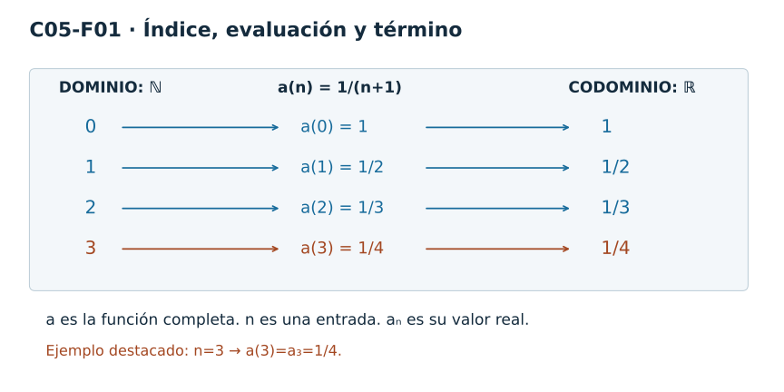
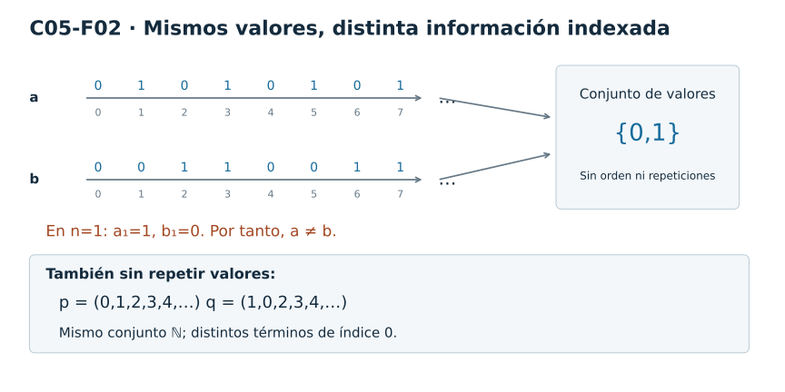
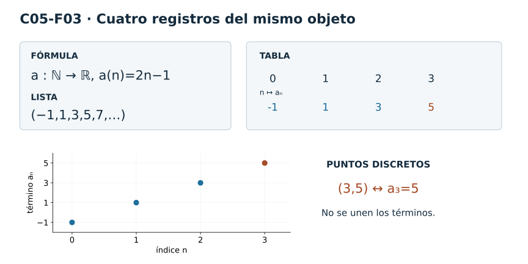
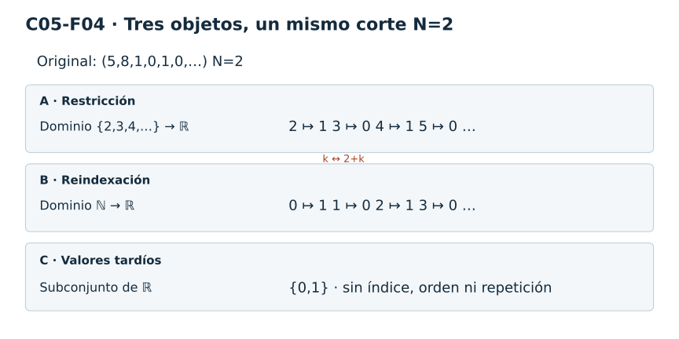
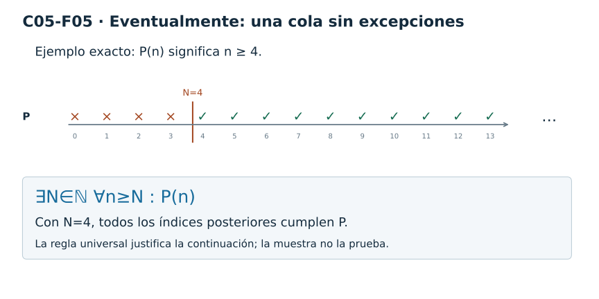
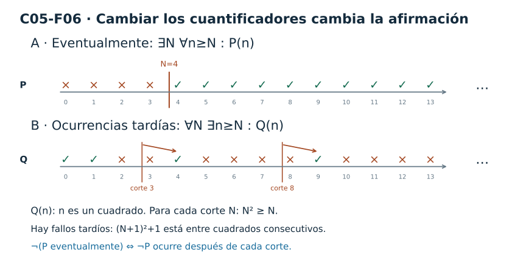
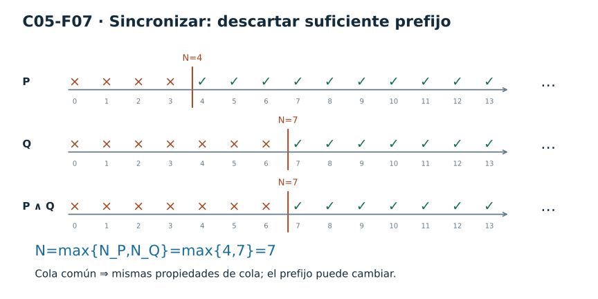
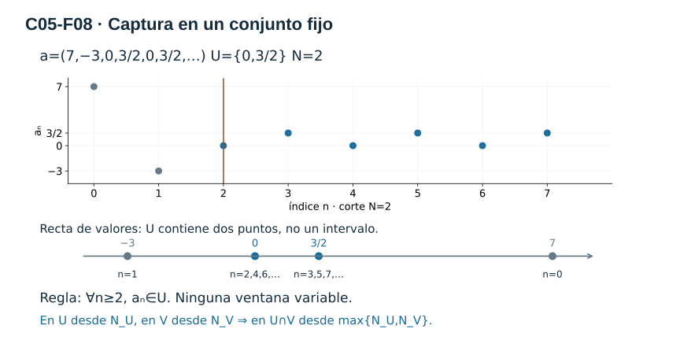

[Índice del libro](../para-matematicos/analisis-para-matematicos.html) · [Ejercicios de este capítulo](#ejercicios-5)

La escritura $2,-1,2,0,2,-1,\ldots$ guarda información que desaparece si reunimos sus valores en un conjunto. Cada aparición ocupa una posición: el segundo $2$ no sustituye al primero y el orden de las visitas permite distinguir listas que recorren los mismos números. Con este objeto comienza la Parte II, *El infinito bajo control*. La geometría local de C04 seguirá disponible, pero antes de estudiar cómo una sucesión se aproxima a un punto necesitamos precisar qué significa que una propiedad se cumpla desde cierto índice en adelante.

Usaremos la convención $\mathbb N=\{0,1,2,\ldots\}$. El primer término llevará índice $0$, y una lista $(a_0,a_1,a_2,\ldots)$ presentará los valores en ese orden. La definición mediante funciones permitirá trabajar con todos los índices, incluso cuando sólo podamos dibujar o escribir unos pocos.

## 5.1. Una sucesión es una función: índice y término

[]{#MA-SEC-ANM-01-005-001}

> **Sucesión real.** Una **sucesión real** es una función
>
> $$
> a:\mathbb N\to\mathbb R.
> $$
>
> Para cada $n\in\mathbb N$, escribimos
>
> $$
> a_n=a(n)
> $$
>
> y llamamos $a_n$ al **término de índice $n$** de la sucesión.

El dominio determina qué entradas están permitidas. Para $a_n=1/(n+1)$, por ejemplo, los primeros cinco términos son $1,1/2,1/3,1/4,1/5$, correspondientes a los índices $0,1,2,3,4$. La igualdad $a_3=a(3)=1/4$ relaciona una entrada natural con su salida real; el símbolo $a$ designa la función completa. Del mismo modo, si $a_n=3n-2$, el índice $4$ selecciona $a_4=10$.

{#fig-anm-c05-f01 fig-alt="Dominio natural, evaluación por 1/(n+1) y valores reales; índice 3 y valor 1/4 destacados."}

La expresión algebraica por sí sola no fija el objeto. Las funciones $f:\mathbb R\to\mathbb R$, $f(x)=x^2$, y $a:\mathbb N\to\mathbb R$, $a_n=n^2$, tienen dominios distintos. Para cada natural $n$ se cumple $a_n=f(n)$, pero $f(1/2)=1/4$ está definido y $a_{1/2}$ no lo está. Tampoco hay términos de índices $2.1$ o $2.7$ entre los de índices $2$ y $3$.

Los valores pueden repetirse. En $b_n=(-1)^n$, los índices pares producen $1$ y los impares producen $-1$; así, $b_0=b_2=b_4=1$ aunque los índices sean distintos. Una función exige una única salida para cada entrada, y permite que entradas diferentes compartan salida. La sucesión constante $a_n=2$ ofrece el caso más sencillo: todos sus términos coinciden.

También pueden coincidir numéricamente entrada y salida en una evaluación. Para $c_n=2n-3$ obtenemos $c_0=-3$, $c_1=-1$, $c_2=1$ y $c_3=3$. Como consideramos los naturales incluidos en los reales, el índice $3$ y el valor $c_3$ pueden designar el mismo número; lo que debemos distinguir son sus papeles en $c(3)$. Esa coincidencia no identifica un término con la función ni permite ampliar su dominio. Para $d_n=2n$, en cambio, $d_3=6$ hace visible la diferencia entre los dos valores.

La igualdad de sucesiones se decide sobre el dominio completo. Si $a,b:\mathbb N\to\mathbb R$, entonces

$$
a=b\iff\forall n\in\mathbb N:\ a_n=b_n.
$$

Las sucesiones $(0,1,0,1,\ldots)$ y $(1,0,1,0,\ldots)$ ya difieren en el índice $0$. Para descartar su igualdad basta una entrada; para probarla debemos cubrirlas todas. El orden $0<1<2<\cdots$ permite además hablar de posiciones anteriores y posteriores: decir que $a_5$ aparece después de $a_2$ significa que $2<5$, sin introducir tiempo físico. Ese orden del dominio será lo que nos permita cortar una sucesión y conservar su parte tardía.

### Antes de seguir

#### Microcontrol 1

[]{#MA-MIC-ANM-01-005-001}

Sea $a_n=3n-2$. Identifica el dominio, el codominio, el índice y el término cuando $n=4$.

[]{#MA-MSOL-ANM-01-005-001}

Ver solución del microcontrol 1

La sucesión es la función $a:\mathbb N\to\mathbb R$ dada por $a(n)=3n-2$. Su dominio es $\mathbb N=\{0,1,2,\ldots\}$ y su codominio es $\mathbb R$. Al fijar $n=4$, el índice es $4\in\mathbb N$ y el término correspondiente es $a_4=3\cdot4-2=10\in\mathbb R$. La función $a$, la entrada $4$ y el valor $10$ cumplen papeles distintos.

#### Microcontrol 2

[]{#MA-MIC-ANM-01-005-002}

Escribe los primeros cinco términos de $a_n=1/(n+1)$ usando la convención $\mathbb N=\{0,1,2,\ldots\}$.

[]{#MA-MSOL-ANM-01-005-002}

Ver solución del microcontrol 2

Los primeros cinco índices son $0,1,2,3,4$. Sustituyéndolos en la fórmula obtenemos $a_0=1$, $a_1=1/2$, $a_2=1/3$, $a_3=1/4$ y $a_4=1/5$. Por tanto, los primeros cinco términos, en su orden, son $(1,1/2,1/3,1/4,1/5)$. Comenzar en $n=1$ omitiría el primer término.

#### Microcontrol 3

[]{#MA-MIC-ANM-01-005-003}

Explica por qué las expresiones $f(x)=x^2$ con $f:\mathbb R\to\mathbb R$ y $a_n=n^2$ con $a:\mathbb N\to\mathbb R$ no definen el mismo objeto matemático.

[]{#MA-MSOL-ANM-01-005-003}

Ver solución del microcontrol 3

Los dominios son diferentes: $f$ admite cualquier entrada real, mientras que $a$ sólo admite índices naturales; ambas tienen codominio $\mathbb R$. Por ejemplo, $f(1/2)=1/4$ está definido, pero $a_{1/2}$ no está definido porque $1/2\notin\mathbb N$. Para cada $n\in\mathbb N$ sí se cumple $a_n=f(n)$: $a$ es la restricción de $f$ a $\mathbb N$. Esa coincidencia de valores en los naturales no hace iguales las dos funciones, pues el dominio forma parte del objeto.

#### Microcontrol 4

[]{#MA-MIC-ANM-01-005-004}

Decide si la frase «$a_3$ es el tercer índice de la sucesión» es correcta. Si no lo es, reescríbela con los tipos adecuados.

[]{#MA-MSOL-ANM-01-005-004}

Ver solución del microcontrol 4

La frase es incorrecta. La redacción adecuada es: «$a_3$ es el término de índice $3$ de la sucesión». El índice es $3\in\mathbb N$ y el término es $a_3=a(3)\in\mathbb R$. Con la indexación desde $0$, $3$ ocupa la cuarta posición entre los índices y $a_3$ es el cuarto término. Aunque en alguna sucesión se tenga $a_3=3$, esa igualdad numérica no identifica el papel de entrada con el de salida ni identifica un término con la función completa.

#### Microcontrol 5

[]{#MA-MIC-ANM-01-005-005}

Sean $a,b:\mathbb N\to\mathbb R$ tales que $a_n=b_n$ para todo $n\in\mathbb N$. Justifica, usando la definición de igualdad de funciones, por qué $a=b$.

[]{#MA-MSOL-ANM-01-005-005}

Ver solución del microcontrol 5

Las funciones $a$ y $b$ tienen el mismo dominio $\mathbb N$ y el mismo codominio $\mathbb R$. La hipótesis dice que, para cada entrada $n\in\mathbb N$, sus valores satisfacen $a(n)=a_n=b_n=b(n)$. Como la igualdad de funciones exige precisamente el mismo dominio, el mismo codominio y la misma asignación en cada entrada, se concluye que $a=b$.

#### Microcontrol 6

[]{#MA-MIC-ANM-01-005-006}

Construye una sucesión real en la que el mismo valor aparezca en infinitos índices distintos. Explica por qué esto no contradice que una sucesión sea una función.

[]{#MA-MSOL-ANM-01-005-006}

Ver solución del microcontrol 6

Definamos $a:\mathbb N\to\mathbb R$ por $a(n)=2$ para todo $n\in\mathbb N$. El valor $2$ aparece en todos los índices $0,1,2,\ldots$, que son infinitos y distintos. Cada índice recibe un único valor, como exige la definición de función; la definición permite que índices diferentes reciban el mismo valor.

#### Microcontrol 7

[]{#MA-MIC-ANM-01-005-007}

En una gráfica de puntos $(n,a_n)$ alguien une todos los puntos con una curva y afirma que esa curva «es la sucesión». Localiza el error.

[]{#MA-MSOL-ANM-01-005-007}

Ver solución del microcontrol 7

La gráfica de la sucesión es la colección discreta $\{(n,a_n):n\in\mathbb N\}$. Al unir los puntos se añaden puntos cuyas primeras coordenadas pueden no ser naturales; por ejemplo, no existe un término de índice $1/2$. La curva es una representación adicional escogida por quien dibuja y no la gráfica de la función $a:\mathbb N\to\mathbb R$. Los puntos originales permiten recuperar la sucesión: para cada índice natural $n$, la segunda coordenada del par $(n,a_n)$ determina su único valor.

#### Microcontrol 8

[]{#MA-MIC-ANM-01-005-008}

En la notación $\{a_n:n\in\mathbb N\}$ se ha olvidado parte de la información de la sucesión. Sin desarrollar todavía §5.2, indica qué clase de información sospechas que ya no puede recuperarse.

[]{#MA-MSOL-ANM-01-005-008}

Ver solución del microcontrol 8

El conjunto conserva qué valores aparecen, pero no registra qué valor corresponde a cada índice. Por ello se pierde el orden de aparición y la información sobre repeticiones: en qué índices se repite un valor y cuántas veces aparece. Esos datos pertenecen a la asignación $n\mapsto a_n$ y no quedan guardados al reunir los valores en un conjunto.

La definición ya está en su sitio. En §5.2 veremos por qué conservar solamente los valores no basta: una sucesión también recuerda **en qué orden** fueron visitados.

### Ejercicios de la sección 5.1

[]{#ejercicios-5}

#### Ejercicio 1. Entrada, salida y repetición

[]{#MA-EX-ANM-01-005-001}

Sea la sucesión real

$$
a:\mathbb N\to\mathbb R,
\qquad
a_n=(n-2)^2-1.
$$

a) Calcula $a_0$, $a_1$, $a_2$, $a_3$ y $a_5$.

b) Para cada una de las expresiones siguientes, indica qué tipo de objeto designa:

$$
a,
\qquad
5,
\qquad
a_5,
\qquad
a(5).
$$

No basta con dar su valor numérico: debes decir si se trata de la función completa, de un índice o de un término.

c) Observa que dos índices distintos producen el mismo valor. Encuentra esos dos índices entre $0,1,2,3$ y escribe las dos igualdades correspondientes.

d) Explica por qué esa repetición no contradice que $a$ sea una función.

[]{#MA-SOL-ANM-01-005-001}

Ver solución del ejercicio 1

La sucesión está dada por

$$
a_n=(n-2)^2-1.
$$

Sustituyendo cada índice obtenemos

$$
a_0=4-1=3,
$$

$$
a_1=1-1=0,
$$

$$
a_2=0-1=-1,
$$

$$
a_3=1-1=0,
$$

y

$$
a_5=9-1=8.
$$

Ahora separamos los tipos:

- $a$ es la función completa $a:\mathbb N\to\mathbb R$;
- $5$ es un índice, es decir, un elemento de $\mathbb N$;
- $a_5$ es el término real seleccionado por el índice $5$;
- $a(5)$ es otra notación para ese mismo término.

Por tanto,

$$
a_5=a(5)=8,
$$

pero el índice sigue siendo $5$ y el término sigue siendo $8$.

Además,

$$
a_1=0=a_3,
$$

aunque

$$
1\ne3.
$$

Esto no contradice la definición de función. Una función exige que cada entrada tenga una única salida; no exige que entradas distintas tengan salidas distintas. Aquí el índice $1$ tiene una sola imagen, $0$, y el índice $3$ también tiene una sola imagen, $0$.

#### Ejercicio 2. La misma regla no determina la misma función

[]{#MA-EX-ANM-01-005-002}

Considera

$$
f:\mathbb R\to\mathbb R,
\qquad
f(x)=2x+1,
$$

$$
a:\mathbb N\to\mathbb R,
\qquad
a_n=2n+1,
$$

y

$$
c:\mathbb Z\to\mathbb R,
\qquad
c(k)=2k+1.
$$

a) Calcula $f(3)$, $a_3$ y $c(3)$.

b) ¿Son iguales como funciones $f$, $a$ y $c$? Justifica tu respuesta usando el dominio como parte del objeto matemático.

c) Decide cuáles de las expresiones siguientes están definidas y, cuando lo estén, calcula su valor:

$$
a_{-1},
\qquad
c(-1),
\qquad
f\!\left(\frac12\right),
\qquad
a_{1/2}.
$$

d) Formula con precisión la relación que sí existe entre $f$ y $a$: ¿qué ocurre cuando ambos se evalúan en un mismo $n\in\mathbb N$?

[]{#MA-SOL-ANM-01-005-002}

Ver solución del ejercicio 2

En el índice o argumento $3$ las tres reglas producen el mismo valor:

$$
f(3)=2\cdot3+1=7,
$$

$$
a_3=2\cdot3+1=7,
$$

y

$$
c(3)=2\cdot3+1=7.
$$

Sin embargo, $f$, $a$ y $c$ no son iguales como funciones. Sus dominios son distintos:

$$
\operatorname{Dom}(f)=\mathbb R,
\qquad
\operatorname{Dom}(a)=\mathbb N,
\qquad
\operatorname{Dom}(c)=\mathbb Z.
$$

La fórmula algebraica no determina por sí sola el objeto función; el dominio forma parte de él.

Revisemos ahora las cuatro expresiones propuestas.

Como $-1\notin\mathbb N$, la expresión

$$
a_{-1}
$$

no está definida para la sucesión $a$.

En cambio, $-1\in\mathbb Z$, de modo que

$$
c(-1)=2(-1)+1=-1.
$$

Como $1/2\in\mathbb R$,

$$
f\!\left(\frac12\right)=2\cdot\frac12+1=2.
$$

Pero $1/2\notin\mathbb N$, así que

$$
a_{1/2}
$$

no está definido.

La relación correcta entre $f$ y $a$ es ésta: para todo $n\in\mathbb N$, ambos objetos pueden evaluarse en $n$ y dan el mismo valor,

$$
a_n=f(n)=2n+1.
$$

Eso no convierte a $a$ y $f$ en la misma función, porque sus dominios siguen siendo distintos.

#### Ejercicio 3. Tres registros para una misma sucesión

[]{#MA-EX-ANM-01-005-003}

Sea $b:\mathbb N\to\mathbb R$ definida por

$$
b_n=
\begin{cases}
4, & \text{si }n\equiv0\pmod 3,\\
-1, & \text{si }n\equiv1\pmod 3,\\
0, & \text{si }n\equiv2\pmod 3.
\end{cases}
$$

a) Construye una tabla con dos columnas, $n$ y $b_n$, para $0\le n\le8$.

b) Escribe esos nueve términos como una lista ordenada

$$
(b_0,b_1,\ldots,b_8).
$$

c) Escribe explícitamente las nueve asignaciones

$$
n\longmapsto b_n
$$

para $0\le n\le8$.

d) Señala qué información permanece visible en las tres representaciones y explica por qué la aparición repetida de $4$, $-1$ y $0$ es compatible con la definición de función.

[]{#MA-SOL-ANM-01-005-003}

Ver solución del ejercicio 3

La definición depende del resto de $n$ al dividir por $3$. Para $0\le n\le8$ obtenemos:

| $n$ | $b_n$ |
|---:|---:|
| $0$ | $4$ |
| $1$ | $-1$ |
| $2$ | $0$ |
| $3$ | $4$ |
| $4$ | $-1$ |
| $5$ | $0$ |
| $6$ | $4$ |
| $7$ | $-1$ |
| $8$ | $0$ |

La lista ordenada correspondiente es

$$
(4,-1,0,4,-1,0,4,-1,0).
$$

Las mismas nueve evaluaciones pueden escribirse como

$$
\begin{aligned}
0&\longmapsto4,\\
1&\longmapsto-1,\\
2&\longmapsto0,\\
3&\longmapsto4,\\
4&\longmapsto-1,\\
5&\longmapsto0,\\
6&\longmapsto4,\\
7&\longmapsto-1,\\
8&\longmapsto0.
\end{aligned}
$$

La tabla muestra directamente qué índice corresponde a cada término. La lista conserva esa correspondencia porque sus posiciones están ordenadas como $0,1,2,\ldots$. Las asignaciones $n\mapsto b_n$ hacen explícita la evaluación de la función.

En los tres registros se conserva la asociación entre posición y valor. La repetición de $4$, $-1$ y $0$ no crea ambigüedad: cada índice sigue teniendo exactamente una salida. Por ejemplo,

$$
b_0=b_3=b_6=4,
$$

pero cada uno de los índices $0$, $3$ y $6$ tiene una imagen única.

#### Ejercicio 4. Una fórmula, tres errores de tipo

[]{#MA-EX-ANM-01-005-004}

Sea

$$
c:\mathbb N\to\mathbb R,
\qquad
c_n=2n-3.
$$

Un estudiante escribe:

> Como $c_3=3$, el índice $3$ y el término $c_3$ son el mismo objeto. Además, la función $g:\mathbb R\to\mathbb R$ dada por $g(x)=2x-3$ es igual a $c$, porque ambas usan la misma fórmula. Por tanto $c$ también tiene un término de índice $3.5$, y ese término vale $4$.

Analiza el argumento completo.

a) Localiza tres errores distintos.

b) Para cada error, identifica qué distinción de tipos o de dominios se ha perdido.

c) Reescribe el razonamiento de forma correcta, conservando todas las afirmaciones verdaderas que puedan rescatarse.

d) Indica qué habría que comprobar para poder afirmar que dos sucesiones $u,v:\mathbb N\to\mathbb R$ son iguales.

[]{#MA-SOL-ANM-01-005-004}

Ver solución del ejercicio 4

El argumento mezcla tres cuestiones diferentes: igualdad numérica, igualdad de objetos y pertenencia al dominio.

La igualdad $c_3=3$ es verdadera como igualdad numérica. Puesto que los naturales se consideran incluidos en los reales, ambas expresiones pueden designar el mismo número. La dificultad aparece cuando se intercambian sus papeles: $3$ es la entrada en la evaluación $c(3)$, mientras que $c_3=c(3)$ es su salida. Esa coincidencia en una evaluación no convierte el índice en la función completa ni permite confundir dominio y codominio.

El segundo error consiste en afirmar que $g$ y $c$ son la misma función porque comparten la expresión $2x-3$. No lo son, pues

$$
g:\mathbb R\to\mathbb R
$$

y

$$
c:\mathbb N\to\mathbb R
$$

tienen dominios distintos. Lo que sí es correcto es que para cada $n\in\mathbb N$,

$$
g(n)=2n-3=c_n.
$$

El tercer error es introducir un supuesto término $c_{3.5}$. Como

$$
3.5\notin\mathbb N,
$$

$3.5$ no es un índice permitido de $c$. La expresión $g(3.5)$ sí está definida y vale

$$
g(3.5)=2(3.5)-3=4,
$$

pero ese valor pertenece a una evaluación de $g$ y no a un término de $c$ con índice $3.5$.

Una versión corregida del razonamiento es:

$$
c_3=3,
$$

de modo que el índice $3$ y el término correspondiente tienen el mismo valor numérico, aunque desempeñan papeles distintos. La función $g$ y la sucesión $c$ obedecen a la misma regla algebraica en los índices naturales, pero no son la misma función porque sus dominios difieren. Por eso $g(3.5)=4$ está definido, mientras que $c_{3.5}$ no lo está.

Finalmente, si

$$
u,v:\mathbb N\to\mathbb R,
$$

entonces para afirmar que son la misma sucesión debemos comprobar igualdad índice por índice:

$$
\boxed{
\forall n\in\mathbb N,
\quad
u_n=v_n.
}
$$

## 5.2. El orden de las visitas importa

[]{#MA-SEC-ANM-01-005-002}

De una sucesión podemos extraer su imagen, el **conjunto de valores** $a(\mathbb N)=\{a_n:n\in\mathbb N\}\subseteq\mathbb R$. Para pertenecer a él basta aparecer en algún índice. El conjunto guarda cuáles números aparecen y descarta la asignación de cada índice a su término.

Consideremos $a=(0,1,0,1,\ldots)$ y $b=(0,0,1,1,0,0,1,1,\ldots)$. Ambas toman exactamente los valores $0$ y $1$, pero $a_1=1$ y $b_1=0$. Si conservamos sólo $\{0,1\}$ no podremos reconstruir cuál de las dos sucesiones lo produjo. La pérdida afecta también a las repeticiones: en $c=(0,1,1,1,\ldots)$, el cero aparece sólo en el índice $0$, mientras que en $d=(0,1,0,1,\ldots)$ aparece en $0,2,4,\ldots$; sus imágenes siguen siendo iguales.

{#fig-anm-c05-f02 fig-alt="Dos sucesiones de ceros y unos con distinto orden y mismo conjunto; intercambio no periódico de 0 y 1."}

Ni siquiera hace falta que haya valores repetidos. La sucesión $p_n=n$ y la definida por $q_0=1$, $q_1=0$, $q_n=n$ para $n\ge2$, visitan cada natural una sola vez y tienen imagen $\mathbb N$, considerada dentro de $\mathbb R$. Sin embargo, $p_0=0\ne1=q_0$. También podemos construir dos sucesiones con imagen $\{0,1,2\}$ intercambiando las primeras entradas de $(0,1,2,2,2,\ldots)$: obtenemos $(1,0,2,2,2,\ldots)$, que difiere ya en el índice $0$.

En general, la igualdad de sucesiones implica igualdad de imágenes. Si $x=a_m$ para algún $m$ y $a=b$, entonces $x=b_m$; esto prueba una inclusión entre imágenes, y el mismo argumento con los papeles intercambiados prueba la otra. Los ejemplos anteriores muestran que la implicación inversa falla: compartir todos los valores no fuerza a compartir sus índices.

Una biyección $\sigma:\mathbb N\to\mathbb N$ permite reorganizar las visitas mediante $b_n=a_{\sigma(n)}$. Las imágenes siguen coincidiendo. Todo valor $b_n$ es un valor de $a$; recíprocamente, si $x=a_m$, la sobreyectividad de $\sigma$ proporciona un índice $n$ con $\sigma(n)=m$, y entonces $x=b_n$. No hemos probado $a_n=b_n$, pues el índice encontrado puede ser otro. Para que las funciones fueran iguales necesitaríamos $a_n=a_{\sigma(n)}$ en cada mismo índice.

Así, una lista ordenada conserva información que un conjunto elimina. Si la regla de continuación está determinada, su posición $n+1$ permite recuperar $a_n$ porque empezamos en $0$. Unos pocos términos seguidos de puntos suspensivos, sin una regla que determine los restantes, no bastan para especificar una sucesión completa.

### Antes de seguir

#### Microcontrol 9

[]{#MA-MIC-ANM-01-005-009}

Para $a_n=(-1)^n$, determina el conjunto de valores y explica qué información de la sucesión no queda registrada en ese conjunto.

[]{#MA-MSOL-ANM-01-005-009}

Ver solución del microcontrol 9

Si $n=2k$ con $k\in\mathbb N$, entonces $a_n=1$; si $n=2k+1$, entonces $a_n=-1$. Ambos valores aparecen, por ejemplo en $n=0$ y $n=1$, y no aparece ningún otro. Por tanto, el conjunto de valores es $\{-1,1\}\subseteq\mathbb R$. Ese conjunto no registra que $1$ corresponde a los índices pares y $-1$ a los impares, ni el orden de las visitas ni sus repeticiones.

#### Microcontrol 10

[]{#MA-MIC-ANM-01-005-010}

Sean $a=(0,1,0,1,\ldots)$ y $b=(0,0,1,1,0,0,1,1,\ldots)$. Demuestra que tienen el mismo conjunto de valores pero que $a\ne b$.

[]{#MA-MSOL-ANM-01-005-010}

Ver solución del microcontrol 10

Cada una de las dos sucesiones toma sólo los valores $0$ y $1$, y ambas toman los dos: en $a$ aparecen en los índices $0$ y $1$, y en $b$ en los índices $0$ y $2$. Sus conjuntos de valores son, por tanto, $\{0,1\}$. Sin embargo, $a_1=1$ y $b_1=0$; la diferencia en esa entrada impide la igualdad de las funciones $a,b:\mathbb N\to\mathbb R$.

#### Microcontrol 11

[]{#MA-MIC-ANM-01-005-011}

Construye dos sucesiones distintas con conjunto de valores $\{0,1,2\}$ y con órdenes de aparición diferentes.

[]{#MA-MSOL-ANM-01-005-011}

Ver solución del microcontrol 11

Definamos $a,b:\mathbb N\to\mathbb R$ mediante $a_0=0$, $a_1=1$, $a_n=2$ para $n\ge2$, y $b_0=1$, $b_1=0$, $b_n=2$ para $n\ge2$. Así, $a=(0,1,2,2,2,\ldots)$ y $b=(1,0,2,2,2,\ldots)$. En ambas aparecen los tres valores $0,1,2$ y ningún otro. El orden de aparición de $0$ y $1$ está intercambiado, y $a_0=0\ne1=b_0$ prueba que son distintas.

#### Microcontrol 12

[]{#MA-MIC-ANM-01-005-012}

Construye dos sucesiones con el mismo conjunto de valores en las que el valor $0$ tenga patrones de repetición distintos. Describe la diferencia usando índices concretos.

[]{#MA-MSOL-ANM-01-005-012}

Ver solución del microcontrol 12

Tomemos $a_0=0$ y $a_n=1$ para $n\ge1$. Definamos $b_{2k}=0$ y $b_{2k+1}=1$ para cada $k\in\mathbb N$. Ambas son funciones $\mathbb N\to\mathbb R$ con conjunto de valores $\{0,1\}$. En $a$, el valor $0$ aparece sólo en el índice $0$; en $b$, aparece en los índices $0,2,4,6,\ldots$. Por ejemplo, $a_2=a_4=1$, mientras que $b_2=b_4=0$. El conjunto de valores no distingue esos patrones.

#### Microcontrol 13

[]{#MA-MIC-ANM-01-005-013}

Demuestra que si $a=b$ como sucesiones, entonces $\{a_n:n\in\mathbb N\}=\{b_n:n\in\mathbb N\}$. Explica por qué el recíproco falla.

[]{#MA-MSOL-ANM-01-005-013}

Ver solución del microcontrol 13

Sea $x\in\{a_n:n\in\mathbb N\}$. Existe un índice $m\in\mathbb N$ con $x=a_m$. Como $a=b$, se tiene $a_m=b_m$, de modo que $x$ pertenece también al conjunto de valores de $b$. Esto prueba una inclusión; intercambiando $a$ y $b$ obtenemos la otra y, por tanto, la igualdad de conjuntos. El recíproco falla: las sucesiones $(0,1,0,1,\ldots)$ y $(0,0,1,1,0,0,1,1,\ldots)$ tienen conjunto de valores $\{0,1\}$, pero sus términos de índice $1$ son diferentes.

#### Microcontrol 14

[]{#MA-MIC-ANM-01-005-014}

Sea $p_n=n$ y define $q=(1,0,2,3,4,\ldots)$. Verifica que $p$ y $q$ tienen el mismo conjunto de valores y localiza un índice que pruebe que son distintas.

[]{#MA-MSOL-ANM-01-005-014}

Ver solución del microcontrol 14

El conjunto de valores de $p$ es $\mathbb N$, considerado como subconjunto de $\mathbb R$: cada natural $k$ aparece como $p_k=k$. Para $q$, tenemos $q_0=1$, $q_1=0$ y $q_n=n$ para $n\ge2$. Todos sus valores son naturales; además, $0$ aparece en el índice $1$, $1$ en el índice $0$ y cada $k\ge2$ en el índice $k$. Por tanto, su conjunto de valores también es $\mathbb N$. Las sucesiones son distintas porque $p_0=0\ne1=q_0$.

#### Microcontrol 15

[]{#MA-MIC-ANM-01-005-015}

Si $\sigma:\mathbb N\to\mathbb N$ es biyectiva y $b_n=a_{\sigma(n)}$, demuestra directamente que $a$ y $b$ tienen el mismo conjunto de valores. ¿Por qué eso no prueba que $a=b$?

[]{#MA-MSOL-ANM-01-005-015}

Ver solución del microcontrol 15

Si $x$ es un valor de $b$, existe $n\in\mathbb N$ tal que $x=b_n=a_{\sigma(n)}$. Como $\sigma(n)\in\mathbb N$, $x$ es un valor de $a$. Recíprocamente, si $x=a_m$ para algún $m\in\mathbb N$, la sobreyectividad de $\sigma$ proporciona un $n\in\mathbb N$ con $\sigma(n)=m$; entonces $x=a_m=b_n$. Las dos inclusiones prueban la igualdad de conjuntos de valores. Esta prueba permite que el índice $n$ de $b$ sea distinto del índice $m$ de $a$, mientras que $a=b$ exigiría $a_n=a_{\sigma(n)}$ para cada mismo índice $n$. Por ejemplo, con $a_n=n$ y la biyección que intercambia $0$ y $1$ y deja fijos los demás índices, resulta $a_0=0$ y $b_0=1$.

#### Microcontrol 16

[]{#MA-MIC-ANM-01-005-016}

Explica con tus propias palabras qué información conserva la lista ordenada $(a_0,a_1,a_2,\ldots)$ que desaparece al pasar al conjunto $\{a_n:n\in\mathbb N\}$.

[]{#MA-MSOL-ANM-01-005-016}

Ver solución del microcontrol 16

La lista ordenada permite recuperar el valor asignado a cada índice: la primera entrada es $a_0$, la segunda es $a_1$, y así sucesivamente. Conserva en qué posiciones aparece cada valor, el orden de las visitas y las repeticiones. El conjunto $\{a_n:n\in\mathbb N\}$ guarda únicamente qué valores aparecen al menos una vez; no indica sus posiciones ni cuántas veces se repiten.

Ya sabemos qué se pierde cuando borramos los índices. En §5.3 haremos lo contrario: compararemos varias representaciones de una sucesión y exigiremos que cada una conserve, de una forma u otra, la información indexada que ahora sabemos que es esencial.

### Ejercicios de la sección 5.2

#### Ejercicio 5. Los valores y los índices que los visitan

[]{#MA-EX-ANM-01-005-005}

Sea la sucesión $a:\mathbb N\to\mathbb R$ definida por

$$
a_n=
\begin{cases}
0, & \text{si }n\equiv0\pmod 4,\\
2, & \text{si }n\equiv1\text{ o }2\pmod 4,\\
-1, & \text{si }n\equiv3\pmod 4.
\end{cases}
$$

Para cada $x\in\mathbb R$, define el conjunto de índices de aparición de $x$ por

$$
I_a(x)=\{n\in\mathbb N:a_n=x\}.
$$

a) Determina el conjunto de valores $a(\mathbb N)$.

b) Describe exactamente $I_a(0)$, $I_a(2)$ e $I_a(-1)$.

c) Indica el tipo matemático de cada objeto:

$$
a,
\qquad
a(\mathbb N),
\qquad
I_a(2),
\qquad
a_6.
$$

d) Explica qué información conservan los conjuntos $I_a(x)$ que desaparece si sólo conocemos $a(\mathbb N)$.

[]{#MA-SOL-ANM-01-005-005}

Ver solución del ejercicio 5

La definición depende del resto de $n$ módulo $4$.

Los valores posibles son únicamente $0$, $2$ y $-1$, y cada uno aparece: $a_0=0$, $a_1=2$ y $a_3=-1$. Por tanto,

$$
\boxed{a(\mathbb N)=\{-1,0,2\}.}
$$

Los índices que producen $0$ son exactamente los múltiplos de $4$:

$$
\boxed{I_a(0)=\{4k:k\in\mathbb N\}.}
$$

El valor $2$ aparece en los índices congruentes con $1$ o $2$ módulo $4$:

$$
\boxed{
I_a(2)
=
\{4k+1:k\in\mathbb N\}
\cup
\{4k+2:k\in\mathbb N\}.
}
$$

Finalmente,

$$
\boxed{I_a(-1)=\{4k+3:k\in\mathbb N\}.}
$$

Los tipos son distintos:

- $a$ es la función completa $\mathbb N\to\mathbb R$;
- $a(\mathbb N)$ es un subconjunto de $\mathbb R$;
- $I_a(2)$ es un subconjunto de $\mathbb N$;
- $a_6$ es un número real, y como $6\equiv2\pmod4$, vale $2$.

El conjunto de valores sólo dice **qué** números aparecen. Los conjuntos $I_a(x)$ dicen además **dónde** aparecen. Por ejemplo, de $a(\mathbb N)=\{-1,0,2\}$ no puede recuperarse que $0$ aparezca exactamente en los múltiplos de $4$ ni que $2$ ocupe dos clases de congruencia distintas.

#### Ejercicio 6. Recuperar la sucesión a partir de sus índices de aparición

[]{#MA-EX-ANM-01-005-006}

Sean $a,b:\mathbb N\to\mathbb R$. Para cada $x\in\mathbb R$, define

$$
I_a(x)=\{n\in\mathbb N:a_n=x\},
\qquad
I_b(x)=\{n\in\mathbb N:b_n=x\}.
$$

Demuestra la equivalencia

$$
\boxed{
a=b
\iff
\forall x\in\mathbb R,\ I_a(x)=I_b(x).
}
$$

Después demuestra que

$$
a(\mathbb N)
=
\{x\in\mathbb R:I_a(x)\ne\varnothing\}.
$$

Concluye explicando por qué conocer todos los conjuntos $I_a(x)$ contiene estrictamente más información que conocer sólo el conjunto de valores $a(\mathbb N)$.

[]{#MA-SOL-ANM-01-005-006}

Ver solución del ejercicio 6

Supongamos primero que

$$
a=b.
$$

Entonces, para todo $n\in\mathbb N$,

$$
a_n=b_n.
$$

Fijemos $x\in\mathbb R$. Para cualquier $n\in\mathbb N$,

$$
n\in I_a(x)
\iff
a_n=x
\iff b_n=x
\iff n\in I_b(x).
$$

Por extensionalidad,

$$
I_a(x)=I_b(x).
$$

Como $x$ era arbitrario,

$$
\forall x\in\mathbb R,\ I_a(x)=I_b(x).
$$

Probemos la conversa. Supongamos ahora que

$$
\forall x\in\mathbb R,\ I_a(x)=I_b(x).
$$

Fijemos un índice arbitrario $n\in\mathbb N$ y pongamos

$$
x=a_n.
$$

Entonces $n\in I_a(x)$. Por la igualdad de conjuntos de índices,

$$
n\in I_b(x),
$$

y, por definición de $I_b(x)$,

$$
b_n=x=a_n.
$$

Como esto vale para todo $n\in\mathbb N$,

$$
a=b.
$$

Hemos demostrado

$$
\boxed{
a=b
\iff
\forall x\in\mathbb R,\ I_a(x)=I_b(x).
}
$$

Para la segunda identidad, un real $x$ pertenece al conjunto de valores si y sólo si aparece en al menos un índice:

$$
\begin{aligned}
x\in a(\mathbb N)
&\iff \exists n\in\mathbb N:\ a_n=x\\
&\iff I_a(x)\ne\varnothing.
\end{aligned}
$$

Por tanto,

$$
\boxed{
a(\mathbb N)
=
\{x\in\mathbb R:I_a(x)\ne\varnothing\}.
}
$$

El conjunto de valores conserva solamente cuáles conjuntos $I_a(x)$ son vacíos o no vacíos. Conocer cada $I_a(x)$ conserva además todos los índices en los que aparece cada valor, y esa información basta incluso para reconstruir la sucesión completa.

#### Ejercicio 7. Dos existencias no alinean los índices

[]{#MA-EX-ANM-01-005-007}

Un estudiante escribe:

> Si dos sucesiones $a,b:\mathbb N\to\mathbb R$ tienen el mismo conjunto de valores, entonces cada término $a_n$ aparece en algún lugar de $b$ y cada término $b_m$ aparece en algún lugar de $a$. Por tanto, para todo $n$ se tiene $a_n=b_n$, y las sucesiones son iguales.

Audita el argumento.

a) Traduce la igualdad de conjuntos de valores en dos afirmaciones cuantificadas que expresen «cada término aparece en algún lugar de la otra sucesión».

b) Escribe la afirmación cuantificada que sería necesaria para concluir $a=b$.

c) Localiza el paso ilegítimo: explica por qué un índice $m$ cuya existencia depende de $n$ no puede reemplazarse sin más por ese mismo $n$.

d) Usa

$$
a=(0,1,0,1,\ldots),
\qquad
b=(1,0,1,0,\ldots)
$$

para mostrar concretamente que las dos afirmaciones existenciales pueden ser verdaderas mientras $a\ne b$.

e) Reescribe la conclusión correcta del argumento del estudiante.

[]{#MA-SOL-ANM-01-005-007}

Ver solución del ejercicio 7

La igualdad de conjuntos de valores

$$
a(\mathbb N)=b(\mathbb N)
$$

implica dos afirmaciones correctas:

$$
\forall n\in\mathbb N\ \exists m\in\mathbb N:
\ a_n=b_m,
$$

y

$$
\forall m\in\mathbb N\ \exists n\in\mathbb N:
\ b_m=a_n.
$$

Estas fórmulas dicen que cada valor visitado por una sucesión aparece **en algún índice** de la otra.

Para concluir igualdad de sucesiones necesitaríamos algo distinto:

$$
\boxed{
\forall n\in\mathbb N:\ a_n=b_n.
}
$$

El error consiste en sustituir

$$
\forall n\ \exists m
$$

por una afirmación en la que el testigo $m$ queda forzado a ser el mismo índice $n$. La existencia de algún $m$ no garantiza $m=n$; además, el índice testigo puede depender del valor de $n$.

En el ejemplo

$$
a=(0,1,0,1,\ldots),
\qquad
b=(1,0,1,0,\ldots),
$$

ambas sucesiones tienen conjunto de valores $\{0,1\}$. En $b$, el valor $0$ aparece en los índices impares y el valor $1$ en los pares. Para todo $n$, el testigo $m=n+1$ cumple $b_m=a_n$; en la dirección recíproca, el mismo desplazamiento cumple $a_{n+1}=b_n$. Por tanto, ambas afirmaciones existenciales son verdaderas, aunque la coincidencia nunca se dé en el mismo índice.

Sin embargo, en el índice $0$,

$$
a_0=0
\qquad\text{y}\qquad
b_0=1,
$$

de modo que

$$
a\ne b.
$$

La conclusión correcta es únicamente:

> si dos sucesiones tienen el mismo conjunto de valores, cada valor tomado por una de ellas es tomado también por la otra, quizá en índices distintos.

No puede recuperarse la igualdad índice por índice a partir de esa información.

#### Ejercicio 8. Ningún prefijo finito fija el orden completo

[]{#MA-EX-ANM-01-005-008}

Sea $M\in\mathbb N$ arbitrario.

Construye dos sucesiones $a,b:\mathbb N\to\mathbb R$ que satisfagan simultáneamente:

1. $a_n=b_n$ para todo $0\le n\le M$;
2. $a(\mathbb N)=b(\mathbb N)=\mathbb N$;
3. cada valor natural aparece exactamente una vez en cada sucesión;
4. $a\ne b$.

Tu construcción debe funcionar para **todo** $M$.

Después identifica un índice concreto que demuestre $a\ne b$ y explica qué refuta el ejemplo acerca de la posibilidad de reconstruir una sucesión conociendo su conjunto de valores y una cantidad finita, aunque arbitrariamente grande, de términos iniciales.

[]{#MA-SOL-ANM-01-005-008}

Ver solución del ejercicio 8

Fijemos $M\in\mathbb N$. Definimos

$$
a_n=n
$$

para todo $n\in\mathbb N$ y construimos $b$ intercambiando únicamente los valores situados en los índices $M+1$ y $M+2$:

$$
b_n=
\begin{cases}
M+2, & n=M+1,\\
M+1, & n=M+2,\\
n, & \text{en cualquier otro caso}.
\end{cases}
$$

Para todo $0\le n\le M$ no se ha modificado nada, así que

$$
a_n=b_n.
$$

La sucesión $a$ visita cada número natural exactamente una vez. La sucesión $b$ hace lo mismo: sólo hemos permutado las posiciones de $M+1$ y $M+2$. Por tanto,

$$
a(\mathbb N)=b(\mathbb N)=\mathbb N,
$$

y cada valor aparece exactamente una vez en ambas.

Pero en el índice $M+1$ tenemos

$$
a_{M+1}=M+1
$$

mientras que

$$
b_{M+1}=M+2.
$$

Luego

$$
\boxed{a\ne b.}
$$

Como $M$ era arbitrario, el acuerdo puede hacerse tan largo como queramos sin forzar igualdad global. Incluso conocer el conjunto completo de valores y cualquier cantidad finita prefijada de términos iniciales deja abierta la posibilidad de reorganizar valores en índices posteriores.

El ejemplo separa dos clases de información: el conjunto de valores registra qué números aparecen; la sucesión registra además en qué índice aparece cada uno.

#### Ejercicio 9. El mismo conjunto de valores, muchos ritmos de repetición

[]{#MA-EX-ANM-01-005-009}

Para cada entero $r\ge1$, define una sucesión $b^{(r)}:\mathbb N\to\mathbb R$ por bloques. Para $q\in\mathbb N$ y $j\in\{0,1,\ldots,r-1\}$, fija

$$
b^{(r)}_{3rq+j}=0,
$$

$$
b^{(r)}_{3rq+r+j}=1,
$$

y

$$
b^{(r)}_{3rq+2r+j}=2.
$$

Así, cada ciclo contiene $r$ ceros, luego $r$ unos y luego $r$ doses.

a) Escribe los primeros doce términos de $b^{(1)}$, $b^{(2)}$ y $b^{(3)}$.

b) Demuestra que, para todo $r\ge1$,

$$
b^{(r)}(\mathbb N)=\{0,1,2\}.
$$

c) Demuestra que si $1\le r<s$, entonces

$$
b^{(r)}_r=1
\qquad\text{y}\qquad
b^{(s)}_r=0.
$$

Concluye que las sucesiones $b^{(r)}$ son dos a dos distintas.

d) Describe el conjunto de índices en los que $b^{(r)}$ toma el valor $0$.

e) Explica qué aspecto de la sucesión cambia con $r$ y por qué ese cambio es completamente invisible en el conjunto de valores $\{0,1,2\}$.

[]{#MA-SOL-ANM-01-005-009}

Ver solución del ejercicio 9

Para $r=1$ obtenemos ciclos de longitud $3$:

$$
b^{(1)}=(0,1,2,0,1,2,0,1,2,0,1,2,\ldots).
$$

Para $r=2$ los valores aparecen en bloques de longitud $2$:

$$
b^{(2)}=(0,0,1,1,2,2,0,0,1,1,2,2,\ldots).
$$

Para $r=3$ aparecen en bloques de longitud $3$:

$$
b^{(3)}=(0,0,0,1,1,1,2,2,2,0,0,0,\ldots).
$$

Fijemos ahora $r\ge1$. Por definición, todos los términos de $b^{(r)}$ pertenecen a $\{0,1,2\}$. Además, tomando $q=0$ y $j=0$ obtenemos

$$
b^{(r)}_0=0,
\qquad
b^{(r)}_r=1,
\qquad
b^{(r)}_{2r}=2.
$$

Por tanto los tres valores aparecen y no aparece ningún otro:

$$
\boxed{b^{(r)}(\mathbb N)=\{0,1,2\}.}
$$

Sean ahora $1\le r<s$. En la sucesión $b^{(r)}$, el primer bloque de ceros ocupa los índices

$$
0,1,\ldots,r-1,
$$

de modo que el índice $r$ ya pertenece al primer bloque de unos. Así,

$$
b^{(r)}_r=1.
$$

En cambio, para $b^{(s)}$ el primer bloque de ceros ocupa

$$
0,1,\ldots,s-1.
$$

Como $r<s$,

$$
b^{(s)}_r=0.
$$

Luego

$$
b^{(r)}_r\ne b^{(s)}_r,
$$

y por tanto

$$
\boxed{b^{(r)}\ne b^{(s)}}
$$

siempre que $r\ne s$.

Los índices en los que aparece $0$ forman, para cada ciclo $q$, el bloque

$$
\{3rq,3rq+1,\ldots,3rq+r-1\}.
$$

Por tanto,

$$
\boxed{
I_{b^{(r)}}(0)
=
\bigcup_{q\in\mathbb N}
\{3rq+j:0\le j\le r-1\}.
}
$$

Al variar $r$ cambia la longitud de los bloques y, con ella, el patrón de repetición y el orden local de las visitas. El conjunto de valores no registra ninguna de esas diferencias: para todos los parámetros colapsa al mismo conjunto $\{0,1,2\}$.

La familia muestra de forma paramétrica que conservar los valores visitados no equivale a conservar la organización indexada de esas visitas.

## 5.3. Ver una sucesión sin perder el índice

[]{#MA-SEC-ANM-01-005-003}

La sucesión $a_n=2n-1$ puede describirse mediante una fórmula, una lista, una tabla o sus puntos en el plano. Estas representaciones deben conservar la misma asociación $n\mapsto a_n$:

| $n$ | $a_n$ | Punto $(n,a_n)$ |
|---:|---:|---|
| $0$ | $-1$ | $(0,-1)$ |
| $1$ | $1$ | $(1,1)$ |
| $2$ | $3$ | $(2,3)$ |
| $3$ | $5$ | $(3,5)$ |
| $4$ | $7$ | $(4,7)$ |

La lista comienza $(-1,1,3,5,7,\ldots)$, y la afirmación $a_3=5$ ocupa su cuarto lugar. En la fórmula se obtiene sustituyendo $n=3$; en la tabla está en la fila de entrada $3$; en el plano está representada por $(3,5)$. Esos cambios de escritura conservan una misma evaluación.

{#fig-anm-c05-f03 fig-alt="Fórmula 2n−1, lista, tabla y puntos discretos; par (3,5) destacado."}

La **gráfica** de la sucesión es el conjunto $\{(n,a_n):n\in\mathbb N\}\subseteq\mathbb N\times\mathbb R$. Cada par guarda el índice en su primera coordenada y el término en la segunda. Por eso los puntos $(0,1)$ y $(2,1)$ de $b_n=(-1)^n$ son distintos, aunque compartan altura. Si proyectamos sobre la recta real y dejamos sólo las marcas $-1$ y $1$, recuperamos el conjunto de valores y perdemos la asignación. Podemos conservarla mediante etiquetas: a $1$ le corresponden los índices $2k$ y a $-1$ los índices $2k+1$, con $k\in\mathbb N$.

Una curva que una los puntos añade entradas que no están en el dominio. Para $a_n=n^2$, la parábola completa $y=x^2$ contiene también $(1/2,1/4)$, que no pertenece a la gráfica de la sucesión. Las líneas pueden servir como construcciones auxiliares, pero no definen términos de índices no naturales. En las figuras de sucesiones mantendremos los puntos separados para que el dibujo conserve ese dominio.

La función tampoco tiene que venir dada por una fórmula cerrada. Una descripción por recurrencia, como $a_0=0$ y $a_{n+1}=a_n^2+1$, fija el primer valor y determina un único real siguiente a partir de cada valor ya fijado; produce los términos $0,1,2,5,26,\ldots$. La definición de sucesión pide la asignación completa, cualquiera que sea su descripción exacta. Su gráfica completa permite recuperarla buscando, para cada natural $n$, el único par de primera coordenada $n$.

La utilidad de cada registro depende de la tarea. La fórmula permite calcular términos lejanos; la tabla explicita las entradas; la lista muestra rápidamente repeticiones y alternancias; los puntos permiten comparar índices y alturas. Para $a_n=3-2n$, por ejemplo, los primeros cinco términos son $(3,1,-1,-3,-5)$ y sus puntos son $(0,3),(1,1),(2,-1),(3,-3),(4,-5)$. En cualquiera de esos registros sólo hemos mostrado un bloque finito: la regla $a_n=3-2n$ es la que determina también las entradas posteriores.

### Antes de seguir

#### Microcontrol 17

[]{#MA-MIC-ANM-01-005-017}

Para $a_n=3-2n$, escribe los primeros cinco términos, una tabla con índices $0$ a $4$ y los cinco puntos correspondientes de la gráfica discreta.

[]{#MA-MSOL-ANM-01-005-017}

Ver solución del microcontrol 17

Al evaluar $a_n=3-2n$ en $n=0,1,2,3,4$, obtenemos los términos $(3,1,-1,-3,-5)$ en ese orden. La tabla mantiene explícita cada entrada y su valor:

| $n$ | $a_n$ |
|---:|---:|
| $0$ | $3$ |
| $1$ | $1$ |
| $2$ | $-1$ |
| $3$ | $-3$ |
| $4$ | $-5$ |

Los cinco puntos correspondientes son $(0,3)$, $(1,1)$, $(2,-1)$, $(3,-3)$ y $(4,-5)$. Son puntos de la gráfica discreta de $a:\mathbb N\to\mathbb R$; no se añaden segmentos entre ellos.

#### Microcontrol 18

[]{#MA-MIC-ANM-01-005-018}

En la sucesión $b_n=(-1)^n$, explica por qué los puntos $(0,1)$ y $(2,1)$ contienen más información que la sola marca $1$ sobre la recta real.

[]{#MA-MSOL-ANM-01-005-018}

Ver solución del microcontrol 18

Los puntos $(0,1)$ y $(2,1)$ registran las dos asignaciones $b_0=1$ y $b_2=1$. Tienen la misma coordenada vertical, pero son distintos porque sus primeras coordenadas son $0$ y $2$. Una sola marca en $1$ sobre la recta real indica que ese valor aparece; sin etiquetas no identifica ninguno de esos índices ni muestra que corresponda a más de una entrada.

#### Microcontrol 19

[]{#MA-MIC-ANM-01-005-019}

Un estudiante dibuja los puntos de $a_n=n^2$ y los une con la parábola $y=x^2$. Explica qué parte del dibujo representa la sucesión y qué parte es información adicional.

[]{#MA-MSOL-ANM-01-005-019}

Ver solución del microcontrol 19

La sucesión está representada por los puntos $\{(n,n^2):n\in\mathbb N\}$, con dominio $\mathbb N=\{0,1,2,\ldots\}$ y codominio $\mathbb R$. La parábola completa es la gráfica de la función $f:\mathbb R\to\mathbb R$, $f(x)=x^2$. Contiene los puntos de la sucesión, pero también puntos como $(1/2,1/4)$, que no pertenecen a ella porque $1/2$ no es un índice natural. Toda parte de la curva ajena a los puntos de índice natural es información adicional.

#### Microcontrol 20

[]{#MA-MIC-ANM-01-005-020}

Decide si una lista ordenada puede representar correctamente una sucesión sin escribir explícitamente todos los índices. ¿Qué convención permite hacerlo?

[]{#MA-MSOL-ANM-01-005-020}

Ver solución del microcontrol 20

Sí, si se fija la convención $\mathbb N=\{0,1,2,\ldots\}$ y se escriben los términos en ese orden: el primer lugar de $(a_0,a_1,a_2,\ldots)$ corresponde al índice $0$, el segundo al índice $1$ y el lugar $n+1$ al índice $n$. Así los índices quedan implícitos en las posiciones. Una lista de sólo unos pocos términos, acompañada de puntos suspensivos sin una regla de continuación determinada, no especifica por sí sola toda la función.

#### Microcontrol 21

[]{#MA-MIC-ANM-01-005-021}

Da un ejemplo de una representación sobre la recta real que pierda información de índice y explica cómo repararla mediante etiquetas.

[]{#MA-MSOL-ANM-01-005-021}

Ver solución del microcontrol 21

Para $b_n=(-1)^n$, marcar únicamente $-1$ y $1$ en la recta real representa su conjunto de valores y pierde la asignación a los índices. Se repara asociando a la marca $1$ las etiquetas $n=0,2,4,\ldots$ y a la marca $-1$ las etiquetas $n=1,3,5,\ldots$, o indicando respectivamente «$n=2k$, $k\in\mathbb N$» y «$n=2k+1$, $k\in\mathbb N$». Las etiquetas permiten recuperar qué valor corresponde a cada índice, incluidas las repeticiones.

#### Microcontrol 22

[]{#MA-MIC-ANM-01-005-022}

Para $a_n=2n-1$, localiza la afirmación $a_3=5$ en la fórmula, la lista, la tabla y la gráfica discreta.

[]{#MA-MSOL-ANM-01-005-022}

Ver solución del microcontrol 22

En la fórmula, sustituir $n=3$ da $a_3=2\cdot3-1=5$. En la lista $(-1,1,3,5,7,\ldots)$, el $5$ ocupa el cuarto lugar, que corresponde al índice $3$ porque se comienza en $0$. En la tabla, la afirmación está en la fila con entrada $3$ y valor $5$. En la gráfica discreta, está representada por el punto $(3,5)$. Los cuatro registros conservan la misma asignación $3\mapsto5$.

#### Microcontrol 23

[]{#MA-MIC-ANM-01-005-023}

Explica por qué una fórmula cerrada no forma parte de la definición de sucesión, aunque muchas sucesiones de ejemplo se presenten mediante fórmulas.

[]{#MA-MSOL-ANM-01-005-023}

Ver solución del microcontrol 23

La definición exige una función $a:\mathbb N\to\mathbb R$: a cada índice natural debe corresponderle un único valor real. No exige que esa asignación tenga una fórmula cerrada. Una fórmula es una manera de describir la función; también la describe la colección completa de sus pares $(n,a_n)$, y dos expresiones diferentes pueden determinar la misma asignación. Por ejemplo, $a_0=0$ y $a_{n+1}=a_n^2+1$ determinan una sucesión por recurrencia: el valor inicial está fijado y cada valor ya determinado produce un único valor real siguiente. Esta descripción define la asignación completa sin requerir una fórmula cerrada. Por ello, usar fórmulas en muchos ejemplos no añade una condición a la definición general.

#### Microcontrol 24

[]{#MA-MIC-ANM-01-005-024}

Compara el conjunto $\{a_n:n\in\mathbb N\}$ con la gráfica $\{(n,a_n):n\in\mathbb N\}$. ¿Cuál de los dos conserva necesariamente el índice?

[]{#MA-MSOL-ANM-01-005-024}

Ver solución del microcontrol 24

El conjunto de valores $\{a_n:n\in\mathbb N\}\subseteq\mathbb R$ conserva sólo los valores que aparecen. La gráfica $\{(n,a_n):n\in\mathbb N\}\subseteq\mathbb N\times\mathbb R$ conserva necesariamente el índice en la primera coordenada y su término en la segunda. Para cada $n$, su único punto de primera coordenada $n$ permite recuperar $a_n$. Si un valor se repite, los pares siguen siendo distintos por sus índices; el conjunto de valores reúne todas esas apariciones en un solo elemento.

Ya podemos cambiar de representación sin perder de vista el objeto. En §5.4 introduciremos la primera operación estructural nueva sobre una sucesión: conservar sólo los términos cuyos índices están desde cierto punto en adelante.

### Ejercicios de la sección 5.3

#### Ejercicio 10. Del conjunto de puntos a tres registros coordinados

[]{#MA-EX-ANM-01-005-010}

Los primeros ocho términos de una sucesión $a:\mathbb N\to\mathbb R$ están representados por el conjunto de puntos

$$
G_7=
\{(0,3),(1,1),(2,3),(3,-1),(4,1),(5,3),(6,-1),(7,1)\}.
$$

Este conjunto registra sólo los índices $0$ a $7$; no se afirma nada todavía sobre los términos posteriores.

a) Reconstruye una tabla con columnas $n$ y $a_n$ para $0\le n\le7$.

b) Escribe el mismo bloque como lista ordenada

$$
(a_0,a_1,\ldots,a_7).
$$

c) Representa esos ocho términos sobre la recta real usando únicamente las posiciones $-1$, $1$ y $3$, pero añade junto a cada posición **todos** los índices que llegan a ella.

d) Localiza la afirmación

$$
a_5=3
$$

en los tres registros: conjunto de puntos, tabla y recta real etiquetada.

e) Borra ahora las etiquetas de índice de la representación sobre la recta real. ¿Qué información queda y qué información deja de poder recuperarse acerca de los primeros ocho términos?

[]{#MA-SOL-ANM-01-005-010}

Ver solución del ejercicio 10

Cada punto $(n,a_n)$ contiene simultáneamente el índice y el término. La tabla es, por tanto,

| $n$ | $a_n$ |
|---:|---:|
| $0$ | $3$ |
| $1$ | $1$ |
| $2$ | $3$ |
| $3$ | $-1$ |
| $4$ | $1$ |
| $5$ | $3$ |
| $6$ | $-1$ |
| $7$ | $1$ |

El bloque ordenado correspondiente es

$$
(a_0,a_1,\ldots,a_7)
=
(3,1,3,-1,1,3,-1,1).
$$

Sobre la recta real sólo aparecen tres posiciones. Para conservar la información indexada debemos añadir las etiquetas:

$$
-1:\ \{3,6\},
\qquad
1:\ \{1,4,7\},
\qquad
3:\ \{0,2,5\}.
$$

La igualdad $a_5=3$ aparece en el conjunto de puntos como

$$
(5,3)\in G_7,
$$

en la tabla como la fila cuya primera entrada es $5$, y en la recta etiquetada mediante la presencia del índice $5$ junto a la posición $3$.

Si borramos todas las etiquetas de índice, sólo queda el conjunto

$$
\{-1,1,3\}.
$$

Ese registro conserva qué valores aparecen en el bloque, pero ya no indica en qué posiciones aparecen, en qué orden se recorren ni cuántas veces aparece cada uno dentro de los ocho términos observados. La pérdida se produce precisamente al eliminar la asociación

$$
n\longmapsto a_n.
$$

#### Ejercicio 11. Una codificación fiel que no es la gráfica estándar

[]{#MA-EX-ANM-01-005-011}

Sea

$$
a_n=(-1)^n(n+1),
\qquad n\in\mathbb N.
$$

Considera dos conjuntos de puntos:

$$
G=\{(n,a_n):n\in\mathbb N\}
$$

y

$$
H=\{(2n+1,a_n):n\in\mathbb N\}.
$$

a) Escribe los primeros cinco puntos de $G$ y los primeros cinco puntos de $H$.

b) Explica por qué $G$ es la gráfica de la sucesión en el sentido estándar de §5.3.

c) El conjunto $H$ no usa el índice original como coordenada horizontal. Demuestra, sin embargo, que conserva toda la información de la sucesión si se declara la regla de decodificación

$$
n=\frac{x-1}{2}.
$$

En particular, muestra cómo recuperar $a_3$ a partir del punto correspondiente de $H$.

d) Explica por qué $H$ es una representación codificada fiel, pero no es literalmente la gráfica

$$
\{(n,a_n):n\in\mathbb N\}.
$$

e) Si de $G$ o de $H$ conservamos únicamente las alturas y borramos por completo la coordenada horizontal, ¿qué estructura de la sucesión se pierde?

[]{#MA-SOL-ANM-01-005-011}

Ver solución del ejercicio 11

Los primeros valores son

$$
a_0=1,
\quad
a_1=-2,
\quad
a_2=3,
\quad
a_3=-4,
\quad
a_4=5.
$$

Por tanto, los primeros cinco puntos de la gráfica estándar son

$$
(0,1),\ (1,-2),\ (2,3),\ (3,-4),\ (4,5),
$$

y los primeros cinco puntos de $H$ son

$$
(1,1),\ (3,-2),\ (5,3),\ (7,-4),\ (9,5).
$$

El conjunto

$$
G=\{(n,a_n):n\in\mathbb N\}
$$

es la gráfica estándar porque su primera coordenada es literalmente el índice $n$ de la sucesión.

En $H$ la primera coordenada ha sido reemplazada por

$$
x=2n+1.
$$

La transformación es reversible sobre las coordenadas que aparecen en $H$: si conocemos $x$, recuperamos el índice mediante

$$
n=\frac{x-1}{2}.
$$

Por ejemplo, el término $a_3$ corresponde al punto cuya primera coordenada es

$$
2\cdot3+1=7.
$$

Como

$$
(7,-4)\in H,
$$

recuperamos

$$
a_3=-4.
$$

Así, $H$ conserva toda la asociación índice–término siempre que la regla de decodificación forme parte de la representación. No es, sin embargo, la gráfica estándar de $a$, porque sus puntos no tienen la forma $(n,a_n)$: la coordenada horizontal es $2n+1$, no $n$.

Si borramos la coordenada horizontal, en cualquiera de los dos registros quedan sólo las alturas

$$
\{1,-2,3,-4,5,-6,\ldots\}.
$$

Se pierde la correspondencia explícita entre cada índice y su valor. El hecho de que en este ejemplo los valores sean distintos no cambia el tipo de información eliminada: la proyección vertical ya no registra por sí misma la función $n\mapsto a_n$.

#### Ejercicio 12. Dos curvas distintas, una sola sucesión

[]{#MA-EX-ANM-01-005-012}

Considera las funciones reales

$$
f:\mathbb R\to\mathbb R,
\qquad
f(x)=x,
$$

y

$$
g:\mathbb R\to\mathbb R,
\qquad
g(x)=x+\sin(\pi x).
$$

A partir de ellas se definen dos sucesiones

$$
a_n=f(n),
\qquad
b_n=g(n),
\qquad n\in\mathbb N.
$$

Un estudiante afirma:

> Las gráficas de $f$ y $g$ son distintas como curvas del plano. Por tanto, las sucesiones $a$ y $b$ también son distintas.

a) Demuestra que para todo $n\in\mathbb N$ se cumple

$$
a_n=b_n=n.
$$

b) Concluye, usando la igualdad de sucesiones índice por índice, que $a=b$.

c) Exhibe un número real $x\notin\mathbb N$ para el cual $f(x)\ne g(x)$ y verifica numéricamente la desigualdad.

d) Localiza con precisión el error del estudiante: ¿qué dos objetos está identificando indebidamente?

e) Escribe la gráfica discreta común de $a$ y $b$ y explica por qué los valores de $f$ y $g$ entre dos índices naturales consecutivos no pertenecen a ninguna de las dos sucesiones.

[]{#MA-SOL-ANM-01-005-012}

Ver solución del ejercicio 12

Para todo $n\in\mathbb N$, el número $n$ es entero y por tanto

$$
\sin(\pi n)=0.
$$

De aquí se obtiene

$$
b_n=g(n)=n+\sin(\pi n)=n.
$$

Además,

$$
a_n=f(n)=n.
$$

Luego, para todo $n\in\mathbb N$,

$$
a_n=b_n.
$$

Como ambas sucesiones tienen el mismo dominio $\mathbb N$, la igualdad índice por índice implica

$$
\boxed{a=b.}
$$

Las funciones reales $f$ y $g$ sí son distintas. Por ejemplo, para

$$
x=\frac12
$$

tenemos

$$
f\!\left(\frac12\right)=\frac12,
$$

mientras que

$$
g\!\left(\frac12\right)
=
\frac12+\sin\!\left(\frac\pi2\right)
=
\frac32.
$$

El error del estudiante consiste en identificar las funciones de variable real $f,g:\mathbb R\to\mathbb R$ con sus restricciones al dominio discreto $\mathbb N$. Las curvas completas pueden ser distintas aunque coincidan en cada índice natural.

La gráfica discreta común de las dos sucesiones es

$$
\boxed{
\{(n,n):n\in\mathbb N\}.
}
$$

Los valores de $f(x)$ y $g(x)$ para $x\notin\mathbb N$ pertenecen a las funciones reales auxiliares, no a las sucesiones $a$ y $b$. Unir los puntos naturales mediante una curva añade información que la definición de sucesión no contiene.

#### Ejercicio 13. Cuánto puede cambiar una representación sin perder la sucesión

[]{#MA-EX-ANM-01-005-013}

Sea $a:\mathbb N\to\mathbb R$ la sucesión periódica

$$
a_n=
\begin{cases}
2, & n\equiv0\pmod 3,\\
0, & n\equiv1\pmod 3,\\
1, & n\equiv2\pmod 3.
\end{cases}
$$

Considera los siguientes registros de información:

1. la gráfica estándar
   $$
   G=\{(n,a_n):n\in\mathbb N\};
   $$
2. una tabla que contiene todos los pares $(n,a_n)$, pero cuyas filas han sido reordenadas arbitrariamente;
3. el conjunto codificado
   $$
   H=\{(n+10,a_n):n\in\mathbb N\},
   $$
   acompañado de la regla «el índice original es $x-10$»;
4. el conjunto de valores
   $$
   V=\{a_n:n\in\mathbb N\}.
   $$

a) Decide para cada registro si permite reconstruir exactamente la sucesión $a$. Justifica cada respuesta.

b) Para el registro 2, explica por qué el orden físico de las filas es irrelevante mientras cada fila conserve su etiqueta $n$.

c) Para el registro 3, da una fórmula explícita que permita recuperar $a_n$ a partir del punto cuya coordenada horizontal es $n+10$.

d) Calcula $V$ y construye una sucesión $b:\mathbb N\to\mathbb R$ distinta de $a$ que tenga exactamente ese mismo conjunto de valores.

e) Formula un criterio general, en una sola frase matemática, para decidir cuándo un cambio de representación conserva la sucesión y cuándo la ha colapsado a un objeto más pobre.

[]{#MA-SOL-ANM-01-005-013}

Ver solución del ejercicio 13

La sucesión comienza

$$
a=(2,0,1,2,0,1,2,0,1,\ldots).
$$

El registro 1 permite reconstruirla directamente: para cada índice $n$, el único punto de primera coordenada $n$ tiene segunda coordenada $a_n$.

El registro 2 también conserva toda la sucesión. Reordenar físicamente las filas no modifica los pares etiquetados

$$
(n,a_n).
$$

Mientras la columna del índice permanezca, podemos buscar la fila con etiqueta $n$ y recuperar su término. El orden de presentación de las filas no debe confundirse con el orden matemático de los índices.

El registro 3 también es fiel porque la codificación horizontal es reversible. El punto correspondiente al índice $n$ tiene primera coordenada

$$
x=n+10.
$$

Dado ese punto, la regla declarada permite recuperar

$$
n=x-10,
$$

y su segunda coordenada es precisamente $a_n$.

En cambio, el registro 4 es

$$
V=\{0,1,2\}.
$$

No conserva la asociación entre índices y valores. Por ejemplo, definamos

$$
b_n=
\begin{cases}
0, & n\equiv0\pmod 3,\\
1, & n\equiv1\pmod 3,\\
2, & n\equiv2\pmod 3.
\end{cases}
$$

Entonces

$$
b(\mathbb N)=\{0,1,2\}=a(\mathbb N),
$$

pero

$$
a_0=2\ne0=b_0.
$$

Por tanto,

$$
a\ne b.
$$

Los tres primeros registros admiten una reconstrucción exacta de la correspondencia

$$
n\longmapsto a_n;
$$

el cuarto no.

Un criterio general es:

> **Un cambio de representación conserva la sucesión cuando mantiene, de manera directa o mediante una codificación invertible declarada, información suficiente para recuperar cada par $(n,a_n)$. Si esa asociación deja de ser recuperable, la representación ha colapsado la sucesión a un objeto más pobre.**

## 5.4. Colas: olvidar un comienzo finito

[]{#MA-SEC-ANM-01-005-004}

Fijado $N\in\mathbb N$, el **segmento final** $\mathbb N_{\ge N}=\{n\in\mathbb N:n\ge N\}$ conserva los índices $N,N+1,N+2,\ldots$. El prefijo descartado es $\{0,1,\ldots,N-1\}$ cuando $N>0$; para $N=0$ es vacío. A partir de ese corte aparecen tres objetos relacionados que debemos distinguir.

La **cola restringida** es la función $a|_{\mathbb N_{\ge N}}:\mathbb N_{\ge N}\to\mathbb R$. Conserva los índices originales y sus valores. Para volver a numerar desde $0$ usamos el corrimiento $\tau_N:\mathbb N\to\mathbb N_{\ge N}$, dado por $\tau_N(k)=N+k$.

> **Lema de reindexación.** Para cada $N\in\mathbb N$, la aplicación
>
> $$
> \tau_N(k)=N+k
> $$
>
> es una biyección de $\mathbb N$ sobre $\mathbb N_{\ge N}$.

Si $N+k=N+\ell$, la cancelación da $k=\ell$, lo cual prueba inyectividad. Además, todo $n\ge N$ tiene la forma $N+k$ con $k=n-N\in\mathbb N$; así, $\tau_N$ toma todos los valores de su codominio y es sobreyectiva. La biyección conserva el orden de las posiciones y permite pasar de una numeración a la otra sin perder ni duplicar índices.

La **cola reindexada** $a^{\langle N\rangle}:\mathbb N\to\mathbb R$ se define mediante

$$
a^{\langle N\rangle}_k=a_{N+k},\qquad k\in\mathbb N.
$$

Equivale a componer la restricción con el corrimiento: $a^{\langle N\rangle}=(a|_{\mathbb N_{\ge N}})\circ\tau_N$. El nuevo índice $k$ representa al índice original $N+k$, y ambos seleccionan el mismo valor real. Si $N>0$, los dominios de la restricción y de la cola reindexada son distintos, por lo que las funciones no son iguales. Para $N=0$ ambas coinciden con $a$, pues $\tau_0(k)=k$ y no se descarta ningún índice.

El tercer objeto es el **conjunto de valores tardíos** $\{a_n:n\ge N\}\subseteq\mathbb R$. Es la imagen de la cola restringida y también la de la cola reindexada. Conserva cuáles valores aparecen después del corte, pero vuelve a eliminar los índices y las repeticiones.

Para $a=(7,-2,4,1,4,1,\ldots)$ y $N=2$, la restricción asigna $2\mapsto4$, $3\mapsto1$, $4\mapsto4$, $5\mapsto1$, y así sucesivamente. La cola reindexada es $(4,1,4,1,\ldots)$, con $a^{\langle2\rangle}_0=a_2=4$ y $a^{\langle2\rangle}_1=a_3=1$. El conjunto de valores tardíos es $\{1,4\}$. La figura siguiente usa otra sucesión, $(5,8,1,0,1,0,\ldots)$: para el mismo corte $2$, la cola reindexada es $(1,0,1,0,\ldots)$ y su imagen es $\{0,1\}$.

{#fig-anm-c05-f04 fig-alt="Tres objetos de cola desde 2: dominio desde 2, nuevo dominio desde 0 y conjunto {0,1}."}

Como ejemplo de cálculo, para $a_n=2n+1$ la restricción desde $3$ tiene dominio $\{3,4,5,\ldots\}$ y comienza con las asignaciones $3\mapsto7$, $4\mapsto9$, $5\mapsto11$, $6\mapsto13$. Su reindexación tiene regla $a^{\langle3\rangle}_k=2k+7$, de modo que $a^{\langle3\rangle}_2=11=a_5$. La igualdad compara términos correspondientes; no iguala los números de índice $2$ y $5$.

Si $M\ge N$, el segmento final desde $M$ está contenido en el segmento final desde $N$. Por tanto, $a|_{\mathbb N_{\ge M}}$ es una restricción adicional de $a|_{\mathbb N_{\ge N}}$, y

$$
\{a_n:n\ge M\}\subseteq\{a_n:n\ge N\}.
$$

En efecto, un valor de la izquierda aparece en algún índice $n\ge M\ge N$, y ese mismo índice acredita la pertenencia a la derecha. Para las colas reindexadas, el corte adicional debe contarse dentro de la primera cola. Para cada $k\in\mathbb N$,

$$
\left(a^{\langle N\rangle}\right)^{\langle M-N\rangle}_k
=a_{N+(M-N)+k}=a_{M+k}=a^{\langle M\rangle}_k.
$$

Las funciones tienen el mismo dominio y codominio, y coinciden en cada entrada; así, $a^{\langle M\rangle}=(a^{\langle N\rangle})^{\langle M-N\rangle}$. La fórmula incluye $M=N$: el segundo corte es entonces $0$ y conserva íntegra la primera cola.

### Antes de seguir

#### Microcontrol 25

[]{#MA-MIC-ANM-01-005-025}

Para $a_n=2n+1$ y $N=3$, escribe la cola restringida desde $3$ indicando su dominio y calcula sus primeros cuatro valores.

[]{#MA-MSOL-ANM-01-005-025}

Ver solución del microcontrol 25

La cola restringida es $a|_{\mathbb N_{\ge3}}:\mathbb N_{\ge3}\to\mathbb R$, con dominio $\{3,4,5,\ldots\}$ y regla $n\mapsto2n+1$. Sus primeros cuatro valores, en los índices originales $3,4,5,6$, son $7,9,11,13$.

#### Microcontrol 26

[]{#MA-MIC-ANM-01-005-026}

Para la misma sucesión, escribe la cola reindexada $a^{\langle3\rangle}$ y verifica que $a^{\langle3\rangle}_2=a_5$.

[]{#MA-MSOL-ANM-01-005-026}

Ver solución del microcontrol 26

La cola reindexada tiene dominio $\mathbb N$ y regla $a^{\langle3\rangle}_k=a_{3+k}=2(3+k)+1=2k+7$. Al tomar $k=2$, resulta $a^{\langle3\rangle}_2=11=a_5$. El nuevo índice $2$ corresponde al antiguo índice $5$.

#### Microcontrol 27

[]{#MA-MIC-ANM-01-005-027}

Explica por qué $a|_{\mathbb N_{\ge3}}$ y $a^{\langle3\rangle}$ contienen la misma información ordenada pero no son la misma función.

[]{#MA-MSOL-ANM-01-005-027}

Ver solución del microcontrol 27

La restricción conserva los índices $3,4,5,\ldots$; la reindexación usa $0,1,2,\ldots$ y asigna a $k$ el antiguo valor $a_{3+k}$. El corrimiento biyectivo $k\mapsto3+k$ permite recuperar una representación desde la otra sin alterar el orden. Sus dominios son distintos, de modo que no son la misma función, aunque tengan el mismo codominio $\mathbb R$.

#### Microcontrol 28

[]{#MA-MIC-ANM-01-005-028}

Sea $a=(5,8,1,0,1,0,1,0,\ldots)$. Para $N=2$, determina la cola reindexada y el conjunto de valores tardíos. ¿Qué información pierde el segundo objeto?

[]{#MA-MSOL-ANM-01-005-028}

Ver solución del microcontrol 28

La cola reindexada desde $2$ es $a^{\langle2\rangle}=(1,0,1,0,\ldots)$, con valor $1$ en índices nuevos pares y $0$ en impares. El conjunto de valores tardíos es $\{0,1\}$. Este conjunto olvida las posiciones originales y nuevas, el orden de alternancia y las repeticiones.

#### Microcontrol 29

[]{#MA-MIC-ANM-01-005-029}

Demuestra directamente que $\tau_N(k)=N+k$ es biyectiva de $\mathbb N$ sobre $\mathbb N_{\ge N}$.

[]{#MA-MSOL-ANM-01-005-029}

Ver solución del microcontrol 29

Para $k\in\mathbb N$, $N+k\ge N$, por lo que $\tau_N$ toma valores en $\mathbb N_{\ge N}$. Si $N+k=N+\ell$, la cancelación da $k=\ell$, luego es inyectiva. Dado $n\in\mathbb N_{\ge N}$, el natural $k=n-N$ satisface $\tau_N(k)=n$; por tanto es sobreyectiva y, en consecuencia, biyectiva.

#### Microcontrol 30

[]{#MA-MIC-ANM-01-005-030}

Si $M\ge N$, demuestra que $\{a_n:n\ge M\}\subseteq\{a_n:n\ge N\}$.

[]{#MA-MSOL-ANM-01-005-030}

Ver solución del microcontrol 30

Sea $x\in\{a_n:n\ge M\}$. Existe $n\in\mathbb N$ con $n\ge M$ y $x=a_n$. Como $M\ge N$, también $n\ge N$, de modo que $x\in\{a_n:n\ge N\}$. Esto prueba la inclusión.

#### Microcontrol 31

[]{#MA-MIC-ANM-01-005-031}

Verifica la identidad $a^{\langle M\rangle}=(a^{\langle N\rangle})^{\langle M-N\rangle}$ cuando $M\ge N$.

[]{#MA-MSOL-ANM-01-005-031}

Ver solución del microcontrol 31

Como $M-N\in\mathbb N$, la reindexación de la derecha está definida. Para cada $k\in\mathbb N$, su término es $(a^{\langle N\rangle})_{M-N+k}=a_{N+(M-N+k)}=a_{M+k}=a^{\langle M\rangle}_k$. Ambas funciones tienen dominio $\mathbb N$, codominio $\mathbb R$ y valores iguales en cada índice, luego son iguales.

#### Microcontrol 32

[]{#MA-MIC-ANM-01-005-032}

Explica qué sucede cuando $N=0$: ¿cuál es el prefijo eliminado, qué es la cola restringida y qué es la cola reindexada?

[]{#MA-MSOL-ANM-01-005-032}

Ver solución del microcontrol 32

El prefijo eliminado es vacío. Como $\mathbb N_{\ge0}=\mathbb N$, la cola restringida es $a$ misma. También $a^{\langle0\rangle}_k=a_{0+k}=a_k$ para todo $k\in\mathbb N$, así que la cola reindexada es $a$. No cambia ningún índice ni término.

Ahora ya podemos hablar con precisión de «lo que ocurre después de cierto índice». En §5.5 convertiremos esa intuición en lenguaje lógico y definiremos qué significa que una propiedad sea **eventual**.

### Ejercicios de la sección 5.4

#### Ejercicio 14. Tres objetos después del mismo corte

[]{#MA-EX-ANM-01-005-014}

Sea $a:\mathbb N\to\mathbb R$ la sucesión periódica

$$
a_n=
\begin{cases}
5, & n\equiv0\pmod 3,\\
-1, & n\equiv1\pmod 3,\\
2, & n\equiv2\pmod 3.
\end{cases}
$$

Fija $N=4$ y define

$$
R=a|_{\mathbb N_{\ge4}},
\qquad
T=a^{\langle4\rangle},
\qquad
V_4=\{a_n:n\ge4\}.
$$

a) Escribe el dominio y el codominio de $R$ y de $T$.

b) Escribe las primeras seis asignaciones de $R$ y los primeros seis términos de $T$.

c) Determina $V_4$.

d) Calcula $R(6)$ y $T_2$ y explica por qué ambos valores coinciden aunque $R$ y $T$ no sean la misma función.

e) Clasifica tipológicamente $R$, $T$ y $V_4$: ¿cuáles son funciones y cuál es sólo un subconjunto de $\mathbb R$?

[]{#MA-SOL-ANM-01-005-014}

Ver solución del ejercicio 14

Como $4\equiv1\pmod3$, desde el índice $4$ los valores se repiten según el patrón

$$
-1,2,5,-1,2,5,\ldots
$$

La cola restringida es

$$
R=a|_{\mathbb N_{\ge4}}:\mathbb N_{\ge4}\to\mathbb R,
$$

y la cola reindexada es

$$
T=a^{\langle4\rangle}:\mathbb N\to\mathbb R.
$$

Las primeras seis asignaciones de $R$ son

$$
4\mapsto-1,
\quad
5\mapsto2,
\quad
6\mapsto5,
\quad
7\mapsto-1,
\quad
8\mapsto2,
\quad
9\mapsto5.
$$

Los primeros seis términos de $T$ son

$$
T=(-1,2,5,-1,2,5,\ldots).
$$

Por tanto,

$$
V_4=\{-1,2,5\}.
$$

Además,

$$
R(6)=a_6=5
$$

y

$$
T_2=a^{\langle4\rangle}_2=a_{4+2}=a_6=5.
$$

Los valores coinciden porque el nuevo índice $2$ de la cola reindexada corresponde al índice original $6$. Sin embargo, las funciones no son iguales: sus dominios son distintos,

$$
\operatorname{Dom}(R)=\mathbb N_{\ge4},
\qquad
\operatorname{Dom}(T)=\mathbb N.
$$

Finalmente, $R$ y $T$ son funciones con valores reales, mientras que $V_4$ es un subconjunto de $\mathbb R$. El conjunto $V_4$ ya no conserva ni índices ni repeticiones.

#### Ejercicio 15. Reparar una igualdad mal tipada

[]{#MA-EX-ANM-01-005-015}

Sea $a:\mathbb N\to\mathbb R$ y fija $N\in\mathbb N$. Un estudiante escribe

$$
a|_{\mathbb N_{\ge N}}
=
a^{\langle N\rangle}
=
\{a_n:n\ge N\}.
$$

Audita la cadena.

a) Escribe el tipo exacto de cada uno de los tres objetos.

b) Examina las dos igualdades escritas, separando el caso $N=0$ del caso $N>0$. Indica cuándo los dominios impiden la primera igualdad y por qué la segunda confunde una función con su conjunto de valores.

c) Sea

$$
\tau_N:\mathbb N\to\mathbb N_{\ge N},
\qquad
\tau_N(k)=N+k.
$$

Demuestra la relación correcta

$$
\boxed{
a^{\langle N\rangle}
=
\left(a|_{\mathbb N_{\ge N}}\right)\circ\tau_N.
}
$$

d) Demuestra además que las imágenes de las dos funciones coinciden y son precisamente el conjunto de valores tardíos:

$$
\boxed{
\left(a|_{\mathbb N_{\ge N}}\right)(\mathbb N_{\ge N})
=
a^{\langle N\rangle}(\mathbb N)
=
\{a_n:n\ge N\}.
}
$$

[]{#MA-SOL-ANM-01-005-015}

Ver solución del ejercicio 15

Introduzcamos

$$
R_N=a|_{\mathbb N_{\ge N}},
\qquad
T_N=a^{\langle N\rangle},
\qquad
V_N=\{a_n:n\ge N\}.
$$

Sus tipos son

$$
R_N:\mathbb N_{\ge N}\to\mathbb R,
$$

$$
T_N:\mathbb N\to\mathbb R,
$$

y

$$
V_N\subseteq\mathbb R.
$$

Si $N>0$, la primera igualdad es falsa porque $R_N$ tiene dominio $\mathbb N_{\ge N}$ y $T_N$ tiene dominio $\mathbb N$. Para $N=0$, en cambio, ambos dominios son $\mathbb N$ y se cumple $R_0=T_0=a$: la restricción y la reindexación no cambian la sucesión. La segunda igualdad confunde, para cualquier $N$, una función con su conjunto de valores. Ese conjunto conserva las salidas, pero no la asignación de cada índice a su término.

La relación correcta entre las dos funciones usa el corrimiento

$$
\tau_N(k)=N+k.
$$

Para todo $k\in\mathbb N$,

$$
\begin{aligned}
\left(R_N\circ\tau_N\right)(k)
&=R_N(N+k)\\
&=a_{N+k}\\
&=a^{\langle N\rangle}_k\\
&=T_N(k).
\end{aligned}
$$

Como ambas funciones tienen dominio $\mathbb N$ y codominio $\mathbb R$ después de la composición, obtenemos

$$
\boxed{T_N=R_N\circ\tau_N.}
$$

Veamos ahora sus imágenes. Un real $x$ pertenece a $R_N(\mathbb N_{\ge N})$ si y sólo si existe $n\ge N$ tal que

$$
x=a_n.
$$

Por tanto,

$$
R_N(\mathbb N_{\ge N})=V_N.
$$

Análogamente, $x\in T_N(\mathbb N)$ si y sólo si existe $k\in\mathbb N$ con

$$
x=a_{N+k}.
$$

Como $N+k$ recorre exactamente $\mathbb N_{\ge N}$,

$$
T_N(\mathbb N)=V_N.
$$

Luego

$$
\boxed{
R_N(\mathbb N_{\ge N})
=
T_N(\mathbb N)
=
V_N.
}
$$

La igualdad correcta aparece al comparar **imágenes**, no al identificar objetos de tipos distintos.

#### Ejercicio 16. Una misma cola en cuatro registros

[]{#MA-EX-ANM-01-005-016}

Sea $a:\mathbb N\to\mathbb R$ dada por

$$
a_n=
\begin{cases}
3, & n\equiv0\pmod 4,\\
-1, & n\equiv1\pmod 4,\\
2, & n\equiv2\pmod 4,\\
-1, & n\equiv3\pmod 4.
\end{cases}
$$

Fija $N=5$.

a) Construye una tabla con los pares $(n,a_n)$ para $5\le n\le10$.

b) Escribe ese mismo bloque como parte inicial de la cola restringida $a|_{\mathbb N_{\ge5}}$, conservando los índices originales.

c) Reescríbelo como los primeros seis términos de la cola reindexada $a^{\langle5\rangle}$, usando índices $k=0,\ldots,5$.

d) Escribe los seis puntos correspondientes de la gráfica discreta de la cola reindexada,

$$
(k,a^{\langle5\rangle}_k).
$$

e) Determina el conjunto completo de valores tardíos $\{a_n:n\ge5\}$ y explica qué información presente en los tres registros anteriores desaparece al pasar a este conjunto.

[]{#MA-SOL-ANM-01-005-016}

Ver solución del ejercicio 16

Para $5\le n\le10$ tenemos:

| $n$ | $a_n$ |
|---:|---:|
| $5$ | $-1$ |
| $6$ | $2$ |
| $7$ | $-1$ |
| $8$ | $3$ |
| $9$ | $-1$ |
| $10$ | $2$ |

Como parte inicial de la cola restringida, la misma información se escribe

$$
5\mapsto-1,
\quad
6\mapsto2,
\quad
7\mapsto-1,
\quad
8\mapsto3,
\quad
9\mapsto-1,
\quad
10\mapsto2.
$$

Al reindexar desde $5$, los nuevos índices son $k=0,1,\ldots$. Los primeros seis términos quedan

| $k$ | $a^{\langle5\rangle}_k=a_{5+k}$ |
|---:|---:|
| $0$ | $-1$ |
| $1$ | $2$ |
| $2$ | $-1$ |
| $3$ | $3$ |
| $4$ | $-1$ |
| $5$ | $2$ |

La gráfica discreta de este bloque de la cola reindexada contiene los puntos

$$
(0,-1),
(1,2),
(2,-1),
(3,3),
(4,-1),
(5,2).
$$

El patrón continúa periódicamente. Desde $n=5$ siguen apareciendo los tres valores $-1$, $2$ y $3$, de modo que

$$
\boxed{\{a_n:n\ge5\}=\{-1,2,3\}.}
$$

La tabla, la cola restringida y la cola reindexada conservan la organización de las visitas. El conjunto de valores tardíos sólo conserva cuáles números aparecen: pierde los índices, el orden de aparición y las repeticiones.

#### Ejercicio 17. Reconstruir el corte desde las nuevas posiciones

[]{#MA-EX-ANM-01-005-017}

Sea $a:\mathbb N\to\mathbb R$ una sucesión y supón que queremos reindexar una de sus colas. No estamos comparando valores numéricos por coincidencia accidental: cuando escribimos

$$
r\longleftrightarrow p,
$$

queremos decir que el término original $a_p$ debe ocupar exactamente el nuevo índice $r$ de la cola reindexada.

a) Decide si existe un corte $N$ que satisfaga simultáneamente

$$
3\longleftrightarrow14,
\qquad
9\longleftrightarrow20.
$$

Si existe, encuéntralo y verifica ambas correspondencias.

b) Manteniendo esas dos exigencias, ¿puede añadirse también

$$
4\longleftrightarrow16?
$$

Justifica.

c) Sean en general $r,s,p,q\in\mathbb N$. Demuestra que existe un mismo corte $N$ para el cual

$$
r\longleftrightarrow p,
\qquad
s\longleftrightarrow q
$$

en la cola $a^{\langle N\rangle}$ si y sólo si

$$
\boxed{p-r=q-s\ge0.}
$$

Cuando existe, identifica el único valor posible de $N$.

[]{#MA-SOL-ANM-01-005-017}

Ver solución del ejercicio 17

En una cola reindexada desde $N$, el nuevo índice $r$ corresponde al índice original

$$
N+r.
$$

Por tanto, la exigencia

$$
3\longleftrightarrow14
$$

obliga a

$$
N+3=14,
$$

de donde

$$
N=11.
$$

La segunda exigencia da

$$
N+9=20,
$$

y produce el mismo valor

$$
N=11.
$$

Así, las dos correspondencias son compatibles y el corte es único:

$$
\boxed{N=11.}
$$

En efecto,

$$
a^{\langle11\rangle}_3=a_{14},
\qquad
a^{\langle11\rangle}_9=a_{20}.
$$

Si añadimos

$$
4\longleftrightarrow16,
$$

la nueva condición exige

$$
N+4=16,
$$

o sea,

$$
N=12.
$$

Esto contradice el valor $N=11$ impuesto por las dos correspondencias anteriores. Por tanto, las tres exigencias no pueden satisfacerse simultáneamente.

En general,

$$
r\longleftrightarrow p
$$

y

$$
s\longleftrightarrow q
$$

significan

$$
p=N+r,
\qquad
q=N+s.
$$

Restando,

$$
p-r=N
\qquad\text{y}\qquad
q-s=N.
$$

Por tanto, una condición necesaria es

$$
p-r=q-s\ge0.
$$

Recíprocamente, si

$$
p-r=q-s\ge0,
$$

definimos

$$
N=p-r=q-s.
$$

Entonces $N\in\mathbb N$ y se cumplen

$$
N+r=p,
\qquad
N+s=q.
$$

Así,

$$
\boxed{
\exists N\in\mathbb N\text{ compatible con ambas correspondencias}
\iff
p-r=q-s\ge0.
}
$$

Cuando existe, el corte es necesariamente

$$
\boxed{N=p-r=q-s,}
$$

y por ello es único.

#### Ejercicio 18. Componer reindexaciones

[]{#MA-EX-ANM-01-005-018}

Sea $a:\mathbb N\to\mathbb R$ y sean $N,K\in\mathbb N$.

a) Demuestra, como igualdad de funciones $\mathbb N\to\mathbb R$, que

$$
\boxed{
\left(a^{\langle N\rangle}\right)^{\langle K\rangle}
=
a^{\langle N+K\rangle}.
}
$$

Tu prueba debe comenzar con un índice arbitrario $j\in\mathbb N$ y seguir explícitamente qué índice original de $a$ representa cada término.

b) Explica la cadena de índices

$$
j
\longmapsto
K+j
\longmapsto
N+K+j.
$$

c) Deduce como caso particular que, si $M\ge N$, entonces

$$
\boxed{
a^{\langle M\rangle}
=
\left(a^{\langle N\rangle}\right)^{\langle M-N\rangle}.
}
$$

d) Explica por qué esta identidad habla de reindexar dos veces y no de eliminar dos bloques independientes de términos.

[]{#MA-SOL-ANM-01-005-018}

Ver solución del ejercicio 18

Fijemos $j\in\mathbb N$. Por definición de cola reindexada,

$$
\left(a^{\langle N\rangle}\right)^{\langle K\rangle}_j
=
a^{\langle N\rangle}_{K+j}.
$$

Aplicando nuevamente la definición,

$$
a^{\langle N\rangle}_{K+j}
=
a_{N+(K+j)}.
$$

Por asociatividad de la suma,

$$
a_{N+(K+j)}=a_{(N+K)+j}.
$$

Pero el miembro derecho es precisamente

$$
a^{\langle N+K\rangle}_j.
$$

Hemos probado que, para todo $j\in\mathbb N$,

$$
\left(a^{\langle N\rangle}\right)^{\langle K\rangle}_j
=
a^{\langle N+K\rangle}_j.
$$

Ambos objetos son funciones $\mathbb N\to\mathbb R$. Por igualdad índice a índice,

$$
\boxed{
\left(a^{\langle N\rangle}\right)^{\langle K\rangle}
=
a^{\langle N+K\rangle}.
}
$$

La cadena

$$
j\longmapsto K+j\longmapsto N+K+j
$$

se interpreta así: $j$ es el índice de la segunda reindexación; $K+j$ es el índice correspondiente dentro de la primera cola reindexada; $N+K+j$ es el índice original en $a$.

Si $M\ge N$, entonces

$$
K=M-N\in\mathbb N.
$$

La identidad general produce

$$
\left(a^{\langle N\rangle}\right)^{\langle M-N\rangle}
=
a^{\langle N+(M-N)\rangle}
=
a^{\langle M\rangle}.
$$

Por tanto,

$$
\boxed{
a^{\langle M\rangle}
=
\left(a^{\langle N\rangle}\right)^{\langle M-N\rangle}.
}
$$

No se están eliminando dos bloques independientes. El segundo corte actúa **dentro de la primera cola ya reindexada**: descarta sus primeros $K$ términos, que corresponden exactamente a los índices originales $N,N+1,\ldots,N+K-1$. El efecto acumulado es un único corte original en $N+K$.

#### Ejercicio 19. Cuándo deja de encogerse el conjunto de valores tardíos

[]{#MA-EX-ANM-01-005-019}

Para una sucesión $a:\mathbb N\to\mathbb R$ define

$$
V_N(a)=\{a_n:n\ge N\}.
$$

Sean $M,N\in\mathbb N$ con $M\ge N$.

a) Demuestra que

$$
V_M(a)\subseteq V_N(a).
$$

b) Demuestra la equivalencia

$$
\boxed{
V_N(a)=V_M(a)
\iff
\forall n\in\{N,N+1,\ldots,M-1\}\;\exists m\ge M:\ a_n=a_m.
}
$$

Interpreta verbalmente la condición de la derecha.

c) Explica qué ocurre en el caso $M=N$.

d) Da un ejemplo en el que la inclusión de a) sea estricta y otro en el que haya igualdad aunque $M>N$.

e) Explica por qué la igualdad de conjuntos $V_N(a)=V_M(a)$ no implica que las colas restringidas desde $N$ y desde $M$ sean la misma función.

[]{#MA-SOL-ANM-01-005-019}

Ver solución del ejercicio 19

Definimos

$$
V_N(a)=\{a_n:n\ge N\}.
$$

Como $M\ge N$, todo índice $m\ge M$ satisface también $m\ge N$. Si $x\in V_M(a)$, existe $m\ge M$ tal que

$$
x=a_m.
$$

Entonces $m\ge N$, y por tanto $x\in V_N(a)$. Así,

$$
\boxed{V_M(a)\subseteq V_N(a).}
$$

Probemos ahora la equivalencia.

Supongamos primero que

$$
V_N(a)=V_M(a).
$$

Sea

$$
n\in\{N,N+1,\ldots,M-1\}.
$$

Como $n\ge N$, tenemos $a_n\in V_N(a)$. Por la igualdad de conjuntos,

$$
a_n\in V_M(a).
$$

Por definición de $V_M(a)$, existe $m\ge M$ tal que

$$
a_m=a_n.
$$

Por tanto,

$$
\forall n\in\{N,\ldots,M-1\}\;\exists m\ge M:\ a_n=a_m.
$$

Para la conversa, supongamos esta última condición y tomemos $x\in V_N(a)$. Existe $n\ge N$ con

$$
x=a_n.
$$

Hay dos casos.

Si $n\ge M$, entonces directamente

$$
x\in V_M(a).
$$

Si $N\le n<M$, la hipótesis proporciona un índice $m\ge M$ tal que

$$
a_m=a_n=x.
$$

De nuevo $x\in V_M(a)$. Hemos probado

$$
V_N(a)\subseteq V_M(a).
$$

Junto con la inclusión siempre válida de la primera parte, obtenemos

$$
\boxed{
V_N(a)=V_M(a)
\iff
\forall n\in\{N,\ldots,M-1\}\;\exists m\ge M:\ a_n=a_m.
}
$$

La condición dice: **ningún valor que aparezca en el bloque eliminado entre $N$ y $M-1$ desaparece definitivamente al mover el corte hasta $M$; cada uno reaparece en algún índice posterior**.

Si $M=N$, el bloque

$$
\{N,N+1,\ldots,M-1\}
$$

es vacío. La condición universal sobre ese bloque es vacuamente verdadera y, naturalmente,

$$
V_N(a)=V_N(a).
$$

Para una inclusión estricta, tomemos

$$
a=(0,1,1,1,1,\ldots),
\qquad N=0,
\qquad M=1.
$$

Entonces

$$
V_0(a)=\{0,1\},
\qquad
V_1(a)=\{1\},
$$

de modo que

$$
V_1(a)\subsetneq V_0(a).
$$

Para un caso de igualdad con $M>N$, tomemos

$$
a_n=(-1)^n,
\qquad N=0,
\qquad M=1.
$$

Tenemos

$$
V_0(a)=V_1(a)=\{-1,1\},
$$

porque el valor $a_0=1$ reaparece en índices pares posteriores a $1$.

Finalmente, la igualdad de conjuntos de valores tardíos no convierte las colas restringidas en la misma función. Si $M>N$, sus dominios son distintos:

$$
\mathbb N_{\ge N}\ne\mathbb N_{\ge M}.
$$

Además, aun cuando sus imágenes coincidan, los índices originales y el orden de las visitas siguen siendo información propia de cada cola. La igualdad

$$
V_N(a)=V_M(a)
$$

es una igualdad de subconjuntos de $\mathbb R$, no una igualdad de funciones restringidas.

## 5.5. «A partir de cierto momento»: propiedades eventuales

[]{#MA-SEC-ANM-01-005-005}

En $a_n=2n-7$, los primeros términos son negativos, pero si $n\ge4$ se cumple $a_n\ge1>0$. La positividad puede fallar al comienzo y mantenerse en todos los índices posteriores a un mismo corte. Para expresar esa situación, sea $P(n)$ una propiedad definida para cada $n\in\mathbb N$.

> **Propiedad eventual.** La propiedad $P(n)$ ocurre **eventualmente** si
>
> $$
> \boxed{
> \exists N\in\mathbb N\;\forall n\ge N:\ P(n).
> }
> $$

El natural $N$ se llama **umbral** o **testigo de eventualidad**. Se elige primero y después debemos demostrar $P(n)$ para un índice arbitrario $n\ge N$. Verificar una larga lista de casos posteriores no cubre por sí solo ese universal. Para la positividad de $2n-7$, la desigualdad $2n-7\ge1$ cuando $n\ge4$ proporciona la razón general que faltaría en una tabla.

> **Persistencia de los testigos.** Si $N$ es un testigo de que $P(n)$ ocurre eventualmente y $M\ge N$, entonces $M$ también es un testigo.

Si $P$ vale para todo $n\ge N$ y $M\ge N$, un índice $n\ge M$ satisface $n\ge M\ge N$ y, por tanto, $P(n)$. Esto demuestra la persistencia. Para $a_n=2n-7$, tanto $4$ como $5$, $6$ y todos los cortes posteriores son testigos. La definición exige encontrar uno que funcione, y no obliga a localizar el menor.

{#fig-anm-c05-f05 fig-alt="Éxitos desde 4 y fallos anteriores; corte en eje de índices y regla universal."}

Una propiedad válida para todos los índices es eventual con testigo $N=0$. La conversa falla: $a_0=-7$ impide la positividad global en el ejemplo, sin impedir su positividad eventual. También la sucesión definida por $c_n=0$ para $n=0,1,2$ y $c_n=1$ para $n\ge3$ es eventualmente no nula, con testigo $3$, aunque sus tres primeros términos sean cero. Si fijamos $a_0=-1$ y $a_n=1$ para $n\ge1$, la positividad empieza ya en $1$.

El lenguaje de colas da la equivalencia

$$
\exists N\in\mathbb N\;\forall n\ge N:P(n)
\iff
\exists N\in\mathbb N\;\forall k\in\mathbb N:P(N+k).
$$

Para pasar de izquierda a derecha usamos que $N+k\ge N$; para volver, escribimos cada $n\ge N$ como $N+(n-N)$. Si $P(n)$ es $R(a_n)$ para un predicado fijo $R$, la expresión reindexada es $R(a^{\langle N\rangle}_k)$. Para una propiedad que también mire el índice, debe conservarse $N+k$ en su argumento: renumerar la cola no convierte una condición sobre el índice original en otra sobre $k$.

La pertenencia eventual a un intervalo requiere fijar ese intervalo antes de buscar el umbral. Para $b_n=1/(n+1)$ e $I=(0,1/3)$, elegimos $N=3$; si $n\ge3$, entonces $0<b_n\le1/4<1/3$. Para el intervalo fijo $(0,1/5)$ sirve $N=5$, pues $0<b_n\le1/6<1/5$ para todo $n\ge5$. El término $b_4=1/5$ explica por qué el extremo estricto importa. También para $a_n=3n-10$ sirve $N=4$, ya que $a_n\ge2>0$ en esa cola.

Los parámetros permanecen fijados durante la prueba: en $P_I(n):a_n\in I$, el conjunto $I$ precede a $N$; en $a_n>c$, el número $c$ también está elegido antes del umbral. El índice $n$ es el que recorre la cola. Por eso comprobar $P(10),\ldots,P(1000)$ no demuestra eventualidad. La propiedad $P(n):n\le1000$ supera todas esas comprobaciones, pero para cualquier corte $N$ falla en $n=N+1001\ge N$. Incluso una muestra muy larga puede quedar enteramente antes de un fallo definitivo.

### Antes de seguir

#### Microcontrol 33

[]{#MA-MIC-ANM-01-005-033}

Sea $a_n=3n-10$. Encuentra un testigo $N$ de que $a_n>0$ eventualmente y verifica tu elección para todo $n\ge N$.

[]{#MA-MSOL-ANM-01-005-033}

Ver solución del microcontrol 33

Elegimos $N=4$. Para cualquier $n\ge4$, $3n-10\ge12-10=2>0$, así que $a_n>0$ en toda la cola desde $4$. El índice $3$ aún da $a_3=-1$, por lo que la propiedad no vale desde $3$.

#### Microcontrol 34

[]{#MA-MIC-ANM-01-005-034}

Explica por qué, si $N$ es un testigo de eventualidad, todo $M\ge N$ también lo es.

[]{#MA-MSOL-ANM-01-005-034}

Ver solución del microcontrol 34

Si $\forall n\ge N:P(n)$ y $M\ge N$, cualquier índice $n\ge M$ satisface también $n\ge N$. Por tanto, $P(n)$ vale para todos los índices desde $M$, que también es un testigo.

#### Microcontrol 35

[]{#MA-MIC-ANM-01-005-035}

Construye una propiedad de una sucesión que sea eventual pero no verdadera para todos los índices.

[]{#MA-MSOL-ANM-01-005-035}

Ver solución del microcontrol 35

Definamos $a_0=-1$ y $a_n=1$ para $n\ge1$. La propiedad $P(n):a_n>0$ vale para todos los índices desde $N=1$, pero falla en $n=0$. Es eventual y no global.

#### Microcontrol 36

[]{#MA-MIC-ANM-01-005-036}

Para $b_n=1/(n+1)$, demuestra que $b_n\in(0,1/5)$ eventualmente usando un intervalo fijo y un testigo explícito.

[]{#MA-MSOL-ANM-01-005-036}

Ver solución del microcontrol 36

Elegimos $N=5$. Si $n\ge5$, entonces $n+1\ge6$, de modo que $0<1/(n+1)\le1/6<1/5$. Así $b_n\in(0,1/5)$ para toda la cola desde $5$. El extremo estricto importa: $b_4=1/5$ no pertenece al intervalo.

#### Microcontrol 37

[]{#MA-MIC-ANM-01-005-037}

Reescribe $\exists N\,\forall n\ge N:P(n)$ usando la cola reindexada y la variable $k$.

[]{#MA-MSOL-ANM-01-005-037}

Ver solución del microcontrol 37

El cambio $n=N+k$ da la formulación equivalente $\exists N\in\mathbb N\,\forall k\in\mathbb N:P(N+k)$. Si $P(n)$ tiene la forma $R(a_n)$ para un predicado fijo $R$, puede escribirse $\exists N\in\mathbb N\,\forall k\in\mathbb N:R(a^{\langle N\rangle}_k)$. En un predicado general se conserva el índice original $N+k$; no se reemplaza sin más por $k$.

#### Microcontrol 38

[]{#MA-MIC-ANM-01-005-038}

Decide si comprobar $P(10),P(11),\ldots,P(1000)$ basta para demostrar que $P(n)$ ocurre eventualmente. Justifica.

[]{#MA-MSOL-ANM-01-005-038}

Ver solución del microcontrol 38

No. Esas verificaciones no controlan los índices mayores que $1000$. Por ejemplo, $a_n=1$ para $n\le1000$ y $a_n=-1$ para $n>1000$ satisface $P(n):a_n>0$ en todos los índices comprobados. Pero dado cualquier $N$, el índice $n=N+1001$ cumple $n\ge N$ y $a_n=-1$, así que ninguna cola satisface $P$ por completo.

#### Microcontrol 39

[]{#MA-MIC-ANM-01-005-039}

Si una propiedad vale para todo $n\in\mathbb N$, ¿qué testigo de eventualidad puede elegirse inmediatamente?

[]{#MA-MSOL-ANM-01-005-039}

Ver solución del microcontrol 39

Puede elegirse $N=0$. La cola desde $0$ contiene todo el dominio natural, y la hipótesis garantiza $P(n)$ en cada uno de sus índices.

#### Microcontrol 40

[]{#MA-MIC-ANM-01-005-040}

En la afirmación «eventualmente $a_n\in I$», explica qué objeto debe estar fijado antes de elegir $N$ y qué variable continúa recorriendo la cola.

[]{#MA-MSOL-ANM-01-005-040}

Ver solución del microcontrol 40

El conjunto $I\subseteq\mathbb R$ debe estar fijado antes de buscar el umbral $N\in\mathbb N$. Después, $n$ recorre todos los índices naturales con $n\ge N$ y se exige que cada término $a_n$ pertenezca al mismo $I$. El umbral puede depender de $I$; $I$ no cambia al recorrer la cola.

Ya tenemos el operador lógico que expresa «desde algún punto en adelante». En §5.6 veremos por qué cambiar el orden de los cuantificadores produce una noción distinta.

### Ejercicios de la sección 5.5

#### Ejercicio 20. Todos los testigos de una desigualdad eventual

[]{#MA-EX-ANM-01-005-020}

Sea

$$
a_n=4n-13,
\qquad n\in\mathbb N,
$$

y considera la propiedad

$$
P(n):\quad a_n\ge7.
$$

a) Encuentra un testigo $N$ de que $P(n)$ ocurre eventualmente y verifica tu elección para un índice arbitrario $n\ge N$.

b) Determina **todos** los valores de $N\in\mathbb N$ que sirven como testigos de eventualidad.

c) Explica por qué no es necesario elegir el menor testigo para demostrar que $P$ es eventual, aunque en este ejemplo pueda identificarse.

[]{#MA-SOL-ANM-01-005-020}

Ver solución del ejercicio 20

La propiedad es

$$
4n-13\ge7.
$$

Si elegimos $N=5$ y tomamos un índice arbitrario $n\ge5$, entonces

$$
4n\ge20,
$$

y por tanto

$$
a_n=4n-13\ge7.
$$

Así, $N=5$ es un testigo.

Caractericemos ahora todos los testigos. Si $N\ge5$ y $n\ge N$, entonces también $n\ge5$, de modo que el argumento anterior da $a_n\ge7$. Por tanto todo $N\ge5$ funciona.

En cambio, si $N\le4$, el propio índice $n=N$ pertenece a la cola que comienza en $N$, pero

$$
a_N=4N-13\le4\cdot4-13=3<7.
$$

Luego ningún $N\le4$ es testigo. El conjunto completo de testigos es

$$
\boxed{\{N\in\mathbb N:N\ge5\}=\mathbb N_{\ge5}.}
$$

Para demostrar eventualidad bastaba exhibir un único elemento de este conjunto, por ejemplo $N=5$ o $N=100$. La definición exige existencia de un testigo, no minimalidad.

#### Ejercicio 21. Un intervalo fijo y el conjunto exacto de testigos

[]{#MA-EX-ANM-01-005-021}

Sea

$$
b_n=\frac{2n+1}{n+2},
\qquad n\in\mathbb N,
$$

y fija, **antes de elegir cualquier umbral**, el intervalo

$$
I=\left(\frac32,2\right).
$$

a) Demuestra que $b_n<2$ para todo $n\in\mathbb N$.

b) Encuentra un testigo $N$ de que $b_n\in I$ eventualmente.

c) Caracteriza exactamente el conjunto de todos los testigos para esta propiedad.

d) Identifica en tu prueba qué dato estaba fijado antes de elegir $N$ y qué variable quedó arbitraria después de fijar el umbral.

[]{#MA-SOL-ANM-01-005-021}

Ver solución del ejercicio 21

El denominador $n+2$ es positivo para todo $n\in\mathbb N$. Para la cota superior,

$$
2n+1<2n+4=2(n+2),
$$

de modo que

$$
\boxed{b_n<2}
$$

para todo $n\in\mathbb N$.

Para la cota inferior queremos

$$
\frac{2n+1}{n+2}>\frac32.
$$

Como $2(n+2)>0$, podemos multiplicar sin invertir la desigualdad:

$$
2(2n+1)>3(n+2).
$$

Esto equivale a

$$
4n+2>3n+6,
$$

y por tanto a

$$
n>4.
$$

Así, si $n\ge5$,

$$
\frac32<b_n<2.
$$

Por ello $N=5$ es un testigo de que $b_n\in I$ eventualmente.

Más aún, todo $N\ge5$ es testigo: si $n\ge N$, entonces $n\ge5$ y la doble desigualdad anterior vale. Si $N\le4$, podemos tomar $n=N$. En ese caso $n\le4$, luego

$$
b_n\le\frac32,
$$

por lo que $b_n\notin I$. Así,

$$
\boxed{
\{N:\forall n\ge N,\ b_n\in I\}
=
\mathbb N_{\ge5}.
}
$$

El orden de elecciones es esencial. Primero se fijó

$$
I=\left(\frac32,2\right).
$$

Después se buscó $N$. Una vez elegido el umbral, el índice $n\ge N$ quedó arbitrario y la prueba tuvo que cubrir todos esos índices.

#### Ejercicio 22. El conjunto de testigos y la cola reindexada

[]{#MA-EX-ANM-01-005-022}

Sea $P(n)$ una propiedad definida para cada $n\in\mathbb N$ y define

$$
W_P
=
\{N\in\mathbb N:\forall n\ge N,\ P(n)\}.
$$

Demuestra las tres afirmaciones siguientes.

a) $P(n)$ ocurre eventualmente si y sólo si $W_P\ne\varnothing$.

b) Si $N\in W_P$ y $M\ge N$, entonces $M\in W_P$.

c) Para cada $N\in\mathbb N$,

$$
\boxed{
N\in W_P
\iff
\forall k\in\mathbb N:\ P(N+k).
}
$$

Concluye explicando por qué el conjunto de testigos, cuando no es vacío, está cerrado hacia índices posteriores y cómo la parte c) traduce la eventualidad al lenguaje de una cola reindexada.

[]{#MA-SOL-ANM-01-005-022}

Ver solución del ejercicio 22

Por definición,

$$
P(n)\text{ ocurre eventualmente}
$$

significa

$$
\exists N\in\mathbb N\;\forall n\ge N:\ P(n).
$$

Pero afirmar que existe tal $N$ es exactamente afirmar que existe un elemento de

$$
W_P
=
\{N\in\mathbb N:\forall n\ge N,\ P(n)\}.
$$

Por tanto,

$$
\boxed{
P\text{ eventual}
\iff
W_P\ne\varnothing.
}
$$

Para la segunda afirmación, supongamos que $N\in W_P$ y $M\ge N$. Entonces

$$
\forall n\ge N:\ P(n).
$$

Tomemos un índice arbitrario $n\ge M$. Como

$$
n\ge M\ge N,
$$

tenemos $n\ge N$ y, por la propiedad de $N$, se cumple $P(n)$. Como esto vale para todo $n\ge M$,

$$
M\in W_P.
$$

Así, cuando $W_P$ no es vacío, queda cerrado hacia índices posteriores.

Probemos ahora la equivalencia reindexada. Si $N\in W_P$, entonces $P(n)$ vale para todo $n\ge N$. Para cualquier $k\in\mathbb N$, el índice

$$
n=N+k
$$

satisface $n\ge N$, luego $P(N+k)$ es verdadera.

Recíprocamente, supongamos

$$
\forall k\in\mathbb N:\ P(N+k).
$$

Sea $n\ge N$. Entonces

$$
k=n-N\in\mathbb N
$$

y $n=N+k$. Por hipótesis, $P(N+k)$ es verdadera; es decir, $P(n)$ es verdadera. Por tanto $N\in W_P$.

Hemos demostrado

$$
\boxed{
N\in W_P
\iff
\forall k\in\mathbb N:\ P(N+k).
}
$$

La parte derecha es la lectura de la misma cola después de reiniciar sus índices en $0$: cada nuevo índice $k$ representa el índice original $N+k$.

#### Ejercicio 23. Un millón de verificaciones no produce un cuantificador universal

[]{#MA-EX-ANM-01-005-023}

Un estudiante quiere demostrar que una propiedad $P(n)$ ocurre eventualmente y escribe:

> He comprobado $P(n)$ para todos los índices desde $1000$ hasta $10^6$. Por tanto puedo tomar $N=1000$ y concluir que $P(n)$ es verdadera para todo $n\ge1000$.

a) Escribe la afirmación cuantificada que el estudiante necesita demostrar para que $N=1000$ sea un testigo.

b) Localiza el salto lógico entre lo que verificó y lo que concluyó.

c) Construye una propiedad explícita $P(n)$ que sea verdadera para **todos** los índices $1000\le n\le10^6$ y, sin embargo, no sea eventual.

d) Demuestra desde la definición que tu propiedad no es eventual.

e) Indica qué tipo de argumento adicional, más allá de una lista finita de comprobaciones, repararía la prueba original.

[]{#MA-SOL-ANM-01-005-023}

Ver solución del ejercicio 23

Para que $N=1000$ sea un testigo, el estudiante debe demostrar

$$
\boxed{
\forall n\ge1000:\ P(n).
}
$$

Sin embargo, sólo verificó la afirmación en el conjunto finito

$$
\{1000,1001,\ldots,10^6\}.
$$

Faltan todos los índices mayores que $10^6$. La conclusión universal sobre la cola completa no se sigue de una cantidad finita de casos.

Un contraejemplo explícito es

$$
P(n):\quad n\le10^6.
$$

Esta propiedad es verdadera para cada índice entre $1000$ y $10^6$, exactamente como exige la comprobación del estudiante.

No obstante, $P$ no es eventual. En efecto, sea $N\in\mathbb N$ cualquier umbral propuesto. Tomemos

$$
n=N+10^6+1.
$$

Entonces $n\ge N$ y además $n>10^6$. Por tanto $P(n)$ es falsa. Como esto puede hacerse para cualquier $N$, no existe un umbral después del cual $P$ sea siempre verdadera.

El argumento original se repararía sustituyendo la lista finita de verificaciones por una razón general que cubra **todo** índice $n\ge1000$: por ejemplo, una desigualdad, una identidad o una definición por casos que permita deducir $P(n)$ a partir de la hipótesis arbitraria $n\ge1000$.

#### Ejercicio 24. Mover una única excepción mueve el umbral

[]{#MA-EX-ANM-01-005-024}

Para cada $r\in\mathbb N$, fija primero el parámetro $r$ y define la sucesión

$$
d^{(r)}_n=
\begin{cases}
0, & n=r,\\
1, & n\ne r.
\end{cases}
$$

Considera la propiedad

$$
P_r(n):\quad d^{(r)}_n=1.
$$

a) Demuestra que, para cada $r$ fijo, $P_r(n)$ ocurre eventualmente.

b) Determina exactamente todos los testigos $N$ para $P_r$.

c) Explica por qué ningún $N\le r$ puede ser testigo.

d) ¿Es $P_r(n)$ verdadera para todo $n\in\mathbb N$? Justifica.

e) Compara los casos $r$ y $r+10$: ¿qué cambia en el conjunto de testigos y qué estructura lógica de la definición permanece idéntica?

[]{#MA-SOL-ANM-01-005-024}

Ver solución del ejercicio 24

Fijemos primero $r\in\mathbb N$. La única falla de la propiedad

$$
P_r(n):\quad d^{(r)}_n=1
$$

ocurre en el índice $r$.

Si elegimos

$$
N=r+1,
$$

y tomamos cualquier $n\ge N$, entonces $n\ge r+1$, de modo que $n\ne r$. Por definición,

$$
d^{(r)}_n=1.
$$

Luego $P_r$ es eventual.

Todo $N\ge r+1$ también es testigo por el mismo argumento. En cambio, si $N\le r$, el índice $n=r$ satisface $n\ge N$, pero

$$
d^{(r)}_r=0\ne1.
$$

Por tanto ningún $N\le r$ funciona y el conjunto exacto de testigos es

$$
\boxed{
\{N:\forall n\ge N,\ d^{(r)}_n=1\}
=
\mathbb N_{\ge r+1}.
}
$$

La propiedad no es global, porque falla precisamente en $n=r$.

Si reemplazamos $r$ por $r+10$, la excepción se desplaza diez lugares hacia la derecha y el conjunto de testigos pasa de

$$
\mathbb N_{\ge r+1}
$$

a

$$
\mathbb N_{\ge r+11}.
$$

Lo que no cambia es la arquitectura lógica: primero se fija el parámetro de la sucesión, después se elige un umbral y, finalmente, la propiedad debe verificarse para todo índice posterior.

#### Ejercicio 25. Tres lenguajes para la misma eventualidad

[]{#MA-EX-ANM-01-005-025}

Sea $a:\mathbb N\to\mathbb R$ y sea $I\subseteq\mathbb R$ un intervalo **fijo**. Demuestra que son equivalentes las afirmaciones siguientes:

1. $a_n\in I$ eventualmente;
2. existe $N\in\mathbb N$ tal que
   $$
   a(\mathbb N_{\ge N})\subseteq I;
   $$
3. existe $N\in\mathbb N$ tal que
   $$
   \forall k\in\mathbb N:\ a^{\langle N\rangle}_k\in I.
   $$

Después responde:

a) Si $a_n\in I$ para todo $n\in\mathbb N$, ¿qué testigo puede elegirse inmediatamente?

b) Da un ejemplo explícito en el que $a_n\in I$ sea eventual pero no global.

c) Explica por qué el intervalo $I$ debe considerarse fijado antes de buscar el testigo $N$.

d) Resume en una sola cadena conceptual cómo intervienen en esta equivalencia el segmento final, la cola reindexada y el patrón $\exists N\,\forall n\ge N$.

[]{#MA-SOL-ANM-01-005-025}

Ver solución del ejercicio 25

La primera afirmación significa, por definición,

$$
\exists N\in\mathbb N\;\forall n\ge N:\ a_n\in I.
$$

Para cada $N$, la imagen del segmento final es

$$
a(\mathbb N_{\ge N})
=
\{a_n:n\ge N\}.
$$

Por tanto,

$$
\forall n\ge N:\ a_n\in I
$$

es equivalente a

$$
a(\mathbb N_{\ge N})\subseteq I.
$$

Esto prueba la equivalencia entre 1 y 2.

Comparemos ahora 1 y 3. Si existe $N$ tal que $a_n\in I$ para todo $n\ge N$, entonces para cada $k\in\mathbb N$ el índice $N+k$ satisface $N+k\ge N$. Por tanto,

$$
a^{\langle N\rangle}_k
=
a_{N+k}
\in I.
$$

Recíprocamente, supongamos que para cierto $N$,

$$
\forall k\in\mathbb N:\ a^{\langle N\rangle}_k\in I.
$$

Sea $n\ge N$. Entonces $k=n-N\in\mathbb N$ y

$$
a_n
=
a_{N+k}
=
a^{\langle N\rangle}_k
\in I.
$$

Luego 3 implica 1. En consecuencia,

$$
\boxed{
1\iff2\iff3.
}
$$

Si $a_n\in I$ para todo $n\in\mathbb N$, podemos elegir inmediatamente $N=0$.

La conversa falla. Por ejemplo, toma

$$
a_0=0,
\qquad
a_n=2\quad(n\ge1),
$$

y

$$
I=(1,3).
$$

Entonces $a_0\notin I$, de modo que la propiedad no es global, pero para todo $n\ge1$ tenemos $a_n=2\in I$. Así, $N=1$ es un testigo de eventualidad.

El intervalo $I$ debe estar fijado antes de buscar $N$: la afirmación estudia si **una misma región previamente elegida** contiene todos los términos de alguna cola. Una vez fijados $I$ y $N$, sólo el índice recorre la cola.

La cadena conceptual puede escribirse así:

$$
\boxed{
\mathbb N_{\ge N}
\longleftrightarrow
\text{cola desde }N
\longleftrightarrow
\forall n\ge N
\longleftrightarrow
\text{propiedad eventual}.
}
$$

La cola reindexada expresa la misma estructura sustituyendo cada índice original $n\ge N$ por $k=n-N$.

## 5.6. Eventualmente no significa infinitas veces

[]{#MA-SEC-ANM-01-005-006}

Para $a_n=(-1)^n$, el valor $1$ reaparece después de cualquier corte, aunque entre sus apariciones sigan apareciendo términos iguales a $-1$. Esta repetición tardía exige un orden de cuantificadores diferente.

> **Ocurrir infinitas veces.** Diremos que la propiedad $P(n)$ ocurre **infinitas veces** si
>
> $$
> \boxed{
> \forall N\in\mathbb N\;\exists n\ge N:\ P(n).
> }
> $$

El corte $N$ es ahora arbitrario; el índice testigo puede elegirse después y depender de él. En el ejemplo, si $N$ es par sirve $n=N$ y, si es impar, sirve $n=N+1$. También podemos elegir siempre $n=2N$. Para encontrar un fallo después del mismo corte sirve el impar $m=2N+1$. Así, la propiedad $P(n):a_n=1$ y su negación ocurren ambas infinitas veces, y ninguna de ellas llena una cola completa.

> **Proposición.** Si $P(n)$ ocurre eventualmente, entonces $P(n)$ ocurre infinitas veces.

Supongamos que $P(n)$ vale para todo $n\ge N_0$. Dado un corte arbitrario $N$, elegimos $n=N+N_0$. Como ambos sumandos son naturales no negativos, $n\ge N$ y $n\ge N_0$; la segunda desigualdad da $P(n)$ y la primera lo sitúa después del corte solicitado. Hemos construido una ocurrencia para cada $N$, sin usar todavía el lema de sincronización. La conversa es falsa por el ejemplo alternante.

Las negaciones explican con precisión el fracaso de cada propiedad:

$$
\begin{aligned}
\neg\bigl(\exists N\;\forall n\ge N:P(n)\bigr)
&\iff\forall N\;\exists n\ge N:\neg P(n),\\
\neg\bigl(\forall N\;\exists n\ge N:P(n)\bigr)
&\iff\exists N\;\forall n\ge N:\neg P(n).
\end{aligned}
$$

En la primera equivalencia, negar que algún corte elimine todos los fallos obliga a encontrar un fallo después de cada corte. Si desplegamos el universal restringido, negamos la implicación $n\ge N\Rightarrow P(n)$ y obtenemos conjuntamente $n\ge N$ y $\neg P(n)$. Por tanto, $P$ no es eventual si y sólo si $\neg P$ ocurre infinitas veces. La segunda equivalencia dice que $P$ no ocurre infinitas veces si y sólo si su negación es eventual. En particular, si $P$ es eventual, su negación no puede seguir apareciendo arbitrariamente tarde.

{#fig-anm-c05-f06 fig-alt="Eventualidad desde 4 frente a éxitos en cuadrados; cortes y testigos posteriores junto a fallos tardíos."}

La periodicidad no es necesaria. Sea $P(n)$ la propiedad de que $n$ sea un cuadrado perfecto. Dado cualquier $N$, el índice $(N+1)^2\ge N$ es una ocurrencia. Para encontrar un fallo ponemos $k=N+1\ge1$ y $m=k^2+1$. Entonces $m\ge N$ y

$$
k^2<m<(k+1)^2,
$$

porque $1<2k+1$. Ningún cuadrado natural queda estrictamente entre cuadrados consecutivos: si $j^2$ estuviera allí, de $j\le k$ se deduciría $j^2\le k^2$, y de $j\ge k+1$, $j^2\ge(k+1)^2$. Por tanto $m$ no es cuadrado. Hay apariciones y fallos después de cualquier corte, aunque las separaciones entre cuadrados crezcan.

Una cantidad finita de apariciones, por grande que sea, tampoco basta. La propiedad $n<100000$ vale en cien mil índices, pero no tiene ninguna ocurrencia desde $100000$ en adelante. Debemos distinguir una cola de éxitos, apariciones y fallos arbitrariamente tardíos, y una cola de fallos. Las dos equivalencias anteriores permiten reconocer estos casos sin sustituir los cuantificadores por impresiones de frecuencia.

### Antes de seguir

#### Microcontrol 41

[]{#MA-MIC-ANM-01-005-041}

Para $a_n=(-1)^n$ y $P(n):a_n=1$, demuestra desde la definición que $P$ ocurre infinitas veces y que no ocurre eventualmente.

[]{#MA-MSOL-ANM-01-005-041}

Ver solución del microcontrol 41

Dado cualquier corte $N\in\mathbb N$, el índice par $n=2N$ cumple $n\ge N$ y $a_n=1$. Por tanto, $P$ ocurre infinitas veces. Para el mismo corte, el índice impar $m=2N+1$ cumple $m\ge N$ y $a_m=-1$, por lo que $P(m)$ falla. Ningún corte elimina todas las excepciones y $P$ no ocurre eventualmente.

#### Microcontrol 42

[]{#MA-MIC-ANM-01-005-042}

Escribe con palabras la afirmación $\forall N\in\mathbb N\,\exists n\ge N:P(n)$ sin usar la expresión «infinitas veces».

[]{#MA-MSOL-ANM-01-005-042}

Ver solución del microcontrol 42

Para cada índice de corte $N$, se puede encontrar al menos un índice $n$ igual o posterior a ese corte en el que $P(n)$ es verdadera. El índice encontrado puede depender del corte elegido.

#### Microcontrol 43

[]{#MA-MIC-ANM-01-005-043}

Demuestra directamente que si $P$ ocurre eventualmente, entonces ocurre infinitas veces, sin usar todavía el lema de sincronización de §5.7.

[]{#MA-MSOL-ANM-01-005-043}

Ver solución del microcontrol 43

Sea $N_0$ un testigo de eventualidad. Dado cualquier corte $M$, tomemos $n=M+N_0$. Como los dos sumandos son naturales no negativos, $n\ge M$ y $n\ge N_0$. La segunda desigualdad garantiza $P(n)$; la primera muestra una ocurrencia posterior al corte arbitrario. Esto prueba $\forall M\,\exists n\ge M:P(n)$ sin usar el lema de sincronización.

#### Microcontrol 44

[]{#MA-MIC-ANM-01-005-044}

Niega paso a paso la afirmación $\exists N\,\forall n\ge N:P(n)$ y explica por qué el resultado significa que $\neg P$ ocurre infinitas veces.

[]{#MA-MSOL-ANM-01-005-044}

Ver solución del microcontrol 44

Negar la existencia de un testigo da $\forall N\in\mathbb N\,\neg(\forall n\in\mathbb N,\ n\ge N\Rightarrow P(n))$. Negar el universal interior produce $\forall N\in\mathbb N\,\exists n\in\mathbb N:\neg(n\ge N\Rightarrow P(n))$. La negación de la implicación es $n\ge N\land\neg P(n)$. Por tanto, la fórmula final es $\forall N\,\exists n\ge N:\neg P(n)$: después de cada corte aparece un fallo de $P$.

#### Microcontrol 45

[]{#MA-MIC-ANM-01-005-045}

Construye una propiedad $P$ tal que tanto $P$ como $\neg P$ ocurran infinitas veces.

[]{#MA-MSOL-ANM-01-005-045}

Ver solución del microcontrol 45

Tomemos $a_n=(-1)^n$ y $P(n):a_n=1$. Para cualquier $N$, $2N\ge N$ es una ocurrencia de $P$, y $2N+1\ge N$ es una ocurrencia de $\neg P$. Ambas propiedades tienen ocurrencias posteriores a cualquier corte.

#### Microcontrol 46

[]{#MA-MIC-ANM-01-005-046}

Decide si «$P$ ocurre en cien mil índices distintos» basta para concluir que $P$ ocurre infinitas veces en el sentido de esta sección. Justifica.

[]{#MA-MSOL-ANM-01-005-046}

Ver solución del microcontrol 46

No. Una cantidad finita de ocurrencias, por grande que sea, no garantiza una ocurrencia después de cada corte. Por ejemplo, $P(n):n<100000$ vale en cien mil índices distintos, $0,\ldots,99999$, pero no vale en ningún índice $n\ge100000$.

#### Microcontrol 47

[]{#MA-MIC-ANM-01-005-047}

Para $P(n):n$ es un cuadrado perfecto, demuestra que $P$ ocurre infinitas veces pero no eventualmente.

[]{#MA-MSOL-ANM-01-005-047}

Ver solución del microcontrol 47

Dado $N\in\mathbb N$, el número $n=N^2$ es un cuadrado y satisface $n\ge N$: para $N=0$ es inmediato, y para $N\ge1$ se tiene $N^2\ge N$. Así $P$ ocurre infinitas veces. Para demostrar que no es eventual, tomemos $k=N+1$ y $m=k^2+1\ge N$. Como $k\ge1$, $k^2<m<(k+1)^2$, pues $1<2k+1$. No hay ningún cuadrado de un natural entre esos dos cuadrados consecutivos. Luego $m$ no es cuadrado y hay un fallo después de cada corte.

#### Microcontrol 48

[]{#MA-MIC-ANM-01-005-048}

Completa y justifica las equivalencias: «$P$ no ocurre infinitas veces» $\iff$ ______ ocurre eventualmente; «$P$ no ocurre eventualmente» $\iff$ ______ ocurre infinitas veces.

[]{#MA-MSOL-ANM-01-005-048}

Ver solución del microcontrol 48

En ambos espacios corresponde $\neg P$. Negar $\forall N\,\exists n\ge N:P(n)$ da $\exists N\,\forall n\ge N:\neg P(n)$, es decir, $\neg P$ eventualmente. Negar $\exists N\,\forall n\ge N:P(n)$ da $\forall N\,\exists n\ge N:\neg P(n)$, es decir, $\neg P$ ocurre infinitas veces.

Ya distinguimos estabilización de reaparición arbitrariamente tardía. En §5.7 volveremos a las propiedades eventuales para aprender a combinar varios umbrales y para precisar qué aspectos del comportamiento tardío sobreviven a una modificación finita del comienzo.

### Ejercicios de la sección 5.6

#### Ejercicio 26. El conjunto de ocurrencias visto desde cada cola

[]{#MA-EX-ANM-01-005-026}

Sea $P(n)$ una propiedad definida para cada $n\in\mathbb N$ y define su conjunto de ocurrencias por

$$
A_P=\{n\in\mathbb N:P(n)\}.
$$

Para $N\in\mathbb N$, recuerda que

$$
\mathbb N_{\ge N}=\{n\in\mathbb N:n\ge N\}.
$$

Demuestra las equivalencias

$$
\boxed{
P\text{ ocurre infinitas veces}
\iff
\forall N\in\mathbb N:\ A_P\cap\mathbb N_{\ge N}\ne\varnothing,
}
$$

y

$$
\boxed{
P\text{ ocurre eventualmente}
\iff
\exists N\in\mathbb N:\ \mathbb N_{\ge N}\subseteq A_P.
}
$$

Después:

a) usa únicamente estas dos caracterizaciones para demostrar que toda propiedad eventual ocurre infinitas veces;

b) explica, en lenguaje de conjuntos, la diferencia entre «una cola completa queda dentro de $A_P$» y «cada cola corta a $A_P$ en al menos un punto»;

c) indica cuál de las dos caracterizaciones permite que haya fallos de $P$ arbitrariamente tardíos.

[]{#MA-SOL-ANM-01-005-026}

Ver solución del ejercicio 26

Por definición,

$$
A_P=\{n\in\mathbb N:P(n)\}.
$$

La propiedad $P$ ocurre infinitas veces si y sólo si

$$
\forall N\in\mathbb N\;\exists n\ge N:\ P(n).
$$

Para un $N$ fijo, afirmar que existe $n\ge N$ con $P(n)$ equivale a afirmar que existe un índice perteneciente simultáneamente a $A_P$ y a $\mathbb N_{\ge N}$. Por tanto,

$$
\exists n\ge N:\ P(n)
\iff
A_P\cap\mathbb N_{\ge N}\ne\varnothing.
$$

Como la equivalencia vale para cada $N$,

$$
\boxed{
P\text{ ocurre infinitas veces}
\iff
\forall N:\ A_P\cap\mathbb N_{\ge N}\ne\varnothing.
}
$$

Análogamente, $P$ ocurre eventualmente si y sólo si existe $N$ tal que

$$
\forall n\ge N:\ P(n).
$$

Esto significa exactamente que cada elemento de $\mathbb N_{\ge N}$ pertenece a $A_P$; es decir,

$$
\boxed{
P\text{ ocurre eventualmente}
\iff
\exists N:\ \mathbb N_{\ge N}\subseteq A_P.
}
$$

Supongamos ahora que $P$ es eventual. Existe $N_0$ con

$$
\mathbb N_{\ge N_0}\subseteq A_P.
$$

Tomemos un umbral arbitrario $N$. El índice

$$
n=N+N_0
$$

satisface $n\ge N$ y $n\ge N_0$. Por tanto,

$$
n\in\mathbb N_{\ge N}\cap\mathbb N_{\ge N_0}
$$

y, como $\mathbb N_{\ge N_0}\subseteq A_P$,

$$
n\in A_P\cap\mathbb N_{\ge N}.
$$

Así, toda cola corta a $A_P$, de modo que $P$ ocurre infinitas veces.

La diferencia entre las dos condiciones es estructural. La eventualidad exige una inclusión completa:

$$
\mathbb N_{\ge N_0}\subseteq A_P.
$$

Desde $N_0$ no queda ningún fallo. En cambio, «infinitas veces» sólo exige

$$
A_P\cap\mathbb N_{\ge N}\ne\varnothing
$$

para cada $N$. Puede haber muchos índices de la cola que no pertenezcan a $A_P$; basta con que siempre sobreviva alguna nueva ocurrencia más allá del corte. Por eso esta segunda condición permite fallos arbitrariamente tardíos.

#### Ejercicio 27. Apariciones arbitrariamente tardías no llenan una cola

[]{#MA-EX-ANM-01-005-027}

Define la propiedad

$$
P(n):\quad n=2^k\text{ para algún }k\in\mathbb N.
$$

Un estudiante razona:

> Para cualquier umbral $N$ puedo encontrar una potencia de $2$ situada después de $N$. Por tanto, llega un momento a partir del cual todos los índices son potencias de $2$, así que $P$ es eventual.

Audita el argumento.

a) Escribe la afirmación cuantificada que expresa correctamente que $P$ ocurre infinitas veces.

b) Demuestra esa afirmación construyendo, para un $N$ arbitrario, un índice testigo $n\ge N$ que sea potencia de $2$.

c) Localiza con precisión el cambio ilegítimo de orden o alcance de cuantificadores en el razonamiento del estudiante.

d) Demuestra que $P$ **no** es eventual: dado un umbral arbitrario $N$, construye un índice $m\ge N$ que no sea potencia de $2$.

e) Reescribe la conclusión correcta sin cambiar ninguna premisa verdadera del argumento original.

[]{#MA-SOL-ANM-01-005-027}

Ver solución del ejercicio 27

La afirmación correcta de que $P$ ocurre infinitas veces es

$$
\boxed{
\forall N\in\mathbb N\;\exists n\ge N:\ n=2^k
\text{ para algún }k\in\mathbb N.
}
$$

Fijemos un umbral arbitrario $N$. Podemos tomar

$$
n=2^{N+1}.
$$

Entonces $n$ es una potencia de $2$. Además,

$$
2^{N+1}\ge N
$$

para todo $N\in\mathbb N$. En efecto, $2^j\ge j+1$ se prueba por inducción: vale para $j=0$ y, si vale para $j$, entonces $2^{j+1}\ge2(j+1)\ge j+2$. Aplicando esta desigualdad a $j=N+1$ obtenemos incluso $2^{N+1}\ge N+2$. Hemos construido una ocurrencia de $P$ después de cualquier corte; por tanto $P$ ocurre infinitas veces.

El estudiante transforma indebidamente

$$
\forall N\;\exists n\ge N:\ P(n)
$$

en

$$
\exists N\;\forall n\ge N:\ P(n).
$$

En la primera fórmula, el índice testigo $n$ puede depender del umbral $N$ y sólo se exige **alguna** ocurrencia posterior. En la segunda debe existir un único corte después del cual **todos** los índices satisfagan $P$. No hay ninguna regla lógica que permita intercambiar esos cuantificadores.

Veamos directamente que $P$ no es eventual. Sea $N\in\mathbb N$ arbitrario y define

$$
m=2^{N+1}+1.
$$

Claramente $m\ge N$. Además,

$$
2^{N+1}<m<2^{N+2},
$$

porque $1<2^{N+1}$. Por tanto $m$ queda estrictamente entre dos potencias consecutivas de $2$ y no puede ser una potencia de $2$. Así, después de cualquier umbral aparece todavía un fallo de $P$.

La conclusión correcta es:

$$
\boxed{
P\text{ ocurre infinitas veces, pero no ocurre eventualmente}.
}
$$

El argumento original sí demostraba la existencia de potencias de $2$ arbitrariamente tardías; lo único falso era convertir esas apariciones aisladas en una cola completa de éxitos.

#### Ejercicio 28. Bloques cada vez más largos sin estabilización

[]{#MA-EX-ANM-01-005-028}

Define una propiedad $P(n)$ de los naturales de la siguiente manera. Para cada entero $k\ge1$, declara verdadera a $P$ en el bloque

$$
k^2\le n<k^2+k
$$

y falsa en el bloque siguiente

$$
k^2+k\le n<(k+1)^2.
$$

Además, fija $P(0)$ como falsa.

a) Escribe el patrón de verdad de $P(n)$ para $0\le n\le20$, agrupando los índices en bloques consecutivos de verdad y falsedad.

b) Demuestra directamente desde la definición que $P$ ocurre infinitas veces.

c) Demuestra directamente que $\neg P$ ocurre infinitas veces.

d) Concluye que ni $P$ ni $\neg P$ son eventuales.

e) Demuestra algo más fuerte: para cada $L\ge1$ existe un bloque de al menos $L$ índices consecutivos en los que $P$ es verdadera y también un bloque de al menos $L$ índices consecutivos en los que $P$ es falsa.

f) Explica qué falsa inferencia destruye este ejemplo acerca de observar bloques finitos cada vez más largos.

[]{#MA-SOL-ANM-01-005-028}

Ver solución del ejercicio 28

Para $k=1$ tenemos un bloque verdadero en $n=1$ y un bloque falso en $n=2,3$. Para $k=2$, $P$ es verdadera en $4,5$ y falsa en $6,7,8$. Para $k=3$, es verdadera en $9,10,11$ y falsa en $12,13,14,15$. Para $k=4$, es verdadera en $16,17,18,19$ y falsa desde $20$ hasta $24$.

Así, entre $0$ y $20$ el patrón puede registrarse como

$$
\begin{array}{c|l}
\text{valor lógico} & \text{índices}\\
\hline
\text{falso} & 0\\
\text{verdadero} & 1\\
\text{falso} & 2,3\\
\text{verdadero} & 4,5\\
\text{falso} & 6,7,8\\
\text{verdadero} & 9,10,11\\
\text{falso} & 12,13,14,15\\
\text{verdadero} & 16,17,18,19\\
\text{falso} & 20.
\end{array}
$$

Probemos que $P$ ocurre infinitas veces. Sea $N\in\mathbb N$ arbitrario. Elijamos

$$
k=N+1
$$

y tomemos

$$
n=k^2.
$$

Entonces $n\ge N$ y, por definición,

$$
k^2\le n<k^2+k,
$$

de modo que $P(n)$ es verdadera. Como esto funciona para todo $N$, $P$ ocurre infinitas veces.

Para $\neg P$ usamos el mismo $k=N+1$ y tomamos

$$
m=k^2+k.
$$

Se cumple $m\ge N$ y además

$$
k^2+k\le m<(k+1)^2,
$$

pues

$$
k^2+k<k^2+2k+1=(k+1)^2.
$$

Por tanto $P(m)$ es falsa. Así, $\neg P$ también ocurre infinitas veces.

Como $\neg P$ ocurre infinitas veces, $P$ no puede ser eventual. Simétricamente, como $P$ ocurre infinitas veces, $\neg P$ no puede ser eventual. En consecuencia,

$$
\boxed{
P\text{ y }\neg P\text{ ocurren infinitas veces, y ninguna es eventual}.
}
$$

Veamos ahora la longitud de los bloques. El bloque verdadero correspondiente a $k$ contiene

$$
k^2,k^2+1,\ldots,k^2+k-1,
$$

exactamente $k$ índices. El bloque falso siguiente contiene

$$
k^2+k,k^2+k+1,\ldots,(k+1)^2-1,
$$

y su longitud es

$$
(k+1)^2-(k^2+k)=k+1.
$$

Dado $L\ge1$, basta elegir $k\ge L$. Entonces aparece un bloque verdadero de longitud al menos $L$ y un bloque falso de longitud al menos $L$.

El ejemplo destruye la inferencia

> «si una propiedad aparece en bloques consecutivos cada vez más largos, entonces termina por hacerse eventual».

La eventualidad no pide bloques finitos muy largos. Pide una **cola infinita completa** sin nuevas excepciones.

#### Ejercicio 29. Tricotomía del comportamiento tardío de una propiedad

[]{#MA-EX-ANM-01-005-029}

Sea $P(n)$ una propiedad cualquiera sobre $\mathbb N$. Demuestra que **exactamente una** de las tres situaciones siguientes ocurre:

1. $P$ ocurre eventualmente;
2. $\neg P$ ocurre eventualmente;
3. tanto $P$ como $\neg P$ ocurren infinitas veces.

Tu demostración debe cumplir estas condiciones:

a) prueba primero que las tres situaciones son mutuamente excluyentes usando sólo los resultados de §5.6;

b) prueba después que siempre ocurre al menos una de ellas, separando los casos según si $P$ es eventual o no y, cuando corresponda, según si $\neg P$ es eventual o no;

c) deduce como corolario que, para cualquier propiedad $P$, al menos una de $P$ o $\neg P$ ocurre infinitas veces;

d) explica por qué esta tricotomía es más precisa que dividir simplemente entre «eventual» y «no eventual».

No utilices el lema de sincronización de §5.7.

[]{#MA-SOL-ANM-01-005-029}

Ver solución del ejercicio 29

Usaremos dos equivalencias de §5.6:

$$
\neg(P\text{ eventual})
\iff
\neg P\text{ ocurre infinitas veces},
$$

y, aplicando la misma equivalencia a $\neg P$,

$$
\neg(\neg P\text{ eventual})
\iff
P\text{ ocurre infinitas veces}.
$$

Primero probemos exclusión mutua.

Si $P$ ocurre eventualmente, entonces $\neg P$ **no** ocurre infinitas veces. Por tanto no puede darse la situación 3. Tampoco puede ocurrir $\neg P$ eventualmente, porque toda propiedad eventual ocurre infinitas veces; eso obligaría a que $\neg P$ ocurriera infinitas veces, contradicción. Así, la situación 1 excluye a 2 y 3.

El mismo argumento, intercambiando $P$ y $\neg P$, muestra que la situación 2 excluye a 1 y 3.

Finalmente, si ocurre la situación 3, entonces $\neg P$ ocurre infinitas veces, de modo que $P$ no es eventual; y $P$ ocurre infinitas veces, de modo que $\neg P$ no es eventual. Por tanto 3 excluye a 1 y 2.

Probemos ahora que alguna de las tres situaciones siempre ocurre.

- Si $P$ es eventual, estamos en la situación 1.
- Supongamos que $P$ no es eventual. Entonces, por la primera equivalencia, $\neg P$ ocurre infinitas veces.
  - Si $\neg P$ es eventual, estamos en la situación 2.
  - Si $\neg P$ no es eventual, la segunda equivalencia implica que $P$ ocurre infinitas veces. Como ya sabíamos que $\neg P$ ocurre infinitas veces, estamos en la situación 3.

Hemos demostrado que las tres situaciones son exhaustivas y mutuamente excluyentes. Por tanto,

$$
\boxed{
\text{exactamente una de 1, 2 o 3 ocurre.}
}
$$

Como corolario, al menos una de $P$ o $\neg P$ ocurre infinitas veces. En efecto, en la situación 1, $P$ es eventual y por tanto ocurre infinitas veces; en la situación 2, ocurre infinitas veces $\neg P$; y en la situación 3 ocurren infinitas veces ambas.

La tricotomía es más precisa que la división «eventual / no eventual» porque el caso no eventual se separa en dos mecanismos diferentes: o bien la negación termina estabilizándose, o bien continúan reapareciendo arbitrariamente tarde tanto éxitos como fallos.

#### Ejercicio 30. Cuando el testigo depende de otro parámetro

[]{#MA-EX-ANM-01-005-030}

Para cada entero $r\ge1$, define la propiedad

$$
P_r(n):\quad r\mid n.
$$

Analiza con cuidado el orden de los cuantificadores.

a) Demuestra que, para cada $r\ge1$ fijo, $P_r(n)$ ocurre infinitas veces. Tu prueba debe construir explícitamente un índice $n=n(r,N)\ge N$ para un umbral arbitrario $N$.

b) Concluye que es verdadera la afirmación

$$
\forall r\ge1\;\forall N\in\mathbb N\;\exists n\ge N:\ r\mid n.
$$

c) Demuestra, en cambio, que es falsa la afirmación

$$
\forall N\in\mathbb N\;\exists n\ge N\;\forall r\ge1:\ r\mid n.
$$

Basta analizar cuidadosamente el caso $N=1$.

d) Explica por qué los testigos obtenidos en a), que pueden depender de $r$ y de $N$, no autorizan a producir un único $n$ que funcione simultáneamente para todos los enteros positivos $r$.

e) Fija ahora un entero $m\ge1$ y reemplaza la familia infinita $r\ge1$ por la familia finita $1\le r\le m$. Demuestra que

$$
\forall N\in\mathbb N\;\exists n\ge N\;\forall r\in\{1,\ldots,m\}:\ r\mid n.
$$

Construye un testigo explícito y explica qué cambió al pasar de una familia infinita a una familia finita de divisores.

[]{#MA-SOL-ANM-01-005-030}

Ver solución del ejercicio 30

Fijemos primero $r\ge1$ y un umbral arbitrario $N\in\mathbb N$. Definimos

$$
n=r(N+1).
$$

Entonces $r\mid n$ por construcción. Además, como $r\ge1$,

$$
n=r(N+1)\ge N+1>N.
$$

Por tanto $n\ge N$. Hemos mostrado que, para cada $r$ fijo y para todo umbral $N$, existe un índice posterior divisible por $r$. Así,

$$
\boxed{
\forall r\ge1\;\forall N\in\mathbb N\;\exists n\ge N:\ r\mid n.
}
$$

El testigo obtenido es

$$
n(r,N)=r(N+1),
$$

y depende explícitamente de los dos datos elegidos antes.

Consideremos ahora la afirmación

$$
\forall N\in\mathbb N\;\exists n\ge N\;\forall r\ge1:\ r\mid n.
$$

Tomemos $N=1$. Si existiera un $n\ge1$ divisible por todo entero positivo, podríamos elegir

$$
r=n+1.
$$

Entonces la condición exigiría

$$
n+1\mid n.
$$

Pero un entero positivo estrictamente mayor que $n$ no puede dividir a $n$. Contradicción. Por tanto la afirmación es falsa.

La diferencia lógica está en la dependencia del testigo. En

$$
\forall r\;\forall N\;\exists n,
$$

el valor de $n$ puede cambiar cuando cambia $r$ o cuando cambia $N$. La fórmula no produce un mismo índice válido para todos los $r$. En cambio,

$$
\forall N\;\exists n\;\forall r
$$

exige que, después de fijar $N$, se encuentre **un único** $n$ que satisfaga simultáneamente todas las divisibilidades. Es una obligación mucho más fuerte.

Fijemos finalmente $m\ge1$ y restrinjamos la familia a

$$
1\le r\le m.
$$

Para un umbral arbitrario $N$, tomemos

$$
n=m!(N+1).
$$

Entonces $n\ge N$ y, para cada $r\in\{1,\ldots,m\}$, se tiene $r\mid m!$, luego

$$
r\mid n.
$$

Por tanto,

$$
\boxed{
\forall N\;\exists n\ge N\;\forall r\in\{1,\ldots,m\}:\ r\mid n.
}
$$

Al pasar de la familia infinita a una familia finita apareció un múltiplo común explícito, $m!$, que permite satisfacer simultáneamente todas las condiciones. El punto lógico no es que los testigos anteriores pudieran fusionarse automáticamente, sino que la nueva familia finita admite una construcción aritmética común que la familia de **todos** los enteros positivos no admite para ningún $n\ge1$.

## 5.7. Sincronizar colas y olvidar perturbaciones finitas

[]{#MA-SEC-ANM-01-005-007}

Supongamos que $P$ vale desde un umbral $N_P$ y que $Q$ vale desde otro $N_Q$. Para usar ambas propiedades en el mismo índice debemos entrar en una cola que esté dentro de las dos regiones de validez. El corte más tardío proporciona esa cola.

> **Lema de sincronización de umbrales.** Si $P(n)$ ocurre eventualmente y $Q(n)$ ocurre eventualmente, entonces $P(n)\land Q(n)$ ocurre eventualmente. Más precisamente, si $N_P$ es un testigo para $P$ y $N_Q$ es un testigo para $Q$, entonces
>
> $$
> \boxed{
> N=\max\{N_P,N_Q\}
> }
> $$
>
> es un testigo común para ambas propiedades.

Si $n\ge N=\max\{N_P,N_Q\}$, tenemos $n\ge N_P$ y $n\ge N_Q$, por lo que se cumplen $P(n)$ y $Q(n)$. El argumento cubre cada índice posterior al corte y prueba la conjunción eventual. Llamaremos también **lema de compresión** a este modo de sustituir varias obligaciones con sus respectivos cortes por una obligación sobre una cola común.

Si sabemos que $a_n>0$ para $n\ge4$ y $a_n<10$ para $n\ge7$, el máximo $7$ garantiza $0<a_n<10$ en toda esa cola. Con cortes $5$ y $9$ funciona $9$; con tres testigos $4,11,7$, funciona $11$. En general, para un número finito de propiedades $P_1,\ldots,P_k$, con $k\ge1$ y testigos $N_1,\ldots,N_k$, elegimos $N=\max\{N_1,\ldots,N_k\}$. Si $n\ge N$, cada comparación $n\ge N_i$ permite aplicar la obligación correspondiente. El máximo de una lista finita existe; este argumento no suministra un corte para una familia arbitraria de umbrales.

{#fig-anm-c05-f07 fig-alt="Carriles P desde 4, Q desde 7 y conjunción desde 7; máximo y alcance de invariancia."}

El máximo garantiza un testigo, pero los testigos suministrados podrían no ser mínimos. Si $P$ y $Q$ valen en todos los índices, $5$ y $9$ son testigos válidos y su conjunción vale ya desde $0$. La sincronización organiza la información disponible sin afirmar que el corte obtenido sea el primero posible.

La misma idea permite comparar sucesiones que difieren en un comienzo finito.

> **Coincidencia eventual.** Dos sucesiones reales
>
> $$
> a,b:\mathbb N\to\mathbb R
> $$
>
> **coinciden eventualmente** si
>
> $$
> \boxed{
> \exists N\in\mathbb N\;\forall n\ge N:\ a_n=b_n.
> }
> $$

Si la coincidencia comienza en $N_E$, las restricciones de $a$ y $b$ a $\mathbb N_{\ge N_E}$ son la misma función. También $a^{\langle N_E\rangle}=b^{\langle N_E\rangle}$: para cada $k$, el índice original $N_E+k$ está en la cola de coincidencia. Las sucesiones completas pueden seguir siendo distintas por sus términos anteriores al corte. Por ejemplo, $(3,4,5,6,\ldots)$ y $(-100,4,5,6,\ldots)$ coinciden desde $1$ y difieren en $0$.

Sea ahora $R(x)$ un predicado fijo sobre números reales y supongamos que $R(a_n)$ vale desde $N_R$. Si $a_n=b_n$ desde $N_E$, ponemos $M=\max\{N_E,N_R\}$. Para todo $n\ge M$ disponemos a la vez de $R(a_n)$ y de $a_n=b_n$, de modo que la sustitución de iguales da $R(b_n)$. Intercambiando las sucesiones obtenemos la transferencia en el otro sentido. El predicado y sus parámetros deben permanecer fijados; estamos usando que el mismo número satisface la misma condición en cada índice de la cola común.

En $a=(3,-1,5,2,2,\ldots)$ y $b=(100,7,-8,2,2,\ldots)$, por ejemplo, la coincidencia empieza en $3$. Cualquier modificación en un conjunto finito de índices queda contenida en un prefijo: si el conjunto modificado es no vacío y su máximo es $m$, desde $m+1$ vuelve a haber coincidencia; si es vacío, sirve $0$. Cuando sólo cambian los índices $2,8,13$, el corte $14$ garantiza una cola común.

Esto no permite transferir propiedades arbitrarias del objeto completo. Para $a=(0,-5,1,1,\ldots)$ y $b=(9,12,1,1,\ldots)$, la positividad es eventual en ambas con testigo $2$, pero $a_0=0$ es verdadero y $b_0=0$ es falso. También la sucesión constantemente nula pierde la afirmación sobre su primer término si cambiamos sólo $a_0$ por $1$. Lo preservado es la información de una cola suficientemente tardía; las propiedades que examinan el prefijo modificado requieren su propio control.

### Antes de seguir

#### Microcontrol 49

[]{#MA-MIC-ANM-01-005-049}

Supón que $P(n)$ vale para todo $n\ge5$ y $Q(n)$ para todo $n\ge9$. Encuentra un testigo común y demuestra que $P(n)\land Q(n)$ vale desde ese índice.

[]{#MA-MSOL-ANM-01-005-049}

Ver solución del microcontrol 49

Elegimos $N=9=\max\{5,9\}$. Si $n\ge9$, entonces $n\ge5$ y $n\ge9$, de modo que ambas hipótesis se aplican y $P(n)\land Q(n)$ es verdadera.

#### Microcontrol 50

[]{#MA-MIC-ANM-01-005-050}

Sean $P_1,P_2,P_3$ propiedades eventuales con testigos $4$, $11$ y $7$. ¿Qué umbral común produce el lema de sincronización? Justifica por qué funciona.

[]{#MA-MSOL-ANM-01-005-050}

Ver solución del microcontrol 50

El umbral común es $N=\max\{4,11,7\}=11$. Cualquier $n\ge11$ supera o iguala los tres testigos, por lo que satisface simultáneamente $P_1(n)$, $P_2(n)$ y $P_3(n)$.

#### Microcontrol 51

[]{#MA-MIC-ANM-01-005-051}

Explica por qué el máximo de los umbrales no necesita ser el menor testigo posible para la conjunción.

[]{#MA-MSOL-ANM-01-005-051}

Ver solución del microcontrol 51

Los testigos dados sólo garantizan validez desde sus respectivos cortes; no afirman que los cortes sean mínimos. Por ejemplo, si $P$ y $Q$ son verdaderas en todos los índices, $5$ y $9$ son testigos válidos, pero su conjunción tiene el testigo menor $0$. El máximo de los testigos suministrados garantiza un corte común sin pretender optimizarlo.

#### Microcontrol 52

[]{#MA-MIC-ANM-01-005-052}

Sean $a=(3,4,5,6,7,\ldots)$ y $b=(-100,4,5,6,7,\ldots)$. Determina desde qué índice coinciden eventualmente y explica por qué no son iguales como funciones.

[]{#MA-MSOL-ANM-01-005-052}

Ver solución del microcontrol 52

Coinciden desde el índice $1$: para todo $n\ge1$, $a_n=b_n=n+3$. No son iguales como funciones $\mathbb N\to\mathbb R$, porque en $n=0$ se tiene $a_0=3$ y $b_0=-100$. El menor testigo de coincidencia es $1$.

#### Microcontrol 53

[]{#MA-MIC-ANM-01-005-053}

Demuestra que si $a$ y $b$ coinciden eventualmente y $a_n>0$ eventualmente, entonces $b_n>0$ eventualmente. Haz visible el umbral común que utilizas.

[]{#MA-MSOL-ANM-01-005-053}

Ver solución del microcontrol 53

Sean $N_E$ un testigo de $a_n=b_n$ y $N_P$ un testigo de $a_n>0$. Tomemos $M=\max\{N_E,N_P\}$. Para cada $n\ge M$ se cumplen las dos condiciones, así que $b_n=a_n>0$. Por tanto, $M$ es un testigo de la positividad eventual de $b$.

#### Microcontrol 54

[]{#MA-MIC-ANM-01-005-054}

Da un contraejemplo a la frase «toda propiedad de una sucesión es invariante al modificar finitos términos» y explica qué parte de la formulación correcta falta en esa frase.

[]{#MA-MSOL-ANM-01-005-054}

Ver solución del microcontrol 54

La sucesión constante $a_n=0$ satisface $a_0=0$. Si cambiamos sólo el primer término, definiendo $b_0=1$ y $b_n=0$ para $n\ge1$, la propiedad $b_0=0$ es falsa. La invariancia correcta se restringe a propiedades que dependen exclusivamente de una cola suficientemente tardía; la afirmación sobre el índice $0$ no cumple esa condición.

#### Microcontrol 55

[]{#MA-MIC-ANM-01-005-055}

Dos sucesiones difieren sólo en los índices $2$, $8$ y $13$. Encuentra un índice a partir del cual necesariamente coinciden y explica qué tipo de propiedades pueden transferirse desde allí.

[]{#MA-MSOL-ANM-01-005-055}

Ver solución del microcontrol 55

Desde $N=14$ coinciden necesariamente, porque todos los índices modificados son menores que $14$. Se pueden transferir propiedades que dependen exclusivamente de una cola común suficientemente tardía. En particular, si un predicado fijo $R(a_n)$ tiene testigo $N_R$, entonces $R(b_n)$ vale desde $\max\{14,N_R\}$. No se transfieren por esta razón propiedades que miren los índices modificados.

#### Microcontrol 56

[]{#MA-MIC-ANM-01-005-056}

Sin desarrollar todavía §5.8, explica por qué disponer de un único umbral común será útil cuando una misma cola deba satisfacer simultáneamente dos condiciones de pertenencia.

[]{#MA-MSOL-ANM-01-005-056}

Ver solución del microcontrol 56

Si una condición de pertenencia tiene testigo $N_1$ y otra tiene testigo $N_2$, el corte común $\max\{N_1,N_2\}$ permite usar ambas en cada mismo índice posterior. Así se trabaja con una única cola sobre la que las dos obligaciones están disponibles simultáneamente, sin confundir términos de índices distintos.

Ya sabemos combinar obligaciones eventuales y separar con precisión lo que depende de una cola de lo que depende del comienzo. En §5.8 usaremos esta herramienta para expresar geométricamente que una cola completa queda capturada dentro de un conjunto fijo.

### Ejercicios de la sección 5.7

#### Ejercicio 31. Un solo corte para tres obligaciones

[]{#MA-EX-ANM-01-005-031}

Sean $P(n)$, $Q(n)$ y $R(n)$ tres propiedades sobre $\mathbb N$. Se sabe que

$$
\forall n\ge4:\ P(n),
$$

$$
\forall n\ge9:\ Q(n),
$$

y

$$
\forall n\ge6:\ R(n).
$$

No se afirma que $4$, $9$ y $6$ sean los menores testigos posibles.

a) Construye un único umbral $N$ que garantice simultáneamente $P(n)$, $Q(n)$ y $R(n)$ para todo $n\ge N$.

b) Verifica tu elección tomando un índice arbitrario $n\ge N$ y siguiendo explícitamente las tres comparaciones de índices.

c) Determina todos los valores $M$ que, **sólo a partir de la información dada**, están garantizados como testigos comunes.

d) Explica por qué los datos no permiten concluir que tu umbral sea el menor testigo posible de $P\land Q\land R$.

e) Identifica qué función lógica cumple el máximo de los tres umbrales: ¿mejora alguna estimación o sincroniza tres colas?

[]{#MA-SOL-ANM-01-005-031}

Ver solución del ejercicio 31

Tomamos

$$
N=\max\{4,9,6\}=9.
$$

Si $n\ge9$, entonces

$$
n\ge9\ge4,
\qquad
n\ge9,
\qquad
n\ge9\ge6.
$$

Por las tres hipótesis se siguen simultáneamente

$$
P(n),\qquad Q(n),\qquad R(n).
$$

Por tanto, $9$ es un testigo común para

$$
P\land Q\land R.
$$

Más generalmente, todo $M\ge9$ está garantizado como testigo común. En efecto, si $n\ge M\ge9$, entonces $n$ queda también por encima de $4$ y $6$, de modo que las tres propiedades están disponibles.

Un umbral $M<9$ no está garantizado. Para comprobarlo, tomemos $P(n)$ y $R(n)$ verdaderas para todo $n$, y $Q(n)$ verdadera exactamente cuando $n\ge9$. Estas propiedades satisfacen las tres hipótesis; sin embargo, la conjunción falla en $n=M\ge M$. Así, a partir de la información dada, el conjunto de umbrales **garantizados** es

$$
\boxed{\mathbb N_{\ge9}.}
$$

Esto no significa que $9$ sea necesariamente el menor testigo real de la conjunción. Las hipótesis sólo dicen que $4$, $9$ y $6$ funcionan para las propiedades por separado; no dicen que sean sus umbrales mínimos. Podría ocurrir, por ejemplo, que $Q$ ya fuera verdadera desde $7$ aunque sólo se nos haya informado que vale desde $9$.

La función del máximo es lógica: sincroniza tres colas. No mejora las estimaciones disponibles; descarta suficiente prefijo para entrar en una cola en la que las tres obligaciones ya están simultáneamente activas.

#### Ejercicio 32. Intersecar conjuntos de testigos

[]{#MA-EX-ANM-01-005-032}

Sea $P(n)$ una propiedad sobre $\mathbb N$ y define

$$
W_P=\{N\in\mathbb N:\forall n\ge N,\ P(n)\}.
$$

Sean ahora $P_1,\ldots,P_k$ propiedades, con $k\ge1$ finito.

a) Demuestra que

$$
\boxed{
W_{P_1\land\cdots\land P_k}
=
W_{P_1}\cap\cdots\cap W_{P_k}.
}
$$

b) Supón que cada $P_i$ es eventual. Elige un testigo $N_i\in W_{P_i}$ para cada $i$ y demuestra que

$$
N=\max\{N_1,\ldots,N_k\}
$$

pertenece a la intersección de a).

c) Concluye que una conjunción finita de propiedades eventuales es eventual.

d) Explica con precisión dónde se usa la finitud de la familia en esta demostración. No concluyas nada sobre familias infinitas.

[]{#MA-SOL-ANM-01-005-032}

Ver solución del ejercicio 32

Por definición,

$$
N\in W_{P_1\land\cdots\land P_k}
$$

si y sólo si

$$
\forall n\ge N:\ P_1(n)\land\cdots\land P_k(n).
$$

Una conjunción es verdadera exactamente cuando lo son todos sus componentes. Por tanto, la afirmación anterior equivale a

$$
\forall i\in\{1,\ldots,k\}\;\forall n\ge N:\ P_i(n).
$$

Eso significa precisamente

$$
N\in W_{P_i}
$$

para cada $i$. Luego

$$
\boxed{
W_{P_1\land\cdots\land P_k}
=
\bigcap_{i=1}^k W_{P_i}.
}
$$

Supongamos ahora que cada $P_i$ es eventual. Entonces cada $W_{P_i}$ es no vacío. Elijamos

$$
N_i\in W_{P_i}
$$

para $i=1,\ldots,k$ y definamos

$$
N=\max\{N_1,\ldots,N_k\}.
$$

Como $N\ge N_i$ para todo $i$, y los conjuntos de testigos son estables hacia índices posteriores, se tiene

$$
N\in W_{P_i}
$$

para cada $i$. Así,

$$
N\in\bigcap_{i=1}^k W_{P_i}
=
W_{P_1\land\cdots\land P_k}.
$$

La conjunción finita es, por tanto, eventual.

La finitud se usa al formar un máximo de la lista

$$
N_1,\ldots,N_k.
$$

Para una familia infinita, este argumento concreto ya no proporciona automáticamente un natural que domine todos los testigos. Nada de lo demostrado aquí autoriza a extender sin más la conclusión a una familia infinita.

#### Ejercicio 33. Encadenar coincidencias eventuales

[]{#MA-EX-ANM-01-005-033}

Sean

$$
a,b,c:\mathbb N\to\mathbb R.
$$

Supón que $a$ y $b$ coinciden desde $N_{ab}$, mientras que $b$ y $c$ coinciden desde $N_{bc}$:

$$
\forall n\ge N_{ab}:\ a_n=b_n,
$$

y

$$
\forall n\ge N_{bc}:\ b_n=c_n.
$$

a) Define

$$
M=\max\{N_{ab},N_{bc}\}
$$

y demuestra que $a$ y $c$ coinciden desde $M$.

b) Demuestra algo más fuerte: desde ese mismo $M$, las tres sucesiones coinciden término a término,

$$
\forall n\ge M:\ a_n=b_n=c_n.
$$

c) Traduce b) al lenguaje de colas reindexadas y demuestra

$$
\boxed{
a^{\langle M\rangle}
=
b^{\langle M\rangle}
=
c^{\langle M\rangle}.
}
$$

d) Explica por qué a), b) y c) no autorizan a concluir $a=b=c$ como funciones sobre todo $\mathbb N$.

[]{#MA-SOL-ANM-01-005-033}

Ver solución del ejercicio 33

Definimos

$$
M=\max\{N_{ab},N_{bc}\}.
$$

Sea $n\ge M$. Entonces

$$
n\ge M\ge N_{ab}
$$

y

$$
n\ge M\ge N_{bc}.
$$

Por las hipótesis,

$$
a_n=b_n
$$

y

$$
b_n=c_n.
$$

Por transitividad de la igualdad,

$$
a_n=c_n.
$$

Como esto vale para todo $n\ge M$, $a$ y $c$ coinciden eventualmente. Más aún, para todo $n\ge M$,

$$
\boxed{a_n=b_n=c_n.}
$$

Pasemos a las colas reindexadas. Para cualquier $k\in\mathbb N$, el índice original

$$
M+k
$$

satisface $M+k\ge M$. Por tanto,

$$
a_{M+k}=b_{M+k}=c_{M+k}.
$$

Usando la definición de cola reindexada,

$$
a^{\langle M\rangle}_k
=
a_{M+k},
$$

$$
b^{\langle M\rangle}_k
=
b_{M+k},
$$

y

$$
c^{\langle M\rangle}_k
=
c_{M+k}.
$$

Luego las tres funciones $\mathbb N\to\mathbb R$ coinciden índice por índice:

$$
\boxed{
a^{\langle M\rangle}
=
b^{\langle M\rangle}
=
c^{\langle M\rangle}.
}
$$

Nada de esto obliga a que las sucesiones originales sean iguales en los índices menores que $M$. La igualdad de funciones $a=b=c$ exigiría igualdad para **todo** $n\in\mathbb N$, no sólo sobre una cola común.

#### Ejercicio 34. «Cambiar finitos términos no cambia nada»

[]{#MA-EX-ANM-01-005-034}

Considera

$$
a=(0,1,1,1,1,\ldots)
$$

y

$$
b=(9,1,1,1,1,\ldots).
$$

Un estudiante escribe:

> Las dos sucesiones sólo difieren en un término. Por tanto son la misma sucesión a partir de una modificación irrelevante, y cualquier propiedad verdadera de $a$ también es verdadera de $b$.

Audita la afirmación.

a) Decide si $a=b$ como funciones y justifica tu respuesta.

b) Determina un umbral desde el cual $a$ y $b$ coinciden eventualmente.

c) Da una propiedad del prefijo que sea verdadera para $a$ y falsa para $b$.

d) Da una propiedad término a término que ocurra eventualmente para ambas y exhibe un umbral común.

e) Reescribe la afirmación del estudiante en una forma correcta que delimite exactamente qué clase de propiedades se conservan bajo una modificación finita.

f) Explica por qué la frase «los primeros términos son irrelevantes» es matemáticamente demasiado fuerte si no se especifica **para qué tipo de afirmación** son irrelevantes.

[]{#MA-SOL-ANM-01-005-034}

Ver solución del ejercicio 34

Las sucesiones no son iguales como funciones. Ya en el índice $0$,

$$
a_0=0
\ne
9=b_0.
$$

Por tanto,

$$
\boxed{a\ne b.}
$$

Sin embargo, desde el índice $1$ coinciden:

$$
\forall n\ge1:\ a_n=b_n=1.
$$

Así, $N_E=1$ es un testigo de coincidencia eventual.

Una propiedad sensible al prefijo es

$$
a_0=0.
$$

Es verdadera para $a$ y falsa para $b$. También cambiaría cualquier afirmación que mencione explícitamente el primer término.

En cambio, la propiedad término a término

$$
x=1
$$

aplicada a los términos es eventual en ambas sucesiones:

$$
\forall n\ge1:\ a_n=1
$$

y

$$
\forall n\ge1:\ b_n=1.
$$

El mismo umbral $N=1$ funciona para las dos.

La afirmación correcta es:

> Si dos sucesiones coinciden desde algún índice en adelante, entonces comparten las propiedades que dependen exclusivamente de una cola suficientemente tardía; en particular, los predicados término a término que son eventuales se transfieren entre ellas.

No se preservan necesariamente las propiedades que miran el prefijo modificado.

Por eso «los primeros términos son irrelevantes» es una frase incompleta. Los primeros términos son irrelevantes **para propiedades de cola**; pueden ser decisivos para propiedades globales o localizadas en índices iniciales.

#### Ejercicio 35. Mismos valores tardíos en cada corte, pero sin cola común

[]{#MA-EX-ANM-01-005-035}

Construye dos sucesiones $a,b:\mathbb N\to\mathbb R$ que satisfagan simultáneamente:

$$
\forall N\in\mathbb N:
\{a_n:n\ge N\}
=
\{b_n:n\ge N\},
$$

pero que **no** coincidan eventualmente.

Tu contraejemplo debe cumplir además:

a) los conjuntos de valores tardíos anteriores deben tener exactamente dos elementos para todo $N$;

b) debes demostrar la igualdad de esos conjuntos para un $N$ arbitrario, no sólo para algunos cortes;

c) debes demostrar que para todo $M\in\mathbb N$ existe $n\ge M$ con $a_n\ne b_n$;

d) concluye explicando por qué la igualdad de todos los conjuntos de valores tardíos no recupera la información indexada necesaria para una cola común.

[]{#MA-SOL-ANM-01-005-035}

Ver solución del ejercicio 35

Tomemos

$$
a_n=(-1)^n
$$

y

$$
b_n=(-1)^{n+1}.
$$

Las sucesiones son

$$
a=(1,-1,1,-1,\ldots)
$$

y

$$
b=(-1,1,-1,1,\ldots).
$$

Fijemos un $N\in\mathbb N$ arbitrario. Entre los índices $N$ y $N+1$ hay uno par y uno impar. Por tanto, en la cola de $a$ aparecen tanto $1$ como $-1$. No aparece ningún otro valor, de modo que

$$
\{a_n:n\ge N\}=\{-1,1\}.
$$

El mismo argumento vale para $b$:

$$
\{b_n:n\ge N\}=\{-1,1\}.
$$

Así, para todo $N$,

$$
\boxed{
\{a_n:n\ge N\}
=
\{b_n:n\ge N\}
=
\{-1,1\}.
}
$$

No obstante, las sucesiones nunca coinciden en un mismo índice. Para todo $n$,

$$
b_n=(-1)^{n+1}=-(-1)^n=-a_n.
$$

Como $a_n\in\{-1,1\}$, se tiene

$$
a_n\ne b_n
$$

para todo $n\in\mathbb N$. En particular, dado cualquier $M$, basta elegir $n=M$ para obtener un índice $n\ge M$ en el que difieren.

Por tanto no existe una cola común y las sucesiones no coinciden eventualmente.

El contraejemplo muestra que incluso conocer **todos** los conjuntos de valores tardíos puede ser insuficiente: esos conjuntos registran qué valores aparecen después de cada corte, pero siguen sin registrar qué valor corresponde a cada índice. La coincidencia eventual exige precisamente esa información indexada.

#### Ejercicio 36. Sincronizar primero o transferir primero

[]{#MA-EX-ANM-01-005-036}

Sean $a,b:\mathbb N\to\mathbb R$ dos sucesiones que coinciden desde un umbral $N_E$:

$$
\forall n\ge N_E:\ a_n=b_n.
$$

Sean además $P(x)$ y $Q(x)$ dos predicados fijos sobre números reales. Supón que

$$
\forall n\ge N_P:\ P(a_n)
$$

y

$$
\forall n\ge N_Q:\ Q(a_n).
$$

Demuestra que $P(b_n)\land Q(b_n)$ ocurre eventualmente siguiendo **dos rutas distintas**.

**Ruta A.** Sincroniza primero $P(a_n)$ y $Q(a_n)$ sobre la sucesión $a$ y después transfiere la conjunción a $b$ usando la coincidencia eventual.

**Ruta B.** Transfiere primero $P$ y $Q$ por separado desde $a$ hacia $b$ y después sincroniza las dos propiedades ya transferidas.

En ambos casos:

a) escribe todos los umbrales intermedios;

b) demuestra que puede elegirse finalmente

$$
\boxed{M=\max\{N_E,N_P,N_Q\};}
$$

c) explica por qué las dos rutas producen el mismo corte efectivo aunque agrupen los máximos de manera distinta;

d) generaliza el argumento a una familia finita $P_1,\ldots,P_k$ de predicados eventuales sobre $a$, con testigos $N_1,\ldots,N_k$;

e) indica por qué el mismo argumento no transfiere una propiedad como «$a_0=0$».

[]{#MA-SOL-ANM-01-005-036}

Ver solución del ejercicio 36

Tenemos tres umbrales:

$$
N_E,
\qquad
N_P,
\qquad
N_Q.
$$

La coincidencia eventual proporciona

$$
\forall n\ge N_E:\ a_n=b_n,
$$

mientras que las dos propiedades sobre $a$ están disponibles desde $N_P$ y $N_Q$.

#### Ruta A: sincronizar en $a$ y luego transferir

Primero sincronizamos $P(a_n)$ y $Q(a_n)$ con

$$
N_A=\max\{N_P,N_Q\}.
$$

Entonces

$$
\forall n\ge N_A:\ P(a_n)\land Q(a_n).
$$

Ahora sincronizamos esta cola con la cola de coincidencia entre $a$ y $b$:

$$
M_A=\max\{N_E,N_A\}.
$$

Si $n\ge M_A$, entonces $a_n=b_n$ y además $P(a_n)\land Q(a_n)$. Como los predicados se aplican al mismo número real,

$$
P(b_n)\land Q(b_n).
$$

Por tanto la conjunción ocurre eventualmente en $b$.

#### Ruta B: transferir por separado y luego sincronizar

Transferimos primero $P$. Un umbral válido es

$$
M_P=\max\{N_E,N_P\}.
$$

Desde $M_P$ tenemos $a_n=b_n$ y $P(a_n)$, de donde $P(b_n)$.

Análogamente,

$$
M_Q=\max\{N_E,N_Q\}
$$

es un testigo para $Q(b_n)$.

Sincronizamos ambas propiedades ya transferidas mediante

$$
M_B=\max\{M_P,M_Q\}.
$$

Entonces, para todo $n\ge M_B$,

$$
P(b_n)\land Q(b_n).
$$

Comparemos los cortes. En la ruta A,

$$
M_A
=
\max\{N_E,\max\{N_P,N_Q\}\}.
$$

En la ruta B,

$$
M_B
=
\max\{\max\{N_E,N_P\},\max\{N_E,N_Q\}\}.
$$

Ambos números son simplemente el mayor de los tres umbrales originales:

$$
\boxed{
M_A=M_B=\max\{N_E,N_P,N_Q\}.
}
$$

La diferencia entre las rutas es organizativa, no matemática: ambas construyen una cola común en la que ya están activas la coincidencia y las dos propiedades.

Para una familia finita $P_1,\ldots,P_k$, con testigos $N_1,\ldots,N_k$ sobre $a$, basta tomar

$$
\boxed{
M=\max\{N_E,N_1,\ldots,N_k\}.
}
$$

Si $n\ge M$, entonces $a_n=b_n$ y cada $P_i(a_n)$ es verdadera. Por sustitución de iguales,

$$
P_i(b_n)
$$

para todo $i=1,\ldots,k$. Así, todas las propiedades se transfieren simultáneamente a una sola cola de $b$.

El argumento no sirve para una propiedad como

$$
a_0=0,
$$

porque esa afirmación no depende de una cola tardía: mira específicamente el índice $0$. La coincidencia eventual puede comenzar mucho después y no proporciona ninguna información sobre ese término inicial.

## 5.8. Captura eventual: la puerta a $\varepsilon$–$N$

[]{#MA-SEC-ANM-01-005-008}

Fijemos un conjunto $U\subseteq\mathbb R$. Aplicar eventualidad al predicado $P_U(n):a_n\in U$ expresa que una cola completa queda en esa región.

> **Captura eventual por un conjunto fijo.** Diremos que la sucesión $a$ está **eventualmente en $U$** si
>
> $$
> \boxed{
> \exists N\in\mathbb N\;\forall n\ge N:\ a_n\in U.
> }
> $$

Para un mismo testigo $N$, las afirmaciones $\forall n\ge N:a_n\in U$, $a(\mathbb N_{\ge N})\subseteq U$ y $\{a_n:n\ge N\}\subseteq U$ son equivalentes: cada una dice que todos los valores de ese segmento final pertenecen a $U$. Por la biyección de §5.4 también equivalen a $\forall k\in\mathbb N:a^{\langle N\rangle}_k\in U$. Para esta pregunta podemos trabajar con la imagen de la cola, porque sólo necesitamos comprobar pertenencia a un conjunto fijo; el corte sigue siendo un índice.

No se exige que $U$ sea un intervalo, abierto o cerrado. Para $a=(7,-3,0,3/2,0,3/2,\ldots)$, el conjunto $U=\{0,3/2\}$ contiene todos los términos desde $2$, aunque los dos primeros estén fuera. Los términos tardíos alternan entre dos puntos; la captura afirma que no salen del conjunto y no les impone proximidad mutua. Como $0,3/2\in U$ y $3/4\notin U$, ese conjunto no es un intervalo.

{#fig-anm-c05-f08 fig-alt="Puntos 7,−3,0,3/2,... con corte 2; recta con U={0,3/2}; sincronización para intersección."}

También $(5,-2,1,1,1,\ldots)$ está eventualmente en $\{1\}$ desde $2$. Para otro ejemplo, tomemos $U=\{0,2\}$, $a_0=5$, $a_n=0$ cuando $n\ge1$ es par y $a_n=2$ cuando $n$ es impar. La captura empieza en $1$ y el conjunto sigue sin ser un intervalo. En todos los casos la región se elige antes del umbral. Si permitiéramos definir $U_n=\{a_n\}$, tendríamos $a_n\in U_n$ para cualquier sucesión en cualquier índice; habríamos cambiado la condición en lugar de probar permanencia en una misma región.

El lema de sincronización entra aquí como una herramienta ya disponible. Si $a$ está eventualmente en los conjuntos fijos $U$ y $V$, con testigos $N_U$ y $N_V$, elegimos $N=\max\{N_U,N_V\}$. Para $n\ge N$ se cumplen ambas pertenencias y, por definición de intersección, $a_n\in U\cap V$.

> **Intersección de capturas eventuales.** Si una sucesión está eventualmente en dos conjuntos fijos $U$ y $V$, entonces está eventualmente en $U\cap V$.

Por ejemplo, con $N_U=4$ y $N_V=9$ sirve $N=9$. Si $U\cap V=\varnothing$, la captura simultánea sería imposible: en el propio índice $N$ exigiría $a_N\in\varnothing$. Para una familia finita no vacía de conjuntos $U_1,\ldots,U_k$ repetimos el argumento con $N=\max\{N_1,\ldots,N_k\}$; cada término posterior pertenece a todos los conjuntos y, por tanto, a su intersección.

Una bola fija $B(L,r)$, con $L\in\mathbb R$ y $r>0$ ya elegidos, es otro caso de captura. Controla una sola ventana. La sucesión constante $a_n=L+r/2$ pertenece a $B(L,r)$ desde $0$, pero no pertenece a $B(L,r/4)$ en ningún índice, pues su distancia a $L$ es $r/2>r/4$. Incluso una lista finita de radios positivos queda resumida en el menor de ellos, como demuestra el problema 40: superar esas exigencias fijas no garantiza responder a una nueva ventana más pequeña.

En C06 la tolerancia se elegirá antes del umbral, y éste deberá responder a esa elección para controlar todos los índices posteriores. La definición de convergencia añadirá esa obligación a la infraestructura que acabamos de construir. Las pruebas de C05 sólo han necesitado funciones sobre los naturales, su orden, colas y cuantificadores; no han usado completitud, la propiedad arquimediana ni resultados sobre límites.

### Antes de seguir

#### Microcontrol 57

[]{#MA-MIC-ANM-01-005-057}

Sea $a=(5,-2,1,1,1,\ldots)$ y $U=\{1\}$. Encuentra un testigo explícito de que $a$ está eventualmente en $U$.

[]{#MA-MSOL-ANM-01-005-057}

Ver solución del microcontrol 57

El testigo es $N=2$. Para todo $n\ge2$ se tiene $a_n=1\in U=\{1\}$. Los valores iniciales $5$ y $-2$ no pertenecen a $U$, pero quedan fuera de esa cola.

#### Microcontrol 58

[]{#MA-MIC-ANM-01-005-058}

Reescribe «$a$ está eventualmente en $U$» usando el conjunto de valores tardíos $\{a_n:n\ge N\}$.

[]{#MA-MSOL-ANM-01-005-058}

Ver solución del microcontrol 58

La formulación es $\exists N\in\mathbb N:\{a_n:n\in\mathbb N,\ n\ge N\}\subseteq U$. La inclusión significa que cada valor de la cola pertenece al mismo conjunto fijo $U$, y equivale a $\forall n\ge N:a_n\in U$ para ese testigo.

#### Microcontrol 59

[]{#MA-MIC-ANM-01-005-059}

Da un ejemplo de un conjunto fijo $U$ que no sea un intervalo y de una sucesión que esté eventualmente en él.

[]{#MA-MSOL-ANM-01-005-059}

Ver solución del microcontrol 59

Tomemos $U=\{0,2\}$ y $a_0=5$, $a_n=0$ si $n\ge1$ es par, $a_n=2$ si $n$ es impar. Desde $N=1$, todos los términos pertenecen a $U$. El conjunto no es un intervalo: contiene $0$ y $2$, pero no contiene el número intermedio $1$.

#### Microcontrol 60

[]{#MA-MIC-ANM-01-005-060}

Explica por qué permitir $U_n=\{a_n\}$ para cada índice destruiría el contenido de la noción de captura eventual.

[]{#MA-MSOL-ANM-01-005-060}

Ver solución del microcontrol 60

La elección $U_n=\{a_n\}$ asegura automáticamente $a_n\in U_n$ para cada índice de cualquier sucesión. La región se adapta al término en vez de imponerle una condición previamente fijada. Así no se exige que una cola permanezca en un mismo conjunto $U$ elegido antes del umbral.

#### Microcontrol 61

[]{#MA-MIC-ANM-01-005-061}

Supón que $a$ está eventualmente en $U$ desde $N_U=4$ y eventualmente en $V$ desde $N_V=9$. Demuestra que está eventualmente en $U\cap V$ e identifica un testigo.

[]{#MA-MSOL-ANM-01-005-061}

Ver solución del microcontrol 61

Por el lema de sincronización, elegimos $N=\max\{4,9\}=9$. Si $n\ge9$, entonces $n\ge4$ y $n\ge9$, por lo que $a_n\in U$ y $a_n\in V$. Por definición de intersección, $a_n\in U\cap V$ en toda esa cola.

#### Microcontrol 62

[]{#MA-MIC-ANM-01-005-062}

Si $U\cap V=\varnothing$, explica por qué una sucesión no puede estar eventualmente en ambos conjuntos.

[]{#MA-MSOL-ANM-01-005-062}

Ver solución del microcontrol 62

Si hubiera testigos $N_U$ y $N_V$, el máximo $N=\max\{N_U,N_V\}$ garantizaría $a_n\in U\cap V$ para todo $n\ge N$. En particular, $a_N$ tendría que pertenecer al conjunto vacío, lo cual es imposible. El índice $N$ existe y pertenece a la cola, así que la obligación no es vacía.

#### Microcontrol 63

[]{#MA-MIC-ANM-01-005-063}

Fija $L\in\mathbb R$ y $r>0$. Explica por qué «eventualmente $a_n\in B(L,r)$» sigue siendo sólo una captura por un conjunto fijo y no constituye todavía la definición de convergencia.

[]{#MA-MSOL-ANM-01-005-063}

Ver solución del microcontrol 63

Al fijar $L$ y $r>0$, queda fijado el conjunto $B(L,r)=(L-r,L+r)$. La afirmación controla una sola región. Por ejemplo, la sucesión constante $a_n=L+r/2$ pertenece a esa bola en todos los índices, pero no pertenece a la bola más pequeña $B(L,r/4)$ en ningún índice. Por tanto, una captura en la primera bola no garantiza las exigencias de tolerancia más pequeñas necesarias para hablar de convergencia hacia $L$.

#### Microcontrol 64

[]{#MA-MIC-ANM-01-005-064}

Describe con palabras el cambio de arquitectura entre C05 y C06 usando el esquema «tolerancia → umbral → todos los índices posteriores», sin escribir aún la definición formal de convergencia.

[]{#MA-MSOL-ANM-01-005-064}

Ver solución del microcontrol 64

En C05 se fija una región y se busca un umbral desde el que todos los términos permanecen en ella. En C06 la tolerancia podrá exigirse tan pequeña como se quiera: primero se elegirá esa tolerancia, después un umbral que responda a ella y, finalmente, se controlarán todos los índices posteriores. El umbral podrá cambiar con la tolerancia; una única región fija deja de ser suficiente.

Con esto queda completa la preparación lógica de C05. Sabemos hablar de colas, propiedades eventuales, reapariciones arbitrariamente tardías, umbrales comunes y capturas por conjuntos fijos. C06 añadirá la exigencia que aquí hemos dejado deliberadamente fuera: permitir que la tolerancia se ajuste y pedir que la cola responda a cada elección.

### Ejercicios de la sección 5.8

#### Ejercicio 37. El último escape determina todos los testigos

[]{#MA-EX-ANM-01-005-037}

Sea $U\subsetneq\mathbb R$ un conjunto no vacío. Fija dos números

$$
u\in U,
\qquad
v\notin U,
$$

y sea $F\subseteq\mathbb N$ un conjunto finito no vacío. Define una sucesión $a:\mathbb N\to\mathbb R$ por

$$
a_n=
\begin{cases}
v, & n\in F,\\
u, & n\notin F.
\end{cases}
$$

Sea

$$
m=\max F.
$$

a) Demuestra que $a$ está eventualmente en $U$.

b) Determina **exactamente** el conjunto de todos los testigos de captura

$$
W_U(a)=\{N\in\mathbb N:\forall n\ge N,\ a_n\in U\}.
$$

c) Reescribe el resultado de b) mediante la inclusión de valores tardíos

$$
\{a_n:n\ge N\}\subseteq U.
$$

d) Explica por qué el número decisivo es el último índice modificado, $m$, y no la cantidad de elementos de $F$.

e) ¿Qué cambia si $F=\varnothing$? Formula el conjunto de testigos en ese caso.

[]{#MA-SOL-ANM-01-005-037}

Ver solución del ejercicio 37

Como $F$ es finito y no vacío, existe

$$
m=\max F.
$$

Para todo índice $n\ge m+1$ se tiene $n>m$. Por definición de máximo, ningún elemento de $F$ puede ser mayor que $m$, así que

$$
n\notin F.
$$

Por la definición de la sucesión,

$$
a_n=u\in U.
$$

Por tanto,

$$
\forall n\ge m+1:\ a_n\in U,
$$

y $N=m+1$ es un testigo de captura eventual.

Caractericemos ahora todos los testigos. Si $N\ge m+1$, el argumento anterior muestra que todo $n\ge N$ queda fuera de $F$, y por tanto $a_n=u\in U$. Así, todo $N\ge m+1$ pertenece a $W_U(a)$.

Recíprocamente, si $N\le m$, entonces el índice $m$ satisface

$$
m\ge N.
$$

Pero $m\in F$, luego

$$
a_m=v\notin U.
$$

Por tanto, ningún $N\le m$ es testigo. Hemos probado

$$
\boxed{
W_U(a)=\mathbb N_{\ge m+1}.
}
$$

La misma afirmación puede escribirse en lenguaje de valores tardíos:

$$
N\in W_U(a)
\iff
\{a_n:n\ge N\}\subseteq U.
$$

En este ejemplo, para todo $N\ge m+1$ el conjunto de valores tardíos es incluso

$$
\{a_n:n\ge N\}=\{u\}\subseteq U.
$$

El dato decisivo no es $|F|$, sino la posición del último escape. Un conjunto $F$ puede tener muchos elementos concentrados al principio o pocos elementos muy separados; la captura sólo puede comenzar después del mayor índice en que aparece el valor exterior $v$.

Si $F=\varnothing$, entonces $a_n=u\in U$ para todo $n\in\mathbb N$. En ese caso todo umbral funciona y

$$
\boxed{W_U(a)=\mathbb N.}
$$

#### Ejercicio 38. Cálculo con conjuntos de testigos de captura

[]{#MA-EX-ANM-01-005-038}

Sea $a:\mathbb N\to\mathbb R$. Para cada conjunto fijo $U\subseteq\mathbb R$, define

$$
W_U(a)=\{N\in\mathbb N:\forall n\ge N,\ a_n\in U\}.
$$

Demuestra las afirmaciones siguientes.

a) Si $U\subseteq V$, entonces

$$
W_U(a)\subseteq W_V(a).
$$

b) Para cualesquiera conjuntos fijos $U,V\subseteq\mathbb R$,

$$
\boxed{
W_{U\cap V}(a)=W_U(a)\cap W_V(a).
}
$$

c) Generaliza b) a una familia finita $U_1,\ldots,U_k$:

$$
\boxed{
W_{\bigcap_{j=1}^k U_j}(a)
=
\bigcap_{j=1}^k W_{U_j}(a).
}
$$

d) Supón que cada $W_{U_j}(a)$ es no vacío y elige $N_j\in W_{U_j}(a)$. Demuestra directamente que

$$
N=\max\{N_1,\ldots,N_k\}
$$

es un testigo de captura en $\bigcap_{j=1}^k U_j$.

e) Deduce que, si $U\cap V=\varnothing$, ninguna sucesión puede estar eventualmente en ambos conjuntos a la vez.

Tu prueba debe distinguir en todo momento entre los conjuntos geométricos $U,V\subseteq\mathbb R$ y los conjuntos de índices $W_U(a),W_V(a)\subseteq\mathbb N$.

[]{#MA-SOL-ANM-01-005-038}

Ver solución del ejercicio 38

Supongamos primero que $U\subseteq V$ y toma $N\in W_U(a)$. Entonces

$$
\forall n\ge N:\ a_n\in U.
$$

Como $U\subseteq V$, se sigue que

$$
\forall n\ge N:\ a_n\in V.
$$

Por tanto $N\in W_V(a)$ y

$$
\boxed{W_U(a)\subseteq W_V(a).}
$$

Para la intersección de dos conjuntos, fijemos $N\in\mathbb N$. Tenemos

$$
\begin{aligned}
N\in W_{U\cap V}(a)
&\iff \forall n\ge N:\ a_n\in U\cap V\\
&\iff \bigl(\forall n\ge N:\ a_n\in U\bigr)
     \text{ y }
     \bigl(\forall n\ge N:\ a_n\in V\bigr)\\
&\iff N\in W_U(a)\cap W_V(a).
\end{aligned}
$$

Por extensionalidad,

$$
\boxed{W_{U\cap V}(a)=W_U(a)\cap W_V(a).}
$$

El mismo argumento, repetido para una familia finita, da

$$
\boxed{
W_{\bigcap_{j=1}^kU_j}(a)
=
\bigcap_{j=1}^kW_{U_j}(a).
}
$$

Supongamos ahora que cada $W_{U_j}(a)$ es no vacío y elijamos

$$
N_j\in W_{U_j}(a).
$$

Definimos

$$
N=\max\{N_1,\ldots,N_k\}.
$$

Si $n\ge N$, entonces $n\ge N_j$ para cada $j$. Por la elección de $N_j$,

$$
a_n\in U_j
$$

para todos los $j$. Luego

$$
a_n\in\bigcap_{j=1}^kU_j.
$$

Así,

$$
N\in W_{\bigcap_{j=1}^kU_j}(a).
$$

Esto recupera, en lenguaje de conjuntos de testigos, el lema de sincronización.

Finalmente, si $U\cap V=\varnothing$ y una sucesión estuviera eventualmente en ambos, entonces $W_U(a)$ y $W_V(a)$ serían no vacíos. El argumento anterior produciría un testigo en

$$
W_{U\cap V}(a)=W_\varnothing(a).
$$

Pero ningún $N$ puede satisfacer

$$
\forall n\ge N:\ a_n\in\varnothing,
$$

porque el propio índice $n=N$ pertenece al segmento final. Contradicción.

Aquí aparecen dos niveles de objetos que no deben confundirse: $U,V$ son subconjuntos de $\mathbb R$ que contienen valores de la sucesión; $W_U(a),W_V(a)$ son subconjuntos de $\mathbb N$ que contienen umbrales válidos.

#### Ejercicio 39. Una cola común atrapada por dos regiones

[]{#MA-EX-ANM-01-005-039}

Sean

$$
a,b:\mathbb N\to\mathbb R
$$

dos sucesiones que coinciden eventualmente. Supón que existen umbrales $N_E,N_U,N_V\in\mathbb N$ tales que

$$
\forall n\ge N_E:\ a_n=b_n,
$$

$$
\forall n\ge N_U:\ a_n\in U,
$$

y

$$
\forall n\ge N_V:\ b_n\in V,
$$

donde $U,V\subseteq\mathbb R$ son conjuntos fijos.

a) Define un único umbral $M$ que permita usar simultáneamente las tres hipótesis.

b) Demuestra que para todo $n\ge M$ el valor común $a_n=b_n$ pertenece a $U\cap V$.

c) Concluye que **ambas** sucesiones están eventualmente en $U\cap V$.

d) Deduce que, si $U\cap V=\varnothing$, las tres hipótesis anteriores no pueden cumplirse simultáneamente.

e) Explica por qué la conclusión de d) depende esencialmente de la coincidencia eventual. Construye dos sucesiones que estén respectivamente siempre en dos conjuntos disjuntos $U$ y $V$, pero que no coincidan eventualmente.

[]{#MA-SOL-ANM-01-005-039}

Ver solución del ejercicio 39

Tomamos

$$
M=\max\{N_E,N_U,N_V\}.
$$

Sea $n\ge M$. Entonces, simultáneamente,

$$
n\ge N_E,
\qquad
n\ge N_U,
\qquad
n\ge N_V.
$$

Por la primera hipótesis,

$$
a_n=b_n.
$$

Por la segunda,

$$
a_n\in U,
$$

y por la tercera,

$$
b_n\in V.
$$

Como $a_n=b_n$, el mismo número real pertenece a ambos conjuntos. Por tanto,

$$
\boxed{a_n=b_n\in U\cap V}
$$

para todo $n\ge M$.

Se siguen dos conclusiones a la vez:

$$
\forall n\ge M:\ a_n\in U\cap V
$$

y

$$
\forall n\ge M:\ b_n\in U\cap V.
$$

Así, **ambas** sucesiones están eventualmente en $U\cap V$.

Si $U\cap V=\varnothing$, esto exigiría que para todo $n\ge M$ el valor común perteneciera al conjunto vacío, lo cual es imposible. Por tanto las tres hipótesis no pueden coexistir cuando $U$ y $V$ son disjuntos.

La coincidencia eventual es esencial. Sin ella no hay razón para que los valores capturados por $U$ y los capturados por $V$ tengan que ser los mismos. Por ejemplo, toma

$$
U=\{0\},
\qquad
V=\{1\},
$$

$$
a_n=0,
\qquad
b_n=1
\quad\text{para todo }n.
$$

Entonces $a$ está siempre en $U$ y $b$ está siempre en $V$, aunque

$$
U\cap V=\varnothing.
$$

No hay contradicción, porque

$$
a_n\ne b_n
$$

para todo $n$; las sucesiones no coinciden eventualmente.

El mecanismo reusable es, por tanto, una sincronización de **tres** obligaciones: cola común de $a$ y $b$, captura de $a$ en $U$ y captura de $b$ en $V$. Una vez comprimidas mediante el máximo, todas actúan sobre los mismos índices tardíos.

#### Ejercicio 40. Una batería finita de bolas sigue siendo una exigencia fija

[]{#MA-EX-ANM-01-005-040}

Fija un entero $k\ge1$ y radios positivos

$$
r_1,\ldots,r_k>0.
$$

Sea

$$
r_*=\min\{r_1,\ldots,r_k\}.
$$

Trabajamos con bolas centradas en $0$,

$$
B(0,r)=\{x\in\mathbb R:|x|<r\}.
$$

a) Demuestra que

$$
\bigcap_{j=1}^k B(0,r_j)=B(0,r_*).
$$

b) Considera la sucesión constante

$$
c_n=\frac{r_*}{2}.
$$

Demuestra que $c$ está en **cada una** de las bolas $B(0,r_j)$ para todo índice $n$.

c) Demuestra, sin embargo, que ningún término de $c$ pertenece a la bola más pequeña

$$
B\!\left(0,\frac{r_*}{4}\right).
$$

d) Concluye que verificar captura eventual en cualquier lista **finita** prefijada de bolas no equivale a disponer de una respuesta para exigencias de tamaño cada vez menor.

e) Explica, sólo con palabras y sin escribir todavía la definición formal de convergencia, qué cambia en C06 en el orden conceptual

$$
\text{tolerancia}
\longrightarrow
\text{umbral}
\longrightarrow
\text{todos los índices posteriores}.
$$

f) Explica por qué este ejercicio no autoriza todavía ninguna notación de límite: todo lo demostrado en a)–d) pertenece al lenguaje de capturas por una **familia finita de conjuntos ya fijados**.

[]{#MA-SOL-ANM-01-005-040}

Ver solución del ejercicio 40

Como

$$
r_*=\min\{r_1,\ldots,r_k\},
$$

tenemos

$$
r_*\le r_j
$$

para cada $j$. Por tanto, si $x\in B(0,r_*)$, entonces

$$
|x|<r_*\le r_j,
$$

y así $x\in B(0,r_j)$ para todo $j$. Esto prueba

$$
B(0,r_*)\subseteq\bigcap_{j=1}^kB(0,r_j).
$$

La inclusión inversa se obtiene usando un índice $j_*$ para el cual $r_{j_*}=r_*$. Si

$$
x\in\bigcap_{j=1}^kB(0,r_j),
$$

entonces en particular

$$
|x|<r_{j_*}=r_*,
$$

de modo que $x\in B(0,r_*)$. Así,

$$
\boxed{
\bigcap_{j=1}^kB(0,r_j)=B(0,r_*).
}
$$

Consideremos ahora

$$
c_n=\frac{r_*}{2}.
$$

Para todo índice $n$,

$$
|c_n|=\frac{r_*}{2}<r_*\le r_j
$$

para cada $j$. Por tanto,

$$
c_n\in B(0,r_j)
$$

para todo $n$ y para todo $j\in\{1,\ldots,k\}$. De hecho, el mismo testigo $N=0$ sirve para cada una de las $k$ capturas fijas.

Sin embargo,

$$
|c_n|=\frac{r_*}{2}>\frac{r_*}{4}
$$

para todo $n$. Luego

$$
c_n\notin B\!\left(0,\frac{r_*}{4}\right)
$$

para ningún índice. Esa bola más pequeña no captura ninguna cola de $c$.

Toda esta familia finita queda resumida en la región fija $B(0,r_*)$. La sucesión construida permanece en ella desde el índice $0$, pero falla en todos los índices ante la nueva exigencia $B(0,r_*/4)$.

En C06, la elección de la tolerancia precederá a la del umbral: una vez elegida la tolerancia, habrá que encontrar un corte desde el que todos los términos respondan a ella. El umbral podrá depender de esa elección. Las pruebas anteriores sólo usan captura eventual en conjuntos fijos, intersección finita y sincronización; todavía no introducen una definición ni una notación de límite.

[Índice del libro](../para-matematicos/analisis-para-matematicos.html) · [Ejercicios de este capítulo](#ejercicios-5)

[← Capítulo 4](analisis-para-matematicos-capitulo-4-mirar-localmente-un-conjunto.html) · [Capítulo 6 →](analisis-para-matematicos-capitulo-6-convergencia-el-juego-de-y-n.html)
