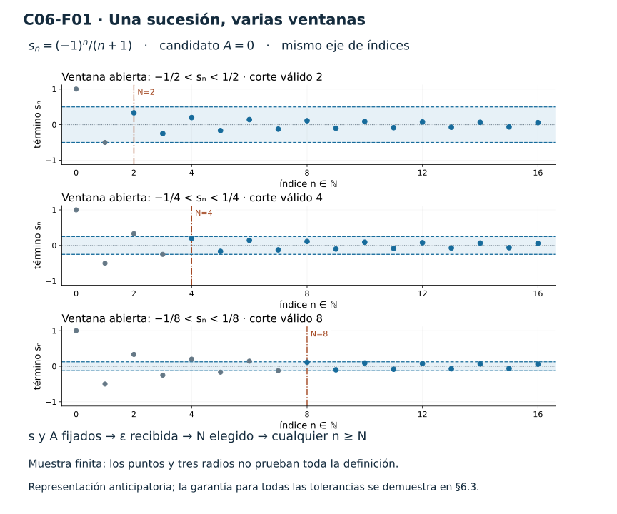
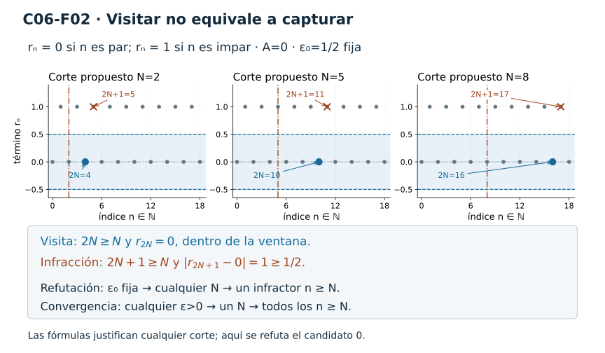
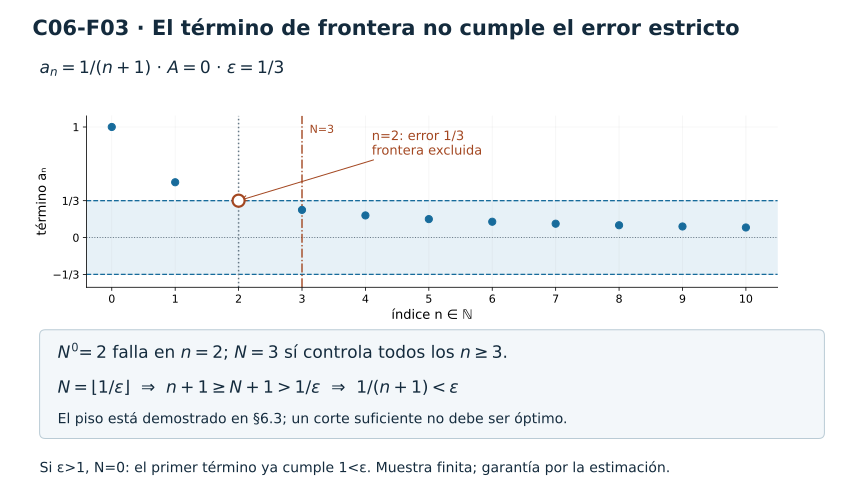
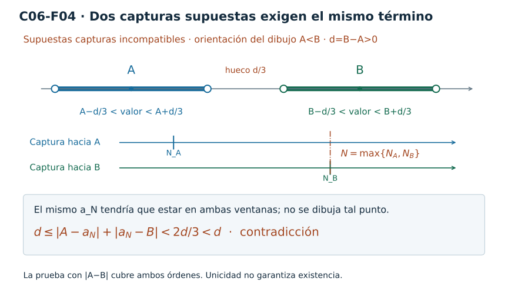
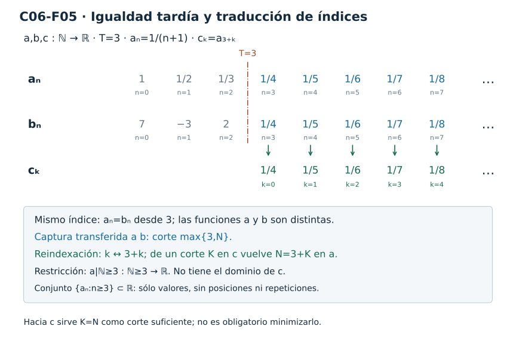
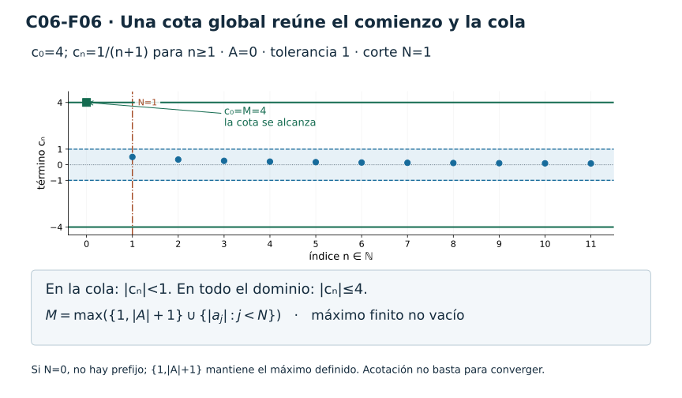
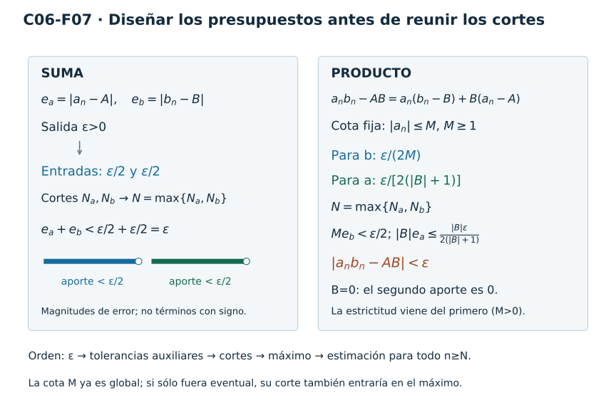
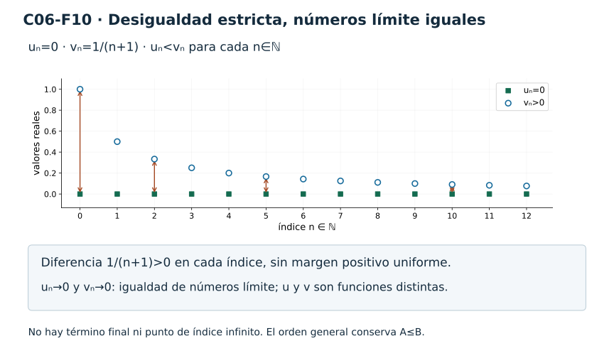

[Índice del libro](../para-matematicos/analisis-para-matematicos.html) · [Capítulo 6](analisis-para-matematicos-capitulo-6-convergencia-el-juego-de-y-n.html) · [Ejercicios](analisis-para-matematicos-capitulo-6-convergencia-el-juego-de-y-n-ejercicios.html) · [Soluciones](analisis-para-matematicos-capitulo-6-convergencia-el-juego-de-y-n-soluciones.html) · [Soluciones de microcontroles](analisis-para-matematicos-capitulo-6-convergencia-el-juego-de-y-n-microcontroles.html)

[]{#MA-SEC-ANM-01-006-008}

Al terminar el capítulo anterior sabíamos expresar que una cola de una sucesión queda dentro de un conjunto fijo. El centro y el tamaño de una bola, por ejemplo, se elegían antes de buscar el umbral: preguntábamos si, desde algún índice, todos los términos pertenecían a esa bola. Ese lenguaje permite controlar lo que ocurre tarde, pero aún no expresa que podamos exigir una aproximación con cualquier precisión.

Imaginemos que alguien afirma que una sucesión se aproxima a cero. Le pedimos que sus términos queden entre −1 y 1 a partir de algún índice; nos ofrece un umbral que cumple esa condición. Podemos pedir ahora una ventana menor, entre −1/10 y 1/10. La primera respuesta ya no basta: hace falta comprobar que también esa ventana captura una cola. Y ninguna de esas dos comprobaciones sustituye la obligación de responder a cualquier tolerancia positiva que se nos proponga.

C06 comienza al convertir esta exigencia en una definición. La pregunta rectora será: **¿qué control permite afirmar que una sucesión se aproxima a un número con cualquier precisión que se le exija?** Primero construiremos el lenguaje y aprenderemos a leer sus elecciones; después demostraremos qué permite hacer con las sucesiones que cumplen la definición. Las reglas de cálculo vendrán acompañadas de sus hipótesis y de las estimaciones que las justifican.

Conservamos la convención $\mathbb N=\{0,1,2,\ldots\}$. Una sucesión real es una función $a:\mathbb N\to\mathbb R$; $n$ es un índice y $a_n$ un número real. El candidato al que queremos aproximarnos será otro número real, que llamaremos $A$. El índice y el candidato tienen papeles distintos: podemos exigir índices mayores para controlar la distancia de los valores a $A$, pero $A$ permanece fijo durante toda la comprobación.

## 6.1. Una ventana para cada tolerancia

[]{#MA-SEC-ANM-01-006-001}

### De una captura fija a una familia de exigencias

Fijemos una sucesión $a:\mathbb N\to\mathbb R$ y un candidato $A\in\mathbb R$. Si nos dan una tolerancia real $\varepsilon>0$, la ventana correspondiente es la bola $B(A,\varepsilon)=(A-\varepsilon,A+\varepsilon)$ que ya conocemos. Exigir que un término esté en ella significa exactamente $|a_n-A|<\varepsilon$.

C05 nos permite decir que esa ventana captura una cola:

$$
\exists N\in\mathbb N\ \forall n\in\mathbb N,\qquad
n\ge N\Longrightarrow |a_n-A|<\varepsilon.
$$

Por ahora se trata de una sola tolerancia fijada. Para expresar la aproximación que buscamos, exigimos que esta captura pueda conseguirse **para cada** $\varepsilon>0$. La sucesión y el candidato no cambian al reducir el tamaño de la ventana; lo que puede cambiar es el umbral que necesitamos.

Esta diferencia se ve incluso en sucesiones muy sencillas. Consideremos $r_n=0$ cuando $n$ es par y $r_n=1$ cuando $n$ es impar. Todos los términos están en $B(0,2)$, de modo que esa ventana captura la sucesión desde el índice 0. Sin embargo, la ventana $B(0,1/2)$ no captura ninguna cola: tras cualquier umbral $N$ encontramos el índice impar $2N+1\ge N$, cuyo término vale 1 y queda fuera.

Hemos comprobado que una captura fija alrededor de cero no asegura capturas a todas las escalas alrededor del mismo candidato. No hemos analizado otros candidatos de esta sucesión. Esa distinción será importante cuando aprendamos a refutar afirmaciones de convergencia.

### La definición

> **Convergencia a un candidato real.** Sean $a:\mathbb N\to\mathbb R$ y $A\in\mathbb R$. Decimos que la sucesión **converge a $A$**, y escribimos $a_n\to A$, si para cada $\varepsilon>0$ existe un $N\in\mathbb N$ tal que, para todo $n\in\mathbb N$ con $n\ge N$, se cumple $|a_n-A|<\varepsilon$.

Su forma simbólica completa es

$$
a_n\to A
\quad\Longleftrightarrow\quad
\forall\varepsilon>0\ \exists N\in\mathbb N\
\forall n\in\mathbb N,\qquad
n\ge N\Longrightarrow |a_n-A|<\varepsilon.
$$

También diremos que $A$ es un límite de la sucesión cuando se cumple esta afirmación. Demostraremos en §6.4 que no puede haber dos candidatos distintos que la satisfagan; hasta entonces la expresión $a_n\to A$ designa la propiedad que acabamos de definir, sin apoyarse en una unicidad todavía no demostrada.

El signo de aproximación relaciona el comportamiento de la sucesión con un candidato. No es una igualdad entre la función $a$ y el número $A$. Tampoco introduce un término final $a_\infty$: infinito no es un índice de $\mathbb N$ y la definición sólo habla de términos de índices naturales.

La tolerancia $\varepsilon$ mide distancia en la recta de **valores**; el umbral $N$ marca un corte en el conjunto de **índices**. Pedir una precisión menor no añade índices fraccionarios ni términos intermedios. La gráfica de la sucesión sigue siendo la colección discreta de puntos $(n,a_n)$.

### Volver de los símbolos a la ventana

Leamos la definición en el orden en que impone sus obligaciones. La sucesión $a$ y el candidato $A$ están fijados. Se nos propone una tolerancia positiva $\varepsilon$; debemos encontrar un índice $N$ a partir del cual ningún término quede fuera de la ventana. Una vez elegido ese umbral, la afirmación debe valer para cualquier índice natural $n\ge N$.

No basta con señalar un término cercano ni con encontrar muchos términos cercanos. La definición exige toda la cola desde el corte elegido. En el ejemplo de $r$, los índices pares proporcionan visitas a cero tan tardías como queramos, pero los impares siguen impidiendo la captura por la ventana de radio 1/2.

El umbral puede depender de la tolerancia. La definición no pide un corte único que responda a todas las precisiones ni pide que el corte elegido sea el menor posible. Si $N$ controla una ventana y $K\ge N$, el corte $K$ también la controla: un índice $n\ge K$ satisface $n\ge N$, por lo que conserva la estimación. Esta sencilla comprobación recuerda que un testigo de captura no es necesariamente único.

La desigualdad del error es estricta. Para $A=0$ y $\varepsilon=1/3$, un término que valga $1/3$ queda sobre la frontera de la ventana y no cumple $|a_n-A|<\varepsilon$. Podrá quedar dentro de una ventana mayor, pero no de ésta. Mantendremos esa precisión al construir umbrales.

### Una representación anticipatoria

La sucesión $s_n=(-1)^n/(n+1)$ es útil para imaginar una aproximación que cambia de lado. Sus primeros términos son $1,-1/2,1/3,-1/4,\ldots$: el signo alterna mientras las magnitudes que aparecen en esta muestra disminuyen. Para conservar esa diferencia entre índice y valor, podemos leer algunos términos en una tabla:

| Índice $n$ | Término $s_n$ | Distancia a cero $\lvert s_n\rvert$ |
|---:|---:|---:|
| 0 | $1$ | $1$ |
| 1 | $-1/2$ | $1/2$ |
| 2 | $1/3$ | $1/3$ |
| 3 | $-1/4$ | $1/4$ |
| 4 | $1/5$ | $1/5$ |
| 5 | $-1/6$ | $1/6$ |
| 6 | $1/7$ | $1/7$ |
| 7 | $-1/8$ | $1/8$ |
| 8 | $1/9$ | $1/9$ |

Imaginemos tres gráficas de estos mismos puntos, con ventanas centradas en cero y radios $1/2$, $1/4$ y $1/8$. Dentro de la muestra, los puntos desde los índices 2, 4 y 8, respectivamente, satisfacen las desigualdades estrictas correspondientes. El punto de índice 7, por ejemplo, está sobre la frontera inferior de la ventana de radio $1/8$, mientras que el de índice 8 está dentro.

La tabla ayuda a leer qué exigiría una captura, pero sólo muestra nueve índices y tres tolerancias. No demuestra el control de una cola infinita para cualquier $\varepsilon>0$. En §6.3 construiremos un umbral para la sucesión $1/(n+1)$ y después verificaremos directamente este ejemplo alternante mediante la identidad $|s_n|=1/(n+1)$. Hasta entonces lo usamos como representación anticipatoria, no como herramienta de límites ya probada.

Comparemos ahora las tres ventanas sobre la misma sucesión. En la figura [C06-F01](#fig-anm-c06-f01), cambiar la tolerancia modifica la exigencia sobre los valores, mientras que el corte sigue siendo un índice natural.

### Figura [C06-F01](#fig-anm-c06-f01)

{#fig-anm-c06-f01 fig-alt="La misma sucesión alternante se muestra con ventanas abiertas de radios 1/2, 1/4 y 1/8 y cortes 2, 4 y 8. Cada panel es una muestra finita. La prueba general se encuentra en §6.3."}

**Figura [C06-F01](#fig-anm-c06-f01).** La tolerancia se impone sobre los valores y el umbral se elige sobre los índices. Cada ventana exige capturar una cola completa de la misma sucesión, aunque los términos cambien de lado. La muestra ilustra la exigencia; la garantía se demuestra en §6.3.

Los términos resaltados empiezan en los cortes 2, 4 y 8; la franja abierta actúa sobre sus alturas. Cada panel conserva la misma regla de evaluación. La garantía para cualquier tolerancia se establecerá en §6.3, sin extrapolar los puntos dibujados.

### Casos que podemos comprobar desde ahora

Una sucesión constante ofrece una comprobación completa que no necesita construir umbrales mediante desigualdades más difíciles. Si $a_n=A$ para todo $n\in\mathbb N$, recibida cualquier tolerancia $\varepsilon>0$ elegimos $N=0$. Para todo $n\ge0$, el error es $|a_n-A|=0<\varepsilon$. Por la definición, $a_n\to A$.

Aquí todos los términos coinciden con el candidato. Por tanto, la convergencia no exige aproximarse sin alcanzarlo ni exige valores distintos entre sí. Tampoco obliga a que el umbral crezca estrictamente cuando la tolerancia disminuye: en este caso $N=0$ sirve para cualquier tolerancia.

Podemos variar el ejemplo sin utilizar aún una regla general sobre cambios finitos. Supongamos que hay un $T\in\mathbb N$ tal que $b_n=A$ para todos los índices $n\ge T$; antes de $T$, los términos pueden ser cualesquiera números reales. Dada $\varepsilon>0$, tomamos $N=T$ y comprobamos de nuevo que $|b_n-A|=0<\varepsilon$ para todo $n\ge N$. Así, **toda sucesión eventualmente constante de valor $A$ converge a $A$**.

Por ejemplo, $b=(7,-3,2,2,2,\ldots)$ converge a 2 con el umbral $N=2$ para cualquier tolerancia. El primer término puede estar lejos del candidato; la condición de convergencia empieza a exigir su estimación después del corte elegido. La prueba usa que la cola es exactamente constante, no una regla de invariancia que demostraremos más adelante.

### Captura por cada vecindad

La definición usa bolas porque el radio permite expresar la precisión numéricamente. En C04 aprendimos a reconocer una vecindad de $A$ sin exigir que ella misma sea una bola: un conjunto $U\subseteq\mathbb R$ es vecindad de $A$ cuando contiene alguna bola $B(A,r)$ con $r>0$. Podemos aprovechar esa interfaz para dar otra lectura de la convergencia.

> **Caracterización por vecindades.** Una sucesión $a:\mathbb N\to\mathbb R$ converge a $A\in\mathbb R$ si y sólo si está eventualmente en cada vecindad de $A$.

Hay dos direcciones que comprobar. En una, una bola suficientemente pequeña permite entrar en una vecindad más amplia; en la otra, las propias bolas son vecindades y recuperan las tolerancias de la definición.

**Demostración.** Supongamos primero que $a_n\to A$ y fijemos una vecindad $U$ de $A$. Por la definición de vecindad, existe un $r>0$ tal que $B(A,r)\subseteq U$. La convergencia, aplicada a la tolerancia $r$, proporciona un $N\in\mathbb N$ para el cual $a_n\in B(A,r)$ siempre que $n\ge N$. La inclusión da $a_n\in U$ para esos mismos índices, de modo que la sucesión está eventualmente en $U$.

Recíprocamente, supongamos que la sucesión está eventualmente en cada vecindad de $A$. Sea $\varepsilon>0$ una tolerancia arbitraria. La bola $B(A,\varepsilon)$ es una vecindad de $A$, así que existe un $N\in\mathbb N$ tal que $a_n\in B(A,\varepsilon)$ para todos los índices $n\ge N$. Esa pertenencia equivale a $|a_n-A|<\varepsilon$ y cumple exactamente la definición de $a_n\to A$. Quedan demostradas ambas direcciones.

La inclusión de una bola en $U$ es el puente decisivo: no necesitamos que $U$ sea abierto, que sea un intervalo ni que tenga una forma especial fuera de esa bola. El umbral puede depender de la vecindad. Del mismo modo que antes no pedíamos una única captura para todas las tolerancias, ahora no pedimos que todas las vecindades compartan un mismo corte.

Podemos usar inmediatamente esta caracterización con el ejemplo $b=(7,-3,2,2,\ldots)$. Toda vecindad de 2 contiene al punto 2, por lo que desde el índice 2 todos sus términos están en ella. La nueva formulación recupera su convergencia sin calcular radios. Para sucesiones cuyas colas no son constantes, en cambio, la inclusión de una bola será lo que permita transferir una estimación numérica a una vecindad cualquiera.

### Qué cambió respecto de C05

En C05 fijábamos un conjunto $U$ y preguntábamos si capturaba una cola. Ahora fijamos un candidato $A$ y pedimos que **cada** ventana de radio positivo alrededor suyo capture alguna cola; equivalentemente, que lo haga cada vecindad de $A$. El nuevo cuantificador no obliga a que todas esas colas empiecen en el mismo lugar.

La definición ya permite formular una meta de prueba. Todavía queda aprender a construir los umbrales, a negar correctamente esa meta y a decidir qué consecuencias podemos extraer de ella. El próximo paso será mirar con mayor cuidado quién elige la tolerancia, quién responde con el umbral y qué puede depender de cada elección.

### Antes de seguir

1. En la afirmación $a_n\to A$, identifica el tipo de cada objeto $a$, $n$, $a_n$, $A$, $\varepsilon$ y $N$, e indica cuáles se fijan antes de recibir la tolerancia.
2. Escribe la definición de $a_n\to A$ como una oración completa y luego en forma simbólica, conservando la condición $n\ge N$ y la desigualdad estricta del error.
3. Para $r_n=0$ si $n$ es par y $r_n=1$ si es impar, da un umbral de captura en $B(0,2)$. Explica por qué ningún umbral captura una cola en $B(0,1/2)$ y qué afirma esto sobre el candidato 0.
4. Supón que $N$ satisface la estimación para una tolerancia fija y que $K\ge N$. Justifica que $K$ también es un testigo válido. ¿Exige la definición escoger el menor umbral?
5. Con candidato $A=2$ y tolerancia $\varepsilon=1/3$, clasifica como interiores o de frontera los valores $2$, $5/3$ y $7/3$. ¿Cuáles cumplen el error estricto?
6. Demuestra directamente desde la definición que $b=(9,-4,1,1,1,\ldots)$ converge a 1. Indica un umbral válido para cualquier tolerancia y explica por qué los dos primeros términos no invalidan tu prueba.
7. ¿Qué dos limitaciones impiden que la tabla del ejemplo alternante constituya por sí sola una demostración de convergencia? Distingue la cantidad de índices mostrados de la cantidad de tolerancias comprobadas.
8. Reconstruye las dos direcciones de la caracterización por vecindades. Señala en una la inclusión de una bola y en la otra la vecindad concreta que recupera una tolerancia arbitraria.

## 6.2. Quién elige qué: leer y negar la definición

[]{#MA-SEC-ANM-01-006-002}

La definición de §6.1 relaciona tres elecciones: una tolerancia, un umbral y un índice que recorre la cola. Sus cuantificadores no forman una lista de requisitos independientes. El orden determina qué información está disponible al hacer cada elección y, por tanto, qué debemos demostrar.

Fijemos durante esta sección una sucesión $a:\mathbb N\to\mathbb R$ y un candidato $A\in\mathbb R$. La meta es aprender a leer la afirmación $a_n\to A$ y su negación con suficiente precisión para construir después argumentos correctos. No necesitaremos todavía reglas de cálculo de límites.

### La tolerancia se recibe; el umbral se construye

En una prueba de convergencia, la tolerancia $\varepsilon>0$ es arbitraria. Podemos conocer su valor mientras buscamos el umbral, pero no escoger únicamente una tolerancia cómoda y dar por terminada la prueba. El argumento debe responder a cualquiera que se le proponga.

Después de recibir $\varepsilon$, buscamos un $N\in\mathbb N$. Esta elección puede depender de la sucesión fijada, del candidato y de la tolerancia. Una vez construido $N$, tomamos un índice natural $n\ge N$ arbitrario y verificamos $|a_n-A|<\varepsilon$. El índice no se elige para facilitar la estimación: representa cualquiera de los índices que quedan después del corte.

| Momento | Dato o elección | Obligación |
|---|---|---|
| Antes de la prueba | a y A fijados | Analizar esta sucesión y este candidato |
| Entrada | ε>0 arbitraria | Responder a cualquier tolerancia positiva |
| Construcción | N natural | Elegir un corte usando los datos anteriores |
| Verificación | n≥N arbitrario | Controlar todos los términos de esa cola |

La tabla organiza una prueba, no describe un proceso temporal que produzca términos nuevos. La sucesión ya es una función definida en todos los naturales; al variar $\varepsilon$ cambia la exigencia con que la examinamos.

En §6.1, la sucesión $b=(7,-3,2,2,\ldots)$ permitió elegir $N=2$ para toda tolerancia. Era una respuesta válida porque el error de su cola es exactamente cero. Que allí sirviera el mismo corte no transforma esa elección en una obligación para las demás sucesiones.

### Qué significa pedir un corte para todas las tolerancias

Comparemos la definición, que empieza con $\forall\varepsilon>0\ \exists N$, con una condición que invierte esas dos elecciones:

$$
\exists N\in\mathbb N\ \forall\varepsilon>0\
\forall n\in\mathbb N,\qquad
n\ge N\Longrightarrow |a_n-A|<\varepsilon.
$$

Esta condición pide escoger el corte sin conocer la tolerancia y exige que su cola responda a todas las precisiones. Tiene una consecuencia mucho más fuerte: la cola debe ser exactamente constante de valor $A$.

Para comprobarlo, supongamos que ese $N$ existe y fijemos un $n\ge N$. Si el error $d=|a_n-A|$ fuese positivo, podríamos usar la tolerancia $\varepsilon=d/2$. La condición daría $d<d/2$, imposible. Por tanto $d=0$, es decir, $a_n=A$. Como el índice tardío era arbitrario, todos los términos desde $N$ valen $A$.

Recíprocamente, si $a_n=A$ para todo $n\ge T$, elegimos el corte $N=T$. El error es cero y queda por debajo de cualquier tolerancia positiva. Hemos demostrado que la condición con $\exists N$ antes de $\forall\varepsilon$ equivale a ser eventualmente constante de valor $A$.

Podemos usar esta equivalencia con $b=(7,-3,2,2,\ldots)$: además de converger a 2, satisface la condición más fuerte con $N=2$. El argumento muestra qué significa realmente intercambiar esos cuantificadores. La definición original permite un corte adaptado a la tolerancia; no exige esta constancia de la cola.

### Dos formas de perder la obligación de controlar una cola

También podemos debilitar la condición hasta dejar de expresar la convergencia. Una tentación es permitir que cada índice se acompañe de una tolerancia hecha a su medida. Para cualquier sucesión y cualquier candidato, la elección $\varepsilon_n=|a_n-A|+1$ cumple $|a_n-A|<\varepsilon_n$. Esta desigualdad no acredita aproximación: la ventana se adapta al error que ya encontramos. La definición exige responder a una tolerancia previamente impuesta.

Otro cambio defectuoso aparece si se permite elegir $N$ después de conocer el mismo índice $n$ que supuestamente debemos controlar. En la fórmula

$$
\forall\varepsilon>0\ \forall n\in\mathbb N\
\exists N\in\mathbb N,\qquad
n\ge N\Longrightarrow |a_n-A|<\varepsilon,
$$

podemos tomar siempre $N=n+1$. Entonces $n\ge N$ es falso y la implicación se cumple sin imponer ninguna estimación. Cualquier sucesión y cualquier candidato satisfacen esa fórmula. El cambio de orden ha permitido colocar el corte después del índice examinado y vaciar la condición.

Una prueba válida elige el corte antes de verificar un índice arbitrario de su cola. Conviene seguir esa dependencia incluso cuando la fórmula de $N$ parece sencilla: un testigo bien calculado puede dejar de probar lo que queremos si responde a una obligación lógica distinta.

### Visitas arbitrariamente tardías

Recordemos la sucesión $r_n=0$ para n par y $r_n=1$ para n impar. Si fijamos $A=0$, cualquier tolerancia $\varepsilon>0$ y cualquier umbral $N$, el índice $n=2N$ satisface $n\ge N$ y $|r_n-0|=0<\varepsilon$. Por tanto r cumple la condición

$$
\forall\varepsilon>0\ \forall N\in\mathbb N\
\exists n\in\mathbb N,\qquad
n\ge N\ \text{y}\ |r_n-0|<\varepsilon.
$$

Cada ventana alrededor de cero recibe visitas arbitrariamente tardías. Pero r no converge a cero: los índices impares permanecen fuera de la ventana de radio 1/2. La condición de visitas conserva un índice favorable tras cada corte; la convergencia exige que desde algún corte sean favorables todos los índices.

Ésta es la distinción de C05 entre reaparición y eventualidad, aplicada ahora a una distancia y a una tolerancia. La inspección de muchos puntos cercanos, incluso puntos tan tardíos como queramos, no sustituye una estimación válida para toda la cola.

### Derivar la negación sin cambiar de candidato

¿Cómo se demuestra que $a_n\to A$ es falso? Debemos negar la definición completa. Con a y A fijados, la convergencia dice que **toda** tolerancia positiva admite **algún** umbral desde el que **todos** los índices cumplen el error estricto. Su negación afirma que hay una tolerancia para la que ningún umbral consigue ese control.

Neguemos primero la obligación sobre una cola. Que sea falso «para todo n natural, si $n\ge N$ entonces $|a_n-A|<\varepsilon$» significa que existe un índice en el que falla la implicación. Para que falle, su antecedente debe ser verdadero y su conclusión falsa: se necesita a la vez $n\ge N$ y $|a_n-A|\ge\varepsilon$. No sirve un índice anterior al corte.

Al negar los cuantificadores exteriores, «existe N que controla» se convierte en «para todo N hay un fallo», y «para toda ε positiva» se convierte en «existe una ε positiva». Así obtenemos:

> **Refutación de un candidato.** Para a y A fijados, la afirmación $a_n\not\to A$ equivale a que exista una tolerancia $\varepsilon_0>0$ tal que, para cada $N\in\mathbb N$, haya un $n\in\mathbb N$ con $n\ge N$ y $|a_n-A|\ge\varepsilon_0$.

En símbolos,

$$
a_n\not\to A
\quad\Longleftrightarrow\quad
\exists\varepsilon_0>0\ \forall N\in\mathbb N\
\exists n\in\mathbb N,\qquad
n\ge N\ \text{y}\ |a_n-A|\ge\varepsilon_0.
$$

La tolerancia infranqueable $\varepsilon_0$ queda fijada antes de recibir $N$. El índice infractor puede depender de ese umbral. Los papeles han cambiado: para probar convergencia respondemos a una tolerancia con un corte que controla toda una cola; para refutarla presentamos una tolerancia y respondemos a cada corte con una infracción posterior.

La negación de $|a_n-A|<\varepsilon_0$ incluye la igualdad. Un término sobre la frontera ya impide la captura por la ventana abierta. Por eso la desigualdad de refutación es $\ge$, y no solamente $>$.

### Una refutación completa

Apliquemos el criterio a r y al candidato 0. Elegimos $\varepsilon_0=1/2$. Dado cualquier $N\in\mathbb N$, tomamos $n=2N+1$. Este índice es impar y satisface $n\ge N$; por tanto $r_n=1$ y $|r_n-0|=1\ge1/2$. La tolerancia permanece fija mientras el índice infractor responde a cada corte. Queda demostrado $r_n\not\to0$.

Los índices pares no estorban esta prueba: la refutación pide algún infractor después de cada umbral, no que todos los términos tardíos queden fuera. Exigir una cola entera de infracciones sería una afirmación más fuerte, que r no satisface para esta ventana porque siempre hay ceros tardíos.

Un único infractor, en cambio, tampoco basta. Para $b=(7,-3,2,2,\ldots)$ y $A=2$, el término inicial tiene error 5 y queda fuera de la ventana de radio 1. Pero desde $N=2$ no queda ninguna infracción y b converge a 2. La refutación debe resistir cualquier corte, incluidos los que dejan atrás el término señalado.

La figura [C06-F02](#fig-anm-c06-f02) reúne las visitas y las infracciones que acabamos de justificar. La ventana se mantiene fija al cambiar el corte.

### Figura [C06-F02](#fig-anm-c06-f02)

{#fig-anm-c06-f02 fig-alt="Para cortes 2, 5 y 8 se muestran una visita par y una infracción impar. La tolerancia 1/2 permanece fija. Las fórmulas 2N y 2N+1 justifican ambos índices tras cualquier corte y refutan el candidato cero."}

**Figura [C06-F02](#fig-anm-c06-f02).** Cada corte tiene visitas posteriores a la ventana y también infracciones posteriores. La tolerancia un medio refuta la captura por una cola alrededor de cero.

Los puntos interiores posteriores al corte no eliminan los infractores. La fórmula del índice impar, válida para cualquier N natural, sostiene la refutación del candidato cero.

Si volvemos a la gráfica discreta de r, el mismo corte tiene después puntos de altura cero y de altura uno. Para la convergencia, los puntos interiores no compensan a los exteriores: todos tendrían que estar dentro desde algún corte. Para la refutación, basta conservar un punto exterior después de cada corte. El dibujo ayuda a separar esas obligaciones, pero la fórmula $2N+1$ es la que acredita el infractor para cualquier umbral natural.

### Un candidato incorrecto no significa ausencia de todo límite

Consideremos la sucesión constante $c_n=1$. Sabemos por §6.1 que converge a 1. Si intentamos usar $A=0$, la tolerancia $\varepsilon_0=1$ refuta ese candidato: para cada $N$ podemos tomar $n=N$, y el error $|c_n-0|=1$ cumple la desigualdad $\ge\varepsilon_0$.

Este ejemplo tiene dos funciones. Primero muestra que una sucesión puede converger a un candidato y fallar respecto de otro; refutar cero no demuestra ausencia de todo límite. Además, el error de refutación cae exactamente sobre la frontera. La exigencia errónea $|c_n-0|>1$ no produciría ningún infractor, aunque la ventana abierta de radio 1 no capture un solo término.

Decir que a no tiene ningún límite real es afirmar que **cada** $A\in\mathbb R$ queda refutado. Al escribir la condición completa, A se elige antes de la tolerancia que lo refuta:

$$
\forall A\in\mathbb R\ \exists\varepsilon_0>0\
\forall N\in\mathbb N\ \exists n\in\mathbb N,\qquad
n\ge N\ \text{y}\ |a_n-A|\ge\varepsilon_0.
$$

La tolerancia puede depender del candidato A; después queda fija mientras recorremos los umbrales. No se exige encontrar una sola tolerancia que refute de antemano todos los candidatos. Tampoco se permite cambiar de candidato en medio de la comprobación de uno.

### Una convención sobre el corte

Usamos $n\ge N$ para que el corte incluya su propio índice, como en C05. A veces se escribe una definición con $n>N$. Las dos formulaciones describen la misma convergencia, pero no siempre aceptan el mismo testigo numérico.

Si un corte N controla todos los índices $n\ge N$, controla en particular los que cumplen $n>N$. En sentido inverso, si controla los índices $n>N$, elegimos el corte $K=N+1$: todo natural $n\ge K$ cumple $n>N$ y conserva la estimación.

Por ejemplo, para $d=(1,0,0,\ldots)$, candidato 0 y tolerancia 1/2, el corte N=0 funciona con $n>0$. Falla con $n\ge0$ porque incluye el término inicial de valor 1. Al trasladar el testigo a K=1 obtenemos la captura según nuestra convención. La equivalencia de dos definiciones no autoriza a copiar sin revisión los valores concretos de sus testigos.

### Antes de seguir

1. Describe el orden de elecciones de una prueba de $a_n\to A$. ¿De qué datos puede depender N y por qué no puede construirse después de escoger el índice que debe controlar?
2. Demuestra que pedir un mismo N para todas las tolerancias equivale a que la sucesión sea eventualmente constante de valor A. Identifica la tolerancia que excluye un error positivo.
3. Explica por qué las elecciones $\varepsilon_n=|a_n-A|+1$ no prueban convergencia, aunque produzcan una desigualdad estricta en cada índice.
4. En la fórmula con orden $\forall\varepsilon>0\ \forall n\in\mathbb N\ \exists N\in\mathbb N$ y conclusión $n\ge N\Rightarrow |a_n-A|<\varepsilon$, muestra cómo N=n+1 la hace verdadera para cualquier sucesión y candidato. ¿Qué obligación se perdió?
5. Deriva la negación de la definición para un candidato fijo. Explica por qué deben aparecer n≥N y error ≥ε₀ unidos por «y», y no por una implicación.
6. Para $r_n=0$ si n es par y $r_n=1$ si es impar, fija A=0 y ε₀=1/2. Da, después de un N arbitrario, un índice interior y otro infractor. ¿Cuál de ellos acredita la refutación y por qué no importa que exista el otro?
7. Usa la sucesión constante $c_n=3$ para refutar el candidato A=1 con una tolerancia cuyo error caiga exactamente en la frontera. Explica por qué esa refutación no demuestra ausencia de todo límite real.
8. Para $d=(1,0,0,\ldots)$, candidato 0 y tolerancia 1/2, compara el corte N=0 bajo n>N y bajo n≥N. Produce un testigo válido con nuestra convención y justifica la traducción general entre ambas formulaciones.

Ya podemos distinguir una captura de toda la cola, una visita tardía y un infractor que sobrevive a cada corte. En §6.3 usaremos estas obligaciones para construir y comprobar umbrales explícitos; la fórmula de un testigo deberá responder a la definición que acabamos de aprender a leer.

## 6.3. Construir el umbral

[]{#MA-SEC-ANM-01-006-003}

Ya sabemos qué obligación impone la convergencia: dada una tolerancia positiva, debemos producir un corte que controle todos los índices posteriores. Ahora construiremos una respuesta explícita para $a_n=1/(n+1)$ y candidato 0. El denominador está definido desde n=0; la dificultad consiste en convertir la precisión que nos piden en un índice natural adecuado.

La prueba tendrá dos recorridos. Primero trabajaremos desde la desigualdad que queremos obtener para descubrir una condición suficiente sobre el índice. Después redactaremos el argumento en el orden de la definición: recibir la tolerancia, elegir el umbral y comprobar un índice tardío arbitrario.

### Buscar desde el error

Para $\varepsilon>0$ y $n\in\mathbb N$, el error respecto de cero es $|a_n-0|=1/(n+1)$. Como n+1 y ε son positivos, podemos transformar la estimación deseada:

$$
\frac1{n+1}<\varepsilon
\quad\Longleftrightarrow\quad
n+1>\frac1\varepsilon.
$$

Esta equivalencia explica la elección que falta. Debemos encontrar un natural N cuyo sucesor sea mayor que $1/\varepsilon$; así, si n≥N, también n+1≥N+1>1/ε. La última comparación controlará de una vez toda la cola.

C03 §3.4 demostró que para cualquier real t hay un natural mayor que t. Esa propiedad arquimediana bastaría para escoger un corte suficientemente grande. Aquí queremos además escribir una respuesta mediante una fórmula reconocible, el piso de t. Antes de usar ese símbolo debemos demostrar la propiedad que le pediremos.

### Construir el piso positivo

> **Piso de un real positivo.** Para cada $t>0$ existe un único $K\in\mathbb N$ tal que $K\le t<K+1$. Lo denotamos por $\lfloor t\rfloor$.

Sólo necesitamos esta construcción para t positivo. El conjunto de naturales que no superan t contiene al menos al 0; la propiedad arquimediana permitirá situarlo dentro de una lista finita y escoger su último elemento.

**Demostración.** Sea t>0. Por C03 §3.4 elegimos un $m\in\mathbb N$ con m>t. Consideremos

$$
F=\{k\in\{0,1,\ldots,m\}:k\le t\}.
$$

Este conjunto es finito y no vacío, pues 0≤t. Tiene un máximo K: se obtiene comparando sus elementos, conservando en cada comparación el mayor de los examinados. Formalmente, la existencia de máximo para una lista finita no vacía se demuestra por inducción sobre su cantidad de elementos.

Como K∈F, tenemos K≤t. Además K<m, pues m>t; por el orden de los naturales, K+1≤m. Si K+1≤t, entonces K+1 también pertenecería a F, contradiciendo que K es su máximo. Por tanto t<K+1. Hemos construido un natural que satisface K≤t<K+1.

Para la unicidad, supongamos que K y J cumplen esas desigualdades. Si K<J, entonces K+1≤J≤t<K+1, contradicción. Si J<K, el mismo argumento con los papeles intercambiados da J+1≤K≤t<J+1, también imposible. Sólo queda K=J. Esto termina la prueba.

El natural obtenido no depende de cuál m>t hayamos elegido: cualquier construcción produce las mismas desigualdades y la unicidad identifica sus resultados. Si 0<t<1, el piso es 0; si t es un natural positivo, su piso es el propio t. Por ejemplo, $\lfloor5/2\rfloor=2$ y $\lfloor3\rfloor=3$.

La propiedad arquimediana se usa una vez, al elegir m. En C03 fue deducida de completitud; aquí reutilizamos ese resultado ya demostrado y después sólo comparamos elementos de un conjunto finito. No estamos recurriendo de nuevo al principio del supremo para crear el máximo de F.

### La primera prueba con un testigo explícito

Volvamos a $a_n=1/(n+1)$. Para t=1/ε, el piso satisface $\lfloor1/\varepsilon\rfloor+1>1/\varepsilon$, que era exactamente la condición suficiente descubierta al trabajar desde el error. Éste es el primer uso del lema.

> **Primera prueba de convergencia con N explícito.** La sucesión $a:\mathbb N\to\mathbb R$ dada por $a_n=1/(n+1)$ converge a 0.

**Demostración.** Sea $\varepsilon>0$ arbitraria. Como 1/ε>0, el resultado anterior permite elegir

$$
N=\left\lfloor\frac1\varepsilon\right\rfloor\in\mathbb N.
$$

Sea ahora $n\in\mathbb N$ con n≥N. La propiedad del piso da n+1≥N+1>1/ε>0. Al tomar recíprocos de números positivos, obtenemos

$$
|a_n-0|=\frac1{n+1}
\le\frac1{N+1}
<\varepsilon.
$$

Hemos comprobado el error estricto para todos los índices n≥N. Como la tolerancia era arbitraria, la definición da $a_n\to0$.

La prueba no necesita reglas algebraicas de límites. Sus herramientas son la definición, el piso que acabamos de construir y el orden de los recíprocos positivos. El paso n≥N⇒n+1≥N+1 es el puente que convierte una elección de corte en control de toda una cola.

Si ε>1, el número 1/ε está entre 0 y 1 y nuestra fórmula produce N=0. La estimación sigue siendo válida: desde el primer índice, $1/(n+1)\le1<\varepsilon$. Así el mismo argumento incluye tolerancias grandes sin pedir un índice negativo ni cambiar el dominio.

### Comprobar y reparar un testigo

La fórmula de N debe leerse junto con la convención n≥N y el error estricto. Algunos valores permiten comprobar ambos detalles:

| Tolerancia ε | 1/ε | Corte $N=\lfloor1/\varepsilon\rfloor$ | Error en el primer índice incluido |
|---:|---:|---:|---:|
| $2$ | $1/2$ | $0$ | $1<2$ |
| $1$ | $1$ | $1$ | $1/2<1$ |
| $1/3$ | $3$ | $3$ | $1/4<1/3$ |
| $1/8$ | $8$ | $8$ | $1/9<1/8$ |

La tabla comprueba casos concretos; el argumento anterior es el que responde a todas las tolerancias. Tampoco bastaría verificar el error en un único término si no hubiéramos demostrado el control de los posteriores. En esta sucesión, la comparación de denominadores es la razón explícita por la que el error de la cola queda dominado por 1/(N+1).

Examinemos una propuesta defectuosa: usar $N'=\lfloor1/\varepsilon\rfloor-1$. Con ε=1/3 da N'=2, pero el término de índice 2 vale 1/3 y queda sobre la frontera. La desigualdad requerida no se cumple. Si ε>1, el mismo intento produce N'=−1, que ni siquiera pertenece a nuestro dominio de umbrales.

Ambos defectos deben diagnosticarse por separado: un supuesto testigo puede estar mal tipado o puede ser natural y aun así no controlar el error. En este caso se repara tomando $N=\lfloor1/\varepsilon\rfloor$, cuya validez ya demostramos. No basta con corregir la frontera de un ejemplo numérico; necesitamos una elección que vuelva a responder a la tolerancia arbitraria.

La figura [C06-F03](#fig-anm-c06-f03) separa el término que cae exactamente sobre la frontera de los términos que sí satisfacen el error estricto.

### Figura [C06-F03](#fig-anm-c06-f03)

{#fig-anm-c06-f03 fig-alt="El punto de índice 2 vale 1/3 y se marca como frontera excluida. El corte 3 incluye un primer error 1/4 y controla la cola mediante la estimación general. Se conserva n mayor o igual que N."}

**Figura [C06-F03](#fig-anm-c06-f03).** Con tolerancia un tercio, el término de índice 2 queda sobre la frontera y no cumple el error estricto. El corte 3 sí controla toda la cola, como muestra la estimación general.

El punto de índice 2 existe y pertenece a la sucesión; lo que se excluye es la frontera de la ventana abierta. Al tomar N=3, ese punto queda en el prefijo y el primer término controlado tiene error 1/4.

Geométricamente, con ε=1/3, el punto (2,1/3) pertenece a la frontera superior de la ventana abierta alrededor de cero. El corte 3 lo deja fuera de la cola que debemos controlar; desde ese corte la estimación general sitúa todos los puntos dentro. La gráfica sigue siendo discreta: no añadimos una curva entre sus índices.

Un corte mayor también sirve, como demostramos en §6.1. No hay que optimizar el testigo para acreditar convergencia; hay que justificar que el elegido funciona. Por ejemplo, cualquier M natural con M≥N conserva la misma estimación para n≥M.

### El ejemplo alternante ya puede demostrarse

En §6.1 presentamos $s_n=(-1)^n/(n+1)$ como imagen anticipatoria de una aproximación que cambia de lado. Ahora podemos verificar la afirmación para todas las tolerancias, sin extrapolar la tabla ni invocar una regla de límites nueva.

Sea ε>0 y elijamos de nuevo $N=\lfloor1/\varepsilon\rfloor$. Para cualquier n≥N, el factor $(-1)^n$ tiene valor absoluto 1, de modo que

$$
|s_n-0|=\frac1{n+1}<\varepsilon.
$$

Esta comprobación, válida para un índice tardío arbitrario, demuestra $s_n\to0$. La primera prueba nos proporciona el corte y la estimación; la igualdad $|s_n|=1/(n+1)$ permite reutilizarlos directamente. Los términos cambian de signo y la sucesión no es monótona: s₀=1, s₁=−1/2 y s₂=1/3 muestran un descenso seguido de un ascenso. Esa alternancia es compatible con la convergencia.

Las ventanas de radios 1/2, 1/4 y 1/8 de §6.1 admiten, respectivamente, los cortes 2, 4 y 8. Ahora la afirmación se apoya en el argumento general para todos los índices posteriores y, además, podemos responder a cualquier otro radio positivo. Ésta es la diferencia entre reconocer la imagen y demostrar la captura.

### Variar centro y escala sin usar reglas de límites

Podemos trasladar la misma técnica a una familia de ejemplos, conservando visibles los parámetros. Fijemos $A,c\in\mathbb R$ y definamos $u_n=A+c/(n+1)$. El objetivo es demostrar $u_n\to A$ desde la definición.

Si c=0, la sucesión es constante y elegimos N=0 para cualquier tolerancia. Si c≠0, dada ε>0 elegimos $N=\lfloor|c|/\varepsilon\rfloor$; el argumento del piso se aplica porque |c|/ε>0. Para n≥N tenemos n+1≥N+1>|c|/ε, y por tanto $|u_n-A|=|c|/(n+1)<\varepsilon$. Queda demostrado el resultado, con ambos signos de c cubiertos.

Esta comprobación no invoca todavía una regla general de suma o de producto de límites. Sólo calcula el error de una función concreta y diseña un corte que lo domina. El centro A desaparece de la expresión del error; la escala |c| determina cuánto debemos pedir al índice. Para $u_n=3-2/(n+1)$, por ejemplo, la elección $N=\lfloor2/\varepsilon\rfloor$ controla la distancia a 3.

### Construir infractores en lugar de umbrales

La negación de §6.2 pide una construcción distinta: escoger una tolerancia que ningún corte pueda controlar y, después de cada corte, presentar un infractor. Con el ejemplo $q_n=(-1)^n$ podemos demostrar algo más fuerte que refutar un candidato particular: no tiene ningún límite real.

Fijemos un candidato arbitrario $A\in\mathbb R$. Los valores 1 y −1 están a distancia 2 entre sí. Por la desigualdad triangular,

$$
2=|1-(-1)|\le|1-A|+|A+1|.
$$

No pueden ser ambas distancias menores que 1, porque entonces su suma sería menor que 2. Por tanto al menos uno de los valores 1 o −1 dista de A al menos 1. Elegimos ε₀=1.

Dado cualquier $N\in\mathbb N$, si $|1-A|\ge1$ tomamos el índice par n=2N; satisface n≥N y $q_n=1$, así que $|q_n-A|\ge1$. Si $|1-A|<1$, la desigualdad anterior obliga a $|A+1|\ge1$; tomamos el índice impar n=2N+1, también posterior al corte, y obtenemos la misma infracción. Hemos respondido a cualquier N con un índice natural cuyo error es al menos ε₀.

Por el criterio de §6.2, $q_n\not\to A$. Como A era arbitrario, todos los candidatos reales quedan refutados. La prueba usa distancia, paridad y la triangular, sin una teoría de subsucesiones ni un teorema de unicidad. La elección uniforme ε₀=1 funciona en este ejemplo, aunque la definición de ausencia de límite no exige esa uniformidad respecto de A.

Comparemos q con s. Ambas alternan lados, pero en s la magnitud del error respecto de cero puede controlarse bajo cualquier tolerancia; en q, una separación fija impide esa captura respecto de todo candidato. La alternancia por sí sola no decide la convergencia: hay que comprobar la magnitud del error y la obligación sobre todos los índices tardíos.

### Antes de seguir

1. Reconstruye la existencia del piso de t>0 desde la propiedad arquimediana. ¿Por qué el conjunto F es no vacío y por qué su máximo K tiene un sucesor dentro de {0,…,m}?
2. Demuestra la unicidad del natural K que satisface K≤t<K+1 y explica por qué la elección inicial de m>t no cambia el resultado.
3. Para $a_n=1/(n+1)$ y ε=2/5, calcula $N=\lfloor1/\varepsilon\rfloor$ y comprueba el error para un n≥N arbitrario. Identifica el paso que controla toda la cola.
4. Analiza la propuesta $N'=\lfloor1/\varepsilon\rfloor-1$ con ε=1/3 y con ε=2. Distingue el defecto de frontera del defecto de dominio y produce una reparación válida para cualquier ε>0.
5. En la primera prueba, explica por qué ε>1 permite N=0 y por qué ese caso no obliga a empezar la sucesión en el índice 1.
6. Demuestra directamente que $s_n=(-1)^n/(n+1)$ converge a cero. ¿Qué parte de la primera prueba reutilizas y qué identidad nueva debes comprobar?
7. Para $u_n=3-2/(n+1)$, construye un umbral que controle el error respecto de 3 para cualquier ε>0. Explica cómo se modificaría tu construcción si el coeficiente −2 se sustituyera por 0.
8. Reconstruye la refutación de todos los candidatos para $q_n=(-1)^n$. Señala dónde se usa la triangular, cómo se elige la paridad del infractor y por qué este argumento demuestra más que refutar solamente A=0.

La construcción de un testigo empieza en la estimación deseada, pero su prueba termina verificando la definición completa. Ya podemos acreditar aproximaciones concretas y refutar candidatos mediante índices explícitos. En §6.4 preguntaremos qué impide que una misma sucesión cumpla la definición para dos candidatos distintos y qué control conserva al cambiar su comienzo.

## 6.4. Un solo destino; el comienzo puede cambiar

[]{#MA-SEC-ANM-01-006-004}

En §6.3 acreditamos candidatos concretos mediante umbrales explícitos. Queda una pregunta necesaria antes de tratar el límite como un número determinado por la sucesión: ¿podrían dos candidatos distintos satisfacer la definición para la misma función?

La captura por una sola ventana no lo impediría, porque dos ventanas grandes pueden solaparse. La convergencia ofrece más control: permite reducir sus radios usando la separación entre los candidatos. Después necesitaremos sincronizar ambas capturas para exigir que un mismo término pertenezca a las dos ventanas.

### Unicidad: un índice común para dos capturas

> **Unicidad del límite.** Sean $a:\mathbb N\to\mathbb R$ y $A,B\in\mathbb R$. Si $a_n\to A$ y $a_n\to B$, entonces A=B.

La estrategia consiste en suponer que la distancia entre A y B es positiva y pedir errores suficientemente pequeños para que la triangular no pueda reconstruir esa distancia. El punto decisivo será usar ambas estimaciones en un mismo índice; para ello recuperaremos el máximo de umbrales de C05.

**Demostración.** Supongamos que $a_n\to A$ y $a_n\to B$, y que A≠B. Entonces $d=|A-B|>0$. Aplicamos ambas convergencias con la tolerancia d/3. Existen $N_A,N_B\in\mathbb N$ tales que, para todo índice $n≥N_A$, se cumple $|a_n-A|<d/3$, y para todo $n≥N_B$ se cumple $|a_n-B|<d/3$.

Tomemos $N=\max\{N_A,N_B\}$. En el índice n=N valen simultáneamente las dos estimaciones. Por la desigualdad triangular,

$$
d=|A-B|
\le |A-a_N|+|a_N-B|
<\frac d3+\frac d3
=\frac{2d}{3}.
$$

Como d>0, tenemos 2d/3<d, contradicción. La suposición A≠B es imposible; por tanto A=B.

La tolerancia d/3 se elige después de suponer una separación positiva. El máximo asegura que no comparamos dos términos distintos: es el mismo número $a_N$ el que tendría que estar suficientemente cerca de ambos candidatos. Pedir radios d, en cambio, sólo daría d<2d y no produciría esta contradicción.

No se usa completitud ni una regla algebraica de límites. La prueba combina definición, triangular y sincronización de dos obligaciones eventuales. Si imaginamos A<B, las ventanas de radios d/3 están separadas; sus dos supuestas capturas exigirían una pertenencia simultánea imposible. La orientación A<B sirve para esa lectura geométrica, mientras que el argumento con |A−B| cubre ambas orientaciones.

La figura [C06-F04](#fig-anm-c06-f04) muestra por qué sincronizar los cortes obligaría al mismo término a pertenecer a dos ventanas disjuntas. Sus carriles de índices representan las dos capturas supuestas, no una sucesión que pueda cumplirlas.

### Figura [C06-F04](#fig-anm-c06-f04)

{#fig-anm-c06-f04 fig-alt="Dos ventanas abiertas de radio d/3 están separadas por un hueco d/3. Los cortes de dos capturas hipotéticas se reúnen en su máximo y exigirían una pertenencia simultánea imposible para el mismo término."}

**Figura [C06-F04](#fig-anm-c06-f04).** La sincronización exige que un mismo término tardío esté en ambas ventanas. La separación de los candidatos y la triangular hacen imposible esa doble pertenencia.

El hueco entre las ventanas tiene longitud d/3. El máximo no aproxima los candidatos: sólo hace disponibles las dos obligaciones en un mismo índice. La contradicción procede de exigir ambas pertenencias.

### El límite como número bien determinado

La unicidad permite introducir ahora la notación

$$
\lim_{n\to\infty}a_n=A
$$

cuando $a_n\to A$. Si existe un candidato que satisface la definición, el resultado anterior garantiza que esta escritura asigna un único número a la sucesión. La existencia se comprueba por separado; la unicidad no construye un límite para una sucesión cualquiera.

Como primer uso, §6.3 demostró que $u_n=3-2/(n+1)$ converge a 3. Podemos escribir $\lim_{n\to\infty}u_n=3$ y descartar cualquier resultado distinto para ese mismo límite: si una segunda prueba acreditara $u_n\to B$, la unicidad obligaría a B=3. No es necesario refutar uno por uno los demás candidatos.

La expresión n→∞ en la notación describe el comportamiento de los índices sin cota superior; no añade un término final ni permite evaluar la función en un índice llamado infinito. Para $q_n=(-1)^n$, cuya ausencia de límite real ya demostramos, no asignamos un número a $\lim_{n\to\infty}q_n$.

### La convergencia se transfiere por coincidencia eventual

El límite es único para una sucesión, pero sucesiones distintas pueden tener el mismo límite. Un mecanismo que lo produce es cambiar un número finito de términos iniciales. C05 estableció cómo transferir propiedades eventuales cuando dos funciones coinciden desde un corte; ahora aplicaremos ese mecanismo a cada tolerancia de la definición.

> **Coincidencia eventual y convergencia.** Sean $a,b:\mathbb N\to\mathbb R$. Supongamos que existe un $T\in\mathbb N$ tal que $a_n=b_n$ para todo n≥T. Entonces, para cada $A\in\mathbb R$, se cumple $a_n\to A$ si y sólo si $b_n\to A$.

Para una tolerancia dada habrá dos cortes que respetar: el de la estimación original y el de la igualdad de términos. Su máximo dejará ambas condiciones disponibles en una sola cola.

**Demostración.** Fijemos A y supongamos primero que $a_n\to A$. Sea ε>0. La convergencia proporciona un $N_a\in\mathbb N$ tal que $|a_n-A|<\varepsilon$ para todo $n≥N_a$. Tomemos $N_b=\max\{T,N_a\}$. Si $n≥N_b$, se cumplen n≥T y $n≥N_a$; por tanto $b_n=a_n$ y $|b_n-A|=|a_n-A|<\varepsilon$. Esto demuestra $b_n\to A$.

Recíprocamente, si $b_n\to A$, para cada ε>0 elegimos un umbral $N_b$ de su estimación y tomamos $N_a=\max\{T,N_b\}$. Todo índice $n≥N_a$ satisface $a_n=b_n$ y la estimación de b, de modo que $|a_n-A|<\varepsilon$. Así $a_n\to A$ y quedan probadas ambas direcciones.

El resultado conserva todos los candidatos de convergencia y, cuando existe alguno, su límite único. También conserva la ausencia de límite: si a no tiene límite real y b lo tuviera, la dirección inversa produciría un límite para a. La hipótesis no dice que a y b sean la misma función, sino que sus evaluaciones coinciden desde T.

Por ejemplo, sea $a_n=1/(n+1)$ y definamos b₀=7, b₁=−3, b₂=2 y $b_n=a_n$ para n≥3. Las funciones difieren en el prefijo, pero coinciden desde T=3. Por la convergencia de a ya demostrada y el resultado anterior, $b_n\to0$; la unicidad permite escribir que ambos límites son 0. Para una tolerancia ε, un testigo explícito de b es $\max\{3,\lfloor1/\varepsilon\rfloor\}$.

Esto no vuelve invariantes todas las propiedades de la sucesión. En a todos los términos son positivos; en b el término de índice 1 es negativo. La propiedad global «todos los términos son positivos» se pierde al cambiar el comienzo, aunque la convergencia se conserva. El resultado tiene el alcance de su demostración: cada estimación de error debe valer desde algún índice.

### Mismo límite sin coincidencia eventual

La conversa de la última explicación sería falsa. Tener el mismo límite no obliga a compartir una cola de valores idénticos.

Las sucesiones $a_n=1/(n+1)$ y $v_n=-1/(n+1)$ convergen a cero por las pruebas directas de §6.3. Sin embargo, $a_n>0$ y $v_n<0$ para todo $n\in\mathbb N$, de modo que sus términos nunca coinciden en un mismo índice. Sus límites son iguales como números reales, pero las funciones son distintas y ni siquiera coinciden eventualmente.

Así podemos usar la coincidencia eventual como una condición suficiente para transferir convergencia, sin convertirla en una condición necesaria para que dos sucesiones tengan el mismo destino.

### Reindexar una cola conserva la convergencia

Cambiar un prefijo mantiene las posiciones de los términos tardíos. Reindexar una cola cambia sus nombres de índice. Recordemos la distinción de C05: la restricción $a|_{\mathbb N_{\ge T}}$ tiene dominio $\mathbb N_{\ge T}=\{n\in\mathbb N:n\ge T\}$; para obtener otra sucesión con dominio $\mathbb N$ definimos $b_k=a_{T+k}$ para $k\in\mathbb N$.

> **Convergencia de una cola reindexada.** Sean $a:\mathbb N\to\mathbb R$, $T\in\mathbb N$ y $b:\mathbb N\to\mathbb R$ dada por $b_k=a_{T+k}$. Para cada $A\in\mathbb R$, se cumple $a_n\to A$ si y sólo si $b_k\to A$.

En esta prueba no disponemos de la igualdad $a_n=b_n$ en los mismos índices. Debemos traducir el índice de cada función: k en la nueva sucesión corresponde a T+k en la original.

**Demostración.** Supongamos primero que $a_n\to A$ y recibamos ε>0. Sea N un umbral de a para esa tolerancia. Si k≥N, entonces T+k≥k≥N y $|b_k-A|=|a_{T+k}-A|<\varepsilon$. Por tanto el mismo corte N, ahora sobre los índices k, demuestra $b_k\to A$. Es un testigo suficiente, aunque puede ser mayor que el necesario.

Para la dirección inversa, supongamos que $b_k\to A$. Dada ε>0, elijamos un umbral K tal que $|b_k-A|<\varepsilon$ para todo k≥K. Tomemos el umbral original N=T+K. Si n≥N, entonces n≥T, el número k=n−T pertenece a $\mathbb N$ y satisface k≥K. Además $a_n=b_{n-T}=b_k$, por lo que $|a_n-A|<\varepsilon$. Esto acredita $a_n\to A$ y completa la equivalencia.

El primer sentido usa que T es un natural no negativo; el segundo necesita que n esté después del corte T para que n−T sea un índice permitido. La traducción por T+K no es un cambio de candidato ni un desplazamiento de los valores sobre la recta real.

Podemos aplicarlo a $a_n=1/(n+1)$ y T=3. La sucesión reindexada es $b_k=a_{3+k}=1/(k+4)$; como a converge a cero, b también. El término b₀=1/4 corresponde al término a₃, y no a a₀. Al escribir las dos gráficas discretas cambia la coordenada de índice que asignamos a esos valores.

Si en una prueba de b se ha encontrado el corte K=5 para cierta tolerancia, la dirección inversa controla a desde N=3+5=8. En la dirección directa, un corte N=8 de a permite elegir K=8 para b: no necesitamos encontrar el corte óptimo para demostrar la transferencia.

La figura [C06-F05](#fig-anm-c06-f05) reúne el cambio de prefijo y la reindexación. En sus rótulos, b designa la sucesión con prefijo modificado y c la cola reindexada; esta última es la función llamada b en el teorema anterior.

### Figura [C06-F05](#fig-anm-c06-f05)

{#fig-anm-c06-f05 fig-alt="Las filas a y b comparten términos desde n=3, pero sus prefijos difieren. La fila c comienza en k=0 con a_3. Las flechas sólo traducen índices, no desplazan valores. Restricción y conjunto de valores tienen tipos distintos."}

**Figura [C06-F05](#fig-anm-c06-f05).** Cambiar un prefijo conserva el límite, aunque cambie la sucesión. Reindexar una cola devuelve su dominio a los naturales y exige traducir los umbrales.

La flecha entre a₃ y c₀ conserva el valor 1/4 y cambia su nombre de índice. En cambio, las filas a y b conservan los índices originales y comparten sus términos desde 3. Ninguna de estas relaciones identifica una función con su conjunto de valores.

La restricción y el conjunto de valores tardíos tampoco deben confundirse con la nueva función b. La restricción conserva los índices originales; b vuelve a tener dominio $\mathbb N$; el conjunto $\{a_n:n\ge T\}$ sólo recoge valores y pierde sus posiciones y repeticiones. El teorema se enuncia para b porque la definición de convergencia que fijamos usa sucesiones con dominio $\mathbb N$.

Cuando T=0, $b_k=a_k$ y el resultado incluye la propia sucesión. Para cualquier T natural, quitar ese prefijo finito conserva la convergencia y la ausencia de límite real en ambos sentidos. No afirmamos aquí una transferencia mediante selecciones arbitrarias de índices: hemos demostrado exactamente el desplazamiento k↦T+k.

### Antes de seguir

1. Reconstruye la unicidad del límite e identifica por qué la triangular debe aplicarse a un mismo término. ¿Qué asegura el corte máximo?
2. En la prueba de unicidad, compara las tolerancias d/3 y d para d=|A−B|>0. ¿Cuál produce la contradicción mediante la estimación escrita y por qué?
3. Si una prueba acredita $u_n\to3$ y otra pretende acreditar $u_n\to B$, explica qué permite concluir la unicidad. ¿Garantiza ese teorema que toda sucesión tenga un límite real?
4. Supón que $a_n=b_n$ desde T=5 y que a tiene un umbral $N_a=9$ para cierta tolerancia respecto de A. Da un umbral para b y demuestra la estimación que debe satisfacer.
5. Construye dos sucesiones que tengan el mismo límite y no coincidan en ningún índice, usando sólo ejemplos ya demostrados. Explica la diferencia entre igualdad de límites e igualdad de funciones.
6. Para $b_k=a_{3+k}$, traduce un umbral K=5 de b a uno de a y un umbral N=8 de a a un testigo suficiente de b. Justifica los índices y sus dominios en ambas direcciones.
7. Distingue los objetos $a|_{\mathbb N_{\ge T}}$, la función $b_k=a_{T+k}$ y el conjunto $\{a_n:n\ge T\}$. ¿A cuál se aplica literalmente nuestra definición de sucesión real con dominio $\mathbb N$?
8. Si a no tiene ningún límite real y b coincide con a desde algún T, demuestra que b tampoco lo tiene. ¿Cómo se modifica el argumento si b es una cola reindexada de a?

La unicidad permite tratar el límite existente como un número determinado; la transferencia eventual y la reindexación permiten identificar qué cambios del objeto conservan ese número. En §6.5 estudiaremos otro tipo de consecuencia: qué control global y qué estimaciones de error deja disponible una convergencia ya demostrada.

## 6.5. Qué control deja una sucesión convergente

[]{#MA-SEC-ANM-01-006-005}

La definición permite pedir un error tan pequeño como queramos, siempre que aceptemos buscar un umbral para cada tolerancia. Esa exigencia tiene consecuencias que conviene extraer antes de calcular con límites. ¿Puede una sucesión convergente tener términos de tamaño arbitrariamente grande? ¿Cómo podemos aprovechar una estimación de error ya conocida para controlar otra sucesión?

Empezaremos con una tolerancia fija para obtener una cota global. Después volveremos a las tolerancias arbitrarias: expresaremos la convergencia como desaparición del error y aprenderemos a transferirla mediante una desigualdad. Son tareas distintas. Una sola ventana basta para acotar una cola; para demostrar convergencia necesitamos responder a todas las ventanas.

### De una cola controlada a una cota global

Recordemos que una sucesión real $a:\mathbb N\to\mathbb R$ es acotada si existe un número real $M\ge0$ tal que $|a_n|\le M$ para todo $n\in\mathbb N$. La cota se elige una vez y sirve para todos los índices, incluido el comienzo.

> **Acotación de una sucesión convergente.** Si $a_n\to A$ para algún $A\in\mathbb R$, entonces a es acotada. Se puede elegir una cota $M\ge1$.

La convergencia controla términos tardíos; la conclusión exige controlar todos. La estrategia será dividir los índices en una cola y un prefijo finito. Una tolerancia fija dará una cota para la cola, y un máximo finito recogerá los valores que quedaron antes de ella.

**Demostración.** Como $a_n\to A$, podemos pedir la tolerancia 1. Existe $N\in\mathbb N$ tal que $|a_n-A|<1$ para todo $n\ge N$. Para esos índices, la triangular da

$$
|a_n|\le |a_n-A|+|A|<1+|A|.
$$

Formemos ahora el conjunto finito

$$
S=\{1,|A|+1\}\cup\{|a_n|:n\in\mathbb N,\ n<N\}.
$$

S es no vacío porque contiene 1 y $|A|+1$. Por la existencia de máximo para un conjunto finito no vacío de números reales, podemos definir $M=\max S$. En particular, $M\ge1$.

Si $n<N$, el número $|a_n|$ pertenece a S, por lo que $|a_n|\le M$. Si $n\ge N$, la estimación de la cola da $|a_n|<|A|+1\le M$, y por tanto también $|a_n|\le M$. Estas dos posibilidades cubren todo índice natural. Así M es una cota global.

Si el umbral obtenido es $N=0$, no hay índices naturales con $n<N$: el prefijo está vacío. La construcción sigue funcionando porque entonces $S=\{1,|A|+1\}$. No necesitamos tomar el máximo de un conjunto vacío ni separar una prueba nueva.

La cota final es no estricta. Un término del prefijo puede alcanzar M, y la propiedad de máximo sólo asegura que los elementos de S son menores o iguales que él. Tampoco buscamos la menor cota posible. La utilidad del teorema consiste en disponer de un número fijo que controle todos los términos. En §6.6 ese número sustituirá a un factor variable en la estimación del error de un producto.

Como primer uso de la construcción, tomemos $c_0=4$ y $c_n=1/(n+1)$ para $n\ge1$. Esta sucesión converge a cero por coincidencia eventual con el ejemplo de §6.3. La tolerancia 1 admite el umbral $N=1$, pues $0<c_n\le1/2<1$ cuando $n\ge1$. Entonces $S=\{1,4\}$ y $M=4$. La cola cabe en la ventana $(-1,1)$, pero la cota global debe incluir el término inicial 4: para todo n vale $|c_n|\le4$, y la igualdad se alcanza en $n=0$.

En la gráfica discreta, las dos fronteras de la cota global están a alturas −4 y 4. La banda de tolerancia alrededor del límite sólo captura la cola desde 1. La construcción del máximo explica cómo reunir ambos controles sin convertir una ventana eventual en una afirmación sobre el prefijo.

En la figura [C06-F06](#fig-anm-c06-f06), comparemos la banda que sólo controla la cola con las fronteras que deben contener todos los términos.

### Figura [C06-F06](#fig-anm-c06-f06)

{#fig-anm-c06-f06 fig-alt="El término inicial alcanza la frontera global 4. La cola desde índice 1 queda en la banda abierta entre menos uno y uno. Las cotas globales menos cuatro y cuatro son cerradas y contienen todo el dominio."}

**Figura [C06-F06](#fig-anm-c06-f06).** La tolerancia uno controla una cola. El máximo de esa cota y de un prefijo finito controla todos los términos; la cota global puede ser alcanzada.

El punto inicial alcanza 4 y debe admitirse en la cota global. Los términos de la cola quedan estrictamente dentro de la banda de radio 1, pero esa banda no contiene el comienzo. El máximo finito reúne ambos controles.

La prueba sólo usa una captura, la triangular y un máximo finito. No necesita el principio del supremo, compacidad ni un teorema de existencia de límites.

### La acotación no basta para converger

El resultado anterior tiene una dirección precisa: convergencia implica acotación. Su conversa es falsa.

La sucesión $q_n=(-1)^n$ es acotada, porque $|q_n|=1$ para todo n. Sin embargo, §6.3 mostró que no converge a ningún número real. Podemos recuperar aquí la razón sin emplear subsucesiones. Para cualquier candidato A, la triangular da

$$
2=|1-(-1)|\le |1-A|+|-1-A|.
$$

Por tanto al menos uno de los valores 1 y −1 está a distancia mayor o igual que 1 de A. Para cada umbral propuesto $N\in\mathbb N$, los índices $2N$ y $2N+1$ son mayores o iguales que N y producen los valores 1 y −1, respectivamente. Podemos elegir uno de esos índices donde $|q_n-A|\ge1$. La tolerancia 1 impide acreditar ese candidato; como A era arbitrario, no hay límite real.

Una cota global dice dónde pueden estar todos los valores. No obliga a que las colas quepan en ventanas arbitrariamente pequeñas alrededor de un mismo centro. En este ejemplo, ningún comienzo que se descarte elimina la separación entre los dos valores.

### Converger a A equivale a que el error tienda a cero

Para estudiar la aproximación a A conviene formar una nueva sucesión: el error con signo $e:\mathbb N\to\mathbb R$, definido por $e_n=a_n-A$. Sus índices son los mismos que los de a, pero sus valores miden el desplazamiento respecto del candidato.

> **Identidad de errores.** Para cualquier sucesión real a y cualquier $A\in\mathbb R$, se cumple $a_n\to A$ si y sólo si $e_n\to0$, donde $e_n=a_n-A$.

**Demostración.** Para todo índice n tenemos $|e_n-0|=|a_n-A|$. Por tanto, para cada tolerancia $\varepsilon>0$ y cada umbral N, la condición $|e_n|<\varepsilon$ para todo $n\ge N$ es exactamente la condición $|a_n-A|<\varepsilon$ para todo $n\ge N$. Los mismos umbrales acreditan ambas convergencias.

No hemos usado una regla de resta de límites. La equivalencia se demuestra antes de esas reglas mediante una igualdad de números que vale en cada índice. Si la convergencia está acreditada, los límites únicos de a y e son A y 0; las funciones a y e pueden ser distintas.

Por ejemplo, para $a_n=3-2/(n+1)$ y $A=3$, el error es $e_n=-2/(n+1)$. La prueba directa de §6.3 ya controla $|a_n-3|=2/(n+1)$; ahora reconocemos que esa misma prueba acredita $e_n\to0$. Cambia el objeto que describimos, pero no cambia la estimación ni sus testigos.

### Transferir un control de error

A menudo una nueva diferencia no tiene una fórmula tan simple como el error conocido. Basta entonces encontrar una desigualdad que la domine. Queremos extraer una herramienta que evite reconstruir desde cero la misma elección de tolerancias.

> **Lema de transferencia de error.** Sean $u,v:\mathbb N\to\mathbb R$. Supongamos que $u_n\to0$ y que existen un número real fijo $C\ge0$ y un índice $T\in\mathbb N$ tales que $|v_n|\le C|u_n|$ para todo $n\ge T$. Entonces $v_n\to0$.

La constante C mide cuánto puede amplificarse el error conocido. Si es positiva, pediremos a u una tolerancia dividida por C. También habrá que sincronizar ese control con el corte T desde el cual vale la comparación.

**Demostración.** Primero supongamos $C>0$. Sea $\varepsilon>0$. Como $\varepsilon/C>0$ y $u_n\to0$, existe $N_u\in\mathbb N$ tal que $|u_n|<\varepsilon/C$ para todo $n\ge N_u$. Tomemos $N=\max\{T,N_u\}$. Para todo $n\ge N$ disponemos de la comparación y del control de u; así,

$$
|v_n|\le C|u_n|<C\frac{\varepsilon}{C}=\varepsilon.
$$

La desigualdad estricta se conserva porque C es positivo. Hemos respondido a una tolerancia arbitraria con un umbral que sirve para todos los índices posteriores.

Si $C=0$, para todo $n\ge T$ tenemos $0\le|v_n|\le0$, de modo que $v_n=0$. Dada cualquier tolerancia positiva, el propio corte T satisface $|v_n|=0<\varepsilon$. Esto demuestra también $v_n\to0$ en ese caso.

La escala se elige antes del umbral: recibimos ε, calculamos $\varepsilon/C$ cuando $C>0$, obtenemos $N_u$ y lo reunimos con T. No multiplicamos una desigualdad estricta por cero. El caso nulo se resuelve mediante igualdad eventual con cero.

Es esencial que C sea una constante fija. Si permitiéramos un factor dependiente del índice sin más control, la conclusión fallaría: $u_n=1/(n+1)$ converge a cero, pero la sucesión constante $v_n=1$ satisface $|v_n|=(n+1)|u_n|$ y no converge a cero. Por ejemplo, para la tolerancia $1/2$ ningún umbral consigue $|v_n|<1/2$. La amplificación variable puede deshacer el control que aporta u.

### Primer uso del lema: valor absoluto

Ahora podemos resolver una pregunta concreta. Si los valores de a se aproximan a A, ¿sus distancias al origen se aproximan a la distancia de A al origen?

> **Convergencia del valor absoluto.** Si $a_n\to A$, entonces $|a_n|\to|A|$.

La distancia entre dos distancias al origen se controla mediante la triangular inversa de C04. Ese control encaja con el lema que acabamos de demostrar.

**Demostración.** Definamos $u_n=a_n-A$ y $v_n=|a_n|-|A|$. La identidad de errores acredita $u_n\to0$. Para todo n, la triangular inversa da

$$
|v_n|=\bigl||a_n|-|A|\bigr|\le |a_n-A|=|u_n|.
$$

Aplicamos la transferencia con $C=1$ y $T=0$. Obtenemos $v_n\to0$. Por la identidad de errores aplicada a la sucesión $b_n=|a_n|$ y al candidato $|A|$, esto equivale a $b_n\to|A|$, que es la conclusión buscada.

La desigualdad central no es estricta: puede haber igualdad entre ambas magnitudes. La estrictitud que exige la definición procede del control $|u_n|<\varepsilon$ en la cola. No necesitamos que la comparación mejore el error en cada índice, ni usamos continuidad del valor absoluto.

En el ejemplo $a_n=-1/(n+1)$, la sucesión a converge a cero y el resultado acredita que $|a_n|=1/(n+1)$ también converge a cero. Para $a_n=3-2/(n+1)$, acredita que $|a_n|\to3$. Las dos aplicaciones parten de convergencias ya probadas.

La conversa general vuelve a ser falsa: para $q_n=(-1)^n$, la sucesión de valores absolutos es constante e igual a 1, por lo que converge a 1; q no tiene límite real. Tomar valor absoluto puede perder la información de signo que impedía la captura alrededor de un único candidato.

Como segundo uso del lema, definamos $z_0=9$ y $z_n=(-1)^n/(n+1)^3$ para $n\ge1$. La función z tiene dominio natural completo. Para $n\ge1$, como $n+1\ge1$, tenemos

$$
|z_n|=\frac1{(n+1)^3}\le\frac1{n+1}.
$$

El control conocido $u_n=1/(n+1)\to0$ se transfiere con $C=1$ y $T=1$; por tanto $z_n\to0$. El valor inicial 9 no entra en la comparación tardía. Para una tolerancia ε podemos usar explícitamente $N=\max\{1,\lfloor1/\varepsilon\rfloor\}$, reuniendo el comienzo de la desigualdad con el testigo de u. La estimación controla la magnitud aunque los términos de z cambien de signo.

Hemos obtenido dos herramientas de alcance distinto. La acotación proporciona un número fijo que controla todos los términos; la transferencia convierte un error que tiende a cero en otro que también lo hace. La primera usó una tolerancia fija y un prefijo finito; la segunda conservó la obligación de responder a cada tolerancia positiva.

### Antes de seguir

1. Reconstruye la prueba de acotación indicando qué controla la tolerancia 1 y qué aporta el máximo finito. ¿Por qué esa sola tolerancia no demostraría convergencia?
2. En la definición de S de la prueba, explica qué sucede cuando N=0. ¿Por qué S sigue teniendo máximo sin tomar el máximo de un conjunto vacío?
3. Para $c_0=4$ y $c_n=1/(n+1)$ cuando $n\ge1$, usa el corte N=1 y calcula la cota M de la construcción. ¿Puedes sustituir $|c_n|\le M$ por $|c_n|<M$ para todos los índices?
4. Demuestra que $(-1)^n$ es acotada pero no converge a ningún número real. Distingue refutar un candidato fijo de refutar todos los candidatos.
5. Define la sucesión de error de $a_n=3-2/(n+1)$ respecto de A=3 y justifica la equivalencia de convergencias mediante una identidad. ¿Necesitas una regla de resta de límites?
6. En el lema de transferencia, supón C=3, T=4 y que para una tolerancia ε el control de u con tolerancia ε/3 vale desde $N_u=7$. Elige un umbral para v y verifica la estimación. Explica por separado cómo se prueba el caso C=0.
7. Reconstruye la prueba de convergencia del valor absoluto identificando u, v, C y T. ¿Qué aporta la triangular inversa y dónde se obtiene la desigualdad estricta?
8. Usa ejemplos de esta sección para refutar dos afirmaciones: que la convergencia de $|a_n|$ obliga a la de a, y que basta una comparación $|v_n|\le C_n|u_n|$ con factores variables para transferir $u_n\to0$ a $v_n\to0$.

En §6.6 volveremos a estas herramientas para justificar las reglas de cálculo. Tendremos que elegir tolerancias de entrada, reunir sus umbrales y comprobar las hipótesis que permiten controlar cada operación.

## 6.6. Calcular límites sin perder las hipótesis

[]{#MA-SEC-ANM-01-006-006}

Los ejemplos de §6.3 se demostraron construyendo un umbral desde una fórmula de error. Ahora tenemos otras herramientas: una sucesión convergente está acotada, y un error dominado por una constante fija veces otro error que tiende a cero también tiende a cero. Podemos usarlas para justificar reglas de cálculo.

El objetivo de cada regla será preciso: a partir de convergencias acreditadas, demostrar la convergencia de una nueva sucesión. No supondremos continuidad de las operaciones ni importaremos las reglas del libro de cálculo como pruebas. Trabajaremos con identidades y estimaciones en los números reales.

Organizaremos el argumento en tres bloques. Las reglas lineales reparten la tolerancia entre errores; el producto necesita además una cota para un factor variable; el inverso exige separar el denominador de cero y definir correctamente la función antes de estimarla.

### Reglas lineales: repartir la tolerancia

Sean $a,b:\mathbb N\to\mathbb R$, con $a_n\to A$ y $b_n\to B$. La función $s:\mathbb N\to\mathbb R$ dada por $s_n=a_n+b_n$ está definida en todos los índices. Queremos controlar su error respecto de $A+B$.

> **Regla de la suma.** Si $a_n\to A$ y $b_n\to B$, entonces $a_n+b_n\to A+B$.

La identidad $(a_n+b_n)-(A+B)=(a_n-A)+(b_n-B)$ separa dos aportes. Podemos pedir que cada uno tenga magnitud menor que la mitad de la tolerancia de salida, y después reunir sus umbrales.

**Demostración.** Sea $\varepsilon>0$. Elegimos $N_a,N_b\in\mathbb N$ tales que $|a_n-A|<\varepsilon/2$ para todo $n\ge N_a$ y $|b_n-B|<\varepsilon/2$ para todo $n\ge N_b$. Tomemos $N=\max\{N_a,N_b\}$. Para todo $n\ge N$, la triangular da

$$
|(a_n+b_n)-(A+B)|
\le |a_n-A|+|b_n-B|
<\frac{\varepsilon}{2}+\frac{\varepsilon}{2}
=\varepsilon.
$$

Así se cumple la definición para la sucesión suma.

La elección $\varepsilon/2$ es un reparto suficiente, no una obligación de dividir siempre en partes iguales. Lo necesario es que los presupuestos sean positivos y que su suma no exceda la tolerancia de salida. El máximo aparece después del reparto: primero elegimos qué errores necesitamos y luego sincronizamos dónde están controlados.

Como primer uso, $h_n=1/(n+1)$ converge a 0 y $t_n=3-2/(n+1)$ converge a 3 por §6.3. La regla acredita $h_n+t_n\to3$. La identidad $h_n+t_n=3-1/(n+1)$ permite reconocer la función resultante; la conclusión procede de dos hipótesis verificadas.

> **Regla del factor escalar.** Si $a_n\to A$ y c es un número real fijo, entonces $ca_n\to cA$.

El error es $|ca_n-cA|=|c||a_n-A|$. Debemos separar el caso nulo antes de dividir una tolerancia por $|c|$.

**Demostración.** Si $c=0$, la nueva sucesión es constante e igual a cero, y su candidato $cA$ también es cero. Para toda $\varepsilon>0$, el corte $N=0$ sirve porque el error es $0<\varepsilon$.

Si $c\ne0$, entonces $|c|>0$. Dada $\varepsilon>0$, la convergencia de a proporciona un umbral N para la tolerancia $\varepsilon/|c|$. Para todo $n\ge N$,

$$
|ca_n-cA|=|c||a_n-A|
<|c|\frac{\varepsilon}{|c|}
=\varepsilon.
$$

Esto demuestra la regla para todo escalar real.

El signo de c no cambia el argumento porque el control usa $|c|$. Por ejemplo, la regla aplicada a h con $c=-2$ da $-2h_n\to0$; con $c=0$ da la sucesión nula sin una división auxiliar.

Ya podemos derivar la diferencia y las combinaciones lineales. El escalar −1 acredita $-b_n\to-B$; la suma acredita $a_n-b_n\to A-B$. Para números reales fijos α y β, las dos aplicaciones del escalar dan $\alpha a_n\to\alpha A$ y $\beta b_n\to\beta B$; la suma da $\alpha a_n+\beta b_n\to\alpha A+\beta B$. Estas conclusiones reutilizan pruebas anteriores, incluidas sus hipótesis, en lugar de repetir la misma estimación.

Una constante real d define una sucesión constante que converge a d, pues su error es cero en todo índice. Así, de $h_n\to0$ obtenemos $2+5h_n\to2$ mediante escalar y suma. La regla construye nuevas convergencias a partir de las que conocemos.

La dirección inversa no está incluida. La suma de dos sucesiones puede converger aunque un sumando no tenga límite: $q_n=(-1)^n$ no converge, pero $q_n+(-q_n)=0$ para todo n. La cancelación exacta demuestra la convergencia de esa suma; no autoriza aplicar la regla para deducir límites de los sumandos.

### Producto: controlar el factor variable

> **Regla del producto.** Si $a_n\to A$ y $b_n\to B$, entonces $a_nb_n\to AB$.

La sucesión producto tiene dominio $\mathbb N$ porque cada evaluación $a_nb_n$ es un número real. Su error se puede descomponer mediante la identidad

$$
a_nb_n-AB=a_n(b_n-B)+B(a_n-A).
$$

El segundo aporte tiene el coeficiente fijo B. En el primero aparece el coeficiente variable $a_n$: pedir que $b_n-B$ sea pequeño no basta si no controlamos cuánto puede amplificarlo ese factor. Aquí se gasta la acotación de §6.5.

**Demostración.** Por la convergencia de a, existe una cota global $M\ge1$ tal que $|a_n|\le M$ para todo n. Fijemos esa cota antes de recibir la tolerancia.

Sea $\varepsilon>0$. Pedimos a b la tolerancia $\varepsilon/(2M)$ y a a la tolerancia $\varepsilon/[2(|B|+1)]$. Ambas son positivas: $M\ge1$ y $|B|+1>0$. Existen umbrales $N_b,N_a\in\mathbb N$ para esas dos estimaciones. Tomemos $N=\max\{N_a,N_b\}$.

Para todo $n\ge N$, la identidad y la triangular dan

$$
|a_nb_n-AB|
\le |a_n||b_n-B|+|B||a_n-A|
\le M|b_n-B|+|B||a_n-A|.
$$

El primer aporte satisface $M|b_n-B|<\varepsilon/2$, porque M es positivo. Para el segundo usamos la cota no estricta $|B||a_n-A|\le |B|\varepsilon/[2(|B|+1)]$, válida también si $B=0$. En consecuencia,

$$
|a_nb_n-AB|
<\frac{\varepsilon}{2}
+\frac{|B|}{|B|+1}\frac{\varepsilon}{2}
\le\varepsilon.
$$

Hemos obtenido el error estrictamente menor que ε que exige la definición.

El término $|B|+1$ evita una división por cero en la tolerancia de a. Cuando $B=0$, el segundo aporte se anula; su estimación no se presenta como estricta, porque multiplicar por cero no conserva una desigualdad estricta. La estrictitud del primer aporte basta para cerrar el argumento en todos los casos.

La cota M ya controla todos los índices, así que no añadimos un tercer umbral para ella. Si sólo dispusiéramos de una cota desde otro corte, también tendríamos que incluir ese corte en el máximo. La prueba separa dos tareas: obtener un coeficiente fijo y diseñar los errores que ese coeficiente podrá amplificar.

Volvamos al reparto de la suma. Allí ambos coeficientes de error eran 1, y las tolerancias $\varepsilon/2$ bastaban directamente. Aquí el primer presupuesto exige dividir por M, mientras que el segundo debe tener en cuenta B. Los segmentos que representen estos presupuestos corresponden a magnitudes no negativas de error; no representan términos con signo ni una curva continua de la sucesión.

La figura [C06-F07](#fig-anm-c06-f07) permite reconstruir el orden de las elecciones: fijar los presupuestos positivos, pedir las capturas y reunir sus cortes.

### Figura [C06-F07](#fig-anm-c06-f07)

{#fig-anm-c06-f07 fig-alt="La suma divide el error en dos aportes estrictamente menores que ε/2. El producto controla el coeficiente variable por M y elige tolerancias positivas para ambos factores. El segundo aporte puede ser cero; el primero aporta la estrictitud final."}

**Figura [C06-F07](#fig-anm-c06-f07).** El presupuesto de salida determina las tolerancias que pedimos a cada sucesión. El máximo reúne los controles; en el producto la cota fija impide que un coeficiente variable amplifique el error sin control.

En el producto, el aporte con coeficiente M queda estrictamente por debajo de ε/2. El aporte con coeficiente |B| puede ser cero y sólo necesita la cota no estricta escrita en la prueba. La suma final sigue siendo estrictamente menor que ε, incluido B=0.

Como primer uso, las convergencias $h_n\to0$ y $t_n\to3$ acreditan $h_nt_n\to0$. Además, aplicando la regla con ambos factores iguales a h, obtenemos $h_n^2=1/(n+1)^2\to0$. Este segundo ejemplo usa el caso $B=0$ que la prueba acaba de cubrir.

También puede converger un producto sin que converjan todos sus factores: $q_n\cdot0=0$ para todo n, aunque q no tiene límite real. La regla es una herramienta suficiente bajo sus hipótesis; una identidad particular puede acreditar otros casos sin satisfacerlas.

### Denominador: margen, objeto y estimación

Para multiplicar no había restricciones sobre los valores de los términos. Dividir requiere comprobar que el denominador sea no nulo en cada índice donde se use. Un límite no nulo proporciona ese control en una cola, pero no garantiza nada semejante sobre el prefijo.

Supongamos $b_n\to B$ con $B\ne0$. Resolveremos el problema en pasos: obtener una separación uniforme de cero; construir una sucesión con dominio completo; estimar su error de inverso; transferir convergencia; usar el producto para el cociente.

**Margen frente a cero.** Como $|B|/2>0$, la convergencia de b proporciona $T\in\mathbb N$ tal que $|b_n-B|<|B|/2$ para todo $n\ge T$. La triangular, escrita como $|B|\le|B-b_n|+|b_n|$, da entonces

$$
|b_n|\ge |B|-|b_n-B|>\frac{|B|}{2}>0.
$$

Desde T, los términos de b son no nulos y su magnitud tiene una cota inferior fija. La hipótesis $B\ne0$ permitió elegir una tolerancia positiva y obtener esa separación. La estimación cubre tanto $B>0$ como $B<0$.

**Una función definida antes de estimar.** Puede haber ceros entre los términos con índice menor que T. Por eso no declaramos todavía que el recíproco de b sea una sucesión real definida en todo $\mathbb N$. Construimos la función $c:\mathbb N\to\mathbb R$ por

$$
c_n=
\begin{cases}
0,& n<T,\\
1/b_n,& n\ge T.
\end{cases}
$$

En el prefijo asignamos el valor real 0. En la cola tomamos el recíproco, permitido por el margen demostrado. Cada índice tiene exactamente un valor real, de modo que c sí es una sucesión con dominio $\mathbb N$. El cero asignado al prefijo es una elección de extensión; no es el recíproco de un denominador nulo.

> **Regla del inverso extendido.** Si $b_n\to B\ne0$, la sucesión c recién definida converge a $1/B$. Cualquier otra asignación de valores reales en el prefijo, conservando $c_n=1/b_n$ desde T, tiene el mismo límite.

**Estimación y demostración.** Para todo $n\ge T$, tanto $b_n$ como B son no nulos. Podemos calcular

$$
\left|c_n-\frac1B\right|
=\left|\frac1{b_n}-\frac1B\right|
=\frac{|b_n-B|}{|b_n||B|}
\le\frac{2}{|B|^2}|b_n-B|.
$$

El margen da la última comparación: el denominador $|b_n||B|$ está separado de cero por $|B|^2/2$. La constante $C=2/|B|^2$ es positiva y fija.

Definamos las sucesiones de error $u_n=b_n-B$ y $v_n=c_n-1/B$. La identidad de errores de §6.5 acredita $u_n\to0$. La comparación eventual $|v_n|\le C|u_n|$ permite aplicar el lema de transferencia, y obtenemos $v_n\to0$. La misma identidad, aplicada ahora a c, concluye $c_n\to1/B$.

Podemos hacer visible el testigo. Recibida una tolerancia $\varepsilon>0$, pedimos a b el error menor que $\varepsilon|B|^2/2$, obtenemos un umbral $N_b$ y usamos $N=\max\{T,N_b\}$. Para todo $n\ge N$, la estimación del inverso produce un error menor que ε.

Si otra extensión $\widetilde c:\mathbb N\to\mathbb R$ toma valores reales distintos antes de T y coincide con el recíproco desde T, entonces $\widetilde c_n=c_n$ para todo $n\ge T$. Por coincidencia eventual, $\widetilde c_n\to1/B$. Las funciones pueden ser distintas, aunque sus límites sean el mismo número.

Si todos los términos de b son no nulos, existe además la sucesión recíproca global $r_n=1/b_n$. Coincide con c desde T, así que también converge a $1/B$. Sólo bajo esa condición global escribimos el recíproco sin una extensión ni una restricción de dominio.

La lectura geométrica del margen consiste en una ventana alrededor de B que no toca cero. Una cola queda dentro de esa ventana; el prefijo puede contener ceros. El recorrido «margen, definición de c, estimación, transferencia» describe los subobjetivos de la prueba. La recta de valores y los índices de la función representan objetos matemáticos distintos de ese recorrido lógico.

La figura [C06-F08](#fig-anm-c06-f08) distingue tres tareas: separar los valores de cero, definir una función en todo el dominio y controlar su error. El carril inferior resume la prueba; los paneles superiores representan valores e índices.

### Figura [C06-F08](#fig-anm-c06-f08)

{#fig-anm-c06-f08 fig-alt="Ventanas de candidatos positivos y negativos quedan separadas de cero. Dos filas muestran un denominador con ceros iniciales y una extensión del inverso que asigna cero al prefijo. Sólo desde T=2 se calculan recíprocos. El carril lógico describe los subobjetivos de la prueba."}

**Figura [C06-F08](#fig-anm-c06-f08).** El límite no nulo separa de cero una cola del denominador. Los ceros iniciales requieren declarar otra sucesión extendida; sólo después tiene sentido estimar su inverso tardío.

Las ventanas para candidatos de ambos signos evitan cero. Los ceros del prefijo no tienen recíproco: en la fila extendida se les asignan valores declarados. El ejemplo numérico B=1 y T=2 se verifica a continuación; el margen y la estimación de la prueba valen para cualquier B no nulo.

Como primer uso, recordemos $s_n=(-1)^n/(n+1)\to0$, probado en §6.3. La suma con la constante 1 da $1+s_n\to1$. Definamos ahora $b_0=b_1=0$ y $b_n=1+s_n$ para $n\ge2$. Por coincidencia eventual, $b_n\to1$. Para $n\ge2$ tenemos $|s_n|\le1/3$, de modo que $b_n\ge2/3>1/2$; podemos elegir $T=2$.

La extensión $c_0=c_1=0$, $c_n=1/b_n$ para $n\ge2$, converge a 1. No hemos definido recíprocos de los dos ceros iniciales: hemos asignado dos valores y demostrado que esa asignación no altera la conclusión tardía.

Para un ejemplo con límite negativo, $d_n=-2+1/(n+1)$ converge a −2 por §6.3. Cada término es menor o igual que −1, por lo que ninguno es cero. La regla acredita que la sucesión global $1/d_n$ converge a $-1/2$; no exige que el límite del denominador sea positivo.

**Cociente.** Sean ahora $a_n\to A$ y $b_n\to B\ne0$, y sea c una extensión del recíproco de b como la anterior. Definamos $z:\mathbb N\to\mathbb R$ por $z_n=a_nc_n$. El inverso acreditó $c_n\to1/B$; la regla del producto da

$$
z_n\to A\frac1B=\frac AB.
$$

Desde T, $z_n=a_n/b_n$. Antes de T, esta construcción asigna 0. Cualquier función real de dominio $\mathbb N$ que coincida con ese cociente desde T converge también a $A/B$, por coincidencia eventual. Así el cociente extendido está bien definido antes de que se le atribuya un límite.

Si $b_n\ne0$ para todo n, la función $z_n=a_n/b_n$ ya tiene dominio natural completo, y la conclusión se aplica a ese cociente global. Si sólo sabemos no anulación desde T, también podemos trabajar sin extensión con la cola reindexada $y_k=a_{T+k}/b_{T+k}$ para $k\in\mathbb N$. Está definida en todos sus índices y es la cola reindexada de z, de modo que $y_k\to A/B$ por §6.4. La restricción de z a los índices originales mayores o iguales que T tiene otro dominio; no la confundimos con y.

En el ejemplo del denominador con dos ceros iniciales, tomemos $a_n=2+1/(n+1)\to2$. El producto con la extensión c acredita $z_n\to2$. Aquí $z_0=z_1=0$ y $z_n=a_n/b_n$ para $n\ge2$. La formulación nombra exactamente la función cuyo límite acabamos de demostrar.

La hipótesis $B\ne0$ tiene un alcance concreto. Si B=0, no hay candidato $1/B$ ni presupuesto positivo $|B|/2$; esta regla no se aplica. Eso no decide por sí solo el comportamiento de cada cociente particular. Por ejemplo, con $h_n=1/(n+1)$, todos los denominadores son positivos y $h_n/h_n=1$ converge a 1, mientras que $h_n^2/h_n=h_n$ converge a 0. En ambos casos el denominador tiende a cero y el cociente está definido en todo $\mathbb N$; las identidades permiten concluir sin invocar la regla de cociente.

Las reglas obtenidas tienen una misma disciplina: comprobar convergencias de entrada, definir la nueva función y justificar los controles que producen su convergencia. En la suma repartimos errores; en el producto gastamos una cota; en el inverso gastamos un margen frente a cero. La conclusión sólo se usa después de haber cubierto esas obligaciones.

### Antes de seguir

1. Reconstruye la prueba de la suma. ¿En qué orden se eligen la tolerancia de salida, las dos tolerancias de entrada y el umbral común? Da otro reparto positivo que también permita cerrar la estimación.
2. Demuestra la regla del escalar separando c=0 y c≠0. Después deriva la diferencia usando únicamente escalar y suma, con sus hipótesis explícitas.
3. En la prueba del producto, justifica la identidad de error, explica por qué se necesita una cota fija M≥1 y reconstruye las dos tolerancias auxiliares. ¿Dónde se ha usado la convergencia de a además de pedir un error pequeño?
4. Analiza el caso B=0 en la estimación del producto. ¿Por qué el segundo aporte se controla con una desigualdad no estricta y qué aporte asegura la estrictitud final?
5. Si $b_n\to B\ne0$, demuestra el margen $|b_n|>|B|/2$ desde algún T. ¿Qué autoriza B≠0 y por qué la prueba también cubre B<0?
6. Supón $b_0=b_1=0$ y $b_n=1+(-1)^n/(n+1)$ para n≥2. Acredita su límite, comprueba un margen desde T=2, define una extensión real del inverso y justifica su convergencia. ¿Cambiar los valores asignados al prefijo cambia el límite o la función?
7. Con $a_n\to A$ y $b_n\to B\ne0$, distingue el cociente global cuando todos los denominadores son no nulos, un cociente extendido desde T y la cola reindexada $a_{T+k}/b_{T+k}$. Indica sus dominios y la herramienta que acredita cada convergencia.
8. Explica por qué B=0 impide aplicar la regla de cociente sin implicar que todo cociente con ese denominador carezca de límite. Usa las dos identidades con h de esta sección. ¿Permite una suma convergente concluir, sin más hipótesis, que sus sumandos convergen?

En §6.7 estudiaremos controles de otro tipo: cómo una desigualdad entre términos se refleja en los límites y cómo dos fronteras con un destino común pueden capturar una sucesión cuyo límite todavía no se conoce.

## 6.7. Orden y captura entre dos sucesiones

[]{#MA-SEC-ANM-01-006-007}

Las reglas de §6.6 parten de convergencias conocidas y construyen otras mediante operaciones. Una desigualdad entre términos ofrece un control distinto. Si una sucesión queda por debajo de otra desde algún corte y ambas convergen, ¿qué podemos afirmar sobre sus límites? Y si dos sucesiones con el mismo límite encierran una tercera, ¿podemos demostrar la convergencia de la intermedia sin presuponerla?

En la primera pregunta ya existen los dos límites. En la segunda sólo conocemos los de las fronteras. Mantendremos esa diferencia durante las pruebas: preservar orden entre límites acreditados y construir una captura para un candidato son tareas distintas.

### El orden eventual se conserva en los límites

> **Paso al límite en una desigualdad.** Sean $a,b:\mathbb N\to\mathbb R$ tales que $a_n\to A$ y $b_n\to B$. Si existe $T\in\mathbb N$ con $a_n\le b_n$ para todo $n\ge T$, entonces $A\le B$.

La estrategia recuerda la unicidad. Supondremos que los destinos tienen el orden contrario y elegiremos ventanas suficientemente pequeñas para mantener esa separación. Al reunir las capturas con el corte de la desigualdad, un mismo índice tendría que satisfacer dos órdenes incompatibles.

**Demostración.** Supongamos, buscando una contradicción, que $A>B$. Entonces $d=A-B>0$. La convergencia de a proporciona un umbral $N_a$ para la tolerancia $d/3$, y la de b proporciona un umbral $N_b$ para esa misma tolerancia.

Tomemos $N=\max\{T,N_a,N_b\}$. Para todo $n\ge N$ tenemos $a_n\le b_n$ y, por las dos capturas,

$$
a_n>A-\frac d3,
\qquad
b_n<B+\frac d3.
$$

Pero $A-d/3=B+2d/3>B+d/3$. Por tanto, en cualquier índice $n\ge N$,

$$
a_n>A-\frac d3>B+\frac d3>b_n.
$$

En particular, el índice natural $n=N$ cumple a la vez $a_N>b_N$ y $a_N\le b_N$, contradicción. La suposición $A>B$ es imposible; concluimos $A\le B$.

La prueba reúne tres obligaciones, no sólo las dos convergencias. El corte T autoriza la comparación entre los términos. Si esa comparación comienza tarde, la conclusión sigue siendo válida; no hemos exigido nada sobre el orden de los prefijos.

Como primer uso, supongamos que $x_n\to X$ y que $x_n\ge0$ desde algún corte. La sucesión constante cero converge a 0 y queda eventualmente por debajo de x. El resultado da $0\le X$. De forma semejante, si $x_n\le m$ eventualmente, donde m es un número real fijo, la comparación con la sucesión constante m da $X\le m$. Estas aplicaciones presuponen la convergencia de x: una cota por sí sola no la demuestra.

Por ejemplo, $x_n=2+1/(n+1)$ converge a 2 por §6.3 y satisface $2\le x_n\le3$ para todo n. Comparando con las dos sucesiones constantes obtenemos $2\le X\le3$ para su límite X. Las cotas son compatibles con el valor ya acreditado, pero no bastan por sí solas para identificarlo como 2.

### Una desigualdad estricta puede llegar a una igualdad

Si $a_n<b_n$ desde algún corte, también vale $a_n\le b_n$, así que el resultado anterior permite concluir $A\le B$. No permite reemplazar esa conclusión por $A<B$.

Tomemos $a_n=0$ y $b_n=1/(n+1)$. Para todo índice natural, el denominador es positivo y $a_n<b_n$. La primera sucesión es constante y converge a 0; la segunda converge a 0 por la primera prueba de §6.3. Sus límites son el mismo número, aunque sus términos nunca coincidan en un índice común y las funciones sean distintas.

La separación $b_n-a_n=1/(n+1)$ es positiva en cada índice, pero no tiene un margen positivo uniforme. Para cualquier $\delta>0$, la convergencia de esa diferencia a cero proporciona índices tardíos donde es menor que δ. La estrictitud de cada comparación no mantiene por sí sola una separación entre los destinos.

En la gráfica discreta, los puntos de a están a altura cero y los de b por encima de ellos. Ningún punto se añade en un «índice infinito». La igualdad de límites habla de dos números acreditados por la definición, no de una igualdad de términos finales.

La figura [C06-F10](#fig-anm-c06-f10) muestra una separación positiva en cada índice que no obliga a separar los dos números límite.

### Figura [C06-F10](#fig-anm-c06-f10)

{#fig-anm-c06-f10 fig-alt="La sucesión constante cero queda por debajo de cada punto de 1/(n+1). Flechas verticales muestran distancias positivas que no tienen margen uniforme. Las dos convergencias a cero ya están demostradas; no existe un punto final en infinito."}

**Figura [C06-F10](#fig-anm-c06-f10).** Cada diferencia es positiva, pero no existe aquí un margen positivo uniforme. Las sucesiones son distintas y sus límites son el mismo número.

Las flechas muestran diferencias entre términos, no entre límites. Cada diferencia es positiva y ambas convergencias a cero ya están demostradas; no aparece un término final en un índice infinito.

Un margen fijo sí añade información. Si además sabemos que existe $\delta>0$ con $a_n+\delta\le b_n$ desde algún corte, la regla de suma acredita $a_n+\delta\to A+\delta$. El paso al límite en la desigualdad da $A+\delta\le B$, de donde $A<B$. Aquí la conclusión estricta se justifica por una separación uniforme, no sólo por el símbolo < entre términos.

### Dos fronteras con el mismo destino

Ahora queremos usar el orden para producir una convergencia que aún no conocemos.

> **Teorema del sándwich.** Sean $u,a,v:\mathbb N\to\mathbb R$. Supongamos que $u_n\to L$ y $v_n\to L$ para un mismo $L\in\mathbb R$, y que existe $T\in\mathbb N$ tal que $u_n\le a_n\le v_n$ para todo $n\ge T$. Entonces $a_n\to L$.

No se incluye entre las hipótesis que a converja. Tampoco se obtiene su existencia pasando al límite en $u_n\le a_n\le v_n$: ese procedimiento exigiría disponer previamente de un límite de a. Debemos verificar directamente la definición para el candidato L.

La estrategia usa una parte del control de cada frontera. Para encerrar a en $(L-\varepsilon,L+\varepsilon)$ basta que u quede por encima del extremo inferior y que v quede por debajo del superior. El orden eventual trasladará ambos controles al término intermedio.

Podemos anticipar la lectura con tres gráficas discretas: las fronteras $u_n=-1/(n+1)$ y $v_n=1/(n+1)$, y los valores intermedios $w_n=(-1)^n/(n+1)^2$. La figura [C06-F09](#fig-anm-c06-f09) señala dónde actúan las comparaciones, pero la captura de una cola para cualquier tolerancia tendrá que provenir de la prueba. Estos valores intermedios se estudiarán como primera aplicación después de demostrar el teorema.

La figura [C06-F09](#fig-anm-c06-f09) anticipa el mecanismo de la prueba con las tres sucesiones descritas. La muestra y su ventana no acreditan por sí solas una captura para toda tolerancia.

### Figura [C06-F09](#fig-anm-c06-f09)

{#fig-anm-c06-f09 fig-alt="Tres conjuntos discretos se distinguen por triángulos y cruces. En n=0 la intermedia coincide con la frontera superior. Con tolerancia 1/3 y corte 3, ambas fronteras aportan las desigualdades exteriores estrictas que capturan la intermedia. La prueba no presupone que ésta converja."}

**Figura [C06-F09](#fig-anm-c06-f09).** Las fronteras −1/(n+1) y 1/(n+1) convergen a cero. La sucesión intermedia (−1)^n/(n+1)^2 queda entre ellas y, al sincronizar los controles, dentro de cada ventana prescrita.

En el índice 0, w coincide con la frontera superior; esa igualdad está permitida. Para capturar una cola se necesitan los dos controles exteriores estrictos y las comparaciones interiores no estrictas. La demostración siguiente obtiene esos controles sin suponer de antemano que w converja.

**Demostración.** Sea $\varepsilon>0$. De $u_n\to L$ obtenemos un umbral $N_u$ tal que $|u_n-L|<\varepsilon$ para todo $n\ge N_u$. De $v_n\to L$ obtenemos un umbral $N_v$ tal que $|v_n-L|<\varepsilon$ para todo $n\ge N_v$.

Tomemos $N=\max\{T,N_u,N_v\}$. Para cualquier $n\ge N$, las capturas implican $L-\varepsilon<u_n$ y $v_n<L+\varepsilon$. Las desigualdades eventuales están disponibles en ese mismo índice. Por tanto,

$$
L-\varepsilon<u_n\le a_n\le v_n<L+\varepsilon.
$$

De aquí se sigue $L-\varepsilon<a_n<L+\varepsilon$, equivalente a $|a_n-L|<\varepsilon$. Hemos construido, para cada tolerancia positiva, un umbral natural que controla todos los términos posteriores de a. Así $a_n\to L$.

Las comparaciones intermedias son no estrictas. Aunque a coincida con una frontera en algún índice, los extremos abiertos de la ventana proceden de las convergencias exteriores y conservan el error estrictamente menor que ε.

Si $u_n\le a_n$ sólo se sabe desde un corte $T_1$ y $a_n\le v_n$ desde otro $T_2$, podemos tomar primero $T=\max\{T_1,T_2\}$. El umbral final reúne las cuatro obligaciones originales mediante $\max\{T_1,T_2,N_u,N_v\}$. La coincidencia de los comienzos de las comparaciones no es una hipótesis necesaria.

El candidato común L permite usar la misma ventana para ambos controles. La prueba no usa completitud, convergencia monótona ni selección de subsucesiones. Verifica la definición de a con estimaciones ya acreditadas para las fronteras.

### Primer uso: alternancia dentro de fronteras que se estrechan

Definamos ahora $w:\mathbb N\to\mathbb R$ por $w_n=(-1)^n/(n+1)^2$. Tiene $w_0=1$. Acreditaremos su convergencia mediante las dos fronteras recién descritas.

Como $n+1\ge1$ para todo $n\in\mathbb N$, tenemos

$$
|w_n|=\frac1{(n+1)^2}\le\frac1{n+1}.
$$

En consecuencia, $-1/(n+1)\le w_n\le1/(n+1)$ en todos los índices. La frontera superior converge a cero por §6.3; la inferior converge a cero por la regla del escalar −1. El sándwich se aplica con $L=0$ y $T=0$, y acredita $w_n\to0$.

En $n=0$, la frontera superior y w toman el mismo valor 1, mientras que la inferior vale −1. Para $n\ge1$, tenemos $n+1>1$ y $1/(n+1)^2<1/(n+1)$; por tanto w queda estrictamente entre las dos fronteras. La coincidencia inicial es compatible con las hipótesis no estrictas del teorema.

Podemos recuperar un testigo explícito sin calcular el umbral óptimo de w. Dada $\varepsilon>0$, la primera prueba ofrece $N=\lfloor1/\varepsilon\rfloor$ para las dos fronteras, porque ambas tienen error $1/(n+1)$ respecto de cero. Desde ese corte,

$$
-\varepsilon<-\frac1{n+1}\le w_n\le\frac1{n+1}<\varepsilon.
$$

Así $|w_n|<\varepsilon$. El mismo máximo de controles de la prueba general se reduce aquí a N, ya que las comparaciones valen desde 0 y las fronteras comparten testigo.

Al volver a las gráficas discretas, la función de las fronteras queda clara: aportan las dos barreras que sitúan cada término tardío dentro de la ventana prescrita. La alternancia de w no obstaculiza ese control; tampoco se requiere que las sucesiones sean monótonas. Un número finito de puntos dibujados sólo ilustra la estimación, mientras que la prueba la garantiza para todos los índices desde N.

### Qué ocurre si las hipótesis cambian

El destino común es esencial para esta conclusión. La sucesión $q_n=(-1)^n$ satisface $-1\le q_n\le1$ para todo n. Las fronteras constantes convergen a −1 y 1, respectivamente, pero q no tiene ningún límite real, como demostramos en §6.3. Tener dos fronteras convergentes con límites distintos no basta para asegurar que la intermedia converja.

La comparación debe valer en una cola completa. Consideremos las fronteras constantes $u_n=v_n=0$ y definamos $r_n=0$ si n es par y $r_n=1$ si n es impar. Entonces $u_n\le r_n\le v_n$ se cumple en cada índice par, arbitrariamente grande, pero no en ningún índice impar.

Esta r no converge a ningún candidato real A. Como $1\le|A|+|1-A|$, al menos uno de los valores 0 y 1 dista de A al menos $1/2$. Para cada umbral N, los índices $2N$ y $2N+1$ presentan ambos valores; uno de ellos tiene error mayor o igual que $1/2$. La tolerancia $1/2$ refuta cada candidato. Las capturas de las fronteras no sustituyen la desigualdad que falta en parte de la cola.

Podemos cambiar, en cambio, cualquier prefijo sin perder la conclusión, siempre que las comparaciones y las convergencias exteriores sigan acreditadas desde algún corte. El teorema organiza sus obligaciones mediante ese corte; no pide que las desigualdades valgan desde el primer término.

### Antes de seguir

1. Reconstruye el paso al límite en una desigualdad eventual. Si supones A>B, ¿qué tolerancia eliges y cuáles son los tres controles que reúne el máximo?
2. Si $x_n\to X$ y $x_n\ge0$ desde algún corte, demuestra X≥0 comparando con una sucesión constante. ¿Permite la sola positividad eventual acreditar la existencia de X?
3. Comprueba que $0<1/(n+1)$ en todos los índices y que ambas sucesiones tienen límite cero. Distingue desigualdad entre términos, igualdad de límites e igualdad de funciones.
4. Supón $a_n\to A$, $b_n\to B$ y $a_n+\delta\le b_n$ eventualmente para un δ>0 fijo. Justifica A<B con herramientas ya demostradas. ¿Qué hipótesis adicional aporta δ frente a la sola desigualdad estricta?
5. Reconstruye la prueba del sándwich sin suponer que la sucesión intermedia converge. Identifica qué parte de cada captura exterior se usa y de dónde sale la desigualdad estricta del error.
6. Si las comparaciones del sándwich empiezan en $T_1=3$ y $T_2=8$, y los controles de sus fronteras para cierta tolerancia empiezan en $N_u=5$ y $N_v=6$, da un umbral común y escribe la cadena que captura el término intermedio.
7. Aplica el sándwich a $w_n=(-1)^n/(n+1)^2$ entre las fronteras $-1/(n+1)$ y $1/(n+1)$. Justifica sus límites, la comparación y el caso n=0. ¿Por qué no se exige que w sea monótona ni que las desigualdades intermedias sean estrictas?
8. Explica qué hipótesis fallan en los dos contrastes finales: q entre las constantes −1 y 1, y r entre dos fronteras cero sólo en índices pares. ¿Por qué dos fronteras convergentes o comparaciones arbitrariamente tardías no bastan por sí solas?

Ya podemos distinguir tres usos de una desigualdad: acotar valores, preservar orden entre límites conocidos y producir una convergencia mediante fronteras con destino común. En §6.8 reuniremos estas herramientas para elegir un argumento y comprobar que sus hipótesis cubren exactamente la conclusión buscada.

## 6.8. Elegir un argumento y comprobar su alcance

Al comenzar el capítulo, demostrar una convergencia significaba encontrar una respuesta para cada tolerancia. Las herramientas que hemos obtenido permiten organizar esas respuestas: transferir errores, combinar convergencias, controlar un denominador o capturar una sucesión entre dos fronteras. Elegir una herramienta requiere reconocer qué sabemos y qué estamos intentando demostrar.

En esta sección volveremos a esas decisiones sin introducir un resultado nuevo. El propósito es que puedas explicar por qué un argumento se aplica, qué función está estudiando y qué conclusión ha quedado acreditada.

### Identificar la obligación antes de calcular

La expresión de una sucesión puede sugerir un candidato, pero no determina por sí sola el tipo de prueba que necesitamos. Conviene empezar escribiendo la afirmación exacta.

Para acreditar $a_n\to A$, debemos responder a cada $\varepsilon>0$ con un $N\in\mathbb N$ tal que $|a_n-A|<\varepsilon$ para todo índice $n\ge N$. N puede depender de ε y de los datos fijos del problema, pero no del índice n que luego recorrerá la cola.

Para refutar ese candidato A, la obligación cambia: debemos encontrar una tolerancia $\varepsilon_0>0$ tal que, para cada umbral N, exista un índice $n\ge N$ con $|a_n-A|\ge\varepsilon_0$. La igualdad en la frontera ya infringe el error estrictamente menor que la tolerancia.

Para demostrar que no hay ningún límite real, hay que refutar todos los candidatos. La forma lógica completa es

$$
\forall A\in\mathbb R\ \exists\varepsilon_0>0\
\forall N\in\mathbb N\ \exists n\in\mathbb N:
\quad n\ge N\ \text{y}\ |a_n-A|\ge\varepsilon_0.
$$

La tolerancia de refutación puede depender de A. En algunos ejemplos, como $(-1)^n$, una misma tolerancia sirve para todos los candidatos, pero esa ventaja no es una exigencia de la negación.

Acreditar convergencia, refutar un candidato y refutar todos los candidatos son tareas distintas. También lo es demostrar sólo acotación. Una banda fija puede resolver esta última tarea; una prueba de convergencia debe responder a cualquier radio positivo.

### Elegir una herramienta a partir de los datos

Las formas de una fórmula orientan la búsqueda, pero las hipótesis disponibles deciden si una regla está autorizada.

| Datos que podemos acreditar | Herramienta disponible | Obligación que permanece |
|---|---|---|
| Una fórmula manejable para $\lvert a_n-A\rvert$ | Definición y umbral explícito | Controlar todos los índices desde N, incluida la desigualdad estricta |
| Un error conocido $u_n\to0$ y $\lvert a_n-A\rvert\le C\lvert u_n\rvert$ eventualmente, con C fijo no negativo | Identidad de errores y transferencia | Justificar la comparación y reunir su corte con el de u |
| Convergencias de los sumandos o factores | Reglas de §6.6 | Verificar cada convergencia de entrada y definir la función resultante |
| Un denominador con límite B distinto de cero | Margen, inverso y cociente | Comprobar dominio global o declarar extensión o cola reindexada |
| Dos fronteras con el mismo límite y comparaciones eventuales | Sándwich | Reunir ambas capturas y todos los cortes de comparación |
| Dos sucesiones eventualmente iguales, o una cola reindexada | Transferencia de §6.4 | Identificar la igualdad o la traducción de índices que se está usando |

La tabla reúne herramientas ya demostradas; no convierte una semejanza de fórmulas en una hipótesis. Para aplicar el producto hacen falta convergencias de ambos factores. Un factor acotado y otro que tiende a cero pueden sugerir una transferencia de errores, pero la regla del producto no atribuye un límite al factor sólo por estar acotado.

La elección tampoco exige usar siempre la herramienta más elaborada. Una identidad sencilla puede hacer inmediata una estimación directa. Una regla ya probada puede ahorrar esa reconstrucción. Lo decisivo es que el argumento elegido deje visibles sus datos y cierre la obligación exacta.

### Una misma convergencia por dos recorridos

Consideremos la función $f:\mathbb N\to\mathbb R$ dada por $f_n=(2n+1)/(n+2)$. Como $n+2>0$ para todo índice natural, f está definida en todo su dominio. Queremos acreditar el candidato 2.

**Recorrido directo.** La identidad $f_n=2-3/(n+2)$ da $|f_n-2|=3/(n+2)$. Recibida una tolerancia $\varepsilon>0$, elegimos $N=\lfloor3/\varepsilon\rfloor$. La propiedad del piso demostrada en §6.3 asegura $N+1>3/\varepsilon$. Si $n\ge N$, entonces $n+2\ge N+2>3/\varepsilon$, y obtenemos $|f_n-2|<\varepsilon$. El testigo es natural, no depende del n posterior y sirve para toda la cola. Así $f_n\to2$.

**Recorrido mediante reglas.** Tomemos $h_n=1/(n+1)$, cuya convergencia a cero ya está acreditada. Podemos escribir

$$
f_n=\frac{2-h_n}{1+h_n}.
$$

La identidad se comprueba en cada índice multiplicando numerador y denominador por el número positivo $n+1$. Las reglas de escalar y suma dan $2-h_n\to2$ y $1+h_n\to1$. El límite del denominador es no nulo y, además, todos sus términos son positivos. La regla del cociente se aplica a la función global y concluye $f_n\to2$.

El primer recorrido ofrece de inmediato un testigo concreto. El segundo muestra cómo la expresión se construye a partir de convergencias conocidas. Ambos acreditan la misma función y el mismo candidato. La unicidad asegura que, si otra prueba propusiera un límite real distinto para f, las conclusiones no podrían ser simultáneamente correctas.

No sería válido calcular primero el cociente de unos supuestos límites de $2n+1$ y $n+2$: no hemos acreditado convergencias reales de esas dos sucesiones. La reescritura mediante h aporta precisamente las hipótesis que el cociente necesita.

Podemos refutar también el candidato 3 sin negar la convergencia de f. Para todo n tenemos $f_n=2-3/(n+2)<2$, así que $|f_n-3|>1$. La tolerancia 1 y el índice $n=N$ infringen la captura respecto de 3 para cualquier corte N. Hemos refutado 3; la prueba anterior acredita 2. Una refutación local no equivale a ausencia de límite real.

### Cuando un factor sólo está controlado

Supongamos que $p:\mathbb N\to\mathbb R$ es una sucesión de la que sólo sabemos lo siguiente: existe $T\in\mathbb N$ tal que $|p_n|\le5$ para todo $n\ge T$. No se nos da un límite de p. Definamos $x_n=3+p_n/(n+1)$ en todo $\mathbb N$.

La fórmula de producto no autoriza multiplicar un supuesto límite de p por el de $1/(n+1)$. En cambio, los datos proporcionan directamente, para $n\ge T$,

$$
|x_n-3|=\frac{|p_n|}{n+1}\le\frac5{n+1}.
$$

El error conocido $h_n=1/(n+1)$ tiende a cero. La identidad de errores y la transferencia con $C=5$ acreditan $x_n\to3$. Para una tolerancia ε, podemos pedir a h la tolerancia ε/5 y usar el corte $N=\max\{T,\lfloor5/\varepsilon\rfloor\}$. La comparación eventual y el control del error están disponibles desde ese mismo N.

También podemos organizar los mismos datos como un sándwich. De $|p_n|\le5$ y $n+1>0$ se sigue, desde T,

$$
3-\frac5{n+1}\le x_n\le3+\frac5{n+1}.
$$

Las fronteras convergen a 3 por escalar y suma. El sándwich acredita de nuevo $x_n\to3$ sin suponer convergencia de p ni de x entre sus hipótesis.

Ambos argumentos aprovechan un control de magnitud. Si elegimos, por ejemplo, $p_n=(-1)^n$, p no tiene límite real, pero cumple la cota requerida y la conclusión sobre x sigue siendo válida. Una hipótesis de convergencia sería aquí más fuerte que los datos que la prueba necesita.

La lectura geométrica recoge relaciones ya usadas en el capítulo: el error de x queda dominado por un error que se hace pequeño, o x queda entre dos fronteras que capturan la misma cola alrededor de 3. Las gráficas son conjuntos discretos de puntos; las estimaciones justifican la afirmación sobre toda la cola.

### Revisar función, índices y conclusión

Antes de dar por terminado un argumento, podemos recorrerlo con cuatro preguntas.

**¿Qué función está definida?** Si aparece un cociente, comprobamos cada denominador donde se evalúa. Ante ceros iniciales, nombramos la extensión o la cola reindexada, en lugar de atribuir un dominio completo a una fórmula que no lo tiene. Cambiar un prefijo puede conservar el límite sin conservar la igualdad de funciones.

**¿Qué datos autorizan la herramienta?** En el producto buscamos convergencias de entrada y la cota usada en su prueba. En el inverso buscamos un límite no nulo. En el sándwich buscamos un destino exterior común y dos comparaciones eventuales. Si falta una hipótesis, la regla queda fuera de alcance; el comportamiento del ejemplo puede requerir otro argumento.

**¿Qué índice debe cumplir todos los controles?** Una prueba que reúne obligaciones toma sus umbrales después de elegir las tolerancias auxiliares. El máximo debe incluir también los cortes de igualdad, desigualdad o no anulación que autoricen el cálculo. En una cola reindexada, k y T+k pertenecen a las funciones correspondientes; no se sustituyen índices sin esa traducción.

**¿Qué se ha demostrado exactamente?** El paso al límite en desigualdades concluye un orden no estricto, salvo que se añada un margen que justifique más. La unicidad no construye un límite. La acotación no acredita convergencia. Refutar un candidato no refuta los demás. La conclusión escrita debe coincidir con la obligación que el argumento resolvió.

Estas preguntas permiten localizar un defecto concreto. Si un supuesto testigo depende del n que pretende controlar, hay un problema en el orden de elecciones. Si el error queda sólo menor o igual que ε, falta cerrar la estrictitud. Si se infiere permanencia desde unos pocos puntos, falta una estimación sobre todos los índices tardíos. La corrección consiste en reparar esa obligación, no en añadir una afirmación más fuerte al final.

### Antes de seguir

1. Escribe las obligaciones lógicas de acreditar $a_n\to A$, refutar ese candidato y demostrar ausencia de todo límite real. Indica de qué datos puede depender la tolerancia de refutación en la última tarea.
2. Para $f_n=(2n+1)/(n+2)$, reconstruye el recorrido directo hacia 2 y verifica el testigo con ε=1/2. ¿Qué asegura que el corte controla una cola completa y no un único término?
3. Reconstruye el recorrido de f mediante h y las reglas de cálculo. Verifica la identidad y la no anulación del denominador. ¿Qué hipótesis faltarían si intentaras aplicar el cociente directamente a las sucesiones $2n+1$ y $n+2$?
4. Refuta el candidato 3 para f con una tolerancia y un infractor posteriores a cualquier corte. Explica por qué esta refutación es compatible con la convergencia acreditada hacia 2.
5. Si $|p_n|\le5$ desde T y $x_n=3+p_n/(n+1)$, demuestra $x_n\to3$ mediante transferencia. Explica por qué no necesitas conocer un límite de p y qué corte reúne las dos obligaciones.
6. Resuelve el mismo problema de x mediante sándwich. Identifica las fronteras, sus límites y las comparaciones. ¿En qué parte del argumento producirías una circularidad si dieras por supuesta la convergencia de x?
7. Para un denominador que sólo es no nulo desde T, distingue una extensión real del cociente de su cola reindexada. ¿Qué debe verificarse sobre sus dominios antes de usar las reglas y qué conserva una modificación del prefijo?
8. Elige dos afirmaciones erróneas examinadas en el capítulo, entre acotación que supuestamente implica convergencia, orden estricto que supuestamente da límites distintos y refutación de un candidato que supuestamente elimina todo límite. Refuta cada una con un ejemplo ya demostrado e identifica la conclusión válida que sí permanece.

La definición sigue siendo el criterio que sostiene las herramientas del capítulo. Ahora podemos leer una propuesta de límite, elegir un método y explicar cómo sus hipótesis producen la captura requerida. Cuando una regla no alcanza, la estimación directa permite volver a la obligación original; cuando alcanza, su demostración explica qué controles podemos reutilizar.

[Índice del libro](../para-matematicos/analisis-para-matematicos.html) · [Capítulo 6](analisis-para-matematicos-capitulo-6-convergencia-el-juego-de-y-n.html) · [Ejercicios](analisis-para-matematicos-capitulo-6-convergencia-el-juego-de-y-n-ejercicios.html) · [Soluciones](analisis-para-matematicos-capitulo-6-convergencia-el-juego-de-y-n-soluciones.html) · [Soluciones de microcontroles](analisis-para-matematicos-capitulo-6-convergencia-el-juego-de-y-n-microcontroles.html)

[← Capítulo 5](analisis-para-matematicos-capitulo-5-sucesiones-y-comportamiento-eventual.html) · [Capítulo 7 →](analisis-para-matematicos-capitulo-7-monotonia-cotas-y-existencia-de-limites.html)
