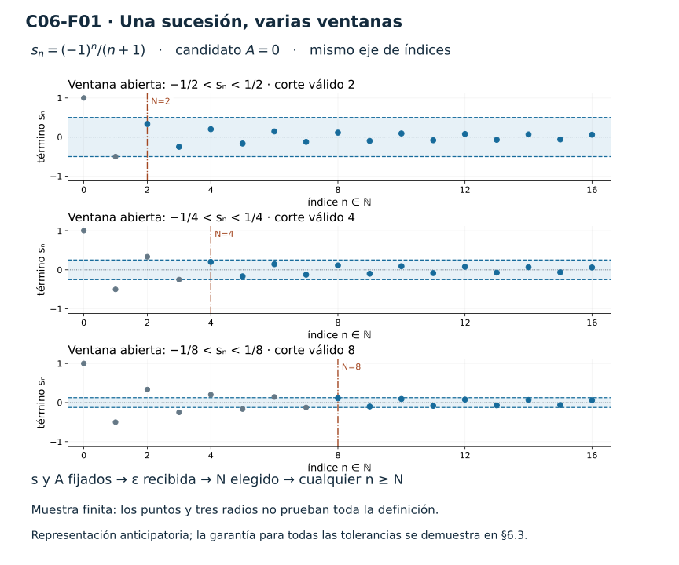
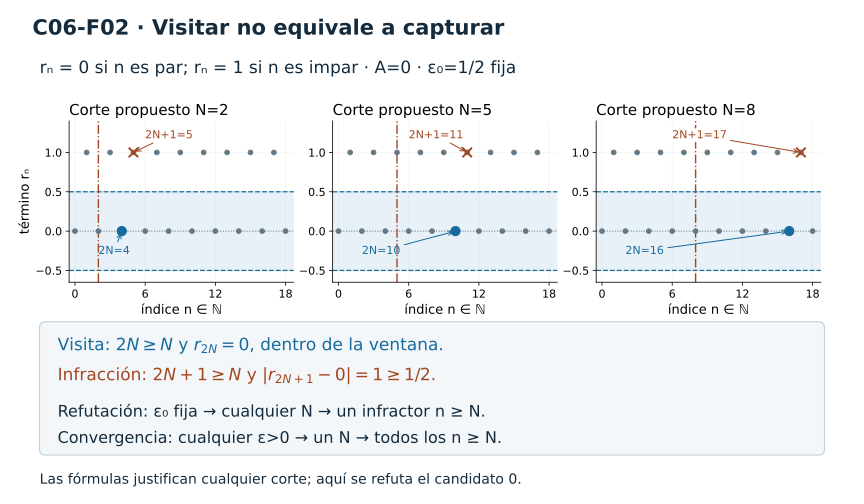
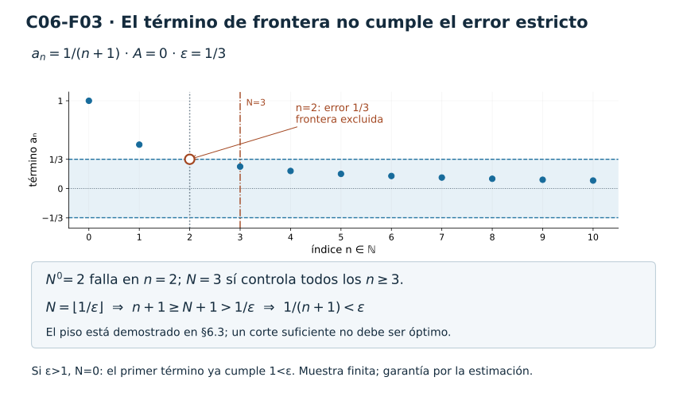
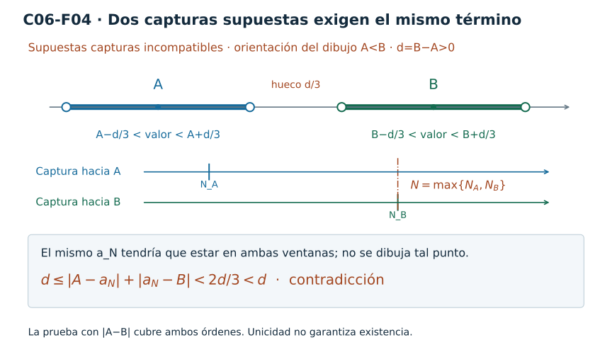
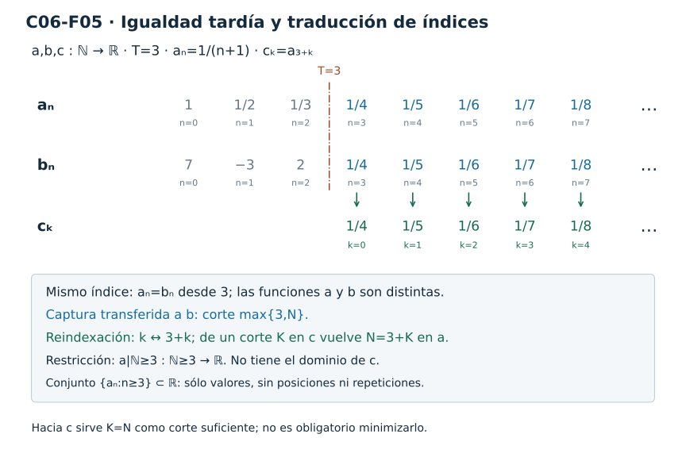
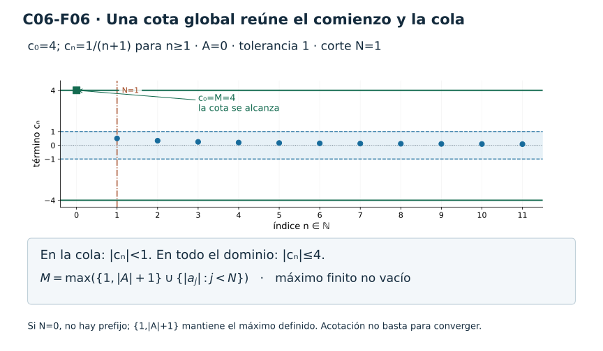
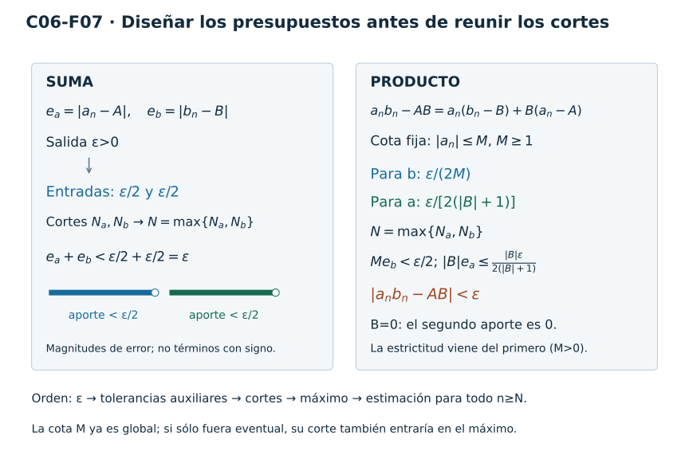
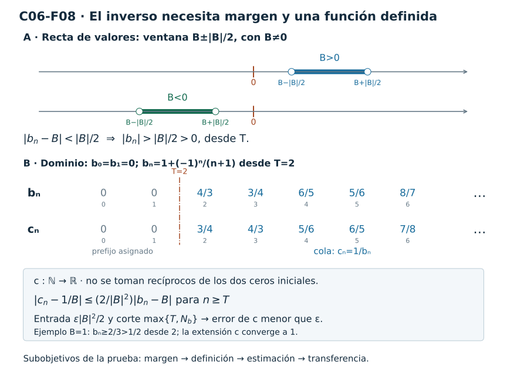
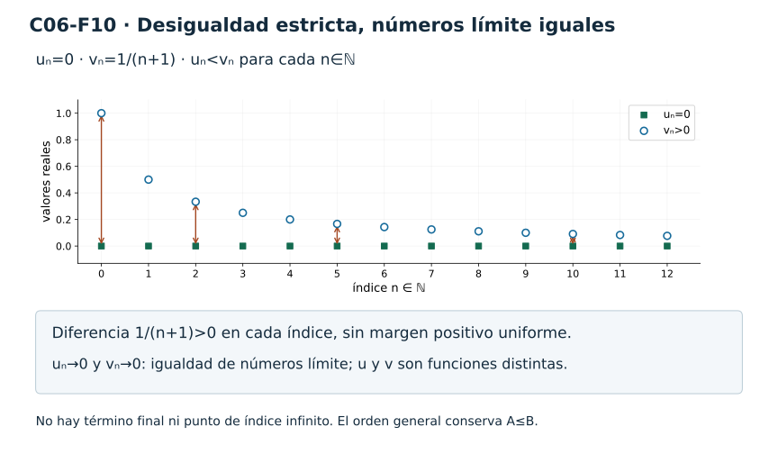
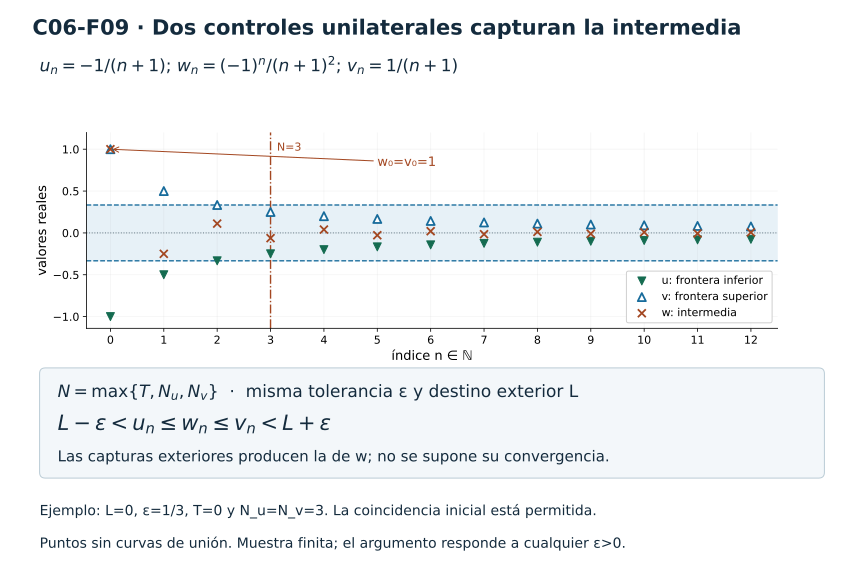

[Índice del libro](../para-matematicos/analisis-para-matematicos.html) · [Ejercicios de este capítulo](#ejercicios-6)

Al terminar el capítulo anterior sabíamos expresar que una cola de una sucesión queda dentro de un conjunto fijo. El centro y el tamaño de una bola se elegían antes de buscar el umbral. Para afirmar que una sucesión se aproxima a un número con cualquier precisión, necesitamos poder responder también cuando nos piden una ventana más pequeña.

Una cola puede quedar entre $-1$ y $1$ sin que ninguna cola quede entre $-1/10$ y $1/10$. Comprobar las dos ventanas tampoco responde a todas las exigencias posibles. La convergencia consistirá en acreditar una captura para cada tolerancia positiva alrededor de un mismo candidato. Conservamos $\mathbb N=\{0,1,2,\ldots\}$: la sucesión $a:\mathbb N\to\mathbb R$ y el candidato $A\in\mathbb R$ se fijan primero; los índices servirán para controlar la distancia de sus términos a ese número.

## 6.1. Una ventana para cada tolerancia

[]{#MA-SEC-ANM-01-006-001}

Para una tolerancia $\varepsilon>0$, la ventana $B(A,\varepsilon)=(A-\varepsilon,A+\varepsilon)$ contiene exactamente los valores que cumplen $|a_n-A|<\varepsilon$. C05 permite expresar la captura de una cola mediante $\exists N\in\mathbb N\ \forall n\ge N:|a_n-A|<\varepsilon$. La nueva obligación es disponer de esa respuesta para cada radio positivo, conservando la sucesión y el centro.

> **Convergencia a un candidato real.** Sean $a:\mathbb N\to\mathbb R$ y $A\in\mathbb R$. Decimos que la sucesión **converge a $A$**, y escribimos $a_n\to A$, si para cada $\varepsilon>0$ existe un $N\in\mathbb N$ tal que, para todo $n\in\mathbb N$ con $n\ge N$, se cumple $|a_n-A|<\varepsilon$.

En símbolos,

$$
a_n\to A\iff\forall\varepsilon>0\ \exists N\in\mathbb N\ \forall n\in\mathbb N:
\quad n\ge N\Longrightarrow |a_n-A|<\varepsilon.
$$

La tolerancia se impone sobre la recta de valores y el umbral se elige en el dominio de índices. Después de elegir $N$, el índice $n\ge N$ es arbitrario: debemos controlar toda la cola. El umbral puede depender de la tolerancia y no tiene por qué ser el menor. Si funciona $N$, también funciona cualquier $K\ge N$, porque $n\ge K$ implica $n\ge N$.

Consideremos $r_n=0$ cuando $n$ es par y $r_n=1$ cuando es impar. La bola $B(0,2)$ contiene todos sus términos, con corte $0$. La de radio $1/2$ no captura ninguna cola: después de cualquier $N$, el índice impar $2N+1\ge N$ sigue aportando el valor $1$. Encontrar una ventana favorable alrededor de cero no acredita el candidato cero.

La frontera tampoco cumple el error estricto. Con candidato $A=2$ y tolerancia $1/3$, el valor $2$ queda dentro de la ventana, pero $5/3$ y $7/3$ están en sus extremos y tienen error exactamente $1/3$. Una muestra de términos interiores no demuestra que los posteriores también lo sean, y una muestra de tolerancias no reemplaza a todas las positivas.

La sucesión $s_n=(-1)^n/(n+1)$ permite representar esas exigencias cambiando de lado. Sus primeros términos son $1,-1/2,1/3,-1/4,\ldots$. En las ventanas de radios $1/2$, $1/4$ y $1/8$, los cortes $2$, $4$ y $8$ dejan dentro los términos mostrados a partir de esas posiciones. El de índice $7$ cae exactamente en la frontera inferior de la última ventana. Esta lectura anticipa lo que habrá que demostrar; §6.3 dará un argumento para cualquier tolerancia y todos los índices posteriores.

{#fig-anm-c06-f01 fig-alt="La misma sucesión alternante se muestra con ventanas abiertas de radios 1/2, 1/4 y 1/8 y cortes 2, 4 y 8. Cada panel es una muestra finita. La prueba general se encuentra en §6.3."}

Para una constante la comprobación ya es completa. Si $a_n=A$ para todo $n$, recibida cualquier $\varepsilon>0$ elegimos $N=0$: el error es $0<\varepsilon$ en toda la sucesión. Si sólo sabemos que $b_n=A$ para $n\ge T$, sirve $N=T$ para cada tolerancia. Así, $(7,-3,2,2,\ldots)$ converge a $2$, y $(9,-4,1,1,\ldots)$ converge a $1$; sus prefijos no entran en la cola que exige la estimación. No hemos usado aún una regla general de invariancia: el error de esas colas es exactamente cero.

La convergencia permite, por tanto, alcanzar el candidato y repetir valores; tampoco exige aumentar estrictamente el umbral al reducir la tolerancia. La escritura $a_n\to A$ expresa una relación entre una función y un número, y no los identifica. No hay un término $a_\infty$: infinito no es un índice natural. Las gráficas siguen siendo conjuntos discretos de pares $(n,a_n)$.

La definición mediante bolas tiene una lectura equivalente con las vecindades de C04.

> **Caracterización por vecindades.** Una sucesión $a:\mathbb N\to\mathbb R$ converge a $A\in\mathbb R$ si y sólo si está eventualmente en cada vecindad de $A$.

Si $a_n\to A$ y $U$ es una vecindad de $A$, existe $r>0$ con $B(A,r)\subseteq U$. Aplicando la convergencia a esa tolerancia obtenemos un corte desde el cual $a_n\in B(A,r)\subseteq U$. Así, la sucesión está eventualmente en $U$. Recíprocamente, si cada vecindad de $A$ captura una cola, para una tolerancia arbitraria $\varepsilon>0$ usamos la propia vecindad $B(A,\varepsilon)$. Su captura es exactamente el error estricto de la definición.

Las dos direcciones usan inclusiones y la definición de vecindad, sin exigir que $U$ sea abierto o un intervalo. El corte puede depender de $U$. En la sucesión eventualmente constante de valor $2$, por ejemplo, toda vecindad de $2$ contiene la cola constante desde el índice $2$; en una sucesión no constante, una bola contenida en la vecindad será lo que permita transportar el control de distancia.

### Antes de seguir

#### Microcontrol 1

[]{#MA-MIC-ANM-01-006-001}

En la afirmación $a_n\to A$, identifica el tipo de cada objeto $a$, $n$, $a_n$, $A$, $\varepsilon$ y $N$, e indica cuáles se fijan antes de recibir la tolerancia.

[]{#MA-MSOL-ANM-01-006-001}

Ver solución del microcontrol 1

$a$ es una función $\mathbb N\to\mathbb R$; $n\in\mathbb N$ es un índice y $a_n\in\mathbb R$ su término. El candidato $A\in\mathbb R$ es otro número real, $\varepsilon>0$ una tolerancia real y $N\in\mathbb N$ un umbral. Primero se fijan la sucesión $a$ y el candidato $A$. Después se recibe $\varepsilon$, se elige $N$ y se toma un índice arbitrario $n\ge N$.

#### Microcontrol 2

[]{#MA-MIC-ANM-01-006-002}

Escribe la definición de $a_n\to A$ como una oración completa y luego en forma simbólica, conservando la condición $n\ge N$ y la desigualdad estricta del error.

[]{#MA-MSOL-ANM-01-006-002}

Ver solución del microcontrol 2

La sucesión $a$ converge al candidato $A$ si, para cada tolerancia real positiva, existe un umbral natural desde el que todos los términos tienen distancia a $A$ estrictamente menor que esa tolerancia. Simbólicamente,

$$
\forall\varepsilon>0\ \exists N\in\mathbb N\ \forall n\in\mathbb N:\quad n\ge N\Longrightarrow |a_n-A|<\varepsilon.
$$

La sucesión y el candidato están fijados antes de esa cuantificación.

#### Microcontrol 3

[]{#MA-MIC-ANM-01-006-003}

Para $r_n=0$ si $n$ es par y $r_n=1$ si es impar, da un umbral de captura en $B(0,2)$. Explica por qué ningún umbral captura una cola en $B(0,1/2)$ y qué afirma esto sobre el candidato 0.

[]{#MA-MSOL-ANM-01-006-003}

Ver solución del microcontrol 3

En $B(0,2)$ sirve $N=0$, pues los dos valores posibles, 0 y 1, tienen módulo menor que 2. En $B(0,1/2)$ no sirve ningún umbral: para cualquier $N$, el índice impar $2N+1\ge N$ tiene valor 1 y error $1\ge1/2$. Por tanto, $r$ no converge al candidato 0. Esta comprobación, por sí sola, refuta ese candidato; no formula todavía una refutación de todos los reales.

#### Microcontrol 4

[]{#MA-MIC-ANM-01-006-004}

Supón que $N$ satisface la estimación para una tolerancia fija y que $K\ge N$. Justifica que $K$ también es un testigo válido. ¿Exige la definición escoger el menor umbral?

[]{#MA-MSOL-ANM-01-006-004}

Ver solución del microcontrol 4

Si $n\ge K\ge N$, entonces $n\ge N$ y se aplica la estimación acreditada por el corte original. Así $K$ controla la misma tolerancia en toda su cola. La definición exige algún testigo natural suficiente, no el menor. La posibilidad de aumentar el umbral permite sincronizar controles sin tener que minimizar cada corte.

#### Microcontrol 5

[]{#MA-MIC-ANM-01-006-005}

Con candidato $A=2$ y tolerancia $\varepsilon=1/3$, clasifica como interiores o de frontera los valores $2$, $5/3$ y $7/3$. ¿Cuáles cumplen el error estricto?

[]{#MA-MSOL-ANM-01-006-005}

Ver solución del microcontrol 5

El valor 2 es interior, con error 0. Los valores $5/3$ y $7/3$ están en la frontera de $B(2,1/3)$, porque sus errores respecto de 2 son exactamente $1/3$. Sólo el valor 2 cumple el error estricto. Estar en el intervalo cerrado correspondiente no equivale a estar en la bola abierta.

#### Microcontrol 6

[]{#MA-MIC-ANM-01-006-006}

Demuestra directamente desde la definición que $b=(9,-4,1,1,1,\ldots)$ converge a 1. Indica un umbral válido para cualquier tolerancia y explica por qué los dos primeros términos no invalidan tu prueba.

[]{#MA-MSOL-ANM-01-006-006}

Ver solución del microcontrol 6

Con la convención de índice inicial 0, tenemos $b_0=9$, $b_1=-4$ y $b_n=1$ desde $n=2$. Para cualquier $\varepsilon>0$, elegimos $N=2$. Si $n\ge N$, entonces $|b_n-1|=0<\varepsilon$. Los dos términos anteriores no pertenecen a la cola que debe controlarse; sus errores no invalidan el testigo.

#### Microcontrol 7

[]{#MA-MIC-ANM-01-006-007}

¿Qué dos limitaciones impiden que la tabla del ejemplo alternante constituya por sí sola una demostración de convergencia? Distingue la cantidad de índices mostrados de la cantidad de tolerancias comprobadas.

[]{#MA-MSOL-ANM-01-006-007}

Ver solución del microcontrol 7

La tabla sólo muestra un número finito de índices, mientras que una captura exige controlar todos los índices posteriores al corte. Además, sólo comprueba las tolerancias que aparecen en ella, mientras que la definición exige responder a cualquier real positivo. Una fórmula de error y una estimación general pueden cerrar ambas obligaciones; la inspección de esas filas no las cierra.

#### Microcontrol 8

[]{#MA-MIC-ANM-01-006-008}

Reconstruye las dos direcciones de la caracterización por vecindades. Señala en una la inclusión de una bola y en la otra la vecindad concreta que recupera una tolerancia arbitraria.

[]{#MA-MSOL-ANM-01-006-008}

Ver solución del microcontrol 8

Si $a_n\to A$ y $U$ es una vecindad de $A$, existe $r>0$ con $B(A,r)\subseteq U$. La convergencia captura una cola en esa bola, y la inclusión la sitúa en $U$. Recíprocamente, si cada vecindad captura una cola, para una tolerancia arbitraria $\varepsilon>0$ usamos la vecindad concreta $U=B(A,\varepsilon)$. Su captura significa $|a_n-A|<\varepsilon$ eventualmente, que recupera la definición.

### Ejercicios de la sección 6.1

[]{#ejercicios-6}

#### Ejercicio 1. Ventanas con lados distintos

[]{#MA-EX-ANM-01-006-001}

Fija una sucesión $a:\mathbb N\to\mathbb R$ y $A\in\mathbb R$. Compara la afirmación $a_n\to A$ con la siguiente: para cada $r,s>0$ existe $N\in\mathbb N$ tal que $A-r<a_n<A+s$ para todo $n\ge N$. Demuestra la equivalencia e identifica qué datos se fijan y cuáles se eligen.

[]{#MA-SOL-ANM-01-006-001}

Ver solución del ejercicio 1

La sucesión $a$ y el candidato real $A$ se fijan al comienzo; $n$ y $N$ son índices, mientras que $a_n,r,s$ son reales. Si $a_n\to A$, dados $r,s>0$ usamos la tolerancia $\delta=\min\{r,s\}>0$. Su umbral garantiza $-r<a_n-A<s$ en toda la cola. Recíprocamente, recibida $\varepsilon>0$, aplicamos la condición con $r=s=\varepsilon$. Entonces $A-\varepsilon<a_n<A+\varepsilon$, que equivale a $|a_n-A|<\varepsilon$. En cada dirección el umbral se elige antes de tomar un índice arbitrario de la cola; no hace falta que las ventanas iniciales sean simétricas.

#### Ejercicio 2. Lo que un prefijo no decide

[]{#MA-EX-ANM-01-006-002}

Dados $m\in\mathbb N$ y $x_0,\ldots,x_m\in\mathbb R$, construye dos sucesiones que coincidan con esos datos: una que converja a 0 y otra que no converja a 0. Justifica ambas afirmaciones sin inferir propiedades de una cola a partir de una muestra. Explica qué comparten sus gráficas para $0\le n\le m$.

[]{#MA-SOL-ANM-01-006-002}

Ver solución del ejercicio 2

Definimos $a_n=b_n=x_n$ para $n\le m$, y ponemos $a_n=0$, $b_n=2$ para $n>m$. Son funciones con dominio $\mathbb N$ y valores reales. Para cualquier $\varepsilon>0$, el umbral $m+1$ da $|a_n|=0<\varepsilon$, de modo que $a_n\to0$. Para $b$ fijamos la tolerancia 1. Ningún corte $N$ captura su cola alrededor de 0: el índice $n=\max\{N,m+1\}$ tiene $|b_n|=2\ge1$. Las gráficas comparten exactamente los puntos prescritos $(n,x_n)$ en el intervalo de índices mostrado. Ese prefijo no decide la captura de una cola ni la convergencia a 0.

#### Ejercicio 3. Una familia con destino común

[]{#MA-EX-ANM-01-006-003}

Fija $T\in\mathbb N$ y $A\in\mathbb R$. Para cada familia de reales $x=(x_0,\ldots,x_{T-1})$, define $a^x_n=x_n$ si $n<T$ y $a^x_n=A$ si $n\ge T$. Describe el caso $T=0$, demuestra directamente la convergencia a $A$ y determina cuándo $a^x=a^y$ como funciones. ¿La igualdad del candidato obliga a esa igualdad de funciones?

[]{#MA-SOL-ANM-01-006-003}

Ver solución del ejercicio 3

Cuando $T=0$, el prefijo es vacío y la única sucesión de esta familia es la constante $A$. Para cualquier $T$ y cualquier $\varepsilon>0$, tomamos $N=T$. Todos los índices $n\ge N$ cumplen $|a^x_n-A|=0<\varepsilon$; la prueba no depende de las magnitudes del prefijo. Las funciones $a^x$ y $a^y$ tienen el mismo dominio y coinciden desde $T$. Son iguales si y sólo si $x_j=y_j$ para todos los índices $j<T$, pues ésa es la única zona en que pueden diferir. Si $T>0$, basta escoger $x_0\ne y_0$ para obtener funciones diferentes con el mismo candidato de convergencia. No se necesita aquí el teorema posterior de unicidad.

#### Ejercicio 4. Qué familia de ventanas basta

[]{#MA-EX-ANM-01-006-004}

Demuestra que $a_n\to A$ equivale a que todo intervalo abierto $(u,v)$ con $u<A<v$ capture una cola. Compara esta condición con la captura por cada vecindad de $A$, entendiendo vecindad en el sentido de C04.

[]{#MA-SOL-ANM-01-006-004}

Ver solución del ejercicio 4

Si $a_n\to A$ y $u<A<v$, la tolerancia $\delta=\min\{A-u,v-A\}>0$ produce una cola en $(A-\delta,A+\delta)\subseteq(u,v)$. A la inversa, los intervalos $(A-\varepsilon,A+\varepsilon)$ están entre los intervalos exigidos, por lo que recuperamos la definición para cada $\varepsilon>0$. Todo intervalo abierto que contiene $A$ es una vecindad: contiene esa bola de radio $\delta$. Además, por la definición de C04, cualquier vecindad $U$ de $A$ contiene una bola $B(A,r)$ con $r>0$. Así, capturar cada vecindad implica capturar cada intervalo, y capturar cada intervalo implica capturar una bola contenida en cada vecindad. Las inclusiones transmiten la captura a $U$, aunque $U$ no sea un intervalo.

## 6.2. Quién elige qué: leer y negar la definición

[]{#MA-SEC-ANM-01-006-002}

El orden de elecciones determina qué datos tenemos al construir cada objeto. Para probar $a_n\to A$, fijamos $a$ y $A$, recibimos $\varepsilon>0$, construimos $N\in\mathbb N$ y verificamos un índice arbitrario $n\ge N$. El corte puede depender de $a,A,\varepsilon$, pero debe quedar elegido antes del índice que recorrerá su cola.

Si invertimos las primeras elecciones y pedimos un mismo corte para todas las tolerancias, obtenemos una condición más fuerte:

$$
\exists N\in\mathbb N\ \forall\varepsilon>0\ \forall n\ge N:
\quad |a_n-A|<\varepsilon.
$$

Esta condición equivale a ser eventualmente constante de valor $A$. En efecto, fijemos $n\ge N$. Si $d=|a_n-A|>0$, podemos exigir $\varepsilon=d/2$ y obtenemos la contradicción $d<d/2$. Luego $a_n=A$ en toda esa cola. A la inversa, si una cola vale constantemente $A$, su error cero responde a cualquier tolerancia con un mismo corte. Que el ejemplo constante admita ese corte común no convierte la condición más fuerte en parte de la definición general.

Otras alteraciones eliminan obligaciones. La elección $\varepsilon_n=|a_n-A|+1$ hace verdadera una desigualdad en cada índice de cualquier sucesión, pero adapta la tolerancia al error encontrado. Tampoco la fórmula

$$
\forall\varepsilon>0\ \forall n\in\mathbb N\ \exists N\in\mathbb N:
\quad n\ge N\Longrightarrow |a_n-A|<\varepsilon
$$

expresa convergencia: podemos elegir $N=n+1$ y hacer falso el antecedente. Ya no se ha construido una cola que controle todos sus índices.

También es insuficiente visitar cada ventana arbitrariamente tarde. La sucesión $r$ de la sección anterior satisface, para todo $\varepsilon>0$ y todo $N$, la condición $r_{2N}=0\in B(0,\varepsilon)$, con $2N\ge N$. Esas visitas no eliminan los unos impares. La diferencia entre alguna aparición después de cada corte y todos los términos después de un corte es la distinción entre ocurrencia y eventualidad de C05.

Para refutar un candidato debemos conservar ese mismo orden lógico al negar la definición. El fracaso de la implicación $n\ge N\Rightarrow |a_n-A|<\varepsilon$ exige que el índice esté en la cola y falle la estimación. Al negar los cuantificadores exteriores obtenemos:

> **Refutación de un candidato.** Para a y A fijados, la afirmación $a_n\not\to A$ equivale a que exista una tolerancia $\varepsilon_0>0$ tal que, para cada $N\in\mathbb N$, haya un $n\in\mathbb N$ con $n\ge N$ y $|a_n-A|\ge\varepsilon_0$.

$$
a_n\not\to A\iff\exists\varepsilon_0>0\ \forall N\in\mathbb N\ \exists n\in\mathbb N:
\quad n\ge N\ \text{y}\ |a_n-A|\ge\varepsilon_0.
$$

La tolerancia de refutación queda fija mientras el índice infractor responde a cada corte. La igualdad en la frontera ya es una infracción. Para $r$ y $A=0$, elegimos $\varepsilon_0=1/2$; tras cualquier $N$, sirve $n=2N+1$, pues $r_n=1$. Los índices pares siguen dentro de la ventana, sin invalidar la prueba: para refutar basta un infractor después de cada corte. Un solo infractor inicial, en cambio, puede dejarse atrás y no prueba esa condición.

{#fig-anm-c06-f02 fig-alt="Para cortes 2, 5 y 8 se muestran una visita par y una infracción impar. La tolerancia 1/2 permanece fija. Las fórmulas 2N y 2N+1 justifican ambos índices tras cualquier corte y refutan el candidato cero."}

Refutar un candidato no excluye los demás. La constante $c_n=1$ converge a $1$, pero no a $0$: con tolerancia $1$, el propio índice $n=N$ tiene error $1$ después de cada corte. La constante $c_n=3$ refuta de la misma manera el candidato $1$ con tolerancia $2$. En ambos casos la infracción cae exactamente en la frontera; exigir un error mayor, en lugar de mayor o igual, perdería esos testigos.

Decir que no hay ningún límite real antepone la obligación de refutar cada candidato:

$$
\forall A\in\mathbb R\ \exists\varepsilon_A>0\ \forall N\in\mathbb N\ \exists n\in\mathbb N:
\quad n\ge N\ \text{y}\ |a_n-A|\ge\varepsilon_A.
$$

La tolerancia puede depender de $A$, pero no del corte recibido después. Cambiar de candidato durante una misma comprobación tampoco acredita la conclusión buscada; el problema 5 examina esa pérdida de obligación.

Usaremos siempre $n\ge N$. Una definición con $n>N$ describe la misma convergencia, aunque no conserve el valor numérico de cada testigo. Un corte válido para $n\ge N$ sirve para $n>N$; en sentido inverso, un corte $N$ válido para $n>N$ se convierte en $N+1$ bajo nuestra convención. En $d=(1,0,0,\ldots)$, con candidato cero y tolerancia $1/2$, el corte $0$ funciona para $n>0$ y falla para $n\ge0$. El corte $1$ recupera la captura con el extremo incluido.

### Antes de seguir

#### Microcontrol 9

[]{#MA-MIC-ANM-01-006-009}

Describe el orden de elecciones de una prueba de $a_n\to A$. ¿De qué datos puede depender N y por qué no puede construirse después de escoger el índice que debe controlar?

[]{#MA-MSOL-ANM-01-006-009}

Ver solución del microcontrol 9

Se fijan $a$ y $A$, se recibe $\varepsilon>0$, se construye $N\in\mathbb N$ y se verifica el error para un $n\ge N$ arbitrario. El umbral puede depender de $a,A,\varepsilon$, pero no del índice posterior que recorre la cola. Elegirlo después de conocer ese índice cambiaría la obligación: no se habría construido un corte común para todos los términos tardíos.

#### Microcontrol 10

[]{#MA-MIC-ANM-01-006-010}

Demuestra que pedir un mismo N para todas las tolerancias equivale a que la sucesión sea eventualmente constante de valor A. Identifica la tolerancia que excluye un error positivo.

[]{#MA-MSOL-ANM-01-006-010}

Ver solución del microcontrol 10

Si un mismo $N$ funciona para todas las tolerancias y algún $n\ge N$ tiene error $d=|a_n-A|>0$, elegimos $\varepsilon=d/2$. La captura exigiría $d<d/2$, contradicción. Luego $a_n=A$ para todos los índices desde $N$. A la inversa, si la sucesión es constante de valor $A$ desde un corte, el error cero hace que ese corte sirva para cualquier tolerancia positiva.

#### Microcontrol 11

[]{#MA-MIC-ANM-01-006-011}

Explica por qué las elecciones $\varepsilon_n=|a_n-A|+1$ no prueban convergencia, aunque produzcan una desigualdad estricta en cada índice.

[]{#MA-MSOL-ANM-01-006-011}

Ver solución del microcontrol 11

Las cantidades $\varepsilon_n=|a_n-A|+1$ se adaptan al error de cada término y garantizan una desigualdad automática. No responden a una tolerancia arbitraria recibida previamente ni producen un corte que la controle. Por ejemplo, para $a_n=1$ y candidato 0 esas elecciones siempre dan 2, pero la tolerancia $1/2$ no captura ningún término. El procedimiento elude las exigencias pequeñas en lugar de acreditarlas.

#### Microcontrol 12

[]{#MA-MIC-ANM-01-006-012}

En la fórmula con orden $\forall\varepsilon>0\ \forall n\in\mathbb N\ \exists N\in\mathbb N$ y conclusión $n\ge N\Rightarrow |a_n-A|<\varepsilon$, muestra cómo N=n+1 la hace verdadera para cualquier sucesión y candidato. ¿Qué obligación se perdió?

[]{#MA-MSOL-ANM-01-006-012}

Ver solución del microcontrol 12

Tras recibir $\varepsilon$ y escoger $n$, se puede poner $N=n+1$. Entonces $n\ge N$ es falso y la implicación resulta verdadera, cualquiera que sea el error. Se perdió el control de todos los índices posteriores a un único umbral: la elección depende del término que se quería comprobar y lo deja fuera de su propia cola.

#### Microcontrol 13

[]{#MA-MIC-ANM-01-006-013}

Deriva la negación de la definición para un candidato fijo. Explica por qué deben aparecer n≥N y error ≥ε₀ unidos por «y», y no por una implicación.

[]{#MA-MSOL-ANM-01-006-013}

Ver solución del microcontrol 13

Negar sucesivamente los cuantificadores y la implicación da

$$
\exists\varepsilon_0>0\ \forall N\in\mathbb N\ \exists n\in\mathbb N:\quad n\ge N\ \text{y}\ |a_n-A|\ge\varepsilon_0.
$$

El candidato permanece fijo. La negación de $P\Rightarrow Q$ es $P\land\neg Q$: el índice debe pertenecer a la cola y fallar la estimación. Una implicación permitiría que un índice anterior al corte acreditase vacíamente la condición, sin producir ningún infractor tardío.

#### Microcontrol 14

[]{#MA-MIC-ANM-01-006-014}

Para $r_n=0$ si n es par y $r_n=1$ si es impar, fija A=0 y ε₀=1/2. Da, después de un N arbitrario, un índice interior y otro infractor. ¿Cuál de ellos acredita la refutación y por qué no importa que exista el otro?

[]{#MA-MSOL-ANM-01-006-014}

Ver solución del microcontrol 14

El índice $2N\ge N$ es interior: su valor es 0 y su error es cero. El índice $2N+1\ge N$ es infractor: su valor es 1 y el error es al menos $1/2$. El segundo acredita la refutación, pues impide que todos los términos de la cola estén en la ventana. La existencia simultánea de visitas interiores no elimina la infracción que sobrevive a cada corte.

#### Microcontrol 15

[]{#MA-MIC-ANM-01-006-015}

Usa la sucesión constante $c_n=3$ para refutar el candidato A=1 con una tolerancia cuyo error caiga exactamente en la frontera. Explica por qué esa refutación no demuestra ausencia de todo límite real.

[]{#MA-MSOL-ANM-01-006-015}

Ver solución del microcontrol 15

El error respecto de 1 es $|3-1|=2$ en todo índice. Fijamos $\varepsilon_0=2$ y, después de cualquier corte $N$, elegimos $n=N$. El error cae en la frontera y falla la desigualdad estricta. Esto refuta el candidato 1, pero la sucesión converge a 3: con ese candidato el error es cero desde el índice 0. Refutar un número no refuta los demás.

#### Microcontrol 16

[]{#MA-MIC-ANM-01-006-016}

Para $d=(1,0,0,\ldots)$, candidato 0 y tolerancia 1/2, compara el corte N=0 bajo n>N y bajo n≥N. Produce un testigo válido con nuestra convención y justifica la traducción general entre ambas formulaciones.

[]{#MA-MSOL-ANM-01-006-016}

Ver solución del microcontrol 16

Con el corte 0 y condición $n>0$, sólo se inspeccionan términos nulos, así que el error es menor que $1/2$. Con $n\ge0$ se incluye $d_0=1$ y ese corte falla; bajo nuestra convención sirve $N=1$. En general, un umbral $K$ para $n>K$ se transforma en $K+1$ para $n\ge K+1$, porque los índices son naturales. Si un umbral $N$ funciona para $n\ge N$, también sirve para $n>N$, ya que se reduce la cola exigida.

Ya podemos distinguir una captura de toda la cola, una visita tardía y un infractor que sobrevive a cada corte. En §6.3 usaremos estas obligaciones para construir y comprobar umbrales explícitos; la fórmula de un testigo deberá responder a la definición que acabamos de aprender a leer.

### Ejercicios de la sección 6.2

#### Ejercicio 5. Un candidato elegido demasiado tarde

[]{#MA-EX-ANM-01-006-005}

Alguien escribe: «Para cada $\varepsilon>0$ puedo elegir $A_\varepsilon\in\mathbb R$ y $N_\varepsilon\in\mathbb N$ que satisfacen $|a_n-A_\varepsilon|<\varepsilon$ para todos los índices $n\ge N_\varepsilon$. Por tanto, $a_n\to0$». Localiza la falta en esa conclusión y refútala con una sucesión concreta. ¿Cuál sería la obligación correcta para acreditar el candidato 0? No se pide decidir si la premisa implica alguna otra propiedad.

[]{#MA-SOL-ANM-01-006-005}

Ver solución del ejercicio 5

La premisa controla distancias a centros elegidos después de la tolerancia; no los identifica con 0. Para la sucesión constante $a_n=5$, basta elegir $A_\varepsilon=5$ y $N_\varepsilon=0$ para cualquier tolerancia: el error es cero. Sin embargo, con candidato 0 y tolerancia 1, cada término tiene error 5, así que ningún corte funciona. Para probar $a_n\to0$ hay que fijar ese centro antes de recibir $\varepsilon$ y, para cada tolerancia, construir un umbral que controle $|a_n|$ en toda la cola. La premisa deja libre la elección del centro; para la conclusión propuesta, todas las capturas tendrían que estar centradas en $0$.

#### Ejercicio 6. Negar la existencia de un destino

[]{#MA-EX-ANM-01-006-006}

Escribe con todos sus dominios la afirmación «$a$ no converge a ningún número real» y deriva su forma cuantificada desde la negación de «existe $A\in\mathbb R$ al que converge». Compara el orden de elecciones con la refutación de un candidato fijo.

[]{#MA-SOL-ANM-01-006-006}

Ver solución del ejercicio 6

La existencia de un destino real se expresa mediante $\exists A\in\mathbb R\ \forall\varepsilon>0\ \exists N\in\mathbb N\ \forall n\in\mathbb N:\ n\ge N\Rightarrow |a_n-A|<\varepsilon$. Al negar sucesivamente los cuantificadores y la implicación obtenemos

$$
\forall A\in\mathbb R\ \exists\varepsilon_A>0\ \forall N\in\mathbb N\ \exists n\in\mathbb N:\quad n\ge N\ \text{y}\ |a_n-A|\ge\varepsilon_A.
$$

La sucesión queda fijada. Para cada candidato se elige una tolerancia de refutación, que puede depender de él, pero no del corte posterior. Después de cada corte se construye un índice infractor. Para refutar un solo candidato $A_0$ se exige la misma condición únicamente para ese número: desaparece el cuantificador inicial sobre todos los reales. Tal refutación deja sin decidir los demás candidatos.

#### Ejercicio 7. Visitar sin permanecer

[]{#MA-EX-ANM-01-006-007}

Construye una sucesión real que tome el valor 0 en índices arbitrariamente tardíos y que también tome valores de módulo al menos 2 arbitrariamente tarde, sin ser una sucesión de sólo dos valores. Verifica que visita toda bola alrededor de 0 después de cada corte y que no converge a 0.

[]{#MA-SOL-ANM-01-006-007}

Ver solución del ejercicio 7

Definimos $a_n=0$ si $n$ es par y $a_n=n+2$ si es impar. El conjunto de valores no tiene sólo dos elementos: los índices impares producen valores distintos. Dados una tolerancia $\varepsilon>0$ y un corte $N\in\mathbb N$, el índice $2N\ge N$ satisface $a_{2N}=0\in B(0,\varepsilon)$. Por tanto, cada ventana es visitada arbitrariamente tarde. En cambio, fijamos $\varepsilon_0=2$. Después de cualquier corte, el índice $2N+1$ tiene $|a_{2N+1}|=2N+3\ge2$. Ninguna cola completa queda en $B(0,2)$. Los índices de visitas e infracciones se han construido explícitamente; no se usan resultados sobre subsucesiones.

#### Ejercicio 8. Cambiar la frontera del error

[]{#MA-EX-ANM-01-006-008}

Compara la definición usual de $a_n\to A$ con la condición que exige $|a_n-A|\le\varepsilon$ eventualmente para cada $\varepsilon>0$. Demuestra su equivalencia y deriva la negación de la segunda condición. Explica por qué las distintas desigualdades en las negaciones no cambian su alcance global.

[]{#MA-SOL-ANM-01-006-008}

Ver solución del ejercicio 8

Una captura con error estricto implica la misma captura con error no estricto. Recíprocamente, si tenemos la condición no estricta para toda tolerancia, recibida $\varepsilon>0$ usamos $\varepsilon/2$; el umbral correspondiente garantiza $|a_n-A|\le\varepsilon/2<\varepsilon$. Su negación es: existe $\eta>0$ tal que, después de cada corte, aparece un índice con $|a_n-A|>\eta$. Esta condición implica la refutación usual con error $\ge\eta$. Si la refutación usual proporciona $\varepsilon_0>0$ y errores $\ge\varepsilon_0$ después de cada corte, esos mismos índices tienen errores $>\varepsilon_0/2$. Así obtenemos la otra negación. La posibilidad de cambiar de tolerancia permite absorber la diferencia de frontera.

#### Ejercicio 9. Sólo tolerancias pequeñas

[]{#MA-EX-ANM-01-006-009}

Sea $r>0$ fijo. Demuestra que basta verificar la captura con error estricto para todas las tolerancias $\delta$ tales que $0<\delta<r$ para acreditar $a_n\to A$. ¿Basta verificar únicamente la tolerancia $r$? Justifica la respuesta.

[]{#MA-SOL-ANM-01-006-009}

Ver solución del ejercicio 9

Para una tolerancia arbitraria $\varepsilon>0$, elegimos $\delta=\min\{\varepsilon/2,r/2\}$. Es positiva, menor que $r$ y menor que $\varepsilon$. La hipótesis proporciona un umbral para $\delta$, que sirve también para $\varepsilon$, pues $|a_n-A|<\delta<\varepsilon$. No hemos elegido un único corte para todas las tolerancias. Verificar solamente $r$ no basta: la constante $a_n=A+r/2$ satisface $|a_n-A|=r/2<r$ en todos los índices, pero no converge a $A$. La tolerancia $r/4$ falla en toda la sucesión. Una familia de exigencias pequeñas conserva la posibilidad de refinar la captura; una sola exigencia no la conserva.

## 6.3. Construir el umbral

[]{#MA-SEC-ANM-01-006-003}

Para $a_n=1/(n+1)$ y candidato cero, empezar por el error permite descubrir qué corte necesitamos. Como $n+1$ y $\varepsilon$ son positivos,

$$
\frac1{n+1}<\varepsilon\iff n+1>\frac1\varepsilon.
$$

Basta elegir un natural $N$ con $N+1>1/\varepsilon$: cada $n\ge N$ heredará esa comparación. La propiedad arquimediana de C03 §3.4 asegura naturales mayores que cualquier real. Para escribir una fórmula de respuesta construiremos primero el piso positivo que vamos a usar.

> **Piso de un real positivo.** Para cada $t>0$ existe un único $K\in\mathbb N$ tal que $K\le t<K+1$. Lo denotamos por $\lfloor t\rfloor$.

Sea $t>0$. Elegimos por la propiedad arquimediana un natural $m>t$ y consideramos

$$
F=\{k\in\{0,1,\ldots,m\}:k\le t\}.
$$

El conjunto es finito y contiene a $0$, por lo que tiene un máximo $K$. La existencia de máximo en un conjunto finito no vacío se demuestra por inducción, conservando el mayor al añadir un elemento; no requiere el principio del supremo. Como $K\le t<m$, tenemos $K<m$ y $K+1\le m$. Si también $K+1\le t$, ese sucesor pertenecería a $F$, contradiciendo la maximalidad. Así, $K\le t<K+1$.

Para probar unicidad, supongamos que $J$ cumple las mismas desigualdades. Si $K<J$, el orden natural da $K+1\le J\le t<K+1$, imposible. El caso $J<K$ produce la contradicción simétrica; luego $J=K$. El resultado tampoco depende de qué $m>t$ se haya escogido, pues cualquier construcción da esa misma propiedad única. Por ejemplo, $\lfloor5/2\rfloor=2$, $\lfloor3\rfloor=3$, y el piso de $0<t<1$ es $0$.

La dependencia de completitud entra a través del resultado arquimediano ya demostrado en C03. Después sólo usamos un máximo finito y el orden de los naturales. Volvamos a la estimación que motivó esta construcción.

> **Primera prueba de convergencia con N explícito.** La sucesión $a:\mathbb N\to\mathbb R$ dada por $a_n=1/(n+1)$ converge a 0.

Sea $\varepsilon>0$ y elijamos $N=\lfloor1/\varepsilon\rfloor\in\mathbb N$. Para todo $n\ge N$, la propiedad del piso da $n+1\ge N+1>1/\varepsilon$. Al invertir cantidades positivas,

$$
|a_n-0|=\frac1{n+1}\le\frac1{N+1}<\varepsilon.
$$

Así se cumple la definición para cualquier tolerancia. Primero descubrimos una condición suficiente trabajando desde el error; después verificamos el argumento en el orden tolerancia, corte e índice arbitrario. No usamos reglas algebraicas de límites para probar la primera convergencia.

Los detalles de frontera y dominio se ven en algunos cortes:

| $\varepsilon$ | $N=\lfloor1/\varepsilon\rfloor$ | Error del primer término de la cola |
|---:|---:|---|
| $2$ | $0$ | $1<2$ |
| $1$ | $1$ | $1/2<1$ |
| $1/3$ | $3$ | $1/4<1/3$ |
| $1/8$ | $8$ | $1/9<1/8$ |

Con $\varepsilon=2/5$, por ejemplo, $N=2$ y todo $n\ge2$ tiene error a lo sumo $1/3<2/5$. Para $\varepsilon>1$, el piso es $0$ y toda la sucesión cumple $1/(n+1)\le1<\varepsilon$. Las tolerancias grandes no obligan a introducir índices negativos ni a cambiar el dominio.

La propuesta $N'=\lfloor1/\varepsilon\rfloor-1$ tiene dos defectos. Con $\varepsilon=1/3$ produce el natural $2$, pero el término de ese índice tiene error exactamente $1/3$. Con $\varepsilon=2$ produce $-1$, que ni siquiera es un umbral natural. La fórmula válida anterior resuelve ambas obligaciones para todas las tolerancias, sin necesitar que el corte sea óptimo.

{#fig-anm-c06-f03 fig-alt="El punto de índice 2 vale 1/3 y se marca como frontera excluida. El corte 3 incluye un primer error 1/4 y controla la cola mediante la estimación general. Se conserva n mayor o igual que N."}

La sucesión alternante presentada en §6.1 ya puede demostrarse con el mismo corte. Para todo $n$, $|(-1)^n|=1$ y $n+1>0$, por lo que $|s_n|=1/(n+1)$. Dada $\varepsilon>0$, $N=\lfloor1/\varepsilon\rfloor$ controla el error de cada $n\ge N$ y prueba $s_n\to0$. Los cortes $2,4,8$ de la figura F01 son tres aplicaciones de esta prueba general. Sus términos cambian de signo; $s_0=1$, $s_1=-1/2$, $s_2=1/3$ muestran que no es monótona, sin impedir la convergencia.

También podemos fijar $A,c\in\mathbb R$ y estudiar $u_n=A+c/(n+1)$ directamente. Si $c=0$, basta $N=0$. Si $c\ne0$, recibida $\varepsilon>0$ elegimos $N=\lfloor|c|/\varepsilon\rfloor$; para $n\ge N$ tenemos $n+1>|c|/\varepsilon$ y $|u_n-A|=|c|/(n+1)<\varepsilon$. El piso sólo se aplica aquí a argumentos positivos. En $u_n=3-2/(n+1)$ sirve $N=\lfloor2/\varepsilon\rfloor$.

Para excluir todos los candidatos de $q_n=(-1)^n$, la construcción cambia. Fijemos $A\in\mathbb R$. La triangular da

$$
2=|1-(-1)|\le|1-A|+|-1-A|.
$$

Alguno de los dos errores es al menos $1$. Elegimos ese valor y fijamos $\varepsilon_0=1$. Después de cualquier $N$, el índice $2N$ presenta el valor $1$ y $2N+1$ presenta el valor $-1$; usamos el que tenga error al menos $1$. El testigo pertenece a la cola y refuta el candidato. Como $A$ fue arbitrario, no hay límite real. La prueba sólo necesita distancia, paridad y cuantificadores; no usa subsucesiones. La tolerancia uniforme respecto de $A$ funciona en este ejemplo, aunque la negación general no la exige.

La alternancia de signos aparece tanto en $q$ como en $s$. Lo que decide sus comportamientos es la magnitud de los errores: en $s$ se responde a cualquier tolerancia alrededor de cero; en $q$ una separación fija permite refutar todo candidato.

### Antes de seguir

#### Microcontrol 17

[]{#MA-MIC-ANM-01-006-017}

Reconstruye la existencia del piso de t>0 desde la propiedad arquimediana. ¿Por qué el conjunto F es no vacío y por qué su máximo K tiene un sucesor dentro de {0,…,m}?

[]{#MA-MSOL-ANM-01-006-017}

Ver solución del microcontrol 17

Por la propiedad arquimediana de C03, elegimos $m\in\mathbb N$ con $m>t$. El conjunto finito $F=\{j\in\{0,\ldots,m\}:j\le t\}$ contiene 0 y tiene máximo $K$. Como $m>t$, el índice $m$ no pertenece a $F$, luego $K<m$ y $K+1\le m$. Si $K+1\le t$, su sucesor pertenecería a $F$, contradiciendo la maximalidad. Así $K\le t<K+1$.

#### Microcontrol 18

[]{#MA-MIC-ANM-01-006-018}

Demuestra la unicidad del natural K que satisface K≤t<K+1 y explica por qué la elección inicial de m>t no cambia el resultado.

[]{#MA-MSOL-ANM-01-006-018}

Ver solución del microcontrol 18

Si $K$ y $J$ cumplen las dos desigualdades y $K<J$, el orden natural da $K+1\le J\le t$, contradiciendo $t<K+1$. Si $J<K$, se obtiene la contradicción simétrica. Por tanto, $K=J$. Toda elección de $m>t$ que produzca esa propiedad conduce al mismo natural, pues la unicidad depende sólo de $t$ y no del conjunto auxiliar elegido.

#### Microcontrol 19

[]{#MA-MIC-ANM-01-006-019}

Para $a_n=1/(n+1)$ y ε=2/5, calcula $N=\lfloor1/\varepsilon\rfloor$ y comprueba el error para un n≥N arbitrario. Identifica el paso que controla toda la cola.

[]{#MA-MSOL-ANM-01-006-019}

Ver solución del microcontrol 19

Para $\varepsilon=2/5$, $N=\lfloor5/2\rfloor=2$. Si $n\ge2$, entonces $n+1\ge3>5/2$ y, al invertir cantidades positivas, $|a_n|=1/(n+1)\le1/3<2/5$. El paso $n+1\ge N+1>1/\varepsilon$ vale para cualquier índice posterior, no sólo para el primero; por eso controla toda la cola.

#### Microcontrol 20

[]{#MA-MIC-ANM-01-006-020}

Analiza la propuesta $N'=\lfloor1/\varepsilon\rfloor-1$ con ε=1/3 y con ε=2. Distingue el defecto de frontera del defecto de dominio y produce una reparación válida para cualquier ε>0.

[]{#MA-MSOL-ANM-01-006-020}

Ver solución del microcontrol 20

Con $\varepsilon=1/3$, la propuesta da $N'=2$ y el índice 2 tiene error $1/3$, de frontera, que no satisface la condición estricta. Con $\varepsilon=2$, da $N'=-1$, que no es un natural. La reparación $N=\lfloor1/\varepsilon\rfloor$ funciona para cualquier tolerancia positiva: $n\ge N$ implica $n+1\ge N+1>1/\varepsilon$, luego $1/(n+1)<\varepsilon$. Cierra tanto el dominio del testigo como la estrictitud.

#### Microcontrol 21

[]{#MA-MIC-ANM-01-006-021}

En la primera prueba, explica por qué ε>1 permite N=0 y por qué ese caso no obliga a empezar la sucesión en el índice 1.

[]{#MA-MSOL-ANM-01-006-021}

Ver solución del microcontrol 21

Si $\varepsilon>1$, entonces $0<1/\varepsilon<1$ y su piso es 0. La sucesión está definida en el índice 0, donde $a_0=1<\varepsilon$; además, para todos los naturales $n$, $a_n\le1<\varepsilon$. Así el corte 0 controla incluso el primer término. Cambia el umbral suficiente para esa tolerancia, no el dominio $\mathbb N$ de la sucesión.

#### Microcontrol 22

[]{#MA-MIC-ANM-01-006-022}

Demuestra directamente que $s_n=(-1)^n/(n+1)$ converge a cero. ¿Qué parte de la primera prueba reutilizas y qué identidad nueva debes comprobar?

[]{#MA-MSOL-ANM-01-006-022}

Ver solución del microcontrol 22

Para todo natural $n$, $|(-1)^n|=1$ y $n+1>0$, de modo que $|s_n-0|=1/(n+1)$. Dado $\varepsilon>0$, reutilizamos $N=\lfloor1/\varepsilon\rfloor$ y la estimación de la primera prueba: si $n\ge N$, ese error es menor que $\varepsilon$. La identidad del módulo elimina el signo alternante; la construcción del corte y su verificación permanecen iguales.

#### Microcontrol 23

[]{#MA-MIC-ANM-01-006-023}

Para $u_n=3-2/(n+1)$, construye un umbral que controle el error respecto de 3 para cualquier ε>0. Explica cómo se modificaría tu construcción si el coeficiente −2 se sustituyera por 0.

[]{#MA-MSOL-ANM-01-006-023}

Ver solución del microcontrol 23

El error es $|u_n-3|=2/(n+1)$. Para $\varepsilon>0$ elegimos $N=\lfloor2/\varepsilon\rfloor$; si $n\ge N$, $n+1\ge N+1>2/\varepsilon$, luego el error es menor que $\varepsilon$. Si el coeficiente se sustituye por 0, la sucesión es constante de valor 3 y basta $N=0$ para todas las tolerancias. No hay que aplicar el piso construido para argumentos positivos a un argumento cero.

#### Microcontrol 24

[]{#MA-MIC-ANM-01-006-024}

Reconstruye la refutación de todos los candidatos para $q_n=(-1)^n$. Señala dónde se usa la triangular, cómo se elige la paridad del infractor y por qué este argumento demuestra más que refutar solamente A=0.

[]{#MA-MSOL-ANM-01-006-024}

Ver solución del microcontrol 24

Fijamos un candidato arbitrario $A$. La triangular da $2\le|1-A|+|-1-A|$, así que alguno de esos errores es al menos 1. Fijamos la tolerancia 1 y elegimos el valor separado de $A$. Después de cualquier corte $N$, usamos $2N$ si ese valor es 1, o $2N+1$ si es −1; el índice elegido es tardío y su error es al menos 1. El argumento vale para cada real $A$, por lo que excluye todo límite real, no sólo el candidato 0.

La construcción de un testigo empieza en la estimación deseada, pero su prueba termina verificando la definición completa. Ya podemos acreditar aproximaciones concretas y refutar candidatos mediante índices explícitos. En §6.4 preguntaremos qué impide que una misma sucesión cumpla la definición para dos candidatos distintos y qué control conserva al cambiar su comienzo.

### Ejercicios de la sección 6.3

#### Ejercicio 10. Centro, escala y denominador

[]{#MA-EX-ANM-01-006-010}

Fija $A,c\in\mathbb R$ y $d,e>0$. Para $a_n=A+c/(dn+e)$, demuestra directamente que $a_n\to A$. Da un umbral explícito para cada $\varepsilon>0$, trata $c=0$ y verifica que la sucesión está definida también en $n=0$.

[]{#MA-SOL-ANM-01-006-010}

Ver solución del ejercicio 10

El denominador cumple $dn+e\ge e>0$ para todo $n\in\mathbb N$, incluido 0. Si $c=0$, la sucesión es constante y $N=0$ sirve para cualquier tolerancia. Si $c\ne0$, ponemos $t=|c|/(d\varepsilon)>0$ y elegimos $N=\lfloor t\rfloor+1$. El piso usado es el construido en §6.3; por su propiedad, $N>t$. Para un índice arbitrario $n\ge N$, tenemos $dn+e>d t=|c|/\varepsilon$. Al dividir por cantidades positivas obtenemos $|a_n-A|=|c|/(dn+e)<\varepsilon$. El testigo es suficiente, aunque el término $e$ pueda permitir uno menor. No se invoca ninguna regla algebraica de límites.

#### Ejercicio 11. Dos cortes defectuosos

[]{#MA-EX-ANM-01-006-011}

Para la familia del ejercicio 10 con $c\ne0$, se proponen $N_1=\max\{0,\lfloor(|c|/\varepsilon-e)/d\rfloor\}$ y $N_2=\lfloor|c|/(d\varepsilon)\rfloor-1$. Refuta cada propuesta como fórmula válida para todos los parámetros: muestra una falla de estrictitud de $N_1$ y una falla de dominio de $N_2$. Repara ambas con un testigo universal suficiente.

[]{#MA-SOL-ANM-01-006-011}

Ver solución del ejercicio 11

Tomamos $c=d=e=1$ y $\varepsilon=1/3$. Entonces $N_1=2$, pero en el índice $n=2$ el error es $1/3$, exactamente la tolerancia. La condición estricta falla, aunque $N_1$ sea un natural. Para $N_2$, con los mismos parámetros y $\varepsilon=2$, resulta $N_2=\lfloor1/2\rfloor-1=-1$, que no pertenece a $\mathbb N$ y no puede servir como umbral de la definición. En ambas fórmulas el defecto ocurre antes de acreditar toda la cola. Una reparación común es $N=\lfloor|c|/(d\varepsilon)\rfloor+1$. Es natural y mayor que $|c|/(d\varepsilon)$; el argumento del ejercicio 10 verifica el error estricto para cada $n\ge N$. El corte asegura la desigualdad requerida; un denominador inicial mayor puede permitir empezar antes.

La [figura C06-F03](analisis-para-matematicos-capitulo-6-convergencia-el-juego-de-y-n.html) de §6.3 muestra el mismo fallo de estrictitud en n=2. No representa el segundo defecto: N₂=−1 falla por no pertenecer al dominio de índices.

#### Ejercicio 12. Un prefijo arbitrario

[]{#MA-EX-ANM-01-006-012}

Sea $T\in\mathbb N$. Define $a_n=x_n$ para $n<T$, con valores reales arbitrarios, y $a_n=A+c/(dn+e)$ para $n\ge T$, donde $A,c\in\mathbb R$ y $d,e>0$. Prueba $a_n\to A$ desde la definición, sin usar aún invariancia por modificaciones finitas. Cubre el prefijo vacío.

[]{#MA-SOL-ANM-01-006-012}

Ver solución del ejercicio 12

Los términos del prefijo son reales y los restantes están definidos porque $dn+e>0$. Si $c=0$, elegimos $N=T$ y el error es cero en toda la cola. Si $c\ne0$, dado $\varepsilon>0$ ponemos $K=\lfloor|c|/(d\varepsilon)\rfloor+1$ y $N=\max\{T,K\}$. Para cualquier $n\ge N$ se cumplen las dos obligaciones: usamos la fórmula de la cola porque $n\ge T$, y su denominador es mayor que $|c|/\varepsilon$ porque $n\ge K$. Por tanto, $|a_n-A|<\varepsilon$. Cuando $T=0$ no hay valores iniciales que controlar y la misma construcción funciona. La prueba explica directamente por qué ningún tamaño del prefijo interviene en la estimación tardía.

#### Ejercicio 13. Un corte suficiente y el menor corte

[]{#MA-EX-ANM-01-006-013}

Considera $a_n=2/(n+3)$ y candidato 0. Para cada $\varepsilon>0$, determina el menor umbral natural que da error estricto en toda la cola. Compáralo con $K=\lfloor2/\varepsilon\rfloor+1$. Examina $\varepsilon=2/5$ y $\varepsilon=1$, e identifica el papel de la frontera.

[]{#MA-SOL-ANM-01-006-013}

Ver solución del ejercicio 13

Como $n+3>0$, la condición es $n>2/\varepsilon-3$. Ponemos $m=\lfloor2/\varepsilon\rfloor$, usando sólo el piso de un real positivo. El menor umbral es

$$
N_{\min}=\max\{0,m-2\}.
$$

Si $m\le2$, entonces $2/\varepsilon<m+1\le3$, por lo que el índice 0 y todos los posteriores cumplen la condición. Si $m\ge3$, el índice $m-2$ satisface $n+3=m+1>2/\varepsilon$. Todo natural anterior tiene $n+3\le m\le2/\varepsilon$ y falla el error estricto. Esto acredita la minimalidad y el control de toda la cola. El corte $K=m+1$ del ejercicio 10 es válido pero mayor. Para $\varepsilon=2/5$, $N_{\min}=3$: el índice 2 tiene error $2/5$ y debe excluirse. Para $\varepsilon=1$, $N_{\min}=0$, mientras que $K=3$. Un testigo suficiente responde a la definición; determinar el menor requiere examinar también por qué fallan los índices anteriores.

#### Ejercicio 14. Dos valores que no desaparecen

[]{#MA-EX-ANM-01-006-014}

Sean $p,q\in\mathbb R$, $p\ne q$, y una sucesión $a$. Supón que existen fórmulas $i,j:\mathbb N\to\mathbb N$ tales que $i(N),j(N)\ge N$, $a_{i(N)}=p$ y $a_{j(N)}=q$ para cada $N$. Demuestra que $a$ no converge a ningún real. Construye además un ejemplo con $p=-2$, $q=4$ y valores adicionales en otros índices.

[]{#MA-SOL-ANM-01-006-014}

Ver solución del ejercicio 14

Fijamos un candidato arbitrario $A$ y $D=|p-q|>0$. La triangular da $D\le|p-A|+|q-A|$, de modo que alguno de los dos errores es al menos $D/2$. Elegimos ese valor una vez para este candidato y fijamos $\varepsilon_A=D/2$. Después de cualquier corte usamos $i(N)$ o $j(N)$, según el valor elegido, para obtener el infractor requerido. Como el argumento vale para cada $A$, no hay destino real. Para el ejemplo, ponemos $a_{3k}=-2$, $a_{3k+1}=4$ y $a_{3k+2}=k$. Las fórmulas $i(N)=3N$ y $j(N)=3N+1$ acreditan las hipótesis. Los valores adicionales no eliminan la separación persistente que refuta cada candidato.

## 6.4. Un solo destino; el comienzo puede cambiar

[]{#MA-SEC-ANM-01-006-004}

Dos ventanas grandes pueden solaparse, pero la convergencia permite reducir los radios según la distancia entre sus centros. Para excluir dos candidatos distintos necesitaremos además usar las dos capturas en un mismo término.

> **Unicidad del límite.** Sean $a:\mathbb N\to\mathbb R$ y $A,B\in\mathbb R$. Si $a_n\to A$ y $a_n\to B$, entonces A=B.

Supongamos $A\ne B$ y pongamos $d=|A-B|>0$. Pedimos a ambas convergencias la tolerancia $d/3$, obteniendo cortes $N_A,N_B$. El máximo $N=\max\{N_A,N_B\}$ hace disponibles las dos estimaciones en el índice $n=N$. Por la triangular,

$$
d=|A-B|\le|A-a_N|+|a_N-B|<\frac d3+\frac d3=\frac{2d}{3}<d,
$$

contradicción. Luego $A=B$. El máximo no acerca los centros; asegura que el número situado cerca de ambos sea el mismo $a_N$. Con radios $d$ sólo obtendríamos $d<2d$, que no es contradictorio.

{#fig-anm-c06-f04 fig-alt="Dos ventanas abiertas de radio d/3 están separadas por un hueco d/3. Los cortes de dos capturas hipotéticas se reúnen en su máximo y exigirían una pertenencia simultánea imposible para el mismo término."}

La unicidad permite escribir $\lim_{n\to\infty}a_n=A$ cuando se ha demostrado $a_n\to A$. La existencia sigue siendo otra obligación: no toda sucesión tiene límite real. Si una prueba acredita $u_n\to3$ y otra pretende acreditar $u_n\to B$, ambas sólo pueden ser correctas si $B=3$. La notación no evalúa una función en infinito ni crea un último término.

Una modificación del comienzo puede cambiar la función y conservar todas sus convergencias.

> **Coincidencia eventual y convergencia.** Sean $a,b:\mathbb N\to\mathbb R$. Supongamos que existe un $T\in\mathbb N$ tal que $a_n=b_n$ para todo n≥T. Entonces, para cada $A\in\mathbb R$, se cumple $a_n\to A$ si y sólo si $b_n\to A$.

Fijemos $A$ y supongamos $a_n\to A$. Para una tolerancia $\varepsilon>0$, sea $N_a$ un corte que controla el error de $a$. Tomamos $N_b=\max\{T,N_a\}$. Si $n\ge N_b$, valen $b_n=a_n$ y $|a_n-A|<\varepsilon$, luego $|b_n-A|<\varepsilon$. Esto prueba $b_n\to A$. La dirección inversa repite el argumento intercambiando $a$ y $b$ y usando el mismo corte de coincidencia $T$.

El resultado también conserva la ausencia de límite: si $a$ no tuviera límite real y $b$ lo tuviera, la equivalencia produciría un límite para $a$. No conserva propiedades que miren el prefijo. Para $a_n=1/(n+1)$, definamos $b_0=7$, $b_1=-3$, $b_2=2$ y $b_n=a_n$ desde $3$. Entonces $b_n\to0$, con testigo $\max\{3,\lfloor1/\varepsilon\rfloor\}$; la positividad global de $a$ no pasa a $b$.

Tener el mismo límite tampoco fuerza coincidencia eventual. Las sucesiones $a_n=1/(n+1)$ y $v_n=-1/(n+1)$ convergen a cero por las pruebas directas, pero sus términos tienen signos opuestos y no coinciden en ningún índice.

Reindexar una cola requiere otra traducción: si $b_k=a_{T+k}$, los términos correspondientes tienen índices distintos, y no podemos invocar una igualdad $a_n=b_n$.

> **Convergencia de una cola reindexada.** Sean $a:\mathbb N\to\mathbb R$, $T\in\mathbb N$ y $b:\mathbb N\to\mathbb R$ dada por $b_k=a_{T+k}$. Para cada $A\in\mathbb R$, se cumple $a_n\to A$ si y sólo si $b_k\to A$.

Si $a_n\to A$ y $N$ controla una tolerancia, para $k\ge N$ se cumple $T+k\ge k\ge N$; por tanto $|b_k-A|=|a_{T+k}-A|<\varepsilon$. El mismo corte numérico es suficiente en la nueva sucesión. Puede mejorarse a $K=\max\{0,N-T\}$, como comprueba el problema 16, pero no necesitamos minimizarlo.

Recíprocamente, si $b_k\to A$, recibimos $\varepsilon>0$ y elegimos su corte $K$. Tomamos $N=T+K$. Para $n\ge N$, el número $k=n-T$ es natural y cumple $k\ge K$, y $a_n=b_k$; así, $|a_n-A|<\varepsilon$. Esto prueba la equivalencia en ambos sentidos.

Para $a_n=1/(n+1)$ y $T=3$, la nueva función es $b_k=1/(k+4)$: $b_0=a_3=1/4$. Un corte $K=5$ de $b$ se transporta al corte $N=8$ de $a$; un corte $N=8$ de $a$ permite usar $K=8$ para $b$, o el corte más ajustado $5$. En cada caso la comprobación es la desigualdad entre el índice original y el nuevo.

{#fig-anm-c06-f05 fig-alt="Las filas a y b comparten términos desde n=3, pero sus prefijos difieren. La fila c comienza en k=0 con a_3. Las flechas sólo traducen índices, no desplazan valores. Restricción y conjunto de valores tienen tipos distintos."}

En esta figura, $b$ nombra la sucesión con prefijo modificado y $c$ la cola reindexada, mientras que el teorema anterior llamó $b$ a la reindexación. La restricción $a|_{\mathbb N_{\ge T}}$ conserva los índices originales; la cola reindexada tiene dominio $\mathbb N$; el conjunto $\{a_n:n\ge T\}$ sólo es una imagen y pierde las posiciones. Para $T=0$, restricción y reindexación coinciden con $a$. Para $T>0$, sus dominios son distintos. El resultado demostrado se refiere al desplazamiento $k\mapsto T+k$, sin presuponer todavía una teoría de selecciones arbitrarias de índices.

### Antes de seguir

#### Microcontrol 25

[]{#MA-MIC-ANM-01-006-025}

Reconstruye la unicidad del límite e identifica por qué la triangular debe aplicarse a un mismo término. ¿Qué asegura el corte máximo?

[]{#MA-MSOL-ANM-01-006-025}

Ver solución del microcontrol 25

Si $a_n\to A$ y $a_n\to B$ con $A\ne B$, ponemos $d=|A-B|>0$. Las capturas con tolerancia $d/3$ proporcionan cortes $N_A,N_B$. En un mismo índice $n\ge\max\{N_A,N_B\}$, la triangular da $d\le|A-a_n|+|a_n-B|<2d/3$, contradicción. El máximo asegura que ambos controles recaigan en ese mismo término, necesario para enlazar las dos distancias. Así $A=B$.

#### Microcontrol 26

[]{#MA-MIC-ANM-01-006-026}

En la prueba de unicidad, compara las tolerancias d/3 y d para d=|A−B|>0. ¿Cuál produce la contradicción mediante la estimación escrita y por qué?

[]{#MA-MSOL-ANM-01-006-026}

Ver solución del microcontrol 26

Con tolerancia $d/3$ para cada candidato, la estimación da $d<2d/3$, imposible para $d>0$. Si usamos $d$ para ambos, sólo obtenemos $d<2d$, que no contradice la separación. Las capturas pueden ajustarse porque la convergencia responde a todas las tolerancias; el reparto debe mantener el error total por debajo de la distancia entre los candidatos.

#### Microcontrol 27

[]{#MA-MIC-ANM-01-006-027}

Si una prueba acredita $u_n\to3$ y otra pretende acreditar $u_n\to B$, explica qué permite concluir la unicidad. ¿Garantiza ese teorema que toda sucesión tenga un límite real?

[]{#MA-MSOL-ANM-01-006-027}

Ver solución del microcontrol 27

Si las dos pruebas fueran válidas, la unicidad aplicada a $u$ obligaría a $B=3$. Cuando $B\ne3$, sus conclusiones no pueden acreditarse simultáneamente para la misma sucesión. El teorema garantiza a lo sumo un destino real; no garantiza que exista alguno. La sucesión $(-1)^n$, cuya ausencia de todo límite ya se demostró, muestra esa diferencia.

#### Microcontrol 28

[]{#MA-MIC-ANM-01-006-028}

Supón que $a_n=b_n$ desde T=5 y que a tiene un umbral $N_a=9$ para cierta tolerancia respecto de A. Da un umbral para b y demuestra la estimación que debe satisfacer.

[]{#MA-MSOL-ANM-01-006-028}

Ver solución del microcontrol 28

Tomamos $N_b=\max\{5,9\}=9$. Para cualquier $n\ge9$, está disponible tanto la igualdad $b_n=a_n$ como la captura de $a$ respecto de $A$. Por tanto, $|b_n-A|=|a_n-A|<\varepsilon$ para la tolerancia considerada. Un corte que sólo controlase una de esas dos obligaciones no justificaría la transferencia.

#### Microcontrol 29

[]{#MA-MIC-ANM-01-006-029}

Construye dos sucesiones que tengan el mismo límite y no coincidan en ningún índice, usando sólo ejemplos ya demostrados. Explica la diferencia entre igualdad de límites e igualdad de funciones.

[]{#MA-MSOL-ANM-01-006-029}

Ver solución del microcontrol 29

Podemos tomar $a_n=0$ y $b_n=1/(n+1)$. Ambas convergen a cero por pruebas ya disponibles y, como $b_n>0$, nunca coinciden en un índice común. Los límites son números reales iguales; las sucesiones son funciones distintas, pues sus valores difieren en cada índice. Tener igual límite no significa igualdad de funciones ni coincidencia eventual.

#### Microcontrol 30

[]{#MA-MIC-ANM-01-006-030}

Para $b_k=a_{3+k}$, traduce un umbral K=5 de b a uno de a y un umbral N=8 de a a un testigo suficiente de b. Justifica los índices y sus dominios en ambas direcciones.

[]{#MA-MSOL-ANM-01-006-030}

Ver solución del microcontrol 30

Si el corte de $b$ es $K=5$, tomamos $N=3+5=8$ para $a$: para todo $n\ge8$, el natural $k=n-3\ge5$ satisface $a_n=b_k$. Si el corte de $a$ es $N=8$, sirve $K=5$ para $b$, pues $k\ge5$ implica $3+k\ge8$. También serviría el corte suficiente $K=8$. En cada dirección se transportan índices de funciones con dominio $\mathbb N$ mediante la relación $n=3+k$.

#### Microcontrol 31

[]{#MA-MIC-ANM-01-006-031}

Distingue los objetos $a|_{\mathbb N_{\ge T}}$, la función $b_k=a_{T+k}$ y el conjunto $\{a_n:n\ge T\}$. ¿A cuál se aplica literalmente nuestra definición de sucesión real con dominio $\mathbb N$?

[]{#MA-MSOL-ANM-01-006-031}

Ver solución del microcontrol 31

La restricción $a|_{\mathbb N_{\ge T}}$ es una función $\mathbb N_{\ge T}\to\mathbb R$. La cola reindexada $b_k=a_{T+k}$ es una función $\mathbb N\to\mathbb R$. El conjunto $\{a_n:n\ge T\}$ es un subconjunto de $\mathbb R$ y no conserva posiciones ni repeticiones como información indexada. Nuestra definición se aplica literalmente a $b$. Si $T=0$, la restricción también tiene dominio $\mathbb N$ y coincide con $a$; para $T>0$ tiene otro dominio.

#### Microcontrol 32

[]{#MA-MIC-ANM-01-006-032}

Si a no tiene ningún límite real y b coincide con a desde algún T, demuestra que b tampoco lo tiene. ¿Cómo se modifica el argumento si b es una cola reindexada de a?

[]{#MA-MSOL-ANM-01-006-032}

Ver solución del microcontrol 32

Si $b$ coincidiese eventualmente con $a$ y convergiese a algún $B$, la equivalencia por coincidencia eventual transmitiría esa convergencia a $a$, contra la hipótesis. Por tanto, $b$ no tiene límite real. Si $b_k=a_{T+k}$ es una cola reindexada, una supuesta convergencia de $b$ se transmite a $a$ usando, para cada corte $K$ de $b$, el corte $T+K$ en los índices originales. La misma contradicción excluye su convergencia.

La unicidad permite tratar el límite existente como un número determinado; la transferencia eventual y la reindexación permiten identificar qué cambios del objeto conservan ese número. En §6.5 estudiaremos otro tipo de consecuencia: qué control global y qué estimaciones de error deja disponible una convergencia ya demostrada.

### Ejercicios de la sección 6.4

#### Ejercicio 15. Cómo repartir una separación

[]{#MA-EX-ANM-01-006-015}

En una prueba de unicidad con candidatos distintos $A,B$, escribe $D=|A-B|$. Se desean tolerancias $\alpha D$ y $\beta D$, con $\alpha,\beta>0$. Determina cuándo la triangular y las dos capturas bastan por sí solas para dar contradicción. Explica qué ocurre cuando $\alpha+\beta>1$.

[]{#MA-SOL-ANM-01-006-015}

Ver solución del ejercicio 15

Sincronizados los umbrales, un mismo término satisface ambas capturas y la triangular da $D\le|A-a_n|+|a_n-B|<(\alpha+\beta)D$. Hay contradicción si $\alpha+\beta\le1$, incluida la igualdad, porque el error total es estricto. Si la suma es mayor que 1, esa estimación aislada no contradice $D>0$. Más aún, las ventanas pueden compartir un punto: con $A=0$, $B=D$, ponemos $\ell=\max\{0,1-\beta\}$ y $u=\min\{1,\alpha\}$. Tanto $0$ como $1-\beta$ son menores que $1$ y que $\alpha$: se usan $\alpha,\beta>0$ y $1-\beta<\alpha$. Luego $\ell<u$, y el punto medio $t=(\ell+u)/2$ cumple $0<t<1$, $t<\alpha$ y $1-t<\beta$. El punto $tD$ tiene así distancias menores que $\alpha D$ y $\beta D$ a los dos centros. Esto no permite dos límites reales distintos: para la unicidad pueden elegirse otras tolerancias cuya suma sea menor o igual que la separación. Sólo muestra que el reparto propuesto no cierra esa contradicción.

#### Ejercicio 16. Transportar índices y cortes

[]{#MA-EX-ANM-01-006-016}

Fija $T\in\mathbb N$, una sucesión $a$ y $A\in\mathbb R$. Compara $r=a|_{\mathbb N_{\ge T}}$ con $b_k=a_{T+k}$. Declara dominios y codominios y escribe el transporte $k\mapsto T+k$ y su inversa. Para una tolerancia, transforma un umbral de $a$ en uno de $b$, y un umbral de $b$ en uno de $a$, justificando las dos capturas.

[]{#MA-SOL-ANM-01-006-016}

Ver solución del ejercicio 16

La función $r$ tiene dominio $\mathbb N_{\ge T}$ y codominio $\mathbb R$; $b$ tiene dominio $\mathbb N$ y el mismo codominio. La biyección $\tau_T(k)=T+k$ lleva $\mathbb N$ a $\mathbb N_{\ge T}$ y tiene inversa $n\mapsto n-T$. Se cumple $b=r\circ\tau_T$. Cuando $T=0$, la biyección es la identidad y $b=r=a$. Cuando $T>0$, los dominios de $r$ y $b$ son diferentes, por lo que estas funciones no son iguales; la composición expresa cómo se corresponden sus evaluaciones. Si $a$ tiene umbral $N$ para la tolerancia dada, podemos usar $K=\max\{0,N-T\}$ para $b$. Cuando $k\ge K$, se tiene $T+k\ge N$, tanto si $N\le T$ como si $N>T$; de ahí $|b_k-A|<\varepsilon$. Si $b$ tiene umbral $K$, tomamos $N=T+K$ para $a$. Cada $n\ge N$ admite $k=n-T\in\mathbb N$ con $k\ge K$, y $a_n=b_k$. La correspondencia de índices transporta el control de toda la cola.

En la [figura C06-F05](analisis-para-matematicos-capitulo-6-convergencia-el-juego-de-y-n.html) de §6.4, la fila c ilustra la reindexación con T=3. Aquí b cumple ese papel para T general; el corte optimizado K=max{0,N−T} se justifica por las desigualdades anteriores, no por el corte suficiente de la figura.

#### Ejercicio 17. Tres funciones y un destino

[]{#MA-EX-ANM-01-006-017}

Construye tres sucesiones reales distintas que converjan a 0, de modo que las dos primeras coincidan eventualmente y la tercera difiera de ambas en todos los índices suficientemente grandes. Justifica la convergencia y explica qué igualdades se conservan y cuáles no.

[]{#MA-SOL-ANM-01-006-017}

Ver solución del ejercicio 17

Tomamos $a_n=0$ para todo $n$, $b_0=7$ y $b_n=0$ para $n\ge1$, y $c_n=1/(n+1)$. La convergencia de $a$ sigue del error cero; $b$ converge a 0 con umbral 1 para cualquier tolerancia. La convergencia de $c$ es la prueba directa de §6.3. Las tres funciones son distintas: $a_0\ne b_0$, $c_0\ne a_0$ y $c_0\ne b_0$. Además, $c_n>0=a_n=b_n$ para todo $n\ge1$. Hay coincidencia eventual entre $a$ y $b$, pero no entre éstas y $c$. Después de la unicidad de §6.4 sus límites pueden escribirse como el mismo número 0; la igualdad de esos números no implica igualdad de funciones ni coincidencia eventual.

#### Ejercicio 18. Alguna cola y todas las colas

[]{#MA-EX-ANM-01-006-018}

Para $a:\mathbb N\to\mathbb R$ y $A\in\mathbb R$, prueba la equivalencia de: $a_n\to A$; existe $T\in\mathbb N$ tal que $a_{T+k}\to A$ al recorrer $k\in\mathbb N$; para cada $T\in\mathbb N$ esa cola reindexada converge a $A$. Distingue el candidato común de los cortes, que pueden variar.

[]{#MA-SOL-ANM-01-006-018}

Ver solución del ejercicio 18

Si $a_n\to A$, fijamos cualquier $T$. Dada una tolerancia con umbral $N$ para $a$, el mismo umbral para $k$ es suficiente, porque $T+k\ge k\ge N$. Así converge cada cola reindexada al candidato común. Que converjan todas implica que converge alguna, por ejemplo la de $T=0$. Si converge una cola con índice inicial $T$, recibimos $\varepsilon>0$ y obtenemos su corte $K$. El umbral $N=T+K$ controla $a$: para todo $n\ge N$, el natural $k=n-T\ge K$ tiene $a_n=a_{T+k}$ y error menor que $\varepsilon$. Esta última dirección explica por qué basta alguna cola. El candidato $A$ queda fijo en las tres afirmaciones; los cortes dependen de la tolerancia y pueden depender de $T$.

## 6.5. Qué control deja una sucesión convergente

[]{#MA-SEC-ANM-01-006-005}

Una captura con tolerancia fija proporciona información útil aunque no contenga toda la definición. Si $a_n\to A$, pedir error menor que $1$ permitirá acotar una cola; después sólo faltará recoger el prefijo finito para obtener una cota global. Recordemos que $a$ es acotada si existe un real $M\ge0$ tal que $|a_n|\le M$ para todo $n\in\mathbb N$.

> **Acotación de una sucesión convergente.** Si $a_n\to A$ para algún $A\in\mathbb R$, entonces a es acotada. Se puede elegir una cota $M\ge1$.

La convergencia proporciona un corte $N$ con $|a_n-A|<1$ para todo $n\ge N$. En esa cola, $|a_n|\le|a_n-A|+|A|<1+|A|$. Definimos

$$
S=\{1,|A|+1\}\cup\{|a_j|:j\in\mathbb N,\ j<N\},\qquad M=\max S.
$$

El conjunto es finito y no vacío, y $M\ge1$. Si $n<N$, el número $|a_n|$ está incluido en $S$ y no supera su máximo. Si $n\ge N$, la cota de la cola da $|a_n|<|A|+1\le M$. Los dos casos cubren todo el dominio. Para $N=0$ el prefijo está vacío, pero $S=\{1,|A|+1\}$ sigue teniendo máximo; no tomamos un máximo vacío.

Para $c_0=4$ y $c_n=1/(n+1)$ desde $1$, la coincidencia eventual acredita $c_n\to0$. El error menor que $1$ vale desde $N=1$ y la construcción produce $M=4$. El término inicial alcanza la cota: tenemos $|c_n|\le4$ globalmente y no podemos sustituirla por $|c_n|<4$ en todos los índices.

{#fig-anm-c06-f06 fig-alt="El término inicial alcanza la frontera global 4. La cola desde índice 1 queda en la banda abierta entre menos uno y uno. Las cotas globales menos cuatro y cuatro son cerradas y contienen todo el dominio."}

La acotación no implica convergencia: $q_n=(-1)^n$ está acotada por $1$, pero la separación de sus dos valores refuta todos los candidatos, como probamos en §6.3. Una banda fija limita magnitudes; no obliga a que una cola quepa en cada ventana alrededor de un único centro.

Para volver al control de todas las tolerancias podemos expresar la aproximación mediante su error con signo.

> **Identidad de errores.** Para cualquier sucesión real a y cualquier $A\in\mathbb R$, se cumple $a_n\to A$ si y sólo si $e_n\to0$, donde $e_n=a_n-A$.

La demostración es la identidad $|e_n-0|=|a_n-A|$ en cada índice. Para cualquier tolerancia y cualquier corte, las dos capturas son la misma condición; los mismos umbrales acreditan ambas convergencias. No se ha usado una regla de resta de límites. En $a_n=3-2/(n+1)$, por ejemplo, el error respecto de $3$ es $e_n=-2/(n+1)$ y la estimación directa de §6.3 controla exactamente su magnitud.

Una comparación con ese error permite tratar funciones nuevas sin reconstruir siempre una fórmula de corte.

> **Lema de transferencia de error.** Sean $u,v:\mathbb N\to\mathbb R$. Supongamos que $u_n\to0$ y que existen un número real fijo $C\ge0$ y un índice $T\in\mathbb N$ tales que $|v_n|\le C|u_n|$ para todo $n\ge T$. Entonces $v_n\to0$.

Si $C>0$, recibimos $\varepsilon>0$ y pedimos a $u$ la tolerancia $\varepsilon/C$. Sea $N_u$ el corte correspondiente y tomemos $N=\max\{T,N_u\}$. Para todo $n\ge N$,

$$
|v_n|\le C|u_n|<C\frac\varepsilon C=\varepsilon.
$$

Si $C=0$, la comparación da $0\le|v_n|\le0$ desde $T$ y, por tanto, $v_n=0$ allí. El propio corte $T$ sirve para cualquier tolerancia; no hay una división por cero ni se multiplica una desigualdad estricta por cero.

Que el coeficiente sea fijo importa. Para $u_n=1/(n+1)$ y $v_n=1$ tenemos $|v_n|=(n+1)|u_n|$, pero $v$ no converge a cero: el error $1$ no satisface la tolerancia $1/2$ en ningún índice. Una cota eventual fija de esos coeficientes, como la del problema 21, sí permitiría reducirse al lema.

> **Convergencia del valor absoluto.** Si $a_n\to A$, entonces $|a_n|\to|A|$.

Para demostrarlo, definimos $u_n=a_n-A$ y $v_n=|a_n|-|A|$. La identidad de errores da $u_n\to0$, y la triangular inversa proporciona

$$
|v_n|=\bigl||a_n|-|A|\bigr|\le|a_n-A|=|u_n|.
$$

Aplicamos la transferencia con $C=1$ y $T=0$, obteniendo $v_n\to0$; la identidad de errores lo traduce en $|a_n|\to|A|$. La comparación puede ser una igualdad: la estrictitud viene del control de $u$, sin necesidad de invocar continuidad del valor absoluto.

Así, $a_n=-1/(n+1)\to0$ produce $|a_n|\to0$, y $a_n=3-2/(n+1)\to3$ produce $|a_n|\to3$. La conversa general falla porque $|(-1)^n|$ es la constante $1$ y la sucesión original no converge. Si el módulo converge a cero, en cambio, la identidad $||a_n|-0|=|a_n-0|$ conserva todo el control necesario para el candidato cero.

Otro uso del lema es $z_0=9$ y $z_n=(-1)^n/(n+1)^3$ para $n\ge1$. Desde ese corte, $|z_n|=1/(n+1)^3\le1/(n+1)$. La comparación con el error conocido, con $C=1$ y $T=1$, acredita $z_n\to0$ y permite el testigo $\max\{1,\lfloor1/\varepsilon\rfloor\}$. El valor inicial forma parte de la función, pero no de esa comparación tardía.

### Antes de seguir

#### Microcontrol 33

[]{#MA-MIC-ANM-01-006-033}

Reconstruye la prueba de acotación indicando qué controla la tolerancia 1 y qué aporta el máximo finito. ¿Por qué esa sola tolerancia no demostraría convergencia?

[]{#MA-MSOL-ANM-01-006-033}

Ver solución del microcontrol 33

La convergencia proporciona un corte $N$ para la tolerancia 1. Desde él, $|a_n|\le|A|+|a_n-A|<|A|+1$. El conjunto finito $S=\{1,|A|+1\}\cup\{|a_j|:j<N\}$ tiene máximo $M$, que cubre el prefijo y la cola, con $|a_n|\le M$ para todos los índices. Esa sola tolerancia basta para obtener una cota; la convergencia exige capturas para todas las tolerancias positivas y no se deduce de esta única banda.

#### Microcontrol 34

[]{#MA-MIC-ANM-01-006-034}

En la definición de S de la prueba, explica qué sucede cuando N=0. ¿Por qué S sigue teniendo máximo sin tomar el máximo de un conjunto vacío?

[]{#MA-MSOL-ANM-01-006-034}

Ver solución del microcontrol 34

Si $N=0$, no hay índices naturales $j<N$ y el prefijo es vacío. Pero $S=\{1,|A|+1\}$ permanece finito y no vacío; su máximo existe y controla la cola, que en ese caso comprende todos los índices. Se ha incluido una cota explícita antes de formar el máximo, en lugar de intentar tomar el máximo del prefijo vacío.

#### Microcontrol 35

[]{#MA-MIC-ANM-01-006-035}

Para $c_0=4$ y $c_n=1/(n+1)$ cuando $n\ge1$, usa el corte N=1 y calcula la cota M de la construcción. ¿Puedes sustituir $|c_n|\le M$ por $|c_n|<M$ para todos los índices?

[]{#MA-MSOL-ANM-01-006-035}

Ver solución del microcontrol 35

El candidato es 0 y, desde $N=1$, $0<c_n\le1/2<1$. La construcción da $S=\{1,|0|+1\}\cup\{|c_0|\}=\{1,4\}$ y $M=4$. En todos los índices vale $|c_n|\le4$, pero no puede reemplazarse por $|c_n|<4$: el término inicial tiene módulo exactamente 4. La desigualdad estricta disponible para la cola no convierte el máximo del prefijo en una cota estricta.

#### Microcontrol 36

[]{#MA-MIC-ANM-01-006-036}

Demuestra que $(-1)^n$ es acotada pero no converge a ningún número real. Distingue refutar un candidato fijo de refutar todos los candidatos.

[]{#MA-MSOL-ANM-01-006-036}

Ver solución del microcontrol 36

La sucesión tiene módulo 1 en todos los índices y está acotada por 1. Para cualquier candidato $A$, la triangular da $2\le|1-A|+|-1-A|$; al menos un error es mayor o igual que 1. Ese valor se obtiene después de cualquier corte $N$ en $2N$ o $2N+1$. La tolerancia 1 refuta cada candidato, luego no hay límite real. Refutar sólo un $A$ dejaría abiertos los demás; aquí $A$ fue arbitrario.

#### Microcontrol 37

[]{#MA-MIC-ANM-01-006-037}

Define la sucesión de error de $a_n=3-2/(n+1)$ respecto de A=3 y justifica la equivalencia de convergencias mediante una identidad. ¿Necesitas una regla de resta de límites?

[]{#MA-MSOL-ANM-01-006-037}

Ver solución del microcontrol 37

La sucesión de error es $e_n=a_n-3=-2/(n+1)$, función real con el mismo dominio $\mathbb N$. En cada índice $|e_n-0|=|a_n-3|=2/(n+1)$. Por tanto, los mismos umbrales para todas las tolerancias acreditan $a_n\to3$ y $e_n\to0$, en ambas direcciones. La equivalencia procede de una identidad de errores, sin usar una regla de resta de límites.

#### Microcontrol 38

[]{#MA-MIC-ANM-01-006-038}

En el lema de transferencia, supón C=3, T=4 y que para una tolerancia ε el control de u con tolerancia ε/3 vale desde $N_u=7$. Elige un umbral para v y verifica la estimación. Explica por separado cómo se prueba el caso C=0.

[]{#MA-MSOL-ANM-01-006-038}

Ver solución del microcontrol 38

Para $C=3$ tomamos $N=\max\{4,7\}=7$. Si $n\ge7$, ambas obligaciones están disponibles y $|v_n|\le3|u_n|<3(\varepsilon/3)=\varepsilon$. Si $C=0$, la comparación desde $T$ da $|v_n|\le0$, luego $v_n=0$ en esa cola. El corte $T$ sirve para todas las tolerancias positivas; no se divide por cero.

#### Microcontrol 39

[]{#MA-MIC-ANM-01-006-039}

Reconstruye la prueba de convergencia del valor absoluto identificando u, v, C y T. ¿Qué aporta la triangular inversa y dónde se obtiene la desigualdad estricta?

[]{#MA-MSOL-ANM-01-006-039}

Ver solución del microcontrol 39

Definimos $u_n=a_n-A$ y $v_n=|a_n|-|A|$. La identidad de errores da $u_n\to0$. La triangular inversa asegura $|v_n|\le|u_n|$ para todo índice, así que usamos $C=1$ y $T=0$. La transferencia produce $v_n\to0$, equivalente a $|a_n|\to|A|$. La comparación puede ser una igualdad; la estrictitud final viene de $|u_n|<\varepsilon$ en la cola, no de una mejora estricta en la triangular inversa.

#### Microcontrol 40

[]{#MA-MIC-ANM-01-006-040}

Usa ejemplos de esta sección para refutar dos afirmaciones: que la convergencia de $|a_n|$ obliga a la de a, y que basta una comparación $|v_n|\le C_n|u_n|$ con factores variables para transferir $u_n\to0$ a $v_n\to0$.

[]{#MA-MSOL-ANM-01-006-040}

Ver solución del microcontrol 40

Para $a_n=(-1)^n$, los módulos son la constante 1 y convergen, pero $a$ no tiene límite real. Para la segunda afirmación tomamos $u_n=1/(n+1)$, $v_n=1$ y $C_n=n+1$. Entonces $|v_n|=C_n|u_n|$ en todos los índices y $u_n\to0$, mientras que $v$ no converge a cero. Los coeficientes variables sin una cota fija pueden compensar por completo el error pequeño. El lema requiere una constante fija, o un control que permita reducirse a ella.

En §6.6 volveremos a estas herramientas para justificar las reglas de cálculo. Tendremos que elegir tolerancias de entrada, reunir sus umbrales y comprobar las hipótesis que permiten controlar cada operación.

### Ejercicios de la sección 6.5

#### Ejercicio 19. Acotar con otra tolerancia

[]{#MA-EX-ANM-01-006-019}

Supón $a_n\to A$. Para $r>0$, sea $N_r$ un umbral con error menor que $r$. Construye una cota global usando esa cola y el prefijo, incluido $N_r=0$. Para $a_0=20$, $a_n=0$ si $n\ge1$, compara las cotas obtenidas con $r=1,N_r=1$ y con $r=30,N_r=0$. ¿Se minimiza necesariamente la cota eligiendo una tolerancia mayor?

[]{#MA-SOL-ANM-01-006-019}

Ver solución del ejercicio 19

Definimos el conjunto finito no vacío $S_r=\{1,|A|+r\}\cup\{|a_j|:j<N_r\}$ y $M_r=\max S_r$. Para $n<N_r$ la cota está incluida en el conjunto; para $n\ge N_r$, la triangular da $|a_n|\le|A|+|a_n-A|<|A|+r\le M_r$. Por tanto, $|a_n|\le M_r$ en todos los índices, sin pretender estrictitud en el prefijo. Si $N_r=0$, el prefijo es vacío, pero $S_r$ sigue conteniendo 1. En el ejemplo $A=0$: la primera elección produce $M_1=20$ y la segunda $M_{30}=30$. Un corte anterior puede reducir el prefijo que se inspecciona, pero una tolerancia mayor aumenta la cota de cola. No hay una minimización automática por ese cambio.

La [figura C06-F06](analisis-para-matematicos-capitulo-6-convergencia-el-juego-de-y-n.html) de §6.5 muestra cómo reunir cola y prefijo. Su cota 4 corresponde a otro ejemplo; las cotas 20 y 30 de esta solución se calculan con sus propios datos.

#### Ejercicio 20. Qué decide el módulo

[]{#MA-EX-ANM-01-006-020}

Construye una sucesión $a$ cuyo módulo converja a un número positivo pero que no converja a ningún real. Demuestra, por contraste, que $|b_n|\to0$ sí obliga a $b_n\to0$. Da un ejemplo de esta segunda situación con signos alternantes.

[]{#MA-SOL-ANM-01-006-020}

Ver solución del ejercicio 20

Podemos tomar $a_n=2(-1)^n$. Su módulo es la constante 2, que converge a 2. Los valores 2 y −2 reaparecen después de cada corte, y el argumento de separación del ejercicio 14 refuta todos los candidatos para $a$. Si $|b_n|\to0$, en cambio, su captura dice $||b_n|-0|<\varepsilon$ para toda cola suficientemente tardía. Esa expresión es precisamente $|b_n-0|$, por lo que el mismo umbral prueba $b_n\to0$. La sucesión $b_n=(-1)^n/(n+1)$ es un ejemplo: su módulo es $1/(n+1)$, cuya convergencia a cero ya se demostró directamente. El caso de módulo límite cero conserva toda la información de distancia al candidato 0; un módulo límite positivo no determina de qué lado están los términos.

#### Ejercicio 21. Un coeficiente variable controlado

[]{#MA-EX-ANM-01-006-021}

Sean $u_n\to0$, $v:\mathbb N\to\mathbb R$ y $C:\mathbb N\to\mathbb R$. Supón que $|v_n|\le C_n|u_n|$ desde $T$ y que $0\le C_n\le M$ desde $S$, con $M\ge0$ fijo. Demuestra $v_n\to0$ y separa $M=0$ de $M>0$. Explica qué sustituye a la constancia del coeficiente.

[]{#MA-SOL-ANM-01-006-021}

Ver solución del ejercicio 21

Desde $R=\max\{T,S\}$ tenemos $|v_n|\le M|u_n|$. Si $M=0$, esto obliga a $v_n=0$ para $n\ge R$, y $R$ sirve para cualquier tolerancia positiva. Si $M>0$, recibimos $\varepsilon>0$ y escogemos un corte $K$ para $u$ con tolerancia $\varepsilon/M$. Para $n\ge N=\max\{R,K\}$ se cumple $|v_n|\le M|u_n|<\varepsilon$. Lo decisivo es una cota eventual fija que pueda usarse para elegir la tolerancia auxiliar antes de recorrer la cola. El coeficiente $C_n$ puede variar dentro de esa cota; su mera existencia sin control uniforme no permite el mismo argumento.

#### Ejercicio 22. Una comparación intermitente

[]{#MA-EX-ANM-01-006-022}

Examina este argumento: «$u_n\to0$ y, después de cada corte, hay un índice con $|v_n|\le3|u_n|$; luego $v_n\to0$». Construye un contraejemplo y localiza el cuantificador que falta. Formula una reparación suficiente y demuéstrala.

[]{#MA-SOL-ANM-01-006-022}

Ver solución del ejercicio 22

Tomamos $u_n=1/(n+1)$ y $v_n=0$ en índices pares, $v_n=2$ en impares. La convergencia de $u$ ya está probada. Para cada corte $N$, el índice $2N$ satisface $|v_{2N}|=0\le3|u_{2N}|$. Pero con tolerancia 1, el índice $2N+1$ es un infractor para $v$ después de cualquier corte; no hay convergencia a cero. El argumento necesita que la comparación valga para todos los índices desde un mismo $T$, no sólo que algún índice la satisfaga después de cada corte. Bajo esa reparación, dado $\varepsilon>0$, elegimos $K$ para $u$ con tolerancia $\varepsilon/3$ y tomamos $\max\{T,K\}$. Cada índice posterior satisface $|v_n|\le3|u_n|<\varepsilon$.

#### Ejercicio 23. Compartir destino por un error pequeño

[]{#MA-EX-ANM-01-006-023}

Supón $a_n-b_n\to0$. Demuestra que $a_n\to A$ si y sólo si $b_n\to A$, para un candidato real fijo $A$. Usa la definición y la triangular; no invoques la regla posterior de suma de límites.

[]{#MA-SOL-ANM-01-006-023}

Ver solución del ejercicio 23

Si $a_n\to A$, recibimos $\varepsilon>0$. Elegimos $N_1$ para $|a_n-A|<\varepsilon/2$ y $N_2$ para $|a_n-b_n|<\varepsilon/2$. Para todo $n\ge\max\{N_1,N_2\}$, la triangular da $|b_n-A|\le|b_n-a_n|+|a_n-A|<\varepsilon$. Así converge $b$ al mismo candidato. Si $b_n\to A$, repetimos el control usando $|a_n-A|\le|a_n-b_n|+|b_n-A|$ y sus dos umbrales con tolerancia $\varepsilon/2$. El módulo de la diferencia es el mismo al invertir su orden; no hay que justificar una resta de límites para usarlo. La hipótesis aporta un control de la distancia entre las sucesiones, no coincidencia eventual entre sus términos.

## 6.6. Calcular límites sin perder las hipótesis

[]{#MA-SEC-ANM-01-006-006}

Las reglas de cálculo deben construir convergencias a partir de otras ya acreditadas. Su prueba consiste en calcular el error de la función resultante y usar los controles disponibles. Cada operación presenta su dificultad: la suma reúne dos errores; el producto introduce un factor variable; el inverso exige además definir la función donde se pretende evaluar.

### Suma y factores escalares

> **Regla de la suma.** Si $a_n\to A$ y $b_n\to B$, entonces $a_n+b_n\to A+B$.

La identidad $(a_n+b_n)-(A+B)=(a_n-A)+(b_n-B)$ separa los dos aportes. Dada $\varepsilon>0$, pedimos a cada sucesión la tolerancia $\varepsilon/2$ y reunimos sus cortes en $N=\max\{N_a,N_b\}$. Para todo $n\ge N$,

$$
|(a_n+b_n)-(A+B)|\le|a_n-A|+|b_n-B|<\frac\varepsilon2+\frac\varepsilon2=\varepsilon.
$$

Esto acredita la convergencia de la suma. También servirían los presupuestos positivos $\varepsilon/3$ y $2\varepsilon/3$. Primero decidimos qué errores necesitamos, después pedimos sus cortes y finalmente los sincronizamos.

> **Regla del factor escalar.** Si $a_n\to A$ y c es un número real fijo, entonces $ca_n\to cA$.

Si $c=0$, la nueva sucesión y su candidato son cero, y sirve $N=0$. Si $c\ne0$, para una tolerancia $\varepsilon>0$ pedimos a $a$ un error menor que $\varepsilon/|c|$. En la cola resultante,

$$
|ca_n-cA|=|c||a_n-A|<|c|\frac\varepsilon{|c|}=\varepsilon.
$$

El módulo cubre ambos signos del escalar y el caso nulo se trata antes de dividir. Aplicando la regla con $-1$ y después la suma obtenemos $a_n-b_n\to A-B$. Para escalares fijos $\alpha,\beta$, las dos aplicaciones del factor escalar y la suma dan $\alpha a_n+\beta b_n\to\alpha A+\beta B$.

Por ejemplo, con $h_n=1/(n+1)\to0$ y $t_n=3-2/(n+1)\to3$, ya probados directamente, obtenemos $h_n+t_n\to3$ y $-2h_n\to0$. Una constante $d$ define una sucesión convergente a $d$, así que también $2+5h_n\to2$. La hipótesis sobre los sumandos no se recupera desde la conclusión: $(-1)^n+(-(-1)^n)=0$ converge, aunque ninguno de esos sumandos tenga límite real.

### Producto y coeficiente variable

> **Regla del producto.** Si $a_n\to A$ y $b_n\to B$, entonces $a_nb_n\to AB$.

Sumar y restar $a_nB$ produce la identidad

$$
a_nb_n-AB=a_n(b_n-B)+B(a_n-A).
$$

El segundo error tiene coeficiente fijo $B$; el primero lleva el coeficiente variable $a_n$. Usamos la acotación de §6.5 para fijar $M\ge1$ con $|a_n|\le M$ en todo el dominio, antes de recibir la tolerancia.

Dada $\varepsilon>0$, pedimos a $b$ el error $\varepsilon/(2M)$ y a $a$ el error $\varepsilon/[2(|B|+1)]$. Las dos tolerancias son positivas, incluso cuando $B=0$. Si $N$ es el máximo de sus cortes, para cada $n\ge N$ tenemos

$$
|a_nb_n-AB|\le M|b_n-B|+|B||a_n-A|.
$$

El primer aporte es estrictamente menor que $\varepsilon/2$. Para el segundo basta la comparación no estricta $|B||a_n-A|\le |B|\varepsilon/[2(|B|+1)]$, válida también con $B=0$. En consecuencia,

$$
|a_nb_n-AB|<\frac\varepsilon2+\frac{|B|}{|B|+1}\frac\varepsilon2\le\varepsilon.
$$

Se obtiene el error estricto requerido. El término $|B|+1$ evita dividir por cero, y no afirmamos una desigualdad estricta al multiplicar por el coeficiente nulo. La estrictitud del primer aporte, con $M>0$, cierra todos los casos. La convergencia de $a$ se usa tanto para acotar ese coeficiente variable como para controlar su propio error.

{#fig-anm-c06-f07 fig-alt="La suma divide el error en dos aportes estrictamente menores que ε/2. El producto controla el coeficiente variable por M y elige tolerancias positivas para ambos factores. El segundo aporte puede ser cero; el primero aporta la estrictitud final."}

La cota $M$ es global, así que no exige un corte adicional. Si sólo dispusiéramos de ella desde algún índice, habría que incluirlo en el máximo. Las convergencias de $h$ y $t$ acreditan ahora $h_nt_n\to0$ y $h_n^2\to0$, este último incluido en el caso de candidato producto cero. La conclusión no fuerza convergencia de los factores: $(-1)^n\cdot0=0$ y $(-1)^n(-1)^n=1$ son productos constantes.

### Inverso y cociente con dominio declarado

Supongamos $b_n\to B\ne0$. La tolerancia $|B|/2>0$ proporciona un corte $T$ con $|b_n-B|<|B|/2$ desde él. La triangular da

$$
|b_n|\ge|B|-|b_n-B|>\frac{|B|}{2}>0,\qquad n\ge T.
$$

La cola del denominador está separada de cero por un margen fijo, tanto si $B>0$ como si $B<0$. Puede seguir habiendo ceros iniciales. Para definir una sucesión real en todo $\mathbb N$ asignamos explícitamente

$$
c_n=\begin{cases}0,&n<T,\\1/b_n,&n\ge T.\end{cases}
$$

Cada índice tiene ahora un valor real. Los ceros asignados al prefijo no son recíprocos de denominadores nulos: son una elección de extensión.

> **Regla del inverso extendido.** Si $b_n\to B\ne0$, la sucesión c recién definida converge a $1/B$. Cualquier otra asignación de valores reales en el prefijo, conservando $c_n=1/b_n$ desde T, tiene el mismo límite.

Desde $T$, el cálculo es legítimo y produce

$$
\left|c_n-\frac1B\right|
=\frac{|b_n-B|}{|b_n||B|}
\le\frac{2}{|B|^2}|b_n-B|.
$$

El error $u_n=b_n-B$ tiende a cero por la identidad de §6.5. La comparación transfiere ese control al error $v_n=c_n-1/B$, con constante fija $2/|B|^2$; por tanto $c_n\to1/B$. Para hacer visible el corte, recibida $\varepsilon>0$ pedimos a $b$ la tolerancia $\varepsilon|B|^2/2$ y reunimos su umbral con $T$. La estimación da entonces el error menor que $\varepsilon$ para cada índice posterior.

Otra asignación real en el prefijo coincide eventualmente con $c$ y tiene el mismo límite por §6.4. Si todos los $b_n$ son no nulos, la sucesión global $1/b_n$ también coincide con esa extensión desde $T$ y converge a $1/B$. Esa condición global es la que permite escribir el recíproco en todos los índices sin completar antes la fórmula.

{#fig-anm-c06-f08 fig-alt="Ventanas de candidatos positivos y negativos quedan separadas de cero. Dos filas muestran un denominador con ceros iniciales y una extensión del inverso que asigna cero al prefijo. Sólo desde T=2 se calculan recíprocos. El carril lógico describe los subobjetivos de la prueba."}

Para comprobar el ejemplo de la figura, usemos $s_n=(-1)^n/(n+1)\to0$. Las reglas lineales dan $1+s_n\to1$. Definimos $b_0=b_1=0$ y $b_n=1+s_n$ para $n\ge2$; la coincidencia eventual conserva el límite $1$. Desde $2$, $|s_n|\le1/3$ y $b_n\ge2/3>1/2$, de modo que podemos usar $T=2$. La extensión $c_0=c_1=0$, $c_n=1/b_n$ para $n\ge2$, converge a $1$. Cambiar sus dos valores iniciales cambia la función cuando alguno difiere, y conserva su límite.

Con un límite negativo también funciona la regla. La sucesión $d_n=-2+1/(n+1)$ converge a $-2$, y cada término es menor o igual que $-1$; ninguno se anula. Así, el recíproco global converge a $-1/2$.

Sean ahora $a_n\to A$ y $b_n\to B\ne0$, y sea $c$ la extensión del inverso. La función $z_n=a_nc_n$, definida en todo $\mathbb N$, converge por el producto a $A/B$. Desde $T$, sus términos son $a_n/b_n$; antes de $T$ esta construcción asigna cero. Cualquier otra extensión real del mismo cociente tardío tiene el mismo límite por coincidencia eventual.

Si el denominador nunca es cero, el cociente global tiene límite $A/B$. Si sólo se sabe no anulación desde $T$, también podemos usar la sucesión reindexada $y_k=a_{T+k}/b_{T+k}$, con dominio $\mathbb N$: es una cola reindexada de $z$, y §6.4 acredita $y_k\to A/B$. Su restricción a los índices originales desde $T$ tiene otro dominio cuando $T>0$.

En el ejemplo de los dos ceros iniciales, tomando $a_n=2+1/(n+1)\to2$, el cociente extendido con prefijo cero converge a $2$. Cuando $B=0$, en cambio, $1/B$ y $A/B$ no son candidatos reales y la regla no se aplica. Esto no decide cada cociente particular. Para $h_n=1/(n+1)>0$, las identidades $h_n/h_n=1$ y $h_n^2/h_n=h_n$ acreditan límites $1$ y $0$, respectivamente, aunque el denominador tienda a cero. Debemos comprobar la función y las hipótesis concretas antes de usar una regla.

### Antes de seguir

#### Microcontrol 41

[]{#MA-MIC-ANM-01-006-041}

Reconstruye la prueba de la suma. ¿En qué orden se eligen la tolerancia de salida, las dos tolerancias de entrada y el umbral común? Da otro reparto positivo que también permita cerrar la estimación.

[]{#MA-MSOL-ANM-01-006-041}

Ver solución del microcontrol 41

Con $a_n\to A$ y $b_n\to B$, primero se recibe $\varepsilon>0$, luego se eligen tolerancias auxiliares $\varepsilon/2$ para cada sucesión, después sus cortes $N_a,N_b$ y finalmente $N=\max\{N_a,N_b\}$. Para todo $n\ge N$, la triangular da $|(a_n+b_n)-(A+B)|\le|a_n-A|+|b_n-B|<\varepsilon$. También sirve el reparto $\varepsilon/3$ y $2\varepsilon/3$: ambos son positivos y su suma es la tolerancia de salida.

#### Microcontrol 42

[]{#MA-MIC-ANM-01-006-042}

Demuestra la regla del escalar separando c=0 y c≠0. Después deriva la diferencia usando únicamente escalar y suma, con sus hipótesis explícitas.

[]{#MA-MSOL-ANM-01-006-042}

Ver solución del microcontrol 42

Si $a_n\to A$ y $c=0$, el error de $ca_n$ respecto de $cA$ es cero y basta el corte 0. Si $c\ne0$, dado $\varepsilon>0$ pedimos a $a$ la tolerancia $\varepsilon/|c|$; entonces $|ca_n-cA|=|c||a_n-A|<\varepsilon$ en la cola. Para la diferencia suponemos además $b_n\to B$. El escalar −1 da $-b_n\to-B$, y la regla de suma aplicada a $a$ y $-b$ acredita $a_n-b_n\to A-B$.

#### Microcontrol 43

[]{#MA-MIC-ANM-01-006-043}

En la prueba del producto, justifica la identidad de error, explica por qué se necesita una cota fija M≥1 y reconstruye las dos tolerancias auxiliares. ¿Dónde se ha usado la convergencia de a además de pedir un error pequeño?

[]{#MA-MSOL-ANM-01-006-043}

Ver solución del microcontrol 43

La identidad $a_nb_n-AB=a_n(b_n-B)+B(a_n-A)$ se obtiene al sumar y restar $a_nB$. La acotación de $a$, consecuencia de su convergencia, permite elegir $|a_n|\le M$ con $M\ge1$. Usamos tolerancias $\varepsilon/(2M)$ para $b$ y $\varepsilon/[2(|B|+1)]$ para $a$, y reunimos sus cortes. Entonces el error es a lo sumo $M|b_n-B|+|B||a_n-A|$. El primer aporte es menor que $\varepsilon/2$ y el segundo es menor o igual que $\varepsilon/2$, por lo que el total es menor que $\varepsilon$. La convergencia de $a$ se gasta tanto en su cota fija como en su captura de error.

#### Microcontrol 44

[]{#MA-MIC-ANM-01-006-044}

Analiza el caso B=0 en la estimación del producto. ¿Por qué el segundo aporte se controla con una desigualdad no estricta y qué aporte asegura la estrictitud final?

[]{#MA-MSOL-ANM-01-006-044}

Ver solución del microcontrol 44

Si $B=0$, el segundo aporte $|B||a_n-A|$ es exactamente cero. No se puede conservar una desigualdad estricta al multiplicar por cero: se usa $0\le\varepsilon/2$. El primer aporte cumple $M|b_n-B|<\varepsilon/2$, porque $M\ge1$ es positivo y se pidió la tolerancia $\varepsilon/(2M)$. Ese aporte basta para cerrar el error total estrictamente por debajo de $\varepsilon$, sin dividir por $B$.

#### Microcontrol 45

[]{#MA-MIC-ANM-01-006-045}

Si $b_n\to B\ne0$, demuestra el margen $|b_n|>|B|/2$ desde algún T. ¿Qué autoriza B≠0 y por qué la prueba también cubre B<0?

[]{#MA-MSOL-ANM-01-006-045}

Ver solución del microcontrol 45

Como $B\ne0$, $|B|/2>0$ es una tolerancia legítima. La convergencia da un corte $T$ con $|b_n-B|<|B|/2$ desde él. Por la triangular, $|b_n|\ge|B|-|b_n-B|>|B|/2>0$. La hipótesis autoriza esa escala positiva y la no anulación tardía necesaria para invertir los términos. La prueba sólo usa módulos y también cubre $B<0$.

#### Microcontrol 46

[]{#MA-MIC-ANM-01-006-046}

Supón $b_0=b_1=0$ y $b_n=1+(-1)^n/(n+1)$ para n≥2. Acredita su límite, comprueba un margen desde T=2, define una extensión real del inverso y justifica su convergencia. ¿Cambiar los valores asignados al prefijo cambia el límite o la función?

[]{#MA-MSOL-ANM-01-006-046}

Ver solución del microcontrol 46

La sucesión $s_n=(-1)^n/(n+1)$ converge a cero. Por suma con la constante 1, $1+s_n\to1$; cambiar los dos términos iniciales conserva ese límite, así que $b_n\to1$. Para $n\ge2$, $|s_n|\le1/3$ y $b_n\ge2/3>1/2$, margen válido desde $T=2$. Definimos $c_0=c_1=0$ y $c_n=1/b_n$ para $n\ge2$. Es una función $\mathbb N\to\mathbb R$ y la regla del inverso extendido da $c_n\to1$. Cambiar efectivamente algún valor del prefijo cambia la función; la coincidencia eventual conserva el límite. No se toman recíprocos de los ceros iniciales.

#### Microcontrol 47

[]{#MA-MIC-ANM-01-006-047}

Con $a_n\to A$ y $b_n\to B\ne0$, distingue el cociente global cuando todos los denominadores son no nulos, un cociente extendido desde T y la cola reindexada $a_{T+k}/b_{T+k}$. Indica sus dominios y la herramienta que acredita cada convergencia.

[]{#MA-MSOL-ANM-01-006-047}

Ver solución del microcontrol 47

Si todos los $b_n$ son no nulos, $q_n=a_n/b_n$ es una función $\mathbb N\to\mathbb R$ y la regla del cociente global da $A/B$. Si sólo se garantiza no anulación desde $T$, definimos $z_n=0$ antes de $T$ y $z_n=a_n/b_n$ desde él: la extensión tiene dominio $\mathbb N$ y converge por inverso extendido y producto. La función $y_k=a_{T+k}/b_{T+k}$ también tiene dominio $\mathbb N$, pero sus índices son reindexados; es la cola reindexada de $z$ y converge a $A/B$ por la equivalencia de colas. La restricción a los índices originales desde $T$ tiene dominio $\mathbb N_{\ge T}$ y es otro objeto.

#### Microcontrol 48

[]{#MA-MIC-ANM-01-006-048}

Explica por qué B=0 impide aplicar la regla de cociente sin implicar que todo cociente con ese denominador carezca de límite. Usa las dos identidades con h de esta sección. ¿Permite una suma convergente concluir, sin más hipótesis, que sus sumandos convergen?

[]{#MA-MSOL-ANM-01-006-048}

Ver solución del microcontrol 48

Si $B=0$, ni $1/B$ ni $A/B$ son números reales, y la regla no proporciona un límite. Eso no decide todos los cocientes: para $h_n=1/(n+1)>0$, las identidades $h_n/h_n=1$ y $h_n^2/h_n=h_n$ acreditan límites 1 y 0, respectivamente, pese a que el denominador tiende a cero. Una suma convergente tampoco obliga a converger a sus sumandos: $a_n=(-1)^n$ y $b_n=-(-1)^n$ no tienen límite real, pero su suma es la constante cero.

En §6.7 estudiaremos controles de otro tipo: cómo una desigualdad entre términos se refleja en los límites y cómo dos fronteras con un destino común pueden capturar una sucesión cuyo límite todavía no se conoce.

### Ejercicios de la sección 6.6

#### Ejercicio 24. Un reparto a medida

[]{#MA-EX-ANM-01-006-024}

Sean $a_n\to A$, $b_n\to B$, $c,d\in\mathbb R$ y $0<\theta<1$. Construye una prueba de $ca_n+db_n\to cA+dB$ que reserve $\theta\varepsilon$ al primer error y $(1-\theta)\varepsilon$ al segundo. Trata los coeficientes nulos y da un ejemplo de reparto no simétrico.

[]{#MA-SOL-ANM-01-006-024}

Ver solución del ejercicio 24

Si $c,d\ne0$, usamos las tolerancias auxiliares $\theta\varepsilon/|c|$ y $(1-\theta)\varepsilon/|d|$. Tras sincronizar sus umbrales, la identidad del error y la triangular dan $|c(a_n-A)+d(b_n-B)|\le|c||a_n-A|+|d||b_n-B|<\theta\varepsilon+(1-\theta)\varepsilon=\varepsilon$. Si $c=0$ y $d\ne0$, sólo se requiere la segunda captura; su aporte es menor que $(1-\theta)\varepsilon<\varepsilon$. El caso $d=0,c\ne0$ se resuelve con la primera. Si ambos son cero, el error es cero desde el índice 0. El valor $\theta=1/3$ reserva un tercio al primer aporte y dos tercios al segundo. Las divisiones se realizan únicamente cuando el coeficiente correspondiente es no nulo.

La [figura C06-F07](analisis-para-matematicos-capitulo-6-convergencia-el-juego-de-y-n.html) de §6.6 muestra la elección de presupuestos antes de sincronizar. Aquí las fracciones son θ y 1−θ, con los coeficientes c,d; no tienen que ser las dos mitades del panel de suma.

#### Ejercicio 25. Una cantidad finita de operaciones

[]{#MA-EX-ANM-01-006-025}

Para $m\ge1$, sean $a^{(1)},\ldots,a^{(m)}$ sucesiones con $a^{(j)}_n\to A_j$. Demuestra que la suma de sus términos converge a $\sum_{j=1}^m A_j$ y que su producto converge a $\prod_{j=1}^m A_j$. Usa inducción y las reglas binarias demostradas. Describe también el caso de familia vacía con las convenciones usuales.

[]{#MA-SOL-ANM-01-006-025}

Ver solución del ejercicio 25

Para $m=1$ ambas afirmaciones son las hipótesis. Si valen para una familia de tamaño $m$, la sucesión de sumas parciales tiene límite $S_m=\sum_{j=1}^m A_j$. La regla binaria de suma, aplicada a esa sucesión y a $a^{(m+1)}$, produce límite $S_m+A_{m+1}$. Del mismo modo, la sucesión de productos parciales tiene límite $P_m=\prod_{j=1}^m A_j$ y la regla binaria del producto da $P_mA_{m+1}$. Cada paso usa convergencias ya acreditadas, incluso si algún $A_j=0$. Todas las operaciones son entre reales y definen sucesiones en $\mathbb N$. Para $m=0$, las convenciones de suma vacía 0 y producto vacío 1 dan sucesiones constantes con esos límites. La inducción sólo autoriza familias finitas; no demuestra una regla de suma o producto infinito.

#### Ejercicio 26. Leer un producto al revés

[]{#MA-EX-ANM-01-006-026}

Se afirma: «Si $a_nb_n$ converge, ambos factores convergen». Refuta la afirmación con un producto idénticamente cero y con un producto idénticamente no nulo. En el segundo caso comprueba que ninguno de los factores tiene límite real.

[]{#MA-SOL-ANM-01-006-026}

Ver solución del ejercicio 26

Para el producto cero tomamos $a_n=(-1)^n$ y $b_n=0$. El producto es la constante cero, pero $a$ toma 1 y −1 arbitrariamente tarde y no tiene límite real, por el argumento de separación. Para el producto no nulo elegimos $a_n=b_n=(-1)^n$. Ambos factores carecen de límite real por la misma separación, mientras que $a_nb_n=1$ para todo índice y, por tanto, el producto converge a 1. La regla del producto parte de la convergencia de cada factor para controlar dos errores; su conclusión no contiene información suficiente para recuperar esos controles. La convergencia del producto puede ocultar oscilaciones que se compensan entre los factores.

#### Ejercicio 27. Un factor pequeño y otro acotado

[]{#MA-EX-ANM-01-006-027}

Supón $u_n\to0$ y $|p_n|\le M$ desde $T$, con $M\ge0$ fijo. Prueba $u_np_n\to0$ sin suponer convergencia de $p$. Da un ejemplo en que esa última convergencia falle.

[]{#MA-SOL-ANM-01-006-027}

Ver solución del ejercicio 27

La identidad $|u_np_n|=|u_n||p_n|$ da $|u_np_n|\le M|u_n|$ desde $T$. Si $M=0$, el producto es cero en esa cola y converge a cero. Si $M>0$, para $\varepsilon>0$ escogemos un corte $K$ de $u$ con tolerancia $\varepsilon/M$; el umbral $\max\{T,K\}$ da $|u_np_n|<\varepsilon$ en todos los índices posteriores. Es el mecanismo de transferencia de §6.5, no la regla binaria del producto con dos límites. Por ejemplo, $u_n=1/(n+1)$ y $p_n=(-1)^n$: el segundo factor no tiene límite real, pero está acotado por 1 y el producto converge a cero. La cota eventual sustituye aquí el control de un segundo límite.

#### Ejercicio 28. El inverso como conjunto de obligaciones

[]{#MA-EX-ANM-01-006-028}

Supón $b_n\to B\ne0$ y $|b_n|>|B|/2$ desde $T$. Para cualquier prefijo real $x_0,\ldots,x_{T-1}$, define $c^x_n=x_n$ si $n<T$ y $c^x_n=1/b_n$ si $n\ge T$. Organiza la prueba de $c^x_n\to1/B$ en cuatro obligaciones: margen, definición, estimación y transferencia. Compara dos prefijos distintos.

[]{#MA-SOL-ANM-01-006-028}

Ver solución del ejercicio 28

El margen garantiza que $b_n\ne0$ para $n\ge T$; $B\ne0$ hace legítimo $1/B$. Por tanto, cada elección de prefijo define una función $c^x:\mathbb N\to\mathbb R$, incluso si $b$ tiene ceros anteriores. En la cola obtenemos

$$
\left|c^x_n-\frac1B\right|=\frac{|b_n-B|}{|b_n||B|}\le\frac{2}{|B|^2}|b_n-B|.
$$

El error $b_n-B$ tiende a cero por la identidad de §6.5. Su comparación con la constante positiva $2/|B|^2$ permite transferir la convergencia al error de $c^x$, sincronizando con $T$. Así $c^x_n\to1/B$. Este orden importa: estimar un inverso sin definirlo previamente dejaría abierta una obligación de dominio. Dos prefijos que difieran en alguna posición producen funciones distintas, pero las estimaciones tardías y el límite son los mismos. Si $T=0$, no hay dos prefijos distintos.

La [figura C06-F08](analisis-para-matematicos-capitulo-6-convergencia-el-juego-de-y-n.html) de §6.6 separa margen, definición, estimación y transferencia. La elección del prefijo forma parte de definir cˣ; ningún recíproco de cero queda implícito.

#### Ejercicio 29. Un denominador negativo con ceros

[]{#MA-EX-ANM-01-006-029}

Construye una sucesión $b$ con $b_0=b_1=0$, límite −2 y términos no nulos desde 2. Toma $a_n=3+1/(n+1)$. Define dos sucesiones distintas que extiendan el cociente $a_n/b_n$ desde 2 y demuestra que ambas convergen a −3/2. Comprueba un margen explícito para el denominador.

[]{#MA-SOL-ANM-01-006-029}

Ver solución del ejercicio 29

Elegimos $b_n=-2+1/(n+1)$ para $n\ge2$, además de los dos ceros prescritos. La sucesión dada por esa fórmula en todos los índices converge a −2 por las reglas lineales, y la modificación de dos términos conserva el límite. Para $n\ge2$, $b_n\le-5/3<0$, de modo que $|b_n|\ge5/3>1=|-2|/2$. Definimos $q_0=q_1=0$, $r_0=5,r_1=-7$ y $q_n=r_n=a_n/b_n$ para $n\ge2$. Ambos objetos son sucesiones reales definidas en todo $\mathbb N$ y difieren en el prefijo. Como $a_n\to3$ y $b_n\to-2\ne0$, el cociente extendido con prefijo cero converge a −3/2. La coincidencia eventual transmite ese límite a $r$. El cociente sin extensión no está definido en los índices 0 y 1.

En la [figura C06-F08](analisis-para-matematicos-capitulo-6-convergencia-el-juego-de-y-n.html) de §6.6, la ventana negativa muestra el mismo mecanismo de separación de cero. La fila numérica B=1 ilustra otro denominador; aquí B=−2, el margen elegido es 1 y el límite del cociente extendido es −3/2.

#### Ejercicio 30. Tres cálculos que necesitan una auditoría

[]{#MA-EX-ANM-01-006-030}

Examina las propuestas siguientes: (i) $(3n+2)/(2n+5)$ tiene límite «$\lim(3n+2)/\lim(2n+5)$»; (ii) con $h_n=1/(n+1)$, $h_n/h_n$ tiene límite «0/0»; (iii) $(-1)^n/h_n$ tiene límite «un número dividido por 0». Localiza los usos ilegítimos, resuelve los casos (i) y (ii) mediante identidades válidas y decide si (iii) tiene algún límite real sin usar límites infinitos.

[]{#MA-SOL-ANM-01-006-030}

Ver solución del ejercicio 30

En (i) las sucesiones lineales no tienen límites reales finitos: son no acotadas, mientras que toda sucesión convergente es acotada. La regla del cociente no se aplica a esos factores. Sin embargo, como $h_n>0$, la identidad $(3n+2)/(2n+5)=(3-h_n)/(2+3h_n)$ permite usar límites 3 y 2; el resultado es $3/2$, con denominador siempre positivo. En (ii), $h_n\ne0$ en todos los índices y el cociente es exactamente 1, por lo que converge a 1. La expresión $0/0$ no es un número real ni el resultado de la regla. En (iii), el numerador no converge y el límite cero del denominador tampoco habilita la regla. El cociente está definido, pero su módulo es $n+1$, que no está acotado: para cualquier cota real positiva hay un natural mayor, por C03. Así no tiene límite real finito. No se le asigna aquí un límite infinito.

#### Ejercicio 31. Construir un cociente y revisar su margen

[]{#MA-EX-ANM-01-006-031}

Sean $a_n\to A$ y $b_n\to B$. Determina cuándo puedes proponer coeficientes reales $r,s,t,u$ para los que $D=tA+uB\ne0$ y estudia la expresión $(ra_n+sb_n)/(ta_n+ub_n)$. Justifica un margen eventual, define un cociente real en todo $\mathbb N$ aunque haya ceros iniciales y determina su límite. Da dos ejemplos con $D=0$ que impidan asignar una conclusión única por esa fórmula.

[]{#MA-SOL-ANM-01-006-031}

Ver solución del ejercicio 31

Siempre que $(A,B)\ne(0,0)$ puede elegirse $(t,u)=(1,0)$ si $A\ne0$, o $(0,1)$ si sólo $B\ne0$; por ejemplo, tomamos $(r,s)=(1,1)$. Si $A=B=0$, ninguna elección lineal del denominador da $D\ne0$, limitación que debe declararse. Para cualquier elección válida, las reglas lineales dan numerador $P=rA+sB$ y denominador $D\ne0$. La tolerancia $|D|/2$ proporciona un corte $T$ con $|ta_n+ub_n|>|D|/2$. Asignando cero al cociente antes de $T$ y la fórmula desde $T$ definimos una sucesión real cuyo límite es $P/D$. Si $D=0$, la regla deja de decidir: con $a_n=b_n=h_n$, la expresión $a_n/b_n$ es 1; con $a_n=h_n$, $b_n=h_n^2$, es $n+1$ y no tiene límite real por no acotación. En ambos ejemplos $A=B=0$ y los denominadores son no nulos en todos los índices.

## 6.7. Orden y captura entre dos sucesiones

[]{#MA-SEC-ANM-01-006-007}

Una desigualdad puede relacionar límites ya existentes o puede ayudar a construir una convergencia que todavía no conocemos. Las dos tareas requieren pruebas distintas. Empecemos suponiendo que ambas sucesiones convergen.

> **Paso al límite en una desigualdad.** Sean $a,b:\mathbb N\to\mathbb R$ tales que $a_n\to A$ y $b_n\to B$. Si existe $T\in\mathbb N$ con $a_n\le b_n$ para todo $n\ge T$, entonces $A\le B$.

Si $A>B$, ponemos $d=A-B>0$ y pedimos tolerancia $d/3$ a las dos convergencias, con cortes $N_a,N_b$. Tomamos $N=\max\{T,N_a,N_b\}$. Para cualquier $n\ge N$ valen la comparación y las dos capturas, pero éstas dan

$$
a_n>A-\frac d3=B+\frac{2d}{3}>B+\frac d3>b_n.
$$

En el propio índice $N$ tendríamos $a_N>b_N$ y $a_N\le b_N$, contradicción. Luego $A\le B$. El máximo reúne también el corte de comparación, pues el orden puede empezar a valer más tarde que alguna captura.

Si $x_n\to X$ y $x_n\ge0$ eventualmente, comparando con la constante cero concluimos $X\ge0$. Si $x_n\le m$ eventualmente, la comparación con la constante $m$ da $X\le m$. Estas consecuencias presuponen convergencia. La positividad sola no la acredita: $x_n=2+(-1)^n$ toma $3$ en los pares y $1$ en los impares. Para cualquier candidato $X$, la triangular da $2\le|3-X|+|1-X|$, de modo que uno de los errores es al menos $1$. Ese valor aparece después de cada corte en $2N$ o en $2N+1$ y la tolerancia $1$ refuta a $X$.

Para $x_n=2+1/(n+1)\to2$, las cotas $2\le x_n\le3$ transmiten $2\le X\le3$ a su límite. Son compatibles con el candidato ya acreditado, pero por sí solas no lo identifican. Tampoco un orden estricto de términos garantiza límites distintos. Las sucesiones $a_n=0$ y $b_n=1/(n+1)$ cumplen $a_n<b_n$ en todo índice y convergen ambas a cero.

{#fig-anm-c06-f10 fig-alt="La sucesión constante cero queda por debajo de cada punto de 1/(n+1). Flechas verticales muestran distancias positivas que no tienen margen uniforme. Las dos convergencias a cero ya están demostradas; no existe un punto final en infinito."}

La separación $1/(n+1)$ es positiva en cada índice y puede quedar por debajo de cualquier margen positivo. Si se añade un margen fijo $\delta>0$ con $a_n+\delta\le b_n$ eventualmente, las reglas lineales dan $a_n+\delta\to A+\delta$ y el orden da $A+\delta\le B$; ahora sí se obtiene $A<B$.

Para producir la convergencia de una sucesión intermedia usaremos dos fronteras con destino común.

> **Teorema del sándwich.** Sean $u,a,v:\mathbb N\to\mathbb R$. Supongamos que $u_n\to L$ y $v_n\to L$ para un mismo $L\in\mathbb R$, y que existe $T\in\mathbb N$ tal que $u_n\le a_n\le v_n$ para todo $n\ge T$. Entonces $a_n\to L$.

La convergencia de $a$ no es una hipótesis. Dada $\varepsilon>0$, elegimos cortes $N_u,N_v$ para los errores de las dos fronteras con esa misma tolerancia y ponemos $N=\max\{T,N_u,N_v\}$. Para todo $n\ge N$,

$$
L-\varepsilon<u_n\le a_n\le v_n<L+\varepsilon.
$$

La cadena equivale a $|a_n-L|<\varepsilon$ y verifica directamente la definición. No pasamos al límite atribuyendo de antemano un destino a $a$. Las desigualdades interiores pueden ser igualdades; la estrictitud procede de las capturas exteriores. Si las comparaciones empiezan en $T_1$ y $T_2$, el corte es $\max\{T_1,T_2,N_u,N_v\}$. Por ejemplo, con $T_1=3$, $T_2=8$, $N_u=5$ y $N_v=6$ sirve $8$.

{#fig-anm-c06-f09 fig-alt="Tres conjuntos discretos se distinguen por triángulos y cruces. En n=0 la intermedia coincide con la frontera superior. Con tolerancia 1/3 y corte 3, ambas fronteras aportan las desigualdades exteriores estrictas que capturan la intermedia. La prueba no presupone que ésta converja."}

La aplicación de la figura toma $u_n=-1/(n+1)$, $v_n=1/(n+1)$ y $w_n=(-1)^n/(n+1)^2$. Las fronteras convergen a cero por la primera prueba y el escalar $-1$. Como $n+1\ge1$, tenemos $|w_n|=1/(n+1)^2\le1/(n+1)$, por lo que $u_n\le w_n\le v_n$. El sándwich acredita $w_n\to0$. En el índice $0$, $w_0=v_0=1$; desde $1$, su módulo es estrictamente menor que el de las fronteras. La coincidencia inicial está permitida y no se requiere monotonía.

Para una tolerancia $\varepsilon>0$, ambas fronteras comparten el corte $N=\lfloor1/\varepsilon\rfloor$, y las comparaciones valen desde cero. Así,

$$
-\varepsilon<-\frac1{n+1}\le w_n\le\frac1{n+1}<\varepsilon,\qquad n\ge N,
$$

hace visible el testigo resultante. Los puntos dibujados ilustran esa captura; la estimación es la que cubre la cola entera.

Las hipótesis no se sustituyen por otras más débiles. Aunque $-1\le(-1)^n\le1$, esas fronteras constantes tienen destinos distintos y la intermedia no converge. Si las dos fronteras son cero y $r_n$ vale cero en los pares y uno en los impares, la comparación $0\le r_n\le0$ sólo vale arbitrariamente tarde en los pares, sin valer en una cola completa. Para cualquier candidato $A$, la desigualdad $1\le|A|+|1-A|$ separa alguno de los dos valores al menos $1/2$; sus ocurrencias pares o impares refutan ese candidato tras cada corte. Ni las fronteras convergentes por separado ni las comparaciones intermitentes proporcionan las hipótesis que faltan.

### Antes de seguir

#### Microcontrol 49

[]{#MA-MIC-ANM-01-006-049}

Reconstruye el paso al límite en una desigualdad eventual. Si supones A>B, ¿qué tolerancia eliges y cuáles son los tres controles que reúne el máximo?

[]{#MA-MSOL-ANM-01-006-049}

Ver solución del microcontrol 49

Si $a_n\to A$, $b_n\to B$ y $a_n\le b_n$ desde $T$, suponemos $A>B$ y ponemos $d=A-B>0$. Elegimos tolerancia $d/3$ para las dos convergencias y cortes $N_a,N_b$. Desde $N=\max\{T,N_a,N_b\}$ valen las dos capturas y la comparación eventual. Pero $a_n>A-d/3=B+2d/3>B+d/3>b_n$, contradiciendo $a_n\le b_n$. Luego $A\le B$. El máximo reúne tres controles, incluido el corte de comparación.

#### Microcontrol 50

[]{#MA-MIC-ANM-01-006-050}

Si $x_n\to X$ y $x_n\ge0$ desde algún corte, demuestra X≥0 comparando con una sucesión constante. ¿Permite la sola positividad eventual acreditar la existencia de X?

[]{#MA-MSOL-ANM-01-006-050}

Ver solución del microcontrol 50

La sucesión constante cero converge a 0 y satisface $0\le x_n$ en la cola indicada. El paso al límite en el orden, aplicado a esa constante y a $x_n\to X$, da $0\le X$. La sola positividad eventual no construye un límite: por ejemplo, $x_n=2+(-1)^n$ es positiva y toma los valores $3$ en los pares y $1$ en los impares. Para cualquier candidato $X$, la triangular da $2\le|3-X|+|1-X|$, de modo que uno de esos errores es al menos $1$. Elegido ese valor, después de cada corte $N$ aparece en $2N$ o en $2N+1$. La tolerancia $1$ refuta así todo candidato, aunque todos los términos sean positivos.

#### Microcontrol 51

[]{#MA-MIC-ANM-01-006-051}

Comprueba que $0<1/(n+1)$ en todos los índices y que ambas sucesiones tienen límite cero. Distingue desigualdad entre términos, igualdad de límites e igualdad de funciones.

[]{#MA-MSOL-ANM-01-006-051}

Ver solución del microcontrol 51

Para todo $n\in\mathbb N$, $n+1>0$ y por tanto $0<1/(n+1)$. La constante cero converge a cero y la primera prueba de §6.3 acredita el mismo destino para $1/(n+1)$. Sus términos están estrictamente ordenados y nunca son iguales; las funciones son distintas. Sus límites son dos números iguales a 0. La comparación estricta entre términos no obliga a una separación estricta de esos números.

#### Microcontrol 52

[]{#MA-MIC-ANM-01-006-052}

Supón $a_n\to A$, $b_n\to B$ y $a_n+\delta\le b_n$ eventualmente para un δ>0 fijo. Justifica A<B con herramientas ya demostradas. ¿Qué hipótesis adicional aporta δ frente a la sola desigualdad estricta?

[]{#MA-MSOL-ANM-01-006-052}

Ver solución del microcontrol 52

La regla de suma da $a_n+\delta\to A+\delta$. Como $a_n+\delta\le b_n$ eventualmente y ambas sucesiones convergen, el paso al límite en el orden produce $A+\delta\le B$. Al ser $\delta>0$, resulta $A<B$. La hipótesis adicional es un margen positivo fijo entre las sucesiones; la sola diferencia positiva en cada índice podría tender a cero y permitir límites iguales.

#### Microcontrol 53

[]{#MA-MIC-ANM-01-006-053}

Reconstruye la prueba del sándwich sin suponer que la sucesión intermedia converge. Identifica qué parte de cada captura exterior se usa y de dónde sale la desigualdad estricta del error.

[]{#MA-MSOL-ANM-01-006-053}

Ver solución del microcontrol 53

Dada $\varepsilon>0$, las convergencias de $u,v$ hacia el mismo $L$ proporcionan cortes $N_u,N_v$. Reunimos éstos con el corte $T$ de $u_n\le a_n\le v_n$. Para todo $n\ge\max\{T,N_u,N_v\}$, la parte inferior de la captura de $u$ y la parte superior de la de $v$ dan $L-\varepsilon<u_n\le a_n\le v_n<L+\varepsilon$. Así $|a_n-L|<\varepsilon$. La estrictitud procede de las capturas exteriores; no se supone convergencia previa de $a$.

#### Microcontrol 54

[]{#MA-MIC-ANM-01-006-054}

Si las comparaciones del sándwich empiezan en $T_1=3$ y $T_2=8$, y los controles de sus fronteras para cierta tolerancia empiezan en $N_u=5$ y $N_v=6$, da un umbral común y escribe la cadena que captura el término intermedio.

[]{#MA-MSOL-ANM-01-006-054}

Ver solución del microcontrol 54

Tomamos $N=\max\{3,8,5,6\}=8$. Si $n\ge8$, ambas comparaciones y ambas capturas están disponibles. Para el destino exterior común $L$ y la tolerancia considerada, se obtiene $L-\varepsilon<u_n\le a_n\le v_n<L+\varepsilon$. Por tanto, el error del término intermedio respecto de $L$ es menor que $\varepsilon$ en toda la cola desde 8.

#### Microcontrol 55

[]{#MA-MIC-ANM-01-006-055}

Aplica el sándwich a $w_n=(-1)^n/(n+1)^2$ entre las fronteras $-1/(n+1)$ y $1/(n+1)$. Justifica sus límites, la comparación y el caso n=0. ¿Por qué no se exige que w sea monótona ni que las desigualdades intermedias sean estrictas?

[]{#MA-MSOL-ANM-01-006-055}

Ver solución del microcontrol 55

Como $n+1\ge1$, $|w_n|=1/(n+1)^2\le1/(n+1)$, de donde $-1/(n+1)\le w_n\le1/(n+1)$. Las fronteras convergen a cero por la primera prueba y la regla del escalar −1. El sándwich da $w_n\to0$. En $n=0$, $w_0=1$ coincide con la frontera superior; desde $n=1$, su módulo es estrictamente menor que $1/(n+1)$. El teorema admite comparaciones no estrictas y no requiere monotonía de la intermedia: las capturas exteriores son las que aseguran el error estricto.

#### Microcontrol 56

[]{#MA-MIC-ANM-01-006-056}

Explica qué hipótesis fallan en los dos contrastes finales: q entre las constantes −1 y 1, y r entre dos fronteras cero sólo en índices pares. ¿Por qué dos fronteras convergentes o comparaciones arbitrariamente tardías no bastan por sí solas?

[]{#MA-MSOL-ANM-01-006-056}

Ver solución del microcontrol 56

En $-1\le q_n=(-1)^n\le1$, las fronteras convergen pero a destinos distintos; falta el candidato exterior común. La separación de los valores de $q$ impide su convergencia. Para $r_n=0$ en índices pares y 1 en impares, las fronteras cero sí tienen destino común, pero sólo en los pares se cumple $0\le r_n\le0$. No existe un corte desde el que esa comparación valga para todos los índices. Los impares arbitrariamente tardíos refutan el candidato 0. Cada una de las dos hipótesis ausentes es necesaria para aplicar el sándwich.

Ya podemos distinguir tres usos de una desigualdad: acotar valores, preservar orden entre límites conocidos y producir una convergencia mediante fronteras con destino común. En §6.8 reuniremos estas herramientas para elegir un argumento y comprobar que sus hipótesis cubren exactamente la conclusión buscada.

### Ejercicios de la sección 6.7

#### Ejercicio 32. Llegar a la frontera de un intervalo

[]{#MA-EX-ANM-01-006-032}

Sean $p<q$ reales, $a_n\to A$ y $p\le a_n\le q$ eventualmente. Prueba $A\in[p,q]$. Decide si la conclusión puede sustituirse por $A\in(p,q)$ cuando todos los términos tardíos están en ese intervalo abierto. Construye un ejemplo que llegue a cada frontera.

[]{#MA-SOL-ANM-01-006-032}

Ver solución del ejercicio 32

Las sucesiones constantes $p$ y $q$ convergen a esos números. El paso al límite en las dos desigualdades eventuales da $p\le A\le q$. Si los términos están en $(p,q)$, también satisfacen las comparaciones no estrictas y sólo se conserva, en general, el intervalo cerrado. Para la frontera inferior elegimos $a_n=p+(q-p)/(n+2)$; para la superior, $b_n=q-(q-p)/(n+2)$. Como $0<1/(n+2)\le1/2<1$, ambos términos quedan estrictamente entre $p$ y $q$ en todos los índices. Las reglas lineales y la prueba de esa familia racional dan límites $p$ y $q$, respectivamente. La positividad de una distancia en cada índice no proporciona un margen fijo que excluya un extremo del límite.

#### Ejercicio 33. Orden estricto y margen uniforme

[]{#MA-EX-ANM-01-006-033}

Construye $a,b$ con $a_n<b_n$ en todos los índices y límite común 2. Construye también $c,d$ con límites distintos y $c_n+\delta\le d_n$ para alguna constante $\delta>0$. Demuestra en general que ese margen, junto con la convergencia de ambos factores, obliga a que el primer límite sea estrictamente menor que el segundo.

[]{#MA-SOL-ANM-01-006-033}

Ver solución del ejercicio 33

Tomamos $a_n=2-1/(n+2)$ y $b_n=2+1/(n+2)$; la desigualdad es estricta en todos los índices y los dos límites son 2. Para el segundo ejemplo podemos usar las constantes $c_n=0,d_n=3$ con $\delta=1$. En general, si $c_n\to C$, $d_n\to D$ y $c_n+\delta\le d_n$ eventualmente, las reglas lineales dan $c_n+\delta\to C+\delta$. El orden eventual pasa a los límites, de modo que $C+\delta\le D$. Como $\delta>0$, obtenemos $C<D$. Una desigualdad estricta sin escala positiva fija puede estrecharse hasta la igualdad; el margen uniforme impide ese estrechamiento.

La [figura C06-F10](analisis-para-matematicos-capitulo-6-convergencia-el-juego-de-y-n.html) de §6.7 ilustra la pérdida de estrictitud entre los límites con otro par de sucesiones que converge a 0. En nuestro primer ejemplo, los dos límites son 2; la diferencia sigue siendo positiva y no posee un margen uniforme.

#### Ejercicio 34. Dos presupuestos de error exteriores

[]{#MA-EX-ANM-01-006-034}

Sean $r_n,s_n\ge0$ con $r_n\to0$, $s_n\to0$, y supón $L-r_n\le a_n$ desde $T_1$ y $a_n\le L+s_n$ desde $T_2$. Demuestra directamente $a_n\to L$ sin presuponer su convergencia ni exigir que las dos cotas de error coincidan.

[]{#MA-SOL-ANM-01-006-034}

Ver solución del ejercicio 34

Dada $\varepsilon>0$, elegimos cortes $N_r,N_s$ para que $r_n<\varepsilon$ y $s_n<\varepsilon$ en las respectivas colas; el valor absoluto de cada término coincide con él por no negatividad. Tomamos $N=\max\{T_1,T_2,N_r,N_s\}$. Para todo $n\ge N$ tenemos $L-\varepsilon<L-r_n\le a_n\le L+s_n<L+\varepsilon$. Las dos desigualdades exteriores son estrictas por las capturas de $r$ y $s$, aunque las comparaciones interiores no lo sean. La cadena equivale a $|a_n-L|<\varepsilon$ y establece la convergencia buscada desde la definición. Las cotas pueden decrecer de modos distintos, oscilar o alcanzar cero; únicamente importa que cada una permita responder a la misma tolerancia.

La [figura C06-F09](analisis-para-matematicos-capitulo-6-convergencia-el-juego-de-y-n.html) de §6.7 permite seguir los dos controles exteriores. Aquí rₙ y sₙ pueden ser distintos y se reúnen cuatro cortes; no se trasladan sin cambio el radio ni el corte numérico del ejemplo dibujado.

#### Ejercicio 35. Una frontera conocida sólo por su módulo

[]{#MA-EX-ANM-01-006-035}

Se propone: «$u_n\le a_n\le v_n$ eventualmente, $|u_n|\to1$ y $v_n\to1$; por el sándwich, $a_n\to1$». Refuta la propuesta con un ejemplo en que $u$ no tenga límite real. Formula una reparación sobre la frontera inferior y justifica el resultado.

[]{#MA-SOL-ANM-01-006-035}

Ver solución del ejercicio 35

Ponemos $u_n=a_n=(-1)^n$ y $v_n=1$. Las comparaciones valen en todos los índices, $|u_n|=1$ converge a 1 y $v$ es constante. Sin embargo, $a$ y $u$ no tienen límite real, pues sus valores 1 y −1 reaparecen arbitrariamente tarde. La hipótesis sobre el módulo no determina el destino de la frontera inferior. Una reparación es exigir $u_n\to1$, manteniendo $v_n\to1$ y las comparaciones eventuales: ahora el sándwich sí produce $a_n\to1$. Bajo la hipótesis original $|u_n|\to1$, también basta añadir $u_n\ge0$ eventualmente: en esa cola $u_n=|u_n|$, y la coincidencia eventual da $u_n\to1$. Las dos reparaciones son equivalentes en este contexto. En efecto, si $u_n\to1$, la tolerancia $1$ da $|u_n-1|<1$ desde algún corte y, por tanto, $u_n>0$ en esa cola.

#### Ejercicio 36. Una caracterización por fronteras

[]{#MA-EX-ANM-01-006-036}

Prueba que $a_n\to L$ equivale a la existencia de sucesiones $u,v$ tales que $u_n\le a_n\le v_n$ eventualmente y $u_n,v_n\to L$. En la dirección que construye fronteras desde $a$, procura que éstas tengan fórmulas distintas y justifica la captura sin importar resultados posteriores.

[]{#MA-SOL-ANM-01-006-036}

Ver solución del ejercicio 36

Si existen esas fronteras, el sándwich probado en §6.7 da $a_n\to L$ sin suponer la conclusión. Para la dirección inversa, partimos de $a_n\to L$ y construimos $u_n=a_n-1/(n+1)$ y $v_n=a_n+1/(n+1)$. Son funciones reales en $\mathbb N$ y satisfacen $u_n<a_n<v_n$ en todos los índices, además de $u_n\ne v_n$. La convergencia de $1/(n+1)$ a cero y las reglas lineales acreditan $u_n,v_n\to L$. No se usa el sándwich para probar aquí la convergencia de $a$, que ya es una hipótesis de esta dirección. Las dos implicaciones tienen puntos de partida distintos; confundirlos produciría una circularidad.

## 6.8. Elegir un argumento y comprobar su alcance

[]{#MA-SEC-ANM-01-006-008}

Una fórmula puede sugerir un candidato, pero los datos disponibles deciden cómo probarlo. La definición permite buscar un corte desde el error; la transferencia aprovecha otro error ya controlado; las reglas reúnen convergencias acreditadas; el sándwich construye una captura desde fronteras con destino común. En todos los casos hay que identificar la función que se está evaluando y mantener las hipótesis hasta la conclusión.

Consideremos $f_n=(2n+1)/(n+2)$, definida en todo $\mathbb N$ porque $n+2>0$. La identidad $f_n=2-3/(n+2)$ sugiere el candidato $2$. Dada $\varepsilon>0$, elegimos $N=\lfloor3/\varepsilon\rfloor$. Para $n\ge N$, $n+2\ge N+2>3/\varepsilon$, por lo que $|f_n-2|=3/(n+2)<\varepsilon$. Con $\varepsilon=1/2$ el corte es $6$ y toda esa cola tiene error a lo sumo $3/8<1/2$.

La misma convergencia admite un argumento por reglas. Con $h_n=1/(n+1)\to0$,

$$
f_n=\frac{2-h_n}{1+h_n}.
$$

Multiplicar numerador y denominador por $n+1>0$ comprueba la identidad. Las reglas lineales acreditan límites $2$ y $1$ en las nuevas sucesiones, y $1+h_n>0$ en todos los índices. El cociente global converge a $2$. La normalización aporta las convergencias finitas que faltarían si intentáramos dividir supuestos límites reales de $2n+1$ y $n+2$: esas sucesiones son no acotadas y no pueden tenerlos.

El argumento directo ofrece un corte concreto; las reglas evitan reconstruirlo cuando sus hipótesis ya están disponibles. La unicidad impide que dos pruebas válidas para la misma función produzcan candidatos diferentes. Podemos también refutar $3$ sin negar la convergencia a $2$: como $f_n<2$, tenemos $|f_n-3|=1+3/(n+2)>1$ en todo índice. La tolerancia $1$ y el infractor $n=N$ refutan ese candidato para cualquier corte.

Otro problema muestra por qué hace falta elegir la herramienta según el control que poseemos. Supongamos sólo $|p_n|\le5$ desde algún $T$ y definamos $x_n=3+p_n/(n+1)$. No se conoce un límite de $p$, pero desde $T$ se cumple

$$
|x_n-3|\le\frac5{n+1}.
$$

La transferencia, con $C=5$ y el error conocido $h_n\to0$, acredita $x_n\to3$. Para $\varepsilon>0$ sirve el corte $\max\{T,\lfloor5/\varepsilon\rfloor\}$. También podemos escribir

$$
3-\frac5{n+1}\le x_n\le3+\frac5{n+1},\qquad n\ge T.
$$

Las fronteras convergen a $3$ por las reglas lineales y el sándwich da la misma conclusión, sin presuponer convergencia de $x$. Si elegimos $p_n=(-1)^n$, esa función no tiene límite real y satisface la cota; ambos argumentos siguen siendo válidos. La regla binaria del producto no podría aplicarse a un supuesto límite de $p$, mientras que el control de magnitud basta para estas pruebas.

Las obligaciones principales quedan así diferenciadas:

| Objetivo | Control que debe producir la prueba |
|---|---|
| Acreditar $a_n\to A$ | Para cada $\varepsilon>0$, una cola completa con error menor que $\varepsilon$ |
| Refutar $A$ | Una tolerancia fija y un infractor después de cada corte |
| Excluir todo límite real | Refutar cada $A\in\mathbb R$, permitiendo que la tolerancia dependa de él |
| Acotar la sucesión | Una cota fija para todos los índices, incluido el prefijo |
| Usar un cociente | Denominadores legítimos y una función de dominio declarado; para la regla, límite denominador no nulo |
| Aplicar el sándwich | Fronteras con el mismo límite y comparaciones válidas en una cola completa |

La acotación no construye un límite; la unicidad tampoco asegura existencia. El orden entre términos transmite en general una desigualdad no estricta entre límites, y refutar un candidato deja abiertos los demás. Cada conclusión debe conservar el alcance del argumento que la produce. Cuando una regla no se aplica, podemos volver a la identidad del error y buscar directamente una estimación que responda a la tolerancia recibida.

### Antes de seguir

#### Microcontrol 57

[]{#MA-MIC-ANM-01-006-057}

Escribe las obligaciones lógicas de acreditar $a_n\to A$, refutar ese candidato y demostrar ausencia de todo límite real. Indica de qué datos puede depender la tolerancia de refutación en la última tarea.

[]{#MA-MSOL-ANM-01-006-057}

Ver solución del microcontrol 57

Acreditar $a_n\to A$ exige $\forall\varepsilon>0\ \exists N\in\mathbb N\ \forall n\ge N:\ |a_n-A|<\varepsilon$. Refutar ese candidato exige $\exists\varepsilon_0>0\ \forall N\in\mathbb N\ \exists n\ge N:\ |a_n-A|\ge\varepsilon_0$. Para excluir todo límite real se antepone $\forall A\in\mathbb R$ a esta última obligación. La tolerancia puede depender de la sucesión fijada y de $A$, pero debe quedar elegida antes del corte $N$ y del índice infractor posterior.

#### Microcontrol 58

[]{#MA-MIC-ANM-01-006-058}

Para $f_n=(2n+1)/(n+2)$, reconstruye el recorrido directo hacia 2 y verifica el testigo con ε=1/2. ¿Qué asegura que el corte controla una cola completa y no un único término?

[]{#MA-MSOL-ANM-01-006-058}

Ver solución del microcontrol 58

Como $n+2>0$, la identidad $f_n=2-3/(n+2)$ da error $3/(n+2)$. Para $\varepsilon>0$, tomamos $N=\lfloor3/\varepsilon\rfloor$; si $n\ge N$, $n+2\ge N+2>3/\varepsilon$, luego el error es menor que $\varepsilon$. Con $\varepsilon=1/2$, el testigo es 6 y, para cualquier $n\ge6$, el error es a lo sumo $3/8<1/2$. La desigualdad se verificó para un índice arbitrario posterior al corte; no sólo en el índice 6.

#### Microcontrol 59

[]{#MA-MIC-ANM-01-006-059}

Reconstruye el recorrido de f mediante h y las reglas de cálculo. Verifica la identidad y la no anulación del denominador. ¿Qué hipótesis faltarían si intentaras aplicar el cociente directamente a las sucesiones $2n+1$ y $n+2$?

[]{#MA-MSOL-ANM-01-006-059}

Ver solución del microcontrol 59

Con $h_n=1/(n+1)\to0$, se tiene $f_n=(2-h_n)/(1+h_n)$: multiplicar numerador y denominador por $n+1>0$ recupera $(2n+1)/(n+2)$. Las reglas lineales dan límites 2 y 1 para las nuevas sucesiones. Además, $1+h_n>0$ en todo índice, así que el cociente global está definido y converge a 2. Aplicar directamente la regla a $2n+1$ y $n+2$ exigiría convergencias reales finitas de ambos factores, que no están disponibles: ambas sucesiones son no acotadas y no pueden tener tales límites.

#### Microcontrol 60

[]{#MA-MIC-ANM-01-006-060}

Refuta el candidato 3 para f con una tolerancia y un infractor posteriores a cualquier corte. Explica por qué esta refutación es compatible con la convergencia acreditada hacia 2.

[]{#MA-MSOL-ANM-01-006-060}

Ver solución del microcontrol 60

La identidad $f_n=2-3/(n+2)<2$ vale en todos los índices. Luego $|f_n-3|=3-f_n=1+3/(n+2)>1$. Fijamos la tolerancia 1 y, para cualquier corte $N$, elegimos el infractor $n=N$. Se refuta el candidato 3, mientras que las pruebas anteriores acreditan el candidato 2. Las afirmaciones son compatibles: la refutación de un destino incorrecto no niega la convergencia a otro.

#### Microcontrol 61

[]{#MA-MIC-ANM-01-006-061}

Si $|p_n|\le5$ desde T y $x_n=3+p_n/(n+1)$, demuestra $x_n\to3$ mediante transferencia. Explica por qué no necesitas conocer un límite de p y qué corte reúne las dos obligaciones.

[]{#MA-MSOL-ANM-01-006-061}

Ver solución del microcontrol 61

Sea $h_n=1/(n+1)\to0$ y $v_n=x_n-3=p_n/(n+1)$. Desde $T$, $|v_n|\le5h_n$, así que la transferencia con $C=5$ da $v_n\to0$ y la identidad de errores da $x_n\to3$. Para $\varepsilon>0$, podemos usar $N=\max\{T,\lfloor5/\varepsilon\rfloor\}$: reúne la cota de $p$ con la captura de $h$ para $\varepsilon/5$. Sólo se necesita la magnitud eventual de $p$, no una convergencia suya.

#### Microcontrol 62

[]{#MA-MIC-ANM-01-006-062}

Resuelve el mismo problema de x mediante sándwich. Identifica las fronteras, sus límites y las comparaciones. ¿En qué parte del argumento producirías una circularidad si dieras por supuesta la convergencia de x?

[]{#MA-MSOL-ANM-01-006-062}

Ver solución del microcontrol 62

Desde $T$, la cota $|p_n|\le5$ y el denominador positivo dan $3-5/(n+1)\le x_n\le3+5/(n+1)$. Las fronteras $u_n=3-5h_n$ y $v_n=3+5h_n$ convergen a 3 por reglas lineales. El sándwich acredita $x_n\to3$ sin suponer su convergencia. Sería circular pasar al límite en las dos comparaciones atribuyendo previamente un límite a $x$, pues justamente su existencia y su candidato deben producirse mediante la captura exterior.

#### Microcontrol 63

[]{#MA-MIC-ANM-01-006-063}

Para un denominador que sólo es no nulo desde T, distingue una extensión real del cociente de su cola reindexada. ¿Qué debe verificarse sobre sus dominios antes de usar las reglas y qué conserva una modificación del prefijo?

[]{#MA-MSOL-ANM-01-006-063}

Ver solución del microcontrol 63

Si $b_n\ne0$ sólo desde $T$, una extensión $z:\mathbb N\to\mathbb R$ asigna valores reales antes de $T$ y pone $z_n=a_n/b_n$ desde él. La cola reindexada $y_k=a_{T+k}/b_{T+k}$ también tiene dominio $\mathbb N$, pero elimina el prefijo y usa otra correspondencia de índices. Antes de calcular se comprueba no anulación en cada evaluación y se identifica cuál función está definida. Para aplicar la regla del cociente se requieren además $a_n\to A$, $b_n\to B\ne0$. Bajo esas hipótesis, extensión y reindexación tienen límite $A/B$. Una modificación del prefijo conserva el límite, aunque pueda cambiar la función.

#### Microcontrol 64

[]{#MA-MIC-ANM-01-006-064}

Elige dos afirmaciones erróneas examinadas en el capítulo, entre acotación que supuestamente implica convergencia, orden estricto que supuestamente da límites distintos y refutación de un candidato que supuestamente elimina todo límite. Refuta cada una con un ejemplo ya demostrado e identifica la conclusión válida que sí permanece.

[]{#MA-MSOL-ANM-01-006-064}

Ver solución del microcontrol 64

Elegimos las dos primeras afirmaciones. La sucesión $(-1)^n$ es acotada por 1, pero no tiene límite real: la triangular separa alguno de sus valores persistentes de cada candidato. La conclusión válida que queda es que convergencia implica acotación, no su conversa. Para el orden, las sucesiones $a_n=0$ y $b_n=1/(n+1)$ satisfacen $a_n<b_n$ en todos los índices y ambas convergen a 0. Con convergencias acreditadas y orden eventual se conserva la conclusión no estricta $A\le B$; obtener $A<B$ necesita información adicional, como un margen positivo uniforme.

La definición sigue siendo el criterio que sostiene las herramientas del capítulo. Ahora podemos leer una propuesta de límite, elegir un método y explicar cómo sus hipótesis producen la captura requerida. Cuando una regla no alcanza, la estimación directa permite volver a la obligación original; cuando alcanza, su demostración explica qué controles podemos reutilizar.

### Ejercicios de la sección 6.8

#### Ejercicio 37. Dos recorridos para una expresión racional

[]{#MA-EX-ANM-01-006-037}

Para $f_n=(5n+2)/(2n+3)$, demuestra su convergencia por una estimación directa del error y por normalización con $h_n=1/(n+1)$. Determina el candidato, construye un testigo suficiente y revisa los denominadores en todo $\mathbb N$.

[]{#MA-SOL-ANM-01-006-037}

Ver solución del ejercicio 37

El candidato es $5/2$. Como $2n+3\ge3>0$, la sucesión está definida y la identidad $f_n-5/2=-11/[2(2n+3)]$ da $|f_n-5/2|=11/(4n+6)$. Para $\varepsilon>0$, tomamos $N=\lfloor11/(4\varepsilon)\rfloor+1$. Si $n\ge N$, $4n+6>11/\varepsilon$ y el error es menor que $\varepsilon$. El recorrido por reglas usa la identidad $f_n=(5-3h_n)/(2+h_n)$. Numerador y denominador convergen a 5 y 2; el segundo es positivo para todo índice, así que el cociente converge a $5/2$. La normalización transforma factores originalmente no acotados en sucesiones con límites finitos. La prueba directa aporta un corte explícito suficiente; la regla del cociente evita reconstruirlo, pero su validez depende de esas convergencias y del límite denominador no nulo.

#### Ejercicio 38. Una perturbación que conserva el destino

[]{#MA-EX-ANM-01-006-038}

Sea $a_n\to A$. Diseña una sucesión $p$ sin límite real pero eventualmente acotada, y una sucesión $b$ con prefijo arbitrario que desde un corte $T$ satisfaga $b_n=a_n+p_n/(n+1)$. Demuestra $b_n\to A$ e identifica qué partes del argumento no necesitan un límite de $p$.

[]{#MA-SOL-ANM-01-006-038}

Ver solución del ejercicio 38

Elegimos $p_n=3(-1)^n$, que está acotada por 3 y no tiene límite real por la separación persistente de 3 y −3. La sucesión $h_n=1/(n+1)$ converge a cero; el ejercicio 27, o la transferencia de errores, da $p_nh_n\to0$ sin suponer un límite de $p$. Definimos primero $c_n=a_n+p_nh_n$ en todos los índices. La regla de suma produce $c_n\to A+0=A$. Finalmente asignamos cualquier prefijo real a $b$ antes de $T$ y ponemos $b_n=c_n$ desde $T$. La coincidencia eventual conserva la convergencia. Los tres controles usados son la cota del factor variable, la convergencia del factor pequeño y la transferencia de un prefijo finito; ninguno exige conocer un destino para $p$.

#### Ejercicio 39. Qué puede recuperarse de las operaciones

[]{#MA-EX-ANM-01-006-039}

Para sucesiones reales $a,b$, estudia estas afirmaciones, con cocientes globalmente definidos cuando se mencionan: (i) si $a_n+b_n\to S$ y $a_n\to A$, entonces $b_n\to S-A$; (ii) si $a_nb_n\to P$ y $a_n\to A\ne0$, entonces $b_n\to P/A$; (iii) si $a_n/b_n\to Q$ y $b_n\to B$, entonces $a_n\to QB$, incluso si $B=0$; (iv) la convergencia simultánea de la suma y el producto obliga a converger a ambos factores; (v) en (ii) basta $A=0$. Justifica las inferencias o construye contraejemplos.

[]{#MA-SOL-ANM-01-006-039}

Ver solución del ejercicio 39

En (i), $b_n=(a_n+b_n)-a_n$; las reglas lineales dan $b_n\to S-A$. En (ii), la convergencia de $a$ a un número no nulo garantiza un corte desde el que $a_n\ne0$. El cociente tardío $(a_nb_n)/a_n$ converge a $P/A$ al extenderlo, y coincide con $b$ en esa cola; así converge $b$, aunque $a$ tuviera ceros iniciales. En (iii), ponemos $q_n=a_n/b_n$, sucesión global por la hipótesis. La identidad $a_n=q_nb_n$ y la regla del producto dan $QB$, sin dividir por $B$. En (iv), tomamos $a_n=(-1)^n$ y $b_n=-(-1)^n$: suma cero y producto −1 convergen, pero ninguno de los factores converge. En (v), $a_n=0$ y $b_n=(-1)^n$ dan producto cero y $A=0$, sin convergencia de $b$. Recuperar un factor por división necesita el margen que aporta $A\ne0$.

#### Ejercicio 40. Cambiar todo el orden de los índices

[]{#MA-EX-ANM-01-006-040}

Sea $\pi:\mathbb N\to\mathbb N$ una biyección y $b_n=a_{\pi(n)}$. Demuestra que $a_n\to A$ si y sólo si $b_n\to A$, sin suponer que la permutación conserve el orden ni que $a,b$ coincidan eventualmente. Construye el corte usando la preimagen de un prefijo finito, trata el caso vacío y demuestra la dirección inversa.

[]{#MA-SOL-ANM-01-006-040}

Ver solución del ejercicio 40

La composición define $b:\mathbb N\to\mathbb R$. Supongamos $a_n\to A$ y recibamos $\varepsilon>0$, con umbral $K$ para $a$. El conjunto $F=\pi^{-1}(\{0,\ldots,K-1\})$ es finito: por biyectividad, cada uno de los $K$ índices tiene una sola preimagen. Si $F$ es vacío, ponemos $N=0$; en otro caso, $N=1+\max F$. Para todo $n\ge N$, el índice $n$ no pertenece a $F$, por lo que $\pi(n)\ge K$. Luego $|b_n-A|=|a_{\pi(n)}-A|<\varepsilon$. En particular, cuando $K=0$ el prefijo y su preimagen son vacíos. El corte controla posiciones de la permutación que caían en el prefijo original, no el tamaño numérico de $\pi(n)$ por una presunta monotonía.

Si $b_n\to A$, aplicamos el argumento a la biyección inversa $\pi^{-1}$: la identidad $a_n=b_{\pi^{-1}(n)}$ acredita la convergencia de $a$. La inyectividad impide repetir infinitamente un índice inicial; la sobreyectividad permite recuperar todos los índices mediante la inversa. En ambas direcciones basta retirar las posiciones que envían al prefijo finito cuyo error todavía no está controlado.

La figura [C06-F11](#fig-anm-c06-f11) muestra cómo elegir el corte en las posiciones nuevas. El ejemplo de biyección sólo ilustra el conjunto disperso de preimágenes; la finitud que acaba de probarse sostiene el argumento general.

### Figura [C06-F11](#fig-anm-c06-f11)

{#fig-anm-c06-f11 fig-alt="En un ejemplo de biyección, el prefijo original 0,1,2 tiene preimágenes 8,5,2. El corte nuevo 9 queda después de todas ellas. Un recuadro separado da el argumento general por finitud, el caso vacío y la dirección inversa. Las flechas relacionan índices, no valores de la sucesión."}

**Figura [C06-F11](#fig-anm-c06-f11).** Las posiciones nuevas que envían al prefijo original forman un conjunto finito. Si no es vacío, un corte posterior a su máximo evita todas esas posiciones; si es vacío, basta el corte cero. La biyección no necesita conservar el orden.

Para K=3, el prefijo original es {0,1,2} y sus preimágenes en la biyección dibujada son {2,5,8}; N=9 evita todas esas posiciones. Si K=0, se elige N=0 sin tomar un máximo del conjunto vacío. En la dirección inversa se aplica la misma construcción a π⁻¹. Las flechas relacionan índices naturales; los términos reales aparecen al evaluar las funciones a y b.

[Índice del libro](../para-matematicos/analisis-para-matematicos.html) · [Ejercicios de este capítulo](#ejercicios-6)

[← Capítulo 5](analisis-para-matematicos-capitulo-5-sucesiones-y-comportamiento-eventual.html) · [Capítulo 7 →](analisis-para-matematicos-capitulo-7-monotonia-cotas-y-existencia-de-limites.html)
