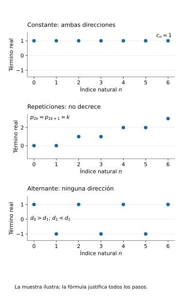
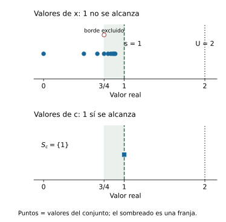
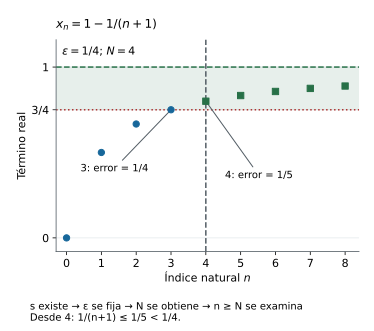
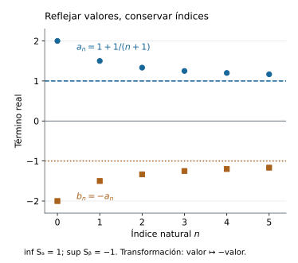
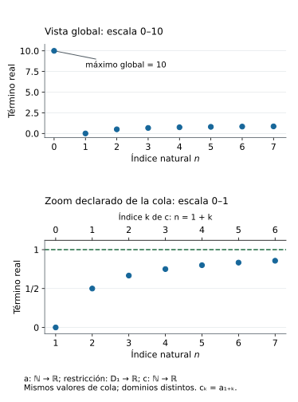
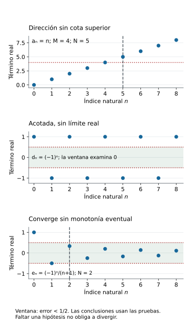
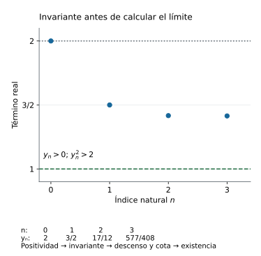
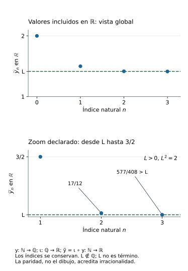

[Índice del libro](../para-matematicos/analisis-para-matematicos.html) · [Ejercicios de este capítulo](#ejercicios-7)

[]{#MA-SEC-ANM-01-007-008}

En el capítulo anterior, una afirmación de convergencia venía acompañada de un candidato real. Fijábamos ese número y comprobábamos que cualquier ventana alrededor de él capturaba una cola de la sucesión. Las reglas de cálculo nos permitieron obtener nuevos límites a partir de límites cuya existencia ya conocíamos. Queda una pregunta distinta: si no sabemos de antemano cuál es el candidato, ¿qué propiedades de una sucesión pueden garantizar que alguno exista?

Una sucesión cuyos valores avanzan siempre en la misma dirección ofrece un punto de partida. Si los términos no decrecen, cada uno conserva o mejora la altura alcanzada por los anteriores. Una barrera superior puede impedir que esas alturas crezcan sin control. El orden de los términos y la cota parecen sugerir un destino, pero hace falta justificar que ese destino sea un número real y que todas las tolerancias de la definición se cumplan.

La pregunta rectora será: **¿cuándo el orden de los términos y una barrera garantizan que exista un límite real?** C02 nos enseñó a distinguir una cota de la menor cota superior; C03 garantizó la existencia de ese supremo para conjuntos reales no vacíos y acotados superiormente. Usaremos esa interfaz para construir un candidato y después demostrar, con la definición de C06, que la monotonía permite capturar una cola a cualquier precisión. La existencia del extremo y la propagación del control tendrán obligaciones separadas en la prueba.

Conservamos $\mathbb N=\{0,1,2,\ldots\}$ y las sucesiones reales $a:\mathbb N\to\mathbb R$. El índice $n$ pertenece al dominio; el término $a_n$, las cotas y el límite pertenecen a la recta real. Comenzaremos por precisar qué significa que los términos mantengan una dirección. Más adelante aplicaremos el resultado a recurrencias: primero justificaremos que estén definidas y que exista su límite; entonces podremos usar las reglas de C06 para identificarlo.

## 7.1. Comparar términos: qué significa ser monótona

[]{#MA-SEC-ANM-01-007-001}

### Una dirección que permita repeticiones

Consideremos la sucesión $p$ definida por $p_{2k}=k$ y $p_{2k+1}=k$ para cada $k\in\mathbb N$. Todo índice natural es par o impar, así que estas dos cláusulas asignan un único valor a cada índice. Sus primeros términos son $0,0,1,1,2,2,3,3,\ldots$. Al pasar de un término al siguiente, el valor se conserva o aumenta; las repeticiones no cambian la dirección.

Si describiéramos esa propiedad diciendo que «cada término es mayor que el anterior», excluiríamos los pasos de $p_{2k}$ a $p_{2k+1}$. Necesitamos una comparación que admita igualdad. Esto también permitirá incluir una sucesión constante, que no baja ni sube.

> **Monotonía de una sucesión real.** Una sucesión $a:\mathbb N\to\mathbb R$ es **no decreciente** si $a_n\le a_{n+1}$ para todo $n\in\mathbb N$, y es **no creciente** si $a_{n+1}\le a_n$ para todo $n\in\mathbb N$. Es **monótona** si satisface al menos una de estas dos propiedades.

La definición exige una dirección para todos los pasos. Su estructura lógica es

$$
\bigl(\forall n\in\mathbb N,\ a_n\le a_{n+1}\bigr)
\quad\text{o}\quad
\bigl(\forall n\in\mathbb N,\ a_{n+1}\le a_n\bigr).
$$

La disyunción es inclusiva: permite que ambas afirmaciones sean verdaderas. Una constante $a_n=c$ cumple las dos porque $c\le c$. En cambio, la afirmación «para cada $n$, uno de los dos valores es menor o igual que el otro» vale para cualquier par de números reales por el orden total. Si se permitiera cambiar la dirección a cada paso, esa afirmación no distinguiría las sucesiones monótonas de las demás.

En este capítulo usaremos **estrictamente creciente** para $a_n<a_{n+1}$ en todo índice, y **estrictamente decreciente** para $a_{n+1}<a_n$ en todo índice. Las desigualdades estrictas excluyen repeticiones adyacentes; son propiedades más exigentes. Cada vez que usemos una dirección, la especificaremos con estas expresiones para evitar que «crecer» se interprete silenciosamente como crecimiento estricto.

### De un paso a cualquier par de índices

La definición compara vecinos, pero al trabajar con una cola necesitaremos comparar un término con todos los que vienen después. ¿Autoriza la condición $a_k\le a_{k+1}$ a afirmar $a_n\le a_m$ cuando $n\le m$? Entre dos índices naturales fijados hay un número finito de pasos; la transitividad del orden permite reunirlos.

> **Comparación entre índices ordenados.** Para una sucesión real $a$, las siguientes condiciones son equivalentes:
>
> 1. $a_n\le a_{n+1}$ para todo $n\in\mathbb N$.
> 2. Para todos $n,m\in\mathbb N$ con $n\le m$, se cumple $a_n\le a_m$.
>
> También son equivalentes las condiciones $a_{n+1}\le a_n$ para todo $n$ y $a_m\le a_n$ para todos los índices $n\le m$.

La primera dirección de cada equivalencia reúne las comparaciones intermedias. La vuelta recupera un paso vecino eligiendo $m=n+1$. Esa elección no depende de ninguna propiedad de los valores.

**Demostración.** Supongamos primero que $a_k\le a_{k+1}$ para todo índice $k$. Fijemos $n,m\in\mathbb N$ con $n\le m$. Si $n=m$, la conclusión es $a_n\le a_n$. Si $n<m$, las comparaciones adyacentes dan la cadena finita

$$
a_n\le a_{n+1}\le\cdots\le a_m.
$$

Por transitividad, $a_n\le a_m$. Para hacer explícito el papel de la finitud, podemos escribir $m=n+r$ con $r\in\mathbb N$ e inducir sobre $r$: el caso $r=0$ es reflexividad, y el paso combina $a_n\le a_{n+r}$ con $a_{n+r}\le a_{n+r+1}$. Como los índices fijados eran arbitrarios, queda probada la condición para todo par ordenado.

Recíprocamente, supongamos que $a_n\le a_m$ siempre que $n\le m$. Para cualquier $n\in\mathbb N$, el natural $m=n+1$ satisface $n\le m$, así que $a_n\le a_{n+1}$. Se recupera la condición adyacente en todos los índices.

Para la dirección no creciente, supongamos que $a_{k+1}\le a_k$ para todo $k$. Si $n=m$, de nuevo basta reflexividad. Si $n<m$, la cadena es $a_m\le a_{m-1}\le\cdots\le a_n$; cada comparación usa una hipótesis adyacente y la transitividad da $a_m\le a_n$. En la dirección inversa, la comparación para $n\le m$ aplicada a $m=n+1$ da $a_{n+1}\le a_n$. Esto demuestra también la segunda equivalencia.

Cada cadena pertenece a un par de índices ya fijado. La prueba no presupone un último término de la sucesión ni emplea un índice infinito. Aunque haya infinitos índices posibles, la distancia entre dos naturales concretos es finita.

Las versiones estrictas siguen el mismo argumento: si cada comparación adyacente es estricta, entonces $a_n<a_m$ para $n<m$ en la dirección creciente, y $a_m<a_n$ para $n<m$ en la decreciente. Recíprocamente, esas comparaciones para índices distintos dan las adyacentes al elegir $m=n+1$. Aquí se exige $n<m$: incluir $n=m$ pediría $a_n<a_n$, imposible.

### Qué puede propagarse desde un término

Podemos reutilizar inmediatamente la comparación entre índices. Supongamos que $a$ es no decreciente y que un término $a_N$ supera una barrera real $c$. Para cualquier $n\ge N$, la proposición da $a_N\le a_n$, de modo que $c<a_N\le a_n$. Así, todos los términos posteriores también superan $c$. Si sólo sabemos $c\le a_N$, obtenemos la versión no estricta $c\le a_n$.

En una sucesión no creciente, un término $a_N<c$ controla en la otra dirección: para $n\ge N$, tenemos $a_n\le a_N<c$. La monotonía convierte la comparación acreditada en un índice en una comparación para toda su cola. Todavía no hemos demostrado que haya un término próximo a una barrera elegida ni que exista un límite; hemos identificado la herramienta que permitirá propagar una comparación cuando se consiga ese término.

En la sucesión $p$, por ejemplo, $p_4=2$. Una vez verificado que $p$ no decrece, la proposición permite concluir $p_n\ge2$ para todo $n\ge4$. Para justificar la hipótesis en todo índice, distinguimos las dos paridades: de $2k$ a $2k+1$ los valores son iguales a $k$, y de $2k+1$ a $2k+2$ pasan de $k$ a $k+1$. Ambas comparaciones son no decrecientes. La muestra inicial sugería la dirección; estas dos cláusulas la demuestran para todos los pasos.

### Comprobar una dirección y refutarla

Una fórmula permite trabajar con un índice arbitrario. Si $a$ está definida en todo $\mathbb N$, es no decreciente exactamente cuando $a_{n+1}-a_n\ge0$ para todo $n$, y no creciente exactamente cuando esa diferencia es no positiva para todo $n$. Estas equivalencias proceden de sumar o restar el mismo número en una desigualdad; la diferencia es real, no un cambio del índice.

Para $x_n=1-1/(n+1)$, los denominadores son positivos también en $n=0$, y

$$
x_{n+1}-x_n
=\frac1{n+1}-\frac1{n+2}
=\frac1{(n+1)(n+2)}>0.
$$

Esto demuestra que $x$ es estrictamente creciente. La sucesión $z_n=1/(n+1)$ tiene la diferencia opuesta, $z_{n+1}-z_n=-1/[(n+1)(n+2)]<0$, así que es estrictamente decreciente. La comparación entre índices vale globalmente en ambas, con su dirección correspondiente.

Para refutar una dirección universal basta un paso que la contradiga. En $r_n=(-1)^n$, tenemos $r_0=1>r_1=-1$, por lo que no es no decreciente. También $r_1=-1<r_2=1$, por lo que no es no creciente. Estas dos comparaciones refutan las dos alternativas de la definición: $r$ no es monótona. Una sola caída habría refutado únicamente el no decrecimiento; todavía habría que examinar la otra dirección.

| Sucesión | No decreciente | No creciente | Comparación decisiva |
|---|---|---|---|
| $a_n=1$ | Sí | Sí | Igualdad en cada paso |
| $p_{2k}=p_{2k+1}=k$ | Sí | No | Igualdad o subida; de índice 1 a 2 pasa de 0 a 1 |
| $x_n=1-1/(n+1)$ | Sí | No | Diferencia positiva para todo $n$ |
| $z_n=1/(n+1)$ | No | Sí | Diferencia negativa para todo $n$ |
| $r_n=(-1)^n$ | No | No | Baja de índice 0 a 1 y sube de 1 a 2 |

La tabla registra propiedades de las funciones completas. Sus justificaciones son las comparaciones universales o los infractores escritos; no se extraen de contar unos pocos valores.

{#fig-anm-c07-f01 fig-alt="Pasos iguales, aumentos y cambios de dirección en tres sucesiones. La monotonía compara términos en todos los índices; las repeticiones son compatibles con ella."}

En la [figura de los pasos](#fig-anm-c07-f01), las gráficas de la constante, de $p$ y del alternante son colecciones de puntos $(n,a_n)$. En la constante, puntos de índices distintos tienen la misma altura. En el alternante, el paso de índice 0 a 1 baja y el de 1 a 2 sube. No necesitamos unir esos puntos mediante una curva: la definición compara términos en índices naturales y no asigna valores en los intervalos entre índices.

### Dos direcciones a la vez y el límite de una muestra

Las constantes cumplen ambas direcciones. También podemos demostrar la vuelta. Si $a$ es no decreciente y no creciente, para cualquier $n\in\mathbb N$ la comparación con el índice 0 da $a_0\le a_n$ y $a_n\le a_0$. Por antisimetría, $a_n=a_0$. Por tanto, **una sucesión es a la vez no decreciente y no creciente si y sólo si es constante**.

Esto no exige que $a$ sea inyectiva. Una función puede repetir valores; la constancia repite el mismo en todos los índices, y la sucesión $p$ repite algunos sin ser constante. Lo que distingue estas situaciones es la comparación de los términos para todos los índices, no la definición de función.

Una muestra creciente tampoco garantiza monotonía global. Definamos $b_n=n$ para $0\le n\le100$ y $b_n=-1$ para $n\ge101$. Es una función definida en todo $\mathbb N$, y sus primeros 101 términos son $0,1,\ldots,100$. Sin embargo, $b_{100}=100>b_{101}=-1$ refuta el no decrecimiento. El paso $b_0=0<b_1=1$ refuta el no crecimiento, de modo que la sucesión tampoco es monótona. Un listado finito puede ocultar el infractor que queda fuera de él.

### Antes de seguir

#### Microcontrol 1

[]{#MA-MIC-ANM-01-007-001}

En la condición $a_n\le a_{n+1}$, identifica el tipo de $a$, $n$, $n+1$, $a_n$ y $a_{n+1}$. Explica por qué la desigualdad compara valores y no índices.

[]{#MA-MSOL-ANM-01-007-001}

Ver solución del microcontrol 1

$a$ es una función $\mathbb N\to\mathbb R$, es decir, una sucesión real. $n$ y $n+1$ son índices naturales; $a_n=a(n)$ y $a_{n+1}=a(n+1)$ son términos reales. La relación $\le$ escrita compara esos dos valores reales. Aunque los índices siempre cumplen $n<n+1$, eso no determina el orden de los valores que la función les asigna.

#### Microcontrol 2

[]{#MA-MIC-ANM-01-007-002}

Escribe en símbolos la definición de sucesión monótona, distinguiendo la disyunción de dos condiciones universales de una elección de dirección distinta en cada índice.

[]{#MA-MSOL-ANM-01-007-002}

Ver solución del microcontrol 2

La condición es

$$
\bigl(\forall n\in\mathbb N,\ a_n\le a_{n+1}\bigr)
\lor
\bigl(\forall n\in\mathbb N,\ a_{n+1}\le a_n\bigr).
$$

Se exige una dirección válida en todos los índices; la disyunción inclusiva admite ambas. En cambio, $\forall n\in\mathbb N,\ (a_n\le a_{n+1}\lor a_{n+1}\le a_n)$ permite cambiar de dirección con $n$ y es verdadera para cualquier sucesión real por el orden total. Esta última condición no caracteriza monotonía.

#### Microcontrol 3

[]{#MA-MIC-ANM-01-007-003}

Para $p_{2k}=p_{2k+1}=k$, justifica el no decrecimiento en todos los pasos y señala una comparación que impida que sea no creciente. ¿Es estrictamente creciente?

[]{#MA-MSOL-ANM-01-007-003}

Ver solución del microcontrol 3

Todo paso empieza en un índice par o impar. Si empieza en $2k$, $p_{2k}=k=p_{2k+1}$. Si empieza en $2k+1$, $p_{2k+1}=k<k+1=p_{2k+2}$. Ambas comparaciones dan no decrecimiento. La subida $p_1=0<p_2=1$ refuta el no crecimiento. No es estrictamente creciente, pues $p_0=p_1=0$; las repeticiones no impiden que cada índice tenga un único valor.

#### Microcontrol 4

[]{#MA-MIC-ANM-01-007-004}

Reconstruye las dos direcciones de la equivalencia entre comparación adyacente y comparación para índices ordenados en el caso no creciente. Incluye el caso de índices iguales.

[]{#MA-MSOL-ANM-01-007-004}

Ver solución del microcontrol 4

Supón $a_{k+1}\le a_k$ para todo $k\in\mathbb N$. Dados $n\le m$, si $n=m$ basta $a_n\le a_n$. Si $n<m$, la cadena finita $a_m\le a_{m-1}\le\cdots\le a_n$ da $a_m\le a_n$ por transitividad. Recíprocamente, si $a_m\le a_n$ para todo par $n\le m$, tomar $m=n+1$ da $a_{n+1}\le a_n$ en cada índice. Así las dos condiciones son equivalentes, incluido el caso de índices iguales.

#### Microcontrol 5

[]{#MA-MIC-ANM-01-007-005}

Demuestra que una sucesión no decreciente y no creciente a la vez es constante. Explica por qué una constante satisface ambas direcciones sin dejar de ser función.

[]{#MA-MSOL-ANM-01-007-005}

Ver solución del microcontrol 5

Para cada $n\in\mathbb N$, el no decrecimiento da $a_0\le a_n$ y el no crecimiento da $a_n\le a_0$. Por antisimetría, $a_n=a_0$ para todo índice: $a$ es constante. Recíprocamente, si $a_n=c$ siempre, ambas comparaciones adyacentes son $c\le c$. Una función exige un único valor por índice, no valores distintos en índices distintos; por ello una constante sigue siendo función.

#### Microcontrol 6

[]{#MA-MIC-ANM-01-007-006}

En $r_n=(-1)^n$, da un infractor de cada dirección. ¿Por qué una sola caída no basta para concluir que una sucesión no es monótona?

[]{#MA-MSOL-ANM-01-007-006}

Ver solución del microcontrol 6

La caída $r_0=1>r_1=-1$ refuta el no decrecimiento. La subida $r_1=-1<r_2=1$ refuta el no crecimiento. Como fallan ambas alternativas, $r$ no es monótona. Una sola caída refuta sólo la primera alternativa: una sucesión estrictamente decreciente tiene caídas y sigue siendo monótona. Hace falta excluir también la dirección no creciente.

#### Microcontrol 7

[]{#MA-MIC-ANM-01-007-007}

Supón que $a$ es no decreciente y $a_N>c$, con $N\in\mathbb N$ y $c\in\mathbb R$. Justifica que $a_n>c$ para todo $n\ge N$. Formula y prueba la versión correspondiente para una sucesión no creciente y un término menor que $c$.

[]{#MA-MSOL-ANM-01-007-007}

Ver solución del microcontrol 7

Si $n\ge N$, la comparación entre índices para una sucesión no decreciente da $a_N\le a_n$. Junto con $c<a_N$, resulta $c<a_N\le a_n$, luego $a_n>c$ para todos los índices indicados.

La versión opuesta dice: si $a$ es no creciente y $a_N<c$, entonces $a_n<c$ para todo $n\ge N$. En efecto, $a_n\le a_N<c$ por la comparación no creciente. $N,n$ son índices naturales y $c,a_N,a_n$ son valores reales; la dirección propaga la comparación inicial.

#### Microcontrol 8

[]{#MA-MIC-ANM-01-007-008}

Para $b_n=n$ si $0\le n\le100$ y $b_n=-1$ si $n\ge101$, explica por qué una muestra de índices 0–100 no decide la monotonía global. Señala los infractores necesarios y distingue esta función de la sucesión $n\mapsto n$.

[]{#MA-MSOL-ANM-01-007-008}

Ver solución del microcontrol 8

En los índices 0–100, la muestra coincide con la sucesión identidad y aumenta estrictamente. Pero la monotonía exige una dirección para todos los pasos, incluidos los que la muestra no contiene. La caída $b_{100}=100>b_{101}=-1$ refuta el no decrecimiento; la subida $b_0=0<b_1=1$ refuta el no crecimiento. Así $b$ no es monótona. La función $u:\mathbb N\to\mathbb R$, $u_n=n$, es estrictamente creciente en todo índice y difiere de $b$, por ejemplo en 101: $u_{101}=101\ne-1=b_{101}$. Coincidir en una muestra no es ser la misma función.

### Ejercicios de la sección 7.1

[]{#ejercicios-7}

#### Ejercicio 1. Comparaciones y alcance de los cuantificadores

[]{#MA-EX-ANM-01-007-001}

Para una sucesión $a:\mathbb N\to\mathbb R$, considera estas afirmaciones:

- $P$: para todo $n\in\mathbb N$, $a_n\le a_{n+1}$.
- $Q$: para todos $n,m\in\mathbb N$, si $n\le m$, entonces $a_n\le a_m$.
- $R$: para todo $n\in\mathbb N$, $a_n<a_{n+1}$.
- $S$: para todos $n,m\in\mathbb N$, si $n<m$, entonces $a_n<a_m$.
- $M$: $(\forall n\in\mathbb N,\ a_n\le a_{n+1})\ \lor\ (\forall n\in\mathbb N,\ a_{n+1}\le a_n)$.
- $V$: para todo $n\in\mathbb N$, $a_n\le a_{n+1}\ \lor\ a_{n+1}\le a_n$.

Demuestra $P\Leftrightarrow Q$ y $R\Leftrightarrow S$, y explica el cambio de $n\le m$ a $n<m$. Determina cuáles caracterizan el no decrecimiento y cuáles el crecimiento estricto. Justifica $R\Rightarrow P$ y refuta la implicación inversa con una constante. ¿Qué propiedad expresa $M$? Decide si $M$ y $V$ son equivalentes, justificando tu respuesta con un ejemplo cuando haga falta. En las comparaciones, distingue índices y términos.

[]{#MA-SOL-ANM-01-007-001}

Ver solución del ejercicio 1

La función $a$ es la sucesión; $n,m,n+1$ son índices naturales y $a_n,a_m,a_{n+1}$ son términos reales. Las desigualdades entre índices determinan qué posiciones se comparan; las desigualdades entre términos expresan la dirección de sus valores.

Si vale $P$ y fijamos $n\le m$, el caso $n=m$ da $a_n\le a_n$. Para $n<m$, la cadena finita $a_n\le a_{n+1}\le\cdots\le a_m$ da $a_n\le a_m$ por transitividad. Así se obtiene $Q$. Recíprocamente, $Q$ aplicada a $m=n+1$ da $P$ en cada índice. Por tanto, $P$ y $Q$ caracterizan el no decrecimiento.

El mismo razonamiento con desigualdades estrictas demuestra $R\Rightarrow S$: para $n<m$ hay al menos un paso y la cadena estricta llega de $a_n$ a $a_m$. Al tomar $m=n+1$, $S$ da $R$. Ambas caracterizan el crecimiento estricto. En $S$ no se incluye $n=m$, pues exigiría $a_n<a_n$, que es falso. En $Q$ sí puede incluirse, porque la desigualdad no estricta admite igualdad.

Toda desigualdad estricta implica la correspondiente no estricta, de modo que $R\Rightarrow P$. La sucesión constante $a_n=0$ satisface $P$ y $Q$, pero no $R$ ni $S$: sus términos de índices distintos también son iguales. La implicación inversa queda refutada.

$M$ es la definición de monotonía. Su disyunción permite una dirección universal o la otra, y admite ambas en una constante. $V$, en cambio, es verdadera para cualquier sucesión real, porque el orden total compara los dos términos en cada índice. En $r_n=(-1)^n$, $V$ sigue siendo verdadera, pero $r_0>r_1$ refuta la primera alternativa de $M$ y $r_1<r_2$ refuta la segunda. Por tanto, $M$ implica $V$ y $V$ no implica $M$. Permitir que la dirección cambie con el índice elimina la restricción que expresa la monotonía.

#### Ejercicio 2. Las mismas alturas en otro orden

[]{#MA-EX-ANM-01-007-002}

Sea $E=\{2j:j\in\mathbb N\}\subseteq\mathbb R$. Construye dos funciones $a,b:\mathbb N\to\mathbb R$ cuyo conjunto de valores sea $E$: una estrictamente creciente y otra que no sea monótona. Puedes partir de la enumeración natural de $E$ e intercambiar vecinos. Define ambas para todos los índices, prueba las dos igualdades de conjuntos y acredita cada afirmación sobre dirección. Explica por qué $a(\mathbb N)=b(\mathbb N)$ no implica $a=b$ ni igualdad de sus gráficas discretas.

[]{#MA-SOL-ANM-01-007-002}

Ver solución del ejercicio 2

Tomamos $a_n=2n$ y definimos $b_{2k}=4k+2$, $b_{2k+1}=4k$ para todo $k\in\mathbb N$. La paridad asigna a cada índice una única cláusula, de modo que $b$ está definida en todo $\mathbb N$. Ambas funciones tienen codominio $\mathbb R$ y valores en $E$.

Todo término de $a$ pertenece a $E$ y cada $2j\in E$ se obtiene en el índice $j$; así, $a(\mathbb N)=E$. Los términos de $b$ son $2(2k+1)$ y $2(2k)$, por lo que también pertenecen a $E$. Para la otra inclusión, si $j=2k$, el valor $2j=4k$ aparece en el índice $2k+1$; si $j=2k+1$, el valor $2j=4k+2$ aparece en el índice $2k$. Estas dos posibilidades cubren todo $j\in\mathbb N$, y prueban $E\subseteq b(\mathbb N)$. Por tanto, $b(\mathbb N)=E$.

Para todo $n$, $a_{n+1}-a_n=2>0$, así que $a$ es estrictamente creciente. En $b$, la caída $b_0=2>b_1=0$ refuta el no decrecimiento y la subida $b_1=0<b_2=6$ refuta el no crecimiento. Por eso $b$ no es monótona.

Las funciones son distintas porque $a_0=0$ y $b_0=2$. Sus gráficas, colecciones de pares $(n,a_n)$ y $(n,b_n)$, también son distintas: la primera contiene $(0,0)$ y la segunda no. Al formar el conjunto de valores se conserva la altura y se pierde la posición que la sucesión le asignaba. Las dos funciones tienen el mismo dominio, codominio y conjunto de valores, pero esa información no determina su evaluación en cada índice.

#### Ejercicio 3. Bloques de longitud variable

[]{#MA-EX-ANM-01-007-003}

Fija $m\in\mathbb N$ con $m\ge2$. Construye una sucesión $a^{(m)}:\mathbb N\to\mathbb R$ que tome el valor $k$ exactamente en los $m$ índices del bloque $mk,mk+1,\ldots,mk+m-1$, para cada $k\in\mathbb N$. Justifica que la regla asigna un único valor a cada índice. Demuestra el no decrecimiento distinguiendo el interior de un bloque de su frontera y prueba que los valores no tienen cota superior real. Decide si la sucesión es estrictamente creciente o no creciente, y explica por qué las repeticiones no impiden que sea función.

[]{#MA-SOL-ANM-01-007-003}

Ver solución del ejercicio 3

Usamos la división con resto de naturales: como $m>0$, cada $n\in\mathbb N$ se escribe de manera única como $n=mk+r$, con $k,r\in\mathbb N$ y $0\le r<m$. Definimos $a^{(m)}_n=k$, considerado como número real. La existencia de esa escritura cubre el dominio entero y su unicidad evita asignar dos valores al mismo índice. Para un $k$ fijo, el cociente es $k$ precisamente en los $m$ índices $mk,\ldots,mk+m-1$; los otros bloques tienen cocientes distintos.

Fijemos un índice $n=mk+r$. Si $r<m-1$, entonces $n+1=mk+(r+1)$ sigue en el mismo bloque, y $a^{(m)}_{n+1}=k=a^{(m)}_n$. Si $r=m-1$, entonces $n+1=m(k+1)$ comienza el bloque siguiente, y $a^{(m)}_{n+1}=k+1>k=a^{(m)}_n$. Los casos son exhaustivos y ambos dan $a^{(m)}_n\le a^{(m)}_{n+1}$. Queda probado el no decrecimiento en todo índice.

Para probar que no hay cota superior real, sea $U\in\mathbb R$ arbitrario. La propiedad arquimediana disponible desde C03 permite elegir $k\in\mathbb N$ con $k>U$. El índice $mk$ es natural y satisface $a^{(m)}_{mk}=k>U$. Como la construcción da un término que supera cada candidato $U$, ninguna cota superior real existe.

La sucesión no es estrictamente creciente: $m\ge2$ garantiza que $a^{(m)}_0=a^{(m)}_1=0$. Tampoco es no creciente, pues $a^{(m)}_{m-1}=0<1=a^{(m)}_m$. La repetición en cada bloque no afecta la definición de función: a cada índice se le asigna un solo valor, aunque varios índices compartan ese valor. Cuando $m=2$, la construcción recupera los pares repetidos de §7.1; el argumento de las fronteras sirve para todas las longitudes admitidas.

#### Ejercicio 4. Una suma que no cambia

[]{#MA-EX-ANM-01-007-004}

Sean $a,b:\mathbb N\to\mathbb R$ dos sucesiones no decrecientes y sea $c\in\mathbb R$. Supón que $a_n+b_n=c$ para todo $n\in\mathbb N$. Demuestra que cada sucesión es constante. Localiza dónde se usa la dirección común. Si se sustituye esa hipótesis por «cada sucesión es monótona, con direcciones posiblemente distintas», decide si la conclusión sigue siendo válida y justifica tu decisión. ¿Las hipótesis originales obligan además a que $a=b$ como funciones?

[]{#MA-SOL-ANM-01-007-004}

Ver solución del ejercicio 4

La dirección común permite comparar incrementos del mismo signo. Para cada $n\in\mathbb N$, el no decrecimiento da $a_{n+1}-a_n\ge0$ y $b_{n+1}-b_n\ge0$. Al restar las igualdades de la suma en los índices $n+1$ y $n$, obtenemos

$$
(a_{n+1}-a_n)+(b_{n+1}-b_n)=c-c=0.
$$

Dos reales no negativos con suma cero deben ser ambos cero: si uno fuera positivo, al sumarle el otro la suma seguiría siendo positiva. Por tanto, $a_{n+1}=a_n$ y $b_{n+1}=b_n$ para todo $n$. La inducción desde el índice 0 da $a_n=a_0$ y $b_n=b_0$ en todos los índices. Cada sucesión es constante, y sus valores constantes satisfacen $a_0+b_0=c$.

Si las direcciones pueden ser distintas, los incrementos pueden cancelarse sin ser cero. Para cualquier $c\in\mathbb R$, las funciones $a_n=n$ y $b_n=c-n$ tienen suma $c$ en cada índice. La primera es estrictamente creciente y la segunda estrictamente decreciente; ninguna es constante. La hipótesis debilitada no implica la conclusión.

La conclusión original tampoco exige igualdad de las dos funciones. Por ejemplo, $a_n=c/2-1$ y $b_n=c/2+1$ son constantes, ambas no decrecientes y con suma $c$, pero difieren en cada índice. Bajo las hipótesis originales, $a=b$ se cumple si y sólo si $a_0=b_0$; junto con la suma, esto equivale a $a_0=b_0=c/2$. La constancia de cada función y la igualdad entre funciones son afirmaciones distintas.

## 7.2. El conjunto de valores y su mejor barrera

[]{#MA-SEC-ANM-01-007-002}

### Pasar de la función a sus valores

La monotonía compara valores respetando el orden de los índices. Para buscar una barrera superior, en cambio, podemos reunir todos esos valores en un conjunto. Si $a:\mathbb N\to\mathbb R$, escribimos $S_a=\{a_n:n\in\mathbb N\}\subseteq\mathbb R$. Este conjunto es no vacío: contiene $a_0$. Sus elementos son números reales, y un mismo valor repetido en varios índices aparece como un solo elemento del conjunto.

En la sucesión $p$ de §7.1, cada natural aparece dos veces como término, pero $S_p=\{0,1,2,\ldots\}$, considerado como subconjunto de $\mathbb R$. Pasar a $S_p$ conserva los valores disponibles y pierde la asignación que nos dice en qué índice aparece cada uno. La función $p$ y el conjunto $S_p$ son objetos distintos.

Esa pérdida incluye el orden de aparición. La sucesión $a_n=n$ y la función $b$ dada por $b_0=0$, $b_1=2$, $b_2=1$ y $b_n=n$ para $n\ge3$ tienen el mismo conjunto de valores. Sin embargo, $a$ es estrictamente creciente y $b$ no es monótona: sube de índice 0 a 1 y baja de 1 a 2. El conjunto sirve para estudiar cotas, pero no sustituye a la función cuando importa la monotonía.

### Una cota y la menor cota superior

Una cota superior real $U$ de la sucesión satisface $a_n\le U$ para todo $n\in\mathbb N$. Esto equivale a que $U$ sea cota superior de $S_a$. En efecto, todo elemento de $S_a$ es algún $a_n$, y todo término pertenece a $S_a$. Así podemos aplicar las definiciones y resultados sobre conjuntos de C02 al conjunto de valores.

Recordemos la distinción de C02. Un número $s$ es el **supremo** de $S_a$ si es cota superior y, además, $s\le U$ para toda cota superior $U$ de $S_a$. Un **máximo** es un elemento del conjunto que es mayor o igual que todos los demás. Por tanto, si un conjunto tiene máximo, ese máximo es también su supremo: al pertenecer al conjunto, cualquier cota superior debe estar por encima de él. La vuelta exige pertenencia. Si $s=\sup S_a$ y $s\in S_a$, entonces $s$ es máximo; si $s\notin S_a$, el conjunto no tiene máximo, pues cualquier máximo tendría que ser su supremo.

La existencia de una cota superior no forma parte de la definición de cualquier sucesión. Cuando sí la tenemos, podemos usar C03 §3.2: **todo subconjunto no vacío de $\mathbb R$ acotado superiormente tiene supremo real**. Para $S_a$, la no vaciedad ya está acreditada por $a_0$ y la cota de la sucesión proporciona la otra hipótesis. Este es el punto en que interviene completitud. La monotonía no hace falta para obtener el supremo del conjunto de valores; tendrá otra función al controlar los índices posteriores.

Tampoco es necesario que una cota superior sea el supremo. Si $U$ es cota y $V\ge U$, entonces $a_n\le U\le V$ para todo $n$, por lo que $V$ también es cota. El supremo selecciona la menor entre ellas, aunque ese número no sea un término de la sucesión.

### La franja que ninguna cota menor puede vaciar

Recuperemos la caracterización de C02 §2.5 en el lenguaje de sucesiones. Una vez acreditada la existencia de $s=\sup S_a$, para cada $\varepsilon>0$ hay un índice $j\in\mathbb N$ tal que $s-\varepsilon<a_j\le s$. Geométricamente, cada franja $(s-\varepsilon,s]$ contiene algún valor de la sucesión. El extremo inferior queda excluido y el superior puede estar incluido.

> **Caracterización de la barrera superior.** Para una sucesión real $a$ y un número real $s$, son equivalentes:
>
> 1. $s=\sup S_a$.
> 2. $s$ es cota superior de $S_a$ y para cada $\varepsilon>0$ existe un $j\in\mathbb N$ con $s-\varepsilon<a_j$.

La caracterización contiene dos obligaciones. La cota impide valores por encima de $s$; la aproximación impide que podamos bajar esa cota una cantidad positiva y seguir dominando todos los valores. Probaremos ambas direcciones sin suponer monotonía.

**Demostración.** Supongamos que $s=\sup S_a$ y fijemos $\varepsilon>0$. El número $s-\varepsilon$ es menor que $s$, por lo que no puede ser cota superior: si lo fuera, la minimalidad daría $s\le s-\varepsilon$, contradicción. Ser cota superior equivale a $a_n\le s-\varepsilon$ para todo $n$. La negación clásica de esa afirmación universal proporciona un índice $j$ con $a_j>s-\varepsilon$. Como $s$ sí es cota, también $a_j\le s$. Así se obtiene el valor en la franja.

Recíprocamente, supongamos que $s$ es cota superior y que cumple la aproximación indicada. Sea $U$ cualquier cota superior de $S_a$. Si $U<s$, la tolerancia $\varepsilon=s-U>0$ daría un índice $j$ con $a_j>s-\varepsilon=U$, contradiciendo que $U$ sea cota. Por tanto $s\le U$ para toda cota superior $U$. Junto con la condición de cota de $s$, esto demuestra $s=\sup S_a$.

La prueba caracteriza un candidato $s$; por sí sola no garantiza que exista un número con esas propiedades para un conjunto arbitrario. La garantía real bajo no vaciedad y acotación procede de C03. Al elegir $j$ para la tolerancia recibida, sólo necesitamos una existencia justificada. No prometemos una fórmula ni un algoritmo que encuentre ese índice para una sucesión arbitraria, y no necesitamos elegir simultáneamente todos los testigos.

### El mismo supremo puede alcanzarse o no

Volvamos a $x_n=1-1/(n+1)$. Como $n+1>0$, todos sus términos son menores que 1; por tanto 1 y 2 son cotas superiores, y ningún término vale 1. Para comprobar que 1 es el supremo, falta la obligación de aproximación.

En C06 §6.3 demostramos que $1/(n+1)$ converge a cero. Dada $\varepsilon>0$, esa prueba proporciona un índice $j$ con $1/(j+1)<\varepsilon$. De ahí $x_j=1-1/(j+1)>1-\varepsilon$. Por la caracterización anterior, $\sup S_x=1$. Como $1\notin S_x$, no hay máximo. Esta verificación usa una herramienta ya disponible y no presupone el teorema de convergencia monótona que demostraremos en §7.3.

En la constante $c_n=1$, el conjunto de valores es $S_c=\{1\}$. Tiene supremo y máximo iguales a 1, y para cualquier $\varepsilon>0$ el término $c_0=1$ satisface $1-\varepsilon<c_0\le1$. La propiedad de aproximación incluye este caso de error cero; no exige que los términos se acerquen desde puntos distintos del supremo.

| Sucesión | Conjunto de valores | Cota superior adicional | Supremo | ¿Se alcanza? |
|---|---|---|---|---|
| $x_n=1-1/(n+1)$ | $\{1-1/(n+1):n\in\mathbb N\}$ | $2$ | $1$ | No |
| $c_n=1$ | $\{1\}$ | $2$ | $1$ | Sí, en todo índice |

La igualdad de los supremos es una igualdad entre números reales. No afirma igualdad de sucesiones ni de conjuntos: $x_0=0$ y $c_0=1$, y sólo el segundo conjunto contiene 1. La cota 2 deja margen en ambos casos; no es la menor cota superior.

Con $\varepsilon=1/4$, la franja es $(3/4,1]$. Tenemos $x_3=3/4$, sobre la frontera inferior excluida, y $x_4=4/5$, dentro de la franja. El término constante 1 también está dentro. El contraste se lee sobre un eje de **valores**, sin necesidad de usar el eje de índices de una gráfica de sucesión. Marcar el punto 1 como barrera en el caso de $x$ no lo añade a su conjunto de valores.

{#fig-anm-c07-f02 fig-alt="La cota 2 deja margen; el supremo 1 no. La misma barrera se alcanza en la constante y no se alcanza en $x$."}

En la [figura de la mejor barrera](#fig-anm-c07-f02), el sombreado señala una franja de comparación; sólo los puntos indican valores de los conjuntos. La pertenencia de 1 distingue máximo de supremo.

### La barrera inferior

Para completar la lectura, una cota inferior $\ell$ satisface $\ell\le a_n$ para todo $n$. Si el conjunto de valores está acotado inferiormente, C03 §3.3 garantiza la existencia de su ínfimo real, pues es no vacío. El **ínfimo** es la mayor cota inferior. Es **mínimo** exactamente cuando pertenece al conjunto.

La caracterización correspondiente afirma que $t=\inf S_a$ si y sólo si $t$ es cota inferior y para cada $\varepsilon>0$ hay un índice $j$ con $a_j<t+\varepsilon$. La cota añade $t\le a_j$, así que el valor está en $[t,t+\varepsilon)$, con frontera superior excluida.

Para justificarla, si $t$ es ínfimo, $t+\varepsilon$ no puede ser cota inferior: sería una cota mayor que la mayor de ellas. La negación de $t+\varepsilon\le a_n$ para todos los índices da un $j$ con $a_j<t+\varepsilon$. En la vuelta, supongamos cota y aproximación y sea $\ell$ cualquier cota inferior. Si $\ell>t$, tomamos $\varepsilon=\ell-t$ y obtenemos $a_j<t+\varepsilon=\ell$, contradicción. Así $\ell\le t$ para todas las cotas inferiores, que es la maximalidad requerida.

En $z_n=1/(n+1)$, el número 0 es cota inferior y, por la prueba de C06, hay valores menores que cualquier $\varepsilon>0$. Luego $\inf S_z=0$. Ningún término es cero, de modo que no hay mínimo. La ausencia de alcanzamiento es compatible con una barrera extremal también en esta dirección.

### Un valor próximo todavía no controla los posteriores

La caracterización superior dice $\forall\varepsilon>0\ \exists j\in\mathbb N$ con $s-\varepsilon<a_j\le s$. No contiene una obligación sobre todos los índices posteriores a $j$. Ésa es una diferencia decisiva respecto de la captura de una cola de C06.

En $r_n=(-1)^n$, el conjunto de valores es $\{-1,1\}$ y su supremo es 1. Para cualquier tolerancia positiva, el índice $j=0$ proporciona un término igual al supremo y satisface la aproximación. Sin embargo, $r$ no converge a 1: con $\varepsilon=1$, ante cualquier corte $N$ el índice impar $2N+1\ge N$ tiene término −1 y error $|-1-1|=2\ge1$. Esta refutación se refiere al candidato 1; no inferimos de ella por sí sola una afirmación sobre todos los candidatos.

La minimalidad de la barrera proporciona un término en cada franja. §7.1 nos dio otra herramienta: bajo no decrecimiento, una comparación inferior conseguida en un índice se propaga a los posteriores. En §7.3 reuniremos las dos obligaciones para pasar del valor próximo al control de una cola, comprobando la definición de convergencia para toda tolerancia.

### Antes de seguir

#### Microcontrol 9

[]{#MA-MIC-ANM-01-007-009}

Para $p_{2k}=p_{2k+1}=k$, identifica el conjunto $S_p$ y explica qué información sobre repeticiones e índices se pierde al pasar de $p$ a ese conjunto.

[]{#MA-MSOL-ANM-01-007-009}

Ver solución del microcontrol 9

$S_p=\{0,1,2,\ldots\}$, considerado como subconjunto de $\mathbb R$: cada $k$ aparece en $p$ y ningún término toma otro valor. El conjunto registra cada valor una sola vez, aunque $p_{2k}=p_{2k+1}=k$. Se pierden la multiplicidad de aparición y los índices a los que corresponde cada valor, incluido su orden. $p:\mathbb N\to\mathbb R$ es una función; $S_p$ es su conjunto de valores, no la misma clase de objeto.

#### Microcontrol 10

[]{#MA-MIC-ANM-01-007-010}

Justifica en ambas direcciones que un real $U$ es cota superior de una sucesión si y sólo si es cota superior de su conjunto de valores. ¿Por qué ese conjunto es no vacío?

[]{#MA-MSOL-ANM-01-007-010}

Ver solución del microcontrol 10

Si $a_n\le U$ para todo $n$, cada $x\in S_a$ tiene la forma $x=a_j$ y cumple $x\le U$; así $U$ es cota superior del conjunto. Recíprocamente, si $U$ domina $S_a$, domina cada $a_n$ porque todos los términos pertenecen a ese conjunto. $S_a$ es no vacío ya que contiene $a_0$, un valor real de la función definida en el índice natural 0.

#### Microcontrol 11

[]{#MA-MIC-ANM-01-007-011}

Indica las dos hipótesis que permiten aplicar el principio del supremo de C03 a $S_a$. Distingue la garantía de existencia de la caracterización de un candidato mediante cotas y aproximación.

[]{#MA-MSOL-ANM-01-007-011}

Ver solución del microcontrol 11

Las hipótesis son que $S_a\subseteq\mathbb R$ sea no vacío y esté acotado superiormente. La primera se acredita con $a_0$; la segunda exige una cota real $U$ para todos los términos. El principio del supremo garantiza entonces la existencia de algún $s\in\mathbb R$ que es su supremo. La caracterización por cota y aproximación permite verificar si un candidato real dado es ese supremo; no asegura por sí sola que exista un candidato que cumpla las dos condiciones. No se requiere monotonía para obtener el supremo.

#### Microcontrol 12

[]{#MA-MIC-ANM-01-007-012}

Reconstruye las dos direcciones de la caracterización de $s=\sup S_a$. Señala dónde se niega una afirmación universal de cota y qué tolerancia se usa para refutar una supuesta cota $U<s$.

[]{#MA-MSOL-ANM-01-007-012}

Ver solución del microcontrol 12

Si $s=\sup S_a$, ya es cota superior. Dada $\varepsilon>0$, $s-\varepsilon$ no puede ser cota superior, pues sería una cota menor que la menor cota. Se niega la afirmación universal $\forall n\in\mathbb N,\ a_n\le s-\varepsilon$ y se obtiene $j\in\mathbb N$ con $a_j>s-\varepsilon$. La cota $s$ añade $a_j\le s$.

Recíprocamente, supón que $s$ domina todos los términos y que para cada $\varepsilon>0$ existe $j$ con $a_j>s-\varepsilon$. Sea $U$ otra cota superior. Si $U<s$, toma $\varepsilon=s-U>0$. El testigo satisface $a_j>s-\varepsilon=U$, contradiciendo que $U$ sea cota. Así $s\le U$ para toda cota superior, y junto con la condición de cota resulta $s=\sup S_a$.

#### Microcontrol 13

[]{#MA-MIC-ANM-01-007-013}

En la franja $(3/4,1]$, clasifica $x_3=3/4$, $x_4=4/5$ y el término de la constante 1. Explica por qué la frontera inferior se excluye y la superior puede admitirse.

[]{#MA-MSOL-ANM-01-007-013}

Ver solución del microcontrol 13

$x_3=3/4$ queda fuera de $(3/4,1]$ porque coincide con su frontera inferior excluida. $x_4=4/5$ está dentro, pues $3/4<4/5<1$. El término 1 de la sucesión constante también está dentro, en la frontera superior incluida. La aproximación al supremo exige $s-\varepsilon<a_j$, una desigualdad estricta por abajo, pero la condición de cota permite $a_j\le s$, incluida la igualdad con el supremo.

#### Microcontrol 14

[]{#MA-MIC-ANM-01-007-014}

Compara $x_n=1-1/(n+1)$ y $c_n=1$: sus cotas superiores 2, sus supremos y su alcanzamiento. ¿Qué igualdades numéricas se cumplen y qué objetos siguen siendo distintos?

[]{#MA-MSOL-ANM-01-007-014}

Ver solución del microcontrol 14

En ambas sucesiones, 2 es cota superior y el supremo es 1. Para $x$, todos los términos son menores que 1 y, dada $\varepsilon>0$, C06 §6.3 proporciona $j$ con $1/(j+1)<\varepsilon$; entonces $x_j>1-\varepsilon$. Esto acredita el supremo 1, sin alcanzamiento y sin máximo. Para $c$, el conjunto de valores es $\{1\}$: su supremo y máximo valen 1 y se alcanzan en todo índice.

La igualdad de los supremos es igualdad entre números reales; también ambas admiten la misma cota 2, que no es su supremo. Las funciones siguen siendo distintas porque $x_0=0\ne1=c_0$, y sus conjuntos de valores también son distintos: sólo $S_c$ contiene 1.

#### Microcontrol 15

[]{#MA-MIC-ANM-01-007-015}

Formula la caracterización por aproximación del ínfimo y úsala para justificar que $\inf\{1/(n+1):n\in\mathbb N\}=0$, sin mínimo. Declara la herramienta anterior que acredita la aproximación.

[]{#MA-MSOL-ANM-01-007-015}

Ver solución del microcontrol 15

La caracterización dice que $t=\inf S_a$ si y sólo si

$$
\forall n\in\mathbb N,\quad t\le a_n,
\qquad
\forall\varepsilon>0\ \exists j\in\mathbb N,\quad a_j<t+\varepsilon.
$$

Para $z_n=1/(n+1)$, todos los términos son positivos, de modo que 0 es cota inferior. La convergencia $1/(n+1)\to0$, demostrada en C06 §6.3, garantiza para cada $\varepsilon>0$ un término $z_j<\varepsilon=0+\varepsilon$. Cota y aproximación acreditan el ínfimo 0. Como ningún término vale 0, el ínfimo no pertenece al conjunto, que por ello no tiene mínimo.

#### Microcontrol 16

[]{#MA-MIC-ANM-01-007-016}

Para $r_n=(-1)^n$, da un testigo de aproximación a su supremo válido para cualquier tolerancia. Luego refuta la convergencia al supremo con una tolerancia fija y un infractor posterior a cada corte. ¿Qué obligación falta en la sola caracterización del supremo?

[]{#MA-MSOL-ANM-01-007-016}

Ver solución del microcontrol 16

$S_r=\{-1,1\}$ tiene supremo 1, alcanzado por $r_0=1$. Para cualquier $\varepsilon>0$, el mismo testigo $j=0$ cumple $1-\varepsilon<r_j\le1$.

Para refutar el candidato 1 como límite, fija $\varepsilon_0=1$. Dado cualquier corte $N\in\mathbb N$, el índice $n=2N+1\ge N$ es impar y tiene $r_n=-1$, luego $|r_n-1|=2\ge\varepsilon_0$. No existe un corte que controle esa tolerancia. La caracterización del supremo sólo exige un término próximo para cada tolerancia; falta el control de todos los términos desde un corte. Esta refutación excluye el candidato 1, sin pretender por sí sola excluir todos los candidatos reales.

### Ejercicios de la sección 7.2

#### Ejercicio 5. Cota, barrera mínima y posición de alcanzamiento

[]{#MA-EX-ANM-01-007-005}

Sean $a:\mathbb N\to\mathbb R$, $S_a=a(\mathbb N)$ y $U,s\in\mathbb R$. Justifica la equivalencia entre $a_n\le U$ para todo $n$, $S_a\subseteq(-\infty,U]$ y $S_a\cap(U,\infty)=\varnothing$. Escribe con cuantificadores qué obligación adicional convierte una cota $s$ en $\sup S_a$. Demuestra que $s$ es máximo de $S_a$ si y sólo si es su supremo y el conjunto de índices $I_s=\{j\in\mathbb N:a_j=s\}$ es no vacío.

Aplica estas distinciones a $d_0=-1$ y $d_n=4$ para $n\ge1$: determina $S_d$, clasifica la cota superior 6, calcula el supremo y el máximo, y describe $I_4$. Distingue el tipo del número 4, del conjunto de valores, del conjunto de índices y de la función $d$.

[]{#MA-SOL-ANM-01-007-005}

Ver solución del ejercicio 5

Si todos los términos son $\le U$, cada elemento $x\in S_a$ tiene la forma $x=a_n$ y pertenece a $(-\infty,U]$. Recíprocamente, la inclusión del conjunto implica $a_n\le U$ porque cada término pertenece a $S_a$. Para cualquier real $x$, $x\le U$ equivale a $x\notin(U,\infty)$; así, esa inclusión equivale a que la intersección indicada sea vacía. Se ha traducido una misma condición entre función, inclusión e intersección.

Para que la cota $s$ sea supremo se exige además que esté por debajo de toda cota superior. Con los dominios explícitos, las dos obligaciones son

$$
\bigl(\forall n\in\mathbb N,\ a_n\le s\bigr)
\quad\text{y}\quad
\forall U\in\mathbb R:\quad
\bigl(\forall n\in\mathbb N,\ a_n\le U\bigr)\Rightarrow s\le U.
$$

Si $s$ es máximo, domina todos los elementos y pertenece a $S_a$. La pertenencia proporciona un índice $j$ con $a_j=s$, así que $I_s$ es no vacío. Toda cota $U$ domina ese término y cumple $s\le U$; por ello $s$ es supremo. En la vuelta, si $s$ es supremo e $I_s$ es no vacío, $s$ domina el conjunto y pertenece a él por el índice testigo. Es, por definición, su máximo.

Para $d$, la imagen es $S_d=\{-1,4\}$. El número 6 es cota superior, pero no la menor, pues 4 también es cota y es menor que 6. Como 4 pertenece al conjunto y domina sus dos elementos, es máximo y supremo. Se alcanza precisamente en los índices $I_4=\{1,2,3,\ldots\}$. El máximo y el supremo son el mismo número real; $I_4$ es un conjunto de índices naturales y $S_d$ es un conjunto de valores reales. La sucesión $d$ es la función que asigna esos valores, no ninguno de esos conjuntos.

La [figura de la mejor barrera](analisis-para-matematicos-capitulo-7-monotonia-cotas-y-existencia-de-limites.html#fig-anm-c07-f02) permite comparar cota, supremo y alcanzamiento. Ilustra los valores 1 y 2 de otro ejemplo; los valores 4 y 6 de esta solución se justifican con sus propios datos.

#### Ejercicio 6. Una barrera prescrita, con y sin alcanzamiento

[]{#MA-EX-ANM-01-007-006}

Para cada $s\in\mathbb R$ y $h\ge0$, construye dos sucesiones reales $a^{s,h}$ y $b^{s,h}$ con todos sus términos en $[s-h,s]$ y con supremo del conjunto de valores igual a $s$. Si $h>0$, exige que la primera no alcance $s$ y que la segunda lo alcance en un único índice. Si $h=0$, determina qué funciones permite la condición sobre el intervalo y qué ocurre con el alcanzamiento. Verifica cota y aproximación para tus construcciones y declara sus dominios; no necesitas calcular límites.

[]{#MA-SOL-ANM-01-007-006}

Ver solución del ejercicio 6

Para cada par de parámetros admitido, definimos funciones de $\mathbb N$ a $\mathbb R$ mediante $a^{s,h}_n=s-h/(n+1)$ y

$$
b^{s,h}_0=s,\qquad b^{s,h}_n=s-\frac hn\quad(n\ge1).
$$

Los denominadores son positivos en sus respectivos dominios; la cláusula especial de $b$ evita dividir por cero. Como $0\le h/(n+1)\le h$ y $0\le h/n\le h$ para $n\ge1$, todos los términos de ambas funciones están en $[s-h,s]$. En particular, $s$ es cota superior.

Sea $\varepsilon>0$. Si $h>0$, la arquimedianidad de C03 permite elegir $j\in\mathbb N$ con $j+1>h/\varepsilon$. Entonces $h/(j+1)<\varepsilon$ y $s-\varepsilon<a^{s,h}_j\le s$. Si $h=0$, el índice $j=0$ da la misma aproximación con error cero. Por la caracterización de §7.2, el supremo de la imagen de $a^{s,h}$ es $s$. Para $b^{s,h}$, el índice 0 proporciona directamente el término $s$ para toda tolerancia; junto con la cota, demuestra que su supremo también es $s$.

Cuando $h>0$, cada $h/(n+1)$ es positivo, así que ningún término de $a^{s,h}$ vale $s$; su imagen no tiene máximo. En $b^{s,h}$, el término inicial vale $s$ y todos los de índice $n\ge1$ son menores que $s$. El máximo se alcanza sólo en el índice 0. Si $h=0$, el intervalo permitido es $[s,s]=\{s\}$. Toda función que satisfaga la condición debe ser la constante $s$; nuestras dos fórmulas coinciden en esa función y alcanzan $s$ en todos los índices. La exigencia de alcanzamiento único se aplica únicamente al caso $h>0$.

#### Ejercicio 7. Aproximar con una escala numerable

[]{#MA-EX-ANM-01-007-007}

Supón que $a:\mathbb N\to\mathbb R$ y que $s\in\mathbb R$ es cota superior de $S_a$. Demuestra que $s=\sup S_a$ equivale a la condición

$$
\forall k\in\mathbb N\ \exists j\in\mathbb N:\quad 0\le s-a_j<\frac1{k+1}.
$$

Señala cómo se pasa de una tolerancia real arbitraria a una de las tolerancias indicadas y de qué dato puede depender el índice $j$. Decide si la condición mostrada, por sí sola, seguiría caracterizando el supremo al omitir la hipótesis global de cota. No uses el teorema de convergencia monótona.

[]{#MA-SOL-ANM-01-007-007}

Ver solución del ejercicio 7

Si $s=\sup S_a$, dado $k\in\mathbb N$ la tolerancia $1/(k+1)$ es positiva. La caracterización por aproximación proporciona un índice $j$ con $s-1/(k+1)<a_j\le s$, que equivale a $0\le s-a_j<1/(k+1)$. Queda probada la condición en cada $k$, incluido $k=0$.

Para la vuelta, conservamos la hipótesis de que $s$ domina todos los términos. Recibida una tolerancia real $\varepsilon>0$, usamos la arquimedianidad para elegir $k\in\mathbb N$ con $k+1>1/\varepsilon$. Así, $1/(k+1)<\varepsilon$. La condición del enunciado para ese $k$ da un índice $j$ con $0\le s-a_j<\varepsilon$, y por tanto $s-\varepsilon<a_j\le s$. La cota y la aproximación para toda tolerancia demuestran $s=\sup S_a$ por §7.2. La elección sigue el orden $\varepsilon$, luego $k$ y después un testigo $j$ para ese $k$; no se exige que el mismo $j$ sirva para todas las escalas, ni se ha probado control sobre los índices posteriores a él.

La hipótesis global de cota es necesaria. En $a_n=n$ y $s=0$, para cada $k$ el índice $j=0$ satisface $0\le s-a_j=0<1/(k+1)$. Sin embargo, $s$ no es cota superior, pues $a_1=1>0$, y por eso no puede ser supremo. El control del error en los términos elegidos no controla los demás términos.

#### Ejercicio 8. Igual imagen acotada, distinto comportamiento

[]{#MA-EX-ANM-01-007-008}

Sea $E=\{0\}\cup\{1/(j+1):j\in\mathbb N\}$. Construye $a,b:\mathbb N\to\mathbb R$ con $a(\mathbb N)=b(\mathbb N)=E$, tales que $a$ converja a 0 y $b$ no converja a ningún real. Puedes cambiar cuántas veces aparece cada valor. Prueba la igualdad de ambas imágenes, da cotas comunes y justifica las afirmaciones de convergencia desde los cuantificadores de C06. Explica por qué tu construcción no representa una permutación biyectiva de los índices de la sucesión convergente.

[]{#MA-SOL-ANM-01-007-008}

Ver solución del ejercicio 8

Definimos $a_0=0$ y $a_n=1/n$ para $n\ge1$. Para la segunda función ponemos $b_{3k}=0$, $b_{3k+1}=1$ y $b_{3k+2}=1/(k+1)$ para todo $k\in\mathbb N$. Todo índice tiene una escritura única $3k+r$ con $r\in\{0,1,2\}$, así que las tres cláusulas definen $b$ en todo $\mathbb N$ sin ambigüedad. Todos los denominadores utilizados son positivos.

Cada término de $a$ está en $E$; 0 aparece en el índice 0 y el valor $1/(j+1)$ aparece en el índice $j+1$. Esto prueba $a(\mathbb N)=E$ por ambas inclusiones. En $b$, los valores 0 y 1 pertenecen a $E$, al igual que cada $1/(k+1)$, de modo que su imagen está contenida en $E$. Además, 0 aparece en el índice 0 y cada $1/(j+1)$ aparece en el índice $3j+2$. De ahí $E\subseteq b(\mathbb N)$ y la igualdad de imágenes. Ambas sucesiones satisfacen las cotas comunes $0\le a_n\le1$ y $0\le b_n\le1$ en todo índice.

Para $a_n\to0$, sea $\varepsilon>0$. Elegimos por arquimedianidad un natural $N>\max\{1,1/\varepsilon\}$. Si $n\ge N$, entonces $n\ge1$ y $|a_n|=1/n\le1/N<\varepsilon$. Este único corte controla todos los índices posteriores y prueba la convergencia a 0.

Para refutar todo límite real de $b$, fijemos un candidato $L\in\mathbb R$ y la tolerancia $\varepsilon_0=1/2$. Si $|L|\ge1/2$, ante cualquier corte $N\in\mathbb N$ el índice $n=3N\ge N$ da $|b_n-L|=|L|\ge\varepsilon_0$. Si $|L|<1/2$, la desigualdad triangular da $|1-L|\ge1-|L|>1/2$; el índice $n=3N+1\ge N$ tiene $b_n=1$ y también infringe la tolerancia. Los dos casos cubren todo candidato, y en cada uno existe un infractor después de cada corte. Por tanto, $b$ no converge a ningún número real, sin recurrir a resultados sobre subsucesiones.

Una permutación biyectiva de índices conserva cuántas posiciones toman cada valor. En $a$, el valor 1 aparece únicamente en el índice 1; en $b$ aparece en todos los índices $3k+1$, además del índice 2. Si $b_n=a_{\pi(n)}$ con $\pi:\mathbb N\to\mathbb N$ biyectiva, los índices distintos 1 y 4 de $b$ tendrían que satisfacer $\pi(1)=\pi(4)=1$, contradiciendo la inyectividad. La igualdad de conjuntos de valores permite cambiar multiplicidades; no convierte la construcción en una permutación de la sucesión convergente.

#### Ejercicio 9. Un testigo convertido indebidamente en corte

[]{#MA-EX-ANM-01-007-009}

La siguiente es una **prueba defectuosa**: «Como $s=\sup S_a$, para cada $\varepsilon>0$ hay un índice $j$ con $s-\varepsilon<a_j\le s$. Tomo $N=j$; entonces $|a_n-s|<\varepsilon$ para todo $n\ge N$, y por tanto $a_n\to s$».

Localiza la inferencia sin justificación y compara los cuantificadores de la premisa con los de la conclusión. Refútala mediante una sucesión cuyo supremo sea 3, no se alcance y para la que el candidato 3 falle como límite. Construye la sucesión usando, para cada $k\in\mathbb N$, tres posiciones consecutivas: un valor que se aproxime a 3, un valor 0 y un valor 1. Justifica el supremo y da una tolerancia fija con un infractor posterior a cada corte. Repara después el argumento general incorporando una hipótesis de comparación entre términos que permita usar §7.1; demuestra el paso reparado directamente, sin invocar el teorema de §7.3.

[]{#MA-SOL-ANM-01-007-009}

Ver solución del ejercicio 9

La premisa ofrece $\forall\varepsilon>0\ \exists j\in\mathbb N$ con $s-\varepsilon<a_j\le s$. La conclusión requiere $\forall\varepsilon>0\ \exists N\in\mathbb N\ \forall n\in\mathbb N$, con $n\ge N\Rightarrow |a_n-s|<\varepsilon$. La inferencia defectuosa añade el control universal sobre $n\ge j$ sin una hipótesis que compare esos términos con $a_j$. La cota $a_n\le s$ sí vale para todos los índices; la comparación inferior $s-\varepsilon<a_n$ sólo se ha acreditado en el índice testigo.

Como contraejemplo, definimos $r_{3k}=3-1/(k+1)$, $r_{3k+1}=0$ y $r_{3k+2}=1$ para $k\in\mathbb N$. La división con resto por 3 hace la regla exhaustiva y única. Todos los valores son menores que 3: los de la primera cláusula están en $[2,3)$ y los otros son 0 y 1. Por tanto, 3 es cota y no se alcanza. Dada $\varepsilon>0$, elegimos $k$ con $k+1>1/\varepsilon$; en el índice $j=3k$ tenemos $3-\varepsilon<r_j<3$. La caracterización de §7.2 demuestra que $3=\sup S_r$ y que la imagen no tiene máximo.

El candidato 3 falla como límite: fijamos $\varepsilon_0=1$. Para cada $N\in\mathbb N$, el índice $n=3N+1\ge N$ cumple $r_n=0$ y $|r_n-3|=3\ge1$. Ningún corte controla esa tolerancia, aunque existan términos tan próximos al supremo como se pida.

Una reparación suficiente consiste en añadir que $a$ es no decreciente. Dada $\varepsilon>0$, la aproximación al supremo proporciona $j$ con $s-\varepsilon<a_j\le s$. Tomamos $N=j$. Para cualquier $n\ge N$, la comparación entre índices de §7.1 da $a_j\le a_n$ y la condición de cota da $a_n\le s$. Se obtiene $s-\varepsilon<a_j\le a_n\le s$, de donde $|a_n-s|=s-a_n<\varepsilon$. El índice testigo se ha convertido en corte gracias a la dirección añadida; este argumento comprueba directamente la definición de C06 y no invoca el teorema posterior. La reparación establece una condición suficiente, sin afirmar que sea necesaria para converger al supremo.

La [figura del testigo y la captura](analisis-para-matematicos-capitulo-7-monotonia-cotas-y-existencia-de-limites.html#fig-anm-c07-f03) distingue obtener un término próximo de controlar todos los posteriores. Ilustra el mecanismo válido bajo monotonía; no representa la trayectoria del contraejemplo de este ejercicio.

## 7.3. La completitud convierte una barrera en límite

[]{#MA-SEC-ANM-01-007-003}

### Reunir las dos obligaciones

En §7.2 conseguimos un término en cada franja inferior al supremo. El alternante mostró por qué ese término no controla por sí solo los posteriores: puede haber valores iguales al supremo y otros que vuelvan a alejarse. §7.1 proporciona la comparación que faltaba para una sucesión no decreciente. Una vez que un término supera una barrera inferior, todos los posteriores la superan también.

Fijemos entonces una sucesión real $a$ no decreciente y una cota superior $U$. C03 garantiza que su conjunto de valores tiene supremo $s$. La franja $(s-\varepsilon,s]$ contiene un término $a_N$; el no decrecimiento obliga a que los términos posteriores estén por encima de $a_N$, y la propiedad de cota de $s$ impide que pasen por encima de $s$. Esa combinación es la que permite responder a una tolerancia arbitraria.

> **Convergencia de una sucesión no decreciente y acotada superiormente.** Sea $a:\mathbb N\to\mathbb R$ una sucesión no decreciente. Si existe $U\in\mathbb R$ tal que $a_n\le U$ para todo $n\in\mathbb N$, entonces $a$ converge y su límite es $s=\sup\{a_n:n\in\mathbb N\}$.

No suponemos que el crecimiento sea estricto ni que $s$ sea un término. El enunciado incluye constantes, repeticiones y barreras no alcanzadas. Probaremos la convergencia desde la definición ε–N de C06, después de justificar la existencia del candidato.

### Mapa de la prueba

El conjunto de valores permite aplicar completitud al universo correcto. Una vez obtenido su supremo, necesitamos convertir su propiedad extremal en una estimación de error para todos los índices de una cola.

| Obligación | Qué se obtiene | Qué la autoriza |
|---|---|---|
| Conjunto admisible | $S_a$ no vacío y acotado superiormente | $a_0\in S_a$ y la cota $U$ |
| Existencia del candidato | $s=\sup S_a\in\mathbb R$ | Completitud, C03 §3.2 |
| Término próximo | $s-\varepsilon<a_N\le s$ | Minimalidad de $s$, C02 §2.5 y §7.2 |
| Propagación y captura | $s-\varepsilon<a_n\le s$ para todo $n\ge N$ | No decrecimiento, cota y comparación de §7.1 |

La dificultad es pasar de un término próximo a todos los posteriores. La existencia del supremo no hace ese trabajo; da el candidato y permite encontrar el término. La monotonía aporta la propagación.

### Demostración desde la definición

**Demostración.** Sea $S_a=\{a_n:n\in\mathbb N\}$. El conjunto es no vacío porque contiene $a_0$. La hipótesis $a_n\le U$ para todo índice implica que $U$ es cota superior de $S_a$. Por el principio del supremo de C03 §3.2 existe un real $s=\sup S_a$. En particular, $a_n\le s$ para todo $n$.

Fijemos una tolerancia real $\varepsilon>0$. Como $s-\varepsilon<s$, el número $s-\varepsilon$ no es cota superior de $S_a$: si lo fuera, la minimalidad de $s$ daría $s\le s-\varepsilon$. Negar la afirmación universal $a_n\le s-\varepsilon$ proporciona, por lógica clásica y el orden real, un índice $N\in\mathbb N$ con $a_N>s-\varepsilon$. Ésta es la propiedad de aproximación recuperada en §7.2; no requiere una segunda invocación de completitud.

Tomemos ahora un índice natural $n\ge N$ arbitrario. El no decrecimiento y la comparación entre índices de §7.1 dan $a_N\le a_n$. La propiedad de cota de $s$ da $a_n\le s$. Por tanto,

$$
s-\varepsilon<a_N\le a_n\le s,
\qquad 0\le s-a_n<\varepsilon.
$$

Como $a_n\le s$, su error respecto de $s$ es $|a_n-s|=s-a_n$, así que $|a_n-s|<\varepsilon$ para todo $n\ge N$. Hemos obtenido, para la tolerancia arbitraria recibida, un índice natural que controla todos los posteriores. Esto cumple la definición de $a_n\to s$. La unicidad de C06 §6.4 permite identificar $s$ como el límite de la sucesión.

El candidato $s$ se fija antes de recibir la tolerancia y depende de la sucesión completa. El testigo $N$ se obtiene después de fijar $\varepsilon$ y antes de examinar el índice universal $n$. No se promete un método computable para hallarlo en una sucesión arbitraria ni se exige que sea el menor posible. Si un testigo resulta ser 0, la prueba controla la sucesión desde su primer término.

La desigualdad final permite $a_n=s$, pues entonces el error es cero. La frontera inferior $s-\varepsilon$, en cambio, queda excluida: allí el error sería exactamente $\varepsilon$. Una comparación no estricta $s-\varepsilon\le a_N$ no daría con esta misma tolerancia la estimación estricta requerida.

### Primera aplicación: existencia para una recurrencia

La nueva herramienta permite acreditar un límite aunque todavía no sepamos identificarlo mediante una fórmula. Consideremos $u_0=0$ y $u_{n+1}=(u_n+1)/2$ para cada $n\in\mathbb N$. La construcción recursiva elemental asigna un término real a cada índice: una vez dado $u_n$, la suma y la división por el número no nulo 2 definen un único $u_{n+1}$. No hay denominadores variables cuya anulación impida continuar.

Primero verificamos por inducción que $0\le u_n\le1$ para todos los índices. En la base, $u_0=0$ cumple ambas desigualdades. Si $0\le u_n\le1$, sumar 1 y dividir por 2, positivo, da $1/2\le u_{n+1}\le1$, y en particular $0\le u_{n+1}\le1$. Queda probado el invariante y la cota superior 1.

A continuación, para un índice arbitrario,

$$
u_{n+1}-u_n=\frac{1-u_n}{2}\ge0.
$$

La desigualdad usa el invariante ya demostrado. Por tanto $u$ es no decreciente. El teorema recién probado se aplica: existe un límite real $L=\sup S_u$. Además, $0=u_0\le L\le1$, porque el supremo domina cada valor y es menor o igual que la cota superior 1.

La conclusión es de existencia, con una identificación extremal del candidato. No hemos calculado su valor numérico mediante una ecuación de la recurrencia. En §7.6 retomaremos esta misma sucesión y, con la existencia acreditada, justificaremos el desplazamiento de índices y el uso de las reglas de C06 antes de resolver esa ecuación. La inducción y la comparación que acabamos de escribir son las hipótesis de entrada; unos primeros términos como $0,1/2,3/4,7/8$ no habrían bastado para sustituirlas.

### Volver a ver el testigo y la captura

El ejemplo $x_n=1-1/(n+1)$ permite separar visualmente los papeles de cada paso. En §7.1 probamos que no decrece y en §7.2 acreditamos $\sup S_x=1$. Para $\varepsilon=1/4$, el índice $N=4$ proporciona $x_4=4/5>3/4$. En cambio, $x_3=3/4$ está sobre la frontera inferior y no sirve para iniciar una captura con esa tolerancia: su error respecto de 1 es $1/4$.

Para cualquier $n\ge4$, la monotonía da $x_4\le x_n$ y la cota da $x_n\le1$. También podemos verificar directamente el error del ejemplo: $1-x_n=1/(n+1)\le1/5<1/4$. Los términos desde el corte 4 quedan en la franja $(3/4,1]$, contenida en la ventana abierta $(1-1/4,1+1/4)$ de C06.

La muestra de índices 0–8 mostraría esos puntos a sus alturas correspondientes. El corte 4 pertenece al eje de índices; las referencias 1 y 3/4 pertenecen al eje de valores. Unir los puntos como una curva añadiría una representación que no es la gráfica de la función con dominio natural. La estimación para todo $n\ge4$, no la cantidad de puntos dibujados, acredita la captura de la cola. El número 4 es un testigo para este ejemplo y esta tolerancia; no es el testigo general del teorema.

{#fig-anm-c07-f03 fig-alt="El testigo 4 entra estrictamente en la franja; la monotonía y la cota mantienen allí los términos posteriores. El supremo existe antes de elegir la tolerancia."}

En la [figura del testigo y la captura](#fig-anm-c07-f03), el corte pertenece al eje de índices y las fronteras al eje de valores. El punto de índice 3 queda fuera de la captura estricta; desde 4 la estimación ya probada controla toda la cola.

### Qué permite cada hipótesis

La cota inicial $U$ garantiza que el conjunto sea admisible para completitud; no tiene por qué ser el candidato al límite. Si $U>s$, tomando $\varepsilon=(U-s)/2$ se obtiene $U-\varepsilon=(U+s)/2>s$. Todos los términos quedan por debajo de esa frontera inferior, pues $a_n\le s$. En consecuencia, esta ventana alrededor de $U$ no captura ningún término y $U$ no puede ser límite. El supremo elimina ese margen que una cota arbitraria puede dejar.

La monotonía no interviene en garantizar que el supremo exista. Se usa al comparar $a_N$ con todos los términos posteriores. Sin ella, la aproximación puede coexistir con retornos lejos del candidato, como vimos con el alternante en §7.2. Esta separación explica por qué la prueba necesita un resultado sobre conjuntos y otro sobre el orden de los índices.

Si el supremo se alcanza en un índice $K$, la misma estructura da una conclusión adicional. Para todo $n\ge K$, el no decrecimiento implica $s=a_K\le a_n$, y la cota implica $a_n\le s$. Así $a_n=s$ desde $K$. En una sucesión no decreciente, alcanzar el supremo obliga a que la cola sea constante. El teorema incluye este caso y el de la constante desde el índice 0; no exige una aproximación sin alcanzamiento.

La dirección no creciente requerirá transportar las comparaciones y la barrera con cuidado. La desarrollaremos en §7.4, junto con el caso en que sólo una cola mantiene la dirección. Por ahora, la herramienta acreditada es el resultado global para no decrecimiento y cota superior.

### Antes de seguir

#### Microcontrol 17

[]{#MA-MIC-ANM-01-007-017}

Enuncia el resultado de esta sección con dominio, dirección de monotonía, cota requerida y candidato al límite. ¿Exige crecimiento estricto o que el supremo sea un término?

[]{#MA-MSOL-ANM-01-007-017}

Ver solución del microcontrol 17

Si $a:\mathbb N\to\mathbb R$ es no decreciente y existe $U\in\mathbb R$ con $a_n\le U$ para todo $n$, entonces converge al real $s=\sup\{a_n:n\in\mathbb N\}$. No exige crecimiento estricto: admite repeticiones y constantes. Tampoco exige que $s$ sea un término; el supremo puede no alcanzarse.

#### Microcontrol 18

[]{#MA-MIC-ANM-01-007-018}

Reconstruye las cuatro obligaciones del mapa de la prueba. Señala dónde se usa completitud y por qué obtener un término próximo no es una segunda invocación de ella.

[]{#MA-MSOL-ANM-01-007-018}

Ver solución del microcontrol 18

Las cuatro obligaciones son: verificar que $S_a$ es no vacío y acotado superiormente, usando $a_0$ y la cota $U$; obtener $s=\sup S_a\in\mathbb R$ por completitud; encontrar, dada $\varepsilon>0$, un término $a_N>s-\varepsilon$ por minimalidad del supremo; y propagar esa comparación a todo $n\ge N$ por no decrecimiento, conservando $a_n\le s$. Completitud se usa en la existencia de $s$. El término próximo se obtiene de una propiedad de ese supremo ya existente, sin invocar de nuevo el principio de existencia.

#### Microcontrol 19

[]{#MA-MIC-ANM-01-007-019}

Dada $\varepsilon>0$, justifica por qué $s-\varepsilon$ no es cota superior y cómo su negación proporciona un índice $N$. Explica el orden de elección de $s$, $\varepsilon$, $N$ y $n$.

[]{#MA-MSOL-ANM-01-007-019}

Ver solución del microcontrol 19

Si $s-\varepsilon$ fuera cota superior, la minimalidad de $s$ implicaría $s\le s-\varepsilon$, imposible porque $\varepsilon>0$. La negación de $\forall n\in\mathbb N,\ a_n\le s-\varepsilon$ proporciona $N\in\mathbb N$ con $a_N>s-\varepsilon$. Primero se fija $s$ a partir de la sucesión; después se recibe $\varepsilon>0$, se obtiene $N$ para esa tolerancia y se considera un índice arbitrario $n\ge N$. El corte puede depender de la tolerancia, pero debe controlar todos esos índices.

#### Microcontrol 20

[]{#MA-MIC-ANM-01-007-020}

Partiendo de $s-\varepsilon<a_N\le a_n\le s$ para $n\ge N$, deduce $|a_n-s|<\varepsilon$. ¿Qué cambia si $a_N=s-\varepsilon$ o si $a_n=s$?

[]{#MA-MSOL-ANM-01-007-020}

Ver solución del microcontrol 20

De $a_n\le s$ se obtiene $|a_n-s|=s-a_n$. La comparación $a_n\ge a_N>s-\varepsilon$ da $s-a_n<\varepsilon$, luego $|a_n-s|<\varepsilon$. Si $a_N=s-\varepsilon$, el error en el propio índice $N$ es exactamente $\varepsilon$, de modo que ese corte no cumple la desigualdad estricta requerida. Si $a_n=s$, el error es cero y satisface la condición porque $\varepsilon>0$.

#### Microcontrol 21

[]{#MA-MIC-ANM-01-007-021}

Para $u_0=0$ y $u_{n+1}=(u_n+1)/2$, reconstruye la inducción que conserva $0\le u_n\le1$ y la comparación que acredita no decrecimiento. Concluye existencia de límite sin calcular su valor numérico.

[]{#MA-MSOL-ANM-01-007-021}

Ver solución del microcontrol 21

La regla define un real en cada paso, pues sólo divide por el número no nulo 2. La base $u_0=0$ cumple $0\le u_0\le1$. Si $0\le u_n\le1$, entonces $1/2\le(u_n+1)/2\le1$, lo que implica $0\le u_{n+1}\le1$. La inducción conserva ambas barreras en todo índice. Además,

$$
u_{n+1}-u_n=\frac{1-u_n}{2}\ge0.
$$

Así $u$ es no decreciente y tiene cota superior 1. El teorema de §7.3 garantiza un límite real $L=\sup S_u$, con $0\le L\le1$. Esta conclusión acredita existencia y descripción extremal; no calcula su valor numérico mediante la recurrencia.

#### Microcontrol 22

[]{#MA-MIC-ANM-01-007-022}

En $x_n=1-1/(n+1)$ y con tolerancia $1/4$, comprueba que $N=4$ controla todos los índices posteriores y explica por qué $N=3$ falla. Distingue esta verificación de lo que muestra una gráfica finita.

[]{#MA-MSOL-ANM-01-007-022}

Ver solución del microcontrol 22

Para todo $n\ge4$,

$$
|x_n-1|=\frac1{n+1}\le\frac15<\frac14.
$$

Por tanto $N=4$ controla todos los índices posteriores. En cambio, $N=3$ falla ya en el índice 3 porque $|x_3-1|=1/4$, igual a la tolerancia y no menor. Una gráfica finita sólo exhibe los puntos de los índices representados; la estimación universal, o la propagación monótona con la cota 1, es lo que acredita el control de toda la cola. El corte 4 es un índice natural, mientras que 1 y 3/4 son alturas reales.

#### Microcontrol 23

[]{#MA-MIC-ANM-01-007-023}

Supón que $U$ es cota superior y $U>s=\sup S_a$. Usa $\varepsilon=(U-s)/2$ para refutar que la sucesión converja a $U$. ¿Por qué una cota cualquiera no reemplaza a la menor cota superior en la prueba?

[]{#MA-MSOL-ANM-01-007-023}

Ver solución del microcontrol 23

Fija $\varepsilon_0=(U-s)/2>0$. Para todo $n\in\mathbb N$, la cota del supremo da $a_n\le s<U$, luego

$$
|a_n-U|=U-a_n\ge U-s=2\varepsilon_0>\varepsilon_0.
$$

Ante cualquier corte propuesto $N$, el propio índice $n=N$ infringe esa tolerancia. La sucesión no converge a $U$. Una cota mayor que $s$ deja un margen real respecto de todos los valores y no proporciona términos arbitrariamente próximos a ella; la propiedad de menor cota superior sí permite obtenerlos.

#### Microcontrol 24

[]{#MA-MIC-ANM-01-007-024}

Si $a$ no decrece y alcanza su supremo $s$ en un índice $K$, demuestra que $a_n=s$ para todo $n\ge K$. Explica cómo este caso queda incluido en el teorema.

[]{#MA-MSOL-ANM-01-007-024}

Ver solución del microcontrol 24

Si $a_K=s$ y $n\ge K$, el no decrecimiento da $s=a_K\le a_n$. Como $s$ es cota superior, también $a_n\le s$. Por antisimetría, $a_n=s$ para todo $n\ge K$. El teorema admite esa cola constante: no exige dirección estricta ni ausencia de alcanzamiento. Para cualquier tolerancia positiva, el corte $K$ controla error cero en toda la cola; si $K=0$, la sucesión completa es constante.

### Ejercicios de la sección 7.3

#### Ejercicio 10. Reensamblar el argumento y localizar las hipótesis

[]{#MA-EX-ANM-01-007-010}

Sea $a:\mathbb N\to\mathbb R$ no decreciente y supón que $a_n\le U$ para todo $n$, con $U\in\mathbb R$. Los siguientes fragmentos de prueba están desordenados:

- A: para todo $n\ge N$, $s-\varepsilon<a_N\le a_n\le s$; por tanto $|a_n-s|<\varepsilon$.
- B: se forma $S_a=\{a_n:n\in\mathbb N\}$ y se verifica que es no vacío y acotado superiormente.
- C: dada $\varepsilon>0$, se obtiene un índice $N$ con $s-\varepsilon<a_N$.
- D: existe un real $s=\sup S_a$.

Ordénalos, completa sus justificaciones e identifica qué dato o hipótesis autoriza cada paso. Distingue el papel de $U$ del de $s$, y registra el orden en que se fijan $s$, $\varepsilon$, $N$ y $n$. Para $w_n=2-1/(n+1)$, acredita las hipótesis y el supremo, y comprueba que $N=0$ sirve con tolerancia 2. Decide si sigue sirviendo con tolerancia 1 y proporciona un corte válido en ese caso.

[]{#MA-SOL-ANM-01-007-010}

Ver solución del ejercicio 10

El orden es B, D, C, A. En B, $S_a\subseteq\mathbb R$ es no vacío porque contiene $a_0$, y $U$ lo domina porque domina todos los términos. En D se usa completitud, mediante el principio del supremo de C03: esas dos condiciones garantizan un real $s=\sup S_a$. La cota $U$ garantiza que el conjunto es admisible; el supremo $s$ será el candidato al límite. No se exige $U=s$.

En C fijamos $\varepsilon>0$. El número $s-\varepsilon$ no puede ser cota superior, pues suponerlo contradice la minimalidad de $s$. Negar $a_n\le s-\varepsilon$ para todos los índices da un $N\in\mathbb N$ con $a_N>s-\varepsilon$. Este paso usa la propiedad del supremo ya obtenido, no una nueva aplicación de completitud. En A, para cualquier $n\ge N$, el no decrecimiento y §7.1 dan $a_N\le a_n$; la condición de cota de $s$ da $a_n\le s$. Luego $0\le s-a_n<\varepsilon$ y $|a_n-s|=s-a_n<\varepsilon$. La definición de C06 queda satisfecha. El orden de elección es: candidato $s$ fijado por $a$, tolerancia $\varepsilon$, índice testigo $N$ y, después, índice arbitrario $n\ge N$.

En $w_n=2-1/(n+1)$, el denominador es positivo y $w_{n+1}-w_n=1/[(n+1)(n+2)]>0$. La sucesión es no decreciente y 2 es cota superior. Para toda $\eta>0$, la arquimedianidad permite elegir $j$ con $j+1>1/\eta$, lo que da $2-\eta<w_j<2$. La caracterización de §7.2 demuestra que el supremo es 2.

Con tolerancia 2, $N=0$ sirve: para todo $n\ge0$, $|w_n-2|=1/(n+1)\le1<2$. Con tolerancia 1 no sirve, porque el índice 0 tiene error 1 y la definición exige error menor que 1. El corte $N=1$ sí controla todos los índices posteriores, ya que $1/(n+1)\le1/2<1$. Un corte 0 es tan admisible como cualquier otro natural; lo que decide su validez es la estimación para todos los términos desde él.

La [figura del testigo y la captura](analisis-para-matematicos-capitulo-7-monotonia-cotas-y-existencia-de-limites.html#fig-anm-c07-f03) permite volver a localizar las obligaciones: completitud fija el candidato y monotonía propaga la comparación.

#### Ejercicio 11. Una familia con denominador desplazado

[]{#MA-EX-ANM-01-007-011}

Sean $\alpha,\beta,q\in\mathbb R$, con $\beta\ge0$ y $q>0$. Estudia la sucesión $a_n=\alpha-\beta/(n+q)$ para $n\in\mathbb N$: verifica su buena definición, dirección, cotas y existencia de límite mediante §7.3. Identifica después su supremo y su límite. Separa $\beta=0$ de $\beta>0$, indica cuándo la dirección es estricta y justifica la elección de un índice para cada tolerancia. Explica por qué hay que controlar el denominador también en $n=0$.

[]{#MA-SOL-ANM-01-007-011}

Ver solución del ejercicio 11

Los parámetros $\alpha,\beta,q$ son reales; el índice $n$ es natural y $a_n$ es un término real. Como $q>0$ y $n\ge0$, el denominador $n+q$ es positivo en todo el dominio, incluido $n=0$. La fórmula define una función de $\mathbb N$ a $\mathbb R$. Si se admitiese $q=0$, la fórmula no definiría el término inicial cuando se presenta como ese cociente, incluso si $\beta=0$.

La diferencia adyacente es

$$
a_{n+1}-a_n
=\frac{\beta}{n+q}-\frac{\beta}{n+1+q}
=\frac{\beta}{(n+q)(n+1+q)}\ge0.
$$

Por tanto, $a$ no decrece. Los denominadores positivos y $n+q\ge q$ dan $0\le\beta/(n+q)\le\beta/q$, así que $a_0=\alpha-\beta/q\le a_n\le\alpha$. Ya están acreditadas las hipótesis de §7.3: existe un límite real y es el supremo de $S_a$.

Si $\beta=0$, todos los términos valen $\alpha$, la dirección no es estricta y el supremo y el límite son $\alpha$. Si $\beta>0$, la diferencia adyacente es positiva en todo índice, de modo que la sucesión es estrictamente creciente; además, ningún término alcanza $\alpha$. Para identificar el supremo, sea $\varepsilon>0$. Elegimos por arquimedianidad un natural $N>\max\{0,\beta/\varepsilon-q\}$. Entonces $N+q>\beta/\varepsilon$ y $\alpha-\varepsilon<a_N<\alpha$. La cota superior $\alpha$ y esta aproximación demuestran $\sup S_a=\alpha$. El límite cuya existencia ya se obtuvo es, por ello, $\alpha$. La misma elección controla toda la cola: si $n\ge N$, $|a_n-\alpha|=\beta/(n+q)\le\beta/(N+q)<\varepsilon$.

#### Ejercicio 12. Reconocer el supremo desde un límite ya conocido

[]{#MA-EX-ANM-01-007-012}

Sea $a:\mathbb N\to\mathbb R$ no decreciente y supón que $a_n\to L\in\mathbb R$. Sin aplicar el teorema de §7.3 para obtener una cota, demuestra que $a_k\le L$ para todo $k\in\mathbb N$. Usa esa cota y la convergencia para demostrar que $L=\sup S_a$. En el primer paso, explica cómo se coordina un índice $k$ previamente fijado con un corte de convergencia elegido después de una tolerancia. ¿Hace falta suponer de entrada una cota superior adicional?

[]{#MA-SOL-ANM-01-007-012}

Ver solución del ejercicio 12

Fijemos $k\in\mathbb N$. Si $a_k>L$, tomamos $\varepsilon=(a_k-L)/2>0$. La convergencia proporciona un corte $N$ para esa tolerancia. El índice $n=\max\{k,N\}$ está después de $k$ y después del corte: la monotonía da $a_k\le a_n$ y la convergencia da $a_n<L+\varepsilon=(a_k+L)/2<a_k$. Las dos desigualdades se contradicen. Por tanto, $a_k\le L$ para cada $k$, y $L$ es cota superior de $S_a$.

Recibida ahora cualquier tolerancia $\eta>0$, la convergencia permite elegir un corte $M$ con $|a_M-L|<\eta$. En particular, $L-\eta<a_M$, mientras que la cota recién probada da $a_M\le L$. Así se cumplen cota y aproximación para el candidato $L$; por §7.2, $L=\sup S_a$.

No hizo falta suponer una cota adicional ni usar el teorema de §7.3 para fabricarla. En el primer argumento se fija $k$, se construye una tolerancia a partir del supuesto $a_k>L$, se obtiene $N$ y se elige un índice que reúna ambas exigencias. La convergencia se usa para impedir que un término por encima de $L$ pueda propagarse a todos los posteriores.

#### Ejercicio 13. Recuperar la desigualdad estricta

[]{#MA-EX-ANM-01-007-013}

Supón que $a:\mathbb N\to\mathbb R$ es no decreciente, que $s\in\mathbb R$ domina todos sus términos y que para cada $\delta>0$ puedes obtener un índice $N_\delta$ con $s-\delta\le a_{N_\delta}$. Adapta la prueba ε–N para concluir $a_n\to s$, aunque el testigo sólo dé una desigualdad no estricta. Justifica también que $s=\sup S_a$. Explica por qué usar $\delta=\varepsilon$ y conservar cualquier testigo recibido no garantiza el error estricto; ilústralo con una sucesión no decreciente cuyo supremo sea 0, tolerancia 1 y testigo inicial situado en la frontera. Da una elección auxiliar que repare la prueba para toda tolerancia, no sólo para ese ejemplo.

[]{#MA-SOL-ANM-01-007-013}

Ver solución del ejercicio 13

La tolerancia auxiliar debe ser menor que la tolerancia pedida. Sea $\varepsilon>0$ y tomemos $\delta=\varepsilon/2$. La hipótesis proporciona un índice $N=N_\delta$ con $s-\delta\le a_N$. Para todo $n\ge N$, §7.1 y la cota superior dan $s-\delta\le a_N\le a_n\le s$. Luego $|a_n-s|=s-a_n\le\delta=\varepsilon/2<\varepsilon$. Aunque el primer control admita igualdad, el margen reservado entre $\delta$ y $\varepsilon$ recupera el error estricto en toda la cola. Esto prueba $a_n\to s$ desde la definición.

También identifica el supremo sin circularidad. Para cada $\varepsilon>0$, ese mismo testigo satisface $a_N\ge s-\varepsilon/2>s-\varepsilon$. Junto con la cota global de $s$, la caracterización de §7.2 da $s=\sup S_a$.

Si se usase $\delta=\varepsilon$, sólo se obtendría error $\le\varepsilon$ desde el testigo, insuficiente para conservar ese corte. Por ejemplo, definamos $a_0=-1$ y $a_n=0$ para $n\ge1$. Es no decreciente y tiene supremo $s=0$, alcanzado desde el índice 1. La condición de aproximación no estricta se cumple para toda $\delta>0$, pues el índice 1 siempre sirve. Para $\delta=\varepsilon=1$, también es admisible el testigo $N_1=0$, ya que $s-1=-1=a_0$. Sin embargo, ese corte falla en la definición de convergencia con tolerancia 1: el término inicial tiene error 1. La elección $\delta=\varepsilon/2$ evita esta frontera para toda sucesión con las hipótesis indicadas.

La [figura de la frontera estricta](analisis-para-matematicos-capitulo-7-monotonia-cotas-y-existencia-de-limites.html#fig-anm-c07-f03) muestra por qué un punto en el borde no sirve con esa tolerancia. El margen auxiliar de esta prueba se obtiene por el argumento anterior, no de la muestra dibujada.

#### Ejercicio 14. Sumar valores con el mismo índice

[]{#MA-EX-ANM-01-007-014}

Sean $a,b:\mathbb N\to\mathbb R$ no decrecientes y acotadas superiormente. Escribe $s=\sup S_a$ y $t=\sup S_b$, y define $c_n=a_n+b_n$. Demuestra que $\sup S_c=s+t$, coordinando los testigos de aproximación de ambas sucesiones. Verifica las hipótesis de §7.3 para $c$ y deduce su límite.

Distingue $S_c=\{a_n+b_n:n\in\mathbb N\}$ del conjunto $T=\{x+y:x\in S_a,\ y\in S_b\}$. ¿Son necesariamente iguales? Justifica la inclusión que siempre vale y construye un ejemplo con las hipótesis indicadas en el que la inclusión sea estricta.

[]{#MA-SOL-ANM-01-007-014}

Ver solución del ejercicio 14

Las imágenes $S_a,S_b$ son conjuntos reales no vacíos y acotados superiormente; C03 garantiza los reales $s,t$. La fórmula $c_n=a_n+b_n$ define una sucesión real en todos los índices. Como $a_n\le s$ y $b_n\le t$, tenemos $c_n\le s+t$: la suma de los supremos es cota superior de $S_c$.

Sea $\varepsilon>0$. La aproximación a cada supremo, con tolerancia $\varepsilon/2$, proporciona índices $j$ y $k$ tales que $s-\varepsilon/2<a_j$ y $t-\varepsilon/2<b_k$. Tomamos $N=\max\{j,k\}$. Las dos direcciones no decrecientes permiten reunir los testigos: $a_j\le a_N$ y $b_k\le b_N$. Al sumar, $s+t-\varepsilon<a_N+b_N=c_N\le s+t$. Por la caracterización de §7.2, $\sup S_c=s+t$. Elegir un índice común es necesario porque $S_c$ contiene sumas de términos evaluados en la misma posición.

Además, $c_n=a_n+b_n\le a_{n+1}+b_{n+1}=c_{n+1}$ para todo $n$. La sucesión $c$ es no decreciente y tiene la cota superior real $s+t$. §7.3 garantiza que converge a su supremo, por tanto $c_n\to s+t$.

Siempre $S_c\subseteq T$: cada valor $a_n+b_n$ suma un elemento de $S_a$ y uno de $S_b$. La inclusión puede ser estricta. Tomemos $a_0=b_0=0$ y $a_n=b_n=1$ para $n\ge1$. Las dos funciones son no decrecientes y están acotadas superiormente por 1. Sus imágenes son $\{0,1\}$, de modo que $T=\{0,1,2\}$, mientras que $S_c=\{0,2\}$. El valor 1 combina alturas disponibles en posiciones distintas y nunca aparece como suma con el mismo índice. La igualdad de supremos demostrada no exige igualdad de esos conjuntos.

#### Ejercicio 15. Promedios finitos que conservan el destino

[]{#MA-EX-ANM-01-007-015}

Sea $a:\mathbb N\to\mathbb R$ no decreciente y acotada superiormente. Define $s=\sup S_a$ y la sucesión de promedios finitos $c_n=(a_0+\cdots+a_n)/(n+1)$. Prueba que está definida, que $a_0\le c_n\le a_n\le s$ y que no decrece. Obtén la existencia de su límite con §7.3 y demuestra que ese límite coincide con el de $a$.

Para identificarlo, compara los términos de un bloque final con un término $a_K$ previamente fijado y separa la contribución de los $K$ términos anteriores. Controla el error desde la definición ε–N, incluido el caso $K=0$. No invoques un teorema general sobre promedios de sucesiones convergentes ni teoría de series.

[]{#MA-SOL-ANM-01-007-015}

Ver solución del ejercicio 15

Cada suma tiene $n+1$ términos reales y su denominador $n+1$ es positivo, incluido el índice 0. La fórmula define $c:\mathbb N\to\mathbb R$ y da $c_0=a_0$. Para $0\le j\le n$, §7.1 implica $a_0\le a_j\le a_n$. Al sumar las $n+1$ comparaciones y dividir por $n+1$, se obtiene $a_0\le c_n\le a_n\le s$.

El siguiente promedio se expresa como $c_{n+1}=((n+1)c_n+a_{n+1})/(n+2)$. Por tanto,

$$
c_{n+1}-c_n=\frac{a_{n+1}-c_n}{n+2}\ge0,
$$

porque $c_n\le a_n\le a_{n+1}$. Así, $c$ no decrece y tiene cota superior $s$. El teorema de §7.3 garantiza un límite real $t=\sup S_c$. El mismo teorema aplicado a $a$ da $a_n\to s$. Para identificar $t$, falta controlar cuánto pueden rebajar el promedio los términos iniciales.

Sea $\varepsilon>0$. La aproximación al supremo permite fijar $K\in\mathbb N$ con $s-\varepsilon/2<a_K\le s$. En un índice $n\ge K$, los primeros $K$ términos tienen errores $0\le s-a_j\le s-a_0$; los restantes, de índices $K,\ldots,n$, tienen errores $0\le s-a_j\le s-a_K$ por monotonía. Separando esas dos sumas finitas,

$$
0\le s-c_n
=\frac{\sum_{j=0}^{n}(s-a_j)}{n+1}
\le\frac{K(s-a_0)}{n+1}
+\frac{n-K+1}{n+1}(s-a_K)
\le\frac{K(s-a_0)}{n+1}+s-a_K.
$$

Después de fijar $K$, el número $D=K(s-a_0)$ es un real no negativo fijo. Si $D=0$, tomamos $N=K$. Si $D>0$, la construcción del piso de C06 permite tomar $N=\max\{K,\lfloor2D/\varepsilon\rfloor+1\}$. En ambos casos $N\ge K$ y $N+1>2D/\varepsilon$. Para todo $n\ge N$ se cumple $D/(n+1)<\varepsilon/2$, y la elección de $K$ da $s-a_K<\varepsilon/2$. Luego $|c_n-s|=s-c_n<\varepsilon$. Esto demuestra directamente $c_n\to s$; la unicidad del límite de C06 identifica el límite ya obtenido como $t=s$.

Si $K=0$, el prefijo separado es vacío y su suma y contribución son cero. La estimación sigue válida: todos los términos están en el bloque final y $s-c_n\le s-a_0<\varepsilon/2$. La prueba controla un prefijo de longitud fija y el bloque restante; no emplea sumas infinitas ni un teorema general de promedios.

## 7.4. Cambiar la dirección y descartar un prefijo

[]{#MA-SEC-ANM-01-007-004}

### Reflejar los valores para reutilizar una prueba

El resultado de §7.3 trata una sucesión no decreciente con cota superior. Para una sucesión no creciente, la barrera pertinente está por debajo. Podemos aprovechar la prueba anterior mediante una operación del cuerpo real: cambiar el signo de cada valor invierte las desigualdades y transforma una cota inferior en una superior.

Dada $a:\mathbb N\to\mathbb R$, definimos $b:\mathbb N\to\mathbb R$ por $b_n=-a_n$. Ambas funciones tienen el mismo dominio; el índice $n$ se conserva y el término cambia de signo. En general las funciones no son iguales. Sus conjuntos de valores se relacionan por $S_b=-S_a=\{-v:v\in S_a\}$: cada valor de una es el opuesto de un valor de la otra.

Si $a_{n+1}\le a_n$, multiplicar por −1 da $b_n=-a_n\le-a_{n+1}=b_{n+1}$. Si $\ell\le a_n$ para todo índice, entonces $b_n\le-\ell$. Quedan verificadas las dos hipótesis que necesita §7.3 para $b$. Todavía falta identificar qué significa para $a$ el supremo de esos valores reflejados.

> **Convergencia de una sucesión no creciente y acotada inferiormente.** Si $a:\mathbb N\to\mathbb R$ es no creciente y tiene una cota inferior real, entonces converge a $\inf S_a$.

### Transportar la barrera y el límite

**Demostración.** Sea $\ell_0\in\mathbb R$ una cota inferior de $a$ y definamos $b_n=-a_n$ en todo $\mathbb N$. Las comparaciones anteriores acreditan que $b$ es no decreciente y tiene cota superior $-\ell_0$. Por §7.3, existe $t=\sup S_b$ y $b_n\to t$.

Como $b_n\le t$, tenemos $-t\le a_n$ para todo índice, de modo que $-t$ es cota inferior de $S_a$. Para comprobar que es la mayor, sea $\ell$ cualquier cota inferior de $S_a$. De $\ell\le a_n$ se sigue $b_n\le-\ell$, así que $-\ell$ es cota superior de $S_b$. La minimalidad de $t$ da $t\le-\ell$, y cambiar el signo da $\ell\le-t$. Por tanto $-t$ es mayor o igual que toda cota inferior de $S_a$ y cumple $-t=\inf S_a$.

La regla del escalar de C06 §6.6, aplicada a $b_n\to t$ y al escalar −1, da $a_n=-b_n\to-t=\inf S_a$. También podemos verificar el transporte del error directamente: $|a_n-(-t)|=|-b_n+t|=|b_n-t|$, por lo que cualquier umbral de $b$ para una tolerancia sirve para $a$ con esa misma tolerancia. Quedan acreditados existencia, identificación extremal y convergencia en la dirección no creciente.

La igualdad entre extremos es $\inf S_a=-\sup(-S_a)$. No es una igualdad de sucesiones ni dice que el ínfimo sea un término. La reflexión conserva los índices, invierte el orden de los valores y cambia el signo de las barreras. El paso al límite se usa después de haber obtenido la convergencia de $b$.

### Leer un ejemplo en ambas direcciones

Consideremos $a_n=1+1/(n+1)$. La diferencia $a_{n+1}-a_n=-1/[(n+1)(n+2)]$ es negativa para todo $n$, y $a_n>1$. Así, $a$ es no creciente y tiene cota inferior 1. Además, C06 §6.3 proporciona para cualquier $\varepsilon>0$ un índice $j$ con $1/(j+1)<\varepsilon$, que da $a_j<1+\varepsilon$. La caracterización inferior de §7.2 acredita $\inf S_a=1$, sin mínimo porque ningún término vale 1. El resultado recién probado da $a_n\to1$.

La función reflejada tiene términos $b_n=-1-1/(n+1)$, es no decreciente y tiene supremo −1. Empieza en $b_0=-2$, mientras que $a_0=2$. Los pares $(n,a_n)$ y $(n,b_n)$ tienen la misma coordenada de índice y alturas opuestas; no hay desplazamiento horizontal. Las referencias inferior 1 y superior −1 se corresponden por signo. Una muestra de índices 0–5 permite leer esa relación, pero las comparaciones y la aproximación anteriores son las que la justifican para todos los índices.

{#fig-anm-c07-f04 fig-alt="La reflexión cambia el signo de los valores y la dirección de monotonía; conserva cada índice y transporta el ínfimo al negativo del supremo."}

En la [figura de la reflexión](#fig-anm-c07-f04), cada índice conserva su posición y cada valor cambia de signo. Las barreras 1 y −1 muestran el transporte entre ínfimo y supremo.

### Cuando la dirección empieza después

Una sucesión puede mantener una dirección sólo después de algunos términos. Diremos que es **eventualmente no decreciente** si existe $T\in\mathbb N$ tal que $a_n\le a_{n+1}$ para todo $n\ge T$. Es **eventualmente no creciente** si desde algún índice vale la desigualdad opuesta. Es **eventualmente monótona** si cumple al menos una de esas propiedades. La dirección se fija para toda la cola; no se permite elegirla de nuevo en cada paso.

Para aplicar los resultados globales, debemos presentar esa cola como una sucesión con dominio natural. Fijado $T$, definimos $c:\mathbb N\to\mathbb R$ por $c_k=a_{T+k}$. La restricción de $a$ al conjunto $D_T=\{n\in\mathbb N:n\ge T\}$ tiene dominio $D_T$; la función $c$ tiene dominio $\mathbb N$. Si $T>0$, estos dominios son distintos. Ambas recorren el mismo conjunto de valores de cola,

$$
S_{a,T}=\{a_n:n\in\mathbb N,\ n\ge T\}=S_c.
$$

La igualdad de conjuntos se comprueba en los dos sentidos: $c_k=a_{T+k}$ es un valor de cola; si $n\ge T$, el natural $k=n-T$ satisface $c_k=a_n$. El conjunto es no vacío porque contiene $a_T=c_0$.

> **Convergencia de una cola monótona con cota pertinente.** Sean $a:\mathbb N\to\mathbb R$ y $T\in\mathbb N$. Si $a_n\le a_{n+1}$ para todo $n\ge T$ y existe $U\in\mathbb R$ con $a_n\le U$ para todo $n\ge T$, entonces $a_n\to\sup S_{a,T}$. Si $a_{n+1}\le a_n$ para todo $n\ge T$ y existe $\ell\in\mathbb R$ con $\ell\le a_n$ para todo $n\ge T$, entonces $a_n\to\inf S_{a,T}$.

**Demostración.** Definamos $c_k=a_{T+k}$ para todo $k\in\mathbb N$. En el primer caso, $T+k\ge T$ y por tanto $c_k=a_{T+k}\le a_{T+k+1}=c_{k+1}$. Si $U$ es la cota superior de la cola, también $c_k\le U$ para todo $k$. §7.3 da $c_k\to L=\sup S_c=\sup S_{a,T}$.

En el segundo caso, las hipótesis dan $c_{k+1}=a_{T+k+1}\le a_{T+k}=c_k$ para todo $k$, y la cota inferior de la cola también es cota inferior de $c$. El resultado no creciente demostrado en esta sección da $c_k\to L=\inf S_c=\inf S_{a,T}$.

En cualquiera de los dos casos, fijemos $\varepsilon>0$. La convergencia de $c$ proporciona un $K\in\mathbb N$ tal que $|c_k-L|<\varepsilon$ para todo $k\ge K$. Tomamos el umbral $N=T+K$ para $a$. Si $n\ge N$, entonces $k=n-T$ es natural y $k\ge K$, de modo que $|a_n-L|=|c_{n-T}-L|<\varepsilon$. Esto demuestra $a_n\to L$ desde la definición y coincide con la transferencia de cola de C06 §6.4.

El resultado reúne la existencia acreditada para la cola con una transferencia ya disponible. Podremos invocarlo después sin reconstruir cada vez la reindexación. El extremo se toma sobre $S_{a,T}$; no hemos probado que coincida con el extremo del conjunto global $S_a$.

Si la monotonía empieza desde $T_m$ y la cota pertinente vale desde $T_c$, podemos reunir las hipótesis en $T=\max\{T_m,T_c\}$. Todo índice desde ese corte cumple ambas. Para un corte $T'$ mayor que uno ya admisible, el mismo resultado identifica el límite con el extremo de $S_{a,T'}$. Como C06 garantiza unicidad del límite de $a$, ambos extremos de cola son iguales. Esta afirmación se refiere a colas que cumplen las mismas hipótesis, no a cualquier conjunto obtenido eliminando valores sin atender a los índices.

### Un prefijo cambia el extremo global

Definamos $a_0=10$ y $a_n=1-1/n$ para $n\ge1$. Las cláusulas cubren todo $\mathbb N$ y evitan evaluar $1/n$ en cero. La sucesión no es no decreciente globalmente, porque baja de $a_0=10$ a $a_1=0$; tampoco es no creciente, porque $a_1=0<a_2=1/2$. Desde $T=1$, sin embargo, la cola no decrece.

Su reindexación es $c_k=a_{1+k}=1-1/(k+1)$, que coincide como función con $x$ de §§7.1–7.3. Esa función tiene supremo de valores 1 y converge a 1. Por el resultado eventual, $a_n\to1$. El supremo global es 10: es un término y domina los demás, que están entre 0 y 1. En cambio, $\sup S_{a,1}=1$, y 1 no pertenece a ese conjunto de cola. El límite de $a$ es el supremo de la cola monótona, no el supremo global 10.

| Objeto | Dominio | Valores iniciales | Supremo del conjunto de valores |
|---|---|---|---|
| $a$ | $\mathbb N$ | $10,0,1/2,2/3,\ldots$ | $10$ |
| Restricción de $a$ desde 1 | $D_1$ | En índices $1,2,3,\ldots$: $0,1/2,2/3,\ldots$ | $1$ |
| $c_k=a_{1+k}$ | $\mathbb N$ | En índices $0,1,2,\ldots$: $0,1/2,2/3,\ldots$ | $1$ |

Las dos últimas filas comparten conjunto de valores, pero sus funciones tienen dominios distintos. $a$ y $c$ comparten dominio natural, pero no son iguales: $a_0=10$ y $c_0=0$. Su igualdad de límites es una igualdad entre números reales.

En la [figura del prefijo y la cola](#fig-anm-c07-f05), la vista global conserva la altura 10 y una ampliación anunciada de la cola usa la escala de valores 0–1. En las filas de índices se escribe $n=1+k$; las dos filas alineadas relacionan las posiciones correspondientes. La ampliación no debe hacer que 10 y 1 parezcan valores cercanos ni añadir una curva entre términos discretos.

{#fig-anm-c07-f05 fig-alt="El prefijo fija el máximo global 10; la cola monótona tiene supremo y límite 1. Restringir y reindexar conserva sus valores, pero cambia el dominio."}

### Extender cotas sin identificar extremos

Una cota global sigue siendo cota al restringirnos a una cola. La vuelta necesita incluir los valores del prefijo, aunque son sólo una cantidad finita. Si $U$ es cota superior desde $T$, el conjunto finito $\{U\}\cup\{a_n:n<T\}$ es no vacío y tiene máximo $M$. Para $n<T$, $a_n\le M$ porque el término pertenece a ese conjunto; para $n\ge T$, $a_n\le U\le M$. Así $M$ es cota superior global.

Para una cota inferior $\ell$ de cola, tomamos el mínimo $m$ del conjunto finito no vacío $\{\ell\}\cup\{a_n:n<T\}$. Si $n<T$, $m\le a_n$; si $n\ge T$, $m\le\ell\le a_n$. Por tanto $m$ es cota inferior global. Cuando $T=0$, el prefijo está vacío y los conjuntos siguen conteniendo $U$ o $\ell$, por lo que el argumento también cubre ese caso.

Estos máximos y mínimos extienden cotas; no conservan necesariamente el supremo o ínfimo de la cola. En el ejemplo anterior, extender la cota superior 1 para incorporar $a_0=10$ requiere subirla a 10. La convergencia se mantiene porque la transferencia empieza después del prefijo, mientras que el conjunto global conserva sus valores. La versión eventual permite distinguir ambas obligaciones al elegir el argumento.

### Antes de seguir

#### Microcontrol 25

[]{#MA-MIC-ANM-01-007-025}

Si $a$ no crece y $\ell_0$ es cota inferior, define $b_n=-a_n$ y comprueba su dominio, su dirección y una cota superior. ¿Qué cambia y qué se conserva en los puntos de sus gráficas?

[]{#MA-MSOL-ANM-01-007-025}

Ver solución del microcontrol 25

Define $b:\mathbb N\to\mathbb R$ por $b_n=-a_n$. Si $a_{n+1}\le a_n$, cambiar el signo da $b_n\le b_{n+1}$, así que $b$ es no decreciente. De $\ell_0\le a_n$ se obtiene $b_n\le-\ell_0$ para todo índice: $-\ell_0$ es cota superior. En las gráficas, $(n,a_n)$ se transforma en $(n,-a_n)$; se conserva la coordenada de índice y se refleja la altura respecto de cero. El dominio no cambia, pero los valores cambian de signo y las funciones no son necesariamente iguales.

#### Microcontrol 26

[]{#MA-MIC-ANM-01-007-026}

Sea $t=\sup S_b$. Demuestra que $-t$ es cota inferior de $S_a$ y mayor o igual que cualquier otra cota inferior. Concluye la igualdad con el ínfimo sin suponer alcanzamiento.

[]{#MA-MSOL-ANM-01-007-026}

Ver solución del microcontrol 26

Como $b_n\le t$ para todo $n$, cambiar el signo da $-t\le a_n$: $-t$ es cota inferior de $S_a$. Si $\ell$ es cualquier otra cota inferior, $\ell\le a_n$ implica $b_n\le-\ell$, de modo que $-\ell$ es cota superior de $S_b$. La minimalidad de $t$ da $t\le-\ell$ y por tanto $\ell\le-t$. Así $-t$ es la mayor cota inferior y $\inf S_a=-t=-\sup S_b$. El argumento no exige que $t$ o $-t$ sean términos.

#### Microcontrol 27

[]{#MA-MIC-ANM-01-007-027}

Desde $b_n\to t$, justifica $a_n\to-t$ mediante la regla del escalar y mediante una igualdad de errores. ¿Se necesita cambiar el umbral al usar la misma tolerancia?

[]{#MA-MSOL-ANM-01-007-027}

Ver solución del microcontrol 27

Por la regla del escalar de C06, multiplicar $b_n\to t$ por −1 da $a_n=-b_n\to-t$. Directamente,

$$
|a_n-(-t)|=|-b_n+t|=|b_n-t|.
$$

Si un corte $N$ garantiza $|b_n-t|<\varepsilon$ para todos los $n\ge N$, esa igualdad garantiza $|a_n+t|<\varepsilon$ en los mismos índices. No hace falta cambiar el corte ni la tolerancia.

#### Microcontrol 28

[]{#MA-MIC-ANM-01-007-028}

Fijado $T\in\mathbb N$, distingue la restricción de $a$ a $D_T$ y la función $c_k=a_{T+k}$. Justifica la igualdad de sus conjuntos de valores y qué ocurre con sus dominios si $T=0$.

[]{#MA-MSOL-ANM-01-007-028}

Ver solución del microcontrol 28

La restricción $a|_{D_T}:D_T\to\mathbb R$ conserva las evaluaciones de $a$ en $D_T=\{n\in\mathbb N:n\ge T\}$. La reindexación $c:\mathbb N\to\mathbb R$ asigna $c_k=a_{T+k}$. Cada valor de $c$ es un valor de la restricción porque $T+k\ge T$. Recíprocamente, si $n\ge T$, entonces $k=n-T\in\mathbb N$ y $a_n=c_k$. Ambas imágenes son $S_{a,T}$.

Si $T>0$, los dominios $D_T$ y $\mathbb N$ son distintos, aunque las imágenes coincidan. Si $T=0$, $D_T=\mathbb N$ y $c_k=a_k$; tanto la restricción como la reindexación son la misma función $a$.

#### Microcontrol 29

[]{#MA-MIC-ANM-01-007-029}

Reconstruye las hipótesis del teorema eventual en ambas direcciones y la transferencia del umbral $K$ de $c$ al umbral $T+K$ de $a$. Explica cómo reunir dos cortes iniciales distintos.

[]{#MA-MSOL-ANM-01-007-029}

Ver solución del microcontrol 29

Para $n\ge T$, no decrecimiento y una cota superior real habilitan $a_n\to\sup S_{a,T}$; no crecimiento y una cota inferior real habilitan $a_n\to\inf S_{a,T}$. En cada caso, $c_k=a_{T+k}$ tiene la dirección y cota correspondientes en todo $\mathbb N$, por lo que se aplica el teorema global pertinente.

Si $|c_k-L|<\varepsilon$ para todo $k\ge K$, toma $N=T+K$. Para $n\ge N$, $k=n-T$ es natural y cumple $k\ge K$, luego $|a_n-L|=|c_k-L|<\varepsilon$. Si la dirección empieza desde $T_m$ y la cota desde $T_c$, se reúnen en $T=\max\{T_m,T_c\}$, desde donde valen ambas hipótesis.

#### Microcontrol 30

[]{#MA-MIC-ANM-01-007-030}

Para $a_0=10$ y $a_n=1-1/n$ si $n\ge1$, justifica el límite, el supremo global y el supremo de la cola desde 1. Indica por qué la fórmula no se evalúa en cero y por qué $a$ no es globalmente monótona.

[]{#MA-MSOL-ANM-01-007-030}

Ver solución del microcontrol 30

La cláusula $a_0=10$ define el índice cero por separado; $1/n$ sólo se evalúa para $n\ge1$, donde el denominador es no nulo. La caída $a_0=10>a_1=0$ refuta el no decrecimiento global, y la subida $a_1=0<a_2=1/2$ refuta el no crecimiento global. Por ello $a$ no es monótona globalmente.

Desde 1, la reindexación es $c_k=a_{1+k}=1-1/(k+1)$, la función estudiada en §§7.1–7.3. Es no decreciente, tiene supremo 1 y converge a 1. La transferencia de cola da $a_n\to1$ y $\sup S_{a,1}=1$. El supremo global es 10: aparece en $a_0$ y domina todos los demás términos, que están en $[0,1)$. El prefijo altera el extremo global, pero no el límite.

#### Microcontrol 31

[]{#MA-MIC-ANM-01-007-031}

Si una cola tiene cota superior $U$, construye una cota global mediante un máximo finito. Da la construcción dual para una cota inferior y comprueba que ambas funcionan si $T=0$.

[]{#MA-MSOL-ANM-01-007-031}

Ver solución del microcontrol 31

Si $a_n\le U$ para $n\ge T$, define

$$
M=\max\bigl(\{U\}\cup\{a_n:n<T\}\bigr).
$$

El conjunto es finito y no vacío. Para $n<T$, el término pertenece al conjunto y es $\le M$; para $n\ge T$, $a_n\le U\le M$. Así $M$ es cota superior global.

Si $\ell\le a_n$ desde $T$, define $m=\min(\{\ell\}\cup\{a_n:n<T\})$. Para $n<T$, $m\le a_n$ por el mínimo; para $n\ge T$, $m\le\ell\le a_n$. Es cota inferior global. Si $T=0$, el prefijo está vacío y los conjuntos auxiliares son $\{U\}$ y $\{\ell\}$: resultan $M=U$ y $m=\ell$, sin tomar extremos de un conjunto vacío.

#### Microcontrol 32

[]{#MA-MIC-ANM-01-007-032}

Supón que una cola no decreciente y acotada superiormente empieza en $T$, y toma $T'\ge T$. Justifica que los supremos de sus conjuntos de valores desde $T$ y desde $T'$ son iguales usando el resultado eventual y la unicidad del límite. ¿Obliga esto a que coincidan con el supremo global?

[]{#MA-MSOL-ANM-01-007-032}

Ver solución del microcontrol 32

Desde $T'\ge T$ siguen valiendo no decrecimiento y la misma cota superior. El resultado eventual aplicado desde $T$ da $a_n\to s=\sup S_{a,T}$; aplicado desde $T'$ da $a_n\to s'=\sup S_{a,T'}$. La unicidad del límite real de C06 obliga a $s=s'$.

Esto no obliga a coincidir con el supremo global: en $a_0=10$ y $a_n=1-1/n$ para $n\ge1$, el supremo de cualquier cola desde $T'\ge1$ es 1, mientras que $\sup S_a=10$. La igualdad obtenida se refiere a las colas que cumplen las hipótesis.

### Ejercicios de la sección 7.4

#### Ejercicio 16. Reflexión con una altura de referencia

[]{#MA-EX-ANM-01-007-016}

Sean $a:\mathbb N\to\mathbb R$ y $c\in\mathbb R$ fijo. Define $b_n=c-a_n$. Describe el dominio, codominio y conjunto de valores de $b$, y demuestra las equivalencias que transportan no decrecimiento a no crecimiento y viceversa. Transporta una cota inferior $\ell$ y una superior $U$ de $a$. Cuando los extremos correspondientes existan, prueba $\sup S_b=c-\inf S_a$ y $\inf S_b=c-\sup S_a$.

Si $a_n\to L$, identifica el límite de $b$ mediante una igualdad de errores. Describe qué cambia en los puntos de la gráfica y qué se conserva en sus coordenadas de índice. ¿Las funciones $a$ y $b$ son necesariamente iguales?

[]{#MA-SOL-ANM-01-007-016}

Ver solución del ejercicio 16

$b$ es una función de $\mathbb N$ a $\mathbb R$, y su conjunto de valores es $S_b=\{c-x:x\in S_a\}$. Cada término $b_n$ tiene esa forma; recíprocamente, si $x=a_j$, entonces $c-x=b_j$. La transformación conserva el índice y cambia el término real.

Para cada $n$, $a_n\le a_{n+1}$ equivale a $c-a_{n+1}\le c-a_n$, es decir, a $b_{n+1}\le b_n$. Al exigirlo en todos los índices, el no decrecimiento de $a$ equivale al no crecimiento de $b$. Del mismo modo, $a_{n+1}\le a_n$ equivale a $b_n\le b_{n+1}$; el no crecimiento de $a$ equivale al no decrecimiento de $b$. Las implicaciones son reversibles porque $a_n=c-b_n$.

Una cota inferior $\ell\le a_n$ se transforma en la cota superior $b_n\le c-\ell$, y una cota superior $a_n\le U$ en la cota inferior $c-U\le b_n$. También estas correspondencias son equivalencias. Si $t=\inf S_a$, $c-t$ es cota superior de $S_b$. Sea $V$ cualquier otra cota superior de $S_b$. Entonces $c-V$ es cota inferior de $S_a$, por lo que $c-V\le t$ y $c-t\le V$. Así $\sup S_b=c-t$. Si $s=\sup S_a$, $c-s$ es cota inferior de $S_b$. Toda cota inferior $v$ de $S_b$ da una cota superior $c-v$ de $S_a$; de $s\le c-v$ resulta $v\le c-s$. Por ello $\inf S_b=c-s$. No se requiere que los extremos sean términos.

Si $a_n\to L$, la identidad $|b_n-(c-L)|=|-(a_n-L)|=|a_n-L|$ muestra que el mismo corte sirve para la misma tolerancia, y prueba $b_n\to c-L$. En las gráficas discretas, $(n,a_n)$ se convierte en $(n,c-a_n)$: la coordenada horizontal no cambia y la altura se refleja respecto de $c/2$. La igualdad $a=b$ no es necesaria; se cumple exactamente cuando $a_n=c/2$ para todo $n$, pues $a_n=c-a_n$ equivale a $2a_n=c$. Por ejemplo, las constantes $a_n=c/2+1$ y $b_n=c/2-1$ son distintas.

La [figura de la reflexión](analisis-para-matematicos-capitulo-7-monotonia-cotas-y-existencia-de-limites.html#fig-anm-c07-f04) representa el caso de altura de referencia cero. El transporte con la altura arbitraria de este ejercicio se justifica mediante las identidades anteriores.

#### Ejercicio 17. Un prefijo arbitrario y una barrera no alcanzada

[]{#MA-EX-ANM-01-007-017}

Fija $T\in\mathbb N$, $L\in\mathbb R$, $h>0$ y datos reales $x_0,\ldots,x_{T-1}$, entendiendo que no hay datos si $T=0$. Construye una sucesión $a:\mathbb N\to\mathbb R$ con ese prefijo y una cola cuyo término de posición reindexada $k$ esté a distancia $h/(k+1)$ por debajo de $L$.

Define la restricción a $D_T=\{n\in\mathbb N:n\ge T\}$ y la sucesión reindexada. Comprueba la dirección y el supremo de la cola, determina el límite de $a$ y calcula el supremo global. Si $T>0$, clasifica el alcanzamiento según el máximo del prefijo sea menor, igual o mayor que $L$. Trata también $T=0$, sin tomar el máximo de un conjunto vacío.

[]{#MA-SOL-ANM-01-007-017}

Ver solución del ejercicio 17

Definimos $a_n=x_n$ si $n<T$ y $a_n=L-h/(n-T+1)$ si $n\ge T$. Las cláusulas son disjuntas y cubren $\mathbb N$. En la segunda, $n-T$ es natural y el denominador es positivo. La restricción $a|_{D_T}$ tiene dominio $D_T$, mientras que la sucesión reindexada $v:\mathbb N\to\mathbb R$ tiene términos $v_k=a_{T+k}=L-h/(k+1)$. Sus conjuntos de valores son iguales: cada $v_k$ procede del índice $T+k$, y cada índice $n\ge T$ corresponde a $k=n-T$. Si $T=0$, los dominios también coinciden y $v=a$; si $T>0$, la restricción y $v$ tienen dominios distintos.

La diferencia $v_{k+1}-v_k=h/[(k+1)(k+2)]$ es positiva porque $h>0$. Además, $v_k<L$ para todo $k$. Para cada $\varepsilon>0$, la arquimedianidad permite elegir $k$ con $k+1>h/\varepsilon$, y entonces $L-\varepsilon<v_k<L$. Por §7.2, el supremo del conjunto de valores de la cola es $L$ y no se alcanza. El teorema eventual de §7.4 da $a_n\to L$. Explícitamente, un corte $K$ de $v$ se transfiere al corte $T+K$ de $a$.

Si $T>0$, el conjunto finito no vacío del prefijo tiene máximo $H=\max\{x_0,\ldots,x_{T-1}\}$. El número $G=\max\{H,L\}$ domina el prefijo y la cola, así que es cota superior global. Cualquier cota superior global $U$ domina el prefijo y por tanto $H\le U$; también domina la cola, por lo que su supremo cumple $L\le U$. Se sigue $G\le U$, y queda demostrado $\sup S_a=G$ por minimalidad.

Si $H<L$, el supremo global es $L$, pero ningún valor del prefijo ni de la cola lo alcanza; no hay máximo. Si $H=L$, el supremo es $L$ y se alcanza en los índices del prefijo cuyo valor es $H$; la cola no lo alcanza. Si $H>L$, el supremo es $H$ y también se alcanza en el prefijo, pues todos los términos de la cola son menores que $L<H$. En los dos últimos casos el supremo es máximo. Si $T=0$, no se define $H$: el conjunto global es el de la cola, tiene supremo $L$ y carece de máximo. El límite vale $L$ en todos los casos, aunque el prefijo pueda elevar el supremo global.

La [figura del prefijo y la cola](analisis-para-matematicos-capitulo-7-monotonia-cotas-y-existencia-de-limites.html#fig-anm-c07-f05) ilustra el caso T=1 con término inicial 10. La clasificación para el prefijo y el corte generales de este ejercicio procede de la prueba anterior.

#### Ejercicio 18. Incorporar el prefijo a los extremos

[]{#MA-EX-ANM-01-007-018}

Sea $a:\mathbb N\to\mathbb R$ y sea $T\in\mathbb N$. Supón que $Q=\{a_n:n\ge T\}$ está acotado por ambos lados y escribe $s=\sup Q$, $t=\inf Q$ y $P=\{a_n:n<T\}$. Prueba que

$$
\sup S_a=\max\bigl(\{s\}\cup P\bigr),
\qquad
\inf S_a=\min\bigl(\{t\}\cup P\bigr).
$$

Justifica que las expresiones están definidas y demuestra sus propiedades extremales, no sólo que proporcionan cotas. Explica el caso $T=0$ y por qué no hace falta que la cola sea monótona. Distingue los conjuntos $P,Q$ de sus extremos reales, que pueden no pertenecer a $Q$.

[]{#MA-SOL-ANM-01-007-018}

Ver solución del ejercicio 18

El conjunto de valores de la cola $Q$ es no vacío porque contiene $a_T$. Al estar acotado por ambos lados, C03 garantiza sus extremos reales $s,t$. El conjunto $P$ es finito, posiblemente vacío. Por tanto, $\{s\}\cup P$ y $\{t\}\cup P$ son finitos y no vacíos, y tienen máximo y mínimo respectivamente. Denotemos esos números por $G$ y $g$.

Como $S_a=P\cup Q$, todo valor del prefijo es $\le G$ por la definición del máximo finito, y todo valor de la cola es $\le s\le G$. Así $G$ es cota superior de $S_a$. Si $U$ es cualquier cota superior global, domina $P$ y domina $Q$; de lo segundo se obtiene $s\le U$. Luego $U$ domina todos los elementos de $\{s\}\cup P$, así que $G\le U$. Queda probada la minimalidad de $G$ y, por tanto, $G=\sup S_a$.

En la dirección inferior, cada valor del prefijo es $\ge g$ y cada valor de la cola es $\ge t\ge g$. Por ello $g$ es cota inferior global. Si $\ell$ es otra cota inferior global, está por debajo de todos los valores de $P$ y es cota inferior de $Q$, de modo que $\ell\le t$. Entonces está por debajo de todos los elementos de $\{t\}\cup P$, incluido su mínimo $g$. Esto prueba $\ell\le g$ y la maximalidad de $g$ como cota inferior; así $g=\inf S_a$.

Si $T=0$, $P=\varnothing$ y los conjuntos finitos son los singletones $\{s\}$ y $\{t\}$: las fórmulas dan directamente $\sup S_a=s$ e $\inf S_a=t$. La monotonía no se ha usado; sólo se requieren extremos de la cola y finitud del prefijo. Los números $s,t$ se añaden a los conjuntos auxiliares para calcular sus extremos finitos, sin añadirlos al conjunto de valores $Q$. Pueden no pertenecer a la cola.

#### Ejercicio 19. Dos extensiones de la misma cola

[]{#MA-EX-ANM-01-007-019}

Sea $u:\mathbb N\to\mathbb R$ una sucesión monótona y acotada por ambos lados. Fija $T\in\mathbb N$ con $T\ge2$. Construye $a,b:\mathbb N\to\mathbb R$ tales que $a_{T+k}=b_{T+k}=u_k$ para todo $k\in\mathbb N$, con $a$ globalmente monótona y $b$ globalmente no monótona. La construcción debe servir también cuando $u$ sea constante.

Verifica todas las comparaciones de los prefijos y las fronteras necesarias, demuestra que ambas extensiones tienen el mismo límite e identifica ese límite según la dirección de $u$. Explica por qué un único término de prefijo no permitiría garantizar la construcción de $b$ para toda cola constante. Distingue igualdad de cola, igualdad de límite e igualdad de funciones.

[]{#MA-SOL-ANM-01-007-019}

Ver solución del ejercicio 19

Para $n<T$, ponemos $a_n=u_0$. Para la otra extensión, fijamos $b_0=u_0+1$ y $b_n=u_0-1$ en los índices $1\le n<T$. Desde $T$, definimos $a_n=b_n=u_{n-T}$. La condición $T\ge2$ permite las dos primeras posiciones del prefijo, y todas las cláusulas quedan dentro de sus dominios. Las funciones resultantes están definidas en todo $\mathbb N$.

En $a$, las comparaciones interiores al prefijo son igualdades; la frontera también lo es, pues $a_{T-1}=u_0=a_T$. Desde $T$, las comparaciones son las de $u$. Así $a$ conserva globalmente cualquier dirección de monotonía que satisfaga $u$. En $b$, la caída $b_0=u_0+1>b_1=u_0-1$ refuta el no decrecimiento. La subida en la frontera $b_{T-1}=u_0-1<b_T=u_0$ refuta el no crecimiento. Ambos infractores existen incluso si $u$ es constante; $b$ no es monótona.

Si $u$ es no decreciente, su cota superior permite aplicar §7.3 y obtener $u_k\to L=\sup S_u$. Si es no creciente, su cota inferior permite aplicar §7.4 y obtener $u_k\to L=\inf S_u$. Si cumple ambas direcciones, es constante y esos dos extremos coinciden con su valor. Dada una tolerancia, un corte $K$ para $u$ se transfiere a $N=T+K$ para ambas extensiones: para $n\ge N$, el índice $k=n-T$ satisface $k\ge K$ y $a_n=b_n=u_k$. Por ello $a_n\to L$ y $b_n\to L$.

Con un único término de prefijo y una cola constante $u_k=d$, cualquier extensión tiene la forma $x,d,d,\ldots$. Si $x\le d$, es no decreciente; si $x\ge d$, es no creciente. Nunca puede refutar ambas direcciones. Dos posiciones de prefijo permiten garantizar los dos infractores para toda cola admitida. En nuestra construcción, las extensiones tienen igual restricción al dominio $D_T$ e igual límite, pero son funciones distintas porque $a_0=u_0\ne u_0+1=b_0$.

#### Ejercicio 20. Mínimo y máximo de dos colas alineadas

[]{#MA-EX-ANM-01-007-020}

Sean $a,b:\mathbb N\to\mathbb R$ eventualmente no decrecientes y acotadas superiormente. Define $m_n=\min\{a_n,b_n\}$ y $M_n=\max\{a_n,b_n\}$. Demuestra que ambas sucesiones son eventualmente no decrecientes y tienen cota superior, y determina sus límites en términos de los límites de $a$ y $b$.

Reúne los cortes de monotonía, reindexa las dos colas desde un corte común y usa aproximaciones a sus supremos para identificar los supremos de los valores alineados de mínimo y máximo. Justifica la transferencia a las funciones originales. No uses continuidad de mínimo o máximo ni fórmulas de límites que se hayan supuesto antes de acreditar existencia.

[]{#MA-SOL-ANM-01-007-020}

Ver solución del ejercicio 20

Sean $T_a,T_b$ cortes de no decrecimiento y $U_a,U_b$ cotas superiores globales. Tomamos $T=\max\{T_a,T_b\}$ y definimos $x_k=a_{T+k}$, $y_k=b_{T+k}$ en $\mathbb N$. Ambas funciones no decrecen y tienen sus respectivas cotas superiores. Sus imágenes son los conjuntos de valores de las colas desde $T$. Por §7.3 existen $s=\sup S_x$, $t=\sup S_y$, con $x_k\to s$ e $y_k\to t$; la transferencia de §7.4 da $a_n\to s$ y $b_n\to t$.

Las funciones originales $m,M$ tienen dominio $\mathbb N$ y codominio $\mathbb R$, pues mínimo y máximo de dos reales están definidos. Sus reindexaciones son $p_k=m_{T+k}=\min\{x_k,y_k\}$ y $q_k=M_{T+k}=\max\{x_k,y_k\}$. Para cada $k$, $p_k\le x_k\le x_{k+1}$ y $p_k\le y_k\le y_{k+1}$, de modo que $p_k\le\min\{x_{k+1},y_{k+1}\}=p_{k+1}$. Asimismo, $q_{k+1}$ domina $x_{k+1}\ge x_k$ e $y_{k+1}\ge y_k$, y por tanto domina su máximo $q_k$. Así $p,q$ no decrecen, y $m,M$ son eventualmente no decrecientes desde $T$.

Como $x_k\le s$ y $y_k\le t$, se obtiene $p_k\le v=\min\{s,t\}$ y $q_k\le w=\max\{s,t\}$. Para identificar estos candidatos como supremos de las imágenes alineadas, sea $\varepsilon>0$. La aproximación a $s$ y $t$ proporciona índices $j,\ell$ con $x_j>s-\varepsilon$ e $y_\ell>t-\varepsilon$. Tomamos $K=\max\{j,\ell\}$; la monotonía implica $x_K>s-\varepsilon$ e $y_K>t-\varepsilon$. Ambos términos son mayores que $v-\varepsilon$, por lo que $p_K>v-\varepsilon$. Para el máximo, si $s\ge t$, $q_K\ge x_K>s-\varepsilon=w-\varepsilon$; si $t>s$, $q_K\ge y_K>t-\varepsilon=w-\varepsilon$. Las cotas y estas aproximaciones prueban $\sup S_p=v$ y $\sup S_q=w$ por §7.2.

Aplicando §7.3 a $p,q$ y transfiriendo sus cortes desde $T$, resulta $m_n\to\min\{s,t\}$ y $M_n\to\max\{s,t\}$. En términos de los límites originales, son respectivamente $\min\{\lim a_n,\lim b_n\}$ y $\max\{\lim a_n,\lim b_n\}$. Además, las funciones completas están acotadas superiormente: $m_n\le a_n\le U_a$ y $M_n\le\max\{U_a,U_b\}$ en todo índice. La prueba usa los extremos de colas comunes, no supone que coincidan con los extremos globales afectados por prefijos. No se ha utilizado continuidad de mínimo o máximo ni una fórmula de límites para acreditar su propia existencia.

## 7.5. Qué falla al retirar una hipótesis

[]{#MA-SEC-ANM-01-007-005}

### Una dirección necesita una barrera

Los resultados anteriores reúnen dos datos distintos. La monotonía impide que los términos retrocedan en la dirección elegida; la cota pertinente impide que sigan avanzando más allá de toda barrera real. La completitud proporciona entonces el extremo que la prueba convierte en límite. Para entender el alcance del teorema, retiraremos una hipótesis cada vez y comprobaremos qué conclusión queda disponible.

Una sucesión no decreciente siempre tiene cota inferior: $a_0\le a_n$ para todo $n\in\mathbb N$. Esa cota no sustituye la cota superior que exige §7.3. Del mismo modo, una sucesión no creciente tiene cota superior $a_0$, pero necesita una cota inferior para aplicar §7.4. La dirección determina de qué lado debe estar la barrera.

La sucesión $a:\mathbb N\to\mathbb R$ dada por $a_n=n$ muestra la primera dificultad. Es estrictamente creciente y tiene cota inferior 0. Sin embargo, no tiene cota superior real: por la propiedad arquimediana, para cualquier $M\in\mathbb R$ existe un natural $N>M$, y entonces $a_N>M$. El término $a_N$ y el índice $N$ tienen aquí el mismo valor numérico; siguen desempeñando papeles diferentes en la función.

### De superar una barrera a permanecer por encima

La falta de cota superior dice que cada barrera real es superada por algún término. Por sí sola, esa afirmación no exige que todos los términos posteriores la superen. La monotonía permite dar precisamente ese paso.

> **Escape por arriba.** Si $a:\mathbb N\to\mathbb R$ es no decreciente y no tiene cota superior, entonces para cada $M\in\mathbb R$ existe $N\in\mathbb N$ tal que $a_n>M$ para todo $n\ge N$.

**Demostración.** Fijemos una barrera $M\in\mathbb R$. Como no es cota superior, existe $N\in\mathbb N$ con $a_N>M$. Si $n\ge N$, la monotonía da $a_n\ge a_N>M$. Este mismo $N$ sirve para todos los índices posteriores. Hemos demostrado

$$
\forall M\in\mathbb R\ \exists N\in\mathbb N\ \forall n\in\mathbb N,
\qquad n\ge N\ \Longrightarrow\ a_n>M.
$$

El corte $N$ puede depender de la barrera $M$. No se afirma que exista un único corte que funcione simultáneamente para todos los números reales. Tampoco basta con encontrar un término grande: la desigualdad entre términos es la que sostiene la conclusión sobre toda la cola.

Este escape excluye cualquier límite real. Para comprobarlo con todos los candidatos, fijemos $A\in\mathbb R$ y la tolerancia $\varepsilon_0=1$. Aplicando el escape a la barrera $M=A+1$, obtenemos un corte $T$ desde el cual $a_n>A+1$. Dado cualquier corte propuesto $K\in\mathbb N$, tomamos $n=\max\{K,T\}$. Entonces $n\ge K$ y $|a_n-A|>1$. Por tanto ningún corte hace que todos los errores posteriores sean menores que 1. Como el argumento vale para cada $A$, la sucesión no converge a ningún número real.

La conclusión es más precisa que observar que algunos valores son grandes. Para cada candidato hemos elegido una tolerancia positiva y, después de cualquier corte, hemos encontrado un término que la incumple. El escape no produce un nuevo número real llamado infinito: describe el comportamiento de términos reales frente a barreras reales.

### La dirección opuesta también requiere su cota

> **Escape por abajo.** Si $a:\mathbb N\to\mathbb R$ es no creciente y no tiene cota inferior, entonces para cada $M\in\mathbb R$ existe $N\in\mathbb N$ tal que $a_n<M$ para todo $n\ge N$. Tampoco tiene límite real.

**Demostración.** Definamos $b_n=-a_n$ en todo $\mathbb N$. La dirección de $a$ hace que $b$ sea no decreciente. Si $b$ tuviera una cota superior $U$, tendríamos $a_n\ge-U$ para todo $n$, contradiciendo la ausencia de cota inferior. Así, $b$ no tiene cota superior. Aplicamos el escape por arriba a $b$ con la barrera $-M$: existe $N$ tal que $b_n>-M$ para todo $n\ge N$, lo que equivale a $a_n<M$.

Para excluir un candidato real $A$, usamos ahora la barrera $M=A-1$. Existe $T$ tal que $a_n<A-1$ para todo $n\ge T$. Con $\varepsilon_0=1$, cualquier corte $K$ admite el índice $n=\max\{K,T\}$, que cumple $n\ge K$ y $|a_n-A|>1$. Queda refutado cada candidato. La sucesión $a_n=-n$ realiza este caso: es no creciente, tiene cota superior 0 y carece de cota inferior real.

### Una barrera no obliga a elegir dirección

Retiremos ahora la monotonía, conservando cotas en ambos lados. Sea $d:\mathbb N\to\mathbb R$ dada por $d_n=(-1)^n$. Todos sus valores están en $[-1,1]$, pero $d_0=1>d_1=-1$ y $d_1=-1<d_2=1$. No es no decreciente ni no creciente. Los mismos cambios se repiten después de cualquier corte.

La acotación tampoco le proporciona un límite. Fijemos cualquier candidato $A\in\mathbb R$ y $\varepsilon_0=1$. Si $A\ge0$, para cualquier corte $K$ elegimos el índice impar $n=2K+1\ge K$. Entonces $d_n=-1$ y $|d_n-A|=1+A\ge1$. Si $A<0$, elegimos el índice par $n=2K\ge K$. Entonces $d_n=1$ y $|d_n-A|=1-A>1$. En ambos casos, ningún corte mantiene todos los errores estrictamente por debajo de 1. Esta prueba, coherente con la refutación de límites de C06, cubre todos los candidatos; las cotas sólo controlan el tamaño de los valores.

### Qué equivalencia hemos ganado

Para una sucesión monótona de valores reales podemos reunir los resultados en una equivalencia:

> Una sucesión monótona converge a un número real si y sólo si está acotada.

En la dirección de convergencia a acotación usamos el resultado ya demostrado en C06 §6.5, que vale para toda sucesión real convergente. En la dirección inversa, la acotación proporciona una cota superior si la sucesión es no decreciente, y §7.3 da la convergencia. Si es no creciente, proporciona una cota inferior y aplicamos §7.4. Una sucesión constante cumple ambas direcciones y converge a su valor constante. No se necesita monotonía estricta.

La hipótesis «monótona» permanece en esta equivalencia. La sucesión $d$ impide eliminarla de la dirección acotación a convergencia. A su vez, $a_n=n$ impide eliminar la acotación de la afirmación de convergencia para sucesiones monótonas. Bajo no decrecimiento basta la cota superior, porque $a_0$ ya es cota inferior; bajo no crecimiento basta la cota inferior, porque $a_0$ ya es cota superior.

Retirar una hipótesis elimina la garantía del teorema; no obliga a que toda sucesión fuera de sus hipótesis diverja. Por ejemplo, $e_n=(-1)^n/(n+1)$ converge a 0, como se acreditó en C06 §6.3. No es siquiera eventualmente monótona: dado un corte $K$, el paso de $2K$ a $2K+1$ disminuye de un valor positivo a uno negativo, mientras que el paso de $2K+1$ a $2K+2$ aumenta de uno negativo a uno positivo. Ambas infracciones aparecen desde ese corte. Así, converger no implica monotonía, y las cotas no deciden por sí solas entre $d$ y $e$.

{#fig-anm-c07-f06 fig-alt="La dirección sin cota y la acotación sin dirección no garantizan convergencia. El alternante amortiguado sí converge: faltar una hipótesis no obliga a divergir."}

La [figura de las hipótesis](#fig-anm-c07-f06) reúne tres gráficas discretas. Para $a_n=n$, la muestra supera $M=4$ desde $N=5$; la monotonía justifica que la desigualdad continúe fuera de ella. Para $d_n=(-1)^n$, la ventana de radio $1/2$ centrada en 0 excluye todos los valores, pero sólo examina ese candidato: la prueba anterior refuta los demás. Para $e_n=(-1)^n/(n+1)$, $|e_n|\le1/3<1/2$ desde $N=2$, mientras que $|e_1|=1/2$ queda en la frontera excluida. Las fórmulas justifican estas afirmaciones para todos los índices pertinentes. El contraste permite ver por qué faltar una hipótesis elimina la garantía sin obligar a divergir. Ninguno de los paneles asigna valores entre índices naturales.

Finalmente, identificar el límite con un extremo no exige alcanzarlo. La sucesión $x_n=1-1/(n+1)$ de las secciones anteriores converge a su supremo 1, aunque $x_n<1$ para todo índice. La sucesión constante $c_n=1$ tiene el mismo límite y sí lo alcanza en cada término. Coinciden los números que son sus límites; no son la misma función $\mathbb N\to\mathbb R$. Las hipótesis aseguran existencia e identificación del límite, no la igualdad de alguna evaluación con ese límite.

### Antes de seguir

#### Microcontrol 33

[]{#MA-MIC-ANM-01-007-033}

Para una sucesión no decreciente, ¿por qué la cota inferior $a_0$ no basta para aplicar el teorema de §7.3? Exhibe una sucesión que lo muestre.

[]{#MA-MSOL-ANM-01-007-033}

Ver solución del microcontrol 33

§7.3 exige una cota superior real; la cota inferior $a_0$ sólo impide que los términos bajen por debajo del inicial, sin impedir que crezcan más allá de toda barrera. Por ejemplo, $a_n=n$ es no decreciente y tiene cota inferior 0, pero carece de cota superior: para cualquier $U\in\mathbb R$, la arquimedianidad proporciona $N\in\mathbb N$ con $N>U$, luego $a_N>U$. Por §7.5 escapa por arriba y no tiene límite real.

#### Microcontrol 34

[]{#MA-MIC-ANM-01-007-034}

En el escape por arriba, ¿qué paso transforma «existe $N$ con $a_N>M$» en «para todo $n\ge N$, $a_n>M$»? ¿De qué dato puede depender $N$?

[]{#MA-MSOL-ANM-01-007-034}

Ver solución del microcontrol 34

La comparación monótona entre índices da $a_N\le a_n$ para todo $n\ge N$. Con $a_N>M$, resulta $a_n\ge a_N>M$ en todos esos índices. Así el testigo se convierte en corte gracias al no decrecimiento. $N$ se elige después de fijar la barrera real $M$ y puede depender de ella, para la sucesión dada; no se exige un mismo corte para todas las barreras.

#### Microcontrol 35

[]{#MA-MIC-ANM-01-007-035}

Fijado un candidato real $A$, ¿cómo permiten la barrera $A+1$, la tolerancia 1 y el índice $\max\{K,T\}$ refutar su condición de límite después de cualquier corte $K$?

[]{#MA-MSOL-ANM-01-007-035}

Ver solución del microcontrol 35

Fija $A\in\mathbb R$ y $\varepsilon_0=1$. El escape aplicado a $M=A+1$ da $T\in\mathbb N$ con $a_n>A+1$ para todos los $n\ge T$. Ante cualquier corte propuesto $K$, elige $n=\max\{K,T\}$. Entonces $n\ge K$ y $|a_n-A|=a_n-A>1$. Por tanto ningún $K$ controla error menor que 1 en toda su cola, y $A$ no es límite. La barrera depende del candidato; $T$ se obtiene antes de recibir el corte propuesto y el índice infractor después de éste.

#### Microcontrol 36

[]{#MA-MIC-ANM-01-007-036}

Si $a$ es no creciente y no tiene cota inferior, ¿por qué $b_n=-a_n$ carece de cota superior? ¿Qué barrera de $b$ corresponde a exigir $a_n<M$?

[]{#MA-MSOL-ANM-01-007-036}

Ver solución del microcontrol 36

Si $b$ tuviera cota superior $U$, de $b_n=-a_n\le U$ se seguiría $a_n\ge-U$ para todo $n$, contradiciendo la ausencia de cota inferior de $a$. Así $b$ carece de cota superior. Además, $a$ no creciente hace $b$ no decreciente. La exigencia $a_n<M$ equivale a $b_n>-M$: se aplica el escape por arriba de $b$ a la barrera $-M$. Cambiar el signo conserva el índice y revierte la desigualdad entre valores.

#### Microcontrol 37

[]{#MA-MIC-ANM-01-007-037}

Para $d_n=(-1)^n$, comprueba la refutación de un candidato $A\ge0$ usando índices impares y la de un candidato $A<0$ usando índices pares. ¿Por qué basta un error igual a 1 en el primer caso?

[]{#MA-MSOL-ANM-01-007-037}

Ver solución del microcontrol 37

Fija la tolerancia $\varepsilon_0=1$. Si $A\ge0$, para cualquier corte $K$ elige el índice impar $n=2K+1\ge K$. Su término es $d_n=-1$ y $|d_n-A|=1+A\ge1$. Si $A<0$, elige el índice par $n=2K\ge K$; entonces $d_n=1$ y $|d_n-A|=1-A>1$. Los dos casos cubren todos los candidatos reales. Un error igual a 1 basta porque la definición exige que todos los errores posteriores sean estrictamente menores que la tolerancia 1.

#### Microcontrol 38

[]{#MA-MIC-ANM-01-007-038}

¿Qué direcciones de la equivalencia «convergencia si y sólo si acotación» requieren monotonía? Precisa qué cota basta cuando la dirección es no decreciente y cuando es no creciente.

[]{#MA-MSOL-ANM-01-007-038}

Ver solución del microcontrol 38

La implicación convergencia real $\Rightarrow$ acotación no requiere monotonía: es el resultado general de C06 §6.5. Para acotación $\Rightarrow$ convergencia sí se necesita la hipótesis monótona en esta equivalencia. Si la dirección es no decreciente, basta una cota superior, porque $a_0$ ya es cota inferior; se aplica §7.3. Si es no creciente, basta una cota inferior, porque $a_0$ ya es cota superior; se aplica §7.4. La constante cumple ambas direcciones y también está incluida.

#### Microcontrol 39

[]{#MA-MIC-ANM-01-007-039}

Una muestra de $d$ deja vacía la ventana centrada en 0 de radio $1/2$. ¿Qué candidato examina esa ventana y qué argumento adicional permite excluir todos los candidatos reales?

[]{#MA-MSOL-ANM-01-007-039}

Ver solución del microcontrol 39

La ventana $|d_n|<1/2$ examina únicamente el candidato 0. Una muestra finita no acredita por sí sola el comportamiento de toda la sucesión; la fórmula $d_n=(-1)^n$ permite comprobar $|d_n|=1$ en todo índice y refutar ese candidato.

Para excluir todos los candidatos se fija un real arbitrario $A$ y se usa la refutación de 037: con tolerancia 1, después de cada corte $K$ se toma $2K+1$ si $A\ge0$ o $2K$ si $A<0$. En ambos casos el error es al menos 1. La conclusión universal procede de ese argumento por casos, no de la única ventana centrada en 0.

#### Microcontrol 40

[]{#MA-MIC-ANM-01-007-040}

Compara $e_n=(-1)^n/(n+1)$, $x_n=1-1/(n+1)$ y $c_n=1$: ¿cuál converge sin monotonía eventual y cuáles comparten un límite que una alcanza y la otra no? Distingue igualdad de límites de igualdad de sucesiones.

[]{#MA-MSOL-ANM-01-007-040}

Ver solución del microcontrol 40

$e_n=(-1)^n/(n+1)$ converge a 0 por C06 §6.3, sin monotonía eventual: después de cualquier corte $K$, el paso de $2K$ a $2K+1$ baja de positivo a negativo y el de $2K+1$ a $2K+2$ sube de negativo a positivo. Esos dos pasos refutan ambas direcciones en toda cola.

$x_n=1-1/(n+1)$ y $c_n=1$ convergen ambos a 1. La primera nunca lo alcanza porque $1/(n+1)>0$; la constante lo alcanza en cada índice. La igualdad de sus límites es igualdad de números reales, no de funciones: $x_0=0\ne1=c_0$. Las tres tienen dominio $\mathbb N$ y codominio $\mathbb R$, pero son sucesiones distintas.

### Ejercicios de la sección 7.5

#### Ejercicio 21. Superar una barrera y controlar una cola

[]{#MA-EX-ANM-01-007-021}

Para $a:\mathbb N\to\mathbb R$, escribe con todos sus dominios estas cuatro afirmaciones: no tiene cota superior, escapa eventualmente por arriba, no tiene cota inferior y escapa eventualmente por abajo. Obtén las negaciones de las dos afirmaciones de escape. Compara las obligaciones sobre índices en ausencia de cota y en escape, e indica qué propiedad de comparación permite pasar de una a otra en cada dirección.

Demuestra que escape implica ausencia de la cota correspondiente. ¿Puede el corte de escape depender de la barrera real? ¿Podría existir un único corte válido para todas las barreras? Explica por qué los cuantificadores deben incluir barreras de ambos signos.

[]{#MA-SOL-ANM-01-007-021}

Ver solución del ejercicio 21

La ausencia de cota superior, obtenida al negar $\exists U\in\mathbb R\ \forall n\in\mathbb N:\ a_n\le U$, es $\forall M\in\mathbb R\ \exists j\in\mathbb N:\ a_j>M$. El escape por arriba exige

$$
\forall M\in\mathbb R\ \exists N\in\mathbb N\ \forall n\in\mathbb N:\quad n\ge N\Rightarrow a_n>M.
$$

La ausencia de cota inferior es $\forall M\in\mathbb R\ \exists j\in\mathbb N:\ a_j<M$. El escape por abajo exige

$$
\forall M\in\mathbb R\ \exists N\in\mathbb N\ \forall n\in\mathbb N:\quad n\ge N\Rightarrow a_n<M.
$$

Sus negaciones respectivas son $\exists M\in\mathbb R\ \forall N\in\mathbb N\ \exists n\in\mathbb N:\ n\ge N\ \text{y}\ a_n\le M$, y $\exists M\in\mathbb R\ \forall N\in\mathbb N\ \exists n\in\mathbb N:\ n\ge N\ \text{y}\ a_n\ge M$. En cada negación se fija una barrera antes de recibir cortes arbitrarios y se construye un infractor después de cada corte.

La ausencia de cota pide un término que supere la barrera en la dirección indicada. El escape pide un corte desde el que todos los términos la superen. Si $a$ no decrece, un testigo $a_j>M$ se propaga a cada $n\ge j$ por $a_j\le a_n$, y podemos tomar $N=j$. Si $a$ no crece, un testigo $a_j<M$ se propaga mediante $a_n\le a_j$ para $n\ge j$. Estas son las comparaciones que añaden el control universal de la cola. En sentido inverso, el escape por arriba o por abajo proporciona un testigo para ausencia de cota tomando $j=N$.

El corte puede depender de $M$, como indica el orden de cuantificadores. No puede haber un único corte $N$ para todas las barreras: por arriba, la barrera $M=a_N$ contradice el requisito $a_N>M$; por abajo, la misma barrera contradice $a_N<M$. Las barreras se cuantifican sobre todo $\mathbb R$, incluidos ambos signos, pues las definiciones no restringen las cotas ni las posiciones de los valores a una semirrecta. El índice $N$ es natural y el término $a_N$, usado como barrera en este argumento, es real.

#### Ejercicio 22. Valores grandes con retornos arbitrariamente tardíos

[]{#MA-EX-ANM-01-007-022}

Fijado $r\in\mathbb R$, construye $a:\mathbb N\to\mathbb R$ sin cota superior que vuelva al valor $r$ después de cualquier corte. Da una definición completa por paridades y justifica ambas propiedades con sus cuantificadores. Refuta el escape eventual por arriba mediante una barrera real explícita y un índice infractor construido después de cada corte. ¿Qué paso de la prueba de escape monótono queda sin justificación en tu ejemplo? No uses resultados sobre subsucesiones.

[]{#MA-SOL-ANM-01-007-022}

Ver solución del ejercicio 22

Definimos $a_{2k}=r+k$ y $a_{2k+1}=r$ para todo $k\in\mathbb N$. Todo índice tiene una única paridad, así que la regla define una función de $\mathbb N$ a $\mathbb R$.

Sea $U\in\mathbb R$ cualquier candidato a cota superior. La arquimedianidad permite elegir $k\in\mathbb N$ con $k>U-r$. Entonces el índice $2k$ tiene término $a_{2k}=r+k>U$. Por tanto, $a$ carece de cota superior. Para cada corte $N\in\mathbb N$, el índice $n=2N+1\ge N$ cumple $a_n=r$, de modo que las visitas a $r$ ocurren después de cualquier corte.

Fijamos la barrera $M=r$. Ante cualquier $N$, ese mismo índice $n=2N+1$ satisface $a_n=r\le M$, y refuta el requisito $a_n>M$ de toda una cola. Ésta es la negación cuantificada del escape por arriba, aunque la sucesión no tenga cota superior.

La propagación monótona no está disponible: por ejemplo, $a_2=r+1>a_3=r$. En general, los pasos de $2k$ a $2k+1$ con $k\ge1$ vuelven de $r+k$ a $r$. Encontrar un término grande no obliga a los posteriores a permanecer por encima de la barrera. La refutación se construye directamente por índices, sin usar teoría de subsucesiones.

#### Ejercicio 23. Dos garantías de convergencia defectuosas

[]{#MA-EX-ANM-01-007-023}

Audita estas dos afirmaciones defectuosas:

1. «Si una sucesión real no decrece y tiene cota inferior, entonces converge a un real por el teorema monótono».
2. «Si todos los términos de una sucesión real están en un intervalo cerrado acotado, entonces converge a un real».

Refuta la primera con una familia de la forma $r+hn$, donde $r\in\mathbb R$ y $h>0$. Refuta la segunda mediante una sucesión periódica de tres valores distintos en $[r-h,r+h]$, excluyendo todos los candidatos reales a límite. Identifica la hipótesis ausente y formula una reparación suficiente para cada afirmación. Explica por qué la falta de una garantía no permite declarar divergente a toda sucesión que no sea eventualmente monótona; construye una familia convergente que lo demuestre y verifica su convergencia y sus infractores de dirección.

[]{#MA-SOL-ANM-01-007-023}

Ver solución del ejercicio 23

La primera afirmación aporta una cota del lado equivocado. Para $u_n=r+hn$, con $h>0$, la diferencia adyacente es $h>0$ y todos los términos son $\ge r$. Sin embargo, ante cualquier barrera $M$, elegimos un natural $N>\max\{0,(M-r)/h\}$. Para todo $n\ge N$, $u_n\ge r+hN>M$. La familia escapa por arriba y, por §7.5, no tiene límite real. Una reparación suficiente consiste en exigir una cota superior además del no decrecimiento; §7.3 da entonces convergencia al supremo de los valores. La cota inferior ya está disponible en $u_0$ para toda sucesión no decreciente.

Para la segunda afirmación, definimos $v_{3k}=r-h$, $v_{3k+1}=r$ y $v_{3k+2}=r+h$. Las tres cláusulas cubren el dominio natural y todos los términos están en $[r-h,r+h]$. Los valores son distintos porque $h>0$. Fijemos un candidato $A\in\mathbb R$ y la tolerancia $h$. Si $A\ge r$, para cada corte $N$ el índice $n=3N$ tiene $|v_n-A|=A-r+h\ge h$. Si $A<r$, el índice $n=3N+2$ tiene $|v_n-A|=r+h-A>h$. Ambos índices están después del corte recibido, así que queda refutado todo candidato real. La acotación por sí sola no garantiza un límite. Una reparación suficiente es añadir monotonía global, o monotonía eventual usando §7.4 y las cotas del intervalo para la cola.

La falta de esa hipótesis de dirección no obliga a divergir. La familia $e_n=r+h(-1)^n/(n+2)$ está definida en todo $\mathbb N$ y converge a $r$: dada $\varepsilon>0$, elegimos un natural $N>h/\varepsilon$; para $n\ge N$, $|e_n-r|=h/(n+2)\le h/(N+2)<\varepsilon$. No es eventualmente monótona. Después de cualquier corte $T$, $e_{2T}>r>e_{2T+1}$ refuta el no decrecimiento, y $e_{2T+1}<r<e_{2T+2}$ refuta el no crecimiento. Los contraejemplos anteriores muestran que las premisas defectuosas no aseguran convergencia; no establecen que toda sucesión ajena a la garantía monótona carezca de límite.

La [figura de las hipótesis](analisis-para-matematicos-capitulo-7-monotonia-cotas-y-existencia-de-limites.html#fig-anm-c07-f06) contrapone dirección sin cota, acotación sin convergencia y convergencia sin monotonía eventual. La comparación recuerda qué garantía se pierde al retirar una hipótesis.

#### Ejercicio 24. Una tolerancia de refutación prescrita

[]{#MA-EX-ANM-01-007-024}

Fija de antemano $\varepsilon_0>0$. Supón que $a:\mathbb N\to\mathbb R$ escapa eventualmente por arriba. Para cada candidato $A\in\mathbb R$, usa la barrera $A+\varepsilon_0$ para construir, después de cualquier corte propuesto $K\in\mathbb N$, un índice $n\ge K$ con $|a_n-A|\ge\varepsilon_0$. Formula y demuestra la versión de escape por abajo con la barrera $A-\varepsilon_0$.

Registra el orden de los datos y elecciones, y concluye la ausencia de límite real en ambos casos. ¿La refutación exige error estrictamente mayor que la tolerancia o también admite igualdad? ¿Necesitas monotonía una vez que el escape ya está acreditado?

[]{#MA-SOL-ANM-01-007-024}

Ver solución del ejercicio 24

Fijada $\varepsilon_0>0$, recibamos un candidato $A\in\mathbb R$. El escape por arriba aplicado a $M=A+\varepsilon_0$ proporciona un corte $T$ tal que $a_n>A+\varepsilon_0$ para todo $n\ge T$. Ante cualquier corte propuesto $K\in\mathbb N$, tomamos $n=\max\{K,T\}$. Entonces $n\ge K$ y $|a_n-A|=a_n-A>\varepsilon_0$, lo que en particular cumple $|a_n-A|\ge\varepsilon_0$.

En escape por abajo usamos $M=A-\varepsilon_0$. Obtenemos $T$ con $a_n<A-\varepsilon_0$ para todo $n\ge T$ y, después de recibir $K$, elegimos de nuevo $n=\max\{K,T\}$. Se cumple $n\ge K$ y $|a_n-A|=A-a_n>\varepsilon_0$. En cualquiera de los dos casos hemos probado, para la tolerancia prescrita,

$$
\forall A\in\mathbb R\ \forall K\in\mathbb N\ \exists n\in\mathbb N:\quad n\ge K\ \text{y}\ |a_n-A|\ge\varepsilon_0.
$$

La tolerancia se fija al comienzo; el candidato determina la barrera y el corte de escape $T$ puede depender de ambos. El índice infractor se elige después del corte propuesto $K$, al reunirlo con $T$. La definición de convergencia exige error estrictamente menor que la tolerancia, de modo que un error igual a $\varepsilon_0$ también bastaría para refutarla. Aquí se obtiene una desigualdad mayor. El argumento excluye todos los candidatos reales y no requiere monotonía: usa sólo la propiedad de escape, cualquiera que haya sido el método para demostrarla.

#### Ejercicio 25. Escape y monotonía eventual no son conversas

[]{#MA-EX-ANM-01-007-025}

Para cada $c\in\mathbb R$, define $a^{(c)}_n=n+c(-1)^n$ en $\mathbb N$. Demuestra el escape eventual por arriba para todo parámetro y clasifica cuándo la sucesión es no decreciente o estrictamente creciente. Decide si puede ser no creciente, y si las clasificaciones cambian al exigir las propiedades sólo eventualmente.

Trata los valores frontera $c=1/2$ y $c=-1/2$, indicando dónde hay pasos de igualdad. Para los parámetros fuera del intervalo que admite no decrecimiento, construye después de cualquier corte infractores de ambas direcciones. Usa la familia para decidir si el escape eventual por arriba implica monotonía eventual, y distingue ese escape de la convergencia a un número real.

[]{#MA-SOL-ANM-01-007-025}

Ver solución del ejercicio 25

Para cada real fijo $c$, la fórmula asigna un único término real a cada índice natural. Como $c(-1)^n\ge-|c|$, se cumple $a^{(c)}_n\ge n-|c|$. Dada una barrera $M\in\mathbb R$, elegimos por arquimedianidad un natural $N>M+|c|$. Para todo $n\ge N$, $a^{(c)}_n\ge N-|c|>M$. Por tanto, todas las sucesiones de la familia escapan por arriba, con corte dependiente de $M$ y del parámetro fijo $c$.

La diferencia adyacente es

$$
a^{(c)}_{n+1}-a^{(c)}_n=1-2c(-1)^n
=\begin{cases}1-2c,&n\text{ par},\\1+2c,&n\text{ impar}.\end{cases}
$$

El no decrecimiento exige $1-2c\ge0$ y $1+2c\ge0$, equivalentes a $-1/2\le c\le1/2$. El crecimiento estricto exige ambas desigualdades estrictas y equivale a $-1/2<c<1/2$. Para $c=1/2$, los pasos de índice par son igualdades y los de índice impar tienen incremento 2. Para $c=-1/2$, los pasos de índice impar son igualdades y los de índice par tienen incremento 2. En ambos extremos la sucesión no decrece, pero no es estrictamente creciente.

El no crecimiento exigiría $1-2c\le0$ y $1+2c\le0$, es decir, simultáneamente $c\ge1/2$ y $c\le-1/2$, imposible. Estas clasificaciones no cambian al restringirse a una cola: después de todo corte $T$ hay un índice par $2T$ y uno impar $2T+1$, así que ambos incrementos vuelven a aparecer. En particular, los pasos de igualdad en los valores frontera impiden crecimiento estricto también eventualmente. Ningún parámetro permite no crecimiento eventual.

Para $c>1/2$, después de cualquier $T$ el paso de $2T$ a $2T+1$ tiene incremento negativo y refuta el no decrecimiento; el paso de $2T+1$ a $2T+2$ tiene incremento positivo y refuta el no crecimiento. Para $c<-1/2$, el paso par tiene incremento positivo y el impar negativo, por lo que refutan las direcciones opuestas. Los infractores aparecen después de cualquier corte; en esos parámetros no existe una cola monótona. Por ejemplo, $c=1$ da escape por arriba sin monotonía eventual, y refuta la conversa propuesta.

El escape frente a todas las barreras reales no es convergencia a un número real. La refutación de §7.5, o la versión con tolerancia prescrita del ejercicio 24, excluye todo candidato real para cada parámetro de la familia. Los términos y el codominio siguen siendo reales; el escape describe una condición sobre colas y barreras.

## 7.6. Una recurrencia: existir antes de calcular

[]{#MA-SEC-ANM-01-007-006}

### Retomar una existencia ya demostrada

En §7.3 construimos la sucesión $u:\mathbb N\to\mathbb R$ mediante $u_0=0$ y $u_{n+1}=(u_n+1)/2$. La inducción acreditó $0\le u_n\le1$ y la diferencia $u_{n+1}-u_n=(1-u_n)/2\ge0$. Por el teorema monótono, existe un límite real. Podemos llamarlo $L_u$ para distinguirlo del límite de la segunda recurrencia que estudiaremos aquí. Queda una pregunta de cálculo: ¿qué número es $L_u$?

La recurrencia relaciona dos sucesiones: $n\mapsto u_n$ y $n\mapsto u_{n+1}$, ambas con dominio $\mathbb N$. Son funciones distintas, pues sus evaluaciones en 0 son 0 y $1/2$. Sin embargo, la regla de desplazamiento de C06 §6.4 da $u_{n+1}\to L_u$. El desplazamiento conserva el límite: si un corte $N$ controla el error de $u$, entonces $n\ge N$ implica $n+1\ge N$, por lo que ese corte también controla el error de la sucesión desplazada.

Por las reglas de suma y escalar de C06 §6.6, $(u_n+1)/2\to(L_u+1)/2$. Los dos lados de la recurrencia son iguales para cada índice y, por tanto, tienen el mismo límite. La unicidad demostrada en C06 permite escribir $L_u=(L_u+1)/2$. Multiplicar por 2 y restar $L_u$ da $L_u=1$.

Hemos usado primero monotonía y cota para garantizar que había un límite real; después hemos utilizado la recurrencia para identificarlo. Resolver la ecuación no habría acreditado la existencia que permite pasar al límite. La separación importa incluso cuando la ecuación tiene una única solución.

Por ejemplo, la recurrencia $w_0=1$, $w_{n+1}=-w_n$ produce $w_n=(-1)^n$: la base coincide y cada paso cambia el signo. Si supusiéramos $w_n\to W$, el desplazamiento y la regla del escalar darían $W=-W$, luego $W=0$. La ecuación tiene una única solución real, pero §7.5 demostró que esta sucesión no converge. Sólo hemos obtenido una condición necesaria para un límite supuesto; no hemos demostrado que ese límite exista.

### Una división abre una obligación nueva

Consideremos ahora la prescripción

$$
y_0=2,\qquad y_{n+1}=\frac{y_n+2/y_n}{2}\quad(n\in\mathbb N).
$$

La fórmula contiene el denominador variable $y_n$. Para obtener una sucesión $y:\mathbb N\to\mathbb R$ debemos justificar que cada paso puede evaluarse. Calcular unos cuantos valores sólo comprobaría que esos pasos particulares están definidos. Necesitamos un argumento que permita continuar desde cualquier índice.

La prueba seguirá estas obligaciones: construir términos positivos; conservar una desigualdad cuadrática; deducir descenso y una cota inferior; aplicar el teorema monótono; y, con un límite real no nulo, usar las reglas de C06 para calcularlo. La desigualdad cuadrática servirá tanto para controlar la dirección como para obtener una barrera conocida sin suponer de antemano cuál será el límite.

**Construcción y positividad.** La base $y_0=2$ es real y positiva. Si ya se ha construido $y_n>0$, su inverso existe en $\mathbb R$; además, $2/y_n>0$. La suma $y_n+2/y_n$ y su mitad son positivas, de modo que la fórmula define un único real $y_{n+1}>0$. La construcción recursiva elemental, con esta inducción, produce un término positivo para cada $n\in\mathbb N$. Ninguna división se ejecuta sobre un término cuya no anulación esté pendiente.

Esta obligación no es automática para cualquier dato inicial: con $y_0=0$, la misma prescripción no definiría siquiera $y_1$. El dato inicial 2 entra en la prueba desde la base, junto con la propiedad que permite continuar.

### Una identidad conserva el control

La primera evaluación da $y_1=3/2$, cuyo cuadrado es mayor que 2. La desigualdad $y_n^2>2$ será útil si podemos propagarla. Una vez acreditado $y_n>0$, el cálculo algebraico da

$$
y_{n+1}^2-2
=\frac{y_n^2+4+4/y_n^2}{4}-2
=\frac{y_n^4-4y_n^2+4}{4y_n^2}
=\frac{(y_n^2-2)^2}{4y_n^2}.
$$

El denominador es positivo. Si $y_n^2>2$, también el numerador es positivo, porque se está elevando al cuadrado un número estrictamente positivo. En la base, $y_0^2=4>2$; la identidad demuestra por inducción que $y_n^2>2$ para todos los índices. Hemos conservado una desigualdad estricta, no sólo $y_n^2\ge2$.

De la positividad y esta desigualdad obtenemos una cota inferior sencilla: $y_n\ge1$. En efecto, si $0<y_n<1$, multiplicar por el positivo $y_n$ da $y_n^2<y_n<1$, en contradicción con $y_n^2>2$. La barrera 1 queda justificada sin conocer todavía un límite ni nombrar una raíz como destino.

Para determinar la dirección, restamos $y_n$ de la fórmula de iteración:

$$
y_{n+1}-y_n
=\frac{2/y_n-y_n}{2}
=\frac{2-y_n^2}{2y_n}<0.
$$

El signo usa dos hechos ya probados: $2-y_n^2<0$ y $2y_n>0$. Así, $y$ es estrictamente decreciente y, en particular, no creciente. Comparando con el primer término obtenemos $y_n\le y_0=2$. Quedan reunidas las barreras $1\le y_n\le2$ y la dirección necesaria para aplicar §7.4.

Los primeros valores exactos son los siguientes; cada columna de término corresponde a la evaluación en el índice indicado.

| Índice $n$ | Término $y_n$ |
|---|---|
| 0 | $2$ |
| 1 | $3/2$ |
| 2 | $17/12$ |
| 3 | $577/408$ |

{#fig-anm-c07-f07 fig-alt="Positividad e invariante cuadrático justifican cada paso, el descenso y la barrera 1. Esas hipótesis permiten probar existencia antes de calcular un límite."}

La [figura del invariante](#fig-anm-c07-f07) sitúa estos cuatro puntos discretos en la banda cerrada entre 1 y 2. Las etiquetas distinguen las obligaciones: positividad para evaluar el siguiente paso, conservación del cuadrado mayor que 2, descenso y barreras. La muestra permite volver a leer los cálculos; la inducción anterior es la que acredita los hechos para todo índice. En esta etapa la gráfica usa las barreras conocidas 1 y 2, sin suponer una frontera que aún deba identificarse como límite.

### Existencia, margen y cálculo

El teorema de §7.4 se aplica a la sucesión real $y$: es no creciente y tiene cota inferior 1. Por tanto existe $L\in\mathbb R$ tal que $y_n\to L$, y $L=\inf S_y$, donde $S_y=\{y_n:n\in\mathbb N\}$. La existencia de ese ínfimo recibe la completitud utilizada al demostrar el teorema. No se deduce de la apariencia de los primeros términos.

El orden de límites de C06 §6.7, aplicado a $1\le y_n\le2$, da $1\le L\le2$. En particular, $L>0$. Este margen es necesario antes de calcular con $2/L$: que ningún término sea cero no bastaría para asegurar un límite distinto de cero. Por ejemplo, todos los términos de $1/(n+1)$ son positivos y su límite es 0.

Tenemos ya los datos para el cociente de C06 §6.6: la sucesión constante de valor 2 converge a 2; el denominador $y_n$ converge a $L\ne0$ y no se anula en ningún índice. Así, $2/y_n\to2/L$. Las reglas de suma y escalar dan $(y_n+2/y_n)/2\to(L+2/L)/2$. A su vez, el desplazamiento de C06 §6.4 da $y_{n+1}\to L$. Como ambos lados de la recurrencia son iguales en cada índice, la unicidad del límite produce

$$
L=\frac{L+2/L}{2}.
$$

Multiplicando por 2 obtenemos $2L=L+2/L$, de donde $L=2/L$. Multiplicar por el real no nulo $L$ da $L^2=2$. La existencia del límite y el margen positivo estaban acreditados antes de estas operaciones.

Podemos identificar $L$ como la raíz positiva de 2. Para justificar que esa descripción determina un único número, sea $r>0$ otro real con $r^2=2$. Entonces $(L-r)(L+r)=L^2-r^2=0$. Como $L+r>0$, el segundo factor no se anula y resulta $L=r$. El símbolo $\sqrt2$ designa ese único real positivo; hemos demostrado $y_n\to\sqrt2$ mediante esta construcción.

También podemos precisar la posición de todos los términos respecto del límite. Puesto que $y_n^2>2=L^2$, tenemos $(y_n-L)(y_n+L)>0$. El factor $y_n+L$ es positivo, por lo que $y_n-L>0$. Así, $y_n>L$ para cada índice: la sucesión se aproxima por arriba y ningún término alcanza su límite.

La prueba deja disponible una forma de trabajar con estas recurrencias: verificar el dominio y los invariantes, obtener existencia por monotonía y cota, y utilizar después la identidad recursiva para identificar el límite. No afirma que toda recurrencia converja. Aquí se han cerrado las obligaciones para dos sucesiones concretas, usando reglas de sucesiones ya demostradas, sin recurrir a continuidad de una función de iteración.

### Antes de seguir

#### Microcontrol 41

[]{#MA-MIC-ANM-01-007-041}

En el cálculo del límite de $u$, ¿qué resultado acredita primero su existencia y cuáles justifican que los dos lados de la recurrencia tengan límites iguales?

[]{#MA-MSOL-ANM-01-007-041}

Ver solución del microcontrol 41

El teorema monótono de §7.3 acredita primero la existencia de $L_u$: $u$ es no decreciente y tiene cota superior 1. El desplazamiento de C06 §6.4 da $u_{n+1}\to L_u$, mientras que las reglas de suma y escalar de C06 §6.6 dan $(u_n+1)/2\to(L_u+1)/2$. La recurrencia iguala estas dos sucesiones término a término; la unicidad del límite obliga a que $L_u=(L_u+1)/2$, de donde $L_u=1$. La ecuación identifica un límite cuya existencia ya estaba demostrada.

#### Microcontrol 42

[]{#MA-MIC-ANM-01-007-042}

Las funciones $n\mapsto u_n$ y $n\mapsto u_{n+1}$ tienen el mismo límite. ¿Por qué no son la misma sucesión? Compara sus dominios y sus evaluaciones en 0.

[]{#MA-MSOL-ANM-01-007-042}

Ver solución del microcontrol 42

Ambas son funciones de $\mathbb N$ en $\mathbb R$, pero en el índice 0 la primera vale $u_0=0$ y la desplazada vale $u_1=1/2$. Esa diferencia basta para que sean sucesiones distintas. El dominio de la desplazada sigue siendo $\mathbb N$: su regla evalúa $u$ en $n+1$. Compartir el límite real 1 no las iguala como funciones.

#### Microcontrol 43

[]{#MA-MIC-ANM-01-007-043}

La recurrencia $w_{n+1}=-w_n$, con $w_0=1$, conduce a la ecuación $W=-W$ si se supone convergencia. ¿Qué obligación queda sin resolver al encontrar $W=0$?

[]{#MA-MSOL-ANM-01-007-043}

Ver solución del microcontrol 43

Queda pendiente demostrar que existe un límite real. Bajo la suposición $w_n\to W$, el desplazamiento y la regla del escalar permiten obtener $W=-W$, luego $W=0$; esto sólo restringe el valor de un límite supuesto. La inducción da $w_n=(-1)^n$, y §7.5 refuta su convergencia. En particular, con tolerancia 1 y cualquier corte $K$, el índice $n=K$ tiene $|w_n-0|=1$, por lo que 0 tampoco es límite.

#### Microcontrol 44

[]{#MA-MIC-ANM-01-007-044}

En la construcción de $y$, ¿qué propiedad debe conocerse antes de evaluar $2/y_n$ y cómo se conserva en $y_{n+1}$? ¿Qué ocurre si se intenta empezar con $y_0=0$?

[]{#MA-MSOL-ANM-01-007-044}

Ver solución del microcontrol 44

Antes de evaluar $2/y_n$ debe conocerse $y_n\ne0$; aquí se demuestra la propiedad más fuerte $y_n>0$. La base $y_0=2$ la cumple. Si $y_n>0$, su inverso existe y $2/y_n>0$, de modo que $y_{n+1}=(y_n+2/y_n)/2>0$ es un único real definido. La inducción permite continuar para todo $n\in\mathbb N$. Con $y_0=0$, el cociente $2/y_0$ no está definido y la prescripción no produce $y_1$.

#### Microcontrol 45

[]{#MA-MIC-ANM-01-007-045}

Reconstruye la inducción de $y_n^2>2$ usando la identidad cuadrática. ¿Dónde se utiliza que el numerador sea estrictamente positivo y cómo se obtiene después la cota inferior 1?

[]{#MA-MSOL-ANM-01-007-045}

Ver solución del microcontrol 45

La positividad de los términos está acreditada antes de usar la identidad. La base es $y_0^2=4>2$. Si $y_n^2>2$, entonces $(y_n^2-2)^2>0$ y $4y_n^2>0$; por tanto

$$
y_{n+1}^2-2=\frac{(y_n^2-2)^2}{4y_n^2}>0.
$$

La positividad estricta del numerador conserva la desigualdad estricta; un numerador meramente no negativo sólo daría $y_{n+1}^2\ge2$. La inducción prueba $y_n^2>2$ en todos los índices. Si algún término satisficiera $0<y_n\le1$, tendríamos $y_n^2\le1<2$, contradicción. Así $y_n>1$ para todo $n$; en particular, $1$ es una cota inferior conocida antes de construir una raíz o demostrar la existencia del límite.

#### Microcontrol 46

[]{#MA-MIC-ANM-01-007-046}

En la identidad para $y_{n+1}-y_n$, identifica el hecho que determina el signo de cada parte. ¿Qué teorema queda habilitado y dónde se obtiene la cota superior 2?

[]{#MA-MSOL-ANM-01-007-046}

Ver solución del microcontrol 46

En $y_{n+1}-y_n=(2-y_n^2)/(2y_n)$, el invariante $y_n^2>2$ hace negativo el numerador y la positividad $y_n>0$ hace positivo el denominador. La diferencia es estrictamente negativa, luego $y$ es decreciente y, en particular, no creciente. Junto con la cota inferior 1 demostrada, esto habilita el teorema de §7.4 y garantiza un límite real. La cota superior 2 se obtiene de la dirección: por comparación de índices, $y_n\le y_0=2$.

#### Microcontrol 47

[]{#MA-MIC-ANM-01-007-047}

¿Por qué $y_n>0$ para todo índice no autoriza por sí solo dividir por su límite? Precisa el margen demostrado para $L$ y las hipótesis del cociente que se usan aquí.

[]{#MA-MSOL-ANM-01-007-047}

Ver solución del microcontrol 47

Una sucesión positiva puede converger a 0: $1/(n+1)$ es un ejemplo de C06. Por eso la positividad de cada $y_n$ no asegura por sí sola $L\ne0$. Aquí primero se acredita la existencia de $L$ y se aplica el orden de límites a $1\le y_n\le2$, obteniendo $1\le L\le2$, luego $L>0$. Para el cociente de C06 §6.6 se usan la convergencia de la constante 2 a 2, $y_n\to L\ne0$ y $y_n\ne0$ en todos los índices. Sólo con esos datos se concluye $2/y_n\to2/L$.

#### Microcontrol 48

[]{#MA-MIC-ANM-01-007-048}

Una vez acreditados $L^2=2$ y $L>0$, ¿cómo se prueban la unicidad de la raíz positiva y la desigualdad $y_n>L$ para todo índice? ¿Qué parte no podría justificarse mediante sólo los cuatro puntos de la tabla?

[]{#MA-MSOL-ANM-01-007-048}

Ver solución del microcontrol 48

Si otro real $r>0$ satisface $r^2=2$, entonces $(L-r)(L+r)=L^2-r^2=0$. Como $L+r>0$, ese factor es no nulo y resulta $L=r$: la raíz positiva es única. Para cada $n\in\mathbb N$, el invariante da

$$
(y_n-L)(y_n+L)=y_n^2-L^2=y_n^2-2>0.
$$

Como $y_n+L>0$, se sigue $y_n-L>0$, es decir, $y_n>L$ en todo índice. Los cuatro puntos de la tabla sólo verifican cuatro términos; no acreditan el invariante para todo $n$, la existencia del límite ni la desigualdad universal respecto de él. La inducción y el teorema monótono cierran esas obligaciones. La unicidad de la raíz se prueba por factorización, no por inspección de la muestra.

### Ejercicios de la sección 7.6

#### Ejercicio 26. Una combinación que conserva el lado de una barrera

[]{#MA-EX-ANM-01-007-026}

Sean $c,r\in\mathbb R$ y $0<\lambda<1$. Define $v:\mathbb N\to\mathbb R$ por $v_0=r$ y $v_{n+1}=\lambda v_n+(1-\lambda)c$. Estudia por separado $r<c$, $r>c$ y $r=c$: buena definición, posición respecto de $c$, dirección, cotas y existencia de límite. Identifica después ese límite usando la recurrencia. No necesitas obtener una fórmula geométrica para $v_n$.

[]{#MA-SOL-ANM-01-007-026}

Ver solución del ejercicio 26

La regla afín produce un único real en cada paso, sin denominadores variables. Las dos identidades útiles son

$$
v_{n+1}-c=\lambda(v_n-c),\qquad v_{n+1}-v_n=(1-\lambda)(c-v_n).
$$

Si $r<c$, la primera identidad conserva $v_n<c$ por inducción porque $\lambda>0$. La segunda da incremento positivo porque $1-\lambda>0$. Por tanto $r\le v_n<c$ y §7.3 garantiza un límite real. Si $r>c$, se conserva $v_n>c$, el incremento es negativo y $c<v_n\le r$; §7.4 garantiza un límite. Si $r=c$, la inducción da $v_n=c$ para todo $n$, con límite $c$.

En los dos casos no constantes ya existe $L\in\mathbb R$. Desplazamiento, suma y multiplicación por escalares de C06 dan $L=\lambda L+(1-\lambda)c$. Como $1-\lambda\ne0$, resulta $L=c$. Así, las tres sucesiones convergen a $c$; los casos estrictos no alcanzan ese valor en ningún índice. La completitud interviene mediante el teorema monótono, antes de resolver la ecuación.

#### Ejercicio 27. Una ecuación necesaria presentada como garantía

[]{#MA-EX-ANM-01-007-027}

Sean $c\in\mathbb R$ y $h>0$. Se prescribe $a_0=c+h$ y $a_{n+1}=2c-a_n$. Audita el razonamiento: «La ecuación del límite es $A=2c-A$; tiene la única solución $A=c$, de modo que $a_n\to c$». Localiza la obligación omitida, determina todos los términos y refuta la convergencia a cualquier real mediante una tolerancia explícita y un índice posterior a cualquier corte. ¿Qué cambiaría con dato inicial $a_0=c$?

[]{#MA-SOL-ANM-01-007-027}

Ver solución del ejercicio 27

La regla define una sucesión real en todos los índices. La inducción da

$$
a_{2k}=c+h,\qquad a_{2k+1}=c-h\quad(k\in\mathbb N).
$$

En efecto, el paso transforma $c+h$ en $c-h$ y viceversa. El razonamiento sólo obtiene una condición necesaria bajo la hipótesis $a_n\to A$. Desplazamiento y operaciones de C06 permitirían entonces $A=2c-A$, luego $A=c$. Falta demostrar que tal límite existe; la unicidad de la solución de una ecuación no suple esa obligación.

Para cualquier candidato $A\in\mathbb R$, fija $\varepsilon_0=h$. Dado cualquier $N\in\mathbb N$, si $A\le c$ elige $n=2N$, para el que $|a_n-A|=c+h-A\ge h$. Si $A>c$, elige $n=2N+1$ y obtiene $|a_n-A|=A-c+h>h$. En ambos casos $n\ge N$ y falla el error estrictamente menor que $\varepsilon_0$. No hay límite real. Con $a_0=c$, la inducción produce la sucesión constante de valor $c$, y la existencia sí queda acreditada.

#### Ejercicio 28. Descenso desde un dato inicial variable

[]{#MA-EX-ANM-01-007-028}

Sea $r\in\mathbb R$ con $r>0$ y $r^2>2$. Para $y_0=r$ y $y_{n+1}=(y_n+2/y_n)/2$, demuestra que la prescripción define $y:\mathbb N\to\mathbb R$. Reconstruye la conservación estricta de $y_n^2>2$, una cota inferior positiva conocida y el descenso. Demuestra la existencia de límite antes de calcularlo, identifica su destino y decide si algún término puede alcanzarlo. No deduzcas propiedades universales de una tabla de valores.

[]{#MA-SOL-ANM-01-007-028}

Ver solución del ejercicio 28

Si $y_n>0$, el inverso existe y la regla produce un único $y_{n+1}>0$. La base $r>0$ permite esta inducción para todos los índices. Para cada término construido,

$$
y_{n+1}^2-2=\frac{(y_n^2-2)^2}{4y_n^2},\qquad
y_{n+1}-y_n=\frac{2-y_n^2}{2y_n}.
$$

La base $r^2>2$, la primera identidad y el denominador positivo conservan $y_n^2>2$ estrictamente: el numerador nunca es cero. Como $y_n>0$, se deduce $y_n>1$, pues $0<y_n\le1$ implicaría $y_n^2\le1$. La segunda identidad tiene numerador negativo y denominador positivo, luego $y$ es estrictamente decreciente y $1<y_n\le r$.

§7.4, que recibe aquí la completitud real, da $y_n\to L$. El orden de límites de C06 da $L\ge1$, de modo que $L\ne0$. Ahora están verificadas las hipótesis del cociente: los denominadores son no nulos y su límite también. Por desplazamiento y operaciones de límites,

$$
L=\frac{L+2/L}{2},\qquad L^2=2,\qquad L>0.
$$

El único real positivo con ese cuadrado es $R=\sqrt2$, construido en §7.6: si $q>0$ y $q^2=2$, $(L-q)(L+q)=0$ y $L+q>0$ fuerzan $L=q$. Finalmente $(y_n-L)(y_n+L)=y_n^2-2>0$, con segundo factor positivo, da $y_n>L$ para todo $n$. Ningún término alcanza el límite.

La [figura del invariante](analisis-para-matematicos-capitulo-7-monotonia-cotas-y-existencia-de-limites.html#fig-anm-c07-f07) ilustra el dato inicial 2. Para el dato variable de este ejercicio, positividad, invariante y dirección se acreditan con la prueba anterior.

#### Ejercicio 29. Cruzar la barrera en el primer paso

[]{#MA-EX-ANM-01-007-029}

Mantén la recurrencia del ejercicio 28 y toma ahora $r>0$. Resuelve los casos $r^2<2$ y $r^2=2$. En el primer caso, sitúa el primer término respecto de $r$ y de la raíz positiva de 2, determina la dirección desde el índice 1 y justifica la existencia y el destino del límite. Decide si la sucesión completa es monótona. En el segundo caso, prueba que la sucesión es constante. Reúne estos casos con el ejercicio 28 para clasificar todos los datos iniciales positivos.

[]{#MA-SOL-ANM-01-007-029}

Ver solución del ejercicio 29

Todos los términos se construyen positivos como en 28. Sea $R>0$ la raíz de 2 construida en §7.6. Si $r^2<2$, la positividad da $r<R$. Además,

$$
y_1-r=\frac{2-r^2}{2r}>0,\qquad
y_1^2-2=\frac{(r^2-2)^2}{4r^2}>0.
$$

Por tanto $y_1>R$ y $y_1>r$. Desde el índice 1, el argumento de 28 conserva cuadrado mayor que 2, descenso estricto y cota inferior 1. La sucesión $b_k=y_{k+1}$, con dominio $\mathbb N$, cumple exactamente las hipótesis de 28; converge a $R$. La transferencia de una cola de C06 da $y_n\to R$. La sucesión completa no es no creciente porque $y_1>y_0$, ni no decreciente porque $y_2<y_1$: sólo la cola desde 1 es decreciente.

Si $r^2=2$, entonces $2/r=r$ y la regla conserva $y_n=r=R$ por inducción. La sucesión es constante.

La clasificación positiva queda completa: $r>R$ produce descenso estricto global por encima de $R$; $0<r<R$ produce una subida inicial que cruza $R$ y después descenso estricto por encima de $R$; $r=R$ produce constancia. En todos los casos el límite es $R$.

#### Ejercicio 30. Construir la raíz de un parámetro positivo

[]{#MA-EX-ANM-01-007-030}

Sean $\rho>0$ y $r>0$ reales con $r^2>\rho$. Define $x_0=r$ y $x_{n+1}=(x_n+\rho/x_n)/2$. Construye la sucesión, conserva una desigualdad cuadrática estricta y deduce descenso. Justifica la cota inferior $m=\min\{1,\rho\}>0$ sin presuponer una raíz de $\rho$. Obtén existencia de límite, comprueba su no anulación antes de usar cocientes y demuestra que es el único real positivo cuyo cuadrado es $\rho$. Sitúa cada término respecto de ese límite.

[]{#MA-SOL-ANM-01-007-030}

Ver solución del ejercicio 30

La base $x_0=r>0$ y la positividad de $\rho/x_n$ cuando $x_n>0$ construyen todos los términos positivos. Las identidades algebraicas son

$$
x_{n+1}^2-\rho=\frac{(x_n^2-\rho)^2}{4x_n^2},\qquad
x_{n+1}-x_n=\frac{\rho-x_n^2}{2x_n}.
$$

Por inducción desde $r^2>\rho$, la primera conserva la desigualdad estricta; la segunda implica descenso estricto. Para una barrera independiente de una raíz, fija $m=\min\{1,\rho\}$. Si $\rho\ge1$, $0<x_n\le1$ implicaría $x_n^2\le1\le\rho$, imposible. Si $0<\rho<1$, $0<x_n\le\rho$ implicaría $x_n^2\le\rho^2<\rho$, también imposible. Así $0<m<x_n\le r$.

§7.4 aplica monotonía, cota y completitud para dar un límite $L$. Por orden de límites, $L\ge m>0$. Sólo ahora pueden usarse el cociente, suma, escalar y desplazamiento de C06 para obtener

$$
L=\frac{L+\rho/L}{2},\qquad L^2=\rho.
$$

La construcción ha demostrado la existencia de un real positivo con ese cuadrado. Si $q>0$ también satisface $q^2=\rho$, entonces $(L-q)(L+q)=0$ y $L+q>0$ dan $q=L$: es único. Finalmente $(x_n-L)(x_n+L)=x_n^2-\rho>0$ da $x_n>L$. La barrera $m$ acreditó la no anulación del límite; la sola positividad de los términos no habría bastado.

#### Ejercicio 31. Datos negativos y una prescripción que no define sucesión

[]{#MA-EX-ANM-01-007-031}

Para la prescripción $y_0=r$, $y_{n+1}=(y_n+2/y_n)/2$, considera todos los datos reales $r<0$ y el dato $r=0$. En el caso negativo, construye una sucesión positiva auxiliar por reflexión y clasifica posición, dirección y límite según $r^2>2$, $r^2<2$ y $r^2=2$. Distingue dirección global de dirección desde el índice 1. En el caso cero, identifica el primer paso que falla y explica por qué no corresponde llamar divergente a una sucesión definida por esta prescripción.

[]{#MA-SOL-ANM-01-007-031}

Ver solución del ejercicio 31

Para $r<0$, pon $z_0=-r>0$ y construye la sucesión positiva $z$ por la regla de 28–29. Define $y_n=-z_n$. Es una sucesión $\mathbb N\to\mathbb R$ de términos negativos, ninguno cero, y

$$
\frac{y_n+2/y_n}{2}=-\frac{z_n+2/z_n}{2}=-z_{n+1}=y_{n+1}.
$$

Así cumple la prescripción original; en cada paso la regla determina un único real. La reflexión invierte las desigualdades y el límite es $-R$, donde $R=\sqrt2$.

Si $r^2>2$, 28 da $z_n>R$ y descenso estricto global. Por reflexión, $y_n<-R$ y $y$ crece estrictamente hacia $-R$ en todos los índices.

Si $r^2<2$, tenemos $r>-R$. Por 29, $z_1>z_0$ y $z_1>R$, luego $y_1<y_0$ y $y_1<-R$. Desde el índice 1, $y$ crece estrictamente, siempre por debajo de $-R$. No es monótona globalmente: tiene una bajada inicial y después subidas estrictas. La regla del escalar de C06 o la transferencia de la cola justifican su límite $-R$.

Si $r^2=2$, el dato negativo es $r=-R$ y la sucesión es constante por reflexión del caso positivo constante.

Con $r=0$, el cálculo de $y_1$ exige $2/0$, que no es un real definido. La prescripción no produce una función $\mathbb N\to\mathbb R$. La divergencia es una propiedad de una sucesión que sí está definida; aquí falta el objeto al que se atribuiría esa propiedad.

#### Ejercicio 32. Dos trayectorias ordenadas con un destino común

[]{#MA-EX-ANM-01-007-032}

Sea $R>0$ la raíz de 2 ya construida en §7.6, y sean $R<r<s$. Define dos sucesiones $y,z:\mathbb N\to\mathbb R$ con datos iniciales $y_0=r$, $z_0=s$ y la regla del ejercicio 28. Para la función de paso $F:(0,\infty)\to(0,\infty)$, $F(t)=(t+2/t)/2$, deriva

$$
F(x)-F(t)=\frac{x-t}{2}\left(1-\frac{2}{xt}\right).
$$

Determina el signo relevante cuando $x,t>R$ y demuestra que $y_n<z_n$ para todo índice. Justifica que ambas sucesiones tienen el mismo límite y, sin embargo, son funciones distintas. ¿Qué ocurre si $r=s$? No estimes velocidades de aproximación.

[]{#MA-SOL-ANM-01-007-032}

Ver solución del ejercicio 32

La función $F$ tiene dominio $(0,\infty)$ y codominio $(0,\infty)$; sus argumentos $x,t$ son valores reales, no índices. Como ambos son no nulos,

$$
F(x)-F(t)=\frac{x-t+2(1/x-1/t)}2
=\frac{x-t}{2}\left(1-\frac2{xt}\right).
$$

Si $x,t>R>0$, entonces $xt>R^2=2$, de modo que el factor $1-2/(xt)$ es estrictamente positivo. Por tanto el signo de la diferencia de los pasos coincide con el signo de $x-t$ en esa región.

Por 28, las sucesiones $y,z$ están bien definidas, todos sus términos son mayores que $R$ y ambas convergen a $R$. La base $y_0=r<s=z_0$ y la identidad, aplicada con $x=z_n$ y $t=y_n$, dan

$$
z_{n+1}-y_{n+1}=\frac{z_n-y_n}{2}\left(1-\frac2{z_ny_n}\right)>0
$$

si $z_n-y_n>0$. La inducción demuestra $y_n<z_n$ para todo $n\in\mathbb N$. Son funciones distintas desde sus evaluaciones en 0, aunque el número que es su límite sea el mismo. La igualdad de límites no es igualdad de sucesiones. Si $r=s>R$, la igualdad inicial y la misma regla determinista dan $y_n=z_n$ por inducción: en ese caso sí son la misma función. No se ha utilizado una estimación de velocidad.

## 7.7. La misma construcción sobre los racionales

[]{#MA-SEC-ANM-01-007-007}

### El universo de los términos y el del límite

La iteración de §7.6 empieza en 2 y utiliza sumas, productos y divisiones por números no nulos. Sus primeros valores son $2$, $3/2$, $17/12$ y $577/408$. Todos son racionales. Si la misma propiedad se conserva en cada paso, podremos construir la sucesión dentro de $\mathbb Q$. Queda entonces una pregunta sobre el destino: ¿las cotas y la monotonía garantizan que el límite también sea racional?

En §7.6, la letra $y$ designaba una función $\mathbb N\to\mathbb R$. Para comparar los dos universos, en esta sección llamaremos $y$ a la construcción con codominio racional y $\widetilde y$ a la sucesión real obtenida por inclusión. Declaramos los tres objetos:

$$
y:\mathbb N\to\mathbb Q,\qquad
\iota:\mathbb Q\to\mathbb R,\qquad
\widetilde y=\iota\circ y:\mathbb N\to\mathbb R.
$$

La aplicación $\iota$ es la inclusión canónica de los racionales en los reales. Conserva suma, producto, inversos de números no nulos y orden. Por eso podemos identificar un racional con su imagen al escribir números en la recta real; esa identificación de valores no identifica funciones con codominios distintos. En comparaciones de un término racional $y_n$ con un número real, su valor se interpreta mediante $\iota(y_n)=\widetilde y_n$. Mantendremos la tilde en los argumentos de límites para dejar visible esa interpretación.

### Construir sin salir de los racionales

Definimos en $\mathbb Q$ la misma recurrencia: $y_0=2$ y $y_{n+1}=(y_n+2/y_n)/2$. La base es un racional positivo. Si $y_n$ es racional positivo, su inverso es racional, $2/y_n$ es racional positivo y la suma y la mitad siguen siendo racionales positivas. El paso define, por tanto, un único $y_{n+1}\in\mathbb Q$ con $y_{n+1}>0$. Por inducción, la construcción produce una sucesión racional positiva en todo $\mathbb N$, sin denominadores nulos.

La inclusión transporta cada paso: $\widetilde y_0=2$ y, como conserva las operaciones,

$$
\widetilde y_{n+1}
=\iota\left(\frac{y_n+2/y_n}{2}\right)
=\frac{\widetilde y_n+2/\widetilde y_n}{2}.
$$

Así, $\widetilde y$ es exactamente la sucesión real de §7.6. La igualdad puede comprobarse por inducción: coinciden en el índice 0; si coinciden en $n$, la misma operación, ya definida, produce iguales términos en $n+1$. Esta coincidencia de las dos funciones reales permite reutilizar todos los resultados de aquella sección.

En particular, $\widetilde y_n^2>2$, $1\le\widetilde y_n\le2$ y $\widetilde y_{n+1}<\widetilde y_n$ para todo índice. Como la inclusión preserva y refleja el orden, la sucesión racional $y$ también es estrictamente decreciente y tiene las cotas racionales 1 y 2. Los índices no cambian: componer con la inclusión cambia el codominio de la sucesión y conserva las evaluaciones correspondientes, sin reindexarla.

Aplicado en $\mathbb R$, el teorema de §7.4 ya dio un límite $L=\inf S_{\widetilde y}$; §7.6 acreditó $L>0$, $L^2=2$ y $\widetilde y_n>L$ para todo $n$. Cada término de $\widetilde y$ pertenece a la imagen de $\mathbb Q$. Falta decidir si $L$ pertenece a ella.

### Una contradicción de paridad

Usaremos una interfaz de aritmética elemental: todo racional admite una representación $p/q$ reducida, con $p\in\mathbb Z$, $q\in\mathbb Z$, $q>0$ y sin divisor común mayor que 1. La reducción se obtiene cancelando el máximo común divisor de numerador y denominador. La propiedad de paridad que necesitamos se comprobará aquí.

**El límite $L$ no es racional.** Supongamos, para obtener una contradicción, que $L$ es la imagen de una fracción reducida $p/q$. De $L^2=2$, multiplicando por $q^2\ne0$, se sigue

$$
p^2=2q^2.
$$

Por tanto $p^2$ es par. Si un entero es impar, puede escribirse como $2k+1$, con $k\in\mathbb Z$, y su cuadrado es

$$
(2k+1)^2=4k^2+4k+1=2(2k^2+2k)+1,
$$

que es impar. En consecuencia, un cuadrado par sólo puede proceder de un entero par. Aplicando esta observación a $p$, escribimos $p=2h$ para algún $h\in\mathbb Z$. La igualdad anterior se convierte en $4h^2=2q^2$, luego $q^2=2h^2$. El cuadrado de $q$ también es par, y la misma observación obliga a que $q$ sea par.

Hemos obtenido que 2 divide tanto $p$ como $q$, contradiciendo que la fracción estuviera reducida. Así, $L$ no pertenece a la imagen de $\mathbb Q$ en $\mathbb R$. Bajo la identificación usual $\mathbb Q\subset\mathbb R$, esto se escribe $L\in\mathbb R\setminus\mathbb Q$. La irracionalidad procede de la ecuación y la paridad; no de inspeccionar términos ni de contar cifras decimales.

### Qué significaría tener un límite racional

Para pedir que $y$ tenga límite en $\mathbb Q$, el candidato debe ser un racional $r$. La distancia es la misma que usamos al incluir los valores en la recta real. Con tolerancias reales positivas, la condición sería

$$
\forall\varepsilon>0\ \exists N\in\mathbb N\ \forall n\ge N,
\qquad |\iota(y_n)-\iota(r)|<\varepsilon.
$$

Como $\iota(y_n)=\widetilde y_n$, esta condición dice precisamente que la sucesión real $\widetilde y$ converge a $\iota(r)$. Pero ya converge a $L$. Por unicidad del límite real, tendríamos $\iota(r)=L$, en contradicción con la irracionalidad probada. Por tanto $y$ no tiene límite racional, aunque $\widetilde y$ sí tenga límite real.

También podemos ver dónde falla la captura de una cola alrededor de cualquier candidato racional. Fijado $r\in\mathbb Q$, la distancia $d=|L-\iota(r)|$ es positiva. La convergencia a $L$ proporciona un corte $T$ tal que $|\widetilde y_n-L|<d/2$ para todo $n\ge T$. Por la desigualdad triangular,

$$
d\le |L-\widetilde y_n|+|\widetilde y_n-\iota(r)|,
$$

de modo que $|\widetilde y_n-\iota(r)|>d/2$ desde ese corte. Con la tolerancia fija $\varepsilon_0=d/2$, cualquier corte propuesto $K$ admite el índice $n=\max\{K,T\}$, cuyo error supera $\varepsilon_0$. Cada candidato racional queda excluido. La tolerancia puede depender de $r$, mientras que el índice que refuta un corte se elige después de conocerlo.

La existencia de un límite depende, pues, del universo en el que se exige encontrarlo. La construcción no cambia sus índices ni sus evaluaciones correspondientes. Lo que cambia es el conjunto de candidatos permitidos: $L$ está disponible en $\mathbb R$ y no en $\mathbb Q$.

{#fig-anm-c07-f08 fig-alt="La inclusión conserva índices y valores; el límite real positivo cuyo cuadrado es 2 queda fuera del codominio racional de la sucesión original."}

La [figura de la inclusión racional–real](#fig-anm-c07-f08) coloca en un eje real las imágenes de los cuatro primeros términos y la barrera $L$, con las etiquetas $L^2=2$ y $L>0$. La vista global conserva $\widetilde y_0=2$; una ampliación declarada entre $L$ y $3/2$ permite distinguir $17/12$ y $577/408$ sin alterar sus valores. La referencia $L$ se diferencia de los puntos que representan términos. La separación $\widetilde y_n>L$ procede de §7.6 y su no pertenencia a $\mathbb Q$ de la prueba anterior. Un esquema de tipos acompaña la muestra: $y$, $\iota$ y $\widetilde y$ tienen funciones distintas. La imagen no pretende dibujar todos los racionales ni acreditar una afirmación universal mediante cuatro puntos.

### Localizar la completitud

Este ejemplo enlaza con el hueco racional estudiado en C03 mediante una sucesión concreta. La construcción de cada término sólo necesita operaciones de cuerpo y un denominador no nulo; por eso puede hacerse en $\mathbb Q$. Las comparaciones que acreditan descenso y cotas también se conservan allí. Esos hechos no garantizan un límite dentro de $\mathbb Q$, como acabamos de demostrar.

El paso fuerte está en la aplicación real del teorema monótono: la completitud garantiza el ínfimo del conjunto real no vacío de valores, acotado inferiormente. La monotonía permite después propagar la proximidad a ese extremo y obtener la convergencia. Las reglas de C06 identifican el límite ya existente, y la paridad excluye que sea racional. Cada obligación tiene un lugar separado.

Queda establecido un contraejemplo preciso a trasladar el teorema sin cambiar su conclusión: una sucesión racional monótona y acotada puede carecer de límite racional. No hemos demostrado una equivalencia general entre formulaciones de completitud; hemos localizado la hipótesis que proporciona un destino real para esta construcción.

### Antes de seguir

#### Microcontrol 49

[]{#MA-MIC-ANM-01-007-049}

Declara dominio y codominio de $y$, $\iota$ y $\widetilde y$. ¿Qué cambia al componer con la inclusión y qué permanece igual en los índices?

[]{#MA-MSOL-ANM-01-007-049}

Ver solución del microcontrol 49

Los tipos son $y:\mathbb N\to\mathbb Q$, $\iota:\mathbb Q\to\mathbb R$ y $\widetilde y=\iota\circ y:\mathbb N\to\mathbb R$. Componer cambia el codominio de la sucesión y lleva cada valor racional a su imagen real: $\widetilde y_n=\iota(y_n)$. Conserva el dominio $\mathbb N=\{0,1,2,\ldots\}$ y el índice de cada evaluación; no desplaza ni reordena los términos. La identificación usual de los valores no iguala las dos funciones con codominios distintos.

#### Microcontrol 50

[]{#MA-MIC-ANM-01-007-050}

Reconstruye la inducción que conserva racionalidad y positividad. ¿Qué propiedad autoriza el inverso racional antes de definir el siguiente término?

[]{#MA-MSOL-ANM-01-007-050}

Ver solución del microcontrol 50

La base $y_0=2$ es racional positiva. Si $y_n\in\mathbb Q$ y $y_n>0$, entonces $y_n\ne0$: esa no anulación autoriza el inverso en el cuerpo $\mathbb Q$. Además, $1/y_n>0$, luego $2/y_n$ es racional positivo. La suma $y_n+2/y_n$ y su mitad son racionales positivas, por lo que la fórmula define un único $y_{n+1}\in\mathbb Q$ positivo. La inducción acredita ambas propiedades en todo índice, antes de ejecutar cada división.

#### Microcontrol 51

[]{#MA-MIC-ANM-01-007-051}

¿Por qué $\widetilde y$ es la misma función real que la sucesión construida en §7.6, mientras que $y$ y $\widetilde y$ se distinguen por su codominio?

[]{#MA-MSOL-ANM-01-007-051}

Ver solución del microcontrol 51

La inclusión conserva las operaciones y los inversos de valores no nulos, así que $\widetilde y_0=2$ y $\widetilde y_{n+1}=(\widetilde y_n+2/\widetilde y_n)/2$. Esta sucesión y la real de §7.6 tienen el mismo dominio y codominio. Coinciden en 0; si coinciden en $n$, la fórmula ya definida produce términos iguales en $n+1$. Por inducción coinciden en toda evaluación y son la misma función real. En cambio, $y$ tiene codominio $\mathbb Q$ y $\widetilde y$ tiene codominio $\mathbb R$; su relación es la composición explícita con $\iota$.

#### Microcontrol 52

[]{#MA-MIC-ANM-01-007-052}

En la prueba de irracionalidad, explica por qué $p^2$ par obliga a $p$ par. ¿Qué igualdad produce después la paridad de $q$ y dónde se usa que $p/q$ esté reducida?

[]{#MA-MSOL-ANM-01-007-052}

Ver solución del microcontrol 52

Si $p$ fuera impar, sería $p=2k+1$ para algún $k\in\mathbb Z$, y $p^2=2(2k^2+2k)+1$ sería impar. Por contraposición, $p^2$ par obliga a $p$ par. La ecuación $p^2=2q^2$ permite escribir $p=2h$ y obtener $4h^2=2q^2$, luego $q^2=2h^2$. Así $q^2$ también es par y el mismo argumento hace par a $q$. El divisor común 2 contradice que $p/q$ estuviera reducida; esa hipótesis se usa precisamente al cerrar la contradicción.

#### Microcontrol 53

[]{#MA-MIC-ANM-01-007-053}

Si $y$ tuviera un límite racional $r$ con la distancia indicada, ¿qué límite tendría $\widetilde y$ y qué resultado obligaría a identificarlo con $L$?

[]{#MA-MSOL-ANM-01-007-053}

Ver solución del microcontrol 53

La condición de límite racional $r$ sería, para cada tolerancia real $\varepsilon>0$, encontrar $N\in\mathbb N$ tal que $n\ge N$ implique $|\iota(y_n)-\iota(r)|<\varepsilon$. Como $\iota(y_n)=\widetilde y_n$, esto afirma $\widetilde y_n\to\iota(r)$ en $\mathbb R$. Pero §7.6 ya dio $\widetilde y_n\to L$. La unicidad del límite real de C06 obligaría a $\iota(r)=L$, contradiciendo que $L$ no pertenece a la imagen de $\mathbb Q$. Por tanto no existe tal límite racional.

#### Microcontrol 54

[]{#MA-MIC-ANM-01-007-054}

Fijado $r\in\mathbb Q$, ¿por qué $d=|L-\iota(r)|$ es positivo? Reconstruye la elección de $d/2$, el corte $T$ y el índice $\max\{K,T\}$ que refuta cualquier corte propuesto.

[]{#MA-MSOL-ANM-01-007-054}

Ver solución del microcontrol 54

Fija $r\in\mathbb Q$. La irracionalidad de $L$ implica $L\ne\iota(r)$, luego $d=|L-\iota(r)|>0$. Elige la tolerancia fija $\varepsilon_0=d/2$. Como $\widetilde y_n\to L$, existe $T\in\mathbb N$ con $|\widetilde y_n-L|<d/2$ para todo $n\ge T$. La desigualdad triangular da

$$
|\widetilde y_n-\iota(r)|\ge d-|L-\widetilde y_n|>d/2.
$$

Ante cualquier corte propuesto $K$, toma $n=\max\{K,T\}$. Este índice es al menos $K$ y su error supera $\varepsilon_0$, refutando la condición de límite para ese corte. La tolerancia y $T$ pueden depender de $r$; el índice infractor se elige después de conocer $K$.

#### Microcontrol 55

[]{#MA-MIC-ANM-01-007-055}

Distingue lo que acreditan los cuatro puntos de la muestra de lo que prueban la inducción, el teorema monótono y la paridad. ¿Puede la ampliación de escala convertir $L$ en un término?

[]{#MA-MSOL-ANM-01-007-055}

Ver solución del microcontrol 55

Los cuatro puntos representan sólo cuatro evaluaciones exactas y permiten comparar esos valores. La inducción acredita racionalidad, positividad e invariantes en todos los índices; con ellos se obtienen descenso y cotas. El teorema monótono garantiza un límite real, las reglas de C06 lo identifican y la paridad prueba su irracionalidad. La ampliación cambia la escala de representación, no los valores ni la función: no puede convertir $L$ en un término. En cada índice, $\widetilde y_n>L$ por §7.6; además, los términos están en la imagen de $\mathbb Q$ y $L$ no pertenece a ella.

#### Microcontrol 56

[]{#MA-MIC-ANM-01-007-056}

¿En qué paso se necesita completitud real y cuáles se pueden ejecutar dentro de $\mathbb Q$? Formula la conclusión sobre límites racionales sin confundirla con la ausencia de límite real.

[]{#MA-MSOL-ANM-01-007-056}

Ver solución del microcontrol 56

La completitud real se usa al aplicar §7.4: garantiza que el conjunto real no vacío de valores, acotado inferiormente, tenga un ínfimo $L\in\mathbb R$; la monotonía permite demostrar después la convergencia a ese extremo. Dentro de $\mathbb Q$ se ejecutan la construcción recursiva, los inversos de términos no nulos, la inducción de racionalidad y positividad, la identidad cuadrática, las comparaciones, el descenso y las cotas racionales 1 y 2. La paridad excluye cualquier racional cuyo cuadrado sea 2. Así, $y:\mathbb N\to\mathbb Q$ es monótona y acotada pero carece de límite racional, mientras que $\widetilde y:\mathbb N\to\mathbb R$ converge al real positivo $L=\sqrt2$. El conjunto de candidatos permitidos cambia, aunque los índices y valores correspondientes se conservan.

### Ejercicios de la sección 7.7

#### Ejercicio 33. Una iteración racional y su inclusión real

[]{#MA-EX-ANM-01-007-033}

Sean $\rho,r\in\mathbb Q$ con $\rho>0$, $r>0$ y $r^2>\rho$. Construye en $\mathbb Q$ la iteración $q_0=r$, $q_{n+1}=(q_n+\rho/q_n)/2$. Declara los tipos de $q$, de la inclusión $\iota:\mathbb Q\to\mathbb R$ y de $\widetilde q=\iota\circ q$. Justifica racionalidad, positividad, invariante cuadrático y dirección; explica qué conserva la inclusión. Demuestra que $\widetilde q$ coincide como función real con la iteración de parámetros $\iota(\rho),\iota(r)$ del ejercicio 30 y declara su límite real. ¿Se ha demostrado con ello que ese límite sea racional?

[]{#MA-SOL-ANM-01-007-033}

Ver solución del ejercicio 33

Los objetos son

$$
q:\mathbb N\to\mathbb Q,\qquad \iota:\mathbb Q\to\mathbb R,\qquad
\widetilde q=\iota\circ q:\mathbb N\to\mathbb R.
$$

El índice $n$ es natural; $q_n$ es un valor racional. La base $r$ es racional positiva. Si $q_n\in\mathbb Q$ y $q_n>0$, su inverso existe en $\mathbb Q$; $\rho/q_n$ es racional positivo y la suma y la mitad también lo son. Esto construye un único término racional positivo en cada paso, sin denominadores nulos.

Dentro de $\mathbb Q$, el álgebra da

$$
q_{n+1}^2-\rho=\frac{(q_n^2-\rho)^2}{4q_n^2},\qquad
q_{n+1}-q_n=\frac{\rho-q_n^2}{2q_n}.
$$

La base $r^2>\rho$ y la primera identidad conservan $q_n^2>\rho$ estrictamente. La segunda tiene numerador negativo y denominador positivo: $q$ es estrictamente decreciente. El argumento de 30, válido también en el cuerpo ordenado racional, da $\min\{1,\rho\}<q_n\le r$.

La inclusión conserva operaciones de cuerpo, inversos no nulos y orden; también refleja el orden. En consecuencia,

$$
\widetilde q_0=\iota(r),\qquad
\widetilde q_{n+1}=\frac{\widetilde q_n+\iota(\rho)/\widetilde q_n}{2}.
$$

Los parámetros reales satisfacen las hipótesis de 30. La igualdad con aquella sucesión real se prueba por inducción: mismos términos iniciales y, a partir de términos iguales, la misma regla definida produce términos siguientes iguales. Por 30, existe $L>0$ con $\widetilde q_n\to L$, $L^2=\iota(\rho)$ y $\widetilde q_n>L$ para todo $n$; ese $L$ es la única raíz real positiva del parámetro.

Componer con la inclusión conserva los índices y transporta cada evaluación; no identifica $q$ y $\widetilde q$ como objetos con sus codominios declarados. La existencia se obtuvo en $\mathbb R$ mediante completitud. Todavía no se ha decidido si $L\in\iota(\mathbb Q)$: esa pertenencia exige un argumento adicional sobre el parámetro.

La [figura de la inclusión racional–real](analisis-para-matematicos-capitulo-7-monotonia-cotas-y-existencia-de-limites.html#fig-anm-c07-f08) separa sucesión racional, composición con la inclusión y candidato real. Sus datos corresponden al cuadrado 2; los parámetros de esta solución conservan su justificación propia.

#### Ejercicio 34. Una nueva ecuación y la misma obstrucción de paridad

[]{#MA-EX-ANM-01-007-034}

Construye $q:\mathbb N\to\mathbb Q$ mediante $q_0=3$ y $q_{n+1}=(q_n+8/q_n)/2$. Usa el ejercicio 33 para acreditar un límite real positivo $L$ de $\widetilde q=\iota\circ q$ con $L^2=8$. Demuestra que $L$ no pertenece a $\iota(\mathbb Q)$ reduciendo la ecuación a un cuadrado igual a 2 y reconstruyendo la contradicción de paridad. Deduce que $q$ no tiene límite racional. No importes una teoría nueva de divisibilidad.

[]{#MA-SOL-ANM-01-007-034}

Ver solución del ejercicio 34

Los parámetros racionales $\rho=8$ y $r=3$ cumplen $r>0$ y $r^2=9>8$. Por 33, la construcción es racional positiva, y su composición real converge a un único $L>0$ con $L^2=8$.

Supón que $L\in\iota(\mathbb Q)$. Entonces $L/2$ también es imagen de un racional y $(L/2)^2=2$. Representa ese racional por una fracción reducida $p/d$, con $p\in\mathbb Z$, $d\in\mathbb Z$, $d>0$ y sin divisor común mayor que 1. La inclusión conserva las operaciones y es inyectiva; multiplicar la ecuación por $d^2\ne0$ da la igualdad entera

$$
p^2=2d^2.
$$

Si un entero es impar, su forma $2k+1$ da cuadrado $2(2k^2+2k)+1$, también impar. Por tanto $p^2$ par obliga a $p$ par. Escribe $p=2h$; la ecuación produce $4h^2=2d^2$, luego $d^2=2h^2$. La misma observación obliga a $d$ par. Así 2 divide a numerador y denominador, contradiciendo la reducción. No existe tal racional; por tanto $L\notin\iota(\mathbb Q)$.

Si $q$ tuviera límite racional $r$, con la distancia de §7.7 y todas las tolerancias reales positivas, la definición diría que $\widetilde q_n\to\iota(r)$. La unicidad del límite real obligaría a $L=\iota(r)$, contradicción. Por ello $q$ no tiene límite racional, mientras que $\widetilde q$ sí tiene límite real. La contradicción no depende de una aproximación decimal.

#### Ejercicio 35. Dos destinos para sucesiones de términos racionales

[]{#MA-EX-ANM-01-007-035}

Se afirma: «Como todos los términos de una sucesión pertenecen a $\mathbb Q$, su límite real, si existe, pertenece a $\mathbb Q$». Se propone además la corrección: «Si todos los términos son racionales y ninguno alcanza el límite, entonces éste es irracional». Audita ambas afirmaciones comparando estas construcciones en $\mathbb Q$:

$$
u_0=0,\quad u_{n+1}=\frac{u_n+1}{2};\qquad
q_0=3,\quad q_{n+1}=\frac{q_n+8/q_n}{2}.
$$

Justifica su buena definición racional, sus límites después de la inclusión real y el no alcanzamiento de esos límites. Explica qué permite y qué no permite concluir el codominio racional de los términos. Distingue la existencia de límite real de la existencia de límite racional.

[]{#MA-SOL-ANM-01-007-035}

Ver solución del ejercicio 35

El dato $u_0=0$ es racional y la suma con 1 y la división por 2 conservan racionalidad, por lo que $u:\mathbb N\to\mathbb Q$ está definida. Por inducción,

$$
0\le u_n<1,\qquad u_{n+1}-u_n=\frac{1-u_n}{2}>0.
$$

La base satisface la desigualdad y $u_n<1$ implica $(u_n+1)/2<1$, cerrando la inducción. Después de incluir los términos en $\mathbb R$, §7.3 garantiza existencia por dirección y cota superior 1. Si el límite es $U$, desplazamiento y operaciones de C06 dan $U=(U+1)/2$, luego $U=1$. Ningún término alcanza 1 porque $u_n<1$ para todo índice. El límite es racional; la misma condición de error acredita que $u$ tiene límite racional 1.

Por 33–34, $q:\mathbb N\to\mathbb Q$ está definida, sus términos son positivos, la composición real converge a $L>0$ con $L^2=8$ y $L\notin\iota(\mathbb Q)$. Además $\widetilde q_n>L$ para todo $n$, así que tampoco alcanza su límite. En este caso no hay límite racional, por unicidad del límite real.

La segunda construcción refuta la primera afirmación: pertenecer a $\mathbb Q$ en cada índice no fuerza que el límite real pertenezca a su imagen. La primera construcción refuta la corrección propuesta: no alcanzar un límite no implica que sea irracional. Ambas tienen términos racionales y un límite real no alcanzado; una tiene destino racional y la otra irracional.

El codominio declarado exige que cada término esté en $\mathbb Q$; no decide por sí solo qué candidatos reales satisfacen la condición de límite. Si el límite real de la composición pertenece a $\iota(\mathbb Q)$, su preimagen racional satisface esa misma condición de error. Si no pertenece, la unicidad excluye cualquier límite racional. En todo caso deben acreditarse primero la existencia real y después la pertenencia del destino.

#### Ejercicio 36. Excluir candidatos con tolerancias racionales

[]{#MA-EX-ANM-01-007-036}

Sea $a:\mathbb N\to\mathbb Q$, sea $\widetilde a=\iota\circ a$ y supón que $\widetilde a_n\to L\in\mathbb R\setminus\iota(\mathbb Q)$. Define «límite racional con tolerancias racionales» por

$$
\forall\eta\in\mathbb Q,\ \eta>0\quad\exists N\in\mathbb N\quad
\forall n\ge N,\quad |\iota(a_n)-\iota(r)|<\iota(\eta),
$$

para un candidato $r\in\mathbb Q$. Prueba que, para un candidato racional fijo, usar todas las tolerancias racionales positivas equivale a usar todas las tolerancias reales positivas. Construye las tolerancias necesarias mediante arquimedianidad. Refuta después cada candidato racional mediante una tolerancia racional explícitamente elegida por debajo de la distancia al límite real y un índice posterior a cualquier corte propuesto. Declara el orden de dependencia de las elecciones. No uses topología de $\mathbb Q$.

[]{#MA-SOL-ANM-01-007-036}

Ver solución del ejercicio 36

Fija $r\in\mathbb Q$. Si la condición vale para todas las tolerancias reales positivas, vale en particular para las imágenes de tolerancias racionales positivas.

Recíprocamente, supón la condición con tolerancias racionales. Dado $\varepsilon\in\mathbb R$, $\varepsilon>0$, tomamos $m=\lfloor1/\varepsilon\rfloor+1$, usando el piso construido en C06. Se cumple $m>1/\varepsilon$ y, por tanto, $m\ge1$ y $\eta=1/m\in\mathbb Q$ satisface $0<\iota(\eta)<\varepsilon$. El corte dado por la condición racional para esa $\eta$ asegura, para todo $n\ge N$,

$$
|\iota(a_n)-\iota(r)|<\iota(\eta)<\varepsilon.
$$

Así se obtiene la condición con tolerancias reales. El entero $m$ puede depender de $\varepsilon$ y el corte de la tolerancia racional escogida.

Fija ahora un racional $r$. Como $L$ no está en la imagen racional, $d=|L-\iota(r)|>0$. Toma $m=\lfloor2/d\rfloor+1\in\mathbb N$. La propiedad del piso da $m>2/d>0$, por lo que $m$ no es nulo y podemos fijar la tolerancia racional $\eta_0=1/m$. Entonces $0<\iota(\eta_0)<d/2$. La convergencia real a $L$ proporciona $T\in\mathbb N$ con $|\widetilde a_n-L|<d/2$ para todo $n\ge T$.

Por la desigualdad triangular, para esos índices,

$$
d\le |L-\widetilde a_n|+|\widetilde a_n-\iota(r)|,
\qquad |\widetilde a_n-\iota(r)|>d/2>\iota(\eta_0).
$$

Dado cualquier corte propuesto $K\in\mathbb N$, toma $n=\max\{K,T\}$. Es un índice posterior a $K$ cuyo error supera la tolerancia fija. Queda refutada la condición racional para ese candidato.

El orden de elecciones es: candidato $r$, distancia $d$, entero $m$ y tolerancia $\eta_0$, corte $T$, corte propuesto $K$ e índice infractor $n$. La tolerancia puede depender del candidato, pero queda fijada antes de los cortes propuestos. Como $r$ era arbitrario, no hay límite racional ni siquiera usando sólo tolerancias racionales; la composición conserva su límite real $L$.

## 7.8. Elegir el argumento y declarar su alcance

### Qué falta por demostrar

Ante una sucesión, podemos conocer una fórmula, una dirección de movimiento, una barrera o una recurrencia. Cada dato permite ciertas operaciones, pero ninguno decide por sí solo qué prueba necesitamos. La primera elección consiste en precisar la conclusión buscada: comprobar un candidato, garantizar que existe algún límite o identificar uno cuya existencia ya está acreditada.

Si se propone un número real $A$, la definición de C06 exige controlar $|a_n-A|$ para cada tolerancia positiva, desde un corte que funcione para todos los índices posteriores. Si todavía no conocemos un candidato, monotonía y cota pertinente permiten construirlo como extremo del conjunto de valores. Si ya sabemos que existe un límite, las reglas algebraicas pueden identificarlo o calcular límites de otras sucesiones. La conclusión de una herramienta debe proporcionar los datos de entrada de la siguiente.

| Datos disponibles | Obligación pendiente | Argumento habilitado |
|---|---|---|
| Un candidato $A\in\mathbb R$ y una estimación del error | Capturar una cola para cada $\varepsilon>0$ | Definición de límite de C06 |
| No decrecimiento y cota superior real | Construir un límite e identificar su extremo | Teorema de §7.3, límite $\sup S_a$ |
| No crecimiento y cota inferior real | Construir un límite e identificar su extremo | Teorema de §7.4, límite $\inf S_a$ |
| Una dirección y su cota desde un corte $T$ | Aplicar un teorema global a la cola | Reindexación de §7.4 y transferencia del límite |
| Monotonía sin la cota pertinente | Describir el escape y excluir límites reales | Argumento de barreras de §7.5 |
| Límites ya acreditados y operaciones admitidas | Calcular el límite de una expresión | Reglas de C06, verificando denominadores |

La tabla reúne herramientas demostradas, con sus hipótesis. No convierte la búsqueda de un argumento en una elección por la apariencia de una muestra. Una gráfica discreta puede sugerir dirección o barrera; acreditar que valen para todo índice sigue siendo una obligación de la prueba.

### Una convergencia por dos recorridos

Volvamos a $x:\mathbb N\to\mathbb R$, dada por $x_n=1-1/(n+1)$. Si la meta es comprobar el candidato 1, la fórmula ofrece inmediatamente el error $|x_n-1|=1/(n+1)$. Fijado $\varepsilon>0$, la propiedad arquimediana permite elegir $N\in\mathbb N$ con $N>1/\varepsilon$. Para cualquier $n\ge N$, tenemos $n+1>1/\varepsilon$ y, al tomar inversos de números positivos, $1/(n+1)<\varepsilon$. Esto demuestra $x_n\to1$ desde la definición, sin necesitar monotonía como hipótesis.

El recorrido del capítulo utiliza otros datos de la misma sucesión. La diferencia $x_{n+1}-x_n=1/[(n+1)(n+2)]$ es positiva, y $x_n<1$ para todo índice. Así, §7.3 garantiza convergencia a $s=\sup S_x$. Para identificar $s$, debemos comprobar que la cota 1 es la menor cota superior. Dado un real $B<1$, elegimos un natural $m>1/(1-B)$. Entonces $1/(m+1)<1-B$, por lo que $x_m>B$. Ningún $B<1$ es cota superior; junto con $x_n<1$, esto acredita $\sup S_x=1$ y da el mismo límite.

Ambos argumentos son válidos. El primero parte de un candidato y de su error; el segundo parte de orden y cota, recibe existencia de completitud e identifica después el extremo. La propiedad arquimediana de la primera ruta se recibe de C03 §3.4, donde se dedujo de completitud. Aquí distinguimos el uso de esa consecuencia ya demostrada del uso directo del principio del supremo para obtener un candidato; no afirmamos independencia respecto de completitud. La elección depende de lo que queramos demostrar y de los datos disponibles. En ninguno de los dos recorridos aparece un término igual a 1: $1/(n+1)>0$ mantiene $x_n<1$ para todos los índices.

Si después estudiamos $b_n=2x_n-3$, la convergencia de $x$ ya acreditada habilita suma y escalar de C06, y obtenemos $b_n\to2\cdot1-3=-1$. Esta aplicación de reglas comienza con un límite conocido. Para una recurrencia, §7.6 mostró el mismo orden lógico: las reglas identifican el destino después de que el teorema monótono haya garantizado su existencia.

### Declarar de qué conjunto procede la barrera

El extremo que identifica un límite se toma sobre el conjunto al que se aplicó el teorema. Esa precisión importa cuando la dirección sólo vale después de un prefijo. Retomemos el ejemplo de §7.4:

$$
a_0=10,\qquad a_n=1-\frac1n\quad(n\ge1).
$$

La fórmula recíproca no se evalúa en 0; ese término está definido por separado. La sucesión completa no es monótona: baja de $a_0=10$ a $a_1=0$ y después aumenta. La cola desde $T=1$ sí es no decreciente y tiene cota superior 1.

Definamos $c:\mathbb N\to\mathbb R$ por $c_k=a_{1+k}$. Entonces $c_k=1-1/(k+1)=x_k$, de modo que $c$ y $x$ son la misma función. La restricción de $a$ a $\{n\in\mathbb N:n\ge1\}$ tiene otro dominio; la reindexación $c$ tiene dominio $\mathbb N$. Su conjunto de valores coincide con el conjunto de cola $S_{a,1}$, cuyo supremo es 1. El teorema eventual de §7.4 da $a_n\to1$.

El traslado de cortes también queda declarado: si $K$ controla el error de $c$ para una tolerancia, $N=1+K$ controla el de $a$. Para $n\ge N$, el natural $k=n-1$ cumple $k\ge K$ y $|a_n-1|=|c_k-1|$. El prefijo se excluye mediante ese corte; no se elimina del conjunto global de valores cuando se calcula su extremo.

En efecto, $\sup S_a=10$, porque 10 es un término y los demás son menores que 1. El límite 1 procede del supremo de la cola admisible, no del supremo global. La afirmación «el límite de una sucesión eventualmente no decreciente es su supremo global» quedaría refutada por este ejemplo. La versión correcta conserva el conjunto de cola sobre el que se verificaron las hipótesis.

### Auditar una prueba antes de aceptar su conclusión

Una comprobación de hipótesis puede detener un argumento aunque su cálculo posterior esté bien hecho. La sucesión $d_n=(-1)^n$ tiene las cotas −1 y 1, pero no tiene una dirección monótona, ni siquiera desde algún corte. No podemos aplicar el teorema monótono a partir de esas cotas. La sucesión $e_n=(-1)^n/(n+1)$ tampoco es eventualmente monótona y, sin embargo, converge por el control del error de C06. La falla de una hipótesis impide esa aplicación concreta; no decide automáticamente la convergencia de cualquier sucesión que la incumpla.

Para $a_n=n$, sí hay monotonía y cota inferior 0. Falta la cota superior pertinente. §7.5 proporciona el escape por arriba: cada barrera real queda superada por todos los términos desde algún corte. Esa conclusión excluye un límite real; no introduce un valor infinito en el codominio $\mathbb R$.

En una iteración con división, la auditoría empieza antes del cálculo de límites. En §7.6, $y_n>0$ permitió evaluar cada paso; $y_n^2>2$ produjo descenso y una cota inferior; el teorema monótono dio existencia, y $L\ge1$ autorizó el cociente límite $2/L$. Suprimir la comprobación de $L\ne0$ dejaría incompleta la aplicación de la regla, aunque todos los términos fueran no nulos. Resolver la ecuación de la recurrencia tampoco reemplazaría la prueba de existencia.

El codominio puede detener otro traslado. En §7.7 distinguimos la construcción racional $y:\mathbb N\to\mathbb Q$ de $\widetilde y=\iota\circ y:\mathbb N\to\mathbb R$. La inclusión conserva las evaluaciones correspondientes, el orden y la distancia. La sucesión real tiene límite $L$ con $L^2=2$ y $L>0$; la prueba de paridad excluye un candidato racional igual a ese destino. Decir «todos los términos son racionales, luego su límite es racional» confundiría el universo de los términos con una propiedad de cierre que aquí no está disponible.

### Lo que permite afirmar la herramienta

Para una sucesión real monótona y con cota pertinente, queda disponible la existencia de límite y su identificación como extremo del conjunto de valores. Para una cola con esas propiedades, el límite de la sucesión original es el extremo del conjunto de cola. Sin la cota pertinente, la dirección monótona permite describir escape frente a cada barrera real. Las constantes están incluidas en los teoremas de convergencia; ninguna hipótesis exige avance estricto.

La completitud se utiliza para obtener la barrera extremal real. La monotonía convierte un término próximo a ella en control de todos los términos posteriores. La cota pertinente y la no vaciedad hacen que el conjunto cumpla las condiciones del principio utilizado. Identificar esos usos permite comprobar el argumento y reconocer cuándo puede volver a aplicarse.

En una prueba de convergencia, fijamos primero $\varepsilon$ y elegimos un corte que funcione para todo índice posterior. En una prueba de escape, fijamos primero la barrera $M$ y obtenemos un corte que depende de ella. En la refutación de un candidato, elegimos una tolerancia positiva y encontramos un índice que incumple el control después de cualquier corte propuesto. Declarar esa dependencia forma parte de la conclusión matemática, tanto como indicar si el extremo pertenece al conjunto o si el límite pertenece al codominio exigido.

### Antes de seguir

#### Microcontrol 57

[]{#MA-MIC-ANM-01-007-057}

Distingue las obligaciones de comprobar un candidato real, garantizar existencia de límite e identificar un límite existente. ¿Qué herramienta del capítulo o de C06 puede resolver cada una?

[]{#MA-MSOL-ANM-01-007-057}

Ver solución del microcontrol 57

Comprobar un candidato $A\in\mathbb R$ exige que, para cada $\varepsilon>0$, un corte controle $|a_n-A|<\varepsilon$ en todos los índices posteriores: sirve la definición de C06. Garantizar existencia sin candidato previo requiere construir algún límite; para una sucesión real no decreciente con cota superior, §7.3 lo obtiene como supremo, y para una no creciente con cota inferior, §7.4 lo obtiene como ínfimo. Identificar un límite existente exige determinar su valor: pueden usarse las propiedades del extremo o las reglas de C06 y la unicidad, comprobando previamente las hipótesis de cada operación.

#### Microcontrol 58

[]{#MA-MIC-ANM-01-007-058}

Reconstruye los dos argumentos de convergencia para $x_n=1-1/(n+1)$. ¿En cuál se utiliza completitud y en cuál basta controlar el error con la propiedad arquimediana?

[]{#MA-MSOL-ANM-01-007-058}

Ver solución del microcontrol 58

Por la definición, $|x_n-1|=1/(n+1)$. Dado $\varepsilon>0$, elige por arquimedianidad $N\in\mathbb N$ con $N>1/\varepsilon$. Para todo $n\ge N$, se tiene $n+1>1/\varepsilon$, luego $|x_n-1|<\varepsilon$; así $x_n\to1$.

Por orden, $x_{n+1}-x_n=1/[(n+1)(n+2)]>0$ y $x_n<1$. El teorema de §7.3 usa completitud para obtener convergencia a $s=\sup S_x$. Si $B<1$, elige un natural $m>1/(1-B)$; entonces $1/(m+1)<1-B$ y $x_m>B$. Ningún $B<1$ es cota superior, mientras que 1 sí lo es, de modo que $s=1$. La primera ruta basta con el control arquimediano del error; esa propiedad ya fue deducida de completitud en C03, por lo que no se afirma independencia de ella.

#### Microcontrol 59

[]{#MA-MIC-ANM-01-007-059}

¿Por qué las reglas de C06 permiten calcular el límite de $2x_n-3$ después de probar la convergencia de $x$, pero resolver una ecuación recursiva no acredita por sí solo existencia de límite?

[]{#MA-MSOL-ANM-01-007-059}

Ver solución del microcontrol 59

Una vez probado $x_n\to1$, las reglas de escalar y suma de C06 §6.6, junto con la constante de valor $-3$, dan $2x_n-3\to2\cdot1-3=-1$. Sus hipótesis de convergencia están acreditadas. En cambio, pasar al límite en una recurrencia presupone que ese límite existe y que las operaciones están admitidas. Resolver la ecuación resultante sólo identifica candidatos necesarios. Por ejemplo, $w_{n+1}=-w_n$, $w_0=1$, impone $W=-W$ y $W=0$ bajo una suposición de convergencia, pero $w_n=(-1)^n$ no converge.

#### Microcontrol 60

[]{#MA-MIC-ANM-01-007-060}

Para $a_0=10$ y $a_n=1-1/n$ cuando $n\ge1$, declara el dominio de la restricción y el de $c_k=a_{1+k}$. ¿Por qué $c=x$ y qué corte de $a$ corresponde a un corte $K$ de $c$?

[]{#MA-MSOL-ANM-01-007-060}

Ver solución del microcontrol 60

La restricción de $a$ tiene dominio $D=\{n\in\mathbb N:n\ge1\}$ y codominio $\mathbb R$. La reindexación $c:\mathbb N\to\mathbb R$ tiene regla $c_k=a_{1+k}=1-1/(k+1)=x_k$. Como $c$ y $x$ comparten dominio, codominio y cada evaluación, son la misma función. Si $K$ controla el error de $c$ para una tolerancia dada, toma $N=1+K$ para $a$. Para $n\ge N$, el natural $k=n-1$ satisface $k\ge K$ y $|a_n-1|=|c_k-1|$, trasladando el mismo control.

#### Microcontrol 61

[]{#MA-MIC-ANM-01-007-061}

En ese ejemplo, compara el supremo global, el supremo de la cola desde 1 y el límite. Formula la conclusión eventual indicando de qué conjunto se toma el extremo.

[]{#MA-MSOL-ANM-01-007-061}

Ver solución del microcontrol 61

El conjunto global $S_a$ contiene 10 y todos los demás términos son menores que 1; por eso $\sup S_a=10$. El conjunto de cola $S_{a,1}=\{a_n:n\ge1\}$ coincide con $S_x$, luego $\sup S_{a,1}=1$. La sucesión original converge a 1 por transferencia desde esa cola. La conclusión correcta es: si la cola desde $T$ es no decreciente y está acotada superiormente en $\mathbb R$, entonces el límite de la sucesión original es $\sup S_{a,T}$. No se sustituye ese conjunto por el global, que conserva el prefijo.

#### Microcontrol 62

[]{#MA-MIC-ANM-01-007-062}

Compara $d_n=(-1)^n$, $e_n=(-1)^n/(n+1)$ y $a_n=n$. ¿Qué hipótesis falta en cada intento de usar el teorema monótono y qué conclusión de convergencia o escape está ya acreditada?

[]{#MA-MSOL-ANM-01-007-062}

Ver solución del microcontrol 62

$d_n=(-1)^n$ está acotada, pero carece de monotonía incluso eventual: después de cualquier corte aparecen pasos de 1 a $-1$ y de $-1$ a 1. §7.5 ya refutó todos sus candidatos reales, así que no converge. $e_n=(-1)^n/(n+1)$ también carece de monotonía eventual, por pasos alternos de positivo a negativo y de negativo a positivo; sin embargo, C06 acredita $e_n\to0$ mediante el error $1/(n+1)$. En ambos casos falta la dirección exigida para aplicar el teorema monótono; esa falla no decide por sí sola la convergencia.

Para $a_n=n$ sí hay no decrecimiento y cota inferior 0, pero falta la cota superior pertinente. Por arquimedianidad, dada una barrera real $M$, existe $N>M$ y todo $n\ge N$ satisface $a_n=n>M$. Es el escape por arriba de §7.5, que excluye un límite real sin incorporar un infinito al codominio.

#### Microcontrol 63

[]{#MA-MIC-ANM-01-007-063}

En la iteración de §7.6, separa las obligaciones de poder dividir por $y_n$, garantizar un límite real y poder dividir por $L$. ¿Qué dato cierra cada obligación?

[]{#MA-MSOL-ANM-01-007-063}

Ver solución del microcontrol 63

Para dividir por $y_n$, la inducción de positividad prueba $y_n>0$, luego $y_n\ne0$, antes de cada paso recursivo. Para garantizar un límite real, el invariante $y_n^2>2$ y la positividad permiten demostrar descenso y la cota inferior 1; §7.4 se aplica a esa sucesión no creciente y acotada inferiormente. Para dividir por $L$, se necesita una obligación distinta: una vez acreditado $y_n\to L$, el orden de límites aplicado a $1\le y_n\le2$ da $1\le L\le2$, luego $L\ne0$. Junto con la convergencia y los denominadores no nulos, ese margen habilita la regla del cociente para $2/y_n\to2/L$.

#### Microcontrol 64

[]{#MA-MIC-ANM-01-007-064}

Declara los universos de la construcción racional y su composición real. Después, distingue el orden de elecciones en una prueba de convergencia, una de escape y una refutación de candidato, indicando qué puede depender de qué.

[]{#MA-MSOL-ANM-01-007-064}

Ver solución del microcontrol 64

La construcción racional es $y:\mathbb N\to\mathbb Q$; la inclusión es $\iota:\mathbb Q\to\mathbb R$ y su composición es $\widetilde y=\iota\circ y:\mathbb N\to\mathbb R$. Comparten índices y valores correspondientes, pero se distinguen por el codominio. El candidato de un límite racional debe pertenecer a $\mathbb Q$; el de un límite real pertenece a $\mathbb R$.

En una prueba de convergencia a un candidato fijo $A$, se fija primero $\varepsilon>0$ y se elige $N$ que puede depender de $\varepsilon$, de $A$ y de la sucesión, pero no del índice posterior $n$; después se controla todo $n\ge N$. En una prueba de escape, se fija la barrera real $M$ y se elige un corte $N$ que puede depender de ella, para controlar todos los índices posteriores. Para refutar un candidato fijo $A$, se elige una tolerancia $\varepsilon_0>0$ que puede depender de $A$; ante cada corte propuesto $K$, se encuentra un índice $n\ge K$, dependiente de $K$, con $|a_n-A|\ge\varepsilon_0$. La tolerancia se mantiene fija al variar $K$. En el caso racional, el error se escribe $|\iota(y_n)-\iota(r)|$ para $r\in\mathbb Q$.

### Ejercicios de la sección 7.8

#### Ejercicio 37. Qué conclusión cierra cada argumento

[]{#MA-EX-ANM-01-007-037}

Audita este dossier de argumentos. En cada entrada decide si la conclusión está acreditada, identifica la hipótesis que falta cuando corresponda y repara el argumento o su conclusión con una prueba. No uses una muestra finita como garantía universal.

1. Para $a_n=2n+1$, se observa que es no decreciente y que $a_n\ge1$; se concluye que tiene límite real por el teorema monótono.
2. Para $b_0=7$ y $b_n=2-1/n$ cuando $n\ge1$, se observa que la cola desde 1 es creciente y acotada; se concluye que el límite es $\sup S_b=7$.
3. Para $c_0=0$ y $c_{n+1}=3-c_n$, se resuelve $C=3-C$ y se concluye $c_n\to3/2$.
4. Para $d_n=4-1/(n+2)$, se verifica no decrecimiento y cota superior 4, y se propone concluir $d_n\to4$ después de demostrar que ningún real menor que 4 es cota superior.

Declara dominio y codominio de las sucesiones, el conjunto sobre el que se toma cada extremo y el orden lógico entre existencia e identificación.

[]{#MA-SOL-ANM-01-007-037}

Ver solución del ejercicio 37

Las cuatro prescripciones definen funciones $\mathbb N\to\mathbb R$: las fórmulas recíprocas se evalúan sólo en índices con denominador no nulo, y la recurrencia afín siempre produce un real.

**Entrada 1.** El incremento $a_{n+1}-a_n=2$ es positivo, pero la cota inferior 1 no es la cota superior requerida para una sucesión no decreciente. Para cada barrera $M\in\mathbb R$, la arquimedianidad permite elegir $N\in\mathbb N$ con $N>(M-1)/2$. Todo $n\ge N$ cumple $a_n=2n+1>M$. Hay escape por arriba y, por §7.5, no hay límite real. La reparación consiste en esa conclusión; la falta de cota superior no puede suplirse aquí.

**Entrada 2.** La cola reindexada $u_k=b_{k+1}=2-1/(k+1)$ tiene dominio $\mathbb N$ y conjunto de valores $S_{b,1}$. Su incremento es positivo y $u_k<2$. Para cualquier $B<2$, elige $k\in\mathbb N$ con $k>1/(2-B)$; entonces $u_k>B$. Así $\sup S_{b,1}=2$, y §7.3 da $u_k\to2$. La transferencia de cola da $b_n\to2$. En cambio, $\sup S_b=7$ porque el primer término es 7 y los demás son menores que 2. La hipótesis monótona se verificó sobre la cola, no sobre el conjunto global.

**Entrada 3.** Por inducción, $c_{2k}=0$ y $c_{2k+1}=3$. La ecuación $C=3-C$ sólo sería necesaria si existiera el límite. Para cualquier candidato $A$, fija $\varepsilon_0=3/2$. Dado $N$, si $A\le3/2$, el índice $2N+1$ tiene error $|3-A|\ge3/2$; si $A>3/2$, el índice $2N$ tiene error $|A|>3/2$. Ambos índices son al menos $N$. Ningún candidato es límite. La reparación es excluir límites reales, no aceptar la solución formal de la ecuación.

**Entrada 4.** El argumento sí cierra su conclusión cuando completa la comprobación propuesta. El incremento es $1/[(n+2)(n+3)]>0$ y $d_n<4$. Si $B<4$, elige $m>1/(4-B)$ natural; entonces $d_m>B$. De ello resulta $\sup S_d=4$, y §7.3 da $d_n\to4$. La completitud proporciona existencia mediante el teorema; la prueba extremal identifica el límite. No basta mencionar una cota superior cualquiera para identificarla como supremo.

#### Ejercicio 38. Dos recorridos hacia una misma barrera

[]{#MA-EX-ANM-01-007-038}

Sean $c\in\mathbb R$ y $h>0$. Para la familia $x:\mathbb N\to\mathbb R$, $x_n=c-h/(n+1)^2$, demuestra $x_n\to c$ por dos recorridos completos: estimación del error con un corte $N(\varepsilon)$ explícitamente construido y teorema monótono con identificación del supremo. Justifica dirección, cotas y no alcanzamiento del destino. Señala dónde se usa directamente completitud y dónde se recibe su consecuencia arquimediana. No invoques el límite ya obtenido por una ruta para cerrar la otra.

[]{#MA-SOL-ANM-01-007-038}

Ver solución del ejercicio 38

Fija $\varepsilon>0$. La construcción del piso de C06 da el corte explícito $N=\lfloor\max\{1,h/\varepsilon\}\rfloor+1\in\mathbb N$, que satisface $N>\max\{1,h/\varepsilon\}$. Para todo $n\ge N$, se tiene $(n+1)^2>n+1>N>h/\varepsilon$, y por tanto

$$
|x_n-c|=\frac{h}{(n+1)^2}<\varepsilon.
$$

El corte depende de $\varepsilon$ y del parámetro fijo $h$; funciona para todos los índices posteriores. Esta prueba acredita directamente el candidato $c$.

Para todo $n\in\mathbb N$,

$$
x_{n+1}-x_n
=\frac{h(2n+3)}{(n+1)^2(n+2)^2}>0,\qquad
c-h=x_0\le x_n<c.
$$

El conjunto real no vacío $S_x$ tiene cota superior $c$. El teorema de §7.3 recibe completitud para dar un límite $s=\sup S_x$. Para identificar el extremo sin invocar la primera ruta, fija $B<c$ y elige $m\in\mathbb N$ con $m>\max\{1,h/(c-B)\}$. Entonces $(m+1)^2>h/(c-B)$ y $x_m>B$. Ningún $B<c$ es cota superior, luego $s=c$. Esta segunda prueba también da $x_n\to c$.

La positividad de $h/(n+1)^2$ demuestra que ningún término alcanza $c$. En la primera ruta se reutiliza arquimedianidad, cuya dependencia de completitud fue probada en C03; en la segunda se usa directamente completitud para obtener el supremo y además arquimedianidad para identificarlo. La separación de rutas no afirma independencia lógica respecto de completitud.

#### Ejercicio 39. Dos barreras que se encuentran

[]{#MA-EX-ANM-01-007-039}

Sean $a,b:\mathbb N\to\mathbb R$ con $a$ no decreciente, $b$ no creciente y $a_n\le b_n$ para todo $n$. No se supone que sus términos sean positivos. Supón además $b_n-a_n\to0$. Demuestra que ambas sucesiones tienen límite real y que sus límites coinciden. Si $c:\mathbb N\to\mathbb R$ satisface $a_n\le c_n\le b_n$ desde un índice $T$, demuestra que $c$ converge a ese mismo destino y construye un corte común para una tolerancia dada. Distingue lo que se obtiene sin la hipótesis sobre la distancia y da un ejemplo que muestre su necesidad para la igualdad de límites. No uses un teorema de intervalos encajados.

[]{#MA-SOL-ANM-01-007-039}

Ver solución del ejercicio 39

Las direcciones y el orden entre términos dan, para todo $n$,

$$
a_0\le a_n\le b_n\le b_0.
$$

Así $a$ tiene cota superior $b_0$ y $b$ cota inferior $a_0$, sin exigir signo positivo. §§7.3–7.4 dan $a_n\to A$ y $b_n\to B$, con $A,B\in\mathbb R$. El orden de límites de C06 da $A\le B$. La regla de resta da $b_n-a_n\to B-A$, mientras que la hipótesis da límite 0 para esa misma sucesión. Por unicidad, $B-A=0$. Denota el destino común por $L=A=B$.

Dado $\varepsilon>0$, toma cortes $N_a,N_b$ que aseguren $|a_n-L|<\varepsilon$ y $|b_n-L|<\varepsilon$ respectivamente. Define $N=\max\{T,N_a,N_b\}$. Para $n\ge N$,

$$
L-\varepsilon<a_n\le c_n\le b_n<L+\varepsilon,
$$

de donde $|c_n-L|<\varepsilon$. Ésta es la captura por sándwich de C06 con un corte común explícito; el prefijo de $c$ no influye.

Sin la hipótesis de distancia, se conservan la existencia de $A,B$ y $A\le B$, pero no necesariamente su igualdad ni la convergencia de $c$. Por ejemplo, $a_n=-1$ y $b_n=1$ son barreras constantes con límites distintos y distancia 2. La sucesión $c_n=(-1)^n$ permanece entre ambas y no tiene límite real, como se probó en §7.5. La condición sobre la distancia es la que obliga a encontrar un único destino común.

#### Ejercicio 40. Medias simultáneas y un producto conservado

[]{#MA-EX-ANM-01-007-040}

Sean $0<a_0\le b_0$ reales. Construye simultáneamente $a,b:\mathbb N\to\mathbb R$ mediante

$$
a_{n+1}=\frac{2a_nb_n}{a_n+b_n},\qquad
b_{n+1}=\frac{a_n+b_n}{2}.
$$

Demuestra buena definición, positividad y conservación de $a_n\le b_n$. Obtén las dos direcciones monótonas, cotas y conservación del producto. Acredita existencia de los dos límites antes de usar las recurrencias para identificarlos; demuestra que tienen un destino común y caracteriza éste por una ecuación y su signo. Trata el caso $a_0=b_0$ y decide si, partiendo de desigualdad estricta, alguna evaluación alcanza el destino.

Si $a_0,b_0$ son racionales, declara las dos construcciones con codominio $\mathbb Q$ y sus composiciones reales. Para $a_0=1$, $b_0=2$, determina si existe un límite racional y justifica tu conclusión. No uses continuidad, compactitud ni teoría general de iteraciones.

[]{#MA-SOL-ANM-01-007-040}

Ver solución del ejercicio 40

Supón $0<a_n\le b_n$. Entonces $a_n+b_n>0$, por lo que el paso armónico está definido, y ambos términos siguientes son positivos. Las identidades

$$
a_{n+1}-a_n=\frac{a_n(b_n-a_n)}{a_n+b_n}\ge0,
\qquad b_n-b_{n+1}=\frac{b_n-a_n}{2}\ge0,
$$

$$
b_{n+1}-a_{n+1}=\frac{(b_n-a_n)^2}{2(a_n+b_n)}\ge0
$$

conservan el orden y dan las dos direcciones. La base $0<a_0\le b_0$ cierra la inducción y construye las sucesiones completas. Por ello $a_0\le a_n\le b_n\le b_0$ para todo índice. Además,

$$
a_{n+1}b_{n+1}
=\frac{2a_nb_n}{a_n+b_n}\frac{a_n+b_n}{2}
=a_nb_n.
$$

Por inducción, $a_nb_n=P=a_0b_0>0$ para todo $n$.

Los teoremas monótonos aplicados a estas cotas dan $a_n\to A$ y $b_n\to B$. Aquí se recibe completitud real. El orden de límites da $a_0\le A\le B\le b_0$, en particular $A+B\ge2a_0>0$. Todos los denominadores $a_n+b_n$ son positivos y su límite es no nulo; así están verificadas las hipótesis del cociente de C06.

Por desplazamiento y operaciones de límites, las recurrencias dan

$$
A=\frac{2AB}{A+B},\qquad B=\frac{A+B}{2}.
$$

La segunda igualdad implica $A=B=L>0$. La primera es coherente con esa igualdad y se ha usado con sus hipótesis acreditadas. La regla de producto y la constancia del producto dan $AB=P$, luego $L^2=P$. Si $R>0$ es otro real con $R^2=P$, $(L-R)(L+R)=0$ y $L+R>0$ fuerzan $R=L$. El destino es el único real positivo de cuadrado $P$; su existencia ha quedado construida.

Si $a_0=b_0=t>0$, ambas reglas conservan $t$ por inducción: las sucesiones son constantes e iguales. Si $a_0<b_0$, la identidad de la diferencia conserva $a_n<b_n$ estrictamente en cada índice, y los dos incrementos anteriores son estrictos. Como $a_nb_n=L^2$, la positividad implica $a_n<L<b_n$: si $a_n\ge L$, el producto con $b_n>a_n$ sería mayor que $L^2$; si $b_n\le L$, el producto con $a_n<b_n$ sería menor. Ninguna evaluación alcanza el destino común.

Para datos racionales positivos, las operaciones conservan racionalidad y el denominador racional positivo tiene inverso racional. Así se construyen $a^{\mathbb Q},b^{\mathbb Q}:\mathbb N\to\mathbb Q$. Sus composiciones $\widetilde a=\iota\circ a^{\mathbb Q}$ y $\widetilde b=\iota\circ b^{\mathbb Q}$ tienen codominio $\mathbb R$ y cumplen las mismas reglas reales, porque la inclusión conserva operaciones y orden. Coinciden por inducción con las construcciones reales de los datos incluidos; no se identifica una función racional con otra de codominio real.

Con $a_0=1$, $b_0=2$, el producto es 2. Ambas composiciones convergen al real positivo $L$ con $L^2=2$. La prueba de paridad de §7.7 excluye $L\in\iota(\mathbb Q)$: una fracción reducida cuyo cuadrado fuera 2 tendría numerador y denominador pares. Si cualquiera de las sucesiones racionales tuviera límite racional $r$, su composición convergería también a $\iota(r)$; la unicidad real forzaría $\iota(r)=L$, contradicción. Hay destino real común y ningún límite racional para estas dos construcciones.

Las [obligaciones de existencia](analisis-para-matematicos-capitulo-7-monotonia-cotas-y-existencia-de-limites.html#fig-anm-c07-f07) y la [distinción de codominios](analisis-para-matematicos-capitulo-7-monotonia-cotas-y-existencia-de-limites.html#fig-anm-c07-f08) sirven para comparar el método. Esas figuras representan la iteración de §7.6–§7.7, no las dos medias de este ejercicio; aquí el producto conservado y las desigualdades anteriores justifican el destino común.

[Índice del libro](../para-matematicos/analisis-para-matematicos.html) · [Ejercicios de este capítulo](#ejercicios-7)

[← Capítulo 6](analisis-para-matematicos-capitulo-6-convergencia-el-juego-de-y-n.html) · [Capítulo 8 →](analisis-para-matematicos-capitulo-8-subsucesiones-acumulacion-y-bolzanoweierstrass.html)
