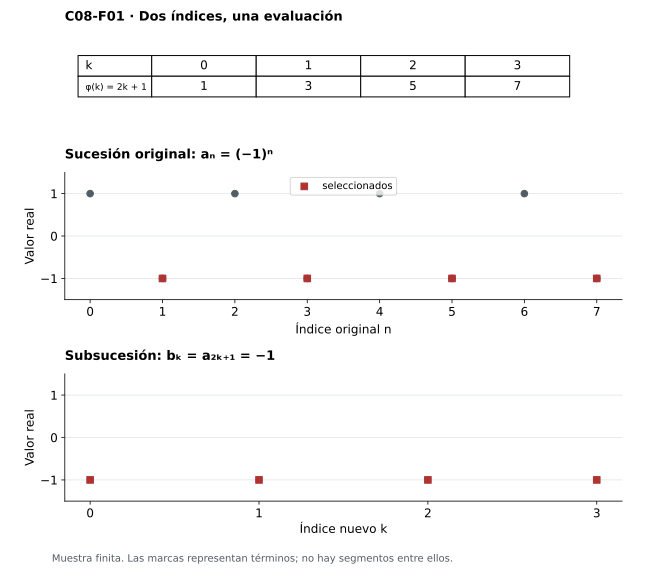

[Índice del libro](../para-matematicos/analisis-para-matematicos.html) · [Ejercicios de este capítulo](#ejercicios-8)

La sucesión $(-1)^n$ permanece entre $-1$ y $1$, pero ninguna de sus colas se acerca a un único número. Si conservamos sólo los índices impares, todos los valores elegidos son $-1$. La acotación no dio convergencia a la sucesión entera; al seleccionar términos aparece, sin embargo, un comportamiento estable que la oscilación ocultaba.

Buscamos hasta dónde puede llevarse esa selección en una sucesión real acotada cualquiera. Los términos elegidos deberán mantener su orden y avanzar indefinidamente en los índices originales. Para encontrar un destino sin conocerlo de antemano, iremos estrechando intervalos que todavía reciban infinitos índices; los intervalos cerrados encajados de C03 proporcionarán después el punto al que dirigir la extracción.

Conservamos $\mathbb N=\{0,1,2,\ldots\}$. Las bolas y los puntos de acumulación de C04 permitirán relacionar este problema de sucesiones con los conjuntos de valores, y las pruebas de convergencia seguirán usando la definición y las reglas de C06.

## 8.1. Seleccionar términos sin perder el orden

[]{#MA-SEC-ANM-01-008-001}

Al leer los términos impares de $a_n=(-1)^n$, las posiciones originales $1,3,5,\ldots$ pasan a ocupar las nuevas posiciones $0,1,2,\ldots$. El término original $a_5=-1$, por ejemplo, queda en la posición nueva $2$. Los valores conservan su altura; los índices necesitan una regla de traducción.

Esa regla es $\varphi(k)=2k+1$: $\varphi(0)=1$, $\varphi(2)=5$ y $b_2=a_{\varphi(2)}=-1$. El índice nuevo y el original son naturales, mientras que la evaluación produce un término real.

**Definición.** Sea $a:\mathbb N\to\mathbb R$. Una **subsucesión** de $a$ es una sucesión $b=a\circ\varphi$, donde $\varphi:\mathbb N\to\mathbb N$ es estrictamente creciente. Así, $b_k=a_{\varphi(k)}$, y $i<j$ implica $\varphi(i)<\varphi(j)$.

Conservamos $\mathbb N=\{0,1,2,\ldots\}$. El índice nuevo $k$ y el índice original $\varphi(k)$ son naturales; $a_{\varphi(k)}$ es un real. Cuando un natural aparece en una expresión real como $1/(k+1)$, se entiende su imagen mediante la inclusión canónica. La coincidencia de numerales no identifica los objetos de ambos sistemas.

El crecimiento estricto impide reutilizar un índice o volver hacia atrás. Se pueden saltar términos o conservarlos todos: la identidad $\varphi(k)=k$ produce la propia sucesión. También $\varphi(k)=k+3$ es un selector, pues $\varphi(k+1)=\varphi(k)+1$; da la cola desde $3$ reindexada desde cero. En cambio, $\varphi(k)=0$ define una composición constante sin ser selector: usa siempre el mismo índice. En la selección impar los índices son distintos y los valores coinciden, de modo que el requisito de crecimiento afecta a las posiciones elegidas.

**Lema de los índices.** Todo selector estrictamente creciente satisface $\varphi(k)\ge k$. Además, la composición de dos selectores estrictamente crecientes vuelve a serlo.

Para la primera afirmación usamos inducción. En cero, $\varphi(0)\ge0$ porque su valor es natural. Si $\varphi(k)\ge k$, el crecimiento estricto entre naturales da $\varphi(k+1)\ge\varphi(k)+1\ge k+1$. La comparación de índices consecutivos basta para acreditar crecimiento estricto universal: si $i<j$, se encadenan las desigualdades desde $i$ hasta $j$. Para la composición, si $i<j$, entonces $\psi(i)<\psi(j)$, y aplicar el crecimiento de $\varphi$ da $\varphi(\psi(i))<\varphi(\psi(j))$.

La desigualdad $\varphi(k)\ge k$ asegura que avanzar en la nueva sucesión nos lleva al menos igual de lejos en la original. Si extraemos de una extracción, $b_{\psi(j)}=a_{(\varphi\circ\psi)(j)}$: primero se recorre $j\mapsto\psi(j)$ y después $\psi(j)\mapsto\varphi(\psi(j))$. Para $\varphi(k)=2k+1$ y $\psi(j)=3j$, el selector compuesto es $6j+1$.

{#fig-anm-c08-f01 fig-alt="Dos gráficas muestran la sucesión alternante y su selección impar constante menos uno; una tabla relaciona los índices nuevos cero a tres con uno, tres, cinco y siete."}

En la [figura 8.1](#fig-anm-c08-f01), el punto original $(3,-1)$ corresponde al nuevo $(1,-1)$, y $(5,-1)$ pasa a $(2,-1)$. Las dos gráficas conservan puntos discretos, sin segmentos entre posiciones naturales.

### Ejercicios de la sección 8.1

[]{#ejercicios-8}

#### Ejercicio 1. Mapas de selección

[]{#MA-EX-ANM-01-008-001}

Para cada mapa $\mathbb N\to\mathbb N$ dado por $\varphi(k)=2k$, $\psi(k)=k^2$, $\eta(k)=\lfloor k/2\rfloor$ y $\theta(k)=k+5$, decide si es selector de subsucesión. Si lo es, calcula los tres primeros términos seleccionados de $a_n=1/(n+1)$.

[]{#MA-SOL-ANM-01-008-001}

Ver solución del ejercicio 1

Los mapas $\varphi$ y $\theta$ tienen incrementos dos y uno, respectivamente; son estrictamente crecientes. $\psi(k+1)-\psi(k)=2k+1>0$, también desde cero. Sus primeros valores seleccionados son, respectivamente, $(1,1/3,1/5)$, $(1,1/2,1/5)$ y $(1/6,1/7,1/8)$. En cambio, $\eta(0)=\eta(1)=0$, por lo que no es estrictamente creciente. El hecho de que $\eta$ sea no decreciente no satisface la definición: permite reutilizar un índice.

La distinción entre índices y alturas también se aprecia en la [figura 8.1](analisis-para-matematicos-capitulo-8-subsucesiones-acumulacion-y-bolzanoweierstrass.html#fig-anm-c08-f01).

#### Ejercicio 2. Enumerar índices sin saltos ocultos

[]{#MA-EX-ANM-01-008-002}

Sea $E\subseteq\mathbb N$ infinito. Define $e_0=\min E$ y $e_{k+1}=\min\{n\in E:n>e_k\}$. Prueba que la construcción existe y que $\{e_k:k\in\mathbb N\}=E$.

[]{#MA-SOL-ANM-01-008-002}

Ver solución del ejercicio 2

La base existe por buen orden. En cada paso, $E$ no está contenido en el prefijo finito hasta $e_k$, de modo que el conjunto siguiente es no vacío y tiene mínimo. Los índices obtenidos crecen estrictamente y pertenecen a $E$, lo que prueba una inclusión. Para la otra, fija $m\in E$. Como $e_k\ge k$, existe un primer $j$ con $e_j\ge m$. Si $j=0$, la minimalidad de $e_0$ fuerza $e_0=m$. Si $j>0$, tenemos $e_{j-1}<m$, y $m$ era admisible al definir $e_j$; por eso $e_j\le m$, luego $e_j=m$. No basta decir que la lista es infinita: la regla del mínimo es lo que evita omitir un elemento de $E$.

#### Ejercicio 3. Dos extracciones consecutivas

[]{#MA-EX-ANM-01-008-003}

Sea $a_n=n/(n+1)$, $b_k=a_{3k+2}$ y $c_j=b_{2j+1}$. Escribe los tres dominios de índices, el selector compuesto y una fórmula para $c_j$. ¿Conmutan los dos selectores?

[]{#MA-SOL-ANM-01-008-003}

Ver solución del ejercicio 3

Tanto $n$ como $k$ y $j$ recorren $\mathbb N$, pero indexan funciones distintas. El recorrido es $j\mapsto2j+1\mapsto3(2j+1)+2=6j+5$, así que $c_j=(6j+5)/(6j+6)$. Ambos mapas y su composición crecen estrictamente. Invertir el orden produciría $2(3j+2)+1=6j+5$ en este caso: sí conmutan. Esta igualdad particular se verifica por cálculo y no por una ley general. Por ejemplo, los selectores $2k$ y $k+1$ dan composiciones $2k+2$ y $2k+1$, distintas.

#### Ejercicio 4. Misma imagen, distinta selección

[]{#MA-EX-ANM-01-008-004}

Construye dos subsucesiones diferentes de una misma sucesión que tengan exactamente la misma imagen, y demuestra que son diferentes como funciones aunque sus imágenes coincidan.

[]{#MA-SOL-ANM-01-008-004}

Ver solución del ejercicio 4

Toma $a_n=(-1)^n$, la identidad $\varphi(k)=k$ y el selector $\psi(k)=k+1$. Resultan $b_k=(-1)^k$ y $c_k=(-1)^{k+1}$. Ambos tienen imagen $\{-1,1\}$ porque ambas paridades aparecen, pero $b_0=1$ y $c_0=-1$. Por tanto las funciones son distintas. Comparar las imágenes elimina el orden y no permite recuperar la función.

## 8.2. Lo que conserva una subsucesión

[]{#MA-SEC-ANM-01-008-002}

Una ventana que contiene una cola completa conserva el control al descartar términos, siempre que los índices seleccionados sigan avanzando. La desigualdad del lema anterior permite transportar el corte de convergencia al dominio nuevo.

**Proposición.** Si $a_n\to L$ y $\varphi$ es un selector estrictamente creciente, entonces $a_{\varphi(k)}\to L$.

Fijemos $\varepsilon>0$. La convergencia original proporciona $N\in\mathbb N$ tal que $n\ge N$ implica $|a_n-L|<\varepsilon$. Para verificar la definición en el dominio nuevo, tomamos $K=N$. Si $k\ge K$, entonces $\varphi(k)\ge k\ge N$, por lo que $|a_{\varphi(k)}-L|<\varepsilon$. Se ha obtenido un umbral válido para cada tolerancia, y eso demuestra la proposición.

El corte transportado es suficiente, aunque un selector rápido puede haber omitido antes todos los términos que incumplían la tolerancia. Tampoco necesitamos que los valores seleccionados sean distintos.

En $(-1)^n$, la selección par converge a $1$ y la impar a $-1$. Un límite global $L$ sería límite de ambas por la proposición; la unicidad de C06 §6.4 obligaría a $1=L=-1$. Queda así descartada la convergencia global mediante dos destinos incompatibles.

Una única selección convergente deja sin controlar lo descartado. Definamos $a_{2j}=1/(j+1)$ y $a_{2j+1}=2$ para cada $j\in\mathbb N$. La paridad asigna un único valor en todo el dominio. La selección par $b_k=1/(k+1)$ converge a cero y la impar es constante dos, por lo que la sucesión completa tampoco tiene límite real.

{#fig-anm-c08-f02 fig-alt="La gráfica original alterna recíprocos y doses; otra gráfica reindexa los recíprocos. Dos líneas de frontera señalan radio medio, con el término de índice uno en el borde y el corte dos dentro."}

En la [figura 8.2](#fig-anm-c08-f02), la ventana de radio $1/2$ excluye $b_1=1/2$, cuyo error está en la frontera. Para $k\ge2$, $b_k\le1/3<1/2$, así que el corte $K=2$ funciona en la selección. En la sucesión original siguen apareciendo doses después de cualquier corte. La convergencia de $b$ exige además el control para todas las tolerancias ya demostrado en C06.

También se conservan cotas: si $|a_n|\le M$ para todo $n$, sustituir $n$ por $\varphi(k)$ da $|a_{\varphi(k)}|\le M$. Si $a$ es no decreciente, el orden $\varphi(k)<\varphi(k+1)$ da $a_{\varphi(k)}\le a_{\varphi(k+1)}$; una subsucesión de una sucesión no creciente conserva de la misma manera esa dirección. Ninguna de estas afirmaciones obliga a que la sucesión original tenga las propiedades de una selección particular. Por ejemplo, una cota global $7$ sigue dando $|a_{\varphi(k)}|\le7$ en todos los índices nuevos.

### Ejercicios de la sección 8.2

#### Ejercicio 5. Un umbral transportado y uno propio

[]{#MA-EX-ANM-01-008-005}

Para $a_n=3+1/(n+1)$ y $b_k=a_{2k+1}$, encuentra el menor umbral para la tolerancia $\varepsilon=1/10$ en cada sucesión. Compáralos con el umbral transportado de §8.2.

[]{#MA-SOL-ANM-01-008-005}

Ver solución del ejercicio 5

En $a$ se requiere $1/(n+1)<1/10$, equivalente a $n>9$; el menor umbral es $N=10$, pues en nueve hay igualdad. Para $b_k=3+1/(2k+2)$, la condición equivale a $k>4$, así que el menor umbral es $K=5$. El transporte general $K=N=10$ también sirve, pero no es mínimo. La estrictitud de la tolerancia explica ambos casos de frontera.

La [figura 8.2](analisis-para-matematicos-capitulo-8-subsucesiones-acumulacion-y-bolzanoweierstrass.html#fig-anm-c08-f02) permite comprobar por qué un punto de frontera obliga a retrasar el corte.

#### Ejercicio 6. Intercalar dos límites iguales

[]{#MA-EX-ANM-01-008-006}

Supón que $a_{2k}\to L$ y $a_{2k+1}\to L$. Demuestra directamente que $a_n\to L$.

[]{#MA-SOL-ANM-01-008-006}

Ver solución del ejercicio 6

Fija $\varepsilon>0$ y toma umbrales $K_0,K_1$ para las dos selecciones. Sea $K=\max\{K_0,K_1\}$ y $N=2K$. Si $n\ge N$ es par, $n=2k$ con $k\ge K$; si es impar, $n=2k+1\ge2K$ obliga también a $k\ge K$, pues $k\le K-1$ daría $n\le2K-1$. En ambos casos $|a_n-L|<\varepsilon$. Se ha cubierto toda la cola, que era lo que una selección aislada no permitía hacer.

#### Ejercicio 7. Una partición finita de índices

[]{#MA-EX-ANM-01-008-007}

Sea $m\ge2$ natural. Prueba que $a_n\to L$ si y sólo si $a_{mk+r}\to L$ para cada $r\in\{0,\ldots,m-1\}$.

[]{#MA-SOL-ANM-01-008-007}

Ver solución del ejercicio 7

La dirección directa aplica §8.2 a cada selector $k\mapsto mk+r$. Para la recíproca, fija $\varepsilon>0$ y elige un umbral $K_r$ para cada uno de los finitísimos residuos. Toma $K=\max_r K_r$ y $N=mK$. La división euclídea escribe cualquier $n\ge N$ como $n=mk+r$, con $0\le r<m$. Si $k<K$, entonces $n\le m(K-1)+(m-1)=mK-1$, contradicción. Luego $k\ge K_r$ y el término está a distancia menor que $\varepsilon$ de $L$. La finitud de la partición permite reunir los umbrales en un máximo.

#### Ejercicio 8. Todos los términos salvo algunos

[]{#MA-EX-ANM-01-008-008}

Una prueba afirma: «Hay una subsucesión convergente a cero que selecciona todos los índices pares; los pares son infinitos, luego la sucesión converge a cero». Localiza el fallo, da un contraejemplo y demuestra una reparación si la selección omite sólo finitos índices.

[]{#MA-SOL-ANM-01-008-008}

Ver solución del ejercicio 8

Infinitud de índices seleccionados no implica control de todos los posteriores. El ejemplo $a_{2k}=0$, $a_{2k+1}=1$ refuta la afirmación: las dos paridades tienen límites diferentes. Para la reparación, supón $a_{\varphi(k)}\to0$ y que $E=\varphi(\mathbb N)$ tiene complemento finito. Dado $\varepsilon>0$, toma $K$ para la selección. El conjunto de índices omitidos junto con $\{\varphi(0),\ldots,\varphi(K-1)\}$ es finito. Escoge $N$ mayor que todos ellos, o cero si está vacío. Todo $n\ge N$ es $\varphi(k)$ con $k\ge K$; por tanto $|a_n|<\varepsilon$. Lo decisivo es que las excepciones sean finitas.

La [figura 8.2](analisis-para-matematicos-capitulo-8-subsucesiones-acumulacion-y-bolzanoweierstrass.html#fig-anm-c08-f02) recuerda qué términos quedan fuera del control de una selección.

#### Ejercicio 9. Selección convergente de una monótona

[]{#MA-EX-ANM-01-008-009}

Sea $a$ monótona y supón que una subsucesión converge a $L\in\mathbb R$. Demuestra que $a_n\to L$ sin aplicar Bolzano–Weierstrass.

[]{#MA-SOL-ANM-01-008-009}

Ver solución del ejercicio 9

Supón primero que $a$ es no decreciente. Para un índice fijo $n$, los índices seleccionados son eventualmente mayores que $n$, por lo que $a_n\le a_{\varphi(k)}$ eventualmente. El orden de límites de C06 da $a_n\le L$. Dado $\varepsilon>0$, toma un término seleccionado $a_{\varphi(K)}>L-\varepsilon$ y pon $N=\varphi(K)$. Para $n\ge N$, la monotonía y la cota recién probada dan $L-\varepsilon<a_N\le a_n\le L$, así que $|a_n-L|<\varepsilon$. Si $a$ es no creciente, aplica el argumento a $-a$, cuya selección converge a $-L$, y cambia de signo. La dirección monótona propaga a toda una cola la información de un solo término seleccionado.

## 8.3. Regresar cerca de un punto

[]{#MA-SEC-ANM-01-008-003}

La selección par del ejemplo anterior puede volver cerca de cero después de cualquier corte, mientras los términos impares siguen fuera de la ventana. Esa persistencia pide cercanía y un índice tardío a la vez; una visita inicial aislada no la satisface.

**Definición.** Un real $L$ es un **punto de acumulación de la sucesión** $a$ si

$$
\forall\varepsilon>0\ \forall N\in\mathbb N\ \exists n\ge N:
|a_n-L|<\varepsilon.
$$

Llamaremos también *punto de acumulación secuencial* a este $L$ para distinguirlo de la acumulación de un conjunto. Cada bola $B(L,\varepsilon)$ recibe infinitos índices: si no hubiera visitas, el corte $0$ ya impediría encontrarlas; si hubiera una cantidad finita no vacía, el corte $1+\max E$, para ese conjunto $E$ de índices de visita, las dejaría atrás. Si los índices son infinitos, no pueden estar contenidos en ningún prefijo finito y hay uno después de cada corte.

La convergencia exige, para cada tolerancia, un corte que controle **todos** los términos posteriores. La acumulación secuencial exige **alguno** después de cada corte, permitiendo varios destinos: $1$ y $-1$ lo son para $(-1)^n$.

**Proposición.** Un real $L$ es punto de acumulación secuencial de $a$ si y sólo si existe una subsucesión de $a$ que converge a $L$.

Podemos reunir las visitas persistentes en una selección convergente si coordinamos dos exigencias. La escala $1/(k+1)$ hará pequeños los errores y el corte posterior al índice elegido impedirá detenernos en una misma posición.

Supongamos primero que $L$ cumple la definición. El conjunto de índices con $|a_n-L|<1$ es no vacío; sea $n_0$ su mínimo. Una vez elegido $n_k$, la definición aplicada al corte $n_k+1$ y al radio $1/(k+2)$ garantiza que el conjunto

$$
\{n\in\mathbb N:n\ge n_k+1,\ |a_n-L|<1/(k+2)\}
$$

es no vacío. Definimos $n_{k+1}$ como su mínimo. El buen orden de los naturales permite continuar la recursión, y las desigualdades $n_{k+1}>n_k$ convierten $\varphi(k)=n_k$ en un selector estrictamente creciente. Por construcción, $|a_{n_k}-L|<1/(k+1)$ para todo $k$.

Para comprobar la convergencia, recibimos $\varepsilon>0$ y tomamos $K=\lfloor1/\varepsilon\rfloor$, con el piso positivo construido en C06. Si $k\ge K$, entonces $K+1>1/\varepsilon$ y $|a_{n_k}-L|<1/(k+1)\le1/(K+1)<\varepsilon$. El corte responde a la tolerancia y controla toda la selección desde él.

Recíprocamente, supongamos que $a_{\varphi(k)}\to L$. Dados $\varepsilon>0$ y $N\in\mathbb N$, sea $K$ un umbral para esa subsucesión. Tomamos $k=\max\{K,N\}$ y $n=\varphi(k)$. El lema de §8.1 da $n\ge k\ge N$, y la convergencia da $|a_n-L|<\varepsilon$. Esto cumple exactamente la definición de acumulación secuencial.

En $a_{2j}=1/(j+1)$, $a_{2j+1}=2$ y $L=0$, el primer mínimo es $n_0=2$: $a_0=1$ y $a_1=2$ fallan el error menor que uno, mientras $a_2=1/2$ lo cumple. Siguen $n_1=4$, $n_2=6$ y, por inducción, $n_k=2(k+1)$. Para el paso $k$, el error elegido es $1/(k+2)<1/(k+1)$; el par anterior tiene error exactamente $1/(k+1)$ y los impares valen $2$. La frontera estricta explica por qué el mínimo puede ir más allá del corte impuesto.

{#fig-anm-c08-f04 fig-alt="Tres pasos de extracción muestran cortes cero, tres y cinco, y elecciones dos, cuatro y seis; los valores medio, tercio y cuarto quedan estrictamente dentro de sus tolerancias."}

El mínimo natural fija cada elección sin ambigüedad. La construcción usa recursión y existencia de testigos; no garantiza un algoritmo efectivo para decidir las condiciones sobre reales abstractos.

### Ejercicios de la sección 8.3

#### Ejercicio 10. Una escala de radios basta

[]{#MA-EX-ANM-01-008-010}

Demuestra que $L$ es punto secuencial de $a$ si y sólo si para cada $q\in\mathbb N$ y cada $N\in\mathbb N$ hay $n\ge N$ con $|a_n-L|<1/(q+1)$.

[]{#MA-SOL-ANM-01-008-010}

Ver solución del ejercicio 10

La definición aplicada a los radios $1/(q+1)$ da una dirección. Para la otra, dados $\varepsilon>0$ y $N$, arquimedianidad permite escoger $q$ con $1/(q+1)<\varepsilon$. La hipótesis proporciona $n\ge N$ con error menor que ese radio, luego menor que $\varepsilon$. El orden es fijar la tolerancia, reducirla a una escala disponible y después elegir el índice.

#### Ejercicio 11. Un destino prescrito con escapes

[]{#MA-EX-ANM-01-008-011}

Dados $L,H\in\mathbb R$ distintos, construye una sucesión acotada cuyo conjunto de puntos secuenciales sea exactamente $\{L,H\}$. Prueba que no tiene otros.

[]{#MA-SOL-ANM-01-008-011}

Ver solución del ejercicio 11

Toma $a_{2k}=L$ y $a_{2k+1}=H$. Las selecciones constantes muestran que ambos son puntos secuenciales y la cota $\max\{|L|,|H|\}$ acredita acotación. Si $T\notin\{L,H\}$, el radio $r=\frac12\min\{|T-L|,|T-H|\}>0$ define una bola que no contiene ningún término. Así $T$ no satisface la condición de visitas. Como los dos destinos son distintos, la sucesión no converge.

#### Ejercicio 12. Alejar los índices tanto como se quiera

[]{#MA-EX-ANM-01-008-012}

Si $L$ es punto secuencial de $a$ y $h:\mathbb N\to\mathbb N$ es cualquier función, prueba que existe un selector $\varphi$ con $\varphi(k)\ge h(k)$ y $|a_{\varphi(k)}-L|<1/(k+1)$ para todo $k$.

[]{#MA-SOL-ANM-01-008-012}

Ver solución del ejercicio 12

Elige $\varphi(0)$ como el mínimo índice al menos $h(0)$ con error menor que uno. Para el paso siguiente utiliza el corte $\max\{\varphi(k)+1,h(k+1)\}$ y radio $1/(k+2)$. La acumulación secuencial garantiza un testigo después de cada corte, por lo que el mínimo existe. Por inducción se cumplen ambas desigualdades y el crecimiento estricto. El control de errores prueba convergencia como en §8.3. No hace falta que $h$ sea monótona: el máximo incorpora por separado el corte heredado y la nueva exigencia.

#### Ejercicio 13. El conjunto de destinos es cerrado

[]{#MA-EX-ANM-01-008-013}

Sea $C$ el conjunto de puntos de acumulación secuencial de una sucesión real $a$. Demuestra que $C$ es cerrado, sin suponer que $a$ sea acotada.

[]{#MA-SOL-ANM-01-008-013}

Ver solución del ejercicio 13

Por C04 basta probar que todo punto adherente a $C$ pertenece a $C$. Sea $L$ adherente a $C$. Dados $\varepsilon>0$ y un corte $N$, elige $H\in C$ con $|H-L|<\varepsilon/2$. Como $H$ es punto secuencial de $a$, existe $n\ge N$ con $|a_n-H|<\varepsilon/2$. La desigualdad triangular da $|a_n-L|<\varepsilon$. Esto vale para cada tolerancia y cada corte, por lo que $L\in C$. Si $C$ es vacío, no tiene puntos adherentes y es cerrado. La estrategia consiste en gastar la mitad de la tolerancia en aproximar el centro y la otra mitad en aproximar un término.

#### Ejercicio 14. Destinos de una partición finita

[]{#MA-EX-ANM-01-008-014}

Sea $m\ge2$ natural. Prueba que el conjunto de puntos secuenciales de $a$ es la unión de los conjuntos de puntos secuenciales de las $m$ sucesiones $b^{(r)}_k=a_{mk+r}$.

[]{#MA-SOL-ANM-01-008-014}

Ver solución del ejercicio 14

Un punto secuencial de alguna $b^{(r)}$ es límite de una extracción de ella; componiendo selectores resulta límite de una extracción de $a$, así que es punto secuencial de $a$. Para la inclusión inversa, sea $L$ punto secuencial de $a$ y supón que no lo es de ninguna $b^{(r)}$. Para cada residuo existen $\varepsilon_r>0$ y $K_r$ tales que $|b^{(r)}_k-L|\ge\varepsilon_r$ si $k\ge K_r$. Toma $\varepsilon=\min_r\varepsilon_r>0$ y $N=m\max_r K_r$. La división euclídea y el argumento de cortes del ejercicio 8.7 muestran que todo $n\ge N$ tiene error al menos $\varepsilon$. Esto contradice que $L$ sea punto secuencial. La finitud de residuos permite obtener un radio positivo común.

## 8.4. Puntos de una sucesión y puntos de un conjunto

[]{#MA-SEC-ANM-01-008-004}

La imagen olvida cuándo aparece un valor y cuántas veces se repite. En la constante $c_n=0$, cero aparece después de cualquier corte y es punto secuencial. Su imagen $\{0\}$ no tiene acumulación como conjunto: alrededor de cero, ninguna bola perforada contiene un valor de la imagen; para un centro $x\ne0$, el radio $|x|/2>0$ excluye el único valor $0$. Así quedan descartados todos los centros reales.

Para un conjunto $A\subseteq\mathbb R$, C04 llama **adherente** a un punto $L$ si toda bola $B(L,r)$, $r>0$, corta a $A$, y **punto de acumulación de $A$** si cada bola contiene un punto de $A$ distinto de $L$. La acumulación puede ocurrir dentro o fuera del conjunto; la diferencia está en que el testigo nunca puede ser el propio centro.

**Proposición.** Un real $L$ es adherente a $A$ si y sólo si existe una sucesión $x:\mathbb N\to\mathbb R$ con valores en $A$ que converge a $L$.

Si $L$ es adherente, cada conjunto $A\cap B(L,1/(k+1))$ es no vacío. Elegimos un punto $x_k$ en cada uno. Entonces $|x_k-L|<1/(k+1)$, y el mismo control arquimediano usado en §8.3 prueba que $x_k\to L$. En sentido inverso, si $x_k\in A$ y $x_k\to L$, una bola de radio $r>0$ contiene todos los términos desde un umbral; en particular contiene uno de ellos y corta a $A$. Para $A=\varnothing$, ambas afirmaciones son falsas: no hay punto adherente ni una función de dominio no vacío con valores allí.

Para precisar esas elecciones de puntos reales, trabajamos en el marco clásico con elección. Fijado $A$, disponemos de una función $c$ que asigna a cada subconjunto no vacío $S\subseteq A$ un elemento $c(S)\in S$. Podemos escribir $x_k=c(A\cap B(L,1/(k+1)))$ y usar la misma función cuando el conjunto admisible dependa de elecciones anteriores. Esto no toma un mínimo real, que podría no existir, ni procede de completitud. En §8.3 los conjuntos admisibles eran de índices naturales y su buen orden bastaba para tomar mínimos.

**Proposición.** Un real $L$ es punto de acumulación de $A$ si y sólo si existe una sucesión de puntos de $A\setminus\{L\}$ que converge a $L$.

Si $L$ es punto de acumulación, los conjuntos $A\cap B(L,1/(k+1))\setminus\{L\}$ son no vacíos; la función de elección permite tomar $x_k$ en cada uno. El error $|x_k-L|<1/(k+1)$ acredita convergencia. En sentido inverso, una sucesión de valores en $A\setminus\{L\}$ que converge a $L$ aporta en cada bola un término distinto del centro, que es el testigo requerido.

La acumulación permite incluso elegir valores dos a dos distintos. Tomamos primero $x_0\in A\cap B(L,1)\setminus\{L\}$. Para evitar los valores $x_0,\ldots,x_{k-1}$ ya elegidos, con $k\ge1$, reducimos el radio por debajo de todas sus distancias al centro:

$$
r_k=\min\left\{\frac1{k+1},\frac12\min_{0\le j<k}|x_j-L|\right\}>0.
$$

El mínimo interior existe y es positivo porque reúne finitas distancias positivas y no está vacío. Elegimos $x_k\in A\cap B(L,r_k)\setminus\{L\}$ mediante la función fijada. Su distancia al centro es menor que la mitad de cualquiera de las distancias anteriores, lo que impide repetir esos valores; también es menor que $1/(k+1)$, de modo que $x_k\to L$. La elección inicial separada evita tomar un mínimo vacío.

En particular, cada bola alrededor de un punto de acumulación contiene infinitos puntos del conjunto. Si una bola de radio $r$ sólo contuviera finitos puntos distintos de $L$, y hubiera alguno, el mínimo positivo de sus distancias permitiría reducir el radio y excluirlos a todos. Si no hubiera ninguno, la propia bola ya contradiría acumulación. A la inversa, infinitos puntos en una bola garantizan alguno distinto del centro.

Comparemos $c_n=0$ con $d_0=0$ y $d_n=1$ para $n\ge1$.

{#fig-anm-c08-f03 fig-alt="Una constante cero y una sucesión inicialmente cero y después uno se muestran sobre ejes temporales. Sus imágenes reducen todas las repeticiones a uno o dos puntos."}

En $d$, cero pertenece a la imagen y es adherente a ella, pero no es punto secuencial: el corte $N=1$ y el radio $1/2$ eliminan todas las visitas a cero. Uno sí es un punto secuencial y es el único, porque la sucesión converge a uno. La imagen $\{0,1\}$ no tiene puntos de acumulación como conjunto. Para un centro perteneciente a ella basta un radio menor que uno; para un centro exterior basta un radio menor que la distancia a ambos puntos. La imagen conserva el cero inicial y pierde la persistencia temporal del uno.

### Ejercicios de la sección 8.4

#### Ejercicio 15. Tres conjuntos diferentes

[]{#MA-EX-ANM-01-008-015}

Para $a_0=3$ y $a_n=1/n$ cuando $n\ge1$, determina la imagen, su clausura, su conjunto de acumulación y los puntos secuenciales de $a$. Justifica las exclusiones.

[]{#MA-SOL-ANM-01-008-015}

Ver solución del ejercicio 15

La imagen es $A=\{3\}\cup\{1,1/2,1/3,\ldots\}$. La sucesión converge a cero, pues el prefijo no afecta el límite, así que su único punto secuencial es cero. Cero es punto de acumulación de $A$ por los recíprocos. Para excluir cualquier $x\ne0$ como punto de acumulación, elige $J\ge1$ natural con $1/J<|x|/2$. Para $n\ge J$, la triangular inversa da $|x-1/n|\ge|x|-1/n>|x|/2$. Sólo queda el conjunto finito $F=\{3\}\cup\{1/n:1\le n<J\}$. Si $F\setminus\{x\}$ es no vacío, toma

$$
r=\min\left\{\frac{|x|}{2},\frac12\min_{y\in F\setminus\{x\}}|x-y|\right\}>0.
$$

Si es vacío, toma $r=|x|/2$. Esta bola excluye todos los puntos de $A$ distintos de $x$: los recíprocos tardíos quedan fuera por la primera estimación y los puntos finitos restantes por la elección del radio. Por tanto $x$ no es de acumulación. Si además $x\notin A$, la misma bola no contiene ningún punto de $A$ y excluye adherencia. Los puntos de $A$ sí son adherentes por pertenencia, y $0$ por los recíprocos. En consecuencia $\overline A=A\cup\{0\}$ y $\operatorname{Acc}(A)=\{0\}$.

La [figura 8.4](analisis-para-matematicos-capitulo-8-subsucesiones-acumulacion-y-bolzanoweierstrass.html#fig-anm-c08-f03) ayuda a distinguir los tres conjuntos que se han calculado.

#### Ejercicio 16. Cambios finitos del conjunto

[]{#MA-EX-ANM-01-008-016}

Sea $F\subseteq\mathbb R$ finito y $A\subseteq\mathbb R$. Demuestra que $\operatorname{Acc}(A\setminus F)=\operatorname{Acc}(A)=\operatorname{Acc}(A\cup F)$.

[]{#MA-SOL-ANM-01-008-016}

Ver solución del ejercicio 16

La inclusión por monotonía da $\operatorname{Acc}(A\setminus F)\subseteq\operatorname{Acc}(A)\subseteq\operatorname{Acc}(A\cup F)$. Si $L\in\operatorname{Acc}(A)$, cada bola contiene infinitos puntos de $A$; retirar $F\cup\{L\}$ aún deja un testigo, así que $L\in\operatorname{Acc}(A\setminus F)$. Finalmente, si $L\in\operatorname{Acc}(A\cup F)$, cada bola contiene infinitos puntos de la unión, y al retirar los finitísimos de $F$ quedan puntos de $A$ distintos de $L$. Esto prueba la última inclusión necesaria. El argumento usa infinitud de valores, no multiplicidad de una lista.

#### Ejercicio 17. Cuando no se repiten valores

[]{#MA-EX-ANM-01-008-017}

Supón que cada valor real aparece sólo finitas veces en $a$. Si $A=a(\mathbb N)$, prueba que los puntos secuenciales de $a$ coinciden con $\operatorname{Acc}(A)$.

[]{#MA-SOL-ANM-01-008-017}

Ver solución del ejercicio 17

Si $L$ es punto secuencial, cada bola alrededor de $L$ recibe infinitos índices. Si sólo contuviera finitos valores de $A$, cada uno aportaría finitos índices por hipótesis, dando una unión finita de conjuntos finitos: contradicción. Así hay infinitos valores y $L\in\operatorname{Acc}(A)$. Recíprocamente, si $L\in\operatorname{Acc}(A)$, cada bola contiene infinitos valores de $A$. Dado un corte $N$, el prefijo $a_0,\ldots,a_{N-1}$ sólo aporta finitos valores; existe un valor de esa bola fuera del prefijo y un índice que lo realiza, necesariamente al menos $N$. Esto prueba acumulación secuencial. La segunda dirección no necesita la hipótesis de multiplicidad finita.

#### Ejercicio 18. Misma imagen y destinos diferentes

[]{#MA-EX-ANM-01-008-018}

Construye dos sucesiones con imagen $A=\{1,1/2,1/3,\ldots\}$ cuyos conjuntos de puntos secuenciales sean diferentes. Determina ambos conjuntos.

[]{#MA-SOL-ANM-01-008-018}

Ver solución del ejercicio 18

La primera es $a_n=1/(n+1)$; converge a cero y sus puntos secuenciales son exactamente $\{0\}$. Para la segunda, sea $B_m=m(m-1)/2$ el índice inicial del bloque de longitud $m\ge1$. Los naturales $B_m$ crecen estrictamente y sin cota, así que cada $n$ pertenece a un único bloque $B_m\le n<B_{m+1}$. Definimos $b_n=1/(n-B_m+1)$. Se obtienen los bloques $(1)$, $(1,1/2)$, $(1,1/2,1/3)$ y así sucesivamente; todos sus valores están en $A$, y cada $1/j$ aparece en el bloque $m=j$.

Para un $j\ge1$ fijo y cualquier corte $N$, toma $m\ge\max\{j,N+2\}$. El índice $n=B_m+j-1\ge N$ tiene $b_n=1/j$, por lo que ese valor es punto secuencial. Para $0$, recibidos $\varepsilon>0$ y $N$, toma $m\ge N+2$ con $m>1/\varepsilon$. El último índice del bloque, $n=B_m+m-1\ge N$, tiene $0<b_n=1/m<\varepsilon$. Así también $0$ es punto secuencial. No hay otros, pues todo punto secuencial es adherente a la imagen y la clausura de $A$ es $A\cup\{0\}$, demostrada mediante finitud local fuera de cero como en el ejercicio 8.15. La imagen por sí sola no fija las multiplicidades temporales.

#### Ejercicio 19. Una elección mal justificada

[]{#MA-EX-ANM-01-008-019}

Audita esta frase: «Si $L$ es adherente a $A$, elegimos el menor punto de $A\cap B(L,1/(k+1))$». Da un ejemplo en que esa elección no exista y repara la prueba.

[]{#MA-SOL-ANM-01-008-019}

Ver solución del ejercicio 19

Toma $A=(0,1)$, $L=0$ y $k=0$. La intersección es $(0,1)$ y no tiene menor elemento: si $x$ pertenece, $x/2$ es menor y también pertenece. La adherencia sólo garantiza no vacuidad. La reparación usa la función de elección $c$ sobre los subconjuntos no vacíos de $A$: $x_k=c(A\cap B(L,1/(k+1)))$. Entonces $|x_k-L|<1/(k+1)$ y el argumento arquimediano da convergencia. No hay que imponer a $A$ un orden con mínimos que el enunciado no ofrece.

Los testigos elegidos se interpretan como aproximaciones al centro, como en la [figura 8.4](analisis-para-matematicos-capitulo-8-subsucesiones-acumulacion-y-bolzanoweierstrass.html#fig-anm-c08-f03); su existencia procede de adherencia y de la elección fijada.

#### Ejercicio 20. Caracterizar los cerrados por límites

[]{#MA-EX-ANM-01-008-020}

Demuestra que $F\subseteq\mathbb R$ es cerrado si y sólo si el límite de toda sucesión convergente con valores en $F$ pertenece a $F$. Trata el caso vacío.

[]{#MA-SOL-ANM-01-008-020}

Ver solución del ejercicio 20

Si $F$ es cerrado y $x_n\in F$ converge a $L$, cada bola alrededor de $L$ contiene términos de $F$, así que $L$ es adherente y pertenece a $F$. Recíprocamente, si todos esos límites pertenecen a $F$, toma cualquier punto adherente $L$. Por §8.4 existe una sucesión de puntos de $F$ que converge a $L$; la hipótesis da $L\in F$. Así $F$ contiene todos sus puntos adherentes y es cerrado por C04. Si $F=\varnothing$, no existen sucesiones con valores en él; la propiedad universal es vacua y el vacío es cerrado. La equivalencia no requiere acotación porque sólo considera sucesiones que ya convergen.

## 8.5. Dividir el espacio y conservar índices

[]{#MA-SEC-ANM-01-008-005}

Para construir una extracción hacia $L$ hemos supuesto que ya conocíamos un punto secuencial. La sola acotación no lo señala. Podemos buscarlo estrechando la región que contiene los valores, sin exigir que los términos originales sigan una dirección monótona.

Cada región elegida deberá conservar infinitos índices de visita. Si sólo conserváramos algún término, todos los intervalos podrían encerrar la misma evaluación, sin dejar un índice posterior para continuar la extracción. La reserva se refiere a índices, aunque sus valores puedan coincidir.

Sea $|a_n|\le M$ para todo $n$, con $M\ge0$. Si $M=0$, la sucesión es constante cero y el selector identidad ya converge. Para $M>0$, empezamos por $I_0=[-M,M]$, que contiene todos los términos.

Supongamos construido un intervalo cerrado $I_k=[u_k,v_k]$ cuyo conjunto de índices de visita $E_k=\{n\in\mathbb N:a_n\in I_k\}$ es infinito. Su punto medio es $m_k=(u_k+v_k)/2$. Las mitades cerradas $[u_k,m_k]$ y $[m_k,v_k]$ cubren $I_k$. Si cada una recibiera sólo finitos índices, la unión de esos dos conjuntos finitos contendría todos los índices de $E_k$, contradiciendo su infinitud.

Al menos una mitad conserva, por tanto, infinitos índices. Elegimos la izquierda cuando cumple esa condición y la derecha en caso contrario; la regla también decide cuando ambas sirven. Las dos mitades comparten su punto medio, pero la unión de dos conjuntos finitos seguiría siendo finita aunque se solaparan. La decisión usa la propiedad matemática de infinitud, sin pretender deducirla de una muestra finita.

La construcción comienza porque $E_0=\mathbb N$. Por inducción, todos los $E_k$ son infinitos, todos los intervalos son cerrados y no vacíos, $I_{k+1}\subseteq I_k$ y su anchura es $w_k=v_k-u_k=2M/2^k$. Aquí la acotación permitió crear $I_0$; el argumento de finitud permite repetir cada partición.

Para ilustrar la regla, tomemos $a_n=(-1)^n/(n+1)$ y $M=1$. La mitad izquierda de $[-1,1]$ conserva todos los términos impares. Después se elige siempre la mitad que llega a cero: una mitad negativa separada de cero sólo contiene finitos términos, pues $1/(n+1)$ llega a ser menor que cualquier distancia positiva fijada. Así $I_k=[-2^{1-k},0]$ para $k\ge1$.

{#fig-anm-c08-f05 fig-alt="Cuatro segmentos cerrados encajados se acercan a cero; marcas discretas de valores alternantes recíprocos señalan los valores dentro y fuera de la mitad elegida."}

La [figura 8.5](#fig-anm-c08-f05) muestra intervalos del eje de valores. Sus segmentos representan esos conjuntos cerrados, sin interpolar la sucesión; las visitas infinitas proceden de la fórmula de los términos impares. En este ejemplo el punto común es conocido, mientras que la construcción general todavía debe obtenerlo.

Para aplicar el teorema de intervalos cerrados encajados de C03 §§3.5–3.6, ajustamos la indexación escribiendo $J_m=I_{m-1}$ para $m\ge1$. Los intervalos son cerrados, acotados, no vacíos y cumplen $J_{m+1}\subseteq J_m$. La completitud garantiza un real $L$ en todos ellos y, por tanto, en todos los $I_k$. La disminución de anchuras tendrá que probar después que ese punto es único.

Por inducción, $2^k\ge k+1$: vale para $k=0$ y el paso usa $2^{k+1}\ge2(k+1)\ge k+2$. Así $w_k\le2M/(k+1)$. Para $\varepsilon>0$, tomamos $K=\lfloor2M/\varepsilon\rfloor+1$, cuyo argumento es positivo porque estamos en el caso $M>0$. Entonces $K+1>2M/\varepsilon$ y $w_K<\varepsilon$. Se reutiliza la consecuencia arquimediana de C03 a través del piso de C06, sin recurrir a un teorema posterior de límites de potencias.

Si $L$ y $H$ fueran puntos comunes distintos, con distancia $d=|L-H|>0$, el corte $K=\lfloor2M/d\rfloor+1$ daría $w_K\le2M/(K+1)<d$. Pero ambos pertenecen a $I_K$, de modo que $d\le w_K<d$, contradicción. Para $M=0$ la unicidad ya era inmediata en el singleton inicial $\{0\}$.

El punto común y las reservas $E_k$ proporcionan datos diferentes: la región de valores se estrecha alrededor de $L$, pero todavía hay que enlazar índices crecientes dentro de esas regiones. Ése es el paso que convertirá los intervalos en una subsucesión.

### Ejercicios de la sección 8.5

#### Ejercicio 21. Primeras mitades y reserva

[]{#MA-EX-ANM-01-008-021}

Para $a_n=(-1)^n/(n+1)$ e $I_0=[-1,1]$, aplica la regla de preferencia izquierda durante los tres primeros pasos. Explica por qué la reserva de índices es infinita en cada intervalo obtenido.

[]{#MA-SOL-ANM-01-008-021}

Ver solución del ejercicio 21

Se obtiene $I_1=[-1,0]$, $I_2=[-1/2,0]$ e $I_3=[-1/4,0]$. En el primer paso la mitad izquierda contiene todos los índices impares. Para $I_2$, la otra mitad $[-1,-1/2]$ recibe sólo el índice uno; la mitad que llega a cero recibe todos los impares. Para $I_3$, $[-1/2,-1/4]$ recibe sólo los índices uno y tres, mientras que $[-1/4,0]$ recibe todos los impares desde tres. Compartir el extremo $-1/4$ no afecta la infinitud. La justificación general usa $1/(n+1)\to0$, no el recuento de los primeros puntos dibujados.

La [figura 8.5](analisis-para-matematicos-capitulo-8-subsucesiones-acumulacion-y-bolzanoweierstrass.html#fig-anm-c08-f05) permite seguir el encajamiento; la reserva infinita se acredita con las desigualdades sobre los recíprocos.

#### Ejercicio 22. Un invariante demasiado débil

[]{#MA-EX-ANM-01-008-022}

Sea $a_0=0$ y $a_n=1$ para $n\ge1$. Los intervalos $I_k=[-2^{-k},2^{-k}]$ son cerrados, encajados, de anchura tendente a cero y contienen algún término de $a$. ¿Puede extraerse una subsucesión con $a_{n_k}\in I_k$ para todo $k$? Explica.

[]{#MA-SOL-ANM-01-008-022}

Ver solución del ejercicio 22

Para $k\ge1$, $I_k\subseteq[-1/2,1/2]$ y sólo recibe el índice original cero. Por ello la pertenencia exigiría $n_k=0$ para todos los $k\ge1$, incompatible con crecimiento estricto. El punto común existe y es cero, pero no hay reserva infinita de índices alrededor de él. De hecho la sucesión converge a uno y cero no es punto secuencial. La condición «contiene algún término» no permite la extracción temporal.

La condición de reserva de la [figura 8.5](analisis-para-matematicos-capitulo-8-subsucesiones-acumulacion-y-bolzanoweierstrass.html#fig-anm-c08-f05) excluye precisamente la reutilización de un único índice que haría fallar esta extracción.

#### Ejercicio 23. Dividir en más partes

[]{#MA-EX-ANM-01-008-023}

Sea $m\ge2$ natural. Adapta la construcción de §8.5 dividiendo cada intervalo en $m$ subintervalos cerrados de igual anchura. Fija una regla inequívoca de elección y prueba las propiedades necesarias para obtener un punto común único.

[]{#MA-SOL-ANM-01-008-023}

Ver solución del ejercicio 23

Los $m$ subintervalos cubren al anterior, aunque compartan extremos. Si cada conjunto de índices fuese finito, su unión finita sería finita; alguno conserva infinitos índices. Elegimos el primero de izquierda a derecha entre los que sirven. Esto define una familia encajada de intervalos cerrados no vacíos con anchuras $2M/m^k$. Como $m^k\ge2^k\ge k+1$, arquimedianidad permite hacer la anchura menor que cualquier tolerancia. C03 da un punto común por completitud, y la anchura arbitrariamente pequeña da unicidad mediante la comparación de dos supuestos puntos. Para $M=0$ se trata directamente la constante cero. La prueba no depende específicamente de dos mitades, sino de una partición finita con reducción uniforme de anchura.

#### Ejercicio 24. Anchuras pequeñas sin intersección

[]{#MA-EX-ANM-01-008-024}

Exhibe una familia de intervalos abiertos no vacíos y encajados de anchuras arbitrariamente pequeñas cuya intersección sea vacía. Explica qué paso de §8.5 deja de estar autorizado.

[]{#MA-SOL-ANM-01-008-024}

Ver solución del ejercicio 24

Toma $I_k=(0,1/(k+1))$. Son abiertos, no vacíos y encajados, y su anchura puede hacerse tan pequeña como se quiera por arquimedianidad. Un punto común tendría que ser positivo; para un $x>0$ fijado existe $k$ con $1/(k+1)<x$, por lo que $x\notin I_k$. Cero tampoco pertenece a ninguno. La intersección es vacía. Falla la hipótesis de intervalos cerrados en la interfaz de C03; la disminución de anchuras no reemplaza esa hipótesis.

El carácter cerrado de los intervalos de la [figura 8.5](analisis-para-matematicos-capitulo-8-subsucesiones-acumulacion-y-bolzanoweierstrass.html#fig-anm-c08-f05) es esencial para garantizar el punto común.

#### Ejercicio 25. El punto común como supremo

[]{#MA-EX-ANM-01-008-025}

Para los intervalos $I_k=[u_k,v_k]$ de §8.5, reconstruye la existencia del punto común tomando $L=\sup\{u_k:k\in\mathbb N\}$. Verifica ambas desigualdades para cada intervalo y después la unicidad.

[]{#MA-SOL-ANM-01-008-025}

Ver solución del ejercicio 25

El conjunto de extremos izquierdos es no vacío y está acotado superiormente por $v_0$, así que completitud da su supremo $L$. Para cada $k$, $u_k\le L$. Además $v_k$ es cota superior de todos los $u_j$: si $j\ge k$, el encajamiento da $u_j\le v_j\le v_k$; si $j<k$, da $u_j\le u_k\le v_k$. Por minimalidad del supremo, $L\le v_k$. Luego $L\in I_k$ para todo $k$. Si dos puntos comunes distaran $d>0$, una anchura menor que $d$ lo impediría. Esta prueba abre la interfaz de C03 y muestra que completitud se usa en la existencia del supremo, no en calcular una fórmula del candidato.

## 8.6. Bolzano–Weierstrass: construir la extracción

[]{#MA-SEC-ANM-01-008-006}

**Teorema de Bolzano–Weierstrass para sucesiones reales.** Toda sucesión real acotada tiene una subsucesión convergente.

La conclusión garantiza una selección convergente a algún real, incluso cuando no disponemos de una fórmula para el selector. En $(-1)^n$ podemos elegir cualquiera de las paridades, con destinos distintos; la existencia afirmada no obliga a que converja la sucesión entera.

Para el caso $M>0$, usamos los intervalos de §8.5, su punto común $L$ y las reservas infinitas $E_k=\{n\in\mathbb N:a_n\in I_k\}$. Para elegir dentro del intervalo siguiente necesitaremos un índice posterior al ya utilizado.

Definimos $n_0=\min E_0$. Una vez elegido $n_k$, el conjunto $E_{k+1}\setminus\{0,\ldots,n_k\}$ es no vacío: si no lo fuera, $E_{k+1}$ estaría contenido en un conjunto finito y sería finito. Sus elementos son precisamente los índices de $E_{k+1}$ mayores que $n_k$, y su buen orden permite definir

$$
n_{k+1}=\min\{n\in E_{k+1}:n>n_k\}.
$$

La recursión da un índice en cada paso, $n_{k+1}>n_k$ y $a_{n_k}\in I_k$. La primera propiedad, encadenada entre dos índices cualesquiera, demuestra que $\varphi(k)=n_k$ es un selector estrictamente creciente. Así $b_k=a_{n_k}$ es efectivamente una subsucesión de $a$.

Para $\varepsilon>0$, elegimos primero $K$ con $w_K<\varepsilon$, mediante la fórmula de §8.5. Si $k\ge K$, tanto $a_{n_k}$ como $L$ están en $I_k\subseteq I_K$. Sus distancias quedan controladas por la anchura del mismo intervalo:

$$
|b_k-L|=|a_{n_k}-L|\le w_K<\varepsilon.
$$

La estimación demuestra $b_k\to L$. Junto con la selección identidad del caso $M=0$, queda probado el teorema para toda sucesión real acotada.

Volvamos al ejemplo $a_n=(-1)^n/(n+1)$. Los seis primeros mínimos de la construcción son $0,1,3,5,7,15$, con valores $1,-1/2,-1/4,-1/6,-1/8,-1/16$. El salto de siete a quince es real: los índices impares intermedios aún tienen valores menores que el extremo izquierdo de $I_5=[-1/16,0]$.

{#fig-anm-c08-f06 fig-alt="Tabla de seis pasos seguida de una gráfica discreta y una ampliación de menos un octavo a cero. El destino se marca como referencia, no como término."}

| Paso k | Intervalo Iₖ | Índice nₖ | Valor aₙₖ |
|---|---|---|---|
| 0 | [−1,1] | 0 | 1 |
| 1 | [−1,0] | 1 | −1/2 |
| 2 | [−1/2,0] | 3 | −1/4 |
| 3 | [−1/4,0] | 5 | −1/6 |
| 4 | [−1/8,0] | 7 | −1/8 |
| 5 | [−1/16,0] | 15 | −1/16 |

Para $\varepsilon=1/4$ podemos usar $K=4$, porque $I_4=[-1/8,0]$ tiene anchura $1/8<1/4$. Ese umbral es suficiente; no se afirma que sea mínimo. La tabla separa el contador $k$ de refinamientos, el índice original $n_k$ y el valor $a_{n_k}$. Una ampliación gráfica debe conservar esa distinción y declarar su escala.

Los intervalos reducen la región de valores; las reservas infinitas permiten seguir eligiendo índices posteriores. La completitud aportó $L$ y la estimación por anchura verifica la convergencia de la función construida.

Por ejemplo, toda sucesión con valores en $[-3,7]$ admite una extracción convergente, aunque oscile o repita valores. Para decidir si el límite permanece en el conjunto que contiene los términos, importa además que ese conjunto sea cerrado.

### Ejercicios de la sección 8.6

#### Ejercicio 26. Los mínimos de la extracción

[]{#MA-EX-ANM-01-008-026}

Para el ejemplo alternante recíproco de §§8.5–8.6, verifica los seis índices $n_0,\ldots,n_5$ y demuestra que $n_k=2^{k-1}-1$ para $k\ge4$.

[]{#MA-SOL-ANM-01-008-026}

Ver solución del ejercicio 26

Como $E_0=\mathbb N$, $n_0=0$. En $I_1=[-1,0]$ el primer índice posterior es uno; en $I_2=[-1/2,0]$ el primero posterior a uno es tres; en $I_3=[-1/4,0]$ el primero posterior a tres es cinco. Para $k\ge1$, la pertenencia de un término exige índice impar y $1/(n+1)\le2^{1-k}$, equivalente a $n\ge2^{k-1}-1$. Para $k=4$ ese primer impar admisible es siete, mayor que cinco; para $k=5$ es quince. Si la fórmula vale en algún $k\ge4$, el primer impar admisible en $I_{k+1}$ es $2^k-1$, mayor que $n_k$. La recursión de mínimos da la fórmula por inducción. Se obtiene $0,1,3,5,7,15$; la fórmula no debe extenderse a los primeros pasos, donde la condición de ser posterior puede dominar a la cota espacial.

En la [figura 8.6](analisis-para-matematicos-capitulo-8-subsucesiones-acumulacion-y-bolzanoweierstrass.html#fig-anm-c08-f06) se separan la pertenencia al intervalo y la obligación de avanzar en los índices; ambas intervienen en estos mínimos.

#### Ejercicio 27. Una extracción todavía más tardía

[]{#MA-EX-ANM-01-008-027}

En la prueba de Bolzano–Weierstrass, sustituye la regla por $n_0=\min\{n\in E_0:n\ge h(0)\}$ y $n_{k+1}=\min\{n\in E_{k+1}:n>n_k,\ n\ge h(k+1)\}$, donde $h:\mathbb N\to\mathbb N$. Prueba que la extracción sigue convergiendo al mismo punto común.

[]{#MA-SOL-ANM-01-008-027}

Ver solución del ejercicio 27

Cada conjunto admisible es no vacío porque $E_k$ es infinito y la nueva exigencia sólo excluye un prefijo finito. El mínimo existe por buen orden. Las elecciones mantienen $n_{k+1}>n_k$ y $a_{n_k}\in I_k$, así que forman una subsucesión. Dado $\varepsilon>0$, elige $K$ con $w_K<\varepsilon$. Para $k\ge K$, los puntos $a_{n_k}$ y $L$ siguen estando en $I_K$, de donde $|a_{n_k}-L|\le w_K<\varepsilon$. El tamaño de los saltos temporales no interviene en la estimación espacial.

La estimación por anchura de la [figura 8.6](analisis-para-matematicos-capitulo-8-subsucesiones-acumulacion-y-bolzanoweierstrass.html#fig-anm-c08-f06) sigue funcionando al retrasar las elecciones de índices.

#### Ejercicio 28. Lo que no promete la existencia

[]{#MA-EX-ANM-01-008-028}

Construye una sucesión acotada con una subsucesión convergente y otra no convergente, ambas distintas de la sucesión original. Justifica todas las afirmaciones.

[]{#MA-SOL-ANM-01-008-028}

Ver solución del ejercicio 28

Toma $a_n=(-1)^n$. El selector $\varphi(k)=2k$ produce la constante uno. El selector $\psi(k)=k+1$ produce $b_k=(-1)^{k+1}$, cuyas selecciones par e impar son constantes menos uno y uno; por §8.2 y unicidad no converge. La primera sucesión difiere de $a$ en el índice uno y la segunda difiere ya en cero. Ambas son subsucesiones porque sus selectores crecen estrictamente. La existencia garantizada por el teorema no convierte toda elección en convergente.

La [figura 8.2](analisis-para-matematicos-capitulo-8-subsucesiones-acumulacion-y-bolzanoweierstrass.html#fig-anm-c08-f02) permite contrastar lo que controla una selección con lo que permanece en la sucesión original.

#### Ejercicio 29. Extracciones simultáneas

[]{#MA-EX-ANM-01-008-029}

Sean $a$ y $b$ dos sucesiones reales acotadas. Prueba que existe un mismo selector $\theta$ tal que $a_{\theta(j)}$ y $b_{\theta(j)}$ convergen, posiblemente a límites diferentes. Extiende el argumento a una familia finita de sucesiones acotadas.

[]{#MA-SOL-ANM-01-008-029}

Ver solución del ejercicio 29

Aplica Bolzano–Weierstrass a $a$ y obtiene $\varphi$ con $a_{\varphi(k)}\to A$. La sucesión $b_{\varphi(k)}$ sigue acotada; extrae de ella mediante $\psi$ una sucesión convergente a $B$. Pon $\theta=\varphi\circ\psi$, estrictamente creciente. La selección $a_{\theta(j)}$ converge a $A$ porque es una subsucesión de una sucesión que ya convergía, mientras que $b_{\theta(j)}\to B$ por construcción. Para una familia finita se procede por inducción: la siguiente extracción conserva los límites previamente obtenidos y añade uno nuevo. No se afirma que el selector sea determinado de forma única; muchos pueden servir. La técnica transferible consiste en conservar las propiedades adquiridas al hacer cada extracción posterior.

#### Ejercicio 30. Un selector para numerables sucesiones

[]{#MA-EX-ANM-01-008-030}

Sea $(a^{(r)})_{r\in\mathbb N}$ una familia de sucesiones reales, cada una acotada. Demuestra que hay un selector $\theta$ tal que $a^{(r)}_{\theta(k)}$ converge para cada $r$ fijo. No se exige una cota común a toda la familia.

[]{#MA-SOL-ANM-01-008-030}

Ver solución del ejercicio 30

Construimos selectores originales $\varphi_r$ anidados. Aplica la construcción determinada de Bolzano–Weierstrass a $a^{(0)}$ y obtiene $\varphi_0$. Dado $\varphi_r$, extrae de $a^{(r+1)}_{\varphi_r(k)}$ mediante un selector $\psi_{r+1}$ y define $\varphi_{r+1}=\varphi_r\circ\psi_{r+1}$. Para cada $s\le r$, $a^{(s)}_{\varphi_r(k)}$ converge, por conservación de límites. Las elecciones pueden fijarse usando la menor cota natural positiva disponible y las reglas de mitades y mínimos ya especificadas; no se precisa escoger arbitrariamente entre selectores.

Define la diagonal $\theta(k)=\varphi_k(k)$. Como $\psi_{k+1}(k+1)\ge k+1$, se tiene $\theta(k+1)=\varphi_k(\psi_{k+1}(k+1))\ge\varphi_k(k+1)>\varphi_k(k)=\theta(k)$. Por tanto $\theta$ es selector. Fija $r$. Para $k\ge r$, el anidamiento permite escribir $\theta(k)=\varphi_r(t_k)$, con $t_k\ge k$; esto se deduce componiendo los selectores posteriores, cada uno mayor o igual a la identidad. Como $\theta$ crece y $\varphi_r$ es estrictamente creciente, los $t_k$ también crecen. Dada una tolerancia para el límite de $a^{(r)}_{\varphi_r(j)}$, toma su umbral $J$ y luego $K=\max\{r,J\}$. Para $k\ge K$, $t_k\ge k\ge J$ y el término diagonal cumple la tolerancia. Cada $r$ fijo queda controlado; no se ha afirmado un umbral uniforme en $r$.

## 8.7. De la extracción a los conjuntos

[]{#MA-SEC-ANM-01-008-007}

Una sucesión tiene infinitos índices aunque repita un único valor. Para deducir acumulación de un conjunto infinito necesitaremos conservar su infinitud de **valores distintos**, evitando que la extracción obtenida sea sólo una constante repetida.

**Teorema.** Todo conjunto infinito y acotado $A\subseteq\mathbb R$ tiene al menos un punto de acumulación en $\mathbb R$.

Fijemos la función de elección sobre los subconjuntos no vacíos de $A$ descrita en §8.4. Elegimos $x_0\in A$ y, construidos $x_0,\ldots,x_k$, elegimos $x_{k+1}$ en $A\setminus\{x_0,\ldots,x_k\}$. Este conjunto sigue siendo no vacío, porque quitar finitos puntos no agota un conjunto infinito. Se obtiene una sucesión de valores dos a dos distintos; no se afirma que enumere todo $A$.

Como $A$ es acotado, la sucesión también lo es. Bolzano–Weierstrass produce una subsucesión $y_j=x_{\varphi(j)}$ que converge a algún real $L$. Los valores de $y$ siguen siendo distintos. En consecuencia, a lo sumo uno coincide con $L$. Si ninguno coincide, $y$ ya tiene valores en $A\setminus\{L\}$. Si $y_{j_0}=L$, consideramos $z_k=y_{j_0+1+k}$: esta cola reindexada conserva el límite por C06 y evita el centro. En ambos casos la caracterización de §8.4 demuestra que $L$ es punto de acumulación de $A$.

Repetir siempre el mismo punto de $A$ habría producido una constante y, por tanto, sólo un límite adherente. Elegir valores distintos permite retirar a lo sumo una aparición del centro y obtener un testigo diferente de $L$ en cada bola, que es lo que exige acumulación.

El punto obtenido puede quedar fuera de $A$. Para $A=\{1/(n+1):n\in\mathbb N\}$, todos los valores son positivos y cero no pertenece a $A$. Sin embargo, para cada $r>0$ existe $n$ con $0<1/(n+1)<r$, de modo que cero es punto de acumulación de $A$.

![Cero es punto de acumulación de los recíprocos positivos y no pertenece a su conjunto. Sí pertenece al intervalo cerrado \[0,1\] que contiene todos esos puntos.](../../assets/books/anm/C08/C08-F07.svg){#fig-anm-c08-f07 fig-alt="Una fila muestra recíprocos positivos y un cero excluido del conjunto A; otra muestra el intervalo cerrado de cero a uno con el extremo cero incluido."}

**Corolario.** Toda sucesión con valores en un conjunto cerrado y acotado $F\subseteq\mathbb R$ tiene una subsucesión que converge a un punto de $F$.

La acotación proporciona una extracción convergente a $L$ por el teorema de §8.6. Puesto que sus términos están en $F$, §8.4 muestra que $L$ es adherente a $F$. Un conjunto cerrado contiene sus puntos adherentes, por C04, y por tanto $L\in F$. Si $F$ es vacío, no existe una sucesión de dominio $\mathbb N$ con valores allí; la afirmación universal no requiere construir una extracción en ese caso.

En particular, si todos los términos están en $[u,v]$, con $u\le v$, se obtiene un límite subsucesional en ese mismo intervalo, incluidos sus extremos. Para un intervalo abierto la pertenencia puede fallar: $1/(n+2)$ tiene valores en $(0,1)$ y converge a cero.

La infinitud y la acotación desempeñan papeles separados. Un conjunto finito carece de puntos de acumulación: para cualquier centro, si quedan puntos distintos de él, sus distancias forman una familia finita no vacía con mínimo positivo y un radio menor los excluye; si no quedan, cualquier bola perforada falla ya.

El conjunto $\mathbb N\subset\mathbb R$ es infinito y no acotado, y tampoco tiene puntos de acumulación reales. Para un centro $x<0$, el radio $-x/2$ deja la bola en los negativos. Si $x\in\mathbb N$, el radio $1/2$ excluye los demás naturales. En el caso restante, $x>0$ no es natural: $q=\lfloor x\rfloor$ satisface $q<x<q+1$, y el radio $\min\{x-q,q+1-x\}/2>0$ deja la bola dentro de $(q,q+1)$, sin naturales. Se han excluido todos los centros, mediante el piso de C06 y la separación de naturales consecutivos.

### Ejercicios de la sección 8.7

#### Ejercicio 31. Dos hipótesis de un conjunto

[]{#MA-EX-ANM-01-008-031}

Exhibe un conjunto acotado sin puntos de acumulación y un conjunto infinito sin puntos de acumulación. Prueba ambos casos y explica por qué ninguno contradice §8.7.

[]{#MA-SOL-ANM-01-008-031}

Ver solución del ejercicio 31

El conjunto $\{0,2\}$ es acotado y finito. En cada centro real una bola suficientemente pequeña excluye todos los puntos distintos del centro; si el centro no pertenece, toma radio menor que ambas distancias. No tiene acumulación. El conjunto $\mathbb N\subset\mathbb R$ es infinito y no acotado. Cualquier bola acotada contiene sólo finitísimos naturales, y puede reducirse para excluir todos los distintos de su centro; por tanto tampoco tiene acumulación. El primer caso carece de infinitud y el segundo de acotación: ninguno cumple las dos hipótesis del teorema.

#### Ejercicio 32. Un cerrado que retiene el destino

[]{#MA-EX-ANM-01-008-032}

Sean $u\le v$ reales y $a_n\in[u,v]$. Demuestra que existe una subsucesión convergente a $L\in[u,v]$. Después muestra que la conclusión con $L\in(u,v)$ puede fallar para términos en un intervalo abierto no vacío.

[]{#MA-SOL-ANM-01-008-032}

Ver solución del ejercicio 32

La cota $|a_n|\le\max\{|u|,|v|\}$ permite aplicar Bolzano–Weierstrass. Si una extracción converge a $L$, el orden de límites da $u\le L\le v$; también puede usarse que el intervalo es cerrado. Esto incluye $u=v$, caso constante. Para $u<v$, define $a_n=u+(v-u)/(n+2)$. Sus valores están estrictamente entre $u$ y $v$ y converge a $u$, por las reglas de C06. Toda subsucesión tiene el mismo límite $u$ y por unicidad ninguna converge a un punto del intervalo abierto. El carácter cerrado decide si el destino permanece dentro.

La [figura 8.7](analisis-para-matematicos-capitulo-8-subsucesiones-acumulacion-y-bolzanoweierstrass.html#fig-anm-c08-f07) distingue que exista un destino real de que pertenezca al conjunto que contiene los términos.

#### Ejercicio 33. Conjunto cerrado acotado sin acumulación

[]{#MA-EX-ANM-01-008-033}

Prueba que un conjunto acotado $A\subseteq\mathbb R$ sin puntos de acumulación es finito. ¿Hace falta que sea cerrado? Justifica.

[]{#MA-SOL-ANM-01-008-033}

Ver solución del ejercicio 33

Si $A$ fuera infinito y acotado, el teorema de §8.7 le daría un punto de acumulación, contradicción. Por tanto es finito. No hace falta cerradura: la existencia de acumulación para conjuntos infinitos acotados ocurre en $\mathbb R$, sin prometer pertenencia a $A$. De hecho todo conjunto finito es cerrado por C04, pero esa conclusión adicional no se usó como hipótesis. El argumento es la contrapositiva del teorema con la acotación mantenida.

#### Ejercicio 34. Conjuntos de destinos acotados

[]{#MA-EX-ANM-01-008-034}

Sea $a$ acotada por $|a_n|\le M$. Demuestra que su conjunto $C$ de puntos secuenciales es no vacío, cerrado y contenido en $[-M,M]$.

[]{#MA-SOL-ANM-01-008-034}

Ver solución del ejercicio 34

Bolzano–Weierstrass da una extracción convergente, cuyo límite pertenece a $C$ por §8.3; así $C$ es no vacío. El ejercicio 8.13 probó cerradura sin requerir acotación; alternativamente, si $L$ es adherente a $C$, aproxima $L$ por un $H\in C$ a error $\varepsilon/2$ y después elige un término tardío cerca de $H$ al mismo error. Eso demuestra $L\in C$. Finalmente, si $H\in C$, una extracción converge a $H$ y todos sus términos están entre $-M$ y $M$. El orden de límites da $-M\le H\le M$. Las tres conclusiones proceden de obligaciones distintas: existencia, estabilidad por aproximación y cota heredada.

#### Ejercicio 35. Distancia positiva entre dos cerrados

[]{#MA-EX-ANM-01-008-035}

Sean $A,B\subseteq\mathbb R$ cerrados, no vacíos y disjuntos. Supón que $A$ es acotado. Demuestra que existe $\delta>0$ tal que $|x-y|\ge\delta$ para todo $x\in A$ y $y\in B$.

[]{#MA-SOL-ANM-01-008-035}

Ver solución del ejercicio 35

Supón que no existe tal $\delta$. Para cada $n$ hay $x_n\in A$ y $y_n\in B$ con $|x_n-y_n|<1/(n+1)$. Se eligen estos testigos bajo la base clásica de elección; puede hacerse eligiendo primero un $x$ admisible en $A$ y luego un $y$ admisible en $B$. La sucesión $x$ es acotada; una extracción $x_{\varphi(k)}$ converge a un real $L$, y como $A$ es cerrado, $L\in A$. Además

$$
|y_{\varphi(k)}-L|\le |y_{\varphi(k)}-x_{\varphi(k)}|+|x_{\varphi(k)}-L|
<\frac1{\varphi(k)+1}+|x_{\varphi(k)}-L|.
$$

El primer sumando está acotado por $1/(k+1)$ y el segundo tiende a cero. Para cualquier tolerancia se hacen ambos menores que su mitad reuniendo los umbrales. Así $y_{\varphi(k)}\to L$; como $B$ es cerrado, $L\in B$, contradiciendo $A\cap B=\varnothing$. No necesitábamos acotación global de $B$: la proximidad a la extracción de $A$ produjo la convergencia necesaria.

## 8.8. Cuándo las extracciones determinan la sucesión

[]{#MA-SEC-ANM-01-008-008}

Una extracción convergente deja sin controlar los términos descartados. Si la sucesión es acotada, cualquier nueva selección seguirá admitiendo un destino por Bolzano–Weierstrass; por eso conocer un único punto secuencial puede recuperar el control global.

**Teorema.** Para una sucesión real acotada $a$ y un real $L$, son equivalentes:

1. $a_n\to L$;
2. $L$ es el único punto de acumulación secuencial de $a$.

Si $a_n\to L$, la identidad es una selección convergente a $L$, de modo que $L$ es punto secuencial por §8.3. Si $H$ es cualquier otro punto secuencial, existe una subsucesión convergente a $H$. Por §8.2 también converge a $L$; la unicidad del límite da $H=L$. Esta dirección no requiere suponer acotación por separado, pues toda sucesión convergente ya es acotada.

Si falla la convergencia a $L$, su negación proporciona **una tolerancia fija** $\varepsilon_0>0$ y, después de cualquier corte $N$, algún término con $|a_n-L|\ge\varepsilon_0$. Reuniremos esos infractores manteniendo el mismo margen durante toda la extracción.

Sea $n_0$ el menor índice con $|a_{n_0}-L|\ge\varepsilon_0$. Dados $n_k$, tomamos el menor índice $n\ge n_k+1$ con esa propiedad como $n_{k+1}$. La negación de convergencia garantiza que cada conjunto admisible es no vacío. Así $b_k=a_{n_k}$ es una subsucesión y todos sus términos distan al menos $\varepsilon_0$ de $L$.

Aquí se utiliza la acotación de $a$: también $b$ es acotada y Bolzano–Weierstrass proporciona un selector $\psi$ y un real $H$ con $b_{\psi(j)}\to H$. La composición de selectores de §8.1 identifica esta nueva sucesión con una subsucesión de $a$. Por §8.3, $H$ es punto de acumulación secuencial de $a$; la hipótesis de unicidad obliga a que $H=L$.

Pero la convergencia a $L$ exige $|b_{\psi(j)}-L|<\varepsilon_0$ para todos los índices suficientemente grandes, mientras que la construcción garantiza $|b_{\psi(j)}-L|\ge\varepsilon_0$ para **todos** ellos. La contradicción demuestra $a_n\to L$.

La acotación permitió encontrar un destino para la selección de infractores; sin ella esa selección podría escapar de todas las regiones acotadas. También asegura existencia cuando sólo sabemos que hay «a lo sumo un» punto secuencial: Bolzano–Weierstrass aporta al menos uno y el criterio anterior aplica entonces a ese único destino.

La sucesión $c_{2j}=0$, $c_{2j+1}=j+1$ muestra la necesidad de aquella hipótesis. La selección par converge a cero. Para excluir cualquier $H\ne0$, fijamos $r=\min\{|H|/2,1\}>0$, elegimos un natural $K>\max\{0,H+1\}$ y tomamos el corte $N=2K$. Los términos pares tienen error $|H|>r$. Si $n=2j+1\ge2K$, la aritmética natural da $j\ge K$; entonces $c_n=j+1\ge K+1>H+r$ y también queda fuera de $B(H,r)$. No hay visitas después de ese corte, de modo que $H$ no es punto secuencial. Cero es el único.

Sin embargo, $c$ no converge: no es acotada, ya que los términos impares superan cualquier cota real. Toda sucesión convergente es acotada por C06. La hipótesis del teorema no puede suprimirse.

{#fig-anm-c08-f08 fig-alt="Dos gráficos discretos contrastan una sucesión acotada con destinos cero y dos y otra con ceros pares y términos impares crecientes. La escala mostrada es una muestra, no una cota del segundo caso."}

En la [figura 8.8](#fig-anm-c08-f08), el primer panel corresponde a $a_{2j}=1/(j+1)$, $a_{2j+1}=2$, que es acotada y tiene los dos destinos $0$ y $2$. Sus términos impares refutan el control alrededor de cero; no ejemplifica unicidad. El segundo panel representa la construcción no acotada anterior. La escala dibujada contiene una muestra de sus términos, sin constituir una cota.

El criterio de destino único usa Bolzano–Weierstrass para someter a prueba lo que quedó fuera de una ventana: de persistir allí infinitos índices, permitirían construir otro destino. La acotación garantiza esa posibilidad de extraer y la unicidad la vuelve incompatible con el margen fijo que conservaron los infractores.

### Ejercicios de la sección 8.8

#### Ejercicio 36. Toda extracción puede refinarse

[]{#MA-EX-ANM-01-008-036}

Prueba que $a_n\to L$ si y sólo si toda subsucesión de $a$ tiene a su vez una subsucesión que converge a $L$. No supongas acotación.

[]{#MA-SOL-ANM-01-008-036}

Ver solución del ejercicio 36

Si $a_n\to L$, toda subsucesión ya converge a $L$ por §8.2 y la identidad sirve como extracción adicional. Recíprocamente, si $a$ no converge a $L$, existe $\varepsilon_0>0$ con términos tardíos de error al menos $\varepsilon_0$. Construyendo mínimos después de cada corte se obtiene una subsucesión $b$ con $|b_k-L|\ge\varepsilon_0$ para todo $k$. Ninguna extracción suya puede converger a $L$, porque todas conservan esa desigualdad y contradicen la captura estricta para la tolerancia $\varepsilon_0$. Esto contradice la hipótesis. Aquí ésta garantiza directamente la extracción hacia $L$, por lo que no se necesita Bolzano–Weierstrass ni acotación.

#### Ejercicio 37. Clasificar una familia intercalada

[]{#MA-EX-ANM-01-008-037}

Para $p,q\in\mathbb R$, define $a_{2k}=p+1/(k+1)$ y $a_{2k+1}=q-1/(k+1)$. Determina sus puntos secuenciales y para qué parámetros converge.

[]{#MA-SOL-ANM-01-008-037}

Ver solución del ejercicio 37

La selección par converge a $p$ y la impar a $q$, así que ambos son puntos secuenciales, posiblemente iguales. No hay otros: por el resultado de partición finita del ejercicio 8.14, cada punto secuencial proviene de una de esas dos selecciones, y una sucesión convergente sólo tiene su límite como punto secuencial. Por tanto el conjunto es $\{p,q\}$. La sucesión es acotada por $\max\{|p|,|q|\}+1$. Si $p=q$, el criterio de §8.8 da convergencia a ese valor; también sirve intercalar dos límites iguales. Si $p\ne q$, los dos destinos diferentes impiden convergencia.

La [figura 8.8](analisis-para-matematicos-capitulo-8-subsucesiones-acumulacion-y-bolzanoweierstrass.html#fig-anm-c08-f08) sitúa el papel de acotación y unicidad del destino; aquí los dos límites se han identificado por paridades.

#### Ejercicio 38. Un radio que depende del corte

[]{#MA-EX-ANM-01-008-038}

Explica por qué la condición «para cada $N$ existen $n\ge N$ y $\varepsilon_N>0$ con $|a_n-L|\ge\varepsilon_N$» no niega la convergencia. Da un contraejemplo y formula la negación correcta.

[]{#MA-SOL-ANM-01-008-038}

Ver solución del ejercicio 38

Toma $a_n=1/(n+1)$ y $L=0$. Para cada $N$, el índice $n=N$ y el radio $\varepsilon_N=1/(N+1)$ cumplen la condición, aunque $a_n\to0$. Los radios pueden disminuir y no establecen un margen de error persistente. La negación correcta fija primero $\varepsilon_0>0$: para todo $N$ existe $n\ge N$ con $|a_n-L|\ge\varepsilon_0$. Con ese orden sí se construye una extracción cuyos términos nunca entran en una misma ventana, lo que refuta convergencia.

La [figura 8.8](analisis-para-matematicos-capitulo-8-subsucesiones-acumulacion-y-bolzanoweierstrass.html#fig-anm-c08-f08) permite leer la refutación con una sola ventana fijada antes de todos los cortes.

#### Ejercicio 39. Acercarse a un conjunto finito de destinos

[]{#MA-EX-ANM-01-008-039}

Supón que $a$ es acotada y que su conjunto de puntos secuenciales es el conjunto finito no vacío $\{L_1,\ldots,L_m\}$. Prueba que para todo $\varepsilon>0$, todos los términos suficientemente tardíos pertenecen a $\bigcup_{i=1}^m B(L_i,\varepsilon)$.

[]{#MA-SOL-ANM-01-008-039}

Ver solución del ejercicio 39

Si falla para algún $\varepsilon_0>0$, hay términos después de todo corte fuera de la unión. Extrae por mínimos una subsucesión $b$ que satisfaga $|b_k-L_i|\ge\varepsilon_0$ para todos los $k$ y todos los $i$. Como $b$ es acotada, Bolzano–Weierstrass proporciona una extracción convergente a $H$. Por composición y §8.3, $H$ es punto secuencial de $a$, así que $H=L_j$ para algún $j$. La convergencia a ese $L_j$ contradice la desigualdad de error fijo. La conclusión encierra la cola en varias ventanas, sin afirmar que permanezca en una sola ni que converja.

#### Ejercicio 40. Saltos pequeños y destinos intermedios

[]{#MA-EX-ANM-01-008-040}

Sea $a$ una sucesión real acotada con $|a_{n+1}-a_n|\to0$. Si $p<q$ son puntos secuenciales, demuestra que todo $t\in(p,q)$ también es punto secuencial.

[]{#MA-SOL-ANM-01-008-040}

Ver solución del ejercicio 40

Fija $t\in(p,q)$, una tolerancia $\varepsilon>0$ y un corte $N$. Toma $\eta=\min\{\varepsilon,t-p,q-t\}/2>0$; es menor que las tres cantidades. Existe $N_0\ge N$ tal que $|a_{n+1}-a_n|<\eta$ para $n\ge N_0$. Como $p$ es punto secuencial, hay $i\ge N_0$ con $|a_i-p|<\eta$, luego $a_i<t$. Como $q$ es punto secuencial, hay $j>i$ con $|a_j-q|<\eta$, luego $a_j>t$.

En el conjunto finito de índices entre $i+1$ y $j$ existe un primer $r$ con $a_r\ge t$. Entonces $a_{r-1}<t\le a_r$ y $r-1\ge N_0$, por lo que $0\le a_r-t\le a_r-a_{r-1}<\eta<\varepsilon$. Además $r\ge N$. Hemos encontrado una visita a la bola de $t$ después de cualquier corte, así que $t$ es punto secuencial. El paso transferible es localizar el primer cruce: saltos pequeños impiden atravesar una altura sin acercarse a ella. La acotación pertenece al contexto de destinos de la sucesión, pero este argumento concreto sólo necesita los dos destinos y la condición sobre saltos.

[Índice del libro](../para-matematicos/analisis-para-matematicos.html) · [Ejercicios de este capítulo](#ejercicios-8)

[← Capítulo 7](analisis-para-matematicos-capitulo-7-monotonia-cotas-y-existencia-de-limites.html) · [Capítulo 9 →](analisis-para-matematicos-capitulo-9-limite-superior-e-inferior-las-envolventes-de-una-cola.html)
