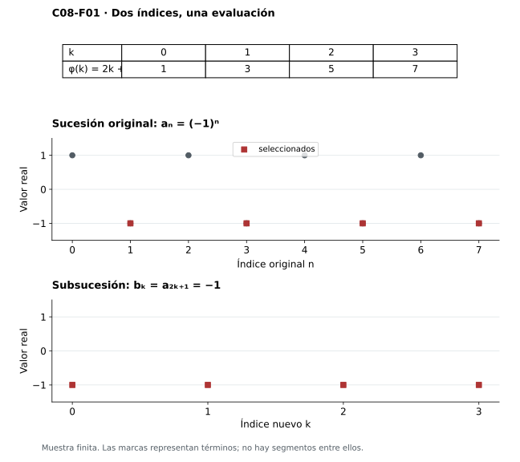
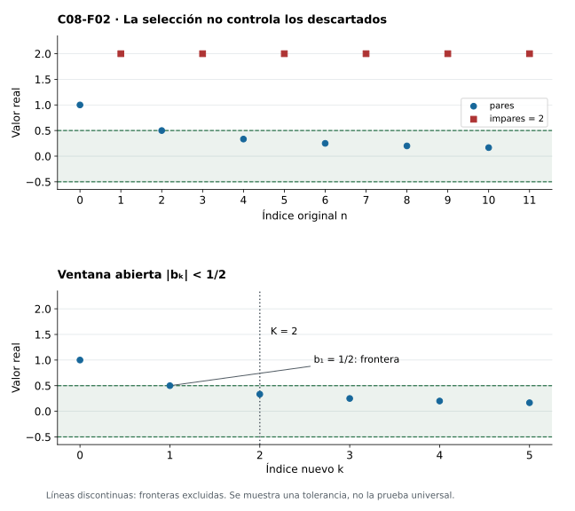
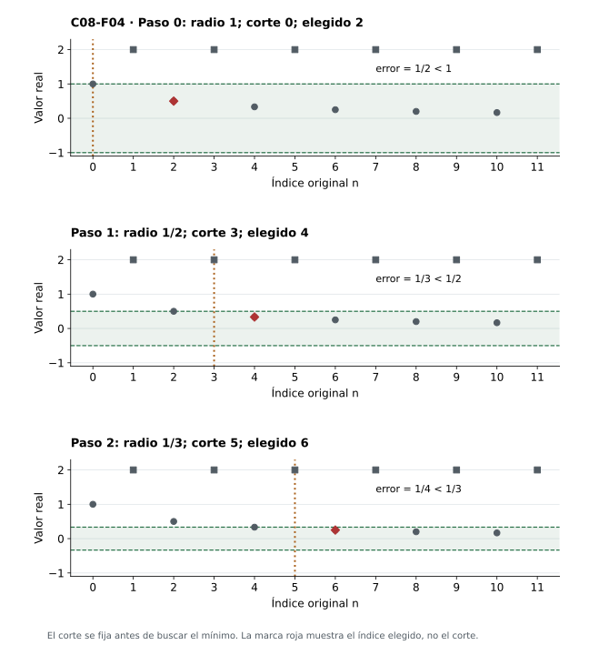
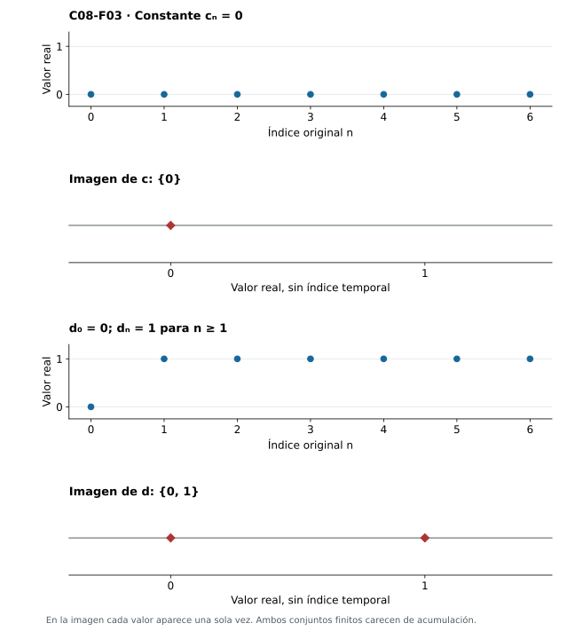
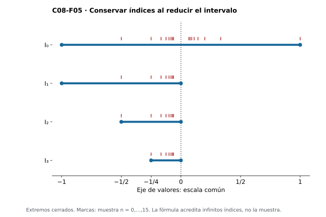
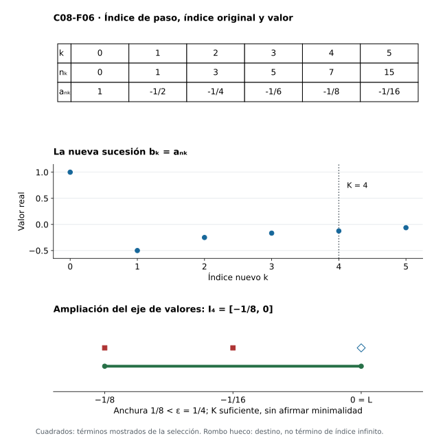
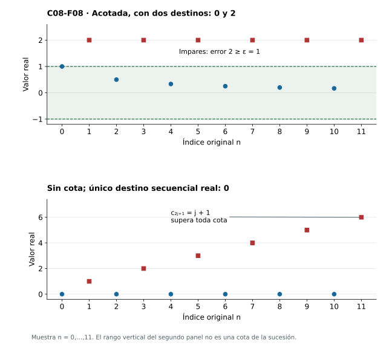

[Índice del libro](../para-matematicos/analisis-para-matematicos.html) · [Capítulo 8](analisis-para-matematicos-capitulo-8-subsucesiones-acumulacion-y-bolzanoweierstrass.html) · [Ejercicios](analisis-para-matematicos-capitulo-8-subsucesiones-acumulacion-y-bolzanoweierstrass-ejercicios.html) · [Soluciones](analisis-para-matematicos-capitulo-8-subsucesiones-acumulacion-y-bolzanoweierstrass-soluciones.html) · [Soluciones de microcontroles](analisis-para-matematicos-capitulo-8-subsucesiones-acumulacion-y-bolzanoweierstrass-microcontroles.html)

Una sucesión puede permanecer entre dos barreras y seguir oscilando. El capítulo anterior obtuvo convergencia cuando había además una dirección monótona; ahora preguntaremos qué se puede rescatar de la sola acotación. La respuesta requerirá cambiar el objeto que seguimos: elegiremos algunos términos, conservando su orden, y construiremos una sucesión nueva.

Primero precisaremos qué significa extraer y qué ocurre con el índice original. Después relacionaremos los destinos de las extracciones con la idea de volver cerca de un punto. Esa preparación permitirá demostrar Bolzano–Weierstrass: toda sucesión real acotada contiene una subsucesión convergente. El argumento hará visible dónde interviene la completitud y por qué necesitamos conservar infinitos índices en cada paso.

Usaremos la propiedad arquimediana y los intervalos cerrados encajados de C03, las nociones locales de C04 y la definición, unicidad y reglas elementales de convergencia de C06. Las sucesiones mantienen dominio $\mathbb N=\{0,1,2,\ldots\}$ y codominio $\mathbb R$. La extracción no añade un término final ni convierte una muestra finita en prueba de un comportamiento infinito.

## 8.1. Seleccionar términos sin perder el orden

[]{#MA-SEC-ANM-01-008-001}

La sucesión $a_n=(-1)^n$ no se acerca a un único número: alterna entre uno y menos uno. Sin embargo, si leemos sólo los términos de índice impar, obtenemos una sucesión constante igual a menos uno. Hemos descartado términos, pero conservamos el orden en que aparecían. Esa operación permite encontrar un comportamiento estable dentro de una sucesión que no lo tiene globalmente.

Hay dos preguntas distintas al escribir el primer término de la nueva sucesión: qué posición ocupa ahora y qué posición ocupaba antes. En el ejemplo, la posición nueva cero corresponde a la posición original uno; la nueva uno, a la original tres. La regla que relaciona ambas es $\varphi(k)=2k+1$.

**Definición.** Sea $a:\mathbb N\to\mathbb R$. Una **subsucesión** de $a$ es una sucesión $b=a\circ\varphi$, donde $\varphi:\mathbb N\to\mathbb N$ es estrictamente creciente. Así, $b_k=a_{\varphi(k)}$, y $i<j$ implica $\varphi(i)<\varphi(j)$.

Conservamos $\mathbb N=\{0,1,2,\ldots\}$. El índice nuevo $k$ y el índice original $\varphi(k)$ son naturales; $a_{\varphi(k)}$ es un real. Cuando un natural aparece en una expresión real como $1/(k+1)$, se entiende su imagen mediante la inclusión canónica. La coincidencia de numerales no identifica los objetos de ambos sistemas.

El crecimiento estricto impide repetir índices y volver hacia atrás. Permite saltar tantos términos como queramos, e incluso no saltar ninguno: la identidad $\varphi(k)=k$ produce la propia sucesión. También permite repetir valores; en nuestro ejemplo todos los índices elegidos son diferentes y todas las evaluaciones valen menos uno. Por otra parte, la regla $\varphi(k)=0$ produce una función compuesta constante, pero no es un selector de subsucesión: se detiene en un único índice.

**Lema de los índices.** Todo selector estrictamente creciente satisface $\varphi(k)\ge k$. Además, la composición de dos selectores estrictamente crecientes vuelve a serlo.

Para la primera afirmación usamos inducción. En cero, $\varphi(0)\ge0$ porque su valor es natural. Si $\varphi(k)\ge k$, el crecimiento estricto entre naturales da $\varphi(k+1)\ge\varphi(k)+1\ge k+1$. La comparación de índices consecutivos basta para acreditar crecimiento estricto universal: si $i<j$, se encadenan las desigualdades desde $i$ hasta $j$. Para la composición, si $i<j$, entonces $\psi(i)<\psi(j)$, y aplicar el crecimiento de $\varphi$ da $\varphi(\psi(i))<\varphi(\psi(j))$.

Este lema tendrá una utilidad concreta: llegar lejos en el índice nuevo garantiza haber llegado al menos igual de lejos en el original. Y si extraemos de una extracción, la función resultante sigue siendo una subsucesión de la inicial, pues $b_{\psi(j)}=a_{(\varphi\circ\psi)(j)}$. El orden de la composición está determinado por el recorrido: primero $j$ pasa a $\psi(j)$ y después a $\varphi(\psi(j))$.

La figura siguiente mantiene separados esos recorridos y las alturas seleccionadas.

{#fig-anm-c08-f01 fig-alt="La selección impar cambia el índice horizontal y conserva la altura menos uno. Los índices elegidos son distintos, aunque los valores se repiten."}

Al trasladar los puntos impares a la gráfica de $b$, cambia su coordenada horizontal: el punto original $(3,-1)$ corresponde al punto nuevo $(1,-1)$. La altura se conserva. Ninguna de las dos gráficas contiene segmentos entre términos; ambas representan funciones de dominio natural.

### Antes de seguir

[]{#MA-MIC-ANM-01-008-001}

1. Para $a_n=(-1)^n$ y $\varphi(k)=2k+1$, calcula $\varphi(0)$, $\varphi(2)$ y $b_2=a_{\varphi(2)}$.

[]{#MA-MIC-ANM-01-008-002}

2. ¿Por qué $\varphi(k)=k+3$ define una subsucesión desde $k=0$?

[]{#MA-MIC-ANM-01-008-003}

3. ¿Es $\varphi(k)=0$ un selector de subsucesión? Justifica.

[]{#MA-MIC-ANM-01-008-004}

4. ¿Puede una subsucesión constante provenir de índices todos distintos?

[]{#MA-MIC-ANM-01-008-005}

5. Escribe dominio y codominio de $a$, $\varphi$ y $a\circ\varphi$.

[]{#MA-MIC-ANM-01-008-006}

6. ¿Qué paso permite deducir $\varphi(k+1)\ge k+1$ a partir de $\varphi(k)\ge k$?

[]{#MA-MIC-ANM-01-008-007}

7. Si $\varphi(k)=2k+1$ y $\psi(j)=3j$, calcula el selector de una extracción de la extracción.

[]{#MA-MIC-ANM-01-008-008}

8. ¿Dónde se representa en la gráfica nueva el término original $(5,-1)$ de la selección impar?

## 8.2. Lo que conserva una subsucesión

[]{#MA-SEC-ANM-01-008-002}

Si una ventana alrededor de $L$ contiene todos los términos desde cierto índice, cualquier selección que avance indefinidamente terminará dentro de esa ventana. El lema anterior convierte esta lectura geométrica en una prueba con los dos índices bien separados.

**Proposición.** Si $a_n\to L$ y $\varphi$ es un selector estrictamente creciente, entonces $a_{\varphi(k)}\to L$.

Fijemos $\varepsilon>0$. La convergencia original proporciona $N\in\mathbb N$ tal que $n\ge N$ implica $|a_n-L|<\varepsilon$. Para verificar la definición en el dominio nuevo, tomamos $K=N$. Si $k\ge K$, entonces $\varphi(k)\ge k\ge N$, por lo que $|a_{\varphi(k)}-L|<\varepsilon$. Se ha obtenido un umbral válido para cada tolerancia, y eso demuestra la proposición.

No afirmamos que $K=N$ sea el menor umbral posible: un selector puede avanzar mucho más rápido. Lo que importa es que el umbral elegido funciona para todos los índices nuevos posteriores. La prueba tampoco exige que los valores seleccionados sean distintos.

Como primer uso, volvamos a $(-1)^n$. La selección par es constante uno y la impar es constante menos uno. Si la sucesión original tuviera límite $L$, ambas selecciones convergerían a $L$. La unicidad del límite demostrada en §6.4 obligaría a que uno fuese igual a menos uno, una contradicción. Dos destinos diferentes de subsucesiones bastan para descartar la convergencia global.

La existencia de una sola subsucesión convergente deja abierta la conducta de los términos descartados. Consideremos ahora la función definida, para cada $j\in\mathbb N$, por $a_{2j}=1/(j+1)$ y $a_{2j+1}=2$. La paridad determina un único valor en cada índice. Su subsucesión par $b_k=1/(k+1)$ converge a cero, mientras que la impar es constante dos; de nuevo la sucesión completa carece de límite real.

{#fig-anm-c08-f02 fig-alt="La ventana de radio medio captura la selección par desde k=2, pero los términos impares de la sucesión original permanecen en dos. La frontera no pertenece a la ventana."}

Para la ventana dibujada, de radio $1/2$, el término $b_1=1/2$ está en la frontera y no satisface la desigualdad estricta. Desde $k=2$, en cambio, $b_k\le1/3<1/2$. En la gráfica original aún aparecen términos iguales a dos después de cualquier corte. El sombreado muestra una tolerancia concreta; la convergencia de $b$ se debe al argumento para toda tolerancia de C06, no a la cantidad de puntos visibles.

También se conservan cotas: si $|a_n|\le M$ para todo $n$, sustituir $n$ por $\varphi(k)$ da $|a_{\varphi(k)}|\le M$. Si $a$ es no decreciente, el orden $\varphi(k)<\varphi(k+1)$ da $a_{\varphi(k)}\le a_{\varphi(k+1)}$; una subsucesión de una sucesión no creciente conserva de la misma manera esa dirección. Ninguna de estas afirmaciones obliga a que la sucesión original tenga las propiedades de una selección particular.

### Antes de seguir

[]{#MA-MIC-ANM-01-008-009}

1. Si $N$ sirve para una tolerancia de $a_n\to L$, ¿por qué $K=N$ sirve para cualquier subsucesión?

[]{#MA-MIC-ANM-01-008-010}

2. ¿Debe $K=N$ ser el menor umbral de la subsucesión?

[]{#MA-MIC-ANM-01-008-011}

3. ¿Qué contradicción producen las selecciones par e impar de $(-1)^n$ si suponemos convergencia?

[]{#MA-MIC-ANM-01-008-012}

4. En el ejemplo $b_k=1/(k+1)$, ¿entra $b_1$ en la ventana de radio $1/2$ alrededor de cero?

[]{#MA-MIC-ANM-01-008-013}

5. Para ese mismo radio, verifica que $K=2$ funciona para $b$.

[]{#MA-MIC-ANM-01-008-014}

6. ¿Por qué la selección par convergente del ejemplo par-impar no demuestra convergencia global?

[]{#MA-MIC-ANM-01-008-015}

7. Si $|a_n|\le7$ para todo $n$, ¿qué cota hereda $a_{\varphi(k)}$?

[]{#MA-MIC-ANM-01-008-016}

8. ¿Cómo se prueba que una subsucesión de una sucesión no decreciente es no decreciente?

## 8.3. Regresar cerca de un punto

[]{#MA-SEC-ANM-01-008-003}

La sucesión par-impar anterior regresa cerca de cero después de cualquier corte, aunque nunca quede completamente atrapada allí. Conviene dar un nombre a ese regreso persistente. Una visita aislada al comienzo no basta: debe ser posible exigir al mismo tiempo cercanía y un índice arbitrariamente tardío.

**Definición.** Un real $L$ es un **punto de acumulación de la sucesión** $a$ si

$$
\forall\varepsilon>0\ \forall N\in\mathbb N\ \exists n\ge N:
|a_n-L|<\varepsilon.
$$

Diremos también *punto de acumulación secuencial* para distinguirlo de la acumulación de un conjunto. La condición significa que cada bola $B(L,\varepsilon)$ contiene términos con índices arbitrariamente grandes. Equivale a que el conjunto de índices de visita sea infinito: un conjunto finito de índices queda antes de algún corte, mientras que un conjunto infinito no cabe en un prefijo finito.

En la convergencia, después de fijar $\varepsilon$ buscamos un corte a partir del cual **todos** los términos entren. Aquí, dados $\varepsilon$ y un corte cualquiera, buscamos **algún** término posterior dentro. La diferencia permite que una sucesión tenga varios puntos de acumulación secuencial, como sucede con uno y menos uno para $(-1)^n$.

**Proposición.** Un real $L$ es punto de acumulación secuencial de $a$ si y sólo si existe una subsucesión de $a$ que converge a $L$.

La construcción debe satisfacer dos obligaciones que no se resuelven por separado: los errores han de reducirse y los índices han de avanzar. Para forzar la primera utilizaremos $1/(k+1)$; para la segunda, el índice elegido antes más uno.

Supongamos primero que $L$ cumple la definición. El conjunto de índices con $|a_n-L|<1$ es no vacío; sea $n_0$ su mínimo. Una vez elegido $n_k$, la definición aplicada al corte $n_k+1$ y al radio $1/(k+2)$ garantiza que el conjunto

$$
\{n\in\mathbb N:n\ge n_k+1,\ |a_n-L|<1/(k+2)\}
$$

es no vacío. Definimos $n_{k+1}$ como su mínimo. El buen orden de los naturales permite continuar la recursión, y las desigualdades $n_{k+1}>n_k$ convierten $\varphi(k)=n_k$ en un selector estrictamente creciente. Por construcción, $|a_{n_k}-L|<1/(k+1)$ para todo $k$.

Queda comprobar la convergencia, porque una escala escrita no sustituye su definición. Dado $\varepsilon>0$, la propiedad arquimediana de C03 permite elegir $K$ con $1/(K+1)<\varepsilon$. Si $k\ge K$, entonces $|a_{n_k}-L|<1/(k+1)\le1/(K+1)<\varepsilon$. La subsucesión construida converge a $L$.

Recíprocamente, supongamos que $a_{\varphi(k)}\to L$. Dados $\varepsilon>0$ y $N\in\mathbb N$, sea $K$ un umbral para esa subsucesión. Tomamos $k=\max\{K,N\}$ y $n=\varphi(k)$. El lema de §8.1 da $n\ge k\ge N$, y la convergencia da $|a_n-L|<\varepsilon$. Esto cumple exactamente la definición de acumulación secuencial.

Para ver la construcción en acción, usemos $a_{2j}=1/(j+1)$, $a_{2j+1}=2$ y $L=0$. La regla de mínimos produce $n_0=2$, $n_1=4$, $n_2=6$ y, en general, $n_k=2(k+1)$. En efecto, el error correspondiente es $1/(k+2)<1/(k+1)$; los índices pares anteriores que aún pudieran superar el corte no cumplen la desigualdad estricta. El término elegido no tiene por qué ser el primero después del corte.

{#fig-anm-c08-f04 fig-alt="El corte impuesto y el índice elegido son diferentes. Cada paso conserva el avance temporal y obtiene un error menor que la tolerancia solicitada."}

El mínimo natural elimina ambigüedad en la definición de cada índice. No proporciona por sí solo un algoritmo efectivo: decidir una condición sobre reales dados abstractamente puede requerir información que no se ha especificado. La proposición es una construcción matemática por recursión y existencia de testigos.

### Antes de seguir

[]{#MA-MIC-ANM-01-008-017}

1. Escribe los cuantificadores que definen un punto de acumulación secuencial $L$.

[]{#MA-MIC-ANM-01-008-018}

2. ¿Por qué una sola aparición de $L$ no garantiza acumulación secuencial?

[]{#MA-MIC-ANM-01-008-019}

3. ¿Por qué un conjunto infinito de índices contiene un índice mayor que cualquier $m$ fijado?

[]{#MA-MIC-ANM-01-008-020}

4. ¿Qué dos requisitos se imponen al elegir $n_{k+1}$ en la prueba?

[]{#MA-MIC-ANM-01-008-021}

5. ¿Qué garantiza que cada conjunto admisible de índices tenga mínimo?

[]{#MA-MIC-ANM-01-008-022}

6. Si $|a_{n_k}-L|<1/(k+1)$, ¿cómo eliges un umbral para $\varepsilon>0$?

[]{#MA-MIC-ANM-01-008-023}

7. En la dirección inversa, ¿por qué se toma $k=\max\{K,N\}$?

[]{#MA-MIC-ANM-01-008-024}

8. En el ejemplo par-impar, ¿por qué el primer mínimo para error menor que uno es $n_0=2$ y no cero?

## 8.4. Puntos de una sucesión y puntos de un conjunto

[]{#MA-SEC-ANM-01-008-004}

Al pasar de una sucesión a su imagen olvidamos cuándo aparece cada valor y cuántas veces se repite. Esa pérdida de información afecta a la acumulación. La constante $c_n=0$ tiene cero como punto de acumulación secuencial, pero el conjunto $\{0\}$ no tiene puntos de acumulación: ninguna bola perforada alrededor de cero encuentra un valor distinto del centro.

Recordemos las definiciones de C04 para un conjunto $A\subseteq\mathbb R$. Un punto $L$ es **adherente** a $A$ si toda bola $B(L,r)$, con $r>0$, corta a $A$; es un **punto de acumulación de $A$** si toda esa bola contiene un punto de $A$ distinto de $L$. La segunda condición permite que $L$ pertenezca o no a $A$, pero nunca acepta al propio centro como testigo.

### Adherencia y sucesiones de puntos del conjunto

**Proposición.** Un real $L$ es adherente a $A$ si y sólo si existe una sucesión $x:\mathbb N\to\mathbb R$ con valores en $A$ que converge a $L$.

Si $L$ es adherente, cada conjunto $A\cap B(L,1/(k+1))$ es no vacío. Elegimos un punto $x_k$ en cada uno. Entonces $|x_k-L|<1/(k+1)$, y el mismo control arquimediano usado en §8.3 prueba que $x_k\to L$. En sentido inverso, si $x_k\in A$ y $x_k\to L$, una bola de radio $r>0$ contiene todos los términos desde un umbral; en particular contiene uno de ellos y corta a $A$. Para $A=\varnothing$, ambas afirmaciones son falsas: no hay punto adherente ni una función de dominio no vacío con valores allí.

La elección de estos puntos reales necesita una precisión fundacional. Trabajamos en el marco clásico con elección: para el conjunto $A$ fijado, podemos fijar una función $c$ que asigna a cada subconjunto no vacío $S\subseteq A$ un elemento $c(S)\in S$. Las elecciones anteriores pueden escribirse $x_k=c(A\cap B(L,1/(k+1)))$. Usaremos la misma base cuando el conjunto admisible dependa de elecciones previas. No estamos tomando un mínimo real, que puede no existir, ni deduciendo esta elección de la completitud. En §8.3 elegíamos mínimos de conjuntos de **índices naturales**; allí basta su buen orden.

### Acumulación y exclusión del centro

**Proposición.** Un real $L$ es punto de acumulación de $A$ si y sólo si existe una sucesión de puntos de $A\setminus\{L\}$ que converge a $L$.

Si $L$ es punto de acumulación, elegimos $x_k$ en $A\cap B(L,1/(k+1))\setminus\{L\}$, no vacío por definición. La estimación ya demostrada acredita convergencia. Recíprocamente, si una sucesión así converge a $L$, cada bola contiene un término suyo y ese término es distinto de $L$; queda satisfecho el criterio de bola perforada.

Es posible exigir algo más: los valores elegidos pueden ser dos a dos distintos. Elegimos primero $x_0\in A\cap B(L,1)\setminus\{L\}$. Si ya elegimos $x_0,\ldots,x_{k-1}$, todos diferentes de $L$, tomamos para $k\ge1$

$$
r_k=\min\left\{\frac1{k+1},\frac12\min_{0\le j<k}|x_j-L|\right\}>0.
$$

El mínimo interior es sobre una familia finita no vacía de números positivos. Elegimos $x_k\in A\cap B(L,r_k)\setminus\{L\}$. Su distancia al centro es menor que la mitad de la distancia de cualquiera de los valores anteriores, de modo que no coincide con ellos. También es menor que $1/(k+1)$; por eso la nueva sucesión converge a $L$. La base $k=0$ se trató aparte para no tomar un mínimo de una familia vacía.

Esta construcción explica por qué toda bola alrededor de un punto de acumulación de un conjunto contiene infinitos puntos de ese conjunto. Puede probarse directamente: si dentro de alguna bola de radio $r$ sólo hubiera finitos puntos distintos de $L$, o no habría ninguno, o la menor de sus distancias positivas permitiría escoger una bola menor que los evitara a todos. Ambas posibilidades contradicen la acumulación. Recíprocamente, infinitos puntos en cada bola garantizan un testigo distinto del centro.

### Lo que la imagen no conserva

Comparemos $c_n=0$ con $d_0=0$ y $d_n=1$ para $n\ge1$.

{#fig-anm-c08-f03 fig-alt="Las visitas tardías de una sucesión no equivalen a acumulación de su imagen. Los conjuntos finitos dibujados no tienen puntos de acumulación."}

En $d$, cero pertenece a la imagen y es adherente a ella, pero no es punto secuencial: el corte $N=1$ y el radio $1/2$ eliminan todas las visitas a cero. Uno sí es un punto secuencial y es el único, porque la sucesión converge a uno. La imagen $\{0,1\}$ no tiene puntos de acumulación como conjunto. Para un centro perteneciente a ella basta un radio menor que uno; para un centro exterior basta un radio menor que la distancia a ambos puntos. La imagen conserva el cero inicial y pierde la persistencia temporal del uno.

Las caracterizaciones anteriores permiten transportar preguntas entre conjuntos y sucesiones, siempre que se conserve la condición sobre los testigos. En §8.7 necesitaremos valores distintos para convertir una extracción convergente en acumulación de un conjunto.

### Antes de seguir

[]{#MA-MIC-ANM-01-008-025}

1. ¿Qué condición sobre el testigo distingue adherencia de acumulación de un conjunto?

[]{#MA-MIC-ANM-01-008-026}

2. Para $c_n=0$, distingue acumulación secuencial de acumulación de su imagen.

[]{#MA-MIC-ANM-01-008-027}

3. Para $d_0=0$, $d_n=1$ si $n\ge1$, ¿es cero adherente a la imagen? ¿Es punto secuencial?

[]{#MA-MIC-ANM-01-008-028}

4. ¿Qué estimación asegura convergencia de los testigos de adherencia elegidos?

[]{#MA-MIC-ANM-01-008-029}

5. ¿Puede existir una sucesión de dominio $\mathbb N$ con valores en el conjunto vacío?

[]{#MA-MIC-ANM-01-008-030}

6. ¿Por qué el radio de exclusión de valores anteriores es positivo?

[]{#MA-MIC-ANM-01-008-031}

7. ¿Cómo se trata el paso inicial de la construcción de valores distintos?

[]{#MA-MIC-ANM-01-008-032}

8. ¿La elección de $x_k\in A\cap B(L,r)$ significa tomar el menor real de ese conjunto?

## 8.5. Dividir el espacio y conservar índices

[]{#MA-SEC-ANM-01-008-005}

En §8.3 conocíamos el candidato $L$ y aprovechábamos sus visitas tardías para construir una extracción. Una sucesión acotada presenta un problema anterior: ¿cómo encontrar un candidato sin tenerlo señalado? Sus valores permanecen en una región limitada, pero pueden oscilar de cualquier manera. La monotonía de C07 no está disponible como hipótesis.

Buscaremos regiones cada vez menores que todavía contengan términos con índices arbitrariamente grandes. Conservar un solo término sería insuficiente: podríamos seguir encerrando el mismo índice y no obtener una subsucesión. La reserva adecuada es un conjunto infinito de índices, aunque muchos de esos índices tengan el mismo valor.

**Mapa de la prueba.** Partiremos de un intervalo que contenga todos los términos. Lo dividiremos por mitades conservando infinitos índices en la mitad elegida. La completitud proporcionará un punto común a los intervalos encajados. En §8.6 seleccionaremos índices crecientes dentro de ellos y comprobaremos la convergencia al punto común. Cada paso entrega un objeto que el siguiente necesita.

Sea $a$ una sucesión acotada. Existe $M\ge0$ tal que $|a_n|\le M$ para todo $n$. Si $M=0$, todos los términos valen cero y la identidad ya es una selección convergente; reservemos este caso resuelto. Supongamos $M>0$ y pongamos $I_0=[-M,M]$.

### Una mitad que no agote las visitas

Supongamos construido un intervalo cerrado $I_k=[u_k,v_k]$ cuyo conjunto de índices de visita $E_k=\{n\in\mathbb N:a_n\in I_k\}$ es infinito. Su punto medio es $m_k=(u_k+v_k)/2$. Las mitades cerradas $[u_k,m_k]$ y $[m_k,v_k]$ cubren $I_k$. Si cada una recibiera sólo finitos índices, la unión de esos dos conjuntos finitos contendría todos los índices de $E_k$, contradiciendo su infinitud.

Por tanto al menos una mitad conserva infinitos índices. Definimos $I_{k+1}$ como la izquierda cuando ésta los conserva, y como la derecha en caso contrario. Si ambas sirven, esta regla decide cuál usar. El punto medio pertenece a las dos mitades: no necesitamos que sean disjuntas para el argumento de unión finita. Tampoco suponemos que decidir infinitud constituya un procedimiento computable con una muestra finita.

La construcción comienza porque $E_0=\mathbb N$. Por inducción, todos los $E_k$ son infinitos, todos los intervalos son cerrados y no vacíos, $I_{k+1}\subseteq I_k$ y su anchura es $w_k=v_k-u_k=2M/2^k$. Aquí la acotación permitió crear $I_0$; el argumento de finitud permite repetir cada partición.

Para ilustrar la regla, tomemos $a_n=(-1)^n/(n+1)$ y $M=1$. La mitad izquierda de $[-1,1]$ conserva todos los términos impares. Después se elige siempre la mitad que llega a cero: una mitad negativa separada de cero sólo contiene finitos términos, pues $1/(n+1)$ llega a ser menor que cualquier distancia positiva fijada. Así $I_k=[-2^{1-k},0]$ para $k\ge1$.

{#fig-anm-c08-f05 fig-alt="Los intervalos se estrechan y siguen recibiendo infinitos índices impares. La prueba de esa infinitud usa la fórmula, no el número de puntos dibujados; las mitades cerradas comparten su extremo."}

Los segmentos representan intervalos cerrados del eje de valores, no trayectorias de la sucesión. La fórmula de los términos impares acredita las visitas infinitas que el dibujo finito sólo puede sugerir. En la prueba general no conocemos el punto común de antemano como ocurre en este ejemplo.

### Existencia y unicidad del punto común

La familia encajada satisface las hipótesis del teorema de intervalos cerrados de §§3.5–3.6. Para ajustarnos a la indexación positiva de aquella formulación, ponemos $J_m=I_{m-1}$ para $m\ge1$. Son intervalos cerrados, acotados y no vacíos, y $J_{m+1}\subseteq J_m$. C03 garantiza un real $L$ perteneciente a todos ellos, y por tanto a todos los $I_k$. **Éste es el uso directo de completitud:** asegura que el proceso no deja un hueco donde esperábamos un destino.

La anchura puede hacerse menor que cualquier número positivo sin recurrir a resultados posteriores. Por inducción, $2^k\ge k+1$: vale en cero y, si vale en $k$, entonces $2^{k+1}\ge2(k+1)\ge k+2$. Por ello $w_k\le2M/(k+1)$. Dado $\varepsilon>0$, arquimedianidad permite elegir $K$ con $K+1>2M/\varepsilon$; así $w_K<\varepsilon$. Esta propiedad arquimediana hereda también completitud según la construcción de C03, aunque aquí la reutilicemos como herramienta ya probada.

Si $L$ y $H$ fueran dos puntos comunes distintos, su distancia $d=|L-H|$ sería positiva. Tomando $K$ con $w_K<d$, la pertenencia de ambos a $I_K$ daría $d\le w_K<d$, imposible. El punto común es único.

Tenemos ahora un destino real y una reserva infinita de índices en cada intervalo. Aún falta enlazar esas reservas respetando el tiempo. Un punto común a intervalos no es, por sí solo, una subsucesión ni demuestra convergencia de la sucesión original.

### Antes de seguir

[]{#MA-MIC-ANM-01-008-033}

1. ¿Qué ocurre si la cota inicial es $M=0$?

[]{#MA-MIC-ANM-01-008-034}

2. ¿Por qué se conservan infinitos índices y no sólo algún término en cada intervalo?

[]{#MA-MIC-ANM-01-008-035}

3. ¿Qué contradicción habría si las dos mitades recibieran sólo finitos índices?

[]{#MA-MIC-ANM-01-008-036}

4. ¿Las mitades cerradas de un intervalo son disjuntas? ¿Afecta esto al argumento?

[]{#MA-MIC-ANM-01-008-037}

5. ¿Cuál es la anchura de $I_k$ cuando $I_0=[-M,M]$?

[]{#MA-MIC-ANM-01-008-038}

6. ¿Qué cambio de índice permite usar la formulación de C03 con índices positivos?

[]{#MA-MIC-ANM-01-008-039}

7. ¿Dónde se usa directamente la completitud?

[]{#MA-MIC-ANM-01-008-040}

8. ¿Cómo excluye la anchura arbitrariamente pequeña dos puntos comunes distintos?

## 8.6. Bolzano–Weierstrass: construir la extracción

[]{#MA-SEC-ANM-01-008-006}

**Teorema de Bolzano–Weierstrass para sucesiones reales.** Toda sucesión real acotada tiene una subsucesión convergente.

El enunciado garantiza algún destino real para alguna selección; no promete que todas las selecciones tengan el mismo destino ni que converja la sucesión entera. En $(-1)^n$ podemos elegir cualquiera de las dos paridades. El teorema alcanza sucesiones para las que no conocemos una fórmula útil del selector.

La sección anterior resolvió la parte espacial de la demostración. Para $M>0$ disponemos de intervalos $I_k$ encajados, de anchuras arbitrariamente pequeñas, con un punto común $L$ y con conjuntos $E_k=\{n:a_n\in I_k\}$ infinitos. Necesitamos que la elección dentro de $I_{k+1}$ ocurra después de la elección dentro de $I_k$. Ésa es precisamente la función de haber conservado infinitos índices.

Definimos $n_0=\min E_0$. Una vez elegido $n_k$, el conjunto $E_{k+1}$ no puede estar contenido en el prefijo finito $\{0,\ldots,n_k\}$. Por tanto el conjunto de sus elementos mayores que $n_k$ es no vacío y tiene mínimo. Ponemos

$$
n_{k+1}=\min\{n\in E_{k+1}:n>n_k\}.
$$

La recursión da un índice en cada paso, $n_{k+1}>n_k$ y $a_{n_k}\in I_k$. La primera propiedad, encadenada entre dos índices cualesquiera, demuestra que $\varphi(k)=n_k$ es un selector estrictamente creciente. Así $b_k=a_{n_k}$ es efectivamente una subsucesión de $a$.

Verifiquemos ahora su límite. Dado $\varepsilon>0$, elegimos $K$ con $w_K<\varepsilon$, como en §8.5. Si $k\ge K$, tanto $a_{n_k}$ como $L$ pertenecen a $I_k\subseteq I_K$. Dos puntos de un intervalo de anchura $w_K$ distan a lo sumo esa anchura, luego

$$
|b_k-L|=|a_{n_k}-L|\le w_K<\varepsilon.
$$

Esto prueba $b_k\to L$. Si la cota inicial era $M=0$, la selección identidad converge a cero, caso resuelto antes de la bisección. Quedan cubiertas todas las sucesiones acotadas y termina la demostración.

Volvamos al ejemplo $a_n=(-1)^n/(n+1)$. Los seis primeros mínimos de la construcción son $0,1,3,5,7,15$, con valores $1,-1/2,-1/4,-1/6,-1/8,-1/16$. El salto de siete a quince es real: los índices impares intermedios aún tienen valores menores que el extremo izquierdo de $I_5=[-1/16,0]$.

{#fig-anm-c08-f06 fig-alt="Los índices originales 0,1,3,5,7,15 se convierten en los índices nuevos 0 a 5. Para k≥4 la anchura 1/8 de I4 controla el error y es menor que la tolerancia 1/4."}

| Paso k | Intervalo Iₖ | Índice nₖ | Valor aₙₖ |
|---|---|---|---|
| 0 | [−1,1] | 0 | 1 |
| 1 | [−1,0] | 1 | −1/2 |
| 2 | [−1/2,0] | 3 | −1/4 |
| 3 | [−1/4,0] | 5 | −1/6 |
| 4 | [−1/8,0] | 7 | −1/8 |
| 5 | [−1/16,0] | 15 | −1/16 |

Para $\varepsilon=1/4$ podemos usar $K=4$, porque $I_4=[-1/8,0]$ tiene anchura $1/8<1/4$. Ese umbral es suficiente; no se afirma que sea mínimo. La tabla separa el contador $k$ de refinamientos, el índice original $n_k$ y el valor $a_{n_k}$. Una ampliación gráfica debe conservar esa distinción y declarar su escala.

La prueba puede reconstruirse recordando las tres funciones de los objetos auxiliares: $I_k$ reduce la región de valores, $E_k$ impide que la elección de índices se detenga y $n_k$ convierte esa reserva en una función ordenada. La completitud garantiza $L$; la estimación con la anchura garantiza convergencia. Ninguno de esos pasos autoriza a insertar un «último término» de índice infinito.

Ya podemos invocar Bolzano–Weierstrass sin repetir la construcción. Por ejemplo, cualquier sucesión con valores en $[-3,7]$ admite una extracción convergente, aunque oscile y repita valores. Para afirmar que el límite sigue dentro del conjunto de partida necesitaremos atender a si ese conjunto es cerrado; ésa será nuestra siguiente aplicación.

### Antes de seguir

[]{#MA-MIC-ANM-01-008-041}

1. Enuncia la conclusión precisa de Bolzano–Weierstrass para una sucesión real acotada.

[]{#MA-MIC-ANM-01-008-042}

2. ¿Por qué existe un elemento de $E_{k+1}$ mayor que $n_k$?

[]{#MA-MIC-ANM-01-008-043}

3. ¿Qué acredita que $b_k=a_{n_k}$ sea una subsucesión?

[]{#MA-MIC-ANM-01-008-044}

4. ¿Por qué $a_{n_k}$ y $L$ pertenecen a $I_K$ cuando $k\ge K$?

[]{#MA-MIC-ANM-01-008-045}

5. Completa la estimación final que demuestra convergencia.

[]{#MA-MIC-ANM-01-008-046}

6. En el ejemplo alternante recíproco, calcula $a_{15}$ y la anchura de $I_5$.

[]{#MA-MIC-ANM-01-008-047}

7. ¿Por qué $K=4$ sirve para $\varepsilon=1/4$ en ese ejemplo?

[]{#MA-MIC-ANM-01-008-048}

8. ¿Demuestra el teorema que toda sucesión acotada converge?

## 8.7. De la extracción a los conjuntos

[]{#MA-SEC-ANM-01-008-007}

La infinitud de índices es automática en una sucesión, incluso si todos sus términos coinciden. Un conjunto infinito plantea otra condición: contiene infinitos **valores distintos**. Para aplicar el resultado anterior sin perder esa información construiremos una sucesión que no repita valores.

**Teorema.** Todo conjunto infinito y acotado $A\subseteq\mathbb R$ tiene al menos un punto de acumulación en $\mathbb R$.

Fijemos la función de elección sobre los subconjuntos no vacíos de $A$ descrita en §8.4. Elegimos $x_0\in A$ y, construidos $x_0,\ldots,x_k$, elegimos $x_{k+1}$ en $A\setminus\{x_0,\ldots,x_k\}$. Este conjunto sigue siendo no vacío, porque quitar finitos puntos no agota un conjunto infinito. Se obtiene una sucesión de valores dos a dos distintos; no se afirma que enumere todo $A$.

Como $A$ es acotado, la sucesión también lo es. Bolzano–Weierstrass produce una subsucesión $y_j=x_{\varphi(j)}$ que converge a algún real $L$. Los valores de $y$ siguen siendo distintos. En consecuencia, a lo sumo uno coincide con $L$. Si ninguno coincide, $y$ ya tiene valores en $A\setminus\{L\}$. Si $y_{j_0}=L$, consideramos $z_k=y_{j_0+1+k}$: esta cola reindexada conserva el límite por C06 y evita el centro. En ambos casos la caracterización de §8.4 demuestra que $L$ es punto de acumulación de $A$.

¿Por qué fue útil evitar repeticiones? Si hubiéramos elegido siempre un mismo punto de $A$, Bolzano–Weierstrass habría encontrado una constante. Su límite sería adherente a $A$, pero no tendríamos un testigo distinto del centro en cada bola. La separación entre adherencia y acumulación interviene exactamente al final del argumento.

El punto obtenido puede quedar fuera de $A$. Para $A=\{1/(n+1):n\in\mathbb N\}$, todos los valores son positivos y cero no pertenece a $A$. Sin embargo, para cada $r>0$ existe $n$ con $0<1/(n+1)<r$, de modo que cero es punto de acumulación de $A$.

![Cero es punto de acumulación de los recíprocos positivos y no pertenece a su conjunto. Sí pertenece al intervalo cerrado [0,1] que contiene todos esos puntos.](../../assets/books/anm/C08/C08-F07.svg){#fig-anm-c08-f07 fig-alt="Cero es punto de acumulación de los recíprocos positivos y no pertenece a su conjunto. Sí pertenece al intervalo cerrado [0,1] que contiene todos esos puntos."}

**Corolario.** Toda sucesión con valores en un conjunto cerrado y acotado $F\subseteq\mathbb R$ tiene una subsucesión que converge a un punto de $F$.

La acotación proporciona una extracción convergente a $L$ por el teorema de §8.6. Puesto que sus términos están en $F$, §8.4 muestra que $L$ es adherente a $F$. Un conjunto cerrado contiene sus puntos adherentes, por C04, y por tanto $L\in F$. Si $F$ es vacío, no existe una sucesión de dominio $\mathbb N$ con valores allí; la afirmación universal no requiere construir una extracción en ese caso.

En particular, si todos los términos están en $[u,v]$, con $u\le v$, se obtiene un límite subsucesional en ese mismo intervalo, incluidos sus extremos. Para un intervalo abierto la pertenencia puede fallar: $1/(n+2)$ tiene valores en $(0,1)$ y converge a cero.

Las hipótesis de la afirmación sobre conjuntos infinitos no se pueden borrar. Un conjunto finito no tiene puntos de acumulación: alrededor de un centro se pueden excluir sus finitísimos puntos diferentes usando el mínimo de sus distancias positivas, y si no hay ninguno la condición ya falla. Por otra parte, $\mathbb N$ considerado dentro de $\mathbb R$ es infinito, pero no tiene puntos de acumulación reales. En un centro natural, radio $1/2$ excluye los demás naturales. En un centro no natural $L$, la bola de radio uno contiene a lo sumo finitísimos naturales; si contiene alguno, una bola menor que todas sus distancias a $L$ los excluye, y si no, esa bola ya sirve. La finitud local se debe a que un intervalo acotado sólo contiene finitísimos naturales, por arquimedianidad.

### Antes de seguir

[]{#MA-MIC-ANM-01-008-049}

1. ¿Por qué de un conjunto infinito se pueden elegir recursivamente valores distintos?

[]{#MA-MIC-ANM-01-008-050}

2. ¿La sucesión de valores distintos tiene que recorrer todo el conjunto?

[]{#MA-MIC-ANM-01-008-051}

3. ¿En qué paso se usa la acotación del conjunto?

[]{#MA-MIC-ANM-01-008-052}

4. ¿Por qué a lo sumo un término de la extracción puede ser igual a su límite?

[]{#MA-MIC-ANM-01-008-053}

5. Si $y_{j_0}=L$, ¿qué sucesión permite evitar el centro?

[]{#MA-MIC-ANM-01-008-054}

6. ¿Pertenece cero a $A=\{1/(n+1):n\in\mathbb N\}$? ¿Es punto de acumulación de $A$?

[]{#MA-MIC-ANM-01-008-055}

7. ¿Qué añade que el conjunto que contiene los términos sea cerrado?

[]{#MA-MIC-ANM-01-008-056}

8. Da un conjunto infinito sin punto de acumulación real y señala la hipótesis que falta.

## 8.8. Cuándo las extracciones determinan la sucesión

[]{#MA-SEC-ANM-01-008-008}

Una selección convergente no obliga a converger a la sucesión original. Hemos visto también que dos destinos distintos impiden esa convergencia. Falta examinar una situación intermedia: conocemos un único destino posible para todas las extracciones convergentes. Bajo acotación, esa información sí resulta suficiente.

**Teorema.** Para una sucesión real acotada $a$ y un real $L$, son equivalentes:

1. $a_n\to L$;
2. $L$ es el único punto de acumulación secuencial de $a$.

Si $a_n\to L$, la identidad es una selección convergente a $L$, de modo que $L$ es punto secuencial por §8.3. Si $H$ es cualquier otro punto secuencial, existe una subsucesión convergente a $H$. Por §8.2 también converge a $L$; la unicidad del límite da $H=L$. Esta dirección no requiere suponer acotación por separado, pues toda sucesión convergente ya es acotada.

Para la recíproca conviene trabajar con la negación. Si falla la convergencia a $L$, existe **una tolerancia fija** $\varepsilon_0>0$ tal que, después de cualquier corte $N$, aparece algún término con $|a_n-L|\ge\varepsilon_0$. La tolerancia se elige antes de construir la selección. Queremos reunir esos términos que incumplen el mismo control.

Sea $n_0$ el menor índice con $|a_{n_0}-L|\ge\varepsilon_0$. Dados $n_k$, tomamos el menor índice $n\ge n_k+1$ con esa propiedad como $n_{k+1}$. La negación de convergencia garantiza que cada conjunto admisible es no vacío. Así $b_k=a_{n_k}$ es una subsucesión y todos sus términos distan al menos $\varepsilon_0$ de $L$.

Aquí se utiliza la acotación de $a$: también $b$ es acotada y Bolzano–Weierstrass proporciona un selector $\psi$ y un real $H$ con $b_{\psi(j)}\to H$. La composición de selectores de §8.1 identifica esta nueva sucesión con una subsucesión de $a$. Por §8.3, $H$ es punto de acumulación secuencial de $a$; la hipótesis de unicidad obliga a que $H=L$.

Pero la convergencia a $L$ exige $|b_{\psi(j)}-L|<\varepsilon_0$ para todos los índices suficientemente grandes, mientras que la construcción garantiza $|b_{\psi(j)}-L|\ge\varepsilon_0$ para **todos** ellos. La contradicción demuestra $a_n\to L$.

El paso decisivo fue aplicar Bolzano–Weierstrass a la selección de términos que incumplían la tolerancia. La acotación impide que esa selección carezca por completo de destinos reales. Si sólo se sabe que hay «a lo sumo un» punto secuencial, Bolzano–Weierstrass proporciona la existencia que falta bajo la misma hipótesis de acotación; sin ella, la frase no basta.

### El papel de la acotación

Definamos $c_{2j}=0$ y $c_{2j+1}=j+1$. Su selección par converge a cero. Para cualquier real $H\ne0$, escojamos $r=|H|/2>0$. Los términos pares quedan fuera de $B(H,r)$. Además, por arquimedianidad existe $J$ con $J+1>H+r$; para $j\ge J$ los términos impares también quedan fuera, por encima de la bola. Después del corte $2J$ no hay visitas a esa bola, así que $H$ no es punto secuencial. Cero es, por tanto, el único punto secuencial real de $c$.

Sin embargo, $c$ no converge: no es acotada, ya que los términos impares superan cualquier cota real. Toda sucesión convergente es acotada por C06. La hipótesis del teorema no puede suprimirse.

{#fig-anm-c08-f08 fig-alt="El ejemplo acotado tiene dos destinos y una selección constante de infractores. El no acotado sólo tiene el destino secuencial cero: sus términos impares superan toda cota, como demuestra la fórmula."}

El primer panel vuelve al ejemplo acotado $a_{2j}=1/(j+1)$, $a_{2j+1}=2$: tiene dos destinos, cero y dos. Sirve para mostrar una selección que incumple una tolerancia alrededor de cero; **no** es un ejemplo con destino único. El segundo panel muestra el contraejemplo no acotado recién demostrado. La región vertical dibujada es sólo una muestra; la fórmula de los términos impares justifica su falta de cota.

Al terminar el capítulo disponemos de una manera de descubrir destinos dentro de una sucesión acotada, de caracterizar la acumulación mediante extracciones y de recuperar convergencia cuando ese destino es único. Las reservas de índices, las bolas perforadas y la completitud han tenido funciones diferentes. Mantenerlas separadas permitirá estudiar más adelante las barreras que describen el conjunto de destinos cuando hay varios.

### Antes de seguir

[]{#MA-MIC-ANM-01-008-057}

1. Escribe la negación de $a_n\to L$ con una tolerancia fija.

[]{#MA-MIC-ANM-01-008-058}

2. ¿Qué propiedad tienen todos los términos de la subsucesión que incumple esa tolerancia?

[]{#MA-MIC-ANM-01-008-059}

3. ¿Dónde se necesita acotación en la prueba del criterio de destino único?

[]{#MA-MIC-ANM-01-008-060}

4. ¿Por qué el límite de una extracción de $b$ es punto secuencial de $a$?

[]{#MA-MIC-ANM-01-008-061}

5. ¿Cuál es la contradicción después de identificar ese límite con $L$?

[]{#MA-MIC-ANM-01-008-062}

6. Para $c_{2j}=0$, $c_{2j+1}=j+1$, ¿qué selección converge a cero?

[]{#MA-MIC-ANM-01-008-063}

7. ¿Por qué ese ejemplo no converge a pesar de tener un único punto secuencial?

[]{#MA-MIC-ANM-01-008-064}

8. ¿Qué añade Bolzano–Weierstrass si una sucesión acotada tiene a lo sumo un punto secuencial?

[Índice del libro](../para-matematicos/analisis-para-matematicos.html) · [Capítulo 8](analisis-para-matematicos-capitulo-8-subsucesiones-acumulacion-y-bolzanoweierstrass.html) · [Ejercicios](analisis-para-matematicos-capitulo-8-subsucesiones-acumulacion-y-bolzanoweierstrass-ejercicios.html) · [Soluciones](analisis-para-matematicos-capitulo-8-subsucesiones-acumulacion-y-bolzanoweierstrass-soluciones.html) · [Soluciones de microcontroles](analisis-para-matematicos-capitulo-8-subsucesiones-acumulacion-y-bolzanoweierstrass-microcontroles.html)

[← Capítulo 7](analisis-para-matematicos-capitulo-7-monotonia-cotas-y-existencia-de-limites.html) · [Capítulo 9 →](analisis-para-matematicos-capitulo-9-limite-superior-e-inferior-las-envolventes-de-una-cola.html)
