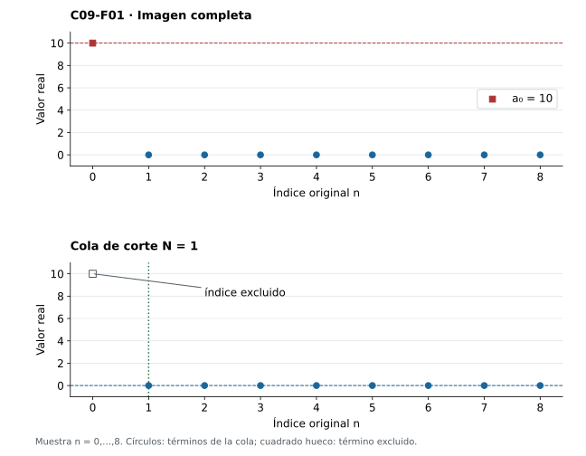
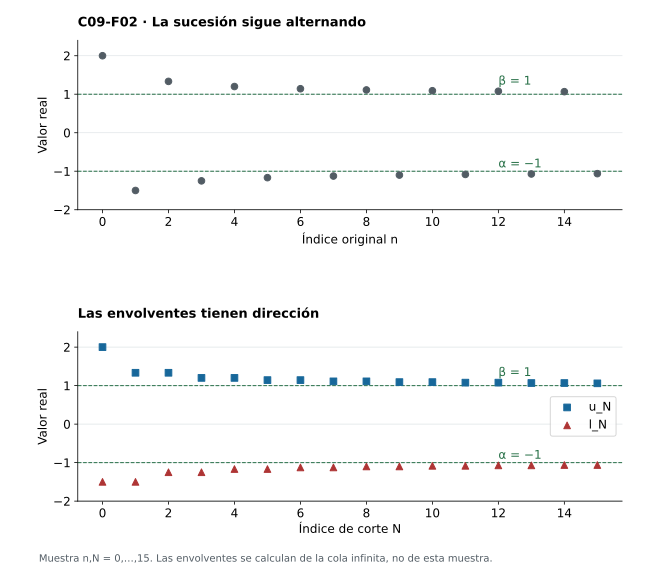
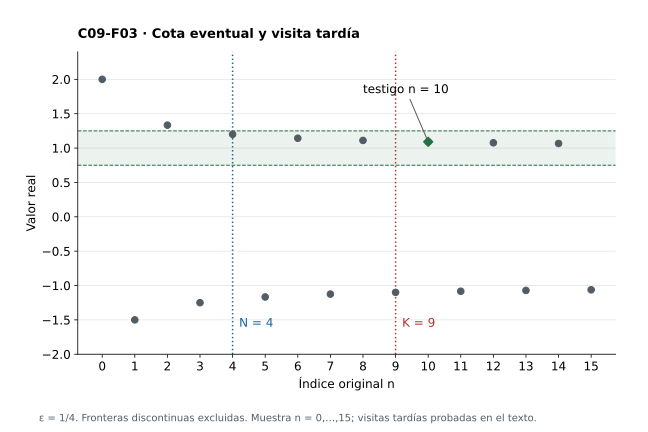
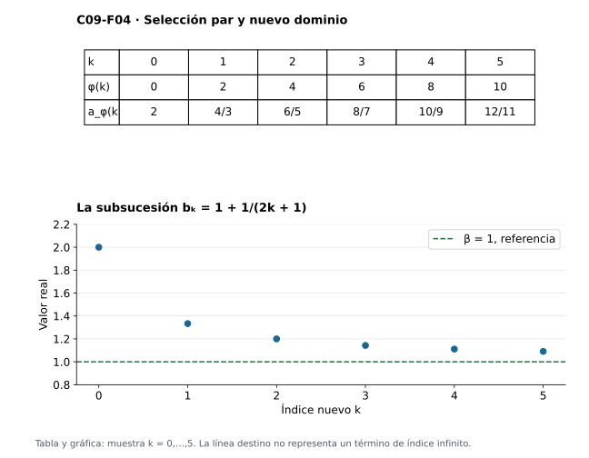
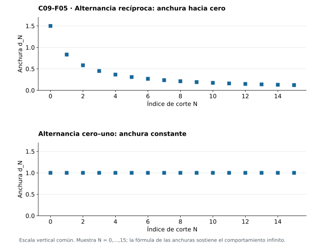
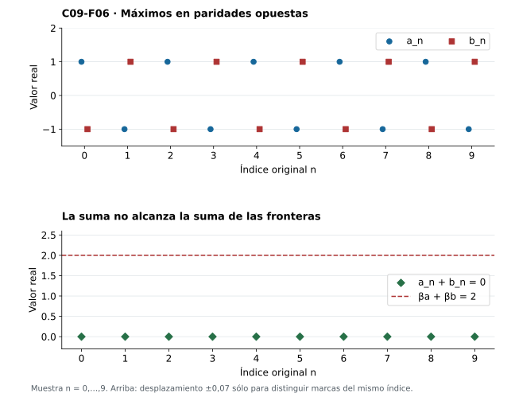

[Índice del libro](../para-matematicos/analisis-para-matematicos.html) · [Ejercicios de este capítulo](#ejercicios-9)

Una sucesión acotada puede seguir oscilando. Queremos identificar dos fronteras que sobrevivan al retirar cualquier prefijo, y relacionarlas con los destinos de sus extracciones. No basta el supremo de la imagen completa: una única altura inicial puede dominarlo. Miraremos los conjuntos de valores de cola y construiremos dos sucesiones nuevas que sí tienen dirección monótona.

La ruta será cola, supremo e ínfimo de cola, envolventes monótonas y límites de esas envolventes. Después construiremos extracciones que alcancen las fronteras como límites, mediremos la oscilación y estudiaremos qué operaciones conservan o comparan los extremos. Usaremos orden y sup/inf de C02, completitud de C03, colas de C05 y las herramientas de C06–C08. Todo el capítulo desarrolla la teoría real finita de sucesiones acotadas; no introduce una extensión implícita a valores infinitos.

## 9.1. Conservar la cola y olvidar el prefijo

[]{#MA-SEC-ANM-01-009-001}

Una altura excepcional puede dominar la imagen completa sin describir lo que sucede después. Si $a_0=10$ y $a_n=0$ para $n\ge1$, el supremo de la imagen es diez y el límite es cero. Queremos conservar las fronteras que sobreviven al avanzar el corte temporal.

Fijemos una sucesión real acotada $a:\mathbb N\to\mathbb R$, con $\mathbb N=\{0,1,2,\ldots\}$. Para $N\in\mathbb N$, su conjunto de valores de cola es $T_N=\{a_n:n\ge N\}$. El conjunto de índices $\{n:n\ge N\}$ vive en $\mathbb N$; $T_N$ vive en $\mathbb R$. La sucesión conserva multiplicidades y orden; el conjunto de valores los olvida. En particular, $T_N$ puede ser un singleton aunque haya infinitos índices disponibles.

Cada $T_N$ contiene $a_N$ y es acotado. La completitud asegura los reales

$$
\ell_N=\inf T_N,\qquad u_N=\sup T_N.
$$

Para todo $n\ge N$ se cumple $\ell_N\le a_n\le u_N$. Las funciones $\ell,u:\mathbb N\to\mathbb R$ son nuevas sucesiones, llamadas **envolventes inferior y superior**. No son en general subsucesiones de $a$: sus valores pueden no aparecer nunca entre los términos.

**La propiedad que necesitaremos.** Para cada corte $N$ y cada $\eta>0$ existen $p,q\ge N$ con $\ell_N\le a_p<\ell_N+\eta$ y $u_N-\eta<a_q\le u_N$. Veamos por qué. Si ningún término de la cola superara $u_N-\eta$, ese número sería una cota superior de $T_N$ menor que su supremo. Esto contradice la definición de supremo. Si ningún término fuera menor que $\ell_N+\eta$, ese número sería una cota inferior mayor que el ínfimo. Los valores obtenidos pertenecen a $T_N$ y, por su definición, tienen índices al menos $N$. No hemos supuesto que los extremos se alcancen, ni elegido aún testigos para todos los pares $(N,\eta)$.

En $a_n=1/(n+1)$ tenemos $u_N=1/(N+1)$, alcanzado en $N$, y $\ell_N=0$, no alcanzado. Cero es cota inferior; cualquier número positivo deja de ser cota inferior por arquimedianidad. Para la sucesión del prefijo excepcional, $u_0=10$ y $u_N=0$ desde $N=1$, mientras que $\ell_N=0$ siempre. La frontera de una cola debe leerse con su corte, no sólo con la lista de alturas de la imagen total.

{#fig-anm-c09-f01 fig-alt="El valor inicial diez determina el supremo total, pero desaparece del conjunto de valores de cola desde el corte uno."}

### Antes de seguir

#### Microcontrol 1

[]{#MA-MIC-ANM-01-009-001}

¿En qué conjuntos viven el corte $N$ y los valores de $T_N$?

[]{#MA-MSOL-ANM-01-009-001}

Ver solución del microcontrol 1

$N$ es natural; $T_N$ es un subconjunto de $\mathbb R$. El conjunto de índices de la cola es un subconjunto de $\mathbb N$.

#### Microcontrol 2

[]{#MA-MIC-ANM-01-009-002}

¿Por qué $T_N$ no es vacío?

[]{#MA-MSOL-ANM-01-009-002}

Ver solución del microcontrol 2

Contiene $a_N$, porque el índice $N$ pertenece a su propia cola.

#### Microcontrol 3

[]{#MA-MIC-ANM-01-009-003}

¿Qué hipótesis permite que $\ell_N$ y $u_N$ sean reales?

[]{#MA-MSOL-ANM-01-009-003}

Ver solución del microcontrol 3

La cola es no vacía y acotada porque la sucesión lo es; completitud proporciona su ínfimo y supremo reales.

#### Microcontrol 4

[]{#MA-MIC-ANM-01-009-004}

¿Debe $u_N$ ser uno de los términos de la cola?

[]{#MA-MSOL-ANM-01-009-004}

Ver solución del microcontrol 4

No. Para $a_n=1-1/(n+1)$, toda cola tiene supremo uno y ningún término vale uno.

#### Microcontrol 5

[]{#MA-MIC-ANM-01-009-005}

Calcula $\ell_N$ y $u_N$ para $a_n=1/(n+1)$.

[]{#MA-MSOL-ANM-01-009-005}

Ver solución del microcontrol 5

$\ell_N=0$ y $u_N=1/(N+1)$. El supremo se alcanza en $N$; el ínfimo no se alcanza y se justifica por arquimedianidad.

#### Microcontrol 6

[]{#MA-MIC-ANM-01-009-006}

¿Qué contradicción aparece si todos los términos de la cola satisfacen $a_n\le u_N-\eta$ con $\eta>0$?

[]{#MA-MSOL-ANM-01-009-006}

Ver solución del microcontrol 6

$u_N-\eta$ sería una cota superior menor que el supremo $u_N$, contradiciendo su minimalidad.

#### Microcontrol 7

[]{#MA-MIC-ANM-01-009-007}

¿Una cola constante tiene infinitos valores distintos?

[]{#MA-MSOL-ANM-01-009-007}

Ver solución del microcontrol 7

No. Tiene infinitos índices y un único valor; repetir valores no afecta a que la sucesión sea una función.

#### Microcontrol 8

[]{#MA-MIC-ANM-01-009-008}

Para $a_0=10$ y $a_n=0$ si $n\ge1$, ¿cuándo cambia el supremo de cola?

[]{#MA-MSOL-ANM-01-009-008}

Ver solución del microcontrol 8

$u_0=10$ y $u_N=0$ para todo $N\ge1$. El cambio ocurre al pasar del corte cero al uno.

### Ejercicios de la sección 9.1

[]{#ejercicios-9}

#### Ejercicio 1. Un extremo inicial

[]{#MA-EX-ANM-01-009-001}

Sea $a_0=7$, $a_1=-4$ y $a_n=1$ para $n\ge2$. Determina todos los conjuntos de cola y sus extremos.

[]{#MA-SOL-ANM-01-009-001}

Ver solución del ejercicio 1

$T_0=\{-4,1,7\}$, $T_1=\{-4,1\}$ y $T_N=\{1\}$ para $N\ge2$. Así $(\ell_0,u_0)=(-4,7)$, $(\ell_1,u_1)=(-4,1)$ y $(\ell_N,u_N)=(1,1)$ desde el corte dos. Se distinguen los conjuntos de valores de los infinitos conjuntos de índices.

Después de la prueba, puede retomarse la [figura 9.1](analisis-para-matematicos-capitulo-9-limite-superior-e-inferior-las-envolventes-de-una-cola.html#fig-anm-c09-f01) para contrastar el mecanismo con el ejemplo del capítulo.

#### Ejercicio 2. Una frontera ausente

[]{#MA-EX-ANM-01-009-002}

Para $a_n=2-1/(n+1)$, calcula $\ell_N,u_N$ y decide cuáles se alcanzan.

[]{#MA-SOL-ANM-01-009-002}

Ver solución del ejercicio 2

Los términos crecen desde $a_N$, así $\ell_N=2-1/(N+1)$ y se alcanza en $N$. Todos son menores que dos. Para $\eta>0$, escoger $n\ge N$ con $1/(n+1)<\eta$ da $a_n>2-\eta$, por lo que $u_N=2$ y no se alcanza.

#### Ejercicio 3. Aproximación bilateral

[]{#MA-EX-ANM-01-009-003}

Demuestra directamente desde las definiciones que para $\eta>0$ existen $p,q\ge N$ con $a_p>u_N-\eta$ y $a_q<\ell_N+\eta$, sin suponer máximos o mínimos.

[]{#MA-SOL-ANM-01-009-003}

Ver solución del ejercicio 3

Si todo término posterior fuera a lo sumo $u_N-\eta$, ese real sería cota superior estrictamente menor que $u_N$. Si todo término fuera al menos $\ell_N+\eta$, sería cota inferior estrictamente mayor que $\ell_N$. Ambas conclusiones contradicen la optimalidad respectiva. Los valores que evitan esas contradicciones pertenecen a $T_N$ y por tanto tienen índices posteriores al corte.

#### Ejercicio 4. Cuándo se retira una altura

[]{#MA-EX-ANM-01-009-004}

Prueba $T_N=\{a_N\}\cup T_{N+1}$. ¿Cuándo puede ser estricta la inclusión $T_{N+1}\subseteq T_N$?

[]{#MA-SOL-ANM-01-009-004}

Ver solución del ejercicio 4

Cada índice al menos $N$ es $N$ o es al menos $N+1$, lo que prueba la igualdad; la inclusión inversa se sigue de los mismos índices. La inclusión es estricta exactamente cuando $a_N$ no reaparece en ningún índice posterior. Que se retire un índice no obliga a retirar su valor.

#### Ejercicio 5. Acotación eventual

[]{#MA-EX-ANM-01-009-005}

Una sucesión real satisface $|a_n|\le M$ para $n\ge N_0$, donde $M\ge0$. Demuestra que es acotada globalmente y que puede entrar en este capítulo.

[]{#MA-SOL-ANM-01-009-005}

Ver solución del ejercicio 5

Si $N_0=0$, sirve $M$. Si $N_0>0$, el prefijo contiene finitos términos y $B=\max\{M,|a_0|,\ldots,|a_{N_0-1}|\}$ es una cota de todas las magnitudes. Por tanto cada cola es no vacía y acotada y la construcción de ambos extremos finitos queda autorizada.

## 9.2. Dos envolventes que sí tienen dirección

[]{#MA-SEC-ANM-01-009-002}

La sucesión original puede saltar en ambas direcciones. Sus envolventes tienen una dirección obligada: al descartar términos, no creamos alturas nuevas. Como $T_{N+1}\subseteq T_N$, toda cota superior de $T_N$ sigue siendo cota de $T_{N+1}$ y toda cota inferior sigue siéndolo. Las propiedades de supremo e ínfimo dan

$$
\ell_N\le\ell_{N+1}\le u_{N+1}\le u_N.
$$

Si $m\le a_n\le M$ para todo $n$, también $m\le\ell_N\le u_N\le M$. C07 permite concluir que ambas envolventes convergen. Definimos

$$
\alpha=\liminf_{n\to\infty}a_n:=\lim_{N\to\infty}\ell_N=\sup_{N\in\mathbb N}\ell_N,
\qquad
\beta=\limsup_{n\to\infty}a_n:=\lim_{N\to\infty}u_N=\inf_{N\in\mathbb N}u_N.
$$

El supremo exterior se aplica al recorrido de $\ell$ y el ínfimo exterior al recorrido de $u$. No podemos intercambiar estas operaciones: $\sup_N\sup T_N=u_0$ describiría el supremo total, no la frontera persistente. La existencia usa completitud dos veces: primero en cada conjunto de cola; después, mediante convergencia monótona, en el conjunto de valores de cada envolvente. Unicidad de límites de C06 hace unívocas las definiciones.

Por conservación del orden bajo límites, $\alpha\le\beta$. Además, $\ell_N\le\alpha$ y $\beta\le u_N$ para todo $N$. Esto no afirma $\alpha\le a_n\le\beta$ para todo $n$, ni siquiera para toda una cola. Los extremos de las envolventes pueden seguir fuera del intervalo final durante cualquier tiempo finito.

Tomemos $a_n=(-1)^n(1+1/(n+1))$. Sea $e(N)$ el menor índice par al menos $N$ y $o(N)$ el menor impar al menos $N$. Entonces $u_N=1+1/(e(N)+1)$ y $\ell_N=-1-1/(o(N)+1)$. Los términos pares positivos disminuyen y los impares negativos aumentan; por eso sus primeros índices disponibles dan los extremos. Como $e(N),o(N)\ge N$, las dos correcciones tienden a cero, de modo que $\alpha=-1$ y $\beta=1$. Todos los términos quedan fuera de $[-1,1]$, aunque las fronteras asintóticas sean precisamente esos extremos.

La nueva herramienta no fuerza convergencia de $a$. Hace converger las dos sucesiones que delimitan sus colas. Visualmente obtenemos dos movimientos monótonos a partir de una oscilación.

{#fig-anm-c09-f02 fig-alt="La sucesión alterna fuera de la banda final; sus envolventes avanzan monótonamente hacia menos uno y uno sin exigir que los términos entren en esa banda exacta."}

### Antes de seguir

#### Microcontrol 9

[]{#MA-MIC-ANM-01-009-009}

¿Cuál es la inclusión entre $T_{N+1}$ y $T_N$?

[]{#MA-MSOL-ANM-01-009-009}

Ver solución del microcontrol 9

$T_{N+1}\subseteq T_N$: sólo se retira un índice disponible, sin añadir valores.

#### Microcontrol 10

[]{#MA-MIC-ANM-01-009-010}

¿En qué sentido es monótona la envolvente inferior?

[]{#MA-MSOL-ANM-01-009-010}

Ver solución del microcontrol 10

Es no decreciente: $\ell_{N+1}\ge\ell_N$, porque cada cota inferior de $T_N$ también acota $T_{N+1}$.

#### Microcontrol 11

[]{#MA-MIC-ANM-01-009-011}

¿En qué sentido es monótona la envolvente superior?

[]{#MA-MSOL-ANM-01-009-011}

Ver solución del microcontrol 11

Es no creciente: $u_{N+1}\le u_N$, porque cada cota superior de $T_N$ también acota $T_{N+1}$.

#### Microcontrol 12

[]{#MA-MIC-ANM-01-009-012}

Escribe el supremo exterior que define $\alpha$.

[]{#MA-MSOL-ANM-01-009-012}

Ver solución del microcontrol 12

$\alpha=\sup\{\ell_N:N\in\mathbb N\}$; el conjunto está formado por ínfimos reales de colas.

#### Microcontrol 13

[]{#MA-MIC-ANM-01-009-013}

Escribe el ínfimo exterior que define $\beta$.

[]{#MA-MSOL-ANM-01-009-013}

Ver solución del microcontrol 13

$\beta=\inf\{u_N:N\in\mathbb N\}$; el conjunto está formado por supremos reales de colas.

#### Microcontrol 14

[]{#MA-MIC-ANM-01-009-014}

¿Por qué $\alpha\le\beta$?

[]{#MA-MSOL-ANM-01-009-014}

Ver solución del microcontrol 14

$\ell_N\le u_N$ para todo $N$; ambas envolventes convergen, y C06 conserva el orden al pasar al límite.

#### Microcontrol 15

[]{#MA-MIC-ANM-01-009-015}

Para $a_n=(-1)^n(1+1/(n+1))$, ¿cuáles son los extremos asintóticos?

[]{#MA-MSOL-ANM-01-009-015}

Ver solución del microcontrol 15

$\alpha=-1$ y $\beta=1$. Los primeros índices impares y pares de cada cola dan sus extremos, cuyas correcciones recíprocas tienden a cero.

#### Microcontrol 16

[]{#MA-MIC-ANM-01-009-016}

¿El ejemplo anterior tiene términos en $[\alpha,\beta]$?

[]{#MA-MSOL-ANM-01-009-016}

Ver solución del microcontrol 16

No. Los pares son mayores que uno y los impares menores que menos uno. La banda asintótica exacta no tiene por qué contener términos.

### Ejercicios de la sección 9.2

#### Ejercicio 6. Alternancia con margen decreciente

[]{#MA-EX-ANM-01-009-006}

Calcula las envolventes y los extremos de $a_n=3+(-1)^n(2+1/(n+1))$.

[]{#MA-SOL-ANM-01-009-006}

Ver solución del ejercicio 6

Con $e(N)$ par y $o(N)$ impar mínimos posteriores, $u_N=5+1/(e(N)+1)$ y $\ell_N=1-1/(o(N)+1)$. Los pares positivos relativos a tres disminuyen y los impares aumentan; los primeros disponibles dan los extremos. Las correcciones tienden a cero porque sus índices son al menos $N$. Así $\alpha=1$, $\beta=5$.

Después de la prueba, puede retomarse la [figura 9.2](analisis-para-matematicos-capitulo-9-limite-superior-e-inferior-las-envolventes-de-una-cola.html#fig-anm-c09-f02) para contrastar el mecanismo con el ejemplo del capítulo.

#### Ejercicio 7. Orden en dos niveles

[]{#MA-EX-ANM-01-009-007}

Prueba $\inf T_0\le\alpha\le\beta\le\sup T_0$ e indica los dos niveles de completitud usados.

[]{#MA-SOL-ANM-01-009-007}

Ver solución del ejercicio 7

Cada cola está dentro de $T_0$, de modo que $\inf T_0\le\ell_N\le u_N\le\sup T_0$. El paso al límite conserva orden y da la cadena. Completitud da primero sup/inf reales de cada cola y después, mediante C07, los límites reales de las envolventes monótonas acotadas.

#### Ejercicio 8. Invertir operaciones

[]{#MA-EX-ANM-01-009-008}

Compara $\inf_N\sup_{n\ge N}a_n$ con $\sup_N\inf_{n\ge N}a_n$ para la alternancia cero–uno. ¿Son operaciones intercambiables?

[]{#MA-SOL-ANM-01-009-008}

Ver solución del ejercicio 8

Cada cola contiene cero y uno. La primera expresión vale uno y la segunda cero. Son $\beta$ y $\alpha$, respectivamente; no se intercambian en general.

Después de la prueba, puede retomarse la [figura 9.2](analisis-para-matematicos-capitulo-9-limite-superior-e-inferior-las-envolventes-de-una-cola.html#fig-anm-c09-f02) para contrastar el mecanismo con el ejemplo del capítulo.

#### Ejercicio 9. Monotonía original

[]{#MA-EX-ANM-01-009-009}

Si $a$ es acotada y no decreciente, identifica sus dos envolventes y sus extremos.

[]{#MA-SOL-ANM-01-009-009}

Ver solución del ejercicio 9

$\ell_N=a_N$ porque es el menor término posterior. Sea $s=\sup T_0$. Es también supremo de cada cola: cualquier cota de una cola acota los términos anteriores porque son a lo sumo $a_N$. Así $u_N=s$ para todo $N$. C07 da $a_N\to s$, y por tanto $\alpha=\beta=s$.

#### Ejercicio 10. Igualdad de límites, desigualdad de objetos

[]{#MA-EX-ANM-01-009-010}

Construye dos sucesiones distintas con las mismas envolventes superior e inferior en todos los cortes.

[]{#MA-SOL-ANM-01-009-010}

Ver solución del ejercicio 10

La alternancia $a_n=0$ para pares y uno para impares, y la alternancia inversa $b_n=1-a_n$, son distintas en cada índice. Cada cola de ambas contiene cero y uno, por lo que sus envolventes son idénticas: $\ell_N=0,u_N=1$. Igualdad de envolventes no implica igualdad de las funciones originales.

Después de la prueba, puede retomarse la [figura 9.2](analisis-para-matematicos-capitulo-9-limite-superior-e-inferior-las-envolventes-de-una-cola.html#fig-anm-c09-f02) para contrastar el mecanismo con el ejemplo del capítulo.

## 9.3. Fronteras eventuales y visitas tardías

[]{#MA-SEC-ANM-01-009-003}

¿Cómo se reconoce $\beta$ sin calcular todos los supremos? Necesitamos dos condiciones: ninguna altura persistentemente mayor puede sobrevivir y los términos siguen llegando cerca de la frontera desde abajo. Para una sucesión acotada, un real $b$ es su límite superior si y sólo si

$$
\forall\varepsilon>0\ \exists N\ \forall n\ge N: a_n<b+\varepsilon,
\qquad
\forall\varepsilon>0\ \forall K\ \exists n\ge K: a_n>b-\varepsilon.
$$

**Del límite superior a las condiciones.** La convergencia $u_N\to\beta$ da un corte con $u_N<\beta+\varepsilon$; entonces toda su cola queda por debajo. Para cualquier corte $K$, la aproximación del supremo da $a_n>u_K-\varepsilon\ge\beta-\varepsilon$ para algún $n\ge K$. La segunda condición permite un índice distinto para cada tolerancia y corte; no exige que toda la cola se acerque a $\beta$.

**De las condiciones al límite superior.** La primera da $u_N\le b+\varepsilon$ para algún corte, pues una cota estricta término a término puede pasar a no estricta al tomar supremo. Así $\beta\le b+\varepsilon$. La segunda obliga a $u_K>b-\varepsilon$ para cada $K$; al tomar límite, $\beta\ge b-\varepsilon$. Como esto vale para toda tolerancia positiva, $\beta=b$: si fueran diferentes, la mitad de su distancia contradiría una de esas desigualdades.

La caracterización inferior es dual y conviene conservarla completa: $c=\alpha$ si y sólo si, para cada $\varepsilon>0$, todos los términos de alguna cola satisfacen $a_n>c-\varepsilon$, y para todo corte $K$ existe $n\ge K$ con $a_n<c+\varepsilon$. En efecto, $\ell_N\to\alpha$ prueba la primera condición y la aproximación del ínfimo la segunda. Recíprocamente, la primera implica $\alpha\ge c-\varepsilon$ y la segunda $\ell_K<c+\varepsilon$ para cada $K$, luego $\alpha\le c+\varepsilon$. La misma prueba por distancia da $\alpha=c$.

Un conjunto de índices supera cualquier corte exactamente cuando es infinito, porque un prefijo natural es finito y cualquier conjunto finito de naturales tiene cota. Por tanto, «arbitrariamente tarde» equivale aquí a «para infinitos índices». Repetir un mismo valor en esos índices está permitido.

Dos consecuencias útiles fijan el significado de frontera. Si $t>\beta$, sólo hay finitos índices con $a_n\ge t$: usar $\varepsilon=(t-\beta)/2$ en la primera condición. Si $t<\beta$, hay infinitos índices con $a_n>t$: usar $\varepsilon=\beta-t$ en la segunda. Para $t=\beta$, ambas posibilidades existen; la sucesión constante uno alcanza su frontera siempre, mientras $1-1/(n+1)$ no la alcanza nunca. Dualmente, por debajo de $\alpha$ sólo puede haber finitas visitas y por encima de $\alpha$ hay infinitas visitas inferiores al umbral.

Al combinar las dos cotas eventuales, para cada $\varepsilon>0$ alguna cola queda dentro de $(\alpha-\varepsilon,\beta+\varepsilon)$. Esta es la banda que podemos garantizar. El intervalo exacto $[\alpha,\beta]$ puede seguir sin contener ningún término, como vimos antes.

{#fig-anm-c09-f03 fig-alt="Desde el corte cuatro todos los términos quedan bajo cinco cuartos. Después del corte nueve, el término de índice diez visita la ventana de radio un cuarto de la frontera superior; los términos negativos siguen fuera de ella."}

### Antes de seguir

#### Microcontrol 17

[]{#MA-MIC-ANM-01-009-017}

¿Qué orden de cuantificadores expresa una cota superior eventual con tolerancia $\varepsilon$?

[]{#MA-MSOL-ANM-01-009-017}

Ver solución del microcontrol 17

Para cada $\varepsilon>0$ existe $N$ tal que para todo $n\ge N$ se cumple $a_n<\beta+\varepsilon$.

#### Microcontrol 18

[]{#MA-MIC-ANM-01-009-018}

¿Qué orden de cuantificadores expresa visitas tardías cerca de $\beta$ desde abajo?

[]{#MA-MSOL-ANM-01-009-018}

Ver solución del microcontrol 18

Para cada $\varepsilon>0$ y cada corte $K$ existe $n\ge K$ con $a_n>\beta-\varepsilon$.

#### Microcontrol 19

[]{#MA-MIC-ANM-01-009-019}

¿La condición de visitas obliga a que toda la cola esté cerca de $\beta$?

[]{#MA-MSOL-ANM-01-009-019}

Ver solución del microcontrol 19

No. Sólo garantiza algún índice posterior a cada corte; la alternancia cero–uno visita uno tarde y también conserva ceros tarde.

#### Microcontrol 20

[]{#MA-MIC-ANM-01-009-020}

¿Qué ocurre con las visitas a alturas al menos $t$ si $t>\beta$?

[]{#MA-MSOL-ANM-01-009-020}

Ver solución del microcontrol 20

Son finitas: con tolerancia $(t-\beta)/2$, toda una cola queda por debajo de $t$.

#### Microcontrol 21

[]{#MA-MIC-ANM-01-009-021}

¿Qué ocurre si $t<\beta$ con los índices que cumplen $a_n>t$?

[]{#MA-MSOL-ANM-01-009-021}

Ver solución del microcontrol 21

Hay infinitos: la propiedad de visitas con tolerancia $\beta-t$ proporciona uno después de cualquier corte.

#### Microcontrol 22

[]{#MA-MIC-ANM-01-009-022}

¿Se puede decidir sólo con $\beta$ si hay infinitos índices con $a_n=\beta$?

[]{#MA-MSOL-ANM-01-009-022}

Ver solución del microcontrol 22

No. La constante uno los tiene; $1-1/(n+1)$ tiene la misma frontera uno y no la alcanza.

#### Microcontrol 23

[]{#MA-MIC-ANM-01-009-023}

Escribe las dos condiciones que caracterizan $\alpha$.

[]{#MA-MSOL-ANM-01-009-023}

Ver solución del microcontrol 23

Para cada $\varepsilon>0$, alguna cola cumple $a_n>\alpha-\varepsilon$; para cada $\varepsilon>0$ y corte $K$, algún $n\ge K$ cumple $a_n<\alpha+\varepsilon$.

#### Microcontrol 24

[]{#MA-MIC-ANM-01-009-024}

¿Qué banda abierta contiene alguna cola para cada $\varepsilon>0$?

[]{#MA-MSOL-ANM-01-009-024}

Ver solución del microcontrol 24

$(\alpha-\varepsilon,\beta+\varepsilon)$, usando el máximo de los dos cortes de las cotas eventuales.

### Ejercicios de la sección 9.3

#### Ejercicio 11. Umbral persistente

[]{#MA-EX-ANM-01-009-011}

Para una sucesión acotada define $A=\{t\in\mathbb R:\{n:a_n>t\}\text{ es infinito}\}$. Prueba que $A$ es no vacío, acotado superiormente y $\sup A=\beta$.

[]{#MA-SOL-ANM-01-009-011}

Ver solución del ejercicio 11

Una cota inferior global $m$ hace que $m-1\in A$, por lo que es no vacío. Una cota superior global $M$ acota a $A$. Si $t>\beta$, sólo hay finitas visitas sobre $t$, luego $t\notin A$; así $\beta$ acota $A$. Todo $t<\beta$ pertenece a $A$ por §9.3; en particular $\beta-\varepsilon\in A$ para toda tolerancia. Ninguna cota menor que $\beta$ puede acotar a $A$, por lo que su supremo es $\beta$.

#### Ejercicio 12. Umbral eventual

[]{#MA-EX-ANM-01-009-012}

Define $B=\{t\in\mathbb R:\{n:a_n>t\}\text{ es finito}\}$. Prueba $\inf B=\beta$ y explica por qué $\beta$ puede o no pertenecer a $B$.

[]{#MA-SOL-ANM-01-009-012}

Ver solución del ejercicio 12

$B$ contiene una cota superior global y es no vacío. Ningún $t<\beta$ pertenece a $B$, pues hay infinitas visitas sobre él; así $\beta$ es cota inferior. Todo $t>\beta$ pertenece a $B$, luego hay elementos arbitrariamente próximos por arriba y $\inf B=\beta$. Para la constante uno, $\beta=1\in B$ porque no hay términos mayores que uno. Para $1+1/(n+1)$, $\beta=1\notin B$ porque todos los términos son mayores.

#### Ejercicio 13. Probar una frontera candidata

[]{#MA-EX-ANM-01-009-013}

Supón que para cada $\varepsilon>0$ una cola satisface $a_n<4+\varepsilon$ y que después de cada corte existe $a_n>4-\varepsilon$. Demuestra $\beta=4$ sin suponer que la sucesión converge.

[]{#MA-SOL-ANM-01-009-013}

Ver solución del ejercicio 13

La cota eventual implica $u_N\le4+\varepsilon$ para algún corte, y por tanto $\beta\le4+\varepsilon$. Las visitas implican $u_K>4-\varepsilon$ para cada corte y por límite $\beta\ge4-\varepsilon$. Si $\beta$ difiriera de cuatro, elegir la mitad de la distancia como tolerancia contradiría una desigualdad. Por tanto $\beta=4$, sin control sobre un posible extremo inferior distinto.

Después de la prueba, puede retomarse la [figura 9.3](analisis-para-matematicos-capitulo-9-limite-superior-e-inferior-las-envolventes-de-una-cola.html#fig-anm-c09-f03) para contrastar el mecanismo con el ejemplo del capítulo.

#### Ejercicio 14. Visitas con una sola tolerancia

[]{#MA-EX-ANM-01-009-014}

¿Basta que haya infinitos términos con $a_n>2-1/2$ para concluir $\beta=2$? Da un contraejemplo acotado.

[]{#MA-SOL-ANM-01-009-014}

Ver solución del ejercicio 14

No. La constante $a_n=7/4$ satisface la visita con esa tolerancia y tiene $\beta=7/4$. Falta exigir todas las tolerancias y la cota eventual superior. Incluso todas las visitas por abajo sólo darían $\beta\ge2$.

Después de la prueba, puede retomarse la [figura 9.3](analisis-para-matematicos-capitulo-9-limite-superior-e-inferior-las-envolventes-de-una-cola.html#fig-anm-c09-f03) para contrastar el mecanismo con el ejemplo del capítulo.

#### Ejercicio 15. Versión inferior por umbrales

[]{#MA-EX-ANM-01-009-015}

Prueba $\alpha=\inf\{t:\{n:a_n<t\}\text{ es infinito}\}$.

[]{#MA-SOL-ANM-01-009-015}

Ver solución del ejercicio 15

El conjunto es no vacío: si $M$ acota superiormente a $a$, $M+1$ pertenece a él. Está acotado inferiormente por una cota inferior global. Si $t<\alpha$, las visitas por debajo de $t$ son finitas por la cota inferior eventual con tolerancia $(\alpha-t)/2$. Si $t>\alpha$, la condición de visitas con tolerancia $t-\alpha$ da infinitos términos menores que $t$. Por ello $\alpha$ es cota inferior y hay elementos arbitrariamente próximos por arriba, lo que identifica el ínfimo.

## 9.4. Alcanzar las fronteras mediante extracciones

[]{#MA-SEC-ANM-01-009-004}

Las fronteras existen, pero aún debemos relacionarlas con los destinos de C08. Demostraremos que $\alpha$ y $\beta$ son respectivamente el mínimo y el máximo del conjunto de límites de subsucesiones, que denotaremos $\operatorname{LimSub}(a)$. Primero construiremos dos extracciones; después confinaremos cualquier otra.

**Construir la extracción superior.** Para cualquier $\delta>0$ y corte $K$, hay un término posterior con $|a_n-\beta|<\delta$. Para verlo, escogemos primero un corte $H$ desde el cual $a_n<\beta+\delta$; luego la condición de visitas, aplicada al corte $\max\{H,K\}$, da un término con $a_n>\beta-\delta$. Ambas restricciones se cumplen en el mismo índice. Esa coordinación es el paso decisivo: una visita por un solo lado no bastaría.

Definimos $n_0$ como el mínimo del conjunto no vacío $\{n:|a_n-\beta|<1\}$. Una vez definido $n_{k-1}$, para $k\ge1$ ponemos

$$
n_k=\min\{n\ge n_{k-1}+1:|a_n-\beta|<1/(k+1)\}.
$$

La propiedad anterior demuestra la no vacuidad antes de tomar cada mínimo. La recursión produce un selector estrictamente creciente $k\mapsto n_k$; no requiere escoger un mínimo real ni testigos arbitrarios. Además $|a_{n_k}-\beta|<1/(k+1)$. Para $\varepsilon>0$, la propiedad arquimediana da $K$ con $1/(K+1)<\varepsilon$; todo $k\ge K$ satisface el error requerido. Así $a_{n_k}\to\beta$ con dominio nuevo $\mathbb N$ y codominio $\mathbb R$.

**Construir la extracción inferior.** Para $\delta,K$ fijos, la cota eventual $a_n>\alpha-\delta$ y la visita $a_n<\alpha+\delta$ después del máximo de los cortes dan $|a_n-\alpha|<\delta$. Definimos $m_0=\min\{n:|a_n-\alpha|<1\}$ y, para $k\ge1$, $m_k=\min\{n\ge m_{k-1}+1:|a_n-\alpha|<1/(k+1)\}$. Los conjuntos son no vacíos; el selector aumenta y la misma estimación arquimediana prueba $a_{m_k}\to\alpha$.

**Confinar otros destinos.** Si $a_{\varphi(k)}\to x$ con $\varphi$ estrictamente creciente, C08 da $\varphi(k)\ge k$. Para cada corte fijo $N$, todos los $k\ge N$ cumplen $\ell_N\le a_{\varphi(k)}\le u_N$. Pasando al límite en $k$, obtenemos $\ell_N\le x\le u_N$. Ahora dejamos variar $N$ y pasamos al límite en las envolventes: $\alpha\le x\le\beta$. Son dos pasos de límite con dominios diferentes; no se sustituye un índice infinito en una fórmula.

Los extremos pertenecen al conjunto de destinos y acotan a todos sus elementos. Por ello

$$
\min\operatorname{LimSub}(a)=\alpha,\qquad
\max\operatorname{LimSub}(a)=\beta.
$$

En la alternancia cero–uno los destinos son exactamente $\{0,1\}$: las selecciones de pares e impares los alcanzan, y ningún otro real puede ser límite, porque está a distancia positiva del conjunto finito de valores. El intervalo $[0,1]$ es la envolvente de esos destinos, no el conjunto completo de ellos. La construcción que acabamos de realizar ofrece candidatos concretos y demuestra su convergencia; Bolzano–Weierstrass queda disponible como contraste, pero no sustituye ninguno de esos pasos.

{#fig-anm-c09-f04 fig-alt="La selección par conserva valores y cambia el dominio de lectura al índice k. Sus términos se acercan a uno, aunque ningún término seleccionado vale uno."}

| Índice nuevo k | Índice original φ(k) | Valor seleccionado |
|---|---|---|
| 0 | 0 | 2 |
| 1 | 2 | 4/3 |
| 2 | 4 | 6/5 |
| 3 | 6 | 8/7 |
| 4 | 8 | 10/9 |
| 5 | 10 | 12/11 |

### Antes de seguir

#### Microcontrol 25

[]{#MA-MIC-ANM-01-009-025}

¿Qué dos restricciones se coordinan antes de elegir un índice próximo a $\beta$?

[]{#MA-MSOL-ANM-01-009-025}

Ver solución del microcontrol 25

La cota eventual $a_n<\beta+\delta$ y la visita tardía $a_n>\beta-\delta$, aplicada después del corte de la primera y del corte solicitado.

#### Microcontrol 26

[]{#MA-MIC-ANM-01-009-026}

¿Por qué existe el mínimo que define $n_0$?

[]{#MA-MSOL-ANM-01-009-026}

Ver solución del microcontrol 26

El conjunto de índices con $|a_n-\beta|<1$ es no vacío por la coordinación anterior; todo subconjunto no vacío de $\mathbb N$ tiene mínimo.

#### Microcontrol 27

[]{#MA-MIC-ANM-01-009-027}

¿Qué evita que $n_k$ repita un índice previo?

[]{#MA-MSOL-ANM-01-009-027}

Ver solución del microcontrol 27

Para $k\ge1$ se exige $n_k\ge n_{k-1}+1$; por inducción todos los índices elegidos son distintos y están ordenados.

#### Microcontrol 28

[]{#MA-MIC-ANM-01-009-028}

¿Por qué usamos $1/(k+1)$ en vez de $1/k$?

[]{#MA-MSOL-ANM-01-009-028}

Ver solución del microcontrol 28

El índice nuevo empieza en cero; $1/(k+1)$ está definido y es positivo para todo $k\in\mathbb N$.

#### Microcontrol 29

[]{#MA-MIC-ANM-01-009-029}

¿En qué dominio vive el selector $k\mapsto n_k$?

[]{#MA-MSOL-ANM-01-009-029}

Ver solución del microcontrol 29

Es una función $\mathbb N\to\mathbb N$ estrictamente creciente; al componer con $a$ se obtiene una sucesión real $k\mapsto a_{n_k}$.

#### Microcontrol 30

[]{#MA-MIC-ANM-01-009-030}

¿Cómo demuestra $|a_{n_k}-\beta|<1/(k+1)$ la convergencia?

[]{#MA-MSOL-ANM-01-009-030}

Ver solución del microcontrol 30

Para $\varepsilon>0$, elegir por arquimedianidad $K$ con $1/(K+1)<\varepsilon$. Todo $k\ge K$ tiene error menor que $\varepsilon$.

#### Microcontrol 31

[]{#MA-MIC-ANM-01-009-031}

¿Qué desigualdad satisface cualquier límite $x$ de subsucesión?

[]{#MA-MSOL-ANM-01-009-031}

Ver solución del microcontrol 31

$\alpha\le x\le\beta$: para cada corte fijo la subsucesión queda eventualmente entre $\ell_N,u_N$; se pasa al límite en la extracción y después en $N$.

#### Microcontrol 32

[]{#MA-MIC-ANM-01-009-032}

¿Por qué $\beta$ es máximo de $\operatorname{LimSub}(a)$ y no sólo su supremo?

[]{#MA-MSOL-ANM-01-009-032}

Ver solución del microcontrol 32

La extracción superior demuestra que $\beta$ pertenece al conjunto, y el confinamiento demuestra que ningún elemento lo supera.

### Ejercicios de la sección 9.4

#### Ejercicio 16. Un selector explícito

[]{#MA-EX-ANM-01-009-016}

Para $a_n=(-1)^n+1/(n+1)$ construye selectores de subsucesiones que converjan a los dos extremos.

[]{#MA-SOL-ANM-01-009-016}

Ver solución del ejercicio 16

Las selecciones $\varphi(k)=2k$ y $\psi(k)=2k+1$ son estrictamente crecientes en $\mathbb N$. Sus términos son $1+1/(2k+1)$ y $-1+1/(2k+2)$, que convergen a uno y menos uno. Para cada ε>0, una cola cumple −1−ε<a_n<1+ε, por la pequeñez del recíproco; así todos sus destinos están en [−1,1]. Como las dos selecciones alcanzan los extremos de ese intervalo, el carácter mínimo/máximo de §9.4 identifica α=−1 y β=1. La convergencia recíproca se verifica por arquimedianidad.

Después de la prueba, puede retomarse la [figura 9.4](analisis-para-matematicos-capitulo-9-limite-superior-e-inferior-las-envolventes-de-una-cola.html#fig-anm-c09-f04) para contrastar el mecanismo con el ejemplo del capítulo.

#### Ejercicio 17. Construcción sin elección arbitraria

[]{#MA-EX-ANM-01-009-017}

Reconstruye la extracción que converge a $\beta$ usando mínimos naturales. Justifica no vacuidad y convergencia.

[]{#MA-SOL-ANM-01-009-017}

Ver solución del ejercicio 17

Para cualquier $\delta,K$, la cota superior eventual fija $H$ y las visitas por abajo después de $\max\{H,K\}$ dan un índice con $|a_n-\beta|<\delta$. Por ello existen los mínimos $n_0=\min\{n:|a_n-\beta|<1\}$ y $n_k=\min\{n\ge n_{k-1}+1:|a_n-\beta|<1/(k+1)\}$ para $k\ge1$. La recursión da aumento estricto. Para $\varepsilon>0$, elegir $K$ con $1/(K+1)<\varepsilon$; todo $k\ge K$ tiene error menor, luego la extracción converge a $\beta$.

Después de la prueba, puede retomarse la [figura 9.4](analisis-para-matematicos-capitulo-9-limite-superior-e-inferior-las-envolventes-de-una-cola.html#fig-anm-c09-f04) para contrastar el mecanismo con el ejemplo del capítulo.

#### Ejercicio 18. Extracción de una extracción

[]{#MA-EX-ANM-01-009-018}

Sea $b_k=a_{\varphi(k)}$ una subsucesión. Prueba $\alpha_a\le\alpha_b\le\beta_b\le\beta_a$.

[]{#MA-SOL-ANM-01-009-018}

Ver solución del ejercicio 18

$b$ es acotada. Sus extremos son límites de subsucesiones $b_{\psi(j)}$ por §9.4. La composición $\varphi\circ\psi$ es estrictamente creciente, de modo que ambos son destinos de $a$ y quedan en $[\alpha_a,\beta_a]$. Además $\alpha_b\le\beta_b$ por §9.2. Esto reúne toda la cadena; una extracción puede estrechar la banda.

#### Ejercicio 19. Un punto intermedio ausente

[]{#MA-EX-ANM-01-009-019}

Prueba que $1/2$ no es destino de ninguna subsucesión de la alternancia cero–uno, pese a estar entre sus extremos.

[]{#MA-SOL-ANM-01-009-019}

Ver solución del ejercicio 19

Cada término de cualquier extracción vale cero o uno y está a distancia exactamente $1/2$ de $1/2$. La tolerancia $1/4$ impide convergencia a ese candidato. Los destinos cero y uno se obtienen por paridad; así el confinamiento no es una caracterización de todos los puntos interiores.

Después de la prueba, puede retomarse la [figura 9.4](analisis-para-matematicos-capitulo-9-limite-superior-e-inferior-las-envolventes-de-una-cola.html#fig-anm-c09-f04) para contrastar el mecanismo con el ejemplo del capítulo.

#### Ejercicio 20. Destinos extremos y conjunto

[]{#MA-EX-ANM-01-009-020}

¿Por qué los extremos asintóticos son máximo y mínimo del conjunto de destinos incluso cuando nunca aparecen como términos? Ilustra con una sucesión.

[]{#MA-SOL-ANM-01-009-020}

Ver solución del ejercicio 20

El conjunto contiene límites, no necesariamente términos. Las extracciones probadas llevan $\alpha,\beta$ a él y el confinamiento los compara con todos sus elementos, dando mínimo y máximo. Para $a_n=1/(n+1)$ ambos extremos son cero y el conjunto de destinos es $\{0\}$, aunque ningún término valga cero.

## 9.5. Medir la oscilación y reconocer convergencia

[]{#MA-SEC-ANM-01-009-005}

Las dos fronteras permiten recuperar la convergencia ordinaria. Para una sucesión real acotada,

$$
a_n\to L\quad\Longleftrightarrow\quad\alpha=\beta=L.
$$

Si $a_n\to L$, las dos extracciones construidas en §9.4 deben converger a $L$ por C08; unicidad identifica $\alpha=\beta=L$. Para la vuelta no basta decir que las fronteras coinciden: debemos controlar toda la cola. Si $\alpha=\beta=L$ y $\varepsilon>0$, la convergencia de las envolventes da cortes $N_1,N_2$ desde los cuales $\ell_n>L-\varepsilon$ y $u_n<L+\varepsilon$, respectivamente. Con $N=\max\{N_1,N_2\}$, todo $n\ge N$ cumple $L-\varepsilon<\ell_n\le a_n\le u_n<L+\varepsilon$. Esto prueba $|a_n-L|<\varepsilon$ con el orden correcto de elecciones.

Podemos medir lo que queda de la oscilación mediante $d_N=u_N-\ell_N\ge0$. Como $u$ decrece y $\ell$ crece, $d$ decrece. Las reglas de límites reales de C06 dan $d_N\to\beta-\alpha$. Llamaremos **oscilación asintótica** al número $\omega(a)=\beta-\alpha$. Así $\omega(a)=0$ si y sólo si $a$ converge. El número cero registra desaparición de amplitud, aunque los términos alternen de lado para siempre.

La anchura tiene una interpretación independiente de que se alcancen los extremos:

$$
d_N=\sup\{|a_p-a_q|:p,q\ge N\}.
$$

Todo par de términos está en $[\ell_N,u_N]$, luego su distancia es a lo sumo $d_N$. Para comprobar que ninguna cota menor sirve, fijemos $\eta>0$. La aproximación de §9.1 ofrece $a_p>u_N-\eta/2$ y $a_q<\ell_N+\eta/2$, ambos en la cola. Entonces $|a_p-a_q|\ge a_p-a_q>d_N-\eta$. El conjunto de distancias es no vacío y acotado, y estas dos propiedades identifican su supremo. Los índices pueden depender de $\eta$ y $N$; no afirmamos que el supremo de distancias sea un máximo.

En $a_n=(-1)^n/(n+1)$ la envolvente superior es $1/(e(N)+1)$ y la inferior es $-1/(o(N)+1)$. Su anchura tiende a cero y la sucesión converge a cero, aunque no sea monótona. En la alternancia cero–uno, en cambio, $d_N=1$ siempre. La monotonía de las envolventes puede convivir con una anchura persistente.

Esta sección añade un diagnóstico geométrico de convergencia. Hemos probado sus equivalencias usando las fronteras ya construidas. La relación con una condición interna de proximidad entre términos se desarrollará con su propia arquitectura en el capítulo siguiente; no necesitamos anticiparla para cerrar estas pruebas.

{#fig-anm-c09-f05 fig-alt="La anchura de las colas amortiguadas tiende a cero; la de la alternancia cero–uno permanece en uno. Ambas envolventes son monótonas, pero sólo la primera pareja se reúne."}

### Antes de seguir

#### Microcontrol 33

[]{#MA-MIC-ANM-01-009-033}

¿Qué concluyes si $\alpha=\beta=L$?

[]{#MA-MSOL-ANM-01-009-033}

Ver solución del microcontrol 33

$a_n\to L$. Para cada tolerancia, las dos envolventes se acercan a $L$ y encierran toda una cola entre $L-\varepsilon$ y $L+\varepsilon$.

#### Microcontrol 34

[]{#MA-MIC-ANM-01-009-034}

¿Qué concluyes sobre los extremos si $a_n\to L$?

[]{#MA-MSOL-ANM-01-009-034}

Ver solución del microcontrol 34

$\alpha=\beta=L$, porque las extracciones de ambos extremos son subsucesiones de una convergente y comparten su límite.

#### Microcontrol 35

[]{#MA-MIC-ANM-01-009-035}

¿Cómo se define la anchura $d_N$?

[]{#MA-MSOL-ANM-01-009-035}

Ver solución del microcontrol 35

$d_N=u_N-\ell_N$, un real no negativo que mide la diferencia entre extremos de la cola.

#### Microcontrol 36

[]{#MA-MIC-ANM-01-009-036}

¿Por qué $d_N$ no aumenta?

[]{#MA-MSOL-ANM-01-009-036}

Ver solución del microcontrol 36

$u_{N+1}\le u_N$ y $\ell_{N+1}\ge\ell_N$; al restar, $d_{N+1}\le d_N$.

#### Microcontrol 37

[]{#MA-MIC-ANM-01-009-037}

¿Cuál es el límite de $d_N$?

[]{#MA-MSOL-ANM-01-009-037}

Ver solución del microcontrol 37

$\beta-\alpha$, por la regla de diferencia de límites reales finitos de C06.

#### Microcontrol 38

[]{#MA-MIC-ANM-01-009-038}

¿Debe la máxima distancia entre dos términos de una cola existir?

[]{#MA-MSOL-ANM-01-009-038}

Ver solución del microcontrol 38

No. Existe su supremo $d_N$, pero puede no alcanzarse. En la cola de $1/(n+1)$, la anchura es $1/(N+1)$ y ninguna distancia entre términos la alcanza.

#### Microcontrol 39

[]{#MA-MIC-ANM-01-009-039}

Calcula la oscilación asintótica de la alternancia cero–uno.

[]{#MA-MSOL-ANM-01-009-039}

Ver solución del microcontrol 39

$\omega=1-0=1$, porque toda cola tiene ambos valores.

#### Microcontrol 40

[]{#MA-MIC-ANM-01-009-040}

¿Oscilar de lado para siempre impide converger?

[]{#MA-MSOL-ANM-01-009-040}

Ver solución del microcontrol 40

No. $(-1)^n/(n+1)$ cambia de signo siempre y converge a cero; su oscilación asintótica es cero.

### Ejercicios de la sección 9.5

#### Ejercicio 21. La igualdad captura toda la cola

[]{#MA-EX-ANM-01-009-021}

Demuestra directamente desde las envolventes que $\alpha=\beta=L$ implica $a_n\to L$.

[]{#MA-SOL-ANM-01-009-021}

Ver solución del ejercicio 21

Fijar $\varepsilon>0$. Elegir $N_1$ con $\ell_n>L-\varepsilon$ para $n\ge N_1$ y $N_2$ con $u_n<L+\varepsilon$ para $n\ge N_2$. Con $N=\max\{N_1,N_2\}$, el encierro $\ell_n\le a_n\le u_n$ prueba $|a_n-L|<\varepsilon$ para todo $n\ge N$. No basta tomar sólo uno de los cortes.

Después de la prueba, puede retomarse la [figura 9.5](analisis-para-matematicos-capitulo-9-limite-superior-e-inferior-las-envolventes-de-una-cola.html#fig-anm-c09-f05) para contrastar el mecanismo con el ejemplo del capítulo.

#### Ejercicio 22. Dos amplitudes

[]{#MA-EX-ANM-01-009-022}

Calcula las oscilaciones asintóticas de $a_n=5+(-1)^n/(n+1)$ y $b_n=5+(-1)^n$.

[]{#MA-SOL-ANM-01-009-022}

Ver solución del ejercicio 22

Para $a$, las correcciones recíprocas van a cero y ambos extremos son cinco, luego $\omega(a)=0$. Para $b$, toda cola contiene cuatro y seis, luego $\alpha_b=4$, $\beta_b=6$ y $\omega(b)=2$. La primera converge aunque alterna; la segunda no.

Después de la prueba, puede retomarse la [figura 9.5](analisis-para-matematicos-capitulo-9-limite-superior-e-inferior-las-envolventes-de-una-cola.html#fig-anm-c09-f05) para contrastar el mecanismo con el ejemplo del capítulo.

#### Ejercicio 23. Supremo de distancias

[]{#MA-EX-ANM-01-009-023}

Prueba que $u_N-\ell_N=\sup\{|a_p-a_q|:p,q\ge N\}$, sin suponer extremos alcanzados.

[]{#MA-SOL-ANM-01-009-023}

Ver solución del ejercicio 23

Todas las distancias son a lo sumo $u_N-\ell_N$. Para $\eta>0$ escoger términos con $a_p>u_N-\eta/2$ y $a_q<\ell_N+\eta/2$ por aproximación. Su distancia es al menos $a_p-a_q>u_N-\ell_N-\eta$. El conjunto de distancias contiene cero y es acotado; la cota y su aproximación identifican su supremo.

#### Ejercicio 24. Único destino

[]{#MA-EX-ANM-01-009-024}

Para una sucesión acotada, prueba la equivalencia entre tener un único destino de subsucesiones y tener oscilación asintótica cero.

[]{#MA-SOL-ANM-01-009-024}

Ver solución del ejercicio 24

Si el conjunto de destinos es $\{L\}$, sus mínimo y máximo probados en §9.4 son ambos $L$, luego $\omega=0$. Si $\omega=0$, $\alpha=\beta=L$; el confinamiento fuerza a todos los destinos a ser $L$ y la extracción extrema garantiza que existe. No se omite la no vacuidad.

#### Ejercicio 25. Cuánto ve una tolerancia fija

[]{#MA-EX-ANM-01-009-025}

Si para un corte $N$ todas las distancias de términos posteriores son menores que $\varepsilon$, ¿qué concluyes sobre $d_N$? ¿Basta para deducir convergencia?

[]{#MA-SOL-ANM-01-009-025}

Ver solución del ejercicio 25

El supremo de esas distancias da $d_N\le\varepsilon$, sin garantizar desigualdad estricta. Una sola tolerancia no prueba convergencia: la alternancia cero–uno tiene todas sus distancias menores que dos y no converge. Si la condición existiera para cada tolerancia positiva, entonces $0\le\omega\le\varepsilon$ para toda $\varepsilon$ y el criterio de §9.5 daría convergencia.

Después de la prueba, puede retomarse la [figura 9.5](analisis-para-matematicos-capitulo-9-limite-superior-e-inferior-las-envolventes-de-una-cola.html#fig-anm-c09-f05) para contrastar el mecanismo con el ejemplo del capítulo.

## 9.6. Cambiar términos sin cambiar las fronteras

[]{#MA-SEC-ANM-01-009-006}

Un objeto asintótico debería ignorar un prefijo finito. Si $a_n=b_n$ para $n\ge N_0$, entonces $T_N(a)=T_N(b)$ para todo $N\ge N_0$. Sus supremos e ínfimos coinciden desde ese corte, por lo que los respectivos límites coinciden. Modificar finitos términos de una sucesión acotada conserva la acotación: se incorpora a la cota la máxima magnitud de los nuevos valores, un conjunto finito. Por tanto, esa modificación conserva $\alpha$, $\beta$ y $\omega$ aunque cambie el supremo de la imagen total.

También podemos desplazar el origen temporal. Para $r\in\mathbb N$ fijo, definamos $b_k=a_{k+r}$. Tenemos $T_K(b)=T_{K+r}(a)$, de modo que $\ell_K(b)=\ell_{K+r}(a)$ y $u_K(b)=u_{K+r}(a)$. Las colas de las envolventes convergen a sus mismos límites por C06. Suprimir un prefijo y reindexar desde cero conserva los extremos; esta operación es distinta de modificar sólo el valor de un término.

**Estabilidad ante un error que desaparece.** Supongamos que $a$ es acotada y $b_n-a_n\to0$. La diferencia es acotada por C06; por desigualdad triangular $b$ también es acotada. Para $\varepsilon>0$ existe $N_0$ con $|b_n-a_n|<\varepsilon$ para $n\ge N_0$. Si $N\ge N_0$, entonces, para todo $n\ge N$,

$$
\ell_N(a)-\varepsilon\le b_n\le u_N(a)+\varepsilon,
\qquad
\ell_N(b)-\varepsilon\le a_n\le u_N(b)+\varepsilon.
$$

Tomando extremos de cola, obtenemos $u_N(b)\le u_N(a)+\varepsilon$ y $u_N(a)\le u_N(b)+\varepsilon$; además $\ell_N(b)\ge\ell_N(a)-\varepsilon$ y $\ell_N(a)\ge\ell_N(b)-\varepsilon$. Al pasar al límite en $N$, resulta $|\beta(b)-\beta(a)|\le\varepsilon$ y $|\alpha(b)-\alpha(a)|\le\varepsilon$. La tolerancia es arbitraria, así que ambas diferencias son cero. No suponemos que el error se anule exactamente en una cola.

En particular, $(-1)^n+1/(n+1)$ conserva los extremos $-1,1$ de $(-1)^n$. Una perturbación pequeña en el límite conserva las fronteras y la oscilación, pero puede cambiar todos los términos. Más generalmente, la misma prueba muestra que, si $|a_n-b_n|\le\delta$ eventualmente para una constante $\delta\ge0$, los respectivos extremos difieren a lo sumo en $\delta$. Para trasladar por una constante exacta, los conjuntos de cola se trasladan: $\ell_N(a+c)=\ell_N(a)+c$ y $u_N(a+c)=u_N(a)+c$, pues la traducción preserva cotas y su optimalidad. Por ello ambos extremos aumentan en $c$.

Conviene conservar las hipótesis: cambiar infinitos términos sin control puede cambiar ambas fronteras. En la alternancia cero–uno, reemplazar todos los unos por cero produce una sucesión constante. La infinitud del conjunto de cambios no decide por sí sola el efecto; lo decide su comportamiento en la cola.

### Antes de seguir

#### Microcontrol 41

[]{#MA-MIC-ANM-01-009-041}

¿Qué ocurre con $\alpha,\beta$ si se cambian finitos términos?

[]{#MA-MSOL-ANM-01-009-041}

Ver solución del microcontrol 41

Se conservan: las colas coinciden después del último índice modificado, y la modificación finita preserva la acotación.

#### Microcontrol 42

[]{#MA-MIC-ANM-01-009-042}

¿Qué conjunto de cola tiene $b_k=a_{k+r}$?

[]{#MA-MSOL-ANM-01-009-042}

Ver solución del microcontrol 42

$T_K(b)=T_{K+r}(a)$; el desplazamiento fija $r\in\mathbb N$ y reindexa la cola desde cero.

#### Microcontrol 43

[]{#MA-MIC-ANM-01-009-043}

¿Por qué $b$ es acotada si $a$ lo es y $b_n-a_n\to0$?

[]{#MA-MSOL-ANM-01-009-043}

Ver solución del microcontrol 43

La diferencia convergente es acotada; la desigualdad $|b_n|\le|a_n|+|b_n-a_n|$ da una cota global.

#### Microcontrol 44

[]{#MA-MIC-ANM-01-009-044}

¿Qué cota de $u_N(b)$ obtienes de $|a_n-b_n|<\varepsilon$ para todo $n\ge N$?

[]{#MA-MSOL-ANM-01-009-044}

Ver solución del microcontrol 44

$u_N(b)\le u_N(a)+\varepsilon$, porque $u_N(a)+\varepsilon$ es una cota superior de todos los $b_n$ de esa cola.

#### Microcontrol 45

[]{#MA-MIC-ANM-01-009-045}

¿Por qué se comparan las envolventes también intercambiando $a$ y $b$?

[]{#MA-MSOL-ANM-01-009-045}

Ver solución del microcontrol 45

Para controlar ambas direcciones de su diferencia y concluir $|\beta(a)-\beta(b)|\le\varepsilon$ y lo análogo para $\alpha$.

#### Microcontrol 46

[]{#MA-MIC-ANM-01-009-046}

Calcula los extremos de $a_n=(-1)^n+1/(n+1)$.

[]{#MA-MSOL-ANM-01-009-046}

Ver solución del microcontrol 46

Son $-1$ y $1$. Su diferencia respecto de $(-1)^n$ tiende a cero, así que se aplica estabilidad ante perturbación.

#### Microcontrol 47

[]{#MA-MIC-ANM-01-009-047}

¿Qué hace una traslación constante $c$ a los extremos?

[]{#MA-MSOL-ANM-01-009-047}

Ver solución del microcontrol 47

Los suma en $c$: $\alpha(a+c)=\alpha(a)+c$ y $\beta(a+c)=\beta(a)+c$, porque trasladar preserva la optimalidad de las cotas.

#### Microcontrol 48

[]{#MA-MIC-ANM-01-009-048}

¿Modificar infinitos términos obliga a cambiar los extremos?

[]{#MA-MSOL-ANM-01-009-048}

Ver solución del microcontrol 48

No. Añadir $1/(n+1)$ cambia todos los términos de cualquier sucesión real, pero preserva sus extremos cuando la sucesión es acotada.

### Ejercicios de la sección 9.6

#### Ejercicio 26. Modificar y desplazar

[]{#MA-EX-ANM-01-009-026}

Para $a_n=(-1)^n$, compara los extremos al cambiar $a_0$ por cien y al definir $b_k=a_{k+1}$.

[]{#MA-SOL-ANM-01-009-026}

Ver solución del ejercicio 26

Ambas operaciones conservan los extremos menos uno y uno. La primera cambia un valor del prefijo y deja idénticas las colas desde uno. La segunda invierte la paridad y reindexa; sus colas son las de $a$ con corte desplazado. Son funciones diferentes y operaciones diferentes.

Después de la prueba, puede retomarse la [figura 9.2](analisis-para-matematicos-capitulo-9-limite-superior-e-inferior-las-envolventes-de-una-cola.html#fig-anm-c09-f02) para contrastar el mecanismo con el ejemplo del capítulo.

#### Ejercicio 27. Perturbación que desaparece

[]{#MA-EX-ANM-01-009-027}

Sea $a$ acotada y $r_n\to0$. Demuestra que $a_n+r_n$ tiene los mismos extremos y oscilación que $a$.

[]{#MA-SOL-ANM-01-009-027}

Ver solución del ejercicio 27

$r$ es acotada, luego $a+r$ lo es. Para $\varepsilon>0$, en colas suficientemente tardías $a_n-\varepsilon<a_n+r_n<a_n+\varepsilon$. Comparando supremos e ínfimos en ambas direcciones, sus extremos difieren a lo sumo en $\varepsilon$. Como vale para toda tolerancia, coinciden los dos extremos. Al restarlos coincide la oscilación.

Después de la prueba, puede retomarse la [figura 9.2](analisis-para-matematicos-capitulo-9-limite-superior-e-inferior-las-envolventes-de-una-cola.html#fig-anm-c09-f02) para contrastar el mecanismo con el ejemplo del capítulo.

#### Ejercicio 28. Estabilidad con margen

[]{#MA-EX-ANM-01-009-028}

Si $a,b$ son acotadas y $|a_n-b_n|\le\delta$ eventualmente, prueba $|\alpha_a-\alpha_b|\le\delta$, $|\beta_a-\beta_b|\le\delta$ y $|\omega(a)-\omega(b)|\le2\delta$.

[]{#MA-SOL-ANM-01-009-028}

Ver solución del ejercicio 28

En colas posteriores, $b_n\le a_n+\delta$ y $a_n\le b_n+\delta$, por lo que ambos supremos difieren a lo sumo en $\delta$. Las desigualdades inferiores hacen lo mismo con los ínfimos. Pasar al límite conserva todas las desigualdades. Finalmente la desigualdad triangular aplicada a $(\beta_a-\beta_b)-(\alpha_a-\alpha_b)$ da el margen $2\delta$.

#### Ejercicio 29. El margen puede alcanzarse

[]{#MA-EX-ANM-01-009-029}

Para $\delta>0$, da dos sucesiones con $|a_n-b_n|=\delta$ en todos los índices y $|\omega(a)-\omega(b)|=2\delta$.

[]{#MA-SOL-ANM-01-009-029}

Ver solución del ejercicio 29

Tomar $a_n=(-1)^n\delta$ y $b_n=0$. La distancia término a término es $\delta$, los extremos de $a$ son $-\delta,\delta$ y los de $b$ son cero; así sus oscilaciones difieren en $2\delta$. La cota anterior es óptima.

#### Ejercicio 30. Error persistente

[]{#MA-EX-ANM-01-009-030}

¿Se conservan los extremos al sumar $r_n=(-1)^n$ a cualquier sucesión acotada? Da un ejemplo que decida.

[]{#MA-SOL-ANM-01-009-030}

Ver solución del ejercicio 30

No. Si $a_n=0$, la suma es la alternancia menos uno–uno. Los extremos cambian de cero y cero a menos uno y uno. El error es acotado pero no tiende a cero; acotación sola no da invariancia.

## 9.7. Comparar y combinar comportamientos

[]{#MA-SEC-ANM-01-009-007}

En esta sección $a$ y $b$ son sucesiones reales acotadas. Escribiremos $\alpha_a,\beta_a$ y $\alpha_b,\beta_b$ para sus extremos. Si $a_n\le b_n$ eventualmente, para toda cola posterior $u_N(a)\le u_N(b)$: cada $a_n$ está por debajo de $b_n\le u_N(b)$. También $\ell_N(a)\le\ell_N(b)$, porque $\ell_N(a)\le a_n\le b_n$ para todos los índices de la cola y por tanto $\ell_N(a)$ es cota inferior de los valores de $b$. Pasando al límite,

$$
\alpha_a\le\alpha_b,\qquad\beta_a\le\beta_b.
$$

Una desigualdad estricta entre términos puede dar igualdad en sus extremos. Por ejemplo, $0<1/(n+1)$ en todos los índices, pero ambos límites superiores valen cero.

**Cambiar la escala.** Si $c>0$, la multiplicación preserva orden y optimalidad de cotas, luego $\ell_N(ca)=c\ell_N(a)$ y $u_N(ca)=cu_N(a)$. Si $c<0$, invierte el orden: $\ell_N(ca)=cu_N(a)$ y $u_N(ca)=c\ell_N(a)$. Para justificar optimalidad en este caso, una cota inferior de $cT_N$ dividida por $c$ es cota superior de $T_N$, y una cota superior dividida por $c$ es cota inferior. Al pasar al límite se obtienen las mismas fórmulas para $\alpha,\beta$. Si $c=0$, ambas fronteras son cero. En particular, $\alpha(-a)=-\beta_a$ y $\beta(-a)=-\alpha_a$.

**Sumar sin sincronizar extremos.** La suma es acotada, y para todo $n\ge N$ se cumple $\ell_N(a)+\ell_N(b)\le a_n+b_n\le u_N(a)+u_N(b)$. Los dos términos extremos del lado derecho pueden provenir de índices diferentes. Tomando extremos y luego límites,

$$
\alpha_a+\alpha_b\le\alpha(a+b)\le\beta(a+b)\le\beta_a+\beta_b.
$$

La igualdad general sería falsa. Para $a_n=(-1)^n$ y $b_n=-a_n$, ambas sucesiones tienen extremos $-1,1$, mientras su suma es cero. Los máximos de una aparecen cuando la otra está en sus mínimos. En cambio, si $b_n\to B$, escribimos $a_n+b_n=(a_n+B)+(b_n-B)$. La traslación y la estabilidad de §9.6 dan $\alpha(a+b)=\alpha_a+B$ y $\beta(a+b)=\beta_a+B$. Una de las dos convergencias ordinarias basta para recuperar la igualdad.

**Producto con signo controlado.** Si además $a_n,b_n\ge0$ para todos los índices, todos los extremos de cola son no negativos. Podemos multiplicar las cotas:

$$
\ell_N(a)\ell_N(b)\le a_nb_n\le u_N(a)u_N(b).
$$

El producto es acotado y las reglas de límites de C06 dan $\alpha(ab)\ge\alpha_a\alpha_b$ y $\beta(ab)\le\beta_a\beta_b$. También vale si los factores son eventualmente no negativos, aplicando el razonamiento sólo a las colas posteriores. Sin esa hipótesis las fórmulas pueden fallar. En concreto, $a_n=b_n\in\{-2,-1\}$ alternando da $\beta(ab)=4>1=\beta_a\beta_b$. No trasladamos al producto una desigualdad diseñada para factores no negativos.

Las reglas se convierten en herramientas después de verificar acotación, signo y sincronización. El retorno visual explica por qué sumar dos fronteras superiores produce una cota, aunque ninguna suma de términos alcance esa altura.

{#fig-anm-c09-f06 fig-alt="Los máximos de los sumandos ocurren en paridades opuestas. La suma es cero en cada índice, por debajo de la suma dos de sus fronteras superiores."}

### Antes de seguir

#### Microcontrol 49

[]{#MA-MIC-ANM-01-009-049}

Si $a_n\le b_n$ eventualmente, ¿qué orden tienen sus extremos?

[]{#MA-MSOL-ANM-01-009-049}

Ver solución del microcontrol 49

$\alpha_a\le\alpha_b$ y $\beta_a\le\beta_b$, por comparación de extremos de las colas posteriores y conservación de orden bajo límites.

#### Microcontrol 50

[]{#MA-MIC-ANM-01-009-050}

¿Una desigualdad estricta entre términos obliga a desigualdad estricta entre extremos?

[]{#MA-MSOL-ANM-01-009-050}

Ver solución del microcontrol 50

No. $0<1/(n+1)$ en cada índice, pero ambas sucesiones tienen los dos extremos iguales a cero.

#### Microcontrol 51

[]{#MA-MIC-ANM-01-009-051}

¿Qué ocurre al multiplicar por una constante positiva $c$?

[]{#MA-MSOL-ANM-01-009-051}

Ver solución del microcontrol 51

$\alpha(ca)=c\alpha_a$ y $\beta(ca)=c\beta_a$, pues se preservan orden y extremos de cola.

#### Microcontrol 52

[]{#MA-MIC-ANM-01-009-052}

¿Qué ocurre al multiplicar por una constante negativa $c$?

[]{#MA-MSOL-ANM-01-009-052}

Ver solución del microcontrol 52

$\alpha(ca)=c\beta_a$ y $\beta(ca)=c\alpha_a$, porque la multiplicación invierte el orden.

#### Microcontrol 53

[]{#MA-MIC-ANM-01-009-053}

Escribe la cota general superior para una suma de sucesiones acotadas.

[]{#MA-MSOL-ANM-01-009-053}

Ver solución del microcontrol 53

$\beta(a+b)\le\beta_a+\beta_b$. Los supremos de cada cola dan una cota de la suma, aunque procedan de índices diferentes.

#### Microcontrol 54

[]{#MA-MIC-ANM-01-009-054}

¿Qué extremos tiene la suma si $a_n=(-1)^n$ y $b_n=-a_n$?

[]{#MA-MSOL-ANM-01-009-054}

Ver solución del microcontrol 54

Ambos son cero porque la suma es constante cero. La suma de fronteras superiores, en cambio, es dos.

#### Microcontrol 55

[]{#MA-MIC-ANM-01-009-055}

Si $b_n\to B$, ¿cuál es $\beta(a+b)$?

[]{#MA-MSOL-ANM-01-009-055}

Ver solución del microcontrol 55

$\beta_a+B$, por traslación en $B$ y estabilidad ante la perturbación $b_n-B\to0$.

#### Microcontrol 56

[]{#MA-MIC-ANM-01-009-056}

¿Qué hipótesis de signo permite la cota $\beta(ab)\le\beta_a\beta_b$?

[]{#MA-MSOL-ANM-01-009-056}

Ver solución del microcontrol 56

Que ambos factores sean no negativos, al menos eventualmente, además de acotados. Entonces se pueden multiplicar sus cotas superiores de cola sin invertir orden.

### Ejercicios de la sección 9.7

#### Ejercicio 31. Escala negativa

[]{#MA-EX-ANM-01-009-031}

Si $\alpha_a=-2$ y $\beta_a=3$, calcula los extremos y la oscilación de $-4a_n+1$.

[]{#MA-SOL-ANM-01-009-031}

Ver solución del ejercicio 31

La escala negativa intercambia los extremos: $\alpha(-4a)=-12$ y $\beta(-4a)=8$. Al trasladar por uno resultan $-11$ y nueve; la oscilación es veinte, también igual a $4(3-(-2))$.

#### Ejercicio 32. Suma con desacuerdo temporal

[]{#MA-EX-ANM-01-009-032}

Para $a_n=(-1)^n$ y $b_n=-(-1)^n$, compara $\beta(a+b)$ con $\beta_a+\beta_b$ y $\alpha(a+b)$ con $\alpha_a+\alpha_b$.

[]{#MA-SOL-ANM-01-009-032}

Ver solución del ejercicio 32

La suma es cero, por lo que ambos extremos de la suma son cero. Las fronteras superiores separadas suman dos y las inferiores menos dos. Ambas desigualdades generales son estrictas, porque las alturas extremas de los sumandos aparecen en paridades opuestas.

Después de la prueba, puede retomarse la [figura 9.6](analisis-para-matematicos-capitulo-9-limite-superior-e-inferior-las-envolventes-de-una-cola.html#fig-anm-c09-f06) para contrastar el mecanismo con el ejemplo del capítulo.

#### Ejercicio 33. Intervalo más preciso para la suma

[]{#MA-EX-ANM-01-009-033}

Prueba $\beta(a+b)\ge\max\{\beta_a+\alpha_b,\alpha_a+\beta_b\}$ y $\alpha(a+b)\le\min\{\alpha_a+\beta_b,\beta_a+\alpha_b\}$.

[]{#MA-SOL-ANM-01-009-033}

Ver solución del ejercicio 33

Escoger una extracción $a_{n_k}\to\beta_a$. Para $\varepsilon>0$, eventualmente $a_{n_k}>\beta_a-\varepsilon$ y $b_{n_k}>\alpha_b-\varepsilon$. Son visitas arbitrariamente tardías de la suma sobre $\beta_a+\alpha_b-2\varepsilon$, luego $\beta(a+b)\ge\beta_a+\alpha_b-2\varepsilon$ por la caracterización de visitas o por los supremos de cola. Dejar $\varepsilon$ arbitraria da la primera cota; intercambiar $a,b$ da la otra. Para la inferior usar la extracción $a_{m_k}\to\alpha_a$ y la cota eventual $b_n<\beta_b+\varepsilon$: da visitas tardías de la suma por debajo de $\alpha_a+\beta_b+2\varepsilon$, luego $\alpha(a+b)\le\alpha_a+\beta_b$. Intercambiar los sumandos da la última cota.

#### Ejercicio 34. Producto y signo

[]{#MA-EX-ANM-01-009-034}

Prueba las cotas de producto para factores acotados no negativos y da un contraejemplo a la cota superior al retirar la hipótesis de signo.

[]{#MA-SOL-ANM-01-009-034}

Ver solución del ejercicio 34

En cada cola los extremos son no negativos y $\ell_N(a)\ell_N(b)\le a_nb_n\le u_N(a)u_N(b)$. El producto es acotado; tomar extremos y límites da $\alpha(ab)\ge\alpha_a\alpha_b$ y $\beta(ab)\le\beta_a\beta_b$. Si $a_n=b_n$ alternan entre menos dos y menos uno, los extremos superiores son menos uno y su producto es uno, pero $\beta(ab)=4$. La cota superior falla sin control de signo.

#### Ejercicio 35. Un sumando convergente

[]{#MA-EX-ANM-01-009-035}

Si $b_n\to B$ y $a$ es acotada, prueba las fórmulas exactas de los extremos de $a+b$ y decide su oscilación.

[]{#MA-SOL-ANM-01-009-035}

Ver solución del ejercicio 35

La suma es acotada porque ambos sumandos lo son. Escribir $a_n+b_n=(a_n+B)+(b_n-B)$, donde el segundo término tiende a cero. La estabilidad y la traslación dan $\alpha(a+b)=\alpha_a+B$ y $\beta(a+b)=\beta_a+B$. Al restar, $\omega(a+b)=\omega(a)$: el sumando convergente traslada las fronteras y conserva su distancia.

Después de la prueba, puede retomarse la [figura 9.6](analisis-para-matematicos-capitulo-9-limite-superior-e-inferior-las-envolventes-de-una-cola.html#fig-anm-c09-f06) para contrastar el mecanismo con el ejemplo del capítulo.

## 9.8. Qué describen los extremos y qué dejan abierto

[]{#MA-SEC-ANM-01-009-008}

Reunamos tres lecturas que deben permanecer distintas. $\inf\{a_n:n\in\mathbb N\}$ y $\sup\{a_n:n\in\mathbb N\}$ describen toda la imagen. $\alpha,\beta$ describen las fronteras persistentes de sus colas. $\operatorname{LimSub}(a)$ describe todos los destinos de extracciones convergentes. Las relaciones demostradas son

$$
\inf T_0\le\alpha\le\beta\le\sup T_0,
\qquad
\{\alpha,\beta\}\subseteq\operatorname{LimSub}(a)\subseteq[\alpha,\beta].
$$

La primera cadena se sigue de las cotas de las envolventes y sus límites. La segunda reúne extracción y confinamiento. Una igualdad entre extremos no identifica las sucesiones como funciones: la constante cero y $1/(n+1)$ tienen las mismas fronteras y diferentes valores en cada índice.

**Picos escasos que persisten.** Definamos $a_n=1$ si $n=2^j$ para algún $j\in\mathbb N$, y $a_n=0$ en los demás índices. Cada cola contiene un uno: las potencias de dos superan todo corte, por ejemplo porque $2^j\ge j+1$. También contiene un cero: los índices $2^j+1$ para $j\ge1$ no son potencias de dos y crecen sin cota. Así $\ell_N=0$ y $u_N=1$ para toda cola, luego $\alpha=0$, $\beta=1$. La separación creciente entre picos no elimina su efecto. Las fronteras usan la posibilidad de visitas arbitrariamente tardías, sin medir su frecuencia.

**Dos extremos no determinan todos los destinos.** La alternancia cero–uno y la sucesión periódica $0,1/2,1,0,1/2,1,\ldots$ tienen ambos extremos cero y uno. Sus conjuntos de destinos son, respectivamente, $\{0,1\}$ y $\{0,1/2,1\}$. Para una sucesión con imagen finita, cada límite de subsucesión pertenece a esa imagen: si $x$ quedara fuera, la mínima distancia a sus finitos valores sería positiva e impediría convergencia. Los valores periódicos sí son destinos mediante selecciones de una clase de índices. Así las fronteras delimitan, pero no describen toda la estructura interna.

**La frontera del contrato.** Para $a_n=n$, cada cola tiene ínfimo $N$, pero carece de supremo real. Además la envolvente inferior $N$ no converge a un real. Para $a_n=(-1)^n(n+1)$, cada cola carece de ambos extremos reales, pues incluye valores positivos y negativos sin cota. La definición real finita de este capítulo no se aplica a esos ejemplos. C06 permite describir escape hacia infinito en su sentido ordinario; una teoría de límites extremos extendidos exigiría declarar otro espacio de valores y otras reglas, y no se introduce aquí de forma tácita.

La ruta completa ha sido cola, extremos reales de cola, dos envolventes monótonas y límites de esas envolventes. Volvimos después a los términos para construir destinos y medir oscilación. Quedan autorizadas las caracterizaciones, el criterio de igualdad, las invariancias y las reglas con sus hipótesis. Una muestra finita ayuda a ver esa estructura; las pruebas que controlan cualquier corte son las que la sostienen.

### Antes de seguir

#### Microcontrol 57

[]{#MA-MIC-ANM-01-009-057}

¿Qué extremos tiene la sucesión que vale uno en potencias de dos y cero en los demás índices?

[]{#MA-MSOL-ANM-01-009-057}

Ver solución del microcontrol 57

$\alpha=0$ y $\beta=1$, porque todo corte deja alguna potencia de dos y algún índice de la forma $2^j+1$ con $j\ge1$, que no es potencia.

#### Microcontrol 58

[]{#MA-MIC-ANM-01-009-058}

¿La separación creciente entre picos elimina su efecto sobre $\beta$?

[]{#MA-MSOL-ANM-01-009-058}

Ver solución del microcontrol 58

No. Mientras sobrevivan picos de altura uno después de cualquier corte, el supremo de cada cola sigue siendo uno.

#### Microcontrol 59

[]{#MA-MIC-ANM-01-009-059}

¿Igualdad de ambos extremos entre dos sucesiones significa igualdad de funciones?

[]{#MA-MSOL-ANM-01-009-059}

Ver solución del microcontrol 59

No. La constante cero y $1/(n+1)$ tienen ambos extremos cero, pero difieren en todos los términos.

#### Microcontrol 60

[]{#MA-MIC-ANM-01-009-060}

¿Dos sucesiones con extremos cero y uno deben tener el mismo conjunto de destinos?

[]{#MA-MSOL-ANM-01-009-060}

Ver solución del microcontrol 60

No. La alternancia cero–uno tiene destinos $\{0,1\}$ y el patrón periódico cero–medio–uno tiene $\{0,1/2,1\}$.

#### Microcontrol 61

[]{#MA-MIC-ANM-01-009-061}

¿Por qué una sucesión con imagen finita no puede tener un destino fuera de esa imagen?

[]{#MA-MSOL-ANM-01-009-061}

Ver solución del microcontrol 61

La distancia mínima desde ese real a los finitos valores de la imagen sería positiva; ninguna subsucesión podría acercarse con una tolerancia menor.

#### Microcontrol 62

[]{#MA-MIC-ANM-01-009-062}

¿Por qué no se aplica la definición real finita de $\beta$ a $a_n=n$?

[]{#MA-MSOL-ANM-01-009-062}

Ver solución del microcontrol 62

Cada cola carece de supremo real, porque sus valores superan toda cota real; el primer nivel de la definición falla.

#### Microcontrol 63

[]{#MA-MIC-ANM-01-009-063}

¿Qué impide que los ínfimos de cola de $a_n=n$ produzcan un $\alpha$ real?

[]{#MA-MSOL-ANM-01-009-063}

Ver solución del microcontrol 63

Son $\ell_N=N$, una sucesión sin límite real. Tener ínfimos reales de cada cola no basta para que converja su envolvente.

#### Microcontrol 64

[]{#MA-MIC-ANM-01-009-064}

Escribe en orden los cuatro objetos de la construcción central.

[]{#MA-MSOL-ANM-01-009-064}

Ver solución del microcontrol 64

Conjunto de valores de cola; supremo e ínfimo reales de esa cola; dos sucesiones monótonas de extremos; sus límites reales $\beta$ y $\alpha$.

### Ejercicios de la sección 9.8

#### Ejercicio 36. Picos cada vez más separados

[]{#MA-EX-ANM-01-009-036}

Define $a_n=1$ cuando $n=2^j$ para algún natural $j$ y cero en los demás índices. Determina extremos y destinos.

[]{#MA-SOL-ANM-01-009-036}

Ver solución del ejercicio 36

Las potencias superan cualquier corte porque $2^j\ge j+1$. Los índices $2^j+1$ para $j\ge1$ crecen y están estrictamente entre $2^j$ y $2^{j+1}$, por lo que no son potencias. Cada cola contiene cero y uno, y sus extremos son cero y uno. Ambos son destinos por selecciones crecientes de esos índices; ningún otro real puede ser destino porque la imagen es el conjunto finito $\{0,1\}$.

#### Ejercicio 37. Todos los puntos de un intervalo

[]{#MA-EX-ANM-01-009-037}

Enumera por bloques, para $m=1,2,\ldots$, los valores $0,1/m,2/m,\ldots,1$, y reindexa la concatenación desde cero. Determina los extremos y demuestra que sus destinos son exactamente $[0,1]$.

[]{#MA-SOL-ANM-01-009-037}

Ver solución del ejercicio 37

Todos los términos están en $[0,1]$ y cada bloque contiene ambos extremos, por lo que cada cola contiene cero y uno y $\alpha=0,\beta=1$. Para $x\in[0,1]$, en cada bloque escoger el menor entero $j_m\in\{0,\ldots,m\}$ con $j_m/m\ge x$. Existe porque $m/m=1$. Si $j_m>0$, minimalidad da $(j_m-1)/m<x$, luego $0\le j_m/m-x<1/m$; si $j_m=0$, $x=0$ y el error es cero. Los índices originales aumentan porque se toma un término de cada bloque consecutivo. La extracción converge a $x$ por arquimedianidad. Ningún destino queda fuera del intervalo por confinamiento.

#### Ejercicio 38. Misma banda, distintos destinos

[]{#MA-EX-ANM-01-009-038}

Construye dos sucesiones con extremos $-2$ y tres y diferentes conjuntos de destinos, y justifica ambos conjuntos.

[]{#MA-SOL-ANM-01-009-038}

Ver solución del ejercicio 38

La alternancia menos dos–tres tiene destinos exactamente $\{-2,3\}$. El patrón periódico menos dos–cero–tres tiene destinos exactamente $\{-2,0,3\}$. Cada valor del patrón aparece en una clase de índices y produce una subsucesión constante. Ningún real externo a la imagen finita puede ser destino porque su distancia mínima a esa imagen es positiva. Las colas contienen todos los valores del patrón, luego ambas bandas son $[-2,3]$.

#### Ejercicio 39. Un destino sin acotación

[]{#MA-EX-ANM-01-009-039}

Sea $a_{2k}=0$, $a_{2k+1}=k+1$. Demuestra que su único destino real es cero y que no converge. Explica por qué no contradice §9.5.

[]{#MA-SOL-ANM-01-009-039}

Ver solución del ejercicio 39

Los pares dan una extracción constante cero. Si una subsucesión convergente incluyera infinitos términos impares, éstos formarían una extracción con índices $2k+1$ crecientes y valores $k+1$ sin cota; eso contradice que toda convergente y sus subsucesiones son acotadas. Por tanto toda extracción convergente es eventualmente par y su límite es cero. La sucesión original no es acotada, así que no converge en $\mathbb R$. Sus colas carecen de supremo real; los extremos finitos del capítulo y el criterio que los usa requieren acotación.

#### Ejercicio 40. Saltos pequeños llenan la banda

[]{#MA-EX-ANM-01-009-040}

Sea $a$ acotada con $|a_{n+1}-a_n|\to0$ y $\alpha<\beta$. Demuestra que cada $L\in(\alpha,\beta)$ es destino de una subsucesión. Concluye $\operatorname{LimSub}(a)=[\alpha,\beta]$.

[]{#MA-SOL-ANM-01-009-040}

Ver solución del ejercicio 40

Fijar $L$ interior y $\varepsilon>0$. Las visitas de §9.3 proporcionan términos menores que $L$ arbitrariamente tarde, porque escoger tolerancia $(L-\alpha)/2$ los mantiene debajo. También hay términos mayores que $L$ después de cualquier corte por tolerancia $(\beta-L)/2$. Elegir $H$ con saltos menores que $\varepsilon$ para $n\ge H$. Dado cualquier corte $K$, escoger $p\ge\max\{H,K\}$ con $a_p<L$ y después $q>p$ con $a_q>L$. Sea $r$ el primer índice de $\{p+1,\ldots,q\}$ con $a_r\ge L$. Entonces $a_{r-1}<L\le a_r$ y $0\le a_r-L\le a_r-a_{r-1}<\varepsilon$. Se obtienen visitas a la bola de $L$ después de cualquier corte; C08 o la construcción de mínimos de §9.4 produce una extracción convergente a $L$. Los extremos ya son destinos y todos los destinos están confinados en la banda. La condición de saltos se usa en el primer cruce, y la acotación en la existencia de las fronteras.

[Índice del libro](../para-matematicos/analisis-para-matematicos.html) · [Ejercicios de este capítulo](#ejercicios-9)

[← Capítulo 8](analisis-para-matematicos-capitulo-8-subsucesiones-acumulacion-y-bolzanoweierstrass.html) · [Capítulo 10 →](analisis-para-matematicos-capitulo-10-cauchy-converger-sin-conocer-el-destino.html)
