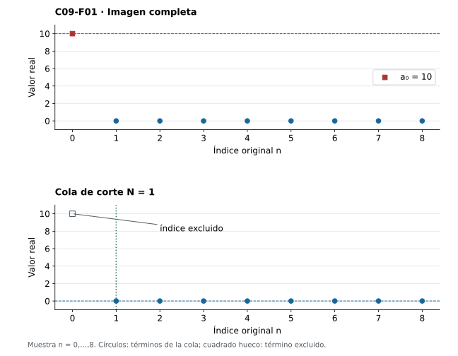
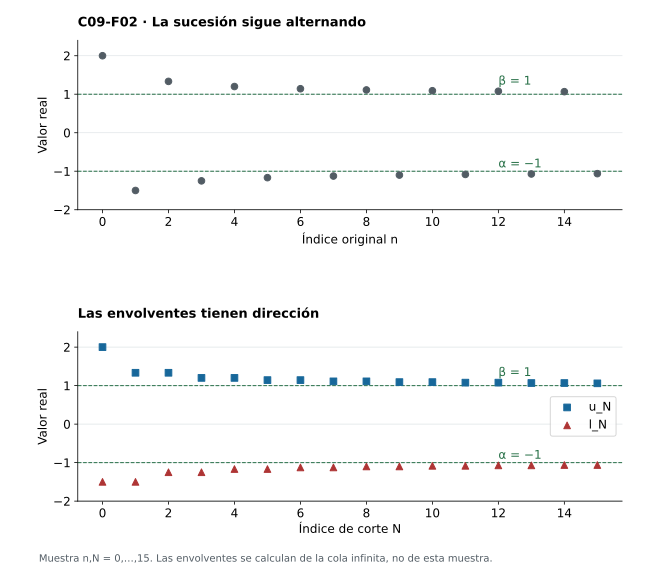
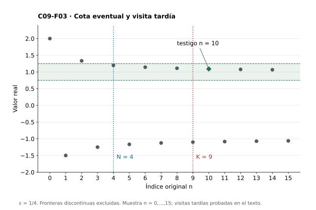
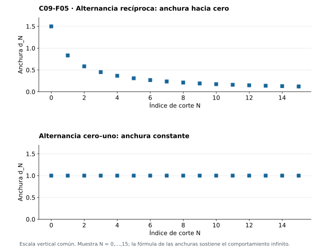
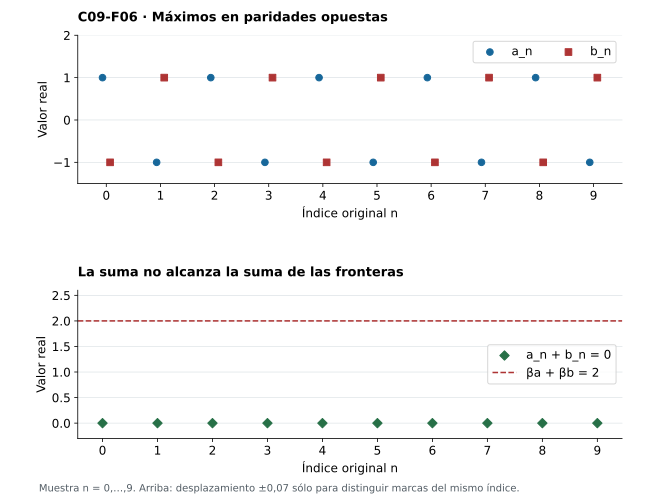

[Índice del libro](../para-matematicos/analisis-para-matematicos.html) · [Ejercicios de este capítulo](#ejercicios-9)

Un único término puede fijar el supremo de toda una sucesión y desaparecer de cualquier descripción de su comportamiento tardío. En $10,0,0,\ldots$, por ejemplo, la mayor altura es $10$, aunque la sucesión converge a cero. Para una sucesión acotada que siga oscilando, necesitamos fronteras que se ajusten al retirar el comienzo. Las obtendremos mirando el supremo y el ínfimo de cada cola.

Aunque los términos salten en ambas direcciones, al eliminar posiciones no aparecen valores nuevos. Los supremos de cola sólo podrán bajar y los ínfimos sólo podrán subir; esa monotonía permitirá aplicar C07 y obtener dos límites reales. Trabajaremos con sucesiones acotadas y extremos finitos, usando las nociones de cola de C05, supremo e ínfimo de C02–C03 y convergencia y extracciones de C06–C08.

## 9.1. Conservar la cola y olvidar el prefijo

[]{#MA-SEC-ANM-01-009-001}

En la sucesión $a_0=10$, $a_n=0$ para $n\ge1$, la imagen completa contiene $10$, pero la cola desde $1$ ya no lo contiene. El corte temporal determina qué conjunto de valores debemos estudiar.

Fijemos una sucesión real acotada $a:\mathbb N\to\mathbb R$, con $\mathbb N=\{0,1,2,\ldots\}$. Para cada $N\in\mathbb N$, escribimos $T_N=\{a_n:n\ge N\}\subseteq\mathbb R$. El corte y los índices de la cola son naturales; los elementos de $T_N$ son términos reales. El conjunto pierde el orden y las multiplicidades: una cola constante dispone de infinitos índices y sólo un valor.

Cada $T_N$ contiene $a_N$ y es acotado. La completitud asegura los reales

$$
\ell_N=\inf T_N,\qquad u_N=\sup T_N.
$$

Los extremos satisfacen $\ell_N\le a_n\le u_N$ para todo $n\ge N$. Al variar el corte obtenemos dos funciones $\ell,u:\mathbb N\to\mathbb R$, las **envolventes inferior y superior**. Son nuevas sucesiones y pueden tomar valores que ninguna evaluación de $a$ alcance, por lo que en general no son subsucesiones de ella.

La propiedad extremal permite aproximarse a ambas barreras desde la propia cola. Dados $N$ y $\eta>0$, existen $p,q\ge N$ con $\ell_N\le a_p<\ell_N+\eta$ y $u_N-\eta<a_q\le u_N$. Si todos los términos fueran a lo sumo $u_N-\eta$, ese real sería una cota superior menor que el supremo. Si todos fueran al menos $\ell_N+\eta$, tendríamos una cota inferior mayor que el ínfimo. Ambas contradicciones proporcionan valores en $T_N$ y, por tanto, índices al menos $N$. No se exige que las barreras se alcancen ni se eligen simultáneamente todos los testigos.

En $a_n=1/(n+1)$, el término de índice $N$ domina los posteriores, así que $u_N=1/(N+1)$ se alcanza. Todos los términos son positivos. Para $\eta>0$, el índice $n=\max\{N,\lfloor1/\eta\rfloor\}+1$ pertenece a la cola y cumple $0<a_n<\eta$, usando el piso de C06. Por tanto $\ell_N=0$ y no se alcanza.

También puede faltar el supremo entre los términos: para $x_n=1-1/(n+1)$, cada cola tiene la cota superior $1$ y ningún término igual a ella. Con el mismo índice anterior obtenemos $x_n>1-\eta$, lo que acredita $\sup T_N(x)=1$. En la sucesión del prefijo excepcional, en cambio, $u_0=10$ y $u_N=0$ desde $N=1$, mientras $\ell_N=0$ siempre. El alcanzamiento y la dependencia del corte son cuestiones distintas.

{#fig-anm-c09-f01 fig-alt="Dos gráficas de la misma sucesión con índice original cero a ocho: la primera incluye el punto inicial de altura diez y la segunda distingue ese punto excluido del corte uno; los términos restantes están en cero."}

### Antes de seguir

#### Microcontrol 1

[]{#MA-MIC-ANM-01-009-001}

¿En qué conjuntos viven el corte $N$ y los valores de $T_N$?

[]{#MA-MSOL-ANM-01-009-001}

Ver solución del microcontrol 1

$N$ es natural; $T_N$ es un subconjunto de $\mathbb R$. El conjunto de índices de la cola es un subconjunto de $\mathbb N$.

#### Microcontrol 2

[]{#MA-MIC-ANM-01-009-002}

¿Por qué $T_N$ no es vacío?

[]{#MA-MSOL-ANM-01-009-002}

Ver solución del microcontrol 2

Contiene $a_N$, porque el índice $N$ pertenece a su propia cola.

#### Microcontrol 3

[]{#MA-MIC-ANM-01-009-003}

¿Qué hipótesis permite que $\ell_N$ y $u_N$ sean reales?

[]{#MA-MSOL-ANM-01-009-003}

Ver solución del microcontrol 3

La cola es no vacía y acotada porque la sucesión lo es; completitud proporciona su ínfimo y supremo reales.

#### Microcontrol 4

[]{#MA-MIC-ANM-01-009-004}

¿Debe $u_N$ ser uno de los términos de la cola?

[]{#MA-MSOL-ANM-01-009-004}

Ver solución del microcontrol 4

No. Para $a_n=1-1/(n+1)$, todos los términos son menores que $1$, que es cota superior de cada cola. Dados $N$ y $\eta>0$, toma $n=\max\{N,\lfloor1/\eta\rfloor\}+1$. Entonces $1/(n+1)<\eta$ y $a_n>1-\eta$. La cota y esta aproximación prueban que cada cola tiene supremo $1$; ningún término lo alcanza.

#### Microcontrol 5

[]{#MA-MIC-ANM-01-009-005}

Calcula $\ell_N$ y $u_N$ para $a_n=1/(n+1)$.

[]{#MA-MSOL-ANM-01-009-005}

Ver solución del microcontrol 5

$\ell_N=0$ y $u_N=1/(N+1)$. Para $n\ge N$, $0<a_n\le1/(N+1)$, de modo que el supremo se alcanza en $N$. Dada $\eta>0$, el índice $n=\max\{N,\lfloor1/\eta\rfloor\}+1$ cumple $0<a_n<\eta$. Así $0$ es ínfimo de la cola y no se alcanza.

#### Microcontrol 6

[]{#MA-MIC-ANM-01-009-006}

¿Qué contradicción aparece si todos los términos de la cola satisfacen $a_n\le u_N-\eta$ con $\eta>0$?

[]{#MA-MSOL-ANM-01-009-006}

Ver solución del microcontrol 6

$u_N-\eta$ sería una cota superior menor que el supremo $u_N$, contradiciendo su minimalidad.

#### Microcontrol 7

[]{#MA-MIC-ANM-01-009-007}

¿Una cola constante tiene infinitos valores distintos?

[]{#MA-MSOL-ANM-01-009-007}

Ver solución del microcontrol 7

No. Tiene infinitos índices y un único valor; repetir valores no afecta a que la sucesión sea una función.

#### Microcontrol 8

[]{#MA-MIC-ANM-01-009-008}

Para $a_0=10$ y $a_n=0$ si $n\ge1$, ¿cuándo cambia el supremo de cola?

[]{#MA-MSOL-ANM-01-009-008}

Ver solución del microcontrol 8

$u_0=10$ y $u_N=0$ para todo $N\ge1$. El cambio ocurre al pasar del corte cero al uno.

### Ejercicios de la sección 9.1

[]{#ejercicios-9}

#### Ejercicio 1. Un extremo inicial

[]{#MA-EX-ANM-01-009-001}

Sea $a_0=7$, $a_1=-4$ y $a_n=1$ para $n\ge2$. Determina todos los conjuntos de cola y sus extremos.

[]{#MA-SOL-ANM-01-009-001}

Ver solución del ejercicio 1

$T_0=\{-4,1,7\}$, $T_1=\{-4,1\}$ y $T_N=\{1\}$ para $N\ge2$. Así $(\ell_0,u_0)=(-4,7)$, $(\ell_1,u_1)=(-4,1)$ y $(\ell_N,u_N)=(1,1)$ desde el corte dos. Se distinguen los conjuntos de valores de los infinitos conjuntos de índices.

La [figura 9.1](analisis-para-matematicos-capitulo-9-limite-superior-e-inferior-las-envolventes-de-una-cola.html#fig-anm-c09-f01) permite separar el efecto del prefijo de los extremos de las colas posteriores.

#### Ejercicio 2. Una frontera ausente

[]{#MA-EX-ANM-01-009-002}

Para $a_n=2-1/(n+1)$, calcula $\ell_N,u_N$ y decide cuáles se alcanzan.

[]{#MA-SOL-ANM-01-009-002}

Ver solución del ejercicio 2

Los términos crecen desde $a_N$, así $\ell_N=2-1/(N+1)$ y se alcanza en $N$. Todos son menores que dos. Para $\eta>0$, escoger $n\ge N$ con $1/(n+1)<\eta$ da $a_n>2-\eta$, por lo que $u_N=2$ y no se alcanza.

#### Ejercicio 3. Aproximación bilateral

[]{#MA-EX-ANM-01-009-003}

Demuestra directamente desde las definiciones que para $\eta>0$ existen $p,q\ge N$ con $a_p>u_N-\eta$ y $a_q<\ell_N+\eta$, sin suponer máximos o mínimos.

[]{#MA-SOL-ANM-01-009-003}

Ver solución del ejercicio 3

Si todo término posterior fuera a lo sumo $u_N-\eta$, ese real sería cota superior estrictamente menor que $u_N$. Si todo término fuera al menos $\ell_N+\eta$, sería cota inferior estrictamente mayor que $\ell_N$. Ambas conclusiones contradicen la optimalidad respectiva. Los valores que evitan esas contradicciones pertenecen a $T_N$ y por tanto tienen índices posteriores al corte.

#### Ejercicio 4. Cuándo se retira una altura

[]{#MA-EX-ANM-01-009-004}

Prueba $T_N=\{a_N\}\cup T_{N+1}$. ¿Cuándo puede ser estricta la inclusión $T_{N+1}\subseteq T_N$?

[]{#MA-SOL-ANM-01-009-004}

Ver solución del ejercicio 4

Cada índice al menos $N$ es $N$ o es al menos $N+1$, lo que prueba la igualdad; la inclusión inversa se sigue de los mismos índices. La inclusión es estricta exactamente cuando $a_N$ no reaparece en ningún índice posterior. Que se retire un índice no obliga a retirar su valor.

#### Ejercicio 5. Acotación eventual

[]{#MA-EX-ANM-01-009-005}

Una sucesión real satisface $|a_n|\le M$ para $n\ge N_0$, donde $M\ge0$. Demuestra que es acotada globalmente y que puede entrar en este capítulo.

[]{#MA-SOL-ANM-01-009-005}

Ver solución del ejercicio 5

Si $N_0=0$, sirve $M$. Si $N_0>0$, el prefijo contiene finitos términos y $B=\max\{M,|a_0|,\ldots,|a_{N_0-1}|\}$ es una cota de todas las magnitudes. Por tanto cada cola es no vacía y acotada y la construcción de ambos extremos finitos queda autorizada.

## 9.2. Dos envolventes que sí tienen dirección

[]{#MA-SEC-ANM-01-009-002}

La inclusión $T_{N+1}\subseteq T_N$ obliga a las envolventes a mantener una dirección. Cada cota superior de $T_N$ sigue dominando $T_{N+1}$, y cada cota inferior sigue por debajo de sus valores. La optimalidad de sus extremos da

$$
\ell_N\le\ell_{N+1}\le u_{N+1}\le u_N.
$$

Si $m\le a_n\le M$ para todo índice, también $m\le\ell_N\le u_N\le M$. La envolvente inferior es no decreciente y acotada superiormente; la superior es no creciente y acotada inferiormente. Los teoremas de C07 garantizan sus límites reales y permiten definir

$$
\alpha=\liminf_{n\to\infty}a_n:=\lim_{N\to\infty}\ell_N=\sup_{N\in\mathbb N}\ell_N,
\qquad
\beta=\limsup_{n\to\infty}a_n:=\lim_{N\to\infty}u_N=\inf_{N\in\mathbb N}u_N.
$$

El supremo exterior reúne los valores de $\ell$; el ínfimo exterior reúne los de $u$. Cambiar el orden altera la pregunta: $\sup_N\sup T_N=u_0$ sigue describiendo la imagen completa. La completitud proporcionó primero los extremos de cada cola y, mediante C07, proporciona los límites de las envolventes. La unicidad de C06 hace unívocas esas definiciones.

El orden $\ell_N\le u_N$ pasa al límite y da $\alpha\le\beta$. Como $\alpha$ es supremo de la envolvente inferior y $\beta$ es ínfimo de la superior, tenemos $\ell_N\le\alpha$ y $\beta\le u_N$ para cada corte. Esto deja abierta la posición de los términos respecto del intervalo $[\alpha,\beta]$, incluso en colas muy tardías.

Para $a_n=(-1)^n(1+1/(n+1))$, definamos $e(N)=N$ si $N$ es par y $e(N)=N+1$ si es impar; definamos $o(N)=N$ si $N$ es impar y $o(N)=N+1$ si es par. Son los primeros índices de cada paridad disponibles en la cola. Los valores pares son positivos y disminuyen dentro de su paridad; los impares son negativos y aumentan. Por ello $u_N=1+1/(e(N)+1)$ y $\ell_N=-1-1/(o(N)+1)$. Como $e(N),o(N)\ge N$, las correcciones están acotadas por $1/(N+1)$ y tienden a cero: $\alpha=-1$, $\beta=1$. Todos los términos siguen fuera de $[-1,1]$.

La [figura 9.2](#fig-anm-c09-f02) representa esa diferencia: la sucesión original alterna y sus dos envolventes se mueven monótonamente hacia fronteras distintas. Hacer converger las envolventes no ha hecho converger a $a$.

{#fig-anm-c09-f02 fig-alt="Arriba, pares positivos e impares negativos fuera de las líneas menos uno y uno; abajo, cuadrados de supremos de cola decrecientes y triángulos de ínfimos crecientes sobre el índice de corte N."}

### Antes de seguir

#### Microcontrol 9

[]{#MA-MIC-ANM-01-009-009}

¿Cuál es la inclusión entre $T_{N+1}$ y $T_N$?

[]{#MA-MSOL-ANM-01-009-009}

Ver solución del microcontrol 9

$T_{N+1}\subseteq T_N$: sólo se retira un índice disponible, sin añadir valores.

#### Microcontrol 10

[]{#MA-MIC-ANM-01-009-010}

¿En qué sentido es monótona la envolvente inferior?

[]{#MA-MSOL-ANM-01-009-010}

Ver solución del microcontrol 10

Es no decreciente: $\ell_{N+1}\ge\ell_N$, porque cada cota inferior de $T_N$ también acota $T_{N+1}$.

#### Microcontrol 11

[]{#MA-MIC-ANM-01-009-011}

¿En qué sentido es monótona la envolvente superior?

[]{#MA-MSOL-ANM-01-009-011}

Ver solución del microcontrol 11

Es no creciente: $u_{N+1}\le u_N$, porque cada cota superior de $T_N$ también acota $T_{N+1}$.

#### Microcontrol 12

[]{#MA-MIC-ANM-01-009-012}

Escribe el supremo exterior que define $\alpha$.

[]{#MA-MSOL-ANM-01-009-012}

Ver solución del microcontrol 12

$\alpha=\sup\{\ell_N:N\in\mathbb N\}$; el conjunto está formado por ínfimos reales de colas.

#### Microcontrol 13

[]{#MA-MIC-ANM-01-009-013}

Escribe el ínfimo exterior que define $\beta$.

[]{#MA-MSOL-ANM-01-009-013}

Ver solución del microcontrol 13

$\beta=\inf\{u_N:N\in\mathbb N\}$; el conjunto está formado por supremos reales de colas.

#### Microcontrol 14

[]{#MA-MIC-ANM-01-009-014}

¿Por qué $\alpha\le\beta$?

[]{#MA-MSOL-ANM-01-009-014}

Ver solución del microcontrol 14

$\ell_N\le u_N$ para todo $N$; ambas envolventes convergen, y C06 conserva el orden al pasar al límite.

#### Microcontrol 15

[]{#MA-MIC-ANM-01-009-015}

Para $a_n=(-1)^n(1+1/(n+1))$, ¿cuáles son los extremos asintóticos?

[]{#MA-MSOL-ANM-01-009-015}

Ver solución del microcontrol 15

$\alpha=-1$ y $\beta=1$. Sea $e(N)=N$ si $N$ es par y $e(N)=N+1$ si es impar; sea $o(N)=N$ si $N$ es impar y $o(N)=N+1$ si es par. Los valores pares son positivos y decrecen dentro de su paridad; los impares son negativos y aumentan. Por ello $u_N=1+1/(e(N)+1)$ y $\ell_N=-1-1/(o(N)+1)$. Como $e(N),o(N)\ge N$, ambas correcciones positivas están acotadas por $1/(N+1)$ y tienden a cero. Las envolventes convergen a $1$ y $-1$, respectivamente.

#### Microcontrol 16

[]{#MA-MIC-ANM-01-009-016}

¿El ejemplo anterior tiene términos en $[\alpha,\beta]$?

[]{#MA-MSOL-ANM-01-009-016}

Ver solución del microcontrol 16

No. Los pares son mayores que uno y los impares menores que menos uno. La banda asintótica exacta no tiene por qué contener términos.

### Ejercicios de la sección 9.2

#### Ejercicio 6. Alternancia con margen decreciente

[]{#MA-EX-ANM-01-009-006}

Calcula las envolventes y los extremos de $a_n=3+(-1)^n(2+1/(n+1))$.

[]{#MA-SOL-ANM-01-009-006}

Ver solución del ejercicio 6

Con $e(N)$ par y $o(N)$ impar mínimos posteriores, $u_N=5+1/(e(N)+1)$ y $\ell_N=1-1/(o(N)+1)$. Aquí $e(N)=N$ para $N$ par y $N+1$ para $N$ impar; $o(N)=N$ para $N$ impar y $N+1$ para $N$ par. Todo valor par es mayor que $5$ y decrece dentro de esa paridad; todo valor impar es menor que $1$ y aumenta. Así los dos primeros índices disponibles dan, respectivamente, el máximo y el mínimo de la cola. Las correcciones tienden a cero porque sus índices son al menos $N$. Así $\alpha=1$, $\beta=5$.

La [figura 9.2](analisis-para-matematicos-capitulo-9-limite-superior-e-inferior-las-envolventes-de-una-cola.html#fig-anm-c09-f02) ayuda a leer la dirección de cada envolvente aunque la sucesión original alterne.

#### Ejercicio 7. Orden en dos niveles

[]{#MA-EX-ANM-01-009-007}

Prueba $\inf T_0\le\alpha\le\beta\le\sup T_0$ e indica los dos niveles de completitud usados.

[]{#MA-SOL-ANM-01-009-007}

Ver solución del ejercicio 7

Cada cola está dentro de $T_0$, de modo que $\inf T_0\le\ell_N\le u_N\le\sup T_0$. El paso al límite conserva orden y da la cadena. Completitud da primero sup/inf reales de cada cola y después, mediante C07, los límites reales de las envolventes monótonas acotadas.

#### Ejercicio 8. Invertir operaciones

[]{#MA-EX-ANM-01-009-008}

Compara $\inf_N\sup_{n\ge N}a_n$ con $\sup_N\inf_{n\ge N}a_n$ para la alternancia cero–uno. ¿Son operaciones intercambiables?

[]{#MA-SOL-ANM-01-009-008}

Ver solución del ejercicio 8

Cada cola contiene cero y uno. La primera expresión vale uno y la segunda cero. Son $\beta$ y $\alpha$, respectivamente; no se intercambian en general.

El orden de las dos operaciones de extremos se distingue en la [figura 9.2](analisis-para-matematicos-capitulo-9-limite-superior-e-inferior-las-envolventes-de-una-cola.html#fig-anm-c09-f02).

#### Ejercicio 9. Monotonía original

[]{#MA-EX-ANM-01-009-009}

Si $a$ es acotada y no decreciente, identifica sus dos envolventes y sus extremos.

[]{#MA-SOL-ANM-01-009-009}

Ver solución del ejercicio 9

$\ell_N=a_N$ porque es el menor término posterior. Sea $s=\sup T_0$. Es también supremo de cada cola: cualquier cota de una cola acota los términos anteriores porque son a lo sumo $a_N$. Así $u_N=s$ para todo $N$. C07 da $a_N\to s$, y por tanto $\alpha=\beta=s$.

#### Ejercicio 10. Igualdad de límites, desigualdad de objetos

[]{#MA-EX-ANM-01-009-010}

Construye dos sucesiones distintas con las mismas envolventes superior e inferior en todos los cortes.

[]{#MA-SOL-ANM-01-009-010}

Ver solución del ejercicio 10

La alternancia $a_n=0$ para pares y uno para impares, y la alternancia inversa $b_n=1-a_n$, son distintas en cada índice. Cada cola de ambas contiene cero y uno, por lo que sus envolventes son idénticas: $\ell_N=0,u_N=1$. Igualdad de envolventes no implica igualdad de las funciones originales.

La [figura 9.2](analisis-para-matematicos-capitulo-9-limite-superior-e-inferior-las-envolventes-de-una-cola.html#fig-anm-c09-f02) permite comparar las envolventes; aquí la coincidencia se ha demostrado para dos funciones diferentes.

## 9.3. Fronteras eventuales y visitas tardías

[]{#MA-SEC-ANM-01-009-003}

Podemos reconocer una frontera superior sin calcular por separado cada $u_N$. Debe quedar toda una cola por debajo de cualquier altura ligeramente mayor y deben sobrevivir visitas por encima de cualquier altura ligeramente menor. Para una sucesión acotada, un real $b$ es su límite superior si y sólo si cumple

$$
\forall\varepsilon>0\ \exists N\ \forall n\ge N: a_n<b+\varepsilon,
\qquad
\forall\varepsilon>0\ \forall K\ \exists n\ge K: a_n>b-\varepsilon.
$$

Supongamos primero que $b=\beta$. La convergencia $u_N\to\beta$ proporciona, para $\varepsilon>0$, un corte con $u_N<\beta+\varepsilon$; todos los términos de esa cola quedan por debajo. Para cualquier corte $K$, aproximamos su supremo y obtenemos algún $n\ge K$ con $a_n>u_K-\varepsilon\ge\beta-\varepsilon$. Esta visita puede cambiar al recibir otra tolerancia o corte; no controla por sí sola los demás términos.

A la inversa, la primera condición da $u_N\le b+\varepsilon$ para algún corte. La desigualdad puede dejar de ser estricta al tomar supremo, pero basta para deducir $\beta\le b+\varepsilon$. La segunda condición da $u_K>b-\varepsilon$ para cada $K$, y el paso al límite proporciona $\beta\ge b-\varepsilon$. Si $\beta\ne b$, tomar como tolerancia la mitad de su distancia contradice una de esas dos comparaciones; luego $\beta=b$.

Por abajo, $c=\alpha$ si y sólo si, para cada $\varepsilon>0$, alguna cola satisface $a_n>c-\varepsilon$ y, después de cualquier corte $K$, existe $n\ge K$ con $a_n<c+\varepsilon$. La convergencia $\ell_N\to\alpha$ acredita la primera condición y la aproximación del ínfimo acredita la segunda. Recíprocamente, la cota eventual da $\alpha\ge c-\varepsilon$, y las visitas dan $\ell_K<c+\varepsilon$ para cada $K$, luego $\alpha\le c+\varepsilon$. La misma elección de la mitad de una supuesta distancia positiva prueba $\alpha=c$.

Un conjunto infinito de índices no cabe en un prefijo finito y supera cualquier corte. A la inversa, un conjunto finito no vacío queda antes de $1$ más su máximo, y el vacío no aporta visitas ni desde $0$. Por eso «arbitrariamente tarde» equivale a «para infinitos índices», aun cuando éstos repitan un mismo valor.

Si $t>\beta$, usamos $\varepsilon=(t-\beta)/2$: alguna cola queda por debajo de $\beta+\varepsilon<t$, por lo que sólo hay finitos índices con $a_n\ge t$. Si $t<\beta$, la tolerancia $\varepsilon=\beta-t$ da un término con $a_n>t$ después de cada corte, es decir, infinitas visitas. En $t=\beta$ no hay una respuesta única: la constante $1$ alcanza su frontera siempre y $1-1/(n+1)$ no la alcanza nunca. Dualmente, para $t<\alpha$ hay sólo finitos índices con $a_n\le t$, mientras que para $t>\alpha$ hay infinitos con $a_n<t$.

Reuniendo por máximo los cortes de las dos cotas eventuales, para cada $\varepsilon>0$ una cola queda en $(\alpha-\varepsilon,\beta+\varepsilon)$. El ejemplo alternante anterior muestra por qué no podemos reducir esa garantía al intervalo exacto $[\alpha,\beta]$.

En la [figura 9.3](#fig-anm-c09-f03), con tolerancia $1/4$, el corte $4$ basta para que todos los términos sean menores que $5/4$. Recibido el corte $9$, el índice $10$ aporta además una visita mayor que $3/4$, pues $a_{10}=12/11$. Los términos negativos quedan fuera de esa ventana alrededor de $\beta=1$ sin contradecir la caracterización.

{#fig-anm-c09-f03 fig-alt="Ventana entre tres cuartos y cinco cuartos con fronteras discontinuas; línea vertical de corte eventual cuatro, corte solicitado nueve e índice testigo diez marcado con rombo. Los términos impares no están capturados por esa ventana."}

### Antes de seguir

#### Microcontrol 17

[]{#MA-MIC-ANM-01-009-017}

¿Qué orden de cuantificadores expresa una cota superior eventual con tolerancia $\varepsilon$?

[]{#MA-MSOL-ANM-01-009-017}

Ver solución del microcontrol 17

Para cada $\varepsilon>0$ existe $N$ tal que para todo $n\ge N$ se cumple $a_n<\beta+\varepsilon$.

#### Microcontrol 18

[]{#MA-MIC-ANM-01-009-018}

¿Qué orden de cuantificadores expresa visitas tardías cerca de $\beta$ desde abajo?

[]{#MA-MSOL-ANM-01-009-018}

Ver solución del microcontrol 18

Para cada $\varepsilon>0$ y cada corte $K$ existe $n\ge K$ con $a_n>\beta-\varepsilon$.

#### Microcontrol 19

[]{#MA-MIC-ANM-01-009-019}

¿La condición de visitas obliga a que toda la cola esté cerca de $\beta$?

[]{#MA-MSOL-ANM-01-009-019}

Ver solución del microcontrol 19

No. Sólo garantiza algún índice posterior a cada corte; la alternancia cero–uno visita uno tarde y también conserva ceros tarde.

#### Microcontrol 20

[]{#MA-MIC-ANM-01-009-020}

¿Qué ocurre con las visitas a alturas al menos $t$ si $t>\beta$?

[]{#MA-MSOL-ANM-01-009-020}

Ver solución del microcontrol 20

Son finitas: con tolerancia $(t-\beta)/2$, toda una cola queda por debajo de $t$.

#### Microcontrol 21

[]{#MA-MIC-ANM-01-009-021}

¿Qué ocurre si $t<\beta$ con los índices que cumplen $a_n>t$?

[]{#MA-MSOL-ANM-01-009-021}

Ver solución del microcontrol 21

Hay infinitos: la propiedad de visitas con tolerancia $\beta-t$ proporciona uno después de cualquier corte.

#### Microcontrol 22

[]{#MA-MIC-ANM-01-009-022}

¿Se puede decidir sólo con $\beta$ si hay infinitos índices con $a_n=\beta$?

[]{#MA-MSOL-ANM-01-009-022}

Ver solución del microcontrol 22

No. La constante uno los tiene; $1-1/(n+1)$ tiene la misma frontera uno y no la alcanza.

#### Microcontrol 23

[]{#MA-MIC-ANM-01-009-023}

Escribe las dos condiciones que caracterizan $\alpha$.

[]{#MA-MSOL-ANM-01-009-023}

Ver solución del microcontrol 23

Para cada $\varepsilon>0$, alguna cola cumple $a_n>\alpha-\varepsilon$; para cada $\varepsilon>0$ y corte $K$, algún $n\ge K$ cumple $a_n<\alpha+\varepsilon$.

#### Microcontrol 24

[]{#MA-MIC-ANM-01-009-024}

¿Qué banda abierta contiene alguna cola para cada $\varepsilon>0$?

[]{#MA-MSOL-ANM-01-009-024}

Ver solución del microcontrol 24

$(\alpha-\varepsilon,\beta+\varepsilon)$, usando el máximo de los dos cortes de las cotas eventuales.

### Ejercicios de la sección 9.3

#### Ejercicio 11. Umbral persistente

[]{#MA-EX-ANM-01-009-011}

Para una sucesión acotada define $A=\{t\in\mathbb R:\{n:a_n>t\}\text{ es infinito}\}$. Prueba que $A$ es no vacío, acotado superiormente y $\sup A=\beta$.

[]{#MA-SOL-ANM-01-009-011}

Ver solución del ejercicio 11

Una cota inferior global $m$ hace que $m-1\in A$, por lo que es no vacío. Una cota superior global $M$ acota a $A$. Si $t>\beta$, sólo hay finitas visitas sobre $t$, luego $t\notin A$; así $\beta$ acota $A$. Todo $t<\beta$ pertenece a $A$ por §9.3; en particular $\beta-\varepsilon\in A$ para toda tolerancia. Ninguna cota menor que $\beta$ puede acotar a $A$, por lo que su supremo es $\beta$.

#### Ejercicio 12. Umbral eventual

[]{#MA-EX-ANM-01-009-012}

Define $B=\{t\in\mathbb R:\{n:a_n>t\}\text{ es finito}\}$. Prueba $\inf B=\beta$ y explica por qué $\beta$ puede o no pertenecer a $B$.

[]{#MA-SOL-ANM-01-009-012}

Ver solución del ejercicio 12

$B$ contiene una cota superior global y es no vacío. Ningún $t<\beta$ pertenece a $B$, pues hay infinitas visitas sobre él; así $\beta$ es cota inferior. Todo $t>\beta$ pertenece a $B$, luego hay elementos arbitrariamente próximos por arriba y $\inf B=\beta$. Para la constante uno, $\beta=1\in B$ porque no hay términos mayores que uno. Para $1+1/(n+1)$, $\beta=1\notin B$ porque todos los términos son mayores.

#### Ejercicio 13. Probar una frontera candidata

[]{#MA-EX-ANM-01-009-013}

Supón que para cada $\varepsilon>0$ una cola satisface $a_n<4+\varepsilon$ y que después de cada corte existe $a_n>4-\varepsilon$. Demuestra $\beta=4$ sin suponer que la sucesión converge.

[]{#MA-SOL-ANM-01-009-013}

Ver solución del ejercicio 13

La cota eventual implica $u_N\le4+\varepsilon$ para algún corte, y por tanto $\beta\le4+\varepsilon$. Las visitas implican $u_K>4-\varepsilon$ para cada corte y por límite $\beta\ge4-\varepsilon$. Si $\beta$ difiriera de cuatro, elegir la mitad de la distancia como tolerancia contradiría una desigualdad. Por tanto $\beta=4$, sin control sobre un posible extremo inferior distinto.

En la [figura 9.3](analisis-para-matematicos-capitulo-9-limite-superior-e-inferior-las-envolventes-de-una-cola.html#fig-anm-c09-f03) se distinguen la cota de toda una cola y la visita que sobrevive a cada corte; la prueba necesita ambas.

#### Ejercicio 14. Visitas con una sola tolerancia

[]{#MA-EX-ANM-01-009-014}

¿Basta que haya infinitos términos con $a_n>2-1/2$ para concluir $\beta=2$? Da un contraejemplo acotado.

[]{#MA-SOL-ANM-01-009-014}

Ver solución del ejercicio 14

No. La constante $a_n=7/4$ satisface la visita con esa tolerancia y tiene $\beta=7/4$. Falta exigir todas las tolerancias y la cota eventual superior. Incluso todas las visitas por abajo sólo darían $\beta\ge2$.

Las dos condiciones de la [figura 9.3](analisis-para-matematicos-capitulo-9-limite-superior-e-inferior-las-envolventes-de-una-cola.html#fig-anm-c09-f03) muestran lo que queda pendiente al comprobar una sola tolerancia.

#### Ejercicio 15. Versión inferior por umbrales

[]{#MA-EX-ANM-01-009-015}

Prueba $\alpha=\inf\{t:\{n:a_n<t\}\text{ es infinito}\}$.

[]{#MA-SOL-ANM-01-009-015}

Ver solución del ejercicio 15

El conjunto es no vacío: si $M$ acota superiormente a $a$, $M+1$ pertenece a él. Está acotado inferiormente por una cota inferior global. Si $t<\alpha$, las visitas por debajo de $t$ son finitas por la cota inferior eventual con tolerancia $(\alpha-t)/2$. Si $t>\alpha$, la condición de visitas con tolerancia $t-\alpha$ da infinitos términos menores que $t$. Por ello $\alpha$ es cota inferior y hay elementos arbitrariamente próximos por arriba, lo que identifica el ínfimo.

## 9.4. Alcanzar las fronteras mediante extracciones

[]{#MA-SEC-ANM-01-009-004}

Las fronteras son reales construidos a partir de colas. Para relacionarlas con los puntos secuenciales de C08, llamaremos $\operatorname{LimSub}(a)$ al conjunto de límites de todas las subsucesiones convergentes. Demostraremos que sus mínimo y máximo son $\alpha$ y $\beta$: habrá que obtener extracciones hacia ambos y después comparar cualquier otro destino con ellos.

Dados $\delta>0$ y un corte $K$, elegimos un corte $H$ desde el que $a_n<\beta+\delta$. La condición de visitas aplicada después de $\max\{H,K\}$ proporciona un término que cumple también $a_n>\beta-\delta$. Así encontramos $|a_n-\beta|<\delta$ en un mismo índice posterior al corte solicitado. Coordinar ambas restricciones convierte el control por un lado en proximidad al centro.

Definimos $n_0$ como el mínimo del conjunto no vacío $\{n:|a_n-\beta|<1\}$. Una vez definido $n_{k-1}$, para $k\ge1$ ponemos

$$
n_k=\min\{n\ge n_{k-1}+1:|a_n-\beta|<1/(k+1)\}.
$$

Cada conjunto admisible es no vacío antes de tomar su mínimo natural. La recursión da un selector estrictamente creciente $k\mapsto n_k$ y $|a_{n_k}-\beta|<1/(k+1)$. Para $\varepsilon>0$, tomamos $K=\lfloor1/\varepsilon\rfloor$; si $k\ge K$, $1/(k+1)\le1/(K+1)<\varepsilon$. Esto prueba $a_{n_k}\to\beta$, sin tomar mínimos reales ni escoger testigos arbitrarios.

Para la frontera inferior reunimos la cota eventual $a_n>\alpha-\delta$ y una visita $a_n<\alpha+\delta$ después de su corte y del $K$ solicitado. Queda $|a_n-\alpha|<\delta$. Definimos $m_0=\min\{n:|a_n-\alpha|<1\}$ y, para $k\ge1$, $m_k=\min\{n\ge m_{k-1}+1:|a_n-\alpha|<1/(k+1)\}$. La no vacuidad justifica los mínimos, el corte obliga a avanzar y la misma estimación con el piso demuestra $a_{m_k}\to\alpha$.

Sea ahora $a_{\varphi(k)}\to x$. Fijamos primero un corte original $N$. Para cada $k\ge N$, C08 da $\varphi(k)\ge k\ge N$, de modo que $\ell_N\le a_{\varphi(k)}\le u_N$. Al pasar al límite en el índice nuevo $k$, obtenemos $\ell_N\le x\le u_N$ con $N$ todavía fijo. Esta conclusión vale para todos los cortes originales; pasando después al límite en $N$ resulta $\alpha\le x\le\beta$. El primer paso controla una extracción y el segundo recorre las envolventes.

Los extremos pertenecen al conjunto de destinos y acotan a todos sus elementos. Por ello

$$
\min\operatorname{LimSub}(a)=\alpha,\qquad
\max\operatorname{LimSub}(a)=\beta.
$$

En la alternancia cero–uno, las selecciones por paridad muestran que $0$ y $1$ son destinos. Si $x\notin\{0,1\}$, el radio $\tfrac12\min\{|x|,|x-1|\}>0$ excluye todos los valores y refuta cualquier extracción hacia $x$. Por tanto $\operatorname{LimSub}(a)=\{0,1\}$: estar entre los extremos no basta para ser destino.

Para la alternancia $(-1)^n(1+1/(n+1))$ de §9.2, la selección par tiene términos $1+1/(2k+1)$ y converge a $\beta=1$. La [figura 9.4](#fig-anm-c09-f04) y su tabla distinguen el índice nuevo $k$, el original $2k$ y el valor seleccionado. Ninguno de esos términos vale $1$, aunque su límite pertenezca a $\operatorname{LimSub}(a)$. Las extracciones extremas se han construido directamente; no se ha usado Bolzano–Weierstrass para sustituir sus pruebas.

{#fig-anm-c09-f04 fig-alt="Tabla relaciona k cero a cinco con índices originales cero, dos, cuatro, seis, ocho y diez y valores dos, cuatro tercios, seis quintos, ocho séptimos, diez novenos y doce onceavos; debajo se dibujan esos valores contra k y una línea de referencia en uno."}

| Índice nuevo k | Índice original φ(k) | Valor seleccionado |
|---|---|---|
| 0 | 0 | 2 |
| 1 | 2 | 4/3 |
| 2 | 4 | 6/5 |
| 3 | 6 | 8/7 |
| 4 | 8 | 10/9 |
| 5 | 10 | 12/11 |

### Antes de seguir

#### Microcontrol 25

[]{#MA-MIC-ANM-01-009-025}

¿Qué dos restricciones se coordinan antes de elegir un índice próximo a $\beta$?

[]{#MA-MSOL-ANM-01-009-025}

Ver solución del microcontrol 25

La cota eventual $a_n<\beta+\delta$ y la visita tardía $a_n>\beta-\delta$, aplicada después del corte de la primera y del corte solicitado.

#### Microcontrol 26

[]{#MA-MIC-ANM-01-009-026}

¿Por qué existe el mínimo que define $n_0$?

[]{#MA-MSOL-ANM-01-009-026}

Ver solución del microcontrol 26

El conjunto de índices con $|a_n-\beta|<1$ es no vacío por la coordinación anterior; todo subconjunto no vacío de $\mathbb N$ tiene mínimo.

#### Microcontrol 27

[]{#MA-MIC-ANM-01-009-027}

¿Qué evita que $n_k$ repita un índice previo?

[]{#MA-MSOL-ANM-01-009-027}

Ver solución del microcontrol 27

Para $k\ge1$ se exige $n_k\ge n_{k-1}+1$; por inducción todos los índices elegidos son distintos y están ordenados.

#### Microcontrol 28

[]{#MA-MIC-ANM-01-009-028}

¿Por qué usamos $1/(k+1)$ en vez de $1/k$?

[]{#MA-MSOL-ANM-01-009-028}

Ver solución del microcontrol 28

El índice nuevo empieza en cero; $1/(k+1)$ está definido y es positivo para todo $k\in\mathbb N$.

#### Microcontrol 29

[]{#MA-MIC-ANM-01-009-029}

¿En qué dominio vive el selector $k\mapsto n_k$?

[]{#MA-MSOL-ANM-01-009-029}

Ver solución del microcontrol 29

Es una función $\mathbb N\to\mathbb N$ estrictamente creciente; al componer con $a$ se obtiene una sucesión real $k\mapsto a_{n_k}$.

#### Microcontrol 30

[]{#MA-MIC-ANM-01-009-030}

¿Cómo demuestra $|a_{n_k}-\beta|<1/(k+1)$ la convergencia?

[]{#MA-MSOL-ANM-01-009-030}

Ver solución del microcontrol 30

Para $\varepsilon>0$, elegir por arquimedianidad $K$ con $1/(K+1)<\varepsilon$. Todo $k\ge K$ tiene error menor que $\varepsilon$.

#### Microcontrol 31

[]{#MA-MIC-ANM-01-009-031}

¿Qué desigualdad satisface cualquier límite $x$ de subsucesión?

[]{#MA-MSOL-ANM-01-009-031}

Ver solución del microcontrol 31

Fija un corte original $N$. Si la extracción tiene selector $\varphi$, para todo $k\ge N$ se cumple $\varphi(k)\ge k\ge N$, y por tanto $\ell_N\le a_{\varphi(k)}\le u_N$. Al pasar al límite en $k$ se obtiene $\ell_N\le x\le u_N$. Esta conclusión vale para cada $N$. Pasar ahora al límite de las dos envolventes da $\alpha\le x\le\beta$; el primer paso mantenía $N$ fijo y el segundo recorre los cortes originales.

#### Microcontrol 32

[]{#MA-MIC-ANM-01-009-032}

¿Por qué $\beta$ es máximo de $\operatorname{LimSub}(a)$ y no sólo su supremo?

[]{#MA-MSOL-ANM-01-009-032}

Ver solución del microcontrol 32

La extracción superior demuestra que $\beta$ pertenece al conjunto, y el confinamiento demuestra que ningún elemento lo supera.

### Ejercicios de la sección 9.4

#### Ejercicio 16. Un selector explícito

[]{#MA-EX-ANM-01-009-016}

Para $a_n=(-1)^n+1/(n+1)$ construye selectores de subsucesiones que converjan a los dos extremos.

[]{#MA-SOL-ANM-01-009-016}

Ver solución del ejercicio 16

Las selecciones $\varphi(k)=2k$ y $\psi(k)=2k+1$ son estrictamente crecientes en $\mathbb N$. Sus términos son $1+1/(2k+1)$ y $-1+1/(2k+2)$, que convergen a uno y menos uno. Para cada ε>0, una cola cumple −1−ε<a_n<1+ε, por la pequeñez del recíproco; así todos sus destinos están en [−1,1]. Como las dos selecciones alcanzan los extremos de ese intervalo, el carácter mínimo/máximo de §9.4 identifica α=−1 y β=1. La convergencia recíproca se verifica por arquimedianidad.

La [figura 9.4](analisis-para-matematicos-capitulo-9-limite-superior-e-inferior-las-envolventes-de-una-cola.html#fig-anm-c09-f04) sitúa las extracciones que alcanzan las fronteras como límites, sin exigir que sean términos de la sucesión.

#### Ejercicio 17. Construcción sin elección arbitraria

[]{#MA-EX-ANM-01-009-017}

Reconstruye la extracción que converge a $\beta$ usando mínimos naturales. Justifica no vacuidad y convergencia.

[]{#MA-SOL-ANM-01-009-017}

Ver solución del ejercicio 17

Para cualquier $\delta,K$, la cota superior eventual fija $H$ y las visitas por abajo después de $\max\{H,K\}$ dan un índice con $|a_n-\beta|<\delta$. Por ello existen los mínimos $n_0=\min\{n:|a_n-\beta|<1\}$ y $n_k=\min\{n\ge n_{k-1}+1:|a_n-\beta|<1/(k+1)\}$ para $k\ge1$. La recursión da aumento estricto. Para $\varepsilon>0$, elegir $K$ con $1/(K+1)<\varepsilon$; todo $k\ge K$ tiene error menor, luego la extracción converge a $\beta$.

La [figura 9.4](analisis-para-matematicos-capitulo-9-limite-superior-e-inferior-las-envolventes-de-una-cola.html#fig-anm-c09-f04) ayuda a separar el avance de índices de la aproximación espacial que controla el error.

#### Ejercicio 18. Extracción de una extracción

[]{#MA-EX-ANM-01-009-018}

Sea $b_k=a_{\varphi(k)}$ una subsucesión. Prueba $\alpha_a\le\alpha_b\le\beta_b\le\beta_a$.

[]{#MA-SOL-ANM-01-009-018}

Ver solución del ejercicio 18

$b$ es acotada. Sus extremos son límites de subsucesiones $b_{\psi(j)}$ por §9.4. La composición $\varphi\circ\psi$ es estrictamente creciente, de modo que ambos son destinos de $a$ y quedan en $[\alpha_a,\beta_a]$. Además $\alpha_b\le\beta_b$ por §9.2. Esto reúne toda la cadena; una extracción puede estrechar la banda.

#### Ejercicio 19. Un punto intermedio ausente

[]{#MA-EX-ANM-01-009-019}

Prueba que $1/2$ no es destino de ninguna subsucesión de la alternancia cero–uno, pese a estar entre sus extremos.

[]{#MA-SOL-ANM-01-009-019}

Ver solución del ejercicio 19

Cada término de cualquier extracción vale cero o uno y está a distancia exactamente $1/2$ de $1/2$. La tolerancia $1/4$ impide convergencia a ese candidato. Los destinos cero y uno se obtienen por paridad; así el confinamiento no es una caracterización de todos los puntos interiores.

El confinamiento de la [figura 9.4](analisis-para-matematicos-capitulo-9-limite-superior-e-inferior-las-envolventes-de-una-cola.html#fig-anm-c09-f04) incluye los extremos; por sí solo no proporciona destinos en el interior.

#### Ejercicio 20. Destinos extremos y conjunto

[]{#MA-EX-ANM-01-009-020}

¿Por qué los extremos asintóticos son máximo y mínimo del conjunto de destinos incluso cuando nunca aparecen como términos? Ilustra con una sucesión.

[]{#MA-SOL-ANM-01-009-020}

Ver solución del ejercicio 20

El conjunto contiene límites, no necesariamente términos. Las extracciones probadas llevan $\alpha,\beta$ a él y el confinamiento los compara con todos sus elementos, dando mínimo y máximo. Para $a_n=1/(n+1)$ ambos extremos son cero y el conjunto de destinos es $\{0\}$, aunque ningún término valga cero.

## 9.5. Medir la oscilación y reconocer convergencia

[]{#MA-SEC-ANM-01-009-005}

Si ambas fronteras coinciden, la banda abierta que contiene una cola puede estrecharse alrededor de un único centro. Para una sucesión real acotada,

$$
a_n\to L\quad\Longleftrightarrow\quad\alpha=\beta=L.
$$

Si $a_n\to L$, C08 obliga a que las dos extracciones extremas de §9.4 converjan también a $L$; por unicidad, $\alpha=\beta=L$. Para la vuelta, supongamos esa igualdad y fijemos $\varepsilon>0$. Las convergencias de las envolventes proporcionan cortes $N_1,N_2$ desde los que $\ell_n>L-\varepsilon$ y $u_n<L+\varepsilon$, respectivamente. Con $N=\max\{N_1,N_2\}$, para todo $n\ge N$ se tiene $L-\varepsilon<\ell_n\le a_n\le u_n<L+\varepsilon$. La captura de toda la cola prueba $a_n\to L$.

Podemos medir lo que queda de la oscilación mediante $d_N=u_N-\ell_N\ge0$. Como $u$ decrece y $\ell$ crece, $d$ decrece. Las reglas de límites reales de C06 dan $d_N\to\beta-\alpha$. Llamaremos **oscilación asintótica** al número $\omega(a)=\beta-\alpha$. Así $\omega(a)=0$ si y sólo si $a$ converge. El número cero registra desaparición de amplitud, aunque los términos alternen de lado para siempre.

La anchura también mide el supremo de todas las distancias entre términos de la cola:

$$
d_N=\sup\{|a_p-a_q|:p,q\ge N\}.
$$

Todo par de términos está en $[\ell_N,u_N]$, luego su distancia es a lo sumo $d_N$. Para comprobar que ninguna cota menor sirve, fijemos $\eta>0$. La aproximación de §9.1 ofrece $a_p>u_N-\eta/2$ y $a_q<\ell_N+\eta/2$, ambos en la cola. Entonces $|a_p-a_q|\ge a_p-a_q>d_N-\eta$. El conjunto de distancias es no vacío y acotado, y estas dos propiedades identifican su supremo. Los índices pueden depender de $\eta$ y $N$; no afirmamos que el supremo de distancias sea un máximo. En $a_n=1/(n+1)$, por ejemplo, $d_N=1/(N+1)$, pero la distancia entre dos términos positivos nunca alcanza esa anchura.

En $a_n=(-1)^n/(n+1)$, las envolventes son $u_N=1/(e(N)+1)$ y $\ell_N=-1/(o(N)+1)$, con $e(N),o(N)$ definidos en §9.2. Su diferencia tiende a cero, aunque la sucesión cambie de signo indefinidamente. En la alternancia cero–uno, $d_N=1$ en toda cola. La [figura 9.5](#fig-anm-c09-f05) usa una escala común para comparar disminución y persistencia de esas anchuras.

{#fig-anm-c09-f05 fig-alt="Dos paneles comparten escala vertical: los puntos de anchura de la alternancia recíproca disminuyen hacia cero; los de la alternancia cero–uno permanecen en uno para todos los cortes mostrados."}

### Antes de seguir

#### Microcontrol 33

[]{#MA-MIC-ANM-01-009-033}

¿Qué concluyes si $\alpha=\beta=L$?

[]{#MA-MSOL-ANM-01-009-033}

Ver solución del microcontrol 33

$a_n\to L$. Para cada tolerancia, las dos envolventes se acercan a $L$ y encierran toda una cola entre $L-\varepsilon$ y $L+\varepsilon$.

#### Microcontrol 34

[]{#MA-MIC-ANM-01-009-034}

¿Qué concluyes sobre los extremos si $a_n\to L$?

[]{#MA-MSOL-ANM-01-009-034}

Ver solución del microcontrol 34

$\alpha=\beta=L$, porque las extracciones de ambos extremos son subsucesiones de una convergente y comparten su límite.

#### Microcontrol 35

[]{#MA-MIC-ANM-01-009-035}

¿Cómo se define la anchura $d_N$?

[]{#MA-MSOL-ANM-01-009-035}

Ver solución del microcontrol 35

$d_N=u_N-\ell_N$, un real no negativo que mide la diferencia entre extremos de la cola.

#### Microcontrol 36

[]{#MA-MIC-ANM-01-009-036}

¿Por qué $d_N$ no aumenta?

[]{#MA-MSOL-ANM-01-009-036}

Ver solución del microcontrol 36

$u_{N+1}\le u_N$ y $\ell_{N+1}\ge\ell_N$; al restar, $d_{N+1}\le d_N$.

#### Microcontrol 37

[]{#MA-MIC-ANM-01-009-037}

¿Cuál es el límite de $d_N$?

[]{#MA-MSOL-ANM-01-009-037}

Ver solución del microcontrol 37

$\beta-\alpha$, por la regla de diferencia de límites reales finitos de C06.

#### Microcontrol 38

[]{#MA-MIC-ANM-01-009-038}

¿Debe la máxima distancia entre dos términos de una cola existir?

[]{#MA-MSOL-ANM-01-009-038}

Ver solución del microcontrol 38

No. Existe su supremo $d_N$, pero puede no alcanzarse. En la cola de $1/(n+1)$, la anchura es $1/(N+1)$ y ninguna distancia entre términos la alcanza.

#### Microcontrol 39

[]{#MA-MIC-ANM-01-009-039}

Calcula la oscilación asintótica de la alternancia cero–uno.

[]{#MA-MSOL-ANM-01-009-039}

Ver solución del microcontrol 39

$\omega=1-0=1$, porque toda cola tiene ambos valores.

#### Microcontrol 40

[]{#MA-MIC-ANM-01-009-040}

¿Oscilar de lado para siempre impide converger?

[]{#MA-MSOL-ANM-01-009-040}

Ver solución del microcontrol 40

No. $(-1)^n/(n+1)$ cambia de signo siempre y converge a cero; su oscilación asintótica es cero.

### Ejercicios de la sección 9.5

#### Ejercicio 21. La igualdad captura toda la cola

[]{#MA-EX-ANM-01-009-021}

Demuestra directamente desde las envolventes que $\alpha=\beta=L$ implica $a_n\to L$.

[]{#MA-SOL-ANM-01-009-021}

Ver solución del ejercicio 21

Fijar $\varepsilon>0$. Elegir $N_1$ con $\ell_n>L-\varepsilon$ para $n\ge N_1$ y $N_2$ con $u_n<L+\varepsilon$ para $n\ge N_2$. Con $N=\max\{N_1,N_2\}$, el encierro $\ell_n\le a_n\le u_n$ prueba $|a_n-L|<\varepsilon$ para todo $n\ge N$. No basta tomar sólo uno de los cortes.

Los dos controles de la [figura 9.5](analisis-para-matematicos-capitulo-9-limite-superior-e-inferior-las-envolventes-de-una-cola.html#fig-anm-c09-f05) se reúnen para capturar toda la cola.

#### Ejercicio 22. Dos amplitudes

[]{#MA-EX-ANM-01-009-022}

Calcula las oscilaciones asintóticas de $a_n=5+(-1)^n/(n+1)$ y $b_n=5+(-1)^n$.

[]{#MA-SOL-ANM-01-009-022}

Ver solución del ejercicio 22

Para $a$, las correcciones recíprocas van a cero y ambos extremos son cinco, luego $\omega(a)=0$. Para $b$, toda cola contiene cuatro y seis, luego $\alpha_b=4$, $\beta_b=6$ y $\omega(b)=2$. La primera converge aunque alterna; la segunda no.

La [figura 9.5](analisis-para-matematicos-capitulo-9-limite-superior-e-inferior-las-envolventes-de-una-cola.html#fig-anm-c09-f05) permite interpretar las amplitudes calculadas: el signo alternante y la anchura persistente son datos distintos.

#### Ejercicio 23. Supremo de distancias

[]{#MA-EX-ANM-01-009-023}

Prueba que $u_N-\ell_N=\sup\{|a_p-a_q|:p,q\ge N\}$, sin suponer extremos alcanzados.

[]{#MA-SOL-ANM-01-009-023}

Ver solución del ejercicio 23

Todas las distancias son a lo sumo $u_N-\ell_N$. Para $\eta>0$ escoger términos con $a_p>u_N-\eta/2$ y $a_q<\ell_N+\eta/2$ por aproximación. Su distancia es al menos $a_p-a_q>u_N-\ell_N-\eta$. El conjunto de distancias contiene cero y es acotado; la cota y su aproximación identifican su supremo.

#### Ejercicio 24. Único destino

[]{#MA-EX-ANM-01-009-024}

Para una sucesión acotada, prueba la equivalencia entre tener un único destino de subsucesiones y tener oscilación asintótica cero.

[]{#MA-SOL-ANM-01-009-024}

Ver solución del ejercicio 24

Si el conjunto de destinos es $\{L\}$, sus mínimo y máximo probados en §9.4 son ambos $L$, luego $\omega=0$. Si $\omega=0$, $\alpha=\beta=L$; el confinamiento fuerza a todos los destinos a ser $L$ y la extracción extrema garantiza que existe. No se omite la no vacuidad.

#### Ejercicio 25. Cuánto ve una tolerancia fija

[]{#MA-EX-ANM-01-009-025}

Si para un corte $N$ todas las distancias de términos posteriores son menores que $\varepsilon$, ¿qué concluyes sobre $d_N$? ¿Basta para deducir convergencia?

[]{#MA-SOL-ANM-01-009-025}

Ver solución del ejercicio 25

El supremo de esas distancias da $d_N\le\varepsilon$, sin garantizar desigualdad estricta. Para ver que la igualdad es posible, toma $a_n=\varepsilon/(n+1)$ y el corte $N=0$. Dos términos cualesquiera son positivos y están en $(0,\varepsilon]$, por lo que su distancia es menor que $\varepsilon$. Sin embargo, $u_0=\varepsilon$ e $\ell_0=0$ por aproximación de los recíprocos, así que $d_0=\varepsilon$. Una sola tolerancia no prueba convergencia: la alternancia cero–uno tiene todas sus distancias menores que dos y no converge. Si la condición existiera para cada tolerancia positiva, entonces $0\le\omega\le\varepsilon$ para toda $\varepsilon$ y el criterio de §9.5 daría convergencia.

La [figura 9.5](analisis-para-matematicos-capitulo-9-limite-superior-e-inferior-las-envolventes-de-una-cola.html#fig-anm-c09-f05) relaciona la disminución de anchuras con la convergencia; una sola tolerancia deja abierta esa disminución.

## 9.6. Cambiar términos sin cambiar las fronteras

[]{#MA-SEC-ANM-01-009-006}

Si $a_n=b_n$ desde $N_0$, entonces $T_N(a)=T_N(b)$ para $N\ge N_0$, y las dos parejas de envolventes coinciden desde ese corte. Sus límites son iguales. Modificar finitos términos conserva además la acotación: basta incorporar sus nuevas magnitudes a la cota mediante un máximo finito. Por tanto se conservan $\alpha$, $\beta$ y $\omega$, aunque el supremo de toda la imagen pueda cambiar.

Para un desplazamiento fijo $r\in\mathbb N$, definimos $b_k=a_{k+r}$. Entonces $T_K(b)=T_{K+r}(a)$ y, por tanto, $\ell_K(b)=\ell_{K+r}(a)$ y $u_K(b)=u_{K+r}(a)$. Las colas reindexadas de las envolventes conservan sus límites por C06, de modo que el desplazamiento conserva las fronteras. Si $r=0$ es la función original; para $r>0$ descarta un prefijo y reindexa, operación diferente de cambiar sólo algunos valores.

La misma estabilidad admite un error que no se anula exactamente. Supongamos $a$ acotada y $b_n-a_n\to0$. La diferencia es acotada por C06 y la triangular da una cota global para $b$. Para $\varepsilon>0$, elegimos $N_0$ con $|b_n-a_n|<\varepsilon$ desde él. En cualquier cola con corte $N\ge N_0$ se cumplen, para todo $n\ge N$, las dos comparaciones

$$
\ell_N(a)-\varepsilon\le b_n\le u_N(a)+\varepsilon,
\qquad
\ell_N(b)-\varepsilon\le a_n\le u_N(b)+\varepsilon.
$$

Tomando extremos de cola, obtenemos $u_N(b)\le u_N(a)+\varepsilon$ y $u_N(a)\le u_N(b)+\varepsilon$; además $\ell_N(b)\ge\ell_N(a)-\varepsilon$ y $\ell_N(a)\ge\ell_N(b)-\varepsilon$. Al pasar al límite en $N$, resulta $|\beta(b)-\beta(a)|\le\varepsilon$ y $|\alpha(b)-\alpha(a)|\le\varepsilon$. La tolerancia es arbitraria, así que ambas diferencias son cero. No suponemos que el error se anule exactamente en una cola.

Así, $(-1)^n+1/(n+1)$ conserva los extremos $-1,1$ de $(-1)^n$, aunque cambie todos sus términos. Si sólo tenemos $|a_n-b_n|\le\delta$ eventualmente, con $\delta\ge0$ fijo, la misma prueba da diferencias de extremos a lo sumo $\delta$; para $\delta=0$ obtenemos igualdad directamente, sin dividir por el margen.

Una traslación constante cumple $\ell_N(a+c)=\ell_N(a)+c$ y $u_N(a+c)=u_N(a)+c$, porque trasladar conserva el orden y la optimalidad de las cotas. En consecuencia, las dos fronteras aumentan en $c$ y su distancia se conserva.

Sin control del error, cambiar infinitos términos puede alterar las fronteras: reemplazar todos los unos de la alternancia cero–uno por ceros produce una constante. La cantidad infinita de cambios por sí sola no decide su efecto; en el ejemplo recíproco anterior también se modificaban todos los términos y las fronteras permanecían.

### Antes de seguir

#### Microcontrol 41

[]{#MA-MIC-ANM-01-009-041}

¿Qué ocurre con $\alpha,\beta$ si se cambian finitos términos?

[]{#MA-MSOL-ANM-01-009-041}

Ver solución del microcontrol 41

Se conservan: las colas coinciden después del último índice modificado, y la modificación finita preserva la acotación.

#### Microcontrol 42

[]{#MA-MIC-ANM-01-009-042}

¿Qué conjunto de cola tiene $b_k=a_{k+r}$?

[]{#MA-MSOL-ANM-01-009-042}

Ver solución del microcontrol 42

$T_K(b)=T_{K+r}(a)$; el desplazamiento fija $r\in\mathbb N$ y reindexa la cola desde cero.

#### Microcontrol 43

[]{#MA-MIC-ANM-01-009-043}

¿Por qué $b$ es acotada si $a$ lo es y $b_n-a_n\to0$?

[]{#MA-MSOL-ANM-01-009-043}

Ver solución del microcontrol 43

La diferencia convergente es acotada; la desigualdad $|b_n|\le|a_n|+|b_n-a_n|$ da una cota global.

#### Microcontrol 44

[]{#MA-MIC-ANM-01-009-044}

¿Qué cota de $u_N(b)$ obtienes de $|a_n-b_n|<\varepsilon$ para todo $n\ge N$?

[]{#MA-MSOL-ANM-01-009-044}

Ver solución del microcontrol 44

$u_N(b)\le u_N(a)+\varepsilon$, porque $u_N(a)+\varepsilon$ es una cota superior de todos los $b_n$ de esa cola.

#### Microcontrol 45

[]{#MA-MIC-ANM-01-009-045}

¿Por qué se comparan las envolventes también intercambiando $a$ y $b$?

[]{#MA-MSOL-ANM-01-009-045}

Ver solución del microcontrol 45

Para controlar ambas direcciones de su diferencia y concluir $|\beta(a)-\beta(b)|\le\varepsilon$ y lo análogo para $\alpha$.

#### Microcontrol 46

[]{#MA-MIC-ANM-01-009-046}

Calcula los extremos de $a_n=(-1)^n+1/(n+1)$.

[]{#MA-MSOL-ANM-01-009-046}

Ver solución del microcontrol 46

Son $-1$ y $1$. Su diferencia respecto de $(-1)^n$ tiende a cero, así que se aplica estabilidad ante perturbación.

#### Microcontrol 47

[]{#MA-MIC-ANM-01-009-047}

¿Qué hace una traslación constante $c$ a los extremos?

[]{#MA-MSOL-ANM-01-009-047}

Ver solución del microcontrol 47

Los suma en $c$: $\alpha(a+c)=\alpha(a)+c$ y $\beta(a+c)=\beta(a)+c$, porque trasladar preserva la optimalidad de las cotas.

#### Microcontrol 48

[]{#MA-MIC-ANM-01-009-048}

¿Modificar infinitos términos obliga a cambiar los extremos?

[]{#MA-MSOL-ANM-01-009-048}

Ver solución del microcontrol 48

No. Añadir $1/(n+1)$ cambia todos los términos de cualquier sucesión real, pero preserva sus extremos cuando la sucesión es acotada.

### Ejercicios de la sección 9.6

#### Ejercicio 26. Modificar y desplazar

[]{#MA-EX-ANM-01-009-026}

Para $a_n=(-1)^n$, compara los extremos al cambiar $a_0$ por cien y al definir $b_k=a_{k+1}$.

[]{#MA-SOL-ANM-01-009-026}

Ver solución del ejercicio 26

Ambas operaciones conservan los extremos menos uno y uno. La primera cambia un valor del prefijo y deja idénticas las colas desde uno. La segunda invierte la paridad y reindexa; sus colas son las de $a$ con corte desplazado. Son funciones diferentes y operaciones diferentes.

La [figura 9.2](analisis-para-matematicos-capitulo-9-limite-superior-e-inferior-las-envolventes-de-una-cola.html#fig-anm-c09-f02) permite seguir qué parte de la información de cola permanece al modificar o desplazar el comienzo.

#### Ejercicio 27. Perturbación que desaparece

[]{#MA-EX-ANM-01-009-027}

Sea $a$ acotada y $r_n\to0$. Demuestra que $a_n+r_n$ tiene los mismos extremos y oscilación que $a$.

[]{#MA-SOL-ANM-01-009-027}

Ver solución del ejercicio 27

$r$ es acotada, luego $a+r$ lo es. Para $\varepsilon>0$, en colas suficientemente tardías $a_n-\varepsilon<a_n+r_n<a_n+\varepsilon$. Comparando supremos e ínfimos en ambas direcciones, sus extremos difieren a lo sumo en $\varepsilon$. Como vale para toda tolerancia, coinciden los dos extremos. Al restarlos coincide la oscilación.

La [figura 9.2](analisis-para-matematicos-capitulo-9-limite-superior-e-inferior-las-envolventes-de-una-cola.html#fig-anm-c09-f02) representa las fronteras cuya estabilidad se obtiene aquí con un control de error que tiende a cero.

#### Ejercicio 28. Estabilidad con margen

[]{#MA-EX-ANM-01-009-028}

Si $a,b$ son acotadas y $|a_n-b_n|\le\delta$ eventualmente, prueba $|\alpha_a-\alpha_b|\le\delta$, $|\beta_a-\beta_b|\le\delta$ y $|\omega(a)-\omega(b)|\le2\delta$.

[]{#MA-SOL-ANM-01-009-028}

Ver solución del ejercicio 28

En colas posteriores, $b_n\le a_n+\delta$ y $a_n\le b_n+\delta$, por lo que ambos supremos difieren a lo sumo en $\delta$. Las desigualdades inferiores hacen lo mismo con los ínfimos. Pasar al límite conserva todas las desigualdades. Finalmente la desigualdad triangular aplicada a $(\beta_a-\beta_b)-(\alpha_a-\alpha_b)$ da el margen $2\delta$.

#### Ejercicio 29. El margen puede alcanzarse

[]{#MA-EX-ANM-01-009-029}

Para $\delta>0$, da dos sucesiones con $|a_n-b_n|=\delta$ en todos los índices y $|\omega(a)-\omega(b)|=2\delta$.

[]{#MA-SOL-ANM-01-009-029}

Ver solución del ejercicio 29

Tomar $a_n=(-1)^n\delta$ y $b_n=0$. La distancia término a término es $\delta$, los extremos de $a$ son $-\delta,\delta$ y los de $b$ son cero; así sus oscilaciones difieren en $2\delta$. La cota anterior es óptima.

#### Ejercicio 30. Error persistente

[]{#MA-EX-ANM-01-009-030}

¿Se conservan los extremos al sumar $r_n=(-1)^n$ a cualquier sucesión acotada? Da un ejemplo que decida.

[]{#MA-SOL-ANM-01-009-030}

Ver solución del ejercicio 30

No. Si $a_n=0$, la suma es la alternancia menos uno–uno. Los extremos cambian de cero y cero a menos uno y uno. El error es acotado pero no tiende a cero; acotación sola no da invariancia.

## 9.7. Comparar y combinar comportamientos

[]{#MA-SEC-ANM-01-009-007}

Sean $a,b$ sucesiones reales acotadas, con extremos $\alpha_a,\beta_a$ y $\alpha_b,\beta_b$. Si $a_n\le b_n$ desde un corte $T$, para cualquier $N\ge T$ tenemos $a_n\le b_n\le u_N(b)$ en toda la cola, así que $u_N(a)\le u_N(b)$. También $\ell_N(a)\le a_n\le b_n$ hace de $\ell_N(a)$ una cota inferior de los valores de $b$; luego $\ell_N(a)\le\ell_N(b)$. El paso al límite en las envolventes da

$$
\alpha_a\le\alpha_b,\qquad\beta_a\le\beta_b.
$$

Una desigualdad estricta entre términos puede dar igualdad en sus extremos. Por ejemplo, $0<1/(n+1)$ en todos los índices, pero ambos límites superiores valen cero.

Si $c>0$, la multiplicación preserva orden y optimalidad de cotas, luego $\ell_N(ca)=c\ell_N(a)$ y $u_N(ca)=cu_N(a)$. Si $c<0$, invierte el orden: $\ell_N(ca)=cu_N(a)$ y $u_N(ca)=c\ell_N(a)$. Para justificar optimalidad en este caso, una cota inferior de $cT_N$ dividida por $c$ es cota superior de $T_N$, y una cota superior dividida por $c$ es cota inferior. Al pasar al límite obtenemos $\alpha(ca)=c\alpha_a$, $\beta(ca)=c\beta_a$ para $c>0$, y $\alpha(ca)=c\beta_a$, $\beta(ca)=c\alpha_a$ para $c<0$. Si $c=0$, ambas fronteras son cero. En particular, $\alpha(-a)=-\beta_a$ y $\beta(-a)=-\alpha_a$.

La suma es acotada y cada término cumple $\ell_N(a)+\ell_N(b)\le a_n+b_n\le u_N(a)+u_N(b)$ para $n\ge N$. No necesitamos que los extremos de los dos sumandos se aproximen en las mismas posiciones: sus sumas proporcionan cotas de toda la cola. Al tomar extremos y después límites resulta

$$
\alpha_a+\alpha_b\le\alpha(a+b)\le\beta(a+b)\le\beta_a+\beta_b.
$$

Para $a_n=(-1)^n$ y $b_n=-a_n$, los máximos de una aparecen en los mínimos de la otra y la suma vale cero en todos los índices. Ambas tienen extremos $-1,1$, de modo que las dos desigualdades exteriores pueden ser estrictas. La [figura 9.6](#fig-anm-c09-f06) conserva la suma nula y la referencia $\beta_a+\beta_b=2$.

Si $b_n\to B$, en cambio, escribimos $a_n+b_n=(a_n+B)+(b_n-B)$. La traslación y la estabilidad de §9.6 dan $\alpha(a+b)=\alpha_a+B$ y $\beta(a+b)=\beta_a+B$. Un sumando convergente basta para recuperar esas igualdades, y al restarlas obtenemos $\omega(a+b)=\omega(a)$.

Para multiplicar cotas necesitamos controlar los signos. Si $a_n,b_n\ge0$ para todos los índices, los ínfimos y supremos de cada cola son no negativos y podemos escribir

$$
\ell_N(a)\ell_N(b)\le a_nb_n\le u_N(a)u_N(b).
$$

El producto es acotado y las comparaciones anteriores dan $\ell_N(ab)\ge\ell_N(a)\ell_N(b)$ y $u_N(ab)\le u_N(a)u_N(b)$. Las reglas de límites de C06 proporcionan $\alpha(ab)\ge\alpha_a\alpha_b$ y $\beta(ab)\le\beta_a\beta_b$.

Si los factores son sólo eventualmente no negativos, reunimos sus cortes de signo en $T$ y trabajamos con $N\ge T$. Los supremos de esas colas siguen siendo no negativos, por lo que $0\le a_n\le u_N(a)$ y $0\le b_n\le u_N(b)$ para $n\ge N$ dan la misma cota del producto; los ínfimos se tratan del mismo modo. El paso al límite ignora el prefijo de cortes y no requiere dividir por una frontera que pudiera ser cero. Sin el signo, la regla puede fallar: si $a_n=b_n$ alterna entre $-2$ y $-1$, tenemos $\beta(ab)=4>1=\beta_a\beta_b$.

{#fig-anm-c09-f06 fig-alt="Arriba se distinguen círculos y cuadrados de dos alternancias opuestas; abajo la suma tiene términos cero y una línea de referencia en dos representa la suma de los límites superiores individuales."}

### Antes de seguir

#### Microcontrol 49

[]{#MA-MIC-ANM-01-009-049}

Si $a_n\le b_n$ eventualmente, ¿qué orden tienen sus extremos?

[]{#MA-MSOL-ANM-01-009-049}

Ver solución del microcontrol 49

$\alpha_a\le\alpha_b$ y $\beta_a\le\beta_b$, por comparación de extremos de las colas posteriores y conservación de orden bajo límites.

#### Microcontrol 50

[]{#MA-MIC-ANM-01-009-050}

¿Una desigualdad estricta entre términos obliga a desigualdad estricta entre extremos?

[]{#MA-MSOL-ANM-01-009-050}

Ver solución del microcontrol 50

No. $0<1/(n+1)$ en cada índice, pero ambas sucesiones tienen los dos extremos iguales a cero.

#### Microcontrol 51

[]{#MA-MIC-ANM-01-009-051}

¿Qué ocurre al multiplicar por una constante positiva $c$?

[]{#MA-MSOL-ANM-01-009-051}

Ver solución del microcontrol 51

$\alpha(ca)=c\alpha_a$ y $\beta(ca)=c\beta_a$, pues se preservan orden y extremos de cola.

#### Microcontrol 52

[]{#MA-MIC-ANM-01-009-052}

¿Qué ocurre al multiplicar por una constante negativa $c$?

[]{#MA-MSOL-ANM-01-009-052}

Ver solución del microcontrol 52

$\alpha(ca)=c\beta_a$ y $\beta(ca)=c\alpha_a$, porque la multiplicación invierte el orden.

#### Microcontrol 53

[]{#MA-MIC-ANM-01-009-053}

Escribe la cota general superior para una suma de sucesiones acotadas.

[]{#MA-MSOL-ANM-01-009-053}

Ver solución del microcontrol 53

$\beta(a+b)\le\beta_a+\beta_b$. Los supremos de cada cola dan una cota de la suma, aunque procedan de índices diferentes.

#### Microcontrol 54

[]{#MA-MIC-ANM-01-009-054}

¿Qué extremos tiene la suma si $a_n=(-1)^n$ y $b_n=-a_n$?

[]{#MA-MSOL-ANM-01-009-054}

Ver solución del microcontrol 54

Ambos son cero porque la suma es constante cero. La suma de fronteras superiores, en cambio, es dos.

#### Microcontrol 55

[]{#MA-MIC-ANM-01-009-055}

Si $b_n\to B$, ¿cuál es $\beta(a+b)$?

[]{#MA-MSOL-ANM-01-009-055}

Ver solución del microcontrol 55

$\beta_a+B$, por traslación en $B$ y estabilidad ante la perturbación $b_n-B\to0$.

#### Microcontrol 56

[]{#MA-MIC-ANM-01-009-056}

¿Qué hipótesis de signo permite la cota $\beta(ab)\le\beta_a\beta_b$?

[]{#MA-MSOL-ANM-01-009-056}

Ver solución del microcontrol 56

Que ambos factores sean no negativos, al menos eventualmente, además de acotados. Se reúnen los cortes de signo en $T$. Para $N\ge T$, los supremos de cola son no negativos y $0\le a_n\le u_N(a)$, $0\le b_n\le u_N(b)$ para todo $n\ge N$. Así $a_nb_n\le u_N(a)u_N(b)$ y $u_N(ab)\le u_N(a)u_N(b)$. Los límites reales finitos conservan esa desigualdad y producen la cota indicada. La multiplicación no invierte orden y tampoco requiere dividir por una frontera que podría ser $0$.

### Ejercicios de la sección 9.7

#### Ejercicio 31. Escala negativa

[]{#MA-EX-ANM-01-009-031}

Si $\alpha_a=-2$ y $\beta_a=3$, calcula los extremos y la oscilación de $-4a_n+1$.

[]{#MA-SOL-ANM-01-009-031}

Ver solución del ejercicio 31

La escala negativa intercambia los extremos: $\alpha(-4a)=-12$ y $\beta(-4a)=8$. Al trasladar por uno resultan $-11$ y nueve; la oscilación es veinte, también igual a $4(3-(-2))$.

#### Ejercicio 32. Suma con desacuerdo temporal

[]{#MA-EX-ANM-01-009-032}

Para $a_n=(-1)^n$ y $b_n=-(-1)^n$, compara $\beta(a+b)$ con $\beta_a+\beta_b$ y $\alpha(a+b)$ con $\alpha_a+\alpha_b$.

[]{#MA-SOL-ANM-01-009-032}

Ver solución del ejercicio 32

La suma es cero, por lo que ambos extremos de la suma son cero. Las fronteras superiores separadas suman dos y las inferiores menos dos. Ambas desigualdades generales son estrictas, porque las alturas extremas de los sumandos aparecen en paridades opuestas.

La [figura 9.6](analisis-para-matematicos-capitulo-9-limite-superior-e-inferior-las-envolventes-de-una-cola.html#fig-anm-c09-f06) muestra por qué las alturas extremas de los sumandos pueden ocurrir en posiciones distintas.

#### Ejercicio 33. Intervalo más preciso para la suma

[]{#MA-EX-ANM-01-009-033}

Prueba $\beta(a+b)\ge\max\{\beta_a+\alpha_b,\alpha_a+\beta_b\}$ y $\alpha(a+b)\le\min\{\alpha_a+\beta_b,\beta_a+\alpha_b\}$.

[]{#MA-SOL-ANM-01-009-033}

Ver solución del ejercicio 33

Tomemos una extracción $a_{\varphi(k)}\to\beta_a$. Fijados $\varepsilon>0$ y un corte original $N$, sea $K_a$ un umbral con $a_{\varphi(k)}>\beta_a-\varepsilon$ para $k\ge K_a$, y sea $T_b$ un corte con $b_n>\alpha_b-\varepsilon$ para $n\ge T_b$. Elegimos $k\ge\max\{K_a,T_b,N\}$. Como $\varphi(k)\ge k$, el índice original $n=\varphi(k)$ está después de ambos cortes originales y cumple

$$
a_n+b_n>\beta_a+\alpha_b-2\varepsilon.
$$

Para cada $N$ hemos obtenido un término de esa cola por encima de la misma barrera. Por tanto $u_N(a+b)>\beta_a+\alpha_b-2\varepsilon$ para todo $N$, y al pasar al límite resulta $\beta(a+b)\ge\beta_a+\alpha_b-2\varepsilon$. Al ser $\varepsilon$ arbitraria, $\beta(a+b)\ge\beta_a+\alpha_b$. Intercambiar $a,b$ da la otra cota y, juntas, el máximo pedido.

Para la frontera inferior, tomemos una extracción hacia $\alpha_a$ y la cota eventual $b_n<\beta_b+\varepsilon$. Coordinando los tres cortes del mismo modo, después de cada $N$ se obtiene un término con $a_n+b_n<\alpha_a+\beta_b+2\varepsilon$. Entonces $\ell_N(a+b)<\alpha_a+\beta_b+2\varepsilon$ para todo $N$ y $\alpha(a+b)\le\alpha_a+\beta_b+2\varepsilon$. La arbitrariedad de $\varepsilon$ da $\alpha(a+b)\le\alpha_a+\beta_b$; al intercambiar los sumandos se obtiene la otra desigualdad y el mínimo pedido.

#### Ejercicio 34. Producto y signo

[]{#MA-EX-ANM-01-009-034}

Prueba las cotas de producto para factores acotados no negativos y da un contraejemplo a la cota superior al retirar la hipótesis de signo.

[]{#MA-SOL-ANM-01-009-034}

Ver solución del ejercicio 34

En cada cola los extremos son no negativos y $\ell_N(a)\ell_N(b)\le a_nb_n\le u_N(a)u_N(b)$. El producto es acotado; tomar extremos y límites da $\alpha(ab)\ge\alpha_a\alpha_b$ y $\beta(ab)\le\beta_a\beta_b$. Si $a_n=b_n$ alternan entre menos dos y menos uno, los extremos superiores son menos uno y su producto es uno, pero $\beta(ab)=4$. La cota superior falla sin control de signo.

#### Ejercicio 35. Un sumando convergente

[]{#MA-EX-ANM-01-009-035}

Si $b_n\to B$ y $a$ es acotada, prueba las fórmulas exactas de los extremos de $a+b$ y decide su oscilación.

[]{#MA-SOL-ANM-01-009-035}

Ver solución del ejercicio 35

La suma es acotada porque ambos sumandos lo son. Escribir $a_n+b_n=(a_n+B)+(b_n-B)$, donde el segundo término tiende a cero. La estabilidad y la traslación dan $\alpha(a+b)=\alpha_a+B$ y $\beta(a+b)=\beta_a+B$. Al restar, $\omega(a+b)=\omega(a)$: el sumando convergente traslada las fronteras y conserva su distancia.

La comparación de fronteras de la [figura 9.6](analisis-para-matematicos-capitulo-9-limite-superior-e-inferior-las-envolventes-de-una-cola.html#fig-anm-c09-f06) se vuelve exacta cuando uno de los sumandos tiene un límite.

## 9.8. Qué describen los extremos y qué dejan abierto

[]{#MA-SEC-ANM-01-009-008}

El supremo de la imagen completa, las fronteras de las colas y el conjunto de destinos responden a preguntas diferentes. Los resultados anteriores los relacionan mediante

$$
\inf T_0\le\alpha\le\beta\le\sup T_0,
\qquad
\{\alpha,\beta\}\subseteq\operatorname{LimSub}(a)\subseteq[\alpha,\beta].
$$

La primera cadena procede de las cotas de las envolventes y el paso al límite. Las extracciones extremas dan la pertenencia de $\alpha,\beta$ a $\operatorname{LimSub}(a)$, y el confinamiento da la otra inclusión. Tener los mismos extremos tampoco identifica funciones: la constante cero y $1/(n+1)$ comparten ambas fronteras, pero difieren en cada evaluación.

Definamos $a_n=1$ si $n=2^j$ para algún $j\in\mathbb N$, y $a_n=0$ en los demás índices. Dado cualquier corte $N$, los índices $n=2^{N+1}\ge N$ y $m=2^{N+1}+1\ge N$ aportan un uno y un cero. La inducción $2^j\ge j+1$ garantiza que están después del corte, y $2^{N+1}<m<2^{N+2}$ impide que $m$ sea potencia de dos. Cada cola tiene exactamente la imagen $\{0,1\}$: $\ell_N=0$, $u_N=1$, $\alpha=0$ y $\beta=1$. La separación creciente entre picos no elimina su efecto, pues siguen apareciendo después de todo corte; las fronteras no miden su frecuencia.

La alternancia cero–uno y el patrón periódico $0,1/2,1,0,1/2,1,\ldots$ tienen extremos $0,1$, pero destinos $\{0,1\}$ y $\{0,1/2,1\}$, respectivamente. Cada valor periódico se obtiene como límite de una selección de su clase de índices. Si un real quedara fuera de la imagen finita, la mínima distancia positiva a sus valores impediría que ninguna extracción convergiera a él. Las fronteras acotan la estructura interna sin determinarla.

La acotación mantiene todos estos objetos en $\mathbb R$. En $a_n=n$, cada cola tiene ínfimo $N$ y carece de supremo real; además, la envolvente inferior $N$ no converge a un real. En $a_n=(-1)^n(n+1)$, toda cola contiene valores positivos y negativos sin cota y carece de ambos extremos reales. La definición finita del capítulo no se aplica a estos ejemplos. El escape frente a barreras reales fue tratado en C07 §7.5; una teoría de límites extremos extendidos necesitaría declarar otro espacio de valores y sus reglas.

Conocer $\alpha$ y $\beta$ decide la convergencia cuando coinciden y proporciona los destinos extremos cuando se separan. Entre ellos pueden faltar destinos o aparecer muchos más; para distinguir esas situaciones hace falta volver a la distribución de los términos y a sus extracciones, conservando las condiciones que cada prueba utiliza.

### Antes de seguir

#### Microcontrol 57

[]{#MA-MIC-ANM-01-009-057}

¿Qué extremos tiene la sucesión que vale uno en potencias de dos y cero en los demás índices?

[]{#MA-MSOL-ANM-01-009-057}

Ver solución del microcontrol 57

$\alpha=0$ y $\beta=1$. Para cualquier corte $N$, los índices $n=2^{N+1}\ge N$ y $m=2^{N+1}+1\ge N$ producen los valores $1$ y $0$. En efecto, $2^{N+1}<m<2^{N+2}$, de modo que $m$ no es potencia de dos. Cada cola tiene exactamente la imagen $\{0,1\}$, con ínfimo $0$ y supremo $1$; sus dos envolventes son constantes.

#### Microcontrol 58

[]{#MA-MIC-ANM-01-009-058}

¿La separación creciente entre picos elimina su efecto sobre $\beta$?

[]{#MA-MSOL-ANM-01-009-058}

Ver solución del microcontrol 58

No. Mientras sobrevivan picos de altura uno después de cualquier corte, el supremo de cada cola sigue siendo uno.

#### Microcontrol 59

[]{#MA-MIC-ANM-01-009-059}

¿Igualdad de ambos extremos entre dos sucesiones significa igualdad de funciones?

[]{#MA-MSOL-ANM-01-009-059}

Ver solución del microcontrol 59

No. La constante cero y $1/(n+1)$ tienen ambos extremos cero, pero difieren en todos los términos.

#### Microcontrol 60

[]{#MA-MIC-ANM-01-009-060}

¿Dos sucesiones con extremos cero y uno deben tener el mismo conjunto de destinos?

[]{#MA-MSOL-ANM-01-009-060}

Ver solución del microcontrol 60

No. La alternancia cero–uno tiene destinos $\{0,1\}$ y el patrón periódico cero–medio–uno tiene $\{0,1/2,1\}$.

#### Microcontrol 61

[]{#MA-MIC-ANM-01-009-061}

¿Por qué una sucesión con imagen finita no puede tener un destino fuera de esa imagen?

[]{#MA-MSOL-ANM-01-009-061}

Ver solución del microcontrol 61

La distancia mínima desde ese real a los finitos valores de la imagen sería positiva; ninguna subsucesión podría acercarse con una tolerancia menor.

#### Microcontrol 62

[]{#MA-MIC-ANM-01-009-062}

¿Por qué no se aplica la definición real finita de $\beta$ a $a_n=n$?

[]{#MA-MSOL-ANM-01-009-062}

Ver solución del microcontrol 62

Cada cola carece de supremo real, porque sus valores superan toda cota real; el primer nivel de la definición falla.

#### Microcontrol 63

[]{#MA-MIC-ANM-01-009-063}

¿Qué impide que los ínfimos de cola de $a_n=n$ produzcan un $\alpha$ real?

[]{#MA-MSOL-ANM-01-009-063}

Ver solución del microcontrol 63

Son $\ell_N=N$, una sucesión sin límite real. Tener ínfimos reales de cada cola no basta para que converja su envolvente.

#### Microcontrol 64

[]{#MA-MIC-ANM-01-009-064}

Escribe en orden los cuatro objetos de la construcción central.

[]{#MA-MSOL-ANM-01-009-064}

Ver solución del microcontrol 64

Conjunto de valores de cola; supremo e ínfimo reales de esa cola; dos sucesiones monótonas de extremos; sus límites reales $\beta$ y $\alpha$.

### Ejercicios de la sección 9.8

#### Ejercicio 36. Picos cada vez más separados

[]{#MA-EX-ANM-01-009-036}

Define $a_n=1$ cuando $n=2^j$ para algún natural $j$ y cero en los demás índices. Determina extremos y destinos.

[]{#MA-SOL-ANM-01-009-036}

Ver solución del ejercicio 36

Las potencias superan cualquier corte porque $2^j\ge j+1$. Los índices $2^j+1$ para $j\ge1$ crecen y están estrictamente entre $2^j$ y $2^{j+1}$, por lo que no son potencias. Cada cola contiene cero y uno, y sus extremos son cero y uno. Ambos son destinos por selecciones crecientes de esos índices; ningún otro real puede ser destino porque la imagen es el conjunto finito $\{0,1\}$.

#### Ejercicio 37. Todos los puntos de un intervalo

[]{#MA-EX-ANM-01-009-037}

Enumera por bloques, para $m=1,2,\ldots$, los valores $0,1/m,2/m,\ldots,1$, y reindexa la concatenación desde cero. Determina los extremos y demuestra que sus destinos son exactamente $[0,1]$.

[]{#MA-SOL-ANM-01-009-037}

Ver solución del ejercicio 37

El bloque de parámetro $m\ge1$ tiene longitud $m+1$ y comienza en $B_m=(m-1)(m+2)/2$. Cada índice $n$ pertenece a un único bloque $B_m\le n<B_{m+1}$, y su valor es $a_n=(n-B_m)/m$. Así la concatenación define una sucesión real desde el índice $0$. Todos los términos están en $[0,1]$ y cada bloque contiene ambos extremos, por lo que cada cola contiene cero y uno y $\alpha=0,\beta=1$. Para $x\in[0,1]$, en cada bloque escoger el menor entero $j_m\in\{0,\ldots,m\}$ con $j_m/m\ge x$. Existe porque $m/m=1$. Si $j_m>0$, minimalidad da $(j_m-1)/m<x$, luego $0\le j_m/m-x<1/m$; si $j_m=0$, $x=0$ y el error es cero. Definimos el selector $\theta(k)=B_{k+1}+j_{k+1}$ para $k\in\mathbb N$. El índice elegido en el bloque $m$ es a lo sumo $B_m+m$, mientras que el elegido en el siguiente es al menos $B_{m+1}=B_m+m+1$; por tanto $\theta$ crece estrictamente. Además, $|a_{\theta(k)}-x|<1/(k+1)$, incluido el caso de error cero. Para $\varepsilon>0$, el corte $K=\lfloor1/\varepsilon\rfloor+1$ garantiza que todo $k\ge K$ cumple ese error menor que $\varepsilon$. La extracción converge a $x$. Ningún destino queda fuera del intervalo por confinamiento.

#### Ejercicio 38. Misma banda, distintos destinos

[]{#MA-EX-ANM-01-009-038}

Construye dos sucesiones con extremos $-2$ y tres y diferentes conjuntos de destinos, y justifica ambos conjuntos.

[]{#MA-SOL-ANM-01-009-038}

Ver solución del ejercicio 38

La alternancia menos dos–tres tiene destinos exactamente $\{-2,3\}$. El patrón periódico menos dos–cero–tres tiene destinos exactamente $\{-2,0,3\}$. Cada valor del patrón aparece en una clase de índices y produce una subsucesión constante. Ningún real externo a la imagen finita puede ser destino porque su distancia mínima a esa imagen es positiva. Las colas contienen todos los valores del patrón, luego ambas bandas son $[-2,3]$.

#### Ejercicio 39. Un destino sin acotación

[]{#MA-EX-ANM-01-009-039}

Sea $a_{2k}=0$, $a_{2k+1}=k+1$. Demuestra que su único destino real es cero y que no converge. Explica por qué no contradice §9.5.

[]{#MA-SOL-ANM-01-009-039}

Ver solución del ejercicio 39

Los pares dan una extracción constante cero. Si una subsucesión convergente incluyera infinitos términos impares, éstos formarían una extracción con índices $2k+1$ crecientes y valores $k+1$ sin cota; eso contradice que toda convergente y sus subsucesiones son acotadas. Por tanto toda extracción convergente es eventualmente par y su límite es cero. La sucesión original no es acotada, así que no converge en $\mathbb R$. Sus colas carecen de supremo real; los extremos finitos del capítulo y el criterio que los usa requieren acotación.

#### Ejercicio 40. Saltos pequeños llenan la banda

[]{#MA-EX-ANM-01-009-040}

Sea $a$ acotada con $|a_{n+1}-a_n|\to0$ y $\alpha<\beta$. Demuestra que cada $L\in(\alpha,\beta)$ es destino de una subsucesión. Concluye $\operatorname{LimSub}(a)=[\alpha,\beta]$.

[]{#MA-SOL-ANM-01-009-040}

Ver solución del ejercicio 40

Fijar $L$ interior y $\varepsilon>0$. Las visitas de §9.3 proporcionan términos menores que $L$ arbitrariamente tarde, porque escoger tolerancia $(L-\alpha)/2$ los mantiene debajo. También hay términos mayores que $L$ después de cualquier corte por tolerancia $(\beta-L)/2$. Elegir $H$ con saltos menores que $\varepsilon$ para $n\ge H$. Dado cualquier corte $K$, escoger $p\ge\max\{H,K\}$ con $a_p<L$ y después $q>p$ con $a_q>L$. Sea $r$ el primer índice de $\{p+1,\ldots,q\}$ con $a_r\ge L$. Entonces $a_{r-1}<L\le a_r$ y $0\le a_r-L\le a_r-a_{r-1}<\varepsilon$. Se obtienen visitas a la bola de $L$ después de cualquier corte; C08 o la construcción de mínimos de §9.4 produce una extracción convergente a $L$. Los extremos ya son destinos y todos los destinos están confinados en la banda. La condición de saltos se usa en el primer cruce, y la acotación en la existencia de las fronteras.

[Índice del libro](../para-matematicos/analisis-para-matematicos.html) · [Ejercicios de este capítulo](#ejercicios-9)

[← Capítulo 8](analisis-para-matematicos-capitulo-8-subsucesiones-acumulacion-y-bolzanoweierstrass.html) · [Capítulo 10 →](analisis-para-matematicos-capitulo-10-cauchy-converger-sin-conocer-el-destino.html)
