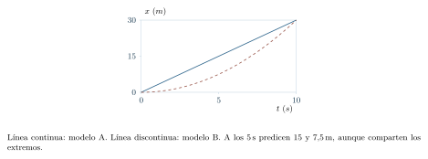

[← Prólogo](prologo.html) · [Índice del libro](index.html) · [Capítulo siguiente →](capitulo-02.html)

La luz del Sol entra por una ventana y alcanza la mesa en la que estamos leyendo. Para llegar hasta ella ha cruzado el espacio entre el Sol y la Tierra. Podemos preguntarnos cuánto ha durado ese viaje y buscar una respuesta con dos datos: la distancia recorrida y la rapidez de la luz. Una escena cotidiana nos ha llevado a un problema cuya escala cuesta imaginar.

Conocemos una relación parecida por los viajes que hacemos en la Tierra. Si un vehículo mantiene su rapidez, recorrer el doble de distancia le exige el doble de tiempo. Esa relación permite calcular una de las tres cantidades cuando conocemos las otras dos. Para aplicarla a la luz elegiremos un primer modelo: propagación a rapidez constante en el vacío, tomando la distancia Sol–Tierra como longitud aproximada del trayecto. Así podremos relacionar una observación cercana con una distancia astronómica.

La cuenta será breve; preparar sus datos merece atención. La distancia puede venir expresada en kilómetros y la rapidez en metros por segundo. Tendremos que hacer compatibles esas unidades y decidir cuántas cifras podemos sostener con la información disponible. También podremos recorrer el razonamiento en sentido inverso: a partir del tiempo de viaje y de la rapidez, estimar la distancia al Sol. Volveremos a ese problema en la sección «Un primer problema astronómico».

Empezaremos por cantidades que podemos medir cerca de nosotros. La longitud de una mesa o la duración de un recorrido permiten aprender a expresar una medida y examinar su alcance. Ese cuidado nos acompañará cuando los objetos se encuentren demasiado lejos para acercarles una regla.

## De la descripción a la explicación

Podemos empezar midiendo la longitud de una mesa con una regla y repetir la medida con una cinta graduada. Para comparar los resultados necesitaremos saber qué extremos se tomaron, qué unidad se empleó y qué detalle permite distinguir cada instrumento. Esas decisiones dan un contenido preciso a la pregunta «¿cuánto mide?». Con el tiempo de un recorrido haremos algo semejante: fijaremos los sucesos de comienzo y de término, y usaremos un reloj para medir la duración entre ambos. Al expresar esas cantidades podremos construir relaciones como la que nos permitirá estudiar el viaje de la luz.

Usaremos potencias de diez para escribir números grandes o pequeños: $10^3=1000$ y $10^{-2}=1/100=0{,}01$. Una escritura como $3\times10^4$ significa $30\,000$; en cambio, $3\times10^{-4}=0{,}0003$. Al multiplicar potencias de la misma base sumamos exponentes: $10^3\times10^{-2}=10^{3-2}=10$. La potencia afecta también a las unidades: $\,\mathrm{cm^2}$ es la unidad de área de un cuadrado de un centímetro de lado, mientras que $\,\mathrm{cm^3}$ mide el volumen de un cubo de ese lado.

Una *magnitud física* es una propiedad a la que podemos asignar valores mediante un procedimiento de medición o una definición operativa adecuada. La longitud, el tiempo, la masa y la temperatura son ejemplos. El resultado de una medida combina un número y una unidad: escribir «la mesa mide 1,2» deja una información esencial sin indicar; escribir $1{,}2\,\mathrm{m}$ tiene significado físico.

Al escoger otra unidad cambia el número que expresa la misma longitud:
$$
1{,}2\,\mathrm{m}=120\,\mathrm{cm}.
$$
Ambas expresiones describen la longitud de la misma mesa. Hemos expresado una misma magnitud de dos maneras.

{#fig-fp-av-ej-1-01 fig-alt="Ilustración de De la descripción a la explicación. Al escoger otra unidad cambia el número que expresa la misma longitud: 1,2\\,m=120\\,cm. Ambas expresiones describen la longitud de la misma mesa. Hemos expresado una misma magnitud de dos maneras."}

Una magnitud *escalar* se describe mediante un valor en una escala y su unidad cuando corresponde; ese valor se conserva al cambiar la orientación de los ejes espaciales. La temperatura en grados Celsius, la carga eléctrica y el trabajo proporcionan ejemplos de valores positivos, cero o negativos según la situación. Los desplazamientos, las velocidades y las fuerzas incorporan además información direccional, que desarrollaremos mediante vectores en el capítulo 2.

## Las unidades revelan la estructura de las relaciones

Trabajaremos principalmente con el Sistema Internacional de Unidades (SI). Tres unidades nos acompañarán desde el comienzo: el metro ($\,\mathrm{m}$), el segundo ($\,\mathrm{s}$) y el kilogramo ($\,\mathrm{kg}$). Otras magnitudes usan combinaciones de estas unidades. Una rapidez, por ejemplo, puede medirse en metros por segundo, $\,\mathrm{m/s}$; una aceleración, en $\,\mathrm{m/s^2}$.

La *dimensión* expresa cómo una magnitud depende de magnitudes básicas, como longitud, masa y tiempo. Para representarla combinamos sus símbolos mediante potencias: una rapidez tiene dimensión $L/T$ y una aceleración, $L/T^2$. La unidad establece la referencia con que expresamos su valor. Una longitud conserva su dimensión $L$ al expresarse en metros o centímetros; un tiempo conserva su dimensión $T$ al expresarse en segundos u horas.

Toda igualdad física entre cantidades de la misma naturaleza debe ser *dimensionalmente homogénea*. Esto significa que ambos lados de una ecuación deben tener la misma dimensión, y que los términos que se suman deben ser compatibles. La suma $3\,\mathrm{m}+4\,\mathrm{s}$ reúne magnitudes de dimensiones distintas y carece de significado como longitud.

La homogeneidad dimensional permite detectar muchos errores; la validez física de una ecuación requiere además examinar el modelo y contrastar sus predicciones. La relación $d=vt$ posee las dimensiones de una distancia; la expresión $d=2vt$ también. La elección entre ellas requiere información física sobre la situación particular. Para eso necesitamos comprender el movimiento.

### Problema resuelto 1.1 · Una rapidez expresada en dos sistemas de unidades {#r1-1}

Un automóvil se desplaza con una rapidez constante de $72\,\mathrm{km/h}$. Expresar esa rapidez en $\,\mathrm{m/s}$ y calcular cuántos metros recorre en $15\,\mathrm{s}$.

*Resolución.* Lo que queremos convertir es una razón entre longitud y tiempo. Un kilómetro equivale a mil metros y una hora a $3600\,\mathrm{s}$. Por tanto,
$$
72\frac{\,\mathrm{km}}{\,\mathrm{h}}
=72\frac{1000\,\mathrm{m}}{3600\,\mathrm{s}}
=20\,\mathrm{m/s}.
$$
Ahora sí podemos multiplicar por un tiempo expresado en segundos:
$$
d=vt=(20\,\mathrm{m/s})(15\,\mathrm{s})=300\,\mathrm{m}.
$$
La unidad segundo se cancela, como debe ocurrir si el resultado es una longitud. Una comprobación mental adicional: a $20\,\mathrm{m/s}$ el automóvil recorre $200\,\mathrm{m}$ en diez segundos y $100\,\mathrm{m}$ en otros cinco. La respuesta $300\,\mathrm{m}$ es coherente.

{#fig-fp-av-r1-1 fig-alt="Ilustración de Problema resuelto 1.1 · Una rapidez expresada en dos sistemas de unidades. Resolución. Lo que queremos convertir es una razón entre longitud y tiempo. Un kilómetro equivale a mil metros y una hora a 3600\\,s. Por tanto, 72frac\\,km\\,h =72frac1000\\,m3600\\,s =20\\,m/s. Ahora sí podemos multiplicar por un tiempo expresado en segundos: d=vt=(20\\,m/s)(15\\,s)=300\\,m. La unidad segundo se cancela,"}

## La medida y su incertidumbre

Medir es comparar una propiedad con un patrón por medio de un procedimiento concreto. Si apoyamos una regla sobre una mesa, necesitamos decidir dónde empieza y termina la longitud, cómo alineamos el instrumento y qué graduación puede distinguirse. La resolución del instrumento y el procedimiento empleado limitan las cifras que podemos informar. Por eso una cifra como $1{,}247391\,\mathrm{m}$ puede atribuir al instrumento una precisión excesiva; $1{,}25\,\mathrm{m}$ puede comunicar mejor el alcance de la medición.

La *resolución* indica el menor incremento que el instrumento distingue o muestra. La *precisión* describe la proximidad de resultados obtenidos al repetir una operación en condiciones especificadas; una colección de valores puede ser muy semejante internamente y estar desplazada respecto de un valor de referencia. La *exactitud* se refiere a cuán próximo está un resultado a un valor de referencia aceptado. Un efecto sistemático puede desplazar los resultados de manera constante o predecible al repetir la medición. El *sesgo* es una estimación del error sistemático, obtenida mediante una comparación apropiada con una referencia. Para juzgar la exactitud de una serie con poca dispersión necesitamos contrastarla con un patrón adecuado.

La incertidumbre expresa el margen de conocimiento asociado a la medición. Es una forma explícita de comunicar qué variación de resultados resulta compatible con los datos y con el método utilizado. Las fuentes de incertidumbre pueden ser la calibración, la lectura, las condiciones ambientales, la variabilidad del objeto y el procedimiento. La mitad de una división de una regla *puede* proporcionar una estimación de lectura bajo condiciones apropiadas; las demás fuentes de incertidumbre requieren una evaluación propia.

### Problema resuelto 1.2 · Precisión de una serie y exactitud de sus resultados {#r1-2}

Dos equipos miden repetidamente una longitud cuyo valor de referencia es $2{,}00\,\mathrm{m}$. El equipo A obtiene $2{,}01$, $2{,}02$ y $2{,}01\,\mathrm{m}$; el B, $2{,}11$, $2{,}12$ y $2{,}11\,\mathrm{m}$. ¿Cuál es más exacto? ¿Se distingue claramente cuál es más preciso solo con estos datos?

*Resolución.* Las tres lecturas del equipo A están mucho más cerca de $2{,}00\,\mathrm{m}$, por lo que sus resultados son más *exactos* respecto de ese valor de referencia. En cambio, la dispersión observable en ambos equipos es la misma: cada serie abarca $0{,}01\,\mathrm{m}$ entre sus extremos. Los datos muestran una precisión repetitiva semejante en ambos grupos. Podría existir un error sistemático en el equipo B. Para identificar la causa de esa diferencia —por ejemplo, una mala calibración o un desplazamiento del cero— necesitamos información adicional sobre el procedimiento.

{#fig-fp-av-r1-4 fig-alt="Ilustración de Problema resuelto 1.2 · Precisión de una serie y exactitud de sus resultados. Resolución. Las tres lecturas del equipo A están mucho más cerca de 2,00\\,m, por lo que sus resultados son más exactos respecto de ese valor de referencia. En cambio, la dispersión observable en ambos equipos es la misma: cada serie abarca 0,01\\,m entre sus extremos. Los datos muestran una precisión repetitiva"}

### Una medición repetida

Mide cinco veces la longitud de un lápiz utilizando una regla graduada en milímetros. Anota todas las lecturas, la resolución del instrumento y la diferencia entre los valores extremos. Compara esa dispersión con la resolución de la regla: ¿qué información aporta cada una? Si las cinco lecturas coinciden, ¿puedes asegurar que la medición es exacta?

## Cómo comunicar el resultado y su incertidumbre

Cuando interpretamos un dato $L=(12{,}34\pm0{,}05)\,\mathrm{cm}$ como un intervalo acotado, estamos comunicando que la longitud se encuentra, según el procedimiento y la interpretación adoptada, entre $12{,}29\,\mathrm{cm}$ y $12{,}39\,\mathrm{cm}$. El símbolo $\pm$ solo es útil si decimos qué representa el margen: una cota instrumental, una desviación estadística, una incertidumbre expandida u otra convención. En este capítulo emplearemos, salvo indicación contraria, *cotas máximas de un intervalo compatible*.

{#fig-fp-av-ej-1-02 fig-alt="Ilustración de Cómo comunicar el resultado y su incertidumbre. Cuando interpretamos un dato L=(12,34pm0,05)\\,cm como un intervalo acotado, estamos comunicando que la longitud se encuentra, según el procedimiento y la interpretación adoptada, entre 12,29\\,cm y 12,39\\,cm. El símbolo pm solo es útil si decimos qué representa el margen: una cota instrumental, una desviación"}

La escritura $L\in[a,b]$ abrevia $a\leq L\leq b$: ambos extremos están incluidos. En $d/t$, mantener $t>0$ y aumentar $d$ aumenta el resultado; mantener $d>0$ y aumentar $t$ lo disminuye. Por ejemplo, recorrer la misma distancia en más tiempo reduce la rapidez media. Esta comparación explica qué extremos debemos elegir para construir las cotas del cociente.

Para sumar dos longitudes positivas con cotas $L_1\in[a_1,b_1]$ y $L_2\in[a_2,b_2]$, el total estará entre $a_1+a_2$ y $b_1+b_2$. Si los extremos tienen el mismo origen sistemático, debemos conservar esa contribución común al evaluar los márgenes. Para dividir longitudes o tiempos *positivos* acotados, obtenemos cotas seguras tomando los extremos que hacen mínimo y máximo el cociente. En problemas de mayor nivel aprenderemos otros tratamientos estadísticos, que requieren hipótesis adicionales.

### Problema resuelto 1.3 · Una rapidez media con datos acotados {#r1-3}

Un corredor recorre una distancia entre $9{,}9\,\mathrm{m}$ y $10{,}1\,\mathrm{m}$ en un tiempo entre $1{,}9\,\mathrm{s}$ y $2{,}1\,\mathrm{s}$. Encontrar la rapidez media central y un intervalo conservador compatible con estos datos.

*Resolución.* El modelo central, usando $10{,}0\,\mathrm{m}$ y $2{,}0\,\mathrm{s}$, da $5{,}0\,\mathrm{m/s}$. Como las cantidades son positivas, el cociente más pequeño se produce con la menor distancia y el mayor tiempo, mientras que el máximo procede del extremo opuesto:
$$
\frac{9{,}9\,\mathrm{m}}{2{,}1\,\mathrm{s}}\leq v_{\mathrm{media}}\leq
\frac{10{,}1\,\mathrm{m}}{1{,}9\,\mathrm{s}},
\qquad
4{,}71\,\mathrm{m/s}\lesssim v_{\mathrm{media}}\lesssim5{,}32\,\mathrm{m/s}.
$$
Informar $v=5{,}000000\,\mathrm{m/s}$ atribuiría a la medición más cifras de las que respalda el procedimiento. Asignar una probabilidad al intervalo requeriría además una distribución estadística. La incertidumbre pertenece a nuestra información sobre la rapidez media, cuya definición física permanece fija.

{#fig-fp-av-r1-5 fig-alt="Ilustración de Problema resuelto 1.3 · Una rapidez media con datos acotados. Resolución. El modelo central, usando 10,0\\,m y 2,0\\,s, da 5,0\\,m/s. Como las cantidades son positivas, el cociente más pequeño se produce con la menor distancia y el mayor tiempo, mientras que el máximo procede del extremo opuesto: frac9,9\\,m2,1\\,sleq vmedialeq frac10,1\\,m1,9\\,s, qquad 4,71\\,m/slesssim"}

Una regla práctica de comunicación consiste en redondear primero la incertidumbre a una o dos cifras significativas según el caso y presentar el valor central en la misma posición decimal. Así, si una evaluación justificó $12{,}34\pm0{,}05\,\mathrm{cm}$, esos dos números se leen juntos. Los ceros finales pueden transmitir resolución: $2{,}50\,\mathrm{m}$ puede comunicar una resolución distinta de $2{,}5\,\mathrm{m}$. Conservamos las cifras que sustenta el procedimiento.

### Problema resuelto 1.4 · Densidad estimada y límites de dos mediciones {#r1-4}

La masa de una muestra homogénea se informa como $(20{,}0\pm0{,}2)\,\mathrm{g}$ y su volumen como $(8{,}0\pm0{,}1)\,\mathrm{cm^3}$, interpretando los márgenes como cotas. Estimar la densidad y dar un intervalo de valores compatibles.

*Resolución.* La densidad central es $\rho=m/V=2{,}50\,\mathrm{g/cm^3}$. Como $m$ y $V$ son positivos, sus extremos proporcionan
$$
\frac{19{,}8\,\mathrm{g}}{8{,}1\,\mathrm{cm^3}}\leq\rho\leq
\frac{20{,}2\,\mathrm{g}}{7{,}9\,\mathrm{cm^3}},
\qquad
2{,}44\,\mathrm{g/cm^3}\lesssim\rho\lesssim2{,}56\,\mathrm{g/cm^3}.
$$
El resultado central $2{,}50\,\mathrm{g/cm^3}$ puede acompañarse de estos límites. Si deseamos un solo margen simétrico conservador, $\rho\approx(2{,}50\pm0{,}06)\,\mathrm{g/cm^3}$ resume el intervalo con el redondeo indicado. Estas cotas proceden de los extremos compatibles; calcular una desviación estándar o emplear una propagación estadística requeriría otras hipótesis.

{#fig-fp-av-r1-6 fig-alt="Ilustración de Problema resuelto 1.4 · Densidad estimada y límites de dos mediciones. Resolución. La densidad central es rho=m/V=2,50\\,g/cm^3. Como m y V son positivos, sus extremos proporcionan frac19,8\\,g8,1\\,cm^3leqrholeq frac20,2\\,g7,9\\,cm^3, qquad 2,44\\,g/cm^3lesssimrholesssim2,56\\,g/cm^3. El resultado central 2,50\\,g/cm^3 puede acompañarse de estos límites. Si deseamos un solo margen simétrico"}

## Medir exige también saber cuándo falta información

En una recta elegimos un origen y un sentido positivo. El *desplazamiento* es la posición final menos la inicial; la *velocidad media* es ese desplazamiento dividido por el tiempo transcurrido. La *rapidez media* relaciona la longitud del recorrido completo con el mismo tiempo. Si conocemos las posiciones inicial y final de un automóvil y la duración del viaje, podemos calcular su velocidad media; para reconstruir las posiciones intermedias necesitamos más información. Dos evoluciones muy distintas pueden tener los mismos extremos. Reconocer una *pregunta subdeterminada* consiste en identificar qué datos faltan para decidir entre las respuestas compatibles.

### Problema resuelto 1.5 · Movimientos distintos entre los mismos extremos {#r1-5}

Se observa un vehículo en $x=0$ cuando $t=0$ y en $x=30\,\mathrm{m}$ cuando $t=10\,\mathrm{s}$. ¿Podemos asegurar que viajó siempre a $3\,\mathrm{m/s}$?

*Resolución.* Sabemos que la velocidad media fue $30\,\mathrm{m}/10\,\mathrm{s}=3\,\mathrm{m/s}$, pero son compatibles, por ejemplo, dos modelos distintos:
$$
x_A(t)=(3\,\mathrm{m/s})t,\qquad
x_B(t)=(0{,}3\,\mathrm{m/s^2})t^2,\quad 0\leq t\leq10\,\mathrm{s}.
$$
Ambos comienzan en $0$ y terminan en $30\,\mathrm{m}$. En el primero la velocidad es constante; en el segundo aumenta con el tiempo. Una medición adicional en un instante intermedio permitiría distinguir estos modelos concretos, pero ni siquiera un número finito de posiciones determina, sin hipótesis suplementarias, una función de movimiento única para todos los instantes.

{#fig-fp-av-r1-7 fig-alt="Ilustración de Problema resuelto 1.5 · Movimientos distintos entre los mismos extremos. Resolución. Sabemos que la velocidad media fue 30\\,m/10\\,s=3\\,m/s, pero son compatibles, por ejemplo, dos modelos distintos: xA(t)=(3\\,m/s)t,qquad xB(t)=(0,3\\,m/s^2)t^2,quad 0leq tleq10\\,s. Ambos comienzan en 0 y terminan en 30\\,m. En el primero la velocidad es constante; en el segundo aumenta con el tiempo. Una"}

Una estimación de Fermi descompone una cantidad difícil de medir en factores sencillos y declara los supuestos que permiten estimar su escala. Con pocas mediciones podemos obtener así una orientación cuantitativa y reconocer qué datos mejorarían la respuesta.

### Problema resuelto 1.6 · Una estimación de Fermi: latidos a lo largo de una vida {#r1-6}

Estimar cuántos latidos realiza un corazón humano durante una vida de $80$ años, suponiendo a efectos de la estimación una frecuencia media de $70$ latidos por minuto. El resultado será una estimación de escala basada en los supuestos elegidos.

*Resolución.* Multiplicamos factores correspondientes al mismo período:
$$
\begin{aligned}
N&\approx70\frac{\text{latidos}}{\,\mathrm{min}}\,
60\frac{\,\mathrm{min}}{\,\mathrm{h}}\,
24\frac{\,\mathrm{h}}{\text{día}}\\
&\quad\times365\frac{\text{días}}{\text{año}}\,
80\text{ años}\approx2{,}9\times10^{9}\text{ latidos}.
\end{aligned}
$$
La estimación vale del orden de unos pocos miles de millones. La estimación mantiene fijos los factores elegidos y deja fuera variaciones diarias, edad, salud y cambios vitales; muestra cómo abordar una pregunta de escala enorme descomponiéndola en factores comprensibles.

{#fig-fp-av-r1-8 fig-alt="Ilustración de Problema resuelto 1.6 · Una estimación de Fermi: latidos a lo largo de una vida. Resolución. Multiplicamos factores correspondientes al mismo período: beginaligned N&approx70fraclatidos\\,min\\, 60frac\\,min\\,h\\, 24frac\\,hdía\\\\ &quadtimes365fracdíasaño\\, 80 añosapprox2,9times10^9 latidos. endaligned La estimación vale del orden de unos pocos miles de millones. La estimación mantiene fijos los"}

## Elegir un modelo es elegir qué importa

Los objetos reales tienen extensión, el aire ejerce resistencia y las superficies suelen presentar rozamiento. Si intentáramos describir todos esos factores desde el primer minuto, ni siquiera podríamos analizar el trayecto de una pelota lanzada hacia arriba. La física avanza mediante *modelos*: representaciones deliberadamente parciales de la realidad que conservan los rasgos relevantes para una pregunta.

Podemos estudiar la trayectoria de una pelota como si toda su masa estuviera concentrada en un punto. Esa idealización permite concentrarnos en la posición de la pelota cuando su forma y tamaño tienen una influencia despreciable en la pregunta elegida. Al estudiar cómo gira la misma pelota, su forma y distribución de masa adquieren importancia.

De modo semejante, cuando suponemos que un cuerpo se mueve con rapidez constante, estamos afirmando algo sobre la situación analizada. Si la rapidez varía, el uso de $d=vt$ requiere que $v$ sea la rapidez media apropiada al intervalo. Más adelante distinguiremos rapidez instantánea, rapidez media y movimiento con aceleración.

La calidad de un modelo se aprecia en la precisión con que responde la pregunta planteada dentro de un dominio de validez identificable. Un modelo simple puede proporcionar una estimación útil cuando sus supuestos permiten evaluar también el margen de esa respuesta.

## Estimar antes de calcular

Una estimación proporciona una primera orientación y evita que aceptemos como razonable cualquier cifra producida por una calculadora. Supongamos que una persona camina $4\,\mathrm{km}$ con una rapidez próxima a $1{,}2\,\mathrm{m/s}$. Sin efectuar todavía una división precisa, sabemos que cuatro kilómetros son cuatro mil metros y que avanzar poco más de un metro por segundo requerirá cerca de una hora.

El cálculo confirma esa intuición:
$$
t\approx\frac{4000\,\mathrm{m}}{1{,}2\,\mathrm{m/s}}
\approx3333\,\mathrm{s}\approx56\,\mathrm{min}.
$$
Si hubiéramos obtenido $56\,\mathrm{s}$ o $56\,\mathrm{h}$, deberíamos sospechar inmediatamente una conversión incorrecta.

{#fig-fp-av-ej-1-03 fig-alt="Ilustración de Estimar antes de calcular. El cálculo confirma esa intuición: tapproxfrac4000\\,m1,2\\,m/s approx3333\\,sapprox56\\,min. Si hubiéramos obtenido 56\\,s o 56\\,h, deberíamos sospechar inmediatamente una conversión incorrecta."}

Las estimaciones también permiten decidir qué datos necesitan medirse con precisión. Si solo pretendemos saber si una caminata durará media hora o toda una tarde, probablemente basta un modelo de rapidez aproximadamente constante. Si queremos programar la llegada de una nave espacial, harán falta hipótesis y datos más específicos.

## Un primer problema astronómico

Volvamos a la luz que llegaba a nuestra ventana. Su tiempo de viaje nos permite estimar la distancia que recorrió: en el problema siguiente tomaremos ese tiempo como dato y lo combinaremos con la rapidez de propagación. La misma relación permite hacer el cálculo inverso si conocemos la distancia. Además, la luz recibida trae información del momento en que fue emitida; al observar objetos lejanos accedemos a etapas anteriores de su historia.

### Problema resuelto 1.7 · La distancia al Sol a partir del tiempo de viaje de la luz {#r1-7}

Supongamos que la luz tarda aproximadamente $8\,\mathrm{min}\,20\,\mathrm{s}$ en viajar desde el Sol hasta la Tierra. Usando $c\approx3{,}00\times10^8\,\mathrm{m/s}$ para la rapidez de la luz en el vacío, estimar la distancia recorrida.

*Resolución.* Convertimos primero el tiempo a una sola unidad:
$$
t=8(60\,\mathrm{s})+20\,\mathrm{s}=500\,\mathrm{s}.
$$
En el modelo de propagación a rapidez constante, la distancia es el producto de rapidez por tiempo:
$$
\begin{aligned}
d&=ct\\
&=(3{,}00\times10^8\,\mathrm{m/s})(500\,\mathrm{s})\\
&=1{,}50\times10^{11}\,\mathrm{m}\\
&=1{,}50\times10^8\,\mathrm{km}.
\end{aligned}
$$
El valor corresponde a unos $150$ millones de kilómetros. El tiempo suministrado es aproximado; conviene expresar la distancia con una cantidad de cifras acorde con ese dato.

*Control.* Una señal capaz de recorrer $300\,000\,\mathrm{km}$ en un segundo debe recorrer unos $150$ millones de kilómetros en quinientos segundos: el orden de magnitud es correcto. Además, la distancia Sol--Tierra varía durante el año; nuestra estimación corresponde al tiempo de viaje suministrado.

{#fig-fp-av-r1-2 fig-alt="Ilustración de Problema resuelto 1.7 · La distancia al Sol a partir del tiempo de viaje de la luz. Control. Una señal capaz de recorrer 300\\,000\\,km en un segundo debe recorrer unos 150 millones de kilómetros en quinientos segundos: el orden de magnitud es correcto. Además, la distancia Sol--Tierra varía durante el año; nuestra estimación corresponde al tiempo de viaje suministrado."}

## Los gráficos también son relaciones matemáticas

Un gráfico bien construido permite ver regularidades que una tabla puede ocultar. Imaginemos una sustancia homogénea de densidad aproximadamente constante. Si disponemos de varias muestras, esperamos que su masa crezca con el volumen. En una representación de masa $m$ frente a volumen $V$, los puntos aparecerán aproximadamente sobre una recta que pasa por el origen, con ecuación
$$
m=\rho V,
$$
donde $\rho$ es la densidad del material.

{#fig-fp-fig-c01-01 fig-alt="Ilustración de Los gráficos también son relaciones matemáticas. Un gráfico bien construido permite ver regularidades que una tabla puede ocultar. Imaginemos una sustancia homogénea de densidad aproximadamente constante. Si disponemos de varias muestras, esperamos que su masa crezca con el volumen. En una representación de masa m frente a volumen V, los puntos aparecerán"}

### Problema resuelto 1.8 · Obtener una propiedad física de un gráfico {#r1-8}

En un experimento idealizado, una muestra de volumen $2\,\mathrm{cm^3}$ tiene masa $18\,\mathrm{g}$, mientras que otra de volumen $6\,\mathrm{cm^3}$ tiene masa $54\,\mathrm{g}$. Suponiendo densidad constante, determinar la densidad en $\,\mathrm{g/cm^3}$ y $\,\mathrm{kg/m^3}$.

*Resolución.* Como la relación entre masa y volumen es proporcional, el cociente es constante:
$$
\rho=\frac{m}{V}=\frac{18\,\mathrm{g}}{2\,\mathrm{cm^3}}=9\,\mathrm{g/cm^3}.
$$
Comprobamos la otra pareja: $54/6=9$, de modo que los datos son consistentes con nuestro modelo. Para cambiar de unidades debemos convertir también el denominador:
$$
1\,\mathrm{g/cm^3}=\frac{10^{-3}\,\mathrm{kg}}{(10^{-2}\,\mathrm{m})^3}=10^3\,\mathrm{kg/m^3}.
$$
Por consiguiente, $\rho=9\times10^3\,\mathrm{kg/m^3}$. El resultado describe el modelo de las muestras; identificar el material requiere información adicional.

{#fig-fp-av-r1-3 fig-alt="Ilustración de Problema resuelto 1.8 · Obtener una propiedad física de un gráfico. Resolución. Como la relación entre masa y volumen es proporcional, el cociente es constante: rho=fracmV=frac18\\,g2\\,cm^3=9\\,g/cm^3. Comprobamos la otra pareja: 54/6=9, de modo que los datos son consistentes con nuestro modelo. Para cambiar de unidades debemos convertir también el denominador:"}

## El análisis dimensional puede sugerir una ley

A veces podemos deducir la forma de una relación antes de conocer toda la física que la explica. Consideremos el período $P$ de un péndulo simple y supongamos que, para oscilaciones pequeñas y en un modelo ideal, depende de la longitud $\ell$ y de la aceleración de la gravedad $g$. Intentemos una relación de potencias:
$$
P=C\ell^{\alpha}g^{\beta},
$$
donde $C$ es una constante sin dimensiones. La dimensión de la izquierda es $T$. A la derecha tenemos
$$
[\ell^{\alpha}g^{\beta}]=L^{\alpha}(LT^{-2})^{\beta}
=L^{\alpha+\beta}T^{-2\beta}.
$$
Los exponentes indican cuántas veces aparece cada dimensión. A la izquierda, $T=L^0T^1$: no aparece longitud y el tiempo tiene exponente uno. Para que ambos miembros coincidan, los exponentes de cada dimensión deben coincidir por separado. Igualar las potencias correspondientes de $L$ y $T$ exige
$$
\alpha+\beta=0,\qquad -2\beta=1.
$$
De $-2\beta=1$ obtenemos $\beta=-\tfrac12$; sustituir en $\alpha+\beta=0$ da $\alpha=\tfrac12$. Para cantidades positivas, una potencia de exponente $1/2$ representa una raíz cuadrada: $\ell^{1/2}g^{-1/2}=\sqrt\ell/\sqrt g=\sqrt{\ell/g}$. La expresión compatible con esas dimensiones es
$$
\boxed{P=C\sqrt{\frac{\ell}{g}}.}
$$

La determinación de $C$ y la selección de todas las variables relevantes requieren información física adicional. Para un péndulo simple ideal en la aproximación de pequeña amplitud, un análisis dinámico más completo da $C=2\pi$. Para oscilaciones grandes, el período también depende de la amplitud angular. El análisis dimensional propone una forma que una teoría física puede fundamentar y precisar.

{#fig-fp-av-ej-1-04 fig-alt="Ilustración de El análisis dimensional puede sugerir una ley. La determinación de C y la selección de todas las variables relevantes requieren información física adicional. Para un péndulo simple ideal en la aproximación de pequeña amplitud, un análisis dinámico más completo da C=2pi. Para oscilaciones grandes, el período también depende de la amplitud angular. El análisis"}

## Qué hacer cuando una respuesta parece correcta

Una vez completado un cálculo, conviene formular al menos tres preguntas: ¿la unidad corresponde a la magnitud que me pidieron? ¿el orden de magnitud resulta razonable? ¿respeté las hipótesis del modelo? Si estamos calculando una masa y el resultado termina expresado en $\,\mathrm{m/s}$, hay un error que puede reconocerse sin repetir ninguna operación. Si la distancia a una estrella resulta menor que la longitud de una sala, probablemente confundimos las unidades. Aplicar una fórmula de rapidez constante a un cuerpo que acelera exige justificar el valor de rapidez elegido, aunque el cálculo algebraico esté bien realizado.

En el péndulo, las dimensiones fijaron la dependencia $\sqrt{\ell/g}$; el modelo de pequeña amplitud aportó el factor $2\pi$ y delimitó cuándo utilizarlo. Unidades, estimación y supuestos intervienen juntos en la interpretación de esa respuesta.

## Ejercicios de práctica

Los problemas siguientes deben intentarse antes de consultar sus soluciones. Cada uno propone un razonamiento específico que da sentido al uso de las fórmulas.

### Ejercicio 1.1 · Una señal entre la Tierra y la Luna {#e1-1}

La distancia aproximada a la Luna es $384\,400\,\mathrm{km}$. Si una señal de radio viaja aproximadamente a $300\,000\,\mathrm{km/s}$, ¿cuánto tarda en llegar? Indica si has calculado el viaje de ida o de ida y vuelta.

### Ejercicio 1.2 · Conversión de magnitudes diferentes {#e1-2}

Convierte $54\,\mathrm{km/h}$ a $\,\mathrm{m/s}$ y $3\,\mathrm{cm^2}$ a $\,\mathrm{m^2}$. Explica por qué en el segundo caso el factor de escala aparece elevado al cuadrado.

### Ejercicio 1.3 · Una ecuación sospechosa {#e1-3}

Para estimar el tiempo de caída desde una altura $h$ bajo una aceleración de magnitud $g$, alguien propone $t=2h/g$. Otra persona propone $t=\sqrt{2h/g}$. Determina cuál expresión tiene las unidades correctas de tiempo. ¿Basta esa comprobación para demostrar que describe la caída?

### Ejercicio 1.4 · El alcance de una medición {#e1-4}

Una persona recorre una distancia estimada de $(5{,}0\pm0{,}1)\,\mathrm{m}$ en un tiempo de $(4{,}0\pm0{,}1)\,\mathrm{s}$. Calcula la rapidez media central y, interpretando los intervalos indicados como cotas compatibles sin suponer ninguna distribución estadística, encuentra una cota inferior y otra superior usando los valores extremos compatibles con la información.

### Ejercicio 1.5 · De la tabla a una propiedad {#e1-5}

Dos muestras de un material homogéneo tienen los pares de valores $(V,m)=(3\,\mathrm{cm^3},21\,\mathrm{g})$ y $(7\,\mathrm{cm^3},49\,\mathrm{g})$. Calcula la densidad y expresa el resultado en el SI. ¿Qué tendría que pasar con la masa si el volumen se duplicara y la densidad permaneciera constante?

### Ejercicio 1.6 · Una predicción antes del experimento {#e1-6}

En el modelo de péndulo de pequeña amplitud, ¿cómo cambia el período si se cuadruplica la longitud mientras $g$ permanece constante? Explica por qué la respuesta no requiere conocer el valor numérico de la constante $C$.

### Ejercicio 1.7 · La resolución de una regla {#e1-7}

Una regla cuyas divisiones están separadas por $1\,\mathrm{mm}$ se utiliza para leer una longitud de $127\,\mathrm{mm}$. Bajo el supuesto explícito de que el error de redondeo es como máximo media división y no hay errores adicionales, indica el intervalo compatible en milímetros y en metros. ¿Es una incertidumbre universal para toda regla?

### Ejercicio 1.8 · Otra densidad con cotas {#e1-8}

Una masa está entre $49$ y $51\,\mathrm{g}$ y el volumen entre $19$ y $21\,\mathrm{cm^3}$. Calcula la densidad central, el mínimo y el máximo compatibles. Identifica qué hipótesis has utilizado.

### Ejercicio 1.9 · Precisión frente a exactitud {#e1-9}

Un patrón tiene valor $10{,}0\,\mathrm{cm}$. El grupo A obtiene $9{,}8$, $9{,}8$ y $9{,}8\,\mathrm{cm}$; el B obtiene $9{,}9$, $10{,}0$ y $10{,}1\,\mathrm{cm}$. Explica qué grupo tiene menor dispersión y cuál tiene resultados más próximos al patrón en promedio.

### Ejercicio 1.10 · Una escala enorme {#e1-10}

Un haz tarda aproximadamente $2\times10^{-8}\,\mathrm{s}$ en cruzar un dispositivo a velocidad $3\times10^8\,\mathrm{m/s}$. Estima su longitud y explica la cantidad de cifras que tiene sentido conservar.

### Ejercicio 1.11 · La misma velocidad media; velocidades distintas {#e1-11}

Entre $t=0$ y $t=4\,\mathrm{s}$ se proponen $x_1(t)=(2\,\mathrm{m/s})t$ y $x_2(t)=(0{,}5\,\mathrm{m/s^2})t^2$. Verifica que ambas posiciones coinciden al comienzo y al final. Determina la velocidad media en cada caso y compara los desplazamientos del último segundo. ¿Por qué los dos datos extremos no permiten afirmar que ambos movimientos fueron iguales? La velocidad instantánea se estudiará en el capítulo 3.

### Ejercicio 1.12 · Alcance del análisis dimensional {#e1-12}

Suponiendo un período $P$ que depende solo de una longitud $\ell$, una masa $m$ y una aceleración $g$, busca los exponentes en $P=Cm^{\alpha}\ell^{\beta}g^{\gamma}$ utilizando dimensiones de masa, longitud y tiempo. ¿Qué información sobre $C$ permanece indeterminada?

### Ejercicio 1.13 · Pendiente e intercepto de una medición {#e1-13}

Una muestra ocupa volúmenes $V=(0,10,20,30)\,\mathrm{cm^3}$ y las lecturas correspondientes de masa son $m=(5,25,45,65)\,\mathrm{g}$. La lectura incluye un recipiente vacío. Representa los datos con volumen en el eje horizontal y lectura de masa en el vertical. Obtén el aumento de masa por unidad de volumen, identifica la masa del recipiente y calcula la masa de la muestra para $V=15\,\mathrm{cm^3}$. Explica qué representa $m/V$ en estos registros.

### Ejercicio 1.14 · Estimar una demanda de agua {#e1-14}

Un curso reúne 30 estudiantes durante 200 jornadas. Para una primera planificación se adopta un consumo de bebida de $0{,}5$ a $1{,}0\,\mathrm{L}$ por estudiante y jornada. Estima el consumo anual del curso, expresa el intervalo en $\,\mathrm{m^3}$ e identifica dos datos que permitirían revisar la estimación. Los consumos son supuestos de este ejercicio.

## Soluciones completas

### Solución 1.1 {#sol-e1-1}
 La propagación se aproxima por $d=ct$, de donde $t=d/c$. Con las mismas unidades de longitud en numerador y denominador:
$$
t=\frac{384\,400\,\mathrm{km}}{300\,000\,\mathrm{km/s}}\approx1{,}28\,\mathrm{s}.
$$
Es el tiempo de *ida*. Si la señal se reflejara de inmediato y regresara por el mismo trayecto, la duración aproximada sería $2t\approx2{,}56\,\mathrm{s}$. La distancia varía durante la órbita de la Luna, por lo que el cálculo es aproximado.

### Solución 1.2 {#sol-e1-2}
 Para la rapidez,
$$
54\,\mathrm{km/h}=54\frac{1000\,\mathrm{m}}{3600\,\mathrm{s}}=15\,\mathrm{m/s}.
$$
Para un área,
$$
3\,\mathrm{cm^2}=3(10^{-2}\,\mathrm{m})^2=3\times10^{-4}\,\mathrm{m^2}.
$$
Un centímetro es la centésima parte de un metro, pero un centímetro cuadrado es la diezmilésima parte de un metro cuadrado.

### Solución 1.3 {#sol-e1-3}
 El cociente $h/g$ tiene dimensión $L/(LT^{-2})=T^2$. Por consiguiente, $2h/g$ tiene dimensión $T^2$ y no puede representar directamente un tiempo. En cambio, $\sqrt{2h/g}$ tiene dimensión $T$. Esta segunda expresión supera el control dimensional; su fundamentación requiere una ley física y las hipótesis pertinentes. La fórmula se deduce para un cuerpo soltado desde el reposo que cae verticalmente con aceleración constante de magnitud $g$, despreciando la resistencia del aire y fijando la altura inicial $h$.

### Solución 1.4 {#sol-e1-4}
 El valor central es
$$
\bar v=\frac{5{,}0\,\mathrm{m}}{4{,}0\,\mathrm{s}}=1{,}25\,\mathrm{m/s}.
$$
El cociente será menor con el menor numerador y el mayor denominador, y mayor con el mayor numerador y menor denominador:
$$
\frac{4{,}9}{4{,}1}\,\mathrm{m/s}\leq \bar v\leq\frac{5{,}1}{3{,}9}\,\mathrm{m/s}.
$$
Redondeando las cotas hacia fuera para no estrechar el intervalo, obtenemos $[1{,}19,1{,}31]\,\mathrm{m/s}$. Son cotas derivadas directamente de los márgenes especificados, con una interpretación de intervalo compatible.

### Solución 1.5 {#sol-e1-5}
 Ambos pares proporcionan la misma razón: $21/3=49/7=7\,\mathrm{g/cm^3}$. Como $1\,\mathrm{g/cm^3}=1000\,\mathrm{kg/m^3}$, la densidad es $7000\,\mathrm{kg/m^3}$. Si $m=\rho V$ con $\rho$ constante, duplicar $V$ duplica $m$; el resultado depende precisamente de esa hipótesis.

### Solución 1.6 {#sol-e1-6}
 De $P=C\sqrt{\ell/g}$ se sigue que
$$
P'=C\sqrt{\frac{4\ell}{g}}=2C\sqrt{\frac{\ell}{g}}=2P.
$$
El período se duplica. No es necesario determinar $C$ porque aparece del mismo modo en ambos cocientes; basta mantener el mismo modelo de pequeñas oscilaciones.

### Solución 1.7 {#sol-e1-7}
 Con la hipótesis indicada, $L\in[126{,}5,127{,}5]\,\mathrm{mm}$. Como $1\,\mathrm{mm}=10^{-3}\,\mathrm{m}$, los extremos en SI son $0{,}1265\,\mathrm{m}$ y $0{,}1275\,\mathrm{m}$. El resultado describe únicamente el redondeo bajo las hipótesis indicadas; la mala alineación, calibración o deformación requieren contribuciones adicionales.

### Solución 1.8 {#sol-e1-8}
 Con los puntos medios, $\rho_c=50/20=2{,}50\,\mathrm{g/cm^3}$. Al considerar todos los valores positivos de los intervalos, $\rho_{\min}=49/21\approx2{,}33\,\mathrm{g/cm^3}$ y $\rho_{\max}=51/19\approx2{,}6842\,\mathrm{g/cm^3}$. Un intervalo conservador redondeado a centésimas es $[2{,}33,2{,}69]\,\mathrm{g/cm^3}$. Se emplea el modelo $\rho=m/V$ con masa y volumen positivos y cotas que pueden coexistir; el cálculo utiliza directamente los extremos compatibles.

### Solución 1.9 {#sol-e1-9}
 El grupo A tiene dispersión observada nula, pero sus valores se apartan del patrón en $0{,}2\,\mathrm{cm}$. El promedio de B es $10{,}0\,\mathrm{cm}$, igual al patrón; el rango de B mide $0{,}2\,\mathrm{cm}$. Así, A muestra mejor repetibilidad en esta muestra, mientras que B tiene promedio más exacto respecto de la referencia. La dispersión nula describe la repetibilidad de la serie; evaluar el error sistemático exige un contraste con un patrón.

### Solución 1.10 {#sol-e1-10}
 Con un modelo de rapidez constante, $d=ct=(3\times10^8\,\mathrm{m/s})(2\times10^{-8}\,\mathrm{s})\approx6\,\mathrm{m}$. Como los datos se proporcionan con una sola cifra significativa, informar muchos decimales carecería de justificación. Se trata de una estimación de escala sustentada en los supuestos declarados.

### Solución 1.11 {#sol-e1-11}
 Para ambas funciones $x(0)=0$ y $x(4\,\mathrm{s})=8\,\mathrm{m}$, por lo que sus velocidades medias en el intervalo completo son $2\,\mathrm{m/s}$. En $t=3\,\mathrm{s}$, sin embargo, $x_1=6\,\mathrm{m}$ y $x_2=4{,}5\,\mathrm{m}$. Durante el último segundo los desplazamientos son, respectivamente, $2\,\mathrm{m}$ y $3{,}5\,\mathrm{m}$, y sus velocidades medias en ese tramo son $2$ y $3{,}5\,\mathrm{m/s}$. Los mismos extremos del intervalo completo admiten movimientos intermedios distintos. En el capítulo 3 calcularemos, además, las velocidades instantáneas finales: $2$ y $4\,\mathrm{m/s}$.

### Solución 1.12 {#sol-e1-12}
 Usamos $[m]=M$, $[\ell]=L$, $[g]=LT^{-2}$ y $[P]=T$. La expresión propuesta tiene dimensión $M^\alpha L^{\beta+\gamma}T^{-2\gamma}$, por lo que $\alpha=0$, $\beta+\gamma=0$ y $-2\gamma=1$. De aquí $\gamma=-1/2$ y $\beta=1/2$. Obtenemos $P=C\sqrt{\ell/g}$; hallar la constante adimensional $C$ y validar las variables escogidas requiere una descripción física adicional. Para un péndulo simple de pequeña amplitud se encuentra $C=2\pi$ mediante un modelo dinámico.

### Solución 1.13 {#sol-e1-13}
 La pendiente es $\Delta m/\Delta V=20/10=2\,\mathrm{g/cm^3}=2000\,\mathrm{kg/m^3}$. La recta de lecturas es $m=5\,\mathrm{g}+(2\,\mathrm{g/cm^3})V$. El recipiente aporta $5\,\mathrm{g}$; a $V=15\,\mathrm{cm^3}$ la muestra tiene $30\,\mathrm{g}$ y la lectura conjunta sería $35\,\mathrm{g}$. El cociente $m/V$ incluye la contribución del recipiente y varía con $V$; en $V=0$ esa razón queda fuera de su dominio. La densidad de la muestra se obtiene de la pendiente bajo el modelo lineal y tras separar el recipiente.

{#fig-fp-av-e1-13 fig-alt="Ilustración de Solución 1.13. Un curso reúne 30 estudiantes durante 200 jornadas. Para una primera planificación se adopta un consumo de bebida de 0,5 a 1,0\\,L por estudiante y jornada. Estima el consumo anual del curso, expresa el intervalo en \\,m^3 e identifica dos datos que permitirían revisar la estimación. Los consumos son supuestos de este"}

La pendiente es $\Delta m/\Delta V=20/10=2\,\mathrm{g/cm^3}=2000\,\mathrm{kg/m^3}$. La recta de lecturas es $m=5\,\mathrm{g}+(2\,\mathrm{g/cm^3})V$. El recipiente aporta $5\,\mathrm{g}$; a $V=15\,\mathrm{cm^3}$ la muestra tiene $30\,\mathrm{g}$ y la lectura conjunta sería $35\,\mathrm{g}$. El cociente $m/V$ incluye la contribución del recipiente y varía con $V$; en $V=0$ esa razón queda fuera de su dominio. La densidad de la muestra se obtiene de la pendiente bajo el modelo lineal y tras separar el recipiente.

### Solución 1.14 {#sol-e1-14}

Hay $30(200)=6000$ estudiante-jornadas. El intervalo es $[3000,6000]\,\mathrm{L}=[3,6]\,\mathrm{m^3}$, con $4{,}5\,\mathrm{m^3}$ al usar el punto medio del supuesto de consumo. La asistencia efectiva y un registro de consumo permiten ajustar la estimación. El resultado corresponde al agua bebida; las demás actividades requieren partidas propias.

## Diagnóstico de salida: antes de estudiar álgebra y vectores

Para avanzar con seguridad, explica por escrito la diferencia entre magnitud, unidad y dimensión; reconoce en qué condiciones una estimación es aceptable; distingue exactitud y precisión; y aprende a identificar cuándo una respuesta exige datos que no conocemos. Las cuestiones 1.3, 1.4, 1.7, 1.9 y 1.11 permiten comprobar estas capacidades.

**Tres controles de transferencia.**

1. Convierte $2{,}5\,\mathrm{g/cm^3}$ al SI y explica el factor usado.
2. Para una distancia $[4{,}8,5{,}2]\,\mathrm{m}$ y un tiempo $[1{,}9,2{,}1]\,\mathrm{s}$, encuentra un intervalo conservador de rapidez media, redondeado a centésimas.
3. Si dos movimientos comparten posiciones inicial y final, ¿queda fijada la distancia recorrida? Justifica con un recorrido posible.

**Contraste después del intento.** (1) $2500\,\mathrm{kg/m^3}$: al dividir el factor $10^{-3}$ de masa por $10^{-6}$ de volumen queda $10^3$. (2) Los extremos exactos son $4{,}8/2{,}1$ y $5{,}2/1{,}9$ en $\,\mathrm{m/s}$; redondeando hacia fuera, $[2{,}28,2{,}74]\,\mathrm{m/s}$. (3) Un recorrido directo y otro que incluya una ida y vuelta adicional pueden compartir extremos y tener longitudes diferentes.
**Criterio para avanzar.** Explica las hipótesis, elige un modelo y revisa las unidades y los órdenes de magnitud de tus resultados. Si falla la conversión, vuelve al problema 1.8; si fallan las cotas, al problema 1.3; si confundes los extremos con la historia completa, al ejercicio 1.11. Repite luego el control con otros datos y explica por qué tu método sigue funcionando.

---

[← Prólogo](prologo.html) · [Índice del libro](index.html) · [Capítulo siguiente →](capitulo-02.html)
