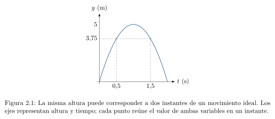
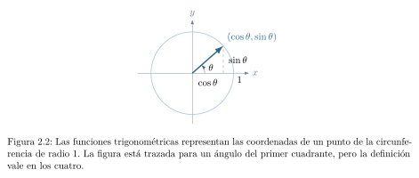
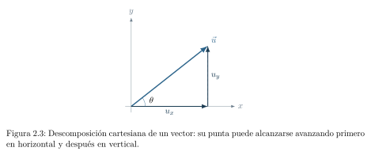
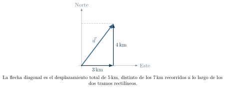
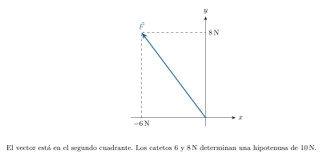
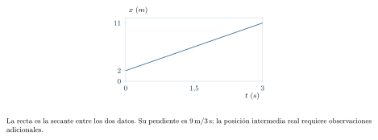
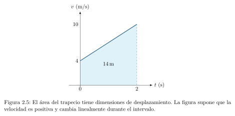

[← Capítulo anterior](capitulo-01.html) · [Índice del libro](index.html) · [Capítulo siguiente →](capitulo-03.html)

La matemática ofrece un lenguaje para relacionar magnitudes físicas, detectar contradicciones y anticipar comportamientos. Una ecuación puede ser perfectamente correcta como operación algebraica y, sin embargo, resultar absurda como descripción de la naturaleza. Por eso, antes de calcular, tendremos que preguntarnos qué representa cada símbolo y de dónde proviene la relación que vamos a utilizar.

En un primer curso universitario es frecuente que se trabaje con cantidades que tienen unidades, se proyecten fuerzas sobre ejes, se resuelvan ecuaciones simultáneas y se interpreten gráficas antes de que todas esas operaciones hayan sido ejercitadas con seguridad. Construiremos aquí las herramientas necesarias en el mismo orden en que surgen las dificultades. El capítulo siguiente permitirá emplearlas para entender el cálculo diferencial e integral sin exigir que el lector haya cursado previamente Análisis Matemático.

El álgebra, la trigonometría, las componentes y las gráficas forman el recorrido central de preparación. Los productos escalar y vectorial de la sección 2.9 amplían ese lenguaje hacia trabajo y momento de una fuerza; pueden retomarse cuando se estudien esos temas. Para abordar el cálculo y la cinemática que siguen, es prioritario dominar los despejes, los signos, las componentes y la interpretación de los ejes.

### Una regla para todo el capítulo

Antes de despejar una incógnita, identifica qué representa cada símbolo y qué unidades debe tener el resultado. Después del cálculo, vuelve a la situación física para interpretarlo.

## La primera disciplina del cálculo: saber qué estamos calculando

Imaginemos que queremos calcular el tiempo empleado por una persona en recorrer un pasillo. Sabemos que recorre $18\,\mathrm{m}$ a una rapidez aproximadamente constante de $3\,\mathrm{m/s}$. La relación que describe este modelo es $d=vt$. Solo después de identificar la distancia $d$, la rapidez $v$ y el tiempo $t$ tiene sentido despejar:
$$
 t=\frac{d}{v}=\frac{18\,\mathrm{m}}{3\,\mathrm{m/s}}=6\,\mathrm{s}.
$$
Hemos calculado un tiempo porque las unidades se reducen a segundos. Pero la respuesta depende de una hipótesis física: que la rapidez puede considerarse constante durante ese recorrido. Si la persona se detuvo durante el recorrido, habría que medir el tiempo total: el cociente entre los $18\,\mathrm{m}$ y ese tiempo daría la *rapidez media*. El dato de $3\,\mathrm{m/s}$ durante la marcha debe acompañarse de información sobre las detenciones para determinar la duración del trayecto.

Conviene distinguir tres objetos: una *cantidad física* (por ejemplo, la masa), su *valor numérico* en una unidad elegida (por ejemplo, $2{,}5$) y su *unidad* ($\,\mathrm{kg}$). La descripción completa de la magnitud reúne el número y su unidad. En una suma, los sumandos tienen que representar magnitudes compatibles: $3\,\mathrm{m}+40\,\mathrm{cm}=3{,}4\,\mathrm{m}$; en cambio, $3\,\mathrm{m}+4\,\mathrm{s}$ carece de significado como suma física ordinaria. La homogeneidad dimensional es una condición necesaria para aceptar una ecuación; su validez física exige además examinar sus hipótesis y predicciones.

## Despejar ecuaciones sin perder la física

Una ecuación es una igualdad entre dos expresiones. Sumar una misma cantidad a ambos miembros, o multiplicarlos por un factor distinto de cero, preserva las soluciones en el dominio considerado. Al dividir por una expresión trabajamos en el dominio donde su valor es distinto de cero. En $x(x-1)=0$, los casos $x=0$ y $x=1$ satisfacen la ecuación; dividir por $x$ conserva el segundo y excluye el primero. Al multiplicar $x-1=0$ por $x$, obtenemos una ecuación que también admite $x=0$. La equivalencia se preserva si el factor permanece distinto de cero en el dominio considerado. En $d=vt$, dividir por $v$ requiere $v\ne0$; con $v=0$, la relación exige $d=0$ y admite cualquier duración compatible con las demás condiciones del problema.

Por ejemplo, para despejar $t$ en $d=vt$ con $v\ne0$, dividimos ambos miembros por la misma cantidad: $d/v=vt/v=t$. El cociente $v/v=1$ explica la cancelación mediante una operación aplicada a ambos miembros. Si aparece una suma, hay que deshacerla antes: de $x=x_0+vt$ obtenemos primero $x-x_0=vt$ y luego $t=(x-x_0)/v$.

Las unidades acompañan las operaciones. Por ejemplo, en $F=ma$, al despejar $a$ obtenemos $a=F/m$, cuyas dimensiones son $\,\mathrm{N/kg}=\,\mathrm{m/s^2}$. Las letras también se distinguen por su papel: en un problema particular, $m$ puede ser un dato conocido, mientras que $a$ es la incógnita. En otro, la incógnita puede ser la masa. El signo de igualdad expresa una relación que admite diferentes preguntas.

{#fig-fp-av-ej-2-01 fig-alt="Ilustración de Despejar ecuaciones sin perder la física. Las unidades acompañan las operaciones. Por ejemplo, en F=ma, al despejar a obtenemos a=F/m, cuyas dimensiones son \\,N/kg=\\,m/s^2. Las letras también se distinguen por su papel: en un problema particular, m puede ser un dato conocido, mientras que a es la incógnita. En otro, la incógnita puede ser la masa. El signo de"}

### Problema resuelto 2.1 · Una fuerza neta y una masa desconocida {#r2-1}

Una fuerza horizontal aplicada de $18\,\mathrm{N}$ actúa sobre un carrito. Una fuerza resistiva horizontal de $3\,\mathrm{N}$ actúa en sentido contrario. Si la aceleración observada es de $3\,\mathrm{m/s^2}$, determinar la masa del carrito, suponiendo válida la segunda ley de Newton para un sistema de masa constante en un marco inercial.

*Resolución.* Elegimos como positiva la dirección de la fuerza aplicada. La fuerza individual de $18\,\mathrm{N}$ contribuye a la *resultante*, que es la fuerza que aparece en la ecuación:
$$
 F_{\mathrm{neta}}=18\,\mathrm{N}-3\,\mathrm{N}=15\,\mathrm{N},\qquad
 m=\frac{F_{\mathrm{neta}}}{a}=\frac{15\,\mathrm{N}}{3\,\mathrm{m/s^2}}=5\,\mathrm{kg}.
$$
La ley dada permite identificar la fuerza resultante y despejar la masa; su fundamento dinámico se desarrollará en el capítulo 6. El resultado tiene unidades de masa y es positivo. La resistencia de $3\,\mathrm{N}$ es un dato y una idealización específicos de este problema.

{#fig-fp-av-r2-1 fig-alt="Ilustración de Problema resuelto 2.1 · Una fuerza neta y una masa desconocida. Resolución. Elegimos como positiva la dirección de la fuerza aplicada. La fuerza individual de 18\\,N contribuye a la resultante, que es la fuerza que aparece en la ecuación: Fneta=18\\,N-3\\,N=15\\,N,qquad m=fracFnetaa=frac15\\,N3\\,m/s^2=5\\,kg. La ley dada permite identificar la fuerza resultante y despejar la masa; su"}

## Dos incógnitas requieren dos relaciones independientes

A veces una medición por sí sola admite innumerables explicaciones. La relación $m_1+m_2=8\,\mathrm{kg}$ admite muchas distribuciones de las masas $m_1$ y $m_2$; determinar cada una requiere otra condición independiente. Necesitamos otra relación independiente. Dos ecuaciones relacionadas por un factor distinto de cero expresan la misma información.

Para un sistema lineal
$$
 ax+by=e,\qquad cx+dy=f,
$$
podemos eliminar $y$ multiplicando la primera ecuación por $d$, la segunda por $b$ y restándolas. Así obtenemos $(ad-bc)x=de-bf$. La eliminación de $x$ proporciona $(ad-bc)y=af-ce$. Cuando $ad-bc\ne0$, ambas divisiones están definidas y determinan un único par $(x,y)$. Los coeficientes deben ser números o magnitudes con unidades que permitan esas operaciones. Si $ad-bc=0$, las ecuaciones requieren examinar su compatibilidad: $x+y=5$ y $2x+2y=10$ admiten infinitos pares; $x+y=5$ y $2x+2y=12$ imponen condiciones incompatibles. En cambio, $x+y=5$ y $x-y=1$ permiten sumar para obtener $2x=6$, y luego $y=2$. En el problema siguiente las dimensiones de cada ecuación serán diferentes; construiremos magnitudes comparables antes de sumarlas.

### Problema resuelto 2.2 · Dos materiales en un mismo recipiente {#r2-2}

Se mezclan, sin contracción apreciable, dos líquidos cuyas densidades son $2\,\mathrm{g/cm^3}$ y $5\,\mathrm{g/cm^3}$. La mezcla tiene una masa total de $16\,\mathrm{g}$ y un volumen total de $5\,\mathrm{cm^3}$. Encontrar el volumen de cada líquido.

*Resolución.* Sean $V_1$ y $V_2$ los volúmenes. Suponemos que los volúmenes se suman, una aproximación cuya validez depende de la mezcla. Tenemos
$$
 V_1+V_2=5\,\mathrm{cm^3},\qquad
 (2\,\mathrm{g/cm^3})V_1+(5\,\mathrm{g/cm^3})V_2=16\,\mathrm{g}.
$$
La primera relación da $V_1=5\,\mathrm{cm^3}-V_2$. Sustituimos en la segunda:
$$
 (2\,\mathrm{g/cm^3})(5\,\mathrm{cm^3}-V_2)+(5\,\mathrm{g/cm^3})V_2=16\,\mathrm{g}.
$$
De aquí se obtiene $(3\,\mathrm{g/cm^3})V_2=6\,\mathrm{g}$, de donde $V_2=2\,\mathrm{cm^3}$ y $V_1=3\,\mathrm{cm^3}$. *Verificación:* los volúmenes suman $5\,\mathrm{cm^3}$ y las masas son $6\,\mathrm{g}$ y $10\,\mathrm{g}$. Solo después de comprobar las dos restricciones podemos considerar resuelto el problema.

{#fig-fp-av-r2-2 fig-alt="Ilustración de Problema resuelto 2.2 · Dos materiales en un mismo recipiente. Resolución. Sean V1 y V2 los volúmenes. Suponemos que los volúmenes se suman, una aproximación cuya validez depende de la mezcla. Tenemos V1+V2=5\\,cm^3,qquad (2\\,g/cm^3)V1+(5\\,g/cm^3)V2=16\\,g. La primera relación da V1=5\\,cm^3-V2. Sustituimos en la segunda: (2\\,g/cm^3)(5\\,cm^3-V2)+(5\\,g/cm^3)V2=16\\,g. De aquí se"}

## Proporcionalidad, potencias y escalas

Decir que $y$ es directamente proporcional a $x$ significa que existe una constante $k$ tal que $y=kx$ dentro del régimen considerado. La proporcionalidad exige una razón constante: $y=x^2$ aumenta para $x>0$, pero duplicar $x$ cuadruplica $y$. Análogamente, una proporcionalidad inversa de primer grado adopta la forma $xy=k$, mientras que una relación de cuadrado inverso se expresa como $y=k/x^2$.

Para interpretar un cambio de escala, es útil separar el *factor* de la *diferencia*. Si un valor pasa de $50$ a $60$, aumenta en $10$ unidades, pero el incremento relativo es $10/50=20\%$. En una relación $y=kx^n$, multiplicar $x$ por $q$ multiplica $y$ por $q^n$. Esta observación permite resolver muchos problemas sin calcular la constante $k$.

{#fig-fp-av-ej-2-02 fig-alt="Ilustración de Proporcionalidad, potencias y escalas. Para interpretar un cambio de escala, es útil separar el factor de la diferencia. Si un valor pasa de 50 a 60, aumenta en 10 unidades, pero el incremento relativo es 10/50=20\\%. En una relación y=kx^n, multiplicar x por q multiplica y por q^n. Esta observación permite resolver muchos problemas sin calcular la"}

### Problema resuelto 2.3 · La luz de una fuente puntual ideal {#r2-3}

Una fuente pequeña emite luz de manera aproximadamente isotrópica en un medio transparente sin absorción apreciable. A $2\,\mathrm{m}$ de ella se mide una irradiancia $E_1$. ¿Qué fracción de $E_1$ se espera a $6\,\mathrm{m}$?

*Resolución.* Para una fuente puntiforme ideal, la misma potencia se reparte sobre esferas de área $4\pi r^2$, de modo que $E(r)\propto r^{-2}$. Por tanto
$$
 \frac{E_2}{E_1}=\left(\frac{r_1}{r_2}\right)^2
 =\left(\frac{2\,\mathrm{m}}{6\,\mathrm{m}}\right)^2=\frac19.
$$
La irradiancia esperada es una novena parte. Cerca de fuentes extensas, en haces dirigidos o en medios con absorción importante, la descripción requiere un modelo que incorpore esas condiciones. El exponente $2$ procede de la geometría física de la propagación.

{#fig-fp-av-r2-3 fig-alt="Ilustración de Problema resuelto 2.3 · La luz de una fuente puntual ideal. Resolución. Para una fuente puntiforme ideal, la misma potencia se reparte sobre esferas de área 4pi r^2, de modo que E(r)propto r^-2. Por tanto fracE2E1=left(fracr1r2right)^2 =left(frac2\\,m6\\,mright)^2=frac19. La irradiancia esperada es una novena parte. Cerca de fuentes extensas, en haces dirigidos o en medios con"}

### Potencias y raíces
La notación $10^n$ permite comunicar órdenes de magnitud sin cadenas de ceros. Para bases positivas, $10^a10^b=10^{a+b}$ y $(10^a)^b=10^{ab}$. Para un radicando real $a\geq0$, $\sqrt a$ es el número $b\geq0$ que cumple $b^2=a$. En particular, $\sqrt{x^2}=|x|$. Ese valor absoluto será decisivo para distinguir *módulo* de *componente* de un vector.

### Logaritmos: invertir una escala multiplicativa
El logaritmo decimal responde a la pregunta: «¿A qué potencia debo elevar $10$ para obtener este número positivo?». Así, $\log_{10}(100)=2$. Los logaritmos transforman productos en sumas, $\log(ab)=\log a+\log b$ cuando $a,b>0$. Sus argumentos deben ser números *adimensionales*: escribir $\log(5\,\mathrm{m})$ requiere especificar una razón con una longitud de referencia.

### Problema resuelto 2.4 · Una diferencia de nivel sonoro {#r2-4}

Para comparar intensidades acústicas se define el nivel $L$, medido en decibelios, mediante la expresión
$$
 L=10\log_{10}\!\left(\frac{I}{I_0}\right),
$$
donde $I_0$ es una intensidad de referencia positiva. Si $I_2=100I_1$, calcular $L_2-L_1$.

*Resolución.* Restamos expresiones antes de sustituir números:
$$
 L_2-L_1=10\log_{10}\!\left(\frac{I_2}{I_1}\right)
 =10\log_{10}(100)=20\,\mathrm{dB}.
$$
La intensidad aumentó cien veces. El cambio en decibelios es *logarítmico*. La fórmula define un nivel físico de intensidad; la sonoridad percibida requiere considerar también la respuesta del oyente.

{#fig-fp-av-r2-4 fig-alt="Ilustración de Problema resuelto 2.4 · Una diferencia de nivel sonoro. Resolución. Restamos expresiones antes de sustituir números: L2-L1=10log10\\!left(fracI2I1right) =10log10(100)=20\\,dB. La intensidad aumentó cien veces. El cambio en decibelios es logarítmico. La fórmula define un nivel físico de intensidad; la sonoridad percibida requiere considerar también la respuesta del oyente."}

## Ecuaciones cuadráticas y selección de soluciones físicas

Si $ax^2+bx+c=0$, con $a\ne0$, las soluciones algebraicas son
$$
 x=\frac{-b\pm\sqrt{b^2-4ac}}{2a}.
$$
El discriminante $b^2-4ac$ determina si hay dos soluciones reales distintas, una doble o ninguna real. Una solución algebraica puede quedar excluida por las condiciones de un modelo: por ejemplo, una respuesta temporal negativa puede estar fuera del intervalo $t\ge0$ para el que comenzamos a describir un movimiento. Para interpretar un tiempo negativo debemos examinar el origen temporal: puede representar un instante anterior al elegido como cero.

### Problema resuelto 2.5 · Una misma altura en dos instantes {#r2-5}

Un objeto asciende y desciende según el modelo ideal
$$
 y(t)=(10\,\mathrm{m/s})t-(5\,\mathrm{m/s^2})t^2,
$$
con $t\ge0$ hasta regresar al nivel de lanzamiento. ¿En qué instantes se encuentra a $3{,}75\,\mathrm{m}$ sobre ese nivel?

*Resolución.* Igualamos la altura indicada a la función y dividimos por $5\,\mathrm{m/s^2}$, cuidando que los términos resultantes conserven las dimensiones de $t^2$:
$$
 t^2-(2\,\mathrm{s})t+0{,}75\,\mathrm{s^2}=0
 \quad\Longleftrightarrow\quad (t-0{,}5\,\mathrm{s})(t-1{,}5\,\mathrm{s})=0.
$$
Encontramos $t_1=0{,}5\,\mathrm{s}$ y $t_2=1{,}5\,\mathrm{s}$. Son dos instantes físicos distintos de la misma altura: uno durante el ascenso y otro en el descenso. Sustituir ambos en $y(t)$ devuelve $3{,}75\,\mathrm{m}$. Este ejercicio anticipa una idea de Cinemática, aunque por ahora solo necesitamos álgebra y la interpretación del dominio.

{#fig-fp-av-r2-5 fig-alt="Ilustración de Problema resuelto 2.5 · Una misma altura en dos instantes. Resolución. Igualamos la altura indicada a la función y dividimos por 5\\,m/s^2, cuidando que los términos resultantes conserven las dimensiones de t^2: t^2-(2\\,s)t+0,75\\,s^2=0 quadLongleftrightarrowquad (t-0,5\\,s)(t-1,5\\,s)=0. Encontramos t1=0,5\\,s y t2=1,5\\,s. Son dos instantes físicos distintos de la misma altura:"}

{#fig-fp-fig-c02-01 fig-alt="Ilustración de Problema resuelto 2.5 · Una misma altura en dos instantes. Resolución. Igualamos la altura indicada a la función y dividimos por 5\\,m/s^2, cuidando que los términos resultantes conserven las dimensiones de t^2: t^2-(2\\,s)t+0,75\\,s^2=0 quadLongleftrightarrowquad (t-0,5\\,s)(t-1,5\\,s)=0. Encontramos t1=0,5\\,s y t2=1,5\\,s. Son dos instantes físicos distintos de la misma altura:"}

## Ángulos, radianes y trigonometría

Un ángulo mide una separación de direcciones. Si dos segmentos delimitan un sector circular de radio $r$ y arco de longitud $s$, el ángulo en *radianes* es $\theta=s/r$. Como dividimos dos longitudes, el radián es adimensional, aunque conservamos el símbolo $\,\mathrm{rad}$ para comunicar qué se está midiendo. Una vuelta completa corresponde a $2\pi\,\mathrm{rad}=360^\circ$.

En un triángulo rectángulo, para un ángulo agudo $\theta$, definimos
$$
 \sin\theta=\frac{\text{cateto opuesto}}{\text{hipotenusa}},\qquad
 \cos\theta=\frac{\text{cateto adyacente}}{\text{hipotenusa}}.
$$
$$
 \tan\theta=\frac{\sin\theta}{\cos\theta},
$$
siempre que el denominador no se anule. Cuando conocemos una tangente y buscamos el ángulo, utilizamos la función inversa $\arctan$, que devuelve un ángulo con esa tangente; hay que revisar el cuadrante porque diferentes ángulos pueden compartir la misma tangente. La circunferencia unitaria extiende las definiciones de seno y coseno a ángulos de cualquier cuadrante: sus valores pueden ser negativos y siempre satisfacen $\sin^2\theta+\cos^2\theta=1$.

{#fig-fp-fig-c02-02 fig-alt="Ilustración de Ángulos, radianes y trigonometría. En un triángulo rectángulo, para un ángulo agudo theta, definimos sintheta=fraccateto opuestohipotenusa,qquad costheta=fraccateto adyacentehipotenusa. tantheta=fracsinthetacostheta, siempre que el denominador no se anule. Cuando conocemos una tangente y buscamos el ángulo, utilizamos la función inversa arctan, que"}

### Problema resuelto 2.6 · Un arco y un ángulo {#r2-6}

Una rueda tiene radio $0{,}30\,\mathrm{m}$ y gira $150^\circ$. ¿Qué ángulo ha girado en radianes y qué longitud de arco ha barrido un punto de su borde?

*Resolución.* Convertimos grados mediante $180^\circ=\pi\,\mathrm{rad}$:
$$
 \theta=150^\circ\frac{\pi\,\mathrm{rad}}{180^\circ}=\frac{5\pi}{6}\,\mathrm{rad},\qquad
 s=r\theta=(0{,}30\,\mathrm{m})\frac{5\pi}{6}\approx0{,}785\,\mathrm{m}.
$$
El ángulo aparece como una razón geométrica y puede multiplicarse por un radio para producir una longitud. Para usar $150$ en la relación $s=r\theta$ debemos convertir primero el ángulo a radianes.

{#fig-fp-av-r2-6 fig-alt="Ilustración de Problema resuelto 2.6 · Un arco y un ángulo. Resolución. Convertimos grados mediante 180^circ=pi\\,rad: theta=150^circfracpi\\,rad180^circ=frac5pi6\\,rad,qquad s=rtheta=(0,30\\,m)frac5pi6approx0,785\\,m. El ángulo aparece como una razón geométrica y puede multiplicarse por un radio para producir una longitud. Para usar 150 en la relación s=rtheta debemos convertir"}

Una fuerza puede representarse mediante una flecha: su longitud representa el módulo y su orientación indica hacia dónde actúa. Sus componentes horizontal y vertical son las dos flechas sobre los ejes cuya suma reproduce la original. El triángulo formado por esas flechas permite aplicar seno y coseno; la sección siguiente precisará el lenguaje vectorial.

### Problema resuelto 2.7 · Una fuerza inclinada {#r2-7}

Una fuerza de magnitud $40\,\mathrm{N}$ forma un ángulo de $30^\circ$ medido en sentido antihorario desde el eje horizontal positivo, en el plano $xy$. Hallar sus componentes horizontal y vertical.

*Resolución.* La componente horizontal es adyacente al ángulo y la vertical es opuesta:
$$
 F_x=(40\,\mathrm{N})\cos30^\circ=20\sqrt3\,\mathrm{N},\qquad
 F_y=(40\,\mathrm{N})\sin30^\circ=20\,\mathrm{N}.
$$
La comprobación pitagórica da $\sqrt{F_x^2+F_y^2}=40\,\mathrm{N}$. Ambas componentes son positivas porque la fuerza apunta al primer cuadrante. Si el ángulo se midiera desde el eje vertical, habría que intercambiar las funciones correspondientes; la figura determina la proyección adecuada.

{#fig-fp-av-r2-7 fig-alt="Ilustración de Problema resuelto 2.7 · Una fuerza inclinada. Resolución. La componente horizontal es adyacente al ángulo y la vertical es opuesta: Fx=(40\\,N)cos30^circ=20sqrt3\\,N,qquad Fy=(40\\,N)sin30^circ=20\\,N. La comprobación pitagórica da sqrtFx^2+Fy^2=40\\,N. Ambas componentes son positivas porque la fuerza apunta al primer cuadrante. Si el ángulo se midiera desde el eje"}

### Una aproximación que exige cuidado
Para ángulos pequeños medidos en radianes, $\sin\theta\approx\theta$ y $\tan\theta\approx\theta$. La aproximación tiene un error que depende del ángulo: para $\theta=0{,}1\,\mathrm{rad}$, por ejemplo, $\sin\theta\approx0{,}09983$. Usarla con $\theta=30$ *grados* sin convertirlo a radianes daría un resultado absurdo. El capítulo 3 volverá a las funciones trigonométricas cuando necesitemos derivarlas.

{#fig-fp-av-ej-2-04 fig-alt="Ilustración de Una aproximación que exige cuidado. Resolución. La componente horizontal es adyacente al ángulo y la vertical es opuesta: Fx=(40\\,N)cos30^circ=20sqrt3\\,N,qquad Fy=(40\\,N)sin30^circ=20\\,N. La comprobación pitagórica da sqrtFx^2+Fy^2=40\\,N. Ambas componentes son positivas porque la fuerza apunta al primer cuadrante. Si el ángulo se midiera desde el eje"}

## Vectores: magnitudes que requieren dirección

Algunas magnitudes físicas requieren, además de un módulo, una dirección y un sentido. La masa y la energía son escalares; una fuerza o un desplazamiento requieren además dirección y sentido. En dos dimensiones representamos un vector por el par de sus componentes en ejes cartesianos:
$$
 \vec u=u_x\hat{\imath}+u_y\hat{\jmath}=(u_x,u_y).
$$
Aquí $\hat{\imath}$ y $\hat{\jmath}$ son vectores unitarios perpendiculares, y $u_x,u_y$ son *componentes con signo*. El *módulo* expresa la longitud del vector y toma valores positivos o cero:
$$
 |\vec u|=\sqrt{u_x^2+u_y^2}\ge0.
$$
Un vector como $(-3,4)\,\mathrm{N}$ tiene una componente horizontal negativa y módulo $5\,\mathrm{N}$. El módulo se calcula con las dos componentes. Para un vector distinto de cero, multiplicarlo por un número negativo invierte su sentido y conserva la recta que determina su dirección.

{#fig-fp-av-ej-2-03 fig-alt="Ilustración de Vectores: magnitudes que requieren dirección. Algunas magnitudes físicas requieren, además de un módulo, una dirección y un sentido. La masa y la energía son escalares; una fuerza o un desplazamiento requieren además dirección y sentido. En dos dimensiones representamos un vector por el par de sus componentes en ejes cartesianos: vec"}

{#fig-fp-fig-c02-03 fig-alt="Ilustración de Vectores: magnitudes que requieren dirección. Algunas magnitudes físicas requieren, además de un módulo, una dirección y un sentido. La masa y la energía son escalares; una fuerza o un desplazamiento requieren además dirección y sentido. En dos dimensiones representamos un vector por el par de sus componentes en ejes cartesianos: vec"}

Para un vector distinto de cero, de módulo $u$, que forma un ángulo $\theta$ medido desde $+x$, las componentes son $u_x=u\cos\theta$, $u_y=u\sin\theta$. Estas expresiones siguen siendo válidas en otros cuadrantes porque el seno y el coseno incorporan sus signos. El vector cero tiene todas sus componentes iguales a cero; su dirección queda indeterminada. En tres dimensiones añadimos $u_z\hat{k}$ y la norma $\sqrt{u_x^2+u_y^2+u_z^2}$. Estas operaciones ofrecen un primer contacto con el álgebra lineal universitaria a través de sus aplicaciones físicas.

## Sumar vectores y distinguir desplazamiento de recorrido

La suma de vectores se obtiene sumando componentes homólogas:
$$
 (u_x,u_y)+(w_x,w_y)=(u_x+w_x,u_y+w_y).
$$
Geométricamente podemos trasladar los vectores sin girarlos y poner el origen del segundo en la punta del primero. La flecha desde el punto inicial hasta el final es la resultante. El *desplazamiento* compara las posiciones inicial y final; la *distancia recorrida* considera el trayecto efectivo.

### Problema resuelto 2.8 · Siete kilómetros recorridos, cinco de desplazamiento {#r2-8}

Una persona camina $3\,\mathrm{km}$ hacia el este y después $4\,\mathrm{km}$ hacia el norte, en dos tramos rectilíneos. Determinar su desplazamiento y la distancia recorrida.

*Resolución.* Elegimos este como $+x$ y norte como $+y$. Los desplazamientos sucesivos son $\vec d_1=(3,0)\,\mathrm{km}$ y $\vec d_2=(0,4)\,\mathrm{km}$. Su suma es $\vec d=(3,4)\,\mathrm{km}$, de módulo
$$
 |\vec d|=\sqrt{3^2+4^2}\,\mathrm{km}=5\,\mathrm{km}.
$$
La distancia efectivamente recorrida es $3\,\mathrm{km}+4\,\mathrm{km}=7\,\mathrm{km}$. Podemos comprobar que el módulo del desplazamiento no supera la longitud total del camino. Esa desigualdad deja de ser útil como cálculo exacto de la distancia si conocemos solo los extremos.

{#fig-fp-av-r2-8 fig-alt="Ilustración de Problema resuelto 2.8 · Siete kilómetros recorridos, cinco de desplazamiento. Resolución. Elegimos este como +x y norte como +y. Los desplazamientos sucesivos son vec d1=(3,0)\\,km y vec d2=(0,4)\\,km. Su suma es vec d=(3,4)\\,km, de módulo |vec d|=sqrt3^2+4^2\\,km=5\\,km. La distancia efectivamente recorrida es 3\\,km+4\\,km=7\\,km. Podemos comprobar que el módulo del desplazamiento no supera la"}

{#fig-fp-fig-c02-04 fig-alt="Ilustración de Problema resuelto 2.8 · Siete kilómetros recorridos, cinco de desplazamiento. Resolución. Elegimos este como +x y norte como +y. Los desplazamientos sucesivos son vec d1=(3,0)\\,km y vec d2=(0,4)\\,km. Su suma es vec d=(3,4)\\,km, de módulo |vec d|=sqrt3^2+4^2\\,km=5\\,km. La distancia efectivamente recorrida es 3\\,km+4\\,km=7\\,km. Podemos comprobar que el módulo del desplazamiento no supera la"}

### Problema resuelto 2.9 · Reconocer el cuadrante antes de calcular el ángulo {#r2-9}

Una fuerza tiene componentes $F_x=-6\,\mathrm{N}$ y $F_y=8\,\mathrm{N}$. Encontrar su módulo y describir su dirección.

*Resolución.* Su módulo es $|\vec F|=\sqrt{36+64}\,\mathrm{N}=10\,\mathrm{N}$. Como $F_x<0$ y $F_y>0$, apunta al segundo cuadrante. El ángulo agudo que forma con el eje horizontal negativo satisface $\tan\alpha=8/6=4/3$, de modo que $\alpha\approx53{,}13^\circ$. Medido desde $+x$ en sentido antihorario, $\theta=180^\circ-\alpha\approx126{,}87^\circ$. La calculadora devuelve el ángulo de una razón, pero interpretar el cuadrante exige mirar los signos.

{#fig-fp-av-r2-9 fig-alt="Ilustración de Problema resuelto 2.9 · Reconocer el cuadrante antes de calcular el ángulo. Resolución. Su módulo es |vec F|=sqrt36+64\\,N=10\\,N. Como Fx<0 y Fy>0, apunta al segundo cuadrante. El ángulo agudo que forma con el eje horizontal negativo satisface tanalpha=8/6=4/3, de modo que alphaapprox53,13^circ. Medido desde +x en sentido antihorario, theta=180^circ-alphaapprox126,87^circ. La calculadora"}

## Dos productos diferentes y sus significados físicos

El *producto escalar* asocia a dos vectores una cantidad escalar. Si los vectores representan magnitudes físicas, sus unidades se multiplican: el producto de una fuerza por un desplazamiento se expresa en $\,\mathrm{N\,m}$. En componentes cartesianas ortonormales,
$$
 \vec u\cdot\vec w=u_xw_x+u_yw_y+u_zw_z=|\vec u|\,|\vec w|\cos\theta.
$$
La segunda expresión permite reconocer la componente de un vector en la dirección del otro. Dos vectores no nulos perpendiculares tienen producto escalar cero. El newton, $\,\mathrm{N}=\,\mathrm{kg\,m/s^2}$, es la unidad SI de fuerza; el joule, $\,\mathrm{J}=\,\mathrm{N\,m}$, es una unidad de energía y trabajo. Usaremos las relaciones que siguen como aplicaciones dadas de los productos de vectores; su interpretación dinámica se desarrollará más adelante. En mecánica, el trabajo de una fuerza *constante* durante un desplazamiento es $W=\vec F\cdot\Delta\vec r$. Su signo importa: una fuerza opuesta al desplazamiento realiza trabajo negativo.

### Problema resuelto 2.10 · Trabajo nulo sin fuerza nula {#r2-10}

Durante cierto desplazamiento $\Delta\vec r=(3,-4)\,\mathrm{m}$ actúa una fuerza constante $\vec F=(8,6)\,\mathrm{N}$. Calcular el trabajo de esa fuerza.

*Resolución.* En componentes:
$$
 W=\vec F\cdot\Delta\vec r=(8\,\mathrm{N})(3\,\mathrm{m})+(6\,\mathrm{N})(-4\,\mathrm{m})=0\,\mathrm{J}.
$$
La fuerza constante es perpendicular al desplazamiento total y su trabajo es cero. Las demás fuerzas tienen sus propias contribuciones al trabajo del recorrido.

{#fig-fp-av-r2-10 fig-alt="Ilustración de Problema resuelto 2.10 · Trabajo nulo sin fuerza nula. Resolución. En componentes: W=vec FcdotDeltavec r=(8\\,N)(3\\,m)+(6\\,N)(-4\\,m)=0\\,J. La fuerza constante es perpendicular al desplazamiento total y su trabajo es cero. Las demás fuerzas tienen sus propias contribuciones al trabajo del recorrido."}

El *producto vectorial* asocia a dos vectores tridimensionales otro vector. Para dos vectores distintos de cero, el ángulo $\theta\in[0,\pi]$ permite expresar su módulo como $|\vec u\times\vec w|=|\vec u|\,|\vec w|\sin\theta$. Cuando los factores determinan un plano, el producto tiene dirección perpendicular a ese plano y sentido dado por la regla de la mano derecha. Para vectores paralelos, antiparalelos o con un factor cero, el producto es el vector cero: tiene módulo cero y dirección indeterminada. En el plano $xy$, su expresión por componentes es
$$
 \vec u\times\vec w=(u_xw_y-u_yw_x)\hat{k}.
$$
Aunque $\vec u\cdot\vec w$ y $\vec u\times\vec w$ contienen los mismos factores iniciales, cada producto construye un objeto matemático distinto y responde a una relación física propia. El primero mide una proyección; el segundo está ligado a la orientación de un área o a un giro.

### Problema resuelto 2.11 · Momento de una fuerza respecto del origen {#r2-11}

Una fuerza $\vec F=(0,15,0)\,\mathrm{N}$ actúa en el punto $\vec r=(0{,}40,0,0)\,\mathrm{m}$. Calcular el momento de la fuerza respecto del origen.

*Resolución.* Para esta definición de momento (también llamado torque), $\vec\tau=\vec r\times\vec F$:
$$
 \vec\tau=(0,0,0{,}40\cdot15)\,\mathrm{N\,m}=(0,0,6)\,\mathrm{N\,m}.
$$
El vector apunta según $+z$: una fuerza hacia $+y$ aplicada en $+x$ favorece una rotación antihoraria vista desde $+z$. Aunque $\,\mathrm{N\,m}$ y el joule tienen las mismas dimensiones, un momento de fuerza y una energía representan conceptos físicos distintos.

{#fig-fp-av-r2-11 fig-alt="Ilustración de Problema resuelto 2.11 · Momento de una fuerza respecto del origen. Resolución. Para esta definición de momento (también llamado torque), vectau=vec rtimesvec F: vectau=(0,0,0,40cdot15)\\,N\\,m=(0,0,6)\\,N\\,m. El vector apunta según +z: una fuerza hacia +y aplicada en +x favorece una rotación antihoraria vista desde +z. Aunque \\,N\\,m y el joule tienen las mismas dimensiones, un momento"}

## Rectas, parábolas, circunferencias y gráficas físicas

Una gráfica organiza relaciones entre magnitudes y permite extraer información cuantitativa. Es un modo de representar una relación entre variables, pero sus ejes determinan su interpretación. La recta $y=mx+b$ tiene pendiente $m$ e intercepto $b$; en un gráfico de posición $x$ frente a tiempo $t$, la pendiente tiene unidades de velocidad, mientras que en uno de masa frente a volumen representa densidad. En una relación cuadrática $y=ax^2+bx+c$, los valores del eje horizontal importan tanto como la forma de la curva.

También una circunferencia $x^2+y^2=R^2$ describe un conjunto de puntos; especificar la rapidez requiere información temporal. Una partícula podría moverse sobre la misma circunferencia con rapidez constante, variable o incluso detenerse. La curva en el plano y la *gráfica de una coordenada respecto del tiempo* son objetos distintos, aunque ambos se dibujen usando ejes.

### Problema resuelto 2.12 · La pendiente conserva sus unidades {#r2-12}

La coordenada de un móvil registrada en dos instantes es $x(0)=2\,\mathrm{m}$ y $x(3\,\mathrm{s})=11\,\mathrm{m}$. Hallar la pendiente de la recta que une los puntos de la gráfica posición--tiempo e interpretarla.

*Resolución.* La pendiente de la secante es
$$
 m_{\mathrm{sec}}=\frac{11\,\mathrm{m}-2\,\mathrm{m}}{3\,\mathrm{s}-0\,\mathrm{s}}=3\,\mathrm{m/s}.
$$
Es la *velocidad media* sobre el intervalo; las velocidades instantáneas pueden variar durante él. El capítulo 3 estudiará qué ocurre cuando disminuimos el intervalo temporal y cómo obtener una velocidad en un instante a partir de una función.

{#fig-fp-av-r2-12 fig-alt="Ilustración de Problema resuelto 2.12 · La pendiente conserva sus unidades. Resolución. La pendiente de la secante es msec=frac11\\,m-2\\,m3\\,s-0\\,s=3\\,m/s. Es la velocidad media sobre el intervalo; las velocidades instantáneas pueden variar durante él. El capítulo 3 estudiará qué ocurre cuando disminuimos el intervalo temporal y cómo obtener una velocidad en un instante a partir de una función."}

### Problema resuelto 2.13 · Área bajo una velocidad, antes de aprender integrales {#r2-13}

La velocidad de un móvil aumenta linealmente de $4\,\mathrm{m/s}$ a $10\,\mathrm{m/s}$ durante $2\,\mathrm{s}$, sin cambiar de sentido. Estimar el desplazamiento suponiendo que la gráfica velocidad--tiempo es exactamente el segmento recto entre ambos valores.

*Resolución.* La región bajo la recta es un trapecio de bases $4\,\mathrm{m/s}$ y $10\,\mathrm{m/s}$ y altura $2\,\mathrm{s}$:
$$
 \Delta x=\frac{4+10}{2}\,\mathrm{m/s}\,(2\,\mathrm{s})=14\,\mathrm{m}.
$$
Para entender por qué esta área representa el desplazamiento, podemos dividir el intervalo en dos mitades: por ser una recta, las velocidades de instantes simétricos suman siempre $14\,\mathrm{m/s}$. Su promedio es $7\,\mathrm{m/s}$, que multiplicado por $2\,\mathrm{s}$ da $14\,\mathrm{m}$. La igualdad entre área y desplazamiento extiende la relación $\Delta x=v\Delta t$ de los rectángulos a una velocidad que varía linealmente. Las unidades de longitud comprueban la coherencia dimensional del resultado; demostrar la igualdad requiere el razonamiento físico correspondiente. Si la velocidad fuera negativa, la orientación del área exigiría una precaución adicional. Más adelante aprenderemos a generalizar este razonamiento mediante integrales.

{#fig-fp-av-r2-13 fig-alt="Ilustración de Problema resuelto 2.13 · Área bajo una velocidad, antes de aprender integrales. Resolución. La región bajo la recta es un trapecio de bases 4\\,m/s y 10\\,m/s y altura 2\\,s: Delta x=frac4+102\\,m/s\\,(2\\,s)=14\\,m. Para entender por qué esta área representa el desplazamiento, podemos dividir el intervalo en dos mitades: por ser una recta, las velocidades de instantes simétricos suman siempre 14\\,m/s."}

{#fig-fp-fig-c02-05 fig-alt="Ilustración de Problema resuelto 2.13 · Área bajo una velocidad, antes de aprender integrales. Resolución. La región bajo la recta es un trapecio de bases 4\\,m/s y 10\\,m/s y altura 2\\,s: Delta x=frac4+102\\,m/s\\,(2\\,s)=14\\,m. Para entender por qué esta área representa el desplazamiento, podemos dividir el intervalo en dos mitades: por ser una recta, las velocidades de instantes simétricos suman siempre 14\\,m/s."}

## Identidades matemáticas, leyes físicas y condiciones de un modelo

La igualdad $\sin^2\theta+\cos^2\theta=1$ es una identidad matemática válida para todo ángulo real. La expresión $F_{\mathrm{neta}}=ma$ representa una ley física bajo determinadas condiciones de aplicación. La relación $v(t)=v_0+at$ es consecuencia de un modelo de aceleración constante y de una condición inicial. Y $v(0)=4\,\mathrm{m/s}$ es un dato de una situación particular. Estas proposiciones tienen alcances lógicos distintos, que conviene precisar al leer cada igualdad.

### Problema resuelto 2.14 · Una ecuación dimensionalmente correcta puede estar equivocada {#r2-14}

Alguien propone para la rapidez adquirida por una esfera soltada desde el reposo a través de una diferencia de altura $h$ la fórmula $v=3\sqrt{gh}$, donde $g$ tiene unidades de aceleración. ¿Basta el análisis dimensional para confirmarla?

*Resolución.* La expresión $\sqrt{gh}$ tiene dimensiones
$$
 [\sqrt{gh}]=\sqrt{(L/T^2)L}=L/T,
$$
por lo que la fórmula propuesta sí presenta unidades de rapidez. Pero cualquier coeficiente numérico adimensional, por ejemplo $2$ o $\sqrt2$, mantendría esas dimensiones. Para una caída ideal sin resistencia del aire y con aceleración gravitatoria constante, el modelo de aceleración constante, que deduciremos en los capítulos 3 y 4, da $v=\sqrt{2gh}$, no $3\sqrt{gh}$. La homogeneidad dimensional detecta ciertos errores; determinar el coeficiente y validar las hipótesis dinámicas requiere información física adicional.

{#fig-fp-av-r2-14 fig-alt="Ilustración de Problema resuelto 2.14 · Una ecuación dimensionalmente correcta puede estar equivocada. Resolución. La expresión sqrtgh tiene dimensiones [sqrtgh]=sqrt(L/T^2)L=L/T, por lo que la fórmula propuesta sí presenta unidades de rapidez. Pero cualquier coeficiente numérico adimensional, por ejemplo 2 o sqrt2, mantendría esas dimensiones. Para una caída ideal sin resistencia del aire y con aceleración"}

## Ejercicios de práctica

Se proponen dieciocho ejercicios inéditos, identificados como B (fundamentos) o C (consolidación). Una cuestión se considera resuelta cuando el estudiante puede explicar el modelo, justificar las operaciones y examinar el resultado. Las soluciones completas aparecen a continuación de los enunciados.

### Ejercicio 2.1 · Despejar sin olvidar unidades (B) {#e2-1}

La fuerza neta sobre un objeto es $F=ma$. Si $F=21\,\mathrm{N}$ y $a=3{,}5\,\mathrm{m/s^2}$, determina $m$ e indica qué condición se necesita para dividir por $a$.

### Ejercicio 2.2 · Dos corrientes desconocidas (B) {#e2-2}

En un nodo de un circuito, las intensidades positivas $I_1$ e $I_2$ satisfacen $I_1+I_2=5\,\mathrm{A}$ e $I_1-I_2=1\,\mathrm{A}$. Resuelve el sistema y verifica ambas condiciones.

### Ejercicio 2.3 · Densidad y proporcionalidad (B) {#e2-3}

Un material homogéneo tiene densidad $2{,}7\,\mathrm{g/cm^3}$. ¿Cuál es la masa de un bloque de $350\,\mathrm{cm^3}$? Exprésala también en kilogramos y explicita qué se supone del material.

### Ejercicio 2.4 · Incremento absoluto y relativo (B) {#e2-4}

La lectura de un sensor pasa de $80\,\mathrm{N}$ a $92\,\mathrm{N}$. Calcula el incremento absoluto y porcentual respecto del valor inicial. ¿Sería correcto decir que aumentó «un $12\%$»?

### Ejercicio 2.5 · Una relación de inverso cuadrado (B) {#e2-5}

La irradiancia de una fuente ideal es $E$ a $3\,\mathrm{m}$. ¿Qué irradiancia se espera a $9\,\mathrm{m}$ si se mantiene el mismo modelo geométrico del problema 2.3?

### Ejercicio 2.6 · Decibelios y factores (B) {#e2-6}

En el modelo del problema 2.4, una intensidad pasa de $I_1$ a $100I_1$. Calcula la diferencia de niveles. Explica por qué $20\,\mathrm{dB}$ no significa «veinte veces más intensidad». Después invierte la pregunta: ¿qué factor entre intensidades corresponde a un aumento de $10\,\mathrm{dB}$?

### Ejercicio 2.7 · Dos instantes para un mismo lugar (B) {#e2-7}

La posición ideal de un móvil sobre un eje es $x(t)=(8\,\mathrm{m/s})t-(2\,\mathrm{m/s^2})t^2$ con $t\ge0$. Encuentra todos los instantes en los que $x=6\,\mathrm{m}$ y compruébalos sustituyendo.

### Ejercicio 2.8 · Elegir una raíz admisible (B) {#e2-8}

La altura de un objeto se describe, desde $t=0$, por $y(t)=4\,\mathrm{m}+(2\,\mathrm{m/s})t-(5\,\mathrm{m/s^2})t^2$. Calcula el instante positivo en que alcanza el suelo e interpreta la otra raíz.

### Ejercicio 2.9 · Del grado al radián (B) {#e2-9}

Un arco circular de radio $3\,\mathrm{cm}$ subtiende $150^\circ$. Determina el ángulo en radianes y la longitud del arco. Expresa esta última en centímetros.

### Ejercicio 2.10 · Componentes y comprobación (B) {#e2-10}

Una fuerza de módulo $20\,\mathrm{N}$ forma $60^\circ$ con $+x$, en el primer cuadrante. Encuentra $F_x$ y $F_y$ y verifica el módulo.

### Ejercicio 2.11 · Módulo y orientación de un desplazamiento {#e2-11}

Un desplazamiento es $\vec d=(-3,-4)\,\mathrm{m}$. Calcula $|\vec d|$ e identifica el cuadrante. ¿Cuál es aproximadamente su ángulo medido desde $+x$ en sentido antihorario?

### Ejercicio 2.12 · Recorrido y desplazamiento (B) {#e2-12}

Una persona camina primero $\vec d_1=(4,3)\,\mathrm{m}$ y luego $\vec d_2=(-4,0)\,\mathrm{m}$, recorriendo cada tramo rectilíneamente. Encuentra el desplazamiento total, su módulo y la distancia efectivamente recorrida.

### Ejercicio 2.13 · Producto escalar con unidades (C) {#e2-13}

Una fuerza constante $\vec F=(2,4)\,\mathrm{N}$ acompaña un desplazamiento $\Delta\vec r=(3,-1)\,\mathrm{m}$. Calcula el trabajo efectuado por esa fuerza y determina si es positivo, negativo o nulo.

### Ejercicio 2.14 · El signo de un torque (C) {#e2-14}

Una fuerza $\vec F=(20,0,0)\,\mathrm{N}$ se aplica en $\vec r=(0,0{,}30,0)\,\mathrm{m}$. Calcula $\vec\tau=\vec r\times\vec F$ y explica el signo de su componente $z$.

### Ejercicio 2.15 · Pendiente y unidades (B) {#e2-15}

En una gráfica posición--tiempo se registran dos puntos $(t,x)=(0\,\mathrm{s},2\,\mathrm{m})$ y $(5\,\mathrm{s},17\,\mathrm{m})$. Obtén la pendiente de la secante y di qué información adicional necesitarías para asegurar que la velocidad es constante.

### Ejercicio 2.16 · Dos áreas que se cancelan (C) {#e2-16}

La gráfica de velocidad--tiempo de un móvil corresponde al segmento recto de $v(0)=6\,\mathrm{m/s}$ a $v(4\,\mathrm{s})=-6\,\mathrm{m/s}$. ¿Cuál es el desplazamiento? ¿Cuál es la distancia recorrida, suponiendo que solo cambia de sentido cuando la gráfica cruza $v=0$?

### Ejercicio 2.17 · Circunferencia y movimiento (B) {#e2-17}

Una partícula está restringida a una circunferencia de ecuación $x^2+y^2=25\,\mathrm{cm^2}$. Si en un instante $x=3\,\mathrm{cm}$, ¿qué valores de $y$ son posibles? ¿Permite esta información calcular su rapidez?

### Ejercicio 2.18 · Alcance de las dimensiones (C) {#e2-18}

Se proponen $v=C\sqrt{gh}$ y $v=Dgh$ para la rapidez de caída, donde $C$ y $D$ son números adimensionales. Determina qué propuesta es homogénea dimensionalmente y explica si eso permite conocer el valor de $C$.

## Soluciones completas

### Solución 2.1 {#sol-e2-1}
 De $F=ma$ despejamos
$$
 m=\frac{F}{a}=\frac{21\,\mathrm{N}}{3{,}5\,\mathrm{m/s^2}}=6\,\mathrm{kg}.
$$
Dividir por $a$ requiere $a\ne0$. Si $a=0$ y $F=0$, la ecuación por sí sola no determina la masa; si $F\ne0$, los datos son incompatibles con ese modelo.

### Solución 2.2 {#sol-e2-2}
 Sumamos las ecuaciones: $2I_1=6\,\mathrm{A}$ y $I_1=3\,\mathrm{A}$. Sustituyendo, $I_2=2\,\mathrm{A}$. Comprobamos: $3+2=5\,\mathrm{A}$ y $3-2=1\,\mathrm{A}$. Ambas corrientes resultan positivas, como exigía el enunciado.

### Solución 2.3 {#sol-e2-3}
 Para un material homogéneo con densidad aproximadamente constante,
$$
m=\rho V=(2{,}7\,\mathrm{g/cm^3})(350\,\mathrm{cm^3})=945\,\mathrm{g}=0{,}945\,\mathrm{kg}.
$$
Las unidades de volumen se cancelan; si el material no fuera homogéneo, una única densidad podría no bastar.

### Solución 2.4 {#sol-e2-4}
 El incremento absoluto es $\Delta F=92-80=12\,\mathrm{N}$. El relativo se calcula respecto de $80\,\mathrm{N}$: $12/80=0{,}15=15\%$. La diferencia absoluta de $12\,\mathrm{N}$ se convierte en un incremento relativo al compararla con la fuerza de referencia.

### Solución 2.5 {#sol-e2-5}
 Por el modelo $E\propto1/r^2$ tenemos $E_2/E_1=(3/9)^2=1/9$. La respuesta es $E/9$. El modelo supone propagación isotrópica en un medio con absorción despreciable; un haz láser o un medio absorbente requerirían otra descripción.

### Solución 2.6 {#sol-e2-6}
 La diferencia es $\Delta L=10\log_{10}(100)=20\,\mathrm{dB}$. La relación entre intensidades es un factor $100$, mientras que $20$ es el cambio en una escala logarítmica. La escala logarítmica expresa esa razón entre intensidades mediante una diferencia de niveles. Para la pregunta inversa, $10=10\log_{10}(I_2/I_1)$ implica $\log_{10}(I_2/I_1)=1$ y, por definición de logaritmo, $I_2/I_1=10^1=10$.

### Solución 2.7 {#sol-e2-7}
 Sustituimos la posición de $6\,\mathrm{m}$:
$$
 (8\,\mathrm{m/s})t-(2\,\mathrm{m/s^2})t^2=6\,\mathrm{m}.
$$
Al dividir por $2\,\mathrm{m/s^2}$ y reorganizar, obtenemos
$$
 t^2-(4\,\mathrm{s})t+3\,\mathrm{s^2}=0,
 \quad (t-1\,\mathrm{s})(t-3\,\mathrm{s})=0.
$$
Por tanto $t=1\,\mathrm{s}$ y $t=3\,\mathrm{s}$. En ambos casos, $x=8-2=6\,\mathrm{m}$ y $x=24-18=6\,\mathrm{m}$ respectivamente; las dos raíces pertenecen al dominio $t\ge0$.

### Solución 2.8 {#sol-e2-8}
 Igualando $y=0$ y expresando $t$ en segundos, queda la ecuación numérica $4+2t-5t^2=0$, o $5t^2-2t-4=0$. La fórmula cuadrática da
$$
 t=\frac{2\pm\sqrt{84}}{10}\,\mathrm{s}=\frac{1\pm\sqrt{21}}{5}\,\mathrm{s}.
$$ El instante posterior al inicio es $t=(1+\sqrt{21})/5\,\mathrm{s}\approx1{,}117\,\mathrm{s}$. El otro, aproximadamente $-0{,}717\,\mathrm{s}$, pertenece a la prolongación algebraica de la parábola, pero queda fuera del intervalo declarado para este experimento.

### Solución 2.9 {#sol-e2-9}
 Convertimos $150^\circ=(5\pi/6)\,\mathrm{rad}$. Para el arco,
$$
 s=r\theta=(3\,\mathrm{cm})\frac{5\pi}{6}=\frac{5\pi}{2}\,\mathrm{cm}\approx7{,}85\,\mathrm{cm}.
$$
La fórmula de arco requiere expresar el ángulo en radianes antes de multiplicarlo por el radio.

### Solución 2.10 {#sol-e2-10}
 $F_x=20\cos60^\circ=10\,\mathrm{N}$ y $F_y=20\sin60^\circ=10\sqrt3\,\mathrm{N}$. La norma es $\sqrt{10^2+(10\sqrt3)^2}\,\mathrm{N}=20\,\mathrm{N}$; ambas componentes deben ser positivas en el primer cuadrante.

### Solución 2.11 {#sol-e2-11}
 $|\vec d|=\sqrt{(-3)^2+(-4)^2}\,\mathrm{m}=5\,\mathrm{m}$. Ambas componentes son negativas, luego el vector está en el tercer cuadrante. Su ángulo antihorario desde $+x$ es $180^\circ+\arctan(4/3)\approx233{,}13^\circ$. El *módulo* es siempre mayor o igual que cero.

### Solución 2.12 {#sol-e2-12}
 La suma vectorial es $(4,3)+(-4,0)=(0,3)\,\mathrm{m}$; su módulo es $3\,\mathrm{m}$. La primera trayectoria recta mide $\sqrt{4^2+3^2}=5\,\mathrm{m}$ y la segunda $4\,\mathrm{m}$, por lo que la distancia recorrida es $9\,\mathrm{m}$. El recorrido depende del camino; el desplazamiento, solo de los extremos.

### Solución 2.13 {#sol-e2-13}
 $W=\vec F\cdot\Delta\vec r=(2\,\mathrm{N})(3\,\mathrm{m})+(4\,\mathrm{N})(-1\,\mathrm{m})=2\,\mathrm{J}$. El trabajo de esta fuerza constante es positivo. Se suman los productos de componentes homólogas.

### Solución 2.14 {#sol-e2-14}
 En el plano $xy$,
$$
 \tau_z=r_xF_y-r_yF_x=-(0{,}30\,\mathrm{m})(20\,\mathrm{N})=-6\,\mathrm{N\,m}.
$$
Así, $\vec\tau=(0,0,-6)\,\mathrm{N\,m}$. El sentido $-z$ se comprueba porque $\hat{\jmath}\times\hat{\imath}=-\hat{k}$.

### Solución 2.15 {#sol-e2-15}
 La pendiente de la secante es $(17-2)\,\mathrm{m}/(5\,\mathrm{s})=3\,\mathrm{m/s}$, interpretable como velocidad media. Para conocer lo ocurrido entre dos puntos necesitamos información intermedia o un modelo adicional. Para asegurar velocidad constante se requiere información sobre todos los instantes del intervalo, o una hipótesis explícita de linealidad del modelo de posición.

### Solución 2.16 {#sol-e2-16}
 La velocidad cruza cero a los $2\,\mathrm{s}$. De $0$ a $2\,\mathrm{s}$ el área positiva es un triángulo de base $2\,\mathrm{s}$ y altura $6\,\mathrm{m/s}$, por lo que vale $6\,\mathrm{m}$. De $2$ a $4\,\mathrm{s}$ el área orientada es $-6\,\mathrm{m}$. El desplazamiento total es $0\,\mathrm{m}$; la distancia recorrida es $6+6=12\,\mathrm{m}$. Un desplazamiento nulo es compatible tanto con el reposo como con un recorrido de ida y vuelta.

### Solución 2.17 {#sol-e2-17}
 Sustituyendo $x=3\,\mathrm{cm}$ obtenemos $y^2=25\,\mathrm{cm^2}-9\,\mathrm{cm^2}=16\,\mathrm{cm^2}$. Por tanto $y=\pm4\,\mathrm{cm}$. La ecuación fija los puntos de la circunferencia; la rapidez y el sentido del movimiento requieren información temporal.

### Solución 2.18 {#sol-e2-18}
 La primera propuesta es homogénea: $[\sqrt{gh}]=\sqrt{(L/T^2)L}=L/T$. La segunda tiene dimensión $L^2/T^2$, no $L/T$, de modo que un $D$ adimensional no la corrige. La primera es dimensionalmente homogénea; para determinar el número $C$ necesitamos una ley física y las hipótesis pertinentes.

## Diagnóstico de salida: puente hacia el capítulo 3

Antes de avanzar, conviene resolver sin mirar las páginas anteriores estas cuatro preguntas y justificar las respuestas: *(i)* ¿Por qué al despejar una ecuación es indispensable conservar las unidades? *(ii)* ¿Cómo distinguirías los $7\,\mathrm{km}$ recorridos de los $5\,\mathrm{km}$ de desplazamiento del problema 2.8? *(iii)* Si dos puntos de una gráfica posición--tiempo determinan una pendiente de $3\,\mathrm{m/s}$, ¿qué falta para afirmar que esa es la velocidad en cada instante? *(iv)* ¿Qué cambio físico podría quedar oculto al sumar dos áreas de velocidad de signo opuesto?

**Respuestas de control.** En (i), porque las dimensiones forman parte de la igualdad física y permiten detectar operaciones incompatibles. En (ii), la distancia suma longitudes de tramos y el desplazamiento es un vector entre las posiciones extremas. En (iii), falta información de las posiciones intermedias o una hipótesis que garantice que la gráfica es una recta. En (iv), un viaje con ida y regreso puede tener desplazamiento cero y distancia positiva. Las preguntas (iii) y (iv) conducen directamente al problema del capítulo 3: conocer una *tasa instantánea* y calcular una *acumulación*.

---

[← Capítulo anterior](capitulo-01.html) · [Índice del libro](index.html) · [Capítulo siguiente →](capitulo-03.html)
