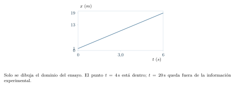
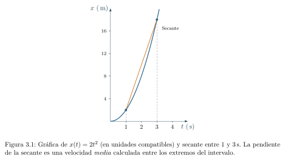
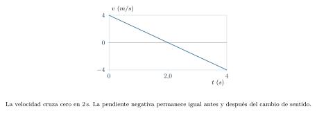
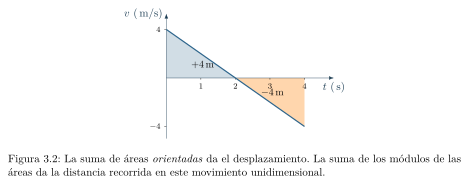
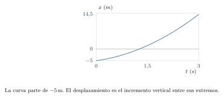
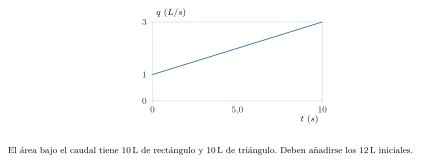
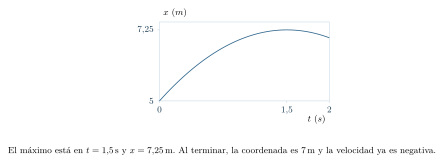
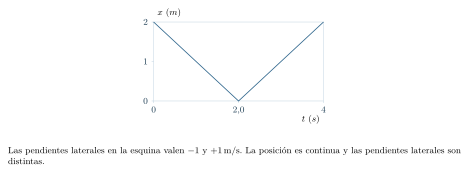

[← Capítulo anterior](capitulo-02.html) · [Índice del libro](index.html) · [Capítulo siguiente →](capitulo-04.html)

En algunos cursos universitarios de física, las derivadas aparecen antes de que el estudiante las haya aprendido en Cálculo I. La matemática puede comenzar por construir rigurosamente los números reales, mientras que la física necesita describir un cuerpo que cambia de posición en cada instante. Ambos recorridos pueden complementarse: aprenderemos el significado y el uso inicial de cada herramienta, precisando qué explicación hemos establecido y qué demostración queda pendiente.

Imaginemos un objeto cuya posición se registra cada segundo. Una tabla indica las posiciones en los instantes medidos; describir el movimiento entre ellos requiere información adicional. Si además queremos conocer su velocidad en un instante preciso, aparece una pregunta inesperada: ¿cómo calcular un cambio en un intervalo de tiempo que se hace cada vez más pequeño? Y si conocemos la velocidad en cada instante, aparece la pregunta inversa: ¿cómo reconstruir todo el desplazamiento acumulado? Esas dos preguntas conducirán, sin comenzar por una lista de reglas, a las ideas de derivada e integral.

### Dos preguntas que originan el cálculo

¿Qué está cambiando *ahora*? ¿Cuánto se ha *acumulado* durante un intervalo? La derivada y la integral nacen de estas preguntas y realizan operaciones distintas.

## Lo que necesitamos saber antes de comenzar

Bastan inicialmente el álgebra elemental, las potencias, las unidades, la lectura de ejes cartesianos y la diferencia entre magnitudes escalares y vectoriales. Recordaremos dos precauciones. Primero, para interpretar una función matemática como una ley física debemos especificar sus variables, unidades y condiciones de aplicación. Segundo, la lectura de una gráfica física reúne los números y las magnitudes representadas en los ejes.

**Comprobación de entrada.** Si $2\,\mathrm{m/s}$ es una velocidad constante durante $3\,\mathrm{s}$, el desplazamiento es $6\,\mathrm{m}$. Si una longitud depende del tiempo mediante $x(t)=x_0+ut$, entonces $x_0$ debe medirse en unidades de longitud y $u$ en unidades de longitud dividida por tiempo. Si estas dos afirmaciones no resultan comprensibles, conviene regresar a las conversiones, el despeje de ecuaciones y las gráficas del capítulo 2 antes de seguir.

{#fig-fp-av-ej-3-01 fig-alt="Ilustración de Lo que necesitamos saber antes de comenzar. Comprobación de entrada. Si 2\\,m/s es una velocidad constante durante 3\\,s, el desplazamiento es 6\\,m. Si una longitud depende del tiempo mediante x(t)=x0+ut, entonces x0 debe medirse en unidades de longitud y u en unidades de longitud dividida por tiempo. Si estas dos afirmaciones no resultan comprensibles, conviene"}

## Una función describe un modelo

Consideremos la expresión
$$
x(t)=3\,\mathrm{m}+(2\,\mathrm{m/s})t.
$$
Aquí $t$ representa el tiempo transcurrido desde un instante elegido como origen y $x(t)$ representa una coordenada de posición respecto de un punto de referencia. La expresión puede describir, por ejemplo, una plataforma que parte a tres metros del origen y avanza con velocidad constante a lo largo de una recta. En $t=0$, su posición es $3\,\mathrm{m}$; en $t=4\,\mathrm{s}$, es $11\,\mathrm{m}$.

{#fig-fp-av-ej-3-02 fig-alt="Ilustración de Una función describe un modelo. Consideremos la expresión x(t)=3\\,m+(2\\,m/s)t. Aquí t representa el tiempo transcurrido desde un instante elegido como origen y x(t) representa una coordenada de posición respecto de un punto de referencia. La expresión puede describir, por ejemplo, una plataforma que parte a tres metros del origen y avanza con"}

Una función asigna a cada elemento de un conjunto $D$ un único valor; el conjunto $D$ es su *dominio*. Al emplearla como modelo físico elegimos un dominio de aplicación y declaramos las unidades y las hipótesis que sostienen esa elección. Para una máquina observada durante los primeros cinco segundos, ese intervalo constituye el respaldo experimental disponible; aplicar la ley a $t=100\,\mathrm{s}$ requiere justificar su prolongación. Una expresión puede admitir tiempos negativos en su dominio matemático; su aplicación a esos tiempos necesita respaldo físico.

### Problema resuelto 3.1 · La ecuación de un experimento limitado {#r3-1}

Durante un ensayo de $0$ a $6\,\mathrm{s}$ se ajusta la coordenada horizontal de un carrito con la función $x(t)=1\,\mathrm{m}+(3\,\mathrm{m/s})t$. Determinar $x(0)$, $x(4\,\mathrm{s})$ y decidir qué puede afirmarse acerca de $x(20\,\mathrm{s})$.

*Resolución.* En el instante inicial se obtiene $x(0)=1\,\mathrm{m}$. Para los cuatro segundos:
$$
x(4\,\mathrm{s})=1\,\mathrm{m}+(3\,\mathrm{m/s})(4\,\mathrm{s})=13\,\mathrm{m}.
$$
Para $20\,\mathrm{s}$ la fórmula da algebraicamente $61\,\mathrm{m}$, una *extrapolación* más allá del intervalo en que se ha establecido el ajuste. La interpretación del cálculo incluye examinar la validez del modelo.

{#fig-fp-av-r3-1 fig-alt="Ilustración de Problema resuelto 3.1 · La ecuación de un experimento limitado. Resolución. En el instante inicial se obtiene x(0)=1\\,m. Para los cuatro segundos: x(4\\,s)=1\\,m+(3\\,m/s)(4\\,s)=13\\,m. Para 20\\,s la fórmula da algebraicamente 61\\,m, una extrapolación más allá del intervalo en que se ha establecido el ajuste. La interpretación del cálculo incluye examinar la validez del modelo."}

## La pendiente nos habla de una variación

Una recta que representa posición frente al tiempo tiene pendiente constante. En la ecuación (3.1), incrementar el tiempo en un segundo incrementa la posición en dos metros. La pendiente posee, por tanto, unidades de velocidad. En una curva, en cambio, la inclinación puede ser diferente según el punto. Una función cuadrática ofrece un ejemplo sencillo:
$$
x(t)=(2\,\mathrm{m/s^2})t^2,\qquad t\geq 0.
$$
Las posiciones son $x(0)=0$, $x(1\,\mathrm{s})=2\,\mathrm{m}$, $x(2\,\mathrm{s})=8\,\mathrm{m}$ y $x(3\,\mathrm{s})=18\,\mathrm{m}$. En tres intervalos sucesivos de un segundo, los incrementos son $2$, $6$ y $10\,\mathrm{m}$. Dividir cada incremento por su duración da $2$, $6$ y $10\,\mathrm{m/s}$: son tasas medias en esos intervalos. La curva se hace más empinada. Para estudiar la secante entre uno y tres segundos reuniremos el desplazamiento de esos dos últimos tramos y su duración.

{#fig-fp-fig-c03-01 fig-alt="Ilustración de La pendiente nos habla de una variación. Una recta que representa posición frente al tiempo tiene pendiente constante. En la ecuación (3.1), incrementar el tiempo en un segundo incrementa la posición en dos metros. La pendiente posee, por tanto, unidades de velocidad. En una curva, en cambio, la inclinación puede ser diferente según el punto. Una función"}

### Problema resuelto 3.2 · Qué significa una pendiente media {#r3-2}

En el modelo cuadrático anterior, hallar la velocidad media entre $t=1\,\mathrm{s}$ y $t=3\,\mathrm{s}$, y comprobar las unidades.

*Resolución.* Durante ese intervalo la coordenada pasa de $2\,\mathrm{m}$ a $18\,\mathrm{m}$. Su incremento es $16\,\mathrm{m}$ y el intervalo dura $2\,\mathrm{s}$. Entonces
$$
\bar v_{[1,3]}=\frac{18\,\mathrm{m}-2\,\mathrm{m}}{3\,\mathrm{s}-1\,\mathrm{s}}=8\,\mathrm{m/s}.
$$
La pendiente de la secante de la figura 3.1 es ocho metros por segundo. Ese valor se obtiene dividiendo el cambio de posición por el tiempo transcurrido; es compatible con distintas velocidades durante el trayecto.

{#fig-fp-av-r3-2 fig-alt="Ilustración de Problema resuelto 3.2 · Qué significa una pendiente media. Resolución. Durante ese intervalo la coordenada pasa de 2\\,m a 18\\,m. Su incremento es 16\\,m y el intervalo dura 2\\,s. Entonces bar v[1,3]=frac18\\,m-2\\,m3\\,s-1\\,s=8\\,m/s. La pendiente de la secante de la figura 3.1 es ocho metros por segundo. Ese valor se obtiene dividiendo el cambio de posición por el tiempo"}

## La tasa media y su límite

Para una función cualquiera $x(t)$, la *tasa media de variación* entre $t_1$ y $t_2$ es
$$
\frac{\Delta x}{\Delta t}=\frac{x(t_2)-x(t_1)}{t_2-t_1},\qquad t_2\ne t_1.
$$
Para la posición de una partícula se trata de su velocidad media. Pensemos ahora que queremos saber la velocidad *justo cuando* $t=2\,\mathrm{s}$. No podemos aplicar la fórmula poniendo $t_1=t_2=2\,\mathrm{s}$: obtendríamos $0/0$, que no es un número. Pero podemos comparar el instante $t$ con otro muy cercano, $t+h$, y estudiar qué sucede al disminuir $h$ sin hacerlo todavía cero.

Tomemos de nuevo $x(t)=kt^2$, donde $k=2\,\mathrm{m/s^2}$. Entonces
$$
\begin{aligned}
\frac{x(t+h)-x(t)}{h}
&=k\,\frac{(t+h)^2-t^2}{h}\\
&=k\,\frac{2th+h^2}{h}=k(2t+h),\qquad h\ne0.
\end{aligned}
$$
Mientras $h$ se aproxima a cero, esta expresión se aproxima a $2kt$. Esta observación motiva la definición de *derivada*:
$$
x'(t)=\frac{dx}{dt}=\lim_{h\to0}\frac{x(t+h)-x(t)}{h},
$$
si el límite existe como un valor finito y único. En un instante interior debemos poder acercarnos desde tiempos anteriores y posteriores y obtener el mismo valor. Al comienzo o al final de un intervalo observado solo disponemos del lado que pertenece al dominio: cuando evaluemos allí velocidad o aceleración, entenderemos el límite desde ese lado. Por tanto, para el modelo considerado,
$$
\boxed{v(t)=x'(t)=2kt=(4\,\mathrm{m/s^2})t.}
$$
El símbolo $dx/dt$ designa la tasa instantánea definida por ese límite; sus unidades son longitud dividida por tiempo. Geométricamente, la derivada se interpreta como la pendiente de la tangente a la gráfica, cuando esa interpretación es válida.

En un curso de análisis estudiaremos cuidadosamente qué significa que exista el límite, bajo qué condiciones lo podemos manipular y cómo se demuestra un teorema general. Aquí hemos justificado algebraicamente el resultado para una función cuadrática concreta, sin pretender haber construido toda la teoría de límites.

### Problema resuelto 3.3 · Una medición cada vez más próxima {#r3-3}

Para $x(t)=(2\,\mathrm{m/s^2})t^2$, determinar la velocidad media entre $2\,\mathrm{s}$ y $2\,\mathrm{s}+h$ con $h=1\,\mathrm{s}$, $0{,}1\,\mathrm{s}$ y $0{,}01\,\mathrm{s}$. Inferir la velocidad instantánea a los $2\,\mathrm{s}$.

*Resolución.* Del cálculo anterior,
$$
\bar v=(2\,\mathrm{m/s^2})(4\,\mathrm{s}+h).
$$
Para los tres incrementos se obtienen $10\,\mathrm{m/s}$, $8{,}2\,\mathrm{m/s}$ y $8{,}02\,\mathrm{m/s}$. Cada reducción de $h$ aproxima la velocidad media a $8\,\mathrm{m/s}$; la tabla hace visible la interpretación de ese límite, cuya demostración exige justificar la tendencia. La expresión algebraica $2k(2\,\mathrm{s}+0)$ verifica que $v(2\,\mathrm{s})=8\,\mathrm{m/s}$.

{#fig-fp-av-r3-3 fig-alt="Ilustración de Problema resuelto 3.3 · Una medición cada vez más próxima. Resolución. Del cálculo anterior, bar v=(2\\,m/s^2)(4\\,s+h). Para los tres incrementos se obtienen 10\\,m/s, 8,2\\,m/s y 8,02\\,m/s. Cada reducción de h aproxima la velocidad media a 8\\,m/s; la tabla hace visible la interpretación de ese límite, cuya demostración exige justificar la tendencia. La expresión algebraica"}

## Derivar también permite estudiar aceleraciones

Si $v(t)$ es la velocidad, su tasa instantánea de cambio se llama *aceleración*: $a(t)=v'(t)$. Para el modelo anterior, donde $v(t)=2kt$, obtenemos $a(t)=2k=4\,\mathrm{m/s^2}$. Esta aceleración es constante aunque la velocidad no lo sea. El efecto de una aceleración negativa sobre la rapidez depende también del signo de la velocidad. Si la velocidad es negativa y la aceleración también lo es, el móvil puede aumentar su rapidez mientras se desplaza en la dirección negativa.

Para trabajar con funciones más variadas necesitamos reglas de derivación. Si $C$ permanece constante respecto del tiempo y $n$ es un entero positivo, las identidades
$$
\frac{d}{dt}C=0,\qquad
\frac{d}{dt}(Ct^n)=nCt^{n-1},\qquad
\frac{d}{dt}(f+g)=f'+g'
$$
permiten derivar polinomios término por término, en intervalos donde están definidos. Cuando $Ct^n$ representa una posición, $C$ tiene unidades de longitud dividida por tiempo a la potencia $n$; al derivar, cada término queda en unidades de velocidad. La derivada de una cantidad constante respecto del tiempo es cero, también cuando esa constante tiene unidades. Cada regla puede justificarse a partir de la definición de derivada. Para $t^2$ ya hemos hecho el cálculo con el cociente incremental; las potencias naturales superiores se estudian expandiendo $(t+h)^n$ y simplificando antes de tomar el límite.

{#fig-fp-av-ej-3-03 fig-alt="Ilustración de Derivar también permite estudiar aceleraciones. Para trabajar con funciones más variadas necesitamos reglas de derivación. Si C permanece constante respecto del tiempo y n es un entero positivo, las identidades fracddtC=0,qquad fracddt(Ct^n)=nCt^n-1,qquad fracddt(f+g)=f'+g' permiten derivar polinomios término por término, en intervalos donde están definidos. Cuando"}

### Problema resuelto 3.4 · Posición, velocidad, aceleración y detención momentánea {#r3-4}

Un móvil tiene, entre $0$ y $4\,\mathrm{s}$, la posición
$$
x(t)=3\,\mathrm{m}+(4\,\mathrm{m/s})t-(1\,\mathrm{m/s^2})t^2.
$$
Calcular velocidad, aceleración e instante de velocidad nula. Interpretar el comportamiento del móvil.

*Resolución.* Derivamos conservando las unidades de los coeficientes:
$$
v(t)=4\,\mathrm{m/s}-(2\,\mathrm{m/s^2})t,\qquad a(t)=-2\,\mathrm{m/s^2}.
$$
Al resolver $v(t)=0$ se obtiene $t=2\,\mathrm{s}$. Antes de ese instante, la velocidad es positiva y decrece hasta cero; después es negativa y su módulo aumenta. En ese instante cambia de sentido. La aceleración conserva el mismo signo durante todo el intervalo, pero el efecto sobre la rapidez cambia según el signo de la velocidad.

{#fig-fp-av-r3-4 fig-alt="Ilustración de Problema resuelto 3.4 · Posición, velocidad, aceleración y detención momentánea. Resolución. Derivamos conservando las unidades de los coeficientes: v(t)=4\\,m/s-(2\\,m/s^2)t,qquad a(t)=-2\\,m/s^2. Al resolver v(t)=0 se obtiene t=2\\,s. Antes de ese instante, la velocidad es positiva y decrece hasta cero; después es negativa y su módulo aumenta. En ese instante cambia de sentido. La aceleración"}

Las funciones trigonométricas también aparecen en la física, especialmente en oscilaciones. Cuando el ángulo se mide en *radianes*, las reglas elementales son
$$
\frac{d}{dt}\sin(\omega t)=\omega\cos(\omega t),\qquad
\frac{d}{dt}\cos(\omega t)=-\omega\sin(\omega t),
$$
donde $\omega$ es constante y el argumento $\omega t$ es adimensional, expresado en radianes. Estas reglas y la regla de la cadena se presentan como herramientas operativas; su fundamentación completa utiliza, entre otros resultados, límites trigonométricos. Trabajar con ángulos en grados requiere incorporar el factor de conversión al derivar.

El factor $\omega$ aparece porque el ángulo también cambia con el tiempo. Si llamamos $\theta(t)=\omega t$, entonces $d\theta/dt=\omega$. La regla de la cadena expresa esa composición como
$$
\frac{d}{dt}\cos\theta(t)=-\sin\theta(t)\,\frac{d\theta}{dt}.
$$
Para $x=A\cos(\omega t)$, la amplitud $A$ multiplica toda la derivada y resulta $v=-A\omega\sin(\omega t)$. Al derivar otra vez aparece un segundo factor $\omega$: $a=-A\omega^2\cos(\omega t)$. Así podemos reconstruir los coeficientes y sus unidades en lugar de recordar tres fórmulas por separado.

### Problema resuelto 3.5 · Una oscilación sencilla {#r3-5}

La coordenada de una masa viene dada por
$$
x(t)=(0{,}10\,\mathrm{m})\cos\bigl((2\,\mathrm{s^{-1}})t\bigr).
$$
Hallar su velocidad y aceleración y evaluarlas en $t=0$.

*Resolución.* Derivando una vez y después otra:
$$
\begin{aligned}
v(t)&=-(0{,}20\,\mathrm{m/s})\sin[(2\,\mathrm{s^{-1}})t],\\
a(t)&=-(0{,}40\,\mathrm{m/s^2})\cos[(2\,\mathrm{s^{-1}})t].
\end{aligned}
$$
La expresión $(2\,\mathrm{s^{-1}})t$ es adimensional y representa un ángulo en radianes. En $t=0$, $v(0)=0$ y $a(0)=-0{,}40\,\mathrm{m/s^2}$. En un extremo de la oscilación la velocidad es nula y la aceleración tiene módulo máximo en este modelo.

{#fig-fp-av-r3-5 fig-alt="Ilustración de Problema resuelto 3.5 · Una oscilación sencilla. Resolución. Derivando una vez y después otra: beginaligned v(t)&=-(0,20\\,m/s)sin[(2\\,mathrms^-1)t],\\\\ a(t)&=-(0,40\\,m/s^2)cos[(2\\,mathrms^-1)t]. endaligned La expresión (2\\,mathrms^-1)t es adimensional y representa un ángulo en radianes. En t=0, v(0)=0 y a(0)=-0,40\\,m/s^2. En un extremo de la oscilación la velocidad"}

## El camino inverso: acumular pequeños desplazamientos

Supongamos que conocemos una velocidad variable y queremos averiguar cuánto cambió la posición. Si la velocidad fuera constante durante un intervalo de duración $\Delta t$, el desplazamiento sería $\Delta x=v\Delta t$. En una gráfica velocidad--tiempo esto se representa mediante un rectángulo, cuya altura es $v$ y cuya base es $\Delta t$. Si la velocidad cambia, podemos dividir el intervalo en tramos, sumar los rectángulos aproximados y mejorar la aproximación reduciendo el ancho de los tramos.

La idea es la misma que se emplea para calcular áreas bajo una curva, pero hay una peculiaridad física fundamental: *si la velocidad tiene signo, la contribución de un intervalo puede ser negativa*. El área geométrica usual mide una superficie positiva; para el desplazamiento usamos un *área orientada*, positiva por encima del eje temporal y negativa por debajo. Esta distinción nos permitirá diferenciar el desplazamiento de la distancia recorrida.

La figura 3.2 muestra el modelo
$$
v(t)=4\,\mathrm{m/s}-(2\,\mathrm{m/s^2})t,\qquad 0\leq t\leq 4\,\mathrm{s}.
$$
El móvil avanza durante los dos primeros segundos y regresa durante los dos segundos siguientes. El área triangular del primer tramo es $+4\,\mathrm{m}$; la del segundo, $-4\,\mathrm{m}$. El desplazamiento total resulta cero, aunque el móvil sí haya recorrido una distancia positiva.

{#fig-fp-fig-c03-02 fig-alt="Ilustración de El camino inverso: acumular pequeños desplazamientos. La figura 3.2 muestra el modelo v(t)=4\\,m/s-(2\\,m/s^2)t,qquad 0leq tleq 4\\,s. El móvil avanza durante los dos primeros segundos y regresa durante los dos segundos siguientes. El área triangular del primer tramo es +4\\,m; la del segundo, -4\\,m. El desplazamiento total resulta cero, aunque el móvil sí haya recorrido una"}

### Problema resuelto 3.6 · Un recorrido que termina donde empezó {#r3-6}

Para la velocidad de la figura 3.2, calcular el desplazamiento y la distancia recorrida entre $t=0$ y $t=4\,\mathrm{s}$.

*Resolución.* En el primer tramo el área triangular es
$$
A_1=\tfrac12(2\,\mathrm{s})(4\,\mathrm{m/s})=4\,\mathrm{m}.
$$
En el segundo tramo la velocidad está por debajo del eje; el área orientada vale $A_2=-4\,\mathrm{m}$. Por tanto,
$$
\Delta x=A_1+A_2=0,
\qquad d_{\mathrm{recorrida}}=|A_1|+|A_2|=8\,\mathrm{m}.
$$
El objeto vuelve a la coordenada de partida después de recorrer posiciones intermedias. La suma orientada representa el desplazamiento y la suma de longitudes de ambos tramos representa la distancia.

{#fig-fp-av-r3-6 fig-alt="Ilustración de Problema resuelto 3.6 · Un recorrido que termina donde empezó. Resolución. En el primer tramo el área triangular es A1=tfrac12(2\\,s)(4\\,m/s)=4\\,m. En el segundo tramo la velocidad está por debajo del eje; el área orientada vale A2=-4\\,m. Por tanto, Delta x=A1+A2=0, qquad drecorrida=|A1|+|A2|=8\\,m. El objeto vuelve a la coordenada de partida después de recorrer posiciones"}

## La integral: del dibujo a una expresión general

Denotemos por $\Delta t$ el ancho de cada intervalo temporal y por $v(t_i)$ la velocidad escogida dentro de él. La suma aproximada de desplazamientos es
$$
\Delta x\approx\sum_{i=1}^{N}v(t_i)\,\Delta t.
$$
La letra $\Sigma$ indica que debemos sumar un término por cada intervalo: para tres intervalos la expresión significa $v(t_1)\Delta t+v(t_2)\Delta t+v(t_3)\Delta t$. El índice $i$ cuenta los intervalos y $N$ es su número total. Si todos tienen igual ancho, $\Delta t=(t_b-t_a)/N$; aumentar $N$ reduce ese ancho manteniendo fijos los extremos del experimento.

Para una velocidad continua en el intervalo cerrado, al refinar las particiones las sumas se aproximan a un mismo valor, cualquiera que sea el punto elegido en cada tramo, siempre que la anchura máxima de los tramos tienda a cero. La continuidad es una condición suficiente que cubre los modelos empleados aquí; el estudio de análisis amplía las clases de funciones integrables. Ese valor es la integral definida, y escribimos
$$
x(t_b)-x(t_a)=\int_{t_a}^{t_b}v(t)\,dt.
$$
Esta es la *integral definida* de la velocidad entre los dos tiempos. La notación reúne $v$ y $dt$ para expresar el límite de las sumas que construyen la acumulación. En problemas de física, las unidades de la integral se obtienen multiplicando las de la tasa por las de la variable: $(\,\mathrm{m/s})(\,\mathrm{s})=\,\mathrm{m}$.

Más adelante escribiremos $[F(t)]_{t_a}^{t_b}$ como abreviatura de $F(t_b)-F(t_a)$: primero se evalúa en el extremo superior y después se resta el valor del inferior.

Una forma extraordinariamente útil de calcular integrales conecta acumulación y derivación. Si una función $F(t)$ cumple $F'(t)=v(t)$, entonces, por el *teorema fundamental del cálculo*, si $v$ es continua en $[t_a,t_b]$ y $F$ es una primitiva suya en ese intervalo,
$$
\int_{t_a}^{t_b}v(t)\,dt=F(t_b)-F(t_a).
$$
La demostración general del teorema corresponde al análisis. Hemos construido su necesidad e ilustramos cómo se utiliza. Esta aproximación física permite llegar a ella con preguntas comprensibles.

Para las funciones que más utilizaremos al principio, una regla operativa sencilla es
$$
\int t^n\,dt=\frac{t^{n+1}}{n+1}+C,\qquad n\ne-1.
$$
Para $n$ entero no negativo vale en toda la recta; para otros exponentes se requiere un intervalo donde la potencia sea real y derivable (por ejemplo, $t>0$). Esta escritura representa una familia de *primitivas*: la derivada de cualquier miembro de la familia es $t^n$. La constante $C$ es necesaria porque todas las funciones que difieren en una constante tienen la misma derivada. A veces se escribe directamente la integral *definida*, con límites, y entonces la constante se cancela en la diferencia $F(t_b)-F(t_a)$.

### Problema resuelto 3.7 · Reconstruir la posición cuando conocemos la velocidad {#r3-7}

Una partícula tiene velocidad
$$
v(t)=2\,\mathrm{m/s}+(3\,\mathrm{m/s^2})t,\qquad 0\leq t\leq3\,\mathrm{s},
$$
y en el instante inicial su posición es $x(0)=-5\,\mathrm{m}$. Hallar $x(t)$ y $x(3\,\mathrm{s})$.

*Resolución.* Una primitiva de la velocidad es
$$
F(t)=(2\,\mathrm{m/s})t+\tfrac12(3\,\mathrm{m/s^2})t^2.
$$
Como el cambio de posición es $F(t)-F(0)$, necesitamos la posición inicial para localizar la trayectoria en el eje:
$$
\boxed{x(t)=-5\,\mathrm{m}+(2\,\mathrm{m/s})t+(1{,}5\,\mathrm{m/s^2})t^2.}
$$
En tres segundos,
$$
x(3\,\mathrm{s})=-5\,\mathrm{m}+6\,\mathrm{m}+13{,}5\,\mathrm{m}=14{,}5\,\mathrm{m}.
$$
La comprobación derivando reproduce la velocidad dada. Obsérvese que el *desplazamiento* fue $19{,}5\,\mathrm{m}$, mientras que la *posición final* es $14{,}5\,\mathrm{m}$. El dato $x(0)$ fija la coordenada inicial y permite determinar esta última posición.

{#fig-fp-av-r3-7 fig-alt="Ilustración de Problema resuelto 3.7 · Reconstruir la posición cuando conocemos la velocidad. Resolución. Una primitiva de la velocidad es F(t)=(2\\,m/s)t+tfrac12(3\\,m/s^2)t^2. Como el cambio de posición es F(t)-F(0), necesitamos la posición inicial para localizar la trayectoria en el eje: boxedx(t)=-5\\,m+(2\\,m/s)t+(1,5\\,m/s^2)t^2. En tres segundos, x(3\\,s)=-5\\,m+6\\,m+13,5\\,m=14,5\\,m. La comprobación derivando"}

### Problema resuelto 3.8 · Una integral también describe un depósito {#r3-8}

El caudal de entrada de agua en un depósito aumenta con el tiempo según
$$
q(t)=1\,\mathrm{L/s}+(0{,}2\,\mathrm{L/s^2})t.
$$
Si inicialmente contiene $12\,\mathrm{L}$, hallar su volumen a los $10\,\mathrm{s}$, suponiendo que no existe salida ni rebose.

*Resolución.* El caudal representa volumen por unidad de tiempo. El agua añadida es
$$
\begin{aligned}
\Delta V&=\int_0^{10\,\mathrm{s}}q(t)\,dt\\
 &=\left[(1\,\mathrm{L/s})t+(0{,}1\,\mathrm{L/s^2})t^2\right]_0^{10\,\mathrm{s}}\\
 &=10\,\mathrm{L}+10\,\mathrm{L}=20\,\mathrm{L}.
\end{aligned}
$$
El volumen final es $12+20=32\,\mathrm{L}$. Si el depósito admitiera menos de esa cantidad, el modelo sin rebose dejaría de describir correctamente la situación. El cálculo muestra tanto su utilidad como sus límites.

{#fig-fp-av-r3-8 fig-alt="Ilustración de Problema resuelto 3.8 · Una integral también describe un depósito. Resolución. El caudal representa volumen por unidad de tiempo. El agua añadida es beginaligned Delta V&=int0^10\\,sq(t)\\,dt\\\\ &=left[(1\\,L/s)t+(0,1\\,L/s^2)t^2right]0^10\\,s\\\\ &=10\\,L+10\\,L=20\\,L. endaligned El volumen final es 12+20=32\\,L. Si el depósito admitiera menos de esa cantidad, el modelo sin rebose dejaría de"}

## Cuando los datos son discretos

En un experimento rara vez conocemos una función exacta de la velocidad. Tenemos mediciones en ciertos instantes. Por ejemplo, supongamos que se registran estos datos:
$$
\begin{array}{c|cccc}
t\ (\,\mathrm{s})&0&1&2&3\\\hline
v\ (\,\mathrm{m/s})&0&2&3&3
\end{array}
$$
Podemos aproximar el desplazamiento multiplicando cada intervalo temporal por una velocidad representativa. Si los datos fueran unidos por segmentos rectos, el área de cada intervalo sería un trapecio. Su fórmula es
$$
\Delta x_i\approx\frac{v_i+v_{i+1}}{2}\,(t_{i+1}-t_i).
$$
La regla del trapecio integra exactamente el modelo lineal que une cada par de datos. Su adecuación al movimiento depende de cuánto se aparte la velocidad real de ese segmento y de la incertidumbre de las mediciones. Una variación rápida puede ser lineal y quedar integrada exactamente; la curvatura y el muestreo determinan el error de interpolación. Nuevas observaciones permiten contrastar el modelo atribuido a cada intervalo.

### Problema resuelto 3.9 · Recuperar un desplazamiento de cuatro mediciones {#r3-9}

Estimar el desplazamiento total asociado a la tabla anterior mediante la regla de los trapecios y comparar con la estimación que usa la velocidad inicial de cada tramo.

*Resolución.* Los intervalos duran un segundo. Los tres trapecios contribuyen $(0+2)/2=1\,\mathrm{m}$, $(2+3)/2=2{,}5\,\mathrm{m}$ y $(3+3)/2=3\,\mathrm{m}$. La estimación total es $6{,}5\,\mathrm{m}$. Con rectángulos de altura igual a la velocidad inicial de cada tramo obtendríamos $(0+2+3)\,\mathrm{m}=5\,\mathrm{m}$. Para conocer el desplazamiento exacto necesitaríamos conocer la velocidad entre las mediciones. Ambas respuestas son estimaciones asociadas a decisiones distintas de modelización.

{#fig-fp-av-r3-9 fig-alt="Ilustración de Problema resuelto 3.9 · Recuperar un desplazamiento de cuatro mediciones. Resolución. Los intervalos duran un segundo. Los tres trapecios contribuyen (0+2)/2=1\\,m, (2+3)/2=2,5\\,m y (3+3)/2=3\\,m. La estimación total es 6,5\\,m. Con rectángulos de altura igual a la velocidad inicial de cada tramo obtendríamos (0+2+3)\\,m=5\\,m. Para conocer el desplazamiento exacto necesitaríamos conocer la"}

## Una primera ecuación diferencial

Hasta aquí hemos usado una función conocida para obtener su derivada o su acumulación. En física es frecuente conocer directamente una *relación entre una función desconocida y su derivada*. Tal relación se llama *ecuación diferencial*. El ejemplo más sencillo es
$$
\frac{dv}{dt}=a_0,
$$
donde $a_0$ es una aceleración constante. Buscar $v(t)$ consiste en encontrar una función cuya derivada sea $a_0$. Por la regla de integración,
$$
v(t)=a_0t+C.
$$
Si sabemos que $v(0)=v_0$, entonces $C=v_0$ y obtenemos
$$
\boxed{v(t)=v_0+a_0t.}
$$
Como también sabemos que $dx/dt=v(t)$, integramos de nuevo y, usando $x(0)=x_0$, obtenemos
$$
\boxed{x(t)=x_0+v_0t+\tfrac12 a_0t^2.}
$$
Las relaciones para el movimiento con aceleración constante han surgido de dos ideas: derivar y acumular. En el capítulo siguiente podremos estudiarlas como leyes de descripción del movimiento, con sus hipótesis y situaciones de aplicación, sin tener que memorizarlas antes de entenderlas. Cuando $a$ varía con el tiempo, debemos integrar su dependencia temporal.

### Problema resuelto 3.10 · La importancia de las condiciones iniciales {#r3-10}

Una partícula se mueve sobre una recta con aceleración constante $a_0=-2\,\mathrm{m/s^2}$. En $t=0$, su posición es $5\,\mathrm{m}$ y su velocidad es $3\,\mathrm{m/s}$. Obtener $v(t)$ y $x(t)$, y calcular la posición a los $2\,\mathrm{s}$.

*Resolución.* Aplicando las ecuaciones (3.11) y (3.12),
$$
v(t)=3\,\mathrm{m/s}-(2\,\mathrm{m/s^2})t,
$$
$$
x(t)=5\,\mathrm{m}+(3\,\mathrm{m/s})t-(1\,\mathrm{m/s^2})t^2.
$$
Por tanto $x(2\,\mathrm{s})=5\,\mathrm{m}+6\,\mathrm{m}-4\,\mathrm{m}=7\,\mathrm{m}$. Comprobamos que $v(0)=3\,\mathrm{m/s}$, $x(0)=5\,\mathrm{m}$ y que la segunda derivada de $x(t)$ es $-2\,\mathrm{m/s^2}$. Son tres controles independientes del cálculo. La posición es $7\,\mathrm{m}$ aunque el móvil ya haya cambiado de sentido antes de $t=2\,\mathrm{s}$: su velocidad se anula a los $1{,}5\,\mathrm{s}$.

{#fig-fp-av-r3-10 fig-alt="Ilustración de Problema resuelto 3.10 · La importancia de las condiciones iniciales. Resolución. Aplicando las ecuaciones (3.11) y (3.12), v(t)=3\\,m/s-(2\\,m/s^2)t, x(t)=5\\,m+(3\\,m/s)t-(1\\,m/s^2)t^2. Por tanto x(2\\,s)=5\\,m+6\\,m-4\\,m=7\\,m. Comprobamos que v(0)=3\\,m/s, x(0)=5\\,m y que la segunda derivada de x(t) es -2\\,m/s^2. Son tres controles independientes del cálculo. La posición es 7\\,m aunque el"}

## Qué hemos justificado y qué queda por demostrar

Una lectura rigurosa distingue las demostraciones establecidas de los resultados que se presentan para un uso inicial. Hemos definido operativamente la tasa media mediante un cociente finito y hemos *calculado* una derivada cuadrática estudiando la expresión incremental. Hemos motivado la integral mediante sumas de pequeños aportes, interpretado la acumulación en gráficos y usado un teorema matemático cuyo enunciado general requiere hipótesis. Hemos adoptado reglas para derivar funciones trigonométricas sin probarlas en toda generalidad. Cada afirmación posee un estatuto diferente.

La teoría de los números reales, la topología de la recta y las definiciones rigurosas de límite, continuidad e integrabilidad permiten después fundamentar esas operaciones sin depender de dibujos ni aproximaciones numéricas. Quien estudie matemáticas puras encontrará allí preguntas distintas, igualmente legítimas: ¿qué es exactamente un límite?, ¿qué condiciones garantizan la existencia de una integral?, ¿puede una función ser continua y no derivable? El encuentro con esa teoría será más fructífero si ya ha conocido problemas físicos que hacen necesarias tales ideas.

Para pasar a Cinemática basta una competencia conceptual firme: distinguir posición, velocidad y aceleración; saber que una derivada mide variación instantánea y que una integral acumula cantidades orientadas; reconocer la función, las unidades y el intervalo de validez. Las reglas simbólicas más amplias y las ecuaciones diferenciales preparan, además, para una lectura universitaria más exigente.

### Problema resuelto 3.11 · Una esquina y dos pendientes laterales {#r3-11}

Consideremos la posición idealizada $x(t)=c\left|t-t_0\right|$, donde $t_0=2\,\mathrm{s}$ y $c=1\,\mathrm{m/s}$. ¿Cuál es la velocidad instantánea en $t=t_0$?

*Resolución.* Para tiempos anteriores a $t_0$ tenemos $x(t)=c(t_0-t)$, cuya pendiente es $-c$. Para tiempos posteriores, $x(t)=c(t-t_0)$, cuya pendiente es $+c$. Justo en el instante de cambio, el cociente incremental vale
$$
\frac{x(t_0+h)-x(t_0)}{h}=c\,\frac{|h|}{h}=
\begin{cases}-c,&h<0,\\+c,&h>0.\end{cases}
$$
No existe un único valor al que se aproximen ambos lados; por ello la derivada en $t_0$ no existe. El dibujo representa una inversión instantánea del sentido de movimiento, útil como modelo geométrico a tramos, pero incompatible con una aceleración ordinaria finita en ese instante. No toda función continua es derivable.

{#fig-fp-av-r3-11 fig-alt="Ilustración de Problema resuelto 3.11 · Una esquina y dos pendientes laterales. Resolución. Para tiempos anteriores a t0 tenemos x(t)=c(t0-t), cuya pendiente es -c. Para tiempos posteriores, x(t)=c(t-t0), cuya pendiente es +c. Justo en el instante de cambio, el cociente incremental vale fracx(t0+h)-x(t0)h=c\\,frac|h|h= begincases-c,&h<0,\\\\+c,&h>0.endcases No existe un único valor al que se"}

## Ejercicios de práctica

Los siguientes problemas son originales y se ordenan por razonamiento requerido. Los niveles B, C y U significan respectivamente fundamento, consolidación y puente universitario, y orientan la profundidad del trabajo propuesto. Las soluciones íntegras aparecen inmediatamente después de la lista.

### Ejercicio 3.1 · Una función con unidades (B) {#e3-1}

Un sensor entrega $x(t)=2\,\mathrm{m}+(3\,\mathrm{m/s})t+(1\,\mathrm{m/s^2})t^2$, validada entre $0$ y $5\,\mathrm{s}$. Identifica la variable independiente, las unidades de los coeficientes, $x(2\,\mathrm{s})$ y por qué no se puede declarar válida en $t=20\,\mathrm{s}$ sin información adicional.

### Ejercicio 3.2 · Una ida y un regreso (B) {#e3-2}

Para $0\leq t\leq6\,\mathrm{s}$, la coordenada de un móvil es $x(t)=(12\,\mathrm{m/s})t-(2\,\mathrm{m/s^2})t^2$. Calcula la velocidad media entre $0$ y $3\,\mathrm{s}$, y el desplazamiento total entre $0$ y $6\,\mathrm{s}$. ¿El segundo resultado demuestra que el objeto estuvo inmóvil?

### Ejercicio 3.3 · Construir una derivada (B) {#e3-3}

Para $x(t)=5\,\mathrm{m}-(3\,\mathrm{m/s})t+(1\,\mathrm{m/s^2})t^2$, desarrolla el cociente $[x(t+h)-x(t)]/h$ y halla la velocidad instantánea en función de $t$. ¿Cuándo se anula?

### Ejercicio 3.4 · Una piedra arrojada hacia arriba (C) {#e3-4}

La altura de una piedra, medida desde el punto de lanzamiento, obedece a $y(t)=(14\,\mathrm{m/s})t-(5\,\mathrm{m/s^2})t^2$, para el movimiento ideal sin resistencia del aire. Halla la velocidad vertical, la aceleración, el instante de altura máxima, esa altura y el tiempo en que vuelve al nivel de lanzamiento.

### Ejercicio 3.5 · Velocidad con signo (B) {#e3-5}

Entre $0$ y $4\,\mathrm{s}$ se observa $v(t)=(2\,\mathrm{m/s^2})t-4\,\mathrm{m/s}$. Calcula el desplazamiento y la distancia recorrida. Realiza también un bosquejo de la gráfica velocidad--tiempo e identifica el cambio de sentido.

### Ejercicio 3.6 · Triángulo y desplazamiento (B) {#e3-6}

En un intervalo $0\leq t\leq4\,\mathrm{s}$ la velocidad es $v(t)=(2\,\mathrm{m/s^2})t$. Halla el desplazamiento usando únicamente la geometría de la gráfica y explica por qué la unidad del área representa una longitud.

### Ejercicio 3.7 · Caudal constante (C) {#e3-7}

Un recipiente inicialmente tiene $5\,\mathrm{L}$ y entra agua a un caudal constante de $3\,\mathrm{L/s}$ durante $12\,\mathrm{s}$, sin pérdidas. Calcula el volumen final mediante una integral. Verifica el resultado por aritmética elemental.

### Ejercicio 3.8 · Carga y corriente (C) {#e3-8}

La corriente eléctrica en un conductor es $I(t)=2\,\mathrm{C/s}+(3\,\mathrm{C/s^2})t$ durante los primeros cuatro segundos. Si la carga neta transferida contabilizada hasta $t=0$ era $1\,\mathrm{C}$, ¿cuál será la carga acumulada hasta $t=4\,\mathrm{s}$? Distingue el valor inicial del incremento.

### Ejercicio 3.9 · Cuatro trapecios (C) {#e3-9}

Se dispone de los siguientes datos de velocidad en instantes enteros:
$$
\begin{array}{c|ccccc}
t\ (\,\mathrm{s})&0&1&2&3&4\\\hline
v\ (\,\mathrm{m/s})&0&1&4&5&8
\end{array}
$$
Estima el desplazamiento con la regla de trapecios. ¿Qué suposición haces sobre el comportamiento entre mediciones?

### Ejercicio 3.10 · Una secante cúbica (C) {#e3-10}

Sea $x(t)=(1\,\mathrm{m/s^3})t^3$. Calcula algebraicamente el cociente incremental y la velocidad instantánea en $t=1\,\mathrm{s}$. Compara con la tasa media hacia delante usando $h=0{,}1\,\mathrm{s}$.

### Ejercicio 3.11 · Oscilación y unidades (C) {#e3-11}

Una partícula oscila como $x(t)=(0{,}10\,\mathrm{m})\cos[(2\,\mathrm{s^{-1}})t]$; el argumento del coseno se expresa en radianes. Obtén $v(t)$, $a(t)$, $v(0)$ y $a(0)$. Justifica dimensionalmente las amplitudes de velocidad y aceleración. Si se duplica $\omega$ manteniendo la amplitud de posición, ¿por qué factores cambian las amplitudes de velocidad y aceleración?

### Ejercicio 3.12 · Una aceleración positiva puede frenar (B) {#e3-12}

Durante $0\leq t\leq3\,\mathrm{s}$ un cuerpo tiene velocidad $v(t)=-6\,\mathrm{m/s}+(2\,\mathrm{m/s^2})t$. Calcula su aceleración, su desplazamiento y la distancia recorrida. ¿Está aumentando su rapidez?

### Ejercicio 3.13 · Aproximación numérica (C) {#e3-13}

Para $v(t)=(2\,\mathrm{m/s^2})t$ entre $0$ y $2\,\mathrm{s}$, estima el desplazamiento con rectángulos izquierdos de ancho $1\,\mathrm{s}$ y luego con ancho $0{,}5\,\mathrm{s}$. Compara con la integral exacta y explica de qué lado quedan ambas estimaciones.

### Ejercicio 3.14 · Una ecuación que aún necesita información (U) {#e3-14}

Un objeto tiene aceleración constante de $2\,\mathrm{m/s^2}$ y se encuentra en $x(0)=10\,\mathrm{m}$. Obtén una familia de posibles funciones $x(t)$ y explica qué dato adicional sería necesario para predecir su posición a los $5\,\mathrm{s}$. Expresa la respuesta en función de ese dato pendiente.

## Soluciones completas de los ejercicios

### Solución 3.1 {#sol-e3-1}
 La variable independiente es el tiempo $t$, medido en segundos, mientras que la variable dependiente es la coordenada $x$, expresada en metros. Cada término de una suma de posiciones debe tener dimensión de longitud. Por eso el término independiente se expresa en metros, el coeficiente de $t$ en metros por segundo y el de $t^2$ en metros por segundo cuadrado. Para el instante pedido:
$$
x(2\,\mathrm{s})=2\,\mathrm{m}+6\,\mathrm{m}+4\,\mathrm{m}=12\,\mathrm{m}.
$$
El dato de que la fórmula fue validada solo entre $0$ y $5\,\mathrm{s}$ impide garantizar su aplicación a $20\,\mathrm{s}$. El valor calculado para ese tiempo es una extrapolación cuya validez física requiere pruebas adicionales.

### Solución 3.2 {#sol-e3-2}
 Calculamos posiciones antes de interpretar. La coordenada inicial es $x(0)=0$ y a los tres segundos vale
$$
x(3\,\mathrm{s})=(12\,\mathrm{m/s})(3\,\mathrm{s})-(2\,\mathrm{m/s^2})(3\,\mathrm{s})^2=18\,\mathrm{m}.
$$
La velocidad media entre ambos instantes es $(18-0)\,\mathrm{m}/3\,\mathrm{s}=6\,\mathrm{m/s}$. Al terminar el intervalo,
$$
x(6\,\mathrm{s})=72\,\mathrm{m}-72\,\mathrm{m}=0,
$$
de modo que el desplazamiento en los seis segundos es cero. Durante el trayecto pasó por otras posiciones: a los tres segundos estaba a $18\,\mathrm{m}$ del origen. Las posiciones intermedias describen el recorrido de ida y vuelta entre esos extremos iguales.

### Solución 3.3 {#sol-e3-3}
 El término constante de $5\,\mathrm{m}$ desaparece del incremento. Escribiendo $u=3\,\mathrm{m/s}$ y $k=1\,\mathrm{m/s^2}$ para aligerar el álgebra,
$$
\begin{aligned}
\frac{x(t+h)-x(t)}{h}
 &=\frac{-u h+k[(t+h)^2-t^2]}{h}\\
 &=-u+k(2t+h),\qquad h\ne0.
\end{aligned}
$$
Al llevar $h$ a cero se obtiene
$$
v(t)=-3\,\mathrm{m/s}+(2\,\mathrm{m/s^2})t.
$$
La velocidad se anula cuando $t=(3\,\mathrm{m/s})/(2\,\mathrm{m/s^2})=1{,}5\,\mathrm{s}$. Para $t$ menores la velocidad es negativa; después es positiva. El móvil cambia de sentido en ese instante si el modelo es válido a ambos lados.

### Solución 3.4 {#sol-e3-4}
 Derivar una vez proporciona
$$
v_y(t)=14\,\mathrm{m/s}-(10\,\mathrm{m/s^2})t,
$$
y la segunda derivada da $a_y=-10\,\mathrm{m/s^2}$. La altura es máxima cuando la velocidad se anula, siempre que el instante se encuentre en el intervalo de validez del movimiento. De $14-10t=0$ resulta $t=1{,}4\,\mathrm{s}$. Sustituyendo:
$$
y(1{,}4\,\mathrm{s})=19{,}6\,\mathrm{m}-9{,}8\,\mathrm{m}=9{,}8\,\mathrm{m}.
$$
Para volver al nivel inicial imponemos $y(t)=0$ y factorizamos $t[(14\,\mathrm{m/s})-(5\,\mathrm{m/s^2})t]=0$. Las raíces son $t=0$ (lanzamiento) y $t=2{,}8\,\mathrm{s}$ (retorno). La simetría de los tiempos se obtiene bajo las hipótesis de aceleración constante y de origen y destino al mismo nivel.

### Solución 3.5 {#sol-e3-5}
 La velocidad es una recta que va de $-4\,\mathrm{m/s}$ en $t=0$ a $+4\,\mathrm{m/s}$ en $t=4\,\mathrm{s}$. Se anula en $t=2\,\mathrm{s}$. Integrando,
$$
\Delta x=\int_0^{4\,\mathrm{s}}\bigl[(2\,\mathrm{m/s^2})t-4\,\mathrm{m/s}\bigr]dt
=16\,\mathrm{m}-16\,\mathrm{m}=0.
$$
Entre $0$ y $2\,\mathrm{s}$ la contribución es el área triangular negativa de módulo $\tfrac12(2\,\mathrm{s})(4\,\mathrm{m/s})=4\,\mathrm{m}$. Entre $2$ y $4\,\mathrm{s}$ la contribución es positiva y también mide $4\,\mathrm{m}$. La distancia recorrida es la suma de módulos: $8\,\mathrm{m}$. Un desplazamiento nulo puede corresponder a un recorrido no nulo.

### Solución 3.6 {#sol-e3-6}
 La velocidad aumenta linealmente de cero a $v(4\,\mathrm{s})=8\,\mathrm{m/s}$. La gráfica delimitada por los ejes y la recta es un triángulo de base $4\,\mathrm{s}$ y altura $8\,\mathrm{m/s}$. El desplazamiento es
$$
\Delta x=\frac12(4\,\mathrm{s})(8\,\mathrm{m/s})=16\,\mathrm{m}.
$$
La unidad del producto es $(\,\mathrm{s})(\,\mathrm{m/s})=\,\mathrm{m}$. En este intervalo la velocidad toma valores positivos o cero; por eso $|v(t)|=v(t)$ y las integrales de rapidez y velocidad dan el mismo valor: $16\,\mathrm{m}$. Con velocidad negativa, el desplazamiento tiene signo negativo mientras la distancia acumula su módulo, como muestra el regreso de e3-5.

### Solución 3.7 {#sol-e3-7}
 Definimos $V(t)$ como volumen. El caudal de entrada es su derivada, $dV/dt=q=3\,\mathrm{L/s}$, mientras el agua permanece entrando al ritmo indicado. La acumulación en los doce segundos es
$$
\Delta V=\int_0^{12\,\mathrm{s}}3\,\mathrm{L/s}\,dt=36\,\mathrm{L}.
$$
Sumamos el volumen inicial: $V(12\,\mathrm{s})=5\,\mathrm{L}+36\,\mathrm{L}=41\,\mathrm{L}$. La comprobación aritmética $3\,\mathrm{L}$ por segundo multiplicado por doce segundos reproduce $36\,\mathrm{L}$. Esta coincidencia es razonable porque el caudal es constante.

### Solución 3.8 {#sol-e3-8}
 La corriente representa tasa de transferencia de carga, de modo que $dq/dt=I(t)$. Su integral entre cero y cuatro segundos determina la carga *adicional*:
$$
\begin{aligned}
\Delta q&=\int_0^{4\,\mathrm{s}} \bigl[2\,\mathrm{C/s}+(3\,\mathrm{C/s^2})t\bigr]dt\\
&= (2\,\mathrm{C/s})(4\,\mathrm{s})+\tfrac12(3\,\mathrm{C/s^2})(4\,\mathrm{s})^2\\
&=8\,\mathrm{C}+24\,\mathrm{C}=32\,\mathrm{C}.
\end{aligned}
$$
La cantidad acumulada desde el origen previo de conteo es $q(4\,\mathrm{s})=1\,\mathrm{C}+32\,\mathrm{C}=33\,\mathrm{C}$. La integral expresa el cambio de la magnitud; hallar su valor final requiere sumar el valor inicial.

### Solución 3.9 {#sol-e3-9}
 Cada intervalo dura $1\,\mathrm{s}$. Para el primer par de datos el trapecio tiene velocidades extremas $0$ y $1\,\mathrm{m/s}$ y representa un desplazamiento estimado de $0{,}5\,\mathrm{m}$. Los tres siguientes aportan
$$
\frac{1+4}{2}\,\mathrm{m}=2{,}5\,\mathrm{m},\quad
\frac{4+5}{2}\,\mathrm{m}=4{,}5\,\mathrm{m},\quad
\frac{5+8}{2}\,\mathrm{m}=6{,}5\,\mathrm{m}.
$$
El total es $0{,}5+2{,}5+4{,}5+6{,}5=14\,\mathrm{m}$. El método supone que el comportamiento entre mediciones puede aproximarse mediante segmentos rectos en la gráfica velocidad--tiempo. Para certificar que $14\,\mathrm{m}$ sea el desplazamiento exacto necesitaríamos conocer la evolución entre las mediciones.

### Solución 3.10 {#sol-e3-10}
 Escribimos $k=1\,\mathrm{m/s^3}$. Desarrollando el cubo,
$$
\begin{aligned}
\frac{x(t+h)-x(t)}{h}
&=k\frac{(t+h)^3-t^3}{h}\\
&=k(3t^2+3th+h^2),\qquad h\ne0.
\end{aligned}
$$
Al tomar el límite $h\to0$ obtenemos $v(t)=3kt^2$, de donde $v(1\,\mathrm{s})=3\,\mathrm{m/s}$. Para $h=0{,}1\,\mathrm{s}$, la velocidad media hacia delante es
$$
\frac{1{,}1^3-1^3}{0{,}1}\,\mathrm{m/s}=3{,}31\,\mathrm{m/s}.
$$
Es mayor que la instantánea porque la pendiente de $x(t)=kt^3$ está aumentando para estos tiempos. El cociente finito describe una media en un intervalo; el valor límite define la magnitud instantánea.

### Solución 3.11 {#sol-e3-11}
 Sea $A=0{,}10\,\mathrm{m}$ y $\omega=2\,\mathrm{s^{-1}}$, con $\omega t$ expresado en radianes. Usando la regla de derivación del coseno y la regla de la cadena:
$$
v(t)=-A\omega\sin(\omega t)
=-(0{,}20\,\mathrm{m/s})\sin(\omega t),
$$
$$
a(t)=-A\omega^2\cos(\omega t)
=-(0{,}40\,\mathrm{m/s^2})\cos(\omega t).
$$
En $t=0$, $\sin0=0$ y $\cos0=1$, luego $v(0)=0$ y $a(0)=-0{,}40\,\mathrm{m/s^2}$. Las dimensiones de las amplitudes surgen de $[A\omega]=\,\mathrm{m/s}$ y $[A\omega^2]=\,\mathrm{m/s^2}$. El ángulo debe expresarse en radianes para usar estas reglas sin factores de conversión adicionales. Al sustituir $\omega$ por $2\omega$, $A\omega$ se duplica y $A\omega^2$ se cuadruplica. La amplitud $A$ de posición permanece fija.

### Solución 3.12 {#sol-e3-12}
 La derivada de la velocidad es la aceleración constante $a=+2\,\mathrm{m/s^2}$. En $t=0$ la velocidad vale $-6\,\mathrm{m/s}$ y en $t=3\,\mathrm{s}$ llega a cero; no cambia de signo dentro del intervalo abierto. El desplazamiento es
$$
\Delta x=\int_0^{3\,\mathrm{s}}\bigl[-6\,\mathrm{m/s}+(2\,\mathrm{m/s^2})t\bigr]dt
=-18\,\mathrm{m}+9\,\mathrm{m}=-9\,\mathrm{m}.
$$
Dado que la velocidad fue negativa todo el tiempo, la distancia recorrida es $\left|\Delta x\right|=9\,\mathrm{m}$. La rapidez pasa de $6\,\mathrm{m/s}$ a cero, así que *disminuye*, pese a que la aceleración es positiva. Para decidir si un cuerpo gana o pierde rapidez debemos comparar los signos de la velocidad y de la aceleración.

### Solución 3.13 {#sol-e3-13}
 La suma izquierda aproxima cada tramo mediante la velocidad al *inicio*. Con paso $1\,\mathrm{s}$, los instantes de muestreo son $0$ y $1\,\mathrm{s}$, de modo que
$$
\Delta x_{1\,\mathrm{s}}\approx(0+2)\,\mathrm{m/s}\cdot1\,\mathrm{s}=2\,\mathrm{m}.
$$
Con paso $0{,}5\,\mathrm{s}$, las velocidades izquierdas son $0,1,2,3\,\mathrm{m/s}$; por tanto
$$
\Delta x_{0{,}5\,\mathrm{s}}\approx(0+1+2+3)\,\mathrm{m/s}\cdot0{,}5\,\mathrm{s}=3\,\mathrm{m}.
$$
La integral exacta resulta
$$
\Delta x=\int_0^{2\,\mathrm{s}} (2\,\mathrm{m/s^2})t\,dt
=\bigl[(1\,\mathrm{m/s^2})t^2\bigr]_0^{2\,\mathrm{s}}=4\,\mathrm{m}.
$$
Ambas sumas subestiman porque la velocidad crece durante todos los tramos y tomamos el valor inicial. Reducir el paso mejoró el resultado, pero ninguna de las dos sumas es la integral exacta.

### Solución 3.14 {#sol-e3-14}
 Como $dv/dt=2\,\mathrm{m/s^2}$, la primera integración produce $v(t)=v_0+(2\,\mathrm{m/s^2})t$, con $v_0$ desconocida. Una segunda integración da
$$
\boxed{x(t)=10\,\mathrm{m}+v_0t+(1\,\mathrm{m/s^2})t^2.}
$$
Esta es una *familia* de movimientos, uno para cada velocidad inicial elegida. En $t=5\,\mathrm{s}$,
$$
x(5\,\mathrm{s})=35\,\mathrm{m}+v_0(5\,\mathrm{s}).
$$
Para asignar un valor numérico único a la coordenada final necesitamos conocer $v_0$ o un dato equivalente, como otra posición en otro instante. La aceleración y la posición inicial deben acompañarse de una condición que fije la velocidad inicial.

## Diagnóstico de salida y puente hacia el capítulo 4

Para continuar, debes poder distinguir una tasa media de una instantánea, interpretar áreas orientadas y reconstruir una función con sus condiciones iniciales. Los ejercicios 3.3, 3.5, 3.7 y 3.14 permiten comprobar esas capacidades. Inténtalos sin consultar sus soluciones antes de resolver los controles siguientes.

**Tres controles de transferencia.** Conviene resolver estas preguntas breves en una hoja en blanco, indicando siempre unidades y justificación.

1. Si $v=3\,\mathrm{m/s}$ durante $4\,\mathrm{s}$ y $x_0=-5\,\mathrm{m}$, calcula por separado desplazamiento y posición final.
2. Si $v$ pasa de $-2\,\mathrm{m/s}$ a cero con $a>0$, ¿crece la rapidez? Explica qué indica cada signo.
3. Si solo conoces $a(t)$, ¿puedes hallar una posición única? Identifica los datos que faltan.

**Contraste después del intento.** (1) $\Delta x=12\,\mathrm{m}$ y $x_f=7\,\mathrm{m}$. (2) La rapidez disminuye de $2\,\mathrm{m/s}$ a cero; la aceleración positiva cambia una velocidad negativa hacia cero. (3) Faltan velocidad y posición en un instante de referencia, o información equivalente.

**Criterio para avanzar.** Resuelve sin ayuda estos controles y los ejercicios 3.3, 3.5, 3.7 y 3.14. Si confundes posición y desplazamiento, reconstruye el problema 3.7; para el signo de la rapidez, el problema 3.4; para las condiciones iniciales, el ejercicio 3.14. Cambia después un dato y comprueba que puedes repetir el razonamiento sin copiar la solución.

---

[← Capítulo anterior](capitulo-02.html) · [Índice del libro](index.html) · [Capítulo siguiente →](capitulo-04.html)
