[← Capítulo anterior](capitulo-03.html) · [Índice del libro](index.html) · [Capítulo siguiente →](capitulo-05.html)

Para predecir cuándo llegará un tren a una estación necesitamos precisar cuantitativamente qué significa que «va rápido». Necesitamos una posición de partida, una referencia para medirla y alguna información sobre la evolución del movimiento. Un problema físico comienza precisamente cuando convertimos una situación en preguntas cuantificables. Ahora utilizaremos el lenguaje construido en los capítulos anteriores para pasar de la descripción a las predicciones.

La *cinemática* describe la evolución de la posición, la velocidad y la aceleración de los cuerpos respecto de una referencia. En una dimensión, esas magnitudes permiten reconstruir el movimiento sobre una recta. La dinámica relacionará después sus cambios con las interacciones entre cuerpos. Revisaremos el significado físico de cada derivada y de cada integral que aparezca.

### Una distinción que utilizaremos siempre

Una velocidad negativa describe una orientación respecto del eje elegido. Para saber si aumenta o disminuye la rapidez debemos compararla con la aceleración.

## Antes de medir un movimiento: elegir la referencia

En una carretera recta elegimos un origen $O$, una dirección positiva y un reloj. La *posición* $x(t)$ es la coordenada del cuerpo en cada instante. Una coordenada negativa sitúa al cuerpo a un lado del origen elegido. Al cambiar el origen, los números describen la misma situación física desde una referencia distinta. La descripción del movimiento requiere especificar una referencia.

La *partícula* de nuestros modelos representa un objeto cuya extensión tiene una influencia despreciable en la cuestión planteada. Para calcular cuánto tarda un tren en atravesar completamente un túnel debemos incluir su longitud; al estudiar la posición de su centro de masa durante un trayecto largo puede resultar razonable la aproximación de partícula.

Distinguiremos *instante* de *intervalo*: $t_0$ nombra la lectura inicial del reloj y $\Delta t=t_f-t_0$ el tiempo transcurrido. En los problemas usaremos $t$ para el tiempo contado desde el instante indicado. Una descripción bien definida exige también señalar qué intervalo de tiempos abarca el modelo.

### Problema resuelto 4.1 · Ir, volver y distinguir dos longitudes {#r4-1}

Una persona parte de $x=-30\,\mathrm{m}$, camina hasta $x=+20\,\mathrm{m}$ y regresa hasta $x=-10\,\mathrm{m}$. Hallar el desplazamiento y la distancia recorrida.

*Resolución.* El desplazamiento es la diferencia entre las posiciones final e inicial:
$$
\Delta x=x_f-x_0=(-10)-(-30)=+20\,\mathrm{m}.
$$
La distancia es la longitud de todo el recorrido. El primer tramo mide $|20-(-30)|=50\,\mathrm{m}$, y el segundo $|-10-20|=30\,\mathrm{m}$. Por tanto, $s=80\,\mathrm{m}$. La persona se encuentra veinte metros a la derecha de su posición inicial, aunque recorrió ochenta metros. El desplazamiento tiene signo en nuestro eje; la distancia es no negativa.

{#fig-fp-av-r4-1 fig-alt="Ilustración de Problema resuelto 4.1 · Ir, volver y distinguir dos longitudes. Resolución. El desplazamiento es la diferencia entre las posiciones final e inicial: Delta x=xf-x0=(-10)-(-30)=+20\\,m. La distancia es la longitud de todo el recorrido. El primer tramo mide |20-(-30)|=50\\,m, y el segundo |-10-20|=30\\,m. Por tanto, s=80\\,m. La persona se encuentra veinte metros a la derecha de su"}

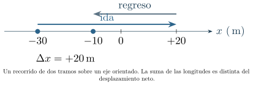{#fig-fp-fig-c04-01 fig-alt="Ilustración de Problema resuelto 4.1 · Ir, volver y distinguir dos longitudes. Resolución. El desplazamiento es la diferencia entre las posiciones final e inicial: Delta x=xf-x0=(-10)-(-30)=+20\\,m. La distancia es la longitud de todo el recorrido. El primer tramo mide |20-(-30)|=50\\,m, y el segundo |-10-20|=30\\,m. Por tanto, s=80\\,m. La persona se encuentra veinte metros a la derecha de su"}

## Rapidez, velocidad y aceleración

La *velocidad media* es la razón entre el desplazamiento y la duración:
$$
\bar v=\frac{\Delta x}{\Delta t}=\frac{x(t_f)-x(t_i)}{t_f-t_i}.
$$
En cambio, la *rapidez media* relaciona la distancia total recorrida con el mismo intervalo: $\bar r=s/\Delta t$. Si el movimiento cambia de sentido, estas dos magnitudes no coinciden en general. El valor absoluto de la velocidad media coincide con la rapidez media cuando se mantiene el sentido del movimiento durante el intervalo.

Para conocer la velocidad *instantánea*, reducimos el intervalo sobre el cual calculamos la razón. En el lenguaje del capítulo 3:
$$
v(t)=\lim_{h\to0}\frac{x(t+h)-x(t)}{h}=\frac{dx}{dt}.
$$
La *rapidez instantánea* es $|v(t)|$. La aceleración media mide el cambio de velocidad por unidad de tiempo, $\bar a=\Delta v/\Delta t$; cuando existe su límite, la aceleración instantánea es
$$
a(t)=\frac{dv}{dt}=\frac{d^2x}{dt^2}.
$$
La igualdad con la segunda derivada requiere que las derivadas indicadas existan. La velocidad se mide en $\,\mathrm{m/s}$ y la aceleración en $\,\mathrm{m/s^2}$. En una dimensión, la velocidad y la aceleración pueden ser positivas, nulas o negativas según el eje y el movimiento. La rapidez, igual a $|v(t)|$, toma valores positivos o cero.

### Problema resuelto 4.2 · La velocidad media puede ocultar el recorrido {#r4-2}

La persona del problema 4.1 realiza todo el trayecto en $40\,\mathrm{s}$. Encontrar su velocidad media y su rapidez media.

*Resolución.* Usando los resultados distintos del problema anterior,
$$
\bar v=\frac{+20\,\mathrm{m}}{40\,\mathrm{s}}=+0{,}50\,\mathrm{m/s},\qquad
\bar r=\frac{80\,\mathrm{m}}{40\,\mathrm{s}}=2{,}0\,\mathrm{m/s}.
$$
Estas dos medias del viaje completo admiten distintas evoluciones de la velocidad instantánea. Para calcular la velocidad media de cada tramo necesitaríamos su duración. Las posiciones inicial y final fijan el desplazamiento; la distancia total requiere además información sobre el camino.

{#fig-fp-av-r4-2 fig-alt="Ilustración de Problema resuelto 4.2 · La velocidad media puede ocultar el recorrido. Resolución. Usando los resultados distintos del problema anterior, bar v=frac+20\\,m40\\,s=+0,50\\,m/s,qquad bar r=frac80\\,m40\\,s=2,0\\,m/s. Estas dos medias del viaje completo admiten distintas evoluciones de la velocidad instantánea. Para calcular la velocidad media de cada tramo necesitaríamos su duración. Las"}

### Problema resuelto 4.3 · Aceleración positiva y disminución de rapidez {#r4-3}

La posición de un cuerpo se modela por
$$
x(t)=3\,\mathrm{m}-(2\,\mathrm{m/s})t+(0{,}5\,\mathrm{m/s^2})t^2,
\qquad 0\leq t\leq4\,\mathrm{s}.
$$
¿Cuándo cambia de sentido? ¿Qué desplazamiento y qué distancia efectúa?

*Resolución.* Derivamos, conservando las unidades de los coeficientes:
$$
v(t)=-2\,\mathrm{m/s}+(1\,\mathrm{m/s^2})t,\qquad a(t)=+1\,\mathrm{m/s^2}.
$$
El cambio de sentido ocurre en $t=2\,\mathrm{s}$, donde $v=0$ y pasa de negativa a positiva. Las posiciones son $x(0)=3\,\mathrm{m}$, $x(2\,\mathrm{s})=1\,\mathrm{m}$ y $x(4\,\mathrm{s})=3\,\mathrm{m}$. De aquí,
$$
\Delta x=x(4\,\mathrm{s})-x(0)=0,
\qquad s=|1-3|+|3-1|=4\,\mathrm{m}.
$$
Durante los primeros dos segundos el cuerpo se mueve en la dirección negativa mientras su aceleración es positiva; su rapidez disminuye. Después crece. Para decidir si aumenta la rapidez debemos comparar el signo de $a$ con el de la velocidad.

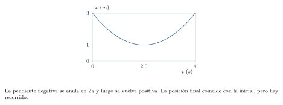{#fig-fp-av-r4-3 fig-alt="Ilustración de Problema resuelto 4.3 · Aceleración positiva y disminución de rapidez. Resolución. Derivamos, conservando las unidades de los coeficientes: v(t)=-2\\,m/s+(1\\,m/s^2)t,qquad a(t)=+1\\,m/s^2. El cambio de sentido ocurre en t=2\\,s, donde v=0 y pasa de negativa a positiva. Las posiciones son x(0)=3\\,m, x(2\\,s)=1\\,m y x(4\\,s)=3\\,m. De aquí, Delta x=x(4\\,s)-x(0)=0, qquad s=|1-3|+|3-1|=4\\,m."}

## Tres gráficas que cuentan una misma historia

Las gráficas de posición, velocidad y aceleración frente al tiempo se relacionan de dos modos. La pendiente de la curva $x(t)$ es $v(t)$ y la pendiente de $v(t)$ es $a(t)$, cuando existen las derivadas. La acumulación de valores de $v$ durante un intervalo, contando sus signos, proporciona el desplazamiento:
$$
\Delta x=\int_{t_i}^{t_f}v(t)\,dt,
\qquad s=\int_{t_i}^{t_f}|v(t)|\,dt.
$$
La segunda integral da la distancia recorrida cuando la posición es suficientemente regular para esta formulación. De modo análogo, $\Delta v=\int a(t)\,dt$. Todas estas relaciones necesitan atender al intervalo temporal y a posibles cambios de sentido.

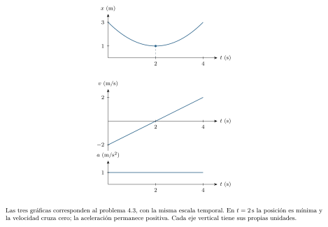{#fig-fp-av-ej-4-01 fig-alt="Ilustración de Tres gráficas que cuentan una misma historia. Las gráficas de posición, velocidad y aceleración frente al tiempo se relacionan de dos modos. La pendiente de la curva x(t) es v(t) y la pendiente de v(t) es a(t), cuando existen las derivadas. La acumulación de valores de v durante un intervalo, contando sus signos, proporciona el desplazamiento: Delta"}

### Problema resuelto 4.4 · De una tabla a un modelo de movimiento {#r4-4}

Una medición entrega $x(0)=0\,\mathrm{m}$, $x(1)=2\,\mathrm{m}$, $x(2)=8\,\mathrm{m}$ y $x(3)=18\,\mathrm{m}$, con tiempos en segundos. Calcular las tres velocidades medias sucesivas y proponer *un* modelo sencillo compatible con los datos.

*Resolución.* En intervalos consecutivos de $1\,\mathrm{s}$, las velocidades medias son $2$, $6$ y $10\,\mathrm{m/s}$. La secuencia sugiere un cambio de velocidad uniforme. El modelo $x(t)=(2\,\mathrm{m/s^2})t^2$ reproduce las cuatro posiciones y tiene $v(t)=(4\,\mathrm{m/s^2})t$ y $a=4\,\mathrm{m/s^2}$. Esos cuatro datos son compatibles también con otros movimientos que pasan por las mismas posiciones en los instantes medidos. Hemos construido un modelo contrastable, cuya elección puede afinarse con nuevas mediciones.

{#fig-fp-av-r4-4 fig-alt="Ilustración de Problema resuelto 4.4 · De una tabla a un modelo de movimiento. Resolución. En intervalos consecutivos de 1\\,s, las velocidades medias son 2, 6 y 10\\,m/s. La secuencia sugiere un cambio de velocidad uniforme. El modelo x(t)=(2\\,m/s^2)t^2 reproduce las cuatro posiciones y tiene v(t)=(4\\,m/s^2)t y a=4\\,m/s^2. Esos cuatro datos son compatibles también con otros movimientos que pasan"}

### Problema resuelto 4.5 · Desplazamiento y distancia bajo el eje {#r4-5}

Durante $0\leq t\leq5\,\mathrm{s}$ la velocidad vale
$$
v(t)=6\,\mathrm{m/s}-(2\,\mathrm{m/s^2})t.
$$
Determinar el desplazamiento y la distancia recorrida.

*Resolución.* La velocidad se anula en $t=3\,\mathrm{s}$ y cambia de positiva a negativa. La integral con signo da
$$
\Delta x=\int_0^{5\,\mathrm{s}}v(t)\,dt
=6\,\mathrm{m/s}(5\,\mathrm{s})-(1\,\mathrm{m/s^2})(5\,\mathrm{s})^2=5\,\mathrm{m}.
$$
La distancia requiere sumar magnitudes de las áreas antes y después del cruce:
$$
s=\frac12(3\,\mathrm{s})(6\,\mathrm{m/s})+
\frac12(2\,\mathrm{s})(4\,\mathrm{m/s})=9\,\mathrm{m}+4\,\mathrm{m}=13\,\mathrm{m}.
$$
Un desplazamiento positivo pequeño puede coexistir con una distancia mucho mayor.

{#fig-fp-av-r4-5 fig-alt="Ilustración de Problema resuelto 4.5 · Desplazamiento y distancia bajo el eje. Resolución. La velocidad se anula en t=3\\,s y cambia de positiva a negativa. La integral con signo da Delta x=int0^5\\,sv(t)\\,dt =6\\,m/s(5\\,s)-(1\\,m/s^2)(5\\,s)^2=5\\,m. La distancia requiere sumar magnitudes de las áreas antes y después del cruce: s=frac12(3\\,s)(6\\,m/s)+ frac12(2\\,s)(4\\,m/s)=9\\,m+4\\,m=13\\,m. Un"}

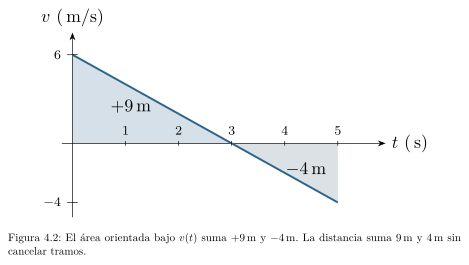{#fig-fp-fig-c04-02 fig-alt="Ilustración de Problema resuelto 4.5 · Desplazamiento y distancia bajo el eje. Resolución. La velocidad se anula en t=3\\,s y cambia de positiva a negativa. La integral con signo da Delta x=int0^5\\,sv(t)\\,dt =6\\,m/s(5\\,s)-(1\\,m/s^2)(5\\,s)^2=5\\,m. La distancia requiere sumar magnitudes de las áreas antes y después del cruce: s=frac12(3\\,s)(6\\,m/s)+ frac12(2\\,s)(4\\,m/s)=9\\,m+4\\,m=13\\,m. Un"}

## Movimiento rectilíneo uniforme: posición inicial y encuentros

Si la velocidad es constante, entonces $a=0$ y la posición evoluciona linealmente:
$$
x(t)=x_0+v(t-t_0).
$$
Una expresión como $x=vt$ es solamente el caso particular $x_0=0$ y $t_0=0$. La velocidad puede ser negativa aunque el movimiento sea uniforme. En una gráfica posición-tiempo, su signo coincide con el de la pendiente. Podemos elegir el origen en cualquier punto y expresar respecto de él la posición inicial.

### Problema resuelto 4.6 · Dos móviles que se encuentran en un eje {#r4-6}

Dos bicicletas se mueven en sentidos contrarios. En $t=0$, A está en $x_A=100\,\mathrm{m}$ y tiene velocidad constante $-6\,\mathrm{m/s}$; B está en $x_B=20\,\mathrm{m}$ con velocidad constante $+4\,\mathrm{m/s}$. Hallar el instante y la posición del encuentro.

*Resolución.* Escribimos una ecuación para cada objeto *en la misma referencia*:
$$
x_A(t)=100\,\mathrm{m}-(6\,\mathrm{m/s})t,
\qquad x_B(t)=20\,\mathrm{m}+(4\,\mathrm{m/s})t.
$$
El encuentro ocurre cuando las posiciones son iguales: $100-6t=20+4t$ al medir las distancias en metros y $t$ en segundos. Entonces $10t=80$, de donde $t=8\,\mathrm{s}$. Al sustituir en cualquiera de las dos leyes resulta $x=52\,\mathrm{m}$. Verificamos: A avanzó $48\,\mathrm{m}$ hacia la izquierda desde $100$; B avanzó $32\,\mathrm{m}$ hacia la derecha desde $20$. Sus recorridos suman los $80\,\mathrm{m}$ de separación inicial.

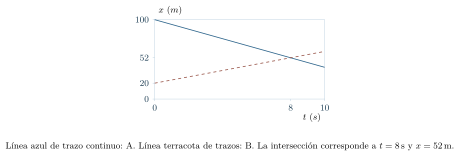{#fig-fp-av-r4-6 fig-alt="Ilustración de Problema resuelto 4.6 · Dos móviles que se encuentran en un eje. Resolución. Escribimos una ecuación para cada objeto en la misma referencia: xA(t)=100\\,m-(6\\,m/s)t, qquad xB(t)=20\\,m+(4\\,m/s)t. El encuentro ocurre cuando las posiciones son iguales: 100-6t=20+4t al medir las distancias en metros y t en segundos. Entonces 10t=80, de donde t=8\\,s. Al sustituir en cualquiera de las"}

## Aceleración constante: deducir antes de memorizar

Una aceleración constante $a$ significa que la velocidad cambia linealmente con el tiempo. Integrar $dv/dt=a$ entre $t_0$ y $t$ da
$$
v(t)=v_0+a(t-t_0).
$$
Al integrar nuevamente, usando $dx/dt=v$, obtenemos
$$
x(t)=x_0+v_0(t-t_0)+\frac12a(t-t_0)^2.
$$
Estas dos expresiones requieren los valores iniciales $x_0$ y $v_0$. La relación
$$
v^2=v_0^2+2a(x-x_0)
$$
puede obtenerse sin dividir por la aceleración. Llamemos $u=t-t_0$. De la ecuación de velocidad, $v-v_0=au$, y de la posición,
$$
2a(x-x_0)=2av_0u+a^2u^2
=(v-v_0)(2v_0+v-v_0)=v^2-v_0^2.
$$
Esta deducción también admite $a=0$; en ese caso solo afirma $v^2=v_0^2$, mientras que el modelo completo impone $v=v_0$. La relación contiene cuadrados de velocidades; el signo de $v$ debe inferirse del problema y de las condiciones iniciales. Las fórmulas solo describen el intervalo donde $a$ es efectivamente constante.

### Problema resuelto 4.7 · Reconstruir un movimiento con condiciones iniciales {#r4-7}

Un móvil comienza con $x_0=-5\,\mathrm{m}$, $v_0=+4\,\mathrm{m/s}$ y aceleración constante $a=+2\,\mathrm{m/s^2}$. Hallar la posición y la velocidad a los $3\,\mathrm{s}$.

*Resolución.* Con $t_0=0$,
$$
v(3\,\mathrm{s})=4\,\mathrm{m/s}+(2\,\mathrm{m/s^2})(3\,\mathrm{s})=10\,\mathrm{m/s},
$$
$$
x(3\,\mathrm{s})=-5\,\mathrm{m}+(4\,\mathrm{m/s})(3\,\mathrm{s})+
\frac12(2\,\mathrm{m/s^2})(3\,\mathrm{s})^2=16\,\mathrm{m}.
$$
El desplazamiento es $21\,\mathrm{m}$; $16\,\mathrm{m}$ es la coordenada final respecto del origen. También podemos comprobar el desplazamiento usando la velocidad media $(4+10)/2=7\,\mathrm{m/s}$, válida aquí para aceleración constante: $7\,\mathrm{m/s}\cdot3\,\mathrm{s}=21\,\mathrm{m}$.

{#fig-fp-av-r4-7 fig-alt="Ilustración de Problema resuelto 4.7 · Reconstruir un movimiento con condiciones iniciales. Resolución. Con t0=0, v(3\\,s)=4\\,m/s+(2\\,m/s^2)(3\\,s)=10\\,m/s, x(3\\,s)=-5\\,m+(4\\,m/s)(3\\,s)+ frac12(2\\,m/s^2)(3\\,s)^2=16\\,m. El desplazamiento es 21\\,m; 16\\,m es la coordenada final respecto del origen. También podemos comprobar el desplazamiento usando la velocidad media (4+10)/2=7\\,m/s, válida aquí para aceleración"}

### Problema resuelto 4.8 · Una posición se alcanza dos veces {#r4-8}

Un cuerpo describe $x(t)=(8\,\mathrm{m/s})t-(1\,\mathrm{m/s^2})t^2$, para $0\leq t\leq8\,\mathrm{s}$. ¿En qué instantes ocupa $x=12\,\mathrm{m}$ y con qué velocidades?

*Resolución.* Al medir el tiempo numéricamente en segundos, resolver $8t-t^2=12$ equivale a $t^2-8t+12=0$, cuyas soluciones son $t=2$ y $t=6$. Así, los instantes son $2\,\mathrm{s}$ y $6\,\mathrm{s}$, ambos pertenecientes al dominio físico. Como
$$
v(t)=8\,\mathrm{m/s}-(2\,\mathrm{m/s^2})t,
$$
las velocidades correspondientes son $+4\,\mathrm{m/s}$ y $-4\,\mathrm{m/s}$. El cuerpo llega a la misma coordenada mientras avanza y, después de invertir su marcha en $t=4\,\mathrm{s}$, vuelve a pasar por ella. Descartar mecánicamente una de las raíces perdería información real sobre el movimiento.

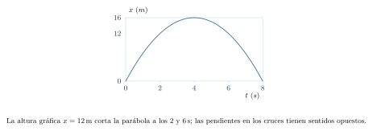{#fig-fp-av-r4-8 fig-alt="Ilustración de Problema resuelto 4.8 · Una posición se alcanza dos veces. Resolución. Al medir el tiempo numéricamente en segundos, resolver 8t-t^2=12 equivale a t^2-8t+12=0, cuyas soluciones son t=2 y t=6. Así, los instantes son 2\\,s y 6\\,s, ambos pertenecientes al dominio físico. Como v(t)=8\\,m/s-(2\\,m/s^2)t, las velocidades correspondientes son +4\\,m/s y -4\\,m/s. El cuerpo llega a la"}

### Problema resuelto 4.9 · El frenado y la distancia necesaria para detenerse {#r4-9}

Un automóvil avanza a $20\,\mathrm{m/s}$ y sufre una desaceleración constante de $4\,\mathrm{m/s^2}$, dirigida en contra del movimiento. ¿Qué distancia recorre antes de detenerse?

*Resolución.* Elegimos positiva la marcha inicial: $v_0=20\,\mathrm{m/s}$ y $a=-4\,\mathrm{m/s^2}$. En el instante en que se detiene $v=0$. Aplicando la relación independiente del tiempo,
$$
0=(20\,\mathrm{m/s})^2+2(-4\,\mathrm{m/s^2})\,\Delta x,
\qquad\Delta x=50\,\mathrm{m}.
$$
La duración es $t=-(v_0/a)=5\,\mathrm{s}$, y la verificación $\bar v=(20+0)/2=10\,\mathrm{m/s}$ da $\Delta x=50\,\mathrm{m}$. Este modelo describe el frenado solo *hasta detenerse*. La prolongación matemática de la aceleración negativa más allá del reposo predice un retroceso; describir la acción posterior de los frenos requiere examinar cómo cambia la interacción al detenerse el automóvil.

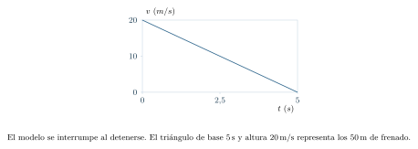{#fig-fp-av-r4-9 fig-alt="Ilustración de Problema resuelto 4.9 · El frenado y la distancia necesaria para detenerse. Resolución. Elegimos positiva la marcha inicial: v0=20\\,m/s y a=-4\\,m/s^2. En el instante en que se detiene v=0. Aplicando la relación independiente del tiempo, 0=(20\\,m/s)^2+2(-4\\,m/s^2)\\,Delta x, qquadDelta x=50\\,m. La duración es t=-(v0/a)=5\\,s, y la verificación bar v=(20+0)/2=10\\,m/s da Delta x=50\\,m. Este modelo"}

### Problema resuelto 4.10 · Una aceleración que se opone al movimiento solo al principio {#r4-10}

Un cuerpo comienza en $x_0=0$ con $v_0=-6\,\mathrm{m/s}$ y aceleración constante $a=+2\,\mathrm{m/s^2}$. Analizar el movimiento hasta $t=5\,\mathrm{s}$.

*Resolución.* Tenemos $v(t)=-6\,\mathrm{m/s}+(2\,\mathrm{m/s^2})t$. En $t=3\,\mathrm{s}$ se anula la velocidad; allí $x=-6(3)+3^2=-9\,\mathrm{m}$ al usar segundos y metros. En $t=5\,\mathrm{s}$ la posición es $x=-6(5)+5^2=-5\,\mathrm{m}$ y la velocidad $+4\,\mathrm{m/s}$. El desplazamiento neto vale $-5\,\mathrm{m}$, pero la distancia es $9+4=13\,\mathrm{m}$. Entre $0$ y $3\,\mathrm{s}$ disminuye la rapidez, y entre $3$ y $5\,\mathrm{s}$ aumenta. Es preciso comparar el signo de $a$ con el de $v$.

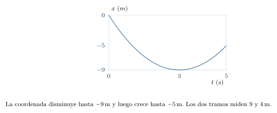{#fig-fp-av-r4-10 fig-alt="Ilustración de Problema resuelto 4.10 · Una aceleración que se opone al movimiento solo al principio. Resolución. Tenemos v(t)=-6\\,m/s+(2\\,m/s^2)t. En t=3\\,s se anula la velocidad; allí x=-6(3)+3^2=-9\\,m al usar segundos y metros. En t=5\\,s la posición es x=-6(5)+5^2=-5\\,m y la velocidad +4\\,m/s. El desplazamiento neto vale -5\\,m, pero la distancia es 9+4=13\\,m. Entre 0 y 3\\,s disminuye la rapidez, y entre 3 y 5\\,s"}

## Caída libre y lanzamiento vertical: una misma convención

En regiones suficientemente pequeñas cerca de la superficie terrestre, podemos aproximar la aceleración gravitacional como constante y vertical, con magnitud $g\approx9{,}8\,\mathrm{m/s^2}$. Elegiremos positiva la dirección vertical hacia arriba. Entonces $a_y=-g$ para un objeto sometido solo a su peso, despreciando la resistencia del aire. Su posición y velocidad se escriben
$$
y(t)=y_0+v_{0y}t-\tfrac12gt^2,
\qquad v_y(t)=v_{0y}-gt.
$$
En la cumbre de un lanzamiento vertical, la velocidad instantánea puede ser cero sin que la aceleración sea cero. La aceleración gravitacional continúa dirigida hacia abajo antes, durante y después de ese instante. La altura de referencia puede escogerse libremente, siempre que se respete de principio a fin.

### Problema resuelto 4.11 · Una piedra soltada desde una altura conocida {#r4-11}

Una piedra se suelta desde $45\,\mathrm{m}$ de altura. Despreciando el aire y usando $g=9{,}8\,\mathrm{m/s^2}$, estimar el tiempo de caída y la velocidad justo antes del impacto.

*Resolución.* Con el eje vertical positivo hacia arriba, si $y_0=45\,\mathrm{m}$, $v_{0y}=0$ y el suelo está en $y=0$, la condición de impacto es $0=45\,\mathrm{m}-\tfrac12gt^2$. Así,
$$
t=\sqrt{\frac{2(45\,\mathrm{m})}{9{,}8\,\mathrm{m/s^2}}}\approx3{,}03\,\mathrm{s}.
$$
Se escoge la raíz positiva porque contamos el tiempo desde la liberación. La velocidad al impacto es $v_y=-gt\approx-29{,}7\,\mathrm{m/s}$; su *rapidez* es $29{,}7\,\mathrm{m/s}$. Si el cuerpo tuviera una resistencia del aire apreciable, las predicciones cambiarían.

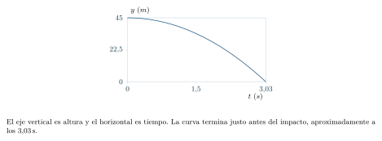{#fig-fp-av-r4-11 fig-alt="Ilustración de Problema resuelto 4.11 · Una piedra soltada desde una altura conocida. Resolución. Con el eje vertical positivo hacia arriba, si y0=45\\,m, v0y=0 y el suelo está en y=0, la condición de impacto es 0=45\\,m-tfrac12gt^2. Así, t=sqrtfrac2(45\\,m)9,8\\,m/s^2approx3,03\\,s. Se escoge la raíz positiva porque contamos el tiempo desde la liberación. La velocidad al impacto es vy=-gtapprox-29,7\\,m/s;"}

### Problema resuelto 4.12 · Altura máxima y regreso al mismo nivel {#r4-12}

Una pelota se lanza verticalmente hacia arriba desde $y_0=0$ con $v_{0y}=19{,}6\,\mathrm{m/s}$, y se desprecia la resistencia del aire. Usa $g=9{,}8\,\mathrm{m/s^2}$. Encontrar el tiempo para alcanzar la altura máxima, esa altura y el instante en que vuelve al nivel inicial.

*Resolución.* En la altura máxima $v_y=0$, por lo que $t_{\max}=v_{0y}/g=2{,}0\,\mathrm{s}$. Sustituimos en la posición:
$$
y_{\max}=(19{,}6\,\mathrm{m/s})(2\,\mathrm{s})-
\frac12(9{,}8\,\mathrm{m/s^2})(2\,\mathrm{s})^2=19{,}6\,\mathrm{m}.
$$
Al igualar $y(t)=0$, la ecuación se factoriza como $t(v_{0y}-\tfrac12gt)=0$. La primera raíz $t=0$ es el lanzamiento; la segunda, $t=2v_{0y}/g=4\,\mathrm{s}$, es el retorno. Esta simetría temporal solo es válida con aceleración constante, igual nivel de partida y llegada, y sin resistencia del aire.

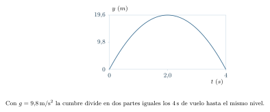{#fig-fp-av-r4-12 fig-alt="Ilustración de Problema resuelto 4.12 · Altura máxima y regreso al mismo nivel. Resolución. En la altura máxima vy=0, por lo que tmax=v0y/g=2,0\\,s. Sustituimos en la posición: ymax=(19,6\\,m/s)(2\\,s)- frac12(9,8\\,m/s^2)(2\\,s)^2=19,6\\,m. Al igualar y(t)=0, la ecuación se factoriza como t(v0y-tfrac12gt)=0. La primera raíz t=0 es el lanzamiento; la segunda, t=2v0y/g=4\\,s, es el retorno. Esta simetría"}

### Problema resuelto 4.13 · Lanzamiento desde una terraza {#r4-13}

Desde una terraza situada a $20\,\mathrm{m}$ del suelo se lanza verticalmente una pelota a $+10\,\mathrm{m/s}$. Encontrar cuándo llega al suelo, con $g=9{,}8\,\mathrm{m/s^2}$.

*Resolución.* La condición de llegada $y=0$ conduce a
$$
0=20\,\mathrm{m}+(10\,\mathrm{m/s})t-(4{,}9\,\mathrm{m/s^2})t^2.
$$
Es una cuadrática cuyos tiempos son
$$
t=\frac{10\pm\sqrt{100+392}}{9{,}8}\,\mathrm{s}
=\frac{10\pm\sqrt{492}}{9{,}8}\,\mathrm{s}.
$$
Solo la raíz positiva representa un instante posterior al lanzamiento: $t\approx3{,}28\,\mathrm{s}$. La velocidad de impacto es $v_y=10-9{,}8t\approx-22{,}2\,\mathrm{m/s}$. La raíz negativa representa un instante de la parábola extrapolada anterior al origen temporal elegido; el impacto futuro corresponde a la raíz positiva.

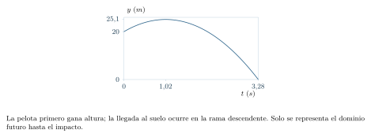{#fig-fp-av-r4-13 fig-alt="Ilustración de Problema resuelto 4.13 · Lanzamiento desde una terraza. Resolución. La condición de llegada y=0 conduce a 0=20\\,m+(10\\,m/s)t-(4,9\\,m/s^2)t^2. Es una cuadrática cuyos tiempos son t=frac10pmsqrt100+3929,8\\,s =frac10pmsqrt4929,8\\,s. Solo la raíz positiva representa un instante posterior al lanzamiento: tapprox3,28\\,s. La velocidad de impacto es vy=10-9,8tapprox-22,2\\,m/s. La"}

## Movimientos por tramos: conservar la información entre etapas

Para decidir cómo resolver, conviene empezar por la información disponible. Una velocidad constante permite relacionar directamente posición y tiempo; una aceleración constante exige además la velocidad inicial. Si no aparece el tiempo entre los datos ni entre las incógnitas, la relación entre $v^2$ y $x-x_0$ puede evitar calcularlo. Cuando se conoce una función $a(t)$ variable, hay que recuperar primero $v(t)$ y después $x(t)$, usando ambas condiciones iniciales. Esta elección del modelo precede a la sustitución de números.

En muchos problemas el movimiento cambia de régimen: un vehículo acelera, mantiene después una rapidez y finalmente frena. Cada etapa debe emplear el valor de $a$ que le corresponde. Si el cuerpo sigue una trayectoria continua sin saltos de posición, la posición final de una etapa es la inicial de la siguiente. En ausencia de un impulso idealizado o de una discontinuidad especificada, también mantenemos continua la velocidad. Lo que puede cambiar bruscamente en un modelo por tramos es la aceleración, aunque las fuerzas reales no siempre lo hagan instantáneamente.

### Problema resuelto 4.14 · Acelerar y luego frenar sin detenerse {#r4-14}

Un cuerpo comienza con $x_0=0$ y $v_0=1\,\mathrm{m/s}$. Su aceleración vale $+2\,\mathrm{m/s^2}$ durante los primeros $3\,\mathrm{s}$ y $-1\,\mathrm{m/s^2}$ durante los siguientes $4\,\mathrm{s}$. Encontrar $x$ y $v$ al finalizar cada tramo.

*Resolución.* En la primera etapa,
$$
v_1=1+(2)(3)=7\,\mathrm{m/s},\qquad
x_1=0+(1)(3)+\tfrac12(2)(3)^2=12\,\mathrm{m},
$$
con unidades SI implícitas en los factores numéricos. En la segunda etapa usamos $\tau=t-3\,\mathrm{s}$, con $0\leq\tau\leq4\,\mathrm{s}$, y las *condiciones de enlace* $x(\tau=0)=12\,\mathrm{m}$ y $v(\tau=0)=7\,\mathrm{m/s}$:
$$
v_2=7\,\mathrm{m/s}-(1\,\mathrm{m/s^2})(4\,\mathrm{s})=3\,\mathrm{m/s},
$$
$$
x_2=12\,\mathrm{m}+(7\,\mathrm{m/s})(4\,\mathrm{s})-
\tfrac12(1\,\mathrm{m/s^2})(4\,\mathrm{s})^2=32\,\mathrm{m}.
$$
Al cambiar la aceleración, la posición y la velocidad conservan sus valores de enlace entre etapas. En el segundo tramo la velocidad sigue siendo positiva; por tanto el cuerpo avanza mientras disminuye su rapidez.

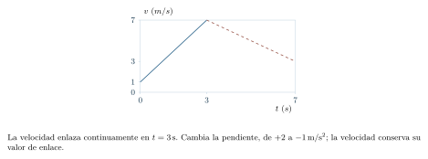{#fig-fp-av-r4-14 fig-alt="Ilustración de Problema resuelto 4.14 · Acelerar y luego frenar sin detenerse. Resolución. En la primera etapa, v1=1+(2)(3)=7\\,m/s,qquad x1=0+(1)(3)+tfrac12(2)(3)^2=12\\,m, con unidades SI implícitas en los factores numéricos. En la segunda etapa usamos tau=t-3\\,s, con 0leqtauleq4\\,s, y las condiciones de enlace x(tau=0)=12\\,m y v(tau=0)=7\\,m/s: v2=7\\,m/s-(1\\,m/s^2)(4\\,s)=3\\,m/s,"}

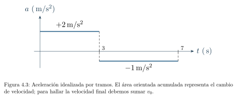{#fig-fp-fig-c04-03 fig-alt="Ilustración de Problema resuelto 4.14 · Acelerar y luego frenar sin detenerse. Resolución. En la primera etapa, v1=1+(2)(3)=7\\,m/s,qquad x1=0+(1)(3)+tfrac12(2)(3)^2=12\\,m, con unidades SI implícitas en los factores numéricos. En la segunda etapa usamos tau=t-3\\,s, con 0leqtauleq4\\,s, y las condiciones de enlace x(tau=0)=12\\,m y v(tau=0)=7\\,m/s: v2=7\\,m/s-(1\\,m/s^2)(4\\,s)=3\\,m/s,"}

## Qué podemos inferir realmente de las mediciones

Interpretar una gráfica o una tabla requiere precisar las relaciones y las hipótesis del modelo. Si observamos posiciones en cinco instantes, podemos encontrar velocidades medias entre lecturas y contrastar leyes candidatas. Para conocer la velocidad exacta en los instantes intermedios necesitamos información o hipótesis adicionales. Incluso una gráfica obtenida de muchos datos necesita criterios sobre resolución, error y ajuste. Ser cuidadoso con esta diferencia es parte de pensar físicamente.

### Problema resuelto 4.15 · Estimar un desplazamiento a partir de tres velocidades {#r4-15}

Un sensor registra velocidades $0$, $2$ y $4\,\mathrm{m/s}$ en $t=0$, $1$ y $2\,\mathrm{s}$, respectivamente. Aproximar el desplazamiento mediante trapecios de ancho $1\,\mathrm{s}$ y explicar por qué la cifra no es necesariamente exacta.

*Resolución.* El método de los trapecios supone que, entre cada par de datos, la velocidad se aproxima por una recta. Por ello,
$$
\Delta x\approx\frac{0+2}{2}\,\mathrm{m/s}\,(1\,\mathrm{s})+
\frac{2+4}{2}\,\mathrm{m/s}\,(1\,\mathrm{s})=4\,\mathrm{m}.
$$
El resultado es exacto *si* la velocidad cambia linealmente durante cada tramo. Pero una función distinta puede coincidir exactamente con las tres lecturas. Por ejemplo, además del modelo lineal $v_A(t)=(2\,\mathrm{m/s^2})t$, el modelo
$$
v_B(t)=(2\,\mathrm{m/s^2})t+(0{,}5\,\mathrm{m/s})[1-\cos(2\pi t/(1\,\mathrm{s}))]
$$
coincide en esos tres tiempos y tiene un desplazamiento total de $5\,\mathrm{m}$ entre $0$ y $2\,\mathrm{s}$, pues su término adicional acumula $1\,\mathrm{m}$ sobre ese intervalo. La descripción del comportamiento intermedio procede de la interpolación elegida; su exactitud requiere contraste adicional.

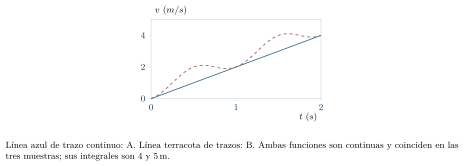{#fig-fp-av-r4-15 fig-alt="Ilustración de Problema resuelto 4.15 · Estimar un desplazamiento a partir de tres velocidades. Resolución. El método de los trapecios supone que, entre cada par de datos, la velocidad se aproxima por una recta. Por ello, Delta xapproxfrac0+22\\,m/s\\,(1\\,s)+ frac2+42\\,m/s\\,(1\\,s)=4\\,m. El resultado es exacto si la velocidad cambia linealmente durante cada tramo. Pero una función distinta puede coincidir"}

### Problema resuelto 4.16 · Recuperar posición a partir de aceleración variable {#r4-16}

Un cuerpo tiene $a(t)=(6\,\mathrm{m/s^3})t$, con $v(0)=2\,\mathrm{m/s}$ y $x(0)=-3\,\mathrm{m}$. Hallar $v(t)$, $x(t)$ y $x(2\,\mathrm{s})$.

*Resolución.* La primera integración da
$$
v(t)=2\,\mathrm{m/s}+(3\,\mathrm{m/s^3})t^2.
$$
Integramos de nuevo y utilizamos la posición inicial:
$$
x(t)=-3\,\mathrm{m}+(2\,\mathrm{m/s})t+(1\,\mathrm{m/s^3})t^3.
$$
En $t=2\,\mathrm{s}$ resulta $x=-3+4+8=9\,\mathrm{m}$. Comprobamos derivando dos veces: $dx/dt=2\,\mathrm{m/s}+(3\,\mathrm{m/s^3})t^2$ y $d^2x/dt^2=(6\,\mathrm{m/s^3})t$. Con condiciones iniciales incompletas obtendríamos una familia de movimientos compatibles.

{#fig-fp-av-r4-16 fig-alt="Ilustración de Problema resuelto 4.16 · Recuperar posición a partir de aceleración variable. Resolución. La primera integración da v(t)=2\\,m/s+(3\\,m/s^3)t^2. Integramos de nuevo y utilizamos la posición inicial: x(t)=-3\\,m+(2\\,m/s)t+(1\\,m/s^3)t^3. En t=2\\,s resulta x=-3+4+8=9\\,m. Comprobamos derivando dos veces: dx/dt=2\\,m/s+(3\\,m/s^3)t^2 y d^2x/dt^2=(6\\,m/s^3)t. Con condiciones iniciales incompletas"}

Elegimos ejes paralelos con igual orientación, un tiempo común y orígenes coincidentes en $t=0$. El origen del observador se traslada uniformemente según $x_O(t)=Ut$. El modelo clásico relaciona las coordenadas mediante $x'=x-Ut$ y las velocidades mediante $v'=v-U$. En una referencia *inercial*, una partícula libre conserva su velocidad; el capítulo 6 desarrollará el fundamento dinámico de esta propiedad. Usamos aquí este cambio de referencia en el régimen clásico de velocidades ordinarias.

### Problema resuelto 4.17 · Velocidad relativa a un observador en movimiento {#r4-17}

En un eje fijo a una carretera, un tren avanza a $+18\,\mathrm{m/s}$ y una persona en otro vehículo se mueve a $+25\,\mathrm{m/s}$. ¿Qué velocidad observa esta última para el tren, si ambas referencias son inerciales y los orígenes coinciden en $t=0$?

*Resolución.* Si $x_O(t)=(25\,\mathrm{m/s})t$, la posición relativa es $x'=x-x_O$. Al derivar, $v'=v-v_O=18-25=-7\,\mathrm{m/s}$. Para quien viaja a $25\,\mathrm{m/s}$, el tren se mueve hacia atrás a una rapidez de $7\,\mathrm{m/s}$. El signo depende de la orientación escogida; ningún conductor necesita retroceder respecto del camino para observar una velocidad relativa negativa. Usamos transformaciones galileanas, adecuadas al régimen de velocidades ordinarias de este modelo.

{#fig-fp-av-r4-17 fig-alt="Ilustración de Problema resuelto 4.17 · Velocidad relativa a un observador en movimiento. Resolución. Si xO(t)=(25\\,m/s)t, la posición relativa es x'=x-xO. Al derivar, v'=v-vO=18-25=-7\\,m/s. Para quien viaja a 25\\,m/s, el tren se mueve hacia atrás a una rapidez de 7\\,m/s. El signo depende de la orientación escogida; ningún conductor necesita retroceder respecto del camino para observar una velocidad"}

## Ejercicios de práctica

Resuelve los problemas por escrito antes de leer las soluciones. En cada caso declara el sistema de referencia, usa unidades coherentes y comprueba que el resultado pertenece al dominio del problema. Hay ejercicios deliberadamente subdeterminados.

### Ejercicio 4.1 · Recorrido con retorno {#e4-1}

Una persona pasa de $x=-5\,\mathrm{m}$ a $x=15\,\mathrm{m}$ y vuelve a $x=3\,\mathrm{m}$ en $8\,\mathrm{s}$. Halla el desplazamiento, distancia, velocidad media y rapidez media.

### Ejercicio 4.2 · Una ecuación lineal con posición inicial {#e4-2}

Dado $x(t)=2\,\mathrm{m}-(3\,\mathrm{m/s})t$, hallar $x(4\,\mathrm{s})$, $\Delta x$ en $0\leq t\leq4\,\mathrm{s}$ y la velocidad instantánea.

### Ejercicio 4.3 · Encuentro con posiciones iniciales distintas {#e4-3}

En una recta, A parte de $x=0$ a $+6\,\mathrm{m/s}$ y B de $x=120\,\mathrm{m}$ a $-4\,\mathrm{m/s}$, ambos con velocidad constante. ¿Dónde y cuándo se encuentran?

### Ejercicio 4.4 · Parábola con retorno {#e4-4}

Para $0\leq t\leq6\,\mathrm{s}$, un móvil sigue $x(t)=5\,\mathrm{m}-(6\,\mathrm{m/s})t+(1\,\mathrm{m/s^2})t^2$. Halla $v$, $a$, el punto de retorno, el desplazamiento y la distancia.

### Ejercicio 4.5 · Velocidad que cambia de signo {#e4-5}

Durante $0\leq t\leq5\,\mathrm{s}$ la velocidad vale $v(t)=4\,\mathrm{m/s}-(2\,\mathrm{m/s^2})t$. Halla $\Delta x$ y la distancia recorrida.

### Ejercicio 4.6 · Condiciones iniciales necesarias {#e4-6}

Un cuerpo parte de $x_0=-1\,\mathrm{m}$ con $v_0=2\,\mathrm{m/s}$ y $a=3\,\mathrm{m/s^2}$ constante. ¿Cuáles son $x(4\,\mathrm{s})$ y $v(4\,\mathrm{s})$?

### Ejercicio 4.7 · Detener un móvil {#e4-7}

Un tren reduce uniformemente su velocidad de $12\,\mathrm{m/s}$ a cero con aceleración de $-3\,\mathrm{m/s^2}$. Calcula el tiempo y la distancia de frenado.

### Ejercicio 4.8 · Dos momentos para una misma posición {#e4-8}

En $t\geq0$, $x(t)=(9\,\mathrm{m/s})t-(1{,}5\,\mathrm{m/s^2})t^2$. Hallar los instantes en que $x=9\,\mathrm{m}$ y las velocidades correspondientes.

### Ejercicio 4.9 · Un lanzamiento vertical {#e4-9}

Desde el suelo se lanza una pelota con $v_{0y}=14{,}7\,\mathrm{m/s}$ hacia arriba. Usa $g=9{,}8\,\mathrm{m/s^2}$. Calcula tiempo hasta la altura máxima, altura máxima y regreso al suelo.

### Ejercicio 4.10 · Caída desde un edificio {#e4-10}

Una piedra se suelta desde $19{,}6\,\mathrm{m}$ con velocidad inicial nula. Para $g=9{,}8\,\mathrm{m/s^2}$, determina tiempo y rapidez de impacto.

### Ejercicio 4.11 · Velocidad por dos tramos ideales {#e4-11}

El registro se aproxima por $v=-2\,\mathrm{m/s}$ durante los primeros $2\,\mathrm{s}$ y $v=+3\,\mathrm{m/s}$ durante los $3\,\mathrm{s}$ siguientes. Halla desplazamiento y distancia. ¿Qué idealización física delicada contiene el cambio brusco de velocidad?

### Ejercicio 4.12 · Cambiar de aceleración {#e4-12}

Un objeto comienza en reposo en $x=0$. Acelera a $+2\,\mathrm{m/s^2}$ durante $2\,\mathrm{s}$ y luego a $-1\,\mathrm{m/s^2}$ durante $4\,\mathrm{s}$. Hallar las posiciones y velocidades al final de cada tramo.

### Ejercicio 4.13 · Una velocidad sin tiempo {#e4-13}

Un cuerpo lleva $v_0=5\,\mathrm{m/s}$, experimenta una aceleración constante $a=+1{,}5\,\mathrm{m/s^2}$ y se desplaza $+20\,\mathrm{m}$. ¿Cuál es su velocidad final, suponiendo que no invierte el sentido?

### Ejercicio 4.14 · ¿Qué nos dicen dos posiciones? {#e4-14}

Un móvil tiene $x(0)=10\,\mathrm{m}$ y $x(2\,\mathrm{s})=18\,\mathrm{m}$. Calcula la velocidad media. ¿Puedes determinar $x(5\,\mathrm{s})$ sin otra hipótesis? ¿Qué obtendrías si fuera MRU?

### Ejercicio 4.15 · Una referencia que se mueve {#e4-15}

Un automóvil viaja a $+20\,\mathrm{m/s}$ y una bicicleta a $+12\,\mathrm{m/s}$ en la misma recta. Determina la velocidad de la bicicleta respecto del automóvil.

### Ejercicio 4.16 · Aceleración que depende del tiempo {#e4-16}

Sea $a(t)=(3\,\mathrm{m/s^3})t$, con $v_0=1\,\mathrm{m/s}$ y $x_0=2\,\mathrm{m}$. Hallar $v(t)$, $x(t)$ y ambas cantidades en $t=2\,\mathrm{s}$.

### Ejercicio 4.17 · Tres lecturas y un área aproximada {#e4-17}

Un sensor lee $v=0$, $2$ y $4\,\mathrm{m/s}$ en $t=0$, $1$ y $2\,\mathrm{s}$. Aproxima el desplazamiento por trapecios y explica qué dato falta para afirmar que es exacto.

### Ejercicio 4.18 · Verdadero o falso, con justificación {#e4-18}

Determina si cada enunciado es verdadero en todos los movimientos rectilíneos: (a) aceleración negativa implica disminución de rapidez; (b) desplazamiento nulo implica distancia nula; (c) velocidad constante implica aceleración cero; (d) en la cumbre de un lanzamiento vertical la aceleración es cero.

### Ejercicio 4.19 · Una pelota desde un techo {#e4-19}

Una pelota sale verticalmente hacia arriba a $5\,\mathrm{m/s}$ desde una terraza situada a $30\,\mathrm{m}$ del suelo. Usa $g=10\,\mathrm{m/s^2}$. Determina la altura máxima, cuándo llega al suelo y su velocidad de impacto.

### Ejercicio 4.20 · Diagnóstico de modelos {#e4-20}

Dos cuerpos parten del mismo punto en $t=0$. A sigue $x_A(t)=(2\,\mathrm{m/s})t$, mientras B sigue $x_B(t)=(0{,}5\,\mathrm{m/s^2})t^2$. (a) ¿En qué instante positivo se vuelven a encontrar? (b) ¿Tienen igual velocidad en ese instante? (c) ¿Qué supuesto adicional hace falta para asegurar que estos modelos describen objetos reales?

## Soluciones completas de los ejercicios

### Solución 4.1 {#sol-e4-1}
 El desplazamiento es $3-(-5)=+8\,\mathrm{m}$. La distancia suma $|15-(-5)|+|3-15|=20+12=32\,\mathrm{m}$. Con $\Delta t=8\,\mathrm{s}$, la velocidad media es $+1\,\mathrm{m/s}$ y la rapidez media $4\,\mathrm{m/s}$. Aunque el desplazamiento sea positivo, en la segunda etapa hubo movimiento en el sentido contrario.

### Solución 4.2 {#sol-e4-2}
 Sustituyendo $t=4\,\mathrm{s}$, $x(4\,\mathrm{s})=2-12=-10\,\mathrm{m}$. El desplazamiento es $-10-2=-12\,\mathrm{m}$. La función es lineal y su derivada es la velocidad constante $v=-3\,\mathrm{m/s}$, coherente con $\Delta x=v\Delta t$.

### Solución 4.3 {#sol-e4-3}
 En la misma referencia, $x_A(t)=(6\,\mathrm{m/s})t$ y $x_B(t)=120\,\mathrm{m}-(4\,\mathrm{m/s})t$. Igualando, $(10\,\mathrm{m/s})t=120\,\mathrm{m}$, luego $t=12\,\mathrm{s}$ y $x=72\,\mathrm{m}$. Las distancias avanzadas, $72$ y $48\,\mathrm{m}$, completan los $120\,\mathrm{m}$ iniciales.

### Solución 4.4 {#sol-e4-4}
 Derivando, $v(t)=-6\,\mathrm{m/s}+(2\,\mathrm{m/s^2})t$ y $a=2\,\mathrm{m/s^2}$. En $t=3\,\mathrm{s}$ cambia de sentido y la posición mínima es $x=5-18+9=-4\,\mathrm{m}$. Como $x(0)=x(6\,\mathrm{s})=5\,\mathrm{m}$, el desplazamiento es cero. La distancia suma $|{-4}-5|+|5-({-4})|=18\,\mathrm{m}$.

### Solución 4.5 {#sol-e4-5}
 La velocidad se hace cero en $t=2\,\mathrm{s}$; el desplazamiento es $\int_0^{5\,\mathrm{s}}v(t)\,dt=4(5)-5^2=-5\,\mathrm{m}$, con coeficientes en SI. Las áreas por separado miden $\frac12(2)(4)=4\,\mathrm{m}$ y $\frac12(3)(6)=9\,\mathrm{m}$, de modo que la distancia es $13\,\mathrm{m}$. El signo negativo del desplazamiento indica la orientación del cambio de posición.

### Solución 4.6 {#sol-e4-6}
 La velocidad final es $v=2+(3)(4)=14\,\mathrm{m/s}$. La coordenada final vale $x=-1+(2)(4)+\frac12(3)(4)^2=-1+8+24=31\,\mathrm{m}$, con unidades SI. El desplazamiento es $32\,\mathrm{m}$ y la diferencia con la coordenada se debe a $x_0\ne0$.

### Solución 4.7 {#sol-e4-7}
 Si $v(t)=12\,\mathrm{m/s}-(3\,\mathrm{m/s^2})t$, la condición $v=0$ da $t=4\,\mathrm{s}$. La distancia de frenado (sin cambio de sentido) es $\bar v\,t=(12+0)/2\,\mathrm{m/s}\cdot4\,\mathrm{s}=24\,\mathrm{m}$. También resulta de $v^2=v_0^2+2a\Delta x$.

### Solución 4.8 {#sol-e4-8}
 De $9t-1{,}5t^2=9$ (con $t$ en segundos) se obtiene $t^2-6t+6=0$, y por tanto $t_{1,2}=(3\mp\sqrt3)\,\mathrm{s}$, aproximadamente $1{,}27\,\mathrm{s}$ y $4{,}73\,\mathrm{s}$. Como $v(t)=9\,\mathrm{m/s}-(3\,\mathrm{m/s^2})t$, las velocidades son $+3\sqrt3\,\mathrm{m/s}$ y $-3\sqrt3\,\mathrm{m/s}$. Ambas raíces son posteriores al inicio y físicamente admisibles.

### Solución 4.9 {#sol-e4-9}
 En la altura máxima $v_y=0$, por lo que $t_{\max}=14{,}7/9{,}8=1{,}5\,\mathrm{s}$. La altura ganada es $h=v_0^2/(2g)=11{,}025\,\mathrm{m}\approx11{,}0\,\mathrm{m}$. La pelota regresa al suelo en $2t_{\max}=3{,}0\,\mathrm{s}$, bajo el modelo ideal y con los mismos niveles de partida y llegada.

### Solución 4.10 {#sol-e4-10}
 Con $y(t)=19{,}6\,\mathrm{m}-\frac12(9{,}8\,\mathrm{m/s^2})t^2$, la llegada al suelo requiere $t^2=4\,\mathrm{s^2}$. Escogemos $t=2\,\mathrm{s}$ porque corresponde al instante posterior al inicio. La velocidad en ese instante es $-19{,}6\,\mathrm{m/s}$ si el eje positivo apunta hacia arriba, de modo que la rapidez de impacto vale $19{,}6\,\mathrm{m/s}$.

### Solución 4.11 {#sol-e4-11}
 El desplazamiento por tramos es $(-2)(2)+(3)(3)=+5\,\mathrm{m}$, con unidades SI, y la distancia es $4+9=13\,\mathrm{m}$. Un salto de velocidad de $-2$ a $+3\,\mathrm{m/s}$ en tiempo nulo representaría una aceleración impulsiva idealizada; su descripción física requiere especificar la interacción que lo causa. Para cálculo de áreas por tramos podemos usar esa idealización sin pretender que retrata la transición real.

### Solución 4.12 {#sol-e4-12}
 El reloj sigue contando desde el comienzo, pero en cada fórmula necesitamos la duración de su propio tramo. El segundo empieza en $t=2\,\mathrm{s}$ y dura $4\,\mathrm{s}$, por lo que termina en $t=6\,\mathrm{s}$. Las condiciones iniciales del segundo tramo son las finales del primero. En los primeros $2\,\mathrm{s}$, $v_1=(2)(2)=4\,\mathrm{m/s}$ y $x_1=\frac12(2)(2)^2=4\,\mathrm{m}$. En los siguientes $4\,\mathrm{s}$, a partir de $x_1,v_1$, $v_2=4-(1)(4)=0$ y $x_2=4+(4)(4)-\frac12(1)(4)^2=12\,\mathrm{m}$. Se conservaron las condiciones al pasar de un tramo al siguiente; el movimiento nunca retrocedió.

### Solución 4.13 {#sol-e4-13}
 Aplicamos la ecuación independiente del tiempo y calculamos el cuadrado de la velocidad:
$$
v^2=(5\,\mathrm{m/s})^2+2(1{,}5\,\mathrm{m/s^2})(20\,\mathrm{m})
=85\,\mathrm{m^2/s^2}.
$$
Luego $v=+\sqrt{85}\,\mathrm{m/s}\approx9{,}22\,\mathrm{m/s}$. La raíz positiva está justificada porque inicialmente avanza hacia la derecha, su aceleración tiene el mismo sentido y el enunciado especifica que no invierte la marcha.

### Solución 4.14 {#sol-e4-14}
 La velocidad media es $(18-10)\,\mathrm{m}/2\,\mathrm{s}=4\,\mathrm{m/s}$. Determinar $x(5\,\mathrm{s})$ requiere más condiciones: movimientos no uniformes pueden compartir esos dos puntos. Bajo la hipótesis adicional de MRU, $x(t)=10\,\mathrm{m}+(4\,\mathrm{m/s})t$ y por ello $x(5\,\mathrm{s})=30\,\mathrm{m}$.

### Solución 4.15 {#sol-e4-15}
 La velocidad relativa de la bicicleta respecto del automóvil es $v_{b/a}=v_b-v_a=12-20=-8\,\mathrm{m/s}$ sobre el eje elegido. El automóvil se aleja hacia delante; para su ocupante la bicicleta se mueve hacia atrás a una rapidez relativa de $8\,\mathrm{m/s}$. Ambas velocidades absolutas respecto de la carretera eran positivas.

### Solución 4.16 {#sol-e4-16}
 Integrando $a(t)=(3\,\mathrm{m/s^3})t$ con $v_0=1\,\mathrm{m/s}$ se obtiene $v(t)=1\,\mathrm{m/s}+(1{,}5\,\mathrm{m/s^3})t^2$. Otra integración, con $x_0=2\,\mathrm{m}$, da $x(t)=2\,\mathrm{m}+(1\,\mathrm{m/s})t+(0{,}5\,\mathrm{m/s^3})t^3$. En $t=2\,\mathrm{s}$, $v=7\,\mathrm{m/s}$ y $x=2+2+4=8\,\mathrm{m}$. Las derivadas devuelven la aceleración dada.

### Solución 4.17 {#sol-e4-17}
 Aplicando trapecios sobre dos intervalos de $1\,\mathrm{s}$, $\Delta x\approx(0+2)/2+(2+4)/2=4\,\mathrm{m}$, con el factor de tiempo incorporado. Faltan mediciones o un modelo justificado para saber cómo cambió $v(t)$ entre los instantes observados. Una función curvada puede pasar por los mismos tres valores y producir un área diferente.

### Solución 4.18 {#sol-e4-18}
 (a) Falso: con $v<0$ y $a<0$ la rapidez aumenta. (b) Falso: ir y volver al origen produce desplazamiento cero y distancia positiva. (c) Verdadero en un intervalo donde la velocidad es constante y derivable, pues $a=dv/dt=0$. (d) Falso en el modelo de caída libre: en la cumbre $v_y=0$ pero $a_y=-g$. Cada afirmación necesita la distinción entre componente con signo, módulo y derivada.

### Solución 4.19 {#sol-e4-19}
 Con eje positivo hacia arriba, $y(t)=30\,\mathrm{m}+(5\,\mathrm{m/s})t-(5\,\mathrm{m/s^2})t^2$. La cumbre ocurre en $t=0{,}5\,\mathrm{s}$ y la altura máxima es $30+2{,}5-1{,}25=31{,}25\,\mathrm{m}$. Para llegar al suelo $30+5t-5t^2=0$ equivale a $t^2-t-6=0$, cuyas raíces son $t=3\,\mathrm{s}$ y $t=-2\,\mathrm{s}$; escogemos $3\,\mathrm{s}$. En ese instante $v_y=5-10(3)=-25\,\mathrm{m/s}$ y la rapidez vale $25\,\mathrm{m/s}$.

### Solución 4.20 {#sol-e4-20}
 Las posiciones se igualan para $2t=0{,}5t^2$ con $t$ medido en segundos. Las soluciones son $t=0$ y $t=4\,\mathrm{s}$, así que se encuentran nuevamente en el instante positivo $4\,\mathrm{s}$ y en $x=8\,\mathrm{m}$. Las velocidades son $v_A=2\,\mathrm{m/s}$ y $v_B=(1\,\mathrm{m/s^2})t$, que en $t=4\,\mathrm{s}$ vale $4\,\mathrm{m/s}$. Dos móviles pueden coincidir en posición con velocidades distintas. Para contrastar los modelos con cuerpos reales se comparan las posiciones y velocidades previstas con las mediciones. El capítulo 6 permitirá examinar además qué fuerzas sostienen la velocidad constante de A y la aceleración constante de B.

## Diagnóstico de salida

El lector debe poder resolver un encuentro de móviles sobre una recta con condiciones iniciales; reconstruir una gráfica de posición o velocidad a partir de una ley temporal; determinar si un móvil gana o pierde rapidez comparando los signos de velocidad y aceleración; y separar desplazamiento, distancia y posición final. Los ejercicios 4.3, 4.4, 4.8, 4.12, 4.17 y 4.19 constituyen pruebas escritas para estas capacidades.

Una preparación universitaria requiere relacionar las ecuaciones con sus hipótesis, su deducción y su significado físico. Consiste en reconocer cuándo se aplican, derivarlas si se olvidan, explicar su alcance y confrontarlas con mediciones. En el siguiente capítulo la posición será un vector en el plano: cada componente conservará la lógica desarrollada aquí, pero necesitaremos relacionar simultáneamente direcciones distintas.

**Comprobación sin consultar las soluciones.** Para $x(t)=1\,\mathrm{m}-(4\,\mathrm{m/s})t+(1\,\mathrm{m/s^2})t^2$, entre $0$ y $3\,\mathrm{s}$, bosqueja $x(t)$, $v(t)$ y $a(t)$. Marca el retorno, calcula desplazamiento y distancia, y explica si hay aceleración cuando $v=0$. Después justifica qué tendrías que cambiar en tu método si la aceleración dependiera del tiempo.

**Contraste después del intento.** $v(t)=-4\,\mathrm{m/s}+(2\,\mathrm{m/s^2})t$ y $a=2\,\mathrm{m/s^2}$. El retorno ocurre en $t=2\,\mathrm{s}$ y $x=-3\,\mathrm{m}$; $x(3\,\mathrm{s})=-2\,\mathrm{m}$, por lo que $\Delta x=-3\,\mathrm{m}$ y $s=4+1=5\,\mathrm{m}$. La aceleración sigue siendo positiva en el retorno. Si $a$ varía, se recuperan $v$ y $x$ mediante dos integraciones con sus condiciones iniciales. Para revisar las gráficas vuelve al problema 4.3; para la distancia, al 4.5; para aceleración variable, al 4.16.

---

[← Capítulo anterior](capitulo-03.html) · [Índice del libro](index.html) · [Capítulo siguiente →](capitulo-05.html)
