[← Capítulo anterior](capitulo-04.html) · [Índice del libro](index.html) · [Capítulo siguiente →](capitulo-06.html)

Una pelota lanzada hacia una canasta avanza mientras sube y baja. La altura permite predecir cuándo volverá al suelo; el avance horizontal sitúa ese regreso y permite decidir si pasa por encima del aro. Las dos descripciones tienen que referirse a la misma pelota y al mismo instante. Esta exigencia sencilla será el hilo conductor del capítulo.

Las coordenadas y los vectores del capítulo 2 permiten reunir esas descripciones. Cada componente conservará las relaciones entre posición, velocidad y aceleración que construimos en los capítulos 3 y 4. La novedad aparecerá al recomponerlas: un móvil puede acelerar sin cambiar su rapidez, dos caminos pueden cruzarse sin que sus viajeros se encuentren y una trayectoria puede verse diferente desde un tren y desde el suelo.

## Una posición necesita dos coordenadas

En una explanada elegimos un origen, un eje horizontal $x$ y otro eje perpendicular $y$. En una vista desde arriba podemos orientar $x$ al este e $y$ al norte; en un lanzamiento de pelota será más útil orientar $y$ hacia arriba. La elección pertenece al modelo y debe acompañar a los números. Escribiremos la posición como
$$
\vec r(t)=x(t)\,\hat\imath+y(t)\,\hat\jmath.
$$
Los vectores unitarios $\hat\imath$ y $\hat\jmath$, ya introducidos en el capítulo 2, tienen módulo uno y dimensión uno; fijan las direcciones positivas de los ejes. El vector $\vec r$ tiene dimensión de longitud. El par $(x,y)$ designa sus componentes en los ejes elegidos.

Representamos el cuerpo mediante un punto cuando sus dimensiones permiten responder la pregunta con la precisión buscada. Estudiar el paso de una pelota por un punto idealiza tanto la pelota como el blanco; para decidir si cabe por una abertura necesitamos también sus dimensiones. Esta elección delimita lo que podremos concluir de una coincidencia de coordenadas.

Entre dos instantes, el desplazamiento es
$$
\Delta\vec r=\vec r(t_f)-\vec r(t_i)
=\Delta x\,\hat\imath+\Delta y\,\hat\jmath,
\qquad |\Delta\vec r|=\sqrt{(\Delta x)^2+(\Delta y)^2}.
$$
Su módulo es la distancia en línea recta entre los extremos. La distancia recorrida depende también del camino: cada desvío puede aumentar su longitud sin modificar el desplazamiento.

### Problema resuelto 5.1 · Dos tramos y una diagonal {#r5-1}

Una persona camina desde $(0,0)$ hasta $(3,0)\,\mathrm{m}$ y después hasta $(3,4)\,\mathrm{m}$. El recorrido dura $10\,\mathrm{s}$. Determina desplazamiento, distancia, velocidad media y rapidez media.

*Resolución.* El extremo final determina $\Delta\vec r=(3\hat\imath+4\hat\jmath)\,\mathrm{m}$, cuyo módulo es $5\,\mathrm{m}$. El camino tiene dos tramos perpendiculares, de modo que su longitud es $s=3+4=7\,\mathrm{m}$. Dividimos magnitudes distintas por la misma duración:
$$
\begin{aligned}\overline{\vec v}&=(0{,}3\hat\imath+0{,}4\hat\jmath)\,\mathrm{m/s},
\\ \overline{u}&=0{,}7\,\mathrm{m/s}.\end{aligned}
$$
Aquí $|\overline{\vec v}|=0{,}5\,\mathrm{m/s}$ describe el desplazamiento por unidad de tiempo; la rapidez media se calcula con la longitud del camino. La diagonal resume el cambio entre la posición inicial y la final.

{#fig-fp-av-r5-1 fig-alt="Ilustración de Problema resuelto 5.1 · Dos tramos y una diagonal. Resolución. El extremo final determina Deltavec r=(3hatimath+4hatjmath)\\,m, cuyo módulo es 5\\,m. El camino tiene dos tramos perpendiculares, de modo que su longitud es s=3+4=7\\,m. Dividimos magnitudes distintas por la misma duración: beginalignedoverlinevec v&=(0,3hatimath+0,4hatjmath)\\,m/s, \\\\"}

La velocidad media es $\overline{\vec v}=\Delta\vec r/\Delta t$. Para conocer lo que sucede en un instante tomamos el límite de ese cociente, componente por componente, en unos ejes que permanecen fijos:
$$
\vec v=\frac{d\vec r}{dt}
=\frac{dx}{dt}\hat\imath+\frac{dy}{dt}\hat\jmath,
\qquad
\vec a=\frac{d\vec v}{dt}
=\frac{d^2x}{dt^2}\hat\imath+\frac{d^2y}{dt^2}\hat\jmath.
$$
Se entiende que existen las derivadas escritas. Al dividir un pequeño desplazamiento por su duración obtenemos una dirección que, en una curva regular, se aproxima a la tangente. Por eso la velocidad es tangente a la trayectoria cuando es distinta de cero. La aceleración describe cómo cambia ese vector y puede tener una dirección distinta.

Trabajaremos con trayectorias continuas cuyas componentes tienen derivadas continuas por tramos en el intervalo observado. Esto permite empalmar etapas del movimiento y calcular la longitud sumando sus aportes. La rapidez instantánea será $u=|\vec v|=\sqrt{v_x^2+v_y^2}$. Usamos $u$ para distinguir el escalar del vector $\vec v$. La distancia recorrida se obtiene acumulando esa rapidez en los tramos:
$$
s=\int_{t_i}^{t_f}\sqrt{v_x(t)^2+v_y(t)^2}\,dt.
$$
Algunas funciones requieren métodos numéricos para calcular la integral. La fórmula sigue teniendo sentido y puede aproximarse con una tabla de velocidades, del mismo modo que aproximamos áreas en el capítulo 3.

### Problema resuelto 5.2 · La dirección cambia aunque una componente sea constante {#r5-2}

Un móvil sigue $x(t)=(3\,\mathrm{m/s})t$ e $y(t)=(1\,\mathrm{m/s^2})t^2$ para $0\leq t\leq3\,\mathrm{s}$. Encuentra posición, velocidad, rapidez y aceleración en $t=2\,\mathrm{s}$.

*Resolución.* Primero derivamos las dos funciones y después evaluamos en el mismo instante:
$$
\vec v(t)=3\,\mathrm{m/s}\,\hat\imath+(2\,\mathrm{m/s^2})t\,\hat\jmath,
\qquad \vec a=2\,\mathrm{m/s^2}\,\hat\jmath.
$$
En $t=2\,\mathrm{s}$ la posición es $(6,4)\,\mathrm{m}$ y la velocidad $(3,4)\,\mathrm{m/s}$; por Pitágoras, $u=5\,\mathrm{m/s}$. La dirección de la velocidad forma $\arctan(4/3)\simeq53{,}1^\circ$ sobre $+x$. Este ángulo pertenece al primer cuadrante porque ambas componentes son positivas. El cociente $y/x=4/6$ daría la dirección de la posición, una pregunta diferente. La componente horizontal de la velocidad permanece constante, mientras la vertical crece: cambian tanto la rapidez como la dirección del movimiento.

{#fig-fp-av-r5-2 fig-alt="Ilustración de Problema resuelto 5.2 · La dirección cambia aunque una componente sea constante. Resolución. Primero derivamos las dos funciones y después evaluamos en el mismo instante: vec v(t)=3\\,m/s\\,hatimath+(2\\,m/s^2)t\\,hatjmath, qquad vec a=2\\,m/s^2\\,hatjmath. En t=2\\,s la posición es (6,4)\\,m y la velocidad (3,4)\\,m/s; por Pitágoras, u=5\\,m/s. La dirección de la velocidad forma arctan(4/3)simeq53,1^circ"}

Las dos ecuaciones $x=x(t)$ e $y=y(t)$ constituyen una descripción *paramétrica*: el tiempo es el parámetro común. Si eliminamos $t$ obtenemos una relación geométrica entre las coordenadas, pero podemos perder información sobre cuándo se ocupa cada punto, en qué sentido se recorre la curva y qué parte de ella pertenece al intervalo observado.

### Problema resuelto 5.3 · Una misma curva con horarios diferentes {#r5-3}

Para $0\leq t\leq2\,\mathrm{s}$ se proponen dos movimientos:
$$
\begin{array}{ll}
x_A=(2\,\mathrm{m/s})t,&y_A=(1\,\mathrm{m/s^2})t^2,\\
x_B=(4\,\mathrm{m/s})t,&y_B=(4\,\mathrm{m/s^2})t^2.
\end{array}
$$
Compara las relaciones $y(x)$ y el paso por $(4,4)\,\mathrm{m}$.

*Resolución.* En A, $t=x/(2\,\mathrm{m/s})$; en B, $t=x/(4\,\mathrm{m/s})$. Al sustituir, ambos dan $y=x^2/(4\,\mathrm{m})$. Sin embargo, A llega al punto indicado en $2\,\mathrm{s}$ y B en $1\,\mathrm{s}$. Sus velocidades allí son $(2,4)\,\mathrm{m/s}$ y $(4,8)\,\mathrm{m/s}$. Tienen la misma dirección tangente y distinta rapidez. Además, durante el intervalo dado A solo alcanza $x=4\,\mathrm{m}$, mientras B alcanza $x=8\,\mathrm{m}$: cada uno recorre un arco distinto de la curva soporte.

{#fig-fp-av-r5-3 fig-alt="Ilustración de Problema resuelto 5.3 · Una misma curva con horarios diferentes. Resolución. En A, t=x/(2\\,m/s); en B, t=x/(4\\,m/s). Al sustituir, ambos dan y=x^2/(4\\,m). Sin embargo, A llega al punto indicado en 2\\,s y B en 1\\,s. Sus velocidades allí son (2,4)\\,m/s y (4,8)\\,m/s. Tienen la misma dirección tangente y distinta rapidez. Además, durante el intervalo dado A solo alcanza x=4\\,m,"}

## Reconstruir el movimiento por componentes

Cuando $\vec a$ es constante en unos ejes fijos, sus componentes también lo son. Podemos aplicar a cada una el razonamiento del capítulo 4. Si $\tau=t-t_0$, la integración de $d\vec v/dt=\vec a$ y después de $d\vec r/dt=\vec v$ proporciona
$$
\vec v(t)=\vec v_0+\vec a\,\tau,
\qquad
\vec r(t)=\vec r_0+\vec v_0\tau+\tfrac12\vec a\,\tau^2.
$$
El término $\tfrac12\vec a\tau^2$ es un vector de longitud que se suma a los otros desplazamientos. La expresión incluye el caso $\vec a=\vec0$ y permite elegir libremente el origen de posiciones. Si la aceleración depende del tiempo, debemos integrar sus componentes conservando las condiciones iniciales; reemplazarla por su valor final en estas fórmulas, en general, produce otro movimiento.

### Problema resuelto 5.4 · Una aceleración constante oblicua {#r5-4}

En $t=0$ un móvil tiene $\vec r_0=(1,2)\,\mathrm{m}$ y $\vec v_0=(3,-1)\,\mathrm{m/s}$. Durante los siguientes $2\,\mathrm{s}$ su aceleración es $\vec a=(-2,4)\,\mathrm{m/s^2}$. Encuentra su estado final.

*Resolución.* Trabajamos con la misma duración en ambos ejes:
$$
\begin{aligned}
x(2\,\mathrm{s})&=1+3(2)-\tfrac12(2)(2)^2=3\,\mathrm{m},\\
y(2\,\mathrm{s})&=2-1(2)+\tfrac12(4)(2)^2=8\,\mathrm{m}.
\end{aligned}
$$
En estas sustituciones los valores numéricos están expresados en SI. La velocidad final es $(3,-1)+(-2,4)(2)=(-1,7)\,\mathrm{m/s}$ y la rapidez $\sqrt{50}\,\mathrm{m/s}$. La componente $v_x$ se anula en $1{,}5\,\mathrm{s}$ y cambia de signo; en ese instante el móvil se desplaza verticalmente con $v_y=5\,\mathrm{m/s}$. La anulación del vector requiere que se anulen todas sus componentes a la vez.

{#fig-fp-av-r5-4 fig-alt="Ilustración de Problema resuelto 5.4 · Una aceleración constante oblicua. Resolución. Trabajamos con la misma duración en ambos ejes: beginaligned x(2\\,s)&=1+3(2)-tfrac12(2)(2)^2=3\\,m,\\\\ y(2\\,s)&=2-1(2)+tfrac12(4)(2)^2=8\\,m. endaligned En estas sustituciones los valores numéricos están expresados en SI. La velocidad final es (3,-1)+(-2,4)(2)=(-1,7)\\,m/s y la rapidez sqrt50\\,m/s. La"}

### Problema resuelto 5.5 · La aceleración cambia durante el trayecto {#r5-5}

Para $0\leq t\leq2\,\mathrm{s}$, sean $\vec a(t)=2\,\mathrm{m/s^2}\,\hat\imath+(6\,\mathrm{m/s^3})t\,\hat\jmath$, $\vec v_0=(1,-2)\,\mathrm{m/s}$ y $\vec r_0=\vec0$. Determina $\vec v(t)$, $\vec r(t)$ y sus valores finales.

*Resolución.* Integramos desde el instante inicial para que las constantes de integración queden fijadas por los datos:
$$
\begin{aligned}
v_x(t)&=1\,\mathrm{m/s}+(2\,\mathrm{m/s^2})t,\\
v_y(t)&=-2\,\mathrm{m/s}+(3\,\mathrm{m/s^3})t^2,\\
x(t)&=(1\,\mathrm{m/s})t+(1\,\mathrm{m/s^2})t^2,\\
y(t)&=-(2\,\mathrm{m/s})t+(1\,\mathrm{m/s^3})t^3.
\end{aligned}
$$
En $2\,\mathrm{s}$ obtenemos $\vec v=(5,10)\,\mathrm{m/s}$ y $\vec r=(6,4)\,\mathrm{m}$. Si tratáramos $a_y(2\,\mathrm{s})=12\,\mathrm{m/s^2}$ como constante durante todo el intervalo, predeciríamos $v_y=-2+12(2)=22\,\mathrm{m/s}$. Ese valor prolonga a todo el intervalo la aceleración final de un movimiento cuya aceleración varía. Derivar las funciones obtenidas recupera exactamente los datos originales.

{#fig-fp-av-r5-5 fig-alt="Ilustración de Problema resuelto 5.5 · La aceleración cambia durante el trayecto. Resolución. Integramos desde el instante inicial para que las constantes de integración queden fijadas por los datos: beginaligned vx(t)&=1\\,m/s+(2\\,m/s^2)t,\\\\ vy(t)&=-2\\,m/s+(3\\,m/s^3)t^2,\\\\ x(t)&=(1\\,m/s)t+(1\\,m/s^2)t^2,\\\\ y(t)&=-(2\\,m/s)t+(1\\,m/s^3)t^3. endaligned En 2\\,s obtenemos vec v=(5,10)\\,m/s y vec"}

## Proyectiles: dos movimientos y un solo reloj

Una pelota que abandona una mesa conserva inicialmente la velocidad horizontal que tenía sobre ella y empieza a caer. El avance horizontal y la caída ocurren simultáneamente desde el lanzamiento. En el modelo que usaremos, el movimiento horizontal y el vertical evolucionan simultáneamente, con aceleraciones $a_x=0$ y $a_y=-g$ cuando $y$ apunta hacia arriba.

Supondremos una región próxima a la superficie terrestre, suficientemente pequeña para considerar $g$ constante y las verticales paralelas. Despreciaremos resistencia del aire, sustentación, giro de la Tierra y variaciones de $g$. El modelo describe el vuelo libre antes del primer choque; una pared o el suelo pueden terminarlo antes de lo que sugiera la prolongación algebraica. Usaremos $g=10\,\mathrm{m/s^2}$ en los cálculos de este capítulo, una aproximación deliberada para centrar la atención en el razonamiento.

Si fijamos $t=0$ al lanzar, las ecuaciones son
$$
\begin{aligned}
x(t)&=x_0+v_{0x}t,&v_x(t)&=v_{0x},\\
y(t)&=y_0+v_{0y}t-\tfrac12gt^2,&v_y(t)&=v_{0y}-gt.
\end{aligned}
$$
Las componentes de la velocidad inicial se obtienen con $v_{0x}=v_0\cos\theta$ y $v_{0y}=v_0\sin\theta$ cuando $\theta$ se mide desde $+x$. Aquí $v_0=|\vec v_0|$. Un ángulo orientado permite componentes negativas; el dibujo debe fijar el cuadrante antes de utilizar una función inversa.

Las componentes describen la posición del mismo cuerpo en un mismo instante. Si la condición de llegada es una altura dada, la ecuación vertical proporcionará posibles instantes, que luego debemos contrastar con la posición horizontal y el intervalo de vuelo. Si la condición es una pared situada en $x=L$, primero encontraremos cuándo se llega a esa coordenada. La pregunta decide qué ecuación conviene usar antes.

### Problema resuelto 5.6 · Una pelota abandona horizontalmente una terraza {#r5-6}

Una pelota sale horizontalmente a $15\,\mathrm{m/s}$ desde $20\,\mathrm{m}$ sobre un suelo horizontal. Encuentra el tiempo de vuelo, el punto de impacto y la velocidad justo antes de tocar el suelo.

*Resolución.* Tomamos el origen horizontal bajo la salida y el suelo como $y=0$. Entonces $x=15t$ e $y=20-5t^2$ en SI. La condición $y=0$ da $t^2=4\,\mathrm{s^2}$; retenemos $t=2\,\mathrm{s}$ porque estudiamos el movimiento posterior a la salida. Así, $x=30\,\mathrm{m}$ y
$$
\vec v_f=(15,-20)\,\mathrm{m/s},\qquad u_f=25\,\mathrm{m/s}.
$$
La velocidad forma $\arctan(20/15)\simeq53{,}1^\circ$ por debajo de la horizontal. La raíz negativa pertenece a la prolongación matemática anterior a la salida; el vuelo estudiado comienza en el instante de lanzamiento. Una segunda pelota soltada desde la misma altura y al mismo tiempo, con velocidad vertical inicial nula, caería en los mismos $2\,\mathrm{s}$ dentro del modelo, aunque su posición horizontal fuera distinta.

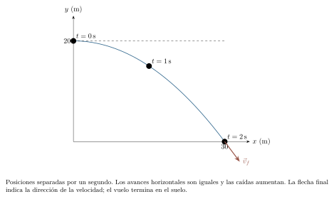{#fig-fp-av-r5-6 fig-alt="Ilustración de Problema resuelto 5.6 · Una pelota abandona horizontalmente una terraza. Resolución. Tomamos el origen horizontal bajo la salida y el suelo como y=0. Entonces x=15t e y=20-5t^2 en SI. La condición y=0 da t^2=4\\,s^2; retenemos t=2\\,s porque estudiamos el movimiento posterior a la salida. Así, x=30\\,m y vec vf=(15,-20)\\,m/s,qquad uf=25\\,m/s. La velocidad forma arctan(20/15)simeq53,1^circ por"}

Para un lanzamiento con $v_{0y}>0$, la altura máxima se alcanza cuando $v_y=0$. Por tanto,
$$
t_H=\frac{v_{0y}}g,\qquad
y_H-y_0=\frac{v_{0y}^{\,2}}{2g}.
$$
El máximo es vertical: allí se conserva la velocidad horizontal. Si $v_{0y}\leq0$, la altura máxima del vuelo posterior a la salida es la inicial; un $t_H$ negativo sitúa el vértice de la parábola extrapolada antes del lanzamiento.

### Problema resuelto 5.7 · En la cumbre la pelota sigue moviéndose {#r5-7}

Una pelota parte del suelo con $\vec v_0=(12,16)\,\mathrm{m/s}$. Calcula la altura máxima, el tiempo hasta volver al suelo y el alcance horizontal.

*Resolución.* Como $v_y=16-10t$ en SI, la cumbre se alcanza en $1{,}6\,\mathrm{s}$. Sustituir en $y=16t-5t^2$ da $12{,}8\,\mathrm{m}$. Para volver a $y=0$ resolvemos
$$
t(16\,\mathrm{m/s}-5\,\mathrm{m/s^2}\,t)=0.
$$
La raíz inicial es el lanzamiento y la raíz positiva es $T=3{,}2\,\mathrm{s}$. El alcance resulta $R=12(3{,}2)=38{,}4\,\mathrm{m}$. En la cumbre $\vec v=(12,0)\,\mathrm{m/s}$ y $\vec a=(0,-10)\,\mathrm{m/s^2}$: ni velocidad ni aceleración son nulas. La rapidez inicial es $20\,\mathrm{m/s}$ y la final vuelve a ser $20\,\mathrm{m/s}$, con la componente vertical de signo opuesto.

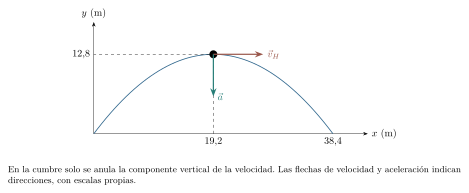{#fig-fp-av-r5-7 fig-alt="Ilustración de Problema resuelto 5.7 · En la cumbre la pelota sigue moviéndose. Resolución. Como vy=16-10t en SI, la cumbre se alcanza en 1,6\\,s. Sustituir en y=16t-5t^2 da 12,8\\,m. Para volver a y=0 resolvemos t(16\\,m/s-5\\,m/s^2\\,t)=0. La raíz inicial es el lanzamiento y la raíz positiva es T=3,2\\,s. El alcance resulta R=12(3,2)=38,4\\,m. En la cumbre vec v=(12,0)\\,m/s y vec a=(0,-10)\\,m/s^2: ni"}

Si el punto de llegada tiene la misma altura que el de salida, $v_{0y}>0$ y no hay obstáculos anteriores, factorizar $y(T)-y_0=0$ proporciona
$$
T=\frac{2v_{0y}}g,\qquad
R=v_{0x}T=\frac{v_0^2\sin(2\theta)}g.
$$
En la última igualdad usamos $2\sin\theta\cos\theta=\sin(2\theta)$, identidad trigonométrica para el doble de un ángulo. $R$ es aquí el desplazamiento horizontal; para $0<\theta<90^\circ$ es positivo y coincide con el alcance usual. La igualdad de alturas es una hipótesis de la deducción y debe comprobarse antes de emplear estas expresiones.

### Problema resuelto 5.8 · Llegar a una altura diferente {#r5-8}

Desde una plataforma de $15\,\mathrm{m}$ se lanza una pelota con $\vec v_0=(8,10)\,\mathrm{m/s}$. Encuentra el impacto con el suelo y la altura máxima.

*Resolución.* La ecuación vertical es $y=15+10t-5t^2$ en SI. Al imponer $y=0$ obtenemos $t^2-2t-3=0$, es decir $(t-3)(t+1)=0$ al medir $t$ en segundos. El tiempo físico es $T=3\,\mathrm{s}$; $2v_{0y}/g=2\,\mathrm{s}$ corresponde al regreso a la altura de la plataforma, mientras el suelo se alcanza después. El impacto ocurre en $x=8(3)=24\,\mathrm{m}$, con $\vec v_f=(8,-20)\,\mathrm{m/s}$ y rapidez $\sqrt{464}\,\mathrm{m/s}\simeq21{,}54\,\mathrm{m/s}$. La cumbre se alcanza al segundo de vuelo, a $15+10-5=20\,\mathrm{m}$ sobre el suelo. Ganó $5\,\mathrm{m}$ respecto de la salida.

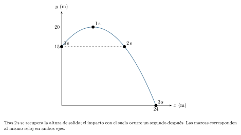{#fig-fp-av-r5-8 fig-alt="Ilustración de Problema resuelto 5.8 · Llegar a una altura diferente. Resolución. La ecuación vertical es y=15+10t-5t^2 en SI. Al imponer y=0 obtenemos t^2-2t-3=0, es decir (t-3)(t+1)=0 al medir t en segundos. El tiempo físico es T=3\\,s; 2v0y/g=2\\,s corresponde al regreso a la altura de la plataforma, mientras el suelo se alcanza después. El impacto ocurre en x=8(3)=24\\,m, con vec"}

### Problema resuelto 5.9 · Una altura puede corresponder a dos instantes {#r5-9}

Un lanzamiento desde el origen tiene $\vec v_0=(10,20)\,\mathrm{m/s}$. Encuentra todos los puntos del vuelo en que la altura es $15\,\mathrm{m}$.

*Resolución.* La condición $20t-5t^2=15$ da $t^2-4t+3=0$ en SI, con raíces $1\,\mathrm{s}$ y $3\,\mathrm{s}$. Ambas pertenecen al vuelo $0\leq t\leq4\,\mathrm{s}$. Los puntos son $(10,15)\,\mathrm{m}$ y $(30,15)\,\mathrm{m}$. En el primero $v_y=+10\,\mathrm{m/s}$ y en el segundo $v_y=-10\,\mathrm{m/s}$: la pelota pasa por esa altura al subir y al bajar. Debemos examinar la posición y el sentido de movimiento asociados a cada raíz positiva. Si se preguntara por una persona en $(10,15)\,\mathrm{m}$, únicamente la primera raíz cumpliría también la coordenada horizontal.

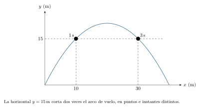{#fig-fp-av-r5-9 fig-alt="Ilustración de Problema resuelto 5.9 · Una altura puede corresponder a dos instantes. Resolución. La condición 20t-5t^2=15 da t^2-4t+3=0 en SI, con raíces 1\\,s y 3\\,s. Ambas pertenecen al vuelo 0leq tleq4\\,s. Los puntos son (10,15)\\,m y (30,15)\\,m. En el primero vy=+10\\,m/s y en el segundo vy=-10\\,m/s: la pelota pasa por esa altura al subir y al bajar. Debemos examinar la posición y el sentido de"}

Para dibujar la trayectoria podemos eliminar el tiempo siempre que $v_{0x}\neq0$. De $t=(x-x_0)/v_{0x}$ resulta
$$
y=y_0+\frac{v_{0y}}{v_{0x}}(x-x_0)
-\frac{g}{2v_{0x}^2}(x-x_0)^2.
$$
Es una parábola en estos ejes. El coeficiente del término cuadrático tiene unidad de longitud inversa, de modo que el último término sigue siendo una altura. Si $v_{0x}=0$, el lanzamiento es vertical y debemos conservar la descripción paramétrica, que sigue siendo válida. Incluso cuando la ecuación de la parábola existe, el vuelo físico puede ocupar solo un arco, hasta el primer impacto.

### Problema resuelto 5.10 · Una pared selecciona el instante pertinente {#r5-10}

La pelota del problema 5.7 encuentra una pared delgada de $9\,\mathrm{m}$ de altura en $x=18\,\mathrm{m}$. ¿Pasa sobre ella? Idealiza la pelota como un punto y la parte superior de la pared como horizontal.

*Resolución.* La coordenada de la pared determina el instante: $t=18/12=1{,}5\,\mathrm{s}$. Está dentro del vuelo calculado anteriormente. La altura entonces es
$$
y=16(1{,}5)-5(1{,}5)^2=12{,}75\,\mathrm{m}.
$$
Supera la pared por $3{,}75\,\mathrm{m}$. Resolver primero $y=9\,\mathrm{m}$ daría los instantes de paso por la altura de la pared; la llegada a ella se determina mediante su posición horizontal. La ecuación de la trayectoria, $y=\tfrac43x-x^2/(28{,}8\,\mathrm{m})$, conduce al mismo resultado al sustituir $x=18\,\mathrm{m}$.

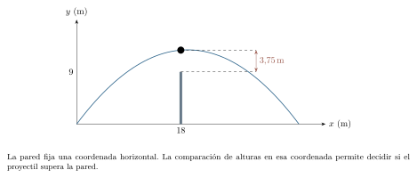{#fig-fp-av-r5-10 fig-alt="Ilustración de Problema resuelto 5.10 · Una pared selecciona el instante pertinente. Resolución. La coordenada de la pared determina el instante: t=18/12=1,5\\,s. Está dentro del vuelo calculado anteriormente. La altura entonces es y=16(1,5)-5(1,5)^2=12,75\\,m. Supera la pared por 3,75\\,m. Resolver primero y=9\\,m daría los instantes de paso por la altura de la pared; la llegada a ella se determina"}

### Problema resuelto 5.11 · Dos ángulos, un alcance y vuelos diferentes {#r5-11}

Desde el suelo se lanzan dos pelotas a $20\,\mathrm{m/s}$, una a $30^\circ$ y otra a $60^\circ$ sobre la horizontal. Compara alcance, duración y altura máxima; determina después el ángulo de alcance máximo para esa rapidez inicial.

*Resolución.* Para $30^\circ$, $v_{0x}=10\sqrt3\,\mathrm{m/s}$ y $v_{0y}=10\,\mathrm{m/s}$; para $60^\circ$ se intercambian estas componentes. Las expresiones ya deducidas dan
$$
\begin{array}{c|ccc}
\theta & R\ (\mathrm m)&T\ (\mathrm s)& y_H\ (\mathrm m)\\ \hline
30^\circ&20\sqrt3&2&5\\
60^\circ&20\sqrt3&2\sqrt3&15
\end{array}
$$
Los alcances coinciden porque $\sin60^\circ=\sin120^\circ$, pero el segundo vuelo dura más y sube más alto. Para $0<\theta<90^\circ$, $\sin(2\theta)\leq1$, con igualdad en $\theta=45^\circ$; por ello $R_{\max}=v_0^2/g=40\,\mathrm{m}$. Podemos justificar este máximo mediante el valor máximo del seno. La conclusión se obtiene para alturas iguales bajo las hipótesis del modelo; una plataforma elevada o una resistencia importante del aire requieren un nuevo análisis del ángulo óptimo.

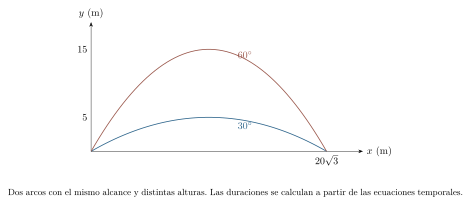{#fig-fp-av-r5-11 fig-alt="Ilustración de Problema resuelto 5.11 · Dos ángulos, un alcance y vuelos diferentes. Resolución. Para 30^circ, v0x=10sqrt3\\,m/s y v0y=10\\,m/s; para 60^circ se intercambian estas componentes. Las expresiones ya deducidas dan beginarrayc|ccc theta & R\\ (mathrm m)&T\\ (mathrm s)& yH\\ (mathrm m)\\\\ hline 30^circ&20sqrt3&2&5\\\\ 60^circ&20sqrt3&2sqrt3&15 endarray Los alcances coinciden porque"}

## Encuentros: coincidir en el espacio y en el tiempo

Una intersección en un plano solo dice que los caminos tienen un punto común. Para que dos partículas se encuentren deben ocupar ese punto en el mismo instante de un reloj compartido:
$$
\vec r_A(t)=\vec r_B(t),\qquad
x_A(t)=x_B(t),\quad y_A(t)=y_B(t).
$$
Las dos igualdades deben admitir una misma solución dentro de los intervalos de validez. Si un móvil parte más tarde, sus ecuaciones deben expresar el tiempo de marcha a partir del instante de salida.

### Problema resuelto 5.12 · Coincidencia espacial y simultaneidad {#r5-12}

Desde $t=0$, A parte de $(0,0)\,\mathrm{m}$ con velocidad $(3,0)\,\mathrm{m/s}$ y B parte de $(6,-6)\,\mathrm{m}$ con velocidad $(0,2)\,\mathrm{m/s}$. ¿Se encuentran? ¿Qué ocurre si A espera un segundo antes de iniciar el mismo movimiento?

*Resolución.* Los caminos se cruzan en $(6,0)\,\mathrm{m}$. A llega allí en $2\,\mathrm{s}$ y B en $3\,\mathrm{s}$. La igualdad horizontal exige $t=2\,\mathrm{s}$, mientras la vertical exige $t=3\,\mathrm{s}$; no hay encuentro. Si A espera, para $t\geq1\,\mathrm{s}$ su posición es $x_A=(3\,\mathrm{m/s})(t-1\,\mathrm{s})$ e $y_A=0$. Entonces ambas igualdades se cumplen en $t=3\,\mathrm{s}$, cuando A lleva dos segundos caminando. Antes de partir A está en el origen, que tampoco pertenece al camino de B.

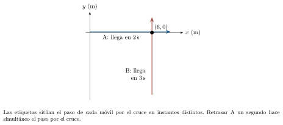{#fig-fp-av-r5-12 fig-alt="Ilustración de Problema resuelto 5.12 · Coincidencia espacial y simultaneidad. Resolución. Los caminos se cruzan en (6,0)\\,m. A llega allí en 2\\,s y B en 3\\,s. La igualdad horizontal exige t=2\\,s, mientras la vertical exige t=3\\,s; no hay encuentro. Si A espera, para tgeq1\\,s su posición es xA=(3\\,m/s)(t-1\\,s) e yA=0. Entonces ambas igualdades se cumplen en t=3\\,s, cuando A lleva dos segundos"}

### Problema resuelto 5.13 · Dos proyectiles y una aceleración que se cancela {#r5-13}

En $t=0$ se lanzan simultáneamente A desde $(0,0)\,\mathrm{m}$ con velocidad $(10,15)\,\mathrm{m/s}$ y B desde $(20,10)\,\mathrm{m}$ con velocidad $(0,10)\,\mathrm{m/s}$. Ambos están en vuelo libre bajo la misma gravedad. ¿Coinciden antes de llegar al suelo horizontal $y=0$?

*Resolución.* Restar las posiciones elimina el término gravitatorio común:
$$
\vec r_B-\vec r_A=(20\,\mathrm{m}-10\,\mathrm{m/s}\,t)\hat\imath
+(10\,\mathrm{m}-5\,\mathrm{m/s}\,t)\hat\jmath.
$$
Las dos componentes se anulan en $t=2\,\mathrm{s}$. Al sustituir, ambas partículas están en $(20,10)\,\mathrm{m}$. A no alcanza el suelo hasta $3\,\mathrm{s}$ y B hasta $(1+\sqrt3)\,\mathrm{s}$, por lo que el encuentro pertenece a los dos vuelos. Las velocidades allí son $(10,-5)\,\mathrm{m/s}$ y $(0,-10)\,\mathrm{m/s}$: los cuerpos ocupan la misma posición con velocidades distintas. Si fueran objetos materiales, un choque podría invalidar las leyes de vuelo posteriores; solo hemos descrito lo que sucede hasta la coincidencia.

{#fig-fp-av-r5-13 fig-alt="Ilustración de Problema resuelto 5.13 · Dos proyectiles y una aceleración que se cancela. Resolución. Restar las posiciones elimina el término gravitatorio común: vec rB-vec rA=(20\\,m-10\\,m/s\\,t)hatimath +(10\\,m-5\\,m/s\\,t)hatjmath. Las dos componentes se anulan en t=2\\,s. Al sustituir, ambas partículas están en (20,10)\\,m. A no alcanza el suelo hasta 3\\,s y B hasta (1+sqrt3)\\,s, por lo que el encuentro"}

## Movimiento circular: cambiar de dirección es acelerar

En una pista circular, un móvil puede conservar la lectura de su velocímetro y, sin embargo, cambiar continuamente su velocidad vectorial. Necesitamos una descripción que haga visible ese cambio de dirección. Si el círculo tiene centro en el origen y radio $R>0$, la trigonometría proporciona
$$
x(t)=R\cos\theta(t),\qquad y(t)=R\sin\theta(t).
$$
Mediremos $\theta$ en radianes, positivos en sentido antihorario. Un radián corresponde a un arco cuya longitud es igual al radio; en general $\theta=s_{\mathrm{arco}}/R$ para un arco orientado. Una vuelta equivale a $2\pi$ radianes. Esta convención hace que las derivadas del seno y del coseno conserven las formas del capítulo 3, sin factores de conversión de grados.

La velocidad angular es $\omega=d\theta/dt$. En movimiento circular uniforme, $\omega$ es constante y $\theta=\theta_0+\omega t$ al elegir $t_0=0$. Aplicando la regla de la cadena,
$$
\begin{aligned}
\vec v&=R\omega(-\sin\theta\,\hat\imath+\cos\theta\,\hat\jmath),\\
\vec a&=-R\omega^2(\cos\theta\,\hat\imath+\sin\theta\,\hat\jmath)
=-\omega^2\vec r.
\end{aligned}
$$
Derivar el seno o el coseno introduce un factor $\omega$, y la segunda derivada introduce otro. El vector entre paréntesis en $\vec v$ tiene módulo uno y es perpendicular al radio: la velocidad es tangente. La aceleración apunta hacia el centro, aunque la rapidez sea constante. Sus magnitudes satisfacen
$$
u=R|\omega|,\qquad a_c=R\omega^2=\frac{u^2}{R}.
$$
Se llama *centrípeta* por su dirección hacia el centro; la identificación de la interacción que la produce corresponde a la dinámica. Si $\omega\neq0$, el período es $T=2\pi/|\omega|$ y la frecuencia, el número de vueltas por unidad de tiempo, es $f=1/T$, medida en hercios ($1\,\mathrm{Hz}=1\,\mathrm{s^{-1}}$).

### Problema resuelto 5.14 · Un cuarto de vuelta {#r5-14}

Una partícula recorre un círculo de radio $2\,\mathrm{m}$ en $4\,\mathrm{s}$, con rapidez constante y sentido antihorario. Parte de $(2,0)\,\mathrm{m}$. Determina su posición, velocidad y aceleración al cabo de $1\,\mathrm{s}$.

*Resolución.* La velocidad angular es $\omega=2\pi/(4\,\mathrm{s})=(\pi/2)\,\mathrm{rad/s}$. Tras un segundo ha girado $\pi/2$ radianes y está en $(0,2)\,\mathrm{m}$. La rapidez es $u=R\omega=\pi\,\mathrm{m/s}$. La tangente antihoraria en el punto superior apunta a la izquierda, mientras la aceleración apunta hacia el origen:
$$
\begin{aligned}\vec v&=(-\pi,0)\,\mathrm{m/s},\\
\vec a&=(0,-\pi^2/2)\,\mathrm{m/s^2}.\end{aligned}
$$
La aceleración apunta al centro y es distinta de $\vec0$, mientras la derivada de la rapidez es cero. En una vuelta completa el desplazamiento sería cero y la distancia $4\pi\,\mathrm{m}$, lo que vuelve a separar trayectoria y desplazamiento.

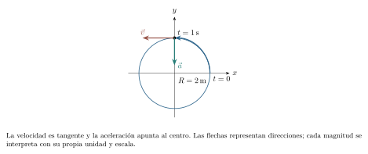{#fig-fp-av-r5-14 fig-alt="Ilustración de Problema resuelto 5.14 · Un cuarto de vuelta. Resolución. La velocidad angular es omega=2pi/(4\\,s)=(pi/2)\\,rad/s. Tras un segundo ha girado pi/2 radianes y está en (0,2)\\,m. La rapidez es u=Romega=pi\\,m/s. La tangente antihoraria en el punto superior apunta a la izquierda, mientras la aceleración apunta hacia el origen: beginalignedvec v&=(-pi,0)\\,m/s,\\\\ vec"}

Cuando $\omega$ cambia, la rapidez puede cambiar además de la dirección. Escribamos $\alpha=d\omega/dt$. Al derivar $R\omega(-\sin\theta,\cos\theta)$ usamos la regla del producto: un término procede de derivar $\omega$ y el otro de derivar las funciones trigonométricas. Resulta
$$
\vec a=R\alpha(-\sin\theta,\cos\theta)
-R\omega^2(\cos\theta,\sin\theta).
$$
Los términos son perpendiculares: uno tangente y otro radial hacia el centro. Sus módulos son $R|\alpha|$ y $R\omega^2$. El módulo de la aceleración total se obtiene mediante la suma vectorial de ambas componentes. Esta descripción cinemática se construye a partir de la posición y sus derivadas.

### Problema resuelto 5.15 · El giro se hace cada vez más rápido {#r5-15}

Una partícula permanece sobre un círculo de radio $2\,\mathrm{m}$ y su ángulo es $\theta(t)=(0{,}5\,\mathrm{rad/s^2})t^2$, para $t\geq0$. Calcula la rapidez y las componentes tangencial y centrípeta de la aceleración en $t=1\,\mathrm{s}$.

*Resolución.* Derivar el ángulo da $\omega=(1\,\mathrm{rad/s^2})t$ y $\alpha=1\,\mathrm{rad/s^2}$. En el instante pedido, $\theta=0{,}5\,\mathrm{rad}$ y $\omega=1\,\mathrm{rad/s}$. Así,
$$
\begin{aligned}u&=2\,\mathrm{m/s},\\a_{\mathrm{tan}}&=2\,\mathrm{m/s^2},\\
a_c&=2\,\mathrm{m/s^2},\\|\vec a|&=2\sqrt2\,\mathrm{m/s^2}.\end{aligned}
$$
El término tangencial apunta en el sentido del movimiento porque $\omega$ y $\alpha$ son positivos; el radial apunta hacia el centro. Aunque sus módulos coinciden, tienen direcciones perpendiculares. Usar únicamente $u^2/R$ omitiría el cambio de rapidez.

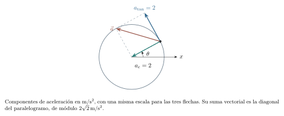{#fig-fp-av-r5-15 fig-alt="Ilustración de Problema resuelto 5.15 · El giro se hace cada vez más rápido. Resolución. Derivar el ángulo da omega=(1\\,rad/s^2)t y alpha=1\\,rad/s^2. En el instante pedido, theta=0,5\\,rad y omega=1\\,rad/s. Así, beginalignedu&=2\\,m/s,\\atan&=2\\,m/s^2,\\\\ ac&=2\\,m/s^2,\\\\|vec a|&=2sqrt2\\,m/s^2.endaligned El término tangencial apunta en el sentido del movimiento porque omega y alpha son positivos;"}

## Cambiar de observador sin cambiar el suceso

Desde un tren que avanza sin girar, una persona puede ver una pelota subir y bajar por una misma vertical; desde el andén, otra persona ve que la pelota también avanza. Los dos observadores están describiendo los mismos sucesos con distintos orígenes. Para compararlos fijaremos ejes paralelos, unidades iguales y relojes sincronizados, con un mismo tiempo $t$ de la mecánica clásica.

Sea S la referencia del suelo y S$'$ otra cuyo origen tiene posición $\vec R(t)=\vec R_0+\vec U t$ en S, con $\vec U$ constante. La suma geométrica de los vectores de posición da $\vec r=\vec R+\vec r\,'$. Por tanto,
$$
\vec r\,'=\vec r-\vec R_0-\vec U t,
\qquad \vec v\,'=\vec v-\vec U,
\qquad \vec a\,'=\vec a.
$$
Estas son transformaciones galileanas para una traslación uniforme sin rotación. La igualdad de aceleraciones se deduce al derivar la velocidad constante $\vec U$: su derivada es cero. Si el origen acelera, en ejes que siguen siendo paralelos obtendríamos $\vec a\,'=\vec a-\ddot{\vec R}$; si además giran los ejes, aparecen cambios adicionales que quedan fuera de este capítulo. Las transformaciones galileanas son la aproximación clásica adecuada para velocidades pequeñas frente a la velocidad de la luz.

### Problema resuelto 5.16 · Una pelota lanzada dentro de un tren {#r5-16}

Un tren avanza a $12\,\mathrm{m/s}$ respecto del suelo. En su interior se lanza una pelota verticalmente hacia arriba a $6\,\mathrm{m/s}$ respecto del tren. Supón el tren en traslación uniforme, aire sin efectos apreciables y un techo suficientemente alto. Describe el vuelo hasta regresar a la altura de salida en las dos referencias.

*Resolución.* Hacemos coincidir los orígenes con la salida en $t=0$ y tomamos $y$ hacia arriba. En el tren, $x'=0$ e $y'=(6\,\mathrm{m/s})t-(5\,\mathrm{m/s^2})t^2$. En el suelo,
$$
x=(12\,\mathrm{m/s})t,\qquad
y=(6\,\mathrm{m/s})t-(5\,\mathrm{m/s^2})t^2.
$$
La pelota regresa a la altura inicial en $1{,}2\,\mathrm{s}$, después de avanzar $14{,}4\,\mathrm{m}$ respecto del suelo, lo mismo que el punto de lanzamiento del tren. Por eso vuelve a ese punto si se mantienen las hipótesis. En ambas referencias la aceleración es $(0,-10)\,\mathrm{m/s^2}$. La trayectoria recta de S$'$ y la parábola de S reúnen las posiciones medidas desde sus respectivos orígenes móviles.

{#fig-fp-av-r5-16 fig-alt="Ilustración de Problema resuelto 5.16 · Una pelota lanzada dentro de un tren. Resolución. Hacemos coincidir los orígenes con la salida en t=0 y tomamos y hacia arriba. En el tren, x'=0 e y'=(6\\,m/s)t-(5\\,m/s^2)t^2. En el suelo, x=(12\\,m/s)t,qquad y=(6\\,m/s)t-(5\\,m/s^2)t^2. La pelota regresa a la altura inicial en 1,2\\,s, después de avanzar 14,4\\,m respecto del suelo, lo mismo que el punto de"}

Para evitar confundir velocidades, escribiremos $\vec v_{A/B}$ como «velocidad de A respecto de B». Al comparar un objeto A, un medio B y la orilla S,
$$
\vec v_{A/S}=\vec v_{A/B}+\vec v_{B/S}.
$$
La suma es vectorial. Una embarcación puede apuntar al norte respecto del agua y desplazarse al nordeste respecto de la orilla; la velocidad de la corriente forma parte de la segunda descripción. Supondremos orillas rectas, corriente uniforme y velocidades constantes durante el cruce.

### Problema resuelto 5.17 · Cruzar antes o llegar justo enfrente {#r5-17}

Un río tiene $120\,\mathrm{m}$ de anchura de sur a norte y corriente de $3\,\mathrm{m/s}$ al este. Una lancha puede mantener $4\,\mathrm{m/s}$ respecto del agua en cualquier dirección. Compara el cruce de menor tiempo con el que termina exactamente enfrente del punto de partida.

*Resolución.* Elegimos $x$ al este e $y$ al norte. Para minimizar el tiempo debemos maximizar la componente norte de la velocidad respecto de la orilla. La corriente tiene componente norte nula, y una velocidad de módulo $4\,\mathrm{m/s}$ tiene componente norte máxima $4\,\mathrm{m/s}$ cuando apunta directamente al norte. En ese caso $t=120/4=30\,\mathrm{s}$ y la corriente desplaza la lancha $3(30)=90\,\mathrm{m}$ al este.

Para llegar justo enfrente la componente este total debe ser cero. La lancha necesita $v_{L/A,x}=-3\,\mathrm{m/s}$. Como su rapidez respecto del agua es $4\,\mathrm{m/s}$, Pitágoras deja $v_{L/A,y}=\sqrt{4^2-3^2}=\sqrt7\,\mathrm{m/s}$. Así,
$$
t=\frac{120}{\sqrt7}\,\mathrm{s}\simeq45{,}36\,\mathrm{s},\qquad
\beta=\arcsin(3/4)\simeq48{,}6^\circ
$$
al oeste del norte. Compensar la corriente sacrifica avance transversal y aumenta el tiempo. En general, llegar justo enfrente con velocidad constante exige que la rapidez disponible respecto del agua sea *mayor* que la de la corriente: si fueran iguales, toda la velocidad se usaría para contrarrestarla y no quedaría componente de cruce.

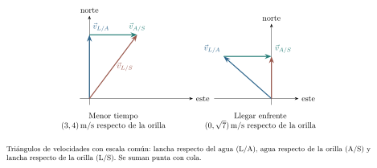{#fig-fp-av-r5-17 fig-alt="Ilustración de Problema resuelto 5.17 · Cruzar antes o llegar justo enfrente. Para llegar justo enfrente la componente este total debe ser cero. La lancha necesita vL/A,x=-3\\,m/s. Como su rapidez respecto del agua es 4\\,m/s, Pitágoras deja vL/A,y=sqrt4^2-3^2=sqrt7\\,m/s. Así, t=frac120sqrt7\\,ssimeq45,36\\,s,qquad beta=arcsin(3/4)simeq48,6^circ al oeste del norte. Compensar la corriente sacrifica"}

Para comparar dos móviles en una misma referencia también podemos definir la separación $\vec\rho=\vec r_B-\vec r_A$. Su derivada es la velocidad relativa $\vec w=\vec v_B-\vec v_A$. Si ambas velocidades son constantes, $\vec\rho(t)=\vec\rho_0+\vec w t$. Un encuentro requiere $\vec\rho=\vec0$; la menor separación puede ser positiva.

### Problema resuelto 5.18 · Distancia mínima entre dos móviles {#r5-18}

Desde $t=0$, A parte del origen con velocidad $(5,0)\,\mathrm{m/s}$ y B parte de $(100,-40)\,\mathrm{m}$ con velocidad $(0,5)\,\mathrm{m/s}$. Los modelos rigen para $0\leq t\leq30\,\mathrm{s}$. Encuentra su menor separación en ese intervalo.

*Resolución.* La separación es $\vec\rho(t)=(100-5t,-40+5t)\,\mathrm{m}$ si $t$ se expresa en segundos. En vez de minimizar una raíz, minimizamos su cuadrado, que crece junto con la distancia:
$$
d^2(t)=(100-5t)^2+(-40+5t)^2
=50(t-14)^2+1800,
$$
con $d$ en metros y $t$ en segundos. El cuadrado se hace mínimo en $t=14\,\mathrm{s}$, que pertenece al intervalo. Entonces A está en $(70,0)\,\mathrm{m}$ y B en $(100,30)\,\mathrm{m}$: la distancia mínima es $30\sqrt2\,\mathrm{m}\simeq42{,}43\,\mathrm{m}$. La igualdad horizontal ocurriría en $20\,\mathrm{s}$ y la vertical en $8\,\mathrm{s}$; no hay encuentro. Si la ventana observada terminara antes de $14\,\mathrm{s}$, habría que buscar el mínimo restringido a esa ventana.

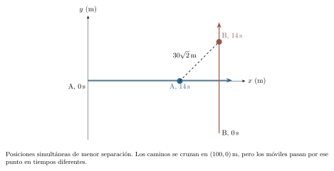{#fig-fp-av-r5-18 fig-alt="Ilustración de Problema resuelto 5.18 · Distancia mínima entre dos móviles. Resolución. La separación es vecrho(t)=(100-5t,-40+5t)\\,m si t se expresa en segundos. En vez de minimizar una raíz, minimizamos su cuadrado, que crece junto con la distancia: d^2(t)=(100-5t)^2+(-40+5t)^2 =50(t-14)^2+1800, con d en metros y t en segundos. El cuadrado se hace mínimo en t=14\\,s, que pertenece al"}

## Del modelo a una observación

La independencia de las componentes es una propiedad del modelo de aceleración que hemos elegido. Con resistencia del aire, las aceleraciones pueden depender de las componentes de la velocidad, y resolver un eje puede requerir información del otro. La trayectoria parabólica se obtiene como consecuencia de las hipótesis elegidas; su aplicación a un objeto real requiere contrastarlas. La observación permite examinar si tales hipótesis son adecuadas en una situación concreta.

### Seguir una pelota en un vídeo

Graba, con autorización y en un lugar despejado, el vuelo corto de una pelota blanda. Coloca la cámara fija, aproximadamente perpendicular al plano del movimiento, y una referencia de longitud en ese mismo plano para controlar la perspectiva. Selecciona una secuencia de instantes igualmente espaciados y registra $t$, $x$ e $y$; realiza el ensayo desde una altura segura.

La elección del muestreo también afecta lo que podemos detectar. Para tres lecturas de una caída parabólica igualmente separadas por $\Delta t$, la segunda diferencia es $D=y(t+\Delta t)-2y(t)+y(t-\Delta t)=-g(\Delta t)^2$. Si cada posición admite una cota absoluta $\varepsilon=0{,}01\,\mathrm{m}$, la desigualdad triangular da $|\delta D|\leq4\varepsilon=0{,}04\,\mathrm{m}$. Con $g=10\,\mathrm{m/s^2}$ y $\Delta t=0{,}10\,\mathrm{s}$, $|D|=0{,}10\,\mathrm{m}$ supera esa cota; con $\Delta t=0{,}05\,\mathrm{s}$, vale $0{,}025\,\mathrm{m}$ y los intervalos compatibles con curvatura nula se solapan. Reducir la separación disminuye la señal de curvatura entre tres lecturas. Esta cota conservadora admite errores correlacionados; la incertidumbre estándar requiere el tratamiento de C23. Conserva los registros brutos para poder revisar la calibración y el modelo.

Compara los incrementos horizontales $x_{k+1}-x_k$ y las segundas diferencias verticales $y_{k+1}-2y_k+y_{k-1}$. Si el modelo ideal y el intervalo uniforme $\Delta t$ fueran exactos, los primeros serían constantes y las segundas valdrían $-g(\Delta t)^2$: se comprueba sustituyendo las ecuaciones del proyectil. Busca desviaciones considerando la resolución de las posiciones, la escala, el desenfoque y la elección de fotogramas antes de atribuirlas a una nueva interacción. Conserva los datos originales y contrasta con ellos la curva ajustada y otros modelos compatibles.

El avance respecto del capítulo anterior consiste en conservar un reloj y recomponer direcciones. En una recta bastaba vigilar un signo; en el plano, además de los signos, importa la orientación de cada vector y la simultaneidad de sus componentes. El estudio de las fuerzas explicará después qué interacciones pueden producir las aceleraciones que aquí hemos descrito.

## Ejercicios para reconstruir y transferir

Intenta primero los ejercicios sin consultar el solucionario. En todos los vuelos usa $g=10\,\mathrm{m/s^2}$, eje vertical positivo hacia arriba y las hipótesis ideales de la sección 5.3; el suelo indicado es horizontal y termina el vuelo. En los movimientos dados por funciones, conserva las unidades de sus coeficientes. Los resultados aproximados expresan el redondeo de los datos idealizados.

### Ejercicio 5.1 · Dos tramos perpendiculares {#e5-1}

Un móvil recorre en orden $(0,0)$, $(6,0)$ y $(6,8)\,\mathrm{m}$ durante $7\,\mathrm{s}$. Calcula desplazamiento, distancia, velocidad media y rapidez media.

### Ejercicio 5.2 · Derivar y orientar {#e5-2}

Para $0\leq t\leq3\,\mathrm{s}$, $x=1\,\mathrm{m}+(2\,\mathrm{m/s})t$ e $y=4\,\mathrm{m}-(1\,\mathrm{m/s^2})t^2$. Encuentra $\vec r$, $\vec v$, $\vec a$ y rapidez en $t=1\,\mathrm{s}$. Da la dirección de la velocidad.

### Ejercicio 5.3 · Trayectoria sin reloj {#e5-3}

Compara $x_A=(1\,\mathrm{m/s})t$, $y_A=(1\,\mathrm{m/s^2})t^2$ con $x_B=(2\,\mathrm{m/s})t$, $y_B=(4\,\mathrm{m/s^2})t^2$, para $0\leq t\leq3\,\mathrm{s}$. Elimina $t$ y compara el paso por $(2,4)\,\mathrm{m}$.

### Ejercicio 5.4 · Una parada parcial {#e5-4}

Un móvil parte de $(2,-1)\,\mathrm{m}$ con velocidad $(-2,3)\,\mathrm{m/s}$ y aceleración constante $(1,-1)\,\mathrm{m/s^2}$. Encuentra su estado en $t=2\,\mathrm{s}$ y decide si está detenido.

### Ejercicio 5.5 · Reconstrucción desde una aceleración variable {#e5-5}

Para $0\leq t\leq2\,\mathrm{s}$, $\vec a(t)=(4\,\mathrm{m/s^3})t\,\hat\imath-2\,\mathrm{m/s^2}\,\hat\jmath$, $\vec v_0=(0,3)\,\mathrm{m/s}$ y $\vec r_0=(1,0)\,\mathrm{m}$. Obtén $\vec v(t)$ y $\vec r(t)$; evalúa en el extremo final.

### Ejercicio 5.6 · Una altura a partir del alcance {#e5-6}

Una pelota sale horizontalmente a $10\,\mathrm{m/s}$ y llega al suelo $20\,\mathrm{m}$ más adelante. Determina la altura de salida y la velocidad final.

### Ejercicio 5.7 · Un lanzamiento desde el suelo {#e5-7}

Para $\vec v_0=(9,12)\,\mathrm{m/s}$, calcula tiempo de vuelo, alcance, altura máxima y velocidad en la cumbre.

### Ejercicio 5.8 · La plataforma cambia la duración {#e5-8}

Se lanza una pelota desde $10\,\mathrm{m}$ de altura con $\vec v_0=(6,5)\,\mathrm{m/s}$. Encuentra el tiempo y la posición horizontal de impacto, y la rapidez justo antes.

### Ejercicio 5.9 · Dos raíces físicamente posibles {#e5-9}

Una pelota sale del origen con $\vec v_0=(8,15)\,\mathrm{m/s}$. Encuentra los instantes y las posiciones donde $y=10\,\mathrm{m}$. Clasifica los pasos como ascendente o descendente.

### Ejercicio 5.10 · Una pared en el camino {#e5-10}

Para el lanzamiento del ejercicio 5.7, una pared está en $x=9\,\mathrm{m}$ y tiene $7\,\mathrm{m}$ de altura. ¿La pelota ideal pasa sobre ella? ¿Qué cambia si la pared mide $8\,\mathrm{m}$?

### Ejercicio 5.11 · Reconstruir un lanzamiento {#e5-11}

Un proyectil parte del origen y pasa por $(12,5)\,\mathrm{m}$ en $t=1\,\mathrm{s}$ antes de tocar el suelo $y=0$. Determina la velocidad inicial, la altura máxima y el alcance.

### Ejercicio 5.12 · Hasta dónde vale el ángulo de cuarenta y cinco grados {#e5-12}

Demuestra que dos lanzamientos desde el mismo nivel, con igual rapidez y ángulos $\theta$ y $90^\circ-\theta$, tienen igual alcance si $0<\theta<90^\circ$. Explica por qué esa conclusión no puede trasladarse sin más a una plataforma elevada.

### Ejercicio 5.13 · Una coincidencia simultánea {#e5-13}

A parte de $(0,0)\,\mathrm{m}$ con velocidad $(2,1)\,\mathrm{m/s}$ y B de $(12,0)\,\mathrm{m}$ con $(-1,1)\,\mathrm{m/s}$. Ambos parten en $t=0$ y mantienen sus velocidades. ¿Cuándo y dónde se encuentran?

### Ejercicio 5.14 · Un cruce en instantes distintos {#e5-14}

A parte del origen con velocidad $(4,0)\,\mathrm{m/s}$ y B de $(8,-6)\,\mathrm{m}$ con velocidad $(0,2)\,\mathrm{m/s}$, en $t=0$. Decide si se encuentran y encuentra cuánto debe retrasar A su partida para lograrlo.

### Ejercicio 5.15 · Una gravedad común {#e5-15}

En $t=0$, A sale del suelo en el origen con $\vec v_{A0}=(6,12)\,\mathrm{m/s}$ y B de $(12,4)\,\mathrm{m}$ con $\vec v_{B0}=(0,10)\,\mathrm{m/s}$. ¿Coinciden mientras ambos siguen por encima del suelo? Da las velocidades en ese instante.

### Ejercicio 5.16 · Un semicírculo uniforme {#e5-16}

Un móvil recorre un círculo de radio $3\,\mathrm{m}$ con período $6\,\mathrm{s}$, desde $(3,0)\,\mathrm{m}$ y en sentido antihorario. Obtén rapidez, aceleración centrípeta y los vectores posición, velocidad y aceleración tras $3\,\mathrm{s}$. Compara distancia y desplazamiento en ese intervalo.

### Ejercicio 5.17 · Cambiar la rapidez sobre el mismo círculo {#e5-17}

Si un móvil duplica su rapidez sobre un círculo de radio fijo, ¿cómo cambian la aceleración centrípeta y el período, suponiendo uniforme cada uno de los dos movimientos comparados? Justifica sin un ejemplo numérico.

### Ejercicio 5.18 · Dos componentes de aceleración {#e5-18}

Una partícula describe un círculo de radio $1\,\mathrm{m}$ con $\theta=(1\,\mathrm{rad/s^2})t^2$. En $t=1\,\mathrm{s}$ determina rapidez, aceleración tangencial, aceleración centrípeta y módulo de la aceleración total.

### Ejercicio 5.19 · Una pelota vista desde dos referencias {#e5-19}

Un tren en traslación uniforme avanza a $10\,\mathrm{m/s}$. Una pelota se lanza hacia arriba a $5\,\mathrm{m/s}$ respecto del tren y sin componente horizontal en él. Obtén las posiciones en ambas referencias hasta volver a la altura inicial y la distancia horizontal recorrida respecto del suelo. Supón espacio suficiente.

### Ejercicio 5.20 · Rumbo directo y rumbo compensado {#e5-20}

Un río de $60\,\mathrm{m}$ de ancho corre al este a $1\,\mathrm{m/s}$. Una lancha tiene rapidez de $2\,\mathrm{m/s}$ respecto del agua. Calcula duración y deriva si apunta al norte; después determina rumbo y duración para llegar justo enfrente.

### Ejercicio 5.21 · El caso límite de la corriente {#e5-21}

Un río corre al este a $2\,\mathrm{m/s}$ y una nadadora puede mantener a lo sumo $2\,\mathrm{m/s}$ respecto del agua. ¿Puede llegar a la orilla norte justo enfrente mediante un rumbo constante? ¿Puede alcanzar esa orilla en otro punto? Explica las dos respuestas.

### Ejercicio 5.22 · Encuentro y menor separación {#e5-22}

Para $0\leq t\leq10\,\mathrm{s}$, A parte del origen con $\vec v_A=(2,0)\,\mathrm{m/s}$ y B de $(10,10)\,\mathrm{m}$ con $\vec v_B=(0,-1)\,\mathrm{m/s}$. Determina la menor separación y decide si se encuentran.

### Ejercicio 5.23 · Una figura insuficiente {#e5-23}

Un dibujo muestra una parábola cóncava hacia abajo. ¿Permite concluir que la aceleración del móvil es constante y vertical? Construye dos parametrizaciones del mismo arco, para $0\leq t\leq1\,\mathrm{s}$, con aceleraciones distintas. Puedes usar $x=L\tau$, $y=L(\tau-\tau^2)$ y después sustituir $\tau$ por $\tau^2$, donde $\tau=t/(1\,\mathrm{s})$ y $L=1\,\mathrm{m}$.

### Ejercicio 5.24 · La aceleración vista desde un vehículo que arranca {#e5-24}

En ejes paralelos a los del suelo, un vehículo tiene aceleración $+2\,\mathrm{m/s^2}$ horizontal. Un objeto permanece fijo en el suelo. ¿Qué aceleración horizontal le asigna alguien que usa el vehículo como origen? Explica por qué no contradice la igualdad de aceleraciones de las transformaciones galileanas uniformes.

## Soluciones completas de los ejercicios

### Solución 5.1 {#sol-e5-1}
 Los extremos dan $\Delta\vec r=(6,8)\,\mathrm{m}$, de módulo $10\,\mathrm{m}$. La distancia suma los dos tramos: $s=6+8=14\,\mathrm{m}$. Por tanto, $\overline{\vec v}=(6/7,8/7)\,\mathrm{m/s}$ y la rapidez media es $14/7=2\,\mathrm{m/s}$. El módulo de la velocidad media es $10/7\,\mathrm{m/s}$ y se obtiene a partir del desplazamiento.

### Solución 5.2 {#sol-e5-2}
 En $1\,\mathrm{s}$, $\vec r=(3,3)\,\mathrm{m}$. Al derivar obtenemos $v_x=2\,\mathrm{m/s}$, $v_y=-(2\,\mathrm{m/s^2})t$ y $\vec a=(0,-2)\,\mathrm{m/s^2}$. Así, $\vec v=(2,-2)\,\mathrm{m/s}$ y $u=2\sqrt2\,\mathrm{m/s}$. La velocidad apunta $45^\circ$ por debajo de $+x$, pues su componente horizontal es positiva y la vertical negativa. La dirección de $\vec r$, $45^\circ$ por encima de $+x$, es otra dirección.

### Solución 5.3 {#sol-e5-3}
 En ambos movimientos resulta $y=x^2/(1\,\mathrm{m})$. A pasa por el punto cuando $t=2\,\mathrm{s}$ y B cuando $t=1\,\mathrm{s}$. Sus velocidades allí son $(1,4)\,\mathrm{m/s}$ y $(2,8)\,\mathrm{m/s}$, por lo que sus rapideces son $\sqrt{17}\,\mathrm{m/s}$ y $2\sqrt{17}\,\mathrm{m/s}$. Para describir el movimiento debemos añadir el horario y el arco recorrido: en el intervalo dado A alcanza $x=3\,\mathrm{m}$ y B $x=6\,\mathrm{m}$.

### Solución 5.4 {#sol-e5-4}
 Con $\vec r=\vec r_0+\vec v_0t+\tfrac12\vec a t^2$, la posición final es $(2-4+2,-1+6-2)=(0,3)\,\mathrm{m}$. La velocidad es $(-2,3)+(1,-1)2=(0,1)\,\mathrm{m/s}$. Solo se ha anulado la componente horizontal; el móvil continúa con rapidez de $1\,\mathrm{m/s}$.

### Solución 5.5 {#sol-e5-5}
 La integración da $v_x=(2\,\mathrm{m/s^3})t^2$ y $v_y=3\,\mathrm{m/s}-(2\,\mathrm{m/s^2})t$. Al integrar otra vez, $x=1\,\mathrm{m}+(2/3\,\mathrm{m/s^3})t^3$ e $y=(3\,\mathrm{m/s})t-(1\,\mathrm{m/s^2})t^2$. Las constantes reproducen las condiciones iniciales. En $2\,\mathrm{s}$, $\vec v=(8,-1)\,\mathrm{m/s}$ y $\vec r=(19/3,2)\,\mathrm{m}$. Derivar estas posiciones recupera las velocidades y aceleraciones dadas.

### Solución 5.6 {#sol-e5-6}
 La coordenada horizontal fija $T=20/10=2\,\mathrm{s}$. Como $v_{0y}=0$, el descenso es $\tfrac12gT^2=20\,\mathrm{m}$, que es la altura inicial. La velocidad final es $(10,-20)\,\mathrm{m/s}$ y su módulo $10\sqrt5\,\mathrm{m/s}\simeq22{,}36\,\mathrm{m/s}$. Su dirección es $\arctan2\simeq63{,}4^\circ$ por debajo de la horizontal; $v_x$ permanece constante bajo la aceleración vertical de este modelo.

### Solución 5.7 {#sol-e5-7}
 El retorno al suelo cumple $t(12-5t)=0$ en SI. La raíz de llegada es $T=2{,}4\,\mathrm{s}$ y el alcance $9(2{,}4)=21{,}6\,\mathrm{m}$. En la cumbre, $t_H=12/10=1{,}2\,\mathrm{s}$ y $y_H=12^2/(2\cdot10)=7{,}2\,\mathrm{m}$. Allí $\vec v=(9,0)\,\mathrm{m/s}$ y $\vec a=(0,-10)\,\mathrm{m/s^2}$; con $v_y$ nula, la velocidad es horizontal y la aceleración vertical.

### Solución 5.8 {#sol-e5-8}
 La ecuación $10+5t-5t^2=0$ tiene raíces $t=2\,\mathrm{s}$ y $t=-1\,\mathrm{s}$. Solo la positiva pertenece al vuelo posterior al lanzamiento. Por tanto, $x_f=6(2)=12\,\mathrm{m}$ y $\vec v_f=(6,5-10\cdot2)=(6,-15)\,\mathrm{m/s}$; la rapidez es $\sqrt{261}\,\mathrm{m/s}\simeq16{,}16\,\mathrm{m/s}$. El tiempo $2v_{0y}/g=1\,\mathrm{s}$ corresponde al retorno a $10\,\mathrm{m}$ de altura.

### Solución 5.9 {#sol-e5-9}
 Resolver $15t-5t^2=10$ da $(t-1)(t-2)=0$ en SI. En $t=1\,\mathrm{s}$ la pelota está en $(8,10)\,\mathrm{m}$ y tiene $v_y=+5\,\mathrm{m/s}$; en $t=2\,\mathrm{s}$ está en $(16,10)\,\mathrm{m}$ y tiene $v_y=-5\,\mathrm{m/s}$. Ambos instantes preceden al impacto en $T=3\,\mathrm{s}$. Son los pasos ascendente y descendente por una misma altura, en puntos distintos del plano.

### Solución 5.10 {#sol-e5-10}
 La pelota llega a $x=9\,\mathrm{m}$ en $1\,\mathrm{s}$ y su altura es $12-5=7\,\mathrm{m}$. Para la pared de $7\,\mathrm{m}$ coincide exactamente con el borde superior: hay contacto si el borde pertenece a la pared. Una pelota real exigiría considerar su radio. Para $8\,\mathrm{m}$ choca contra la pared a la altura de $7\,\mathrm{m}$; describir el movimiento posterior requiere incorporar la interacción del impacto.

### Solución 5.11 {#sol-e5-11}
 La coordenada horizontal da $v_{0x}=12\,\mathrm{m/s}$. La vertical satisface $5\,\mathrm{m}=v_{0y}(1\,\mathrm{s})-5\,\mathrm{m}$, por lo que $v_{0y}=10\,\mathrm{m/s}$. La rapidez inicial es $\sqrt{244}\,\mathrm{m/s}$, con ángulo $\arctan(10/12)\simeq39{,}8^\circ$ sobre $+x$. La cumbre se alcanza en $1\,\mathrm{s}$ a $5\,\mathrm{m}$ de altura. El tiempo total es $2\,\mathrm{s}$ y el alcance $24\,\mathrm{m}$, coherente con que el dato correspondiera a la cumbre situada a mitad del alcance.

### Solución 5.12 {#sol-e5-12}
 En igualdad de alturas, $R(\theta)=v_0^2\sin(2\theta)/g$. Para el ángulo complementario aparece $\sin(180^\circ-2\theta)=\sin(2\theta)$, de donde los alcances son iguales. La prueba usa la duración $T=2v_0\sin\theta/g$, obtenida al imponer $y_f=y_0$. Si la salida está a altura $h>0$ sobre el suelo, la raíz positiva es $T=[v_0\sin\theta+\sqrt{v_0^2\sin^2\theta+2gh}]/g$; ya no se reduce al producto simétrico de seno y coseno. Por ejemplo, con $h=15\,\mathrm{m}$ y $v_0=20\,\mathrm{m/s}$, los alcances para $30^\circ$ y $60^\circ$ son $30\sqrt3\,\mathrm{m}$ y $(10\sqrt3+10\sqrt6)\,\mathrm{m}$, distintos.

### Solución 5.13 {#sol-e5-13}
 Las posiciones son $(2t,t)$ y $(12-t,t)$ en SI. La componente vertical coincide para todos los instantes; la horizontal exige $2t=12-t$, luego $t=4\,\mathrm{s}$. El punto es $(8,4)\,\mathrm{m}$. La condición vertical se satisface idénticamente; en este caso, la ecuación horizontal fija el tiempo de encuentro.

### Solución 5.14 {#sol-e5-14}
 Los caminos se cruzan en $(8,0)\,\mathrm{m}$. A llega en $2\,\mathrm{s}$ y B en $3\,\mathrm{s}$, así que no hay encuentro simultáneo. Si A retrasa su salida $\delta$, llega al cruce en $\delta+2\,\mathrm{s}$. Igualar con $3\,\mathrm{s}$ da $\delta=1\,\mathrm{s}$. Antes de salir A permanece en el origen, que B nunca ocupa.

### Solución 5.15 {#sol-e5-15}
 La diferencia de posiciones es $(12-6t,4-2t)\,\mathrm{m}$ con $t$ en segundos: ambas componentes se anulan en $2\,\mathrm{s}$. El punto común es $(12,4)\,\mathrm{m}$ porque $y_A=12(2)-5(2)^2=4\,\mathrm{m}$ e $y_B=4+10(2)-5(2)^2=4\,\mathrm{m}$. A toca el suelo en $2{,}4\,\mathrm{s}$ y B en $(1+3/\sqrt5)\,\mathrm{s}>2\,\mathrm{s}$, por lo que la coincidencia pertenece a ambos vuelos. Las velocidades son $(6,-8)\,\mathrm{m/s}$ y $(0,-10)\,\mathrm{m/s}$. La cancelación de la gravedad simplifica la separación, pero hace falta volver a comprobar la altura y los tiempos de impacto.

### Solución 5.16 {#sol-e5-16}
 La velocidad angular es $\pi/3\,\mathrm{rad/s}$; la rapidez, $R\omega=\pi\,\mathrm{m/s}$; y la aceleración centrípeta, $\pi^2/3\,\mathrm{m/s^2}$. En $3\,\mathrm{s}$ ha completado medio giro: $\vec r=(-3,0)\,\mathrm{m}$, $\vec v=(0,-\pi)\,\mathrm{m/s}$ y $\vec a=(\pi^2/3,0)\,\mathrm{m/s^2}$. La distancia es la semicircunferencia $3\pi\,\mathrm{m}$ y el desplazamiento $(-6,0)\,\mathrm{m}$, de módulo $6\,\mathrm{m}$.

### Solución 5.17 {#sol-e5-17}
 Con radio fijo, $a_c=u^2/R$ implica $a_{c,2}=(2u)^2/R=4a_{c,1}$. Como $T=2\pi R/u$, $T_2=T_1/2$. Son comparaciones entre dos regímenes uniformes. Durante una transición real de uno al otro aparecería además una componente tangencial de aceleración que requeriría conocer cómo cambia la rapidez con el tiempo.

### Solución 5.18 {#sol-e5-18}
 La velocidad angular es $\omega=(2\,\mathrm{rad/s^2})t$ y $\alpha=2\,\mathrm{rad/s^2}$. En $1\,\mathrm{s}$, $u=R\omega=2\,\mathrm{m/s}$, $a_{\mathrm{tan}}=R\alpha=2\,\mathrm{m/s^2}$ y $a_c=R\omega^2=4\,\mathrm{m/s^2}$. Por perpendicularidad, $|\vec a|=\sqrt{2^2+4^2}=2\sqrt5\,\mathrm{m/s^2}$. Sumar $2+4$ como módulos ignoraría la geometría de la aceleración.

### Solución 5.19 {#sol-e5-19}
 Con orígenes coincidentes al lanzar, el tren asigna $x'=0$ e $y'=(5\,\mathrm{m/s})t-(5\,\mathrm{m/s^2})t^2$. El suelo asigna $x=(10\,\mathrm{m/s})t$ y la misma $y=y'$. El retorno a la altura inicial sucede en $T=1\,\mathrm{s}$ y el desplazamiento horizontal respecto del suelo es $10\,\mathrm{m}$. La pelota y el punto de lanzamiento avanzan lo mismo. Ambas referencias asignan aceleración vertical $-10\,\mathrm{m/s^2}$ porque su velocidad relativa es constante.

### Solución 5.20 {#sol-e5-20}
 Al apuntar al norte, la velocidad respecto de la orilla es $(1,2)\,\mathrm{m/s}$. El cruce dura $60/2=30\,\mathrm{s}$ y la deriva es $30\,\mathrm{m}$ al este. Para llegar enfrente se necesita componente oeste de $1\,\mathrm{m/s}$ respecto del agua. La componente norte restante es $\sqrt{2^2-1^2}=\sqrt3\,\mathrm{m/s}$, así que $t=60/\sqrt3=20\sqrt3\,\mathrm{s}\simeq34{,}64\,\mathrm{s}$. El rumbo es $\arcsin(1/2)=30^\circ$ al oeste del norte. En ambos casos se conserva la rapidez de $2\,\mathrm{m/s}$ respecto del agua.

### Solución 5.21 {#sol-e5-21}
 Para anular la deriva tendría que dedicar $-2\,\mathrm{m/s}$ a la componente horizontal respecto del agua. Esa componente ya consume todo el módulo disponible: la componente norte sería cero y no cruzaría. Puede llegar a otro punto apuntando al norte, pues entonces su velocidad respecto de la orilla es $(2,2)\,\mathrm{m/s}$ y tiene componente de cruce positiva. Todavía puede alcanzar la otra orilla llegando a un punto desplazado por la corriente.

### Solución 5.22 {#sol-e5-22}
 La separación es $(10-2t,10-t)\,\mathrm{m}$ con $t$ en segundos. Su cuadrado es $d^2=5t^2-60t+200=5(t-6)^2+20$ en SI. El mínimo corresponde a $t=6\,\mathrm{s}$, dentro del intervalo, y vale $d_{\min}=\sqrt{20}=2\sqrt5\,\mathrm{m}$. Entonces A está en $(12,0)\,\mathrm{m}$ y B en $(10,4)\,\mathrm{m}$. No se encuentran: igualar las coordenadas horizontales exige $t=5\,\mathrm{s}$ y las verticales $t=10\,\mathrm{s}$.

### Solución 5.23 {#sol-e5-23}
 Para la primera parametrización, $x/L=\tau$ e $y/L=\tau-\tau^2$; al eliminar $\tau$, $y=x-x^2/L$ con $0\leq x\leq L$. Como $\tau=t/(1\,\mathrm{s})$, la aceleración es $(0,-2)\,\mathrm{m/s^2}$. La segunda usa $x=L\tau^2$ e $y=L(\tau^2-\tau^4)$, que recorre el mismo arco y en el mismo sentido, pero con otro horario. Derivar dos veces da $\vec a=(2,2-12\tau^2)\,\mathrm{m/s^2}$. No es constante ni exclusivamente vertical. La dependencia temporal de la posición determina cómo se recorre la curva y permite comprobar si se trata de un proyectil ideal.

### Solución 5.24 {#sol-e5-24}
 Si $x'=x-R(t)$, derivar dos veces da $a'_x=a_x-\ddot R$. El objeto fijo tiene $a_x=0$ y el origen del vehículo $\ddot R=+2\,\mathrm{m/s^2}$, luego $a'_x=-2\,\mathrm{m/s^2}$. La igualdad $\vec a\,'=\vec a$ se dedujo para $\vec U$ constante. El vehículo que arranca tiene una velocidad variable; al transformar su movimiento aparece por ello una diferencia de aceleraciones.

## Diagnóstico de salida

Una pelota parte de $(0,5)\,\mathrm{m}$ con $\vec v_0=(4,10)\,\mathrm{m/s}$. Una cámara en traslación uniforme se mueve a $(4,0)\,\mathrm{m/s}$ respecto del suelo; su origen coincide con el del suelo en $t=0$ y sus ejes permanecen paralelos.

Sin consultar las soluciones, encuentra las posiciones vistas desde el suelo y desde la cámara. Calcula la altura máxima, el instante de impacto con el suelo, el alcance horizontal respecto de la salida y la velocidad justo antes del impacto en cada referencia. Explica qué significa que la cámara vea una trayectoria vertical y por qué no cambia el instante del choque. Finalmente, decide qué hipótesis dejaría de cumplirse si la cámara empezara a acelerar.

**Contraste después del intento.** En SI, el suelo asigna $x=4t$, $y=5+10t-5t^2$; la cámara asigna $x'=0$ y la misma coordenada vertical. La cumbre se alcanza en $1\,\mathrm{s}$, a $10\,\mathrm{m}$ del suelo. La raíz positiva del impacto es $T=(1+\sqrt2)\,\mathrm{s}$ y el alcance $4(1+\sqrt2)\,\mathrm{m}\simeq9{,}66\,\mathrm{m}$. Las velocidades de impacto son $(4,-10\sqrt2)\,\mathrm{m/s}$ y $(0,-10\sqrt2)\,\mathrm{m/s}$. En las dos referencias el mismo suceso cumple $y=0$ y ocurre en el mismo tiempo clásico; el desplazamiento horizontal depende del origen que se mueve. Una cámara que acelera requiere una transformación que incluya la aceleración de su origen.

Si las componentes no comparten el mismo instante en tu resolución, vuelve a la sección 5.3; si confundiste rapidez y velocidad, al problema 5.2; si aplicaste el tiempo de vuelo de igual altura, al 5.8; y si restaste velocidades sin identificar observadores, a la sección 5.6.

---

[← Capítulo anterior](capitulo-04.html) · [Índice del libro](index.html) · [Capítulo siguiente →](capitulo-06.html)
