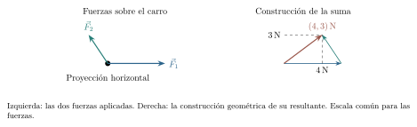
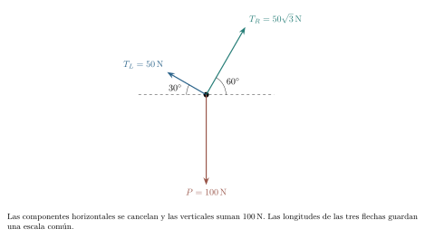
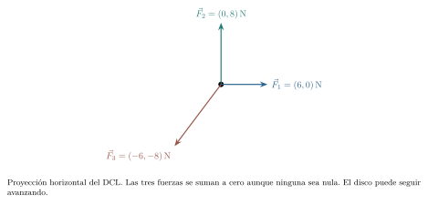
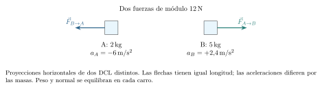
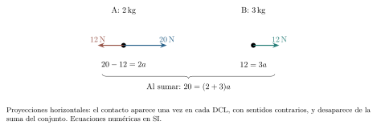
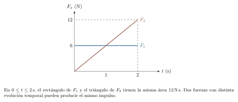
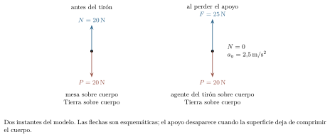
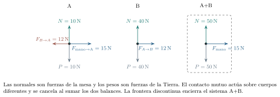
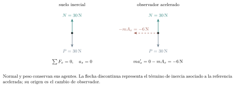
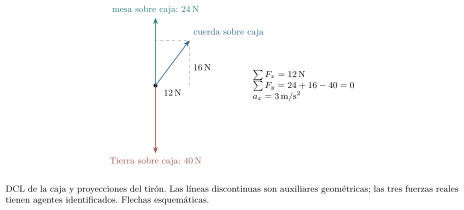

[← Capítulo anterior](capitulo-05.html) · [Índice del libro](index.html) · [Capítulo siguiente →](capitulo-07.html)

Un carro puede seguir avanzando después de que dejamos de empujarlo. En una curva, en cambio, hace falta que algo cambie continuamente la dirección de su velocidad, aunque la rapidez permanezca constante. Los capítulos anteriores permiten describir esos movimientos; para explicar sus cambios necesitamos identificar las interacciones del carro con su entorno. La pregunta física se desplaza de dónde está el cuerpo a qué otros cuerpos están actuando sobre él.

Las leyes de Newton relacionan esas interacciones con la aceleración. Su aplicación exige elegir una referencia, delimitar el cuerpo estudiado y representar por separado las fuerzas que recibe. Un diagrama de cuerpo libre hará visible esa elección antes de escribir ecuaciones. Seguiremos trabajando con modelos de partícula: describiremos la traslación y dejaremos para un estudio posterior las condiciones que controlan la rotación de un objeto extenso.

## Inercia: qué permanece cuando la fuerza neta es cero

Una caja arrastrada por el suelo suele detenerse cuando dejamos de tirar de ella. Esa observación puede sugerir que el movimiento necesita un empuje permanente. Sin embargo, durante la detención el suelo y el aire siguen interactuando con la caja. Cuanto menores sean esas interacciones resistentes, más tiempo conservará su velocidad después del tirón. Al cesar nuestra intervención pueden seguir actuando otras interacciones sobre el cuerpo.

La primera ley de Newton afirma que existen referencias en las cuales un cuerpo aislado conserva su velocidad vectorial: permanece en reposo si su velocidad inicial es cero y continúa en movimiento rectilíneo uniforme si es distinta de cero. Llamamos *inerciales* a esas referencias. En ellas, el mismo comportamiento se obtiene cuando varias fuerzas tienen suma vectorial nula. La inercia nombra la persistencia de la velocidad cuando la resultante es nula.

La afirmación expresa una ley experimental sobre el movimiento y sus interacciones. Para aplicarla justificamos que las interacciones omitidas sean despreciables y que la referencia elegida se aproxime suficientemente a una inercial. El suelo ofrece esa aproximación en los experimentos cortos de este libro; en otras escalas debemos considerar la rotación terrestre.

### Problema resuelto 6.1 · Seguir avanzando sin empuje horizontal {#r6-1}

Un carro se mueve sobre una pista horizontal con resistencia despreciable. Al terminar un breve empuje, su velocidad es $3\,\mathrm{m/s}$ hacia la derecha. Tomamos ese instante como $t=0$ y su posición como $x=0$. ¿Dónde estará dos segundos después si ya no recibe fuerza horizontal?

*Resolución.* La Tierra sigue ejerciendo una fuerza vertical hacia abajo y la pista una fuerza vertical hacia arriba. Como el carro no acelera verticalmente, ambas se equilibran. Por hipótesis tampoco queda una fuerza horizontal apreciable; en la referencia del suelo, aproximada como inercial, $\vec a=\vec0$. La velocidad se conserva y $x=(3\,\mathrm{m/s})t$, de modo que $x(2\,\mathrm{s})=6\,\mathrm{m}$. La resultante nula permite conservar esa velocidad. Si se detuviera antes, tendríamos que revisar las fuerzas omitidas o el alcance de la aproximación.

{#fig-fp-av-r6-1 fig-alt="Ilustración de Problema resuelto 6.1 · Seguir avanzando sin empuje horizontal. Resolución. La Tierra sigue ejerciendo una fuerza vertical hacia abajo y la pista una fuerza vertical hacia arriba. Como el carro no acelera verticalmente, ambas se equilibran. Por hipótesis tampoco queda una fuerza horizontal apreciable; en la referencia del suelo, aproximada como inercial, vec a=vec0. La velocidad"}

La conclusión requiere que permanezca constante el vector velocidad, con su dirección y su módulo. En el movimiento circular del capítulo 5 la velocidad cambia de dirección y existe aceleración. Para juzgar el equilibrio debemos examinar la aceleración: una pelota está quieta durante un instante en la cumbre de un lanzamiento vertical y sigue acelerando. La primera ley describe la evolución durante un intervalo bajo una condición sobre las fuerzas.

Si una referencia se traslada con velocidad constante respecto de una inercial y sus ejes conservan su orientación, también es inercial en el modelo clásico. La transformación galileana de los capítulos 4 y 5 conserva la aceleración. Un vehículo que arranca, frena o toma una curva introduce una aceleración del observador que debe incorporarse a la descripción.

## Sumar interacciones y relacionarlas con la aceleración

Una *fuerza* representa la interacción que un cuerpo ejerce sobre otro. Indicaremos su dirección y sentido mediante un vector y, cuando importe precisar los participantes, escribiremos $\vec F_{A\to B}$ para la fuerza que A ejerce sobre B. Sobre un mismo cuerpo pueden actuar simultáneamente la gravedad, una cuerda, una superficie y una mano. La fuerza neta es la suma vectorial de las fuerzas externas que recibe el cuerpo elegido:
$$
\vec F_{\mathrm{neta}}=\sum_i\vec F_i.
$$
El índice $i$ recorre las distintas fuerzas; la notación de suma fue introducida en el capítulo 3. La resultante resume el efecto traslacional del conjunto de interacciones. Si dibujamos las fuerzas individuales y además su resultante, debemos mantener separados el diagrama físico y la construcción geométrica de la suma para no contar dos veces lo mismo.

En una referencia inercial, la segunda ley de Newton para una partícula de masa constante $m>0$ establece
$$
\sum_i\vec F_i=m\vec a,
\qquad
\sum_i F_{ix}=ma_x,\quad \sum_i F_{iy}=ma_y.
$$
Las ecuaciones de componentes expresan una sola igualdad vectorial. Las componentes indican proyecciones orientadas sobre los ejes; los módulos toman valores mayores o iguales que cero. La aceleración tiene la dirección de la resultante porque la masa es un escalar positivo; la dirección de la velocidad depende también de las condiciones iniciales.

La masa mide la inercia del cuerpo: ante una misma fuerza neta, una masa mayor adquiere una aceleración menor. Se expresa en kilogramos. En SI, el newton se define por $1\,\mathrm{N}=1\,\mathrm{kg\,m/s^2}$: una fuerza neta de un newton produce en una masa de un kilogramo una aceleración de un metro por segundo cuadrado. Un dinamómetro calibrado permite comparar fuerzas; una balanza puede inferir masas bajo condiciones conocidas. Debemos distinguir la magnitud que mide directamente el instrumento de la que obtenemos usando un modelo.

### Problema resuelto 6.2 · Construir la resultante mediante componentes {#r6-2}

Sobre un carro de $2\,\mathrm{kg}$, en una mesa horizontal sin resistencia apreciable, actúan dos fuerzas horizontales $\vec F_1=(6,0)\,\mathrm{N}$ y $\vec F_2=(-2,3)\,\mathrm{N}$. Los ejes se ven desde arriba. Determina la aceleración y su módulo.

*Resolución.* La normal y el peso se equilibran verticalmente; los vectores dados describen las dos componentes del plano horizontal. Sumamos coordenadas correspondientes:
$$
\vec F_{\mathrm{neta}}=(4,3)\,\mathrm{N},\qquad
\vec a=\frac{(4,3)\,\mathrm{N}}{2\,\mathrm{kg}}=(2,1{,}5)\,\mathrm{m/s^2}.
$$
El módulo es $|\vec a|=2{,}5\,\mathrm{m/s^2}$ y la dirección forma $\arctan(3/4)\simeq36{,}9^\circ$ desde $+x$ hacia $+y$. Sumar $6+\sqrt{13}$ da la suma de los módulos individuales; la suma vectorial tiene módulo $5\,\mathrm{N}$. La aceleración queda determinada; la velocidad instantánea todavía requiere información inicial.

{#fig-fp-av-r6-2 fig-alt="Ilustración de Problema resuelto 6.2 · Construir la resultante mediante componentes. Resolución. La normal y el peso se equilibran verticalmente; los vectores dados describen las dos componentes del plano horizontal. Sumamos coordenadas correspondientes: vec Fneta=(4,3)\\,N,qquad vec a=frac(4,3)\\,N2\\,kg=(2,1,5)\\,m/s^2. El módulo es |vec a|=2,5\\,m/s^2 y la dirección forma arctan(3/4)simeq36,9^circ desde"}

### Problema resuelto 6.3 · La misma fuerza puede frenar y después invertir el movimiento {#r6-3}

Un móvil de $4\,\mathrm{kg}$ parte de $x=0$ con $v_0=+6\,\mathrm{m/s}$. Durante $4\,\mathrm{s}$ recibe una fuerza neta constante $F_x=-8\,\mathrm{N}$. Encuentra cuándo se detiene y su estado al final del intervalo.

*Resolución.* La segunda ley da $a_x=-8/4=-2\,\mathrm{m/s^2}$. Por la cinemática del capítulo 4,
$$
v_x=6\,\mathrm{m/s}-(2\,\mathrm{m/s^2})t,\qquad
x=(6\,\mathrm{m/s})t-(1\,\mathrm{m/s^2})t^2.
$$
La velocidad se anula en $3\,\mathrm{s}$, cuando $x=9\,\mathrm{m}$. La fuerza continúa actuando y el móvil invierte el sentido: en $4\,\mathrm{s}$ tiene $v_x=-2\,\mathrm{m/s}$ y $x=8\,\mathrm{m}$. Antes del retorno la fuerza se opone a la velocidad y reduce la rapidez; después apunta en el mismo sentido y la aumenta. La distancia total es $9+1=10\,\mathrm{m}$, mientras el desplazamiento es $+8\,\mathrm{m}$. En el instante de reposo la fuerza sigue siendo $-8\,\mathrm{N}$.

{#fig-fp-av-r6-3 fig-alt="Ilustración de Problema resuelto 6.3 · La misma fuerza puede frenar y después invertir el movimiento. Resolución. La segunda ley da ax=-8/4=-2\\,m/s^2. Por la cinemática del capítulo 4, vx=6\\,m/s-(2\\,m/s^2)t,qquad x=(6\\,m/s)t-(1\\,m/s^2)t^2. La velocidad se anula en 3\\,s, cuando x=9\\,m. La fuerza continúa actuando y el móvil invierte el sentido: en 4\\,s tiene vx=-2\\,m/s y x=8\\,m. Antes del retorno la fuerza se opone a"}

Podemos usar la segunda ley en dos direcciones. Con las interacciones conocidas, calculamos la aceleración y reconstruimos el movimiento mediante sus condiciones iniciales. Con un movimiento suficientemente conocido y una masa dada, inferimos la fuerza neta. Identificar las interacciones individuales requiere información adicional, pues distintas combinaciones pueden producir la misma resultante.

### Problema resuelto 6.4 · Lo que una trayectoria permite inferir {#r6-4}

En una referencia inercial una partícula de $3\,\mathrm{kg}$ sigue, durante $0\leq t\leq2\,\mathrm{s}$,
$$
x=1\,\mathrm{m}+(2\,\mathrm{m/s})t+(1\,\mathrm{m/s^2})t^2,\qquad
y=-(1/3\,\mathrm{m/s^3})t^3.
$$
Encuentra la fuerza neta en $t=1{,}5\,\mathrm{s}$. ¿Puedes decidir cuántas fuerzas actúan?

*Resolución.* Las segundas derivadas son $a_x=2\,\mathrm{m/s^2}$ y $a_y=-(2\,\mathrm{m/s^3})t$. Por tanto,
$$
\vec F_{\mathrm{neta}}(t)=6\,\mathrm{N}\,\hat\imath-(6\,\mathrm{N/s})t\,\hat\jmath,
\qquad \vec F_{\mathrm{neta}}(1{,}5\,\mathrm{s})=(6,-9)\,\mathrm{N}.
$$
El módulo en ese instante es $\sqrt{117}\,\mathrm{N}\simeq10{,}82\,\mathrm{N}$. Una o varias interacciones pueden producir esa misma resultante y trayectoria. Para construir un inventario de fuerzas debemos examinar el entorno y los contactos, además de medir el movimiento.

{#fig-fp-av-r6-4 fig-alt="Ilustración de Problema resuelto 6.4 · Lo que una trayectoria permite inferir. Resolución. Las segundas derivadas son ax=2\\,m/s^2 y ay=-(2\\,m/s^3)t. Por tanto, vec Fneta(t)=6\\,N\\,hatimath-(6\\,N/s)t\\,hatjmath, qquad vec Fneta(1,5\\,s)=(6,-9)\\,N. El módulo en ese instante es sqrt117\\,Nsimeq10,82\\,N. Una o varias interacciones pueden producir esa misma resultante y trayectoria. Para construir un"}

### Problema resuelto 6.5 · Comparar masas con una misma fuerza neta {#r6-5}

Una fuerza neta horizontal de módulo constante produce aceleración $3\,\mathrm{m/s^2}$ en un carro A de $2\,\mathrm{kg}$. Aplicada a un carro B, produce $1{,}2\,\mathrm{m/s^2}$. Las resistencias son despreciables. Determina la fuerza y la masa de B.

*Resolución.* El primer ensayo fija $F=2(3)=6\,\mathrm{N}$. En el segundo, $m_B=F/a_B=6/1{,}2=5\,\mathrm{kg}$. También podemos comparar sin calcular primero la fuerza: de $m_Aa_A=m_Ba_B$ resulta $m_B/m_A=a_A/a_B=2{,}5$. La comparación requiere la misma fuerza *neta*, incluidas las resistencias presentes en cada ensayo. La masa es el parámetro que relaciona la aceleración de B con la interacción resultante.

{#fig-fp-av-r6-5 fig-alt="Ilustración de Problema resuelto 6.5 · Comparar masas con una misma fuerza neta. Resolución. El primer ensayo fija F=2(3)=6\\,N. En el segundo, mB=F/aB=6/1,2=5\\,kg. También podemos comparar sin calcular primero la fuerza: de mAaA=mBaB resulta mB/mA=aA/aB=2,5. La comparación requiere la misma fuerza neta, incluidas las resistencias presentes en cada ensayo. La masa es el parámetro que relaciona la"}

## Elegir el cuerpo y dibujar las fuerzas que recibe

Antes de escribir $\sum\vec F=m\vec a$ debemos decidir a qué cuerpo se refiere. Un *diagrama de cuerpo libre*, abreviado DCL, representa ese cuerpo separado de su entorno y las fuerzas externas que actúan sobre él. Cada flecha debe admitir una frase del tipo «la mesa ejerce esta fuerza sobre el libro». Si no podemos nombrar al agente, debemos investigar si hemos dibujado una fuerza real del modelo o una magnitud cinemática por error.

En un DCL de partícula trasladamos las flechas a un punto representativo. Esta convención sirve para la traslación; al estudiar giros debemos conservar los puntos de aplicación de las fuerzas. Los ejes y una indicación de la aceleración pueden acompañar el dibujo, pero se distinguen de las flechas de fuerza. Nunca se añade $m\vec a$ al inventario: es el resultado de la suma que queremos establecer.

En las situaciones próximas a la superficie terrestre usaremos el *peso* $\vec P=m\vec g$, la fuerza gravitatoria que la Tierra ejerce sobre el cuerpo. Con un eje vertical positivo hacia arriba, $\vec g=-g\hat\jmath$ y $\vec P=-mg\hat\jmath$. La masa se mide en kilogramos; el peso, en newtons. Adoptaremos $g=10\,\mathrm{m/s^2}$ en los problemas del capítulo. La aproximación facilita los cálculos en una región donde las variaciones del campo gravitatorio son despreciables.

Una superficie ejerce una fuerza de contacto cuya componente perpendicular se llama *normal*, de módulo $N$. La palabra indica su dirección respecto de la superficie; su módulo se obtiene de las ecuaciones de movimiento y puede diferir de $mg$. En un contacto ordinario sin adhesión la superficie transmite una fuerza de compresión: por eso $N\geq0$. La componente tangencial, si existe, corresponde al rozamiento; aquí utilizaremos superficies lisas cuando queramos omitirla. El capítulo siguiente estudiará con detalle cómo modelar fricción, cuerdas y cuerpos vinculados.

### Problema resuelto 6.6 · Peso, normal y sus respectivas reacciones {#r6-6}

Un libro de $3\,\mathrm{kg}$ reposa sobre una mesa horizontal. Una mano añade una fuerza vertical de $5\,\mathrm{N}$ hacia abajo sin mover el libro. Determina la normal e identifica los agentes de todas las fuerzas del DCL.

*Resolución.* Sobre el libro actúan la Tierra hacia abajo, la mano hacia abajo y la mesa hacia arriba. Su aceleración vertical es cero. Con $+y$ hacia arriba,
$$
N-30\,\mathrm{N}-5\,\mathrm{N}=0,
\qquad N=35\,\mathrm{N}.
$$
El peso sigue siendo $30\,\mathrm{N}$ porque la masa y el campo gravitatorio conservan sus valores. Peso y normal actúan ambos sobre el libro y provienen de interacciones diferentes. Las fuerzas de reacción correspondientes pertenecen a los DCL de la Tierra y de la mesa, respectivamente.

{#fig-fp-av-r6-6 fig-alt="Ilustración de Problema resuelto 6.6 · Peso, normal y sus respectivas reacciones. Resolución. Sobre el libro actúan la Tierra hacia abajo, la mano hacia abajo y la mesa hacia arriba. Su aceleración vertical es cero. Con +y hacia arriba, N-30\\,N-5\\,N=0, qquad N=35\\,N. El peso sigue siendo 30\\,N porque la masa y el campo gravitatorio conservan sus valores. Peso y normal actúan ambos sobre el libro y"}

### Problema resuelto 6.7 · Una báscula mide una fuerza de apoyo {#r6-7}

Una persona de $50\,\mathrm{kg}$ permanece apoyada sobre una báscula dentro de un ascensor. La báscula indica $400\,\mathrm{N}$. Desprecia otras fuerzas verticales. Encuentra la aceleración y explica qué puedes concluir sobre la velocidad.

*Resolución.* El DCL de la persona contiene el peso $500\,\mathrm{N}$ hacia abajo y la normal $400\,\mathrm{N}$ hacia arriba. La báscula informa esta última fuerza. La segunda ley da
$$
400-500=50a_y
$$
al usar unidades SI, luego $a_y=-2\,\mathrm{m/s^2}$. El ascensor podría estar bajando cada vez más rápido o subiendo y frenando; distinguir ambas situaciones requiere conocer el signo de la velocidad. La masa de la persona permanece constante. En caída libre ideal, mientras báscula y persona caen juntas sin apoyo, $N=0$ aunque el peso continúe actuando.

{#fig-fp-av-r6-7 fig-alt="Ilustración de Problema resuelto 6.7 · Una báscula mide una fuerza de apoyo. Resolución. El DCL de la persona contiene el peso 500\\,N hacia abajo y la normal 400\\,N hacia arriba. La báscula informa esta última fuerza. La segunda ley da 400-500=50ay al usar unidades SI, luego ay=-2\\,m/s^2. El ascensor podría estar bajando cada vez más rápido o subiendo y frenando; distinguir ambas situaciones"}

### Problema resuelto 6.8 · Tirar hacia arriba reduce el apoyo {#r6-8}

Una caja de $5\,\mathrm{kg}$ se desliza sobre una mesa horizontal lisa. Una cuerda tira de ella con componentes $(12,16)\,\mathrm{N}$: horizontal hacia la derecha y vertical hacia arriba. Mientras siga en contacto con la mesa, encuentra normal y aceleración.

*Resolución.* La caja no tiene aceleración vertical mientras conserva el contacto con esta mesa fija y horizontal. Por tanto,
$$
N+16-50=0
$$
en SI, de donde $N=34\,\mathrm{N}$. Horizontalmente, $12=5a_x$ da $a_x=2{,}4\,\mathrm{m/s^2}$. El tirón tiene módulo $20\,\mathrm{N}$, pero solo su componente horizontal produce la aceleración calculada. Si su componente vertical superara $50\,\mathrm{N}$, la ecuación de contacto exigiría $N<0$, imposible sin adhesión: habría que usar $N=0$ y permitir aceleración vertical. Una respuesta negativa puede revelar que la hipótesis de contacto dejó de ser válida.

{#fig-fp-av-r6-8 fig-alt="Ilustración de Problema resuelto 6.8 · Tirar hacia arriba reduce el apoyo. Resolución. La caja no tiene aceleración vertical mientras conserva el contacto con esta mesa fija y horizontal. Por tanto, N+16-50=0 en SI, de donde N=34\\,N. Horizontalmente, 12=5ax da ax=2,4\\,m/s^2. El tirón tiene módulo 20\\,N, pero solo su componente horizontal produce la aceleración calculada. Si su componente"}

Un dibujo del entorno y un DCL cumplen funciones distintas. El primero ayuda a elegir el sistema; el segundo conserva únicamente las interacciones relevantes para su ecuación de movimiento. Separarlos impide, por ejemplo, dibujar sobre un ascensor la fuerza que el ascensor ejerce sobre la persona como si actuara también sobre él. Cuando estudiamos dos cuerpos construiremos primero dos inventarios, uno por cuerpo.

## Equilibrio traslacional y condiciones de contacto

Para una partícula de masa constante en una referencia inercial, $\vec a=\vec0$ equivale a $\sum\vec F=\vec0$. Llamamos *equilibrio traslacional* a esta condición. Incluye el reposo y el movimiento rectilíneo uniforme con interacciones que se equilibran. En un cuerpo extenso debemos estudiar también la rotación: dos fuerzas pueden tener resultante cero y producir un giro. Aquí la idealización de partícula delimita la afirmación.

En una cuerda flexible y tensa, la fuerza que recibe un cuerpo en el extremo sigue la dirección local de la cuerda y tira hacia ella. Llamaremos *tensión* a su módulo. Una cuerda flexible ideal solo transmite tracción mientras está tensa; una tensión negativa indica que debemos revisar la configuración supuesta. Las fuerzas de dos cuerdas distintas se determinan con sus respectivas condiciones geométricas y dinámicas.

### Problema resuelto 6.9 · Dos cuerdas distintas sostienen una lámpara {#r6-9}

Una lámpara de peso $100\,\mathrm{N}$ permanece en reposo, tratada como una partícula. Una cuerda sale hacia arriba a la izquierda formando $30^\circ$ con la horizontal; la otra sale a la derecha formando $60^\circ$. Determina ambas tensiones.

*Resolución.* Dibujamos peso y dos tensiones sobre la lámpara. En equilibrio, las componentes horizontales deben cancelarse y las verticales sumar el peso:
$$
\begin{aligned}
-T_L\cos30^\circ+T_R\cos60^\circ&=0,\\
T_L\sin30^\circ+T_R\sin60^\circ&=100\,\mathrm{N}.
\end{aligned}
$$
La primera ecuación da $T_R=\sqrt3\,T_L$. Al sustituir en la segunda obtenemos $2T_L=100\,\mathrm{N}$, luego $T_L=50\,\mathrm{N}$ y $T_R=50\sqrt3\,\mathrm{N}\simeq86{,}60\,\mathrm{N}$. Sus componentes verticales son $25\,\mathrm{N}$ y $75\,\mathrm{N}$; las horizontales tienen el mismo módulo $25\sqrt3\,\mathrm{N}$ y sentidos contrarios. Cada tensión se obtiene resolviendo las dos condiciones de equilibrio.

{#fig-fp-av-r6-9 fig-alt="Ilustración de Problema resuelto 6.9 · Dos cuerdas distintas sostienen una lámpara. Resolución. Dibujamos peso y dos tensiones sobre la lámpara. En equilibrio, las componentes horizontales deben cancelarse y las verticales sumar el peso: beginaligned -TLcos30^circ+TRcos60^circ&=0,\\\\ TLsin30^circ+TRsin60^circ&=100\\,N. endaligned La primera ecuación da TR=sqrt3\\,TL. Al sustituir en la segunda obtenemos"}

### Problema resuelto 6.10 · Equilibrio con velocidad distinta de cero {#r6-10}

Un disco sobre una mesa horizontal lisa se mueve con velocidad constante $(5,0)\,\mathrm{m/s}$. En el plano horizontal actúan $\vec F_1=(6,0)\,\mathrm{N}$, $\vec F_2=(0,8)\,\mathrm{N}$ y una tercera fuerza desconocida. Determínala.

*Resolución.* La velocidad vectorial constante exige aceleración cero. La normal y el peso se equilibran fuera del plano dibujado, y dentro de él debe cumplirse
$$
\vec F_3=-(\vec F_1+\vec F_2)=(-6,-8)\,\mathrm{N},
\qquad |\vec F_3|=10\,\mathrm{N}.
$$
El signo negativo de ambas componentes sitúa la fuerza en el tercer cuadrante. La misma combinación de fuerzas es compatible con el reposo o con distintas velocidades constantes: las fuerzas determinan el cambio de velocidad, mientras su valor inicial constituye otro dato. Si solo supiéramos que la *rapidez* es constante, no podríamos concluir equilibrio, porque el camino podría ser curvo.

{#fig-fp-av-r6-10 fig-alt="Ilustración de Problema resuelto 6.10 · Equilibrio con velocidad distinta de cero. Resolución. La velocidad vectorial constante exige aceleración cero. La normal y el peso se equilibran fuera del plano dibujado, y dentro de él debe cumplirse vec F3=-(vec F1+vec F2)=(-6,-8)\\,N, qquad |vec F3|=10\\,N. El signo negativo de ambas componentes sitúa la fuerza en el tercer cuadrante. La misma combinación de"}

## Tercera ley: dos fuerzas sobre dos cuerpos

Una interacción tiene dos participantes. En los modelos newtonianos que estudiaremos, las fuerzas mutuas entre A y B satisfacen
$$
\vec F_{A\to B}=-\vec F_{B\to A}.
$$
Esta es la tercera ley de Newton. Los dos vectores tienen igual módulo y sentidos opuestos, y actúan sobre cuerpos distintos. Los nombres «acción» y «reacción» identifican los dos lados simultáneos de una misma interacción.

La segunda ley suma las fuerzas *sobre un cuerpo*; la tercera compara las fuerzas *entre dos cuerpos*. En la ecuación de A aparece únicamente el miembro del par que actúa sobre A. Las aceleraciones de los participantes dependen de sus masas y de las demás fuerzas que reciban, y pueden tener módulos distintos.

### Problema resuelto 6.11 · Interacción igual y aceleraciones diferentes {#r6-11}

Dos carros A y B, de masas $2\,\mathrm{kg}$ y $5\,\mathrm{kg}$, se repelen mediante imanes sobre una pista horizontal lisa, dentro del modelo newtoniano de fuerzas mutuas. En cierto instante, A ejerce $12\,\mathrm{N}$ hacia la derecha sobre B y B ejerce $12\,\mathrm{N}$ hacia la izquierda sobre A. No hay otras fuerzas horizontales. Encuentra sus aceleraciones.

*Resolución.* La tercera ley relaciona las fuerzas horizontales entre los carros, que son opuestas, mientras los pesos y las normales se equilibran verticalmente. Escribimos una ecuación para cada carro:
$$
a_A=\frac{-12\,\mathrm{N}}{2\,\mathrm{kg}}=-6\,\mathrm{m/s^2},\qquad
a_B=\frac{12\,\mathrm{N}}{5\,\mathrm{kg}}=2{,}4\,\mathrm{m/s^2}.
$$
El carro de menor masa adquiere mayor aceleración en módulo. La cancelación $-12+12$ corresponde al sistema que contiene ambos carros; cada aceleración individual se calcula con la fuerza sobre ese carro. Los resultados corresponden al instante estudiado; extenderlos a otros instantes requiere conocer cómo varía la fuerza magnética.

{#fig-fp-av-r6-11 fig-alt="Ilustración de Problema resuelto 6.11 · Interacción igual y aceleraciones diferentes. Resolución. La tercera ley relaciona las fuerzas horizontales entre los carros, que son opuestas, mientras los pesos y las normales se equilibran verticalmente. Escribimos una ecuación para cada carro: aA=frac-12\\,N2\\,kg=-6\\,m/s^2,qquad aB=frac12\\,N5\\,kg=2,4\\,m/s^2. El carro de menor masa adquiere mayor aceleración en"}

### Problema resuelto 6.12 · La Tierra también recibe una fuerza {#r6-12}

Una pelota de $0{,}2\,\mathrm{kg}$ cae cerca de la superficie terrestre sin resistencia del aire. Modela la masa de la Tierra como $6\times10^{24}\,\mathrm{kg}$ y usa $g=10\,\mathrm{m/s^2}$. Compara las fuerzas gravitatorias mutuas y las aceleraciones que producen.

*Resolución.* La Tierra ejerce sobre la pelota una fuerza de módulo $mg=2\,\mathrm{N}$ dirigida hacia ella. La pelota ejerce simultáneamente sobre la Tierra una fuerza de $2\,\mathrm{N}$ en el sentido opuesto, hacia la pelota. Si consideramos solo esta interacción, sus contribuciones a las aceleraciones son
$$
a_{\mathrm{pelota}}=10\,\mathrm{m/s^2},\qquad
a_{\mathrm{Tierra}}=\frac{2}{6\times10^{24}}\,\mathrm{m/s^2}
\simeq3{,}33\times10^{-25}\,\mathrm{m/s^2}.
$$
La gran diferencia de masa explica por qué la aceleración de la Tierra debida a la pelota es despreciable para nuestro experimento. La fuerza de reacción al peso de la pelota actúa sobre la Tierra. En el DCL de la pelota en vuelo solo aparece su peso bajo estas hipótesis.

{#fig-fp-av-r6-12 fig-alt="Ilustración de Problema resuelto 6.12 · La Tierra también recibe una fuerza. Resolución. La Tierra ejerce sobre la pelota una fuerza de módulo mg=2\\,N dirigida hacia ella. La pelota ejerce simultáneamente sobre la Tierra una fuerza de 2\\,N en el sentido opuesto, hacia la pelota. Si consideramos solo esta interacción, sus contribuciones a las aceleraciones son apelota=10\\,m/s^2,qquad"}

Al reunir varios cuerpos en un sistema, las fuerzas que se ejercen entre ellos pasan a ser *internas*. Sus pares se cancelan en la suma de fuerzas de todo el sistema. Para masas constantes, sumar las ecuaciones individuales da
$$
\sum\vec F_{\mathrm{externas}}=\sum_j m_j\vec a_j.
$$
Solo si los cuerpos comparten una misma aceleración podemos escribir el miembro derecho como $M\vec a$, con $M=\sum_jm_j$. Los cuerpos de un sistema comparten aceleración cuando las restricciones de su movimiento así lo exigen. El concepto general de centro de masa permitirá otra formulación más adelante.

### Problema resuelto 6.13 · Dos bloques en contacto y dos fronteras posibles {#r6-13}

Dos bloques A y B, de $2\,\mathrm{kg}$ y $3\,\mathrm{kg}$, están en contacto sobre una mesa horizontal lisa, A a la izquierda de B. Una mano empuja A hacia la derecha con $20\,\mathrm{N}$. Ambos permanecen en contacto sin deformación apreciable. Encuentra la aceleración común y la fuerza de contacto.

*Resolución.* Para el conjunto, la única fuerza horizontal externa es la de la mano. La condición de contacto mantenido impone la misma aceleración horizontal:
$$
20\,\mathrm{N}=(2+3)\,\mathrm{kg}\,a,\qquad a=4\,\mathrm{m/s^2}.
$$
Para conocer el contacto aislamos B: la fuerza que recibe de A es su única fuerza horizontal, luego $F_{A\to B}=3(4)=12\,\mathrm{N}$ hacia la derecha. Por la tercera ley, B ejerce sobre A $12\,\mathrm{N}$ hacia la izquierda. En A se verifica $20-12=2(4)$ en SI. En cada bloque, peso y normal se equilibran verticalmente. El contacto desaparece de la ecuación del conjunto, pero es indispensable en cada DCL individual. Cada bloque conserva su propia ecuación de movimiento, con la fuerza interna que recibe del otro.

{#fig-fp-av-r6-13 fig-alt="Ilustración de Problema resuelto 6.13 · Dos bloques en contacto y dos fronteras posibles. Resolución. Para el conjunto, la única fuerza horizontal externa es la de la mano. La condición de contacto mantenido impone la misma aceleración horizontal: 20\\,N=(2+3)\\,kg\\,a,qquad a=4\\,m/s^2. Para conocer el contacto aislamos B: la fuerza que recibe de A es su única fuerza horizontal, luego FAto B=3(4)=12\\,N hacia"}

## La resultante en un movimiento curvo

La aceleración circular del capítulo 5 proporciona una prueba especialmente útil de la segunda ley. Una partícula que describe un círculo de radio fijo $R$ con rapidez constante $u$ tiene aceleración de módulo $u^2/R$ hacia el centro. Por tanto, la resultante debe tener esa misma dirección y módulo $mu^2/R$. La palabra *centrípeta* describe aquí la dirección de la resultante que proporcionan las interacciones presentes.

Si cambia también la rapidez, la resultante tendrá además una componente tangencial. Podemos decidir qué componente de fuerza necesitamos a partir de cómo cambia el vector velocidad, pero todavía debemos buscar qué agente la ejerce. La viabilidad del movimiento requiere comprobar que el dispositivo puede proporcionar la fuerza calculada.

### Problema resuelto 6.14 · La tensión proporciona la resultante radial {#r6-14}

Un disco de $0{,}5\,\mathrm{kg}$ gira con rapidez constante $4\,\mathrm{m/s}$ sobre una mesa horizontal lisa, atado mediante una cuerda horizontal a un punto fijo. El radio es $2\,\mathrm{m}$. Encuentra la tensión y describe qué sucede inmediatamente después de cortar la cuerda, mientras el disco siga sobre la mesa.

*Resolución.* Peso y normal valen $5\,\mathrm{N}$ y se equilibran verticalmente. La tensión es la única fuerza horizontal, dirigida al centro. Así,
$$
T=\frac{mu^2}{R}
=\frac{0{,}5(4)^2}{2}\,\mathrm{N}
=4\,\mathrm{N}.
$$
La tensión proporciona toda la resultante horizontal centrípeta. Al cortar la cuerda, la tensión desaparece y el disco conserva inicialmente su velocidad tangente. Bajo las hipótesis restantes seguirá una recta sobre la mesa. Al cortarse la cuerda, la velocidad inicial del movimiento libre es tangente a la circunferencia.

{#fig-fp-av-r6-14 fig-alt="Ilustración de Problema resuelto 6.14 · La tensión proporciona la resultante radial. Resolución. Peso y normal valen 5\\,N y se equilibran verticalmente. La tensión es la única fuerza horizontal, dirigida al centro. Así, T=fracmu^2R =frac0,5(4)^22\\,N =4\\,N. La tensión proporciona toda la resultante horizontal centrípeta. Al cortar la cuerda, la tensión desaparece y el disco conserva inicialmente su"}

## Un observador que acelera

Las ecuaciones anteriores se escribieron en referencias inerciales. Para entender qué cambia en un vehículo que acelera, retomemos la relación geométrica del capítulo 5 con ejes paralelos: $\vec r\,'=\vec r-\vec R(t)$, donde $\vec R$ es la posición del origen móvil. Dos derivadas dan $\vec a\,'=\vec a-\vec A$, con $\vec A=\ddot{\vec R}$. Si en la referencia inercial $m\vec a=\sum\vec F$, entonces
$$
m\vec a\,'=\sum\vec F-m\vec A.
$$
El término $-m\vec A$ permite escribir la ecuación en la referencia trasladada que acelera. Se denomina *fuerza de inercia* o fuerza ficticia en esa descripción: es un término dependiente de la referencia que permite expresar la ecuación transformada. Su valor depende del observador. La deducción corresponde a ejes sin rotación; una referencia giratoria requiere términos adicionales.

### Problema resuelto 6.15 · La caja que se desplaza hacia atrás dentro de un vehículo {#r6-15}

Una caja de $2\,\mathrm{kg}$ reposa inicialmente sobre el piso horizontal sin rozamiento de un vehículo. Este empieza a acelerar a $3\,\mathrm{m/s^2}$ hacia la derecha respecto del suelo, mientras la caja permanece sin tocar las paredes. Describe la aceleración de la caja vista desde el suelo y desde el vehículo.

*Resolución.* Sobre la caja actúan peso y normal, que se equilibran; no hay fuerza horizontal real bajo las hipótesis dadas. Desde el suelo, $a_x=0$. Desde el vehículo,
$$
a'_x=0-3=-3\,\mathrm{m/s^2},\qquad
ma'_x=-6\,\mathrm{N}.
$$
El término $-6\,\mathrm{N}$ es la fuerza de inercia introducida al transformar la ecuación a la referencia acelerada. Si el vehículo parte también del reposo y los orígenes coinciden en $t=0$, $x=0$ y $x'=-(1{,}5\,\mathrm{m/s^2})t^2$. Esta descripción rige hasta un eventual contacto con una pared. Aquí la velocidad relativa de los orígenes cambia, y la transformación incluye la aceleración del origen móvil.

{#fig-fp-av-r6-15 fig-alt="Ilustración de Problema resuelto 6.15 · La caja que se desplaza hacia atrás dentro de un vehículo. Resolución. Sobre la caja actúan peso y normal, que se equilibran; no hay fuerza horizontal real bajo las hipótesis dadas. Desde el suelo, ax=0. Desde el vehículo, a'x=0-3=-3\\,m/s^2,qquad ma'x=-6\\,N. El término -6\\,N es la fuerza de inercia introducida al transformar la ecuación a la referencia acelerada. Si el"}

## Fuerza variable y cantidad de movimiento

La segunda ley permite estudiar también aceleraciones variables. Si conocemos la resultante como función del tiempo y la masa permanece constante, obtenemos $\vec a(t)=\vec F_{\mathrm{neta}}(t)/m$ y recuperamos velocidad y posición por integración. Es la misma reconstrucción de los capítulos 3 y 5, ahora conectada con un inventario físico de interacciones.

### Problema resuelto 6.16 · Un empuje que crece con el tiempo {#r6-16}

Un carro de $2\,\mathrm{kg}$ se encuentra en reposo en $x=1\,\mathrm{m}$. Durante $0\leq t\leq3\,\mathrm{s}$ su fuerza neta horizontal es $F_x(t)=(4\,\mathrm{N/s})t$. Encuentra su posición y velocidad al terminar el intervalo.

*Resolución.* La aceleración es $a_x=(2\,\mathrm{m/s^3})t$. Integramos usando las condiciones iniciales:
$$
v_x(t)=(1\,\mathrm{m/s^3})t^2,\qquad
x(t)=1\,\mathrm{m}+(1/3\,\mathrm{m/s^3})t^3.
$$
En $3\,\mathrm{s}$ resulta $v_x=9\,\mathrm{m/s}$ y $x=10\,\mathrm{m}$. La fuerza alcanza $12\,\mathrm{N}$ al final de los tres segundos y toma valores menores antes de ese instante. Reemplazarla por una constante de $12\,\mathrm{N}$ describe otro movimiento, con una velocidad final de $18\,\mathrm{m/s}$.

{#fig-fp-av-r6-16 fig-alt="Ilustración de Problema resuelto 6.16 · Un empuje que crece con el tiempo. Resolución. La aceleración es ax=(2\\,m/s^3)t. Integramos usando las condiciones iniciales: vx(t)=(1\\,m/s^3)t^2,qquad x(t)=1\\,m+(1/3\\,m/s^3)t^3. En 3\\,s resulta vx=9\\,m/s y x=10\\,m. La fuerza alcanza 12\\,N al final de los tres segundos y toma valores menores antes de ese instante. Reemplazarla por una constante de"}

Definimos la *cantidad de movimiento* o *momento lineal* de una partícula como $\vec p=m\vec v$, medida en $\,\mathrm{kg\,m/s}$. Para masa constante, la regla del producto se reduce a $d\vec p/dt=m\,d\vec v/dt$ y permite escribir la segunda ley como
$$
\vec F_{\mathrm{neta}}=\frac{d\vec p}{dt},\qquad
\vec p(t_f)-\vec p(t_i)=\int_{t_i}^{t_f}\vec F_{\mathrm{neta}}(t)\,dt.
$$
La integral de fuerza se llama *impulso*. Sus unidades, $\,\mathrm{N\,s}=\,\mathrm{kg\,m/s}$, concuerdan con un cambio de momento. La igualdad permite hallar ese cambio incluso cuando la fuerza no es constante.

La forma $m\vec a$ empleada aquí corresponde a una colección material de masa constante. Si $m=m(t)$, la regla del producto da la identidad $d(m\vec v)/dt=m\vec a+\dot m\vec v$. El balance de un sistema abierto incorpora además el momento transportado por la materia que atraviesa su frontera. Para un cohete debemos especificar esa frontera, el flujo de masa y la velocidad de salida pertinente.

### Problema resuelto 6.17 · El área de una fuerza determina un cambio de momento {#r6-17}

Sobre un carro de $2\,\mathrm{kg}$ que inicialmente avanza a $3\,\mathrm{m/s}$ actúa una fuerza neta horizontal que crece linealmente de $0$ a $8\,\mathrm{N}$ entre $0$ y $2\,\mathrm{s}$ y disminuye linealmente a cero entre $2$ y $4\,\mathrm{s}$. Encuentra la velocidad final.

*Resolución.* La gráfica fuerza-tiempo es un triángulo por encima del eje temporal. Su área es
$$
J_x=\tfrac12(4\,\mathrm{s})(8\,\mathrm{N})=16\,\mathrm{N\,s}.
$$
Como $J_x=m(v_f-v_0)$, el cambio de velocidad es $16/2=8\,\mathrm{m/s}$ y $v_f=11\,\mathrm{m/s}$. El área representa impulso y sus unidades corresponden a momento lineal. La fuerza promedio durante el intervalo vale $16/4=4\,\mathrm{N}$ y produciría el mismo cambio total de velocidad, aunque no la misma velocidad en cada instante ni necesariamente el mismo desplazamiento.

{#fig-fp-av-r6-17 fig-alt="Ilustración de Problema resuelto 6.17 · El área de una fuerza determina un cambio de momento. Resolución. La gráfica fuerza-tiempo es un triángulo por encima del eje temporal. Su área es Jx=tfrac12(4\\,s)(8\\,N)=16\\,N\\,s. Como Jx=m(vf-v0), el cambio de velocidad es 16/2=8\\,m/s y vf=11\\,m/s. El área representa impulso y sus unidades corresponden a momento lineal. La fuerza promedio durante el intervalo vale"}

### Problema resuelto 6.18 · El impulso entre dos velocidades medidas {#r6-18}

Un carro de $3\,\mathrm{kg}$ parte del reposo en $x=0$ y alcanza $4\,\mathrm{m/s}$ hacia la derecha en $2\,\mathrm{s}$. Determina qué fuerza promedio puede inferirse y compara dos historias compatibles: una resultante constante y otra que crece linealmente desde cero.

*Resolución.* El cambio de momento fija el impulso $J_x=3(4)=12\,\mathrm{N\,s}$ y la fuerza promedio $\overline F_x=12/2=6\,\mathrm{N}$. Una fuerza constante de $6\,\mathrm{N}$ da $a_x=2\,\mathrm{m/s^2}$, $v_x=(2\,\mathrm{m/s^2})t$ y $x=(1\,\mathrm{m/s^2})t^2$. Una segunda historia, $F_x=(6\,\mathrm{N/s})t$, da $a_x=(2\,\mathrm{m/s^3})t$, $v_x=(1\,\mathrm{m/s^3})t^2$ y $x=(1/3\,\mathrm{m/s^3})t^3$. En ambos casos la velocidad final es $4\,\mathrm{m/s}$, pero las posiciones finales son $4\,\mathrm{m}$ y $8/3\,\mathrm{m}$. Los datos determinan un promedio de la resultante; reconstruir su historia temporal y las interacciones individuales requiere mediciones adicionales. Una medición adicional de posición permitiría distinguir estos dos modelos concretos.

{#fig-fp-av-r6-18 fig-alt="Ilustración de Problema resuelto 6.18 · El impulso entre dos velocidades medidas. Resolución. El cambio de momento fija el impulso Jx=3(4)=12\\,N\\,s y la fuerza promedio overline Fx=12/2=6\\,N. Una fuerza constante de 6\\,N da ax=2\\,m/s^2, vx=(2\\,m/s^2)t y x=(1\\,m/s^2)t^2. Una segunda historia, Fx=(6\\,N/s)t, da ax=(2\\,m/s^3)t, vx=(1\\,m/s^3)t^2 y x=(1/3\\,m/s^3)t^3. En ambos casos la velocidad final es"}

## Contrastar el modelo con una observación

Un DCL es una propuesta sobre el sistema y sus interacciones. Su valor aparece cuando las ecuaciones producen consecuencias que podemos contrastar. Si una normal sale negativa o un carro acelera en contra de la resultante calculada, conviene volver al inventario, a los ejes y a las hipótesis antes de ajustar números. Una ecuación algebraicamente correcta puede describir un contacto imposible o una referencia distinta de la observada.

### Comparar aceleraciones sin confundir los datos

En una mesa horizontal, estudia un carro ligero con ruedas y un dispositivo que permita aplicar un tirón aproximadamente constante medido con un dinamómetro. Realiza recorridos cortos y despejados, sin personas encima del carro. Repite con una masa adicional bien sujeta y registra posición y tiempo mediante vídeo con cámara fija y una escala en el plano del movimiento.

Compara primero las fuerzas medidas y solo después las aceleraciones estimadas a partir de los datos. El dinamómetro mide el tirón; el DCL permite establecer cuándo ese tirón aproxima la resultante de todas las interacciones. Si la resultante fuese la misma en ambos ensayos y se duplicara la masa total, el modelo predeciría la mitad de aceleración. Al procesar las mediciones, examina cómo las resistencias, la inclinación de la cuerda, la resolución del vídeo o un tirón variable pueden explicar diferencias respecto de esa razón. La rotación de las ruedas también puede limitar la aproximación de partícula empleada para el carro. Registra la masa del carro junto con la carga, y conserva tanto las lecturas originales como las incertidumbres de la estimación. El contraste permite evaluar la adecuación del modelo bajo las condiciones del ensayo.

Como contraste cuantitativo, considera un tirón $F=(6{,}0\pm0{,}1)\,\mathrm{N}$, una masa $m=(2{,}00\pm0{,}02)\,\mathrm{kg}$ y una aceleración $a=(2{,}80\pm0{,}05)\,\mathrm{m/s^2}$, con márgenes interpretados como cotas compatibles. La fuerza que falta en la dirección contraria al tirón tiene estimación central $R=F-ma=0{,}40\,\mathrm{N}$. Los extremos conservadores son $R_{\min}=5{,}9-2{,}02(2{,}85)=0{,}143\,\mathrm{N}$ y $R_{\max}=6{,}1-1{,}98(2{,}75)=0{,}655\,\mathrm{N}$. Bajo estas cotas y el modelo de partícula, el tirón supera a $ma$: el inventario debe incluir una contribución horizontal resistente. Antes de atribuirla a rozamiento, revisa la frontera del sistema, los contactos, la inclinación del tirón y la posible influencia de las ruedas.

La descripción dinámica se sostiene en una elección que debe permanecer visible: qué cuerpo recibe cada fuerza. Una vez fijados el sistema, la referencia y los ejes, la suma vectorial determina una aceleración y las condiciones iniciales permiten reconstruir el movimiento. Cambiar la frontera puede eliminar fuerzas internas de una ecuación global; cambiar el observador puede introducir términos de inercia. Ninguna de esas operaciones cambia quién interactúa físicamente con quién.

## Ejercicios para reconstruir y transferir

En los problemas próximos a la superficie terrestre usa $g=10\,\mathrm{m/s^2}$. Considera inercial la referencia del suelo, salvo indicación contraria. Las superficies declaradas lisas no ejercen rozamiento. Dibuja el DCL pertinente antes de calcular y distingue las fuerzas individuales de su resultante. Los datos son idealizados; los resultados numéricos expresan el redondeo empleado.

### Ejercicio 6.1 · Una fuerza neta nula {#e6-1}

Un carro se encuentra en $x=2\,\mathrm{m}$ con velocidad $-3\,\mathrm{m/s}$ cuando la fuerza neta se hace cero y permanece así durante $4\,\mathrm{s}$. Encuentra la posición final. Explica si la velocidad negativa exige una fuerza neta negativa.

### Ejercicio 6.2 · El reposo instantáneo {#e6-2}

Una pelota de $0{,}4\,\mathrm{kg}$ se lanza verticalmente sin aire. Encuentra fuerza neta y aceleración en la cumbre, antes de cualquier contacto. Explica por qué su velocidad nula no implica equilibrio.

### Ejercicio 6.3 · Sumar dos fuerzas {#e6-3}

En el plano horizontal, una partícula de $4\,\mathrm{kg}$ recibe fuerzas $(8,6)\,\mathrm{N}$ y $(-4,2)\,\mathrm{N}$. Peso y normal se equilibran verticalmente. Encuentra resultante y aceleración, con sus módulos.

### Ejercicio 6.4 · Un móvil que invierte el sentido {#e6-4}

Un carro de $2\,\mathrm{kg}$ parte de $x=0$ con $v_0=+5\,\mathrm{m/s}$ y recibe una fuerza neta constante $-2\,\mathrm{N}$ durante $7\,\mathrm{s}$. Encuentra instante y posición del retorno, posición y velocidad finales, distancia y desplazamiento.

### Ejercicio 6.5 · Una fuerza que se infiere {#e6-5}

Para $0\leq t\leq2\,\mathrm{s}$ una partícula de $2\,\mathrm{kg}$ sigue $x=(1\,\mathrm{m/s})t+(1\,\mathrm{m/s^3})t^3$ e $y=2\,\mathrm{m}-(2\,\mathrm{m/s^2})t^2$. Encuentra la fuerza neta en $t=1\,\mathrm{s}$ y explica qué falta para dibujar las fuerzas individuales.

### Ejercicio 6.6 · Comparación de inercia {#e6-6}

La misma fuerza neta produce $2\,\mathrm{m/s^2}$ en una masa de $3\,\mathrm{kg}$ y $0{,}5\,\mathrm{m/s^2}$ en otro cuerpo. Determina la masa del segundo y la fuerza aplicada.

### Ejercicio 6.7 · Apoyar y empujar {#e6-7}

Un bloque de $4\,\mathrm{kg}$ permanece en reposo sobre una mesa horizontal mientras una mano empuja verticalmente hacia abajo con $10\,\mathrm{N}$. Encuentra la normal e identifica las fuerzas de reacción al peso y al contacto con la mesa.

### Ejercicio 6.8 · Lectura de una báscula {#e6-8}

Una persona de $60\,\mathrm{kg}$ dentro de un ascensor recibe de la báscula una normal de $720\,\mathrm{N}$. Encuentra su aceleración. Da dos signos posibles de velocidad compatibles con la lectura y describe cómo cambia la rapidez en cada caso.

### Ejercicio 6.9 · Una fuerza inclinada {#e6-9}

Una caja de $4\,\mathrm{kg}$ está sobre una mesa horizontal lisa y recibe un tirón con componentes $(12,9)\,\mathrm{N}$. Determina normal y aceleración mientras conserve el contacto. ¿Qué módulo tiene el tirón?

### Ejercicio 6.10 · La hipótesis que produce una normal negativa {#e6-10}

Una caja de $2\,\mathrm{kg}$ reposa sobre una mesa sin adhesión. Una cuerda empieza a tirar verticalmente hacia arriba con $25\,\mathrm{N}$. Decide si puede seguir apoyada y encuentra su aceleración inmediatamente después de perder el apoyo.

### Ejercicio 6.11 · Suspensión simétrica {#e6-11}

Un objeto puntual de peso $80\,\mathrm{N}$ está en reposo suspendido de dos cuerdas que forman $45^\circ$ con la horizontal, una a cada lado. Determina ambas tensiones y verifica sus componentes.

### Ejercicio 6.12 · Equilibrio con tres fuerzas {#e6-12}

Un disco conserva velocidad vectorial constante sobre una mesa lisa. Dos fuerzas horizontales son $(5,-2)\,\mathrm{N}$ y $(-1,7)\,\mathrm{N}$. Encuentra la tercera fuerza horizontal necesaria y su módulo.

### Ejercicio 6.13 · Fuerzas mutuas {#e6-13}

Dos carros de $3\,\mathrm{kg}$ y $6\,\mathrm{kg}$ intercambian fuerzas magnéticas horizontales de módulo $18\,\mathrm{N}$ en cierto instante. Sobre el primero actúa hacia la izquierda y sobre el segundo hacia la derecha; no hay otras fuerzas horizontales. Encuentra sus aceleraciones y compara fuerza y aceleración.

### Ejercicio 6.14 · La reacción al peso {#e6-14}

Un objeto cuelga inmóvil de una cuerda vertical. Identifica la reacción al peso y la reacción a la fuerza de la cuerda. Explica por qué peso y tensión se equilibran en el objeto sin constituir un par de tercera ley.

### Ejercicio 6.15 · Contacto entre dos bloques {#e6-15}

Sobre una mesa lisa, A de $1\,\mathrm{kg}$ está a la izquierda de B de $4\,\mathrm{kg}$. Una mano empuja A hacia la derecha con $15\,\mathrm{N}$ y ambos mantienen el contacto. Encuentra aceleración y fuerza de contacto; verifica las ecuaciones de ambos cuerpos.

### Ejercicio 6.16 · Una curva con rapidez constante {#e6-16}

Un disco de $2\,\mathrm{kg}$ recorre un círculo de radio $3\,\mathrm{m}$ a $6\,\mathrm{m/s}$ sobre una mesa horizontal lisa, sujeto a una cuerda horizontal fija al centro. Calcula la tensión. Si duplica su rapidez manteniendo el radio, ¿qué tensión necesitaría?

### Ejercicio 6.17 · Inferir fuerza de un vector velocidad {#e6-17}

Una partícula de $2\,\mathrm{kg}$ tiene $\vec v(t)=(3\,\mathrm{m/s})[\cos(\omega t)\hat\imath+\sin(\omega t)\hat\jmath]$, con $\omega=2\,\mathrm{rad/s}$, en una referencia inercial. Obtén fuerza neta y su módulo. Evalúa en $t=0$ y explica si rapidez constante implica fuerza cero.

### Ejercicio 6.18 · El observador que acelera {#e6-18}

Un carro de $3\,\mathrm{kg}$ sobre una pista lisa no recibe fuerza horizontal. Un observador usa ejes sin rotación cuyo origen acelera $+2\,\mathrm{m/s^2}$ respecto del suelo. Encuentra la aceleración del carro vista por ese observador y el término de inercia que necesita en su ecuación.

### Ejercicio 6.19 · Una fuerza creciente {#e6-19}

Un carro de $3\,\mathrm{kg}$ parte del reposo en $x=0$ y su fuerza neta es $F_x=(6\,\mathrm{N/s})t$ durante $0\leq t\leq2\,\mathrm{s}$. Encuentra $a_x(t)$, $v_x(t)$, $x(t)$ y el estado final.

### Ejercicio 6.20 · Un impulso que frena {#e6-20}

Un carro de $2\,\mathrm{kg}$ avanza inicialmente a $+5\,\mathrm{m/s}$. Recibe una fuerza neta constante de $-4\,\mathrm{N}$ durante $3\,\mathrm{s}$. Usa el cambio de momento para encontrar la velocidad final y decide si hubo un retorno antes de terminar el intervalo.

### Ejercicio 6.21 · Impulso triangular {#e6-21}

Una fuerza neta crece linealmente de $0$ a $6\,\mathrm{N}$ en $1\,\mathrm{s}$ y vuelve linealmente a cero en el siguiente segundo. Actúa sobre un cuerpo de $3\,\mathrm{kg}$ con velocidad inicial $-1\,\mathrm{m/s}$. Calcula impulso y velocidad final.

### Ejercicio 6.22 · Un promedio y muchas historias {#e6-22}

Un cuerpo de $2\,\mathrm{kg}$ cambia su velocidad de $1\,\mathrm{m/s}$ a $7\,\mathrm{m/s}$ en $3\,\mathrm{s}$. Halla la fuerza neta promedio. Construye una fuerza constante y otra lineal que parte de cero y produzcan ese mismo cambio; compara sus desplazamientos.

### Ejercicio 6.23 · ¿Qué sobra en el diagrama? {#e6-23}

Un estudiante dibuja sobre una caja apoyada en el suelo: peso, normal, tirón horizontal, $m\vec a$ hacia delante y «fuerza de movimiento» en la dirección de la velocidad. No hay rozamiento. Repara el inventario y explica si la fuerza que la caja ejerce sobre el suelo pertenece a su DCL.

### Ejercicio 6.24 · Masa que cambia y derivadas {#e6-24}

Comprueba algebraicamente que si $m=m(t)$ y $\vec v=\vec v(t)$, entonces $d(m\vec v)/dt=m\vec a+\dot m\vec v$. Explica por qué esa identidad no basta para modelar un cohete mediante la sola expresión $\vec F_{\mathrm{ext}}=d(m\vec v)/dt$ aplicada al cohete sin el gas expulsado.

## Soluciones completas de los ejercicios

### Solución 6.1 {#sol-e6-1}
 La fuerza neta nula implica $a_x=0$ durante el intervalo, luego $v_x=-3\,\mathrm{m/s}$ permanece constante. La posición final es $x_f=2-3(4)=-10\,\mathrm{m}$. El signo de la velocidad indica movimiento hacia el lado negativo del eje. La fuerza neta se relaciona con el cambio de velocidad, que aquí es cero.

### Solución 6.2 {#sol-e6-2}
 La única fuerza es el peso, de módulo $mg=0{,}4(10)=4\,\mathrm{N}$, hacia abajo. Con $+y$ hacia arriba, $F_y=-4\,\mathrm{N}$ y $a_y=-10\,\mathrm{m/s^2}$. La velocidad se anula al pasar del ascenso al descenso y su derivada sigue siendo distinta de cero: la cumbre es un instante de retorno.

### Solución 6.3 {#sol-e6-3}
 La resultante es $(8-4,6+2)=(4,8)\,\mathrm{N}$, de módulo $\sqrt{80}=4\sqrt5\,\mathrm{N}$. Dividir sus componentes por $4\,\mathrm{kg}$ da $\vec a=(1,2)\,\mathrm{m/s^2}$ y $|\vec a|=\sqrt5\,\mathrm{m/s^2}$. La resultante se construye sumando vectores mediante sus componentes. La dirección corresponde al primer cuadrante, a $\arctan2\simeq63{,}4^\circ$ desde $+x$.

### Solución 6.4 {#sol-e6-4}
 La aceleración es $a_x=-2/2=-1\,\mathrm{m/s^2}$. Por tanto, $v_x=5\,\mathrm{m/s}-(1\,\mathrm{m/s^2})t$ y $x=(5\,\mathrm{m/s})t-(0{,}5\,\mathrm{m/s^2})t^2$. El retorno ocurre en $t=5\,\mathrm{s}$, a $12{,}5\,\mathrm{m}$ del origen. En $7\,\mathrm{s}$, $v_x=-2\,\mathrm{m/s}$ y $x=35-24{,}5=10{,}5\,\mathrm{m}$. El desplazamiento es $+10{,}5\,\mathrm{m}$ y la distancia $12{,}5+(12{,}5-10{,}5)=14{,}5\,\mathrm{m}$. La fuerza sigue actuando durante el retorno y después de él.

### Solución 6.5 {#sol-e6-5}
 Dos derivadas dan $a_x=(6\,\mathrm{m/s^3})t$ y $a_y=-4\,\mathrm{m/s^2}$. En $1\,\mathrm{s}$, $\vec a=(6,-4)\,\mathrm{m/s^2}$ y $\vec F_{\mathrm{neta}}=2\vec a=(12,-8)\,\mathrm{N}$. Su módulo es $4\sqrt{13}\,\mathrm{N}$. Para dibujar fuerzas individuales se necesita identificar agentes, contactos y campos; las funciones de posición y la masa solo fijan su suma.

### Solución 6.6 {#sol-e6-6}
 El primer ensayo fija la fuerza neta $F=3(2)=6\,\mathrm{N}$. La segunda masa vale $m=6/0{,}5=12\,\mathrm{kg}$. El cociente de masas es cuatro y el de aceleraciones es su inverso, siempre que la fuerza neta comparada sea realmente la misma.

### Solución 6.7 {#sol-e6-7}
 Sobre el bloque actúan el peso $40\,\mathrm{N}$, la fuerza de la mano $10\,\mathrm{N}$ hacia abajo y la normal hacia arriba. Como $a_y=0$, $N-40-10=0$ en SI y $N=50\,\mathrm{N}$. La reacción al peso es la atracción gravitatoria del bloque sobre la Tierra; la reacción a la normal es el empuje del bloque sobre la mesa. Ninguna actúa sobre el bloque ni debe añadirse a su DCL.

### Solución 6.8 {#sol-e6-8}
 El peso es $600\,\mathrm{N}$. La segunda ley para la persona da $720-600=60a_y$, luego $a_y=+2\,\mathrm{m/s^2}$. Si sube, su rapidez aumenta; si baja, disminuye mientras siga bajando. La báscula mide una normal; determinar el signo de la velocidad requiere otro dato, y la masa conserva su valor aunque la lectura pudiera interpretarse erróneamente como $72\,\mathrm{kg}$.

### Solución 6.9 {#sol-e6-9}
 Verticalmente, $N+9-40=0$ da $N=31\,\mathrm{N}$, positivo y compatible con el contacto. Horizontalmente, $a_x=12/4=3\,\mathrm{m/s^2}$; la aceleración vertical es cero bajo esa hipótesis. El módulo del tirón es $\sqrt{12^2+9^2}=15\,\mathrm{N}$. Usar ese módulo en lugar de su componente horizontal daría una aceleración equivocada.

### Solución 6.10 {#sol-e6-10}
 Mantener el apoyo exigiría $N+25-20=0$, de donde $N=-5\,\mathrm{N}$. Como la mesa transmite compresión en un contacto sin adhesión, ese resultado invalida la hipótesis de contacto mantenido. Al separarse, $N=0$ y la fuerza neta es $25-20=5\,\mathrm{N}$ hacia arriba; por tanto, $a_y=5/2=2{,}5\,\mathrm{m/s^2}$. El peso continúa actuando después de perderse el apoyo.

{#fig-fp-av-e6-10 fig-alt="Ilustración de Solución 6.10. Comprueba algebraicamente que si m=m(t) y vec v=vec v(t), entonces d(mvec v)/dt=mvec a+dot mvec v. Explica por qué esa identidad no basta para modelar un cohete mediante la sola expresión vec Fext=d(mvec v)/dt aplicada al cohete sin el gas expulsado."}

### Solución 6.11 {#sol-e6-11}
 El equilibrio horizontal exige $T_L=T_R=T$ por la simetría de los ángulos. Verticalmente, $2T\sin45^\circ=80\,\mathrm{N}$, luego $T=40\sqrt2\,\mathrm{N}\simeq56{,}57\,\mathrm{N}$. Cada componente vertical vale $40\,\mathrm{N}$; las horizontales tienen módulos de $40\,\mathrm{N}$ y sentidos contrarios. El peso se equilibra con la suma de las componentes verticales de las tensiones, mientras sus componentes horizontales se cancelan.

### Solución 6.12 {#sol-e6-12}
 La suma de las dos fuerzas conocidas es $(4,5)\,\mathrm{N}$. Para que la velocidad vectorial sea constante, la resultante horizontal debe ser cero: $\vec F_3=(-4,-5)\,\mathrm{N}$, de módulo $\sqrt{41}\,\mathrm{N}$. Los signos sitúan la fuerza en el tercer cuadrante. La condición admite tanto el reposo como el movimiento uniforme.

### Solución 6.13 {#sol-e6-13}
 Para el primer carro, $a_1=-18/3=-6\,\mathrm{m/s^2}$; para el segundo, $a_2=18/6=+3\,\mathrm{m/s^2}$. La interacción tiene igual módulo en ambos lados y produce aceleraciones de módulos distintos. Los pesos y las normales se equilibran verticalmente. Al sumar las ecuaciones globales se cancelan las fuerzas internas opuestas; cada ecuación individual incluye la fuerza interna correspondiente.

### Solución 6.14 {#sol-e6-14}
 El peso es la fuerza de la Tierra sobre el objeto; su reacción es la atracción del objeto sobre la Tierra. La tensión es la fuerza de la cuerda sobre el objeto; su reacción es el tirón del objeto sobre la cuerda. Peso y tensión pertenecen al DCL del objeto y se equilibran porque $a_y=0$. Pertenecen a interacciones diferentes; sus respectivas reacciones actúan sobre los otros cuerpos participantes.

### Solución 6.15 {#sol-e6-15}
 La fuerza externa horizontal sobre el conjunto es $15\,\mathrm{N}$ y la masa total $5\,\mathrm{kg}$. Como el contacto mantenido impone la misma aceleración, $a=3\,\mathrm{m/s^2}$. Sobre B actúa horizontalmente solo el contacto de A, de módulo $4(3)=12\,\mathrm{N}$ hacia la derecha. Sobre A actúan $15\,\mathrm{N}$ hacia la derecha y $12\,\mathrm{N}$ hacia la izquierda: $15-12=1(3)$. En B, $12=4(3)$. Los contactos opuestos se cancelan al sumar ambas ecuaciones.

{#fig-fp-av-e6-15 fig-alt="Ilustración de Solución 6.15. Comprueba algebraicamente que si m=m(t) y vec v=vec v(t), entonces d(mvec v)/dt=mvec a+dot mvec v. Explica por qué esa identidad no basta para modelar un cohete mediante la sola expresión vec Fext=d(mvec v)/dt aplicada al cohete sin el gas expulsado."}

### Solución 6.16 {#sol-e6-16}
 La aceleración radial requerida es $u^2/R=6^2/3=12\,\mathrm{m/s^2}$; la tensión horizontal vale $T=ma=24\,\mathrm{N}$. Con rapidez doble y el mismo radio, $T'=m(2u)^2/R=4T=96\,\mathrm{N}$. Se trata de la tensión necesaria en el modelo; la cuerda real tendría que ser capaz de soportarla. La tensión proporciona la fuerza centrípeta requerida.

### Solución 6.17 {#sol-e6-17}
 La regla de la cadena da $\vec a(t)=(6\,\mathrm{m/s^2})[-\sin(\omega t)\hat\imath+\cos(\omega t)\hat\jmath]$. Multiplicando por $2\,\mathrm{kg}$ se obtiene la misma combinación unitaria con coeficiente $12\,\mathrm{N}$, que es el módulo constante de la resultante. En $t=0$, $\vec v=(3,0)\,\mathrm{m/s}$ y $\vec F=(0,12)\,\mathrm{N}$. La resultante es perpendicular a la velocidad y cambia su dirección; derivar solo el módulo constante $3\,\mathrm{m/s}$ perdería esa información.

### Solución 6.18 {#sol-e6-18}
 Desde el suelo, $a_x=0$. El origen del observador tiene $A_x=+2\,\mathrm{m/s^2}$, así que $a'_x=a_x-A_x=-2\,\mathrm{m/s^2}$. La ecuación en la referencia acelerada necesita el término $-mA_x=-6\,\mathrm{N}$. Es un término que depende de la referencia elegida; las reacciones de tercera ley corresponden a interacciones entre cuerpos.

{#fig-fp-av-e6-18 fig-alt="Ilustración de Solución 6.18. Comprueba algebraicamente que si m=m(t) y vec v=vec v(t), entonces d(mvec v)/dt=mvec a+dot mvec v. Explica por qué esa identidad no basta para modelar un cohete mediante la sola expresión vec Fext=d(mvec v)/dt aplicada al cohete sin el gas expulsado."}

### Solución 6.19 {#sol-e6-19}
 Dividir la fuerza por $3\,\mathrm{kg}$ da $a_x=(2\,\mathrm{m/s^3})t$. Integrando con $v_0=0$ y $x_0=0$, $v_x=(1\,\mathrm{m/s^3})t^2$ y $x=(1/3\,\mathrm{m/s^3})t^3$. En $2\,\mathrm{s}$, $a_x=4\,\mathrm{m/s^2}$, $v_x=4\,\mathrm{m/s}$ y $x=8/3\,\mathrm{m}$. La fuerza crece durante el recorrido hasta alcanzar su valor final de $12\,\mathrm{N}$; la integración incorpora esa variación.

### Solución 6.20 {#sol-e6-20}
 El impulso es $J_x=(-4\,\mathrm{N})(3\,\mathrm{s})=-12\,\mathrm{N\,s}$. La variación de velocidad es $J_x/m=-6\,\mathrm{m/s}$ y $v_f=5-6=-1\,\mathrm{m/s}$. Como la aceleración fue constante, $a_x=-2\,\mathrm{m/s^2}$ y la velocidad se anuló en $2{,}5\,\mathrm{s}$, antes de terminar el intervalo. El signo final confirma que el carro ya había invertido el sentido.

### Solución 6.21 {#sol-e6-21}
 El área triangular da $J_x=\tfrac12(2\,\mathrm{s})(6\,\mathrm{N})=6\,\mathrm{N\,s}$. Entonces $\Delta v_x=6/3=2\,\mathrm{m/s}$ y $v_f=-1+2=+1\,\mathrm{m/s}$. La fuerza tiene sentido positivo durante el intervalo; al principio reduce la rapidez del movimiento negativo y después la aumenta en sentido positivo. La fuerza promedio es $3\,\mathrm{N}$ y el máximo es $6\,\mathrm{N}$.

### Solución 6.22 {#sol-e6-22}
 El cambio de momento es $2(7-1)=12\,\mathrm{N\,s}$; la fuerza promedio vale $12/3=4\,\mathrm{N}$. La fuerza constante $4\,\mathrm{N}$ da $a_x=2\,\mathrm{m/s^2}$ y $v_x=1\,\mathrm{m/s}+(2\,\mathrm{m/s^2})t$, con desplazamiento $3+9=12\,\mathrm{m}$. Una fuerza lineal $F_x=kt$ debe satisfacer $\tfrac12k(3\,\mathrm{s})^2=12\,\mathrm{N\,s}$, luego $k=8/3\,\mathrm{N/s}$. Entonces $a_x=(4/3\,\mathrm{m/s^3})t$ y $v_x=1\,\mathrm{m/s}+(2/3\,\mathrm{m/s^3})t^2$. Su desplazamiento es $3+(2/9)(27)=9\,\mathrm{m}$. Ambas historias dan $v_f=7\,\mathrm{m/s}$ y distinto recorrido porque acumulan velocidad de maneras diferentes.

### Solución 6.23 {#sol-e6-23}
 El DCL conserva peso, normal y tirón horizontal, cada uno con un agente identificable. $m\vec a$ es el miembro derecho de la segunda ley; el inventario de interacciones debe conservar únicamente las fuerzas con agentes identificados. La fuerza que la caja ejerce sobre el suelo pertenece al DCL del suelo. En contacto con un suelo horizontal fijo, las fuerzas verticales se equilibran y la resultante horizontal es el tirón.

{#fig-fp-av-e6-23 fig-alt="Ilustración de Solución 6.23. Comprueba algebraicamente que si m=m(t) y vec v=vec v(t), entonces d(mvec v)/dt=mvec a+dot mvec v. Explica por qué esa identidad no basta para modelar un cohete mediante la sola expresión vec Fext=d(mvec v)/dt aplicada al cohete sin el gas expulsado."}

### Solución 6.24 {#sol-e6-24}
 Aplicar la regla del producto a cada componente de $m\vec v$ da $\dot m\vec v+m\dot{\vec v}=\dot m\vec v+m\vec a$. Esa identidad es matemática. El cohete considerado junto con el gas que permanece en su interior forma un sistema abierto: la materia expulsada transporta momento. Su balance físico incorpora ese flujo y la velocidad de salida respecto de la referencia elegida.

## Diagnóstico de salida

Una caja de $4\,\mathrm{kg}$ se mueve sobre una mesa horizontal lisa. Parte de $x=0$ con $v_{0x}=-2\,\mathrm{m/s}$. Durante $2\,\mathrm{s}$ una cuerda ejerce un tirón constante de componentes $(12,16)\,\mathrm{N}$. Dibuja el DCL y determina normal, aceleración, instante de retorno, velocidad y posición finales. Identifica la reacción a cada fuerza del DCL y explica cuáles actúan sobre la caja. Después describe qué término adicional necesitaría un observador cuyos ejes no giran y cuyo origen acelera $+1\,\mathrm{m/s^2}$ horizontalmente respecto del suelo.

**Contraste después del intento.** Peso $40\,\mathrm{N}$ hacia abajo, normal $24\,\mathrm{N}$ hacia arriba y tirón $(12,16)\,\mathrm{N}$. La resultante es $(12,0)\,\mathrm{N}$ y la aceleración $(3,0)\,\mathrm{m/s^2}$. La velocidad se anula en $2/3\,\mathrm{s}$, a $x=-2/3\,\mathrm{m}$. En $2\,\mathrm{s}$, $v_x=4\,\mathrm{m/s}$ y $x=-4+6=2\,\mathrm{m}$. Las reacciones pertenecen a los DCL de la Tierra, la mesa y la cuerda. El observador acelerado asigna $a'_x=3-1=2\,\mathrm{m/s^2}$ y usa el término de inercia $-mA_x=-4\,\mathrm{N}$. La masa y las interacciones reales son las mismas en las dos descripciones.

{#fig-fp-av-d6-cierre fig-alt="Ilustración de Diagnóstico de salida. Contraste después del intento. Peso 40\\,N hacia abajo, normal 24\\,N hacia arriba y tirón (12,16)\\,N. La resultante es (12,0)\\,N y la aceleración (3,0)\\,m/s^2. La velocidad se anula en 2/3\\,s, a x=-2/3\\,m. En 2\\,s, vx=4\\,m/s y x=-4+6=2\\,m. Las reacciones pertenecen a los DCL de la Tierra, la mesa y la cuerda. El"}

Para revisar el inventario vuelve a la sección 6.3; para los signos durante el retorno, al problema 6.3; para los pares mutuos, a la sección 6.5; y para el cambio de referencia, a la sección 6.7.

## Lecturas de apoyo

H. D. Young y R. A. Freedman, *Física universitaria*, volumen 1, serie Sears--Zemansky, 12.ª edición, Pearson Educación, 2009: capítulo 4, especialmente las secciones 4.2--4.6 sobre las leyes, las referencias inerciales y los diagramas de cuerpo libre.

R. A. Serway y C. Vuille, *Fundamentos de física*, volumen 1, 9.ª edición, Cengage Learning, 2012: capítulo 4, secciones 4.2--4.5, para contrastar la aplicación de las leyes a cuerpos concretos. Los enunciados, desarrollos y figuras de este capítulo son originales.

---

[← Capítulo anterior](capitulo-05.html) · [Índice del libro](index.html) · [Capítulo siguiente →](capitulo-07.html)
