[← Capítulo anterior](capitulo-06.html) · [Índice del libro](index.html) · [Capítulo siguiente →](capitulo-08.html)

Al aumentar poco a poco el tirón sobre una caja, podemos observar dos comportamientos: primero permanece quieta y luego comienza a deslizar. La superficie participa en ambos, pero su fuerza tangencial obedece condiciones diferentes. La segunda ley de Newton sigue siendo la misma; cambia el modelo que describe el contacto.

Una cuerda introduce otra dificultad: al mover un cuerpo podemos obligar a otro a moverse también, incluso en otra dirección y con distinta rapidez. Para relacionar sus ecuaciones habrá que estudiar la geometría del vínculo. El recorrido que sigue combina esas dos ideas, contacto y restricción, con los diagramas de cuerpo libre del capítulo anterior.

## Peso, apoyo y movimiento relativo

Una caja apoyada sobre una rampa recibe de ella una fuerza que podemos descomponer en una componente perpendicular, la normal, y otra tangencial, el rozamiento o fricción. Ambas describen el contacto con la misma superficie. La normal evita la penetración mientras persiste el apoyo; el rozamiento puede impedir que las superficies deslicen una respecto de otra o resistir un deslizamiento ya establecido.

El peso procede de otra interacción. En una región pequeña, cerca de un astro, lo escribimos $\vec P=m\vec g$, donde $\vec g$ es el campo gravitatorio local, medido en $\,\mathrm{N/kg}$ o, equivalentemente, en $\,\mathrm{m/s^2}$. Cambiar de lugar puede cambiar el peso sin modificar la masa. Una báscula mide una fuerza de apoyo y, si muestra kilogramos, transforma esa fuerza usando una calibración. Para interpretar su lectura necesitamos conocer las condiciones del movimiento.

### Problema resuelto 7.1 · La misma masa en dos campos gravitatorios {#r7-1}

Una pieza tiene masa $6\,\mathrm{kg}$. Compara su peso en dos lugares donde $g_1=10\,\mathrm{N/kg}$ y $g_2=1{,}6\,\mathrm{N/kg}$. ¿Qué normal recibe si permanece apoyada en una mesa horizontal en cada lugar?

*Resolución.* La masa sigue siendo $6\,\mathrm{kg}$. Los pesos son $P_1=6(10)=60\,\mathrm{N}$ y $P_2=6(1{,}6)=9{,}6\,\mathrm{N}$. En cada mesa, sin otras fuerzas verticales y sin aceleración vertical, $N-P=0$; por ello las normales valen respectivamente $60\,\mathrm{N}$ y $9{,}6\,\mathrm{N}$. La igualdad entre normal y peso depende de esas condiciones. Un tirón vertical adicional o una mesa acelerada la modificarían.

{#fig-fp-av-r7-1 fig-alt="Ilustración de Problema resuelto 7.1 · La misma masa en dos campos gravitatorios. Resolución. La masa sigue siendo 6\\,kg. Los pesos son P1=6(10)=60\\,N y P2=6(1,6)=9,6\\,N. En cada mesa, sin otras fuerzas verticales y sin aceleración vertical, N-P=0; por ello las normales valen respectivamente 60\\,N y 9,6\\,N. La igualdad entre normal y peso depende de esas condiciones. Un tirón vertical adicional o"}

En adelante usaremos $g=10\,\mathrm{m/s^2}$ salvo indicación contraria y consideraremos inercial la referencia del suelo dentro de la aproximación del problema. Las rampas y mesas permanecerán fijas, excepto cuando se diga expresamente otra cosa. Los cuerpos se tratarán como partículas para la traslación: se supone que no vuelcan y se deja fuera el análisis de su rotación.

El sentido del rozamiento requiere mirar *las dos superficies*. Un paquete quieto respecto del suelo, sobre una cinta que corre hacia la derecha, desliza hacia la izquierda respecto de la cinta. Esta ejerce sobre él rozamiento hacia la derecha y puede ponerlo en movimiento. También la fricción estática puede acelerar un objeto: una caja que acompaña a un camión sin deslizar necesita una fuerza horizontal. La palabra estática describe la adherencia entre las dos superficies del contacto, incluso cuando ambas se mueven respecto del suelo.

## El rozamiento estático como condición de compatibilidad

Supongamos que una caja permanece en reposo sobre una mesa mientras tiramos horizontalmente de ella. Su aceleración es cero; la fuerza tangencial de la mesa debe equilibrar el tirón. Si duplicamos un tirón pequeño, esa fuerza también se duplica mientras el contacto pueda sostener el equilibrio. La fuerza se determina con las ecuaciones del movimiento y tiene un límite que depende de las superficies y de cuánto se comprimen.

El modelo de rozamiento seco de Coulomb aproxima ese límite mediante
$$
 |f_s|\leq\mu_sN,\qquad N\geq0.
$$
Aquí $f_s$ es una componente tangencial con signo, $N$ el módulo de la normal y $\mu_s\geq0$ el coeficiente de rozamiento estático. El cociente de dos fuerzas es adimensional. Primero se calcula el $f_s$ que exigiría la ausencia de deslizamiento; después se comprueba la desigualdad. La igualdad describe un contacto en el límite de adherencia. En el modelo ideal, el umbral todavía admite un estado de equilibrio.

### Problema resuelto 7.2 · Un tirón compatible con el reposo {#r7-2}

Una caja de $5\,\mathrm{kg}$ está en reposo sobre una mesa, con $\mu_s=0{,}4$. Se aplica un tirón horizontal de $12\,\mathrm{N}$. Determina la normal y el rozamiento. ¿Qué cambia si el tirón aumenta hasta $24\,\mathrm{N}$?
*Resolución.* Verticalmente $N=50\,\mathrm{N}$, de modo que $f_{s,\max}=0{,}4(50)=20\,\mathrm{N}$. El equilibrio horizontal exige $f_s=-12\,\mathrm{N}$, admisible porque $12<20$. La fuerza real tiene módulo $12\,\mathrm{N}$.

Con $24\,\mathrm{N}$, el reposo exigiría $|f_s|=24\,\mathrm{N}>20\,\mathrm{N}$ y deja de ser posible. Para calcular la aceleración durante el deslizamiento hace falta otra información, por ejemplo el coeficiente cinético. El coeficiente estático permitió identificar el límite del reposo.

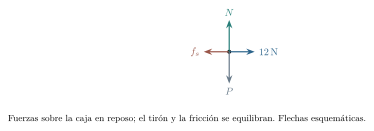{#fig-fp-av-r7-2 fig-alt="Ilustración de Problema resuelto 7.2 · Un tirón compatible con el reposo. Con 24\\,N, el reposo exigiría |fs|=24\\,N>20\\,N y deja de ser posible. Para calcular la aceleración durante el deslizamiento hace falta otra información, por ejemplo el coeficiente cinético. El coeficiente estático permitió identificar el límite del reposo."}

La desigualdad separa una condición material de una ecuación dinámica. En esta caja en reposo, la fuerza necesaria se obtiene del equilibrio. En general, calculamos la fuerza compatible con la adherencia mediante la aceleración del cuerpo y después comprobamos el límite estático. La caja transportada por una plataforma acelerada puede conservar el reposo relativo y tener aceleración respecto del suelo: si el rozamiento es su única fuerza horizontal, debe cumplir $f_s=ma$, como en r7-16. Cuando la aceleración tangencial y las demás fuerzas tangenciales son cero, $f_s=0$ satisface las condiciones.

## Deslizar, frenar y llegar al reposo

Cuando las superficies ya deslizan, emplearemos el modelo
$$
 |\vec f_k|=\mu_kN,\qquad
 \vec f_k=-\mu_kN\frac{\vec v_{\mathrm{rel}}}{|\vec v_{\mathrm{rel}}|},
 \quad |\vec v_{\mathrm{rel}}|>0.
$$
La velocidad $\vec v_{\mathrm{rel}}$ es la del cuerpo respecto de la superficie, en la dirección tangente al contacto. En una trayectoria recta basta asignar a la fuerza el sentido opuesto a esa velocidad. Al llegar a velocidad relativa cero, la última expresión deja de estar definida: debemos volver a examinar si la adherencia es posible.

Los coeficientes resumen un comportamiento experimental aproximado. En numerosos contactos secos $\mu_k<\mu_s$, pero sus valores dependen de los materiales y de su estado. Cada coeficiente caracteriza un par de superficies bajo condiciones de contacto determinadas. El modelo es apropiado cuando los efectos de la rapidez, el calentamiento, el desgaste y las deformaciones son pequeños; la resistencia del aire y la rodadura requieren descripciones propias.

### Problema resuelto 7.3 · La ecuación de frenado tiene un final {#r7-3}

Una caja de $2\,\mathrm{kg}$ desliza a $6\,\mathrm{m/s}$ sobre una mesa horizontal. Se retira el tirón que la movía y queda únicamente el rozamiento horizontal, con $\mu_k=0{,}3$. Halla el tiempo y la distancia hasta detenerse; explica qué sucede después.

*Resolución.* La normal es $20\,\mathrm{N}$ y la fricción cinética tiene módulo $6\,\mathrm{N}$. Con $+x$ en el sentido inicial, $a_x=-6/2=-3\,\mathrm{m/s^2}$. Mientras $v_x>0$,
$$
 v_x=6\,\mathrm{m/s}-(3\,\mathrm{m/s^2})t,\quad
 x-x_0=(6\,\mathrm{m/s})t-\tfrac12(3\,\mathrm{m/s^2})t^2.
$$
El primer cero de la velocidad ocurre a los $2\,\mathrm{s}$ y el avance es $6\,\mathrm{m}$. Después el reposo con $f_s=0$ es compatible porque la resultante tangencial es nula. Prolongar $a_x=-3\,\mathrm{m/s^2}$ predeciría una inversión artificial. Esa ecuación correspondía al tramo de deslizamiento hacia $+x$ y terminó al detenerse la caja.

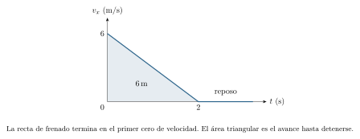{#fig-fp-av-r7-3 fig-alt="Ilustración de Problema resuelto 7.3 · La ecuación de frenado tiene un final. Resolución. La normal es 20\\,N y la fricción cinética tiene módulo 6\\,N. Con +x en el sentido inicial, ax=-6/2=-3\\,m/s^2. Mientras vx>0, vx=6\\,m/s-(3\\,m/s^2)t,quad x-x0=(6\\,m/s)t-tfrac12(3\\,m/s^2)t^2. El primer cero de la velocidad ocurre a los 2\\,s y el avance es 6\\,m. Después el reposo con fs=0 es compatible porque"}

## Cómo un tirón modifica el apoyo

En una mesa horizontal, una fuerza inclinada puede aliviar o reforzar el apoyo. Si tiramos con módulo $F$ y ángulo $\alpha$ sobre la horizontal, sus componentes son $F\cos\alpha$ y $F\sin\alpha$. Mientras el cuerpo siga apoyado sin aceleración vertical,
$$
 N=mg-F\sin\alpha.
$$
La misma fuerza que aporta una componente horizontal reduce así la resistencia cinética. Para un empuje dirigido hacia abajo, la componente vertical tiene el signo contrario y $N=mg+F\sin\alpha$. En ambos casos debemos comprobar $N\geq0$, condición correspondiente a un contacto de compresión sin adhesión.

### Problema resuelto 7.4 · Tirar hacia arriba y seguir deslizando {#r7-4}

Una caja de $5\,\mathrm{kg}$ desliza hacia la derecha. Se tira de ella con componentes $(24,18)\,\mathrm{N}$ y $\mu_k=0{,}25$. Calcula su aceleración y el módulo del tirón.
*Resolución.* La ecuación vertical es $N+18-50=0$, por lo que $N=32\,\mathrm{N}$. La fricción vale $0{,}25(32)=8\,\mathrm{N}$ hacia la izquierda. Entonces
$$
 a_x=\frac{24-8}{5}=3{,}2\,\mathrm{m/s^2}.
$$
El tirón tiene módulo $\sqrt{24^2+18^2}=30\,\mathrm{N}$. Mientras se mantiene el contacto, su componente vertical modifica la normal y, con ella, el rozamiento.

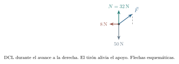{#fig-fp-av-r7-4 fig-alt="Ilustración de Problema resuelto 7.4 · Tirar hacia arriba y seguir deslizando. Una caja de 5\\,kg desliza hacia la derecha. Se tira de ella con componentes (24,18)\\,N y muk=0,25. Calcula su aceleración y el módulo del tirón. Resolución. La ecuación vertical es N+18-50=0, por lo que N=32\\,N. La fricción vale 0,25(32)=8\\,N hacia la izquierda. Entonces ax=frac24-85=3,2\\,m/s^2. El tirón tiene módulo"}

### Problema resuelto 7.5 · Empujar y tirar con el mismo módulo {#r7-5}

Repite el problema anterior con una fuerza de componentes $(24,-18)\,\mathrm{N}$. Compara la aceleración con la producida por el tirón ascendente.

*Resolución.* El peso y el empuje comprimen ahora la caja contra la mesa: $N=50+18=68\,\mathrm{N}$. La fricción cinética es $17\,\mathrm{N}$ hacia la izquierda y $a_x=(24-17)/5=1{,}4\,\mathrm{m/s^2}$. Las dos fuerzas aplicadas tienen módulo $30\,\mathrm{N}$ y la misma componente horizontal, pero cambian de manera distinta la normal. La diferencia entre las aceleraciones se explica por el contacto, sin añadir ninguna fuerza nueva al DCL.

{#fig-fp-av-r7-5 fig-alt="Ilustración de Problema resuelto 7.5 · Empujar y tirar con el mismo módulo. Resolución. El peso y el empuje comprimen ahora la caja contra la mesa: N=50+18=68\\,N. La fricción cinética es 17\\,N hacia la izquierda y ax=(24-17)/5=1,4\\,m/s^2. Las dos fuerzas aplicadas tienen módulo 30\\,N y la misma componente horizontal, pero cambian de manera distinta la normal. La diferencia entre las"}

## Elegir ejes sobre una rampa

En una rampa recta que forma un ángulo $\theta$ con la horizontal, resulta conveniente elegir un eje tangencial cuesta abajo y otro normal hacia fuera. El peso tiene componentes $mg\sin\theta$ y $-mg\cos\theta$. La segunda se obtiene proyectando sobre la normal: el ángulo entre la vertical descendente y la dirección hacia el interior del plano es $\theta$. El componente tangencial restante tiene módulo $mg\sin\theta$.

Si no hay otras fuerzas con componente normal y se conserva el apoyo, la aceleración normal es cero y $N=mg\cos\theta$. El peso permanece vertical: al cambiar de ejes solo hemos cambiado sus coordenadas. En un DCL podemos representar el peso completo o sus dos componentes con la descomposición claramente indicada; sumarlos todos contaría dos veces la gravedad.

### Problema resuelto 7.6 · Una rampa descrita con dos juegos de ejes {#r7-6}

Un bloque de $4\,\mathrm{kg}$ desliza por una rampa lisa de $30^\circ$. Encuentra normal y aceleración. Expresa también la aceleración en ejes horizontal hacia la derecha y vertical hacia arriba, si la rampa desciende hacia la derecha.

*Resolución.* En ejes adaptados a la rampa,
$$
 N=40\cos30^\circ=20\sqrt3\,\mathrm{N},\qquad
 a_\parallel=10\sin30^\circ=5\,\mathrm{m/s^2}.
$$
La dirección cuesta abajo es $(\cos30^\circ,-\sin30^\circ)$, así que
$$
 \vec a=(5\sqrt3/2,-5/2)\,\mathrm{m/s^2}.
$$
Como comprobación en los ejes fijos, la normal apunta en la dirección $(\sin30^\circ,\cos30^\circ)$. Por tanto $\vec N=(10\sqrt3,30)\,\mathrm{N}$ y $\vec P=(0,-40)\,\mathrm{N}$; su suma $(10\sqrt3,-10)\,\mathrm{N}$ coincide con $4\vec a$. Las dos descripciones predicen el mismo vector físico.

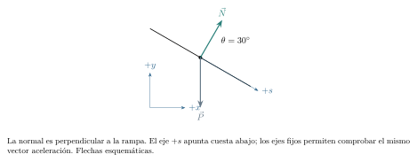{#fig-fp-av-r7-6 fig-alt="Ilustración de Problema resuelto 7.6 · Una rampa descrita con dos juegos de ejes. Resolución. En ejes adaptados a la rampa, N=40cos30^circ=20sqrt3\\,N,qquad aparallel=10sin30^circ=5\\,m/s^2. La dirección cuesta abajo es (cos30^circ,-sin30^circ), así que vec a=(5sqrt3/2,-5/2)\\,m/s^2. Como comprobación en los ejes fijos, la normal apunta en la dirección (sin30^circ,cos30^circ). Por tanto vec"}

Para un bloque inicialmente quieto sin otras fuerzas tangenciales, mantener el reposo requiere rozamiento cuesta arriba de módulo $mg\sin\theta$. La condición de adherencia se vuelve
$$
 mg\sin\theta\leq\mu_smg\cos\theta
 \quad\Longleftrightarrow\quad\tan\theta\leq\mu_s,
 \qquad 0\leq\theta<90^\circ.
$$
La cancelación de la masa explica que el ángulo límite de este modelo quede determinado por las propiedades del contacto. Es una conclusión bajo las hipótesis indicadas: una fuerza adicional puede cambiar tanto la normal como la fuerza tangencial requerida.

### Problema resuelto 7.7 · Una caja que puede quedarse en la pendiente {#r7-7}

Una caja de $5\,\mathrm{kg}$ descansa sobre una rampa con $\sin\theta=0{,}6$ y $\cos\theta=0{,}8$. El coeficiente estático es $0{,}8$. Decide si puede permanecer quieta.
*Resolución.* La normal vale $50(0{,}8)=40\,\mathrm{N}$. El peso tangencial es $50(0{,}6)=30\,\mathrm{N}$ cuesta abajo. Se necesitan $30\,\mathrm{N}$ de fricción cuesta arriba y el máximo es $0{,}8(40)=32\,\mathrm{N}$: el reposo es admisible.

La fricción real es $30\,\mathrm{N}$. El ángulo actual es $\arctan(0{,}75)\simeq36{,}9^\circ$ y el límite $\arctan(0{,}8)\simeq38{,}7^\circ$. Se ha comprobado el equilibrio para el estado inicial dado; un bloque que ya desliza exige analizar el régimen cinético.

{#fig-fp-av-r7-7 fig-alt="Ilustración de Problema resuelto 7.7 · Una caja que puede quedarse en la pendiente. La fricción real es 30\\,N. El ángulo actual es arctan(0,75)simeq36,9^circ y el límite arctan(0,8)simeq38,7^circ. Se ha comprobado el equilibrio para el estado inicial dado; un bloque que ya desliza exige analizar el régimen cinético."}

### Problema resuelto 7.8 · Descender por una rampa rugosa {#r7-8}

El bloque de $5\,\mathrm{kg}$ del problema anterior ya desliza cuesta abajo y tiene $\mu_k=0{,}25$. Calcula la aceleración y la rapidez tras avanzar $4\,\mathrm{m}$, si entra en ese tramo con rapidez $2\,\mathrm{m/s}$.

*Resolución.* Se conserva $N=40\,\mathrm{N}$. El rozamiento cinético vale $10\,\mathrm{N}$ cuesta arriba, opuesto al deslizamiento. La resultante tangencial es $30-10=20\,\mathrm{N}$ cuesta abajo y $a_\parallel=4\,\mathrm{m/s^2}$. Con eje positivo en ese sentido,
$$
 v^2=v_0^2+2a_\parallel\Delta x=4+2(4)(4)=36\,\mathrm{m^2/s^2},
$$
por lo que $v=6\,\mathrm{m/s}$. El reposo previo y el deslizamiento posterior obedecen a regímenes distintos del contacto, con fuerzas de rozamiento diferentes.

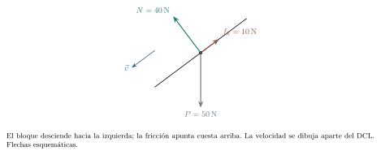{#fig-fp-av-r7-8 fig-alt="Ilustración de Problema resuelto 7.8 · Descender por una rampa rugosa. Resolución. Se conserva N=40\\,N. El rozamiento cinético vale 10\\,N cuesta arriba, opuesto al deslizamiento. La resultante tangencial es 30-10=20\\,N cuesta abajo y aparallel=4\\,m/s^2. Con eje positivo en ese sentido, v^2=v0^2+2aparallelDelta x=4+2(4)(4)=36\\,m^2/s^2, por lo que v=6\\,m/s. El reposo previo y el"}

### Problema resuelto 7.9 · Subir, detenerse y revisar el contacto {#r7-9}

Un bloque asciende por una rampa de $30^\circ$ con rapidez inicial $4\,\mathrm{m/s}$. Tiene $\mu_k=0{,}2$ y $\mu_s=0{,}7$. Encuentra cuánto sube y decide si vuelve a bajar.
*Resolución.* Mientras sube, gravedad tangencial y fricción apuntan cuesta abajo. Con eje positivo cuesta arriba,
$$
 a_\parallel=-10(\sin30^\circ+0{,}2\cos30^\circ)
 =-(5+\sqrt3)\,\mathrm{m/s^2}.
$$
Se detiene tras avanzar $s=16/[2(5+\sqrt3)]\,\mathrm{m}\simeq1{,}19\,\mathrm{m}$. En ese instante examinamos el reposo: requiere $mg\sin30^\circ\leq0{,}7mg\cos30^\circ$, que se cumple porque $\tan30^\circ\simeq0{,}577<0{,}7$. Permanece allí. La fricción pasa a apuntar cuesta arriba para equilibrar el peso tangencial.

{#fig-fp-av-r7-9 fig-alt="Ilustración de Problema resuelto 7.9 · Subir, detenerse y revisar el contacto. Un bloque asciende por una rampa de 30^circ con rapidez inicial 4\\,m/s. Tiene muk=0,2 y mus=0,7. Encuentra cuánto sube y decide si vuelve a bajar. Resolución. Mientras sube, gravedad tangencial y fricción apuntan cuesta abajo. Con eje positivo cuesta arriba, aparallel=-10(sin30^circ+0,2cos30^circ) =-(5+sqrt3)\\,m/s^2."}

## Un intervalo de fuerzas que conserva el reposo

La fricción estática puede cambiar de sentido dentro de un mismo problema. Si una fuerza $F$ tira cuesta arriba, tomar ese sentido como positivo da $F+f_s-mg\sin\theta=0$. La componente que se necesita es $f_s=mg\sin\theta-F$: positiva cuando falta tirón y negativa cuando sobra. El tirón es paralelo al plano y la normal conserva su valor. La condición completa es
$$
 mg\sin\theta-\mu_smg\cos\theta
 \leq F\leq
 mg\sin\theta+\mu_smg\cos\theta.
$$
Para un dispositivo que solo puede tirar cuesta arriba debemos intersectar ese intervalo con $F\geq0$. Un extremo negativo indica que el reposo ya es posible con $F=0$.

### Problema resuelto 7.10 · El rozamiento cambia de sentido {#r7-10}

Una caja de $5\,\mathrm{kg}$ está en una rampa con seno $0{,}6$, coseno $0{,}8$ y $\mu_s=0{,}5$. Una cuerda tira paralelamente cuesta arriba con fuerza $F$. Encuentra todas las tensiones compatibles con reposo. Calcula después la aceleración si $F=60\,\mathrm{N}$ y $\mu_k=0{,}3$, una vez iniciado el ascenso.

*Resolución.* Tenemos $N=40\,\mathrm{N}$ y $f_s=30\,\mathrm{N}-F$. La condición $|30\,\mathrm{N}-F|\leq20\,\mathrm{N}$ equivale a $10\,\mathrm{N}\leq F\leq50\,\mathrm{N}$. Para $F<30\,\mathrm{N}$ la fricción apunta cuesta arriba; para $F>30\,\mathrm{N}$ apunta cuesta abajo, y se anula con $F=30\,\mathrm{N}$. En los extremos el contacto está al límite.

Un tirón de $60\,\mathrm{N}$ supera el extremo superior. Durante el ascenso, $f_k=0{,}3(40)=12\,\mathrm{N}$ cuesta abajo. Así, $a_\parallel=(60-30-12)/5=3{,}6\,\mathrm{m/s^2}$ cuesta arriba. La ecuación cinética corresponde específicamente al ascenso indicado.

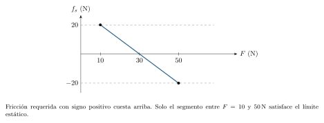{#fig-fp-av-r7-10 fig-alt="Ilustración de Problema resuelto 7.10 · El rozamiento cambia de sentido. Un tirón de 60\\,N supera el extremo superior. Durante el ascenso, fk=0,3(40)=12\\,N cuesta abajo. Así, aparallel=(60-30-12)/5=3,6\\,m/s^2 cuesta arriba. La ecuación cinética corresponde específicamente al ascenso indicado."}

## Cuerdas y poleas: de la longitud a la aceleración

Una cuerda ideal será de masa despreciable, inextensible y flexible; mientras esté tensa solo tira a lo largo de su dirección. En un tramo recto sin fuerzas tangenciales distribuidas, la masa despreciable exige que las tensiones de sus extremos tengan igual módulo: una diferencia finita produciría una resultante que no podría equilibrarse con una masa nula. Al pasar por una polea ideal de eje sin rozamiento y momento de inercia despreciable, ese módulo se conserva. La polea puede cambiar la dirección del tirón.

Una polea con inercia rotacional apreciable requiere además estudiar el balance de torques para relacionar las tensiones de ambos lados. Las tensiones de dos cuerdas distintas se calculan con las condiciones propias de cada una. En los montajes siguientes las cuerdas y poleas se declaran ideales y se supone que sus contactos permiten la transmisión indicada.

La inextensibilidad aporta una ecuación geométrica. En una polea fija con dos ramales verticales, si $y_A$ y $y_B$ se miden hacia abajo desde el eje, la parte variable de la longitud es $y_A+y_B$. Entonces $y_A+y_B=\text{constante}$, $v_A+v_B=0$ y $a_A+a_B=0$. Las componentes tienen signos opuestos cuando ambos ejes apuntan hacia abajo. Si orientamos cada eje en el sentido de movimiento previsto, los valores de las aceleraciones resultan iguales. Esa igualdad depende del montaje y de los ejes.

### Problema resuelto 7.11 · Dos masas y una polea fija {#r7-11}

Dos cuerpos de $3\,\mathrm{kg}$ y $5\,\mathrm{kg}$ cuelgan de los extremos de una cuerda ideal sobre una polea fija ideal. Se liberan desde el reposo. Encuentra aceleración y tensión antes de que alguno encuentre un obstáculo.

*Resolución.* El cuerpo de $5\,\mathrm{kg}$ desciende. Elegimos positivo hacia arriba para A, de $3\,\mathrm{kg}$, y hacia abajo para B, de $5\,\mathrm{kg}$. El vínculo impone un mismo valor $a$ y los DCL dan, en SI,
$$
 T-30=3a,\qquad 50-T=5a.
$$
Al sumarlas, $20=8a$, luego $a=2{,}5\,\mathrm{m/s^2}$. La primera ecuación da $T=37{,}5\,\mathrm{N}$, valor que también satisface la segunda. Queda entre ambos pesos: acelera al ligero hacia arriba y permite al pesado acelerar hacia abajo. Si usáramos ejes verticales hacia abajo para ambos, escribiríamos $a_A=-2{,}5\,\mathrm{m/s^2}$ y $a_B=+2{,}5\,\mathrm{m/s^2}$, con la misma tensión.

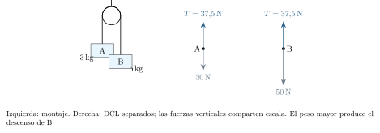{#fig-fp-av-r7-11 fig-alt="Ilustración de Problema resuelto 7.11 · Dos masas y una polea fija. Resolución. El cuerpo de 5\\,kg desciende. Elegimos positivo hacia arriba para A, de 3\\,kg, y hacia abajo para B, de 5\\,kg. El vínculo impone un mismo valor a y los DCL dan, en SI, T-30=3a,qquad 50-T=5a. Al sumarlas, 20=8a, luego a=2,5\\,m/s^2. La primera ecuación da T=37,5\\,N, valor que también satisface la segunda."}

### Problema resuelto 7.12 · Una masa en la mesa y otra colgando {#r7-12}

Un bloque A de $4\,\mathrm{kg}$ sobre mesa horizontal está unido por cuerda y polea fijas ideales a B, de $2\,\mathrm{kg}$, que desciende. A desliza hacia la polea y tiene $\mu_k=0{,}25$. Encuentra aceleración y tensión.

*Resolución.* La normal de A es $40\,\mathrm{N}$ y su fricción $10\,\mathrm{N}$, alejándose de la polea. El eje de A apunta hacia la polea y el de B hacia abajo. La longitud constante impone iguales avances y aceleraciones en esos sentidos:
$$
 T-10=4a,\qquad20-T=2a.
$$
Sumar elimina $T$ y da $a=10/6=5/3\,\mathrm{m/s^2}$. Entonces $T=20-2(5/3)=50/3\,\mathrm{N}$. La fuerza que impulsa esta coordenada común es el peso de B menos la fricción de A, mientras ambas masas aportan inercia. Esta suma de ecuaciones escalares emplea el sentido positivo de cada eje para incorporar las restricciones de la cuerda.

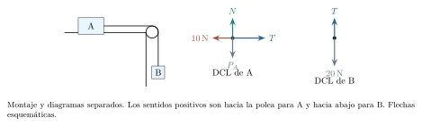{#fig-fp-av-r7-12 fig-alt="Ilustración de Problema resuelto 7.12 · Una masa en la mesa y otra colgando. Resolución. La normal de A es 40\\,N y su fricción 10\\,N, alejándose de la polea. El eje de A apunta hacia la polea y el de B hacia abajo. La longitud constante impone iguales avances y aceleraciones en esos sentidos: T-10=4a,qquad20-T=2a. Sumar elimina T y da a=10/6=5/3\\,m/s^2. Entonces T=20-2(5/3)=50/3\\,N. La fuerza"}

### Problema resuelto 7.13 · Cuánta masa puede sostener el rozamiento {#r7-13}

En el montaje anterior A tiene $4\,\mathrm{kg}$, $\mu_s=0{,}4$ y todo está inicialmente en reposo. ¿Qué masas $m_B\geq0$ son compatibles con ese estado?

*Resolución.* El equilibrio de B exige $T=m_Bg$. Para A se necesitan $f_s=T$ de módulo hacia el lado opuesto a la polea, con $N=m_Ag$. La desigualdad es $m_Bg\leq\mu_sm_Ag$, de donde $0\leq m_B\leq1{,}6\,\mathrm{kg}$. Con $m_B=1\,\mathrm{kg}$, por ejemplo, la tensión y la fricción valen $10\,\mathrm{N}$, por debajo del límite $16\,\mathrm{N}$. Con $m_B=2\,\mathrm{kg}$ el reposo es imposible; para describir el deslizamiento posterior necesitamos el modelo cinético. En el extremo formal $m_B=0$, $T=0$: no hay un peso colgante que mantenga positivamente tensa la cuerda.

{#fig-fp-av-r7-13 fig-alt="Ilustración de Problema resuelto 7.13 · Cuánta masa puede sostener el rozamiento. Resolución. El equilibrio de B exige T=mBg. Para A se necesitan fs=T de módulo hacia el lado opuesto a la polea, con N=mAg. La desigualdad es mBgleqmusmAg, de donde 0leq mBleq1,6\\,kg. Con mB=1\\,kg, por ejemplo, la tensión y la fricción valen 10\\,N, por debajo del límite 16\\,N. Con mB=2\\,kg el reposo es imposible; para"}

### Problema resuelto 7.14 · La rampa enlazada con una masa colgante {#r7-14}

Un bloque A de $3\,\mathrm{kg}$ está sobre una rampa con seno $0{,}6$ y coseno $0{,}8$. Una cuerda paralela al plano pasa por una polea fija ideal y lo une a B, de $4\,\mathrm{kg}$. B ya desciende; $\mu_k=0{,}25$ entre A y la rampa. Calcula aceleración y tensión.

*Resolución.* A asciende y su rozamiento apunta cuesta abajo. Sobre A, $N=30(0{,}8)=24\,\mathrm{N}$, $f_k=6\,\mathrm{N}$ y el peso tangencial es $18\,\mathrm{N}$. Con ejes cuesta arriba para A y hacia abajo para B,
$$
 T-18-6=3a,\qquad40-T=4a.
$$
La suma da $16=7a$, luego $a=16/7\,\mathrm{m/s^2}$. Se obtiene $T=40-4(16/7)=216/7\,\mathrm{N}$. Es positiva y ambas ecuaciones coinciden. La dirección del deslizamiento fue un dato: si B estuviera ascendiendo, el rozamiento de A tendría otro sentido aunque el peso y las masas fueran iguales.

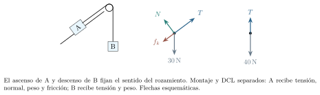{#fig-fp-av-r7-14 fig-alt="Ilustración de Problema resuelto 7.14 · La rampa enlazada con una masa colgante. Resolución. A asciende y su rozamiento apunta cuesta abajo. Sobre A, N=30(0,8)=24\\,N, fk=6\\,N y el peso tangencial es 18\\,N. Con ejes cuesta arriba para A y hacia abajo para B, T-18-6=3a,qquad40-T=4a. La suma da 16=7a, luego a=16/7\\,m/s^2. Se obtiene T=40-4(16/7)=216/7\\,N. Es positiva y ambas ecuaciones coinciden. La"}

## Varios cuerpos y contactos que pueden fallar

La elección del sistema permite obtener una aceleración común sin calcular primero todas las tensiones. Después hace falta volver a un subsistema para recuperar cada fuerza interna. Las tensiones se cancelan al sumar ecuaciones compatibles, pero siguen siendo indispensables para describir el movimiento de cada cuerpo y para comprobar si una cuerda puede sostenerlo.

Una cuerda flexible transmite tracción mientras está tensa. Si una resolución produce $T<0$, la hipótesis de cuerda tensa es incompatible con ese movimiento. Puede aparecer holgura y, desde ese momento, deja de valer la restricción de longitud que habíamos usado. Del mismo modo, dos bloques superpuestos solo comparten aceleración tangencial si el rozamiento estático requerido no excede su límite.

### Problema resuelto 7.15 · Tres bloques, dos tensiones {#r7-15}

Tres bloques A, B y C, de masas $1$, $2$ y $3\,\mathrm{kg}$, están alineados sobre una mesa lisa y unidos consecutivamente por dos cuerdas ideales tensas. Se tira de C hacia la derecha con $18\,\mathrm{N}$. Encuentra la aceleración y ambas tensiones.

*Resolución.* La fuerza horizontal externa sobre el conjunto es $18\,\mathrm{N}$ y su masa $6\,\mathrm{kg}$; las cuerdas imponen un mismo $a=3\,\mathrm{m/s^2}$. Para A, $T_{AB}=1(3)=3\,\mathrm{N}$. El subsistema A+B tiene masa $3\,\mathrm{kg}$ y solo recibe horizontalmente $T_{BC}$ desde fuera, así que $T_{BC}=3(3)=9\,\mathrm{N}$. En B, $9-3=2(3)$, y en C, $18-9=3(3)$. Las tensiones distintas aceleran masas distintas a la izquierda de cada corte; pertenecen a dos cuerdas.

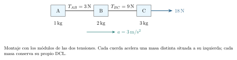{#fig-fp-av-r7-15 fig-alt="Ilustración de Problema resuelto 7.15 · Tres bloques, dos tensiones. Resolución. La fuerza horizontal externa sobre el conjunto es 18\\,N y su masa 6\\,kg; las cuerdas imponen un mismo a=3\\,m/s^2. Para A, TAB=1(3)=3\\,N. El subsistema A+B tiene masa 3\\,kg y solo recibe horizontalmente TBC desde fuera, así que TBC=3(3)=9\\,N. En B, 9-3=2(3), y en C, 18-9=3(3). Las tensiones distintas"}

### Problema resuelto 7.16 · Una caja sobre otra {#r7-16}

Una caja A de $2\,\mathrm{kg}$ está sobre B, de $3\,\mathrm{kg}$. El suelo bajo B es liso. Entre las cajas $\mu_s=0{,}4$ y $\mu_k=0{,}3$. Se empuja horizontalmente B hacia la derecha. Compara fuerzas aplicadas de $15\,\mathrm{N}$ y $25\,\mathrm{N}$, partiendo del reposo en cada ensayo.

*Resolución.* Si ambas acompañan el movimiento, su aceleración es $a=F/5$. La única fuerza horizontal sobre A es la fricción que B ejerce hacia la derecha, de módulo $f_s=m_Aa=2F/5$. La normal entre cajas es $20\,\mathrm{N}$ y el máximo estático $8\,\mathrm{N}$. Por tanto el movimiento conjunto requiere $2F/5\leq8$, es decir $F\leq20\,\mathrm{N}$.

Con $F=15\,\mathrm{N}$, $a=3\,\mathrm{m/s^2}$ y $f_s=6\,\mathrm{N}$: A recibe esa fuerza hacia la derecha y B su reacción hacia la izquierda. Con $25\,\mathrm{N}$ falla la adherencia. B comienza a adelantarse bajo A y la fricción cinética tiene módulo $6\,\mathrm{N}$. En el suelo inercial,
$$
 a_A=6/2=3\,\mathrm{m/s^2},\qquad
 a_B=(25-6)/3=19/3\,\mathrm{m/s^2}.
$$
La aceleración relativa $a_A-a_B=-10/3\,\mathrm{m/s^2}$ confirma que A se retrasa respecto de B. Estos valores valen mientras las superficies sigan en contacto y deslicen en ese sentido.

{#fig-fp-av-r7-16 fig-alt="Ilustración de Problema resuelto 7.16 · Una caja sobre otra. Con F=15\\,N, a=3\\,m/s^2 y fs=6\\,N: A recibe esa fuerza hacia la derecha y B su reacción hacia la izquierda. Con 25\\,N falla la adherencia. B comienza a adelantarse bajo A y la fricción cinética tiene módulo 6\\,N. En el suelo inercial, aA=6/2=3\\,m/s^2,qquad aB=(25-6)/3=19/3\\,m/s^2. La aceleración relativa"}

## Una polea móvil cambia la restricción

Una carga sostenida por una polea móvil puede recibir dos tirones hacia arriba. Para comprender el montaje hay que contar los ramales que cambian de longitud. Supongamos una cuerda anclada al techo, que baja alrededor de la polea móvil, vuelve a subir sobre una polea fija y termina en una masa colgante. Todos los tramos variables son verticales. Si la carga sube una distancia $y$, los dos ramales que llegan a la polea móvil se acortan cada uno en $y$; el extremo libre debe bajar $2y$. Con $z$ positivo hacia abajo para ese extremo,
$$
 z-2y=\text{constante},\qquad a_z=2a_y.
$$
El módulo de la tensión es común en la cuerda ideal. La carga junto con su polea recibe $2T$ hacia arriba, mientras la masa del extremo recibe $T$. La relación de desplazamientos explica a la vez la diferencia de aceleraciones y la distribución de fuerzas.

### Problema resuelto 7.17 · Dos ramales sostienen una carga {#r7-17}

En el montaje descrito, la carga y el soporte móvil tienen masa total $4\,\mathrm{kg}$; la inercia rotacional de las poleas es despreciable. En el extremo libre cuelgan $3\,\mathrm{kg}$. Encuentra aceleraciones y tensión desde el reposo.

*Resolución.* Tomamos $a$ positivo hacia arriba para la carga. La masa libre tiene aceleración $2a$ hacia abajo. Los DCL dan
$$
 2T-40=4a,\qquad30-T=3(2a).
$$
De la primera, $T=20+2a$; al sustituir en la segunda, $10=8a$. Por tanto $a=1{,}25\,\mathrm{m/s^2}$ hacia arriba para la carga, $2a=2{,}5\,\mathrm{m/s^2}$ hacia abajo para la masa libre y $T=22{,}5\,\mathrm{N}$. Los dos ramales ejercen en conjunto $45\,\mathrm{N}$ sobre la carga. Imponer aceleraciones de igual módulo habría contradicho la longitud constante de la cuerda.

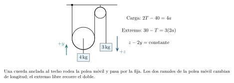{#fig-fp-av-r7-17 fig-alt="Ilustración de Problema resuelto 7.17 · Dos ramales sostienen una carga. Resolución. Tomamos a positivo hacia arriba para la carga. La masa libre tiene aceleración 2a hacia abajo. Los DCL dan 2T-40=4a,qquad30-T=3(2a). De la primera, T=20+2a; al sustituir en la segunda, 10=8a. Por tanto a=1,25\\,m/s^2 hacia arriba para la carga, 2a=2,5\\,m/s^2 hacia abajo para la masa libre y T=22,5\\,N. Los"}

## Elegir el tirón y contrastar el modelo

Las ecuaciones también permiten estudiar cómo cambia un resultado al modificar el montaje. Al tirar de una caja hacia arriba, aumentar el ángulo reduce la normal pero resta componente horizontal a la fuerza. Esa competencia genera un ángulo óptimo dentro del modelo seco. Obtenerlo permite explicar el resultado antes de ensayarlo.

### Problema resuelto 7.18 · El ángulo que reduce el tirón necesario {#r7-18}

Una caja de $10\,\mathrm{kg}$ descansa en un suelo horizontal con $\mu_s=0{,}5$. Se aplica un tirón de módulo $F$ y ángulo $0\leq\alpha<90^\circ$ hacia arriba. Encuentra el menor módulo que lleva el contacto al límite de deslizamiento horizontal.

*Resolución.* Mientras hay apoyo, $N=100\,\mathrm{N}-F\sin\alpha$. En el umbral, $F\cos\alpha=0{,}5N$, así que
$$
 F(\alpha)=\frac{50\,\mathrm{N}}{\cos\alpha+0{,}5\sin\alpha}.
$$
Minimizar el cociente exige maximizar su denominador. Es el producto escalar de los vectores $(1,0{,}5)$ y $(\cos\alpha,\sin\alpha)$, el segundo de módulo uno. Por la proyección, el máximo es $\sqrt{1+0{,}5^2}=\sqrt5/2$, alcanzado cuando ambos vectores tienen la misma dirección: $\tan\alpha=0{,}5$. Luego
$$
 \alpha\simeq26{,}6^\circ,\qquad F_{\min}=20\sqrt5\,\mathrm{N}\simeq44{,}7\,\mathrm{N}.
$$
En ese ángulo, $F_x=40\,\mathrm{N}$, $F_y=20\,\mathrm{N}$ y $N=80\,\mathrm{N}>0$. El contacto es admisible y $F_x=\mu_sN$. El tirón horizontal requeriría $50\,\mathrm{N}$. El valor obtenido es el umbral: para forzar el inicio del deslizamiento desde el reposo hay que superarlo, aunque sea muy ligeramente, en este modelo ideal.

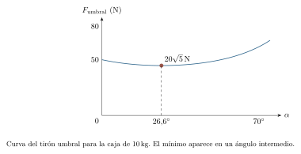{#fig-fp-av-r7-18 fig-alt="Ilustración de Problema resuelto 7.18 · El ángulo que reduce el tirón necesario. Resolución. Mientras hay apoyo, N=100\\,N-Fsinalpha. En el umbral, Fcosalpha=0,5N, así que F(alpha)=frac50\\,Ncosalpha+0,5sinalpha. Minimizar el cociente exige maximizar su denominador. Es el producto escalar de los vectores (1,0,5) y (cosalpha,sinalpha), el segundo de módulo uno. Por la proyección, el máximo es"}

### Medir dos regímenes de un mismo contacto

Usa una caja pequeña, una tabla estable y un dinamómetro de rango adecuado. En una primera serie, aumenta lentamente un tirón horizontal y registra la lectura máxima anterior al deslizamiento. En otra, registra la lectura durante un tramo aproximadamente rectilíneo y uniforme. Repite y conserva la dispersión de los datos. Si la cuerda es horizontal y la aceleración vertical es nula, $N=mg$; el primer valor permite estimar $\mu_s$ y el segundo $\mu_k$ solo cuando la aceleración horizontal es despreciable.

El dinamómetro mide el tirón. Durante una aceleración, el tirón y la fricción difieren en $ma_x$: igualarlos alteraría el coeficiente inferido. Anota la inclinación de la cuerda y las variaciones de rapidez; examina además si la caja vuelca o engancha el borde. Una diferencia entre ensayos puede señalar cambios de superficie o límites del modelo. Evita cargas elevadas y masas suspendidas sobre personas.

En un problema de contactos, una solución numérica necesita conservar la situación que la produjo: apoyo con normal no negativa, cuerdas capaces de tirar, y fricción compatible con adherencia o con el deslizamiento supuesto. Al cambiar una de esas condiciones comienza otro tramo del movimiento. Esa comprobación decide hasta dónde las ecuaciones describen la experiencia.

## Ejercicios para reconstruir y transferir

Usa $g=10\,\mathrm{m/s^2}$ salvo otra indicación. Las cuerdas y poleas son ideales, las mesas y rampas están fijas y los cuerpos no vuelcan. Dibuja los DCL y declara el sentido de cada eje. Comprueba el régimen del contacto antes de aceptar una aceleración.

### Ejercicio 7.1 · Masa y campo local {#e7-1}

Una pieza de $8\,\mathrm{kg}$ se lleva de un lugar con $g=10\,\mathrm{N/kg}$ a otro con $g=3{,}7\,\mathrm{N/kg}$. Encuentra ambos pesos y explica qué magnitud se conserva.

### Ejercicio 7.2 · Adherencia por debajo del máximo {#e7-2}

Una caja de $4\,\mathrm{kg}$ reposa sobre mesa con $\mu_s=0{,}5$. Se aplica horizontalmente $F=0$, $12$ y $20\,\mathrm{N}$ en ensayos separados. Encuentra el rozamiento en cada caso y decide cuáles admiten reposo.

### Ejercicio 7.3 · El reposo deja de ser posible {#e7-3}

En la caja anterior se aplica $F=26\,\mathrm{N}$. Si $\mu_k=0{,}3$, determina la aceleración una vez iniciado el deslizamiento en el sentido del tirón.

### Ejercicio 7.4 · Una frenada completa {#e7-4}

Un bloque de $3\,\mathrm{kg}$ desliza a $8\,\mathrm{m/s}$ sobre suelo horizontal con $\mu_k=0{,}2$, sin otras fuerzas horizontales. Calcula el instante de detención y el recorrido. Explica qué aceleración tiene después.

### Ejercicio 7.5 · La superficie también se mueve {#e7-5}

Una caja de $2\,\mathrm{kg}$ se deposita sin velocidad horizontal sobre una cinta que corre a $3\,\mathrm{m/s}$ hacia la derecha, a velocidad constante. Hay $\mu_k=0{,}25$. Encuentra el sentido de la fricción, el tiempo hasta igualar velocidades y el avance de la caja respecto del suelo; supón que la cinta es suficientemente larga.

### Ejercicio 7.6 · Un tirón inclinado {#e7-6}

Una caja de $6\,\mathrm{kg}$ desliza hacia la derecha y recibe un tirón de componentes $(18,24)\,\mathrm{N}$, con $\mu_k=0{,}25$. Calcula normal, fricción y aceleración.

### Ejercicio 7.7 · Presionar contra la mesa {#e7-7}

Repite el ejercicio anterior con componentes $(18,-24)\,\mathrm{N}$. Indica si la caja aumenta o disminuye su rapidez mientras se mueve hacia la derecha.

### Ejercicio 7.8 · Un apoyo imposible {#e7-8}

Un bloque de $2\,\mathrm{kg}$ está sobre una mesa sin adhesión. Se le aplica una fuerza vertical de $25\,\mathrm{N}$ hacia arriba. Explica por qué no se puede mantener $a_y=0$ y encuentra la aceleración al separarse.

### Ejercicio 7.9 · Rampa lisa {#e7-9}

Un bloque de $5\,\mathrm{kg}$ se mueve por una rampa lisa con seno $0{,}6$ y coseno $0{,}8$. Encuentra normal y aceleración cuesta abajo; si la rampa desciende hacia la derecha, expresa la aceleración en ejes horizontal y vertical.

### Ejercicio 7.10 · Ángulo de adherencia {#e7-10}

Una rampa tiene $\tan\theta=0{,}5$ y soporta un bloque de $4\,\mathrm{kg}$ con $\mu_s=0{,}6$. Determina normal y fricción para el reposo; halla el ángulo límite del modelo.

### Ejercicio 7.11 · Deslizamiento descendente {#e7-11}

Un bloque de $5\,\mathrm{kg}$ desciende por una rampa con seno $0{,}6$, coseno $0{,}8$ y $\mu_k=0{,}25$. Entra a $2\,\mathrm{m/s}$. ¿Cuánto tarda en avanzar $4\,\mathrm{m}$?

### Ejercicio 7.12 · Detenerse y regresar {#e7-12}

Un bloque sube a $4\,\mathrm{m/s}$ por una rampa de $30^\circ$, con $\mu_k=0{,}2$ y $\mu_s=0{,}4$. Encuentra el recorrido ascendente y la aceleración cuando comienza a bajar. Justifica el cambio de sentido de la fricción.

### Ejercicio 7.13 · Un intervalo de tirones {#e7-13}

Un bloque de $10\,\mathrm{kg}$ está en una rampa con seno $0{,}6$, coseno $0{,}8$ y $\mu_s=0{,}5$. Encuentra los valores de una tensión paralela cuesta arriba que admiten reposo. ¿Qué fricción se necesita con tensiones de $40$, $60$ y $80\,\mathrm{N}$?

### Ejercicio 7.14 · Dos masas colgantes {#e7-14}

Dos masas de $2$ y $3\,\mathrm{kg}$ están unidas por cuerda sobre polea fija. Se liberan desde el reposo. Encuentra aceleración y tensión y comprueba ambas ecuaciones.

### Ejercicio 7.15 · Mesa rugosa y masa colgante {#e7-15}

Un bloque A de $6\,\mathrm{kg}$ desliza por una mesa hacia la polea, unido a B de $3\,\mathrm{kg}$ que desciende. Si $\mu_k=0{,}2$, encuentra aceleración y tensión.

### Ejercicio 7.16 · La masa colgante en equilibrio {#e7-16}

El montaje anterior parte del reposo y tiene $\mu_s=0{,}3$; la masa de B es variable. Encuentra su intervalo admisible para equilibrio. Explica qué dato adicional necesitarías para el movimiento posterior al superar ese intervalo.

### Ejercicio 7.17 · Rampa y cuerpo colgante {#e7-17}

A, de $2\,\mathrm{kg}$, asciende por una rampa con seno $0{,}6$, coseno $0{,}8$ y $\mu_k=0{,}25$, unido a B de $3\,\mathrm{kg}$ que desciende. Encuentra aceleración y tensión.

### Ejercicio 7.18 · Dos cuerdas distintas {#e7-18}

Sobre mesa lisa se alinean A, B y C de masas $2$, $1$ y $3\,\mathrm{kg}$, unidos consecutivamente. Se tira de C con $24\,\mathrm{N}$. Encuentra aceleración, tensión AB y tensión BC.

### Ejercicio 7.19 · Sin deslizar sobre otra caja {#e7-19}

A tiene $3\,\mathrm{kg}$ y está sobre B de $2\,\mathrm{kg}$; el suelo es liso y entre cajas $\mu_s=0{,}5$. Se empuja B. Encuentra la fuerza máxima compatible con movimiento conjunto y la fricción real si se aplican $20\,\mathrm{N}$.

### Ejercicio 7.20 · Cuando falla la adherencia {#e7-20}

En el montaje anterior se aplican $30\,\mathrm{N}$ desde el reposo y $\mu_k=0{,}3$. Encuentra las aceleraciones de A y B, e indica hacia dónde desliza A respecto de B.

### Ejercicio 7.21 · Dos ramales y otra relación de masas {#e7-21}

En el montaje de polea móvil del problema resuelto 7.17, la carga y soporte móvil tienen masa total $6\,\mathrm{kg}$ y del extremo libre cuelgan $4\,\mathrm{kg}$. Encuentra tensión y ambas aceleraciones.

### Ejercicio 7.22 · La tensión puede anularse {#e7-22}

Dos bloques de $2\,\mathrm{kg}$ están sobre mesa lisa, A a la izquierda de B, unidos por una cuerda flexible inicialmente tensa. Sobre A se aplica una fuerza de $10\,\mathrm{N}$ hacia B; B no recibe otras fuerzas horizontales. Ensaya la hipótesis de aceleración común, explica su fallo y describe el comienzo del movimiento antes del choque.

### Ejercicio 7.23 · Cambiar ejes sin cambiar el movimiento {#e7-23}

Reescribe las ecuaciones del ejercicio 7.14 usando un eje vertical positivo hacia arriba para ambos cuerpos. Encuentra las componentes de sus aceleraciones y contrasta la tensión.

### Ejercicio 7.24 · Elegir un ángulo {#e7-24}

Una caja de $5\,\mathrm{kg}$ reposa en suelo horizontal con $\mu_s=0{,}75$. Encuentra el ángulo y el módulo mínimo del tirón que lleva el contacto al umbral de deslizamiento. Comprueba la normal.

## Soluciones completas de los ejercicios

### Solución 7.1 {#sol-e7-1}
El peso se obtiene multiplicando masa por campo local: $P_1=8(10)=80\,\mathrm{N}$ y $P_2=8(3{,}7)=29{,}6\,\mathrm{N}$. Se conserva la masa de $8\,\mathrm{kg}$. El cociente $P_2/P_1=0{,}37$ coincide con el de los campos; la pieza conserva su masa y su peso cambia con el campo gravitatorio.

### Solución 7.2 {#sol-e7-2}
La normal es $40\,\mathrm{N}$ y el máximo estático $20\,\mathrm{N}$. Con $+x$ en el sentido del tirón, el equilibrio exige $f_s=-F$, de donde $f_s=0$, $-12$ y $-20\,\mathrm{N}$. Los tres valores son admisibles; el último está en el límite. Asignar $20\,\mathrm{N}$ a los tres ensayos introduciría una fuerza neta incompatible con el reposo en los primeros dos.

### Solución 7.3 {#sol-e7-3}
El reposo exigiría $26\,\mathrm{N}$ de fricción, por encima de los $20\,\mathrm{N}$ disponibles. Durante el deslizamiento, $f_k=0{,}3(40)=12\,\mathrm{N}$ en sentido opuesto al tirón. Así $a=(26-12)/4=3{,}5\,\mathrm{m/s^2}$ hacia el tirón. Se ha cambiado de régimen al usar $\mu_k$.

### Solución 7.4 {#sol-e7-4}
La normal vale $30\,\mathrm{N}$, la fricción $6\,\mathrm{N}$ y la aceleración durante el avance $-6/3=-2\,\mathrm{m/s^2}$. De $0=8-2t$ resulta $t=4\,\mathrm{s}$. El recorrido es $8(4)-\tfrac12(2)(4^2)=16\,\mathrm{m}$. Después permanece quieto con fricción nula y aceleración cero; extender la ley de frenado más allá del primer cero de velocidad cambiaría indebidamente el sentido del rozamiento.

### Solución 7.5 {#sol-e7-5}
La caja tiene inicialmente velocidad relativa $-3\,\mathrm{m/s}$ respecto de la cinta, por lo que la fricción sobre ella apunta a la derecha. Como $N=20\,\mathrm{N}$, $f_k=5\,\mathrm{N}$ y $a_x=2{,}5\,\mathrm{m/s^2}$. Iguala la velocidad de la cinta cuando $2{,}5t=3$, es decir a los $1{,}2\,\mathrm{s}$. Avanza $\tfrac12(2{,}5)(1{,}2)^2=1{,}8\,\mathrm{m}$ respecto del suelo. Desde entonces puede acompañar la cinta a velocidad constante con fricción nula, en ausencia de otras fuerzas horizontales.

### Solución 7.6 {#sol-e7-6}
Verticalmente $N+24-60=0$, luego $N=36\,\mathrm{N}>0$. La fricción cinética vale $9\,\mathrm{N}$ hacia la izquierda. La resultante horizontal es $18-9=9\,\mathrm{N}$ y $a_x=9/6=1{,}5\,\mathrm{m/s^2}$ hacia la derecha.

### Solución 7.7 {#sol-e7-7}
La componente descendente refuerza el apoyo: $N=60+24=84\,\mathrm{N}$ y $f_k=21\,\mathrm{N}$ hacia la izquierda. Por tanto $a_x=(18-21)/6=-0{,}5\,\mathrm{m/s^2}$. La caja, que aún se mueve hacia la derecha, disminuye su rapidez. El resultado describe ese tramo; al detenerse hará falta analizar el régimen estático con su coeficiente correspondiente.

### Solución 7.8 {#sol-e7-8}
Mantener el apoyo sin aceleración vertical exigiría $N+25-20=0$, es decir $N=-5\,\mathrm{N}$. La mesa sin adhesión solo puede transmitir una normal de compresión. Al perder contacto $N=0$; quedan $5\,\mathrm{N}$ hacia arriba y $a_y=5/2=2{,}5\,\mathrm{m/s^2}$. La ecuación errónea sirvió para detectar una hipótesis imposible.

### Solución 7.9 {#sol-e7-9}
La normal es $N=50(0{,}8)=40\,\mathrm{N}$. El peso tangencial es $50(0{,}6)=30\,\mathrm{N}$ y $a_\parallel=30/5=6\,\mathrm{m/s^2}$. La dirección cuesta abajo es $(0{,}8,-0{,}6)$, de modo que $\vec a=(4{,}8,-3{,}6)\,\mathrm{m/s^2}$. Su módulo es $6\,\mathrm{m/s^2}$, como debe ser.

### Solución 7.10 {#sol-e7-10}
De $\tan\theta=1/2$ se obtiene $\sin\theta=1/\sqrt5$ y $\cos\theta=2/\sqrt5$. Entonces $N=80/\sqrt5\,\mathrm{N}$ y el rozamiento requerido es $40/\sqrt5\,\mathrm{N}$ cuesta arriba. Su máximo es $48/\sqrt5\,\mathrm{N}$, suficiente para el reposo. El ángulo límite satisface $\tan\theta_c=0{,}6$, de donde $\theta_c\simeq31{,}0^\circ$, mayor que el ángulo actual $26{,}6^\circ$.

### Solución 7.11 {#sol-e7-11}
La normal es $40\,\mathrm{N}$ y la fricción $10\,\mathrm{N}$ cuesta arriba. La aceleración descendente es $(30-10)/5=4\,\mathrm{m/s^2}$. El avance satisface $4=2t+2t^2$ en SI, o $t^2+t-2=0$. Las raíces son $1\,\mathrm{s}$ y $-2\,\mathrm{s}$; el tiempo posterior a la entrada es $1\,\mathrm{s}$. En ese instante la rapidez es $2+4(1)=6\,\mathrm{m/s}$.

### Solución 7.12 {#sol-e7-12}
Durante la subida ambas fuerzas tangenciales apuntan cuesta abajo y $a_\parallel=-(5+\sqrt3)\,\mathrm{m/s^2}$, tomando positivo hacia arriba. El avance hasta detenerse es $16/[2(5+\sqrt3)]\,\mathrm{m}\simeq1{,}19\,\mathrm{m}$. El reposo exigiría $\tan30^\circ\leq0{,}4$, que es falso. Al comenzar a descender la fricción apunta cuesta arriba, por lo que la aceleración descendente es $10(\sin30^\circ-0{,}2\cos30^\circ)=(5-\sqrt3)\,\mathrm{m/s^2}\simeq3{,}27\,\mathrm{m/s^2}$. La gravedad tangencial conserva su dirección; cambia la fricción al cambiar el deslizamiento.

### Solución 7.13 {#sol-e7-13}
La normal vale $80\,\mathrm{N}$ y el máximo estático $40\,\mathrm{N}$. Con eje positivo cuesta arriba, $f_s=60\,\mathrm{N}-T$; la condición $|60\,\mathrm{N}-T|\leq40\,\mathrm{N}$ da $20\,\mathrm{N}\leq T\leq100\,\mathrm{N}$. Para $T=40$, $60$ y $80\,\mathrm{N}$, se necesitan respectivamente $+20$, $0$ y $-20\,\mathrm{N}$ de fricción. Todos admiten reposo; el signo negativo del último corresponde a fricción cuesta abajo.

### Solución 7.14 {#sol-e7-14}
Elegimos positivo hacia arriba para la masa de $2\,\mathrm{kg}$ y hacia abajo para la de $3\,\mathrm{kg}$. La cuerda impone igual valor $a$. Las ecuaciones son $T-20=2a$ y $30-T=3a$ en SI. Al sumarlas $10=5a$, luego $a=2\,\mathrm{m/s^2}$ y $T=24\,\mathrm{N}$. Se comprueban $24-20=2(2)$ y $30-24=3(2)$; la tensión es positiva y queda entre ambos pesos.

### Solución 7.15 {#sol-e7-15}
Sobre A, $N=60\,\mathrm{N}$ y $f_k=12\,\mathrm{N}$. Los ejes positivos apuntan hacia la polea y hacia abajo. Las ecuaciones $T-12=6a$ y $30-T=3a$ dan $18=9a$, así que $a=2\,\mathrm{m/s^2}$ y $T=24\,\mathrm{N}$. La comprobación $24-12=6(2)$ confirma el DCL de A; $30-24=3(2)$ confirma el de B.

### Solución 7.16 {#sol-e7-16}
En reposo B requiere $T=m_Bg$; A necesita igual módulo de fricción con máximo $0{,}3(6g)$. Por ello $m_B\leq1{,}8\,\mathrm{kg}$, con $m_B\geq0$. En el extremo superior el contacto está al límite; con masa mayor el reposo es incompatible. Para calcular el movimiento posterior se necesita, entre otros datos del modelo, $\mu_k$. En el extremo $m_B=0$ la tensión es nula y no queda garantizada una cuerda positivamente tensa.

### Solución 7.17 {#sol-e7-17}
Para A, $N=20(0{,}8)=16\,\mathrm{N}$, $f_k=4\,\mathrm{N}$ cuesta abajo y el peso tangencial es $12\,\mathrm{N}$. Con ascenso positivo para A y descenso positivo para B, $T-16=2a$ y $30-T=3a$. La suma da $14=5a$, luego $a=2{,}8\,\mathrm{m/s^2}$ y $T=21{,}6\,\mathrm{N}$. Sustituir en A da $21{,}6-16=2(2{,}8)$, y en B $30-21{,}6=3(2{,}8)$.

### Solución 7.18 {#sol-e7-18}
El sistema tiene masa $6\,\mathrm{kg}$ y fuerza externa horizontal $24\,\mathrm{N}$: $a=4\,\mathrm{m/s^2}$. Para A, $T_{AB}=2(4)=8\,\mathrm{N}$. Para A+B, $T_{BC}=(2+1)(4)=12\,\mathrm{N}$. En B, $12-8=1(4)$, y en C, $24-12=3(4)$. Cada tensión corresponde a una cuerda distinta y se obtiene de la ecuación de movimiento del subsistema elegido.

### Solución 7.19 {#sol-e7-19}
Si no hay deslizamiento, $a=F/(3+2)=F/5$. La fricción requerida sobre A es $f_s=3F/5$, mientras su normal es $30\,\mathrm{N}$ y su límite $15\,\mathrm{N}$. De $3F/5\leq15$ se obtiene $F_{\max}=25\,\mathrm{N}$. Con $F=20\,\mathrm{N}$ la aceleración común es $4\,\mathrm{m/s^2}$ y la fricción real $12\,\mathrm{N}$ hacia la derecha sobre A. B recibe su reacción de $12\,\mathrm{N}$ hacia la izquierda.

### Solución 7.20 {#sol-e7-20}
Como $30>25\,\mathrm{N}$ no pueden acompañarse. La fricción cinética entre cajas vale $0{,}3(30)=9\,\mathrm{N}$. Sobre A apunta a la derecha y produce $a_A=9/3=3\,\mathrm{m/s^2}$. Sobre B apunta a la izquierda: $a_B=(30-9)/2=10{,}5\,\mathrm{m/s^2}$. Por tanto $a_A-a_B=-7{,}5\,\mathrm{m/s^2}$: A desliza hacia atrás respecto de B, aunque ambos comiencen a avanzar hacia la derecha respecto del suelo. El resultado vale antes de que A alcance el borde.

### Solución 7.21 {#sol-e7-21}
Sea $a$ hacia arriba para la carga móvil; la masa libre acelera $2a$ hacia abajo. Las ecuaciones son $2T-60=6a$ y $40-T=4(2a)$. De la primera $T=30+3a$; al sustituir, $10=11a$. Así $a=10/11\,\mathrm{m/s^2}$, $a_{\mathrm{libre}}=20/11\,\mathrm{m/s^2}$ y $T=360/11\,\mathrm{N}$. Las fuerzas netas son $60/11\,\mathrm{N}$ hacia arriba sobre los $6\,\mathrm{kg}$ y $80/11\,\mathrm{N}$ hacia abajo sobre los $4\,\mathrm{kg}$, compatibles con esas aceleraciones.

### Solución 7.22 {#sol-e7-22}
Una aceleración común sería $a=10/(2+2)=2{,}5\,\mathrm{m/s^2}$. Pero sobre B la cuerda solo podría tirar hacia la izquierda; con derecha positiva, $-T=2a$ exigiría $T=-5\,\mathrm{N}$. Una cuerda flexible transmite tracción. Comienza a aflojarse: antes del choque A acelera $10/2=5\,\mathrm{m/s^2}$ hacia B y B permanece sin aceleración horizontal. Si ambos partían del reposo, B sigue quieto durante ese intervalo.

### Solución 7.23 {#sol-e7-23}
Con ambos ejes hacia arriba, las ecuaciones son $T-20=2a_A$ y $T-30=3a_B$. La longitud constante impone $a_A+a_B=0$. Sustituir $a_B=-a_A$ y restar las ecuaciones produce $10=5a_A$. Luego $a_A=+2\,\mathrm{m/s^2}$, $a_B=-2\,\mathrm{m/s^2}$ y $T=24\,\mathrm{N}$. Los signos de las componentes cambiaron respecto de la elección con dos positivos opuestos; los movimientos y la tensión coinciden.

### Solución 7.24 {#sol-e7-24}
El umbral satisface $F\cos\alpha=0{,}75(50\,\mathrm{N}-F\sin\alpha)$, de donde $F=37{,}5\,\mathrm{N}/(\cos\alpha+0{,}75\sin\alpha)$. El denominador alcanza su máximo $\sqrt{1+0{,}75^2}=1{,}25$ cuando $\tan\alpha=0{,}75$, es decir $\alpha\simeq36{,}9^\circ$. Así $F_{\min}=30\,\mathrm{N}$. Con seno $0{,}6$ y coseno $0{,}8$, sus componentes son $(24,18)\,\mathrm{N}$ y $N=50-18=32\,\mathrm{N}$. Se verifica $0{,}75N=24\,\mathrm{N}$ y el apoyo es posible. Es el valor límite, que debe superarse para imponer el inicio del deslizamiento ideal.

## Diagnóstico de salida

Un bloque de $4\,\mathrm{kg}$ sobre mesa horizontal está unido mediante cuerda y polea fijas ideales a otro de $2\,\mathrm{kg}$ colgante. Ambos parten del reposo; sobre la mesa $\mu_s=0{,}6$ y $\mu_k=0{,}25$. Decide si se mueven. Después, en un segundo ensayo, aumenta la masa colgante a $3\,\mathrm{kg}$. Dibuja los DCL, determina el movimiento inicial y explica qué cambia si empleas vertical positiva hacia arriba para la masa colgante.

**Contraste después del intento.** En el primer ensayo el reposo requiere $T=f_s=20\,\mathrm{N}$ y el límite es $0{,}6(40)=24\,\mathrm{N}$; permanecen quietos. En el segundo se necesitarían $30\,\mathrm{N}$, así que el reposo falla. Al deslizar, $f_k=10\,\mathrm{N}$ y las ecuaciones son $T-10=4a$, $30-T=3a$, con $a=20/7\,\mathrm{m/s^2}$ y $T=150/7\,\mathrm{N}$. Si el eje vertical apunta hacia arriba, su componente es $a_B=-20/7\,\mathrm{m/s^2}$ y se escribe $T-30=3a_B$. La tensión conserva su valor. Para revisar la elección del régimen vuelve a la sección 7.2; para la relación de aceleraciones, a la sección 7.7.

## Lecturas de apoyo

H. D. Young y R. A. Freedman, *Física universitaria*, volumen 1, serie Sears--Zemansky, 12.ª edición, Pearson Educación, 2009: capítulo 5, aplicaciones de las leyes de Newton y fuerzas de fricción.

R. A. Serway y C. Vuille, *Fundamentos de física*, volumen 1, 9.ª edición, Cengage Learning, 2012: capítulo 4, cuerpos unidos y fricción. Los ejemplos, soluciones y dibujos del presente capítulo son desarrollos originales.

---

[← Capítulo anterior](capitulo-06.html) · [Índice del libro](index.html) · [Capítulo siguiente →](capitulo-08.html)
