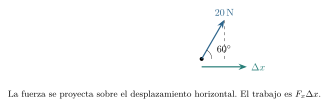
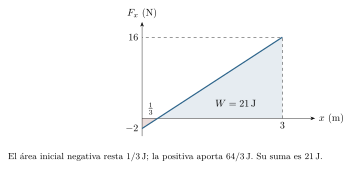
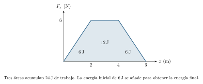
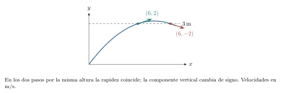
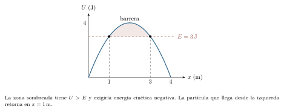

[← Capítulo anterior](capitulo-07.html) · [Índice del libro](index.html) · [Capítulo siguiente →](capitulo-09.html)

Una caja puede recorrer varios metros mientras distintas fuerzas tiran de ella, la frenan o sostienen su peso. El balance de trabajo y energía permite conocer la rapidez final a partir de las transferencias durante el recorrido. Podemos preguntar cuánto aporta cada fuerza durante el recorrido y relacionar ese aporte con el cambio de rapidez.

La idea de trabajo permite hacer ese balance. De ella surgirán la energía cinética, las energías potenciales gravitatoria y elástica y las condiciones para conservar su suma. El tiempo reaparecerá al estudiar potencia: dos máquinas pueden transferir la misma energía y hacerlo a ritmos muy distintos. Mantendremos a la vista el sistema elegido, las fuerzas incluidas y los límites de cada modelo.

## Una fuerza actúa a lo largo de un desplazamiento

Al sostener una caja inmóvil podemos cansarnos aunque su posición no cambie. El esfuerzo fisiológico involucra procesos internos del cuerpo; para describir la transferencia mecánica mediante la fuerza sobre la caja necesitamos además un desplazamiento. También importa su dirección: una fuerza perpendicular al movimiento puede desviarlo sin aumentar su rapidez.

Para una partícula sometida a una fuerza constante $\vec F$, definimos el trabajo de esa fuerza entre dos posiciones mediante el producto escalar introducido en el capítulo 2:
$$
 W_F=\vec F\cdot\Delta\vec r
 =F|\Delta\vec r|\cos\alpha.
$$
El ángulo $\alpha$ se mide entre la fuerza y el desplazamiento. La proyección de la fuerza sobre este último determina el signo: positivo si favorece ese desplazamiento, negativo si se opone y cero si es perpendicular. El trabajo es escalar, medido en joules: $1\,\mathrm{J}=1\,\mathrm{N\,m}=1\,\mathrm{kg\,m^2/s^2}$. Su signo se conserva al girar los ejes y puede cambiar al elegir otra referencia que atribuya al cuerpo un desplazamiento distinto.

### Problema resuelto 8.1 · Solo contribuye la componente paralela {#r8-1}

Una fuerza constante de $20\,\mathrm{N}$ forma $60^\circ$ sobre la horizontal y actúa sobre una caja que avanza $3\,\mathrm{m}$ horizontalmente. Calcula su trabajo.
*Resolución.* La proyección horizontal de la fuerza es $20\cos60^\circ=10\,\mathrm{N}$. Como el desplazamiento no tiene componente vertical,
$$
 W_F=(20)(3)\cos60^\circ\,\mathrm{J}=30\,\mathrm{J}.
$$
Multiplicar solo los módulos daría $60\,\mathrm{J}$ e ignoraría la dirección. La componente vertical puede modificar el apoyo, como vimos en el capítulo 7, aunque su trabajo en este recorrido horizontal sea cero.

{#fig-fp-av-r8-1 fig-alt="Ilustración de Problema resuelto 8.1 · Solo contribuye la componente paralela. Una fuerza constante de 20\\,N forma 60^circ sobre la horizontal y actúa sobre una caja que avanza 3\\,m horizontalmente. Calcula su trabajo. Resolución. La proyección horizontal de la fuerza es 20cos60^circ=10\\,N. Como el desplazamiento no tiene componente vertical, WF=(20)(3)cos60^circ\\,J=30\\,J. Multiplicar solo los"}

Para una fuerza constante, la expresión depende del desplazamiento entre extremos, incluso si la trayectoria intermedia es curva. La fórmula $W=Fs$ con $s$ igual a la longitud recorrida exige una situación más particular: fuerza de módulo constante que acompaña en cada punto la dirección y el sentido del avance. Para la fricción cinética sobre una superficie fija, el signo es opuesto y el trabajo vale $-f_ks$ cuando $f_k$ es constante. La fuerza cambia de dirección si cambia la dirección del deslizamiento.

### Problema resuelto 8.2 · Subir a rapidez constante también requiere trabajo {#r8-2}

Se eleva una caja de $4\,\mathrm{kg}$ una altura de $2\,\mathrm{m}$ con rapidez constante. Sin resistencia del aire, encuentra los trabajos del cable y del peso, y el trabajo neto sobre la caja.

*Resolución.* La aceleración es cero: la tensión tiene módulo $T=mg=40\,\mathrm{N}$. Su trabajo es $W_T=40(2)=80\,\mathrm{J}$, positivo porque tensión y desplazamiento apuntan hacia arriba. El peso realiza $W_g=-40(2)=-80\,\mathrm{J}$. Por tanto $W_{\mathrm{neto}}=0$. Los trabajos de las dos fuerzas se compensan y mantienen constante la energía cinética. Si elegimos el sistema caja--Tierra, los $80\,\mathrm{J}$ aportados por el cable aumentan la energía potencial gravitatoria que definiremos más adelante.

{#fig-fp-av-r8-2 fig-alt="Ilustración de Problema resuelto 8.2 · Subir a rapidez constante también requiere trabajo. Resolución. La aceleración es cero: la tensión tiene módulo T=mg=40\\,N. Su trabajo es WT=40(2)=80\\,J, positivo porque tensión y desplazamiento apuntan hacia arriba. El peso realiza Wg=-40(2)=-80\\,J. Por tanto Wneto=0. Los trabajos de las dos fuerzas se compensan y mantienen constante la energía cinética. Si elegimos"}

## Del trabajo neto a la energía cinética

Para descubrir qué mide el trabajo neto, volvamos a una partícula de masa constante $m$ en una referencia inercial. La segunda ley da $\vec F_{\mathrm{neta}}=m\,d\vec v/dt$. Durante un intervalo pequeño, $d\vec r=\vec v\,dt$. Al multiplicar escalarmente ambas expresiones,
$$
 \vec F_{\mathrm{neta}}\cdot d\vec r
 =m\frac{d\vec v}{dt}\cdot\vec v\,dt
 =d\!\left(\tfrac12m\vec v\cdot\vec v\right).
$$
La última igualdad procede de derivar $\vec v\cdot\vec v=v_x^2+v_y^2$ por componentes. Nos lleva a definir la *energía cinética* $K=\tfrac12mv^2$, donde $v=|\vec v|$ es la rapidez. Al acumular a lo largo del movimiento obtenemos el teorema
$$
 W_{\mathrm{neto}}=\sum_iW_i=K_f-K_i=\Delta K.
$$
Esta deducción vale también con fuerzas variables y trayectorias curvas; en la próxima sección precisaremos la acumulación como integral. Supone masa constante y una referencia inercial. Aplicado a un cuerpo extenso, el modelo de partícula describe su traslación y deja fuera rotación y deformación, cuyos balances requerirían otras contribuciones.

La energía cinética es no negativa y depende de la referencia. Duplicar la rapidez cuadruplica $K$; invertir la dirección de la velocidad conservando su módulo deja $K$ igual. Por ello el balance energético puede determinar una rapidez sin determinar la dirección, el tiempo transcurrido ni la forma de la trayectoria. Esos datos requieren información adicional.

### Problema resuelto 8.3 · El trabajo que cambia una rapidez {#r8-3}

Una partícula de $3\,\mathrm{kg}$ pasa de rapidez $2\,\mathrm{m/s}$ a $6\,\mathrm{m/s}$. ¿Qué trabajo neto recibe? ¿Cuánto trabajo recibiría en el cambio inverso?

*Resolución.* Sus energías son $K_i=\tfrac12(3)(2^2)=6\,\mathrm{J}$ y $K_f=\tfrac12(3)(6^2)=54\,\mathrm{J}$. El trabajo neto es $48\,\mathrm{J}$. En el cambio inverso sería $-48\,\mathrm{J}$. El signo describe el cambio de energía cinética. Para repartir esos $48\,\mathrm{J}$ entre las fuerzas necesitamos identificar las interacciones presentes.

{#fig-fp-av-r8-3 fig-alt="Ilustración de Problema resuelto 8.3 · El trabajo que cambia una rapidez. Resolución. Sus energías son Ki=tfrac12(3)(2^2)=6\\,J y Kf=tfrac12(3)(6^2)=54\\,J. El trabajo neto es 48\\,J. En el cambio inverso sería -48\\,J. El signo describe el cambio de energía cinética. Para repartir esos 48\\,J entre las fuerzas necesitamos identificar las interacciones presentes."}

### Problema resuelto 8.4 · Separar el tirón de la resultante {#r8-4}

Una caja de $5\,\mathrm{kg}$ desliza $4\,\mathrm{m}$ por una mesa horizontal. Parte a $2\,\mathrm{m/s}$ hacia la derecha y recibe un tirón horizontal constante de $30\,\mathrm{N}$ en ese sentido. Si $\mu_k=0{,}2$, encuentra su rapidez final.

*Resolución.* La normal es $50\,\mathrm{N}$ y el rozamiento cinético $10\,\mathrm{N}$ hacia la izquierda. Peso y normal realizan trabajo nulo porque son perpendiculares al recorrido. El tirón aporta $120\,\mathrm{J}$ y el rozamiento $-40\,\mathrm{J}$: $W_{\mathrm{neto}}=80\,\mathrm{J}$. Como $K_i=10\,\mathrm{J}$,
$$
 K_f=90\,\mathrm{J},\qquad v_f=\sqrt{\frac{2K_f}{m}}=6\,\mathrm{m/s}.
$$
Usar solo los $120\,\mathrm{J}$ del tirón como cambio cinético contaría como aceleración una energía que el contacto ha transferido a otros grados de libertad. Podemos comprobar el resultado con Newton: $a_x=(30-10)/5=4\,\mathrm{m/s^2}$ y $v_f^2=2^2+2(4)(4)=36\,\mathrm{m^2/s^2}$.

{#fig-fp-av-r8-4 fig-alt="Ilustración de Problema resuelto 8.4 · Separar el tirón de la resultante. Resolución. La normal es 50\\,N y el rozamiento cinético 10\\,N hacia la izquierda. Peso y normal realizan trabajo nulo porque son perpendiculares al recorrido. El tirón aporta 120\\,J y el rozamiento -40\\,J: Wneto=80\\,J. Como Ki=10\\,J, Kf=90\\,J,qquad vf=sqrtfrac2Kfm=6\\,m/s. Usar solo los 120\\,J del tirón como cambio"}

## Acumular el trabajo de una fuerza variable

Si la fuerza varía, dividimos la trayectoria en desplazamientos pequeños y sumamos los productos escalares de fuerza y desplazamiento. El límite de esa suma define
$$
 W_F=\int_C\vec F\cdot d\vec r.
$$
La letra $C$ señala la trayectoria concreta. Parametrizada por el tiempo, la misma expresión es $\int_{t_i}^{t_f}\vec F(t)\cdot\vec v(t)\,dt$. En una trayectoria sobre el eje $x$, queda $W_F=\int_{x_i}^{x_f}F_x(x)\,dx$. El capítulo 3 enseñó a interpretar estas integrales como acumulaciones con signo: las zonas bajo el eje restan trabajo y, si se invierte el recorrido, también se invierten los límites.

Una gráfica fuerza--posición permite así leer trabajo en sus áreas. Una gráfica fuerza--tiempo permite leer impulso, como vimos en el capítulo 6. Las bases tienen unidades distintas: $\,\mathrm{N\,m}$ para trabajo y $\,\mathrm{N\,s}$ para impulso. Un área geométricamente parecida puede representar magnitudes físicas diferentes.

### Problema resuelto 8.5 · Una fuerza que primero frena y luego ayuda {#r8-5}

Un carro de $2\,\mathrm{kg}$ avanza por una pista recta y recibe una fuerza neta $F_x(x)=(6\,\mathrm{N/m})x-2\,\mathrm{N}$. En $x=0$ tiene velocidad $+1\,\mathrm{m/s}$. Halla el trabajo hasta $x=3\,\mathrm{m}$ y comprueba que puede alcanzar ese punto.

*Resolución.* En SI,
$$
 W_{0\to3}=\int_0^3(6x-2)\,dx=[3x^2-2x]_0^3=21\,\mathrm{J}.
$$
La energía inicial es $1\,\mathrm{J}$; en una posición intermedia, $K(x)=1\,\mathrm{J}+(3\,\mathrm{N/m})x^2-(2\,\mathrm{N})x$. Su mínimo ocurre donde $F_x=0$, en $x=1/3\,\mathrm{m}$, y vale $2/3\,\mathrm{J}>0$. El carro atraviesa toda la región de fuerza negativa con energía cinética positiva. Finalmente $K_f=22\,\mathrm{J}$ y $v_f=\sqrt{22}\,\mathrm{m/s}$. Para interpretar el balance entre extremos debemos comprobar que la energía cinética permita llegar a la posición final.

{#fig-fp-av-r8-5 fig-alt="Ilustración de Problema resuelto 8.5 · Una fuerza que primero frena y luego ayuda. Resolución. En SI, W0to3=int0^3(6x-2)\\,dx=[3x^2-2x]0^3=21\\,J. La energía inicial es 1\\,J; en una posición intermedia, K(x)=1\\,J+(3\\,N/m)x^2-(2\\,N)x. Su mínimo ocurre donde Fx=0, en x=1/3\\,m, y vale 2/3\\,J>0. El carro atraviesa toda la región de fuerza negativa con energía cinética positiva. Finalmente Kf=22\\,J y"}

### Problema resuelto 8.6 · Trabajo a partir de una gráfica {#r8-6}

La fuerza neta sobre un móvil de $3\,\mathrm{kg}$ depende de su posición: crece linealmente de cero a $6\,\mathrm{N}$ entre $x=0$ y $2\,\mathrm{m}$, permanece en $6\,\mathrm{N}$ hasta $4\,\mathrm{m}$ y baja linealmente a cero en $6\,\mathrm{m}$. En $x=0$ lleva rapidez $2\,\mathrm{m/s}$ hacia la derecha. Encuentra la rapidez al alcanzar $6\,\mathrm{m}$.

*Resolución.* Los tres tramos aportan las áreas de dos triángulos y un rectángulo: $6+12+6=24\,\mathrm{J}$. La energía cinética inicial es $\tfrac12(3)(2^2)=6\,\mathrm{J}$ y la final $30\,\mathrm{J}$. Por ello $\tfrac12(3)v_f^2=30\,\mathrm{J}$ y $v_f=2\sqrt5\,\mathrm{m/s}\simeq4{,}47\,\mathrm{m/s}$. Toda la fuerza es no negativa durante el avance, así que la energía cinética nunca baja de su valor inicial y el carro puede recorrer el tramo. El área de $24\,\mathrm{J}$ representa el incremento que debemos sumar a la energía cinética inicial.

{#fig-fp-av-r8-6 fig-alt="Ilustración de Problema resuelto 8.6 · Trabajo a partir de una gráfica. Resolución. Los tres tramos aportan las áreas de dos triángulos y un rectángulo: 6+12+6=24\\,J. La energía cinética inicial es tfrac12(3)(2^2)=6\\,J y la final 30\\,J. Por ello tfrac12(3)vf^2=30\\,J y vf=2sqrt5\\,m/ssimeq4,47\\,m/s. Toda la fuerza es no negativa durante el avance, así que la energía cinética nunca baja de"}

## Cambiar la dirección sin cambiar la energía cinética

La igualdad $W_{\mathrm{neto}}=0$ entre dos instantes solo asegura igual energía cinética en los extremos. Si el trabajo acumulado es nulo en cada subtramo, la rapidez permanece constante durante todo el recorrido. Esto ocurre cuando la resultante es perpendicular a la velocidad en todo instante. La aceleración puede entonces cambiar la dirección de $\vec v$ aunque no cambie su módulo.

### Problema resuelto 8.7 · La tensión sostiene un giro sin aportar energía cinética {#r8-7}

Un disco de $2\,\mathrm{kg}$ gira a $3\,\mathrm{m/s}$ sobre una mesa lisa, unido a un punto fijo por cuerda de $1\,\mathrm{m}$. Calcula tensión y trabajo de esa tensión en media vuelta.
*Resolución.* Peso y normal se equilibran. La tensión aporta la resultante radial:
$$
 T=mv^2/R=18\,\mathrm{N}.
$$
Cada desplazamiento infinitesimal es tangente al círculo y perpendicular a la tensión. Por tanto $W_T=\int_C\vec T\cdot d\vec r=0$. La energía cinética sigue siendo $9\,\mathrm{J}$. La fuerza neta produce la aceleración centrípeta que cambia continuamente la dirección de la velocidad. El resultado usa un punto de anclaje fijo y radio constante.

{#fig-fp-av-r8-7 fig-alt="Ilustración de Problema resuelto 8.7 · La tensión sostiene un giro sin aportar energía cinética. Un disco de 2\\,kg gira a 3\\,m/s sobre una mesa lisa, unido a un punto fijo por cuerda de 1\\,m. Calcula tensión y trabajo de esa tensión en media vuelta. Resolución. Peso y normal se equilibran. La tensión aporta la resultante radial: T=mv^2/R=18\\,N. Cada desplazamiento infinitesimal es tangente al círculo y"}

Una normal sobre una pista fija y lisa también puede guiar el movimiento sin realizar trabajo, porque es perpendicular al desplazamiento permitido. Con una superficie móvil, esa conclusión deja de estar garantizada. El trabajo depende del desplazamiento en la referencia elegida; la palabra normal, por sí sola, solo describe una dirección respecto de la superficie.

## La gravedad y la elección de una energía potencial

En un campo gravitatorio uniforme con eje $y$ positivo hacia arriba, $\vec P=(0,-mg)$. A lo largo de cualquier trayectoria entre A y B,
$$
 W_g=\int_C-mg\,dy=mg(y_A-y_B).
$$
Solo intervienen las alturas inicial y final. Podemos guardar esa información en una función de posición $U_g(y)=mg(y-y_0)$, de modo que
$$
 W_g=-\Delta U_g.
$$
El nivel $y_0$ fija el cero de energía potencial. Cambiarlo añade la misma constante a los valores inicial y final y deja intacto $\Delta U_g$. Una energía potencial negativa es admisible; indica una posición respecto del cero elegido.

La energía potencial gravitatoria corresponde a la interacción cuerpo--Tierra. Hablar de la energía potencial de la caja es una abreviatura útil cuando la Tierra se considera fija y su campo dado. Al formular un balance hay que decidir si describiremos la gravedad mediante su trabajo sobre la caja o mediante el cambio de energía potencial del sistema caja--Tierra. Incluir ambas contribuciones simultáneamente duplicaría la misma interacción.

### Problema resuelto 8.8 · Dos caminos y dos ceros de altura {#r8-8}

Una caja de $2\,\mathrm{kg}$ pasa de altura $3\,\mathrm{m}$ a $1\,\mathrm{m}$. Compara el trabajo gravitatorio por una bajada directa y por una rampa más larga. Calcula además sus energías potenciales tomando el cero primero en el suelo y después a $4\,\mathrm{m}$.

*Resolución.* En ambos caminos $W_g=20(3-1)=40\,\mathrm{J}$. Con cero en el suelo, $U_i=60\,\mathrm{J}$ y $U_f=20\,\mathrm{J}$. Con cero a $4\,\mathrm{m}$, $U'_i=-20\,\mathrm{J}$ y $U'_f=-60\,\mathrm{J}$. En los dos casos $\Delta U=-40\,\mathrm{J}$ y se verifica $W_g=-\Delta U$. El trabajo gravitatorio conserva su valor aunque la rampa sea más larga. Si hubiese fricción, su trabajo sí dependería del camino y de las condiciones del contacto.

{#fig-fp-av-r8-8 fig-alt="Ilustración de Problema resuelto 8.8 · Dos caminos y dos ceros de altura. Resolución. En ambos caminos Wg=20(3-1)=40\\,J. Con cero en el suelo, Ui=60\\,J y Uf=20\\,J. Con cero a 4\\,m, U'i=-20\\,J y U'f=-60\\,J. En los dos casos Delta U=-40\\,J y se verifica Wg=-Delta U. El trabajo gravitatorio conserva su valor aunque la rampa sea más larga. Si hubiese fricción, su trabajo sí dependería del"}

## Resortes y fuerzas conservativas

Un resorte ideal de constante $k>0$ ejerce, sobre un cuerpo unido a su extremo, $F_x=-kx$, donde $x$ mide la deformación respecto de la longitud natural. El signo expresa la restitución: se opone al alargamiento positivo y a la compresión negativa. La ley de Hooke aproxima el comportamiento de un resorte en su rango elástico; fuera de él puede dejar de ser válida.

Su trabajo entre deformaciones $x_i$ y $x_f$ es
$$
 W_e=\int_{x_i}^{x_f}-kx\,dx
 =-\left(\tfrac12kx_f^2-\tfrac12kx_i^2\right).
$$
Definimos $U_e=\tfrac12kx^2$, con cero en la longitud natural, y obtenemos nuevamente $W_e=-\Delta U_e$. Tanto comprimir como estirar almacena energía positiva con esta elección del cero. Las unidades lo confirman: $(\,\mathrm{N/m})(\,\mathrm{m^2})=\,\mathrm{J}$.

Una fuerza estacionaria es *conservativa* en una región cuando admite una energía potencial $U$ tal que, para cualquier trayectoria admisible de A a B, su trabajo es $W_{A\to B}=U(A)-U(B)$. Por eso, los distintos caminos entre los mismos extremos producen el mismo trabajo. En una coordenada y donde $U$ sea derivable, $F_x=-dU/dx$. La gravedad uniforme y el resorte ideal cumplen esta condición. La fricción cinética puede realizar trabajo negativo en cada tramo de ida y vuelta; su acumulación depende del recorrido y del régimen de contacto.

### Problema resuelto 8.9 · El trabajo para estirar un resorte {#r8-9}

Un resorte de $100\,\mathrm{N/m}$ pasa lentamente de deformación $0{,}20\,\mathrm{m}$ a $0{,}50\,\mathrm{m}$. La variación de energía cinética es despreciable. Calcula el trabajo del agente que lo estira y el del resorte sobre el extremo móvil.

*Resolución.* La fuerza del agente se ajusta aproximadamente a $kx$, opuesta a la del resorte. La energía elástica pasa de $U_i=\tfrac12(100)(0{,}2)^2=2\,\mathrm{J}$ a $U_f=12{,}5\,\mathrm{J}$. El agente aporta $10{,}5\,\mathrm{J}$ y el resorte realiza $-10{,}5\,\mathrm{J}$ sobre el extremo. El mismo resultado se obtiene integrando $kx$ entre ambas deformaciones. Multiplicar la fuerza final $50\,\mathrm{N}$ por el avance $0{,}30\,\mathrm{m}$ daría $15\,\mathrm{J}$ y sobreestimaría el trabajo de este tirón variable.

{#fig-fp-av-r8-9 fig-alt="Ilustración de Problema resuelto 8.9 · El trabajo para estirar un resorte. Resolución. La fuerza del agente se ajusta aproximadamente a kx, opuesta a la del resorte. La energía elástica pasa de Ui=tfrac12(100)(0,2)^2=2\\,J a Uf=12,5\\,J. El agente aporta 10,5\\,J y el resorte realiza -10,5\\,J sobre el extremo. El mismo resultado se obtiene integrando kx entre ambas deformaciones. Multiplicar la"}

## Conservar la energía mecánica con hipótesis explícitas

Al separar las fuerzas conservativas de las restantes, el teorema trabajo--energía toma la forma $\Delta K=-\Delta U+W_{\mathrm{otras}}$. Por tanto,
$$
 \Delta E_{\mathrm{mec}}=\Delta(K+U)=W_{\mathrm{otras}}.
$$
La suma $U$ incluye las interacciones conservativas que decidimos representar como potenciales. El término $W_{\mathrm{otras}}$ reúne los trabajos de las fuerzas restantes, después de incorporar en $U$ las interacciones conservativas elegidas. Si ese término es cero, $K+U$ se conserva entre los estados considerados. Para que sea constante a lo largo de todo el movimiento, debe anularse en cada subtramo.

La energía mecánica puede conservarse bajo la acción de fuerzas conservativas. Un resorte puede cambiar intensamente la rapidez y la gravedad puede acelerar una caída mientras $K+U$ permanece constante. La energía pasa entre las formas incluidas en el balance. Si una interacción transfiere energía a deformaciones irreversibles, vibraciones o calentamiento, conservar solo la suma mecánica dejaría fuera parte del proceso.

### Problema resuelto 8.10 · Liberar una compresión {#r8-10}

Un bloque de $2\,\mathrm{kg}$ está en reposo contra un resorte de $200\,\mathrm{N/m}$ comprimido $0{,}30\,\mathrm{m}$ sobre mesa lisa. No está unido al resorte. ¿Con qué rapidez lo abandona al recuperar este su longitud natural?
*Resolución.* El sistema bloque--resorte conserva su energía mecánica en la aproximación ideal. La energía inicial es $\tfrac12(200)(0{,}3)^2=9\,\mathrm{J}$, toda elástica. En la longitud natural $U_e=0$, de modo que
$$
 \tfrac12(2)v^2=9,\qquad v=3\,\mathrm{m/s}.
$$
El resorte deja de empujar al bloque allí. Al recuperar su longitud natural, el resorte pierde el contacto con el bloque, que continúa su movimiento libre. Sobre la mesa lisa continuará con esa velocidad.

{#fig-fp-av-r8-10 fig-alt="Ilustración de Problema resuelto 8.10 · Liberar una compresión. Un bloque de 2\\,kg está en reposo contra un resorte de 200\\,N/m comprimido 0,30\\,m sobre mesa lisa. No está unido al resorte. ¿Con qué rapidez lo abandona al recuperar este su longitud natural? Resolución. El sistema bloque--resorte conserva su energía mecánica en la aproximación ideal. La energía inicial es"}

### Problema resuelto 8.11 · Una rapidez y dos direcciones posibles {#r8-11}

Una pelota se lanza con componentes iniciales $(6,8)\,\mathrm{m/s}$ desde $y=0$, sin resistencia del aire. Encuentra su rapidez cuando pasa por $y=3\,\mathrm{m}$ y determina las dos velocidades posibles.

*Resolución.* La rapidez inicial es $10\,\mathrm{m/s}$. Dividir la conservación de $K+U_g$ entre $m$ da $v^2/2+gy=v_0^2/2$. En $y=3\,\mathrm{m}$,
$$
 v^2=100-2(10)(3)=40\,\mathrm{m^2/s^2},\qquad v=2\sqrt{10}\,\mathrm{m/s}.
$$
La componente horizontal permanece en $6\,\mathrm{m/s}$. Así $v_y^2=40-36=4\,\mathrm{m^2/s^2}$ y las velocidades son $(6,+2)\,\mathrm{m/s}$ al subir y $(6,-2)\,\mathrm{m/s}$ al bajar. La altura máxima es $8^2/(2g)=3{,}2\,\mathrm{m}$: ambas visitas existen. La energía sola dio el módulo; la información cinemática permitió reconstruir las componentes.

{#fig-fp-av-r8-11 fig-alt="Ilustración de Problema resuelto 8.11 · Una rapidez y dos direcciones posibles. Resolución. La rapidez inicial es 10\\,m/s. Dividir la conservación de K+Ug entre m da v^2/2+gy=v0^2/2. En y=3\\,m, v^2=100-2(10)(3)=40\\,m^2/s^2,qquad v=2sqrt10\\,m/s. La componente horizontal permanece en 6\\,m/s. Así vy^2=40-36=4\\,m^2/s^2 y las velocidades son (6,+2)\\,m/s al subir y (6,-2)\\,m/s al bajar. La altura"}

## El balance cuando hay rozamiento

Para un bloque que desliza sobre una rampa fija, el rozamiento cinético realiza $W_f=-\int f_k\,ds$. Con coeficiente y normal constantes, $W_f=-\mu_kNs$. Si ya hemos incluido la gravedad en $U_g$, la ecuación es $\Delta(K+U_g)=-\mu_kNs$. La longitud $s$ mide el recorrido sobre la superficie; la pérdida de altura es su proyección vertical.

La disminución de energía mecánica corresponde a una transferencia hacia otras formas de energía. Al ampliar el sistema al bloque, la superficie y la Tierra, aparecen aumentos de energía interna y posibles transferencias al entorno. En el modelo de deslizamiento seco sobre una superficie fija, con otras transferencias despreciables, representaremos el aumento interno total por $\Delta E_{\mathrm{int}}=f_ks$. Determinar qué fracción calienta cada cuerpo requiere información adicional. Para una superficie móvil o un contacto con deformaciones importantes habría que estudiar también el movimiento y las transferencias de esa superficie; identificar automáticamente trabajo negativo e incremento térmico del bloque sería insuficiente.

### Problema resuelto 8.12 · La altura perdida y el camino rugoso {#r8-12}

Un bloque de $4\,\mathrm{kg}$ parte del reposo y desciende $5\,\mathrm{m}$ por una rampa fija de $30^\circ$, con $\mu_k=0{,}2$. Se supone que el contacto permite iniciar el deslizamiento al soltarlo. Halla la rapidez final y la energía mecánica transferida a formas internas.

*Resolución.* La pérdida de altura es $h=5\sin30^\circ=2{,}5\,\mathrm{m}$; el potencial disminuye $mgh=100\,\mathrm{J}$. La normal es $mg\cos30^\circ=20\sqrt3\,\mathrm{N}$ y la fricción tiene módulo $4\sqrt3\,\mathrm{N}$. Su trabajo a lo largo de la rampa vale $-20\sqrt3\,\mathrm{J}$. Por tanto,
$$
 K_f=100-20\sqrt3\,\mathrm{J},\qquad
 v_f=\sqrt{50-10\sqrt3}\,\mathrm{m/s}\simeq5{,}72\,\mathrm{m/s}.
$$
La energía mecánica disminuye $20\sqrt3\,\mathrm{J}\simeq34{,}6\,\mathrm{J}$. Bajo las hipótesis del balance ampliado, esa cantidad aumenta la energía interna total de bloque y rampa. Usar $2{,}5\,\mathrm{m}$ como recorrido de fricción daría la mitad del trabajo resistente real.

{#fig-fp-av-r8-12 fig-alt="Ilustración de Problema resuelto 8.12 · La altura perdida y el camino rugoso. Resolución. La pérdida de altura es h=5sin30^circ=2,5\\,m; el potencial disminuye mgh=100\\,J. La normal es mgcos30^circ=20sqrt3\\,N y la fricción tiene módulo 4sqrt3\\,N. Su trabajo a lo largo de la rampa vale -20sqrt3\\,J. Por tanto, Kf=100-20sqrt3\\,J,qquad vf=sqrt50-10sqrt3\\,m/ssimeq5,72\\,m/s. La energía mecánica"}

### Problema resuelto 8.13 · Comprimir un resorte mientras actúa la fricción {#r8-13}

Un bloque de $2\,\mathrm{kg}$ avanza a $4\,\mathrm{m/s}$ por suelo horizontal y llega a un resorte sin deformar de $100\,\mathrm{N/m}$. Desde el contacto comienza a comprimirlo; $\mu_k=0{,}25$. Encuentra la primera compresión máxima.

*Resolución.* La energía cinética al tocar el resorte es $16\,\mathrm{J}$ y la fricción durante la compresión vale $0{,}25(20)=5\,\mathrm{N}$. Sea $x\geq0$ la compresión. En la primera detención,
$$
 16\,\mathrm{J}=\tfrac12(100\,\mathrm{N/m})x^2+(5\,\mathrm{N})x.
$$
En SI resulta $50x^2+5x-16=0$. Las raíces son $x=(-1\pm\sqrt{129})/20\,\mathrm{m}$. La compresión físicamente admisible es $x=(\sqrt{129}-1)/20\,\mathrm{m}\simeq0{,}518\,\mathrm{m}$. La otra raíz es negativa y no corresponde al tramo considerado. En esa posición $K=0$, pero decidir si el bloque regresa requiere examinar el rozamiento estático y el vínculo con el resorte. Después de una detención debemos examinar las fuerzas y las condiciones de contacto para determinar cómo continúa el movimiento.

{#fig-fp-av-r8-13 fig-alt="Ilustración de Problema resuelto 8.13 · Comprimir un resorte mientras actúa la fricción. Resolución. La energía cinética al tocar el resorte es 16\\,J y la fricción durante la compresión vale 0,25(20)=5\\,N. Sea xgeq0 la compresión. En la primera detención, 16\\,J=tfrac12(100\\,N/m)x^2+(5\\,N)x. En SI resulta 50x^2+5x-16=0. Las raíces son x=(-1pmsqrt129)/20\\,m. La compresión físicamente admisible es"}

### Problema resuelto 8.14 · La energía de dos cuerpos vinculados {#r8-14}

Un bloque A de $4\,\mathrm{kg}$ desliza por mesa hacia una polea fija ideal, unido mediante cuerda ideal a B de $2\,\mathrm{kg}$ que desciende. Parten del reposo; entre A y mesa $\mu_s=0{,}40$ y $\mu_k=0{,}25$. B puede bajar al liberarse el sistema porque su peso, $20\,\mathrm{N}$, supera el rozamiento estático máximo, $16\,\mathrm{N}$. Calcula la rapidez común después de que B descienda $1{,}2\,\mathrm{m}$.

*Resolución.* La cuerda impone iguales recorridos y rapidez. La energía potencial perdida por B es $2(10)(1{,}2)=24\,\mathrm{J}$. La normal de A vale $40\,\mathrm{N}$ y la fricción $10\,\mathrm{N}$, cuyo trabajo es $-12\,\mathrm{J}$. La energía cinética final total es
$$
 \tfrac12(4+2)v^2=24-12=12\,\mathrm{J},\qquad v=2\,\mathrm{m/s}.
$$
Los trabajos de tensión sobre A y B se cancelan al sumar sus balances: son $+Ts$ y $-Ts$, porque la cuerda y polea ideales tienen tensión común y los recorridos son iguales. Las fuerzas sobre los dos cuerpos tienen direcciones distintas; la cancelación de sus trabajos se justifica por esos productos escalares y el vínculo. La comprobación dinámica da $a=(20-10)/6=5/3\,\mathrm{m/s^2}$ y $v^2=2a(1{,}2)=4\,\mathrm{m^2/s^2}$.

{#fig-fp-av-r8-14 fig-alt="Ilustración de Problema resuelto 8.14 · La energía de dos cuerpos vinculados. Resolución. La cuerda impone iguales recorridos y rapidez. La energía potencial perdida por B es 2(10)(1,2)=24\\,J. La normal de A vale 40\\,N y la fricción 10\\,N, cuyo trabajo es -12\\,J. La energía cinética final total es tfrac12(4+2)v^2=24-12=12\\,J,qquad v=2\\,m/s. Los trabajos de tensión sobre A y B se cancelan al"}

## Potencia y rendimiento

Para conocer la duración del proceso necesitamos información sobre el movimiento o la potencia. Para describir el ritmo de transferencia definimos la potencia media $\overline{\mathcal P}=W/\Delta t$ y, cuando existe la derivada, la potencia instantánea
$$
 \mathcal P=\frac{dW}{dt}=\vec F\cdot\vec v.
$$
Aquí $\vec v$ es la velocidad de la partícula sobre la que actúa la fuerza, en la misma referencia usada para calcular el trabajo. Una potencia negativa representa un aporte negativo de trabajo de esa fuerza al balance. El cambio de energía cinética depende de la suma de los aportes: para una partícula de masa constante en una referencia inercial, $\sum_i\mathcal P_i=dK/dt$, como en el balance de trabajos de r8-4. Su unidad SI es el watt, $1\,\mathrm{W}=1\,\mathrm{J/s}$. Un kilowatt-hora es una unidad de energía: $1\,\mathrm{kWh}=3{,}6\times10^6\,\mathrm{J}$.

El rendimiento $\eta=E_{\text{útil}}/E_{\mathrm{entrada}}$ compara, para un mismo proceso y límites de sistema definidos, la energía útil obtenida con la suministrada. Para una máquina que recibe energía durante un intervalo sin consumir reservas internas previas, $0\leq\eta\leq1$. Si las potencias son constantes puede escribirse $\eta=\mathcal P_{\text{útil}}/\mathcal P_{\mathrm{entrada}}$. Las energías que no aparecen como salida útil siguen en el balance, por ejemplo como calentamiento, ruido o energía almacenada.

### Problema resuelto 8.15 · Igual trabajo y distinto ritmo {#r8-15}

Un elevador idealizado sube una carga de $50\,\mathrm{kg}$ una altura de $6\,\mathrm{m}$ en $10\,\mathrm{s}$, con igual rapidez inicial y final. Su rendimiento global para esa elevación es $75\%$. Halla energía útil, potencia útil media y energía y potencia media de entrada.

*Resolución.* El aumento de potencial es $50(10)(6)=3000\,\mathrm{J}$ y la variación cinética es cero. La potencia útil media vale $3000/10=300\,\mathrm{W}$. Con $\eta=0{,}75$,
$$
 E_{\mathrm{entrada}}=3000/0{,}75=4000\,\mathrm{J},\qquad
 \overline{\mathcal P}_{\mathrm{entrada}}=400\,\mathrm{W}.
$$
Los $1000\,\mathrm{J}$ restantes corresponden a otras transferencias o cambios internos del equipo y su entorno. Hacer la misma elevación en la mitad del tiempo duplicaría la potencia útil media sin cambiar los $3000\,\mathrm{J}$ útiles, si se conservan las condiciones indicadas.

{#fig-fp-av-r8-15 fig-alt="Ilustración de Problema resuelto 8.15 · Igual trabajo y distinto ritmo. Resolución. El aumento de potencial es 50(10)(6)=3000\\,J y la variación cinética es cero. La potencia útil media vale 3000/10=300\\,W. Con eta=0,75, Eentrada=3000/0,75=4000\\,J,qquad overlinemathcal Pentrada=400\\,W. Los 1000\\,J restantes corresponden a otras transferencias o cambios internos del equipo y su entorno."}

### Problema resuelto 8.16 · La potencia aumenta aunque la fuerza sea constante {#r8-16}

Un carro de $2\,\mathrm{kg}$ sobre pista lisa parte del reposo y recibe una fuerza horizontal constante de $4\,\mathrm{N}$ durante $3\,\mathrm{s}$. Calcula la potencia instantánea al final y la potencia media en el intervalo.

*Resolución.* La aceleración es $2\,\mathrm{m/s^2}$, de modo que $v(t)=(2\,\mathrm{m/s^2})t$ y $\mathcal P(t)=Fv(t)=(8\,\mathrm{W/s})t$. A los $3\,\mathrm{s}$ la potencia instantánea es $24\,\mathrm{W}$. El avance es $\tfrac12(2)(3^2)=9\,\mathrm{m}$, el trabajo $36\,\mathrm{J}$ y la potencia media $12\,\mathrm{W}$. También se obtiene integrando la gráfica potencia--tiempo: su área triangular es $36\,\mathrm{J}$. La fuerza constante hace más trabajo por segundo cuando el carro recorre más distancia por segundo.

{#fig-fp-av-r8-16 fig-alt="Ilustración de Problema resuelto 8.16 · La potencia aumenta aunque la fuerza sea constante. Resolución. La aceleración es 2\\,m/s^2, de modo que v(t)=(2\\,m/s^2)t y mathcal P(t)=Fv(t)=(8\\,W/s)t. A los 3\\,s la potencia instantánea es 24\\,W. El avance es tfrac12(2)(3^2)=9\\,m, el trabajo 36\\,J y la potencia media 12\\,W. También se obtiene integrando la gráfica potencia--tiempo: su área triangular es 36\\,J. La"}

### Problema resuelto 8.17 · Potencia constante con fuerza decreciente {#r8-17}

Un móvil de $4\,\mathrm{kg}$ avanza inicialmente a $5\,\mathrm{m/s}$ por una pista lisa. Un motor le suministra potencia mecánica constante de $50\,\mathrm{W}$, mediante una fuerza paralela a la velocidad, durante $3\,\mathrm{s}$. Encuentra la rapidez final y las fuerzas inicial y final.

*Resolución.* El motor aporta $50(3)=150\,\mathrm{J}$. La energía inicial es $\tfrac12(4)(5^2)=50\,\mathrm{J}$, luego $K_f=200\,\mathrm{J}$ y $v_f=10\,\mathrm{m/s}$. Como $\mathcal P=Fv$, la fuerza pasa de $50/5=10\,\mathrm{N}$ a $50/10=5\,\mathrm{N}$. Durante el intervalo,
$$
 v(t)=\sqrt{25\,\mathrm{m^2/s^2}+(25\,\mathrm{m^2/s^3})t}.
$$
La aceleración y la fuerza disminuyen mientras la potencia permanece constante. El modelo se inicia con velocidad no nula; una potencia positiva constante desde reposo exacto exigiría $F=\mathcal P/v$ sin límite al inicio, por encima de la capacidad de un motor real.

{#fig-fp-av-r8-17 fig-alt="Ilustración de Problema resuelto 8.17 · Potencia constante con fuerza decreciente. Resolución. El motor aporta 50(3)=150\\,J. La energía inicial es tfrac12(4)(5^2)=50\\,J, luego Kf=200\\,J y vf=10\\,m/s. Como mathcal P=Fv, la fuerza pasa de 50/5=10\\,N a 50/10=5\\,N. Durante el intervalo, v(t)=sqrt25\\,m^2/s^2+(25\\,m^2/s^3)t. La aceleración y la fuerza disminuyen mientras la potencia permanece constante."}

## Qué estados permite un balance de energía

Conocer la energía mecánica $E$ de una partícula que se mueve en una coordenada bajo una fuerza conservativa permite escribir $K(x)=E-U(x)$. Como $K\geq0$, solo son accesibles posiciones donde $U(x)\leq E$. Aun así, puede haber varias regiones permitidas separadas por una barrera. Un cuerpo no pasa de una a otra si entre ellas tendría que adquirir energía cinética negativa.

Donde $E=U$, la rapidez es cero. Para decidir qué ocurre después hay que mirar la fuerza $-dU/dx$ y las condiciones del contacto. Un mínimo de $U$ corresponde, cuando es suave, a fuerza nula y puede ser un equilibrio estable; una detención sobre una pendiente de $U$ tiene fuerza no nula y normalmente precede a un retorno. Los siguientes conceptos de oscilación podrán desarrollarse a partir de esta diferencia.

### Problema resuelto 8.18 · Una rapidez formal al otro lado de una barrera {#r8-18}

Una partícula de $2\,\mathrm{kg}$ se mueve en una coordenada $0\leq x\leq4\,\mathrm{m}$ con potencial $U(x)=(4\,\mathrm{N})x-(1\,\mathrm{N/m})x^2$. Parte de $x=0$ hacia la derecha con energía cinética $3\,\mathrm{J}$. ¿Puede alcanzar $x=4\,\mathrm{m}$ conservando su energía?

*Resolución.* La energía total es $E=3\,\mathrm{J}$. Como $U(4\,\mathrm{m})=0$, un balance solo entre extremos produciría $K_f=3\,\mathrm{J}$. Pero el potencial alcanza $4\,\mathrm{J}$ en $x=2\,\mathrm{m}$, por encima de la energía disponible. Las igualdades $U(x)=3\,\mathrm{J}$ dan, en SI, $4x-x^2=3$ y raíces $x=1\,\mathrm{m}$ y $3\,\mathrm{m}$.

La partícula llega primero a $x=1\,\mathrm{m}$, donde se detiene. Allí $F_x=-dU/dx=-4\,\mathrm{N}+(2\,\mathrm{N/m})x=-2\,\mathrm{N}$: acelera hacia la izquierda y retorna. El intervalo $1<x<3\,\mathrm{m}$ está prohibido para esa energía; la región permitida $x\geq3\,\mathrm{m}$ queda desconectada de su estado inicial. La conservación de energía debe cumplirse a lo largo del recorrido completo, además de en los extremos.

{#fig-fp-av-r8-18 fig-alt="Ilustración de Problema resuelto 8.18 · Una rapidez formal al otro lado de una barrera. La partícula llega primero a x=1\\,m, donde se detiene. Allí Fx=-dU/dx=-4\\,N+(2\\,N/m)x=-2\\,N: acelera hacia la izquierda y retorna. El intervalo 1<x<3\\,m está prohibido para esa energía; la región permitida xgeq3\\,m queda desconectada de su estado inicial. La conservación de energía debe cumplirse a lo largo del"}

### De una rapidez medida a un balance comprobable

Usa un carro ligero, una rampa pequeña y estable, una regla y una grabación fija que permita estimar la rapidez al pie. Mide la diferencia de altura del centro de masa entre los estados escogidos. El modelo de partícula sin pérdidas predice $v_f^2-v_i^2=2gh$. Repite con varias alturas y compara, conservando la dispersión de las mediciones.

Las ruedas almacenan energía de rotación, omitida en ese modelo; interpretar una rapidez menor exige estimar también esa contribución. También influyen la resistencia del aire, las irregularidades, el error al medir alturas y el procedimiento de liberación. Un bloque que desliza permite otro modelo, pero introduce rozamiento. La experiencia permite contrastar un balance con hipótesis identificadas y evaluar las transferencias de energía pertinentes.

## Ejercicios para reconstruir y transferir

Usa $g=10\,\mathrm{m/s^2}$, masas constantes y referencia inercial del suelo, salvo indicación contraria. Los cuerpos se modelan como partículas. Distingue trabajos individuales de trabajo neto y declara qué interacciones incluyes como energía potencial.

### Ejercicio 8.1 · Un trabajo oblicuo {#e8-1}

Una fuerza constante de $30\,\mathrm{N}$ forma $60^\circ$ con un desplazamiento de $4\,\mathrm{m}$. Calcula su trabajo y el que haría la misma fuerza si el desplazamiento tuviera sentido opuesto.

### Ejercicio 8.2 · Una fuerza perpendicular {#e8-2}

Un disco se mueve horizontalmente sobre mesa fija lisa. Explica el trabajo de peso y normal. ¿Se sigue de ello que cada una de esas fuerzas sea nula?

### Ejercicio 8.3 · Elevación uniforme {#e8-3}

Una caja de $6\,\mathrm{kg}$ sube $3\,\mathrm{m}$ a rapidez constante, sin aire. Calcula trabajos de tensión y peso y el trabajo neto.

### Ejercicio 8.4 · Rapidez y energía cinética {#e8-4}

Una partícula de $4\,\mathrm{kg}$ pasa de $3$ a $5\,\mathrm{m/s}$. Encuentra el trabajo neto. ¿Qué energía cinética tendría a $-5\,\mathrm{m/s}$ en un movimiento rectilíneo?

### Ejercicio 8.5 · Tirón y rozamiento {#e8-5}

Una caja de $4\,\mathrm{kg}$ parte a $2\,\mathrm{m/s}$ y avanza $3\,\mathrm{m}$ horizontalmente, con tirón de $24\,\mathrm{N}$ hacia el avance y $\mu_k=0{,}2$. Encuentra trabajos y rapidez final.

### Ejercicio 8.6 · Una fuerza dependiente de la posición {#e8-6}

Un carro de $2\,\mathrm{kg}$ avanza desde $x=0$ con $v_i=2\,\mathrm{m/s}$. La fuerza neta es $F_x=(4\,\mathrm{N/m})x-2\,\mathrm{N}$. Calcula trabajo y rapidez en $x=2\,\mathrm{m}$ y comprueba que puede llegar.

### Ejercicio 8.7 · Un área con signo {#e8-7}

Entre $x=0$ y $2\,\mathrm{m}$ la fuerza neta es $+4\,\mathrm{N}$; entre $2$ y $5\,\mathrm{m}$ es $-2\,\mathrm{N}$. Un móvil de $1\,\mathrm{kg}$ entra en $x=0$ con rapidez $2\,\mathrm{m/s}$ hacia la derecha. Halla el trabajo total y la rapidez final.

### Ejercicio 8.8 · Fuerza no nula, trabajo nulo {#e8-8}

Un disco de $1\,\mathrm{kg}$ gira a $4\,\mathrm{m/s}$ sobre mesa lisa, con cuerda de radio $2\,\mathrm{m}$ anclada en un punto fijo. Encuentra tensión y trabajo de tensión en una vuelta.

### Ejercicio 8.9 · La gravedad depende de los extremos {#e8-9}

Una caja de $3\,\mathrm{kg}$ pasa de altura $5\,\mathrm{m}$ a $2\,\mathrm{m}$. Halla el trabajo de gravedad por dos caminos cualesquiera y las energías potenciales tomando cero a $4\,\mathrm{m}$.

### Ejercicio 8.10 · Cambiar el cero {#e8-10}

Un potencial gravitatorio se escribe $U(y)=mgy+C$. Explica por qué cambiar $C$ no cambia el trabajo entre dos alturas ni la rapidez predicha por conservación.

### Ejercicio 8.11 · Estirar lentamente {#e8-11}

Un resorte de $80\,\mathrm{N/m}$ se estira de $0{,}10$ a $0{,}30\,\mathrm{m}$ con cambio cinético despreciable. Calcula trabajos del agente y del resorte.

### Ejercicio 8.12 · La misma energía al comprimir {#e8-12}

Compara la energía elástica de un resorte de $200\,\mathrm{N/m}$ con deformaciones $+0{,}20$ y $-0{,}20\,\mathrm{m}$. Indica el sentido de su fuerza sobre un cuerpo unido al extremo.

### Ejercicio 8.13 · Lanzamiento por resorte {#e8-13}

Un bloque de $1\,\mathrm{kg}$ contra un resorte de $100\,\mathrm{N/m}$ comprimido $0{,}40\,\mathrm{m}$ se libera sobre mesa lisa. No está unido al resorte. Encuentra su rapidez al separarse.

### Ejercicio 8.14 · Una altura que puede alcanzarse {#e8-14}

Una pelota sale con componentes $(3,4)\,\mathrm{m/s}$ desde $y=0$, sin aire. Calcula la rapidez y las dos velocidades en $y=0{,}60\,\mathrm{m}$. Comprueba la altura máxima.

### Ejercicio 8.15 · Altura y fricción {#e8-15}

Un bloque de $5\,\mathrm{kg}$ ya iniciado en deslizamiento parte con rapidez despreciable y recorre $5\,\mathrm{m}$ cuesta abajo por una rampa con seno $0{,}6$, coseno $0{,}8$ y $\mu_k=0{,}25$. Halla rapidez final y disminución de energía mecánica.

### Ejercicio 8.16 · La primera compresión máxima {#e8-16}

Un bloque de $1\,\mathrm{kg}$ llega a $3\,\mathrm{m/s}$ a un resorte sin deformar de $40\,\mathrm{N/m}$. El suelo tiene $\mu_k=0{,}2$. Calcula la primera compresión máxima y explica qué falta para decidir si queda allí.

### Ejercicio 8.17 · Dos masas en un balance {#e8-17}

Un bloque de $3\,\mathrm{kg}$ desliza por mesa hacia polea fija ideal, unido por cuerda ideal a una masa de $2\,\mathrm{kg}$ descendente. Parten del reposo; $\mu_s=0{,}50$ y $\mu_k=0{,}20$ en la mesa. Comprueba el inicio del movimiento y halla la rapidez común cuando la masa colgante baja $2\,\mathrm{m}$.

### Ejercicio 8.18 · Una máquina y su rendimiento {#e8-18}

Una máquina eleva $40\,\mathrm{kg}$ una altura de $5\,\mathrm{m}$ en $8\,\mathrm{s}$, con igual rapidez inicial y final. Su rendimiento es $80\%$. Encuentra energía y potencia útil media, y energía y potencia media de entrada.

### Ejercicio 8.19 · Potencia variable {#e8-19}

Un carro de $3\,\mathrm{kg}$ parte del reposo sobre pista lisa con fuerza constante de $6\,\mathrm{N}$ durante $4\,\mathrm{s}$. Halla potencia final, trabajo y potencia media.

### Ejercicio 8.20 · Potencia mecánica constante {#e8-20}

Un móvil de $2\,\mathrm{kg}$ tiene rapidez inicial $4\,\mathrm{m/s}$ y recibe potencia mecánica constante de $20\,\mathrm{W}$ durante $3\,\mathrm{s}$ sobre pista lisa. Halla rapidez final y fuerza final si esta es paralela a la velocidad.

### Ejercicio 8.21 · Expresar una energía en joules {#e8-21}

Un equipo consume potencia eléctrica constante de $1{,}5\,\mathrm{kW}$ durante $20\,\mathrm{min}$. Expresa la energía recibida en kilowatt-hora y joules.

### Ejercicio 8.22 · La barrera de potencial {#e8-22}

En el potencial del problema resuelto 8.18, una partícula parte de $x=0$ hacia la derecha con energía total $2\,\mathrm{J}$. Halla su primer punto de detención y explica por qué no llega a $x=4\,\mathrm{m}$.

### Ejercicio 8.23 · La fricción puede hacer trabajo positivo {#e8-23}

Una caja de $2\,\mathrm{kg}$ se deposita sin velocidad horizontal sobre una cinta que corre a $3\,\mathrm{m/s}$ constantes; $\mu_k=0{,}25$. Antes de igualar velocidades, avanza $1{,}8\,\mathrm{m}$ respecto del suelo y la cinta recorre $3{,}6\,\mathrm{m}$. Calcula el trabajo de fricción sobre la caja, el trabajo de su reacción sobre la cinta y su suma. Interpreta la diferencia con el aumento de energía cinética de la caja.

### Ejercicio 8.24 · Cambiar de referencia {#e8-24}

Un carro de $2\,\mathrm{kg}$ sobre pista lisa acelera de $2$ a $6\,\mathrm{m/s}$ en $2\,\mathrm{s}$ con fuerza horizontal constante. Calcula trabajo neto en el suelo y en una referencia inercial que avanza a $2\,\mathrm{m/s}$ en el mismo sentido. Verifica el teorema trabajo--energía en ambas.

## Soluciones completas de los ejercicios

### Solución 8.1 {#sol-e8-1}
El trabajo es $30(4)\cos60^\circ=60\,\mathrm{J}$. Al invertir el desplazamiento, el ángulo pasa a $120^\circ$ y $W=-60\,\mathrm{J}$. La fuerza se mantuvo fija; cambió el sentido del recorrido. El signo resulta del producto escalar y se conserva al girar los ejes.

### Solución 8.2 {#sol-e8-2}
El desplazamiento es tangente a la mesa y peso y normal son verticales, de modo que ambos productos escalares son cero durante todo el movimiento. Si no hay otras fuerzas verticales, $N=mg$ y sus módulos son no nulos. Trabajo cero solo indica falta de componente a lo largo del desplazamiento en esta situación.

### Solución 8.3 {#sol-e8-3}
La rapidez constante exige $T=mg=60\,\mathrm{N}$. Para el ascenso de $3\,\mathrm{m}$, $W_T=180\,\mathrm{J}$ y $W_g=-180\,\mathrm{J}$. Su suma es cero, coherente con $\Delta K=0$. La tensión sí transfiere energía al sistema caja--Tierra, aumentando el potencial $180\,\mathrm{J}$.

### Solución 8.4 {#sol-e8-4}
Las energías inicial y final son $18\,\mathrm{J}$ y $50\,\mathrm{J}$. El trabajo neto es $32\,\mathrm{J}$. Con componente de velocidad $-5\,\mathrm{m/s}$ la rapidez también es $5\,\mathrm{m/s}$ y $K=50\,\mathrm{J}$. La misma energía cinética es compatible con distintos sentidos de movimiento.

### Solución 8.5 {#sol-e8-5}
La normal vale $40\,\mathrm{N}$ y la fricción $8\,\mathrm{N}$ hacia atrás. Los trabajos son $W_T=24(3)=72\,\mathrm{J}$, $W_f=-8(3)=-24\,\mathrm{J}$ y cero para normal y peso. El trabajo neto es $48\,\mathrm{J}$. Como $K_i=8\,\mathrm{J}$, $K_f=56\,\mathrm{J}$ y $v_f=\sqrt{2(56)/4}=2\sqrt7\,\mathrm{m/s}\simeq5{,}29\,\mathrm{m/s}$. La resultante favorece el avance durante todo el tramo.

### Solución 8.6 {#sol-e8-6}
En SI, $W=\int_0^2(4x-2)\,dx=[2x^2-2x]_0^2=4\,\mathrm{J}$. La energía inicial es $4\,\mathrm{J}$ y la final $8\,\mathrm{J}$, luego $v_f=\sqrt8\,\mathrm{m/s}=2\sqrt2\,\mathrm{m/s}$. En el tramo intermedio, $K=4+2x^2-2x$ en joules alcanza su mínimo en $x=0{,}5\,\mathrm{m}$, donde vale $3{,}5\,\mathrm{J}>0$. Puede cruzar la región inicial de fuerza negativa sin detenerse.

### Solución 8.7 {#sol-e8-7}
El primer tramo aporta $4(2)=8\,\mathrm{J}$ y el segundo $-2(3)=-6\,\mathrm{J}$, por lo que el total es $2\,\mathrm{J}$. La energía inicial es $2\,\mathrm{J}$ y la final $4\,\mathrm{J}$; $v_f=\sqrt8\,\mathrm{m/s}$. En $x=2\,\mathrm{m}$ había $10\,\mathrm{J}$ y la fuerza negativa retira solo $6\,\mathrm{J}$ antes del extremo: el cuerpo llega con energía cinética positiva. La rapidez aumentó primero y disminuyó después, aunque su valor final supere el inicial.

### Solución 8.8 {#sol-e8-8}
La tensión radial es $T=mv^2/R=1(16)/2=8\,\mathrm{N}$. Es perpendicular al desplazamiento infinitesimal en cada punto, así que su trabajo en toda la vuelta es cero. La energía cinética permanece en $8\,\mathrm{J}$ y el vector velocidad cambia de dirección. Una fuerza neta perpendicular a la velocidad realiza trabajo nulo mientras cambia su dirección.

### Solución 8.9 {#sol-e8-9}
El trabajo gravitatorio es $mg(y_i-y_f)=30(5-2)=90\,\mathrm{J}$ por cualquiera de los dos caminos. Con cero a $4\,\mathrm{m}$, $U_i=30(5-4)=30\,\mathrm{J}$ y $U_f=30(2-4)=-60\,\mathrm{J}$. Su diferencia es $-90\,\mathrm{J}$, negativa del trabajo calculado. La energía potencial negativa depende del nivel elegido y es admisible.

### Solución 8.10 {#sol-e8-10}
La diferencia es $U_f-U_i=(mgy_f+C)-(mgy_i+C)=mg(y_f-y_i)$: la constante se cancela. También se cancela en $K_f+U_f=K_i+U_i$, por lo que el cambio de energía cinética y la rapidez final permanecen iguales. Debe usarse el mismo cero para los dos estados del balance.

### Solución 8.11 {#sol-e8-11}
El potencial pasa de $\tfrac12(80)(0{,}1)^2=0{,}4\,\mathrm{J}$ a $\tfrac12(80)(0{,}3)^2=3{,}6\,\mathrm{J}$. Por tanto $\Delta U_e=3{,}2\,\mathrm{J}$. El trabajo del agente es $+3{,}2\,\mathrm{J}$ si el cambio cinético es despreciable y no hay pérdidas; el del resorte sobre el extremo es $-3{,}2\,\mathrm{J}$. El trabajo se obtiene integrando la fuerza variable sobre el recorrido.

### Solución 8.12 {#sol-e8-12}
En ambos casos $U_e=\tfrac12(200)(0{,}2)^2=4\,\mathrm{J}$. La fuerza es $F_x=-kx$: $-40\,\mathrm{N}$ para la extensión positiva y $+40\,\mathrm{N}$ para la compresión negativa. La misma energía potencial puede corresponder a fuerzas de sentidos opuestos en posiciones distintas.

### Solución 8.13 {#sol-e8-13}
La energía inicial es $\tfrac12(100)(0{,}4)^2=8\,\mathrm{J}$. En la longitud natural pasa a energía cinética: $\tfrac12(1)v^2=8$, de donde $v=4\,\mathrm{m/s}$. Al recuperar el resorte su longitud natural, el bloque pierde el contacto y continúa a esa rapidez sobre la mesa lisa.

### Solución 8.14 {#sol-e8-14}
La rapidez inicial es $5\,\mathrm{m/s}$. En $y=0{,}60\,\mathrm{m}$, $v^2=25-2(10)(0{,}60)=13\,\mathrm{m^2/s^2}$ y $v=\sqrt{13}\,\mathrm{m/s}$. Como $v_x=3\,\mathrm{m/s}$, $v_y^2=13-9=4\,\mathrm{m^2/s^2}$, luego las velocidades son $(3,+2)$ y $(3,-2)\,\mathrm{m/s}$. La altura máxima es $4^2/(2g)=0{,}8\,\mathrm{m}$, mayor que la consultada: existen ambos pasos.

### Solución 8.15 {#sol-e8-15}
La pérdida de altura es $5(0{,}6)=3\,\mathrm{m}$ y de potencial $5(10)(3)=150\,\mathrm{J}$. La normal vale $50(0{,}8)=40\,\mathrm{N}$ y la fricción $10\,\mathrm{N}$, con trabajo $-50\,\mathrm{J}$. Quedan $100\,\mathrm{J}$ de energía cinética, de donde $v_f=\sqrt{2(100)/5}=2\sqrt{10}\,\mathrm{m/s}$. La energía mecánica disminuye $50\,\mathrm{J}$; bajo el modelo ampliado sin otras transferencias, aumenta en esa cantidad la energía interna total de las superficies.

### Solución 8.16 {#sol-e8-16}
La energía cinética al contacto es $\tfrac12(1)(3^2)=4{,}5\,\mathrm{J}$. La normal es $10\,\mathrm{N}$ y la fricción $2\,\mathrm{N}$. Para la primera detención, $4{,}5=20x^2+2x$ en SI. Las raíces son $x=(-1\pm\sqrt{91})/20\,\mathrm{m}$; se acepta la positiva, $x\simeq0{,}427\,\mathrm{m}$. Para decidir si queda allí hace falta el coeficiente estático y precisar el contacto con el resorte. Si este empuja todavía al bloque, el reposo requiere que su fuerza $kx$ no exceda el máximo estático disponible.

### Solución 8.17 {#sol-e8-17}
 El peso colgante es $20\,\mathrm{N}$ y el rozamiento estático máximo es $0{,}50(30)=15\,\mathrm{N}$, de modo que el sistema comienza a deslizar al liberarse. La masa colgante pierde $2(10)(2)=40\,\mathrm{J}$ de potencial. Sobre el bloque, $N=30\,\mathrm{N}$, $f_k=6\,\mathrm{N}$ y el trabajo resistente es $-12\,\mathrm{J}$. El vínculo da igual rapidez, por lo que $\tfrac12(3+2)v^2=28\,\mathrm{J}$. Así $v^2=56/5\,\mathrm{m^2/s^2}$ y $v\simeq3{,}35\,\mathrm{m/s}$. Los trabajos de tensión se cancelan al sumar porque tensión y recorrido tienen módulos comunes y sentidos de aporte opuestos.

### Solución 8.18 {#sol-e8-18}
La energía útil es $mgh=40(10)(5)=2000\,\mathrm{J}$. Su potencia media es $250\,\mathrm{W}$. El rendimiento $0{,}8$ exige energía de entrada $2000/0{,}8=2500\,\mathrm{J}$ y potencia media de entrada $312{,}5\,\mathrm{W}$. Los $500\,\mathrm{J}$ restantes pertenecen a otras transferencias o cambios internos dentro del balance global del proceso.

### Solución 8.19 {#sol-e8-19}
La aceleración es $6/3=2\,\mathrm{m/s^2}$. Al final $v=8\,\mathrm{m/s}$, por lo que la potencia final es $6(8)=48\,\mathrm{W}$. El avance $\tfrac12(2)(4^2)=16\,\mathrm{m}$ da trabajo $96\,\mathrm{J}$ y potencia media $24\,\mathrm{W}$. También $\Delta K=\tfrac12(3)(8^2)=96\,\mathrm{J}$ confirma el trabajo neto.

### Solución 8.20 {#sol-e8-20}
La energía inicial es $\tfrac12(2)(4^2)=16\,\mathrm{J}$ y la aportada $20(3)=60\,\mathrm{J}$. Así $K_f=76\,\mathrm{J}$ y $v_f=\sqrt{76}\,\mathrm{m/s}=2\sqrt{19}\,\mathrm{m/s}\simeq8{,}72\,\mathrm{m/s}$. Con fuerza paralela, $F_f=\mathcal P/v_f=10/\sqrt{19}\,\mathrm{N}\simeq2{,}29\,\mathrm{N}$. El tiempo especificado permite integrar la potencia directamente y obtener el trabajo con la aceleración variable del movimiento.

### Solución 8.21 {#sol-e8-21}
El tiempo es $1/3\,\mathrm{h}=1200\,\mathrm{s}$. La energía recibida vale $(1{,}5\,\mathrm{kW})(1/3\,\mathrm{h})=0{,}5\,\mathrm{kWh}$, o $(1500\,\mathrm{W})(1200\,\mathrm{s})=1{,}8\times10^6\,\mathrm{J}$. Multiplicar potencia por tiempo produce energía. La unidad $\,\mathrm{kWh}$ ya contiene ese producto.

### Solución 8.22 {#sol-e8-22}
En SI, los puntos con $K=0$ satisfacen $4x-x^2=2$, es decir $x=2\pm\sqrt2\,\mathrm{m}$. El primero desde $x=0$ es $2-\sqrt2\,\mathrm{m}\simeq0{,}586\,\mathrm{m}$. Entre las dos raíces $U>2\,\mathrm{J}$ y la energía cinética sería negativa. Por tanto la partícula retorna y no alcanza la región al otro lado de la barrera. En el primer punto la fuerza es $F_x=-4+2(2-\sqrt2)=-2\sqrt2\,\mathrm{N}$, dirigida hacia atrás y no nula.

### Solución 8.23 {#sol-e8-23}
La normal es $20\,\mathrm{N}$ y la fricción sobre la caja $5\,\mathrm{N}$ hacia la derecha. Su trabajo es $+5(1{,}8)=+9\,\mathrm{J}$, exactamente el aumento de energía cinética $\tfrac12(2)(3^2)=9\,\mathrm{J}$. La reacción sobre la cinta apunta a la izquierda mientras esta recorre $3{,}6\,\mathrm{m}$ a la derecha: su trabajo es $-18\,\mathrm{J}$. La suma de trabajos de contacto es $-9\,\mathrm{J}$. Corresponde a energía mecánica convertida en formas internas por el deslizamiento relativo de $1{,}8\,\mathrm{m}$ en este modelo. El motor que mantiene constante la velocidad de la cinta debe compensar la extracción de $18\,\mathrm{J}$: $9\,\mathrm{J}$ llegan a la caja como energía cinética y $9\,\mathrm{J}$ al aumento interno total, despreciando otras pérdidas.

### Solución 8.24 {#sol-e8-24}
En el suelo, $a=(6-2)/2=2\,\mathrm{m/s^2}$ y $F=4\,\mathrm{N}$. El avance es $\Delta x=[(2+6)/2](2)=8\,\mathrm{m}$ y $W=32\,\mathrm{J}$, igual a $\tfrac12(2)(6^2-2^2)$. En la referencia que avanza a $2\,\mathrm{m/s}$, las velocidades son $0$ y $4\,\mathrm{m/s}$ y el desplazamiento $8-2(2)=4\,\mathrm{m}$. La misma fuerza hace $W'=16\,\mathrm{J}$, igual a $\tfrac12(2)(4^2-0^2)$. El teorema vale en ambas referencias inerciales; los valores de trabajo y energía cinética dependen de ellas.

## Diagnóstico de salida

Una caja de $2\,\mathrm{kg}$ llega con rapidez $4\,\mathrm{m/s}$ al comienzo de un tramo horizontal rugoso de $2\,\mathrm{m}$, con $\mu_k=0{,}2$. Después entra en una rampa lisa ascendente. Encuentra la energía cinética al final del tramo rugoso, la altura máxima en la rampa y el trabajo de la fricción. Explica si la energía mecánica se conserva en todo el trayecto y si la respuesta determina cuánto tarda en llegar al punto más alto.

**Contraste después del intento.** La energía inicial es $16\,\mathrm{J}$. La normal es $20\,\mathrm{N}$ y la fricción $4\,\mathrm{N}$, cuyo trabajo es $-8\,\mathrm{J}$. Quedan $8\,\mathrm{J}$ de energía cinética al llegar a la rampa. En ella se conserva $K+U_g$ y $mgh=8\,\mathrm{J}$, así que $h=0{,}40\,\mathrm{m}$. La energía mecánica disminuyó en el primer tramo y permaneció constante en la rampa. El tiempo requiere información adicional, como la geometría de la rampa y el análisis del movimiento. Para revisar la suma de trabajos vuelve a la sección 8.2; para evitar contar dos veces la gravedad, a la sección 8.7.

## Lecturas de apoyo

H. D. Young y R. A. Freedman, *Física universitaria*, volumen 1, serie Sears--Zemansky, 12.ª edición, Pearson Educación, 2009: capítulos 6 y 7, trabajo, energía cinética, potencia y energía potencial.

R. A. Serway y C. Vuille, *Fundamentos de física*, volumen 1, 9.ª edición, Cengage Learning, 2012: capítulo 5, energía y sistemas. Los enunciados, desarrollos y figuras de este capítulo tienen formulación original.

---

[← Capítulo anterior](capitulo-07.html) · [Índice del libro](index.html) · [Capítulo siguiente →](capitulo-09.html)
