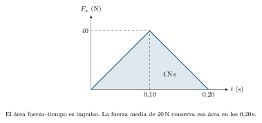
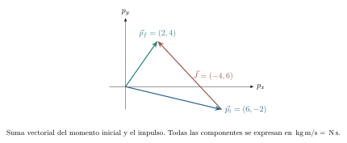
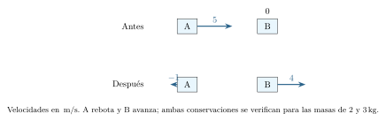
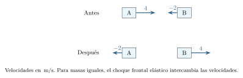
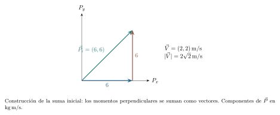
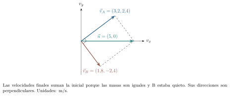
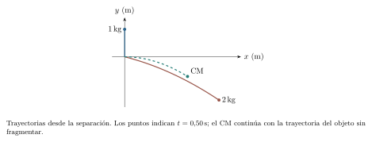

[← Capítulo anterior](capitulo-08.html) · [Índice del libro](index.html) · [Capítulo siguiente →](capitulo-10.html)

En una colisión breve, las fuerzas de contacto pueden cambiar mucho y resultar difíciles de medir instante a instante. Aun así, las velocidades anteriores y posteriores suelen guardar relaciones sencillas. Para descubrirlas conviene estudiar juntos los cuerpos que interactúan y seguir la cantidad de movimiento que intercambian.

El impulso enlaza las fuerzas con esos cambios. La energía cinética aporta otra información, pero su conservación exige condiciones adicionales: dos carros que quedan unidos pueden conservar su momento total y perder parte de su energía cinética. Al estudiar ambas magnitudes podremos distinguir qué conocemos de un choque, qué falta medir y cómo se mueve el conjunto aunque sus partes se separen.

## Cantidad de movimiento y energía cinética

Para una partícula de masa constante $m>0$ y velocidad $\vec v$ definimos su *cantidad de movimiento*, o *momento lineal*, por $\vec p=m\vec v$. La introdujimos al final del capítulo 6; su carácter vectorial será decisivo al sumar movimientos. En SI se mide en $\,\mathrm{kg\,m/s}$, equivalente a $\,\mathrm{N\,s}$. Su dirección coincide con la velocidad; cada componente puede tener signo positivo, negativo o ser cero.

La energía cinética $K=\tfrac12mv^2$ es escalar. Si una partícula invierte su velocidad conservando la rapidez, su momento cambia de signo mientras su energía cinética permanece igual. Para una masa dada, ambas magnitudes se relacionan por $K=|\vec p|^2/(2m)$; con igual energía cinética, el módulo del momento depende de la masa.

### Problema resuelto 9.1 · La misma energía con distintos momentos {#r9-1}

A, de $2\,\mathrm{kg}$, avanza a $3\,\mathrm{m/s}$ y B, de $8\,\mathrm{kg}$, a $1{,}5\,\mathrm{m/s}$, ambos hacia la derecha. Compara sus energías cinéticas y momentos. Considera además dos carros de $2\,\mathrm{kg}$ que avanzan a $+3$ y $-3\,\mathrm{m/s}$.

*Resolución.* Para A, $K_A=9\,\mathrm{J}$ y $p_A=6\,\mathrm{kg\,m/s}$; para B, $K_B=9\,\mathrm{J}$ y $p_B=12\,\mathrm{kg\,m/s}$. La masa mayor puede tener la misma energía a menor rapidez y, sin embargo, mayor momento. En el segundo sistema, los momentos son $+6$ y $-6\,\mathrm{kg\,m/s}$, cuya suma es cero; las energías se suman y dan $18\,\mathrm{J}$. Un sistema con momento total nulo puede contener movimiento relativo considerable.

{#fig-fp-av-r9-1 fig-alt="Ilustración de Problema resuelto 9.1 · La misma energía con distintos momentos. Resolución. Para A, KA=9\\,J y pA=6\\,kg\\,m/s; para B, KB=9\\,J y pB=12\\,kg\\,m/s. La masa mayor puede tener la misma energía a menor rapidez y, sin embargo, mayor momento. En el segundo sistema, los momentos son +6 y -6\\,kg\\,m/s, cuya suma es cero; las energías se suman y dan 18\\,J. Un sistema con momento total nulo"}

Para varios cuerpos, escribiremos $\vec P=\sum_i m_i\vec v_i$ y $K_{\mathrm{tot}}=\sum_i\tfrac12m_iv_i^2$. La suma de módulos $\sum_i|\vec p_i|$ y el módulo de la suma $|\vec P|$ expresan operaciones distintas. Mantendremos la misma referencia al comparar estados y, salvo indicación contraria, tomaremos el suelo como referencia inercial aproximada. Las velocidades iniciales se denotarán con $\vec u$ y las finales con $\vec v$.

## El impulso acumula la fuerza en el tiempo

La segunda ley para una partícula de masa constante es $d\vec p/dt=\vec F_{\mathrm{neta}}$. Integrarla durante el intervalo estudiado produce el teorema impulso--momento:
$$
 \vec J_{\mathrm{neto}}=\int_{t_i}^{t_f}\vec F_{\mathrm{neta}}(t)\,dt
 =\vec p_f-\vec p_i.
$$
El impulso es vectorial. Si la fuerza es constante, $\vec J=\vec F\Delta t$; para una fuerza variable podemos definir la fuerza media $\overline{\vec F}=\vec J/\Delta t$. Esa media conserva el impulso durante el intervalo; conocer el máximo y la evolución temporal de la fuerza requiere información adicional.

El trabajo acumula fuerza a lo largo del desplazamiento; el impulso la acumula en el tiempo. Una gráfica $F_x$--$t$ da la componente de impulso $J_x$ mediante su área orientada, en $\,\mathrm{N\,s}$. Una gráfica $F_x$--$x$ da el trabajo correspondiente, en $\,\mathrm{J}$. Los ejes identifican qué acumulación representa cada área.

### Problema resuelto 9.2 · Rebotar exige contar el cambio de sentido {#r9-2}

Una pelota de $0{,}20\,\mathrm{kg}$ llega a una pared con velocidad horizontal $+5\,\mathrm{m/s}$ y sale con $-3\,\mathrm{m/s}$. El contacto dura $0{,}040\,\mathrm{s}$ y las otras fuerzas horizontales son despreciables. Encuentra el impulso y la fuerza horizontal media de la pared.
*Resolución.* Con derecha positiva,
$$
 J_x=m(v_x-u_x)=0{,}20(-3-5)=-1{,}6\,\mathrm{N\,s}.
$$
La fuerza media es $-1{,}6/0{,}040=-40\,\mathrm{N}$, dirigida hacia la izquierda. Restar solo las rapideces perdería el cambio de sentido y subestimaría el impulso. El dato temporal permite hallar la media; una fuerza variable puede producir ese mismo impulso y alcanzar un máximo de módulo distinto de $40\,\mathrm{N}$.

{#fig-fp-av-r9-2 fig-alt="Ilustración de Problema resuelto 9.2 · Rebotar exige contar el cambio de sentido. Una pelota de 0,20\\,kg llega a una pared con velocidad horizontal +5\\,m/s y sale con -3\\,m/s. El contacto dura 0,040\\,s y las otras fuerzas horizontales son despreciables. Encuentra el impulso y la fuerza horizontal media de la pared. Resolución. Con derecha positiva, Jx=m(vx-ux)=0,20(-3-5)=-1,6\\,N\\,s. La fuerza media"}

### Problema resuelto 9.3 · Una fuerza triangular en el tiempo {#r9-3}

Sobre un carro de $0{,}50\,\mathrm{kg}$ actúa una fuerza neta horizontal que aumenta linealmente de cero a $40\,\mathrm{N}$ en $0{,}10\,\mathrm{s}$ y disminuye linealmente a cero en los siguientes $0{,}10\,\mathrm{s}$. La velocidad inicial es $-2\,\mathrm{m/s}$. Encuentra la final y la fuerza media.

*Resolución.* El área triangular es $J_x=\tfrac12(0{,}20)(40)=4\,\mathrm{N\,s}$. El momento inicial es $-1\,\mathrm{kg\,m/s}$ y el final $-1+4=3\,\mathrm{kg\,m/s}$, luego $v_x=3/0{,}50=+6\,\mathrm{m/s}$. La fuerza media vale $4/0{,}20=20\,\mathrm{N}$, la mitad del máximo. El impulso positivo primero reduce el módulo del momento negativo y después invierte su sentido. El cambio de energía cinética es $9-1=8\,\mathrm{J}$, una magnitud distinta del impulso calculado.

{#fig-fp-av-r9-3 fig-alt="Ilustración de Problema resuelto 9.3 · Una fuerza triangular en el tiempo. Resolución. El área triangular es Jx=tfrac12(0,20)(40)=4\\,N\\,s. El momento inicial es -1\\,kg\\,m/s y el final -1+4=3\\,kg\\,m/s, luego vx=3/0,50=+6\\,m/s. La fuerza media vale 4/0,20=20\\,N, la mitad del máximo. El impulso positivo primero reduce el módulo del momento negativo y después invierte su sentido. El cambio de"}

### Problema resuelto 9.4 · Un impulso con dos componentes {#r9-4}

Una partícula de $2\,\mathrm{kg}$ tiene velocidad inicial $(3,-1)\,\mathrm{m/s}$ y recibe impulso neto $(-4,6)\,\mathrm{N\,s}$. Encuentra su velocidad final y el cambio de energía cinética.

*Resolución.* El momento inicial es $(6,-2)\,\mathrm{kg\,m/s}$. Al sumar el impulso obtenemos $\vec p_f=(2,4)\,\mathrm{kg\,m/s}$ y $\vec v_f=(1,2)\,\mathrm{m/s}$. Las energías son $K_i=\tfrac12(2)(3^2+(-1)^2)=10\,\mathrm{J}$ y $K_f=\tfrac12(2)(1^2+2^2)=5\,\mathrm{J}$. Por tanto $\Delta K=-5\,\mathrm{J}$. Para masa constante, $K=|\vec p|^2/(2m)$: el módulo del momento disminuyó de $\sqrt{40}$ a $\sqrt{20}\,\mathrm{kg\,m/s}$, lo que explica la disminución de energía cinética. La dirección del impulso determina el cambio vectorial del momento.

{#fig-fp-av-r9-4 fig-alt="Ilustración de Problema resuelto 9.4 · Un impulso con dos componentes. Resolución. El momento inicial es (6,-2)\\,kg\\,m/s. Al sumar el impulso obtenemos vec pf=(2,4)\\,kg\\,m/s y vec vf=(1,2)\\,m/s. Las energías son Ki=tfrac12(2)(3^2+(-1)^2)=10\\,J y Kf=tfrac12(2)(1^2+2^2)=5\\,J. Por tanto Delta K=-5\\,J. Para masa constante, K=|vec p|^2/(2m): el módulo del momento disminuyó de sqrt40 a"}

## Elegir el sistema y comprobar el impulso externo

Consideremos un conjunto fijo de partículas con masas constantes. Sobre cada una actúan fuerzas externas y fuerzas que provienen de otras partículas del conjunto. Al sumar sus ecuaciones, cada par interno de acción y reacción se cancela según la tercera ley de Newton, en el modelo clásico empleado. Resulta
$$
 \frac{d\vec P}{dt}=\sum\vec F_{\mathrm{ext}},\qquad
 \vec P_f-\vec P_i=\vec J_{\mathrm{ext}}.
$$
Si la resultante externa es cero durante todo el proceso, el momento total permanece constante. Si solo sabemos que su impulso integrado es cero, conocemos la igualdad entre los momentos de los extremos; pudo variar en el intervalo. También puede conservarse una componente aunque otra no lo haga.

En un choque breve suele ser útil despreciar el impulso externo frente a los cambios de momento intercambiados entre los cuerpos. Para justificar la aproximación debemos estimar el impulso externo durante el choque; una pared o un soporte pueden ejercer una fuerza enorme incluso en un intervalo breve. Debemos justificar una cota del impulso omitido o identificar una dirección en la cual sea despreciable.

### Problema resuelto 9.5 · Cuánto error permite omitir una fuerza {#r9-5}

Dos carros de masa total $5\,\mathrm{kg}$ interactúan durante $0{,}020\,\mathrm{s}$ en una pista horizontal. El momento horizontal inicial del conjunto es $12\,\mathrm{kg\,m/s}$. Se sabe que la resultante horizontal externa tiene módulo no mayor que $2\,\mathrm{N}$. Estima la variación máxima de momento y el error en la velocidad del centro de masa al despreciarla.

*Resolución.* Incluso si la fuerza cambia de signo, la integral satisface $|J_{\mathrm{ext},x}|\leq\int|F_{\mathrm{ext},x}|dt\leq2(0{,}020)=0{,}040\,\mathrm{N\,s}$. Por tanto $P_{f,x}$ queda entre $11{,}96$ y $12{,}04\,\mathrm{kg\,m/s}$. La velocidad global definida por $V_x=P_x/M$, que justificaremos como velocidad del centro de masa, tiene error no mayor que $0{,}040/5=0{,}008\,\mathrm{m/s}$. Respecto del momento inicial no nulo, la cota es aproximadamente $0{,}33\%$. Con momento inicial cero debemos utilizar la cota absoluta para expresar el error.

{#fig-fp-av-r9-5 fig-alt="Ilustración de Problema resuelto 9.5 · Cuánto error permite omitir una fuerza. Resolución. Incluso si la fuerza cambia de signo, la integral satisface |Jext,x|leqint|Fext,x|dtleq2(0,020)=0,040\\,N\\,s. Por tanto Pf,x queda entre 11,96 y 12,04\\,kg\\,m/s. La velocidad global definida por Vx=Px/M, que justificaremos como velocidad del centro de masa, tiene error no mayor que 0,040/5=0,008\\,m/s."}

El sistema debe incluir los cuerpos cuyos impulsos mutuos queremos cancelar. Para la pelota del problema resuelto 9.2, la pared era externa y cambió su momento. Ampliar el sistema a pelota, pared y Tierra permite incluir la reacción, pero obliga a contabilizar también sus momentos. Los cambios de momento de un cuerpo individual y los del conjunto responden a preguntas diferentes.

Las fuerzas internas pueden realizar trabajo total no nulo porque sus puntos de aplicación no recorren necesariamente el mismo desplazamiento. El balance energético debe considerar el trabajo de las fuerzas internas, incluso cuando se cancelan en la ecuación del momento. Durante un choque pueden acumular energía elástica, deformar los cuerpos o aumentar su energía interna.

## Choques en los que los cuerpos quedan unidos

En una colisión *perfectamente inelástica*, los cuerpos quedan con una misma velocidad inmediatamente después del impacto. Si el impulso externo es despreciable, la conservación de momento en una dimensión da
$$
 m_1u_1+m_2u_2=(m_1+m_2)V,\qquad
 V=\frac{m_1u_1+m_2u_2}{m_1+m_2}.
$$
Los signos se asignan con un mismo eje. La velocidad común puede ser positiva, negativa o nula según el momento inicial. La igualdad de velocidades finales completa la ecuación de momento y permite determinar las dos velocidades.

La energía cinética del movimiento de los cuerpos, considerados como partículas, disminuye en este modelo pasivo salvo que ya llevaran la misma velocidad. Su diferencia se transforma en otras formas de energía, sin violar la conservación de la energía total. El término perfectamente inelástico describe la velocidad común de los cuerpos después del choque.

### Problema resuelto 9.6 · Un carro alcanza y se une a otro {#r9-6}

Un carro de $2\,\mathrm{kg}$ avanza a $6\,\mathrm{m/s}$ y choca con otro de $4\,\mathrm{kg}$ en reposo. Quedan unidos sobre pista lisa. Encuentra velocidad común y disminución de energía cinética.

*Resolución.* El sistema de ambos carros recibe impulso horizontal externo despreciable. Su momento inicial es $12\,\mathrm{kg\,m/s}$, de modo que $6V=12$ en SI y $V=2\,\mathrm{m/s}$ hacia la derecha. Inicialmente $K_i=\tfrac12(2)(6^2)=36\,\mathrm{J}$; finalmente $K_f=\tfrac12(6)(2^2)=12\,\mathrm{J}$. La disminución es $24\,\mathrm{J}$. Los carros siguen moviéndose y conservan $12\,\mathrm{J}$ de energía cinética; el resto pasó a deformaciones y formas internas bajo las hipótesis del choque.

{#fig-fp-av-r9-6 fig-alt="Ilustración de Problema resuelto 9.6 · Un carro alcanza y se une a otro. Resolución. El sistema de ambos carros recibe impulso horizontal externo despreciable. Su momento inicial es 12\\,kg\\,m/s, de modo que 6V=12 en SI y V=2\\,m/s hacia la derecha. Inicialmente Ki=tfrac12(2)(6^2)=36\\,J; finalmente Kf=tfrac12(6)(2^2)=12\\,J. La disminución es 24\\,J. Los carros siguen moviéndose y conservan"}

### Problema resuelto 9.7 · Un encuentro frontal con movimiento final conjunto {#r9-7}

A, de $3\,\mathrm{kg}$, avanza a $+4\,\mathrm{m/s}$; B, de $1\,\mathrm{kg}$, se acerca a $-2\,\mathrm{m/s}$. Chocan y quedan unidos, con impulso externo despreciable. Encuentra velocidad final y cambio cinético.

*Resolución.* El momento total es $3(4)+1(-2)=10\,\mathrm{kg\,m/s}$, positivo. La velocidad común es $V=10/4=2{,}5\,\mathrm{m/s}$. Las energías son $K_i=24+2=26\,\mathrm{J}$ y $K_f=\tfrac12(4)(2{,}5)^2=12{,}5\,\mathrm{J}$. Por tanto $\Delta K=-13{,}5\,\mathrm{J}$. Los cuerpos se acercaban en sentidos opuestos y su momento total era distinto de cero; el conjunto termina por ello en movimiento.

{#fig-fp-av-r9-7 fig-alt="Ilustración de Problema resuelto 9.7 · Un encuentro frontal con movimiento final conjunto. Resolución. El momento total es 3(4)+1(-2)=10\\,kg\\,m/s, positivo. La velocidad común es V=10/4=2,5\\,m/s. Las energías son Ki=24+2=26\\,J y Kf=tfrac12(4)(2,5)^2=12,5\\,J. Por tanto Delta K=-13,5\\,J. Los cuerpos se acercaban en sentidos opuestos y su momento total era distinto de cero; el conjunto termina por ello en"}

## Colisiones elásticas en una dimensión

Una colisión es *elástica* cuando la energía cinética total anterior y posterior es la misma. Si además el impulso externo es despreciable, contamos con las dos ecuaciones
$$
 m_1u_1+m_2u_2=m_1v_1+m_2v_2,\qquad
 m_1u_1^2+m_2u_2^2=m_1v_1^2+m_2v_2^2.
$$
El momento puede intercambiarse durante el contacto y parte de la energía cinética puede almacenarse temporalmente como deformación elástica. La igualdad de energías se refiere a los estados elegidos antes y después, una vez terminada esa interacción transitoria.

Para el caso de intercambio no trivial, la primera ecuación da $m_1(u_1-v_1)=m_2(v_2-u_2)$. Factorizando las diferencias de cuadrados en la segunda y dividiendo por esa cantidad no nula, obtenemos $u_1+v_1=u_2+v_2$. Equivalentemente,
$$
 v_2-v_1=u_1-u_2.
$$
La rapidez relativa de separación iguala la de acercamiento para una colisión frontal. Al resolver con el momento,
$$
\begin{aligned}
 v_1&=\frac{m_1-m_2}{m_1+m_2}u_1+\frac{2m_2}{m_1+m_2}u_2,\\
 v_2&=\frac{2m_1}{m_1+m_2}u_1+\frac{m_2-m_1}{m_1+m_2}u_2.
\end{aligned}
$$
La solución algebraica $v_1=u_1$, $v_2=u_2$ también satisface momento y energía: representa ausencia de intercambio. Para describir el choque efectivo se elige la rama que separa los cuerpos después del contacto. Esta elección física importa tanto como resolver las igualdades.

### Problema resuelto 9.8 · Una masa ligera rebota ante otra más pesada {#r9-8}

Un carro de $2\,\mathrm{kg}$ avanza a $5\,\mathrm{m/s}$ hacia otro de $3\,\mathrm{kg}$ en reposo. La colisión es frontal y elástica, con impulso externo despreciable. Encuentra las velocidades finales.

*Resolución.* Las ecuaciones son $10=2v_1+3v_2$ y $v_2-v_1=5$, en SI. De la segunda, $v_2=v_1+5$; al sustituir, $10=5v_1+15$. Luego $v_1=-1\,\mathrm{m/s}$ y $v_2=4\,\mathrm{m/s}$. El primer carro rebota. La comprobación energética da $K_i=25\,\mathrm{J}$ y $K_f=\tfrac12(2)(1)^2+\tfrac12(3)(4)^2=25\,\mathrm{J}$. El momento final es $-2+12=10\,\mathrm{kg\,m/s}$, igual al inicial.

{#fig-fp-av-r9-8 fig-alt="Ilustración de Problema resuelto 9.8 · Una masa ligera rebota ante otra más pesada. Resolución. Las ecuaciones son 10=2v1+3v2 y v2-v1=5, en SI. De la segunda, v2=v1+5; al sustituir, 10=5v1+15. Luego v1=-1\\,m/s y v2=4\\,m/s. El primer carro rebota. La comprobación energética da Ki=25\\,J y Kf=tfrac12(2)(1)^2+tfrac12(3)(4)^2=25\\,J. El momento final es -2+12=10\\,kg\\,m/s, igual al inicial."}

### Problema resuelto 9.9 · Masas iguales intercambian velocidades {#r9-9}

Dos carros de $1\,\mathrm{kg}$ se acercan con velocidades $+4$ y $-2\,\mathrm{m/s}$ y chocan elásticamente en una pista lisa. Determina sus velocidades finales.

*Resolución.* Para masas iguales, las expresiones anteriores se reducen a $v_1=u_2$ y $v_2=u_1$. Así, $v_1=-2\,\mathrm{m/s}$ y $v_2=+4\,\mathrm{m/s}$. Antes y después, $P_x=2\,\mathrm{kg\,m/s}$ y $K_{\mathrm{tot}}=10\,\mathrm{J}$. Con el carro A inicialmente a la izquierda, la velocidad de separación $v_2-v_1=6\,\mathrm{m/s}$ coincide con el acercamiento inicial $u_1-u_2=6\,\mathrm{m/s}$. El intercambio describe los valores de las velocidades finales de los cuerpos, cuyas identidades se conservan.

{#fig-fp-av-r9-9 fig-alt="Ilustración de Problema resuelto 9.9 · Masas iguales intercambian velocidades. Resolución. Para masas iguales, las expresiones anteriores se reducen a v1=u2 y v2=u1. Así, v1=-2\\,m/s y v2=+4\\,m/s. Antes y después, Px=2\\,kg\\,m/s y Ktot=10\\,J. Con el carro A inicialmente a la izquierda, la velocidad de separación v2-v1=6\\,m/s coincide con el acercamiento inicial u1-u2=6\\,m/s. El intercambio"}

## Qué información falta en un choque general

En una colisión unidimensional sin unión final ni elasticidad declarada, la conservación de momento deja una familia de pares $(v_1,v_2)$. Se necesita una medida o un modelo de la interacción. Para A inicialmente a la izquierda de B y acercándose con $u_1>u_2$, podemos definir el coeficiente de restitución normal
$$
 e=\frac{v_2-v_1}{u_1-u_2}.
$$
En el modelo frontal pasivo que usaremos, $0\leq e\leq1$. El valor $e=1$ representa la rama elástica y $e=0$ da igual velocidad inmediatamente después. Quedar permanentemente unidos requiere un mecanismo que mantenga la unión después del instante en que igualan sus velocidades. Valores $e>1$ pueden aparecer si se libera energía interna, pero quedan fuera de este modelo pasivo.

El coeficiente relaciona las velocidades normales de acercamiento y separación y depende de los materiales y del régimen del impacto. En una colisión oblicua debemos identificar la dirección del impulso de contacto y aplicar la relación a las componentes pertinentes. Para evitar ambigüedades, los casos de restitución de esta sección serán estrictamente unidimensionales.

### Problema resuelto 9.10 · Un choque parcialmente inelástico {#r9-10}

Dos carros de $2\,\mathrm{kg}$ están sobre pista lisa. A llega desde la izquierda a $4\,\mathrm{m/s}$ y B está en reposo. El coeficiente de restitución frontal es $e=0{,}5$. Encuentra velocidades, impulsos mutuos y disminución cinética.
*Resolución.* El momento exige $v_1+v_2=4$ en SI, y la restitución $v_2-v_1=0{,}5(4)=2$. Por tanto $v_1=1$ y $v_2=3\,\mathrm{m/s}$, ambos hacia la derecha.

A recibe $J_1=2(1-4)=-6\,\mathrm{N\,s}$ y B $J_2=2(3-0)=+6\,\mathrm{N\,s}$. Son opuestos. La energía pasa de $16\,\mathrm{J}$ a $1+9=10\,\mathrm{J}$ y disminuye $6\,\mathrm{J}$. Se conserva el momento y parte de la energía cinética se transforma durante el choque.

{#fig-fp-av-r9-10 fig-alt="Ilustración de Problema resuelto 9.10 · Un choque parcialmente inelástico. A recibe J1=2(1-4)=-6\\,N\\,s y B J2=2(3-0)=+6\\,N\\,s. Son opuestos. La energía pasa de 16\\,J a 1+9=10\\,J y disminuye 6\\,J. Se conserva el momento y parte de la energía cinética se transforma durante el choque."}

### Problema resuelto 9.11 · Un impulso externo durante la unión {#r9-11}

A, de $2\,\mathrm{kg}$, se mueve a $5\,\mathrm{m/s}$ hacia B, de $3\,\mathrm{kg}$, en reposo. Durante el proceso en que quedan unidos, un actuador externo comunica al conjunto un impulso horizontal de $-2\,\mathrm{N\,s}$. Encuentra la velocidad común y el cambio de energía cinética. ¿Se puede atribuir todo ese cambio a calentamiento por el choque?

*Resolución.* El momento inicial es $10\,\mathrm{kg\,m/s}$ y el final $10-2=8\,\mathrm{kg\,m/s}$. La velocidad común es $V=8/5=1{,}6\,\mathrm{m/s}$. Inicialmente $K_i=25\,\mathrm{J}$ y finalmente $K_f=\tfrac12(5)(1{,}6)^2=6{,}4\,\mathrm{J}$, de modo que $\Delta K=-18{,}6\,\mathrm{J}$. Conservar indebidamente el momento daría $2\,\mathrm{m/s}$.

El impulso externo permite calcular el momento final; para hallar el trabajo del actuador necesitamos su relación con el desplazamiento. El reparto de los $18{,}6\,\mathrm{J}$ requiere conocer ese trabajo y los cambios de energía interna del choque.

{#fig-fp-av-r9-11 fig-alt="Ilustración de Problema resuelto 9.11 · Un impulso externo durante la unión. El impulso externo permite calcular el momento final; para hallar el trabajo del actuador necesitamos su relación con el desplazamiento. El reparto de los 18,6\\,J requiere conocer ese trabajo y los cambios de energía interna del choque."}

## Separar etapas y reconocer la energía interna

Una experiencia puede contener un impacto breve seguido de un movimiento mucho más lento. Las condiciones de conservación deben examinarse en cada etapa. Durante el impacto puede ser despreciable el impulso externo horizontal y, a la vez, importante la transformación de energía cinética en energía interna. Después puede conservarse la energía mecánica mientras la gravedad cambia el momento del cuerpo.

### Problema resuelto 9.12 · Impacto y ascenso de un péndulo {#r9-12}

Una pequeña pieza de $0{,}020\,\mathrm{kg}$ llega horizontalmente a $100\,\mathrm{m/s}$ y queda incrustada en un bloque de $0{,}980\,\mathrm{kg}$ suspendido de una cuerda ideal. El conjunto se modela como una partícula, sin rotación interna. El impacto ocurre en el punto más bajo, dura muy poco y el impulso externo horizontal es despreciable. Encuentra la altura máxima posterior, sin aire ni pérdidas durante el ascenso.

*Resolución.* Durante el impacto se conserva el momento horizontal: $0{,}020(100)=1{,}000V$, de donde $V=2\,\mathrm{m/s}$. Durante la incrustación, la energía cinética pasó de $100\,\mathrm{J}$ a $2\,\mathrm{J}$.

Durante el ascenso, la tensión ideal es perpendicular a la trayectoria y realiza trabajo nulo. La energía cinética inmediatamente posterior al impacto se convierte en potencial: $\tfrac12(1)V^2=(1)gh$. Así $h=V^2/(2g)=0{,}20\,\mathrm{m}$. Conservar los $100\,\mathrm{J}$ iniciales de energía mecánica hasta la cima habría ignorado los $98\,\mathrm{J}$ transformados en el impacto. Durante el ascenso el momento del conjunto sí cambia por fuerzas externas, aunque su energía mecánica permanezca constante.

{#fig-fp-av-r9-12 fig-alt="Ilustración de Problema resuelto 9.12 · Impacto y ascenso de un péndulo. Durante el ascenso, la tensión ideal es perpendicular a la trayectoria y realiza trabajo nulo. La energía cinética inmediatamente posterior al impacto se convierte en potencial: tfrac12(1)V^2=(1)gh. Así h=V^2/(2g)=0,20\\,m. Conservar los 100\\,J iniciales de energía mecánica hasta la cima habría ignorado los 98\\,J"}

### Problema resuelto 9.13 · Un resorte interno separa dos carros {#r9-13}

Un dispositivo de masa total $6\,\mathrm{kg}$ está en reposo sobre pista lisa. Un resorte interno libera energía y sus dos partes, de $2$ y $4\,\mathrm{kg}$, se separan. La primera sale a $+6\,\mathrm{m/s}$. Determina la velocidad de la segunda y la energía cinética adquirida, suponiendo despreciables otras pérdidas y energía elástica remanente.

*Resolución.* El momento total inicial era cero y el impulso horizontal externo es despreciable. Por tanto $2(6)+4v_2=0$, luego $v_2=-3\,\mathrm{m/s}$. La energía cinética final es $\tfrac12(2)(6^2)+\tfrac12(4)(3^2)=54\,\mathrm{J}$. Esa energía procede de la reserva elástica inicial y queda incluida en el balance de energía total. La segunda parte recibe momento de módulo $12\,\mathrm{kg\,m/s}$, igual al de la primera y de sentido opuesto, pero solo $18\,\mathrm{J}$ de energía cinética frente a los $36\,\mathrm{J}$ de la más ligera.

{#fig-fp-av-r9-13 fig-alt="Ilustración de Problema resuelto 9.13 · Un resorte interno separa dos carros. Resolución. El momento total inicial era cero y el impulso horizontal externo es despreciable. Por tanto 2(6)+4v2=0, luego v2=-3\\,m/s. La energía cinética final es tfrac12(2)(6^2)+tfrac12(4)(3^2)=54\\,J. Esa energía procede de la reserva elástica inicial y queda incluida en el balance de energía total. La segunda parte"}

## Conservar momento por componentes

En dos dimensiones, $\vec P_f=\vec P_i$ representa dos ecuaciones escalares. Debemos conservar separadamente las componentes con un mismo juego de ejes. Si dos cuerpos quedan unidos, la velocidad final se obtiene como vector:
$$
 \vec V=\frac{m_1\vec u_1+m_2\vec u_2}{m_1+m_2}.
$$
Su dirección se obtiene sumando las componentes vectoriales. Para un choque sin unión, dos velocidades finales desconocidas aportan cuatro componentes; incluso añadiendo conservación de energía cinética puede faltar información, como una dirección de salida o la geometría del contacto.

### Problema resuelto 9.14 · Dos direcciones iniciales y una velocidad común {#r9-14}

A, de $2\,\mathrm{kg}$, llega con velocidad $(3,0)\,\mathrm{m/s}$ y B, de $1\,\mathrm{kg}$, con $(0,6)\,\mathrm{m/s}$ sobre una mesa horizontal lisa. Chocan y quedan unidos. Encuentra velocidad, rapidez final y disminución cinética.

*Resolución.* El momento inicial en el plano es $(6,6)\,\mathrm{kg\,m/s}$. La masa conjunta es $3\,\mathrm{kg}$ y $\vec V=(2,2)\,\mathrm{m/s}$. Su rapidez es $2\sqrt2\,\mathrm{m/s}$ y su dirección forma $45^\circ$ con $+x$. La energía inicial es $9+18=27\,\mathrm{J}$ y la final $\tfrac12(3)(2^2+2^2)=12\,\mathrm{J}$. La disminución es $15\,\mathrm{J}$. Sumar los módulos de los momentos habría producido $12\,\mathrm{kg\,m/s}$ en vez del vector correcto, cuyo módulo es $6\sqrt2\,\mathrm{kg\,m/s}$.

{#fig-fp-av-r9-14 fig-alt="Ilustración de Problema resuelto 9.14 · Dos direcciones iniciales y una velocidad común. Resolución. El momento inicial en el plano es (6,6)\\,kg\\,m/s. La masa conjunta es 3\\,kg y vec V=(2,2)\\,m/s. Su rapidez es 2sqrt2\\,m/s y su dirección forma 45^circ con +x. La energía inicial es 9+18=27\\,J y la final tfrac12(3)(2^2+2^2)=12\\,J. La disminución es 15\\,J. Sumar los módulos de los momentos habría producido"}

### Problema resuelto 9.15 · Reconstruir la otra salida de un choque elástico {#r9-15}

Dos discos de $1\,\mathrm{kg}$ interactúan sin rotación apreciable sobre una mesa lisa. A llega con $(5,0)\,\mathrm{m/s}$ y B está en reposo. Después A tiene $(3{,}2,2{,}4)\,\mathrm{m/s}$. Encuentra la velocidad de B y comprueba si los datos son compatibles con una colisión elástica.

*Resolución.* La conservación por componentes da $\vec v_B=(5,0)-(3{,}2,2{,}4)=(1{,}8,-2{,}4)\,\mathrm{m/s}$. Las rapideces finales son $4$ y $3\,\mathrm{m/s}$. La energía inicial es $12{,}5\,\mathrm{J}$ y la final $8+4{,}5=12{,}5\,\mathrm{J}$, compatible con elasticidad en el modelo declarado.

Además, $\vec v_A\cdot\vec v_B=3{,}2(1{,}8)+2{,}4(-2{,}4)=0$: las salidas son perpendiculares. Para masas iguales y una inicialmente quieta, $\vec u=\vec v_A+\vec v_B$; elevar su módulo al cuadrado y comparar con $u^2=v_A^2+v_B^2$ da $2\vec v_A\cdot\vec v_B=0$. Si ambas velocidades finales son no nulas, la perpendicularidad es una consecuencia general de esas hipótesis. Para masas distintas o discos que adquieren rotación debemos resolver los balances correspondientes a esas nuevas condiciones.

{#fig-fp-av-r9-15 fig-alt="Ilustración de Problema resuelto 9.15 · Reconstruir la otra salida de un choque elástico. Además, vec vAcdotvec vB=3,2(1,8)+2,4(-2,4)=0: las salidas son perpendiculares. Para masas iguales y una inicialmente quieta, vec u=vec vA+vec vB; elevar su módulo al cuadrado y comparar con u^2=vA^2+vB^2 da 2vec vAcdotvec vB=0. Si ambas velocidades finales son no nulas, la perpendicularidad es una consecuencia"}

## El centro de masa describe el movimiento del conjunto

Las interacciones internas pueden cambiar las velocidades individuales sin alterar el momento total. Podemos asociar a ese movimiento global un punto geométrico: el *centro de masa*. Para masas constantes $m_i$ y masa total $M=\sum_i m_i>0$, definimos
$$
 \vec R_{\mathrm{CM}}=\frac{\sum_i m_i\vec r_i}{M}.
$$
Es un promedio de posiciones ponderado por las masas. Se acerca a las partículas más pesadas y puede estar situado en una región vacía del cuerpo. Su posición depende de cómo se distribuye la masa; la forma geométrica solo basta cuando se conocen además densidad y simetrías.

Al derivar la definición, como las masas son constantes, obtenemos
$$
 \vec V_{\mathrm{CM}}=\frac{\vec P}{M},\qquad
 M\vec A_{\mathrm{CM}}=\sum\vec F_{\mathrm{ext}}.
$$
Esta relación justifica describir la traslación global como si la masa estuviese concentrada en ese punto para estudiar su aceleración. Las partes pueden moverse respecto del centro de masa y almacenar energía cinética en ese movimiento relativo y en la rotación.

### Problema resuelto 9.16 · Una posición ponderada y una velocidad global {#r9-16}

Dos partículas de masas $2$ y $3\,\mathrm{kg}$ están en $(0,0)$ y $(4,2)\,\mathrm{m}$. Sus velocidades son $(3,0)$ y $(-1,2)\,\mathrm{m/s}$. Encuentra posición y velocidad del centro de masa.
*Resolución.* La masa total es $5\,\mathrm{kg}$ y
$$
 \vec R_{\mathrm{CM}}=\frac{2(0,0)+3(4,2)}5\,\mathrm{m}
 =(2{,}4,1{,}2)\,\mathrm{m}.
$$
El momento es $2(3,0)+3(-1,2)=(3,6)\,\mathrm{kg\,m/s}$, de modo que $\vec V_{\mathrm{CM}}=(0{,}6,1{,}2)\,\mathrm{m/s}$. El centro de masa divide el segmento entre ambas posiciones y queda más cerca de la partícula de $3\,\mathrm{kg}$. El punto medio geométrico sería $(2,1)\,\mathrm{m}$, distinto.

{#fig-fp-av-r9-16 fig-alt="Ilustración de Problema resuelto 9.16 · Una posición ponderada y una velocidad global. Dos partículas de masas 2 y 3\\,kg están en (0,0) y (4,2)\\,m. Sus velocidades son (3,0) y (-1,2)\\,m/s. Encuentra posición y velocidad del centro de masa. Resolución. La masa total es 5\\,kg y vec RCM=frac2(0,0)+3(4,2)5\\,m =(2,4,1,2)\\,m. El momento es 2(3,0)+3(-1,2)=(3,6)\\,kg\\,m/s, de modo que vec VCM=(0,6,1,2)\\,m/s. El"}

En una dimensión, si la resultante externa es nula y el sistema parte con momento total cero, la posición del centro de masa permanece fija. Las partes pueden desplazarse unas respecto de otras, pero sus desplazamientos ponderados deben compensarse. Esto permite resolver situaciones a partir del balance externo, aun con información incompleta sobre las fuerzas internas o la duración de cada paso.

### Problema resuelto 9.17 · Caminar dentro de una barca libre {#r9-17}

Una persona de $60\,\mathrm{kg}$ está en una barca de $120\,\mathrm{kg}$ inicialmente quieta. Camina $3\,\mathrm{m}$ hacia la derecha respecto de la barca. Durante todo el recorrido, la resultante horizontal de las fuerzas externas sobre persona y barca es despreciable; la barca se mantiene horizontal. Encuentra el desplazamiento de cada uno respecto de la orilla.

*Resolución.* El centro de masa de persona y barca conserva su posición horizontal. Sea $b$ el desplazamiento de la barca respecto de la orilla. La persona se desplaza $b+3\,\mathrm{m}$ respecto de la orilla, por la suma de posiciones relativas. Entonces
$$
 60(b+3)+120b=0
$$
en SI, de donde $b=-1\,\mathrm{m}$. La persona avanza $2\,\mathrm{m}$ respecto de la orilla y $3\,\mathrm{m}$ respecto de la barca. La compensación es $60(2)+120(-1)=0\,\mathrm{kg\,m}$. La persona utiliza energía interna y puede cambiar su manera de caminar; la relación de desplazamientos se mantiene bajo las hipótesis dadas, con independencia del balance de energía mecánica.

{#fig-fp-av-r9-17 fig-alt="Ilustración de Problema resuelto 9.17 · Caminar dentro de una barca libre. Resolución. El centro de masa de persona y barca conserva su posición horizontal. Sea b el desplazamiento de la barca respecto de la orilla. La persona se desplaza b+3\\,m respecto de la orilla, por la suma de posiciones relativas. Entonces 60(b+3)+120b=0 en SI, de donde b=-1\\,m. La persona avanza 2\\,m respecto de la"}

### Problema resuelto 9.18 · El centro de masa después de una separación en vuelo {#r9-18}

Un objeto de $3\,\mathrm{kg}$ se separa en dos fragmentos en el punto más alto de su vuelo, donde su velocidad es $(4,0)\,\mathrm{m/s}$. Los fragmentos tienen $1$ y $2\,\mathrm{kg}$; el primero sale con $(0,6)\,\mathrm{m/s}$. El impulso externo durante la separación es despreciable. Después solo actúa gravedad uniforme y no hay impactos durante el siguiente medio segundo. Encuentra la velocidad inicial del segundo fragmento y la posición del centro de masa a los $0{,}50\,\mathrm{s}$ respecto del punto de separación.

*Resolución.* El momento inmediatamente anterior es $(12,0)\,\mathrm{kg\,m/s}$. Por conservación en la separación, $(0,6)+2\vec v_2=(12,0)$ en SI, luego $\vec v_2=(6,-3)\,\mathrm{m/s}$. Las velocidades individuales son distintas, pero $\vec V_{\mathrm{CM}}=(4,0)\,\mathrm{m/s}$ en ese instante.

Después la resultante externa es el peso total y $\vec A_{\mathrm{CM}}=(0,-g)$. Con origen en la separación,
$$
 \vec R_{\mathrm{CM}}(t)=\big((4\,\mathrm{m/s})t,-\tfrac12gt^2\big).
$$
A los $0{,}50\,\mathrm{s}$ está en $(2,-1{,}25)\,\mathrm{m}$. El centro de masa sigue la trayectoria que habría seguido el objeto sin separarse, mientras la gravedad sea uniforme y no aparezcan otras fuerzas. Durante ese medio segundo el impulso gravitatorio cambia el momento vertical del sistema.

{#fig-fp-av-r9-18 fig-alt="Ilustración de Problema resuelto 9.18 · El centro de masa después de una separación en vuelo. Después la resultante externa es el peso total y vec ACM=(0,-g). Con origen en la separación, vec RCM(t)=big((4\\,m/s)t,-tfrac12gt^2big). A los 0,50\\,s está en (2,-1,25)\\,m. El centro de masa sigue la trayectoria que habría seguido el objeto sin separarse, mientras la gravedad sea uniforme y no aparezcan otras fuerzas."}

La distinción entre traslación global y movimiento relativo también aclara la pérdida cinética en una unión. Escribamos $\vec v_i=\vec V_{\mathrm{CM}}+\vec w_i$. La suma $\sum_i m_i\vec w_i$ es cero; al expandir los cuadrados, los términos cruzados se anulan y queda
$$
 K_{\mathrm{tot}}=\tfrac12M V_{\mathrm{CM}}^2+
 \sum_i\tfrac12m_iw_i^2.
$$
Para masa y momento total fijados, la primera contribución está fijada y la segunda es no negativa. El mínimo cinético se alcanza cuando todas las partículas comparten la velocidad del centro de masa. Para dos partículas, la energía relativa es $\tfrac12\mu|\vec v_1-\vec v_2|^2$, donde $\mu=m_1m_2/(m_1+m_2)$ se llama masa reducida. Una unión sin impulso externo elimina ese movimiento relativo traslacional y transforma esa energía en otras formas. En el modelo frontal con restitución, la disminución es $\tfrac12\mu(1-e^2)(u_1-u_2)^2$.

Los resultados se refieren a un conjunto fijo de partículas. Un cohete que expulsa masa requiere contabilizar el momento que cruza la frontera si se elige solo el cohete como sistema. Describir ese proceso requiere incorporar el flujo de momento asociado a la masa que entra o sale.

### Registrar un choque y decidir qué se conserva

Graba dos carros ligeros sobre una pista horizontal estable, con cámara fija y una escala en el mismo plano. Estima velocidades inmediatamente antes y después del contacto usando varios fotogramas y conserva sus incertidumbres. Calcula por separado el momento horizontal total y la energía cinética traslacional. Repite con carros que se unan y, si dispones de topes elásticos, con un rebote.

Compara las diferencias con el error de medición. La resistencia de la pista aporta impulso externo; las ruedas almacenan además energía rotacional, que debe contabilizarse por separado de la suma traslacional. Los imanes o topes pueden guardar energía durante parte de la interacción. Esas contribuciones deben considerarse antes de atribuir una discrepancia a una ley física. Elige los instantes de comparación cuando el contacto transitorio ya haya terminado y evita impactos fuertes o masas suspendidas.

## Ejercicios para reconstruir y transferir

Usa $g=10\,\mathrm{m/s^2}$. Las velocidades se refieren al suelo inercial, salvo otra indicación. Desprecia rotación y modela los cuerpos como partículas; cuando se declare aislado un choque, entiende despreciable su impulso externo en la dirección estudiada.

### Ejercicio 9.1 · Igual energía y distinta masa {#e9-1}

A tiene $1\,\mathrm{kg}$ y velocidad $+4\,\mathrm{m/s}$; B tiene $4\,\mathrm{kg}$ y $+2\,\mathrm{m/s}$. Compara sus energías y momentos.

### Ejercicio 9.2 · Momento total nulo {#e9-2}

Dos partículas de $3\,\mathrm{kg}$ tienen velocidades $+2$ y $-2\,\mathrm{m/s}$. Encuentra momento y energía cinética totales y explica por qué los resultados son compatibles.

### Ejercicio 9.3 · Un rebote horizontal {#e9-3}

Una pelota de $0{,}10\,\mathrm{kg}$ llega a $+8\,\mathrm{m/s}$ y sale a $-4\,\mathrm{m/s}$ tras $0{,}020\,\mathrm{s}$. Encuentra impulso neto y fuerza horizontal media.

### Ejercicio 9.4 · Área fuerza--tiempo {#e9-4}

Una fuerza neta crece linealmente de cero a $30\,\mathrm{N}$ y vuelve a cero formando un triángulo de base $0{,}40\,\mathrm{s}$. Actúa sobre una masa de $2\,\mathrm{kg}$ inicialmente a $-1\,\mathrm{m/s}$. Encuentra impulso, fuerza media y velocidad final.

### Ejercicio 9.5 · Dos componentes {#e9-5}

Una masa de $3\,\mathrm{kg}$ tiene velocidad $(2,-1)\,\mathrm{m/s}$ y recibe impulso neto $(-3,9)\,\mathrm{N\,s}$. Halla velocidad final y cambio cinético.

### Ejercicio 9.6 · Cota del impulso omitido {#e9-6}

La resultante horizontal externa sobre un sistema de $4\,\mathrm{kg}$ tiene módulo no mayor que $3\,\mathrm{N}$ durante $0{,}010\,\mathrm{s}$. Acota el cambio de momento y de velocidad del centro de masa. ¿Sirve un error porcentual referido al momento inicial si este es cero?

### Ejercicio 9.7 · Unión tras alcanzar un carro {#e9-7}

Un carro de $1\,\mathrm{kg}$ llega a $6\,\mathrm{m/s}$ y se une a otro de $2\,\mathrm{kg}$ en reposo, en choque aislado horizontalmente. Halla velocidad final y pérdida cinética.

### Ejercicio 9.8 · Encuentro frontal y unión {#e9-8}

Dos masas de $2$ y $3\,\mathrm{kg}$ se acercan con $+5$ y $-1\,\mathrm{m/s}$ y quedan unidas. Encuentra velocidad común y disminución cinética, con impulso externo despreciable.

### Ejercicio 9.9 · Velocidad común cero {#e9-9}

Dos carros de $2\,\mathrm{kg}$ llegan uno contra otro a $+3$ y $-3\,\mathrm{m/s}$ y quedan unidos sobre pista lisa. Encuentra velocidad final y energía cinética transformada.

### Ejercicio 9.10 · Choque elástico frontal {#e9-10}

Un carro de $1\,\mathrm{kg}$ llega a $6\,\mathrm{m/s}$ hacia otro de $2\,\mathrm{kg}$ en reposo. Encuentra las velocidades posteriores a una colisión elástica aislada y verifica ambas conservaciones.

### Ejercicio 9.11 · Dos carros iguales {#e9-11}

Dos carros de $2\,\mathrm{kg}$ llevan velocidades $+3$ y $-1\,\mathrm{m/s}$. Colisionan frontalmente de manera elástica en pista lisa. Determina velocidades, momento y energía antes y después.

### Ejercicio 9.12 · Restitución parcial {#e9-12}

Dos masas de $1\,\mathrm{kg}$ tienen velocidades iniciales $+6$ y $0\,\mathrm{m/s}$, A inicialmente a la izquierda. El choque aislado tiene $e=0{,}5$. Halla velocidades finales, impulsos y pérdida cinética.

### Ejercicio 9.13 · Datos necesarios para determinar un choque {#e9-13}

Una masa de $1\,\mathrm{kg}$ llega a $4\,\mathrm{m/s}$ hacia otra igual en reposo. El choque tiene impulso externo despreciable, pero no se conoce su restitución ni se sabe si se unen. Da dos salidas compatibles con conservación de momento y explica qué dato falta.

### Ejercicio 9.14 · Impulso externo conocido {#e9-14}

Una masa de $2\,\mathrm{kg}$ a $4\,\mathrm{m/s}$ se une a otra de $2\,\mathrm{kg}$ en reposo. Durante el proceso el conjunto recibe impulso externo de $+4\,\mathrm{N\,s}$. Halla velocidad común y cambio cinético; explica si el impulso permite hallar el trabajo externo.

### Ejercicio 9.15 · Dos etapas de un péndulo {#e9-15}

Una pieza de $0{,}050\,\mathrm{kg}$ llega horizontalmente a $40\,\mathrm{m/s}$ y queda incrustada en un bloque suspendido de $0{,}950\,\mathrm{kg}$. En el punto más bajo, el impulso horizontal externo durante el choque es despreciable. Sin pérdidas durante el ascenso posterior, halla velocidad inmediata, altura máxima y disminución cinética del impacto. Usa el modelo de partícula.

### Ejercicio 9.16 · Separación desde el reposo {#e9-16}

Un sistema de $8\,\mathrm{kg}$ inicialmente quieto se separa sobre pista lisa en partes de $2$ y $6\,\mathrm{kg}$. La primera sale a $+9\,\mathrm{m/s}$. Encuentra la velocidad de la otra y la energía cinética total adquirida.

### Ejercicio 9.17 · Unión en un plano {#e9-17}

Dos masas de $1\,\mathrm{kg}$ llegan con velocidades $(4,0)$ y $(0,3)\,\mathrm{m/s}$ y quedan unidas sobre mesa lisa. Halla velocidad, rapidez final y pérdida cinética.

### Ejercicio 9.18 · Una salida conocida en dos dimensiones {#e9-18}

En un choque aislado de discos de $2\,\mathrm{kg}$, A llega con $(5,0)\,\mathrm{m/s}$ y B está quieto. Después A tiene $(3{,}2,2{,}4)\,\mathrm{m/s}$. Encuentra la velocidad de B y verifica si la energía cinética traslacional se conserva, sin rotación.

### Ejercicio 9.19 · Posición y velocidad del centro de masa {#e9-19}

Dos masas de $1$ y $3\,\mathrm{kg}$ están en $x=0$ y $4\,\mathrm{m}$ y tienen velocidades $+6$ y $-2\,\mathrm{m/s}$. Encuentra $x_{\mathrm{CM}}$, $V_{\mathrm{CM}}$ y energía cinética total.

### Ejercicio 9.20 · La resultante externa acelera al centro de masa {#e9-20}

Un sistema de masa total $5\,\mathrm{kg}$ tiene inicialmente momento $(5,-10)\,\mathrm{kg\,m/s}$. Recibe una fuerza externa neta constante $(10,5)\,\mathrm{N}$ durante $2\,\mathrm{s}$. Encuentra aceleración y velocidad final del centro de masa, y su desplazamiento en ese intervalo.

### Ejercicio 9.21 · Caminar sobre una plataforma libre {#e9-21}

Una persona de $40\,\mathrm{kg}$ sobre una plataforma de $80\,\mathrm{kg}$, ambas inicialmente quietas y sin fuerza horizontal externa, camina $1{,}5\,\mathrm{m}$ respecto de la plataforma. Halla los desplazamientos de ambas respecto del suelo.

### Ejercicio 9.22 · Separación en vuelo {#e9-22}

Un objeto de $4\,\mathrm{kg}$ se separa en partes de $1$ y $3\,\mathrm{kg}$ cuando su velocidad es $(3,0)\,\mathrm{m/s}$. La primera sale con $(0,6)\,\mathrm{m/s}$. Desprecia el impulso externo durante la separación; después solo actúa gravedad uniforme. Encuentra la otra velocidad inicial y el desplazamiento del centro de masa en $0{,}40\,\mathrm{s}$, antes de cualquier impacto.

### Ejercicio 9.23 · Energía relativa y unión {#e9-23}

Dos masas de $1$ y $3\,\mathrm{kg}$ llevan $+4$ y $0\,\mathrm{m/s}$. Calcula la velocidad del centro de masa y separa la energía cinética inicial en global y relativa. ¿Cuánta disminuye si quedan unidas sin impulso externo?

### Ejercicio 9.24 · Cambiar la referencia {#e9-24}

En el choque del ejercicio 9.7, considera otra referencia inercial que se mueve a $+1\,\mathrm{m/s}$ respecto del suelo. Calcula momentos y energías cinéticas totales antes y después. Comprueba si cambian la conservación de momento y la pérdida cinética.

## Soluciones completas de los ejercicios

### Solución 9.1 {#sol-e9-1}
Para A, $K_A=\tfrac12(1)(4^2)=8\,\mathrm{J}$ y $p_A=4\,\mathrm{kg\,m/s}$. Para B, $K_B=\tfrac12(4)(2^2)=8\,\mathrm{J}$ y $p_B=8\,\mathrm{kg\,m/s}$. Las energías coinciden, pero el momento de B tiene el doble de módulo. La relación $|p|=\sqrt{2mK}$ muestra la dependencia con la masa para energía fija.

### Solución 9.2 {#sol-e9-2}
Los momentos $+6$ y $-6\,\mathrm{kg\,m/s}$ se cancelan, de modo que $P_x=0$. Cada partícula tiene $6\,\mathrm{J}$ de energía cinética y la suma es $12\,\mathrm{J}$. La primera suma es vectorial; la segunda agrega escalares no negativos. Las partículas pueden moverse mientras su centro de masa permanece quieto bajo resultante externa nula.

### Solución 9.3 {#sol-e9-3}
El cambio de momento es $J_x=0{,}10(-4-8)=-1{,}2\,\mathrm{N\,s}$. La fuerza media es $-1{,}2/0{,}020=-60\,\mathrm{N}$. Ambos apuntan hacia la izquierda. Restar $8-4$ como si fueran componentes del mismo signo omitiría la inversión de movimiento.

### Solución 9.4 {#sol-e9-4}
El área triangular es $J_x=\tfrac12(0{,}40)(30)=6\,\mathrm{N\,s}$ y la media $6/0{,}40=15\,\mathrm{N}$. El momento inicial es $2(-1)=-2\,\mathrm{kg\,m/s}$ y el final $4\,\mathrm{kg\,m/s}$, por lo que $v_x=+2\,\mathrm{m/s}$. La fuerza máxima es $30\,\mathrm{N}$; la media se obtiene dividiendo el impulso por la duración.

### Solución 9.5 {#sol-e9-5}
El momento inicial es $(6,-3)\,\mathrm{kg\,m/s}$; al sumar el impulso queda $(3,6)\,\mathrm{kg\,m/s}$. Dividir por $3\,\mathrm{kg}$ da $\vec v=(1,2)\,\mathrm{m/s}$. Como $u^2=2^2+(-1)^2=5$ y $v^2=1^2+2^2=5$ en SI, ambas energías son $7{,}5\,\mathrm{J}$ y $\Delta K=0$. Un impulso no nulo puede cambiar la dirección sin cambiar la rapidez final.

### Solución 9.6 {#sol-e9-6}
La cota es $|\Delta P_x|\leq3(0{,}010)=0{,}030\,\mathrm{N\,s}$. Por ello $|\Delta V_{\mathrm{CM},x}|\leq0{,}030/4=0{,}0075\,\mathrm{m/s}$. Con momento inicial cero, dividir por ese valor no define un error porcentual. Se conserva la cota absoluta, que puede compararse con otra escala física pertinente.

### Solución 9.7 {#sol-e9-7}
El momento inicial es $6\,\mathrm{kg\,m/s}$ y la masa conjunta $3\,\mathrm{kg}$. Entonces $V=2\,\mathrm{m/s}$. Las energías son $K_i=18\,\mathrm{J}$ y $K_f=\tfrac12(3)(2^2)=6\,\mathrm{J}$, con disminución $12\,\mathrm{J}$. El momento se conserva horizontalmente y parte de la energía cinética se transforma.

### Solución 9.8 {#sol-e9-8}
Con un mismo eje, $P_i=2(5)+3(-1)=7\,\mathrm{kg\,m/s}$. La velocidad común es $V=7/5=1{,}4\,\mathrm{m/s}$. Inicialmente $K_i=25+1{,}5=26{,}5\,\mathrm{J}$ y finalmente $K_f=\tfrac12(5)(1{,}4)^2=4{,}9\,\mathrm{J}$. La disminución es $21{,}6\,\mathrm{J}$. Sumar los módulos de los momentos habría predicho otra velocidad y otro proceso.

### Solución 9.9 {#sol-e9-9}
El momento inicial se anula, de modo que la masa conjunta de $4\,\mathrm{kg}$ tiene $V=0$. Inicialmente había $\tfrac12(2)(3^2)+\tfrac12(2)(3^2)=18\,\mathrm{J}$ y finalmente cero. Los $18\,\mathrm{J}$ pasan a formas distintas de la energía cinética traslacional. Este reposo final depende de la compensación inicial de momentos.

### Solución 9.10 {#sol-e9-10}
Las ecuaciones son $6=v_1+2v_2$ y $v_2-v_1=6$, en SI. Sustituir $v_2=v_1+6$ da $v_1=-2\,\mathrm{m/s}$ y $v_2=4\,\mathrm{m/s}$. El momento final es $-2+8=6\,\mathrm{kg\,m/s}$; la energía inicial $18\,\mathrm{J}$ y la final $2+16=18\,\mathrm{J}$. La velocidad de separación positiva identifica la rama del choque, frente a la solución sin intercambio.

### Solución 9.11 {#sol-e9-11}
Las masas iguales intercambian velocidades: $v_1=-1\,\mathrm{m/s}$ y $v_2=+3\,\mathrm{m/s}$. Antes, $P_i=2(3)+2(-1)=4\,\mathrm{kg\,m/s}$ y $K_i=9+1=10\,\mathrm{J}$. Después los sumandos se intercambian y dan $P_f=4\,\mathrm{kg\,m/s}$ y $K_f=10\,\mathrm{J}$. Se conservan las dos magnitudes bajo las hipótesis declaradas.

### Solución 9.12 {#sol-e9-12}
La conservación da $v_1+v_2=6$ y la restitución $v_2-v_1=0{,}5(6)=3$, por lo que $v_1=1{,}5\,\mathrm{m/s}$ y $v_2=4{,}5\,\mathrm{m/s}$. Los impulsos son $J_1=1(1{,}5-6)=-4{,}5\,\mathrm{N\,s}$ y $J_2=+4{,}5\,\mathrm{N\,s}$. La energía pasa de $18\,\mathrm{J}$ a $\tfrac12(1)(1{,}5^2+4{,}5^2)=11{,}25\,\mathrm{J}$, con disminución $6{,}75\,\mathrm{J}$. Es consistente con $0<e<1$.

### Solución 9.13 {#sol-e9-13}
La ecuación disponible es $v_1+v_2=4$ en SI. La pareja $(2,2)\,\mathrm{m/s}$ corresponde a velocidad común, con energía final $4\,\mathrm{J}$. La pareja $(0,4)\,\mathrm{m/s}$ corresponde al choque elástico de masas iguales, con energía final $8\,\mathrm{J}$. Ambas conservan los $4\,\mathrm{kg\,m/s}$ iniciales y conducen a resultados distintos. Hace falta una condición adicional, como unión, restitución o una velocidad final medida.

### Solución 9.14 {#sol-e9-14}
El momento inicial es $8\,\mathrm{kg\,m/s}$ y el final $8+4=12\,\mathrm{kg\,m/s}$. La velocidad común es $V=12/4=3\,\mathrm{m/s}$. La energía inicial es $16\,\mathrm{J}$ y la final $\tfrac12(4)(3^2)=18\,\mathrm{J}$: aumenta $2\,\mathrm{J}$ aunque los cuerpos queden unidos. El actuador externo aporta momento y puede aportar energía; calcular su trabajo requiere conocer cómo actúa durante el desplazamiento. Con aportes externos, una velocidad final común puede acompañarse de un aumento de energía cinética.

### Solución 9.15 {#sol-e9-15}
En el choque, $0{,}050(40)=(1)V$, luego $V=2\,\mathrm{m/s}$. La energía cinética anterior era $40\,\mathrm{J}$ y la posterior $2\,\mathrm{J}$, por lo que disminuye $38\,\mathrm{J}$. En la etapa de ascenso se conserva la energía mecánica y $h=V^2/(2g)=0{,}20\,\mathrm{m}$. El balance de momento se aplica al choque; la conservación de energía mecánica, al ascenso posterior a la incrustación.

### Solución 9.16 {#sol-e9-16}
La conservación horizontal exige $2(9)+6v_2=0$, así que $v_2=-3\,\mathrm{m/s}$. La energía cinética final vale $\tfrac12(2)(9^2)+\tfrac12(6)(3^2)=81+27=108\,\mathrm{J}$. Proviene de energía interna liberada por el mecanismo. El momento total puede mantenerse en cero mientras aumenta la energía cinética de las partes.

### Solución 9.17 {#sol-e9-17}
El momento inicial es $(4,3)\,\mathrm{kg\,m/s}$ y la masa total $2\,\mathrm{kg}$. Así $\vec V=(2,1{,}5)\,\mathrm{m/s}$ y $|\vec V|=2{,}5\,\mathrm{m/s}$. La energía inicial es $8+4{,}5=12{,}5\,\mathrm{J}$ y la final $\tfrac12(2)(2{,}5)^2=6{,}25\,\mathrm{J}$. Disminuye $6{,}25\,\mathrm{J}$. La dirección final cumple $\tan\alpha=1{,}5/2$, de donde $\alpha\simeq36{,}9^\circ$.

### Solución 9.18 {#sol-e9-18}
Las masas se cancelan en cada componente: $\vec v_B=(5,0)-(3{,}2,2{,}4)=(1{,}8,-2{,}4)\,\mathrm{m/s}$. Las rapideces finales son $4$ y $3\,\mathrm{m/s}$. La energía inicial es $25\,\mathrm{J}$ y la final $\tfrac12(2)(4^2+3^2)=25\,\mathrm{J}$; los datos son compatibles con elasticidad traslacional. Además, el producto escalar de las dos salidas se anula, como corresponde a masas iguales, una quieta inicialmente y ambas velocidades finales no nulas.

### Solución 9.19 {#sol-e9-19}
La posición es $x_{\mathrm{CM}}=[1(0)+3(4)]/4=3\,\mathrm{m}$. El momento es $1(6)+3(-2)=0\,\mathrm{kg\,m/s}$, así que $V_{\mathrm{CM}}=0$. Sin embargo $K=\tfrac12(1)(6^2)+\tfrac12(3)(2^2)=24\,\mathrm{J}$. En esta referencia toda la energía cinética es relativa al centro de masa.

### Solución 9.20 {#sol-e9-20}
La aceleración global es $\vec A_{\mathrm{CM}}=(10,5)/5=(2,1)\,\mathrm{m/s^2}$. La velocidad inicial es $(5,-10)/5=(1,-2)\,\mathrm{m/s}$ y la final $(1,-2)+(2,1)(2)=(5,0)\,\mathrm{m/s}$. Como la resultante externa es constante, el desplazamiento del centro de masa es $\vec V_i\Delta t+\tfrac12\vec A\Delta t^2=(2,-4)+(4,2)=(6,-2)\,\mathrm{m}$. El impulso $(20,10)\,\mathrm{N\,s}$ lleva el momento a $(25,0)\,\mathrm{kg\,m/s}$, lo que confirma la velocidad final.

### Solución 9.21 {#sol-e9-21}
Si $b$ es el desplazamiento de la plataforma, la persona se desplaza $b+1{,}5\,\mathrm{m}$ respecto del suelo. El centro de masa permanece fijo y $40(b+1{,}5)+80b=0$ en SI. Resulta $b=-0{,}50\,\mathrm{m}$ y desplazamiento de la persona $+1{,}00\,\mathrm{m}$. La razón inversa de masas se refleja en $40(1)+80(-0{,}5)=0$.

### Solución 9.22 {#sol-e9-22}
El momento inicial es $(12,0)\,\mathrm{kg\,m/s}$. De $(0,6)+3\vec v_2=(12,0)$ resulta $\vec v_2=(4,-2)\,\mathrm{m/s}$. La velocidad inicial del centro de masa sigue siendo $(3,0)\,\mathrm{m/s}$ y después su aceleración es $(0,-10)\,\mathrm{m/s^2}$. En $0{,}40\,\mathrm{s}$ su desplazamiento es $(3(0{,}4),-5(0{,}4)^2)=(1{,}2,-0{,}8)\,\mathrm{m}$. Esto vale antes de cualquier impacto y bajo gravedad uniforme.

### Solución 9.23 {#sol-e9-23}
El momento total es $4\,\mathrm{kg\,m/s}$ y $M=4\,\mathrm{kg}$, luego $V_{\mathrm{CM}}=1\,\mathrm{m/s}$. La energía total inicial es $8\,\mathrm{J}$ y la global $\tfrac12(4)(1^2)=2\,\mathrm{J}$. Las velocidades relativas son $+3$ y $-1\,\mathrm{m/s}$, que aportan $\tfrac12(1)(3^2)+\tfrac12(3)(1^2)=6\,\mathrm{J}$. Si quedan unidas, esa parte relativa desaparece y la disminución cinética es $6\,\mathrm{J}$, mientras permanecen los $2\,\mathrm{J}$ globales.

### Solución 9.24 {#sol-e9-24}
En la nueva referencia las velocidades iniciales son $5$ y $-1\,\mathrm{m/s}$ y la común final $1\,\mathrm{m/s}$. El momento inicial es $1(5)+2(-1)=3\,\mathrm{kg\,m/s}$ y el final $3(1)=3\,\mathrm{kg\,m/s}$. La energía inicial es $\tfrac12(1)(5^2)+\tfrac12(2)(1^2)=13{,}5\,\mathrm{J}$ y la final $\tfrac12(3)(1^2)=1{,}5\,\mathrm{J}$. La disminución sigue siendo $12\,\mathrm{J}$. Los valores de momento y energía cambiaron, pero la conservación y la pérdida cinética coinciden. Para masa total fija y momento conservado, los términos añadidos por un cambio galileano se cancelan al tomar la diferencia de energías.

## Diagnóstico de salida

Un carro de $2\,\mathrm{kg}$ llega a $4\,\mathrm{m/s}$ y queda unido a otro de $2\,\mathrm{kg}$ en reposo sobre pista lisa. El choque dura $0{,}10\,\mathrm{s}$ y su impulso horizontal externo es despreciable. Encuentra velocidad común, impulso y fuerza media que recibe el primer carro, disminución de energía cinética y velocidad del centro de masa. Explica si la fuerza neta sobre cada carro tuvo que ser cero durante el contacto.

**Contraste después del intento.** El momento total es $8\,\mathrm{kg\,m/s}$ y $V=2\,\mathrm{m/s}$. El primer carro recibe $J_1=2(2-4)=-4\,\mathrm{N\,s}$ y fuerza media $-40\,\mathrm{N}$; el segundo recibe el impulso opuesto. La energía pasa de $16$ a $8\,\mathrm{J}$ y disminuye $8\,\mathrm{J}$. La velocidad del centro de masa es $2\,\mathrm{m/s}$ antes y después, y permanece constante si la resultante externa es despreciable durante todo el contacto. Los carros individuales sí reciben fuerzas netas que cambian sus momentos; la suma interna se cancela para el sistema. Para revisar esa distinción vuelve a la sección 9.3; para la pérdida cinética, a la sección 9.9.

## Lecturas de apoyo

H. D. Young y R. A. Freedman, *Física universitaria*, volumen 1, serie Sears--Zemansky, 12.ª edición, Pearson Educación, 2009: capítulo 8, momento lineal, impulso, choques y centro de masa.

R. A. Serway y C. Vuille, *Fundamentos de física*, volumen 1, 9.ª edición, Cengage Learning, 2012: capítulo 6, cantidad de movimiento y colisiones. Los datos, enunciados, soluciones y figuras del presente capítulo tienen formulación original.

---

[← Capítulo anterior](capitulo-08.html) · [Índice del libro](index.html) · [Capítulo siguiente →](capitulo-10.html)
