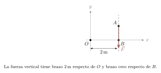
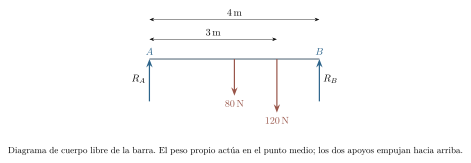
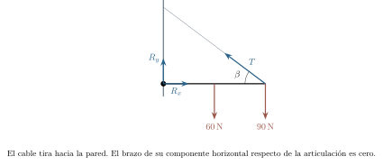
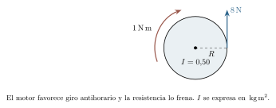
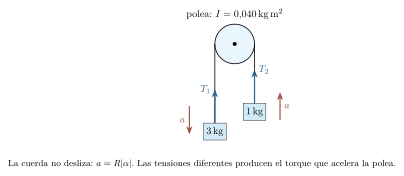

[← Capítulo anterior](capitulo-09.html) · [Índice del libro](index.html) · [Capítulo siguiente →](capitulo-11.html)

Una puerta puede permanecer cerrada bajo una fuerza considerable aplicada cerca de las bisagras y abrirse con un empuje menor cerca del borde. La fuerza y su dirección importan, pero también importa dónde actúa. Al representar todo el cuerpo mediante una partícula habíamos dejado fuera esa información.

Recuperarla nos permitirá estudiar una barra sostenida por apoyos, calcular el arranque de una rueda y comprender por qué una persona gira más deprisa al recoger los brazos. El centro de masa seguirá describiendo la traslación del conjunto; para su giro necesitaremos relacionar las fuerzas con la distribución de la masa y construir una nueva cantidad conservada.

## El torque depende de la línea de acción

Tomemos un punto $O$ y una fuerza $\vec F$ aplicada en una posición $\vec r$ medida desde él. Su *torque*, también llamado momento de una fuerza, respecto de $O$ se define por
$$
 \vec\tau_O=\vec r\times\vec F.
$$
El producto vectorial es perpendicular al plano de los dos vectores y su módulo es $rF\sin\phi$, donde $\phi$ es el ángulo entre ellos. La regla de la mano derecha fija el sentido: los dedos se curvan desde $\vec r$ hacia $\vec F$ por el ángulo menor y el pulgar indica el del torque. En un dibujo en el plano $xy$, tomaremos $+z$ hacia el lector; un torque positivo corresponde a la tendencia antihoraria.

Podemos obtener el módulo sin construir el producto vectorial. Si $d$ es la distancia perpendicular desde $O$ a la *línea de acción* de la fuerza, entonces $|\tau_O|=Fd$. Ese $d$ es el brazo de palanca. También podemos usar $rF_\perp$, con $F_\perp$ perpendicular a $\vec r$. La componente radial no aporta torque respecto de $O$.

En problemas planos resulta especialmente útil escribir
$$
 \tau_{O,z}=xF_y-yF_x.
$$
El signo contiene información que se perdería al sumar módulos. El torque se mide en $\,\mathrm{N\,m}$; aunque esta combinación tiene las dimensiones del joule, un torque y una energía representan magnitudes diferentes. El trabajo aparecerá al considerar además un desplazamiento angular.

### Problema resuelto 10.1 · La componente que hace girar la llave {#r10-1}

Una llave horizontal recibe una fuerza $\vec F=(30,40)\,\mathrm{N}$ en el punto $(0{,}40,0)\,\mathrm{m}$ respecto del tornillo. Encuentra el torque y el brazo de palanca.
*Resolución.* Con antihorario positivo,
$$
 \tau_z=0{,}40(40)-0(30)=16\,\mathrm{N\,m}.
$$
La fuerza tiene módulo $50\,\mathrm{N}$, por lo que $d=16/50=0{,}32\,\mathrm{m}$. La distancia al punto de aplicación es $0{,}40\,\mathrm{m}$; el brazo es menor porque la fuerza es oblicua. Los $30\,\mathrm{N}$ paralelos a la llave no producen torque sobre el tornillo.

{#fig-fp-av-r10-1 fig-alt="Ilustración de Problema resuelto 10.1 · La componente que hace girar la llave. Una llave horizontal recibe una fuerza vec F=(30,40)\\,N en el punto (0,40,0)\\,m respecto del tornillo. Encuentra el torque y el brazo de palanca. Resolución. Con antihorario positivo, tauz=0,40(40)-0(30)=16\\,N\\,m. La fuerza tiene módulo 50\\,N, por lo que d=16/50=0,32\\,m. La distancia al punto de aplicación es 0,40\\,m;"}

Un par de fuerzas puede mantener resultante nula y producir una tendencia al giro. Un *par de fuerzas* consiste en dos fuerzas opuestas, de igual módulo, cuyas líneas de acción son paralelas y distintas. La fuerza total es cero, pero sus torques se suman y dan un módulo $F\ell$, donde $\ell$ es la separación perpendicular entre las líneas.

### Problema resuelto 10.2 · Dos fuerzas que se cancelan y aun así hacen girar {#r10-2}

Sobre un cuerpo actúan $(20,0)\,\mathrm{N}$ en $(0,0{,}15)\,\mathrm{m}$ y $(-20,0)\,\mathrm{N}$ en $(0,-0{,}15)\,\mathrm{m}$. Calcula la resultante y el torque total respecto del origen.

*Resolución.* La suma de fuerzas es cero. Los torques son $-0{,}15(20)=-3\,\mathrm{N\,m}$ y $-(-0{,}15)(-20)=-3\,\mathrm{N\,m}$. El total es $-6\,\mathrm{N\,m}$, horario. También se obtiene $F\ell=20(0{,}30)=6\,\mathrm{N\,m}$ con ese sentido. El centro de masa puede tener aceleración cero mientras cambia el movimiento de rotación.

{#fig-fp-av-r10-2 fig-alt="Ilustración de Problema resuelto 10.2 · Dos fuerzas que se cancelan y aun así hacen girar. Resolución. La suma de fuerzas es cero. Los torques son -0,15(20)=-3\\,N\\,m y -(-0,15)(-20)=-3\\,N\\,m. El total es -6\\,N\\,m, horario. También se obtiene Fell=20(0,30)=6\\,N\\,m con ese sentido. El centro de masa puede tener aceleración cero mientras cambia el movimiento de rotación."}

Debemos mantener el mismo punto al sumar torques. Si $O'$ está en la posición $\vec a$ respecto de $O$, cada posición nueva es $\vec r_i-\vec a$. Por distributividad,
$$
 \sum\vec\tau_{O'}=\sum\vec\tau_O-\vec a\times\sum\vec F.
$$
Así se explica por qué el torque de un par es independiente del origen. También se explica por qué, al comprobar equilibrio con fuerza neta cero, basta imponer torque neto cero respecto de un punto: será cero respecto de todos.

### Problema resuelto 10.3 · Cambiar el punto de referencia cambia el torque {#r10-3}

Una fuerza $(0,-10)\,\mathrm{N}$ actúa en $A=(2,1)\,\mathrm{m}$. Calcula su torque respecto de $O=(0,0)$ y de $B=(2,0)\,\mathrm{m}$.

*Resolución.* Respecto de $O$, $\tau_{O,z}=2(-10)-1(0)=-20\,\mathrm{N\,m}$. Respecto de $B$, la posición relativa es $(0,1)\,\mathrm{m}$ y el torque es cero: la línea de acción pasa por $B$. La ecuación 10.3 da el mismo resultado, pues $(\vec a\times\vec F)_z=-20\,\mathrm{N\,m}$. La fuerza conserva su valor; cambió la pregunta acerca de su efecto alrededor de un punto.

{#fig-fp-av-r10-3 fig-alt="Ilustración de Problema resuelto 10.3 · Cambiar el punto de referencia cambia el torque. Resolución. Respecto de O, tauO,z=2(-10)-1(0)=-20\\,N\\,m. Respecto de B, la posición relativa es (0,1)\\,m y el torque es cero: la línea de acción pasa por B. La ecuación 10.3 da el mismo resultado, pues (vec atimesvec F)z=-20\\,N\\,m. La fuerza conserva su valor; cambió la pregunta acerca de su efecto alrededor de un"}

## Equilibrio de un cuerpo extenso

Un cuerpo rígido ideal conserva las distancias entre sus partículas. Si está inicialmente en reposo en una referencia inercial, las condiciones del *equilibrio estático* son
$$
 \sum\vec F_{\mathrm{ext}}=\vec0,\qquad
 \sum\vec\tau_{O,\mathrm{ext}}=\vec0.
$$
La primera impide la aceleración del centro de masa; la segunda impide que comience a girar. En un problema plano proporcionan tres ecuaciones escalares: $\sum F_x=0$, $\sum F_y=0$ y $\sum\tau_{O,z}=0$. Elegir el punto $O$ en un apoyo suele eliminar del balance de torque sus fuerzas desconocidas. Esas fuerzas siguen perteneciendo al diagrama de cuerpo libre y a las ecuaciones de traslación.

En un campo gravitatorio uniforme, la suma de los torques de los pesos es
$\sum_i\vec r_i\times m_i\vec g=\vec R_{\mathrm{CM}}\times M\vec g$. Para calcular el efecto exterior del peso podemos representarlo aplicado en el centro de masa. Bajo esa hipótesis coincide con el centro de gravedad. Una barra uniforme tiene su centro en el punto medio; una barra cuya masa se concentra hacia un extremo puede tenerlo en otro lugar.

Las ecuaciones deben acompañarse de las condiciones del contacto. Un cable ideal tira a lo largo de su dirección; un apoyo simple transmite una normal de compresión. Una articulación ideal permite el giro libre y puede ejercer dos componentes de fuerza en el plano. La fricción estática se determina con el equilibrio y después se compara con $\mu_sN$; la igualdad solo se impone en el umbral de deslizamiento.

### Problema resuelto 10.4 · Repartir una carga entre dos apoyos {#r10-4}

Una barra horizontal uniforme de $4\,\mathrm{m}$ pesa $80\,\mathrm{N}$. Descansa en apoyos simples en sus extremos A y B y sostiene una carga de $120\,\mathrm{N}$ a $3\,\mathrm{m}$ de A. Encuentra las reacciones verticales.

*Resolución.* El peso propio actúa a $2\,\mathrm{m}$ de A. Tomando torques respecto de A,
$$
 4R_B-80(2)-120(3)=0,
 \qquad R_B=130\,\mathrm{N}.
$$
La suma vertical exige $R_A+R_B=200\,\mathrm{N}$, luego $R_A=70\,\mathrm{N}$. Ambas reacciones son positivas y el contacto supuesto es posible. Como control independiente, respecto de B obtenemos $-4(70)+80(2)+120(1)=0$. La carga próxima a B explica que ese apoyo sostenga más peso.

{#fig-fp-av-r10-4 fig-alt="Ilustración de Problema resuelto 10.4 · Repartir una carga entre dos apoyos. Resolución. El peso propio actúa a 2\\,m de A. Tomando torques respecto de A, 4RB-80(2)-120(3)=0, qquad RB=130\\,N. La suma vertical exige RA+RB=200\\,N, luego RA=70\\,N. Ambas reacciones son positivas y el contacto supuesto es posible. Como control independiente, respecto de B obtenemos -4(70)+80(2)+120(1)=0. La carga"}

### Problema resuelto 10.5 · Un cable inclinado y una articulación {#r10-5}

Una barra horizontal uniforme de $3\,\mathrm{m}$, articulada a una pared por su extremo izquierdo, pesa $60\,\mathrm{N}$ y sostiene $90\,\mathrm{N}$ en el extremo derecho. Un cable desde ese extremo hacia la pared forma un ángulo $\beta$ con la horizontal, con $\sin\beta=3/5$ y $\cos\beta=4/5$. Encuentra su tensión y la reacción de la articulación.

*Resolución.* La componente vertical del cable es $T\sin\beta$. Su componente horizontal pasa por la articulación y no aporta torque sobre ella. Por tanto
$$
 3T\frac35-60(1{,}5)-90(3)=0,
 \qquad T=200\,\mathrm{N}.
$$
El cable tira hacia arriba con $120\,\mathrm{N}$ y hacia la izquierda con $160\,\mathrm{N}$. Las ecuaciones de fuerzas dan $R_x=160\,\mathrm{N}$ hacia la derecha y $R_y=60+90-120=30\,\mathrm{N}$ hacia arriba. El apoyo comparte la carga y la oblicuidad del cable determina la relación entre la tensión y su componente vertical.

{#fig-fp-av-r10-5 fig-alt="Ilustración de Problema resuelto 10.5 · Un cable inclinado y una articulación. Resolución. La componente vertical del cable es Tsinbeta. Su componente horizontal pasa por la articulación y no aporta torque sobre ella. Por tanto 3Tfrac35-60(1,5)-90(3)=0, qquad T=200\\,N. El cable tira hacia arriba con 120\\,N y hacia la izquierda con 160\\,N. Las ecuaciones de fuerzas dan Rx=160\\,N hacia la derecha"}

### Problema resuelto 10.6 · La fricción que necesita una escalera {#r10-6}

Una escalera uniforme de $5\,\mathrm{m}$ y peso $200\,\mathrm{N}$ apoya su pie en un suelo rugoso y su extremo superior en una pared lisa. La separación horizontal es $3\,\mathrm{m}$ y la altura $4\,\mathrm{m}$. Encuentra las fuerzas de contacto y el coeficiente estático mínimo para el equilibrio.

*Resolución.* Situemos el pie en $(0,0)$ y la parte superior en $(3,4)\,\mathrm{m}$. La pared empuja horizontalmente hacia la izquierda con fuerza $H$. El peso actúa en $(1{,}5,2)\,\mathrm{m}$. El balance de torque sobre el pie da $4H-200(1{,}5)=0$, luego $H=75\,\mathrm{N}$. El suelo debe ejercer fricción de $75\,\mathrm{N}$ hacia la derecha y normal de $200\,\mathrm{N}$ hacia arriba. El contacto permite ese equilibrio si
$$
 75\leq\mu_s(200),\qquad \mu_s\geq0{,}375.
$$
Con un coeficiente mayor, la fricción sigue siendo $75\,\mathrm{N}$; solo aumenta su límite disponible. No hay fricción en la pared según el enunciado.

{#fig-fp-av-r10-6 fig-alt="Ilustración de Problema resuelto 10.6 · La fricción que necesita una escalera. Resolución. Situemos el pie en (0,0) y la parte superior en (3,4)\\,m. La pared empuja horizontalmente hacia la izquierda con fuerza H. El peso actúa en (1,5,2)\\,m. El balance de torque sobre el pie da 4H-200(1,5)=0, luego H=75\\,N. El suelo debe ejercer fricción de 75\\,N hacia la derecha y normal de 200\\,N hacia"}

Para estudiar la estabilidad debemos examinar la respuesta del cuerpo a un pequeño desplazamiento respecto del equilibrio. Al desplazar ligeramente un cuerpo, el torque puede devolverlo a su posición, alejarlo de ella o dejarlo en una nueva posición de equilibrio. Bajo gravedad, un mínimo local de energía potencial es una señal de estabilidad. Un bloque sobre una base finita puede volcar cuando la línea de acción de la reacción requerida alcanza el borde. Antes de ese umbral, la distribución de presión desplaza su resultante dentro de la base; superarlo exige revisar la configuración de contacto.

## Describir el giro con una sola coordenada

En una rotación alrededor de un eje fijo, cada punto del cuerpo describe un círculo cuyo radio es su distancia perpendicular al eje. Todos comparten el mismo desplazamiento angular $\Delta\theta$. Elegido un sentido positivo de giro, el arco orientado cumple $\Delta s=r\Delta\theta$, con $\theta$ en radianes. La longitud recorrida acumula la rapidez: $\ell=r\int_{t_i}^{t_f}|\omega(t)|\,dt$. En un tramo de un solo sentido resulta $\ell=r|\Delta\theta|$; los cambios de sentido exigen sumar las longitudes de los tramos, como en r10-8. Una revolución equivale a $2\pi\,\mathrm{rad}$.

Elegimos un sentido positivo y seguimos el ángulo acumulado, sin reducirlo necesariamente al intervalo de una vuelta. Definimos
$$
 \omega=\frac{d\theta}{dt},\qquad
 \alpha=\frac{d\omega}{dt}.
$$
La velocidad angular $\omega$ tiene signo; su módulo es la rapidez angular. En SI usamos $\,\mathrm{rad/s}$ y $\,\mathrm{rad/s^2}$. El radián es una razón de longitudes y es adimensional; conservar su nombre ayuda a reconocer el significado de una tasa.

Si $\alpha$ es constante, integrar estas definiciones produce
$$
 \omega=\omega_0+\alpha t,\qquad
 \Delta\theta=\omega_0t+\tfrac12\alpha t^2,
 \qquad \omega^2=\omega_0^2+2\alpha\Delta\theta.
$$
La última igualdad pierde información del signo al elevar al cuadrado; el movimiento y sus intervalos deben decidirlo. En un punto a distancia $r$ del eje, la rapidez es $v=r|\omega|$, la aceleración tangencial tiene componente $a_t=r\alpha$ en el sentido positivo de giro y la aceleración normal, hacia el eje, tiene módulo $a_n=r\omega^2$. Las dos aceleraciones son perpendiculares. Incluso con $\alpha=0$ puede haber aceleración normal.

### Problema resuelto 10.7 · Arranque con aceleración angular constante {#r10-7}

Una rueda tiene $\omega_0=2\,\mathrm{rad/s}$ y $\alpha=3\,\mathrm{rad/s^2}$ durante $4\,\mathrm{s}$. Calcula el ángulo barrido, la velocidad angular final y las magnitudes cinemáticas de un punto a $0{,}20\,\mathrm{m}$ del eje al final.

*Resolución.* Las ecuaciones 10.6 dan $\omega=2+3(4)=14\,\mathrm{rad/s}$ y $\Delta\theta=2(4)+\tfrac12(3)(4^2)=32\,\mathrm{rad}$, unas $5{,}09$ vueltas. El punto tiene rapidez $0{,}20(14)=2{,}8\,\mathrm{m/s}$, aceleración tangencial $0{,}20(3)=0{,}60\,\mathrm{m/s^2}$ y aceleración normal $0{,}20(14^2)=39{,}2\,\mathrm{m/s^2}$. Esta última cambia la dirección de su velocidad, aunque su valor sea mucho mayor que la aceleración que cambia la rapidez.

{#fig-fp-av-r10-7 fig-alt="Ilustración de Problema resuelto 10.7 · Arranque con aceleración angular constante. Resolución. Las ecuaciones 10.6 dan omega=2+3(4)=14\\,rad/s y Deltatheta=2(4)+tfrac12(3)(4^2)=32\\,rad, unas 5,09 vueltas. El punto tiene rapidez 0,20(14)=2,8\\,m/s, aceleración tangencial 0,20(3)=0,60\\,m/s^2 y aceleración normal 0,20(14^2)=39,2\\,m/s^2. Esta última cambia la dirección de su velocidad, aunque su valor sea"}

### Problema resuelto 10.8 · Un giro que primero retrocede {#r10-8}

La posición de una rueda es $\theta(t)=(2\,\mathrm{rad/s^3})t^3-(3\,\mathrm{rad/s^2})t^2$ entre $t=0$ y $t=2\,\mathrm{s}$. Encuentra $\omega$ y $\alpha$ al final, el desplazamiento angular y el ángulo total recorrido.

*Resolución.* Al derivar obtenemos $\omega=(6\,\mathrm{rad/s^3})t^2-(6\,\mathrm{rad/s^2})t$ y $\alpha=(12\,\mathrm{rad/s^3})t-6\,\mathrm{rad/s^2}$. En $2\,\mathrm{s}$ valen $12\,\mathrm{rad/s}$ y $18\,\mathrm{rad/s^2}$. La velocidad es negativa entre $0$ y $1\,\mathrm{s}$ y positiva después. Las posiciones son $\theta(0)=0$, $\theta(1\,\mathrm{s})=-1\,\mathrm{rad}$ y $\theta(2\,\mathrm{s})=4\,\mathrm{rad}$. El desplazamiento es $4\,\mathrm{rad}$, mientras el recorrido suma $1+5=6\,\mathrm{rad}$. La aceleración varía con el tiempo y debemos incorporar esa dependencia al calcular el movimiento.

{#fig-fp-av-r10-8 fig-alt="Ilustración de Problema resuelto 10.8 · Un giro que primero retrocede. Resolución. Al derivar obtenemos omega=(6\\,rad/s^3)t^2-(6\\,rad/s^2)t y alpha=(12\\,rad/s^3)t-6\\,rad/s^2. En 2\\,s valen 12\\,rad/s y 18\\,rad/s^2. La velocidad es negativa entre 0 y 1\\,s y positiva después. Las posiciones son theta(0)=0, theta(1\\,s)=-1\\,rad y theta(2\\,s)=4\\,rad. El desplazamiento es 4\\,rad, mientras el"}

## La distribución de masa y el momento de inercia

Una rueda rígida obliga a sus partículas a compartir $\omega$, pero cada una tiene rapidez $r_i|\omega|$. La energía cinética total alrededor de un eje fijo es entonces
$$
 K=\sum_i\tfrac12m_i r_i^2\omega^2
   =\tfrac12I\omega^2,\qquad I=\sum_i m_i r_i^2.
$$
La cantidad $I$ es el *momento de inercia respecto de ese eje*. Se mide en $\,\mathrm{kg\,m^2}$. En una distribución continua reemplazamos la suma por $I=\int r_\perp^2\,dm$. Alejar una masa al doble de distancia cuadruplica su contribución; predecir la respuesta al torque requiere conocer su distribución respecto del eje.

### Problema resuelto 10.9 · La misma masa a distintas distancias {#r10-9}

Dos masas puntuales de $1\,\mathrm{kg}$ se unen por una varilla sin masa y giran alrededor de un eje perpendicular por su punto medio. Compara las configuraciones con cada masa a $0{,}30\,\mathrm{m}$ y a $0{,}60\,\mathrm{m}$ del eje, a rapidez angular $10\,\mathrm{rad/s}$.
*Resolución.* Los momentos son $I_1=2(1)(0{,}30^2)=0{,}18\,\mathrm{kg\,m^2}$ e $I_2=2(1)(0{,}60^2)=0{,}72\,\mathrm{kg\,m^2}$. Las energías a la misma rapidez son $9\,\mathrm{J}$ y $36\,\mathrm{J}$. Con la misma masa total, la nueva distribución cuadruplicó tanto $I$ como la energía necesaria para ese giro. La comparación se refiere a dos estados con igual $\omega$; mantener ese valor durante el traslado de las masas requeriría un balance dinámico propio.

{#fig-fp-av-r10-9 fig-alt="Ilustración de Problema resuelto 10.9 · La misma masa a distintas distancias. Dos masas puntuales de 1\\,kg se unen por una varilla sin masa y giran alrededor de un eje perpendicular por su punto medio. Compara las configuraciones con cada masa a 0,30\\,m y a 0,60\\,m del eje, a rapidez angular 10\\,rad/s. Resolución. Los momentos son I1=2(1)(0,30^2)=0,18\\,kg\\,m^2 e I2=2(1)(0,60^2)=0,72\\,kg\\,m^2."}

Para un aro delgado de radio $R$, todo $dm$ está a distancia $R$ y $I=MR^2$ en su eje central perpendicular. Para un disco uniforme de radio $R$, dividimos en anillos. Con densidad superficial $\sigma=M/(\pi R^2)$,
$$
 I=\int_0^R r^2(2\pi\sigma r\,dr)
 =\frac{\pi\sigma R^4}{2}=\frac12MR^2.
$$
El eje central de simetría es esencial en ambas expresiones. Un disco y un aro con igual $M$ y $R$ tienen distintos momentos porque una parte de la masa del disco está más cerca del eje.

Podemos trasladar un eje sin rehacer toda la integral. Si un eje es paralelo a otro que pasa por el centro de masa, y están separados por $d$, se cumple el *teorema de ejes paralelos*:
$$
 I=I_{\mathrm{CM}}+Md^2.
$$
Para verlo, elijamos coordenadas perpendiculares con el nuevo eje desplazado $d$ en $x$. Al expandir $\sum m_i[(x_i-d)^2+y_i^2]$, aparece $I_{\mathrm{CM}}+Md^2-2d\sum m_ix_i$. La última suma es cero porque el origen estaba en el centro de masa. Para relacionar dos ejes paralelos arbitrarios debemos referir ambos al eje paralelo que pasa por el centro de masa.

### Problema resuelto 10.10 · Una barra que gira por el centro o por un extremo {#r10-10}

Una barra delgada uniforme de masa $3\,\mathrm{kg}$ y longitud $2\,\mathrm{m}$ gira alrededor de un eje perpendicular a ella. Encuentra su momento por el centro y por un extremo, y compara las energías a $3\,\mathrm{rad/s}$.

*Resolución.* Con $x$ medido desde el centro y $dm=(M/L)\,dx$,
$$
 I_{\mathrm{CM}}=\frac ML\int_{-L/2}^{L/2}x^2\,dx
 =\frac{ML^2}{12}=1\,\mathrm{kg\,m^2}.
$$
El eje del extremo es paralelo y dista $L/2=1\,\mathrm{m}$. Así, $I_{\mathrm{ext}}=1+3(1)^2=4\,\mathrm{kg\,m^2}=ML^2/3$. Las energías son $\tfrac12(1)(3^2)=4{,}5\,\mathrm{J}$ y $\tfrac12(4)(3^2)=18\,\mathrm{J}$. La segunda es mayor porque cambiaron las distancias de las partículas al eje, aunque la barra sea la misma.

{#fig-fp-av-r10-10 fig-alt="Ilustración de Problema resuelto 10.10 · Una barra que gira por el centro o por un extremo. Resolución. Con x medido desde el centro y dm=(M/L)\\,dx, ICM=frac MLint-L/2^L/2x^2\\,dx =fracML^212=1\\,kg\\,m^2. El eje del extremo es paralelo y dista L/2=1\\,m. Así, Iext=1+3(1)^2=4\\,kg\\,m^2=ML^2/3. Las energías son tfrac12(1)(3^2)=4,5\\,J y tfrac12(4)(3^2)=18\\,J. La segunda es mayor porque cambiaron las distancias de"}

## Del torque a la aceleración angular

Para una partícula que gira a distancia fija $r_i$ de un eje fijo $z$, la fuerza tangencial neta es $m_i r_i\alpha$. Su torque axial es $m_i r_i^2\alpha$. Al sumar sobre el cuerpo, los torques de las fuerzas internas centrales se cancelan por pares y queda
$$
 \sum\tau_{\mathrm{ext},z}=I_z\alpha.
$$
Estamos usando un cuerpo rígido de masa y distribución constantes alrededor de un eje fijo en una referencia inercial. Es una igualdad para la *componente axial*; una reacción en el eje puede ser necesaria para mantenerlo fijo, aunque no produzca torque axial. La relación vectorial $\vec\tau=I\vec\alpha$ con un solo escalar $I$ requiere condiciones particulares; la rotación tridimensional general utiliza una descripción más completa de la distribución de masa. Más adelante formularemos la ley general mediante el momento angular.

El signo de $\alpha$ indica cómo cambia $\omega$. Un torque negativo frena un giro positivo, pero acelera un giro negativo. Si el rozamiento se opone al movimiento, su sentido debe reconsiderarse al detenerse el cuerpo para describir correctamente la evolución posterior.

### Problema resuelto 10.11 · Un disco con torque motor y resistencia {#r10-11}

Un disco uniforme de $4\,\mathrm{kg}$ y radio $0{,}50\,\mathrm{m}$ gira sobre su eje central fijo. Una fuerza tangencial de $8\,\mathrm{N}$ inicia un giro positivo desde el reposo. Durante ese giro actúa un torque resistente constante de $1\,\mathrm{N\,m}$. Encuentra el estado a los $3\,\mathrm{s}$.

*Resolución.* El momento de inercia es $I=\tfrac12(4)(0{,}50^2)=0{,}50\,\mathrm{kg\,m^2}$. El torque motor es $8(0{,}50)=4\,\mathrm{N\,m}$ y el neto $4-1=3\,\mathrm{N\,m}$. Luego $\alpha=3/0{,}50=6\,\mathrm{rad/s^2}$, $\omega=18\,\mathrm{rad/s}$ y $\Delta\theta=\tfrac12(6)(3^2)=27\,\mathrm{rad}$. Su energía es $\tfrac12(0{,}50)(18^2)=81\,\mathrm{J}$. El balance de trabajo, $4(27)-1(27)=81\,\mathrm{J}$, comprueba el resultado y distingue los $108\,\mathrm{J}$ suministrados por el motor de los $27\,\mathrm{J}$ disipados.

{#fig-fp-av-r10-11 fig-alt="Ilustración de Problema resuelto 10.11 · Un disco con torque motor y resistencia. Resolución. El momento de inercia es I=tfrac12(4)(0,50^2)=0,50\\,kg\\,m^2. El torque motor es 8(0,50)=4\\,N\\,m y el neto 4-1=3\\,N\\,m. Luego alpha=3/0,50=6\\,rad/s^2, omega=18\\,rad/s y Deltatheta=tfrac12(6)(3^2)=27\\,rad. Su energía es tfrac12(0,50)(18^2)=81\\,J. El balance de trabajo, 4(27)-1(27)=81\\,J, comprueba el"}

Una polea con momento de inercia puede exigir tensiones diferentes a sus dos lados. Suponer una cuerda ligera asegura tensión uniforme en un tramo libre; las tensiones a ambos lados de una polea masiva deben satisfacer también su balance de torque. En el contacto sin deslizamiento, la fuerza tangencial distribuida entre cuerda y polea permite esa diferencia.

### Problema resuelto 10.12 · Una polea que también debe acelerarse {#r10-12}

Masas de $3\,\mathrm{kg}$ y $1\,\mathrm{kg}$ cuelgan de una cuerda ligera e inextensible que pasa por una polea disco de masa $2\,\mathrm{kg}$ y radio $0{,}20\,\mathrm{m}$. El eje es fijo y sin rozamiento, y la cuerda no desliza. Usa $g=10\,\mathrm{m/s^2}$. Encuentra la aceleración y las tensiones.

*Resolución.* La masa mayor baja con aceleración $a>0$. Sus ecuaciones y la de la polea son
$$
 30-T_1=3a,\qquad T_2-10=a,\qquad
 (T_1-T_2)R=I\alpha.
$$
Aquí $I=\tfrac12(2)(0{,}20^2)=0{,}040\,\mathrm{kg\,m^2}$ y la condición de no deslizamiento da $\alpha=a/R$. Al sumar las ecuaciones de las masas y eliminar la diferencia de tensiones,
$$
 a=\frac{(3-1)10}{3+1+I/R^2}=4\,\mathrm{m/s^2}.
$$
Por tanto $T_1=18\,\mathrm{N}$, $T_2=14\,\mathrm{N}$ y $\alpha=20\,\mathrm{rad/s^2}$. La diferencia $4\,\mathrm{N}$ produce $0{,}80\,\mathrm{N\,m}$, igual a $I\alpha$. La polea almacena energía cinética: ignorar su inercia habría predicho una aceleración mayor.

{#fig-fp-av-r10-12 fig-alt="Ilustración de Problema resuelto 10.12 · Una polea que también debe acelerarse. Resolución. La masa mayor baja con aceleración a>0. Sus ecuaciones y la de la polea son 30-T1=3a,qquad T2-10=a,qquad (T1-T2)R=Ialpha. Aquí I=tfrac12(2)(0,20^2)=0,040\\,kg\\,m^2 y la condición de no deslizamiento da alpha=a/R. Al sumar las ecuaciones de las masas y eliminar la diferencia de tensiones,"}

## Trabajo y potencia de un torque

Cuando el cuerpo gira un ángulo infinitesimal $d\theta$ sobre un eje fijo, la fuerza tangencial realiza trabajo $dW=F_t r\,d\theta=\tau_z\,d\theta$. Las componentes radiales realizan trabajo nulo en esa rotación porque son perpendiculares al desplazamiento. Al sumar fuerzas externas e integrar,
$$
 W_{\mathrm{ext}}=\int_{\theta_i}^{\theta_f}\tau_{\mathrm{ext},z}\,d\theta
 =\Delta\!\left(\tfrac12I\omega^2\right),\qquad
 \mathcal P=\tau_z\omega.
$$
La expresión integral en función de $\theta$ supone que podemos representar el torque a lo largo del recorrido; si el giro invierte su sentido conviene separar los tramos o integrar $\tau_z(t)\omega(t)\,dt$. La potencia es positiva cuando el torque entrega energía al giro y negativa cuando la retira. Para un cuerpo rígido con eje fijo, los apoyos ideales inmóviles realizan trabajo nulo, incluso con fuerzas grandes.

### Problema resuelto 10.13 · Un torque que aumenta con el ángulo {#r10-13}

Un rotor de momento $2\,\mathrm{kg\,m^2}$ comienza con $\omega_0=3\,\mathrm{rad/s}$. Durante un giro positivo de $\theta=0$ a $2\,\mathrm{rad}$ recibe torque neto $\tau_z=4\,\mathrm{N\,m}+(2\,\mathrm{N\,m/rad})\theta$. Encuentra la rapidez final y la potencia neta al terminar.

*Resolución.* El área bajo la gráfica torque--ángulo es
$$
 W=\int_0^{2\,\mathrm{rad}}\tau_z\,d\theta=12\,\mathrm{J}.
$$
La energía inicial es $\tfrac12(2)(3^2)=9\,\mathrm{J}$ y la final $21\,\mathrm{J}$. Así, $\omega_f=\sqrt{21}\,\mathrm{rad/s}\simeq4{,}58\,\mathrm{rad/s}$, positiva porque el torque refuerza el giro inicial. El torque final es $8\,\mathrm{N\,m}$ y la potencia $8\sqrt{21}\,\mathrm{W}\simeq36{,}7\,\mathrm{W}$. El trabajo usa toda el área; multiplicar el torque final por todo el ángulo lo sobreestimaría.

{#fig-fp-av-r10-13 fig-alt="Ilustración de Problema resuelto 10.13 · Un torque que aumenta con el ángulo. Resolución. El área bajo la gráfica torque--ángulo es W=int0^2\\,radtauz\\,dtheta=12\\,J. La energía inicial es tfrac12(2)(3^2)=9\\,J y la final 21\\,J. Así, omegaf=sqrt21\\,rad/ssimeq4,58\\,rad/s, positiva porque el torque refuerza el giro inicial. El torque final es 8\\,N\\,m y la potencia 8sqrt21\\,Wsimeq36,7\\,W. El trabajo"}

## Rodar combina traslación y rotación

Una rueda que avanza también hace girar sus partículas alrededor del centro de masa. La descomposición de energía del capítulo anterior toma, para un cuerpo rígido en movimiento plano, la forma
$$
 K=\tfrac12MV_{\mathrm{CM}}^2+\tfrac12I_{\mathrm{CM}}\omega^2.
$$
El segundo término corresponde al giro respecto del centro de masa; usar en él el momento sobre el punto de contacto y conservar además el primer término contaría una parte dos veces.

Si una rueda circular de radio $R$ rueda sin deslizar sobre un suelo inmóvil, el punto que toca el suelo tiene velocidad instantánea cero. Al sumar su velocidad relativa al centro y la del centro resulta $V_{\mathrm{CM}}=R|\omega|$. El punto superior tiene rapidez $2V_{\mathrm{CM}}$ respecto del suelo. En una pendiente recta la condición también relaciona los módulos de las aceleraciones tangencial y angular: $a=R|\alpha|$. Con deslizamiento debemos calcular por separado la traslación y la rotación.

En movimiento plano podemos emplear $\sum\tau_{\mathrm{CM},z}=I_{\mathrm{CM}}\alpha$, junto con $\sum\vec F=M\vec A_{\mathrm{CM}}$, aun cuando el centro se traslade y acelere. La ley respecto del centro de masa justifica este uso aun cuando el punto de contacto cambie durante el movimiento.

### Problema resuelto 10.14 · La fricción necesaria para rodar cuesta abajo {#r10-14}

Un disco uniforme de masa $3\,\mathrm{kg}$ y radio $0{,}20\,\mathrm{m}$ parte del reposo en una pendiente de $30^\circ$. Supón rodadura sin deslizamiento y usa $g=10\,\mathrm{m/s^2}$. Encuentra la aceleración, la fricción y la condición sobre $\mu_s$.

*Resolución.* Tomemos positivo hacia abajo de la pendiente. El peso tangencial es $Mg\sin30^\circ=15\,\mathrm{N}$. Una fricción $f$ hacia arriba produce el giro necesario. Los balances son
$$
 15-f=3a,\qquad fR=I_{\mathrm{CM}}\frac aR,
 \qquad I_{\mathrm{CM}}=\tfrac12MR^2.
$$
De la segunda ecuación, $f=\tfrac12Ma$; por tanto $a=10/3\,\mathrm{m/s^2}$ y $f=5\,\mathrm{N}$. La aceleración angular tiene módulo $a/R=50/3\,\mathrm{rad/s^2}$. Como $N=Mg\cos30^\circ=15\sqrt3\,\mathrm{N}$, se requiere
$$
 \mu_s\geq\frac fN=\frac1{3\sqrt3}\simeq0{,}192.
$$
Si no se cumple esta desigualdad, la solución de rodadura es incompatible con el contacto y debemos permitir deslizamiento. La fricción se obtiene del balance dinámico y después se compara con el máximo $f=\mu_sN$.

{#fig-fp-av-r10-14 fig-alt="Ilustración de Problema resuelto 10.14 · La fricción necesaria para rodar cuesta abajo. Resolución. Tomemos positivo hacia abajo de la pendiente. El peso tangencial es Mgsin30^circ=15\\,N. Una fricción f hacia arriba produce el giro necesario. Los balances son 15-f=3a,qquad fR=ICMfrac aR, qquad ICM=tfrac12MR^2. De la segunda ecuación, f=tfrac12Ma; por tanto a=10/3\\,m/s^2 y f=5\\,N. La aceleración angular"}

En la rodadura ideal sobre un suelo rígido e inmóvil, el trabajo de la fricción estática es cero porque la velocidad instantánea del punto de aplicación es nula. Puede disminuir la contribución traslacional respecto de una caída libre por la pendiente y aumentar la rotacional, sin disipar energía mecánica. La resistencia real a la rodadura implica deformaciones y otros efectos que este modelo excluye.

### Problema resuelto 10.15 · Un aro y un disco desde la misma altura {#r10-15}

Un aro delgado y un disco uniforme, ambos de masa $2\,\mathrm{kg}$ y radio $0{,}50\,\mathrm{m}$, ruedan sin deslizar desde el reposo y descienden una altura de $0{,}60\,\mathrm{m}$. Compara sus rapideces finales y el reparto de energía. Usa $g=10\,\mathrm{m/s^2}$.

*Resolución.* Escribamos $I_{\mathrm{CM}}=kMR^2$. Al conservar energía y usar $|\omega|=V/R$ obtenemos
$$
 Mgh=\tfrac12MV^2(1+k),\qquad V^2=\frac{2gh}{1+k}.
$$
Para el disco, $k=1/2$ y $V=\sqrt8\,\mathrm{m/s}$; para el aro, $k=1$ y $V=\sqrt6\,\mathrm{m/s}$. Ambos tienen $12\,\mathrm{J}$ de energía final. El disco reparte $8\,\mathrm{J}$ en traslación y $4\,\mathrm{J}$ en rotación; el aro reparte $6\,\mathrm{J}$ en cada una. El disco llega más rápido porque dedica una fracción menor de la misma energía al giro. La comparación supone que ambos contactos permiten rodar sin deslizar.

{#fig-fp-av-r10-15 fig-alt="Ilustración de Problema resuelto 10.15 · Un aro y un disco desde la misma altura. Resolución. Escribamos ICM=kMR^2. Al conservar energía y usar |omega|=V/R obtenemos Mgh=tfrac12MV^2(1+k),qquad V^2=frac2gh1+k. Para el disco, k=1/2 y V=sqrt8\\,m/s; para el aro, k=1 y V=sqrt6\\,m/s. Ambos tienen 12\\,J de energía final. El disco reparte 8\\,J en traslación y 4\\,J en rotación; el aro reparte 6\\,J en cada"}

## El momento angular y su ley de cambio

El momento lineal nos permitió estudiar interacciones sin conocer su fuerza en cada instante. Para relacionar una interacción con el giro definimos el *momento angular* de una partícula respecto de un punto $O$:
$$
 \vec L_O=\vec r\times\vec p.
$$
Sus unidades son $\,\mathrm{kg\,m^2/s}$. Depende del punto elegido y puede ser distinto de cero incluso para una trayectoria recta. En un plano, $L_{O,z}=xp_y-yp_x$; su módulo equivale al momento lineal multiplicado por la distancia perpendicular desde $O$ a la recta de movimiento.

Si $O$ está fijo en una referencia inercial y la masa es constante, derivar la definición da
$$
 \frac{d\vec L_O}{dt}
 =\vec v\times m\vec v+\vec r\times\frac{d\vec p}{dt}
 =\vec\tau_O.
$$
El primer término se anula porque los vectores son paralelos. Para un conjunto fijo de partículas sumamos sus momentos angulares. Las fuerzas internas centrales tienen torque total cero por pares: $(\vec r_i-\vec r_j)\times\vec F_{ij}=\vec0$. Bajo esas hipótesis queda la ley
$$
 \frac{d\vec L_O}{dt}=\sum\vec\tau_{O,\mathrm{ext}},\qquad
 \Delta\vec L_O=\int_{t_i}^{t_f}\sum\vec\tau_{O,\mathrm{ext}}\,dt.
$$
La integral es el impulso angular. Respecto del centro de masa también se cumple la ley de torque externo, aunque ese centro acelere: al usar posiciones relativas, el término adicional es proporcional a $\sum m_i\vec r_i'=\vec0$. Esta propiedad justifica el balance de rodadura que empleamos antes. Aplicarla respecto de otro punto acelerado requiere incluir el término correctivo correspondiente.

### Problema resuelto 10.16 · Momento angular en una trayectoria general {#r10-16}

Una partícula de $2\,\mathrm{kg}$ está en $(3,2)\,\mathrm{m}$ y tiene velocidad $(4,-1)\,\mathrm{m/s}$. En ese instante su fuerza neta es $(0,-10)\,\mathrm{N}$. Calcula su momento angular respecto del origen y su tasa de cambio.
*Resolución.* El momento lineal es $(8,-2)\,\mathrm{kg\,m/s}$. Así,
$$
 L_z=3(-2)-2(8)=-22\,\mathrm{kg\,m^2/s}.
$$
El torque es $3(-10)-2(0)=-30\,\mathrm{N\,m}$, igual a $dL_z/dt$ en ese instante. El signo indica sentido horario respecto del origen y describe una tasa instantánea; la trayectoria y su evolución posterior requieren conocer las condiciones del movimiento.

{#fig-fp-av-r10-16 fig-alt="Ilustración de Problema resuelto 10.16 · Momento angular en una trayectoria general. Una partícula de 2\\,kg está en (3,2)\\,m y tiene velocidad (4,-1)\\,m/s. En ese instante su fuerza neta es (0,-10)\\,N. Calcula su momento angular respecto del origen y su tasa de cambio. Resolución. El momento lineal es (8,-2)\\,kg\\,m/s. Así, Lz=3(-2)-2(8)=-22\\,kg\\,m^2/s. El torque es 3(-10)-2(0)=-30\\,N\\,m, igual a"}

En un cuerpo rígido que gira alrededor de un eje fijo $z$, cada partícula aporta $L_{i,z}=m_i r_{\perp i}^2\omega$. Por tanto
$$
 L_z=I_z\omega.
$$
Si $I_z$ es constante, derivar recupera $\tau_{\mathrm{ext},z}=I_z\alpha$. En los discos y aros que giran alrededor de su eje central de simetría, el momento angular apunta en la dirección y sentido de la velocidad angular y cumple $\vec L=I_z\vec\omega$. Para un cuerpo rígido que gira alrededor de otro eje fijo, la igualdad axial $L_z=I_z\omega$ sigue siendo válida, mientras la dirección del vector completo depende de la distribución tridimensional de masa respecto del punto elegido.

## Conservar el momento angular sin conservar la energía cinética

Si el torque externo neto respecto de un punto fijo es cero durante todo un intervalo, el momento angular correspondiente permanece constante. Si solo es nula una componente del torque, se conserva la componente correspondiente de $\vec L$. Como en el impulso lineal, una integral nula garantiza igualdad entre extremos, sin exigir constancia en todos los instantes.

El torque y la fuerza externa netos responden a preguntas distintas. Una fuerza dirigida hacia un punto fijo tiene torque cero respecto de ese punto y puede modificar el momento lineal. Un par de fuerzas, en cambio, puede modificar el momento angular sin acelerar el centro de masa. En un sistema que redistribuye su masa, la conservación de $L_z$ debe acompañarse de un balance energético que incluya el trabajo interno.

### Problema resuelto 10.17 · Recoger los brazos aumenta la energía del giro {#r10-17}

Una persona sobre una plataforma giratoria reduce el momento de inercia total respecto del eje vertical de $6$ a $2\,\mathrm{kg\,m^2}$. La velocidad angular inicial es $2\,\mathrm{rad/s}$ y el torque externo vertical es despreciable. En los dos estados comparados las partes giran juntas y no hay movimiento radial apreciable. Encuentra la velocidad final y el cambio cinético.
*Resolución.* Se conserva $L_z=I_i\omega_i=12\,\mathrm{kg\,m^2/s}$. Por tanto $\omega_f=12/2=6\,\mathrm{rad/s}$. Las energías son $K_i=\tfrac12(6)(2^2)=12\,\mathrm{J}$ y $K_f=\tfrac12(2)(6^2)=36\,\mathrm{J}$. El aumento de $24\,\mathrm{J}$ procede del trabajo interno al recoger los brazos. La expresión $K=L_z^2/(2I)$ muestra por qué disminuir $I$ aumenta $K$ cuando $L_z$ se conserva. Durante el cambio, la persona redistribuye su masa y modifica $I$.

{#fig-fp-av-r10-17 fig-alt="Ilustración de Problema resuelto 10.17 · Recoger los brazos aumenta la energía del giro. Una persona sobre una plataforma giratoria reduce el momento de inercia total respecto del eje vertical de 6 a 2\\,kg\\,m^2. La velocidad angular inicial es 2\\,rad/s y el torque externo vertical es despreciable. En los dos estados comparados las partes giran juntas y no hay movimiento radial apreciable. Encuentra la"}

### Problema resuelto 10.18 · Dos discos que terminan girando juntos {#r10-18}

Dos discos coaxiales tienen momentos de inercia $2$ y $1\,\mathrm{kg\,m^2}$. El primero gira a $6\,\mathrm{rad/s}$ y el segundo está en reposo. Al ponerlos en contacto, la fricción los lleva a una velocidad común. El torque externo respecto del eje común es despreciable. Encuentra esa velocidad y la energía cinética transformada.

*Resolución.* Incluimos ambos discos en el sistema. Los torques mutuos son internos y opuestos; los cojinetes ideales no aportan torque axial. El momento angular inicial es $2(6)=12\,\mathrm{kg\,m^2/s}$ y el momento de inercia final total $3\,\mathrm{kg\,m^2}$. De aquí $\omega_f=4\,\mathrm{rad/s}$. La energía inicial es $\tfrac12(2)(6^2)=36\,\mathrm{J}$ y la final $\tfrac12(3)(4^2)=24\,\mathrm{J}$. La diferencia de $12\,\mathrm{J}$ se transforma durante el deslizamiento relativo. El torque externo nulo conserva momento angular, mientras la fricción interna reduce energía cinética. Suponer además conservación de esta última daría una velocidad final incompatible con el balance angular.

{#fig-fp-av-r10-18 fig-alt="Ilustración de Problema resuelto 10.18 · Dos discos que terminan girando juntos. Resolución. Incluimos ambos discos en el sistema. Los torques mutuos son internos y opuestos; los cojinetes ideales no aportan torque axial. El momento angular inicial es 2(6)=12\\,kg\\,m^2/s y el momento de inercia final total 3\\,kg\\,m^2. De aquí omegaf=4\\,rad/s. La energía inicial es tfrac12(2)(6^2)=36\\,J y la final"}

El capítulo anterior y este ofrecen balances complementarios: fuerza e impulso para $\vec P$, torque e impulso angular para $\vec L$, y trabajo para la energía. La elección depende de lo que sepamos del proceso y de lo que podamos justificar sobre las interacciones externas. En una captura sobre un pivote, por ejemplo, el apoyo puede cambiar el momento lineal con un impulso considerable y tener torque cero respecto del propio pivote.

### Equilibrar una regla y poner a prueba los brazos de palanca

Localiza el centro de masa de una regla equilibrándola sobre un apoyo estrecho. Añade dos grupos de monedas iguales a distancias medidas a ambos lados y predice dónde colocar uno para equilibrar el otro. Incluye el peso de la regla si el apoyo no pasa por su centro de masa. Registra las distancias desde el apoyo hasta los centros de los grupos.

Repite con un grupo de masa doble y compara la distancia predicha con la observada. Estima la incertidumbre debida al ancho del apoyo, al tamaño de las monedas y a la lectura de la escala. Si el apoyo transmite un pequeño par por rozamiento, puede existir un intervalo de posiciones aparentemente equilibradas: su anchura limita la precisión del ensayo. Explica con las dos condiciones de equilibrio por qué la reacción del apoyo cambia al añadir monedas, aunque se mantenga el balance de torques.

## Ejercicios para reconstruir y transferir

Usa $g=10\,\mathrm{m/s^2}$. Los ejes y apoyos se consideran ideales cuando se indica. Toma antihorario positivo en los problemas planos y expresa los ángulos en radianes al usar las relaciones entre magnitudes lineales y angulares. Comprueba las condiciones del contacto antes de aceptar una solución de equilibrio o de rodadura.

### Ejercicio 10.1 · Brazo de una fuerza oblicua {#e10-1}

Una fuerza $(12,16)\,\mathrm{N}$ actúa en $(0{,}30,0)\,\mathrm{m}$. Calcula su torque respecto del origen y el brazo de palanca.

### Ejercicio 10.2 · Ambas componentes aportan {#e10-2}

En el punto $(2,-1)\,\mathrm{m}$ actúa una fuerza $(3,4)\,\mathrm{N}$. Encuentra el torque respecto del origen y su sentido.

### Ejercicio 10.3 · Un par independiente del punto {#e10-3}

Dos fuerzas horizontales de $15\,\mathrm{N}$ actúan en sentidos opuestos sobre líneas separadas $0{,}40\,\mathrm{m}$. La superior apunta a la izquierda y la inferior a la derecha. Encuentra la resultante y el torque total. Justifica su independencia del origen.

### Ejercicio 10.4 · Dos apoyos y una carga {#e10-4}

Una barra uniforme de $3\,\mathrm{m}$ pesa $60\,\mathrm{N}$ y sostiene $30\,\mathrm{N}$ a $2{,}5\,\mathrm{m}$ del extremo izquierdo. Encuentra las reacciones de los apoyos simples situados en ambos extremos.

### Ejercicio 10.5 · Un cable sostiene una barra {#e10-5}

Una barra horizontal uniforme de $2\,\mathrm{m}$ y peso $40\,\mathrm{N}$ está articulada por la izquierda y sostiene $60\,\mathrm{N}$ en el extremo derecho. Un cable desde ese extremo tira hacia arriba y a la izquierda con $\sin\beta=4/5$, $\cos\beta=3/5$. Encuentra la tensión y la reacción de la articulación.

### Ejercicio 10.6 · Equilibrio de una escalera {#e10-6}

Una escalera uniforme de $5\,\mathrm{m}$ y peso $160\,\mathrm{N}$ apoya sobre un suelo rugoso y una pared lisa. Su pie dista $3\,\mathrm{m}$ de la pared y alcanza $4\,\mathrm{m}$ de altura. Encuentra la fricción, las normales y $\mu_s$ mínimo.

### Ejercicio 10.7 · Volcar antes de deslizar {#e10-7}

Un bloque uniforme pesa $100\,\mathrm{N}$, tiene base de $0{,}60\,\mathrm{m}$ y altura $1\,\mathrm{m}$. Una fuerza horizontal creciente hacia la derecha actúa en su borde superior. El suelo tiene $\mu_s=0{,}50$. Encuentra los umbrales de vuelco y deslizamiento y decide cuál se alcanza primero en un aumento cuasiestático de la fuerza.

### Ejercicio 10.8 · Invertir el sentido del giro {#e10-8}

Una rueda tiene $\omega_0=-4\,\mathrm{rad/s}$ y $\alpha=2\,\mathrm{rad/s^2}$ durante $3\,\mathrm{s}$. Encuentra la velocidad final, el desplazamiento angular, el instante de inversión y el recorrido angular total.

### Ejercicio 10.9 · Una ley angular variable {#e10-9}

Una rueda sigue $\theta(t)=(1\,\mathrm{rad/s^3})t^3$. Encuentra $\theta$, $\omega$ y $\alpha$ en $2\,\mathrm{s}$, y la rapidez y las aceleraciones tangencial y normal de un punto a $0{,}50\,\mathrm{m}$ del eje.

### Ejercicio 10.10 · De revoluciones a radianes {#e10-10}

Una rueda gira uniformemente a $120$ revoluciones por minuto. Encuentra su rapidez angular, el período y la rapidez de un punto a $0{,}25\,\mathrm{m}$ del eje.

### Ejercicio 10.11 · Cambiar la distribución {#e10-11}

Dos masas puntuales de $2\,\mathrm{kg}$ giran con una varilla sin masa alrededor de su punto medio. Calcula $I$ con cada masa a $0{,}50\,\mathrm{m}$ y a $1\,\mathrm{m}$. Para cada configuración rígida, encuentra $\alpha$ bajo torque neto $2\,\mathrm{N\,m}$.

### Ejercicio 10.12 · Ejes paralelos en una barra {#e10-12}

Una barra uniforme de $6\,\mathrm{kg}$ y longitud $2\,\mathrm{m}$ gira alrededor de ejes perpendiculares a ella. Calcula sus momentos por el centro y por un extremo.

### Ejercicio 10.13 · Un disco con resistencia {#e10-13}

Un disco uniforme de $2\,\mathrm{kg}$ y radio $0{,}40\,\mathrm{m}$ parte del reposo sobre un eje central fijo. Una fuerza tangencial de $5\,\mathrm{N}$ impulsa el giro y un torque resistente de $0{,}40\,\mathrm{N\,m}$ se opone. Encuentra $\alpha$, $\omega$, el ángulo y la energía a los $2\,\mathrm{s}$.

### Ejercicio 10.14 · Frenar hasta el reposo {#e10-14}

Un rotor de momento $0{,}50\,\mathrm{kg\,m^2}$ gira a $10\,\mathrm{rad/s}$. Un freno ejerce torque de módulo $2\,\mathrm{N\,m}$ opuesto al giro hasta detenerlo. Calcula el tiempo, el ángulo recorrido y el trabajo del freno. Explica por qué no debe prolongarse sin más la aceleración calculada después del reposo.

### Ejercicio 10.15 · Una polea masiva {#e10-15}

Masas de $4$ y $2\,\mathrm{kg}$ cuelgan de una cuerda ligera que no desliza sobre una polea disco de masa $4\,\mathrm{kg}$ y radio $0{,}50\,\mathrm{m}$, con eje fijo sin rozamiento. Encuentra $a$, ambas tensiones y $\alpha$.

### Ejercicio 10.16 · Área bajo torque y ángulo {#e10-16}

Un rotor de momento $3\,\mathrm{kg\,m^2}$ tiene velocidad angular inicial $1\,\mathrm{rad/s}$. El torque neto es $\tau_z=(3\,\mathrm{N\,m/rad})\theta$ durante el giro positivo entre $0$ y $2\,\mathrm{rad}$. Encuentra el trabajo, la rapidez final y la potencia final.

### Ejercicio 10.17 · Trabajo y potencia constantes {#e10-17}

Un motor aplica torque de $5\,\mathrm{N\,m}$ en el sentido de un giro de rapidez angular constante $6\,\mathrm{rad/s}$. Encuentra su potencia y su trabajo durante dos revoluciones. ¿Cuál es el torque resistente total si el giro permanece uniforme?

### Ejercicio 10.18 · Comprobar una rodadura {#e10-18}

Un disco uniforme de $6\,\mathrm{kg}$ y radio $0{,}30\,\mathrm{m}$ rueda sin deslizar por una pendiente de $30^\circ$. Encuentra $a$, la fricción, el módulo de $\alpha$ y $\mu_s$ mínimo.

### Ejercicio 10.19 · La misma energía y distinta rapidez {#e10-19}

Un disco uniforme y un aro delgado, ambos de $2\,\mathrm{kg}$ y el mismo radio, ruedan sin deslizar desde el reposo y bajan $0{,}90\,\mathrm{m}$ de altura. Encuentra sus rapideces y el reparto final entre energía traslacional y rotacional.

### Ejercicio 10.20 · Velocidades en una rueda que avanza {#e10-20}

Una rueda de radio $0{,}40\,\mathrm{m}$ rueda sin deslizar hacia la derecha a $2\,\mathrm{m/s}$ sobre un suelo inmóvil. Encuentra su velocidad angular con antihorario positivo y las velocidades respecto del suelo de los puntos inferior y superior.

### Ejercicio 10.21 · Momento angular de una partícula {#e10-21}

Una partícula de $3\,\mathrm{kg}$ está en $(2,1)\,\mathrm{m}$ y tiene velocidad $(-1,4)\,\mathrm{m/s}$. Su fuerza neta instantánea es $(6,0)\,\mathrm{N}$. Encuentra $L_z$ respecto del origen y $dL_z/dt$.

### Ejercicio 10.22 · Trabajo interno en un giro {#e10-22}

Una persona y su plataforma cambian su momento de inercia de $5$ a $2\,\mathrm{kg\,m^2}$ con torque externo axial despreciable. La velocidad angular inicial es $4\,\mathrm{rad/s}$. En los extremos hay giro conjunto sin movimiento radial apreciable. Encuentra la velocidad final y el cambio de energía cinética.

### Ejercicio 10.23 · Un impulso angular triangular {#e10-23}

Sobre un rotor de momento $0{,}50\,\mathrm{kg\,m^2}$ actúa un torque neto que sube linealmente de cero a $8\,\mathrm{N\,m}$ y baja linealmente a cero, en un intervalo total de $0{,}50\,\mathrm{s}$. La velocidad angular inicial es $-2\,\mathrm{rad/s}$. Encuentra el impulso angular, la velocidad final y el cambio cinético.

### Ejercicio 10.24 · Una captura sobre un pivote {#e10-24}

Una barra uniforme de $3\,\mathrm{kg}$ y longitud $2\,\mathrm{m}$ está en reposo y gira libremente en un plano horizontal sobre un pivote fijo en un extremo. Una partícula de $0{,}10\,\mathrm{kg}$ llega al extremo libre a $20\,\mathrm{m/s}$, perpendicular a la barra, y queda adherida. El torque externo axial durante la captura es despreciable. Encuentra la rapidez angular posterior y la energía cinética transformada. Explica por qué puede usarse momento angular respecto del pivote sin imponer conservación de momento lineal.

## Soluciones completas de los ejercicios

### Solución 10.1 {#sol-e10-1}

El torque axial es $0{,}30(16)=4{,}8\,\mathrm{N\,m}$, antihorario. El módulo de la fuerza es $\sqrt{12^2+16^2}=20\,\mathrm{N}$ y el brazo $d=4{,}8/20=0{,}24\,\mathrm{m}$. Usar $0{,}30\,\mathrm{m}$ como brazo habría supuesto que toda la fuerza es perpendicular.

### Solución 10.2 {#sol-e10-2}

Aplicando ambas contribuciones, $\tau_z=2(4)-(-1)(3)=11\,\mathrm{N\,m}$. La fuerza vertical aplicada a la derecha y la horizontal aplicada por debajo del origen favorecen ambas el sentido antihorario. Los signos de los torques se determinan a partir de las posiciones y direcciones de las fuerzas.

### Solución 10.3 {#sol-e10-3}

La resultante es cero. Cada fuerza favorece el giro antihorario y el torque total es $15(0{,}40)=6\,\mathrm{N\,m}$. Al cambiar el origen, la variación del torque total es $-\vec a\times\sum\vec F=\vec0$. Su valor permanece igual aunque cambien los torques individuales.

### Solución 10.4 {#sol-e10-4}

Respecto del extremo izquierdo, $3R_B-60(1{,}5)-30(2{,}5)=0$. Así $R_B=55\,\mathrm{N}$. La suma vertical da $R_A=90-55=35\,\mathrm{N}$. Las dos reacciones son positivas y son compatibles con apoyos simples que empujan hacia arriba.

### Solución 10.5 {#sol-e10-5}

El balance sobre la articulación es $2T(4/5)-40(1)-60(2)=0$, de donde $T=100\,\mathrm{N}$. Las componentes del cable son $(-60,80)\,\mathrm{N}$. El equilibrio de fuerzas exige reacción $(60,20)\,\mathrm{N}$. Omitir la componente horizontal dejaría el cuerpo sin equilibrio traslacional.

### Solución 10.6 {#sol-e10-6}

La pared ejerce $H$ horizontal. Sobre el pie, $4H-160(1{,}5)=0$, luego $H=60\,\mathrm{N}$. El suelo ejerce normal $160\,\mathrm{N}$ y fricción $60\,\mathrm{N}$ hacia la pared. Se requiere $60\leq160\mu_s$, es decir $\mu_s\geq0{,}375$. En equilibrio la fricción tiene ese valor cualquiera que sea el margen adicional disponible.

### Solución 10.7 {#sol-e10-7}

Mientras la base completa puede mantener contacto, la normal total es $100\,\mathrm{N}$ y la fricción requerida es $F$. La fuerza horizontal aplicada a $1\,\mathrm{m}$ del suelo desplaza la resultante normal una distancia $x=F(1)/100$ a la derecha del centro de la base. El límite geométrico es $x=0{,}30\,\mathrm{m}$: $F_{\mathrm{vuelco}}=30\,\mathrm{N}$. El límite por fricción, si no volcara antes, sería $F_{\mathrm{desliz}}=0{,}50(100)=50\,\mathrm{N}$. El primer umbral es el vuelco. En él todavía basta una fricción de $30\,\mathrm{N}<50\,\mathrm{N}$; superarlo inicia el vuelco y exige cambiar la configuración de contacto.

### Solución 10.8 {#sol-e10-8}

La velocidad final es $-4+2(3)=2\,\mathrm{rad/s}$ y el desplazamiento $-4(3)+\tfrac12(2)(3^2)=-3\,\mathrm{rad}$. Se detiene e invierte en $t=2\,\mathrm{s}$. Hasta allí gira $4\,\mathrm{rad}$ en sentido negativo; entre $2$ y $3\,\mathrm{s}$ gira $1\,\mathrm{rad}$ positivo. El recorrido total es $5\,\mathrm{rad}$, distinto del módulo del desplazamiento.

### Solución 10.9 {#sol-e10-9}

La derivada da $\omega=(3\,\mathrm{rad/s^3})t^2$ y la segunda derivada $\alpha=(6\,\mathrm{rad/s^3})t$. En $2\,\mathrm{s}$ obtenemos $\theta=8\,\mathrm{rad}$, $\omega=12\,\mathrm{rad/s}$ y $\alpha=12\,\mathrm{rad/s^2}$. El punto tiene $v=0{,}50(12)=6\,\mathrm{m/s}$, $a_t=6\,\mathrm{m/s^2}$ y $a_n=0{,}50(12^2)=72\,\mathrm{m/s^2}$ hacia el eje. Las aceleraciones tienen direcciones perpendiculares y deben sumarse vectorialmente.

### Solución 10.10 {#sol-e10-10}

La frecuencia es $120/60=2\,\mathrm{s^{-1}}$. Por vuelta hay $2\pi\,\mathrm{rad}$, luego $|\omega|=4\pi\,\mathrm{rad/s}$. El período es $1/2=0{,}50\,\mathrm{s}$ y la rapidez lineal $0{,}25(4\pi)=\pi\,\mathrm{m/s}$. El giro uniforme anula $\alpha$ y conserva la aceleración normal de ese punto.

### Solución 10.11 {#sol-e10-11}

La suma $I=2mr^2$ da $1\,\mathrm{kg\,m^2}$ para $r=0{,}50\,\mathrm{m}$ y $4\,\mathrm{kg\,m^2}$ para $r=1\,\mathrm{m}$. En cada configuración rígida, $\alpha=\tau/I$ vale $2$ y $0{,}50\,\mathrm{rad/s^2}$, respectivamente. Al duplicar las distancias la misma acción externa produce la cuarta parte de aceleración angular.

### Solución 10.12 {#sol-e10-12}

El eje por el centro da $I_{\mathrm{CM}}=ML^2/12=6(2^2)/12=2\,\mathrm{kg\,m^2}$. El extremo está a $1\,\mathrm{m}$ de ese eje y es paralelo: $I_{\mathrm{ext}}=2+6(1)^2=8\,\mathrm{kg\,m^2}$. Coincide con $ML^2/3$.

### Solución 10.13 {#sol-e10-13}

El disco tiene $I=\tfrac12(2)(0{,}40^2)=0{,}16\,\mathrm{kg\,m^2}$. El torque neto es $5(0{,}40)-0{,}40=1{,}60\,\mathrm{N\,m}$, luego $\alpha=10\,\mathrm{rad/s^2}$. En $2\,\mathrm{s}$, $\omega=20\,\mathrm{rad/s}$ y $\Delta\theta=20\,\mathrm{rad}$. La energía es $\tfrac12(0{,}16)(20^2)=32\,\mathrm{J}$, igual al trabajo neto $1{,}60(20)$.

### Solución 10.14 {#sol-e10-14}

Con el giro inicial positivo, $\alpha=-2/0{,}50=-4\,\mathrm{rad/s^2}$. El primer reposo ocurre en $10/4=2{,}5\,\mathrm{s}$. El ángulo es $10(2{,}5)-\tfrac12(4)(2{,}5^2)=12{,}5\,\mathrm{rad}$ y el trabajo $-2(12{,}5)=-25\,\mathrm{J}$, opuesto a la energía inicial $\tfrac12(0{,}50)(10^2)$. La ley dada describe el frenado hasta el reposo; la evolución posterior requiere especificar cómo actúa el dispositivo una vez detenido el rotor.

### Solución 10.15 {#sol-e10-15}

La polea tiene $I=\tfrac12(4)(0{,}50^2)=0{,}50\,\mathrm{kg\,m^2}$. Con la masa de $4\,\mathrm{kg}$ bajando, $40-T_1=4a$, $T_2-20=2a$ y $T_1-T_2=(I/R^2)a=2a$. Al combinar, $a=20/8=2{,}5\,\mathrm{m/s^2}$. Así $T_1=30\,\mathrm{N}$, $T_2=25\,\mathrm{N}$ y $\alpha=a/R=5\,\mathrm{rad/s^2}$. El torque $5(0{,}50)=2{,}5\,\mathrm{N\,m}$ coincide con $I\alpha$.

### Solución 10.16 {#sol-e10-16}

El trabajo es el área triangular: $W=\tfrac12(2)(6)=6\,\mathrm{J}$. La energía inicial es $\tfrac12(3)(1^2)=1{,}5\,\mathrm{J}$ y la final $7{,}5\,\mathrm{J}$. De $\tfrac12(3)\omega_f^2=7{,}5$ resulta $\omega_f=\sqrt5\,\mathrm{rad/s}$ en el sentido positivo. Al final $\tau=6\,\mathrm{N\,m}$ y $\mathcal P=6\sqrt5\,\mathrm{W}$. La aceleración crece durante el giro y su variación se incorpora mediante el balance de trabajo.

### Solución 10.17 {#sol-e10-17}

La potencia del motor es $5(6)=30\,\mathrm{W}$. Dos revoluciones equivalen a $4\pi\,\mathrm{rad}$ y su trabajo es $5(4\pi)=20\pi\,\mathrm{J}$. Para mantener $\omega$ constante con $I$ constante, el torque neto debe ser cero, por lo que el resistente total vale $-5\,\mathrm{N\,m}$. En ese intervalo retira la misma energía que entrega el motor.

### Solución 10.18 {#sol-e10-18}

Con positivo cuesta abajo, $30-f=6a$ y $fR=(\tfrac12MR^2)(a/R)$, luego $f=3a$. Resultan $a=10/3\,\mathrm{m/s^2}$, $f=10\,\mathrm{N}$ hacia arriba y $|\alpha|=a/0{,}30=100/9\,\mathrm{rad/s^2}$. La normal es $60\cos30^\circ=30\sqrt3\,\mathrm{N}$ y la condición $f\leq\mu_sN$ da $\mu_s\geq1/(3\sqrt3)$. La condición obtenida se mantiene para un disco ideal en la misma pendiente, cualquiera sea su masa o radio.

### Solución 10.19 {#sol-e10-19}

Cada cuerpo pierde $Mgh=18\,\mathrm{J}$ de energía potencial. Con $V^2=2gh/(1+k)$, el aro tiene $V=3\,\mathrm{m/s}$ y el disco $V=\sqrt{12}\,\mathrm{m/s}$. El aro reparte $9\,\mathrm{J}$ en traslación y $9\,\mathrm{J}$ en giro. El disco reparte $12\,\mathrm{J}$ y $6\,\mathrm{J}$. En el modelo de rodadura sobre superficie inmóvil se conserva la energía mecánica bajo la acción de la fricción estática.

### Solución 10.20 {#sol-e10-20}

El giro es horario, por lo que $\omega=-V/R=-5\,\mathrm{rad/s}$. En el punto inferior, la velocidad respecto del centro es $2\,\mathrm{m/s}$ hacia la izquierda y cancela la del centro: la velocidad respecto del suelo es cero. En el punto superior es $2\,\mathrm{m/s}$ hacia la derecha y se suma: resulta $4\,\mathrm{m/s}$ hacia la derecha. La relación $V=R|\omega|$ utiliza específicamente la rapidez del centro.

### Solución 10.21 {#sol-e10-21}

El momento lineal es $(-3,12)\,\mathrm{kg\,m/s}$. Luego $L_z=2(12)-1(-3)=27\,\mathrm{kg\,m^2/s}$. La fuerza produce $\tau_z=2(0)-1(6)=-6\,\mathrm{N\,m}$ y esa es la tasa instantánea $dL_z/dt$. El torque negativo reduce inicialmente el momento angular positivo; reconstruir la trayectoria posterior requiere información adicional sobre las fuerzas.

### Solución 10.22 {#sol-e10-22}

Se conserva $L_z=5(4)=20\,\mathrm{kg\,m^2/s}$, por lo que $\omega_f=20/2=10\,\mathrm{rad/s}$. Las energías son $K_i=\tfrac12(5)(4^2)=40\,\mathrm{J}$ y $K_f=\tfrac12(2)(10^2)=100\,\mathrm{J}$. El aumento de $60\,\mathrm{J}$ procede de reservas internas y trabajo durante la redistribución. Con torque externo nulo se conserva el momento angular; los cambios de energía cinética dependen también del trabajo interno.

### Solución 10.23 {#sol-e10-23}

El impulso angular es $\tfrac12(0{,}50)(8)=2\,\mathrm{N\,m\,s}$. El momento inicial es $0{,}50(-2)=-1\,\mathrm{kg\,m^2/s}$ y el final $+1\,\mathrm{kg\,m^2/s}$. Así $\omega_f=+2\,\mathrm{rad/s}$. Las energías inicial y final son ambas $1\,\mathrm{J}$ y $\Delta K=0$. El torque primero frena el giro negativo y luego acelera el positivo; entre esos extremos el cambio cinético resulta nulo.

### Solución 10.24 {#sol-e10-24}

El pivote es el punto fijo elegido. Antes del impacto, la partícula aporta $L_z=mvL=0{,}10(20)(2)=4\,\mathrm{kg\,m^2/s}$ en el sentido de la captura. La barra aporta inicialmente cero. Después el momento de inercia es $ML^2/3+mL^2=4+0{,}40=4{,}40\,\mathrm{kg\,m^2}$, de modo que $\omega_f=4/4{,}40=10/11\,\mathrm{rad/s}$. La energía inicial es $20\,\mathrm{J}$ y la final $L_z^2/(2I)=20/11\,\mathrm{J}$; se transforman $200/11\,\mathrm{J}\simeq18{,}18\,\mathrm{J}$. El pivote puede transmitir impulso lineal externo y su brazo respecto de sí mismo es cero. Por eso el balance angular puede conservarse sin que se conserve el momento lineal del sistema barra--partícula.

## Diagnóstico de salida

Un disco uniforme de $2\,\mathrm{kg}$ y radio $0{,}50\,\mathrm{m}$ parte del reposo sobre su eje central fijo. Una fuerza tangencial constante de $4\,\mathrm{N}$ actúa durante $2\,\mathrm{s}$ y no hay resistencia al giro. Encuentra $I$, el torque, $\alpha$, $\omega_f$, el ángulo, el trabajo y el momento angular final. Explica por qué el centro puede permanecer inmóvil aunque el disco acelere angularmente.

**Contraste después del intento.** El momento es $I=0{,}25\,\mathrm{kg\,m^2}$, el torque $2\,\mathrm{N\,m}$ y la aceleración $8\,\mathrm{rad/s^2}$. En $2\,\mathrm{s}$, $\omega_f=16\,\mathrm{rad/s}$ y $\Delta\theta=16\,\mathrm{rad}$. El trabajo es $32\,\mathrm{J}$, igual a $\tfrac12I\omega_f^2$, y $L_{f,z}=I\omega_f=4\,\mathrm{kg\,m^2/s}$, igual al impulso angular $\tau\Delta t$. Las fuerzas del eje mantienen fijo el centro y el torque axial aplicado produce la aceleración angular. Si falló el equilibrio de fuerzas y torques, vuelve a la sección 10.2; para las condiciones de la ecuación rotacional, a la sección 10.5.

## Lecturas de apoyo

H. D. Young y R. A. Freedman, *Física universitaria*, volumen 1, serie Sears--Zemansky, 12.ª edición, Pearson Educación, 2009: capítulos 9 y 10 sobre rotación de cuerpos rígidos y dinámica rotacional; secciones 11.1--11.2 sobre equilibrio y centro de gravedad.

R. A. Serway y C. Vuille, *Fundamentos de física*, volumen 1, 9.ª edición, Cengage Learning, 2012: capítulo 8, equilibrio y dinámica rotatorios. Los datos, enunciados, soluciones y ayudas de este capítulo tienen formulación original.

---

[← Capítulo anterior](capitulo-09.html) · [Índice del libro](index.html) · [Capítulo siguiente →](capitulo-11.html)
