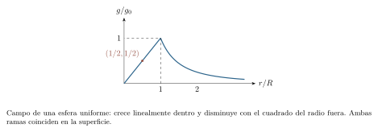
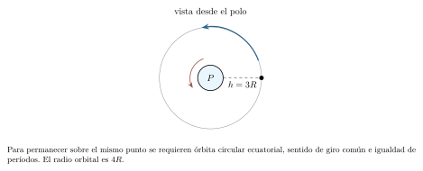

[← Capítulo anterior](capitulo-10.html) · [Índice del libro](index.html) · [Capítulo siguiente →](capitulo-12.html)

Una piedra que cae y un satélite que permanece en órbita están sometidos a la misma interacción. La diferencia se encuentra en sus posiciones y velocidades: la piedra alcanza el suelo; el satélite avanza mientras la gravedad curva su trayectoria. Comprender esa relación exige abandonar la aproximación de un campo uniforme cuando las distancias llegan a ser comparables con el tamaño del planeta.

La ley de gravitación permitirá calcular cómo cambia la fuerza con la distancia. La energía determinará hasta dónde puede llegar un lanzamiento, y el momento angular explicará cómo se reparte el movimiento en una órbita. Las leyes de Kepler reunirán esas ideas en relaciones entre formas, áreas y períodos.

## Una ley para la atracción entre masas

Dos partículas de masas $m_1$ y $m_2$, separadas por una distancia $r$, se atraen con fuerzas de módulo
$$
 F=G\frac{m_1m_2}{r^2}.
$$
La constante $G$ se mide en $\,\mathrm{N\,m^2/kg^2}$, equivalentes a $\,\mathrm{m^3/(kg\,s^2)}$. Usaremos $G=6{,}67\times10^{-11}\,\mathrm{N\,m^2/kg^2}$ cuando haga falta un valor numérico. La fuerza apunta hacia la otra masa: si $\hat r$ va desde la fuente $M$ hacia la partícula $m$, la fuerza sobre esta última es $\vec F=-GMm\hat r/r^2$. El signo expresa atracción.

Las dos fuerzas tienen igual módulo y sentidos opuestos, incluso si las masas son muy diferentes. Cada una actúa sobre un cuerpo distinto; las aceleraciones correspondientes dependen de sus respectivas masas. La ley describe partículas. Para un cuerpo extenso se suman las contribuciones de sus partes, con sus respectivas direcciones y distancias.

Un resultado especialmente útil de esa suma es el *teorema de las capas esféricas*: una capa de masa con simetría esférica produce, en su exterior, el mismo campo que una masa puntual situada en el centro; en su interior produce campo nulo. Al superponer capas, el campo exterior de cualquier distribución esféricamente simétrica equivale al de toda su masa concentrada en el centro. La densidad puede variar con el radio. Esta propiedad, cuya demostración requiere integrar las contribuciones angulares de la capa, será un resultado de partida del modelo. Un cuerpo de forma irregular requiere considerar cómo contribuyen sus distintas partes al campo.

### Problema resuelto 11.1 · Fuerzas iguales, aceleraciones distintas {#r11-1}

Dos partículas de $2$ y $3\,\mathrm{kg}$ están separadas $0{,}50\,\mathrm{m}$. Calcula sus fuerzas de atracción y las aceleraciones que produciría esa interacción si no actuaran otras fuerzas.
*Resolución.* La ley da
$$
 F=6{,}67\times10^{-11}\frac{2(3)}{0{,}50^2}
 \simeq1{,}60\times10^{-9}\,\mathrm{N}.
$$
Ese módulo es el mismo en ambos cuerpos. Las aceleraciones valen $F/2\simeq8{,}00\times10^{-10}\,\mathrm{m/s^2}$ y $F/3\simeq5{,}34\times10^{-10}\,\mathrm{m/s^2}$, cada una hacia la otra partícula. La masa menor cambia su velocidad más deprisa. La pequeñez de las fuerzas explica por qué la gravitación entre objetos cotidianos suele quedar oculta por otras interacciones.

{#fig-fp-av-r11-1 fig-alt="Ilustración de Problema resuelto 11.1 · Fuerzas iguales, aceleraciones distintas. Dos partículas de 2 y 3\\,kg están separadas 0,50\\,m. Calcula sus fuerzas de atracción y las aceleraciones que produciría esa interacción si no actuaran otras fuerzas. Resolución. La ley da F=6,67times10^-11frac2(3)0,50^2 simeq1,60times10^-9\\,N. Ese módulo es el mismo en ambos cuerpos. Las aceleraciones valen"}

### Problema resuelto 11.2 · Comparar sin recalcular la constante {#r11-2}

Una interacción tiene fuerza de módulo $F$. Se duplica la primera masa, se triplica la segunda y la separación pasa a ser cuatro veces la inicial. ¿Qué fuerza resulta?

*Resolución.* Dividir las dos expresiones elimina $G$ y los datos originales:
$$
 \frac{F'}F=\frac{(2m_1)(3m_2)}{m_1m_2}
              \left(\frac r{4r}\right)^2
 =\frac6{16}=\frac38.
$$
La fuerza disminuye a pesar del aumento de las masas, porque la distancia entra al cuadrado. Si solo se duplicara la separación, el resultado sería $F/4$; reducirla a la mitad daría $4F$. Estas comparaciones suponen que se mantienen los modelos de masas puntuales o de cuerpos esféricos exteriores entre sí, sin superposición de sus volúmenes.

{#fig-fp-av-r11-2 fig-alt="Ilustración de Problema resuelto 11.2 · Comparar sin recalcular la constante. Resolución. Dividir las dos expresiones elimina G y los datos originales: fracF'F=frac(2m1)(3m2)m1m2 left(frac r4rright)^2 =frac616=frac38. La fuerza disminuye a pesar del aumento de las masas, porque la distancia entra al cuadrado. Si solo se duplicara la separación, el resultado sería F/4; reducirla a la mitad daría"}

## El campo gravitatorio y la distancia al centro

El campo gravitatorio en una posición es la fuerza por unidad de masa de una partícula de prueba: $\vec g=\vec F/m$. La partícula debe ser lo bastante pequeña para no alterar apreciablemente la distribución que estudiamos. Para una fuente esférica de masa $M$, en el exterior,
$$
 \vec g=-\frac{\mu}{r^2}\hat r,\qquad \mu=GM.
$$
La cantidad $\mu$, llamada parámetro gravitacional, se mide en $\,\mathrm{m^3/s^2}$. La constante gravitatoria es universal; la aceleración $g$ depende de la posición y de la distribución de masa. Si existen varias fuentes, sus campos se suman vectorialmente, $\vec g=\sum_i\vec g_i$. Sumar sus módulos ignoraría posibles cancelaciones.

### Problema resuelto 11.3 · Dos fuentes en direcciones perpendiculares {#r11-3}

Dos fuentes puntuales tienen parámetros $\mu_1=9\,\mathrm{m^3/s^2}$ y $\mu_2=16\,\mathrm{m^3/s^2}$ y se encuentran en $(3,0)\,\mathrm{m}$ y $(0,4)\,\mathrm{m}$. Encuentra el campo en el origen y la fuerza sobre una partícula de prueba de $2\,\mathrm{kg}$.

*Resolución.* La primera fuente produce $9/3^2=1\,\mathrm{m/s^2}$ hacia $+x$; la segunda, $16/4^2=1\,\mathrm{m/s^2}$ hacia $+y$. Por tanto $\vec g=(1,1)\,\mathrm{m/s^2}$, cuyo módulo es $\sqrt2\,\mathrm{m/s^2}$. La fuerza es $\vec F=2\vec g=(2,2)\,\mathrm{N}$ y su módulo $2\sqrt2\,\mathrm{N}$. La dirección forma $45^\circ$ con $+x$. Ninguna fuente ocupa el origen; el campo allí describe lo que experimentaría la partícula de prueba.

{#fig-fp-av-r11-3 fig-alt="Ilustración de Problema resuelto 11.3 · Dos fuentes en direcciones perpendiculares. Resolución. La primera fuente produce 9/3^2=1\\,m/s^2 hacia +x; la segunda, 16/4^2=1\\,m/s^2 hacia +y. Por tanto vec g=(1,1)\\,m/s^2, cuyo módulo es sqrt2\\,m/s^2. La fuerza es vec F=2vec g=(2,2)\\,N y su módulo 2sqrt2\\,N. La dirección forma 45^circ con +x. Ninguna fuente ocupa el origen; el campo allí describe lo que"}

Para una superficie esférica de radio $R$, la altura $h$ corresponde a la distancia al centro $r=R+h$; usar $r=h$ omitiría el radio del cuerpo central. Así,
$$
 g(h)=\frac\mu{(R+h)^2}
     =g_0\left(\frac R{R+h}\right)^2,
 \qquad g_0=\frac\mu{R^2}.
$$
El peso gravitatorio debido al planeta tiene módulo $mg(h)$, mientras la masa permanece igual. En varios ejemplos usaremos un planeta ideal P, esférico, de radio $R=1{,}00\times10^7\,\mathrm{m}$ y parámetro $\mu=4{,}00\times10^{14}\,\mathrm{m^3/s^2}$. Su campo superficial es $g_0=4{,}00\,\mathrm{m/s^2}$. Estos datos describen un planeta idealizado. Para los movimientos alrededor de P se despreciará la masa del móvil frente a la del planeta, la atmósfera, la rotación de P y las demás fuentes, salvo indicación contraria.

### Problema resuelto 11.4 · Subir una altura igual al radio {#r11-4}

Una persona de $60\,\mathrm{kg}$ se encuentra a altura $h=R$ sobre P. Calcula su peso gravitatorio y compáralo con el superficial.
*Resolución.* La distancia al centro es $2R$. Entonces $g=g_0/4=1\,\mathrm{m/s^2}$ y el peso $60\,\mathrm{N}$, frente a los $240\,\mathrm{N}$ de la superficie. La masa sigue siendo $60\,\mathrm{kg}$. Sustituir $r=h=R$ habría dejado el peso sin variación, por medir desde el lugar equivocado. La lectura de una balanza acompañante dependerá también del movimiento del soporte.

{#fig-fp-av-r11-4 fig-alt="Ilustración de Problema resuelto 11.4 · Subir una altura igual al radio. Una persona de 60\\,kg se encuentra a altura h=R sobre P. Calcula su peso gravitatorio y compáralo con el superficial. Resolución. La distancia al centro es 2R. Entonces g=g0/4=1\\,m/s^2 y el peso 60\\,N, frente a los 240\\,N de la superficie. La masa sigue siendo 60\\,kg. Sustituir r=h=R habría dejado el peso sin"}

Dentro del planeta debemos calcular el campo con la masa encerrada a cada radio, en lugar de extender $g=GM/r^2$ con la masa total. Las capas exteriores al punto dan campo total cero; las interiores equivalen a la masa $M(r)$ encerrada. Para una esfera de densidad uniforme, $M(r)=M(r/R)^3$, pues la masa es proporcional al volumen. Por tanto $g(r)=GMr/R^3=g_0r/R$ en el interior. Se anula en el centro y se une de forma continua al valor superficial. Una densidad no uniforme produce otra función $M(r)$.

### Problema resuelto 11.5 · El interior de una esfera uniforme {#r11-5}

Supón que P tiene densidad uniforme. Encuentra el campo a $r=R/2$ y compáralo con la sustitución incorrecta de toda la masa en $GM/r^2$.

*Resolución.* La masa encerrada es $M/8$. Su campo tiene módulo
$$
 g=\frac{G(M/8)}{(R/2)^2}=\frac{g_0}{2}=2\,\mathrm{m/s^2}.
$$
Apunta hacia el centro. Usar toda $M$ habría dado $4g_0=16\,\mathrm{m/s^2}$, ocho veces el valor correcto. Las contribuciones vectoriales de las capas exteriores se cancelan exactamente bajo la simetría esférica. El resultado depende además de la uniformidad supuesta para hallar $M(r)$.

{#fig-fp-av-r11-5 fig-alt="Ilustración de Problema resuelto 11.5 · El interior de una esfera uniforme. Resolución. La masa encerrada es M/8. Su campo tiene módulo g=fracG(M/8)(R/2)^2=fracg02=2\\,m/s^2. Apunta hacia el centro. Usar toda M habría dado 4g0=16\\,m/s^2, ocho veces el valor correcto. Las contribuciones vectoriales de las capas exteriores se cancelan exactamente bajo la simetría esférica. El resultado depende"}

## Energía potencial con un campo que cambia

Al desplazarse una partícula en el exterior de una fuente esférica fija, la componente radial de la fuerza es $F_r=-\mu m/r^2$. Su trabajo entre $r_1$ y $r_2$ es
$$
 W_g=\int_{r_1}^{r_2}-\frac{\mu m}{r^2}\,dr
 =\mu m\left(\frac1{r_2}-\frac1{r_1}\right).
$$
En un movimiento no radial, la fuerza es perpendicular a la parte tangencial del desplazamiento; la misma integral describe el trabajo. Solo dependen los radios extremos, de modo que la interacción es conservativa. Elegir $U\to0$ cuando $r\to\infty$ conduce a
$$
 U(r)=-\frac{\mu m}{r},\qquad
 \Delta U=\mu m\left(\frac1{r_1}-\frac1{r_2}\right).
$$
Con el origen $U(\infty)=0$, la energía potencial es negativa y aumenta hacia cero al alejarnos. Si las energías cinéticas de los extremos son iguales, el trabajo externo necesario para separar los cuerpos desde $r$ hasta una distancia indefinidamente grande es $W_{\mathrm{ext}}=-U(r)=\mu m/r>0$. El potencial gravitatorio $\Phi=U/m=-\mu/r$ se mide en $\,\mathrm{J/kg}$; los potenciales de fuentes múltiples se suman como escalares. Un punto con campo nulo puede tener potencial distinto de cero.

### Problema resuelto 11.6 · Elevar una carga hasta dos radios {#r11-6}

Una carga de $500\,\mathrm{kg}$ se eleva lentamente desde la superficie de P hasta $r=2R$. Encuentra $U_i$, $U_f$, el trabajo gravitatorio y el trabajo externo ideal, con energías cinéticas inicial y final iguales.

*Resolución.* Las energías son $U_i=-(4{,}00\times10^{14})(500)/10^7=-2{,}00\times10^{10}\,\mathrm{J}$ y $U_f=-1{,}00\times10^{10}\,\mathrm{J}$. Así, $\Delta U=+1{,}00\times10^{10}\,\mathrm{J}$ y $W_g=-1{,}00\times10^{10}\,\mathrm{J}$. Como $\Delta K=0$, el agente externo debe aportar $W_{\mathrm{ext}}=+1{,}00\times10^{10}\,\mathrm{J}$. Al retirar el sostén después de una elevación lenta, la carga empieza a caer; para situarla en órbita debemos darle además la velocidad tangencial apropiada.

{#fig-fp-av-r11-6 fig-alt="Ilustración de Problema resuelto 11.6 · Elevar una carga hasta dos radios. Resolución. Las energías son Ui=-(4,00times10^14)(500)/10^7=-2,00times10^10\\,J y Uf=-1,00times10^10\\,J. Así, Delta U=+1,00times10^10\\,J y Wg=-1,00times10^10\\,J. Como Delta K=0, el agente externo debe aportar Wext=+1,00times10^10\\,J. Al retirar el sostén después de una elevación lenta, la carga empieza a caer; para"}

La expresión $mg_0h$ reaparece como aproximación cerca de la superficie. Desde $R$ hasta $R+h$, la fórmula exacta da
$$
 \Delta U=\frac{\mu m h}{R(R+h)}
 =\frac{mg_0h}{1+h/R}.
$$
Cuando $h/R\ll1$, el denominador es próximo a uno. Para $h>0$, el valor $mg_0h$ sobreestima el aumento exacto: mantiene durante toda la subida un campo igual al superficial, aunque el campo disminuye. Su error relativo respecto del valor exacto es precisamente $h/R$. Esta comparación permite decidir la calidad de la aproximación con un criterio cuantitativo.

### Problema resuelto 11.7 · Cuándo basta la fórmula local {#r11-7}

Una masa de $10\,\mathrm{kg}$ sube $h=1{,}00\times10^5\,\mathrm{m}$ sobre P. Compara $mg_0h$ con el aumento exacto de energía potencial.

*Resolución.* La razón $h/R$ es $0{,}0100$. La aproximación produce $10(4)(10^5)=4{,}00\times10^6\,\mathrm{J}$. La fórmula exacta da $4{,}00\times10^6/1{,}01\simeq3{,}96\times10^6\,\mathrm{J}$. El error relativo de la aproximación es $1{,}00\%$. La diferencia importa si la precisión requerida es mejor que ese porcentaje. Una altura grande en kilómetros puede seguir siendo pequeña frente al radio del planeta; la razón entre longitudes decide el régimen.

{#fig-fp-av-r11-7 fig-alt="Ilustración de Problema resuelto 11.7 · Cuándo basta la fórmula local. Resolución. La razón h/R es 0,0100. La aproximación produce 10(4)(10^5)=4,00times10^6\\,J. La fórmula exacta da 4,00times10^6/1,01simeq3,96times10^6\\,J. El error relativo de la aproximación es 1,00\\%. La diferencia importa si la precisión requerida es mejor que ese porcentaje. Una altura grande en kilómetros puede"}

Sin otros trabajos, la energía mecánica $E=\tfrac12mv^2-\mu m/r$ permanece constante. Por unidad de masa escribiremos $\varepsilon=E/m=\tfrac12v^2-\mu/r$. La rapidez en una posición se obtiene comparando energías, aunque la trayectoria no sea recta.

### Problema resuelto 11.8 · Una caída desde gran altura {#r11-8}

Una partícula se suelta desde el reposo en $r=2R$ respecto de P y cae radialmente. Encuentra su rapidez justo antes de alcanzar la superficie.

*Resolución.* La energía inicial por unidad de masa es $-\mu/(2R)$. En la superficie,
$$
 -\frac\mu{2R}=\frac{v^2}{2}-\frac\mu R,
 \qquad v^2=\frac\mu R=4{,}00\times10^7\,\mathrm{m^2/s^2}.
$$
Así, $v=2000\sqrt{10}\,\mathrm{m/s}\simeq6{,}32\,\mathrm{km/s}$. La masa se cancela. Tratar $g_0$ como constante a lo largo de una caída de altura $R$ habría dado $v^2=2g_0R$, el doble del valor correcto. La fórmula exterior deja de describir una caída libre sin contacto cuando la partícula llega al suelo.

{#fig-fp-av-r11-8 fig-alt="Ilustración de Problema resuelto 11.8 · Una caída desde gran altura. Resolución. La energía inicial por unidad de masa es -mu/(2R). En la superficie, -fracmu2R=fracv^22-fracmu R, qquad v^2=fracmu R=4,00times10^7\\,m^2/s^2. Así, v=2000sqrt10\\,m/ssimeq6,32\\,km/s. La masa se cancela. Tratar g0 como constante a lo largo de una caída de altura R habría dado v^2=2g0R, el doble del valor"}

## Una órbita circular es una caída continua

Supongamos un móvil de masa despreciable frente a P, sin propulsión ni resistencia. En una órbita circular de radio $r$, la única fuerza es gravitatoria y produce la aceleración normal necesaria. La ecuación de Newton es $\mu m/r^2=mv_c^2/r$, de donde
$$
 v_c=\sqrt{\frac\mu r},\qquad
 T=\frac{2\pi r}{v_c}=2\pi\sqrt{\frac{r^3}{\mu}}.
$$
La atracción gravitatoria proporciona la fuerza centrípeta requerida por la órbita circular. Es el nombre de su función en este movimiento. Para ese radio, la velocidad debe ser tangencial y tener la rapidez indicada; una dirección diferente o una rapidez diferente producirá otra trayectoria, que puede alcanzar la superficie.

### Problema resuelto 11.9 · Rapidez, aceleración y período orbitales {#r11-9}

Un satélite de $1000\,\mathrm{kg}$ describe una órbita circular de radio $4R$ alrededor de P. Encuentra su rapidez, aceleración, período y fuerza gravitatoria.

*Resolución.* El radio es $4{,}00\times10^7\,\mathrm{m}$. Entonces $v_c=\sqrt{10^7}=1000\sqrt{10}\,\mathrm{m/s}\simeq3{,}16\,\mathrm{km/s}$. La aceleración es $\mu/r^2=0{,}250\,\mathrm{m/s^2}$ y la fuerza $250\,\mathrm{N}$. El período vale
$$
 T=\frac{2\pi(4{,}00\times10^7)}{1000\sqrt{10}}
 =8000\pi\sqrt{10}\,\mathrm{s}\simeq7{,}95\times10^4\,\mathrm{s}.
$$
La velocidad cambia de dirección durante toda la vuelta. La rapidez es constante y la aceleración apunta al centro; la altura del satélite es $3R$ y su distancia al centro, $4R$.

{#fig-fp-av-r11-9 fig-alt="Ilustración de Problema resuelto 11.9 · Rapidez, aceleración y período orbitales. Resolución. El radio es 4,00times10^7\\,m. Entonces vc=sqrt10^7=1000sqrt10\\,m/ssimeq3,16\\,km/s. La aceleración es mu/r^2=0,250\\,m/s^2 y la fuerza 250\\,N. El período vale T=frac2pi(4,00times10^7)1000sqrt10 =8000pisqrt10\\,ssimeq7,95times10^4\\,s. La velocidad cambia de dirección durante toda la vuelta. La rapidez es"}

### Problema resuelto 11.10 · Una balanza en caída orbital {#r11-10}

Una astronauta de $60\,\mathrm{kg}$ acompaña al satélite del ejemplo anterior. Encuentra su peso gravitatorio y la lectura ideal de una balanza que flota con ella, sin presionarla.
*Resolución.* Su peso gravitatorio es $60(0{,}250)=15\,\mathrm{N}$ hacia P. La astronauta y la nave comparten aproximadamente la misma aceleración orbital y permanecen juntas en caída libre. La normal es cero y la balanza ideal marca cero. Esta ingravidez aparente es compatible con un campo no nulo. El modelo desprecia las pequeñas diferencias del campo entre partes de la nave, responsables de efectos de marea.

{#fig-fp-av-r11-10 fig-alt="Ilustración de Problema resuelto 11.10 · Una balanza en caída orbital. Una astronauta de 60\\,kg acompaña al satélite del ejemplo anterior. Encuentra su peso gravitatorio y la lectura ideal de una balanza que flota con ella, sin presionarla. Resolución. Su peso gravitatorio es 60(0,250)=15\\,N hacia P. La astronauta y la nave comparten aproximadamente la misma aceleración orbital y"}

En una órbita circular, sustituir $v_c^2=\mu/r$ en la energía produce
$$
 K_c=\frac{\mu m}{2r},\qquad U_c=-\frac{\mu m}r,
 \qquad E_c=-\frac{\mu m}{2r}.
$$
Una órbita circular más alta tiene energía mecánica mayor y rapidez menor. El aumento de potencial supera la disminución cinética. Para calcular los impulsos de una maniobra o su consumo de combustible necesitamos describir también cómo actúa el vehículo entre los estados orbitales.

### Problema resuelto 11.11 · Una órbita más alta y más lenta {#r11-11}

Compara las energías de un satélite de $1000\,\mathrm{kg}$ en órbitas circulares de radios $2R$ y $4R$ alrededor de P.

*Resolución.* A $2R$, $K_1=1{,}00\times10^{10}\,\mathrm{J}$, $U_1=-2{,}00\times10^{10}\,\mathrm{J}$ y $E_1=-1{,}00\times10^{10}\,\mathrm{J}$. A $4R$, las tres magnitudes se reducen a la mitad en valor absoluto: $K_2=5{,}00\times10^9\,\mathrm{J}$, $U_2=-1{,}00\times10^{10}\,\mathrm{J}$ y $E_2=-5{,}00\times10^9\,\mathrm{J}$. La energía total aumenta $5{,}00\times10^9\,\mathrm{J}$, aunque la cinética disminuye en esa misma cantidad. La rapidez pasa de $2000\sqrt5$ a $1000\sqrt{10}\,\mathrm{m/s}$. Para conectar realmente ambos estados habría que describir la transferencia y el agente que aporta energía.

{#fig-fp-av-r11-11 fig-alt="Ilustración de Problema resuelto 11.11 · Una órbita más alta y más lenta. Resolución. A 2R, K1=1,00times10^10\\,J, U1=-2,00times10^10\\,J y E1=-1,00times10^10\\,J. A 4R, las tres magnitudes se reducen a la mitad en valor absoluto: K2=5,00times10^9\\,J, U2=-1,00times10^10\\,J y E2=-5,00times10^9\\,J. La energía total aumenta 5,00times10^9\\,J, aunque la cinética disminuye en esa misma cantidad. La"}

## Escape y lanzamientos que regresan

Con $U(\infty)=0$, alcanzar distancias indefinidamente grandes exige $\varepsilon\geq0$. El umbral ideal se obtiene imponiendo rapidez asintótica cero:
$$
 \frac{v_{\mathrm{esc}}^2}{2}-\frac\mu r=0,
 \qquad v_{\mathrm{esc}}=\sqrt{\frac{2\mu}r}=\sqrt2\,v_c.
$$
Esta rapidez es una condición energética en el modelo de una fuente aislada, sin atmósfera ni propulsión posterior. Para un lanzamiento desde el exterior debe elegirse además una trayectoria que no choque con el planeta; una velocidad dirigida hacia él puede causar una colisión aunque su módulo supere el umbral. Llegar ``al infinito'' describe el límite del movimiento cuando la distancia crece indefinidamente. Otros astros o una fuerza propulsora cambian el problema.

### Problema resuelto 11.12 · Escape con rapidez residual {#r11-12}

Desde $r=2R$ de P se lanza una partícula radialmente hacia afuera. Encuentra la rapidez de escape y la rapidez asintótica si parte a $8{,}00\,\mathrm{km/s}$.

*Resolución.* El umbral es $\sqrt{2\mu/(2R)}=2000\sqrt{10}\,\mathrm{m/s}\simeq6{,}32\,\mathrm{km/s}$. Para $v_0=8000\,\mathrm{m/s}$, la energía específica es $\varepsilon=\tfrac12(8000)^2-\mu/(2R)=1{,}20\times10^7\,\mathrm{J/kg}>0$. Cuando $r\to\infty$, el potencial tiende a cero y $v_\infty=\sqrt{2\varepsilon}=2000\sqrt6\,\mathrm{m/s}\simeq4{,}90\,\mathrm{km/s}$. La gravedad reduce la rapidez durante el alejamiento, que tiende a un valor positivo.

{#fig-fp-av-r11-12 fig-alt="Ilustración de Problema resuelto 11.12 · Escape con rapidez residual. Resolución. El umbral es sqrt2mu/(2R)=2000sqrt10\\,m/ssimeq6,32\\,km/s. Para v0=8000\\,m/s, la energía específica es varepsilon=tfrac12(8000)^2-mu/(2R)=1,20times10^7\\,J/kg>0. Cuando rtoinfty, el potencial tiende a cero y vinfty=sqrt2varepsilon=2000sqrt6\\,m/ssimeq4,90\\,km/s. La gravedad reduce la rapidez durante el"}

### Problema resuelto 11.13 · Un lanzamiento radial que vuelve {#r11-13}

Una partícula parte radialmente hacia afuera desde la superficie de P a $4000\,\mathrm{m/s}$. Encuentra su radio máximo y su altura máxima.
*Resolución.* La energía específica inicial es $8{,}00\times10^6-4{,}00\times10^7=-3{,}20\times10^7\,\mathrm{J/kg}$. Al ser radial, el movimiento llega a un punto con velocidad cero. Allí $\varepsilon=-\mu/r_{\max}$, de donde $r_{\max}=1{,}25\times10^7\,\mathrm{m}=1{,}25R$ y $h_{\max}=0{,}25R=2{,}50\times10^6\,\mathrm{m}$. En una órbita con momento angular no nulo, el punto más lejano conserva velocidad tangencial; imponer allí $v=0$ sería incorrecto.

{#fig-fp-av-r11-13 fig-alt="Ilustración de Problema resuelto 11.13 · Un lanzamiento radial que vuelve. Una partícula parte radialmente hacia afuera desde la superficie de P a 4000\\,m/s. Encuentra su radio máximo y su altura máxima. Resolución. La energía específica inicial es 8,00times10^6-4,00times10^7=-3,20times10^7\\,J/kg. Al ser radial, el movimiento llega a un punto con velocidad cero. Allí varepsilon=-mu/rmax, de"}

## Elipses y las tres leyes de Kepler

Las órbitas planetarias motivaron las tres relaciones conocidas como leyes de Kepler. En el modelo newtoniano de dos cuerpos aislados se expresan con precisión así: una órbita ligada y no radial es elíptica; el radio vector barre áreas iguales en tiempos iguales; y el cuadrado del período es proporcional al cubo del semieje mayor, con una constante que depende de las masas. Cuando una masa domina, la fuente puede tratarse aproximadamente fija en uno de los focos. El círculo es el caso particular de una elipse con excentricidad cero.

Una elipse tiene dos focos: la suma de las distancias de cualquier punto a ambos es $2a$, donde $a$ es el semieje mayor. Si la distancia de cada foco al centro geométrico es $c$, la excentricidad es $e=c/a$, con $0\leq e<1$. Su semieje menor es $b=a\sqrt{1-e^2}$. La fuente ocupa un foco, generalmente distinto del centro de la elipse; el segundo foco es otro punto geométrico de la curva.

Las distancias mínima y máxima a la fuente, llamadas periapsis y apoapsis, son
$$
 r_p=a(1-e),\qquad r_a=a(1+e),\qquad
 a=\frac{r_p+r_a}{2},\quad e=\frac{r_a-r_p}{r_a+r_p}.
$$
Para órbitas alrededor del Sol se emplean perihelio y afelio; alrededor de la Tierra, perigeo y apogeo. Para una órbita exterior libre completa, la elipse debe permanecer fuera del cuerpo central. Para nuestros satélites debe cumplirse además $r_p>R$.

### Problema resuelto 11.14 · Reconstruir la geometría de una órbita {#r11-14}

Una órbita elíptica alrededor de P tiene $r_p=2R$ y $r_a=6R$. Encuentra sus semiejes, excentricidad y distancia entre el centro geométrico y el foco ocupado.

*Resolución.* De las distancias extremas obtenemos $a=(2R+6R)/2=4R$ y $e=(6R-2R)/(6R+2R)=1/2$. Luego $c=ae=2R$ y $b=4R\sqrt{1-1/4}=2\sqrt3R$. El foco está desplazado $2R$ respecto del centro geométrico. Las distancias extremas se miden desde el foco ocupado; el semieje mayor caracteriza el tamaño de la elipse. Como $r_p=2R>R$, la elipse permanece fuera del planeta en este modelo.

{#fig-fp-av-r11-14 fig-alt="Ilustración de Problema resuelto 11.14 · Reconstruir la geometría de una órbita. Resolución. De las distancias extremas obtenemos a=(2R+6R)/2=4R y e=(6R-2R)/(6R+2R)=1/2. Luego c=ae=2R y b=4Rsqrt1-1/4=2sqrt3R. El foco está desplazado 2R respecto del centro geométrico. Las distancias extremas se miden desde el foco ocupado; el semieje mayor caracteriza el tamaño de la elipse. Como rp=2R>R, la elipse"}

## La ley de las áreas nace de un torque nulo

Respecto de una fuente fija, la fuerza gravitatoria es central: $\vec F$ y $\vec r$ son colineales. Por tanto $\vec\tau=\vec r\times\vec F=\vec0$ y se conserva $\vec L=m\vec r\times\vec v$. Si $\vec L\ne\vec0$, su dirección constante fija el plano de la órbita. Un movimiento radial tiene $\vec L=\vec0$ y no barre áreas.

En un tiempo infinitesimal $dt$, el radio vector barre área $dA=\tfrac12r^2d\theta$. Como la componente transversal de la velocidad es $v_\perp=r\,d\theta/dt$,
$$
 \frac{dA}{dt}=\frac12rv_\perp=\frac{|\vec L|}{2m}.
$$
Esta tasa constante demuestra la segunda ley. La conservación del momento angular y de la velocidad areolar se cumple para cualquier fuerza central respecto de un punto fijo, incluida la proporcional a $1/r^2$. La forma elíptica y la relación particular entre período y semieje mayor sí dependen de la ley gravitatoria inversa del cuadrado.

En periapsis y apoapsis la velocidad es perpendicular al radio vector. Allí $r_pv_p=r_av_a$. En un punto intermedio debe usarse la componente transversal; sustituirla sin más por la rapidez total puede alterar el resultado.

### Problema resuelto 11.15 · Velocidades distintas, áreas iguales {#r11-15}

En la órbita del resuelto anterior, la rapidez en periapsis es $v_p=1000\sqrt{30}\,\mathrm{m/s}$. Encuentra la rapidez en apoapsis, la tasa de área barrida y el área recorrida por el radio vector en $100\,\mathrm{s}$.

*Resolución.* Como los dos puntos son extremos radiales, $v_a=(2R/6R)v_p=(1000\sqrt{30}/3)\,\mathrm{m/s}\simeq1{,}83\,\mathrm{km/s}$. La tasa de área es
$$
 \frac{dA}{dt}=\frac12(2{,}00\times10^7)(1000\sqrt{30})
 =10^{10}\sqrt{30}\,\mathrm{m^2/s}.
$$
En $100\,\mathrm{s}$ barre $10^{12}\sqrt{30}\,\mathrm{m^2}$, cualquiera que sea el tramo orbital considerado. Cerca del periapsis, el radio menor permite un avance angular mayor durante el mismo tiempo manteniendo igual el área barrida.

{#fig-fp-av-r11-15 fig-alt="Ilustración de Problema resuelto 11.15 · Velocidades distintas, áreas iguales. Resolución. Como los dos puntos son extremos radiales, va=(2R/6R)vp=(1000sqrt30/3)\\,m/ssimeq1,83\\,km/s. La tasa de área es fracdAdt=frac12(2,00times10^7)(1000sqrt30) =10^10sqrt30\\,m^2/s. En 100\\,s barre 10^12sqrt30\\,m^2, cualquiera que sea el tramo orbital considerado. Cerca del periapsis, el radio menor permite un"}

## La energía distingue las órbitas

Podemos obtener la energía elíptica sin resolver toda la ecuación de la trayectoria. Para $e>0$, en los extremos se conservan energía y momento angular específico $\ell=|\vec L|/m$:
$$
 \varepsilon=\frac{\ell^2}{2r_p^2}-\frac\mu{r_p}
            =\frac{\ell^2}{2r_a^2}-\frac\mu{r_a}.
$$
Restar y factorizar las diferencias da $\ell^2=2\mu r_pr_a/(r_p+r_a)$. Al sustituir en cualquiera de las dos energías resulta $\varepsilon=-\mu/(r_p+r_a)=-\mu/(2a)$. El círculo satisface la misma expresión por la ecuación 11.7. Para toda elipse exterior del modelo,
$$
 E=-\frac{\mu m}{2a},\qquad
 v^2=\mu\left(\frac2r-\frac1a\right),\qquad
 \ell^2=\mu a(1-e^2).
$$
La relación de rapidez se conoce como ecuación vis viva. La forma elíptica de una órbita ligada bajo la ley $1/r^2$ se está usando como resultado de la dinámica newtoniana; aquí deducimos sus relaciones de energía a partir de ella, sin presentar una demostración completa de la forma de la trayectoria.

Una energía negativa, con ese cero de potencial, impide llegar al infinito. Una energía nula corresponde al umbral y una positiva deja rapidez asintótica no nula. Con momento angular distinto de cero, las trayectorias ideales no ligadas son parábolas para $E=0$ e hipérbolas para $E>0$. Las trayectorias radiales son casos degenerados y una colisión con el cuerpo central puede interrumpir cualquiera de estas descripciones exteriores.

### Problema resuelto 11.16 · Igual rapidez en órbitas diferentes {#r11-16}

En la elipse $a=4R$, $e=1/2$ alrededor de P, encuentra la rapidez cuando $r=4R$. Compárala con la circular a ese radio y calcula las magnitudes de sus componentes transversal y radial.

*Resolución.* Como $r=a$, la ecuación vis viva da $v^2=\mu/a=10^7\,\mathrm{m^2/s^2}$ y $v=1000\sqrt{10}\,\mathrm{m/s}$, igual a la rapidez circular del mismo radio. Sin embargo, $\ell^2=\mu a(1-e^2)=1{,}20\times10^{22}\,\mathrm{m^4/s^2}$. Por tanto
$$
 v_\perp=\frac\ell r=500\sqrt{30}\,\mathrm{m/s},\qquad
 |v_r|=\sqrt{v^2-v_\perp^2}=500\sqrt{10}\,\mathrm{m/s}.
$$
La componente radial puede ser positiva al alejarse o negativa al acercarse. En el círculo es cero. Identificar una órbita requiere conocer la posición y el vector velocidad completo, incluida su dirección.

{#fig-fp-av-r11-16 fig-alt="Ilustración de Problema resuelto 11.16 · Igual rapidez en órbitas diferentes. Resolución. Como r=a, la ecuación vis viva da v^2=mu/a=10^7\\,m^2/s^2 y v=1000sqrt10\\,m/s, igual a la rapidez circular del mismo radio. Sin embargo, ell^2=mu a(1-e^2)=1,20times10^22\\,m^4/s^2. Por tanto vperp=fracell r=500sqrt30\\,m/s,qquad |vr|=sqrtv^2-vperp^2=500sqrt10\\,m/s. La componente radial puede ser positiva al"}

## Períodos, observaciones y masas comparables

El área de una elipse es $\pi ab$ y la tasa areolar es $\ell/2$. Usando las relaciones anteriores obtenemos
$$
 T=\frac{2\pi ab}{\ell}=2\pi\sqrt{\frac{a^3}{\mu}},
 \qquad \frac{T^2}{a^3}=\frac{4\pi^2}{\mu}.
$$
Esta deducción extiende el resultado circular al semieje mayor de una elipse. En órbitas alrededor de la misma fuente dominante, igual $a$ implica igual período, aunque cambie $e$. El ``radio medio'' de algunas formulaciones escolares designa aquí la media de las distancias extremas, $a=(r_p+r_a)/2$. Si cambia la masa central, cambia la constante de proporcionalidad.

### Problema resuelto 11.17 · Una órbita que acompaña la rotación {#r11-17}

P gira con período $T_{\mathrm{rot}}=8000\pi\sqrt{10}\,\mathrm{s}$. ¿A qué radio podría un satélite circular permanecer sobre el mismo punto del ecuador? Indica las condiciones geométricas y compara el período con el de la elipse $a=4R$, $e=1/2$.

*Resolución.* Igualar los períodos exige $r^3=\mu T_{\mathrm{rot}}^2/(4\pi^2)=6{,}40\times10^{22}\,\mathrm{m^3}$, luego $r=4{,}00\times10^7\,\mathrm{m}=4R$. La altura es $3R$. Permanecer sobre el mismo punto requiere una órbita circular en el plano ecuatorial, con el sentido y el período de la rotación de P. La elipse indicada tiene también $a=4R$ y, por la tercera ley, el mismo período, aunque su distancia y rapidez varían. Para el planeta ideal usamos su rotación como referencia geométrica y conservamos el campo esférico supuesto.

{#fig-fp-av-r11-17 fig-alt="Ilustración de Problema resuelto 11.17 · Una órbita que acompaña la rotación. Resolución. Igualar los períodos exige r^3=mu Trot^2/(4pi^2)=6,40times10^22\\,m^3, luego r=4,00times10^7\\,m=4R. La altura es 3R. Permanecer sobre el mismo punto requiere una órbita circular en el plano ecuatorial, con el sentido y el período de la rotación de P. La elipse indicada tiene también a=4R y, por la tercera"}

Cuando ninguna masa es despreciable, ambas orbitan alrededor de su centro de masa. Si $\vec r$ va desde $M$ hasta $m$, restar sus aceleraciones produce
$$
 \ddot{\vec r}=-\frac{G(M+m)}{r^2}\hat r.
$$
La trayectoria relativa obedece al mismo tipo de ecuación, con parámetro $\mu_{\mathrm{rel}}=G(M+m)$. Por tanto la tercera ley exacta del sistema aislado de dos masas es
$$
 T^2=\frac{4\pi^2a_{\mathrm{rel}}^3}{G(M+m)}.
$$
Aquí $a_{\mathrm{rel}}$ pertenece a la elipse de la separación entre los cuerpos; las órbitas individuales se refieren al centro de masa. Las fuerzas de otros astros, las irregularidades del campo y otros efectos limitan la descripción por elipses keplerianas exactas. El modelo sigue siendo útil cuando esas correcciones son pequeñas para la pregunta y la precisión elegidas.

### Problema resuelto 11.18 · Dos cuerpos que giran alrededor de su centro de masa {#r11-18}

Un sistema binario aislado tiene $M=4m$, separación circular constante $d=1{,}00\times10^7\,\mathrm{m}$ y $G(M+m)=1{,}00\times10^{15}\,\mathrm{m^3/s^2}$. Encuentra los radios de ambas órbitas respecto del centro de masa, el período y las rapideces.

*Resolución.* Si $r_M+r_m=d$ y $Mr_M=mr_m$, resultan $r_M=d/5=2{,}00\times10^6\,\mathrm{m}$ y $r_m=4d/5=8{,}00\times10^6\,\mathrm{m}$. La velocidad angular común satisface $\omega^2=G(M+m)/d^3=10^{-6}\,\mathrm{s^{-2}}$, de donde $\omega=10^{-3}\,\mathrm{rad/s}$ y $T=2000\pi\,\mathrm{s}$. Las rapideces son $2000$ y $8000\,\mathrm{m/s}$. Usar solo $GM=8{,}00\times10^{14}\,\mathrm{m^3/s^2}$ con separación $d$ como si $M$ estuviera fijo daría un período $\sqrt{5/4}$ veces el correcto, aproximadamente un $11{,}8\%$ mayor. Al ser las masas comparables, debemos conservar esa corrección.

{#fig-fp-av-r11-18 fig-alt="Ilustración de Problema resuelto 11.18 · Dos cuerpos que giran alrededor de su centro de masa. Resolución. Si rM+rm=d y MrM=mrm, resultan rM=d/5=2,00times10^6\\,m y rm=4d/5=8,00times10^6\\,m. La velocidad angular común satisface omega^2=G(M+m)/d^3=10^-6\\,mathrms^-2, de donde omega=10^-3\\,rad/s y T=2000pi\\,s. Las rapideces son 2000 y 8000\\,m/s. Usar solo GM=8,00times10^14\\,m^3/s^2 con separación d como si M"}

### Construir una órbita mediante pasos pequeños

En una hoja de cálculo usa unidades escaladas en las que $\mu=1$. Comienza con posición $(x,y)=(1,0)$ y velocidad $(v_x,v_y)=(0,1)$: el modelo continuo predice una órbita circular. Para un paso $\Delta t=0{,}02$, calcula primero $\vec a_n=-\vec r_n/|\vec r_n|^3$, después $\vec v_{n+1}=\vec v_n+\vec a_n\Delta t$ y finalmente $\vec r_{n+1}=\vec r_n+\vec v_{n+1}\Delta t$. El orden importa: la nueva posición usa la velocidad ya actualizada.

Representa unos $6{,}3$ intervalos de tiempo escalado y repite con la mitad del paso, manteniendo la misma duración total. Compara la forma orbital y la variación de $\varepsilon_n=|\vec v_n|^2/2-1/|\vec r_n|$. La simulación permite explorar las predicciones del modelo y su aproximación numérica. Este esquema conserva algebraicamente $\ell_{z,n}=x_nv_{y,n}-y_nv_{x,n}$ porque la aceleración es radial, mientras la energía presenta un error de discretización. Comprueba esa diferencia y separa las pequeñas desviaciones numéricas de los cambios físicos que produciría una fuerza adicional.

## Ejercicios para reconstruir y transferir

Salvo indicación contraria, usa el planeta ideal P con $R=1{,}00\times10^7\,\mathrm{m}$ y $\mu=4{,}00\times10^{14}\,\mathrm{m^3/s^2}$, masa del móvil despreciable, campo exterior esférico, sin atmósfera ni otras fuerzas. Usa $G=6{,}67\times10^{-11}\,\mathrm{N\,m^2/kg^2}$ cuando se pida una masa. Distingue siempre radio y altura.

### Ejercicio 11.1 · Atracción entre dos partículas {#e11-1}

Dos partículas de $4$ y $5\,\mathrm{kg}$ están separadas $0{,}20\,\mathrm{m}$. Calcula el módulo de cada fuerza y compara las aceleraciones debidas a la interacción.

### Ejercicio 11.2 · Cambiar masas y distancia {#e11-2}

Se duplica la masa de una fuente, se reduce a la mitad la masa de prueba y se triplica la separación. Encuentra las razones entre fuerzas y entre aceleraciones de la masa de prueba, antes y después.

### Ejercicio 11.3 · Campo nulo y potencial no nulo {#e11-3}

Dos fuentes puntuales de parámetros $16$ y $4\,\mathrm{m^3/s^2}$ están en $x=0$ y $x=6\,\mathrm{m}$. Encuentra el punto entre ellas donde el campo se anula y calcula allí $\Phi$, con cero de potencial en el infinito.

### Ejercicio 11.4 · Superposición en un plano {#e11-4}

Dos fuentes puntuales tienen $\mu=25\,\mathrm{m^3/s^2}$ cada una y están en $(-3,0)$ y $(3,0)\,\mathrm{m}$. Encuentra el campo en $(0,4)\,\mathrm{m}$ y la fuerza sobre una masa de prueba de $5\,\mathrm{kg}$ situada allí.

### Ejercicio 11.5 · Peso a gran altura {#e11-5}

Una masa de $90\,\mathrm{kg}$ se encuentra a altura $2R$ sobre P. Encuentra $g$ y su peso gravitatorio.

### Ejercicio 11.6 · Buscar una altura a partir del campo {#e11-6}

¿A qué altura sobre P se reduce el campo a $g_0/16$? Da también la distancia al centro.

### Ejercicio 11.7 · Mismo módulo dentro y fuera {#e11-7}

Supón densidad uniforme en P. Compara los campos en $r=R/4$ y $r=2R$. ¿Qué fracción de la masa de P queda encerrada por la primera esfera?

### Ejercicio 11.8 · Otro planeta {#e11-8}

Un planeta esférico tiene tres veces la masa de P y el doble de su radio. Encuentra su campo superficial y la razón de su densidad media a la de P.

### Ejercicio 11.9 · Trabajo al elevar una carga {#e11-9}

Una carga de $200\,\mathrm{kg}$ pasa de $r=R$ a $r=3R$ respecto de P. Calcula las energías potenciales, su variación y el trabajo gravitatorio.

### Ejercicio 11.10 · Controlar la aproximación local {#e11-10}

Una masa de $2\,\mathrm{kg}$ sube $2{,}00\times10^5\,\mathrm{m}$ desde la superficie de P. Calcula el aumento exacto de potencial y el valor $mg_0h$. Encuentra el error relativo de la aproximación respecto del valor exacto.

### Ejercicio 11.11 · Caída radial {#e11-11}

Una partícula se suelta desde el reposo en $r=3R$ y cae hasta la superficie de P. Encuentra su rapidez justo antes del contacto.

### Ejercicio 11.12 · Órbita circular a dos radios {#e11-12}

Un satélite describe una órbita circular de radio $2R$ alrededor de P. Encuentra su rapidez, aceleración y período.

### Ejercicio 11.13 · Comparar dos órbitas circulares {#e11-13}

Compara un mismo satélite en órbitas circulares de radios $2R$ y $8R$. Encuentra las razones de rapidez, período, aceleración y energía mecánica final a inicial.

### Ejercicio 11.14 · Peso y lectura de una balanza {#e11-14}

Una astronauta de $80\,\mathrm{kg}$ está en una nave en órbita circular de radio $2R$. Encuentra su peso gravitatorio y la normal de una balanza que la acompaña sin presionarla.

### Ejercicio 11.15 · Energía de un satélite {#e11-15}

Una masa de $500\,\mathrm{kg}$ describe una órbita circular de radio $4R$. Encuentra $K$, $U$ y $E$, con cero de potencial en el infinito.

### Ejercicio 11.16 · Escape desde dos posiciones {#e11-16}

Encuentra las rapideces de escape desde $R$ y desde $4R$ de P. Compara ambas.

### Ejercicio 11.17 · Rapidez al alejarse indefinidamente {#e11-17}

Una partícula parte radialmente hacia afuera desde $r=2R$ a $10{,}0\,\mathrm{km/s}$. Clasifica su energía y calcula su rapidez asintótica.

### Ejercicio 11.18 · Radio de retorno {#e11-18}

Una partícula sale radialmente desde la superficie de P a $6{,}00\,\mathrm{km/s}$. Encuentra su radio y altura máximos, y justifica que regresa.

### Ejercicio 11.19 · Geometría de otra elipse {#e11-19}

Una elipse alrededor de P tiene $r_p=2R$ y $r_a=8R$. Encuentra $a$, $e$, $b$ y su período.

### Ejercicio 11.20 · Aplicar la ley de las áreas {#e11-20}

En la órbita del ejercicio 11.19, la rapidez en periapsis es $4000\sqrt2\,\mathrm{m/s}$. Encuentra la rapidez en apoapsis y la tasa de área barrida.

### Ejercicio 11.21 · Rapidez en un punto intermedio {#e11-21}

En esa misma elipse, encuentra la rapidez cuando $r=5R$ y la energía mecánica por unidad de masa. ¿El dato de rapidez basta para afirmar que el movimiento es circular?

### Ejercicio 11.22 · Cambiar la masa central {#e11-22}

Un satélite de masa despreciable orbita una fuente $M$ con semieje mayor $a$. Otro orbita una fuente de masa $8M$ con semieje mayor $4a$. Encuentra la razón de períodos y explica por qué no basta usar la razón de semiejes.

### Ejercicio 11.23 · Inferir una masa por su satélite {#e11-23}

Alrededor de una fuente esférica desconocida, un satélite de masa despreciable tiene órbita circular de radio $2{,}00\times10^7\,\mathrm{m}$ y período $4000\pi\,\mathrm{s}$. Encuentra el parámetro gravitacional y la masa central.

### Ejercicio 11.24 · Un binario de masas iguales {#e11-24}

Dos masas iguales aisladas describen órbitas circulares alrededor de su centro de masa, separadas $d=2{,}00\times10^7\,\mathrm{m}$. Se sabe que $G(M+m)=8{,}00\times10^{14}\,\mathrm{m^3/s^2}$. Encuentra el radio de cada órbita, el período común y sus rapideces. Distingue el radio individual de la separación usada en la ley de dos cuerpos.

## Soluciones completas de los ejercicios

### Solución 11.1 {#sol-e11-1}

Cada fuerza tiene módulo $G(4)(5)/(0{,}20)^2=500G\simeq3{,}34\times10^{-8}\,\mathrm{N}$, con sentidos opuestos sobre cuerpos distintos. Las aceleraciones tienen módulos $F/4\simeq8{,}34\times10^{-9}\,\mathrm{m/s^2}$ y $F/5=6{,}67\times10^{-9}\,\mathrm{m/s^2}$. La razón de la primera a la segunda es $5/4$; las aceleraciones difieren porque cada masa recibe una fuerza de igual módulo.

### Solución 11.2 {#sol-e11-2}

La fuerza se multiplica por $(2)(1/2)/3^2=1/9$. La aceleración de prueba es $GM/r^2$ y se multiplica por $2/9$. También resulta de dividir la nueva fuerza, $F/9$, por la nueva masa, $m/2$. La reducción de la masa de prueba modifica la fuerza y conserva el campo de la fuente.

### Solución 11.3 {#sol-e11-3}

Entre las fuentes los campos tienen sentidos opuestos. La igualdad $16/x^2=4/(6-x)^2$ permite tomar raíces positivas: $4/x=2/(6-x)$. Resulta $x=4\,\mathrm{m}$. El potencial allí es $\Phi=-16/4-4/2=-6\,\mathrm{J/kg}$. Las fuerzas por unidad de masa se cancelan vectorialmente; los potenciales negativos se suman y dan un valor negativo.

### Solución 11.4 {#sol-e11-4}

La distancia desde cada fuente hasta el punto es $\sqrt{3^2+4^2}=5\,\mathrm{m}$ y cada campo tiene módulo $25/5^2=1\,\mathrm{m/s^2}$. Sus componentes horizontales son opuestas, de módulos $3/5$; sus componentes verticales apuntan ambas hacia abajo, de módulo $4/5$. Así $\vec g=(0,-8/5)\,\mathrm{m/s^2}$ y $\vec F=5\vec g=(0,-8)\,\mathrm{N}$.

### Solución 11.5 {#sol-e11-5}

La distancia al centro es $r=R+2R=3R$. Por tanto $g=4/9\,\mathrm{m/s^2}$ y el peso $90(4/9)=40\,\mathrm{N}$. Sustituir la altura como radio produciría un campo mayor que el que corresponde al punto.

### Solución 11.6 {#sol-e11-6}

La ecuación $g/g_0=R^2/(R+h)^2=1/16$ da $R+h=4R$ con distancias positivas. La altura es $h=3R=3{,}00\times10^7\,\mathrm{m}$ y el radio $4{,}00\times10^7\,\mathrm{m}$.

### Solución 11.7 {#sol-e11-7}

En el interior uniforme, $g=g_0(r/R)$; en $R/4$ vale $1\,\mathrm{m/s^2}$. En el exterior a $2R$, $g=g_0/4=1\,\mathrm{m/s^2}$. Los módulos coinciden, aunque se han usado leyes distintas en sus respectivos dominios. La masa encerrada en $R/4$ es la fracción $(1/4)^3=1/64$ de la total. Los dos campos apuntan hacia el centro desde cada posición.

### Solución 11.8 {#sol-e11-8}

El cociente superficial es $g'/g_0=(3M/M)(R/2R)^2=3/4$, luego $g'=3\,\mathrm{m/s^2}$. La densidad media divide masa por volumen, por lo que $\overline\rho'/\overline\rho=3/2^3=3/8$. Para comparar el campo superficial debemos conocer tanto la masa como el radio del cuerpo.

### Solución 11.9 {#sol-e11-9}

Las energías son $U_i=-\mu(200)/R=-8{,}00\times10^9\,\mathrm{J}$ y $U_f=-\mu(200)/(3R)=-(8/3)\times10^9\,\mathrm{J}$. El aumento es $\Delta U=(16/3)\times10^9\,\mathrm{J}\simeq5{,}33\times10^9\,\mathrm{J}$. El trabajo gravitatorio es el opuesto, $-(16/3)\times10^9\,\mathrm{J}$, porque la fuerza se opone al alejamiento.

### Solución 11.10 {#sol-e11-10}

Aquí $h/R=0{,}0200$ y $mg_0h=2(4)(2\times10^5)=1{,}60\times10^6\,\mathrm{J}$. El aumento exacto es $1{,}60\times10^6/1{,}02\simeq1{,}57\times10^6\,\mathrm{J}$. La sobreestimación relativa respecto de este último es $h/R=2{,}00\%$. Comparar solo cifras redondeadas a dos decimales puede ocultar parte de esa diferencia.

### Solución 11.11 {#sol-e11-11}

La conservación de energía da $-\mu/(3R)=v^2/2-\mu/R$. Luego $v^2=2\mu(1/R-1/(3R))=16\times10^7/3\,\mathrm{m^2/s^2}$. La rapidez es $4000\sqrt{10/3}\,\mathrm{m/s}\simeq7{,}30\,\mathrm{km/s}$. Se toma la raíz positiva por pedir rapidez; la velocidad radial al llegar apunta hacia dentro.

### Solución 11.12 {#sol-e11-12}

En $r=2R$, $v_c=\sqrt{\mu/(2R)}=2000\sqrt5\,\mathrm{m/s}\simeq4{,}47\,\mathrm{km/s}$. La aceleración es $\mu/(2R)^2=1\,\mathrm{m/s^2}$ y el período $2\pi(2R)/v_c=4000\pi\sqrt5\,\mathrm{s}$. La altura es $R$ y el período no depende de la masa despreciable del satélite.

### Solución 11.13 {#sol-e11-13}

La razón de radios es cuatro. Como $v_c\propto r^{-1/2}$, $T\propto r^{3/2}$ y $g\propto r^{-2}$, resultan $v_f/v_i=1/2$, $T_f/T_i=8$ y $g_f/g_i=1/16$. La energía es negativa e inversamente proporcional al radio: $E_f/E_i=1/4$. Esa razón positiva menor que uno significa que el estado final es menos negativo y tiene mayor energía mecánica.

### Solución 11.14 {#sol-e11-14}

El campo en $2R$ vale $1\,\mathrm{m/s^2}$ y el peso gravitatorio $80\,\mathrm{N}$. La balanza y la astronauta comparten la caída orbital sin contacto que las comprima, de modo que $N=0$. La lectura nula expresa que la fuerza de soporte es cero durante la caída libre compartida.

### Solución 11.15 {#sol-e11-15}

Con $m=500\,\mathrm{kg}$ y $r=4R$, $K=\mu m/(2r)=2{,}50\times10^9\,\mathrm{J}$, $U=-\mu m/r=-5{,}00\times10^9\,\mathrm{J}$ y $E=-2{,}50\times10^9\,\mathrm{J}$. Se verifica $U=-2K$ y $E=-K$, relaciones específicas de la órbita circular en este potencial.

### Solución 11.16 {#sol-e11-16}

En la superficie, $v_{\mathrm{esc}}=\sqrt{2\mu/R}=4000\sqrt5\,\mathrm{m/s}\simeq8{,}94\,\mathrm{km/s}$. En $4R$ vale $\sqrt{2\mu/(4R)}=2000\sqrt5\,\mathrm{m/s}\simeq4{,}47\,\mathrm{km/s}$. Cuadruplicar la distancia reduce el umbral a la mitad. La comparación supone lanzamiento exterior sin una colisión posterior con el planeta.

### Solución 11.17 {#sol-e11-17}

La energía específica es $\varepsilon=(10^4)^2/2-\mu/(2R)=3{,}00\times10^7\,\mathrm{J/kg}>0$. Es un movimiento radial no ligado en el modelo exterior. La rapidez asintótica es $\sqrt{2\varepsilon}=2000\sqrt{15}\,\mathrm{m/s}\simeq7{,}75\,\mathrm{km/s}$. La dirección inicial hacia afuera evita una intercepción con la superficie durante el alejamiento.

### Solución 11.18 {#sol-e11-18}

La energía específica inicial es $(6000)^2/2-\mu/R=-2{,}20\times10^7\,\mathrm{J/kg}$. Al ser negativa, no puede alcanzar el infinito. Como el movimiento es radial, en el extremo $v=0$ y $r_{\max}=\mu/|\varepsilon|=(20/11)R\simeq1{,}82\times10^7\,\mathrm{m}$. La altura máxima es $(9/11)R\simeq8{,}18\times10^6\,\mathrm{m}$. La gravedad sigue apuntando hacia el planeta y el movimiento invierte su sentido allí.

### Solución 11.19 {#sol-e11-19}

El semieje mayor es $a=(2R+8R)/2=5R$, la excentricidad $(8R-2R)/(8R+2R)=3/5$ y el menor $b=5R\sqrt{1-9/25}=4R$. El período es $2\pi\sqrt{(5R)^3/\mu}=25000\pi\sqrt2\,\mathrm{s}$. El periapsis queda fuera del planeta, por lo que la geometría es compatible con una órbita exterior completa.

### Solución 11.20 {#sol-e11-20}

La conservación angular en los extremos da $v_a=(2R/8R)v_p=1000\sqrt2\,\mathrm{m/s}$. La tasa areolar es $r_pv_p/2=(2\times10^7)(4000\sqrt2)/2=4\times10^{10}\sqrt2\,\mathrm{m^2/s}$. Solo en los extremos se pudo usar la rapidez completa en ese producto; en puntos intermedios debe emplearse la componente transversal.

### Solución 11.21 {#sol-e11-21}

En $r=a=5R$, $v^2=\mu/a=8{,}00\times10^6\,\mathrm{m^2/s^2}$ y $v=2000\sqrt2\,\mathrm{m/s}$. La energía específica es $-\mu/(2a)=-4{,}00\times10^6\,\mathrm{J/kg}$. La rapidez coincide con la circular de ese radio, pero la órbita dada tiene $e=3/5$ y componente radial no nula en esa posición. Falta la dirección para deducir una órbita a partir de posición y rapidez solamente.

### Solución 11.22 {#sol-e11-22}

La tercera ley, con fuentes dominantes diferentes, da $T_2^2/T_1^2=(4a)^3/a^3\,(M/(8M))=64/8=8$. Por tanto $T_2/T_1=2\sqrt2$. La constante $4\pi^2/(GM)$ toma un valor propio en cada sistema, según la masa de su fuente. Usar solo el factor geométrico habría dado una razón de períodos de ocho.

### Solución 11.23 {#sol-e11-23}

De $T^2=4\pi^2r^3/\mu$, resulta $\mu=4\pi^2(2\times10^7)^3/(4000\pi)^2=2{,}00\times10^{15}\,\mathrm{m^3/s^2}$. Así $M=\mu/G\simeq3{,}00\times10^{25}\,\mathrm{kg}$. Se infiere el parámetro gravitacional a partir de la órbita y se usa después $G$ para convertirlo en masa; son pasos distintos.

### Solución 11.24 {#sol-e11-24}

Por simetría el centro de masa está a mitad de camino y cada radio es $d/2=1{,}00\times10^7\,\mathrm{m}$. La velocidad angular común cumple $\omega^2=8\times10^{14}/(2\times10^7)^3=10^{-7}\,\mathrm{s^{-2}}$. El período es $2000\pi\sqrt{10}\,\mathrm{s}$ y cada rapidez $\omega(d/2)=1000\sqrt{10}\,\mathrm{m/s}$. La ley de dos cuerpos usa la separación $d$ como radio de la órbita relativa. Sustituir en ella el radio individual reduciría indebidamente el período.

## Diagnóstico de salida

Un satélite de $1000\,\mathrm{kg}$ describe una órbita circular de radio $2R$ alrededor de P. Encuentra su altura, campo, rapidez, período y energías $K$, $U$ y $E$. Calcula además la rapidez de escape desde esa posición y explica por qué el satélite puede permanecer en órbita sin una fuerza de soporte.

**Contraste después del intento.** La altura es $R$, el campo $1\,\mathrm{m/s^2}$, la rapidez $2000\sqrt5\,\mathrm{m/s}$ y el período $4000\pi\sqrt5\,\mathrm{s}$. Las energías son $K=10^{10}\,\mathrm{J}$, $U=-2\times10^{10}\,\mathrm{J}$ y $E=-10^{10}\,\mathrm{J}$. La rapidez de escape es $2000\sqrt{10}\,\mathrm{m/s}$. El satélite está en caída libre: la fuerza gravitatoria proporciona la aceleración normal requerida por su órbita. Si fallaron las distancias, revisa la sección 11.2; para rapidez y energía orbitales, las secciones 11.4 y 11.5.

## Lecturas de apoyo

H. D. Young y R. A. Freedman, *Física universitaria*, volumen 1, serie Sears--Zemansky, 12.ª edición, Pearson Educación, 2009: capítulo 12, gravitación, energía, satélites y leyes de Kepler.

R. A. Serway y C. Vuille, *Fundamentos de física*, volumen 1, 9.ª edición, Cengage Learning, 2012: secciones 7.5--7.6, gravitación newtoniana y leyes de Kepler. Los datos, enunciados, soluciones y ayudas de este capítulo tienen formulación original.

---

[← Capítulo anterior](capitulo-10.html) · [Índice del libro](index.html) · [Capítulo siguiente →](capitulo-12.html)
