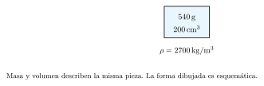
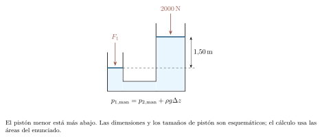
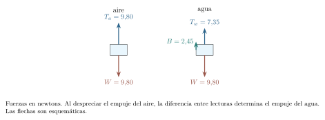

[← Capítulo anterior](capitulo-11.html) · [Índice del libro](index.html) · [Capítulo siguiente →](capitulo-13.html)

Una botella llena de agua puede sostener un objeto que se hundiría en el aire. Una prensa permite levantar una carga grande mediante una fuerza pequeña. Y un chorro se estrecha mientras cae, aunque nadie retire agua de sus costados. Estos hechos parecen diferentes; todos pueden estudiarse siguiendo las fuerzas, la masa y la energía de un fluido.

Comenzaremos por el equilibrio. La presión permitirá expresar cómo se distribuye una fuerza sobre una superficie, y su variación con la altura explicará tanto la flotación como los instrumentos de medida. Después dejaremos moverse al líquido: conservar la masa fijará el caudal; conservar la energía relacionará presión, rapidez y elevación. En cada paso habrá que decidir qué condiciones hacen razonable el modelo.

## Densidad y presión: dos cocientes con distinto significado

Un fluido puede deformarse continuamente bajo una fuerza tangencial sostenida. Los líquidos conservan aproximadamente su volumen; los gases cambian de volumen con mucha mayor facilidad. En reposo, un fluido ordinario ejerce sobre una pared una fuerza perpendicular a ella. Si pudiera sostener una tensión tangencial sin deformarse, el modelo de fluido en reposo dejaría de describirlo.

La densidad media es la masa dividida por el volumen ocupado, $\rho=m/V$, y se mide en $\,\mathrm{kg/m^3}$. Para un material homogéneo coincide con su densidad local. En una distribución no uniforme, la definición local es $\rho=dm/dV$; la masa total se obtiene sumando $dm=\rho\,dV$. Usaremos líquidos de densidad constante y tomaremos $\rho_{\mathrm{agua}}=1000\,\mathrm{kg/m^3}$ y $g=9{,}8\,\mathrm{m/s^2}$, salvo indicación distinta. La temperatura y la composición pueden modificar esas densidades.

La presión media sobre una superficie plana es $p_{\mathrm{media}}=F_\perp/A=(1/A)\int_A p\,dA$. Su definición local es $p=dF_\perp/dA$; una distribución uniforme tiene presión local igual a ese promedio. Un pascal es un newton por metro cuadrado: $1\,\mathrm{Pa}=1\,\mathrm{N/m^2}$. La presión es escalar; la dirección de la fuerza se obtiene de la orientación de cada superficie. Sobre un área curva, las fuerzas elementales tienen direcciones distintas y se suman como vectores.

### Problema resuelto 12.1 · Un volumen pequeño en unidades coherentes {#r12-1}

Una pieza homogénea tiene masa $540\,\mathrm{g}$ y volumen $200\,\mathrm{cm^3}$. Calcula su densidad en unidades SI.
*Resolución.* Como $1\,\mathrm{cm^3}=10^{-6}\,\mathrm{m^3}$, el volumen es $2{,}00\times10^{-4}\,\mathrm{m^3}$ y la masa, $0{,}540\,\mathrm{kg}$. Por tanto,
$$
 \rho=\frac{0{,}540}{2{,}00\times10^{-4}}=2700\,\mathrm{kg/m^3}.
$$
También resulta $2{,}70\,\mathrm{g/cm^3}$. El factor de conversión afecta a las tres dimensiones del volumen: convertir solo una longitud daría una densidad equivocada.

{#fig-fp-av-r12-1 fig-alt="Ilustración de Problema resuelto 12.1 · Un volumen pequeño en unidades coherentes. Una pieza homogénea tiene masa 540\\,g y volumen 200\\,cm^3. Calcula su densidad en unidades SI. Resolución. Como 1\\,cm^3=10^-6\\,m^3, el volumen es 2,00times10^-4\\,m^3 y la masa, 0,540\\,kg. Por tanto, rho=frac0,5402,00times10^-4=2700\\,kg/m^3. También resulta 2,70\\,g/cm^3. El factor de conversión afecta a las tres"}

### Problema resuelto 12.2 · La misma fuerza sobre dos áreas {#r12-2}

Una fuerza normal de $600\,\mathrm{N}$ se distribuye uniformemente primero sobre $0{,}030\,\mathrm{m^2}$ y después sobre $0{,}0060\,\mathrm{m^2}$. Compara las presiones.

*Resolución.* Las presiones son $p_1=600/0{,}030=20\,\mathrm{kPa}$ y $p_2=600/0{,}0060=100\,\mathrm{kPa}$. Reducir el área a la quinta parte multiplica la presión por cinco. La fuerza total sigue siendo $600\,\mathrm{N}$ en cada caso. Si dos superficies tienen igual presión pero áreas distintas, en cambio, las fuerzas normales serán distintas: $F=pA$.

{#fig-fp-av-r12-2 fig-alt="Ilustración de Problema resuelto 12.2 · La misma fuerza sobre dos áreas. Resolución. Las presiones son p1=600/0,030=20\\,kPa y p2=600/0,0060=100\\,kPa. Reducir el área a la quinta parte multiplica la presión por cinco. La fuerza total sigue siendo 600\\,N en cada caso. Si dos superficies tienen igual presión pero áreas distintas, en cambio, las fuerzas normales serán distintas: F=pA."}

## Cómo cambia la presión con la altura

Tomemos un pequeño prisma de líquido en reposo, con área horizontal $A$ y espesor $dz$. El eje $z$ apunta hacia arriba. En su base actúa $p(z)A$ hacia arriba; en su cara superior, $p(z+dz)A$ hacia abajo; su peso es $\rho gA\,dz$. El equilibrio exige
$$
 p(z)A-p(z+dz)A-\rho gA\,dz=0.
$$
Al dividir por $A\,dz$ y tomar el límite obtenemos $dp/dz=-\rho g$. Para densidad y gravedad constantes, integrar entre dos niveles da
$$
 p_2-p_1=-\rho g(z_2-z_1),\qquad p=p_s+\rho gh.
$$
En la segunda forma, $h$ es la profundidad bajo una superficie cuya presión es $p_s$. La presión depende del desnivel, del fluido y de la presión de referencia, cualquiera sea la forma del recipiente. A igual altura, dos puntos de un mismo líquido conectado y en reposo tienen la misma presión. Comparar fluidos distintos o recipientes aislados con presiones superficiales diferentes requiere incluir esos datos en el balance.

La *presión absoluta* se mide respecto del vacío. La *presión manométrica* es $p_{\mathrm{man}}=p_{\mathrm{abs}}-p_{\mathrm{atm}}$. Puede ser negativa sin que lo sea la presión absoluta. En un recipiente abierto, $p_s=p_{\mathrm{atm}}$; en uno cerrado, la presión del gas superior debe conocerse. Al calcular la fuerza neta sobre una pared que tiene aire al otro lado se resta esa presión exterior. Si se emplea $p_{\mathrm{man}}$, esa resta ya está hecha.

### Problema resuelto 12.3 · Una ventana bajo el agua {#r12-3}

El centro de una ventana pequeña de área $0{,}020\,\mathrm{m^2}$ está $3{,}0\,\mathrm{m}$ bajo una superficie de agua abierta. Dentro hay aire a $101\,\mathrm{kPa}$, igual que fuera en la superficie. Calcula la presión absoluta en el centro y la fuerza neta aproximada. Supón pequeña la variación de profundidad sobre la ventana.

*Resolución.* El incremento hidrostático es $\rho gh=1000(9{,}8)(3)=29{,}4\,\mathrm{kPa}$. Así, $p_{\mathrm{abs}}=130{,}4\,\mathrm{kPa}$. La fuerza neta usa la diferencia con el aire interior:
$$
 F_{\mathrm{neta}}=(130{,}4-101)10^3(0{,}020)=588\,\mathrm{N}.
$$
Apunta hacia dentro. Multiplicar la presión absoluta por el área calcularía la fuerza del agua sobre una cara; la resultante requiere combinar las fuerzas de ambas caras. Para una ventana plana vertical de área conocida, la presión media coincide además con la presión en su centroide, si la densidad es constante.

{#fig-fp-av-r12-3 fig-alt="Ilustración de Problema resuelto 12.3 · Una ventana bajo el agua. Resolución. El incremento hidrostático es rho gh=1000(9,8)(3)=29,4\\,kPa. Así, pabs=130,4\\,kPa. La fuerza neta usa la diferencia con el aire interior: Fneta=(130,4-101)10^3(0,020)=588\\,N. Apunta hacia dentro. Multiplicar la presión absoluta por el área calcularía la fuerza del agua sobre una cara; la resultante"}

### Problema resuelto 12.4 · Leer el signo de un manómetro {#r12-4}

Un tubo en U contiene mercurio de densidad $13600\,\mathrm{kg/m^3}$. Un brazo comunica con un gas y el otro con la atmósfera. El mercurio queda $8{,}0\,\mathrm{cm}$ más alto en el brazo abierto. Determina la presión manométrica del gas. Desprecia la variación de presión en los gases.
*Resolución.* En el brazo abierto descendemos $0{,}080\,\mathrm{m}$ hasta el nivel de la interfaz del otro brazo. La presión aumenta en $\rho gh$; a ese nivel ambas ramas del mercurio tienen la misma presión. Resulta
$$
 p_g-p_{\mathrm{atm}}=13600(9{,}8)(0{,}080)\simeq10{,}7\,\mathrm{kPa}.
$$
El gas tiene mayor presión que el ambiente: ha deprimido el mercurio de su lado. Invertir las alturas cambiaría el signo de la lectura.

{#fig-fp-av-r12-4 fig-alt="Ilustración de Problema resuelto 12.4 · Leer el signo de un manómetro. Un tubo en U contiene mercurio de densidad 13600\\,kg/m^3. Un brazo comunica con un gas y el otro con la atmósfera. El mercurio queda 8,0\\,cm más alto en el brazo abierto. Determina la presión manométrica del gas. Desprecia la variación de presión en los gases. Resolución. En el brazo abierto descendemos 0,080\\,m hasta"}

### Problema resuelto 12.5 · Dos líquidos, dos incrementos {#r12-5}

Un depósito abierto contiene $0{,}50\,\mathrm{m}$ de aceite de densidad $800\,\mathrm{kg/m^3}$ sobre $1{,}20\,\mathrm{m}$ de agua. Halla la presión manométrica en el fondo. Los líquidos son inmiscibles; desprecia efectos de tensión superficial.

*Resolución.* La presión es continua al atravesar una interfaz plana sin tensión superficial apreciable. Sumamos el aumento en cada capa:
$$
 p_f-p_{\mathrm{atm}}=800(9{,}8)(0{,}50)+1000(9{,}8)(1{,}20)
 =15680\,\mathrm{Pa}.
$$
Equivale a una columna de agua de $1{,}60\,\mathrm{m}$, menor que la altura geométrica total de $1{,}70\,\mathrm{m}$. Usar una sola densidad para toda la columna perdería la contribución distinta del aceite.

{#fig-fp-av-r12-5 fig-alt="Ilustración de Problema resuelto 12.5 · Dos líquidos, dos incrementos. Resolución. La presión es continua al atravesar una interfaz plana sin tensión superficial apreciable. Sumamos el aumento en cada capa: pf-patm=800(9,8)(0,50)+1000(9,8)(1,20) =15680\\,Pa. Equivale a una columna de agua de 1,60\\,m, menor que la altura geométrica total de 1,70\\,m. Usar una sola densidad para toda la"}

### Problema resuelto 12.6 · Una compuerta: sumar fuerzas distribuidas {#r12-6}

Una compuerta vertical rectangular tiene ancho $b=1{,}0\,\mathrm{m}$ y altura $H=2{,}0\,\mathrm{m}$. Su borde superior coincide con la superficie de agua abierta; al otro lado hay aire a presión atmosférica. Calcula la fuerza neta y la profundidad a la que actúa su resultante.

*Resolución.* A profundidad $h$, la presión manométrica es $\rho gh$. Una franja horizontal de espesor $dh$ recibe $dF=\rho ghb\,dh$. Por tanto,
$$
 F=\int_0^H\rho gbh\,dh=\frac12\rho gbH^2=19600\,\mathrm{N}.
$$
Para ubicar la resultante igualamos su momento respecto del borde superior al de todas las franjas:
$$
 Fh_R=\int_0^Hh\,dF=\frac13\rho gbH^3,
 \qquad h_R=\frac{2H}{3}=1{,}33\,\mathrm{m}.
$$
La fuerza actúa por debajo del centro geométrico porque las franjas inferiores reciben mayor presión. Su módulo también se obtiene con $\rho g(H/2)bH$; localizar el punto de aplicación requiere calcular el momento de la distribución, que difiere del correspondiente a $H/2$.

{#fig-fp-av-r12-6 fig-alt="Ilustración de Problema resuelto 12.6 · Una compuerta: sumar fuerzas distribuidas. Resolución. A profundidad h, la presión manométrica es rho gh. Una franja horizontal de espesor dh recibe dF=rho ghb\\,dh. Por tanto, F=int0^Hrho gbh\\,dh=frac12rho gbH^2=19600\\,N. Para ubicar la resultante igualamos su momento respecto del borde superior al de todas las franjas: FhR=int0^Hh\\,dF=frac13rho gbH^3, qquad"}

## Pascal y el intercambio entre fuerza y recorrido

Si aumentamos la presión en una frontera de un líquido confinado, su nuevo equilibrio sigue cumpliendo $p=p_s+\rho gh$. Cuando la geometría y la densidad se mantienen, cada punto recibe el mismo incremento $\Delta p_s$. Este es el principio de Pascal: se transmite el incremento de presión. Las presiones totales de puntos a distinta altura pueden seguir siendo diferentes.

En una prensa ideal con pistones a la misma altura, sin rozamiento ni peso de los pistones, y con la misma presión exterior en ambos, las fuerzas aplicadas satisfacen
$$
 \frac{F_1}{A_1}=\frac{F_2}{A_2}.
$$
Para un desplazamiento pequeño, el líquido incompresible obliga a que $A_1s_1=A_2s_2$, donde los $s$ son módulos de recorridos opuestos. Multiplicar ambas relaciones da $F_1s_1=F_2s_2$: la mayor fuerza se obtiene a costa de un menor recorrido. La igualdad de trabajos supone pérdidas despreciables y un cambio despreciable de energía potencial del líquido. Para desniveles apreciables hay que añadir el término hidrostático; para movimientos grandes, actualizar las alturas.

### Problema resuelto 12.7 · Una prensa y sus dos recorridos {#r12-7}

Los pistones de una prensa ideal tienen áreas de $4{,}0\,\mathrm{cm^2}$ y $100\,\mathrm{cm^2}$. Se aplica una fuerza de $120\,\mathrm{N}$ al menor, que desciende $0{,}25\,\mathrm{m}$. Calcula la fuerza de salida, el ascenso mayor y los trabajos. Desprecia las correcciones por desnivel durante el movimiento.

*Resolución.* La razón de áreas es $25$, por lo que $F_2=25(120)=3000\,\mathrm{N}$. La conservación del volumen da $s_2=s_1/25=0{,}010\,\mathrm{m}$. Los trabajos de entrada y de salida tienen el mismo módulo:
$$
 W_{\mathrm{entrada}}=120(0{,}25)=30\,\mathrm{J},\qquad
 W_{\mathrm{salida}}=3000(0{,}010)=30\,\mathrm{J}.
$$
El trabajo que la carga realiza sobre el dispositivo tiene signo negativo; el que el dispositivo realiza sobre la carga es positivo. Las áreas pueden compararse en $\,\mathrm{cm^2}$ porque sus unidades se cancelan en la razón.

{#fig-fp-av-r12-7 fig-alt="Ilustración de Problema resuelto 12.7 · Una prensa y sus dos recorridos. Resolución. La razón de áreas es 25, por lo que F2=25(120)=3000\\,N. La conservación del volumen da s2=s1/25=0,010\\,m. Los trabajos de entrada y de salida tienen el mismo módulo: Wentrada=120(0,25)=30\\,J,qquad Wsalida=3000(0,010)=30\\,J. El trabajo que la carga realiza sobre el dispositivo tiene signo negativo; el que"}

### Problema resuelto 12.8 · El pistón de salida está más arriba {#r12-8}

En equilibrio, un pistón de $0{,}010\,\mathrm{m^2}$ sostiene una carga de $2000\,\mathrm{N}$ y está $1{,}50\,\mathrm{m}$ por encima de otro de $4{,}0\times10^{-4}\,\mathrm{m^2}$. El aceite tiene densidad $800\,\mathrm{kg/m^3}$. Ambos pistones carecen de peso y rozamiento y están expuestos a la misma atmósfera. ¿Qué fuerza hacia abajo requiere el pistón menor?

*Resolución.* Bajo el pistón mayor, $p_{2,\mathrm{man}}=2000/0{,}010=200000\,\mathrm{Pa}$. Como el menor está más abajo, su presión debe ser mayor:
$$
 p_{1,\mathrm{man}}=200000+800(9{,}8)(1{,}50)=211760\,\mathrm{Pa}.
$$
Luego $F_1=p_{1,\mathrm{man}}A_1=84{,}704\,\mathrm{N}\simeq84{,}7\,\mathrm{N}$. Ignorar el desnivel daría $80\,\mathrm{N}$. El principio de Pascal sigue siendo válido; lo que cambia con la altura es el valor de equilibrio sobre el que se transmite un incremento de presión.

{#fig-fp-av-r12-8 fig-alt="Ilustración de Problema resuelto 12.8 · El pistón de salida está más arriba. Resolución. Bajo el pistón mayor, p2,man=2000/0,010=200000\\,Pa. Como el menor está más abajo, su presión debe ser mayor: p1,man=200000+800(9,8)(1,50)=211760\\,Pa. Luego F1=p1,manA1=84,704\\,Nsimeq84,7\\,N. Ignorar el desnivel daría 80\\,N. El principio de Pascal sigue siendo válido; lo que cambia con la altura es el valor"}

## Arquímedes: del gradiente de presión al empuje

Imaginemos un volumen de líquido en reposo y marquemos su frontera sin retirar materia. Las fuerzas que el líquido circundante ejerce sobre esa frontera equilibran el peso del volumen marcado. Si lo sustituimos por un cuerpo de la misma forma, las presiones en las mismas posiciones producen la misma resultante, siempre que se mantengan el campo hidrostático y el contacto del fluido con la superficie. Esa resultante es el *empuje*:
$$
 B=\rho_f gV_d.
$$
$V_d$ es el volumen de fluido desplazado; para un cuerpo parcialmente sumergido, solo cuenta la porción sumergida. El empuje apunta hacia arriba y su línea de acción pasa por el centro de volumen desplazado cuando $\rho_f$ es uniforme. Para capas de densidad diferente, se suman $\rho_i gV_i$. El aire también ejerce empuje, aunque aquí lo despreciaremos frente al del agua y frente al peso de objetos densos.

El empuje queda determinado por el fluido desplazado y el campo gravitatorio. Un cuerpo sostenido e inmerso puede tener $B<mg$ o $B>mg$. Para flotar libremente en equilibrio vertical, sin otros apoyos ni tensiones, sí debe cumplirse $B=mg$. Si es homogéneo, de densidad $\rho_c$, se obtiene $V_d/V=\rho_c/\rho_f$. Una fracción mayor que uno indica que la flotación parcial es imposible. La igualdad de densidades permite equilibrio totalmente sumergido, idealmente neutro frente a desplazamientos verticales. La estabilidad ante un giro requiere además estudiar los momentos de las fuerzas.

La derivación necesita fuerzas de presión alrededor del volumen desplazado. Un objeto sellado contra el fondo, sin líquido debajo, requiere estudiar las presiones efectivamente presentes en sus superficies. En ese caso deben calcularse las fuerzas de presión y de contacto con la distribución real del líquido.

### Problema resuelto 12.9 · Lo que mide el dinamómetro {#r12-9}

Un cuerpo de masa $5{,}0\,\mathrm{kg}$ y volumen $2{,}0\times10^{-3}\,\mathrm{m^3}$ permanece completamente sumergido en agua, suspendido de un dinamómetro. No toca el fondo. Calcula el empuje y la lectura.

*Resolución.* El empuje es $B=1000(9{,}8)(0{,}0020)=19{,}6\,\mathrm{N}$. El equilibrio vertical del cuerpo exige $T+B-mg=0$; por tanto,
$$
 T=49{,}0-19{,}6=29{,}4\,\mathrm{N}.
$$
El dinamómetro mide la tensión, llamada aquí peso aparente; la fuerza gravitatoria sigue siendo $49{,}0\,\mathrm{N}$. En el equilibrio vertical, la tensión aporta $29{,}4\,\mathrm{N}$ y el empuje los $19{,}6\,\mathrm{N}$ restantes.

{#fig-fp-av-r12-9 fig-alt="Ilustración de Problema resuelto 12.9 · Lo que mide el dinamómetro. Resolución. El empuje es B=1000(9,8)(0,0020)=19,6\\,N. El equilibrio vertical del cuerpo exige T+B-mg=0; por tanto, T=49,0-19,6=29,4\\,N. El dinamómetro mide la tensión, llamada aquí peso aparente; la fuerza gravitatoria sigue siendo 49,0\\,N. En el equilibrio vertical, la tensión aporta 29,4\\,N y el empuje los 19,6\\,N"}

### Problema resuelto 12.10 · Cuánto emerge y cuánto puede cargar {#r12-10}

Un cubo homogéneo de arista $0{,}10\,\mathrm{m}$ y densidad $600\,\mathrm{kg/m^3}$ flota en agua con sus caras horizontales. Halla su calado y la masa adicional máxima que puede sostener justo antes de sumergirse por completo. La carga permanece fuera del agua y no altera la orientación.
*Resolución.* Su volumen es $10^{-3}\,\mathrm{m^3}$ y su masa, $0{,}60\,\mathrm{kg}$. La fracción sumergida vale $600/1000=0{,}60$, de modo que el calado es $0{,}060\,\mathrm{m}$. Al límite, el agua desplazada tiene masa $1{,}00\,\mathrm{kg}$. La carga máxima resulta
$$
 m_{\mathrm{carga}}=1{,}00-0{,}60=0{,}40\,\mathrm{kg}.
$$
La carga de $0{,}40\,\mathrm{kg}$ corresponde al límite ideal de equilibrio vertical en la orientación supuesta. El oleaje y la estabilidad de una carga alta exigen márgenes adicionales.

{#fig-fp-av-r12-10 fig-alt="Ilustración de Problema resuelto 12.10 · Cuánto emerge y cuánto puede cargar. Un cubo homogéneo de arista 0,10\\,m y densidad 600\\,kg/m^3 flota en agua con sus caras horizontales. Halla su calado y la masa adicional máxima que puede sostener justo antes de sumergirse por completo. La carga permanece fuera del agua y no altera la orientación. Resolución. Su volumen es 10^-3\\,m^3 y su masa,"}

### Problema resuelto 12.11 · Inferir la densidad a partir del peso aparente {#r12-11}

Una pieza pesa $9{,}80\,\mathrm{N}$ en aire y el dinamómetro marca $7{,}35\,\mathrm{N}$ cuando se sumerge por completo en agua. Ignora el empuje del aire y el volumen del hilo. Calcula la densidad de la pieza.

*Resolución.* La disminución de lectura es el empuje: $B=9{,}80-7{,}35=2{,}45\,\mathrm{N}$. Entonces
$$
 V=\frac{2{,}45}{1000(9{,}8)}=2{,}50\times10^{-4}\,\mathrm{m^3},\qquad
 m=\frac{9{,}80}{9{,}8}=1{,}00\,\mathrm{kg}.
$$
La densidad es $m/V=4000\,\mathrm{kg/m^3}$. También puede deducirse directamente $\rho_c=\rho_f W/(W-T)$. La pieza debe estar completamente sumergida, sin burbujas adheridas ni apoyo en el recipiente, para que la diferencia de lecturas permita determinar su volumen completo.

{#fig-fp-av-r12-11 fig-alt="Ilustración de Problema resuelto 12.11 · Inferir la densidad a partir del peso aparente. Resolución. La disminución de lectura es el empuje: B=9,80-7,35=2,45\\,N. Entonces V=frac2,451000(9,8)=2,50times10^-4\\,m^3,qquad m=frac9,809,8=1,00\\,kg. La densidad es m/V=4000\\,kg/m^3. También puede deducirse directamente rhoc=rhof W/(W-T). La pieza debe estar completamente sumergida, sin burbujas adheridas ni apoyo"}

### Problema resuelto 12.12 · Hielo que flota y después se funde {#r12-12}

Un bloque de hielo de densidad $900\,\mathrm{kg/m^3}$ flota primero en agua dulce de densidad $1000\,\mathrm{kg/m^3}$ y después en agua salada de densidad $1025\,\mathrm{kg/m^3}$. Compara las fracciones sumergidas. ¿Cambia el nivel al fundirse en el recipiente de agua dulce? Desprecia evaporación, variaciones térmicas del líquido y el volumen del aire desplazado.

*Resolución.* La fracción sumergida es $\rho_h/\rho_f$: vale $0{,}900$ en agua dulce y $900/1025\simeq0{,}878$ en agua salada. El mismo peso requiere menos volumen desplazado en el líquido más denso.

Para una masa de hielo $m$, antes de fundirse se desplaza $V_d=m/\rho_{\mathrm{agua}}$. Después se incorpora agua líquida de volumen $m/\rho_{\mathrm{agua}}$, exactamente el mismo. El nivel del recipiente de agua dulce permanece constante en este modelo. Para estudiar hielo dulce que se derrite en agua salada debemos incorporar la densidad y la mezcla del agua añadida.

{#fig-fp-av-r12-12 fig-alt="Ilustración de Problema resuelto 12.12 · Hielo que flota y después se funde. Para una masa de hielo m, antes de fundirse se desplaza Vd=m/rhoagua. Después se incorpora agua líquida de volumen m/rhoagua, exactamente el mismo. El nivel del recipiente de agua dulce permanece constante en este modelo. Para estudiar hielo dulce que se derrite en agua salada debemos incorporar la densidad y la"}

## Conservar la masa de un fluido que circula

En un flujo estacionario, las propiedades de cada punto fijo permanecen constantes mientras las partículas siguen moviéndose. Una línea de corriente es tangente a la velocidad local. Consideremos un tramo de tubería sin fugas ni ramificaciones. En un intervalo $dt$ atraviesa una sección de área $A$ un volumen $dV=Av\,dt$ si la velocidad es uniforme y normal a la sección. Si varía sobre ella, $v$ representará aquí su componente normal media.

El caudal volumétrico es $Q=dV/dt=Av$, medido en $\,\mathrm{m^3/s}$; $1\,\mathrm{L/s}=10^{-3}\,\mathrm{m^3/s}$. El caudal másico es $\dot m=\rho Av$ para densidad uniforme en la sección. La ausencia de acumulación de masa exige
$$
 \rho_1A_1v_1=\rho_2A_2v_2.
$$
En un líquido incompresible, $\rho_1=\rho_2$ y queda $A_1v_1=A_2v_2$. En una unión, la suma de caudales másicos entrantes iguala a la de salientes. Igualar caudales volumétricos requiere además igual densidad. Una sección estrecha exige mayor rapidez para transportar el mismo caudal; determinar el caudal producido por una bomba o un depósito requiere completar el modelo.

### Problema resuelto 12.13 · Reducir un diámetro a la mitad {#r12-13}

Agua circula de forma estacionaria por una tubería que pasa de $4{,}0$ a $2{,}0\,\mathrm{cm}$ de diámetro. En la sección ancha la rapidez media es $0{,}50\,\mathrm{m/s}$. Calcula la rapidez estrecha y el caudal.
*Resolución.* El área circular es $A=\pi d^2/4$. La razón de áreas vale cuatro, de modo que $v_2=4v_1=2{,}0\,\mathrm{m/s}$. El caudal es
$$
 Q=\pi(0{,}020)^2(0{,}50)\simeq6{,}28\times10^{-4}\,\mathrm{m^3/s},
$$
unos $0{,}628\,\mathrm{L/s}$. El cambio de diámetro entra al cuadrado; duplicar la rapidez sería insuficiente para conservar el caudal.

{#fig-fp-av-r12-13 fig-alt="Ilustración de Problema resuelto 12.13 · Reducir un diámetro a la mitad. Agua circula de forma estacionaria por una tubería que pasa de 4,0 a 2,0\\,cm de diámetro. En la sección ancha la rapidez media es 0,50\\,m/s. Calcula la rapidez estrecha y el caudal. Resolución. El área circular es A=pi d^2/4. La razón de áreas vale cuatro, de modo que v2=4v1=2,0\\,m/s. El caudal es"}

### Problema resuelto 12.14 · La continuidad en una bifurcación {#r12-14}

En una unión estacionaria entran $6{,}0\,\mathrm{L/s}$ de agua. Por una rama de área $10\,\mathrm{cm^2}$ salen a $3{,}0\,\mathrm{m/s}$. La otra rama tiene área $15\,\mathrm{cm^2}$. Halla su caudal y rapidez. No hay fugas ni acumulación.

*Resolución.* La primera rama transporta $Q_a=(10\times10^{-4})(3)=0{,}0030\,\mathrm{m^3/s}=3{,}0\,\mathrm{L/s}$. La segunda debe llevar $Q_b=6{,}0-3{,}0=3{,}0\,\mathrm{L/s}$. Por ello,
$$
 v_b=\frac{0{,}0030}{15\times10^{-4}}=2{,}0\,\mathrm{m/s}.
$$
El caudal de entrada se reparte entre las ramas, y su suma conserva el valor de entrada. Las dos ramas tienen igual caudal y distinta rapidez porque sus áreas son distintas. Las presiones y las resistencias del circuito determinan si ese reparto puede realizarse; la continuidad comprueba su compatibilidad con la conservación de masa.

{#fig-fp-av-r12-14 fig-alt="Ilustración de Problema resuelto 12.14 · La continuidad en una bifurcación. Resolución. La primera rama transporta Qa=(10times10^-4)(3)=0,0030\\,m^3/s=3,0\\,L/s. La segunda debe llevar Qb=6,0-3,0=3,0\\,L/s. Por ello, vb=frac0,003015times10^-4=2,0\\,m/s. El caudal de entrada se reparte entre las ramas, y su suma conserva el valor de entrada. Las dos ramas tienen igual caudal y distinta rapidez"}

## Bernoulli: seguir la energía de una corriente

Sigamos un pequeño volumen $dV$ que avanza entre dos secciones de una corriente ideal. Su masa es $dm=\rho dV$. El fluido anterior realiza un trabajo $p_1dV$ sobre el tramo; el tramo entrega un trabajo $p_2dV$ al fluido posterior. Al aplicar el teorema de trabajo y energía, incorporando la gravedad mediante energía potencial, se obtiene
$$
 (p_1-p_2)dV=\tfrac12\rho dV(v_2^2-v_1^2)+\rho g dV(z_2-z_1).
$$
En régimen estacionario se cancelan las contribuciones intermedias que no cambian en el tiempo. Dividir por $dV$ y reagrupar conduce a
$$
 p_1+\frac12\rho v_1^2+\rho gz_1
 =p_2+\frac12\rho v_2^2+\rho gz_2.
$$
Cada término tiene unidades de presión, o de energía por unidad de volumen. Dividiendo por $\rho g$ aparecen alturas: $p/(\rho g)$, $v^2/(2g)$ y $z$. El término $p\,dV$ representa el trabajo de las fuerzas de presión en las fronteras elegidas.

La relación se aplica entre puntos de una misma línea de corriente en un flujo estacionario, incompresible y con disipación viscosa despreciable, sin bombas ni turbinas entre los puntos. En una tubería usaremos además velocidades aproximadamente uniformes en las secciones; un perfil muy desigual exige correcciones de energía cinética. Cada aplicación requiere comprobar que el régimen de flujo satisface esas condiciones. Rozamiento importante, cambios bruscos, remolinos o una máquina que entrega trabajo obligan a ampliar el balance. Cada línea de corriente puede tener su propia constante de Bernoulli.

Si los dos puntos tienen igual altura, mayor rapidez corresponde a menor presión dentro de este modelo. Si las alturas difieren, el término gravitatorio también interviene. Puede usarse presión manométrica en ambos extremos cuando se resta la misma referencia atmosférica. En un chorro libre expuesto al aire, la presión es aproximadamente la atmosférica, de acuerdo con la condición en su superficie.

### Problema resuelto 12.15 · Un estrechamiento horizontal {#r12-15}

Una tubería horizontal ideal lleva $1{,}6\,\mathrm{L/s}$ de agua. Sus áreas son $8{,}0$ y $4{,}0\,\mathrm{cm^2}$. En la sección ancha la presión manométrica es $30\,\mathrm{kPa}$. Calcula las velocidades y la presión en la sección estrecha.

*Resolución.* Convertimos $Q=1{,}6\times10^{-3}\,\mathrm{m^3/s}$ y las áreas a $\,\mathrm{m^2}$. Resultan $v_1=2{,}0\,\mathrm{m/s}$ y $v_2=4{,}0\,\mathrm{m/s}$. Bernoulli, con $z_1=z_2$, da
$$
 p_2=p_1+\frac12\rho(v_1^2-v_2^2)
 =30000+500(4-16)=24000\,\mathrm{Pa}.
$$
La presión baja $6{,}0\,\mathrm{kPa}$ mientras aumenta la energía cinética por unidad de volumen en esa misma cantidad. Una diferencia de presión impulsa y acelera el líquido; el balance de energía relaciona esa aceleración con los cambios de presión y altura.

{#fig-fp-av-r12-15 fig-alt="Ilustración de Problema resuelto 12.15 · Un estrechamiento horizontal. Resolución. Convertimos Q=1,6times10^-3\\,m^3/s y las áreas a \\,m^2. Resultan v1=2,0\\,m/s y v2=4,0\\,m/s. Bernoulli, con z1=z2, da p2=p1+frac12rho(v1^2-v2^2) =30000+500(4-16)=24000\\,Pa. La presión baja 6,0\\,kPa mientras aumenta la energía cinética por unidad de volumen en esa misma cantidad. Una diferencia de presión"}

### Problema resuelto 12.16 · La altura también cuesta presión {#r12-16}

Agua asciende por una tubería ideal de sección constante. Entre dos puntos de una misma corriente sube $4{,}0\,\mathrm{m}$; la rapidez es $3{,}0\,\mathrm{m/s}$ en ambos. Si abajo hay $80\,\mathrm{kPa}$ manométricos, ¿qué presión hay arriba?

*Resolución.* Los términos cinéticos se cancelan porque la continuidad mantiene la rapidez. Así,
$$
 p_2=p_1-\rho g(z_2-z_1)
 =80000-1000(9{,}8)(4)=40800\,\mathrm{Pa}.
$$
Arriba hay $40{,}8\,\mathrm{kPa}$ manométricos y la rapidez conserva su valor. El descenso de presión sostiene el aumento de energía potencial por unidad de volumen. En una tubería real habría además una caída asociada a disipación, si ninguna bomba actuara entre esos puntos.

{#fig-fp-av-r12-16 fig-alt="Ilustración de Problema resuelto 12.16 · La altura también cuesta presión. Resolución. Los términos cinéticos se cancelan porque la continuidad mantiene la rapidez. Así, p2=p1-rho g(z2-z1) =80000-1000(9,8)(4)=40800\\,Pa. Arriba hay 40,8\\,kPa manométricos y la rapidez conserva su valor. El descenso de presión sostiene el aumento de energía potencial por unidad de volumen. En una tubería real"}

## Del depósito al chorro: hipótesis y predicciones

Un depósito grande abierto descarga por un pequeño orificio a profundidad $h$ bajo su superficie. Elegimos un punto en la superficie y otro en el chorro recién salido. Ambos están aproximadamente a presión atmosférica. Si el área del depósito es mucho mayor que la del chorro, la rapidez superficial es despreciable. El balance ideal reduce entonces $\rho gh=\rho v^2/2$:
$$
 v=\sqrt{2gh}.
$$
Es la ley de Torricelli: el líquido sale con la rapidez que adquiriría una caída libre a través de $h$. La densidad se cancela. La semejanza de rapidez procede del balance de energía, aunque las trayectorias y las fuerzas durante el movimiento sean distintas.

El nivel baja durante el vaciado. La fórmula puede usarse de manera cuasiestacionaria si ese descenso es lento comparado con el ajuste del flujo, pero el caudal $Q=Av$ disminuye al disminuir $h$. En un orificio real, el chorro puede contraerse y su rapidez puede ser menor que la ideal; el área efectiva y las pérdidas deben medirse o modelarse. La contracción del chorro puede hacer que su sección mínima difiera del área geométrica del agujero.

### Problema resuelto 12.17 · La rapidez y el caudal instantáneos {#r12-17}

Un depósito grande abierto tiene una salida ideal de sección efectiva $2{,}0\,\mathrm{cm^2}$, situada $1{,}25\,\mathrm{m}$ bajo el nivel del agua. Calcula la rapidez y el caudal en ese instante. Supón despreciable la rapidez de la superficie y las pérdidas.

*Resolución.* Torricelli da $v=\sqrt{2(9{,}8)(1{,}25)}=\sqrt{24{,}5}\simeq4{,}95\,\mathrm{m/s}$. Entonces
$$
 Q=(2{,}0\times10^{-4})(4{,}95)\simeq9{,}90\times10^{-4}\,\mathrm{m^3/s}
 =0{,}990\,\mathrm{L/s}.
$$
Ese caudal permitiría llenar inicialmente casi un litro por segundo. Calcular el tiempo de vaciado completo requiere además conocer la geometría del depósito y cómo cambia el nivel. Al reducir $h$ a la cuarta parte, tanto la rapidez como el caudal se reducirían a la mitad si la sección efectiva se mantuviera.

{#fig-fp-av-r12-17 fig-alt="Ilustración de Problema resuelto 12.17 · La rapidez y el caudal instantáneos. Resolución. Torricelli da v=sqrt2(9,8)(1,25)=sqrt24,5simeq4,95\\,m/s. Entonces Q=(2,0times10^-4)(4,95)simeq9,90times10^-4\\,m^3/s =0,990\\,L/s. Ese caudal permitiría llenar inicialmente casi un litro por segundo. Calcular el tiempo de vaciado completo requiere además conocer la geometría del depósito y cómo cambia el"}

### Problema resuelto 12.18 · Un alcance que permite poner a prueba el modelo {#r12-18}

La superficie de un depósito grande abierto está $1{,}80\,\mathrm{m}$ por encima de una boquilla horizontal situada $0{,}80\,\mathrm{m}$ sobre el suelo. La sección efectiva del chorro es $1{,}0\,\mathrm{cm^2}$. Predice rapidez, caudal y alcance horizontal ideales. Después interpreta una rapidez de salida medida de $4{,}50\,\mathrm{m/s}$. Desprecia la resistencia del aire y considera lento el descenso del nivel.

*Resolución.* El desnivel que acelera el líquido es la diferencia de altura entre la superficie y la salida: $1{,}80\,\mathrm{m}$. En el modelo ideal,
$$
 v=\sqrt{2(9{,}8)(1{,}80)}\simeq5{,}94\,\mathrm{m/s},\qquad
 Q\simeq5{,}94\times10^{-4}\,\mathrm{m^3/s}=0{,}594\,\mathrm{L/s}.
$$
Al salir, cada pequeña porción sigue aproximadamente un tiro horizontal. Su tiempo de caída es $t=\sqrt{2(0{,}80)/9{,}8}\simeq0{,}404\,\mathrm{s}$; el alcance resulta $x=vt=2\sqrt{(1{,}80)(0{,}80)}=2{,}40\,\mathrm{m}$.

La rapidez medida produciría $x\simeq4{,}50(0{,}404)=1{,}82\,\mathrm{m}$. Si las alturas y presiones se mantienen, el déficit de energía mecánica por unidad de peso puede expresarse como una altura de pérdida:
$$
 h_L=1{,}80-\frac{4{,}50^2}{2(9{,}8)}\simeq0{,}767\,\mathrm{m}.
$$
Ese término amplía el balance a $h=v^2/(2g)+h_L$. La energía total se conserva; parte de la energía mecánica se transforma en energía interna y movimiento desordenado. El dato cuantifica un déficit respecto del modelo; identificar su causa requiere evidencia adicional. También convendría comprobar el nivel, la dirección del chorro y la sección efectiva.

{#fig-fp-av-r12-18 fig-alt="Ilustración de Problema resuelto 12.18 · Un alcance que permite poner a prueba el modelo. La rapidez medida produciría xsimeq4,50(0,404)=1,82\\,m. Si las alturas y presiones se mantienen, el déficit de energía mecánica por unidad de peso puede expresarse como una altura de pérdida: hL=1,80-frac4,50^22(9,8)simeq0,767\\,m. Ese término amplía el balance a h=v^2/(2g)+hL. La energía total se conserva; parte de la"}

## Ejercicios para reconstruir y transferir

Intenta primero representar la situación y elegir las fronteras del sistema. Usa $g=9{,}8\,\mathrm{m/s^2}$ y agua de densidad $1000\,\mathrm{kg/m^3}$. En los problemas de flujo ideal se suponen régimen estacionario o cuasiestacionario, líquido incompresible, pérdidas despreciables y velocidades uniformes en las secciones. En flotación desprecia el empuje del aire y la tensión superficial, salvo que se indique otra cosa.

### Ejercicio 12.1 · Masa de un líquido {#e12-1}

Un líquido homogéneo de densidad $850\,\mathrm{kg/m^3}$ ocupa $2{,}4\,\mathrm{L}$. Calcula su masa y su peso.

### Ejercicio 12.2 · De área a fuerza {#e12-2}

Una presión uniforme de $35\,\mathrm{kPa}$ actúa sobre $12\,\mathrm{cm^2}$. Calcula la fuerza normal sobre esa cara. ¿Cuál sería la resultante si la cara opuesta recibiera la misma presión?

### Ejercicio 12.3 · Diferencia entre profundidades {#e12-3}

Dos puntos de un mismo depósito abierto de agua están a $0{,}50$ y $2{,}50\,\mathrm{m}$ de profundidad. Determina la diferencia de presiones y señala cuál es mayor.

### Ejercicio 12.4 · Absoluta y manométrica {#e12-4}

En un lugar con presión atmosférica de $98\,\mathrm{kPa}$, un instrumento marca $-15\,\mathrm{kPa}$ manométricos en una cámara. Halla la presión absoluta. Explica si el signo implica presión absoluta negativa.

### Ejercicio 12.5 · Manómetro de agua {#e12-5}

Un gas se conecta a un brazo de un tubo en U con agua; el otro queda abierto. El agua está $12\,\mathrm{cm}$ más alta del lado del gas. Halla la presión manométrica del gas, despreciando el peso del aire.

### Ejercicio 12.6 · Capas y profundidad equivalente {#e12-6}

Hay $0{,}40\,\mathrm{m}$ de aceite de densidad $750\,\mathrm{kg/m^3}$ sobre $0{,}80\,\mathrm{m}$ de agua en un vaso abierto. Calcula la presión manométrica inferior y la profundidad de agua pura que produciría lo mismo.

### Ejercicio 12.7 · Una tapa horizontal {#e12-7}

Una tapa horizontal de área $0{,}015\,\mathrm{m^2}$ separa agua situada arriba de aire atmosférico debajo. Está $0{,}60\,\mathrm{m}$ bajo una superficie abierta. Determina la fuerza neta de presión y su sentido. Desprecia el peso de la tapa.

### Ejercicio 12.8 · Centro de presión {#e12-8}

Repite el cálculo de la compuerta del problema 12.6 para ancho $0{,}80\,\mathrm{m}$ y altura $1{,}50\,\mathrm{m}$, con el borde superior en la superficie. Determina fuerza y profundidad de aplicación.

### Ejercicio 12.9 · Una razón de radios {#e12-9}

Una prensa ideal tiene radios de pistón $1{,}0$ y $5{,}0\,\mathrm{cm}$. A igual altura, ¿qué carga sostiene una fuerza de $90\,\mathrm{N}$ en el menor? Si este desciende $20\,\mathrm{cm}$, ¿cuánto sube el mayor? Ignora correcciones de altura.

### Ejercicio 12.10 · El costo energético de levantar {#e12-10}

En una prensa ideal que trabaja a igual altura, el pistón mayor levanta $1800\,\mathrm{N}$ una distancia de $0{,}040\,\mathrm{m}$. El área mayor es veinte veces la menor. Calcula fuerza, recorrido y trabajo de entrada. Desprecia cambios de energía potencial del líquido.

### Ejercicio 12.11 · Corregir un desnivel {#e12-11}

Dos pistones ideales tienen igual presión atmosférica exterior. El mayor, de $0{,}020\,\mathrm{m^2}$, sostiene $1000\,\mathrm{N}$ y está $2{,}0\,\mathrm{m}$ por debajo del menor, de $0{,}0010\,\mathrm{m^2}$. La densidad del líquido es $900\,\mathrm{kg/m^3}$. Calcula la fuerza necesaria hacia abajo en el menor para equilibrio.

### Ejercicio 12.12 · Empuje antes de conocer la masa {#e12-12}

Un objeto desplaza $350\,\mathrm{cm^3}$ de agua. Calcula el empuje. ¿Puede determinarse su masa con ese único dato si está sostenido por un hilo? ¿Y si flota libremente en equilibrio?

### Ejercicio 12.13 · La fuerza de un hilo hacia abajo {#e12-13}

Una esfera de volumen $0{,}0040\,\mathrm{m^3}$ y masa $2{,}0\,\mathrm{kg}$ está totalmente sumergida en agua. Un hilo vertical la sujeta al fondo sin que lo toque. Calcula la tensión y dibuja sus tres fuerzas.

### Ejercicio 12.14 · Calado en agua salada {#e12-14}

Un bloque homogéneo de densidad $700\,\mathrm{kg/m^3}$ y altura $0{,}20\,\mathrm{m}$ flota verticalmente en un líquido de densidad $1050\,\mathrm{kg/m^3}$. Determina la fracción sumergida y la altura emergida.

### Ejercicio 12.15 · Volumen y densidad de una pieza {#e12-15}

Una pieza pesa $19{,}6\,\mathrm{N}$ en aire y su peso aparente al sumergirse completamente en agua es $14{,}7\,\mathrm{N}$. Calcula masa, volumen y densidad, despreciando el empuje del aire.

### Ejercicio 12.16 · Volumen repartido entre dos líquidos {#e12-16}

Un cuerpo de $1{,}0\,\mathrm{kg}$ y volumen $1{,}2\times10^{-3}\,\mathrm{m^3}$ queda en equilibrio atravesando una interfaz entre aceite de densidad $800\,\mathrm{kg/m^3}$ y agua de densidad $1000\,\mathrm{kg/m^3}$. No sobresale al aire ni toca paredes. Halla el volumen en cada líquido, sin tensión superficial.

### Ejercicio 12.17 · Caudal y tiempo de llenado {#e12-17}

Una tubería de sección $3{,}0\,\mathrm{cm^2}$ lleva agua a rapidez media constante $2{,}0\,\mathrm{m/s}$. Halla el caudal y el tiempo para llenar $90\,\mathrm{L}$, sin pérdidas de agua.

### Ejercicio 12.18 · Un gas que cambia de densidad {#e12-18}

En flujo estacionario sin fugas, un gas pasa de densidad $1{,}2\,\mathrm{kg/m^3}$ y área $20\,\mathrm{cm^2}$ a densidad $0{,}80\,\mathrm{kg/m^3}$ y área $10\,\mathrm{cm^2}$. Si $v_1=5{,}0\,\mathrm{m/s}$, halla $v_2$ y ambos caudales volumétricos. ¿Qué caudal se conserva?

### Ejercicio 12.19 · Dos salidas {#e12-19}

Entran $8{,}0\,\mathrm{L/s}$ de agua a una unión. Una salida de $12\,\mathrm{cm^2}$ lleva $2{,}5\,\mathrm{m/s}$. Calcula la rapidez de la otra salida si su área es $20\,\mathrm{cm^2}$.

### Ejercicio 12.20 · Presión en un tramo horizontal {#e12-20}

En una tubería horizontal ideal, el agua pasa de $1{,}0$ a $3{,}0\,\mathrm{m/s}$. En la sección lenta hay $25\,\mathrm{kPa}$ manométricos. Halla la presión en la sección rápida y la razón de áreas $A_1/A_2$.

### Ejercicio 12.21 · Cambian rapidez y altura {#e12-21}

En un conducto ideal, el agua pasa de $v_1=2{,}0\,\mathrm{m/s}$ a $v_2=4{,}0\,\mathrm{m/s}$ mientras asciende $3{,}0\,\mathrm{m}$. Si $p_{1,\mathrm{man}}=70\,\mathrm{kPa}$, calcula $p_{2,\mathrm{man}}$ e identifica las dos contribuciones al cambio.

### Ejercicio 12.22 · El nivel desciende {#e12-22}

Un depósito grande tiene una salida ideal de sección efectiva $1{,}5\,\mathrm{cm^2}$. Calcula rapidez y caudal cuando el desnivel es $0{,}80\,\mathrm{m}$. Compara con el instante en que el desnivel es $0{,}20\,\mathrm{m}$. Calcula cómo varía el caudal a medida que baja el nivel.

### Ejercicio 12.23 · Elegir el orificio para un alcance {#e12-23}

La superficie de un depósito grande está a altura fija $H=2{,}0\,\mathrm{m}$ sobre el suelo. Un chorro ideal sale horizontalmente por un orificio a altura $y$, con $0<y<H$. Deduce el alcance $x(y)$ y determina qué altura lo maximiza. Desprecia el aire.

### Ejercicio 12.24 · Un balance con pérdida {#e12-24}

Agua sale de un depósito grande abierto por una boquilla situada $2{,}0\,\mathrm{m}$ bajo la superficie. Se mide $v=5{,}0\,\mathrm{m/s}$. Calcula la altura de pérdida equivalente $h_L$ y el déficit de energía mecánica por cada litro descargado. Supón ambas presiones atmosféricas y rapidez superficial despreciable.

## Soluciones razonadas

### Solución 12.1 {#sol-e12-1}
 El volumen es $2{,}4\times10^{-3}\,\mathrm{m^3}$. De $m=\rho V$ resulta $m=2{,}04\,\mathrm{kg}$; su peso es $mg=19{,}992\,\mathrm{N}\simeq20{,}0\,\mathrm{N}$. La densidad relaciona la masa con el volumen.

### Solución 12.2 {#sol-e12-2}
 Convertimos $12\,\mathrm{cm^2}=1{,}2\times10^{-3}\,\mathrm{m^2}$. Así, $F=pA=35000(0{,}0012)=42\,\mathrm{N}$. Con la misma presión sobre la cara opuesta, sus fuerzas normales se cancelan y la resultante de presión es cero.

### Solución 12.3 {#sol-e12-3}
 El punto más profundo tiene mayor presión. La diferencia es $\Delta p=1000(9{,}8)(2{,}50-0{,}50)=19600\,\mathrm{Pa}=19{,}6\,\mathrm{kPa}$. La presión atmosférica se cancela porque ambos puntos comparten la misma superficie de referencia.

### Solución 12.4 {#sol-e12-4}
 La presión absoluta es $98-15=83\,\mathrm{kPa}$. La lectura manométrica de $-15\,\mathrm{kPa}$ expresa una presión $15\,\mathrm{kPa}$ menor que la atmosférica local.

### Solución 12.5 {#sol-e12-5}
 Del lado del gas la columna está más alta, de modo que el gas ejerce menos presión que la atmósfera. Recorriendo el agua entre niveles se obtiene $p_g-p_{\mathrm{atm}}=-1000(9{,}8)(0{,}12)=-1176\,\mathrm{Pa}\simeq-1{,}18\,\mathrm{kPa}$.

### Solución 12.6 {#sol-e12-6}
 Sumamos las contribuciones: $p_{\mathrm{man}}=9{,}8[750(0{,}40)+1000(0{,}80)]=10780\,\mathrm{Pa}$. La altura equivalente de agua es $10780/(1000\times9{,}8)=1{,}10\,\mathrm{m}$. Es menor que el espesor total porque el aceite es menos denso que el agua.

### Solución 12.7 {#sol-e12-7}
 La diferencia de presión es $\rho gh=5880\,\mathrm{Pa}$. La fuerza neta es $5880(0{,}015)=88{,}2\,\mathrm{N}$ hacia abajo. Se resta la atmósfera inferior; el agua empuja hacia abajo sobre la cara superior de la tapa.

### Solución 12.8 {#sol-e12-8}
 Integrar $dF=\rho gbh\,dh$ entre $0$ y $H$ da $F=\rho gbH^2/2=8820\,\mathrm{N}$. El momento integrado da $h_R=2H/3=1{,}00\,\mathrm{m}$, medido bajo la superficie, sobre la línea media vertical de la compuerta.

### Solución 12.9 {#sol-e12-9}
 La razón de áreas es $(5/1)^2=25$. Por Pascal, $F_2=25(90)=2250\,\mathrm{N}$. La igualdad de volúmenes da $s_2=0{,}20/25=0{,}0080\,\mathrm{m}=0{,}80\,\mathrm{cm}$. Usar una razón de radios en lugar de áreas daría un resultado incorrecto.

### Solución 12.10 {#sol-e12-10}
 La fuerza de entrada es $1800/20=90\,\mathrm{N}$ y su recorrido es $20(0{,}040)=0{,}80\,\mathrm{m}$. El trabajo es $90(0{,}80)=72\,\mathrm{J}$, igual a $1800(0{,}040)$. La prensa conserva la energía en el modelo ideal.

### Solución 12.11 {#sol-e12-11}
 Bajo el mayor hay $p_{2,\mathrm{man}}=1000/0{,}020=50000\,\mathrm{Pa}$. El menor está arriba, por lo que $p_{1,\mathrm{man}}=50000-900(9{,}8)(2)=32360\,\mathrm{Pa}$. Su fuerza de entrada es $32{,}36\,\mathrm{N}$. Aquí el desnivel reduce la fuerza necesaria respecto de los $50\,\mathrm{N}$ que corresponderían a igual altura.

### Solución 12.12 {#sol-e12-12}
 El volumen desplazado es $3{,}50\times10^{-4}\,\mathrm{m^3}$; el empuje vale $B=3{,}43\,\mathrm{N}$. Si un hilo actúa, falta conocer su fuerza para inferir la masa. En flotación libre y equilibrio, $mg=B$, de donde $m=0{,}350\,\mathrm{kg}$.

### Solución 12.13 {#sol-e12-13}
 El empuje es $39{,}2\,\mathrm{N}$ y el peso es $19{,}6\,\mathrm{N}$. El hilo tira hacia el fondo. El equilibrio $B-mg-T=0$ da $T=19{,}6\,\mathrm{N}$. El diagrama tiene una flecha hacia arriba, $B$, y dos hacia abajo, $mg$ y $T$.

### Solución 12.14 {#sol-e12-14}
 La fracción sumergida es $700/1050=2/3$. El calado vale $0{,}20(2/3)=0{,}133\,\mathrm{m}$ y emergen $0{,}20(1/3)\simeq0{,}0667\,\mathrm{m}$. El líquido desplazado pesa lo mismo que el bloque.

### Solución 12.15 {#sol-e12-15}
 La masa es $19{,}6/9{,}8=2{,}0\,\mathrm{kg}$. El empuje $19{,}6-14{,}7=4{,}9\,\mathrm{N}$ implica $V=4{,}9/9800=5{,}0\times10^{-4}\,\mathrm{m^3}$. La densidad es $4000\,\mathrm{kg/m^3}$; la pieza tiene mayor densidad que el agua y necesita una tensión hacia arriba para quedar en reposo.

### Solución 12.16 {#sol-e12-16}
 Sean $V_a$ y $V_w$ los volúmenes en aceite y agua. Deben cumplirse $V_a+V_w=0{,}0012$ y $800V_a+1000V_w=1$, con volúmenes en $\,\mathrm{m^3}$. Sustituyendo resulta $V_w=2{,}0\times10^{-4}\,\mathrm{m^3}$ y $V_a=1{,}0\times10^{-3}\,\mathrm{m^3}$. Ambos son positivos y suman el volumen completo, de modo que el equilibrio propuesto es compatible con las fuerzas verticales.

### Solución 12.17 {#sol-e12-17}
 El caudal es $Q=3{,}0\times10^{-4}(2)=6{,}0\times10^{-4}\,\mathrm{m^3/s}=0{,}60\,\mathrm{L/s}$. Como es constante, $t=V/Q=90/0{,}60=150\,\mathrm{s}$. Para un caudal variable debemos integrar su evolución temporal; $V=Qt$ corresponde a caudal constante o a su media apropiada.

### Solución 12.18 {#sol-e12-18}
 Conservamos masa: $v_2=\rho_1A_1v_1/(\rho_2A_2)=15\,\mathrm{m/s}$. Los caudales volumétricos son $Q_1=0{,}010\,\mathrm{m^3/s}$ y $Q_2=0{,}015\,\mathrm{m^3/s}$. Son distintos, pero ambos dan $\dot m=0{,}012\,\mathrm{kg/s}$. Estos datos requieren la forma compresible del balance de masa, en lugar de $A_1v_1=A_2v_2$.

### Solución 12.19 {#sol-e12-19}
 La primera salida lleva $12\times10^{-4}(2{,}5)=0{,}0030\,\mathrm{m^3/s}=3{,}0\,\mathrm{L/s}$. La otra transporta $5{,}0\,\mathrm{L/s}$. Su rapidez es $0{,}0050/0{,}0020=2{,}5\,\mathrm{m/s}$. Aquí las velocidades coinciden, pero los caudales difieren por las áreas.

### Solución 12.20 {#sol-e12-20}
 Bernoulli da $p_2=25000+\tfrac12(1000)(1^2-3^2)=21000\,\mathrm{Pa}=21\,\mathrm{kPa}$ manométricos. Continuidad exige $A_1/A_2=v_2/v_1=3$. La sección rápida es la más pequeña.

### Solución 12.21 {#sol-e12-21}
 El incremento cinético consume $\tfrac12\rho(4^2-2^2)=6000\,\mathrm{Pa}$ y el incremento gravitatorio, $\rho g(3)=29400\,\mathrm{Pa}$. Así, $p_2=70000-6000-29400=34600\,\mathrm{Pa}=34{,}6\,\mathrm{kPa}$. Comparar solo velocidades omitiría la contribución mayor de este caso.

### Solución 12.22 {#sol-e12-22}
 Para $h=0{,}80\,\mathrm{m}$, $v=\sqrt{15{,}68}\simeq3{,}96\,\mathrm{m/s}$ y $Q\simeq0{,}594\,\mathrm{L/s}$. Para $h=0{,}20\,\mathrm{m}$, la rapidez es $1{,}98\,\mathrm{m/s}$ y el caudal, $0{,}297\,\mathrm{L/s}$. Ambos se reducen a la mitad porque dependen de $\sqrt h$, la raíz cuadrada de $h$.

### Solución 12.23 {#sol-e12-23}
 Torricelli usa $H-y$ y la caída del chorro usa $y$: $x=\sqrt{2g(H-y)}\sqrt{2y/g}=2\sqrt{y(H-y)}$. Como $y(H-y)=H^2/4-(y-H/2)^2$, el máximo ocurre en $y=H/2=1{,}0\,\mathrm{m}$ y vale $x_{\max}=H=2{,}0\,\mathrm{m}$. Los orificios a alturas complementarias $y$ y $H-y$ tienen el mismo alcance ideal, aunque distintas velocidades y tiempos de caída.

### Solución 12.24 {#sol-e12-24}
 El balance ampliado es $2=v^2/(2g)+h_L$. De ahí, $h_L=2-25/19{,}6\simeq0{,}724\,\mathrm{m}$. Un litro tiene masa $1\,\mathrm{kg}$, así que su déficit de energía mecánica es $mgh_L=7{,}1\,\mathrm{J}$. El término expresa una transformación de energía incluida en el balance total.

## Una experiencia: el alcance de un chorro

### Dos alturas que cumplen funciones distintas

Usa un recipiente plástico con una salida horizontal pequeña, preparado previamente y colocado sobre una bandeja. Mide la altura $y$ de la salida y el desnivel $h$ entre salida y superficie. Durante un intervalo breve recoge el volumen descargado y mide el alcance sobre una superficie horizontal al nivel del suelo de referencia. Mantén pequeños los cambios de nivel en cada medición; repite con varios niveles.

Predice $x=2\sqrt{hy}$ y $Q=A\sqrt{2gh}$ antes de comparar. Una gráfica de $x^2$ frente a $h$ debería aproximarse a una recta de pendiente $4y$ si se cumplen las hipótesis. Registra la dispersión de varios alcances y la incertidumbre de las alturas. Comprueba primero que el chorro salga horizontal; una inclinación cambia la ecuación de vuelo.

El área de un agujero irregular y la contracción del chorro dificultan una predicción precisa del caudal. Puede estimarse una rapidez desde $x/\sqrt{2y/g}$ y después una sección efectiva desde $Q/v$. Si difieren de los valores ideales, distingue incertidumbre de medición, descenso del nivel y limitaciones del modelo. Contrasta las posibles causas de cada desajuste con evidencia adicional.

## Diagnóstico antes de avanzar

Responde sin consultar las fórmulas: (a) ¿pueden dos puntos de un líquido tener igual presión y ejercer fuerzas distintas sobre dos pistones? (b) Un bloque flota en un líquido más denso: ¿aumenta el empuje o cambia el volumen desplazado? (c) ¿basta saber que una tubería se estrecha para asegurar que su presión baja? (d) ¿qué se conserva en una corriente de gas cuya densidad cambia?

**Contraste.** (a) Sí: $F=pA$, por lo que cambian las fuerzas si cambian las áreas. (b) Para el mismo bloque en equilibrio libre, el empuje sigue siendo $mg$ y disminuye $V_d$. (c) Hay que especificar altura, régimen, densidad, pérdidas y máquinas; en un tramo horizontal ideal de flujo estacionario incompresible, continuidad y Bernoulli sí predicen esa caída. (d) Se conserva el caudal másico sin acumulación ni fugas; el volumétrico puede cambiar.

**Lecturas de apoyo.** H. D. Young y R. A. Freedman, *Física universitaria*, volumen 1, 12.ª edición, capítulo 14, secciones 14.1--14.5; R. A. Serway y C. Vuille, *Fundamentos de física*, volumen 1, 9.ª edición, capítulo 9, secciones 9.2 y 9.4--9.7. Los problemas y las ayudas de este capítulo son originales; las lecturas permiten contrastar las leyes y las hipótesis empleadas.

---

[← Capítulo anterior](capitulo-11.html) · [Índice del libro](index.html) · [Capítulo siguiente →](capitulo-13.html)
