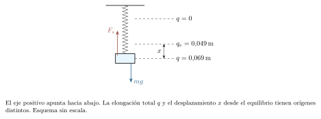
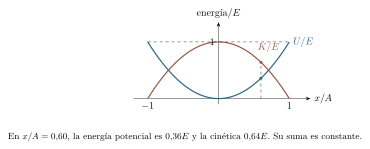
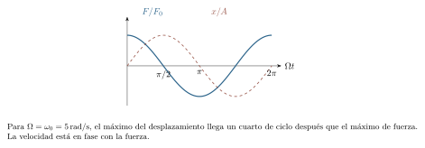

[← Capítulo anterior](capitulo-12.html) · [Índice del libro](index.html) · [Capítulo siguiente →](capitulo-14.html)

Un cuerpo unido a un resorte atraviesa la posición de equilibrio y sigue avanzando. Al atravesar el equilibrio conserva la velocidad adquirida, que lo lleva al otro lado mientras la fuerza resultante pasa por cero. El resorte invierte entonces su fuerza y comienza a frenarlo. La repetición nace de esa combinación entre restitución e inercia.

Estudiaremos cómo una ley de fuerza produce una oscilación y cómo las condiciones iniciales deciden su amplitud y su fase. La energía ofrecerá una segunda manera de describir el mismo movimiento. El péndulo permitirá reconocer el alcance de una aproximación; el amortiguamiento y el forzamiento mostrarán qué cambia cuando un sistema pierde energía mecánica o recibe un impulso periódico.

## La posición de equilibrio y la ley de Hooke

Al estirar o comprimir moderadamente un resorte, suele encontrarse una relación aproximadamente proporcional entre su deformación y la fuerza necesaria para sostenerlo. En un eje orientado a lo largo del resorte, la fuerza que este ejerce sobre el cuerpo unido a él es
$$
 F_s=-kq,\qquad k>0.
$$
Aquí $q$ mide el cambio de longitud con signo respecto de la longitud natural: positivo al estirar, negativo al comprimir. La constante $k$, medida en $\,\mathrm{N/m}$, caracteriza la rigidez dentro del intervalo lineal. El signo indica una fuerza que se opone a la deformación. Dentro de ese intervalo, $k$ caracteriza al resorte y la carga determina la deformación de equilibrio.

La ley de Hooke es un modelo constitutivo. Un resorte real puede apartarse de la proporcionalidad antes de quedar deformado permanentemente: el límite de proporcionalidad marca el alcance de la relación lineal y el límite elástico, el de la recuperación de la forma. En nuestros modelos, el resorte tendrá masa despreciable y sus extremos permanecerán unidos a los soportes y cuerpos indicados.

Conviene distinguir longitud natural y posición de equilibrio del sistema. En horizontal, sin otra fuerza a lo largo del movimiento, ambas referencias coinciden. En vertical, la gravedad desplaza el equilibrio. Si $q$ aumenta hacia abajo, la ecuación es $m\ddot q=mg-kq$ y el equilibrio está en $q_e=mg/k$. Al medir el desplazamiento desde allí, $x=q-q_e$, se obtiene $m\ddot x=-kx$. El peso ya ha intervenido al fijar el origen.

### Problema resuelto 13.1 · Medir la rigidez y leer el signo {#r13-1}

Un resorte horizontal requiere una fuerza externa de $6{,}0\,\mathrm{N}$ para mantener una elongación de $3{,}0\,\mathrm{cm}$. Halla $k$ y la fuerza que ejercerá sobre un cuerpo cuando esté comprimido $2{,}0\,\mathrm{cm}$. Supón comportamiento lineal.
*Resolución.* En la medición estática las fuerzas externa y elástica se equilibran. Por ello,
$$
 k=\frac{6{,}0}{0{,}030}=200\,\mathrm{N/m}.
$$
Con compresión, $q=-0{,}020\,\mathrm{m}$ y $F_s=-200(-0{,}020)=+4{,}0\,\mathrm{N}$. La fuerza apunta hacia la posición de longitud natural. Comprobar la linealidad en un intervalo requiere una serie de medidas de fuerza y deformación dentro de él.

{#fig-fp-av-r13-1 fig-alt="Ilustración de Problema resuelto 13.1 · Medir la rigidez y leer el signo. Un resorte horizontal requiere una fuerza externa de 6,0\\,N para mantener una elongación de 3,0\\,cm. Halla k y la fuerza que ejercerá sobre un cuerpo cuando esté comprimido 2,0\\,cm. Supón comportamiento lineal. Resolución. En la medición estática las fuerzas externa y elástica se equilibran. Por ello,"}

### Problema resuelto 13.2 · Dos orígenes para un resorte vertical {#r13-2}

Una masa de $0{,}20\,\mathrm{kg}$ cuelga de un resorte de $40\,\mathrm{N/m}$. Se la desplaza $2{,}0\,\mathrm{cm}$ por debajo de su posición de equilibrio y se la suelta desde el reposo. Calcula la elongación total, la fuerza del resorte y la fuerza neta al liberarla. Usa $g=9{,}8\,\mathrm{m/s^2}$.

*Resolución.* Tomamos el eje hacia abajo. El equilibrio está en $q_e=mg/k=0{,}049\,\mathrm{m}$; al liberar, la elongación total es $q=q_e+x=0{,}069\,\mathrm{m}$. Así,
$$
 F_s=-40(0{,}069)=-2{,}76\,\mathrm{N},\qquad
 F_{\mathrm{neta}}=1{,}96-2{,}76=-0{,}80\,\mathrm{N}.
$$
El mismo resultado neto se obtiene con $-kx$. Aplicar $-kx$ como si fuera la fuerza del resorte aislada omitiría la tensión que ya sostiene el peso en equilibrio. Su aceleración inicial es $-4{,}0\,\mathrm{m/s^2}$.

{#fig-fp-av-r13-2 fig-alt="Ilustración de Problema resuelto 13.2 · Dos orígenes para un resorte vertical. Resolución. Tomamos el eje hacia abajo. El equilibrio está en qe=mg/k=0,049\\,m; al liberar, la elongación total es q=qe+x=0,069\\,m. Así, Fs=-40(0,069)=-2,76\\,N,qquad Fneta=1,96-2,76=-0,80\\,N. El mismo resultado neto se obtiene con -kx. Aplicar -kx como si fuera la fuerza del resorte aislada omitiría la tensión que ya"}

### Problema resuelto 13.3 · Construir una rigidez equivalente {#r13-3}

Dos resortes ideales de $120$ y $240\,\mathrm{N/m}$ se conectan primero en serie y después en paralelo. Determina la constante equivalente y la fuerza necesaria para una deformación total de $3{,}0\,\mathrm{cm}$ en cada montaje. En paralelo, ambos se deforman igual; en serie, su unión tiene masa despreciable.

*Resolución.* En serie, la misma tensión $F$ atraviesa ambos resortes, mientras las elongaciones se suman: $q=F/k_1+F/k_2$. Así,
$$
 \frac1{k_s}=\frac1{k_1}+\frac1{k_2},\qquad k_s=80\,\mathrm{N/m}.
$$
En paralelo cada resorte se deforma $q$ y las fuerzas se suman: $F=(k_1+k_2)q$, de donde $k_p=360\,\mathrm{N/m}$. Para $q=0{,}030\,\mathrm{m}$ resultan $F_s=2{,}4\,\mathrm{N}$ y $F_p=10{,}8\,\mathrm{N}$. En serie, las elongaciones individuales son $0{,}020$ y $0{,}010\,\mathrm{m}$; en paralelo, ambas valen $0{,}030\,\mathrm{m}$. Esas condiciones geométricas explican por qué las constantes se combinan de distinta manera.

{#fig-fp-av-r13-3 fig-alt="Ilustración de Problema resuelto 13.3 · Construir una rigidez equivalente. Resolución. En serie, la misma tensión F atraviesa ambos resortes, mientras las elongaciones se suman: q=F/k1+F/k2. Así, frac1ks=frac1k1+frac1k2,qquad ks=80\\,N/m. En paralelo cada resorte se deforma q y las fuerzas se suman: F=(k1+k2)q, de donde kp=360\\,N/m. Para q=0,030\\,m resultan Fs=2,4\\,N y Fp=10,8\\,N. En serie,"}

## De la fuerza a una ecuación para el movimiento

En un cuerpo de masa constante, sometido únicamente a una fuerza neta $-kx$ a lo largo del eje, la segunda ley de Newton se escribe
$$
 \ddot x+\omega_0^2x=0,\qquad \omega_0=\sqrt{\frac{k}{m}}.
$$
Los puntos sobre $x$ indican derivadas respecto del tiempo: $\dot x=v$ y $\ddot x=a$. La ecuación relaciona una función desconocida con su segunda derivada. Se llama *ecuación diferencial*. La relación debe cumplirse durante todo el movimiento.

El seno y el coseno son candidatos naturales porque derivarlos dos veces devuelve la misma función con signo contrario. Para constantes $A\geq0$ y $\phi$,
$$
 x(t)=A\cos(\omega_0t+\phi),\quad
 v(t)=-A\omega_0\sin(\omega_0t+\phi),\quad
 a(t)=-\omega_0^2x(t).
$$
Sustituir estas expresiones verifica la ecuación. Además, podemos elegirlas para cualquier par de valores iniciales $x_0$ y $v_0$ cuando $\omega_0>0$. En esta ecuación lineal, esos dos datos determinan una única solución. Una forma que hace visible esa dependencia es
$$
 x(t)=x_0\cos(\omega_0t)+\frac{v_0}{\omega_0}\sin(\omega_0t).
$$
El movimiento descrito es *armónico simple*, o MAS. Su rasgo dinámico es que la aceleración resulta proporcional al desplazamiento respecto del equilibrio y de sentido opuesto. Para reconocer un MAS en una trayectoria periódica, comprobamos esa relación entre aceleración y desplazamiento durante todo el movimiento.

### Problema resuelto 13.4 · Comprobar una trayectoria por derivación {#r13-4}

Una masa de $0{,}50\,\mathrm{kg}$ está unida a un resorte horizontal de $200\,\mathrm{N/m}$ sin rozamiento. Se propone $x(t)=0{,}030\cos(20t)$, con $x$ en metros y $t$ en segundos. Verifica la solución y calcula posición, velocidad y aceleración en $t=\pi/60\,\mathrm{s}$.

*Resolución.* La razón $k/m=400\,\mathrm{s^{-2}}$ da $\omega_0=20\,\mathrm{rad/s}$. Derivando,
$$
 v=-0{,}600\sin(20t),\qquad a=-12{,}0\cos(20t).
$$
En efecto, $a=-400x$, y $ma=-200x$ coincide con la fuerza del resorte. En el instante pedido, $20t=\pi/3$, por lo que $x=0{,}0150\,\mathrm{m}$, $v=-0{,}300\sqrt3\,\mathrm{m/s}\simeq-0{,}520\,\mathrm{m/s}$ y $a=-6{,}00\,\mathrm{m/s^2}$. El cuerpo se acerca al equilibrio desde el lado positivo: velocidad y aceleración apuntan aquí en el mismo sentido, de modo que su rapidez aumenta.

{#fig-fp-av-r13-4 fig-alt="Ilustración de Problema resuelto 13.4 · Comprobar una trayectoria por derivación. Resolución. La razón k/m=400\\,mathrms^-2 da omega0=20\\,rad/s. Derivando, v=-0,600sin(20t),qquad a=-12,0cos(20t). En efecto, a=-400x, y ma=-200x coincide con la fuerza del resorte. En el instante pedido, 20t=pi/3, por lo que x=0,0150\\,m, v=-0,300sqrt3\\,m/ssimeq-0,520\\,m/s y a=-6,00\\,m/s^2. El cuerpo se acerca al"}

### Problema resuelto 13.5 · Reconstruir amplitud y fase {#r13-5}

El mismo oscilador tiene ahora $x_0=+0{,}030\,\mathrm{m}$ y $v_0=-0{,}800\,\mathrm{m/s}$. Encuentra su movimiento, su amplitud y una fase inicial compatible con los signos.

*Resolución.* La ecuación 13.4 da directamente
$$
 x(t)=0{,}030\cos(20t)-0{,}040\sin(20t).
$$
Al desarrollar $A\cos(20t+\phi)$ se identifica $A\cos\phi=0{,}030$ y $A\sin\phi=0{,}040$. Sumando los cuadrados se obtiene $A=0{,}050\,\mathrm{m}$; ambos coeficientes sitúan $\phi$ en el primer cuadrante, con $\phi=\arctan(4/3)\simeq0{,}927\,\mathrm{rad}$. Entonces $x=0{,}050\cos(20t+0{,}927)$, salvo el redondeo de la fase. El signo menos de la velocidad es esencial para escoger el cuadrante. Una fase aumentada en $2\pi$ describe exactamente el mismo movimiento.

{#fig-fp-av-r13-5 fig-alt="Ilustración de Problema resuelto 13.5 · Reconstruir amplitud y fase. Resolución. La ecuación 13.4 da directamente x(t)=0,030cos(20t)-0,040sin(20t). Al desarrollar Acos(20t+phi) se identifica Acosphi=0,030 y Asinphi=0,040. Sumando los cuadrados se obtiene A=0,050\\,m; ambos coeficientes sitúan phi en el primer cuadrante, con phi=arctan(4/3)simeq0,927\\,rad. Entonces x=0,050cos(20t+0,927),"}

## Amplitud, fase, frecuencia y tiempos de paso

La amplitud $A$ es el máximo valor de $|x|$ en el MAS. La fase $\omega_0t+\phi$ indica en qué parte del ciclo se encuentra el sistema, incluidos el sentido de movimiento y el extremo hacia el que avanza. Dos instantes con la misma posición pueden tener velocidades opuestas. Para determinar la fase se especifican la posición y el sentido de movimiento.

El período $T$ es el menor tiempo positivo después del cual se repiten posición y velocidad; la frecuencia $f=1/T$ cuenta ciclos por segundo. En una oscilación no trivial, $A>0$, la fase aumenta $2\pi$ durante cada período:
$$
 T=\frac{2\pi}{\omega_0}=2\pi\sqrt{\frac{m}{k}},\qquad
 f=\frac{\omega_0}{2\pi}.
$$
La frecuencia angular se expresa en $\,\mathrm{rad/s}$; la frecuencia en $\,\mathrm{Hz}=\,\mathrm{s^{-1}}$. El radián es adimensional, pero conservar su nombre evita confundir ciclos con fases angulares. El argumento de las funciones trigonométricas y las fórmulas de derivación se interpretan en radianes.

Para reconstruir la fase desde los datos iniciales se usan $A=\sqrt{x_0^2+(v_0/\omega_0)^2}$, $\cos\phi=x_0/A$ y $\sin\phi=-v_0/(A\omega_0)$. Una calculadora con función de dos argumentos permite obtener el cuadrante mediante $\phi=\operatorname{atan2}(-v_0/\omega_0,x_0)$. Si $A=0$, el cuerpo permanece en equilibrio y la fase carece de significado físico.

### Problema resuelto 13.6 · Una posición se visita dos veces {#r13-6}

Un oscilador parte del extremo $x=A>0$ en reposo y tiene $\omega_0=20\,\mathrm{rad/s}$. ¿Cuándo pasa por primera vez por $x=A/2$ hacia el equilibrio? ¿Cuándo vuelve por esa posición alejándose del equilibrio?
*Resolución.* La fase inicial es cero. Resolver $\cos(20t)=1/2$ en el primer ciclo da fases $\pi/3$ y $5\pi/3$. En la primera, $v<0$; en la segunda, $v>0$. Por tanto,
$$
 t_1=\frac{\pi}{60}\,\mathrm{s}=\frac T6,\qquad
 t_2=\frac{\pi}{12}\,\mathrm{s}=\frac{5T}{6}.
$$
Los dos pasos corresponden a estados con velocidades opuestas. Entre los dos pasos el cuerpo visita el extremo negativo y vuelve a cruzar el equilibrio.

{#fig-fp-av-r13-6 fig-alt="Ilustración de Problema resuelto 13.6 · Una posición se visita dos veces. Un oscilador parte del extremo x=A>0 en reposo y tiene omega0=20\\,rad/s. ¿Cuándo pasa por primera vez por x=A/2 hacia el equilibrio? ¿Cuándo vuelve por esa posición alejándose del equilibrio? Resolución. La fase inicial es cero. Resolver cos(20t)=1/2 en el primer ciclo da fases pi/3 y 5pi/3. En la primera, v<0; en la"}

### Problema resuelto 13.7 · Leer una fase negativa {#r13-7}

Se mide $x(t)=0{,}040\cos(5\pi t-\pi/3)$ en unidades SI. Determina amplitud, período, frecuencia y condiciones iniciales. Describe hacia dónde se mueve el cuerpo al comenzar.

*Resolución.* Se identifican $A=0{,}040\,\mathrm{m}$, $\omega_0=5\pi\,\mathrm{rad/s}$ y $\phi=-\pi/3$. El período es $T=2\pi/(5\pi)=0{,}400\,\mathrm{s}$ y la frecuencia, $2{,}50\,\mathrm{Hz}$. Al evaluar y derivar,
$$
 x_0=0{,}040\cos(-\pi/3)=0{,}020\,\mathrm{m},\qquad
 v_0=-0{,}200\pi\sin(-\pi/3)=0{,}100\pi\sqrt3\,\mathrm{m/s}.
$$
La velocidad inicial es aproximadamente $+0{,}544\,\mathrm{m/s}$. El cuerpo está a la derecha del equilibrio y se aleja de él; su aceleración apunta a la izquierda y lo frena. La amplitud conserva su valor positivo; la fase inicial fija la posición y el sentido de movimiento al comenzar.

{#fig-fp-av-r13-7 fig-alt="Ilustración de Problema resuelto 13.7 · Leer una fase negativa. Resolución. Se identifican A=0,040\\,m, omega0=5pi\\,rad/s y phi=-pi/3. El período es T=2pi/(5pi)=0,400\\,s y la frecuencia, 2,50\\,Hz. Al evaluar y derivar, x0=0,040cos(-pi/3)=0,020\\,m,qquad v0=-0,200pisin(-pi/3)=0,100pisqrt3\\,m/s. La velocidad inicial es aproximadamente +0,544\\,m/s. El cuerpo está a la derecha del"}

### Problema resuelto 13.8 · Comparar osciladores sin fijar la amplitud {#r13-8}

Un segundo oscilador tiene masa cuatro veces mayor y constante elástica nueve veces mayor que el primero. Compara sus períodos y frecuencias. ¿Alteraría la comparación multiplicar la amplitud del segundo por tres?

*Resolución.* Al dividir las expresiones de los períodos,
$$
 \frac{T_2}{T_1}=\sqrt{\frac{4m_1/(9k_1)}{m_1/k_1}}=\frac23,
 \qquad \frac{f_2}{f_1}=\frac32.
$$
El aumento de rigidez domina sobre el aumento de masa. El período del resorte ideal lineal depende de la masa y de la rigidez. La amplitud fija la escala de energía y de velocidad; en un resorte real, su aumento puede llevar al sistema fuera del intervalo de Hooke.

{#fig-fp-av-r13-8 fig-alt="Ilustración de Problema resuelto 13.8 · Comparar osciladores sin fijar la amplitud. Resolución. Al dividir las expresiones de los períodos, fracT2T1=sqrtfrac4m1/(9k1)m1/k1=frac23, qquad fracf2f1=frac32. El aumento de rigidez domina sobre el aumento de masa. El período del resorte ideal lineal depende de la masa y de la rigidez. La amplitud fija la escala de energía y de velocidad; en un resorte real,"}

## La energía y la geometría del estado

El trabajo de la fuerza elástica entre $0$ y $x$ es $\int_0^x(-ku)\,du=-kx^2/2$. Podemos asociarle una energía potencial $U=kx^2/2$, tomando cero en el equilibrio horizontal. Sin disipación, la energía mecánica permanece constante:
$$
 E=\frac12mv^2+\frac12kx^2=\frac12kA^2.
$$
La última igualdad se evalúa en un extremo, donde $v=0$. En el equilibrio la energía cinética es máxima: $v_{\max}=\omega_0A$. A cualquier posición admisible,
$$
 |v|=\omega_0\sqrt{A^2-x^2},\qquad |x|\leq A.
$$
La conservación de energía da la rapidez. El signo de la velocidad se determina siguiendo la rama del movimiento que recorre el cuerpo. Si se dibuja $v$ frente a $x$, la ecuación $x^2/A^2+v^2/(\omega_0^2A^2)=1$ describe una elipse. En cada extremo de posición hay velocidad cero; en cada cruce por el equilibrio, rapidez máxima. Este *diagrama de estado* representa conjuntamente la posición y la velocidad.

En un resorte vertical, la energía potencial del sistema resorte--masa--Tierra es $U(q)=kq^2/2-mgq$ con el eje hacia abajo. Al completar el cuadrado resulta $U=k(q-q_e)^2/2-m^2g^2/(2k)$. El término constante desplaza la referencia energética y tiene derivada espacial cero. Si elegimos el cero en el mínimo, la energía de oscilación vuelve a ser $mv^2/2+kx^2/2$, con $x=q-q_e$. El cambio de coordenada queda acompañado por el cambio de referencia energética.

### Problema resuelto 13.9 · La energía se reparte durante el ciclo {#r13-9}

Una masa de $0{,}50\,\mathrm{kg}$ oscila con $k=200\,\mathrm{N/m}$ y amplitud $0{,}050\,\mathrm{m}$. Determina la energía total y la rapidez al pasar por $x=0{,}030\,\mathrm{m}$. ¿Puede saberse el signo de la velocidad con esos datos?

*Resolución.* La energía total es $E=\tfrac12(200)(0{,}050)^2=0{,}250\,\mathrm{J}$. En la posición pedida, $U=\tfrac12(200)(0{,}030)^2=0{,}090\,\mathrm{J}$ y $K=0{,}160\,\mathrm{J}$. Así,
$$
 |v|=\sqrt{\frac{2K}{m}}=\sqrt{\frac{0{,}320}{0{,}50}}=0{,}800\,\mathrm{m/s}.
$$
Hay dos velocidades posibles, $\pm0{,}800\,\mathrm{m/s}$. El signo negativo corresponde a acercarse al equilibrio desde ese lado; el positivo, a alejarse de él. El resultado coincide con las condiciones iniciales usadas en el problema 13.5 cuando se escoge la rama negativa.

{#fig-fp-av-r13-9 fig-alt="Ilustración de Problema resuelto 13.9 · La energía se reparte durante el ciclo. Resolución. La energía total es E=tfrac12(200)(0,050)^2=0,250\\,J. En la posición pedida, U=tfrac12(200)(0,030)^2=0,090\\,J y K=0,160\\,J. Así, |v|=sqrtfrac2Km=sqrtfrac0,3200,50=0,800\\,m/s. Hay dos velocidades posibles, pm0,800\\,m/s. El signo negativo corresponde a acercarse al equilibrio desde ese lado; el positivo, a"}

### Problema resuelto 13.10 · Igualdad de energías en el diagrama de estado {#r13-10}

Para el oscilador del problema anterior, encuentra las posiciones y velocidades en las que $K=U$. Indica cuántos estados distintos aparecen en un ciclo.
*Resolución.* Si ambas energías son iguales, cada una vale $E/2$. De $kx^2/2=kA^2/4$ se obtiene $x=\pm A/\sqrt2\simeq\pm0{,}0354\,\mathrm{m}$. En esos puntos,
$$
 v=\pm\frac{\omega_0A}{\sqrt2}=\pm0{,}707\,\mathrm{m/s}.
$$
Cada posición se recorre con ambos signos de velocidad. Hay cuatro estados distintos y cuatro pasos por esa condición en un período. Las combinaciones de signos representan fases distintas, aunque sus energías coincidan.

{#fig-fp-av-r13-10 fig-alt="Ilustración de Problema resuelto 13.10 · Igualdad de energías en el diagrama de estado. Para el oscilador del problema anterior, encuentra las posiciones y velocidades en las que K=U. Indica cuántos estados distintos aparecen en un ciclo. Resolución. Si ambas energías son iguales, cada una vale E/2. De kx^2/2=kA^2/4 se obtiene x=pm A/sqrt2simeqpm0,0354\\,m. En esos puntos,"}

### Problema resuelto 13.11 · Soltar desde la longitud natural {#r13-11}

Una masa de $0{,}20\,\mathrm{kg}$ cuelga de un resorte vertical de $40\,\mathrm{N/m}$. Se sostiene el cuerpo con el resorte sin deformar y se lo suelta desde el reposo. Calcula la amplitud respecto del equilibrio, la máxima elongación total y la rapidez máxima. Supón un resorte unido al cuerpo, lineal en todo el recorrido.

*Resolución.* El equilibrio está $q_e=mg/k=0{,}049\,\mathrm{m}$ por debajo de la longitud natural. Inicialmente $x_0=-q_e$ y $v_0=0$, por lo que $A=q_e$. El extremo inferior queda en $q=q_e+A=0{,}098\,\mathrm{m}$. La frecuencia angular es $\sqrt{200}\,\mathrm{rad/s}$, y
$$
 v_{\max}=\sqrt{200}(0{,}049)\simeq0{,}693\,\mathrm{m/s}.
$$
La energía de oscilación es $kA^2/2=0{,}04802\,\mathrm{J}$, medida desde el mínimo del potencial total. Con la referencia $U(0)=0$, la energía total inicial sería cero y en el extremo inferior se cumpliría $kq^2/2-mgq=0$. Ambas referencias predicen $q=2mg/k$ como extremo inferior.

{#fig-fp-av-r13-11 fig-alt="Ilustración de Problema resuelto 13.11 · Soltar desde la longitud natural. Resolución. El equilibrio está qe=mg/k=0,049\\,m por debajo de la longitud natural. Inicialmente x0=-qe y v0=0, por lo que A=qe. El extremo inferior queda en q=qe+A=0,098\\,m. La frecuencia angular es sqrt200\\,rad/s, y vmax=sqrt200(0,049)simeq0,693\\,m/s. La energía de oscilación es kA^2/2=0,04802\\,J, medida desde el"}

## El péndulo y la aproximación de ángulo pequeño

Un péndulo simple consiste en una masa puntual suspendida de un hilo inextensible y de masa despreciable, de longitud $L$, con punto de suspensión fijo. La tensión se dirige a lo largo del hilo. La componente tangencial de la fuerza total procede de la gravedad y vale $-mg\sin\theta$. Si $\theta$ se mide en radianes desde la vertical inferior, la aceleración tangencial es $L\ddot\theta$, y resulta
$$
 \ddot\theta+\frac gL\sin\theta=0.
$$
La masa se cancela. La fuerza tangencial contiene $\sin\theta$. Para aproximarla cerca de cero, usamos $\sin\theta=\theta-\theta^3/6+\cdots$, y el primer término da
$$
 \ddot\theta+\frac gL\theta\simeq0,\qquad
 \omega_0\simeq\sqrt{\frac gL},\qquad T_0=2\pi\sqrt{\frac Lg}.
$$
La amplitud angular se expresa en radianes para controlar la precisión de esa aproximación. El término omitido es del orden de $\theta^3$, así que el error relativo en la fuerza empieza en el orden de $\theta^2$. El error del período requiere estudiar el movimiento a lo largo de un ciclo completo.

El potencial exacto, tomando cero abajo, es $mgL(1-\cos\theta)$. Para amplitud angular $\theta_0$ y sin rozamiento, la conservación de energía da $v_{\max}=\sqrt{2gL(1-\cos\theta_0)}$ en el punto inferior. Para ángulos pequeños, $1-\cos\theta_0\simeq\theta_0^2/2$ y resulta $v_{\max}\simeq\theta_0\sqrt{gL}$. Usaremos $T_0$ como período aproximado; a amplitudes mayores el período del péndulo depende de la amplitud.

### Problema resuelto 13.12 · Un péndulo de pequeña amplitud {#r13-12}

Un péndulo de longitud $0{,}98\,\mathrm{m}$ oscila con amplitud $0{,}10\,\mathrm{rad}$. Calcula período y frecuencia en la aproximación armónica, y compara la rapidez máxima aproximada con la obtenida mediante energía exacta. Usa $g=9{,}8\,\mathrm{m/s^2}$.

*Resolución.* La frecuencia angular aproximada es $\sqrt{10}\,\mathrm{rad/s}$. Así, $T_0=2\pi/\sqrt{10}\simeq1{,}987\,\mathrm{s}$ y $f_0\simeq0{,}503\,\mathrm{Hz}$. La rapidez máxima aproximada es
$$
 v_{\max}\simeq0{,}10\sqrt{(9{,}8)(0{,}98)}\simeq0{,}310\,\mathrm{m/s}.
$$
El balance exacto da $\sqrt{2(9{,}8)(0{,}98)(1-\cos0{,}10)}\simeq0{,}3098\,\mathrm{m/s}$. La proximidad concuerda con una amplitud pequeña. El período de este modelo depende de la longitud y de la gravedad. El rozamiento y una distribución extensa de masa requieren incorporar sus efectos al modelo.

{#fig-fp-av-r13-12 fig-alt="Ilustración de Problema resuelto 13.12 · Un péndulo de pequeña amplitud. Resolución. La frecuencia angular aproximada es sqrt10\\,rad/s. Así, T0=2pi/sqrt10simeq1,987\\,s y f0simeq0,503\\,Hz. La rapidez máxima aproximada es vmaxsimeq0,10sqrt(9,8)(0,98)simeq0,310\\,m/s. El balance exacto da sqrt2(9,8)(0,98)(1-cos0,10)simeq0,3098\\,m/s. La proximidad concuerda con una amplitud pequeña. El período"}

### Problema resuelto 13.13 · Estimar la gravedad con varios ciclos {#r13-13}

Un péndulo de longitud $L=1{,}000\pm0{,}005\,\mathrm{m}$ tarda $40{,}2\pm0{,}2\,\mathrm{s}$ en completar 20 ciclos de pequeña amplitud. Estima $g$ y una cota lineal aproximada de su incertidumbre, tratando las cotas dadas como límites instrumentales. Desprecia correcciones por amplitud y rozamiento.

*Resolución.* El período estimado es $T=40{,}2/20=2{,}01\,\mathrm{s}$. Al despejar,
$$
 g=\frac{4\pi^2L}{T^2}\simeq9{,}772\,\mathrm{m/s^2}.
$$
Para variaciones pequeñas, diferenciar da $dg/g=dL/L-2\,dT/T$. Una cota lineal conservadora suma los módulos:
$$
 \frac{\delta g}{g}\lesssim\frac{0{,}005}{1{,}000}
 +2\frac{0{,}2}{40{,}2}\simeq0{,}01495.
$$
Resulta $\delta g\simeq0{,}15\,\mathrm{m/s^2}$ y podemos informar $g\simeq(9{,}77\pm0{,}15)\,\mathrm{m/s^2}$ bajo esas hipótesis. Esta estimación expresa una cota instrumental aproximada. Cronometrar varios ciclos reduce la incertidumbre relativa de una misma cota de tiempo total; las correcciones sistemáticas requieren un tratamiento propio.

{#fig-fp-av-r13-13 fig-alt="Ilustración de Problema resuelto 13.13 · Estimar la gravedad con varios ciclos. Resolución. El período estimado es T=40,2/20=2,01\\,s. Al despejar, g=frac4pi^2LT^2simeq9,772\\,m/s^2. Para variaciones pequeñas, diferenciar da dg/g=dL/L-2\\,dT/T. Una cota lineal conservadora suma los módulos: fracdelta gglesssimfrac0,0051,000 +2frac0,240,2simeq0,01495. Resulta delta gsimeq0,15\\,m/s^2 y podemos"}

### Problema resuelto 13.14 · Cuantificar el error de una aproximación {#r13-14}

Compara el módulo de la fuerza tangencial exacta del péndulo con el de su aproximación lineal a $10^\circ$ y a $30^\circ$. Mide el error relativo respecto de la fuerza exacta. ¿Son esos porcentajes errores del período?

*Resolución.* Para $0<\theta<\pi$, la fuerza exacta tiene módulo $mg\sin\theta$ y la aproximada, $mg\theta$. Por tanto,
$$
 \varepsilon_F=\frac{mg\theta-mg\sin\theta}{mg\sin\theta}
 =\frac\theta{\sin\theta}-1.
$$
Con $10^\circ=\pi/18\,\mathrm{rad}$ resulta $\varepsilon_F\simeq0{,}00510$, un $0{,}510\%$. Con $30^\circ=\pi/6\,\mathrm{rad}$ resulta $\varepsilon_F\simeq0{,}0472$, un $4{,}72\%$. La aproximación sobreestima el módulo de restitución en ambos casos. Estos porcentajes describen la fuerza instantánea a los ángulos indicados. El error del período depende de la evolución durante un ciclo completo.

{#fig-fp-av-r13-14 fig-alt="Ilustración de Problema resuelto 13.14 · Cuantificar el error de una aproximación. Resolución. Para 0<theta<pi, la fuerza exacta tiene módulo mgsintheta y la aproximada, mgtheta. Por tanto, varepsilonF=fracmgtheta-mgsinthetamgsintheta =fracthetasintheta-1. Con 10^circ=pi/18\\,rad resulta varepsilonFsimeq0,00510, un 0,510\\%. Con 30^circ=pi/6\\,rad resulta varepsilonFsimeq0,0472, un 4,72\\%. La"}

## Amortiguamiento: una pérdida que puede calcularse

En regímenes de resistencia aproximadamente proporcional a la velocidad, modelamos la fuerza como $F_r=-bv$, con $b\geq0$ en $\,\mathrm{kg/s}$. La ecuación pasa a ser
$$
 m\ddot x+b\dot x+kx=0.
$$
Multiplicarla por $\dot x$ muestra que $dE/dt=-b\dot x^2\leq0$ para $E=m\dot x^2/2+kx^2/2$. La disipación tiene tasa $b\dot x^2$: con $b>0$ reduce la energía mecánica durante el movimiento, y para $b=0$ esa energía permanece constante. El sistema ampliado, incluido el entorno, conserva la energía total.

Definamos $\gamma=b/(2m)$ y $\omega_0=\sqrt{k/m}$. Al sustituir $x=e^{rt}$ se obtiene $r^2+2\gamma r+\omega_0^2=0$. Si $\gamma<\omega_0$, las raíces conducen a una solución oscilatoria
$$
 x(t)=Ce^{-\gamma t}\cos(\omega_dt+\phi),\qquad
 \omega_d=\sqrt{\omega_0^2-\gamma^2}.
$$
Puede verificarse derivando. Las curvas $\pm Ce^{-\gamma t}$ son envolventes que acotan el desplazamiento. Los extremos reales se obtienen con $\dot x=0$, incluyendo la derivada de la envolvente exponencial. Tras un pseudoperíodo $T_d=2\pi/\omega_d$, posición y velocidad quedan multiplicadas por $e^{-\gamma T_d}$. La fase se repite mientras disminuye la escala de posición y velocidad.

Si $\gamma=\omega_0$, el amortiguamiento es crítico y $x=(C_1+C_2t)e^{-\gamma t}$. Si $\gamma>\omega_0$, hay dos raíces reales negativas y una combinación de exponentes decrecientes. Estos dos regímenes carecen de oscilación sostenida alrededor del equilibrio. Las condiciones iniciales, junto con $m$, $k$ y $b$, determinan el número de cruces y la forma del retorno.

### Problema resuelto 13.15 · Envolvente y energía a igual fase {#r13-15}

Un sistema tiene $m=1{,}0\,\mathrm{kg}$, $k=25\,\mathrm{N/m}$ y $b=2{,}0\,\mathrm{kg/s}$. Su movimiento es $x=0{,}040e^{-t}\cos(\sqrt{24}\,t)$ en unidades SI. Calcula la frecuencia amortiguada, la envolvente a los $3{,}0\,\mathrm{s}$ y la razón de energías entre dos instantes separados por $T_d$. ¿Se soltó inicialmente desde el reposo?

*Resolución.* Tenemos $\omega_0=5\,\mathrm{rad/s}$, $\gamma=1\,\mathrm{s^{-1}}$ y $\omega_d=\sqrt{24}\simeq4{,}899\,\mathrm{rad/s}$. La envolvente a $3\,\mathrm{s}$ vale $0{,}040e^{-3}\simeq0{,}00199\,\mathrm{m}$. Ese valor acota $|x|$; para obtener el desplazamiento en ese instante se incluye el factor coseno.

El pseudoperíodo es $T_d=2\pi/\sqrt{24}\simeq1{,}283\,\mathrm{s}$. A igual fase, tanto $x$ como $v$ adquieren el factor $e^{-T_d}$, de modo que $E(t+T_d)/E(t)=e^{-2T_d}\simeq0{,}0769$. Esta igualdad a fases repetidas es exacta en el modelo. A tiempos arbitrarios, la energía contiene además factores periódicos procedentes de la posición y de la derivada completa de la envolvente. En particular, $v_0=-0{,}040\,\mathrm{m/s}$; la derivada de la envolvente aporta esa velocidad inicial incluso con fase cero del coseno.

{#fig-fp-av-r13-15 fig-alt="Ilustración de Problema resuelto 13.15 · Envolvente y energía a igual fase. El pseudoperíodo es Td=2pi/sqrt24simeq1,283\\,s. A igual fase, tanto x como v adquieren el factor e^-Td, de modo que E(t+Td)/E(t)=e^-2Tdsimeq0,0769. Esta igualdad a fases repetidas es exacta en el modelo. A tiempos arbitrarios, la energía contiene además factores periódicos procedentes de la posición y de la derivada"}

### Problema resuelto 13.16 · Tres regímenes con el mismo resorte {#r13-16}

Con $m=1{,}0\,\mathrm{kg}$ y $k=25\,\mathrm{N/m}$, clasifica los movimientos libres para $b=2$, $10$ y $12\,\mathrm{kg/s}$. Obtén las raíces características del caso sobreamortiguado.

*Resolución.* El umbral crítico es $b_c=2\sqrt{mk}=10\,\mathrm{kg/s}$. Para $b=2$ hay oscilaciones amortiguadas; para $b=10$ se alcanza el caso crítico; para $b=12$ el sistema es sobreamortiguado. En este último, $\gamma=6\,\mathrm{s^{-1}}$ y
$$
 r_{\pm}=-6\pm\sqrt{36-25}=-6\pm\sqrt{11}\,\mathrm{s^{-1}}.
$$
Ambas raíces son negativas. Cada término de $C_1e^{r_+t}+C_2e^{r_-t}$ es una exponencial real decreciente; las condiciones iniciales $x_0$ y $v_0$ fijan su combinación, que tiende a cero. El caso crítico requiere su propia forma con $t e^{-\gamma t}$ porque las dos raíces coinciden.

{#fig-fp-av-r13-16 fig-alt="Ilustración de Problema resuelto 13.16 · Tres regímenes con el mismo resorte. Resolución. El umbral crítico es bc=2sqrtmk=10\\,kg/s. Para b=2 hay oscilaciones amortiguadas; para b=10 se alcanza el caso crítico; para b=12 el sistema es sobreamortiguado. En este último, gamma=6\\,mathrms^-1 y rpm=-6pmsqrt36-25=-6pmsqrt11\\,mathrms^-1. Ambas raíces son negativas. Cada término de C1e^r+t+C2e^r-t es"}

## Forzamiento y resonancia: qué respuesta se maximiza

Una fuerza externa periódica puede compensar la disipación. Con $F(t)=F_0\cos(\Omega t)$, la ecuación es $m\ddot x+b\dot x+kx=F_0\cos(\Omega t)$. Su solución reúne un transitorio libre y una respuesta forzada. Si $b>0$, el transitorio decae y queda una oscilación estacionaria a la frecuencia impuesta $\Omega$, que puede diferir de $\omega_0$ y de $\omega_d$.

Para hallar esa respuesta proponemos $x=a\cos\Omega t+c\sin\Omega t$. Al sustituir e igualar por separado los coeficientes de coseno y seno, con $D=k-m\Omega^2$, resulta $Da+b\Omega c=F_0$ y $Dc-b\Omega a=0$. Resolver esas dos ecuaciones da $a=F_0D/(D^2+b^2\Omega^2)$ y $c=F_0b\Omega/(D^2+b^2\Omega^2)$. Por tanto,
$$
 x=A(\Omega)\cos(\Omega t-\delta),\qquad
 A(\Omega)=\frac{F_0}{\sqrt{(k-m\Omega^2)^2+b^2\Omega^2}},
$$
con $\delta=\operatorname{atan2}(b\Omega,k-m\Omega^2)$ para $F_0>0$, $b>0$ y $\Omega>0$. El desfase indica cuánto se retrasa el desplazamiento respecto de la fuerza. Cuando $\Omega=\omega_0$, el desplazamiento se retrasa $\pi/2$ y la velocidad queda en fase con la fuerza.

La resonancia describe un aumento de respuesta en cierta banda de frecuencias. Para precisar dónde está su máximo hay que indicar qué se mide. El máximo de amplitud de desplazamiento ocurre en $\Omega_r=\sqrt{\omega_0^2-2\gamma^2}$ si $\gamma<\omega_0/\sqrt2$. Para $\gamma\geq\omega_0/\sqrt2$, la amplitud decrece desde su valor estático $F_0/k$ al aumentar la frecuencia. En el régimen subamortiguado, la frecuencia libre es $\omega_d=\sqrt{\omega_0^2-\gamma^2}$; el máximo de desplazamiento responde a la expresión anterior.

La potencia media recibida en el estado estacionario se obtiene multiplicando fuerza y velocidad y promediando un ciclo. Como $\langle\sin^2\rangle=1/2$ y los productos seno--coseno promedian cero, resulta
$$
 \overline P=\frac12b\Omega^2A(\Omega)^2.
$$
Es igual a la potencia media disipada por la fuerza resistiva. En este modelo su máximo ocurre en $\Omega=\omega_0$, aunque el máximo de desplazamiento esté en otra frecuencia. Cuando $b=0$, la respuesta exactamente resonante crece con el tiempo. Ese caso requiere una solución temporal propia, pues la expresión estacionaria resulta singular en la resonancia ideal.

### Problema resuelto 13.17 · Responder a una fuerza de frecuencia conocida {#r13-17}

Un oscilador tiene $m=1{,}0\,\mathrm{kg}$, $k=25\,\mathrm{N/m}$, $b=2{,}0\,\mathrm{kg/s}$ y recibe una fuerza de amplitud $F_0=0{,}40\,\mathrm{N}$. Calcula la amplitud y el desfase estacionarios para $\Omega=3{,}0$ y $5{,}0\,\mathrm{rad/s}$.

*Resolución.* Para $\Omega=3$, $k-m\Omega^2=16\,\mathrm{N/m}$ y $b\Omega=6\,\mathrm{N/m}$. Por ello,
$$
 A(3)=\frac{0{,}40}{\sqrt{16^2+6^2}}\simeq0{,}0234\,\mathrm{m},\qquad
 \delta(3)=\arctan(6/16)\simeq0{,}359\,\mathrm{rad}.
$$
Para $\Omega=5=\omega_0$, el término $k-m\Omega^2$ se anula: $A(5)=0{,}40/(2\times5)=0{,}0400\,\mathrm{m}$ y $\delta=\pi/2$. La oscilación estacionaria tiene la frecuencia de la fuerza en cada ensayo. Para reconstruir el inicio del movimiento se añade el transitorio compatible con las condiciones iniciales.

{#fig-fp-av-r13-17 fig-alt="Ilustración de Problema resuelto 13.17 · Responder a una fuerza de frecuencia conocida. Resolución. Para Omega=3, k-mOmega^2=16\\,N/m y bOmega=6\\,N/m. Por ello, A(3)=frac0,40sqrt16^2+6^2simeq0,0234\\,m,qquad delta(3)=arctan(6/16)simeq0,359\\,rad. Para Omega=5=omega0, el término k-mOmega^2 se anula: A(5)=0,40/(2times5)=0,0400\\,m y delta=pi/2. La oscilación estacionaria tiene la frecuencia de la fuerza en"}

### Problema resuelto 13.18 · Máximos de desplazamiento y potencia {#r13-18}

Para el sistema anterior, encuentra la frecuencia que maximiza el desplazamiento y compárala con la que maximiza la potencia media. Calcula ambos valores máximos.

*Resolución.* Maximizar $A$ equivale a minimizar $D(\Omega)=(25-\Omega^2)^2+4\Omega^2$. Al escribir $u=\Omega^2\geq0$, $D=(25-u)^2+4u$ tiene derivada $2u-46$ y mínimo en $u=23$. Así,
$$
 \Omega_r=\sqrt{23}\simeq4{,}796\,\mathrm{rad/s},\qquad
 A_{\max}=\frac{0{,}40}{\sqrt{96}}\simeq0{,}0408\,\mathrm{m}.
$$
La potencia media es $\overline P=\Omega^2A^2$ con estos valores de $b$. Su máximo ocurre en $\Omega=\omega_0=5\,\mathrm{rad/s}$ y vale $\overline P_{\max}=F_0^2/(2b)=0{,}0400\,\mathrm{W}$. A esa frecuencia la fuerza y la velocidad están en fase: la transferencia media de energía es máxima. El pequeño desplazamiento entre los dos máximos explica por qué una observación de «resonancia» debe indicar qué magnitud se midió y cuánto amortiguamiento había.

{#fig-fp-av-r13-18 fig-alt="Ilustración de Problema resuelto 13.18 · Máximos de desplazamiento y potencia. Resolución. Maximizar A equivale a minimizar D(Omega)=(25-Omega^2)^2+4Omega^2. Al escribir u=Omega^2geq0, D=(25-u)^2+4u tiene derivada 2u-46 y mínimo en u=23. Así, Omegar=sqrt23simeq4,796\\,rad/s,qquad Amax=frac0,40sqrt96simeq0,0408\\,m. La potencia media es overline P=Omega^2A^2 con estos valores de b. Su máximo ocurre"}

## Ejercicios para reconstruir y transferir

Usa unidades SI, $g=9{,}8\,\mathrm{m/s^2}$ y resortes de masa despreciable dentro de su intervalo lineal. Los movimientos son unidimensionales; se desprecian pérdidas salvo en los ejercicios que introducen amortiguamiento. En los péndulos se supone masa puntual, hilo ideal y suspensión fija. Distingue siempre coordenada desde la longitud natural y desplazamiento desde el equilibrio.

### Ejercicio 13.1 · Reconstruir una ley de fuerza {#e13-1}

Una fuerza externa de $2{,}4\,\mathrm{N}$ sostiene un resorte estirado $1{,}2\,\mathrm{cm}$. Calcula $k$ y la fuerza del resorte para una compresión de $2{,}0\,\mathrm{cm}$, tomando positivo el estiramiento.

### Ejercicio 13.2 · Un equilibrio desplazado {#e13-2}

Una masa de $0{,}30\,\mathrm{kg}$ cuelga de un resorte de $60\,\mathrm{N/m}$. Halla la elongación estática. Si la masa se duplica y el resorte sigue siendo lineal, ¿qué cambia en $q_e$ y en $k$?

### Ejercicio 13.3 · Dos resortes en paralelo {#e13-3}

Dos resortes de $100$ y $150\,\mathrm{N/m}$ se deforman ambos $0{,}020\,\mathrm{m}$ en un montaje paralelo. Calcula la fuerza de cada uno y la fuerza total necesaria para sostener el montaje.

### Ejercicio 13.4 · Dos resortes en serie {#e13-4}

Los resortes del ejercicio anterior se unen en serie y soportan una fuerza de $3{,}0\,\mathrm{N}$. Calcula sus elongaciones, la elongación total y la constante equivalente.

### Ejercicio 13.5 · Comprobar la ecuación diferencial {#e13-5}

Para $x(t)=0{,}080\cos(10t)$ en unidades SI, deriva $v$ y $a$ y comprueba la relación armónica. Si $m=0{,}20\,\mathrm{kg}$, determina $k$.

### Ejercicio 13.6 · De período a rigidez {#e13-6}

Una masa de $0{,}40\,\mathrm{kg}$ oscila con período $0{,}80\,\mathrm{s}$. Calcula frecuencia, frecuencia angular y constante elástica en el modelo de resorte ideal.

### Ejercicio 13.7 · Elegir un cuadrante {#e13-7}

Un MAS de $\omega_0=10\,\mathrm{rad/s}$ comienza con $x_0=-0{,}030\,\mathrm{m}$ y $v_0=+0{,}400\,\mathrm{m/s}$. Escribe $x(t)$ como suma de coseno y seno y determina amplitud y una fase en la forma $A\cos(10t+\phi)$.

### Ejercicio 13.8 · Primer cruce y distancia recorrida {#e13-8}

Un cuerpo parte del extremo positivo de un MAS con $\omega_0=4{,}0\,\mathrm{rad/s}$ y $A=0{,}060\,\mathrm{m}$. ¿Cuándo cruza por primera vez el equilibrio? ¿Qué distancia recorre en un período completo?

### Ejercicio 13.9 · Rapidez y aceleración en media amplitud {#e13-9}

Expresa la rapidez y el módulo de la aceleración cuando $|x|=A/2$ como fracciones de sus respectivos máximos. ¿Basta conocer $x=A/2$ para elegir el signo de $v$?

### Ejercicio 13.10 · Cambiar tres parámetros {#e13-10}

Un segundo oscilador tiene masa nueve veces mayor, constante elástica cuatro veces mayor y amplitud dos veces mayor. Halla las razones de períodos, energías y rapideces máximas respecto del primero.

### Ejercicio 13.11 · Un balance de energía {#e13-11}

Con $k=80\,\mathrm{N/m}$, $m=0{,}20\,\mathrm{kg}$ y $A=0{,}10\,\mathrm{m}$, calcula la energía total, la rapidez máxima y la rapidez en $x=0{,}060\,\mathrm{m}$.

### Ejercicio 13.12 · Cuatro estados con igual reparto {#e13-12}

En un MAS de amplitud $0{,}060\,\mathrm{m}$, ¿en qué posiciones son iguales las energías cinética y potencial? ¿Cuántos estados de posición y velocidad cumplen esa condición en un ciclo no trivial?

### Ejercicio 13.13 · Inferir la amplitud sin observar un extremo {#e13-13}

En un MAS de $\omega_0=10\,\mathrm{rad/s}$ se mide $x=0{,}030\,\mathrm{m}$ y $v=-0{,}400\,\mathrm{m/s}$. Calcula la amplitud y la rapidez máxima.

### Ejercicio 13.14 · Caída sobre un equilibrio elástico {#e13-14}

Una masa de $0{,}10\,\mathrm{kg}$ se libera desde el reposo con un resorte vertical sin deformar, de $50\,\mathrm{N/m}$ y unido al cuerpo. Calcula la elongación de equilibrio, la máxima elongación y la rapidez máxima.

### Ejercicio 13.15 · Período de un péndulo {#e13-15}

Calcula el período aproximado de un péndulo simple de longitud $0{,}40\,\mathrm{m}$ y pequeña amplitud. ¿Cambiaría al duplicar la masa puntual?

### Ejercicio 13.16 · Cambiar el campo gravitatorio {#e13-16}

Un péndulo de longitud fija se traslada a un lugar donde $g$ es la cuarta parte del original. Compara los períodos de pequeña amplitud. ¿Qué longitud nueva conservaría el período original en ese lugar?

### Ejercicio 13.17 · Una medición de gravedad {#e13-17}

Un péndulo simple de longitud $0{,}90\,\mathrm{m}$ tiene período medido $1{,}90\,\mathrm{s}$ a pequeña amplitud. Estima $g$ mediante el modelo armónico. Indica dos posibles fuentes de error sistemático.

### Ejercicio 13.18 · Control local de la aproximación {#e13-18}

A $\theta=0{,}20\,\mathrm{rad}$, calcula el error relativo de reemplazar $\sin\theta$ por $\theta$, respecto del valor exacto. Explica por qué ese porcentaje no es automáticamente el error del período.

### Ejercicio 13.19 · Frecuencia libre amortiguada {#e13-19}

Un sistema tiene $m=2{,}0\,\mathrm{kg}$, $k=50\,\mathrm{N/m}$ y $b=4{,}0\,\mathrm{kg/s}$. Halla $\gamma$, $\omega_0$, $\omega_d$ y el pseudoperíodo. Clasifica el régimen.

### Ejercicio 13.20 · El umbral crítico {#e13-20}

Para $m=0{,}50\,\mathrm{kg}$ y $k=32\,\mathrm{N/m}$, calcula el valor crítico de $b$. Explica qué forma de solución reemplaza a seno y coseno amortiguados en ese umbral.

### Ejercicio 13.21 · Medir el amortiguamiento con extremos {#e13-21}

En un oscilador subamortiguado, dos máximos positivos sucesivos están separados $0{,}50\,\mathrm{s}$ y sus desplazamientos guardan razón $0{,}80$. Estima $\gamma$ y $b$ si $m=1{,}0\,\mathrm{kg}$. ¿Qué razón guardan las energías mecánicas en esos dos máximos?

### Ejercicio 13.22 · Potencia en la frecuencia natural {#e13-22}

Un oscilador con $m=1{,}0\,\mathrm{kg}$, $k=16\,\mathrm{N/m}$ y $b=2{,}0\,\mathrm{kg/s}$ recibe $F=0{,}60\cos(4t)\,\mathrm{N}$. Tras el transitorio, calcula amplitud, desfase y potencia media recibida.

### Ejercicio 13.23 · Tres frecuencias distintas {#e13-23}

Para el sistema del ejercicio anterior, calcula $\omega_0$, $\omega_d$ y la frecuencia $\Omega_r$ del máximo de desplazamiento. Ordénalas y di cuál maximiza la potencia media.

### Ejercicio 13.24 · Periódico y armónico {#e13-24}

Sea $x(t)=A\cos^2(\omega t)$, con $A,\omega>0$. ¿Satisface $\ddot x=-\omega^2x$? Usa una identidad trigonométrica para encontrar su posición media, su período y una ecuación armónica para el desplazamiento desde esa media.

## Soluciones razonadas

### Solución 13.1 {#sol-e13-1}
 La elongación es $0{,}012\,\mathrm{m}$, de modo que $k=2{,}4/0{,}012=200\,\mathrm{N/m}$. Para $q=-0{,}020\,\mathrm{m}$, la fuerza del resorte es $-kq=+4{,}0\,\mathrm{N}$. La fuerza externa para mantenerlo comprimido tendría el signo contrario.

### Solución 13.2 {#sol-e13-2}
 La elongación estática es $q_e=mg/k=0{,}049\,\mathrm{m}$. Al duplicar la masa se duplica a $0{,}098\,\mathrm{m}$; $k$ permanece en $60\,\mathrm{N/m}$ bajo la hipótesis de linealidad. La relación fuerza--deformación determina la rigidez.

### Solución 13.3 {#sol-e13-3}
 Las fuerzas elásticas tienen módulos $100(0{,}020)=2{,}0\,\mathrm{N}$ y $150(0{,}020)=3{,}0\,\mathrm{N}$. La fuerza externa total necesaria vale $5{,}0\,\mathrm{N}$. La constante equivalente es $250\,\mathrm{N/m}$ porque ambos resortes tienen igual deformación.

### Solución 13.4 {#sol-e13-4}
 La tensión común es $3\,\mathrm{N}$. Resultan $q_1=3/100=0{,}030\,\mathrm{m}$ y $q_2=3/150=0{,}020\,\mathrm{m}$. La suma es $0{,}050\,\mathrm{m}$ y $k_s=3/0{,}050=60\,\mathrm{N/m}$. El montaje es más flexible que cualquiera de los dos resortes por separado.

### Solución 13.5 {#sol-e13-5}
 Derivar da $v=-0{,}800\sin(10t)\,\mathrm{m/s}$ y $a=-8{,}00\cos(10t)\,\mathrm{m/s^2}$. Así, $a=-100x$. La frecuencia angular es $10\,\mathrm{rad/s}$ y $k=m\omega_0^2=20\,\mathrm{N/m}$. La comprobación vale para todo $t$.

### Solución 13.6 {#sol-e13-6}
 La frecuencia es $1/0{,}80=1{,}25\,\mathrm{Hz}$ y $\omega_0=2\pi/0{,}80=2{,}5\pi\,\mathrm{rad/s}$. La constante resulta $k=m\omega_0^2=2{,}5\pi^2\,\mathrm{N/m}\simeq24{,}7\,\mathrm{N/m}$. Omitir el factor $2\pi$ confundiría frecuencia y frecuencia angular.

### Solución 13.7 {#sol-e13-7}
 La solución es $x=-0{,}030\cos(10t)+0{,}040\sin(10t)$. La amplitud vale $0{,}050\,\mathrm{m}$. Deben cumplirse $\cos\phi=-0{,}6$ y $\sin\phi=-0{,}8$: una fase es $\phi\simeq4{,}069\,\mathrm{rad}$, equivalente a $-2{,}214\,\mathrm{rad}$. El tercer cuadrante asegura velocidad inicial positiva en la convención $v_0=-A\omega_0\sin\phi$.

### Solución 13.8 {#sol-e13-8}
 Con $x=A\cos(4t)$, el primer cero ocurre cuando $4t=\pi/2$: $t=\pi/8\,\mathrm{s}\simeq0{,}393\,\mathrm{s}$. En un período el cuerpo recorre de $+A$ a $-A$ y regresa; la distancia es $4A=0{,}240\,\mathrm{m}$ y el desplazamiento neto es cero.

### Solución 13.9 {#sol-e13-9}
 De $|v|=\omega_0\sqrt{A^2-x^2}$ resulta $|v|/v_{\max}=\sqrt3/2$. Como $|a|=\omega_0^2|x|$, $|a|/a_{\max}=1/2$. La posición positiva determina aceleración negativa, pero admite ambos signos de velocidad según la fase.

### Solución 13.10 {#sol-e13-10}
 El período cambia por $\sqrt{9/4}=3/2$. La energía $kA^2/2$ cambia por $4\times2^2=16$. La frecuencia angular cambia por $\sqrt{4/9}=2/3$ y la rapidez máxima por $(2/3)2=4/3$. Las tres comparaciones miden propiedades distintas del movimiento.

### Solución 13.11 {#sol-e13-11}
 La energía es $E=80(0{,}10)^2/2=0{,}400\,\mathrm{J}$. Como $\omega_0=\sqrt{80/0{,}20}=20\,\mathrm{rad/s}$, $v_{\max}=2{,}0\,\mathrm{m/s}$. En $x=0{,}060\,\mathrm{m}$, $|v|=20\sqrt{0{,}10^2-0{,}060^2}=1{,}60\,\mathrm{m/s}$. El signo requiere conocer el sentido de paso.

### Solución 13.12 {#sol-e13-12}
 Igualar $U$ con $E/2$ da $x=\pm A/\sqrt2\simeq\pm0{,}0424\,\mathrm{m}$. Cada posición tiene dos signos de velocidad de igual módulo, de modo que aparecen cuatro estados por ciclo. Contar los estados exige distinguir también los dos sentidos de paso por cada posición.

### Solución 13.13 {#sol-e13-13}
 La ecuación de energía equivale a $A^2=x^2+(v/\omega_0)^2$. Con los datos, $A=\sqrt{0{,}030^2+0{,}040^2}=0{,}050\,\mathrm{m}$. La rapidez máxima es $\omega_0A=0{,}500\,\mathrm{m/s}$. La velocidad negativa fija la rama actual; la amplitud se obtiene del balance energético.

### Solución 13.14 {#sol-e13-14}
 El equilibrio está en $q_e=0{,}10(9{,}8)/50=0{,}0196\,\mathrm{m}$. La liberación desde la longitud natural y en reposo implica $A=q_e$, de modo que $q_{\max}=2q_e=0{,}0392\,\mathrm{m}$. La rapidez máxima es $\sqrt{50/0{,}10}(0{,}0196)\simeq0{,}438\,\mathrm{m/s}$ al cruzar el equilibrio.

### Solución 13.15 {#sol-e13-15}
 El período aproximado es $T_0=2\pi\sqrt{0{,}40/9{,}8}\simeq1{,}27\,\mathrm{s}$. La masa se cancela al escribir la ecuación tangencial y el período queda determinado por la longitud y el campo gravitatorio. La fórmula presupone amplitud angular pequeña.

### Solución 13.16 {#sol-e13-16}
 Para longitud fija, $T\propto1/\sqrt g$; al pasar a $g/4$, el período se duplica. Para conservar el período original se necesita mantener $L/g$: la longitud nueva debe ser $L/4$.

### Solución 13.17 {#sol-e13-17}
 Despejar da $g=4\pi^2(0{,}90)/(1{,}90)^2\simeq9{,}84\,\mathrm{m/s^2}$. Una longitud medida hasta un punto distinto del centro de la masa y una amplitud demasiado grande producen errores sistemáticos. También pueden intervenir movimiento del soporte o una masa que no sea aproximadamente puntual.

### Solución 13.18 {#sol-e13-18}
 La comparación correcta usa radianes: $\varepsilon_F=0{,}20/\sin(0{,}20)-1\simeq0{,}00670$, aproximadamente $0{,}670\%$. Se compara una fuerza en una posición concreta; el período requiere seguir toda la evolución, incluida la rapidez variable.

### Solución 13.19 {#sol-e13-19}
 Se obtiene $\gamma=b/(2m)=1\,\mathrm{s^{-1}}$ y $\omega_0=\sqrt{k/m}=5\,\mathrm{rad/s}$. Como $1<5$, el régimen es subamortiguado, con $\omega_d=\sqrt{24}\,\mathrm{rad/s}\simeq4{,}899\,\mathrm{rad/s}$ y $T_d\simeq1{,}283\,\mathrm{s}$. La fase se repite, pero posición y velocidad disminuyen de escala.

### Solución 13.20 {#sol-e13-20}
 El valor crítico es $b_c=2\sqrt{mk}=2\sqrt{(0{,}50)(32)}=8{,}0\,\mathrm{kg/s}$. En él, $\gamma=8\,\mathrm{s^{-1}}$ y la solución es $x=(C_1+C_2t)e^{-8t}$. Las constantes se fijan con la posición y la velocidad iniciales, y la solución describe un retorno al equilibrio sin ciclos de oscilación libre.

### Solución 13.21 {#sol-e13-21}
 Los extremos equivalentes se separan por $T_d$. Su razón es $e^{-\gamma T_d}=0{,}80$, así que $\gamma=-\ln(0{,}80)/0{,}50\simeq0{,}446\,\mathrm{s^{-1}}$ y $b=2m\gamma\simeq0{,}893\,\mathrm{kg/s}$. En ambos extremos $v=0$; la razón de energías es el cuadrado de la razón de posiciones, $0{,}80^2=0{,}64$.

### Solución 13.22 {#sol-e13-22}
 La frecuencia de la fuerza coincide con $\omega_0=\sqrt{16}=4\,\mathrm{rad/s}$. La amplitud estacionaria es $A=F_0/(b\Omega)=0{,}60/8=0{,}0750\,\mathrm{m}$ y el desfase es $\pi/2$. La potencia media es $b\Omega^2A^2/2=0{,}0900\,\mathrm{W}$. Es igual a la disipación media por la fuerza resistiva.

### Solución 13.23 {#sol-e13-23}
 Con $\gamma=1\,\mathrm{s^{-1}}$, $\omega_d=\sqrt{16-1}=\sqrt{15}\,\mathrm{rad/s}\simeq3{,}873\,\mathrm{rad/s}$ y $\Omega_r=\sqrt{16-2}=\sqrt{14}\,\mathrm{rad/s}\simeq3{,}742\,\mathrm{rad/s}$. El orden es $\Omega_r<\omega_d<\omega_0=4\,\mathrm{rad/s}$. El máximo de potencia está en $\omega_0$; el de desplazamiento, en $\Omega_r$.

### Solución 13.24 {#sol-e13-24}
 La identidad $\cos^2u=(1+\cos2u)/2$ da $x=A/2+(A/2)\cos(2\omega t)$. La media es $A/2$ y el período, $\pi/\omega$. Con $y=x-A/2$ se cumple $\ddot y=-(2\omega)^2y$. En cambio, $\ddot x=-4\omega^2(x-A/2)$, que no equivale a $-\omega^2x$. La función sí representa un MAS alrededor de otro equilibrio y con otra frecuencia angular.

## Una experiencia: medir el período sin confundirlo con la amplitud

### Qué permanece y qué cambia

Con un péndulo de masa pequeña y soporte firme, mide la longitud desde el punto de suspensión hasta el centro de la masa. Separa un ángulo pequeño y suelta sin empujar. Cronometra diez o veinte ciclos, repite y registra la dispersión. Comienza y termina en la misma posición y sentido de paso; un ciclo completo exige regresar a la misma posición con el mismo sentido de movimiento.

Repite con varias longitudes y conserva una amplitud angular pequeña semejante. La predicción $T_0^2=(4\pi^2/g)L$ sugiere representar $T^2$ frente a $L$. La pendiente permitiría estimar $g$. Registra las incertidumbres y examina si la recta pasa cerca del origen: un desfase en la longitud efectiva puede aparecer como intercepto.

Con la misma longitud, compara amplitudes pequeñas diferentes. La aproximación armónica predice períodos casi iguales; la comparación experimental permite estudiar la precisión de esa predicción. Observa además cómo decae la amplitud. Si quieres ensayar un modelo exponencial, mide extremos del mismo lado y grafica su logaritmo frente al tiempo. Una recta aproximada apoyaría una tasa de decaimiento constante en ese intervalo; desviaciones pueden señalar otro mecanismo de rozamiento o limitaciones de la medición.

## Diagnóstico antes de avanzar

Justifica sin sustituir números: (a) En el equilibrio de un MAS no trivial, ¿se anulan velocidad y aceleración? (b) ¿Por qué una masa vertical puede tener fuerza neta cero mientras el resorte ejerce fuerza? (c) ¿Todo movimiento periódico cumple la ecuación del MAS respecto del origen elegido? (d) En un oscilador amortiguado y forzado, ¿coinciden necesariamente el máximo de desplazamiento y el máximo de potencia?

**Contraste.** (a) La aceleración se anula y la rapidez es máxima; para $A>0$ la velocidad no es cero. (b) La fuerza elástica equilibra el peso: el origen de oscilación está desplazado respecto de la longitud natural. (c) Para identificar un MAS debe comprobarse $a=-\omega_0^2x$ respecto del equilibrio durante todo el movimiento. (d) En el modelo lineal con rozamiento viscoso, el máximo de potencia está en $\omega_0$; el de desplazamiento, cuando existe a frecuencia positiva, está en $\sqrt{\omega_0^2-2\gamma^2}$.

**Lecturas de apoyo.** H. D. Young y R. A. Freedman, *Física universitaria*, volumen 1, 12.ª edición, capítulo 13, secciones 13.1--13.3 y 13.5--13.8; R. A. Serway y C. Vuille, *Fundamentos de física*, volumen 1, 9.ª edición, capítulo 13, secciones 13.1--13.6. Los problemas, datos y ayudas visuales de este capítulo son originales.

---

[← Capítulo anterior](capitulo-12.html) · [Índice del libro](index.html) · [Capítulo siguiente →](capitulo-14.html)
